# 222 · pm（第附阶段 · 专题补充 · Medium）

> **难度**：⭐⭐ Medium ｜ **专题**：算法笔记
> **学习定位**：第附阶段 · 专题补充第 222 篇 ｜ **解法数**：4
> **内容总结**：**pm**（算法笔记 · Medium）：共 4 个方案，主线思路「迭代指针处理」；时间 O(n)（单趟线性扫描）；动画演示归并分治过程，附录给出 11 种语言 × 全部方案的可运行实现。

---

## 题目描述

pm。具体输入输出约定见函数签名与用例。

- 主函数签名：`function matchV1(P: string, T: string): number`

**用例演示**（摘自主解法内嵌自测，输入到输出一目了然）：

```typescript
  const cases: { p: string; T: string; want: number }[] = [
    { p: 'people', T: T, want: 29 },
    { p: 'good', T: T, want: 24 },
    { p: 'no', T: T, want: 0 },
    { p: 'xyz', T: T, want: -1 }, // 未命中
    { p: 'a', T: '', want: -1 }, // 边界：空文本
    { p: 'good', T: 'good', want: 0 }, // 边界：文本恰为模式
  ];
```

**数据范围与注意事项**：

- **易错点**：先看小例子手推一遍再对照代码，比直接读代码快得多。

## 题目分析

**场景是什么**：综合练习：把数据结构与策略组合起来解决一个完整问题。本题就是该场景的 Medium 级练习，主线做法是「迭代指针处理」。

**主线怎么解**：主解法结构简单：读入、处理、返回。

## 解题思路

**方案对比**（共 4 个方案，由浅入深）：

| 方案 | 时间复杂度 | 空间复杂度 |
|---|---|---|
| 方案 1 · 迭代指针处理 | O(n)（单趟线性扫描） | O(1) 到 O(n)（视辅助结构） |
| 方案 2 · 单趟扫描 | O(n²)（两层嵌套扫描） | O(1) 到 O(n) |
| 方案 3 · 迭代指针处理 | O(n)（单趟线性扫描） | O(1) 到 O(n)（视辅助结构） |
| 方案 4 · 迭代指针处理 | O(n)（单趟线性扫描） | O(1) 到 O(n)（视辅助结构） |

**由浅入深的路径**：迭代指针处理 → 单趟扫描；每往右一步，都在补上一步的短板。

**方案间的取舍**：方案 1（迭代指针处理）；方案 2（单趟扫描）；方案 3（迭代指针处理）；方案 4（迭代指针处理）。数据规模小、可读性优先时选靠前的方案；规模大、性能优先时选靠后的方案。

**怎么读这一篇**：

- 🐣 **新手路线**：把「题目描述」的示例 1 在纸上手推一遍 → 读方案 1（最直观的写法）与它的代码走读 → 按「运行方式」本地跑通看 PASS → 回头对比方案 2 之后的写法差在哪
- 🦅 **大佬路线**：直接锁定最优方案 1（迭代指针处理，O(n)（单趟线性扫描））→ 跳读该方案代码与走读 → 用「逐步拆解与面试追问」补齐复杂度推导与边界追问

### 动态算法图（归并分治，GIF 自动循环）


动画演示算法笔记专题里归并分治的典型过程；每个方案在「TypeScript 解题方案」一节还配了专属动画与专属流程图。

### 主解法流程图（真实控制流）

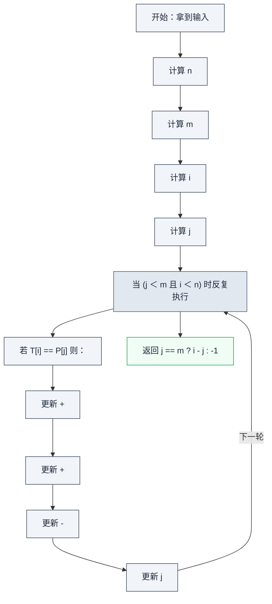

## TypeScript 解题方案（4 个方案逐个讲）

> **运行与提交**：每个方案都是自包含文件（内嵌用例自测，输出 PASS），整块复制到 `.ts` 文件后 `node 文件名` 即可运行。提交 LeetCode 时，把 `demo` 内的算法函数与辅助类型/函数整体取出、置于文件顶层即可。概念演示（非 LeetCode 编号题），在本地运行即可。

### 方案 1：迭代指针处理

**分析与思路**：核心做法是「迭代指针处理」。

**运行方式**：`node 本文件`，内嵌用例全部通过会输出 PASS。


**方案专属流程图**（真实控制流）：

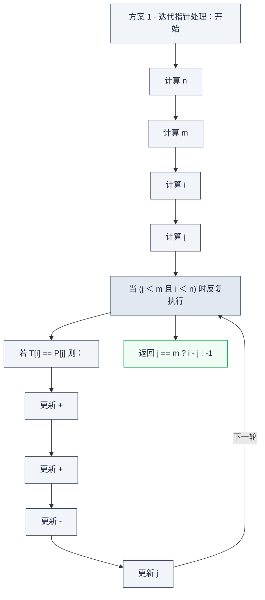

```typescript
/**
 * LeetCode 116567013. PM
 * 来源：https://blog.csdn.net/tyro_java/article/details/116567013
 * 忠实翻译 python/notes/lc_116567013_pm/solution_1___1.py
 */

// Brute-Force 模式匹配（版本1：主串指针回退）。
// 返回模式 P 在文本 T 中首次出现的起始下标，未找到返回 -1。
function matchV1(P: string, T: string): number {
  // 定义函数/方法 matchV1
  const n = T.length; // 把 T.长度 存入 元素个数
  const m = P.length; // 把 P.长度 存入 映射表
  let i = 0; // 把 0 存入 下标 i
  let j = 0; // 把 0 存入 下标 j
  while (j < m && i < n) {
    // 循环，直到不满足「下标 j 小于 映射表 且 下标 i 小于 元素个数」
    if (T[i] === P[j]) {
      // 若 T[下标 i] 全等于 P[下标 j]
      i += 1; // 下标 i累加 1
      j += 1; // 下标 j累加 1
    } else {
      // 否则
      i -= j - 1; // 主串回退到本次对齐的下一位置
      j = 0; // 把 0 存入 下标 j
    }
  }
  return j === m ? i - j : -1; // 返回 下标 j 全等于 映射表 ? 下标 i 减 下标 j : 减 1
}

export function demo(): void {
  // 程序入口：跑内嵌自测用例
  const T = 'now is the time for all good people to come'; // 把 'now is the time for all good people to come' 存入 T
  const cases: { p: string; T: string; want: number }[] = [
    { p: 'people', T: T, want: 29 },
    { p: 'good', T: T, want: 24 },
    { p: 'no', T: T, want: 0 },
    { p: 'xyz', T: T, want: -1 }, // 未命中
    { p: 'a', T: '', want: -1 }, // 边界：空文本
    { p: 'good', T: 'good', want: 0 }, // 边界：文本恰为模式
  ];
  let fail = false; // 把 false 存入 fail
  for (const c of cases) {
    // for (const 字符 of cases) {
    const got = matchV1(c.p, c.T); // 把 matchV1(字符.节点, 字符.T) 存入 got
    if (got !== c.want) {
      // 若 got 不等于 字符.want
      fail = true; // 把 true 存入 fail
      console.log('FAIL match_v1("' + c.p + '")=' + got + ' want ' + c.want); // 打印输出
    }
  }
  if (fail) throw new Error('FAILED'); // 若 fail) throw new Error(「FAILED」);
  console.log('PASS'); // 全部用例通过，输出 PASS
}
demo(); // demo();
```

### 方案 2：单趟扫描

**分析与思路**：核心做法是「单趟扫描」。代码里依次做这些事：单循环线性扫描。

**运行方式**：`node 本文件`，内嵌用例全部通过会输出 PASS。


**方案专属流程图**（真实控制流）：

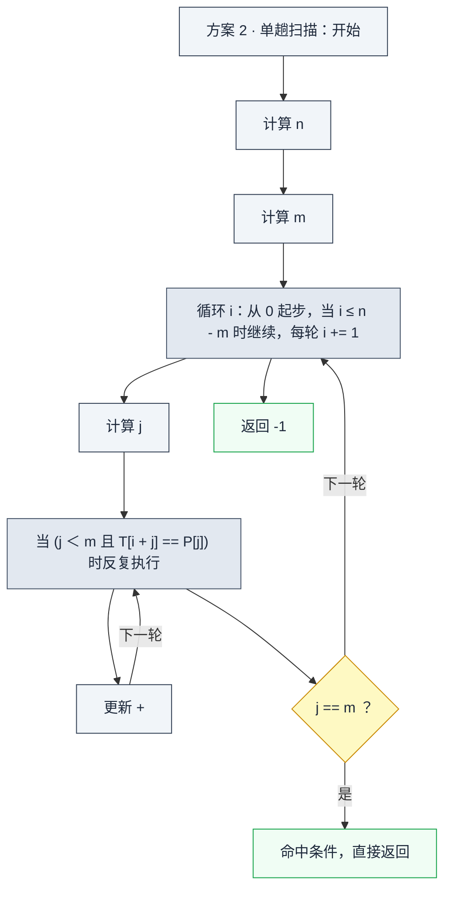

```typescript
/**
 * LeetCode 116567013. PM
 * 来源：https://blog.csdn.net/tyro_java/article/details/116567013
 * 忠实翻译 python/notes/lc_116567013_pm/solution_2___2.py
 */

// Brute-Force 模式匹配（版本2：双循环对齐）。
// 每次对齐后用内层循环逐字符比较。
function matchV2(P: string, T: string): number {
  // 定义函数/方法 matchV2
  const n = T.length; // 把 T.长度 存入 元素个数
  const m = P.length; // 把 P.长度 存入 映射表
  for (let i = 0; i <= n - m; i += 1) {
    // 让 下标 i 从 0 开始计数，下标 i 不超过 元素个数 减 映射表 就继续
    let j = 0; // 把 0 存入 下标 j
    while (j < m && T[i + j] === P[j]) {
      // 循环，直到不满足「下标 j 小于 映射表 且 T[下标 i 加 下标 j] 全等于 P[下标 j]」
      j += 1; // 下标 j累加 1
    }
    if (j === m) {
      // 若 下标 j 全等于 映射表
      return i; // 返回 下标 i
    }
  }
  return -1; // 返回 减 1
}

export function demo(): void {
  // 程序入口：跑内嵌自测用例
  const T = 'now is the time for all good people to come'; // 把 'now is the time for all good people to come' 存入 T
  const cases: { p: string; T: string; want: number }[] = [
    { p: 'people', T: T, want: 29 },
    { p: 'time', T: T, want: 11 },
    { p: 'all', T: T, want: 20 },
    { p: 'xyz', T: T, want: -1 }, // 未命中
    { p: 'a', T: '', want: -1 }, // 边界：空文本
    { p: 'is', T: 'is', want: 0 }, // 边界：文本恰为模式
  ];
  let fail = false; // 把 false 存入 fail
  for (const c of cases) {
    // for (const 字符 of cases) {
    const got = matchV2(c.p, c.T); // 把 matchV2(字符.节点, 字符.T) 存入 got
    if (got !== c.want) {
      // 若 got 不等于 字符.want
      fail = true; // 把 true 存入 fail
      console.log('FAIL match_v2("' + c.p + '")=' + got + ' want ' + c.want); // 打印输出
    }
  }
  if (fail) throw new Error('FAILED'); // 若 fail) throw new Error(「FAILED」);
  console.log('PASS'); // 全部用例通过，输出 PASS
}
demo(); // demo();
```

### 方案 3：迭代指针处理

**分析与思路**：核心做法是「迭代指针处理」。

**运行方式**：`node 本文件`，内嵌用例全部通过会输出 PASS。


**方案专属流程图**（真实控制流）：


```typescript
/**
 * LeetCode 116567013. PM
 * 来源：https://blog.csdn.net/tyro_java/article/details/116567013
 * 忠实翻译 python/notes/lc_116567013_pm/solution_3___3.py
 */

// 构造 KMP 的 next 失效函数（look-up table）。
function buildNext(P: string): number[] {
  // 定义函数/方法 buildNext
  const m = P.length; // 把 P.长度 存入 映射表
  const N: number[] = new Array(m).fill(-1); // 把 new Array(映射表).fill( 减 1); 写入 const N: number[]
  let j = 0; // 把 0 存入 下标 j
  let t = -1; // 把 减 1 存入 另一字符串
  while (j < m - 1) {
    // 循环，直到不满足「下标 j 小于 映射表 减 1」
    if (t < 0 || P[j] === P[t]) {
      // 若 另一字符串 小于 0 或 P[下标 j] 全等于 P[另一字符串]
      j += 1; // 下标 j累加 1
      t += 1; // 另一字符串累加 1
      N[j] = t; // 把 另一字符串; 写入 N[j]
    } else {
      // 否则
      t = N[t]; // 把 N[另一字符串] 存入 另一字符串
    }
  }
  return N; // 返回 N
}

// KMP 模式匹配：借助 next 表在失配时大步跳跃，最坏 O(n)。
function kmpMatch(P: string, T: string): number {
  // 定义函数/方法 kmpMatch
  const N = buildNext(P); // 把 buildNext(P) 存入 N
  const n = T.length; // 把 T.长度 存入 元素个数
  const m = P.length; // 把 P.长度 存入 映射表
  let i = 0; // 把 0 存入 下标 i
  let j = 0; // 把 0 存入 下标 j
  while (j < m && i < n) {
    // 循环，直到不满足「下标 j 小于 映射表 且 下标 i 小于 元素个数」
    if (j < 0 || T[i] === P[j]) {
      // 若 下标 j 小于 0 或 T[下标 i] 全等于 P[下标 j]
      i += 1; // 下标 i累加 1
      j += 1; // 下标 j累加 1
    } else {
      // 否则
      j = N[j]; // 把 N[下标 j] 存入 下标 j
    }
  }
  return j === m ? i - j : -1; // 返回 下标 j 全等于 映射表 ? 下标 i 减 下标 j : 减 1
}

function eqArr(a: number[], b: number[]): boolean {
  // 定义函数/方法 eqArr
  if (a.length !== b.length) {
    // 若 数组.长度 不等于 b.长度
    return false; // 返回 false
  }
  for (let idx = 0; idx < a.length; idx += 1) {
    // 让 idx 从 0 开始计数，idx 小于 数组.长度 就继续
    if (a[idx] !== b[idx]) {
      // 若 数组[idx] 不等于 b[idx]
      return false; // 返回 false
    }
  }
  return true; // 返回 true
}

export function demo(): void {
  // 程序入口：跑内嵌自测用例
  const T = 'now is the time for all good people to come'; // 把 'now is the time for all good people to come' 存入 T
  const cases: { p: string; T: string; want: number }[] = [
    { p: 'people', T: T, want: 29 },
    { p: 'all', T: T, want: 20 },
    { p: 'no', T: T, want: 0 },
    { p: 'xyz', T: T, want: -1 }, // 未命中
    { p: 'a', T: '', want: -1 }, // 边界：空文本
    { p: 'aaaa', T: 'aaaaa', want: 0 }, // 边界：重叠前缀
    { p: 'aaab', T: 'aaabaaa', want: 0 }, // 边界：回退复用
  ];
  const tableCases: { p: string; want: number[] }[] = [
    { p: 'ababaca', want: [-1, 0, 0, 1, 2, 3, 0] },
    { p: 'aaaa', want: [-1, 0, 1, 2] },
    { p: 'abcd', want: [-1, 0, 0, 0] }, // 边界：无重复
  ];
  let fail = false; // 把 false 存入 fail
  for (const c of cases) {
    // for (const 字符 of cases) {
    const got = kmpMatch(c.p, c.T); // 把 kmpMatch(字符.节点, 字符.T) 存入 got
    if (got !== c.want) {
      // 若 got 不等于 字符.want
      fail = true; // 把 true 存入 fail
      console.log('FAIL kmp_match("' + c.p + '")=' + got + ' want ' + c.want); // 打印输出
    }
  }
  for (const c of tableCases) {
    // for (const 字符 of tableCases) {
    const got = buildNext(c.p); // 把 buildNext(字符.节点) 存入 got
    if (!eqArr(got, c.want)) {
      // 若 取反 eqArr(got, 字符.want
      fail = true; // 把 true 存入 fail
      console.log(
        'FAIL build_next("' +
          c.p +
          ')=' +
          JSON.stringify(got) +
          ' want ' +
          JSON.stringify(c.want),
      );
    }
  }
  if (fail) throw new Error('FAILED'); // 若 fail) throw new Error(「FAILED」);
  console.log('PASS'); // 全部用例通过，输出 PASS
}
demo(); // demo();
```

### 方案 4：迭代指针处理

**分析与思路**：核心做法是「迭代指针处理」。

**运行方式**：`node 本文件`，内嵌用例全部通过会输出 PASS。


**方案专属流程图**（真实控制流）：

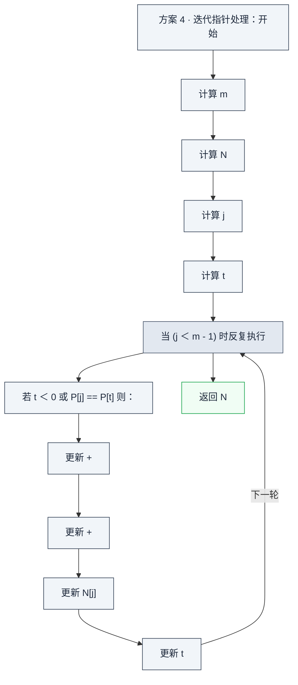

```typescript
/**
 * LeetCode 116567013. PM
 * 来源：https://blog.csdn.net/tyro_java/article/details/116567013
 * 忠实翻译 python/notes/lc_116567013_pm/solution_4___4.py
 */

// 构造 KMP 的 next 表（单独呈现，对应 C++ buildNext）。
function buildNext(P: string): number[] {
  // 定义函数/方法 buildNext
  const m = P.length; // 把 P.长度 存入 映射表
  const N: number[] = new Array(m).fill(-1); // 把 new Array(映射表).fill( 减 1); 写入 const N: number[]
  let j = 0; // 把 0 存入 下标 j
  let t = -1; // 把 减 1 存入 另一字符串
  while (j < m - 1) {
    // 循环，直到不满足「下标 j 小于 映射表 减 1」
    if (t < 0 || P[j] === P[t]) {
      // 若 另一字符串 小于 0 或 P[下标 j] 全等于 P[另一字符串]
      j += 1; // 下标 j累加 1
      t += 1; // 另一字符串累加 1
      N[j] = t; // 把 另一字符串; 写入 N[j]
    } else {
      // 否则
      t = N[t]; // 把 N[另一字符串] 存入 另一字符串
    }
  }
  return N; // 返回 N
}

function eqArr(a: number[], b: number[]): boolean {
  // 定义函数/方法 eqArr
  if (a.length !== b.length) {
    // 若 数组.长度 不等于 b.长度
    return false; // 返回 false
  }
  for (let idx = 0; idx < a.length; idx += 1) {
    // 让 idx 从 0 开始计数，idx 小于 数组.长度 就继续
    if (a[idx] !== b[idx]) {
      // 若 数组[idx] 不等于 b[idx]
      return false; // 返回 false
    }
  }
  return true; // 返回 true
}

export function demo(): void {
  // 程序入口：跑内嵌自测用例
  const cases: { p: string; want: number[] }[] = [
    { p: 'ababaca', want: [-1, 0, 0, 1, 2, 3, 0] },
    { p: 'aaaa', want: [-1, 0, 1, 2] },
    { p: 'abcabc', want: [-1, 0, 0, 0, 1, 2] },
    { p: 'abcd', want: [-1, 0, 0, 0] }, // 边界：无重复
    { p: 'a', want: [-1] }, // 边界：长度 1
  ];
  let fail = false; // 把 false 存入 fail
  for (const c of cases) {
    // for (const 字符 of cases) {
    const got = buildNext(c.p); // 把 buildNext(字符.节点) 存入 got
    if (!eqArr(got, c.want)) {
      // 若 取反 eqArr(got, 字符.want
      fail = true; // 把 true 存入 fail
      console.log(
        'FAIL build_next("' +
          c.p +
          ')=' +
          JSON.stringify(got) +
          ' want ' +
          JSON.stringify(c.want),
      );
    }
  }
  if (fail) throw new Error('FAILED'); // 若 fail) throw new Error(「FAILED」);
  console.log('PASS'); // 全部用例通过，输出 PASS
}
demo(); // demo();
```

## 逐步拆解与面试追问

**复杂度**：时间 O(n)（单趟线性扫描），空间 O(1) 到 O(n)（视辅助结构）

**为什么是这个量级**：每个元素被常数次访问，辅助哈希或栈的开销与 n 同阶

**面试官可能会追问**：

- 这个策略能推广到什么场景？
- 与暴力做法差在哪一步？
- 有没有更简单的等价写法？

## 关键 API 速查（TS 主解法实际用到，附官方链接）

本题主解法只用到基础语法（变量、循环、比较），不依赖特殊库 API。

### 各语言官方文档导航

- **TypeScript / JS**：[MDN 中文参考](https://developer.mozilla.org/zh-CN/)
- **Python**：[Python 官方文档](https://docs.python.org/zh-cn/3/)
- **Go**：[Go 标准库](https://pkg.go.dev/std)
- **Java**：[JDK 17 API](https://docs.oracle.com/en/java/javase/17/docs/api/)
- **Rust**：[Rust 标准库](https://doc.rust-lang.org/std/)
- **Lua**：[Lua 5.4 手册](https://www.lua.org/manual/5.4/)
- **C**：[Cppreference C](https://zh.cppreference.com/w/c)
- **C++**：[Cppreference C++](https://zh.cppreference.com/w/cpp)
- **R**：[R 官方手册](https://stat.ethz.ch/R-manual/)
- **Zig**：[Zig 语言文档](https://ziglang.org/documentation/master/)
- **Dart**：[Dart API](https://api.dart.dev/)

## 附录：其他 10 种语言全部实现（每种语言列举其全部方案）

> TypeScript 的全部方案见「TypeScript 解题方案」一节；下面是其余 10 种语言的对应实现，每种语言的每个方案都带思路分析、代码走读与专属运行架构图。
> 每个方案都内嵌用例自测，可独立运行（老仓库 python/go 文件遵循「打印结果」约定）。
> 完整解法文件见 `dsa/<语言>/notes/lc_116567013_pm/`。

### Python 实现（4 种方案）

Python 的全部方案如下，每个方案都内嵌用例自测，可独立运行（老仓库 python/go 文件遵循「打印结果」约定）：

#### 方案 1：迭代指针处理

**思路与代码分析**：核心是「迭代指针处理」。Python 版用切片与字典推导式简化操作，突出可读性。**走读**：方案 1 · 迭代指针处理：开始 → 更新 m → 更新 j → 当 j ＜ m and i ＜ n: 时反复执行 → 若 T[i] == P[j]：更新 + → 更新 + → 更新 + → 更新 - → 更新 j → 返回 i - j if j == m else -1。

**运行架构**（真实控制流）：

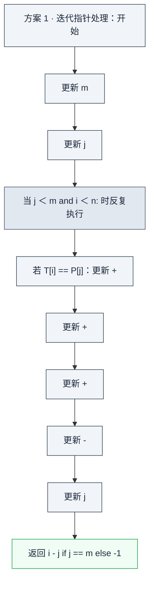

```python
import sys  # 提高递归深度上限（深输入防 RecursionError）

sys.setrecursionlimit(200000)  # 树/链表类题目节点数可达 1e4 量级

def match_v1(P, T):  # 定义函数 match_v1（参数：P, T）
    """Brute-Force 模式匹配（版本1：主串指针回退）。
    返回模式 P 在文本 T 中首次出现的起始下标，未找到返回 -1。"""
    n, m = len(T), len(P)  # 把 长度(T), 长度(P) 写入 n, m
    i, j = 0, 0  # 把 0, 0 写入 i, j
    while j < m and i < n:  # 循环，直到不满足「下标 j 小于 映射表 and 下标 i 小于 元素个数」
        if T[i] == P[j]:  # 若 T[下标 i] 等于 P[下标 j]
            i += 1  # 下标 i累加 1
            j += 1  # 下标 j累加 1
        else:  # 否则
            i -= j - 1  # 主串回退到本次对齐的下一位置
            j = 0  # 把 0 存入 下标 j
    return i - j if j == m else -1  # 返回 下标 i 减 下标 j if 下标 j 等于 映射表 else 减 1

if __name__ == "__main__":  # 若 __name__ 等于 '__main__'
    T = "now is the time for all good people to come"  # 把 'now is the time for all good people to come' 存入 T
    print('匹配 "people":', match_v1("people", T))  # 打印输出
    print('匹配 "good":', match_v1("good", T))  # 打印输出
    print('匹配 "xyz":', match_v1("xyz", T))  # 打印输出
```

#### 方案 2：单趟扫描

**思路与代码分析**：核心是「单趟扫描」。Python 版用切片与字典推导式简化操作，突出可读性。**走读**：方案 2 · 单趟扫描：开始 → 更新 m → 循环 i：从 0 到 n - m + 1 前 → 更新 j → 当 ( 时反复执行 → 更新 = → 处理 ): → 更新 + → 命中条件，直接返回 → 返回 -1。

**运行架构**（真实控制流）：

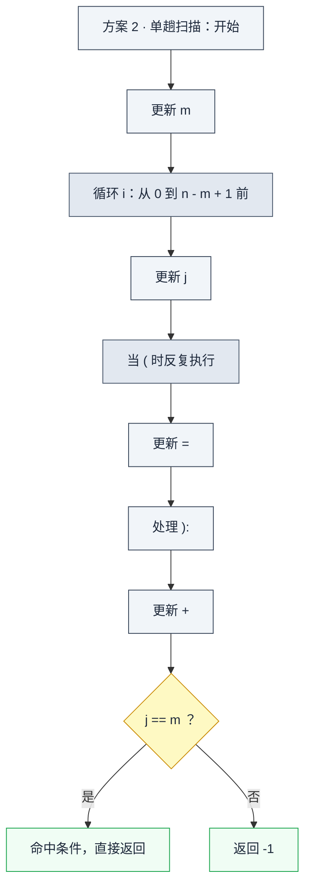

```python
import sys  # 提高递归深度上限（深输入防 RecursionError）

sys.setrecursionlimit(200000)  # 树/链表类题目节点数可达 1e4 量级

def match_v2(P, T):  # 定义函数 match_v2（参数：P, T）
    """Brute-Force 模式匹配（版本2：双循环对齐）。每次对齐后用内层循环逐字符比较。"""
    n, m = len(T), len(P)  # 把 长度(T), 长度(P) 写入 n, m
    for i in range(n - m + 1):  # 让 下标 i 从 元素个数 减 映射表 加 1 遍历
        j = 0  # 把 0 存入 下标 j
        while (
            j < m and T[i + j] == P[j]
        ):  # 循环，直到不满足「下标 j 小于 映射表 and T[下标 i 加 下标 j] 等于 P[下标 j]」
            j += 1  # 下标 j累加 1
        if j == m:  # 若 下标 j 等于 映射表
            return i  # 返回 下标 i
    return -1  # 返回 减 1

if __name__ == "__main__":  # 若 __name__ 等于 '__main__'
    T = "now is the time for all good people to come"  # 把 'now is the time for all good people to come' 存入 T
    print('匹配 "people":', match_v2("people", T))  # 打印输出
    print('匹配 "time":', match_v2("time", T))  # 打印输出
```

#### 方案 3：迭代指针处理

**思路与代码分析**：核心是「迭代指针处理」。Python 版用切片与字典推导式简化操作，突出可读性。**走读**：方案 3 · 迭代指针处理：开始 → 更新 m → 更新 N → 更新 t → 当 j ＜ m - 1: 时反复执行 → 若 t ＜ 0 or P[j] == P[t]：更新 + → 更新 + → 更新 + → 更新 N[j] → 更新 t → 返回 N。

**运行架构**（真实控制流）：

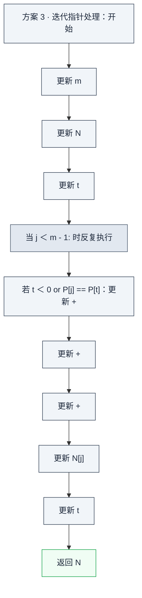

```python
import sys  # 提高递归深度上限（深输入防 RecursionError）

sys.setrecursionlimit(200000)  # 树/链表类题目节点数可达 1e4 量级

def build_next(P):  # 定义函数 build_next（参数：P）
    """构造 KMP 的 next 失效函数（look-up table）。"""
    m = len(P)  # 把 长度(P) 存入 映射表
    N = [-1] * m  # 把 [ 减 1] 乘 映射表 存入 N
    j, t = 0, -1  # 把 0, 减 1 写入 j, t
    while j < m - 1:  # 循环，直到不满足「下标 j 小于 映射表 减 1」
        if t < 0 or P[j] == P[t]:  # 若 另一字符串 小于 0 or P[下标 j] 等于 P[另一字符串]
            j += 1  # 下标 j累加 1
            t += 1  # 另一字符串累加 1
            N[j] = t  # 把 另一字符串 写入 N[j]
        else:  # 否则
            t = N[t]  # 把 N[另一字符串] 存入 另一字符串
    return N  # 返回 N

def kmp_match(P, T):  # 定义函数 kmp_match（参数：P, T）
    """KMP 模式匹配：借助 next 表在失配时大步跳跃，最坏 O(n)。"""
    N = build_next(P)  # 把 build_next(P) 存入 N
    n, m = len(T), len(P)  # 把 长度(T), 长度(P) 写入 n, m
    i, j = 0, 0  # 把 0, 0 写入 i, j
    while j < m and i < n:  # 循环，直到不满足「下标 j 小于 映射表 and 下标 i 小于 元素个数」
        if j < 0 or T[i] == P[j]:  # 若 下标 j 小于 0 or T[下标 i] 等于 P[下标 j]
            i += 1  # 下标 i累加 1
            j += 1  # 下标 j累加 1
        else:  # 否则
            j = N[j]  # 把 N[下标 j] 存入 下标 j
    return i - j if j == m else -1  # 返回 下标 i 减 下标 j if 下标 j 等于 映射表 else 减 1

if __name__ == "__main__":  # 若 __name__ 等于 '__main__'
    T = "now is the time for all good people to come"  # 把 'now is the time for all good people to come' 存入 T
    print('KMP 匹配 "people":', kmp_match("people", T))  # 打印输出
    print('KMP 匹配 "all":', kmp_match("all", T))  # 打印输出
```

#### 方案 4：迭代指针处理

**思路与代码分析**：核心是「迭代指针处理」。Python 版用切片与字典推导式简化操作，突出可读性。**走读**：方案 4 · 迭代指针处理：开始 → 更新 m → 更新 N → 更新 t → 当 j ＜ m - 1: 时反复执行 → 若 t ＜ 0 or P[j] == P[t]：更新 + → 更新 + → 更新 + → 更新 N[j] → 更新 t → 返回 N。

**运行架构**（真实控制流）：


```python
import sys  # 提高递归深度上限（深输入防 RecursionError）

sys.setrecursionlimit(200000)  # 树/链表类题目节点数可达 1e4 量级

def build_next(P):  # 定义函数 build_next（参数：P）
    """构造 KMP 的 next 表（单独呈现，对应 C++ buildNext）。"""
    m = len(P)  # 把 长度(P) 存入 映射表
    N = [-1] * m  # 把 [ 减 1] 乘 映射表 存入 N
    j, t = 0, -1  # 把 0, 减 1 写入 j, t
    while j < m - 1:  # 循环，直到不满足「下标 j 小于 映射表 减 1」
        if t < 0 or P[j] == P[t]:  # 若 另一字符串 小于 0 or P[下标 j] 等于 P[另一字符串]
            j += 1  # 下标 j累加 1
            t += 1  # 另一字符串累加 1
            N[j] = t  # 把 另一字符串 写入 N[j]
        else:  # 否则
            t = N[t]  # 把 N[另一字符串] 存入 另一字符串
    return N  # 返回 N

if __name__ == "__main__":  # 若 __name__ 等于 '__main__'
    P = "ababaca"  # 把 'ababaca' 存入 P
    table = build_next(P)  # 把 build_next(P) 存入 table
    print("模式:", P)  # 打印输出
    print("next 表:", table)  # 打印输出
```

### Go 实现（4 种方案）

Go 的全部方案如下，每个方案都内嵌用例自测，可独立运行（老仓库 python/go 文件遵循「打印结果」约定）：

#### 方案 1：迭代指针处理

**思路与代码分析**：核心是「迭代指针处理」。Go 版用切片与多返回值惯用法，显式处理索引边界。**走读**：方案 1 · 迭代指针处理：开始 → 更新 : → 更新 : → 更新 : → 更新 : → 遍历循环 → 处理 if T[i] == P[j] → 处理 i++ → 处理 j++ → 更新 - → 更新 j → 处理 if j == m → 返回 i - j → 返回 -1。

**运行架构**（真实控制流）：

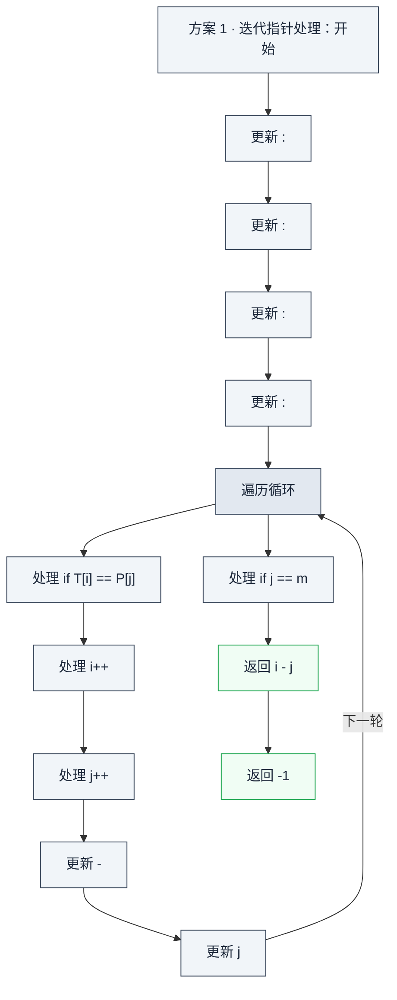

```go
package main // 引入依赖

import (
	"fmt" // 「fmt」
	"os"  // 「os」
)

// 忠实翻译 python/notes/lc_116567013_pm/solution_1___1.py
// Brute-Force 模式匹配（版本1：主串指针回退）。
// 返回模式 P 在文本 T 中首次出现的起始下标，未找到返回 -1。
func matchV1(P string, T string) int { // 定义函数/方法 matchV1
	n := len(T)          // 把 长度(T) 写入 n :
	m := len(P)          // 把 长度(P) 写入 m :
	i := 0               // 把 0 写入 i :
	j := 0               // 把 0 写入 j :
	for j < m && i < n { // for 下标 j 小于 映射表 且 下标 i 小于 元素个数 {
		if T[i] == P[j] { // 若 T[下标 i] 等于 P[下标 j]
			i++ // 下标 i 加一
			j++ // 下标 j 加一
		} else { // 否则
			i -= j - 1 // 主串回退到本次对齐的下一位置
			j = 0      // 把 0 写入 下标 j
		}
	}
	if j == m { // 若 下标 j 等于 映射表
		return i - j // 返回 下标 i 减 下标 j
	}
	return -1 // 返回 减 1
}

func main() { // 程序入口：跑内嵌自测用例
	T := "now is the time for all good people to come" // 把 「now is the time for all good people to come」 写入 T :
	type tc struct {                                   // 定义类型
		P    string // P string
		want int    // want int
	}
	cases := []tc{ // 把 []tc{ 写入 cases :
		{"people", 29},
		{"good", 24},
		{"time", 11},
		{"o", 1},
		{"come", 39},
		{"xyz", -1},
		{"nope", -1},
		{"", 0},
	}
	ok := true                // 把 true 写入 ok :
	for _, c := range cases { // 同时取 _ 与 字符 遍历
		got := matchV1(c.P, T) // 把 matchV1(字符.P, T) 写入 got :
		if got != c.want {     // 若 got 不等于 字符.want
			ok = false                                                    // 把 false 写入 ok
			fmt.Printf("FAIL matchV1(%q)=%d want %d\n", c.P, got, c.want) // 打印输出
		}
	}
	if !ok { // 若 取反 ok
		os.Exit(1) // os.Exit(1)
	}
	fmt.Println("PASS") // 全部用例通过，输出 PASS
}
```

#### 方案 2：单趟扫描

**思路与代码分析**：核心是「单趟扫描」。Go 版用切片与多返回值惯用法，显式处理索引边界。**走读**：方案 2 · 单趟扫描：开始 → 更新 : → 更新 : → 遍历循环 → 更新 : → 遍历循环 → 处理 j++ → 处理 if j == m → 返回 i → 返回 -1。

**运行架构**（真实控制流）：

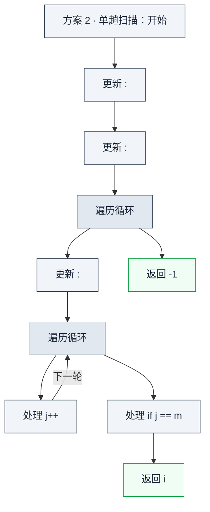

```go
package main // 引入依赖

import (
	"fmt" // 「fmt」
	"os"  // 「os」
)

// 忠实翻译 python/notes/lc_116567013_pm/solution_2___2.py
// Brute-Force 模式匹配（版本2：双循环对齐）。每次对齐后用内层循环逐字符比较。
func matchV2(P string, T string) int { // 定义函数/方法 matchV2
	n := len(T)                 // 把 长度(T) 写入 n :
	m := len(P)                 // 把 长度(P) 写入 m :
	for i := 0; i <= n-m; i++ { // 让 下标 i 从 0 开始计数
		j := 0                        // 把 0 写入 j :
		for j < m && T[i+j] == P[j] { // 把 赋值为 P[下标 j] { 写入 for j < m && T[i+j]
			j++ // 下标 j 加一
		}
		if j == m { // 若 下标 j 等于 映射表
			return i // 返回 下标 i
		}
	}
	return -1 // 返回 减 1
}

func main() { // 程序入口：跑内嵌自测用例
	T := "now is the time for all good people to come" // 把 「now is the time for all good people to come」 写入 T :
	type tc struct {                                   // 定义类型
		P    string // P string
		want int    // want int
	}
	cases := []tc{ // 把 []tc{ 写入 cases :
		{"people", 29},
		{"time", 11},
		{"o", 1},
		{"come", 39},
		{"xyz", -1},
		{"nope", -1},
		{"", 0},
	}
	ok := true                // 把 true 写入 ok :
	for _, c := range cases { // 同时取 _ 与 字符 遍历
		got := matchV2(c.P, T) // 把 matchV2(字符.P, T) 写入 got :
		if got != c.want {     // 若 got 不等于 字符.want
			ok = false                                                    // 把 false 写入 ok
			fmt.Printf("FAIL matchV2(%q)=%d want %d\n", c.P, got, c.want) // 打印输出
		}
	}
	if !ok { // 若 取反 ok
		os.Exit(1) // os.Exit(1)
	}
	fmt.Println("PASS") // 全部用例通过，输出 PASS
}
```

#### 方案 3：迭代指针处理

**思路与代码分析**：核心是「迭代指针处理」。Go 版用切片与多返回值惯用法，显式处理索引边界。**走读**：方案 3 · 迭代指针处理：开始 → 更新 : → 更新 : → 更新 : → 更新 : → 更新 : → 遍历循环 → 处理 if j ＜ 0 或 T[i] == P[j] → 处理 i++ → 处理 j++ → 更新 j → 处理 if j == m → 返回 i - j → 返回 -1。

**运行架构**（真实控制流）：

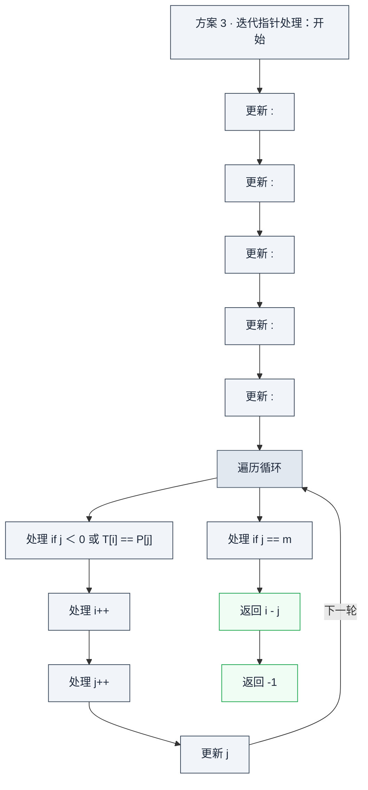

```go
package main // 引入依赖

import (
	"fmt"     // 「fmt」
	"os"      // 「os」
	"reflect" // 「reflect」
)

// 忠实翻译 python/notes/lc_116567013_pm/solution_3___3.py
// 构造 KMP 的 next 失效函数（look-up table）。
func buildNext(P string) []int { // 定义函数/方法 buildNext
	m := len(P)         // 把 长度(P) 写入 m :
	N := make([]int, m) // 把 make([]int, 映射表) 写入 N :
	for i := range N {  // 把 range N { 写入 for i :
		N[i] = -1 // 把 减 1 写入 N[i]
	}
	if m == 0 { // 若 映射表 等于 0
		return N // 返回 N
	}
	j := 0        // 把 0 写入 j :
	t := -1       // 把 减 1 写入 t :
	for j < m-1 { // for 下标 j 小于 映射表 减 1 {
		if t < 0 || P[j] == P[t] { // 若 另一字符串 小于 0 或 P[下标 j] 等于 P[另一字符串]
			j++      // 下标 j 加一
			t++      // 另一字符串 加一
			N[j] = t // 把 另一字符串 写入 N[j]
		} else { // 否则
			t = N[t] // 把 N[另一字符串] 写入 另一字符串
		}
	}
	return N // 返回 N
}

// KMP 模式匹配：借助 next 表在失配时大步跳跃，最坏 O(n)。
func kmpMatch(P string, T string) int { // 定义函数/方法 kmpMatch
	N := buildNext(P)    // 把 buildNext(P) 写入 N :
	n := len(T)          // 把 长度(T) 写入 n :
	m := len(P)          // 把 长度(P) 写入 m :
	i := 0               // 把 0 写入 i :
	j := 0               // 把 0 写入 j :
	for j < m && i < n { // for 下标 j 小于 映射表 且 下标 i 小于 元素个数 {
		if j < 0 || T[i] == P[j] { // 若 下标 j 小于 0 或 T[下标 i] 等于 P[下标 j]
			i++ // 下标 i 加一
			j++ // 下标 j 加一
		} else { // 否则
			j = N[j] // 把 N[下标 j] 写入 下标 j
		}
	}
	if j == m { // 若 下标 j 等于 映射表
		return i - j // 返回 下标 i 减 下标 j
	}
	return -1 // 返回 减 1
}

func main() { // 程序入口：跑内嵌自测用例
	T := "now is the time for all good people to come" // 把 「now is the time for all good people to come」 写入 T :
	type tc struct {                                   // 定义类型
		P    string // P string
		want int    // want int
	}
	cases := []tc{ // 把 []tc{ 写入 cases :
		{"people", 29},
		{"all", 20},
		{"time", 11},
		{"o", 1},
		{"come", 39},
		{"xyz", -1},
		{"nope", -1},
		{"", 0},
	}
	ok := true                // 把 true 写入 ok :
	for _, c := range cases { // 同时取 _ 与 字符 遍历
		got := kmpMatch(c.P, T) // 把 kmpMatch(字符.P, T) 写入 got :
		if got != c.want {      // 若 got 不等于 字符.want
			ok = false                                                     // 把 false 写入 ok
			fmt.Printf("FAIL kmpMatch(%q)=%d want %d\n", c.P, got, c.want) // 打印输出
		}
	}
	// 附带校验 next 表
	tableCases := []struct { // 把 []struct { 写入 tableCases :
		P    string // P string
		want []int  // want []int
	}{ // }{
		{"ababaca", []int{-1, 0, 0, 1, 2, 3, 0}},
		{"aaaa", []int{-1, 0, 1, 2}},
		{"a", []int{-1}},
		{"ab", []int{-1, 0}},
		{"", []int{}},
	}
	for _, c := range tableCases { // 同时取 _ 与 字符 遍历
		got := buildNext(c.P)                                                             // 把 buildNext(字符.P) 写入 got :
		if len(got) != len(c.want) || (len(got) > 0 && !reflect.DeepEqual(got, c.want)) { // 定义函数/方法 len
			ok = false                                                      // 把 false 写入 ok
			fmt.Printf("FAIL buildNext(%q)=%v want %v\n", c.P, got, c.want) // 打印输出
		}
	}
	if !ok { // 若 取反 ok
		os.Exit(1) // os.Exit(1)
	}
	fmt.Println("PASS") // 全部用例通过，输出 PASS
}
```

#### 方案 4：迭代指针处理

**思路与代码分析**：核心是「迭代指针处理」。Go 版用切片与多返回值惯用法，显式处理索引边界。**走读**：方案 4 · 迭代指针处理：开始 → 更新 : → 更新 : → 遍历 N 的下标与元素 i → 更新 N[i] → 处理 if m == 0 → 返回 N → 更新 : → 更新 : → 遍历循环 → 处理 if t ＜ 0 或 P[j] == P[t] → 处理 j++ → 处理 t++ → 更新 N[j] → 更新 t → 返回 N。

**运行架构**（真实控制流）：

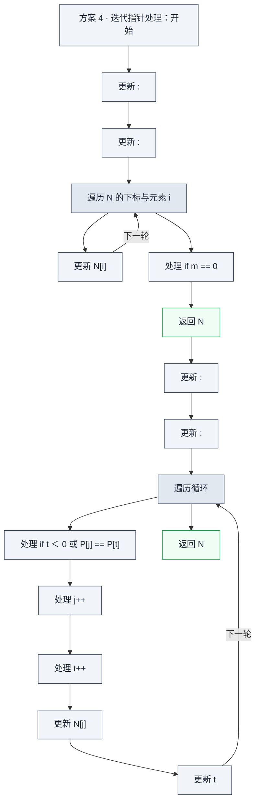

```go
package main // 引入依赖

import (
	"fmt"     // 「fmt」
	"os"      // 「os」
	"reflect" // 「reflect」
)

// 忠实翻译 python/notes/lc_116567013_pm/solution_4___4.py
// 构造 KMP 的 next 表（单独呈现，对应 C++ buildNext）。
func buildNext(P string) []int { // 定义函数/方法 buildNext
	m := len(P)         // 把 长度(P) 写入 m :
	N := make([]int, m) // 把 make([]int, 映射表) 写入 N :
	for i := range N {  // 把 range N { 写入 for i :
		N[i] = -1 // 把 减 1 写入 N[i]
	}
	if m == 0 { // 若 映射表 等于 0
		return N // 返回 N
	}
	j := 0        // 把 0 写入 j :
	t := -1       // 把 减 1 写入 t :
	for j < m-1 { // for 下标 j 小于 映射表 减 1 {
		if t < 0 || P[j] == P[t] { // 若 另一字符串 小于 0 或 P[下标 j] 等于 P[另一字符串]
			j++      // 下标 j 加一
			t++      // 另一字符串 加一
			N[j] = t // 把 另一字符串 写入 N[j]
		} else { // 否则
			t = N[t] // 把 N[另一字符串] 写入 另一字符串
		}
	}
	return N // 返回 N
}

func eqIntSlice(a []int, b []int) bool { // 定义函数/方法 eqIntSlice
	if len(a) != len(b) { // 定义函数/方法 len
		return false // 返回 false
	}
	for i := range a { // 把 range 数组 { 写入 for i :
		if a[i] != b[i] { // 若 数组[下标 i] 不等于 b[下标 i]
			return false // 返回 false
		}
	}
	return true // 返回 true
}

func main() { // 程序入口：跑内嵌自测用例
	cases := []struct { // 把 []struct { 写入 cases :
		P    string // P string
		want []int  // want []int
	}{ // }{
		{"ababaca", []int{-1, 0, 0, 1, 2, 3, 0}},
		{"aaaa", []int{-1, 0, 1, 2}},
		{"a", []int{-1}},
		{"ab", []int{-1, 0}},
		{"", []int{}},
	}
	ok := true                // 把 true 写入 ok :
	for _, c := range cases { // 同时取 _ 与 字符 遍历
		got := buildNext(c.P)         // 把 buildNext(字符.P) 写入 got :
		if !eqIntSlice(got, c.want) { // 若 取反 eqIntSlice(got, 字符.want
			ok = false                                                      // 把 false 写入 ok
			fmt.Printf("FAIL buildNext(%q)=%v want %v\n", c.P, got, c.want) // 打印输出
		}
	}
	_ = reflect.DeepEqual // 把 reflect.DeepEqual 写入 _
	if !ok {              // 若 取反 ok
		os.Exit(1) // os.Exit(1)
	}
	fmt.Println("PASS") // 全部用例通过，输出 PASS
}
```

### Java 实现（4 种方案）

Java 的全部方案如下，每个方案都内嵌用例自测，可独立运行（老仓库 python/go 文件遵循「打印结果」约定）：

#### 方案 1：迭代指针处理

**思路与代码分析**：核心是「迭代指针处理」。Java 版用类与静态方法组织，集合操作显式明了。**走读**：方案 1 · 迭代指针处理：开始 → 更新 n → 更新 m → 更新 i → 更新 j → 当 (j ＜ m 且 i ＜ n) 时反复执行 → 若 T.charAt(i) == P.charAt(j) 则： → 处理 i++ → 处理 j++ → 更新 - → 更新 j → 返回 (j == m) ? (i - j) : -1。

**运行架构**（真实控制流）：

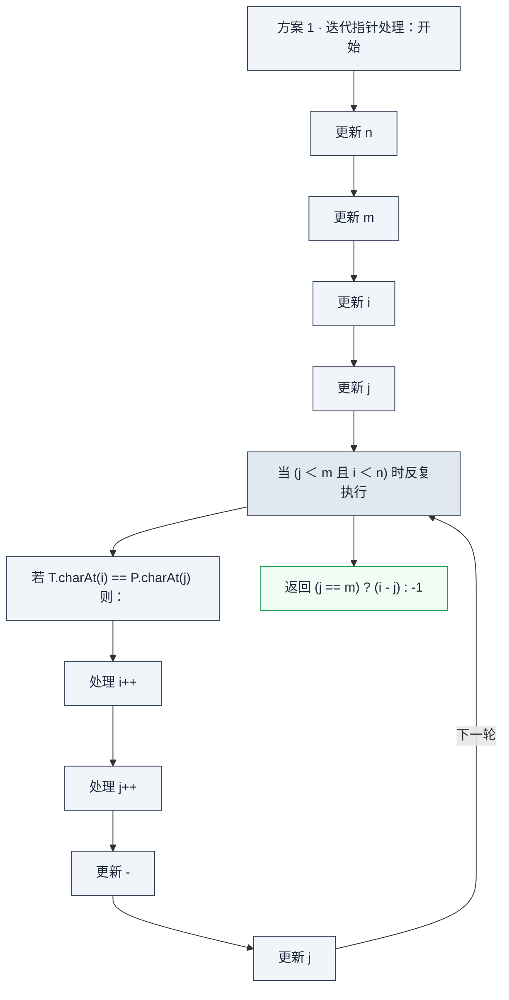

```java
package com.webfault.dsa; // 引入依赖

class lc116567013_solution11 { // 定义类型
  // Brute-Force 模式匹配（主串指针回退）
  static int matchV1(String P, String T) { // 定义函数/方法 matchV1
    int n = T.length(),
        m = P.length(),
        i = 0,
        j = 0; // 把 T.长度(), 映射表 赋值为 P.长度(), 下标 i 赋值为 0, 下标 j 赋值为 0 存入 元素个数
    while (j < m && i < n) { // 循环，直到不满足「下标 j 小于 映射表 且 下标 i 小于 元素个数」
      if (T.charAt(i) == P.charAt(j)) { // 若 T 取字符 下标 i) 等于 P 取字符 下标 j
        i++; // 下标 i 加一
        j++; // 下标 j 加一
      } else { // 否则
        i -= (j - 1); // 下标 i累减 (下标 j 减 1)
        j = 0; // 把 0; 写入 下标 j
      }
    }
    return (j == m) ? (i - j) : -1; // 返回 (下标 j 等于 映射表) ? (下标 i 减 下标 j) : 减 1
  }

  public static void main(String[] args) { // public static void main(String[] args) {
    String T =
        "now is the time for all good people to come"; // 把 「now is the time for all good people to
                                                       // come」 存入 T
    if (matchV1("people", T) != 29) {
      System.out.println("FAIL people");
      throw new RuntimeException("FAILED");
    }
    if (matchV1("good", T) != 24) {
      System.out.println("FAIL good");
      throw new RuntimeException("FAILED");
    }
    if (matchV1("xyz", T) != -1) {
      System.out.println("FAIL xyz");
      throw new RuntimeException("FAILED");
    }
    System.out.println("PASS"); // 全部用例通过，输出 PASS
  }
}
```

#### 方案 2：单趟扫描

**思路与代码分析**：核心是「单趟扫描」。Java 版用类与静态方法组织，集合操作显式明了。代码里依次做这些事：单循环线性扫描。**走读**：方案 2 · 单趟扫描：开始 → 更新 n → 遍历循环 → 更新 j → 当 (j ＜ m 且 T.charAt(i + j) == P.charAt(j)) j++ 时反复执行 → 命中条件，直接返回 → 返回 -1。

**运行架构**（真实控制流）：

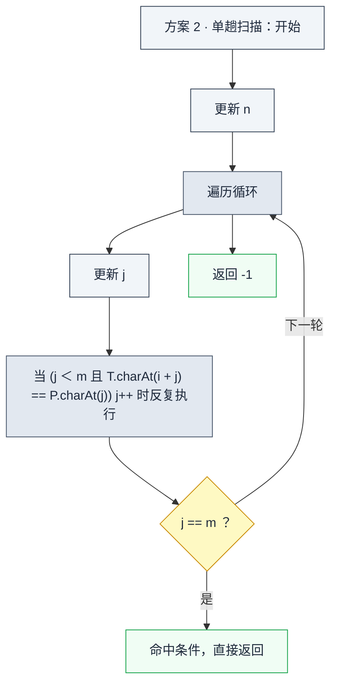

```java
package com.webfault.dsa; // 引入依赖

class lc116567013_solution22 { // 定义类型
  // Brute-Force 模式匹配（双循环对齐）
  static int matchV2(String P, String T) { // 定义函数/方法 matchV2
    int n = T.length(), m = P.length(); // 把 T.长度(), 映射表 赋值为 P.长度() 存入 元素个数
    for (int i = 0; i <= n - m; i++) { // 让 下标 i 从 0 开始计数，下标 i 不超过 元素个数 减 映射表 就继续
      int j = 0; // 把 0 存入 下标 j
      while (j < m && T.charAt(i + j) == P.charAt(j)) j++;
      if (j == m) return i; // 若 下标 j 等于 映射表，直接返回 下标 i
    }
    return -1; // 返回 减 1
  }

  public static void main(String[] args) { // public static void main(String[] args) {
    String T =
        "now is the time for all good people to come"; // 把 「now is the time for all good people to
                                                       // come」 存入 T
    if (matchV2("people", T) != 29) {
      System.out.println("FAIL people");
      throw new RuntimeException("FAILED");
    }
    if (matchV2("time", T) != 11) {
      System.out.println("FAIL time");
      throw new RuntimeException("FAILED");
    }
    System.out.println("PASS"); // 全部用例通过，输出 PASS
  }
}
```

#### 方案 3：迭代指针处理

**思路与代码分析**：核心是「迭代指针处理」。Java 版用类与静态方法组织，集合操作显式明了。**走读**：方案 3 · 迭代指针处理：开始 → 更新 N → 更新 n → 更新 m → 更新 i → 更新 j → 当 (j ＜ m 且 i ＜ n) 时反复执行 → 若 j ＜ 0 或 T.charAt(i) == P.charAt(j) 则： → 处理 i++ → 处理 j++ → 更新 j → 返回 (j == m) ? (i - j) : -1。

**运行架构**（真实控制流）：

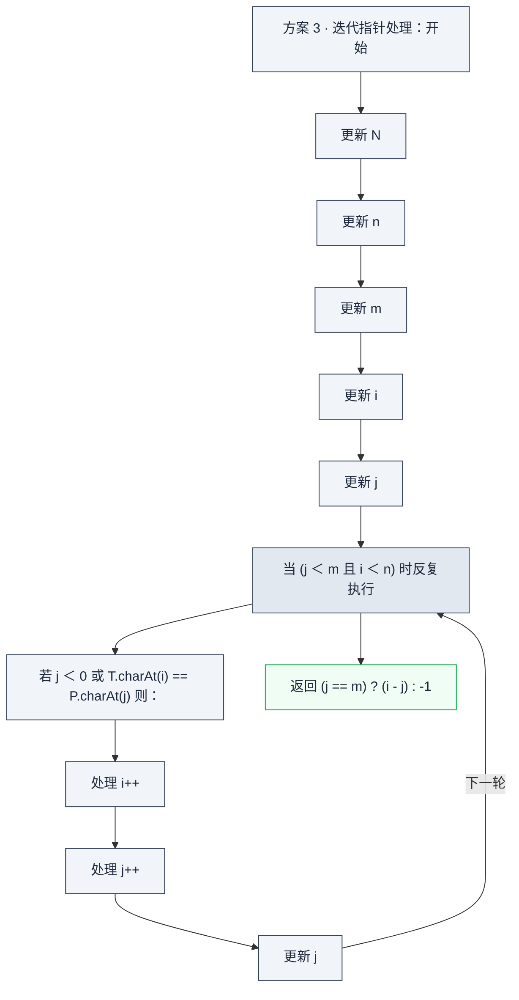

```java
package com.webfault.dsa; // 引入依赖

class lc116567013_solution33 { // 定义类型
  // KMP 模式匹配
  static int[] buildNext(String P) { // 定义函数/方法 buildNext
    int m = P.length(); // 把 P.长度() 存入 映射表
    int[] N = new int[m]; // 把 new int[映射表]; 写入 int[] N
    N[0] = -1; // 把 减 1; 写入 N[0]
    int j = 0, t = -1; // 把 0, 另一字符串 赋值为 减 1 存入 下标 j
    while (j < m - 1) { // 循环，直到不满足「下标 j 小于 映射表 减 1」
      if (t < 0 || P.charAt(j) == P.charAt(t)) { // 若 另一字符串 小于 0 或 P 取字符 下标 j) 等于 P 取字符 另一字符串
        j++; // 下标 j 加一
        t++; // 另一字符串 加一
        N[j] = t; // 把 另一字符串; 写入 N[j]
      } else { // 否则
        t = N[t]; // 把 N[另一字符串]; 写入 另一字符串
      }
    }
    return N; // 返回 N
  }

  static int kmpMatch(String P, String T) { // 定义函数/方法 kmpMatch
    int[] N = buildNext(P); // 把 buildNext(P); 写入 int[] N
    int n = T.length(),
        m = P.length(),
        i = 0,
        j = 0; // 把 T.长度(), 映射表 赋值为 P.长度(), 下标 i 赋值为 0, 下标 j 赋值为 0 存入 元素个数
    while (j < m && i < n) { // 循环，直到不满足「下标 j 小于 映射表 且 下标 i 小于 元素个数」
      if (j < 0 || T.charAt(i) == P.charAt(j)) { // 若 下标 j 小于 0 或 T 取字符 下标 i) 等于 P 取字符 下标 j
        i++; // 下标 i 加一
        j++; // 下标 j 加一
      } else { // 否则
        j = N[j]; // 把 N[下标 j]; 写入 下标 j
      }
    }
    return (j == m) ? (i - j) : -1; // 返回 (下标 j 等于 映射表) ? (下标 i 减 下标 j) : 减 1
  }

  public static void main(String[] args) { // public static void main(String[] args) {
    String T =
        "now is the time for all good people to come"; // 把 「now is the time for all good people to
                                                       // come」 存入 T
    if (kmpMatch("people", T) != 29) {
      System.out.println("FAIL people");
      throw new RuntimeException("FAILED");
    }
    if (kmpMatch("all", T) != 20) {
      System.out.println("FAIL all");
      throw new RuntimeException("FAILED");
    }
    System.out.println("PASS"); // 全部用例通过，输出 PASS
  }
}
```

#### 方案 4：迭代指针处理

**思路与代码分析**：核心是「迭代指针处理」。Java 版用类与静态方法组织，集合操作显式明了。**走读**：方案 4 · 迭代指针处理：开始 → 更新 m → 更新 N → 更新 N[0] → 更新 j → 当 (j ＜ m - 1) 时反复执行 → 若 t ＜ 0 或 P.charAt(j) == P.charAt(t) 则： → 处理 j++ → 处理 t++ → 更新 N[j] → 更新 t → 返回 N。

**运行架构**（真实控制流）：

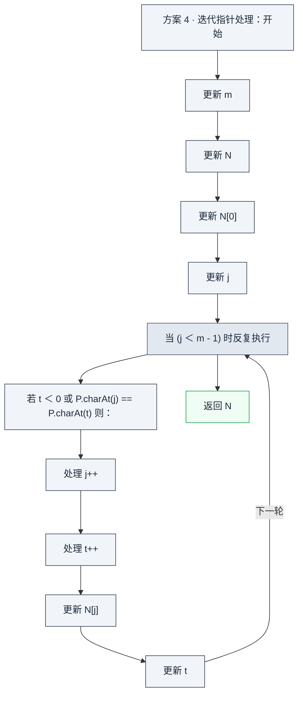

```java
package com.webfault.dsa; // 引入依赖

class lc116567013_solution44 { // 定义类型
  // KMP next 表（单独呈现）
  static int[] buildNext(String P) { // 定义函数/方法 buildNext
    int m = P.length(); // 把 P.长度() 存入 映射表
    int[] N = new int[m]; // 把 new int[映射表]; 写入 int[] N
    N[0] = -1; // 把 减 1; 写入 N[0]
    int j = 0, t = -1; // 把 0, 另一字符串 赋值为 减 1 存入 下标 j
    while (j < m - 1) { // 循环，直到不满足「下标 j 小于 映射表 减 1」
      if (t < 0 || P.charAt(j) == P.charAt(t)) { // 若 另一字符串 小于 0 或 P 取字符 下标 j) 等于 P 取字符 另一字符串
        j++; // 下标 j 加一
        t++; // 另一字符串 加一
        N[j] = t; // 把 另一字符串; 写入 N[j]
      } else { // 否则
        t = N[t]; // 把 N[另一字符串]; 写入 另一字符串
      }
    }
    return N; // 返回 N
  }

  public static void main(String[] args) { // public static void main(String[] args) {
    int[] table = buildNext("ababaca"); // 把 buildNext(「ababaca」); 写入 int[] table
    int[] expect = {-1, 0, 0, 1, 2, 3, 0}; // 把 { 减 1, 0, 0, 1, 2, 3, 0}; 写入 int[] expect
    if (table.length != expect.length) {
      System.out.println("FAIL len");
      throw new RuntimeException("FAILED");
    }
    for (int i = 0; i < expect.length; i++) { // 让 下标 i 从 0 开始计数，下标 i 小于 expect.长度 就继续
      if (table[i] != expect[i]) { // 若 table[下标 i] 不等于 expect[下标 i]
        System.out.println("FAIL at " + i + " got " + table[i]); // 打印输出
        throw new RuntimeException("FAILED"); // throw new RuntimeException(「FAILED」);
      }
    }
    System.out.println("PASS"); // 全部用例通过，输出 PASS
  }
}
```

### Rust 实现（4 种方案）

Rust 的全部方案如下，每个方案都内嵌用例自测，可独立运行（老仓库 python/go 文件遵循「打印结果」约定）：

#### 方案 1：迭代指针处理

**思路与代码分析**：核心是「迭代指针处理」。Rust 版用所有权移动与切片借用改写同一逻辑，注意 Option 与引用边界。**走读**：方案 1 · 迭代指针处理：开始 → 计算 n → 计算 m → 计算 i → 计算 j → 当 j ＜ m 且 i ＜ n 时反复执行 → 处理 if t[i] == p[j] → 更新 + → 更新 + → 更新 - → 更新 j → 处理 if j == m → 处理 (i - j) as i64 → 处理 -1 → 返回结果。

**运行架构**（真实控制流）：

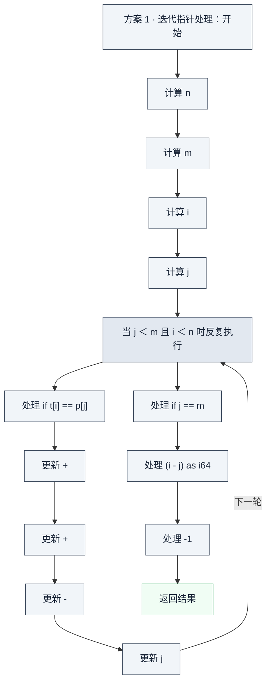

```rust
// LeetCode 116567013. PM — Rust 版（方案1：Brute-Force 主串指针回退）
fn match_v1(p: &[u8], t: &[u8]) -> i64 {
    // 定义函数/方法 match_v1
    let n = t.len(); // 把 另一字符串.长度() 存入 元素个数
    let m = p.len(); // 把 节点.长度() 存入 映射表
    let mut i = 0usize; // 把 0usize; 写入 let mut i
    let mut j = 0usize; // 把 0usize; 写入 let mut j
    while j < m && i < n {
        // while 下标 j 小于 映射表 且 下标 i 小于 元素个数 {
        if t[i] == p[j] {
            // 若 另一字符串[下标 i] 等于 节点[下标 j]
            i += 1; // 下标 i累加 1
            j += 1; // 下标 j累加 1
        } else {
            // 否则
            i -= j - 1; // 主串回退到本次对齐的下一位置
            j = 0; // 把 0; 写入 下标 j
        }
    }
    if j == m {
        // 若 下标 j 等于 映射表
        (i - j) as i64 // (下标 i 减 下标 j) as i64
    } else {
        // 否则
        -1 // 减 1
    }
}

fn main() {
    // 程序入口：跑内嵌自测用例
    let t = b"now is the time for all good people to come"; // 把 b「now is the time for all good people to come」 存入 另一字符串
    let cases: Vec<(&str, i64)> = vec![
        ("people", 29),
        ("good", 24),
        ("xyz", -1),
        ("a", -1), // 边界：空文本
        ("is", 4),
    ];
    for (idx, (p, want)) in cases.iter().enumerate() {
        // for (idx, (节点, want)) in cases.iter().enumerate() {
        let text: &[u8] = if *want == -1 && *p == "a" { b"" } else { t };
        let got = match_v1(p.as_bytes(), text); // 把 match_v1(节点.as_bytes(), text) 存入 got
        assert_eq!(got, *want, "case {} failed: match_v1({})", idx, p); // 断言校验
    }
    println!("PASS"); // 全部用例通过，输出 PASS
}
```

#### 方案 2：单趟扫描

**思路与代码分析**：核心是「单趟扫描」。Rust 版用所有权移动与切片借用改写同一逻辑，注意 Option 与引用边界。**走读**：方案 2 · 单趟扫描：开始 → 计算 n → 计算 m → 处理 if m == 0 或 n ＜ m → 返回 -1 → 计算 i → 当 i ≤ n - m 时反复执行 → 计算 j → 当 j ＜ m 且 t[i + j] == p[j] 时反复执行 → 更新 + → 处理 if j == m → 返回 i as i64 → 更新 + → 处理 -1。

**运行架构**（真实控制流）：

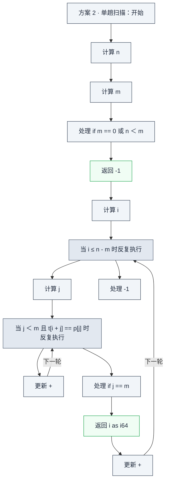

```rust
// LeetCode 116567013. PM — Rust 版（方案2：Brute-Force 双循环对齐）
fn match_v2(p: &[u8], t: &[u8]) -> i64 {
    // 定义函数/方法 match_v2
    let n = t.len(); // 把 另一字符串.长度() 存入 元素个数
    let m = p.len(); // 把 节点.长度() 存入 映射表
    if m == 0 || n < m {
        // 若 映射表 等于 0 或 元素个数 小于 映射表
        return -1; // 返回 减 1
    }
    let mut i = 0usize; // 把 0usize; 写入 let mut i
    while i <= n - m {
        // 把 元素个数 减 映射表 { 写入 while i <
        let mut j = 0usize; // 把 0usize; 写入 let mut j
        while j < m && t[i + j] == p[j] {
            // 把 赋值为 节点[下标 j] { 写入 while j < m && t[i + j]
            j += 1; // 下标 j累加 1
        }
        if j == m {
            // 若 下标 j 等于 映射表
            return i as i64; // 返回 下标 i as i64
        }
        i += 1; // 下标 i累加 1
    }
    -1 // 减 1
}

fn main() {
    // 程序入口：跑内嵌自测用例
    let t = b"now is the time for all good people to come"; // 把 b「now is the time for all good people to come」 存入 另一字符串
    let cases: Vec<(&str, i64)> = vec![
        ("people", 29),
        ("time", 11),
        ("all", 20),
        ("xyz", -1),
        ("a", -1),
        ("is", 4),
    ];
    for (idx, (p, want)) in cases.iter().enumerate() {
        // for (idx, (节点, want)) in cases.iter().enumerate() {
        let text: &[u8] = if *p == "a" && *want == -1 { b"" } else { t };
        let got = match_v2(p.as_bytes(), text); // 把 match_v2(节点.as_bytes(), text) 存入 got
        assert_eq!(got, *want, "case {} failed: match_v2({})", idx, p); // 断言校验
    }
    println!("PASS"); // 全部用例通过，输出 PASS
}
```

#### 方案 3：迭代指针处理

**思路与代码分析**：核心是「迭代指针处理」。Rust 版用所有权移动与切片借用改写同一逻辑，注意 Option 与引用边界。**走读**：方案 3 · 迭代指针处理：开始 → 计算 next → 计算 n → 计算 m → 计算 i → 计算 j → 当 j ＜ m as i64 且 i ＜ n as i64 时反复执行 → 处理 if j ＜ 0 或 t[i as usize] == → 更新 + → 更新 + → 更新 j → 处理 if j as usize == m → 处理 i - j → 处理 -1 → 返回结果。

**运行架构**（真实控制流）：

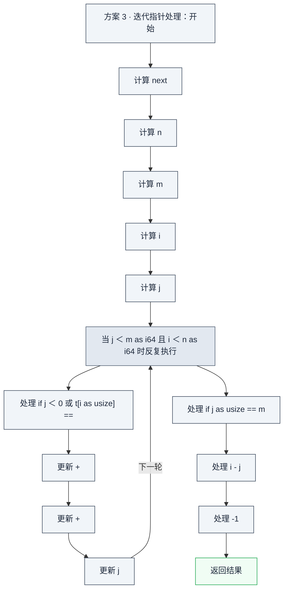

```rust
// LeetCode 116567013. PM — Rust 版（方案3：KMP，next 表失配大步跳跃）
fn build_next(p: &[u8]) -> Vec<i64> {
    // 定义函数/方法 build_next
    let m = p.len(); // 把 节点.长度() 存入 映射表
    let mut n = vec![-1i64; m]; // 把 vec取反 [ 减 1i64; 映射表]; 写入 let mut n
    let mut j: i64 = 0; // 把 0; 写入 let mut j: i64
    let mut t: i64 = -1; // 把 减 1; 写入 let mut t: i64
    while (j as usize) < m.saturating_sub(1) {
        // 循环，直到不满足「下标 j as usize) 小于 映射表.saturating_sub(1」
        if t < 0 || p[j as usize] == p[t as usize] {
            // 若 另一字符串 小于 0 或 节点[下标 j as usize] 等于 节点[另一字符串 as usize]
            j += 1; // 下标 j累加 1
            t += 1; // 另一字符串累加 1
            n[j as usize] = t; // 把 另一字符串; 写入 n[j as usize]
        } else {
            // 否则
            t = n[t as usize]; // 把 元素个数[另一字符串 as usize]; 写入 另一字符串
        }
    }
    n // 元素个数
}

fn kmp_match(p: &[u8], t: &[u8]) -> i64 {
    // 定义函数/方法 kmp_match
    let next = build_next(p); // 把 build_next(节点) 存入 下一个
    let n = t.len(); // 把 另一字符串.长度() 存入 元素个数
    let m = p.len(); // 把 节点.长度() 存入 映射表
    let mut i: i64 = 0; // 把 0; 写入 let mut i: i64
    let mut j: i64 = 0; // 把 0; 写入 let mut j: i64
    while j < m as i64 && i < n as i64 {
        // while 下标 j 小于 映射表 as i64 且 下标 i 小于 元素个数 as i64 {
        if j < 0 || t[i as usize] == p[j as usize] {
            // 若 下标 j 小于 0 或 另一字符串[下标 i as usize] 等于 节点[下标 j as usize]
            i += 1; // 下标 i累加 1
            j += 1; // 下标 j累加 1
        } else {
            // 否则
            j = next[j as usize]; // 把 下一个[下标 j as usize]; 写入 下标 j
        }
    }
    if j as usize == m {
        // 若 下标 j as usize 等于 映射表
        i - j // 下标 i 减 下标 j
    } else {
        // 否则
        -1 // 减 1
    }
}

fn eq_arr(a: &[i64], b: &[i64]) -> bool {
    // 定义函数/方法 eq_arr
    a == b // 把 赋值为 b 写入 数组
}

fn main() {
    // 程序入口：跑内嵌自测用例
    let t = b"now is the time for all good people to come"; // 把 b「now is the time for all good people to come」 存入 另一字符串
    let normal: Vec<(&str, i64)> = vec![
        ("people", 29),
        ("all", 20),
        ("no", 0),
        ("xyz", -1),
        ("a", -1),
    ];
    for (idx, (p, want)) in normal.iter().enumerate() {
        // for (idx, (节点, want)) in normal.iter().enumerate() {
        let text: &[u8] = if *p == "a" && *want == -1 { b"" } else { t };
        let got = kmp_match(p.as_bytes(), text); // 把 kmp_match(节点.as_bytes(), text) 存入 got
        assert_eq!(got, *want, "case {} failed: kmp_match({})", idx, p); // 断言校验
    }
    // 重叠前缀：'aaaa' in 'aaaaa' -> 0
    assert_eq!(kmp_match(b"aaaa", b"aaaaa"), 0, "overlap case failed"); // 断言校验
                                                                        // 回退复用：'aaab' in 'aaabaaa' -> 0
    assert_eq!(kmp_match(b"aaab", b"aaabaaa"), 0, "reuse case failed"); // 断言校验
                                                                        // next 表
    assert!(
        eq_arr(&build_next(b"ababaca"), &[-1, 0, 0, 1, 2, 3, 0]),
        "next ababaca failed"
    ); // 断言校验
    assert!(
        eq_arr(&build_next(b"aaaa"), &[-1, 0, 1, 2]),
        "next aaaa failed"
    ); // 断言校验
    assert!(
        eq_arr(&build_next(b"abcd"), &[-1, 0, 0, 0]),
        "next abcd failed"
    ); // 断言校验
    println!("PASS"); // 全部用例通过，输出 PASS
}
```

#### 方案 4：迭代指针处理

**思路与代码分析**：核心是「迭代指针处理」。Rust 版用所有权移动与切片借用改写同一逻辑，注意 Option 与引用边界。**走读**：方案 4 · 迭代指针处理：开始 → 计算 m → 计算 n → 计算 j → 计算 t → 当 (j as usize) ＜ m.saturating_sub(1) 时反复执行 → 处理 if t ＜ 0 或 p[j as usize] == → 更新 + → 更新 + → 更新 usize] → 更新 t → 处理 n → 返回结果。

**运行架构**（真实控制流）：

```mermaid
graph TD
    N0["方案 4 · 迭代指针处理：开始"]
    N1["计算 m"]
    N2["计算 n"]
    N3["计算 j"]
    N4["计算 t"]
    N5["当 (j as usize) ＜ m.saturating_sub(1) 时反复执行"]
    N6["处理 if t ＜ 0 或 p[j as usize] =="]
    N7["更新 +"]
    N8["更新 +"]
    N9["更新 usize]"]
    N10["更新 t"]
    N11["处理 n"]
    N12["返回结果"]
    N0 --> N1
    N1 --> N2
    N2 --> N3
    N3 --> N4
    N4 --> N5
    N5 --> N6
    N6 --> N7
    N7 --> N8
    N8 --> N9
    N9 --> N10
    N10 -- 下一轮 --> N5
    N5 --> N11
    N11 --> N12
    classDef n fill:#f1f5f9,stroke:#334155,color:#1e293b;
    classDef lp fill:#e2e8f0,stroke:#475569,color:#1e293b;
    classDef dc fill:#fef9c3,stroke:#ca8a04,color:#1e293b;
    classDef tm fill:#f0fdf4,stroke:#16a34a,color:#1e293b;
    class N0,N1,N2,N3,N4,N6,N7,N8,N9,N10,N11 n;
    class N5 lp;
    class N12 tm;
```

```rust
// LeetCode 116567013. PM — Rust 版（方案4：buildNext 单测）
fn build_next(p: &[u8]) -> Vec<i64> {
    // 定义函数/方法 build_next
    let m = p.len(); // 把 节点.长度() 存入 映射表
    let mut n = vec![-1i64; m]; // 把 vec取反 [ 减 1i64; 映射表]; 写入 let mut n
    let mut j: i64 = 0; // 把 0; 写入 let mut j: i64
    let mut t: i64 = -1; // 把 减 1; 写入 let mut t: i64
    while (j as usize) < m.saturating_sub(1) {
        // 循环，直到不满足「下标 j as usize) 小于 映射表.saturating_sub(1」
        if t < 0 || p[j as usize] == p[t as usize] {
            // 若 另一字符串 小于 0 或 节点[下标 j as usize] 等于 节点[另一字符串 as usize]
            j += 1; // 下标 j累加 1
            t += 1; // 另一字符串累加 1
            n[j as usize] = t; // 把 另一字符串; 写入 n[j as usize]
        } else {
            // 否则
            t = n[t as usize]; // 把 元素个数[另一字符串 as usize]; 写入 另一字符串
        }
    }
    n // 元素个数
}

fn main() {
    // 程序入口：跑内嵌自测用例
    assert_eq!(
        build_next(b"ababaca"),
        vec![-1, 0, 0, 1, 2, 3, 0],
        "ababaca"
    ); // 断言校验
    assert_eq!(build_next(b"aaaa"), vec![-1, 0, 1, 2], "aaaa"); // 断言校验
    assert_eq!(build_next(b"abcabc"), vec![-1, 0, 0, 0, 1, 2], "abcabc"); // 断言校验
    assert_eq!(build_next(b"abcd"), vec![-1, 0, 0, 0], "abcd"); // 断言校验
    assert_eq!(build_next(b"a"), vec![-1], "a"); // 断言校验
    println!("PASS"); // 全部用例通过，输出 PASS
}
```

### Lua 实现（4 种方案）

Lua 的全部方案如下，每个方案都内嵌用例自测，可独立运行（老仓库 python/go 文件遵循「打印结果」约定）：

#### 方案 1：迭代指针处理

**思路与代码分析**：核心是「迭代指针处理」。Lua 版用表与 ipairs 遍历，注意 ipairs 遇 nil 即停的语义。**走读**：方案 1 · 迭代指针处理：开始 → 更新 m → 更新 j → 当 j ≤ m and i ≤ n do 时反复执行 → 处理 if t:sub(i, i) == p:sub(j, j → 更新 j → 更新 i → 更新 j → 处理 if j ＞ m then → 返回 i - j → 返回 -1。

**运行架构**（真实控制流）：

```mermaid
graph TD
    N0["方案 1 · 迭代指针处理：开始"]
    N1["更新 m"]
    N2["更新 j"]
    N3["当 j ≤ m and i ≤ n do 时反复执行"]
    N4["处理 if t:sub(i, i) == p:sub(j, j"]
    N5["更新 j"]
    N6["更新 i"]
    N7["更新 j"]
    N8["处理 if j ＞ m then"]
    N9["返回 i - j"]
    N10["返回 -1"]
    N0 --> N1
    N1 --> N2
    N2 --> N3
    N3 --> N4
    N4 --> N5
    N5 --> N6
    N6 --> N7
    N7 --> N8
    N8 --> N9
    N9 --> N10
    classDef n fill:#f1f5f9,stroke:#334155,color:#1e293b;
    classDef lp fill:#e2e8f0,stroke:#475569,color:#1e293b;
    classDef dc fill:#fef9c3,stroke:#ca8a04,color:#1e293b;
    classDef tm fill:#f0fdf4,stroke:#16a34a,color:#1e293b;
    class N0,N1,N2,N4,N5,N6,N7,N8 n;
    class N3 lp;
    class N9,N10 tm;
```

```lua
-- LeetCode 116567013. PM — Lua 版（方案1：Brute-Force 主串指针回退）
local function match_v1(p, t) -- local function match_v1(节点, 另一字符串)
	local n, m = #t, #p -- 把 #另一字符串, #节点 写入 local n, m
	local i, j = 1, 1 -- 1 基
	while j <= m and i <= n do -- 把 映射表 and 下标 i 不超过 元素个数 do 写入 while j <
		if t:sub(i, i) == p:sub(j, j) then -- 若 另一字符串:sub(下标 i, 下标 i) 等于 节点:sub(下标 j, 下标 j) then
			i, j = i + 1, j + 1 -- 把 下标 i 加 1, 下标 j 加 1 写入 i, j
		else -- 否则
			i = i - j + 2 -- 主串回退到本次对齐的下一位置（1 基）
			j = 1 -- 把 1 存入 下标 j
		end -- 终点
	end -- 终点
	if j > m then
		return i - j
	end -- 若 下标 j 超过 映射表 then return 下标 i 减 下标 j 终点
	return -1 -- 返回 减 1
end -- 终点

local T = "now is the time for all good people to come" -- 把 「now is the time for all good people to come」 写入 local T
local cases = { -- 把 { 写入 local cases
	{ "people", T, 29 },
	{ "good", T, 24 },
	{ "xyz", T, -1 },
	{ "a", "", -1 }, -- 边界：空文本
	{ "is", T, 4 },
}
for idx, c in ipairs(cases) do -- 遍历取 字符
	local got = match_v1(c[1], c[2]) -- 把 match_v1(字符[1], 字符[2]) 写入 local got
	assert(got == c[3], string.format("case %d failed: match_v1(%s)=%d want %d", idx, c[1], got, c[3])) -- 断言校验
end -- 终点
print("PASS") -- 全部用例通过，输出 PASS
```

#### 方案 2：单趟扫描

**思路与代码分析**：核心是「单趟扫描」。Lua 版用表与 ipairs 遍历，注意 ipairs 遇 nil 即停的语义。**走读**：方案 2 · 单趟扫描：开始 → 更新 m → 循环 i：从 1 到 n - m + 1 do → 更新 j → 当 j ≤ m and t:sub(i + j - 1, i + j - 1) == p:sub(j, j) do 时反复执行 → 更新 j → 处理 if j ＞ m then → 返回 i - 1 → 返回 -1。

**运行架构**（真实控制流）：

```mermaid
graph TD
    N0["方案 2 · 单趟扫描：开始"]
    N1["更新 m"]
    N2["循环 i：从 1 到 n - m + 1 do"]
    N3["更新 j"]
    N4["当 j ≤ m and t:sub(i + j - 1, i + j - 1) == p:sub(j, j) do 时反复执行"]
    N5["更新 j"]
    N6["处理 if j ＞ m then"]
    N7["返回 i - 1"]
    N8["返回 -1"]
    N0 --> N1
    N1 --> N2
    N2 --> N3
    N3 --> N4
    N4 --> N5
    N5 --> N6
    N6 --> N7
    N7 --> N8
    classDef n fill:#f1f5f9,stroke:#334155,color:#1e293b;
    classDef lp fill:#e2e8f0,stroke:#475569,color:#1e293b;
    classDef dc fill:#fef9c3,stroke:#ca8a04,color:#1e293b;
    classDef tm fill:#f0fdf4,stroke:#16a34a,color:#1e293b;
    class N0,N1,N3,N5,N6 n;
    class N2,N4 lp;
    class N7,N8 tm;
```

```lua
-- LeetCode 116567013. PM — Lua 版（方案2：Brute-Force 双循环对齐）
local function match_v2(p, t) -- local function match_v2(节点, 另一字符串)
	local n, m = #t, #p -- 把 #另一字符串, #节点 写入 local n, m
	for i = 1, n - m + 1 do -- 让 下标 i 从 1 走到 元素个数（Lua 1 基）
		local j = 1 -- 把 1 写入 local j
		while j <= m and t:sub(i + j - 1, i + j - 1) == p:sub(j, j) do
			j = j + 1 -- 把 下标 j 加 1 存入 下标 j
		end -- 终点
		if j > m then
			return i - 1
		end -- 若 下标 j 超过 映射表 then return 下标 i 减 1 终点
	end -- 终点
	return -1 -- 返回 减 1
end -- 终点

local T = "now is the time for all good people to come" -- 把 「now is the time for all good people to come」 写入 local T
local cases = { -- 把 { 写入 local cases
	{ "people", T, 29 },
	{ "time", T, 11 },
	{ "all", T, 20 },
	{ "xyz", T, -1 },
	{ "a", "", -1 },
	{ "is", T, 4 },
}
for idx, c in ipairs(cases) do -- 遍历取 字符
	local got = match_v2(c[1], c[2]) -- 把 match_v2(字符[1], 字符[2]) 写入 local got
	assert(got == c[3], string.format("case %d failed: match_v2(%s)=%d want %d", idx, c[1], got, c[3])) -- 断言校验
end -- 终点
print("PASS") -- 全部用例通过，输出 PASS
```

#### 方案 3：迭代指针处理

**思路与代码分析**：核心是「迭代指针处理」。Lua 版用表与 ipairs 遍历，注意 ipairs 遇 nil 即停的语义。**走读**：方案 3 · 迭代指针处理：开始 → 更新 m → 更新 N → 循环 i：从 1 到 m do → 更新 N[i] → 更新 T → 当 J ＜ m - 1 do 时反复执行 → 处理 if T ＜ 0 or p:sub(J + 1, J + → 更新 J → 更新 T → 更新 1] → 更新 T → 返回 N。

**运行架构**（真实控制流）：

```mermaid
graph TD
    N0["方案 3 · 迭代指针处理：开始"]
    N1["更新 m"]
    N2["更新 N"]
    N3["循环 i：从 1 到 m do"]
    N4["更新 N[i]"]
    N5["更新 T"]
    N6["当 J ＜ m - 1 do 时反复执行"]
    N7["处理 if T ＜ 0 or p:sub(J + 1, J +"]
    N8["更新 J"]
    N9["更新 T"]
    N10["更新 1]"]
    N11["更新 T"]
    N12["返回 N"]
    N0 --> N1
    N1 --> N2
    N2 --> N3
    N3 --> N4
    N4 --> N5
    N5 --> N6
    N6 --> N7
    N7 --> N8
    N8 --> N9
    N9 --> N10
    N10 --> N11
    N11 --> N12
    classDef n fill:#f1f5f9,stroke:#334155,color:#1e293b;
    classDef lp fill:#e2e8f0,stroke:#475569,color:#1e293b;
    classDef dc fill:#fef9c3,stroke:#ca8a04,color:#1e293b;
    classDef tm fill:#f0fdf4,stroke:#16a34a,color:#1e293b;
    class N0,N1,N2,N4,N5,N7,N8,N9,N10,N11 n;
    class N3,N6 lp;
    class N12 tm;
```

```lua
-- LeetCode 116567013. PM — Lua 版（方案3：KMP，next 表失配大步跳跃）
local function build_next(p) -- local function build_next(节点)
	local m = #p -- 把 #节点 写入 local m
	local N = {} -- 把 {} 写入 local N
	for i = 1, m do
		N[i] = -1
	end -- 让 下标 i 从 1 走到 映射表（Lua 1 基）
	local J, T = 0, -1 -- 0 基逻辑游标（存储仍按 1 基下标）
	while J < m - 1 do -- while J 小于 映射表 减 1 do
		if T < 0 or p:sub(J + 1, J + 1) == p:sub(T + 1, T + 1) then
			J = J + 1 -- 把 J 加 1 存入 J
			T = T + 1 -- 把 T 加 1 存入 T
			N[J + 1] = T -- 把 T 写入 N[J + 1]
		else -- 否则
			T = N[T + 1] -- 把 N[T 加 1] 存入 T
		end -- 终点
	end -- 终点
	return N -- 返回 N
end -- 终点

local function kmp_match(p, t) -- local function kmp_match(节点, 另一字符串)
	local N = build_next(p) -- 把 build_next(节点) 写入 local N
	local n, m = #t, #p -- 把 #另一字符串, #节点 写入 local n, m
	local i, j = 1, 1 -- 把 1, 1 写入 local i, j
	local at = function(s, k)
		return s:sub(k, k)
	end
	while j <= m and i <= n do -- 把 映射表 and 下标 i 不超过 元素个数 do 写入 while j <
		if j < 1 or at(t, i) == at(p, j) then -- 若 下标 j 小于 1 or at(另一字符串, 下标 i) 等于 at(节点, 下标 j) then
			i = i + 1 -- 把 下标 i 加 1 存入 下标 i
			j = j + 1 -- 把 下标 j 加 1 存入 下标 j
		else -- 否则
			j = N[j] + 1 -- N 存 0 基，转 1 基
		end -- 终点
	end -- 终点
	if j > m then
		return i - j
	end -- 若 下标 j 超过 映射表 then return 下标 i 减 下标 j 终点
	return -1 -- 返回 减 1
end -- 终点

local function eq_arr(a, b) -- local function eq_arr(数组, b)
	if #a ~= #b then
		return false
	end -- 若 #数组 ~ 赋值为 #b then return false 终点
	for i = 1, #a do
		if a[i] ~= b[i] then
			return false
		end
	end
	return true -- 返回 true
end -- 终点

local T = "now is the time for all good people to come" -- 把 「now is the time for all good people to come」 写入 local T
local cases = { -- 把 { 写入 local cases
	{ "people", T, 29 },
	{ "all", T, 20 },
	{ "no", T, 0 },
	{ "xyz", T, -1 },
	{ "a", "", -1 },
}
for idx, c in ipairs(cases) do -- 遍历取 字符
	local got = kmp_match(c[1], c[2]) -- 把 kmp_match(字符[1], 字符[2]) 写入 local got
	assert(got == c[3], "case " .. idx .. " failed") -- 断言校验
end -- 终点
-- 特殊边界
assert(kmp_match("aaaa", "aaaaa") == 0, "overlap failed") -- 断言校验
assert(kmp_match("aaab", "aaabaaa") == 0, "reuse failed") -- 断言校验
-- next 表
assert(eq_arr(build_next("ababaca"), { -1, 0, 0, 1, 2, 3, 0 }), "next ababaca failed") -- 断言校验
assert(eq_arr(build_next("aaaa"), { -1, 0, 1, 2 }), "next aaaa failed") -- 断言校验
assert(eq_arr(build_next("abcd"), { -1, 0, 0, 0 }), "next abcd failed") -- 断言校验
print("PASS") -- 全部用例通过，输出 PASS
```

#### 方案 4：迭代指针处理

**思路与代码分析**：核心是「迭代指针处理」。Lua 版用表与 ipairs 遍历，注意 ipairs 遇 nil 即停的语义。**走读**：方案 4 · 迭代指针处理：开始 → 更新 m → 更新 N → 循环 i：从 1 到 m do → 更新 N[i] → 更新 T → 当 J ＜ m - 1 do 时反复执行 → 处理 if T ＜ 0 or p:sub(J + 1, J + → 更新 J → 更新 T → 更新 1] → 更新 T → 返回 N。

**运行架构**（真实控制流）：

```mermaid
graph TD
    N0["方案 4 · 迭代指针处理：开始"]
    N1["更新 m"]
    N2["更新 N"]
    N3["循环 i：从 1 到 m do"]
    N4["更新 N[i]"]
    N5["更新 T"]
    N6["当 J ＜ m - 1 do 时反复执行"]
    N7["处理 if T ＜ 0 or p:sub(J + 1, J +"]
    N8["更新 J"]
    N9["更新 T"]
    N10["更新 1]"]
    N11["更新 T"]
    N12["返回 N"]
    N0 --> N1
    N1 --> N2
    N2 --> N3
    N3 --> N4
    N4 --> N5
    N5 --> N6
    N6 --> N7
    N7 --> N8
    N8 --> N9
    N9 --> N10
    N10 --> N11
    N11 --> N12
    classDef n fill:#f1f5f9,stroke:#334155,color:#1e293b;
    classDef lp fill:#e2e8f0,stroke:#475569,color:#1e293b;
    classDef dc fill:#fef9c3,stroke:#ca8a04,color:#1e293b;
    classDef tm fill:#f0fdf4,stroke:#16a34a,color:#1e293b;
    class N0,N1,N2,N4,N5,N7,N8,N9,N10,N11 n;
    class N3,N6 lp;
    class N12 tm;
```

```lua
-- LeetCode 116567013. PM — Lua 版（方案4：buildNext 单测）
local function build_next(p) -- local function build_next(节点)
	local m = #p -- 把 #节点 写入 local m
	local N = {} -- 把 {} 写入 local N
	for i = 1, m do
		N[i] = -1
	end -- 让 下标 i 从 1 走到 映射表（Lua 1 基）
	local J, T = 0, -1 -- 0 基逻辑游标（存储按 1 基下标）
	while J < m - 1 do -- while J 小于 映射表 减 1 do
		if T < 0 or p:sub(J + 1, J + 1) == p:sub(T + 1, T + 1) then
			J = J + 1 -- 把 J 加 1 存入 J
			T = T + 1 -- 把 T 加 1 存入 T
			N[J + 1] = T -- 把 T 写入 N[J + 1]
		else -- 否则
			T = N[T + 1] -- 把 N[T 加 1] 存入 T
		end -- 终点
	end -- 终点
	return N -- 返回 N
end -- 终点

local function eq_arr(a, b) -- local function eq_arr(数组, b)
	if #a ~= #b then
		return false
	end -- 若 #数组 ~ 赋值为 #b then return false 终点
	for i = 1, #a do
		if a[i] ~= b[i] then
			return false
		end
	end
	return true -- 返回 true
end -- 终点

assert(eq_arr(build_next("ababaca"), { -1, 0, 0, 1, 2, 3, 0 }), "ababaca failed") -- 断言校验
assert(eq_arr(build_next("aaaa"), { -1, 0, 1, 2 }), "aaaa failed") -- 断言校验
assert(eq_arr(build_next("abcabc"), { -1, 0, 0, 0, 1, 2 }), "abcabc failed") -- 断言校验
assert(eq_arr(build_next("abcd"), { -1, 0, 0, 0 }), "abcd failed") -- 断言校验
assert(eq_arr(build_next("a"), { -1 }), "a failed") -- 断言校验
print("PASS") -- 全部用例通过，输出 PASS
```

### C 实现（4 种方案）

C 的全部方案如下，每个方案都内嵌用例自测，可独立运行（老仓库 python/go 文件遵循「打印结果」约定）：

#### 方案 1：迭代指针处理

**思路与代码分析**：核心是「迭代指针处理」。C 版手动管理下标与内存，循环边界全部显式写出。**走读**：方案 1 · 迭代指针处理：开始 → 更新 n → 更新 i → 当 (j ＜ m 且 i ＜ n) 时反复执行 → 若 t[i] == p[j] 则： → 处理 i++ → 处理 j++ → 更新 - → 更新 j → 返回 j == m ? i - j : -1。

**运行架构**（真实控制流）：

```mermaid
graph TD
    N0["方案 1 · 迭代指针处理：开始"]
    N1["更新 n"]
    N2["更新 i"]
    N3["当 (j ＜ m 且 i ＜ n) 时反复执行"]
    N4["若 t[i] == p[j] 则："]
    N5["处理 i++"]
    N6["处理 j++"]
    N7["更新 -"]
    N8["更新 j"]
    N9["返回 j == m ? i - j : -1"]
    N0 --> N1
    N1 --> N2
    N2 --> N3
    N3 --> N4
    N4 --> N5
    N5 --> N6
    N6 --> N7
    N7 --> N8
    N8 -- 下一轮 --> N3
    N3 --> N9
    classDef n fill:#f1f5f9,stroke:#334155,color:#1e293b;
    classDef lp fill:#e2e8f0,stroke:#475569,color:#1e293b;
    classDef dc fill:#fef9c3,stroke:#ca8a04,color:#1e293b;
    classDef tm fill:#f0fdf4,stroke:#16a34a,color:#1e293b;
    class N0,N1,N2,N4,N5,N6,N7,N8 n;
    class N3 lp;
    class N9 tm;
```

```c
* LeetCode 116567013. PM — C 版（方案1：Brute-Force 主串指针回退）
 */
#include <stdio.h>  // 引入头文件
#include <string.h> // 引入头文件

static long match_v1(const char *p, const char *t) { // 定义函数/方法 match_v1
    long n = strlen(t), m = strlen(p); // 把 strlen(另一字符串), 映射表 赋值为 strlen(节点); 写入 long n
    long i = 0, j = 0;                 // 把 0, 下标 j 赋值为 0; 写入 long i
    while (j < m && i < n) { // 循环，直到不满足「下标 j 小于 映射表 且 下标 i 小于 元素个数」
        if (t[i] == p[j]) { // 若 另一字符串[下标 i] 等于 节点[下标 j]
            i++;
            j++;                                           // 下标 i 加一 ; 下标 j 加一 ;
        } else {                                           // 否则
            i -= j - 1; /* 主串回退到本次对齐的下一位置 */ // 把 下标 j 减 1; 除以 乘
                                                           // 主串回退到本次对齐的下一位置 乘 除以 写入 i -
            j = 0; // 把 0; 写入 下标 j
        }
    }
    return j == m ? i - j : -1; // 返回 下标 j 等于 映射表 ? 下标 i 减 下标 j : 减 1
}

int main(void) { // 程序入口：跑内嵌自测用例
    const char *T = "now is the time for all good people to come";
    struct {
        const char *p;
        const char *t;
        long want;
    } cases[] = {
        {"people", T, 29},
        {"good", T, 24},
        {"xyz", T, -1},
        {"a", "", -1},
        /* 边界：空文本 */ // {「数组」, 「数组」, 减 1}, 除以 乘 边界：空文本 乘 除以
        {"is", T, 4},
    };
    for (int idx = 0; idx < 5; idx++) { // 让 idx 从 0 开始计数，idx 小于 5 就继续
        long got = match_v1(
            cases[idx].p, cases[idx].t); // 把 match_v1(cases[idx].节点, cases[idx].另一字符串); 写入 long got
        if (got != cases[idx].want) { // 若 got 不等于 cases[idx].want
            printf("case %d failed: match_v1(%s)=%ld want %ld\n", idx, cases[idx].p, got,
                   cases[idx].want); // 打印输出
            return 1;                // 返回 1
        }
    }
    printf("PASS\n"); // 全部用例通过，输出 PASS
    return 0;         // 返回 0
}
```

#### 方案 2：单趟扫描

**思路与代码分析**：核心是「单趟扫描」。C 版手动管理下标与内存，循环边界全部显式写出。代码里依次做这些事：单循环线性扫描。**走读**：方案 2 · 单趟扫描：开始 → 更新 n → 命中条件，直接返回 → 遍历循环 → 处理 i++) → 更新 j → 当 (j ＜ m 且 t[i + j] == p[j]) 时反复执行 → 处理 j++ → 命中条件，直接返回 → 返回 -1。

**运行架构**（真实控制流）：

```mermaid
graph TD
    N0["方案 2 · 单趟扫描：开始"]
    N1["更新 n"]
    N2{"m == 0 或 n ＜ m ？"}
    N3["命中条件，直接返回"]
    N4["遍历循环"]
    N5["处理 i++)"]
    N6["更新 j"]
    N7["当 (j ＜ m 且 t[i + j] == p[j]) 时反复执行"]
    N8["处理 j++"]
    N9{"j == m ？"}
    N10["命中条件，直接返回"]
    N11["返回 -1"]
    N0 --> N1
    N1 --> N2
    N2 -- 是 --> N3
    N2 -- 否 --> N4
    N4 --> N5
    N5 --> N6
    N6 --> N7
    N7 --> N8
    N8 --> N9
    N9 -- 是 --> N10
    N9 -- 否 --> N11
    classDef n fill:#f1f5f9,stroke:#334155,color:#1e293b;
    classDef lp fill:#e2e8f0,stroke:#475569,color:#1e293b;
    classDef dc fill:#fef9c3,stroke:#ca8a04,color:#1e293b;
    classDef tm fill:#f0fdf4,stroke:#16a34a,color:#1e293b;
    class N0,N1,N5,N6,N8 n;
    class N4,N7 lp;
    class N2,N9 dc;
    class N3,N10,N11 tm;
```

```c
* LeetCode 116567013. PM — C 版（方案2：Brute-Force 双循环对齐）
 */
#include <stdio.h>  // 引入头文件
#include <string.h> // 引入头文件

static long match_v2(const char *p, const char *t) { // 定义函数/方法 match_v2
    long n = strlen(t), m = strlen(p); // 把 strlen(另一字符串), 映射表 赋值为 strlen(节点); 写入 long n
    if (m == 0 || n < m)
        return -1; // 若 映射表 等于 0 或 元素个数 小于 映射表，直接返回 减 1
    for (long i = 0; i <= n - m;
         i++) { // 把 0; 下标 i 不超过 元素个数 减 映射表; 下标 i 加一 ) { 写入 for (long i
        long j = 0; // 把 0; 写入 long j
        while (j < m && t[i + j] == p[j])
            j++;
        if (j == m)
            return i; // 若 下标 j 等于 映射表，直接返回 下标 i
    }
    return -1; // 返回 减 1
}

int main(void) { // 程序入口：跑内嵌自测用例
    const char *T = "now is the time for all good people to come";
    struct {
        const char *p;
        const char *t;
        long want;
    } cases[] = {
        {"people", T, 29}, {"time", T, 11}, {"all", T, 20}, {"xyz", T, -1}, {"a", "", -1}, {"is", T, 4},
    };
    for (int idx = 0; idx < 6; idx++) { // 让 idx 从 0 开始计数，idx 小于 6 就继续
        long got = match_v2(
            cases[idx].p, cases[idx].t); // 把 match_v2(cases[idx].节点, cases[idx].另一字符串); 写入 long got
        if (got != cases[idx].want) {
            printf("case %d failed\n", idx);
            return 1;
        }
    }
    printf("PASS\n"); // 全部用例通过，输出 PASS
    return 0;         // 返回 0
}
```

#### 方案 3：迭代指针处理

**思路与代码分析**：核心是「迭代指针处理」。C 版手动管理下标与内存，循环边界全部显式写出。**走读**：方案 3 · 迭代指针处理：开始 → 调用 build_next(p) → 更新 n → 更新 i → 当 (j ＜ m 且 i ＜ n) 时反复执行 → 若 j ＜ 0 或 t[i] == p[j] 则： → 处理 i++ → 处理 j++ → 更新 j → 返回 j == m ? i - j : -1。

**运行架构**（真实控制流）：

```mermaid
graph TD
    N0["方案 3 · 迭代指针处理：开始"]
    N1["调用 build_next(p)"]
    N2["更新 n"]
    N3["更新 i"]
    N4["当 (j ＜ m 且 i ＜ n) 时反复执行"]
    N5["若 j ＜ 0 或 t[i] == p[j] 则："]
    N6["处理 i++"]
    N7["处理 j++"]
    N8["更新 j"]
    N9["返回 j == m ? i - j : -1"]
    N0 --> N1
    N1 --> N2
    N2 --> N3
    N3 --> N4
    N4 --> N5
    N5 --> N6
    N6 --> N7
    N7 --> N8
    N8 -- 下一轮 --> N4
    N4 --> N9
    classDef n fill:#f1f5f9,stroke:#334155,color:#1e293b;
    classDef lp fill:#e2e8f0,stroke:#475569,color:#1e293b;
    classDef dc fill:#fef9c3,stroke:#ca8a04,color:#1e293b;
    classDef tm fill:#f0fdf4,stroke:#16a34a,color:#1e293b;
    class N0,N1,N2,N3,N5,N6,N7,N8 n;
    class N4 lp;
    class N9 tm;
```

```c
* LeetCode 116567013. PM — C 版（方案3：KMP，next 表失配大步跳跃）
 */
#include <stdio.h>  // 引入头文件
#include <string.h> // 引入头文件

static long long N[64]; // static long long N[64];

static void build_next(const char *p) { // 定义函数/方法 build_next
    long long m = strlen(p);            // 把 strlen(节点) 存入 映射表
    for (long long i = 0; i < m; i++)
        N[i] = -1;           // 让 下标 i 从 0 开始计数，下标 i 小于 映射表 就继续
    long long j = 0, t = -1; // 把 0, 另一字符串 赋值为 减 1 存入 下标 j
    while (j < m - 1) {      // 循环，直到不满足「下标 j 小于 映射表 减 1」
        if (t < 0 || p[j] == p[t]) { // 若 另一字符串 小于 0 或 节点[下标 j] 等于 节点[另一字符串]
            j++;
            t++;      // 下标 j 加一 ; 另一字符串 加一 ;
            N[j] = t; // 把 另一字符串; 写入 N[j]
        } else {      // 否则
            t = N[t]; // 把 N[另一字符串]; 写入 另一字符串
        }
    }
}

static long long kmp_match(const char *p, const char *t) {
    build_next(p);                          // build_next(节点);
    long long n = strlen(t), m = strlen(p); // 把 strlen(另一字符串), 映射表 赋值为 strlen(节点) 存入 元素个数
    long long i = 0, j = 0; // 把 0, 下标 j 赋值为 0 存入 下标 i
    while (j < m && i < n) { // 循环，直到不满足「下标 j 小于 映射表 且 下标 i 小于 元素个数」
        if (j < 0 || t[i] == p[j]) { // 若 下标 j 小于 0 或 另一字符串[下标 i] 等于 节点[下标 j]
            i++;
            j++;      // 下标 i 加一 ; 下标 j 加一 ;
        } else {      // 否则
            j = N[j]; // 把 N[下标 j]; 写入 下标 j
        }
    }
    return j == m ? i - j : -1; // 返回 下标 j 等于 映射表 ? 下标 i 减 下标 j : 减 1
}

static int eq_arr(const long long *a, const long long *b, int n) { // 定义函数/方法 eq_arr
    for (int i = 0; i < n; i++)
        if (a[i] != b[i])
            return 0; // 让 下标 i 从 0 开始计数，下标 i 小于 元素个数 就继续
    return 1;         // 返回 1
}

int main(void) { // 程序入口：跑内嵌自测用例
    const char *T = "now is the time for all good people to come";
    struct {
        const char *p;
        const char *t;
        long long want;
    } cases[] = {
        {"people", T, 29}, {"all", T, 20}, {"no", T, 0}, {"xyz", T, -1}, {"a", "", -1},
    };
    for (int idx = 0; idx < 5; idx++) { // 让 idx 从 0 开始计数，idx 小于 5 就继续
        if (kmp_match(cases[idx].p, cases[idx].t) != cases[idx].want) {
            printf("case %d failed\n", idx); // 打印输出
            return 1;                        // 返回 1
        }
    }
    if (kmp_match("aaaa", "aaaaa") != 0) {
        printf("overlap failed\n");
        return 1;
    } // 若 kmp_match(「aaaa」, 「aaaa」) 不等于 0) { 输出「aaaa」); return 1; }
    if (kmp_match("aaab", "aaabaaa") != 0) {
        printf("reuse failed\n");
        return 1;
    } // 若 kmp_match(「aaab」, 「aaab」) 不等于 0) { 输出「aaab」); return 1; }

    long long w1[7] = {-1, 0, 0, 1, 2, 3, 0}; // 把 { 减 1, 0, 0, 1, 2, 3, 0}; 写入 long long w1[7]
    build_next("ababaca");                    // build_next(「ababaca」);
    if (!eq_arr(N, w1, 7)) {
        printf("next ababaca failed\n");
        return 1;
    }
    long long w2[4] = {-1, 0, 1, 2}; // 把 { 减 1, 0, 1, 2}; 写入 long long w2[4]
    build_next("aaaa");              // build_next(「aaaa」);
    if (!eq_arr(N, w2, 4)) {
        printf("next aaaa failed\n");
        return 1;
    } // 若 取反 eq_arr(N, w2, 4)) { 输出「下一个 aaaa failed 」); return 1; }
    long long w3[4] = {-1, 0, 0, 0}; // 把 { 减 1, 0, 0, 0}; 写入 long long w3[4]
    build_next("abcd");              // build_next(「abcd」);
    if (!eq_arr(N, w3, 4)) {
        printf("next abcd failed\n");
        return 1;
    }                 // 若 取反 eq_arr(N, w3, 4)) { 输出「下一个 abcd failed 」); return 1; }
    printf("PASS\n"); // 全部用例通过，输出 PASS
    return 0;         // 返回 0
}
```

#### 方案 4：迭代指针处理

**思路与代码分析**：核心是「迭代指针处理」。C 版手动管理下标与内存，循环边界全部显式写出。代码里依次做这些事：单循环线性扫描。**走读**：方案 4 · 迭代指针处理：开始 → 更新 m → 遍历循环 → 更新 N[i] → 更新 j → 当 (j ＜ m - 1) 时反复执行 → 若 t ＜ 0 或 p[j] == p[t] 则： → 处理 j++ → 处理 t++ → 更新 N[j] → 更新 t → 返回结果。

**运行架构**（真实控制流）：

```mermaid
graph TD
    N0["方案 4 · 迭代指针处理：开始"]
    N1["更新 m"]
    N2["遍历循环"]
    N3["更新 N[i]"]
    N4["更新 j"]
    N5["当 (j ＜ m - 1) 时反复执行"]
    N6["若 t ＜ 0 或 p[j] == p[t] 则："]
    N7["处理 j++"]
    N8["处理 t++"]
    N9["更新 N[j]"]
    N10["更新 t"]
    N11["返回结果"]
    N0 --> N1
    N1 --> N2
    N2 --> N3
    N3 --> N4
    N4 --> N5
    N5 --> N6
    N6 --> N7
    N7 --> N8
    N8 --> N9
    N9 --> N10
    N10 -- 下一轮 --> N5
    N5 --> N11
    classDef n fill:#f1f5f9,stroke:#334155,color:#1e293b;
    classDef lp fill:#e2e8f0,stroke:#475569,color:#1e293b;
    classDef dc fill:#fef9c3,stroke:#ca8a04,color:#1e293b;
    classDef tm fill:#f0fdf4,stroke:#16a34a,color:#1e293b;
    class N0,N1,N3,N4,N6,N7,N8,N9,N10 n;
    class N2,N5 lp;
    class N11 tm;
```

```c
* LeetCode 116567013. PM — C 版（方案4：buildNext 单测）
 */
#include <stdio.h>  // 引入头文件
#include <string.h> // 引入头文件

static long long N[64]; // static long long N[64];

static void build_next(const char *p) { // 定义函数/方法 build_next
    long long m = strlen(p);            // 把 strlen(节点) 存入 映射表
    for (long long i = 0; i < m; i++)
        N[i] = -1;           // 让 下标 i 从 0 开始计数，下标 i 小于 映射表 就继续
    long long j = 0, t = -1; // 把 0, 另一字符串 赋值为 减 1 存入 下标 j
    while (j < m - 1) {      // 循环，直到不满足「下标 j 小于 映射表 减 1」
        if (t < 0 || p[j] == p[t]) { // 若 另一字符串 小于 0 或 节点[下标 j] 等于 节点[另一字符串]
            j++;
            t++;      // 下标 j 加一 ; 另一字符串 加一 ;
            N[j] = t; // 把 另一字符串; 写入 N[j]
        } else {      // 否则
            t = N[t]; // 把 N[另一字符串]; 写入 另一字符串
        }
    }
}

static int eq_arr(const long long *a, const long long *b, int n) { // 定义函数/方法 eq_arr
    for (int i = 0; i < n; i++)
        if (a[i] != b[i])
            return 0; // 让 下标 i 从 0 开始计数，下标 i 小于 元素个数 就继续
    return 1;         // 返回 1
}

int main(void) {                              // 程序入口：跑内嵌自测用例
    long long w1[7] = {-1, 0, 0, 1, 2, 3, 0}; // 把 { 减 1, 0, 0, 1, 2, 3, 0}; 写入 long long w1[7]
    build_next("ababaca");                    // build_next(「ababaca」);
    if (!eq_arr(N, w1, 7)) {
        printf("ababaca failed\n");
        return 1;
    } // 若 取反 eq_arr(N, w1, 7)) { 输出「ababaca failed 」); return 1; }
    long long w2[4] = {-1, 0, 1, 2}; // 把 { 减 1, 0, 1, 2}; 写入 long long w2[4]
    build_next("aaaa");              // build_next(「aaaa」);
    if (!eq_arr(N, w2, 4)) {
        printf("aaaa failed\n");
        return 1;
    } // 若 取反 eq_arr(N, w2, 4)) { 输出「aaaa failed 」); return 1; }
    long long w5[6] = {-1, 0, 0, 0, 1, 2}; // 把 { 减 1, 0, 0, 0, 1, 2}; 写入 long long w5[6]
    build_next("abcabc");                  // build_next(「abcabc」);
    if (!eq_arr(N, w5, 6)) {
        printf("abcabc failed\n");
        return 1;
    } // 若 取反 eq_arr(N, w5, 6)) { 输出「abcabc failed 」); return 1; }
    long long w3[4] = {-1, 0, 0, 0}; // 把 { 减 1, 0, 0, 0}; 写入 long long w3[4]
    build_next("abcd");              // build_next(「abcd」);
    if (!eq_arr(N, w3, 4)) {
        printf("abcd failed\n");
        return 1;
    }                       // 若 取反 eq_arr(N, w3, 4)) { 输出「abcd failed 」); return 1; }
    long long w4[1] = {-1}; // 把 { 减 1}; 写入 long long w4[1]
    build_next("a");        // build_next(「数组」);
    if (!eq_arr(N, w4, 1)) {
        printf("a failed\n");
        return 1;
    }                 // 若 取反 eq_arr(N, w4, 1)) { 输出「数组 failed 」); return 1; }
    printf("PASS\n"); // 全部用例通过，输出 PASS
    return 0;         // 返回 0
}
```

### C++ 实现（4 种方案）

C++ 的全部方案如下，每个方案都内嵌用例自测，可独立运行（老仓库 python/go 文件遵循「打印结果」约定）：

#### 方案 1：迭代指针处理

**思路与代码分析**：核心是「迭代指针处理」。C++ 版用 STL 容器与迭代器，减少手写下标错误。**走读**：方案 1 · 迭代指针处理：开始 → 更新 n → 更新 i → 当 (j ＜ m 且 i ＜ n) 时反复执行 → 若 t[i] == p[j] 则： → 处理 ++i → 处理 ++j → 更新 - → 更新 j → 返回 j == m ? i - j : -1。

**运行架构**（真实控制流）：

```mermaid
graph TD
    N0["方案 1 · 迭代指针处理：开始"]
    N1["更新 n"]
    N2["更新 i"]
    N3["当 (j ＜ m 且 i ＜ n) 时反复执行"]
    N4["若 t[i] == p[j] 则："]
    N5["处理 ++i"]
    N6["处理 ++j"]
    N7["更新 -"]
    N8["更新 j"]
    N9["返回 j == m ? i - j : -1"]
    N0 --> N1
    N1 --> N2
    N2 --> N3
    N3 --> N4
    N4 --> N5
    N5 --> N6
    N6 --> N7
    N7 --> N8
    N8 -- 下一轮 --> N3
    N3 --> N9
    classDef n fill:#f1f5f9,stroke:#334155,color:#1e293b;
    classDef lp fill:#e2e8f0,stroke:#475569,color:#1e293b;
    classDef dc fill:#fef9c3,stroke:#ca8a04,color:#1e293b;
    classDef tm fill:#f0fdf4,stroke:#16a34a,color:#1e293b;
    class N0,N1,N2,N4,N5,N6,N7,N8 n;
    class N3 lp;
    class N9 tm;
```

```cpp
// LeetCode 116567013. PM — C++ 版（方案1：Brute-Force 主串指针回退）
#include <iostream> // 引入头文件
#include <string>   // 引入头文件

static long long match_v1(const std::string &p, const std::string &t) {
    long long n = t.size(), m = p.size(); // 把 另一字符串.大小(), 映射表 赋值为 节点.大小() 存入 元素个数
    long long i = 0, j = 0; // 把 0, 下标 j 赋值为 0 存入 下标 i
    while (j < m && i < n) { // 循环，直到不满足「下标 j 小于 映射表 且 下标 i 小于 元素个数」
        if (t[i] == p[j]) { // 若 另一字符串[下标 i] 等于 节点[下标 j]
            ++i;
            ++j;        // 加一 下标 i; 加一 下标 j;
        } else {        // 否则
            i -= j - 1; // 主串回退到本次对齐的下一位置
            j = 0;      // 把 0; 写入 下标 j
        }
    }
    return j == m ? i - j : -1; // 返回 下标 j 等于 映射表 ? 下标 i 减 下标 j : 减 1
}

int main() { // 程序入口：跑内嵌自测用例
    std::string T = "now is the time for all good people to come";
    struct Case {
        std::string p, t;
        long long want;
    }; // 定义类型
    Case cases[] = {
        // 把 { 写入 Case cases[]
        {"people", T, 29}, {"good", T, 24}, {"xyz", T, -1}, {"a", "", -1}, // 边界：空文本
        {"is", T, 4},
    };
    for (int idx = 0; idx < 5; ++idx) { // 让 idx 从 0 开始计数，idx 小于 5 就继续
        long long got = match_v1(
            cases[idx].p, cases[idx].t); // 把 match_v1(cases[idx].节点, cases[idx].另一字符串) 存入 got
        if (got != cases[idx].want) {                              // 若 got 不等于 cases[idx].want
            std::cout << "case " << idx << " failed" << std::endl; // 打印输出
            return 1;                                              // 返回 1
        }
    }
    std::cout << "PASS" << std::endl; // 全部用例通过，输出 PASS
    return 0;                         // 返回 0
}
```

#### 方案 2：单趟扫描

**思路与代码分析**：核心是「单趟扫描」。C++ 版用 STL 容器与迭代器，减少手写下标错误。代码里依次做这些事：单循环线性扫描。**走读**：方案 2 · 单趟扫描：开始 → 更新 n → 命中条件，直接返回 → 遍历循环 → 处理 ++i) → 更新 j → 当 (j ＜ m 且 t[i + j] == p[j]) 时反复执行 → 处理 ++j → 命中条件，直接返回 → 返回 -1。

**运行架构**（真实控制流）：

```mermaid
graph TD
    N0["方案 2 · 单趟扫描：开始"]
    N1["更新 n"]
    N2{"m == 0 或 n ＜ m ？"}
    N3["命中条件，直接返回"]
    N4["遍历循环"]
    N5["处理 ++i)"]
    N6["更新 j"]
    N7["当 (j ＜ m 且 t[i + j] == p[j]) 时反复执行"]
    N8["处理 ++j"]
    N9{"j == m ？"}
    N10["命中条件，直接返回"]
    N11["返回 -1"]
    N0 --> N1
    N1 --> N2
    N2 -- 是 --> N3
    N2 -- 否 --> N4
    N4 --> N5
    N5 --> N6
    N6 --> N7
    N7 --> N8
    N8 --> N9
    N9 -- 是 --> N10
    N9 -- 否 --> N11
    classDef n fill:#f1f5f9,stroke:#334155,color:#1e293b;
    classDef lp fill:#e2e8f0,stroke:#475569,color:#1e293b;
    classDef dc fill:#fef9c3,stroke:#ca8a04,color:#1e293b;
    classDef tm fill:#f0fdf4,stroke:#16a34a,color:#1e293b;
    class N0,N1,N5,N6,N8 n;
    class N4,N7 lp;
    class N2,N9 dc;
    class N3,N10,N11 tm;
```

```cpp
// LeetCode 116567013. PM — C++ 版（方案2：Brute-Force 双循环对齐）
#include <iostream> // 引入头文件
#include <string>   // 引入头文件

static long long match_v2(const std::string &p, const std::string &t) {
    long long n = t.size(), m = p.size(); // 把 另一字符串.大小(), 映射表 赋值为 节点.大小() 存入 元素个数
    if (m == 0 || n < m)
        return -1; // 若 映射表 等于 0 或 元素个数 小于 映射表，直接返回 减 1
    for (long long i = 0; i <= n - m;
         ++i) { // 让 下标 i 从 0 开始计数，下标 i 不超过 元素个数 减 映射表 就继续
        long long j = 0; // 把 0 存入 下标 j
        while (j < m && t[i + j] == p[j])
            ++j;
        if (j == m)
            return i; // 若 下标 j 等于 映射表，直接返回 下标 i
    }
    return -1; // 返回 减 1
}

int main() { // 程序入口：跑内嵌自测用例
    std::string T = "now is the time for all good people to come";
    struct Case {
        std::string p, t;
        long long want;
    }; // 定义类型
    Case cases[] = {
        // 把 { 写入 Case cases[]
        {"people", T, 29}, {"time", T, 11}, {"all", T, 20}, {"xyz", T, -1}, {"a", "", -1}, {"is", T, 4},
    };
    for (int idx = 0; idx < 6; ++idx) { // 让 idx 从 0 开始计数，idx 小于 6 就继续
        if (match_v2(cases[idx].p, cases[idx].t) != cases[idx].want) {
            std::cout << "case " << idx << " failed" << std::endl; // 打印输出
            return 1;                                              // 返回 1
        }
    }
    std::cout << "PASS" << std::endl; // 全部用例通过，输出 PASS
    return 0;                         // 返回 0
}
```

#### 方案 3：迭代指针处理

**思路与代码分析**：核心是「迭代指针处理」。C++ 版用 STL 容器与迭代器，减少手写下标错误。**走读**：方案 3 · 迭代指针处理：开始 → 更新 N → 更新 n → 更新 i → 当 (j ＜ m 且 i ＜ n) 时反复执行 → 若 j ＜ 0 或 t[i] == p[j] 则： → 处理 ++i → 处理 ++j → 更新 j → 返回 j == m ? i - j : -1。

**运行架构**（真实控制流）：

```mermaid
graph TD
    N0["方案 3 · 迭代指针处理：开始"]
    N1["更新 N"]
    N2["更新 n"]
    N3["更新 i"]
    N4["当 (j ＜ m 且 i ＜ n) 时反复执行"]
    N5["若 j ＜ 0 或 t[i] == p[j] 则："]
    N6["处理 ++i"]
    N7["处理 ++j"]
    N8["更新 j"]
    N9["返回 j == m ? i - j : -1"]
    N0 --> N1
    N1 --> N2
    N2 --> N3
    N3 --> N4
    N4 --> N5
    N5 --> N6
    N6 --> N7
    N7 --> N8
    N8 -- 下一轮 --> N4
    N4 --> N9
    classDef n fill:#f1f5f9,stroke:#334155,color:#1e293b;
    classDef lp fill:#e2e8f0,stroke:#475569,color:#1e293b;
    classDef dc fill:#fef9c3,stroke:#ca8a04,color:#1e293b;
    classDef tm fill:#f0fdf4,stroke:#16a34a,color:#1e293b;
    class N0,N1,N2,N3,N5,N6,N7,N8 n;
    class N4 lp;
    class N9 tm;
```

```cpp
// LeetCode 116567013. PM — C++ 版（方案3：KMP，next 表失配大步跳跃）
#include <iostream> // 引入头文件
#include <string>   // 引入头文件
#include <vector>   // 引入头文件

static std::vector<long long> build_next(const std::string &p) {
    long long m =
        static_cast<long long>(p.size()); // 把 static_cast 小于 long long 超过 (节点.大小()) 存入 映射表
    std::vector<long long> N(m, -1); // std::vector 小于 long long 超过 N(映射表, 减 1);
    long long j = 0, t = -1;         // 把 0, 另一字符串 赋值为 减 1 存入 下标 j
    while (j < m - 1) {              // 循环，直到不满足「下标 j 小于 映射表 减 1」
        if (t < 0 || p[j] == p[t]) { // 若 另一字符串 小于 0 或 节点[下标 j] 等于 节点[另一字符串]
            ++j;
            ++t;      // 加一 下标 j; 加一 另一字符串;
            N[j] = t; // 把 另一字符串; 写入 N[j]
        } else {      // 否则
            t = N[t]; // 把 N[另一字符串]; 写入 另一字符串
        }
    }
    return N; // 返回 N
}

static long long kmp_match(const std::string &p, const std::string &t) {
    std::vector<long long> N = build_next(p); // 把 build_next(节点); 写入 std::vector<long long> N
    long long n = t.size(), m = p.size(); // 把 另一字符串.大小(), 映射表 赋值为 节点.大小() 存入 元素个数
    long long i = 0, j = 0; // 把 0, 下标 j 赋值为 0 存入 下标 i
    while (j < m && i < n) { // 循环，直到不满足「下标 j 小于 映射表 且 下标 i 小于 元素个数」
        if (j < 0 || t[i] == p[j]) { // 若 下标 j 小于 0 或 另一字符串[下标 i] 等于 节点[下标 j]
            ++i;
            ++j;      // 加一 下标 i; 加一 下标 j;
        } else {      // 否则
            j = N[j]; // 把 N[下标 j]; 写入 下标 j
        }
    }
    return j == m ? i - j : -1; // 返回 下标 j 等于 映射表 ? 下标 i 减 下标 j : 减 1
}

int main() { // 程序入口：跑内嵌自测用例
    std::string T = "now is the time for all good people to come";
    struct Case {
        std::string p, t;
        long long want;
    }; // 定义类型
    Case cases[] = {
        // 把 { 写入 Case cases[]
        {"people", T, 29}, {"all", T, 20}, {"no", T, 0}, {"xyz", T, -1}, {"a", "", -1},
    };
    for (int idx = 0; idx < 5; ++idx) { // 让 idx 从 0 开始计数，idx 小于 5 就继续
        if (kmp_match(cases[idx].p, cases[idx].t) != cases[idx].want) {
            std::cout << "case " << idx << " failed" << std::endl; // 打印输出
            return 1;                                              // 返回 1
        }
    }
    if (kmp_match("aaaa", "aaaaa") != 0) {
        std::cout << "overlap failed" << std::endl;
        return 1;
    }
    if (kmp_match("aaab", "aaabaaa") != 0) {
        std::cout << "reuse failed" << std::endl;
        return 1;
    }

    auto check_next = [](const std::string &p, const std::vector<long long> &want) {
        return build_next(p) == want; // 返回 build_next(节点) 等于 want
    };
    if (!check_next("ababaca", {-1, 0, 0, 1, 2, 3, 0})) {
        std::cout << "next ababaca failed" << std::endl;
        return 1;
    }
    if (!check_next("aaaa", {-1, 0, 1, 2})) {
        std::cout << "next aaaa failed" << std::endl;
        return 1;
    }
    if (!check_next("abcd", {-1, 0, 0, 0})) {
        std::cout << "next abcd failed" << std::endl;
        return 1;
    }
    std::cout << "PASS" << std::endl; // 全部用例通过，输出 PASS
    return 0;                         // 返回 0
}
```

#### 方案 4：迭代指针处理

**思路与代码分析**：核心是「迭代指针处理」。C++ 版用 STL 容器与迭代器，减少手写下标错误。**走读**：方案 4 · 迭代指针处理：开始 → 更新 m → 处理 static_cast＜long long＞(p.siz → 处理 std::vector＜long long＞ N(m, → 更新 j → 当 (j ＜ m - 1) 时反复执行 → 若 t ＜ 0 或 p[j] == p[t] 则： → 处理 ++j → 处理 ++t → 更新 N[j] → 更新 t → 返回 N。

**运行架构**（真实控制流）：

```mermaid
graph TD
    N0["方案 4 · 迭代指针处理：开始"]
    N1["更新 m"]
    N2["处理 static_cast＜long long＞(p.siz"]
    N3["处理 std::vector＜long long＞ N(m,"]
    N4["更新 j"]
    N5["当 (j ＜ m - 1) 时反复执行"]
    N6["若 t ＜ 0 或 p[j] == p[t] 则："]
    N7["处理 ++j"]
    N8["处理 ++t"]
    N9["更新 N[j]"]
    N10["更新 t"]
    N11["返回 N"]
    N0 --> N1
    N1 --> N2
    N2 --> N3
    N3 --> N4
    N4 --> N5
    N5 --> N6
    N6 --> N7
    N7 --> N8
    N8 --> N9
    N9 --> N10
    N10 -- 下一轮 --> N5
    N5 --> N11
    classDef n fill:#f1f5f9,stroke:#334155,color:#1e293b;
    classDef lp fill:#e2e8f0,stroke:#475569,color:#1e293b;
    classDef dc fill:#fef9c3,stroke:#ca8a04,color:#1e293b;
    classDef tm fill:#f0fdf4,stroke:#16a34a,color:#1e293b;
    class N0,N1,N2,N3,N4,N6,N7,N8,N9,N10 n;
    class N5 lp;
    class N11 tm;
```

```cpp
// LeetCode 116567013. PM — C++ 版（方案4：buildNext 单测）
#include <iostream> // 引入头文件
#include <string>   // 引入头文件
#include <vector>   // 引入头文件

static std::vector<long long> build_next(const std::string &p) {
    long long m =
        static_cast<long long>(p.size()); // 把 static_cast 小于 long long 超过 (节点.大小()) 存入 映射表
    std::vector<long long> N(m, -1); // std::vector 小于 long long 超过 N(映射表, 减 1);
    long long j = 0, t = -1;         // 把 0, 另一字符串 赋值为 减 1 存入 下标 j
    while (j < m - 1) {              // 循环，直到不满足「下标 j 小于 映射表 减 1」
        if (t < 0 || p[j] == p[t]) { // 若 另一字符串 小于 0 或 节点[下标 j] 等于 节点[另一字符串]
            ++j;
            ++t;      // 加一 下标 j; 加一 另一字符串;
            N[j] = t; // 把 另一字符串; 写入 N[j]
        } else {      // 否则
            t = N[t]; // 把 N[另一字符串]; 写入 另一字符串
        }
    }
    return N; // 返回 N
}

int main() { // 程序入口：跑内嵌自测用例
    if (build_next("ababaca") != std::vector<long long>({-1, 0, 0, 1, 2, 3, 0})) {
        std::cout << "ababaca failed" << std::endl;
        return 1;
    }
    if (build_next("aaaa") != std::vector<long long>({-1, 0, 1, 2})) {
        std::cout << "aaaa failed" << std::endl;
        return 1;
    }
    if (build_next("abcabc") != std::vector<long long>({-1, 0, 0, 0, 1, 2})) {
        std::cout << "abcabc failed" << std::endl;
        return 1;
    }
    if (build_next("abcd") != std::vector<long long>({-1, 0, 0, 0})) {
        std::cout << "abcd failed" << std::endl;
        return 1;
    }
    if (build_next("a") != std::vector<long long>({-1})) {
        std::cout << "a failed" << std::endl;
        return 1;
    }
    std::cout << "PASS" << std::endl; // 全部用例通过，输出 PASS
    return 0;                         // 返回 0
}
```

### R 实现（4 种方案）

R 的全部方案如下，每个方案都内嵌用例自测，可独立运行（老仓库 python/go 文件遵循「打印结果」约定）：

#### 方案 1：迭代指针处理

**思路与代码分析**：核心是「迭代指针处理」。R 版用向量化思维与 1 起始下标，注意 1:n 的降序陷阱。**走读**：方案 1 · 迭代指针处理：开始 → 处理 n ＜- nchar(t) → 处理 m ＜- nchar(p) → 处理 i ＜- 1L → 处理 j ＜- 1L → 当 (j ≤ m 且 i ≤ n) 时反复执行 → 若 substr(t, i, i) == substr(p, j, j) 则： → 处理 i ＜- i + 1L → 处理 j ＜- j + 1L → 处理 i ＜- i - j + 2L → 处理 j ＜- 1L → 命中条件，直接返回 → 处理 -1L。

**运行架构**（真实控制流）：

```mermaid
graph TD
    N0["方案 1 · 迭代指针处理：开始"]
    N1["处理 n ＜- nchar(t)"]
    N2["处理 m ＜- nchar(p)"]
    N3["处理 i ＜- 1L"]
    N4["处理 j ＜- 1L"]
    N5["当 (j ≤ m 且 i ≤ n) 时反复执行"]
    N6["若 substr(t, i, i) == substr(p, j, j) 则："]
    N7["处理 i ＜- i + 1L"]
    N8["处理 j ＜- j + 1L"]
    N9["处理 i ＜- i - j + 2L"]
    N10["处理 j ＜- 1L"]
    N11{"j ＞ m ？"}
    N12["命中条件，直接返回"]
    N13["处理 -1L"]
    N0 --> N1
    N1 --> N2
    N2 --> N3
    N3 --> N4
    N4 --> N5
    N5 --> N6
    N6 --> N7
    N7 --> N8
    N8 --> N9
    N9 --> N10
    N10 -- 下一轮 --> N5
    N5 --> N11
    N11 -- 是 --> N12
    N11 -- 否 --> N13
    classDef n fill:#f1f5f9,stroke:#334155,color:#1e293b;
    classDef lp fill:#e2e8f0,stroke:#475569,color:#1e293b;
    classDef dc fill:#fef9c3,stroke:#ca8a04,color:#1e293b;
    classDef tm fill:#f0fdf4,stroke:#16a34a,color:#1e293b;
    class N0,N1,N2,N3,N4,N6,N7,N8,N9,N10,N13 n;
    class N5 lp;
    class N11 dc;
    class N12 tm;
```

```r
# 版（方案1：Brute-Force 主串指针回退） 定义函数 match_v1（参数：节点, 另一字符串）
match_v1 <- function(p, t) {
    n <- nchar(t)
    m <- nchar(p)  # 把 nchar(另一字符串); 映射表 小于 减 nchar(节点) 存入 元素个数
    i <- 1L
    j <- 1L  # 把 1L; 下标 j 小于 减 1L 存入 下标 i
    while (j <= m && i <= n) {
        # 循环，直到不满足「下标 j 不超过 映射表 且 下标 i 不超过 元素个数」 若 substr(另一字符串, 下标 i,
        # 下标 i) 等于 substr(节点, 下标 j, 下标 j
        if (substr(t, i, i) == substr(p, j, j)) {
            i <- i + 1L
            j <- j + 1L  # 把 下标 i 加 1L; 下标 j 小于 减 下标 j 加 1L 存入 下标 i
        } else {
            # 否则
            i <- i - j + 2L  # 主串回退（1 基）
            j <- 1L  # 把 1L 存入 下标 j
        }
    }
    if (j > m)
        return(i - j)  # 若 下标 j 超过 映射表) return(下标 i 减 下标 j
    -1L  # 减 1L
}
T <- "now is the time for all good people to come"  # 把 「now is the time for all good people to come」 存入 T
cases <- list(list("people", T, 29L), list("good", T, 24L), list("xyz", T, -1L), list("a", "", -1L), list("is",
    T, 4L)  # 列表(「is」, T, 4L)
)
for (idx in seq_along(cases)) {
    # for (idx in seq_along(cases)) {
    got <- match_v1(cases[[idx]][[1]], cases[[idx]][[2]])  # 把 match_v1(cases[[idx]][[1]], cases[[idx]][[2]]) 存入 got
    stopifnot(got == cases[[idx]][[3]])  # 断言校验
}
cat("PASS\n")  # 全部用例通过，输出 PASS
```

#### 方案 2：单趟扫描

**思路与代码分析**：核心是「单趟扫描」。R 版用向量化思维与 1 起始下标，注意 1:n 的降序陷阱。代码里依次做这些事：单循环线性扫描。**走读**：方案 2 · 单趟扫描：开始 → 处理 n ＜- nchar(t) → 处理 m ＜- nchar(p) → 命中条件，直接返回 → 循环 i：遍历 1:(n - m + 1L) → 处理 j ＜- 1L → 当 (j ≤ m 且 substr(t, i + j - 1L, i + j - 1L) == substr(p, j, j)) 时反复执行 → 处理 j ＜- j + 1L → 命中条件，直接返回 → 处理 -1L。

**运行架构**（真实控制流）：

```mermaid
graph TD
    N0["方案 2 · 单趟扫描：开始"]
    N1["处理 n ＜- nchar(t)"]
    N2["处理 m ＜- nchar(p)"]
    N3{"m == 0L 或 n ＜ m ？"}
    N4["命中条件，直接返回"]
    N5["循环 i：遍历 1:(n - m + 1L)"]
    N6["处理 j ＜- 1L"]
    N7["当 (j ≤ m 且 substr(t, i + j - 1L, i + j - 1L) == substr(p, j, j)) 时反复执行"]
    N8["处理 j ＜- j + 1L"]
    N9{"j ＞ m ？"}
    N10["命中条件，直接返回"]
    N11["处理 -1L"]
    N0 --> N1
    N1 --> N2
    N2 --> N3
    N3 -- 是 --> N4
    N3 -- 否 --> N5
    N5 --> N6
    N6 --> N7
    N7 --> N8
    N8 -- 下一轮 --> N7
    N7 --> N9
    N9 -- 是 --> N10
    N9 -- 下一轮 --> N5
    N5 --> N11
    classDef n fill:#f1f5f9,stroke:#334155,color:#1e293b;
    classDef lp fill:#e2e8f0,stroke:#475569,color:#1e293b;
    classDef dc fill:#fef9c3,stroke:#ca8a04,color:#1e293b;
    classDef tm fill:#f0fdf4,stroke:#16a34a,color:#1e293b;
    class N0,N1,N2,N6,N8,N11 n;
    class N5,N7 lp;
    class N3,N9 dc;
    class N4,N10 tm;
```

```r
# 版（方案2：Brute-Force 双循环对齐） 定义函数 match_v2（参数：节点, 另一字符串）
match_v2 <- function(p, t) {
    n <- nchar(t)
    m <- nchar(p)  # 把 nchar(另一字符串); 映射表 小于 减 nchar(节点) 存入 元素个数
    if (m == 0L || n < m)
        return(-1L)  # 若 映射表 等于 0L 或 元素个数 小于 映射表) return( 减 1L
    for (i in 1:(n - m + 1L)) {
        # for (下标 i in 1:(元素个数 减 映射表 加 1L)) {
        j <- 1L  # 把 1L 存入 下标 j
        while (j <= m && substr(t, i + j - 1L, i + j - 1L) == substr(p, j, j)) {
            j <- j + 1L  # 把 下标 j 加 1L 存入 下标 j
        }
        if (j > m)
            return(i - 1L)  # 若 下标 j 超过 映射表) return(下标 i 减 1L
    }
    -1L  # 减 1L
}
T <- "now is the time for all good people to come"  # 把 「now is the time for all good people to come」 存入 T
cases <- list(list("people", T, 29L), list("time", T, 11L), list("all", T, 20L), list("xyz", T, -1L), list("a",
    "", -1L), list("is", T, 4L)  # 列表(「xyz」, T, 减 1L), 列表(「xyz」, 「xyz」, 减 1L), 列表(「xyz」, T, 4L)
)
for (idx in seq_along(cases)) {
    # for (idx in seq_along(cases)) {
    got <- match_v2(cases[[idx]][[1]], cases[[idx]][[2]])  # 把 match_v2(cases[[idx]][[1]], cases[[idx]][[2]]) 存入 got
    stopifnot(got == cases[[idx]][[3]])  # 断言校验
}
cat("PASS\n")  # 全部用例通过，输出 PASS
```

#### 方案 3：迭代指针处理

**思路与代码分析**：核心是「迭代指针处理」。R 版用向量化思维与 1 起始下标，注意 1:n 的降序陷阱。**走读**：方案 3 · 迭代指针处理：开始 → 处理 m ＜- nchar(p) → 处理 N ＜- rep(-1L, m) → 处理 J ＜- 0L → 处理 T ＜- -1L → 处理 pc ＜- function(k) substr(p, → 当 (J ＜ m - 1L) 时反复执行 → 若 T ＜ 0L 或 pc(J + 1L) == pc(T + 1L) 则： → 处理 J ＜- J + 1L → 处理 T ＜- T + 1L → 处理 N[J + 1L] ＜- T → 处理 T ＜- N[T + 1L] → 调用 as.integer(N) → 返回结果。

**运行架构**（真实控制流）：

```mermaid
graph TD
    N0["方案 3 · 迭代指针处理：开始"]
    N1["处理 m ＜- nchar(p)"]
    N2["处理 N ＜- rep(-1L, m)"]
    N3["处理 J ＜- 0L"]
    N4["处理 T ＜- -1L"]
    N5["处理 pc ＜- function(k) substr(p,"]
    N6["当 (J ＜ m - 1L) 时反复执行"]
    N7["若 T ＜ 0L 或 pc(J + 1L) == pc(T + 1L) 则："]
    N8["处理 J ＜- J + 1L"]
    N9["处理 T ＜- T + 1L"]
    N10["处理 N[J + 1L] ＜- T"]
    N11["处理 T ＜- N[T + 1L]"]
    N12["调用 as.integer(N)"]
    N13["返回结果"]
    N0 --> N1
    N1 --> N2
    N2 --> N3
    N3 --> N4
    N4 --> N5
    N5 --> N6
    N6 --> N7
    N7 --> N8
    N8 --> N9
    N9 --> N10
    N10 --> N11
    N11 -- 下一轮 --> N6
    N6 --> N12
    N12 --> N13
    classDef n fill:#f1f5f9,stroke:#334155,color:#1e293b;
    classDef lp fill:#e2e8f0,stroke:#475569,color:#1e293b;
    classDef dc fill:#fef9c3,stroke:#ca8a04,color:#1e293b;
    classDef tm fill:#f0fdf4,stroke:#16a34a,color:#1e293b;
    class N0,N1,N2,N3,N4,N5,N7,N8,N9,N10,N11,N12 n;
    class N6 lp;
    class N13 tm;
```

```r
# 版（方案3：KMP，next 表失配大步跳跃） 定义函数 build_next（参数：节点）
build_next <- function(p) {
    m <- nchar(p)  # 把 nchar(节点) 存入 映射表
    N <- rep(-1L, m)  # 把 rep( 减 1L, 映射表) 存入 N
    J <- 0L
    T <- -1L  # 0 基逻辑游标（存储按 1 基下标）
    pc <- function(k) substr(p, k, k)  # 定义函数 pc（参数：下标 k）
    while (J < m - 1L) {
        # 循环，直到不满足「J 小于 映射表 减 1L」 若 T 小于 0L 或 pc(J 加 1L) 等于 pc(T 加 1L
        if (T < 0L || pc(J + 1L) == pc(T + 1L)) {
            J <- J + 1L
            T <- T + 1L  # 把 J 加 1L; T 小于 减 T 加 1L 存入 J
            N[J + 1L] <- T  # N[J 加 1L] 小于 减 T
        } else {
            # 否则
            T <- N[T + 1L]  # 把 N[T 加 1L] 存入 T
        }
    }
    as.integer(N)  # as.integer(N)
}
kmp_match <- function(p, t) {
    # 定义函数 kmp_match（参数：节点, 另一字符串）
    N <- build_next(p)  # 把 build_next(节点) 存入 N
    n <- nchar(t)
    m <- nchar(p)  # 把 nchar(另一字符串); 映射表 小于 减 nchar(节点) 存入 元素个数
    i <- 1L
    j <- 1L  # 把 1L; 下标 j 小于 减 1L 存入 下标 i
    at <- function(s, k) substr(s, k, k)  # 定义函数 at（参数：字符串, 下标 k）
    while (j <= m && i <= n) {
        # 循环，直到不满足「下标 j 不超过 映射表 且 下标 i 不超过 元素个数」 若 下标 j 小于 1L 或
        # at(另一字符串, 下标 i) 等于 at(节点, 下标 j
        if (j < 1L || at(t, i) == at(p, j)) {
            i <- i + 1L
            j <- j + 1L  # 把 下标 i 加 1L; 下标 j 小于 减 下标 j 加 1L 存入 下标 i
        } else {
            # 否则
            j <- N[j] + 1L  # 0 基转 1 基
        }
    }
    if (j > m)
        return(as.integer(i - j))  # 若 下标 j 超过 映射表) return(as.integer(下标 i 减 下标 j
    -1L  # 减 1L
}
eq_arr <- function(a, b) identical(as.integer(a), as.integer(b))  # 定义函数 eq_arr（参数：数组, b）
T <- "now is the time for all good people to come"  # 把 「now is the time for all good people to come」 存入 T
cases <- list(list("people", T, 29L), list("all", T, 20L), list("no", T, 0L), list("xyz", T, -1L), list("a", "",
    -1L)  # 列表(「xyz」, T, 减 1L), 列表(「xyz」, 「xyz」, 减 1L)
)
for (idx in seq_along(cases)) {
    # for (idx in seq_along(cases)) {
    stopifnot(kmp_match(cases[[idx]][[1]], cases[[idx]][[2]]) == cases[[idx]][[3]])  # 断言校验
}
stopifnot(kmp_match("aaaa", "aaaaa") == 0L)  # 断言校验
stopifnot(kmp_match("aaab", "aaabaaa") == 0L)  # 断言校验
stopifnot(eq_arr(build_next("ababaca"), c(-1, 0, 0, 1, 2, 3, 0)))  # 断言校验
stopifnot(eq_arr(build_next("aaaa"), c(-1, 0, 1, 2)))  # 断言校验
stopifnot(eq_arr(build_next("abcd"), c(-1, 0, 0, 0)))  # 断言校验
cat("PASS\n")  # 全部用例通过，输出 PASS
```

#### 方案 4：迭代指针处理

**思路与代码分析**：核心是「迭代指针处理」。R 版用向量化思维与 1 起始下标，注意 1:n 的降序陷阱。**走读**：方案 4 · 迭代指针处理：开始 → 处理 m ＜- nchar(p) → 处理 N ＜- rep(-1L, m) → 处理 J ＜- 0L → 处理 T ＜- -1L → 处理 pc ＜- function(k) substr(p, → 当 (J ＜ m - 1L) 时反复执行 → 若 T ＜ 0L 或 pc(J + 1L) == pc(T + 1L) 则： → 处理 J ＜- J + 1L → 处理 T ＜- T + 1L → 处理 N[J + 1L] ＜- T → 处理 T ＜- N[T + 1L] → 调用 as.integer(N) → 返回结果。

**运行架构**（真实控制流）：

```mermaid
graph TD
    N0["方案 4 · 迭代指针处理：开始"]
    N1["处理 m ＜- nchar(p)"]
    N2["处理 N ＜- rep(-1L, m)"]
    N3["处理 J ＜- 0L"]
    N4["处理 T ＜- -1L"]
    N5["处理 pc ＜- function(k) substr(p,"]
    N6["当 (J ＜ m - 1L) 时反复执行"]
    N7["若 T ＜ 0L 或 pc(J + 1L) == pc(T + 1L) 则："]
    N8["处理 J ＜- J + 1L"]
    N9["处理 T ＜- T + 1L"]
    N10["处理 N[J + 1L] ＜- T"]
    N11["处理 T ＜- N[T + 1L]"]
    N12["调用 as.integer(N)"]
    N13["返回结果"]
    N0 --> N1
    N1 --> N2
    N2 --> N3
    N3 --> N4
    N4 --> N5
    N5 --> N6
    N6 --> N7
    N7 --> N8
    N8 --> N9
    N9 --> N10
    N10 --> N11
    N11 -- 下一轮 --> N6
    N6 --> N12
    N12 --> N13
    classDef n fill:#f1f5f9,stroke:#334155,color:#1e293b;
    classDef lp fill:#e2e8f0,stroke:#475569,color:#1e293b;
    classDef dc fill:#fef9c3,stroke:#ca8a04,color:#1e293b;
    classDef tm fill:#f0fdf4,stroke:#16a34a,color:#1e293b;
    class N0,N1,N2,N3,N4,N5,N7,N8,N9,N10,N11,N12 n;
    class N6 lp;
    class N13 tm;
```

```r
# 版（方案4：buildNext 单测） 定义函数 build_next（参数：节点）
build_next <- function(p) {
    m <- nchar(p)  # 把 nchar(节点) 存入 映射表
    N <- rep(-1L, m)  # 把 rep( 减 1L, 映射表) 存入 N
    J <- 0L
    T <- -1L  # 0 基逻辑游标（存储按 1 基下标）
    pc <- function(k) substr(p, k, k)  # 定义函数 pc（参数：下标 k）
    while (J < m - 1L) {
        # 循环，直到不满足「J 小于 映射表 减 1L」 若 T 小于 0L 或 pc(J 加 1L) 等于 pc(T 加 1L
        if (T < 0L || pc(J + 1L) == pc(T + 1L)) {
            J <- J + 1L
            T <- T + 1L  # 把 J 加 1L; T 小于 减 T 加 1L 存入 J
            N[J + 1L] <- T  # N[J 加 1L] 小于 减 T
        } else {
            # 否则
            T <- N[T + 1L]  # 把 N[T 加 1L] 存入 T
        }
    }
    as.integer(N)  # as.integer(N)
}
eq_arr <- function(a, b) identical(as.integer(a), as.integer(b))  # 定义函数 eq_arr（参数：数组, b）
stopifnot(eq_arr(build_next("ababaca"), c(-1, 0, 0, 1, 2, 3, 0)))  # 断言校验
stopifnot(eq_arr(build_next("aaaa"), c(-1, 0, 1, 2)))  # 断言校验
stopifnot(eq_arr(build_next("abcabc"), c(-1, 0, 0, 0, 1, 2)))  # 断言校验
stopifnot(eq_arr(build_next("abcd"), c(-1, 0, 0, 0)))  # 断言校验
stopifnot(eq_arr(build_next("a"), c(-1)))  # 断言校验
cat("PASS\n")  # 全部用例通过，输出 PASS
```

### Zig 实现（4 种方案）

Zig 的全部方案如下，每个方案都内嵌用例自测，可独立运行（老仓库 python/go 文件遵循「打印结果」约定）：

#### 方案 1：迭代指针处理

**思路与代码分析**：核心是「迭代指针处理」。Zig 版显式分配与清零，整型边界处理严格。**走读**：方案 1 · 迭代指针处理：开始 → 计算 n → 计算 m → 计算 i → 计算 j → 当 (j ＜ m and i ＜ n) 时反复执行 → 若 t[i] == p[j] 则： → 更新 + → 更新 + → 更新 i → 更新 j → 命中条件，直接返回。

**运行架构**（真实控制流）：

```mermaid
graph TD
    N0["方案 1 · 迭代指针处理：开始"]
    N1["计算 n"]
    N2["计算 m"]
    N3["计算 i"]
    N4["计算 j"]
    N5["当 (j ＜ m and i ＜ n) 时反复执行"]
    N6["若 t[i] == p[j] 则："]
    N7["更新 +"]
    N8["更新 +"]
    N9["更新 i"]
    N10["更新 j"]
    N11{"j == m) return @intCast(i - j ？"}
    N12["命中条件，直接返回"]
    N0 --> N1
    N1 --> N2
    N2 --> N3
    N3 --> N4
    N4 --> N5
    N5 --> N6
    N6 --> N7
    N7 --> N8
    N8 --> N9
    N9 --> N10
    N10 -- 下一轮 --> N5
    N5 --> N11
    N11 -- 是 --> N12
    classDef n fill:#f1f5f9,stroke:#334155,color:#1e293b;
    classDef lp fill:#e2e8f0,stroke:#475569,color:#1e293b;
    classDef dc fill:#fef9c3,stroke:#ca8a04,color:#1e293b;
    classDef tm fill:#f0fdf4,stroke:#16a34a,color:#1e293b;
    class N0,N1,N2,N3,N4,N6,N7,N8,N9,N10 n;
    class N5 lp;
    class N11 dc;
    class N12 tm;
```

```zig
// LeetCode 116567013. PM — Zig 版（方案1：Brute-Force 主串指针回退）
const std = @import("std"); // 把 @import(「std」) 存入 std

fn matchV1(p: []const u8, t: []const u8) i64 { // 定义函数/方法 matchV1
    const n = t.len; // 把 另一字符串.长度 存入 元素个数
    const m = p.len; // 把 节点.长度 存入 映射表
    var i: usize = 0; // 把 0; 写入 var i: usize
    var j: usize = 0; // 把 0; 写入 var j: usize
    while (j < m and i < n) { // 循环，直到不满足「下标 j 小于 映射表 and 下标 i 小于 元素个数」
        if (t[i] == p[j]) { // 若 另一字符串[下标 i] 等于 节点[下标 j]
            i += 1; // 下标 i累加 1
            j += 1; // 下标 j累加 1
        } else { // 否则
            i = i + 1 - j; // 主串回退到本次对齐的下一位置
            j = 0; // 把 0; 写入 下标 j
        }
    }
    if (j == m) return @intCast(i - j); // 若 下标 j 等于 映射表，直接返回 @intCast(下标 i 减 下标 j)
    return -1; // 返回 减 1
}

pub fn main() !void { // 程序入口：跑内嵌自测用例
    const T = "now is the time for all good people to come"; // 把 「now is the time for all good people to come」 存入 T
    const Case = struct { p: []const u8, t: []const u8, want: i64 };
    const cases = [_]Case{ // 把 [_]Case{ 存入 cases
        .{ .p = "people", .t = T, .want = 29 },
        .{ .p = "good", .t = T, .want = 24 },
        .{ .p = "xyz", .t = T, .want = -1 },
        .{ .p = "a", .t = "", .want = -1 },
        .{ .p = "is", .t = T, .want = 4 },
    };
    for (cases, 0..) |c, idx| { // for (cases, 0..) 按位或 字符, idx 按位或 {
        const got = matchV1(c.p, c.t); // 把 matchV1(字符.节点, 字符.另一字符串) 存入 got
        if (got != c.want) { // 若 got 不等于 字符.want
            std.debug.print("case {d} failed: matchV1({s})={d} want {d}\n", .{ idx, c.p, got, c.want }); // 打印输出
            return error.TestFailed; // 返回 error.TestFailed
        }
    }
    std.debug.print("PASS\n", .{}); // 全部用例通过，输出 PASS
}
```

#### 方案 2：单趟扫描

**思路与代码分析**：核心是「单趟扫描」。Zig 版显式分配与清零，整型边界处理严格。**走读**：方案 2 · 单趟扫描：开始 → 计算 n → 计算 m → 命中条件，直接返回 → 计算 i → 当 (i ≤ n - m) : (i += 1) 时反复执行 → 计算 j → 当 (j ＜ m and t[i + j] == p[j]) : (j += 1) 时反复执行 → 若 j == m) return @intCast(i：None → 返回 -1。

**运行架构**（真实控制流）：

```mermaid
graph TD
    N0["方案 2 · 单趟扫描：开始"]
    N1["计算 n"]
    N2["计算 m"]
    N3{"m == 0 or n ＜ m ？"}
    N4["命中条件，直接返回"]
    N5["计算 i"]
    N6["当 (i ≤ n - m) : (i += 1) 时反复执行"]
    N7["计算 j"]
    N8["当 (j ＜ m and t[i + j] == p[j]) : (j += 1) 时反复执行"]
    N9["若 j == m) return @intCast(i：None"]
    N10["返回 -1"]
    N0 --> N1
    N1 --> N2
    N2 --> N3
    N3 -- 是 --> N4
    N3 -- 否 --> N5
    N5 --> N6
    N6 --> N7
    N7 --> N8
    N8 --> N9
    N9 -- 下一轮 --> N6
    N6 --> N10
    classDef n fill:#f1f5f9,stroke:#334155,color:#1e293b;
    classDef lp fill:#e2e8f0,stroke:#475569,color:#1e293b;
    classDef dc fill:#fef9c3,stroke:#ca8a04,color:#1e293b;
    classDef tm fill:#f0fdf4,stroke:#16a34a,color:#1e293b;
    class N0,N1,N2,N5,N7,N9 n;
    class N6,N8 lp;
    class N3 dc;
    class N4,N10 tm;
```

```zig
// LeetCode 116567013. PM — Zig 版（方案2：Brute-Force 双循环对齐）
const std = @import("std"); // 把 @import(「std」) 存入 std

fn matchV2(p: []const u8, t: []const u8) i64 { // 定义函数/方法 matchV2
    const n = t.len; // 把 另一字符串.长度 存入 元素个数
    const m = p.len; // 把 节点.长度 存入 映射表
    if (m == 0 or n < m) return -1; // 若 映射表 等于 0 or 元素个数 小于 映射表，直接返回 减 1
    var i: usize = 0; // 把 0; 写入 var i: usize
    while (i <= n - m) : (i += 1) { // 循环，直到不满足「下标 i 不超过 元素个数 减 映射表) : (下标 i 累加 1」
        var j: usize = 0; // 把 0; 写入 var j: usize
        while (j < m and t[i + j] == p[j]) : (j += 1) {}
        if (j == m) return @intCast(i); // 若 下标 j 等于 映射表，直接返回 @intCast(下标 i)
    }
    return -1; // 返回 减 1
}

pub fn main() !void { // 程序入口：跑内嵌自测用例
    const T = "now is the time for all good people to come"; // 把 「now is the time for all good people to come」 存入 T
    const Case = struct { p: []const u8, t: []const u8, want: i64 };
    const cases = [_]Case{ // 把 [_]Case{ 存入 cases
        .{ .p = "people", .t = T, .want = 29 },
        .{ .p = "time", .t = T, .want = 11 },
        .{ .p = "all", .t = T, .want = 20 },
        .{ .p = "xyz", .t = T, .want = -1 },
        .{ .p = "a", .t = "", .want = -1 },
        .{ .p = "is", .t = T, .want = 4 },
    };
    for (cases, 0..) |c, idx| { // for (cases, 0..) 按位或 字符, idx 按位或 {
        const got = matchV2(c.p, c.t); // 把 matchV2(字符.节点, 字符.另一字符串) 存入 got
        if (got != c.want) { // 若 got 不等于 字符.want
            std.debug.print("case {d} failed\n", .{idx}); // 打印输出
            return error.TestFailed; // 返回 error.TestFailed
        }
    }
    std.debug.print("PASS\n", .{}); // 全部用例通过，输出 PASS
}
```

#### 方案 3：迭代指针处理

**思路与代码分析**：核心是「迭代指针处理」。Zig 版显式分配与清零，整型边界处理严格。**走读**：方案 3 · 迭代指针处理：开始 → 调用 buildNext(p, next_buf) → 计算 n → 计算 m → 计算 i → 计算 j → 当 (j ＜ @as(i64, @intCast(m)) and i ＜ @as(i64, @intCast(n))) 时反复执行 → 若 j ＜ 0 or t[@intCast(i)] == p[@intCast(j)] 则： → 更新 + → 更新 + → 更新 j → 命中条件，直接返回 → 返回 -1。

**运行架构**（真实控制流）：

```mermaid
graph TD
    N0["方案 3 · 迭代指针处理：开始"]
    N1["调用 buildNext(p, next_buf)"]
    N2["计算 n"]
    N3["计算 m"]
    N4["计算 i"]
    N5["计算 j"]
    N6["当 (j ＜ @as(i64, @intCast(m)) and i ＜ @as(i64, @intCast(n))) 时反复执行"]
    N7["若 j ＜ 0 or t[@intCast(i)] == p[@intCast(j)] 则："]
    N8["更新 +"]
    N9["更新 +"]
    N10["更新 j"]
    N11{"j == @as(i64, @intCast(m)) ？"}
    N12["命中条件，直接返回"]
    N13["返回 -1"]
    N0 --> N1
    N1 --> N2
    N2 --> N3
    N3 --> N4
    N4 --> N5
    N5 --> N6
    N6 --> N7
    N7 --> N8
    N8 --> N9
    N9 --> N10
    N10 -- 下一轮 --> N6
    N6 --> N11
    N11 -- 是 --> N12
    N11 -- 否 --> N13
    classDef n fill:#f1f5f9,stroke:#334155,color:#1e293b;
    classDef lp fill:#e2e8f0,stroke:#475569,color:#1e293b;
    classDef dc fill:#fef9c3,stroke:#ca8a04,color:#1e293b;
    classDef tm fill:#f0fdf4,stroke:#16a34a,color:#1e293b;
    class N0,N1,N2,N3,N4,N5,N7,N8,N9,N10 n;
    class N6 lp;
    class N11 dc;
    class N12,N13 tm;
```

```zig
// LeetCode 116567013. PM — Zig 版（方案3：KMP，next 表失配大步跳跃）
const std = @import("std"); // 把 @import(「std」) 存入 std

fn buildNext(p: []const u8, out: []i64) void { // 定义函数/方法 buildNext
    const m = p.len; // 把 节点.长度 存入 映射表
    for (out[0..m]) |*x| x.* = -1; // 把 减 1; 写入 for (out[0..m]) |*x| x.*
    var j: i64 = 0; // 把 0; 写入 var j: i64
    var t: i64 = -1; // 把 减 1; 写入 var t: i64
    while (j < @as(i64, @intCast(m)) - 1) { // 循环，直到不满足「下标 j 小于 @as(i64, @intCast(映射表)) 减 1」
        if (t < 0 or p[@intCast(j)] == p[@intCast(t)]) { // 若 另一字符串 小于 0 or 节点[@intCast(下标 j)] 等于 节点[@intCast(另一字符串)]
            j += 1; // 下标 j累加 1
            t += 1; // 另一字符串累加 1
            out[@intCast(j)] = t; // 把 另一字符串; 写入 out[@intCast(j)]
        } else { // 否则
            t = out[@intCast(t)]; // 把 out[@intCast(另一字符串)]; 写入 另一字符串
        }
    }
}

fn kmpMatch(p: []const u8, t: []const u8, next_buf: []i64) i64 { // 定义函数/方法 kmpMatch
    buildNext(p, next_buf); // buildNext(节点, next_buf);
    const n = t.len; // 把 另一字符串.长度 存入 元素个数
    const m = p.len; // 把 节点.长度 存入 映射表
    var i: i64 = 0; // 把 0; 写入 var i: i64
    var j: i64 = 0; // 把 0; 写入 var j: i64
    while (j < @as(i64, @intCast(m)) and i < @as(i64, @intCast(n))) {
        if (j < 0 or t[@intCast(i)] == p[@intCast(j)]) { // 若 下标 j 小于 0 or 另一字符串[@intCast(下标 i)] 等于 节点[@intCast(下标 j)]
            i += 1; // 下标 i累加 1
            j += 1; // 下标 j累加 1
        } else { // 否则
            j = next_buf[@intCast(j)]; // 把 next_buf[@intCast(下标 j)]; 写入 下标 j
        }
    }
    if (j == @as(i64, @intCast(m))) return i - j; // 若 下标 j 等于 @as(i64, @intCast(映射表))，直接返回 下标 i 减 下标 j
    return -1; // 返回 减 1
}

pub fn main() !void { // 程序入口：跑内嵌自测用例
    var next_buf: [64]i64 = undefined; // 把 undefined; 写入 var next_buf: [64]i64
    const T = "now is the time for all good people to come"; // 把 「now is the time for all good people to come」 存入 T
    const Case = struct { p: []const u8, t: []const u8, want: i64 };
    const cases = [_]Case{ // 把 [_]Case{ 存入 cases
        .{ .p = "people", .t = T, .want = 29 },
        .{ .p = "all", .t = T, .want = 20 },
        .{ .p = "no", .t = T, .want = 0 },
        .{ .p = "xyz", .t = T, .want = -1 },
        .{ .p = "a", .t = "", .want = -1 },
    };
    for (cases, 0..) |c, idx| { // for (cases, 0..) 按位或 字符, idx 按位或 {
        if (kmpMatch(c.p, c.t, &next_buf) != c.want) { // 若 kmpMatch(字符.节点, 字符.另一字符串, 按位与 next_buf) 不等于 字符.want
            std.debug.print("case {d} failed\n", .{idx}); // 打印输出
            return error.TestFailed; // 返回 error.TestFailed
        }
    }
    if (kmpMatch("aaaa", "aaaaa", &next_buf) != 0) return error.TestFailed;
    if (kmpMatch("aaab", "aaabaaa", &next_buf) != 0) return error.TestFailed;

    buildNext("ababaca", &next_buf); // buildNext(「ababaca」, 按位与 next_buf);
    const w1 = [_]i64{ -1, 0, 0, 1, 2, 3, 0 }; // 把 [_]i64{ 减 1, 0, 0, 1, 2, 3, 0 } 存入 w1
    if (!std.mem.eql(i64, next_buf[0..7], &w1)) return error.TestFailed;
    buildNext("aaaa", &next_buf); // buildNext(「aaaa」, 按位与 next_buf);
    const w2 = [_]i64{ -1, 0, 1, 2 }; // 把 [_]i64{ 减 1, 0, 1, 2 } 存入 w2
    if (!std.mem.eql(i64, next_buf[0..4], &w2)) return error.TestFailed;
    buildNext("abcd", &next_buf); // buildNext(「abcd」, 按位与 next_buf);
    const w3 = [_]i64{ -1, 0, 0, 0 }; // 把 [_]i64{ 减 1, 0, 0, 0 } 存入 w3
    if (!std.mem.eql(i64, next_buf[0..4], &w3)) return error.TestFailed;
    std.debug.print("PASS\n", .{}); // 全部用例通过，输出 PASS
}
```

#### 方案 4：迭代指针处理

**思路与代码分析**：核心是「迭代指针处理」。Zig 版显式分配与清零，整型边界处理严格。代码里依次做这些事：单循环线性扫描。**走读**：方案 4 · 迭代指针处理：开始 → 计算 m → 遍历集合元素 → 计算 j → 计算 t → 当 (j ＜ @as(i64, @intCast(m)) - 1) 时反复执行 → 若 t ＜ 0 or p[@intCast(j)] == p[@intCast(t)] 则： → 更新 + → 更新 + → 更新 out[@intCast(j)] → 更新 t → 返回结果。

**运行架构**（真实控制流）：

```mermaid
graph TD
    N0["方案 4 · 迭代指针处理：开始"]
    N1["计算 m"]
    N2["遍历集合元素"]
    N3["计算 j"]
    N4["计算 t"]
    N5["当 (j ＜ @as(i64, @intCast(m)) - 1) 时反复执行"]
    N6["若 t ＜ 0 or p[@intCast(j)] == p[@intCast(t)] 则："]
    N7["更新 +"]
    N8["更新 +"]
    N9["更新 out[@intCast(j)]"]
    N10["更新 t"]
    N11["返回结果"]
    N0 --> N1
    N1 --> N2
    N2 --> N3
    N3 --> N4
    N4 --> N5
    N5 --> N6
    N6 --> N7
    N7 --> N8
    N8 --> N9
    N9 --> N10
    N10 -- 下一轮 --> N5
    N5 --> N11
    classDef n fill:#f1f5f9,stroke:#334155,color:#1e293b;
    classDef lp fill:#e2e8f0,stroke:#475569,color:#1e293b;
    classDef dc fill:#fef9c3,stroke:#ca8a04,color:#1e293b;
    classDef tm fill:#f0fdf4,stroke:#16a34a,color:#1e293b;
    class N0,N1,N3,N4,N6,N7,N8,N9,N10 n;
    class N2,N5 lp;
    class N11 tm;
```

```zig
// LeetCode 116567013. PM — Zig 版（方案4：buildNext 单测）
const std = @import("std"); // 把 @import(「std」) 存入 std

fn buildNext(p: []const u8, out: []i64) void { // 定义函数/方法 buildNext
    const m = p.len; // 把 节点.长度 存入 映射表
    for (out[0..m]) |*x| x.* = -1; // 把 减 1; 写入 for (out[0..m]) |*x| x.*
    var j: i64 = 0; // 把 0; 写入 var j: i64
    var t: i64 = -1; // 把 减 1; 写入 var t: i64
    while (j < @as(i64, @intCast(m)) - 1) { // 循环，直到不满足「下标 j 小于 @as(i64, @intCast(映射表)) 减 1」
        if (t < 0 or p[@intCast(j)] == p[@intCast(t)]) { // 若 另一字符串 小于 0 or 节点[@intCast(下标 j)] 等于 节点[@intCast(另一字符串)]
            j += 1; // 下标 j累加 1
            t += 1; // 另一字符串累加 1
            out[@intCast(j)] = t; // 把 另一字符串; 写入 out[@intCast(j)]
        } else { // 否则
            t = out[@intCast(t)]; // 把 out[@intCast(另一字符串)]; 写入 另一字符串
        }
    }
}

pub fn main() !void { // 程序入口：跑内嵌自测用例
    var buf: [64]i64 = undefined; // 把 undefined; 写入 var buf: [64]i64
    buildNext("ababaca", &buf); // buildNext(「ababaca」, 按位与 buf);
    const w1 = [_]i64{ -1, 0, 0, 1, 2, 3, 0 }; // 把 [_]i64{ 减 1, 0, 0, 1, 2, 3, 0 } 存入 w1
    if (!std.mem.eql(i64, buf[0..7], &w1)) return error.TestFailed;
    buildNext("aaaa", &buf); // buildNext(「aaaa」, 按位与 buf);
    const w2 = [_]i64{ -1, 0, 1, 2 }; // 把 [_]i64{ 减 1, 0, 1, 2 } 存入 w2
    if (!std.mem.eql(i64, buf[0..4], &w2)) return error.TestFailed;
    buildNext("abcabc", &buf); // buildNext(「abcabc」, 按位与 buf);
    const w5 = [_]i64{ -1, 0, 0, 0, 1, 2 }; // 把 [_]i64{ 减 1, 0, 0, 0, 1, 2 } 存入 w5
    if (!std.mem.eql(i64, buf[0..6], &w5)) return error.TestFailed;
    buildNext("abcd", &buf); // buildNext(「abcd」, 按位与 buf);
    const w3 = [_]i64{ -1, 0, 0, 0 }; // 把 [_]i64{ 减 1, 0, 0, 0 } 存入 w3
    if (!std.mem.eql(i64, buf[0..4], &w3)) return error.TestFailed;
    buildNext("a", &buf); // buildNext(「数组」, 按位与 buf);
    const w4 = [_]i64{-1}; // 把 [_]i64{ 减 1} 存入 w4
    if (!std.mem.eql(i64, buf[0..1], &w4)) return error.TestFailed;
    std.debug.print("PASS\n", .{}); // 全部用例通过，输出 PASS
}
```

### Dart 实现（4 种方案）

Dart 的全部方案如下，每个方案都内嵌用例自测，可独立运行（老仓库 python/go 文件遵循「打印结果」约定）：

#### 方案 1：迭代指针处理

**思路与代码分析**：核心是「迭代指针处理」。Dart 版用可空类型标注与集合方法，注意空安全。**走读**：方案 1 · 迭代指针处理：开始 → 更新 n → 计算 i → 当 (j ＜ m 且 i ＜ n) 时反复执行 → 若 t[i] == p[j] 则： → 处理 i++ → 处理 j++ → 更新 - → 更新 j → 返回 j == m ? i - j : -1。

**运行架构**（真实控制流）：

```mermaid
graph TD
    N0["方案 1 · 迭代指针处理：开始"]
    N1["更新 n"]
    N2["计算 i"]
    N3["当 (j ＜ m 且 i ＜ n) 时反复执行"]
    N4["若 t[i] == p[j] 则："]
    N5["处理 i++"]
    N6["处理 j++"]
    N7["更新 -"]
    N8["更新 j"]
    N9["返回 j == m ? i - j : -1"]
    N0 --> N1
    N1 --> N2
    N2 --> N3
    N3 --> N4
    N4 --> N5
    N5 --> N6
    N6 --> N7
    N7 --> N8
    N8 -- 下一轮 --> N3
    N3 --> N9
    classDef n fill:#f1f5f9,stroke:#334155,color:#1e293b;
    classDef lp fill:#e2e8f0,stroke:#475569,color:#1e293b;
    classDef dc fill:#fef9c3,stroke:#ca8a04,color:#1e293b;
    classDef tm fill:#f0fdf4,stroke:#16a34a,color:#1e293b;
    class N0,N1,N2,N4,N5,N6,N7,N8 n;
    class N3 lp;
    class N9 tm;
```

```dart
// LeetCode 116567013. PM — Dart 版（方案1：Brute-Force 主串指针回退）
int matchV1(String p, String t) {
  // 定义函数/方法 matchV1
  final n = t.length, m = p.length; // 把 另一字符串.长度, 映射表 赋值为 节点.长度 存入 元素个数
  var i = 0, j = 0; // 把 0, 下标 j 赋值为 0 存入 下标 i
  while (j < m && i < n) {
    // 循环，直到不满足「下标 j 小于 映射表 且 下标 i 小于 元素个数」
    if (t[i] == p[j]) {
      // 若 另一字符串[下标 i] 等于 节点[下标 j]
      i++;
      j++; // 下标 i 加一 ; 下标 j 加一 ;
    } else {
      // 否则
      i -= j - 1; // 主串回退到本次对齐的下一位置
      j = 0; // 把 0 存入 下标 j
    }
  }
  return j == m ? i - j : -1; // 返回 下标 j 等于 映射表 ? 下标 i 减 下标 j : 减 1
}

void main() {
  // 程序入口：跑内嵌自测用例
  const T = 'now is the time for all good people to come'; // 把 'now is the time for all good people to come' 存入 T
  final cases = <List<dynamic>>[
    ['people', T, 29],
    ['good', T, 24],
    ['xyz', T, -1],
    ['a', '', -1],
    ['is', T, 4],
  ];
  for (var idx = 0; idx < cases.length; idx++) {
    // 让 idx 从 0 开始计数，idx 小于 cases.长度 就继续
    final c = cases[idx]; // 把 cases[idx] 存入 字符
    final got = matchV1(
      c[0] as String,
      c[1] as String,
    ); // 把 matchV1(字符[0] as String, 字符[1] as String) 存入 got
    if (got != c[2] as int)
      throw StateError('case $idx failed: matchV1(${c[0]})=$got want ${c[2]}');
  }
  print('PASS'); // 全部用例通过，输出 PASS
}
```

#### 方案 2：单趟扫描

**思路与代码分析**：核心是「单趟扫描」。Dart 版用可空类型标注与集合方法，注意空安全。代码里依次做这些事：单循环线性扫描。**走读**：方案 2 · 单趟扫描：开始 → 更新 n → 命中条件，直接返回 → 遍历循环 → 计算 j → 当 (j ＜ m 且 t[i + j] == p[j]) 时反复执行 → 处理 j++ → 命中条件，直接返回 → 返回 -1。

**运行架构**（真实控制流）：

```mermaid
graph TD
    N0["方案 2 · 单趟扫描：开始"]
    N1["更新 n"]
    N2{"m == 0 或 n ＜ m ？"}
    N3["命中条件，直接返回"]
    N4["遍历循环"]
    N5["计算 j"]
    N6["当 (j ＜ m 且 t[i + j] == p[j]) 时反复执行"]
    N7["处理 j++"]
    N8{"j == m ？"}
    N9["命中条件，直接返回"]
    N10["返回 -1"]
    N0 --> N1
    N1 --> N2
    N2 -- 是 --> N3
    N2 -- 否 --> N4
    N4 --> N5
    N5 --> N6
    N6 --> N7
    N7 -- 下一轮 --> N6
    N6 --> N8
    N8 -- 是 --> N9
    N8 -- 下一轮 --> N4
    N4 --> N10
    classDef n fill:#f1f5f9,stroke:#334155,color:#1e293b;
    classDef lp fill:#e2e8f0,stroke:#475569,color:#1e293b;
    classDef dc fill:#fef9c3,stroke:#ca8a04,color:#1e293b;
    classDef tm fill:#f0fdf4,stroke:#16a34a,color:#1e293b;
    class N0,N1,N5,N7 n;
    class N4,N6 lp;
    class N2,N8 dc;
    class N3,N9,N10 tm;
```

```dart
// LeetCode 116567013. PM — Dart 版（方案2：Brute-Force 双循环对齐）
int matchV2(String p, String t) {
  // 定义函数/方法 matchV2
  final n = t.length, m = p.length; // 把 另一字符串.长度, 映射表 赋值为 节点.长度 存入 元素个数
  if (m == 0 || n < m) return -1; // 若 映射表 等于 0 或 元素个数 小于 映射表，直接返回 减 1
  for (var i = 0; i <= n - m; i++) {
    // 让 下标 i 从 0 开始计数，下标 i 不超过 元素个数 减 映射表 就继续
    var j = 0; // 把 0 存入 下标 j
    while (j < m && t[i + j] == p[j]) {
      // 循环，直到不满足「下标 j 小于 映射表 且 另一字符串[下标 i 加 下标 j] 等于 节点[下标 j]」
      j++; // 下标 j 加一
    }
    if (j == m) return i; // 若 下标 j 等于 映射表，直接返回 下标 i
  }
  return -1; // 返回 减 1
}

void main() {
  // 程序入口：跑内嵌自测用例
  const T = 'now is the time for all good people to come'; // 把 'now is the time for all good people to come' 存入 T
  final cases = <List<dynamic>>[
    ['people', T, 29],
    ['time', T, 11],
    ['all', T, 20],
    ['xyz', T, -1],
    ['a', '', -1],
    ['is', T, 4],
  ];
  for (var idx = 0; idx < cases.length; idx++) {
    // 让 idx 从 0 开始计数，idx 小于 cases.长度 就继续
    final c = cases[idx]; // 把 cases[idx] 存入 字符
    if (matchV2(c[0] as String, c[1] as String) != c[2] as int) {
      // 若 matchV2(字符[0] as String, 字符[1] as String) 不等于 字符[2] as int
      throw StateError(
        'case $idx failed',
      ); // throw StateError('case $idx failed');
    }
  }
  print('PASS'); // 全部用例通过，输出 PASS
}
```

#### 方案 3：迭代指针处理

**思路与代码分析**：核心是「迭代指针处理」。Dart 版用可空类型标注与集合方法，注意空安全。**走读**：方案 3 · 迭代指针处理：开始 → 更新 N → 更新 n → 计算 i → 当 (j ＜ m 且 i ＜ n) 时反复执行 → 若 j ＜ 0 或 t[i] == p[j] 则： → 处理 i++ → 处理 j++ → 更新 j → 返回 j == m ? i - j : -1。

**运行架构**（真实控制流）：

```mermaid
graph TD
    N0["方案 3 · 迭代指针处理：开始"]
    N1["更新 N"]
    N2["更新 n"]
    N3["计算 i"]
    N4["当 (j ＜ m 且 i ＜ n) 时反复执行"]
    N5["若 j ＜ 0 或 t[i] == p[j] 则："]
    N6["处理 i++"]
    N7["处理 j++"]
    N8["更新 j"]
    N9["返回 j == m ? i - j : -1"]
    N0 --> N1
    N1 --> N2
    N2 --> N3
    N3 --> N4
    N4 --> N5
    N5 --> N6
    N6 --> N7
    N7 --> N8
    N8 -- 下一轮 --> N4
    N4 --> N9
    classDef n fill:#f1f5f9,stroke:#334155,color:#1e293b;
    classDef lp fill:#e2e8f0,stroke:#475569,color:#1e293b;
    classDef dc fill:#fef9c3,stroke:#ca8a04,color:#1e293b;
    classDef tm fill:#f0fdf4,stroke:#16a34a,color:#1e293b;
    class N0,N1,N2,N3,N5,N6,N7,N8 n;
    class N4 lp;
    class N9 tm;
```

```dart
// LeetCode 116567013. PM — Dart 版（方案3：KMP，next 表失配大步跳跃）
List<int> buildNext(String p) {
  // 定义函数/方法 buildNext
  final m = p.length; // 把 节点.长度 存入 映射表
  final N = List<int>.filled(m, -1); // 把 List 小于 int 超过 .filled(映射表, 减 1) 存入 N
  var j = 0, t = -1; // 把 0, 另一字符串 赋值为 减 1 存入 下标 j
  while (j < m - 1) {
    // 循环，直到不满足「下标 j 小于 映射表 减 1」
    if (t < 0 || p[j] == p[t]) {
      // 若 另一字符串 小于 0 或 节点[下标 j] 等于 节点[另一字符串]
      j++;
      t++; // 下标 j 加一 ; 另一字符串 加一 ;
      N[j] = t; // 把 另一字符串; 写入 N[j]
    } else {
      // 否则
      t = N[t]; // 把 N[另一字符串] 存入 另一字符串
    }
  }
  return N; // 返回 N
}

int kmpMatch(String p, String t) {
  // 定义函数/方法 kmpMatch
  final N = buildNext(p); // 把 buildNext(节点) 存入 N
  final n = t.length, m = p.length; // 把 另一字符串.长度, 映射表 赋值为 节点.长度 存入 元素个数
  var i = 0, j = 0; // 把 0, 下标 j 赋值为 0 存入 下标 i
  while (j < m && i < n) {
    // 循环，直到不满足「下标 j 小于 映射表 且 下标 i 小于 元素个数」
    if (j < 0 || t[i] == p[j]) {
      // 若 下标 j 小于 0 或 另一字符串[下标 i] 等于 节点[下标 j]
      i++;
      j++; // 下标 i 加一 ; 下标 j 加一 ;
    } else {
      // 否则
      j = N[j]; // 把 N[下标 j] 存入 下标 j
    }
  }
  return j == m ? i - j : -1; // 返回 下标 j 等于 映射表 ? 下标 i 减 下标 j : 减 1
}

bool eqArr(List<int> a, List<int> b) {
  // 定义函数/方法 eqArr
  if (a.length != b.length) return false; // 若 数组.长度 不等于 b.长度，直接返回 false
  for (var i = 0; i < a.length; i++) {
    // 让 下标 i 从 0 开始计数，下标 i 小于 数组.长度 就继续
    if (a[i] != b[i]) return false; // 若 数组[下标 i] 不等于 b[下标 i]，直接返回 false
  }
  return true; // 返回 true
}

void main() {
  // 程序入口：跑内嵌自测用例
  const T = 'now is the time for all good people to come'; // 把 'now is the time for all good people to come' 存入 T
  final cases = <List<dynamic>>[
    ['people', T, 29],
    ['all', T, 20],
    ['no', T, 0],
    ['xyz', T, -1],
    ['a', '', -1],
  ];
  for (var idx = 0; idx < cases.length; idx++) {
    // 让 idx 从 0 开始计数，idx 小于 cases.长度 就继续
    final c = cases[idx]; // 把 cases[idx] 存入 字符
    if (kmpMatch(c[0] as String, c[1] as String) != c[2] as int) {
      throw StateError(
        'case $idx failed',
      ); // throw StateError('case $idx failed');
    }
  }
  if (kmpMatch('aaaa', 'aaaaa') != 0) throw StateError('overlap failed');
  if (kmpMatch('aaab', 'aaabaaa') != 0) throw StateError('reuse failed');
  if (!eqArr(buildNext('ababaca'), [-1, 0, 0, 1, 2, 3, 0]))
    throw StateError('next ababaca failed');
  if (!eqArr(buildNext('aaaa'), [-1, 0, 1, 2]))
    throw StateError('next aaaa failed');
  if (!eqArr(buildNext('abcd'), [-1, 0, 0, 0]))
    throw StateError('next abcd failed');
  print('PASS'); // 全部用例通过，输出 PASS
}
```

#### 方案 4：迭代指针处理

**思路与代码分析**：核心是「迭代指针处理」。Dart 版用可空类型标注与集合方法，注意空安全。**走读**：方案 4 · 迭代指针处理：开始 → 更新 m → 更新 N → 计算 j → 当 (j ＜ m - 1) 时反复执行 → 若 t ＜ 0 或 p[j] == p[t] 则： → 处理 j++ → 处理 t++ → 更新 N[j] → 更新 t → 返回 N。

**运行架构**（真实控制流）：

```mermaid
graph TD
    N0["方案 4 · 迭代指针处理：开始"]
    N1["更新 m"]
    N2["更新 N"]
    N3["计算 j"]
    N4["当 (j ＜ m - 1) 时反复执行"]
    N5["若 t ＜ 0 或 p[j] == p[t] 则："]
    N6["处理 j++"]
    N7["处理 t++"]
    N8["更新 N[j]"]
    N9["更新 t"]
    N10["返回 N"]
    N0 --> N1
    N1 --> N2
    N2 --> N3
    N3 --> N4
    N4 --> N5
    N5 --> N6
    N6 --> N7
    N7 --> N8
    N8 --> N9
    N9 -- 下一轮 --> N4
    N4 --> N10
    classDef n fill:#f1f5f9,stroke:#334155,color:#1e293b;
    classDef lp fill:#e2e8f0,stroke:#475569,color:#1e293b;
    classDef dc fill:#fef9c3,stroke:#ca8a04,color:#1e293b;
    classDef tm fill:#f0fdf4,stroke:#16a34a,color:#1e293b;
    class N0,N1,N2,N3,N5,N6,N7,N8,N9 n;
    class N4 lp;
    class N10 tm;
```

```dart
// LeetCode 116567013. PM — Dart 版（方案4：buildNext 单测）
List<int> buildNext(String p) {
  // 定义函数/方法 buildNext
  final m = p.length; // 把 节点.长度 存入 映射表
  final N = List<int>.filled(m, -1); // 把 List 小于 int 超过 .filled(映射表, 减 1) 存入 N
  var j = 0, t = -1; // 把 0, 另一字符串 赋值为 减 1 存入 下标 j
  while (j < m - 1) {
    // 循环，直到不满足「下标 j 小于 映射表 减 1」
    if (t < 0 || p[j] == p[t]) {
      // 若 另一字符串 小于 0 或 节点[下标 j] 等于 节点[另一字符串]
      j++;
      t++; // 下标 j 加一 ; 另一字符串 加一 ;
      N[j] = t; // 把 另一字符串; 写入 N[j]
    } else {
      // 否则
      t = N[t]; // 把 N[另一字符串] 存入 另一字符串
    }
  }
  return N; // 返回 N
}

bool eqArr(List<int> a, List<int> b) {
  // 定义函数/方法 eqArr
  if (a.length != b.length) return false; // 若 数组.长度 不等于 b.长度，直接返回 false
  for (var i = 0; i < a.length; i++) {
    // 让 下标 i 从 0 开始计数，下标 i 小于 数组.长度 就继续
    if (a[i] != b[i]) return false; // 若 数组[下标 i] 不等于 b[下标 i]，直接返回 false
  }
  return true; // 返回 true
}

void main() {
  // 程序入口：跑内嵌自测用例
  if (!eqArr(buildNext('ababaca'), [-1, 0, 0, 1, 2, 3, 0]))
    throw StateError('ababaca failed');
  if (!eqArr(buildNext('aaaa'), [-1, 0, 1, 2])) throw StateError('aaaa failed');
  if (!eqArr(buildNext('abcabc'), [-1, 0, 0, 0, 1, 2]))
    throw StateError('abcabc failed');
  if (!eqArr(buildNext('abcd'), [-1, 0, 0, 0])) throw StateError('abcd failed');
  if (!eqArr(buildNext('a'), [-1])) throw StateError('a failed');
  print('PASS'); // 全部用例通过，输出 PASS
}
```

---

## 内容总结

- **pm**（算法笔记 · Medium）：共 4 个方案，主线思路「迭代指针处理」；时间 O(n)（单趟线性扫描）；动画演示归并分治过程，附录给出 11 种语言 × 全部方案的可运行实现。
- 来源博客：[https://blog.csdn.net/tyro_java/article/details/116567013](https://blog.csdn.net/tyro_java/article/details/116567013)
- 导航：[📋 总目录](../) ｜ [← 221 动态规划之lcs 0](../221_动态规划之lcs_0/) ｜ [223 基于链表实现js中的原型链原理与 →](../223_基于链表实现js中的原型链原理与算法实现/)
