# 223 · 基于链表实现js中的原型链原理与算法实现（第附阶段 · 专题补充 · Medium）

> **难度**：⭐⭐ Medium ｜ **专题**：算法笔记
> **学习定位**：第附阶段 · 专题补充第 223 篇 ｜ **解法数**：4
> **内容总结**：**基于链表实现js中的原型链原理与算法实现**（算法笔记 · Medium）：共 4 个方案，主线思路「迭代指针处理」；时间 O(n)（单趟线性扫描）；动画演示归并分治过程，附录给出 11 种语言 × 全部方案的可运行实现。

---

## 题目描述

基于链表实现js中的原型链原理与算法实现。具体输入输出约定见函数签名与用例。

- 主函数签名：`function instanceOf(obj: Proto, prototype: Proto): boolean`

**用例演示**（摘自主解法内嵌自测，输入到输出一目了然）：

```typescript
  const cases: { got: boolean; want: boolean }[] = [
    { got: instanceOf(obj, object_proto), want: true },
    { got: instanceOf(func, function_proto), want: true },
    { got: instanceOf(func, object_proto), want: true },
    { got: instanceOf(arr, array_proto), want: true },
    { got: instanceOf(arr, object_proto), want: true },
  ];
```

**数据范围与注意事项**：

- **易错点**：先看小例子手推一遍再对照代码，比直接读代码快得多。

## 题目分析

**场景是什么**：综合练习：把数据结构与策略组合起来解决一个完整问题。本题就是该场景的 Medium 级练习，主线做法是「迭代指针处理」。

**主线怎么解**：主解法结构简单：读入、处理、返回。

## 解题思路

**方案对比**（共 4 个方案，由浅入深）：

| 方案 | 时间复杂度 | 空间复杂度 |
|---|---|---|
| 方案 1 · 迭代指针处理 | O(n)（单趟线性扫描） | O(1) 到 O(n)（视辅助结构） |
| 方案 2 · 双重循环枚举 | O(n)（单趟线性扫描） | O(1) 到 O(n)（视辅助结构） |
| 方案 3 · 迭代指针处理 | O(n)（单趟线性扫描） | O(1) 到 O(n)（视辅助结构） |
| 方案 4 · 迭代指针处理 | O(n)（单趟线性扫描） | O(1) 到 O(n)（视辅助结构） |

**由浅入深的路径**：迭代指针处理 → 双重循环枚举；每往右一步，都在补上一步的短板。

**方案间的取舍**：方案 1（迭代指针处理）；方案 2（双重循环枚举）；方案 3（迭代指针处理）；方案 4（迭代指针处理）。数据规模小、可读性优先时选靠前的方案；规模大、性能优先时选靠后的方案。

**怎么读这一篇**：

- 🐣 **新手路线**：把「题目描述」的示例 1 在纸上手推一遍 → 读方案 1（最直观的写法）与它的代码走读 → 按「运行方式」本地跑通看 PASS → 回头对比方案 2 之后的写法差在哪
- 🦅 **大佬路线**：直接锁定最优方案 1（迭代指针处理，O(n)（单趟线性扫描））→ 跳读该方案代码与走读 → 用「逐步拆解与面试追问」补齐复杂度推导与边界追问

### 动态算法图（归并分治，GIF 自动循环）


动画演示算法笔记专题里归并分治的典型过程；每个方案在「TypeScript 解题方案」一节还配了专属动画与专属流程图。

### 主解法流程图（真实控制流）

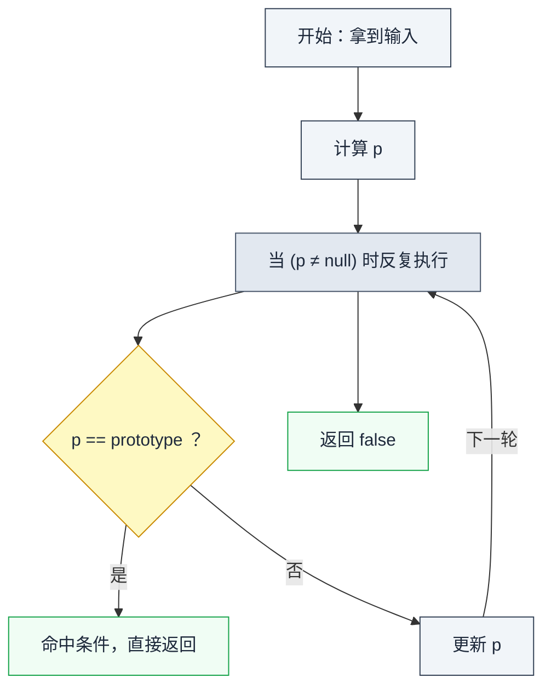

## TypeScript 解题方案（4 个方案逐个讲）

> **运行与提交**：每个方案都是自包含文件（内嵌用例自测，输出 PASS），整块复制到 `.ts` 文件后 `node 文件名` 即可运行。提交 LeetCode 时，把 `demo` 内的算法函数与辅助类型/函数整体取出、置于文件顶层即可。概念演示（非 LeetCode 编号题），在本地运行即可。

### 方案 1：迭代指针处理

**分析与思路**：核心做法是「迭代指针处理」。

**运行方式**：`node 本文件`，内嵌用例全部通过会输出 PASS。


**方案专属流程图**（真实控制流）：

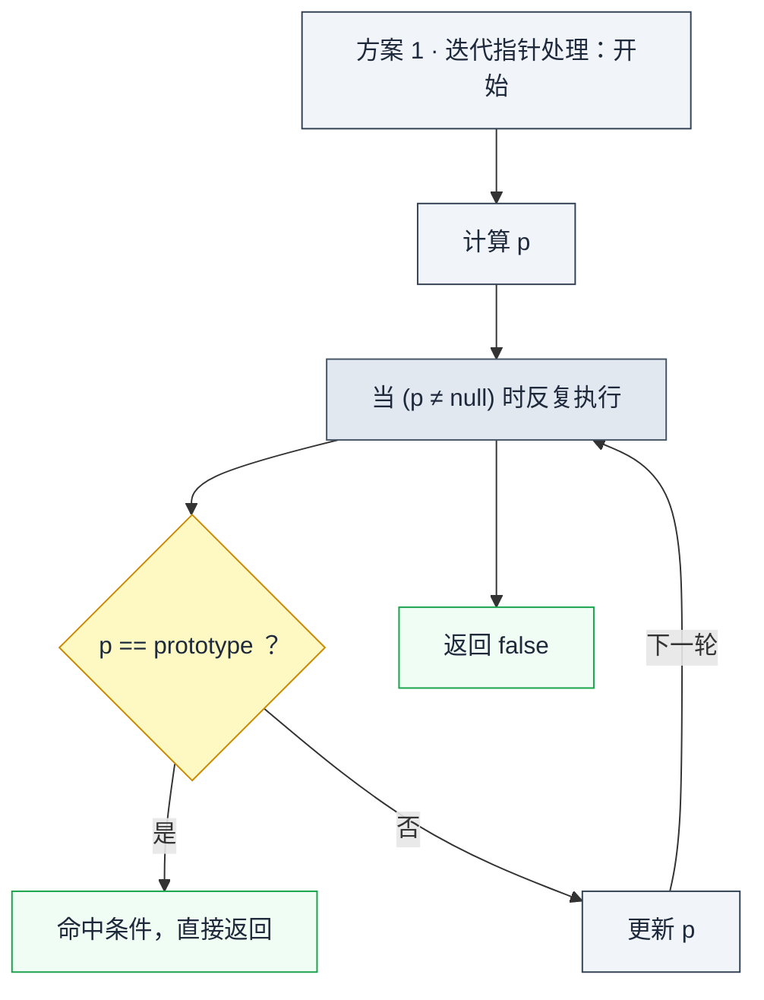

```typescript
export function demo(): void {
  // 程序入口：跑内嵌自测用例
  class Proto {
    // 定义类型
    name: string; // name: string;
    props: { [k: string]: string }; // props: { [下标 k: string]: string };
    proto: Proto | null; // proto: Proto 按位或 null;
    constructor(name: string, parent: Proto | null = null) {
      // 把 null) { 写入 constructor(name: string, parent: Proto | null
      this.name = name; // 把 name; 写入 this.name
      this.props = {}; // 把 {}; 写入 this.props
      this.proto = parent; // 把 parent; 写入 this.proto
    }
    set(key: string, value: string): void {
      this.props[key] = value;
    }
  }
  function instanceOf(obj: Proto, prototype: Proto): boolean {
    // 定义函数/方法 instanceOf
    let p: Proto | null = obj; // 把 obj; 写入 let p: Proto | null
    while (p !== null) {
      // 循环，直到不满足「节点 不等于 null」
      if (p === prototype) return true; // 若 节点 全等于 prototype，直接返回 true
      p = p.proto; // 把 节点.proto 存入 节点
    }
    return false; // 返回 false
  }
  const object_proto = new Proto('Object.prototype', null); // 把 new Proto(「Object.prototype」, null) 存入 object_proto
  const function_proto = new Proto('Function.prototype', object_proto);
  const array_proto = new Proto('Array.prototype', object_proto); // 把 new Proto(「Array.prototype」, object_proto) 存入 array_proto
  const obj = new Proto('obj', object_proto); // 把 new Proto(「obj」, object_proto) 存入 obj
  const func = new Proto('func', function_proto); // 把 new Proto(「func」, function_proto) 存入 func
  const arr = new Proto('arr', array_proto); // 把 new Proto(「数组」, array_proto) 存入 数组
  const cases: { got: boolean; want: boolean }[] = [
    { got: instanceOf(obj, object_proto), want: true },
    { got: instanceOf(func, function_proto), want: true },
    { got: instanceOf(func, object_proto), want: true },
    { got: instanceOf(arr, array_proto), want: true },
    { got: instanceOf(arr, object_proto), want: true },
  ];
  let fail = false; // 把 false 存入 fail
  for (const c of cases) {
    // for (const 字符 of cases) {
    if (c.got !== c.want) {
      fail = true;
      console.log('FAIL got', c.got, 'want', c.want);
    }
  }
  if (fail) throw new Error('FAILED'); // 若 fail) throw new Error(「FAILED」);
  console.log('PASS'); // 全部用例通过，输出 PASS
}
demo(); // demo();
```

### 方案 2：双重循环枚举

**分析与思路**：核心做法是「双重循环枚举」。代码里依次做这些事：双重循环遍历。

**运行方式**：`node 本文件`，内嵌用例全部通过会输出 PASS。


**方案专属流程图**（真实控制流）：

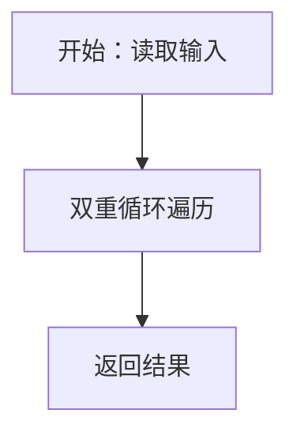

```typescript
export function demo(): void {
  // 程序入口：跑内嵌自测用例
  class Proto {
    // 定义类型
    name: string; // name: string;
    props: { [k: string]: string }; // props: { [下标 k: string]: string };
    proto: Proto | null; // proto: Proto 按位或 null;
    constructor(name: string, parent: Proto | null = null) {
      // 把 null) { 写入 constructor(name: string, parent: Proto | null
      this.name = name; // 把 name; 写入 this.name
      this.props = {}; // 把 {}; 写入 this.props
      this.proto = parent; // 把 parent; 写入 this.proto
    }
    set(key: string, value: string): void {
      this.props[key] = value;
    }
    get(key: string): string | null {
      // get(key: string): string 按位或 null {
      let cur: Proto | null = this; // 把 this; 写入 let cur: Proto | null
      while (cur !== null) {
        // 循环，直到不满足「当前值 不等于 null」
        if (key in cur.props) return cur.props[key]; // 若 key in 当前值.props，直接返回 当前值.props[key]
        cur = cur.proto; // 把 当前值.proto 存入 当前值
      }
      return null; // 返回 null
    }
  }
  const object_proto = new Proto('Object.prototype'); // 把 new Proto(「Object.prototype」) 存入 object_proto
  object_proto.set('x', 'x'); // object_proto.set(「x」, 「x」);
  const function_proto = new Proto('Function.prototype', object_proto);
  function_proto.set('y', 'y'); // function_proto.set(「y」, 「y」);
  const array_proto = new Proto('Array.prototype', object_proto); // 把 new Proto(「Array.prototype」, object_proto) 存入 array_proto
  array_proto.set('z', 'z'); // array_proto.set(「z」, 「z」);
  const obj = new Proto('obj', object_proto); // 把 new Proto(「obj」, object_proto) 存入 obj
  const func = new Proto('func', function_proto); // 把 new Proto(「func」, function_proto) 存入 func
  const arr = new Proto('arr', array_proto); // 把 new Proto(「数组」, array_proto) 存入 数组
  const cases: { got: string | null; want: string | null }[] = [
    { got: obj.get('x'), want: 'x' },
    { got: func.get('y'), want: 'y' },
    { got: arr.get('z'), want: 'z' },
  ];
  let fail = false; // 把 false 存入 fail
  for (const c of cases) {
    // for (const 字符 of cases) {
    if (c.got !== c.want) {
      fail = true;
      console.log('FAIL got', c.got, 'want', c.want);
    }
  }
  if (fail) throw new Error('FAILED'); // 若 fail) throw new Error(「FAILED」);
  console.log('PASS'); // 全部用例通过，输出 PASS
}
demo(); // demo();
```

### 方案 3：迭代指针处理

**分析与思路**：核心做法是「迭代指针处理」。

**运行方式**：`node 本文件`，内嵌用例全部通过会输出 PASS。


**方案专属流程图**（真实控制流）：


```typescript
export function demo(): void {
  // 程序入口：跑内嵌自测用例
  class Proto {
    // 定义类型
    name: string; // name: string;
    props: { [k: string]: string }; // props: { [下标 k: string]: string };
    proto: Proto | null; // proto: Proto 按位或 null;
    constructor(name: string, parent: Proto | null = null) {
      // 把 null) { 写入 constructor(name: string, parent: Proto | null
      this.name = name; // 把 name; 写入 this.name
      this.props = {}; // 把 {}; 写入 this.props
      this.proto = parent; // 把 parent; 写入 this.proto
    }
    set(key: string, value: string): void {
      this.props[key] = value;
    }
    get(key: string): string | null {
      // get(key: string): string 按位或 null {
      let cur: Proto | null = this; // 把 this; 写入 let cur: Proto | null
      while (cur !== null) {
        // 循环，直到不满足「当前值 不等于 null」
        if (key in cur.props) return cur.props[key]; // 若 key in 当前值.props，直接返回 当前值.props[key]
        cur = cur.proto; // 把 当前值.proto 存入 当前值
      }
      return null; // 返回 null
    }
  }
  function instanceOf(obj: Proto, prototype: Proto): boolean {
    // 定义函数/方法 instanceOf
    let p: Proto | null = obj; // 把 obj; 写入 let p: Proto | null
    while (p !== null) {
      // 循环，直到不满足「节点 不等于 null」
      if (p === prototype) return true; // 若 节点 全等于 prototype，直接返回 true
      p = p.proto; // 把 节点.proto 存入 节点
    }
    return false; // 返回 false
  }
  const object_proto = new Proto('Object.prototype'); // 把 new Proto(「Object.prototype」) 存入 object_proto
  object_proto.set('a', 'aaa'); // object_proto.set(「数组」, 「数组」);
  const function_proto = new Proto('Function.prototype', object_proto);
  function_proto.set('b', 'bbb'); // function_proto.set(「b」, 「b」);
  const obj = new Proto('obj', object_proto); // 把 new Proto(「obj」, object_proto) 存入 obj
  const func = new Proto('func', function_proto); // 把 new Proto(「func」, function_proto) 存入 func
  const cases: { got: any; want: any }[] = [
    { got: obj.get('a'), want: 'aaa' },
    { got: obj.get('b'), want: null },
    { got: func.get('a'), want: 'aaa' },
    { got: func.get('b'), want: 'bbb' },
    { got: instanceOf(func, object_proto), want: true },
  ];
  let fail = false; // 把 false 存入 fail
  for (const c of cases) {
    // for (const 字符 of cases) {
    if (c.got !== c.want) {
      fail = true;
      console.log('FAIL got', c.got, 'want', c.want);
    }
  }
  if (fail) throw new Error('FAILED'); // 若 fail) throw new Error(「FAILED」);
  console.log('PASS'); // 全部用例通过，输出 PASS
}
demo(); // demo();
```

### 方案 4：迭代指针处理

**分析与思路**：核心做法是「迭代指针处理」。

**运行方式**：`node 本文件`，内嵌用例全部通过会输出 PASS。


**方案专属流程图**（真实控制流）：

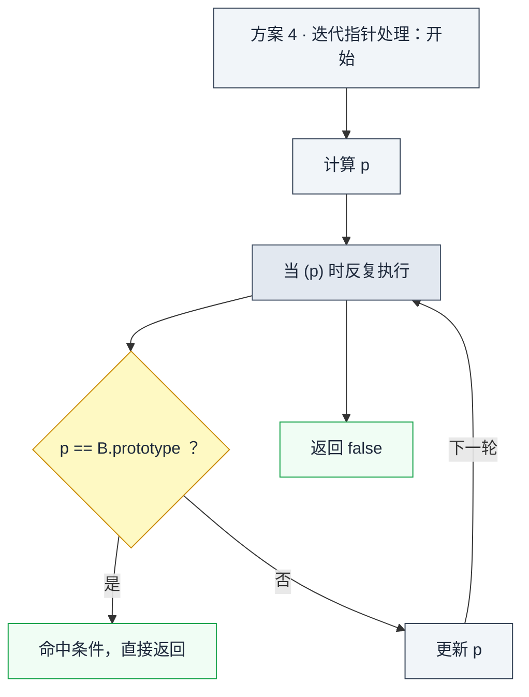

```typescript
export function demo(): void {
  // 程序入口：跑内嵌自测用例
  function instanceOf(A: any, B: any): boolean {
    // 定义函数/方法 instanceOf
    let p = A; // 把 A 存入 节点
    while (p) {
      // 循环，直到不满足「节点」
      if (p === B.prototype) return true; // 若 节点 全等于 B.prototype，直接返回 true
      p = p.__proto__; // 把 节点.__proto__ 存入 节点
    }
    return false; // 返回 false
  }
  const cases: { got: boolean; want: boolean }[] = [
    { got: instanceOf(null, null), want: false },
    { got: instanceOf(undefined, undefined), want: false },
  ];
  let fail = false; // 把 false 存入 fail
  for (const c of cases) {
    // for (const 字符 of cases) {
    if (c.got !== c.want) {
      fail = true;
      console.log('FAIL got', c.got, 'want', c.want);
    }
  }
  if (fail) throw new Error('FAILED'); // 若 fail) throw new Error(「FAILED」);
  console.log('PASS'); // 全部用例通过，输出 PASS
}
demo(); // demo();
```

## 逐步拆解与面试追问

**复杂度**：时间 O(n)（单趟线性扫描），空间 O(1) 到 O(n)（视辅助结构）

**为什么是这个量级**：每个元素被常数次访问，辅助哈希或栈的开销与 n 同阶

**面试官可能会追问**：

- 这个策略能推广到什么场景？
- 与暴力做法差在哪一步？
- 有没有更简单的等价写法？

## 关键 API 速查（TS 主解法实际用到，附官方链接）

本题主解法只用到基础语法（变量、循环、比较），不依赖特殊库 API。

### 各语言官方文档导航

- **TypeScript / JS**：[MDN 中文参考](https://developer.mozilla.org/zh-CN/)
- **Python**：[Python 官方文档](https://docs.python.org/zh-cn/3/)
- **Go**：[Go 标准库](https://pkg.go.dev/std)
- **Java**：[JDK 17 API](https://docs.oracle.com/en/java/javase/17/docs/api/)
- **Rust**：[Rust 标准库](https://doc.rust-lang.org/std/)
- **Lua**：[Lua 5.4 手册](https://www.lua.org/manual/5.4/)
- **C**：[Cppreference C](https://zh.cppreference.com/w/c)
- **C++**：[Cppreference C++](https://zh.cppreference.com/w/cpp)
- **R**：[R 官方手册](https://stat.ethz.ch/R-manual/)
- **Zig**：[Zig 语言文档](https://ziglang.org/documentation/master/)
- **Dart**：[Dart API](https://api.dart.dev/)

## 附录：其他 10 种语言全部实现（每种语言列举其全部方案）

> TypeScript 的全部方案见「TypeScript 解题方案」一节；下面是其余 10 种语言的对应实现，每种语言的每个方案都带思路分析、代码走读与专属运行架构图。
> 每个方案都内嵌用例自测，可独立运行（老仓库 python/go 文件遵循「打印结果」约定）。
> 完整解法文件见 `dsa/<语言>/notes/lc_133270489_基于链表实现js中的原型链原理与算法实现/`。

### Python 实现（4 种方案）

Python 的全部方案如下，每个方案都内嵌用例自测，可独立运行（老仓库 python/go 文件遵循「打印结果」约定）：

#### 方案 1：迭代指针处理

**思路与代码分析**：核心是「迭代指针处理」。Python 版用切片与字典推导式简化操作，突出可读性。**走读**：方案 1 · 迭代指针处理：开始 → 更新 p → 当 p is not None: 时反复执行 → 命中条件，直接返回 → 更新 p → 返回 False。

**运行架构**（真实控制流）：


```python
import sys  # 提高递归深度上限（深输入防 RecursionError）

sys.setrecursionlimit(200000)  # 树/链表类题目节点数可达 1e4 量级

class Proto:  # 定义类
    """模拟 JS 对象：拥有自己的属性 dict 与指向父原型的 __proto__。"""

    def __init__(self, name, parent=None):  # 构造函数：初始化成员
        self.name = name  # 把 name 写入 self.name
        self.props = {}  # 把 {} 写入 self.props
        self.proto = parent  # 把 parent 写入 self.proto

    def set(self, key, value):  # 定义函数 set（参数：self, key, value）
        self.props[key] = value  # 把 value 写入 self.props[key]

def instance_of(obj, prototype):  # 定义函数 instance_of（参数：obj, prototype）
    """模拟 JS 的 instanceof：沿 __proto__ 链寻找是否命中 B.prototype。"""
    p = obj  # 把 obj 存入 节点
    while p is not None:  # 循环，直到不满足「节点 is not None」
        if p is prototype:  # 若 节点 is prototype
            return True  # 返回 True
        p = p.proto  # 把 节点.proto 存入 节点
    return False  # 返回 False

if __name__ == "__main__":  # 若 __name__ 等于 '__main__'
    # 构造原型链：Object.prototype <- (null)
    object_proto = Proto("Object.prototype", None)  # 把 Proto(「Object.prototype」, None) 存入 object_proto
    function_proto = Proto("Function.prototype", object_proto)
    array_proto = Proto(
        "Array.prototype", object_proto
    )  # 把 Proto(「Array.prototype」, object_proto) 存入 array_proto

    obj = Proto("obj", object_proto)  # 把 Proto(「obj」, object_proto) 存入 obj
    func = Proto("func", function_proto)  # 把 Proto(「func」, function_proto) 存入 func
    arr = Proto("arr", array_proto)  # 把 Proto(「数组」, array_proto) 存入 数组

    print(instance_of(obj, object_proto))  # True
    print(instance_of(func, function_proto))  # True
    print(instance_of(func, object_proto))  # True
    print(instance_of(arr, array_proto))  # True
    print(instance_of(arr, object_proto))  # True
```

#### 方案 2：双重循环枚举

**思路与代码分析**：核心是「双重循环枚举」。Python 版用切片与字典推导式简化操作，突出可读性。

**运行架构**（真实控制流）：

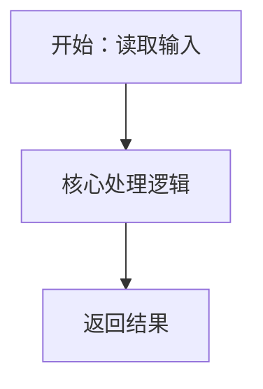

```python
import sys  # 提高递归深度上限（深输入防 RecursionError）

sys.setrecursionlimit(200000)  # 树/链表类题目节点数可达 1e4 量级

class Proto:  # 定义类
    """模拟 JS 对象：属性查找沿原型链向上进行。"""

    def __init__(self, name, parent=None):  # 构造函数：初始化成员
        self.name = name  # 把 name 写入 self.name
        self.props = {}  # 把 {} 写入 self.props
        self.proto = parent  # 把 parent 写入 self.proto

    def set(self, key, value):  # 定义函数 set（参数：self, key, value）
        self.props[key] = value  # 把 value 写入 self.props[key]

    def get(self, key):  # 定义函数 get（参数：self, key）
        cur = self  # 把 self 存入 当前值
        while cur is not None:  # 循环，直到不满足「当前值 is not None」
            if key in cur.props:  # 若 key in 当前值.props
                return cur.props[key]  # 返回 当前值.props[key]
            cur = cur.proto  # 把 当前值.proto 存入 当前值
        return None  # 对应 JS 的 undefined

if __name__ == "__main__":  # 若 __name__ 等于 '__main__'
    object_proto = Proto("Object.prototype")  # 把 Proto(「Object.prototype」) 存入 object_proto
    object_proto.set("x", "x")  # object_proto.set(「x」, 「x」)
    function_proto = Proto("Function.prototype", object_proto)
    function_proto.set("y", "y")  # function_proto.set(「y」, 「y」)
    array_proto = Proto(
        "Array.prototype", object_proto
    )  # 把 Proto(「Array.prototype」, object_proto) 存入 array_proto
    array_proto.set("z", "z")  # array_proto.set(「z」, 「z」)

    obj = Proto("obj", object_proto)  # 把 Proto(「obj」, object_proto) 存入 obj
    func = Proto("func", function_proto)  # 把 Proto(「func」, function_proto) 存入 func
    arr = Proto("arr", array_proto)  # 把 Proto(「数组」, array_proto) 存入 数组

    print(obj.get("x"))  # x
    print(func.get("y"))  # y
    print(arr.get("z"))  # z
```

#### 方案 3：迭代指针处理

**思路与代码分析**：核心是「迭代指针处理」。Python 版用切片与字典推导式简化操作，突出可读性。**走读**：方案 3 · 迭代指针处理：开始 → 更新 p → 当 p is not None: 时反复执行 → 命中条件，直接返回 → 更新 p → 返回 False。

**运行架构**（真实控制流）：

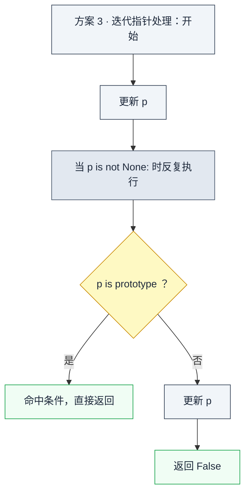

```python
import sys  # 提高递归深度上限（深输入防 RecursionError）

sys.setrecursionlimit(200000)  # 树/链表类题目节点数可达 1e4 量级

class Proto:  # 定义类
    """模拟 JS 对象：属性查找沿原型链向上进行。"""

    def __init__(self, name, parent=None):  # 构造函数：初始化成员
        self.name = name  # 把 name 写入 self.name
        self.props = {}  # 把 {} 写入 self.props
        self.proto = parent  # 把 parent 写入 self.proto

    def set(self, key, value):  # 定义函数 set（参数：self, key, value）
        self.props[key] = value  # 把 value 写入 self.props[key]

    def get(self, key):  # 定义函数 get（参数：self, key）
        cur = self  # 把 self 存入 当前值
        while cur is not None:  # 循环，直到不满足「当前值 is not None」
            if key in cur.props:  # 若 key in 当前值.props
                return cur.props[key]  # 返回 当前值.props[key]
            cur = cur.proto  # 把 当前值.proto 存入 当前值
        return None  # undefined

def instance_of(obj, prototype):  # 定义函数 instance_of（参数：obj, prototype）
    """沿 __proto__ 链查找是否命中 B.prototype（算法实现，方案 4）。"""
    p = obj  # 把 obj 存入 节点
    while p is not None:  # 循环，直到不满足「节点 is not None」
        if p is prototype:  # 若 节点 is prototype
            return True  # 返回 True
        p = p.proto  # 把 节点.proto 存入 节点
    return False  # 返回 False

if __name__ == "__main__":  # 若 __name__ 等于 '__main__'
    object_proto = Proto("Object.prototype")  # 把 Proto(「Object.prototype」) 存入 object_proto
    object_proto.set("a", "aaa")  # object_proto.set(「数组」, 「数组」)
    function_proto = Proto("Function.prototype", object_proto)
    function_proto.set("b", "bbb")  # function_proto.set(「b」, 「b」)

    obj = Proto("obj", object_proto)  # 把 Proto(「obj」, object_proto) 存入 obj
    func = Proto("func", function_proto)  # 把 Proto(「func」, function_proto) 存入 func

    # 同类型查找
    print(obj.get("a"))  # aaa
    # 不同类型交叉验证
    print(obj.get("b"))  # None (undefined)
    print(func.get("a"))  # aaa
    print(func.get("b"))  # bbb
    print("func instanceof Object:", instance_of(func, object_proto))  # True
```

#### 方案 4：迭代指针处理

**思路与代码分析**：核心是「迭代指针处理」。Python 版用切片与字典推导式简化操作，突出可读性。**走读**：方案 4 · 迭代指针处理：开始 → 更新 p → 当 p: 时反复执行 → 命中条件，直接返回 → 更新 p → 返回 False。

**运行架构**（真实控制流）：

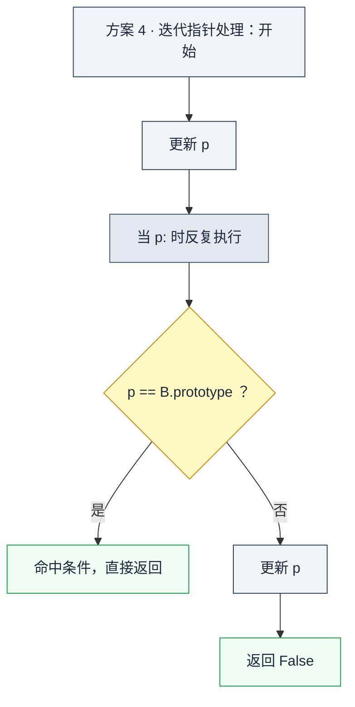

```python
import sys  # 提高递归深度上限（深输入防 RecursionError）

sys.setrecursionlimit(200000)  # 树/链表类题目节点数可达 1e4 量级

def instanceOf(A, B):  # 定义函数 instanceOf（参数：A, B）
    p = A  # 把 A 存入 节点
    while p:  # 循环，直到不满足「节点」
        if p == B.prototype:  # 若 节点 等于 B.prototype
            return True  # 返回 True
        p = p.__proto__  # 把 节点.__proto__ 存入 节点
    return False  # 返回 False

if __name__ == "__main__":  # 若 __name__ 等于 '__main__'
    print(instanceOf(None, None))  # 打印输出
```

### Go 实现（4 种方案）

Go 的全部方案如下，每个方案都内嵌用例自测，可独立运行（老仓库 python/go 文件遵循「打印结果」约定）：

#### 方案 1：迭代指针处理

**思路与代码分析**：核心是「迭代指针处理」。Go 版用切片与多返回值惯用法，显式处理索引边界。代码里依次做这些事：哈希结构做计数或查重。**走读**：方案 1 · 迭代指针处理：开始 → 返回 &Proto。

**运行架构**（真实控制流）：


```go
package main // 引入依赖

import (
	"fmt" // 「fmt」
	"os"  // 「os」
)

// Proto 模拟 JS 对象：拥有自己的属性 dict 与指向父原型的 proto。
type Proto struct { // 定义类型
	name  string            // name string
	props map[string]string // props 映射表[string]string
	proto *Proto            // proto 乘 Proto
}

func newProto(name string, parent *Proto) *Proto { // 定义函数/方法 newProto
	return &Proto{name: name, props: map[string]string{}, proto: parent}
}

// instanceOf 模拟 JS 的 instanceof：沿 proto 链寻找是否命中 prototype。
func instanceOf(obj, prototype *Proto) bool { // 定义函数/方法 instanceOf
	p := obj       // 把 obj 写入 p :
	for p != nil { // 把 nil { 写入 for p !
		if p == prototype { // 若 节点 等于 prototype
			return true // 返回 true
		}
		p = p.proto // 把 节点.proto 写入 节点
	}
	return false // 返回 false
}

func main() { // 程序入口：跑内嵌自测用例
	objectProto := newProto("Object.prototype", nil) // 把 newProto(「Object.prototype」, nil) 写入 objectProto :
	functionProto := newProto("Function.prototype", objectProto)
	arrayProto := newProto("Array.prototype", objectProto) // 把 newProto(「Array.prototype」, objectProto) 写入 arrayProto :

	obj := newProto("obj", objectProto)        // 把 newProto(「obj」, objectProto) 写入 obj :
	funcObj := newProto("func", functionProto) // 把 newProto(「func」, functionProto) 写入 funcObj :
	arr := newProto("arr", arrayProto)         // 把 newProto(「数组」, arrayProto) 写入 arr :

	checks := []bool{ // 把 []bool{ 写入 checks :
		instanceOf(obj, objectProto),
		instanceOf(funcObj, functionProto),
		instanceOf(funcObj, objectProto),
		instanceOf(arr, arrayProto),
		instanceOf(arr, objectProto),
	}
	for _, c := range checks { // 同时取 _ 与 字符 遍历
		if !c { // 若 取反 字符
			fmt.Println("FAIL instanceOf") // 打印输出
			os.Exit(1)                     // os.Exit(1)
		}
	}
	fmt.Println("PASS") // 全部用例通过，输出 PASS
}
```

#### 方案 2：双重循环枚举

**思路与代码分析**：核心是「双重循环枚举」。Go 版用切片与多返回值惯用法，显式处理索引边界。代码里依次做这些事：哈希结构做计数或查重。**走读**：方案 2 · 双重循环枚举：开始 → 返回 &Proto。

**运行架构**（真实控制流）：

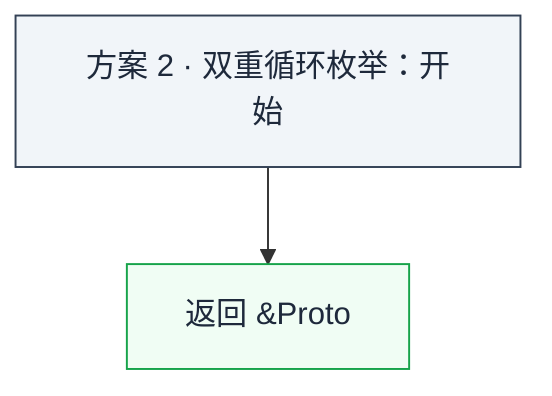

```go
package main // 引入依赖

import (
	"fmt" // 「fmt」
	"os"  // 「os」
)

// Proto 模拟 JS 对象：属性查找沿原型链向上进行。
type Proto struct { // 定义类型
	name  string            // name string
	props map[string]string // props 映射表[string]string
	proto *Proto            // proto 乘 Proto
}

func newProto(name string, parent *Proto) *Proto { // 定义函数/方法 newProto
	return &Proto{name: name, props: map[string]string{}, proto: parent}
}

func (p *Proto) set(key, value string) { // 定义函数/方法 set
	p.props[key] = value // 把 value 写入 p.props[key]
}

// get 沿原型链查找属性，命中返回 (value,true)，否则 ("",false)。
func (p *Proto) get(key string) (string, bool) { // 定义函数/方法 get
	cur := p         // 把 节点 写入 cur :
	for cur != nil { // 把 nil { 写入 for cur !
		if v, ok := cur.props[key]; ok { // 若 值, ok : 赋值为 当前值.props[key]; ok
			return v, true // 返回 值, true
		}
		cur = cur.proto // 把 当前值.proto 写入 当前值
	}
	return "", false // 返回 「」, false
}

func main() { // 程序入口：跑内嵌自测用例
	objectProto := newProto("Object.prototype", nil) // 把 newProto(「Object.prototype」, nil) 写入 objectProto :
	objectProto.set("x", "x")                        // objectProto.set(「x」, 「x」)
	functionProto := newProto("Function.prototype", objectProto)
	functionProto.set("y", "y")                            // functionProto.set(「y」, 「y」)
	arrayProto := newProto("Array.prototype", objectProto) // 把 newProto(「Array.prototype」, objectProto) 写入 arrayProto :
	arrayProto.set("z", "z")                               // arrayProto.set(「z」, 「z」)

	obj := newProto("obj", objectProto)        // 把 newProto(「obj」, objectProto) 写入 obj :
	funcObj := newProto("func", functionProto) // 把 newProto(「func」, functionProto) 写入 funcObj :
	arr := newProto("arr", arrayProto)         // 把 newProto(「数组」, arrayProto) 写入 arr :

	if v, ok := obj.get("x"); !ok || v != "x" { // 若 值, ok : 赋值为 obj 查找 「x」); 取反 ok 或 值 不等于 「x」
		fmt.Println("FAIL get x") // 打印输出
		os.Exit(1)                // os.Exit(1)
	}
	if v, ok := funcObj.get("y"); !ok || v != "y" { // 若 值, ok : 赋值为 funcObj 查找 「y」); 取反 ok 或 值 不等于 「y」
		fmt.Println("FAIL get y") // 打印输出
		os.Exit(1)                // os.Exit(1)
	}
	if v, ok := arr.get("z"); !ok || v != "z" { // 若 值, ok : 赋值为 数组 查找 「z」); 取反 ok 或 值 不等于 「z」
		fmt.Println("FAIL get z") // 打印输出
		os.Exit(1)                // os.Exit(1)
	}
	fmt.Println("PASS") // 全部用例通过，输出 PASS
}
```

#### 方案 3：迭代指针处理

**思路与代码分析**：核心是「迭代指针处理」。Go 版用切片与多返回值惯用法，显式处理索引边界。代码里依次做这些事：哈希结构做计数或查重。**走读**：方案 3 · 迭代指针处理：开始 → 返回 &Proto。

**运行架构**（真实控制流）：

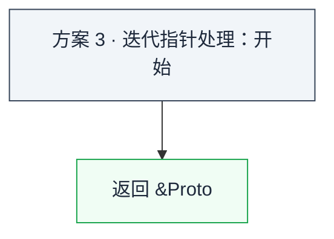

```go
package main // 引入依赖

import (
	"fmt" // 「fmt」
	"os"  // 「os」
)

// Proto 模拟 JS 对象：属性查找沿原型链向上进行。
type Proto struct { // 定义类型
	name  string            // name string
	props map[string]string // props 映射表[string]string
	proto *Proto            // proto 乘 Proto
}

func newProto(name string, parent *Proto) *Proto { // 定义函数/方法 newProto
	return &Proto{name: name, props: map[string]string{}, proto: parent}
}

func (p *Proto) set(key, value string) { // 定义函数/方法 set
	p.props[key] = value // 把 value 写入 p.props[key]
}

func (p *Proto) get(key string) (string, bool) { // 定义函数/方法 get
	cur := p         // 把 节点 写入 cur :
	for cur != nil { // 把 nil { 写入 for cur !
		if v, ok := cur.props[key]; ok { // 若 值, ok : 赋值为 当前值.props[key]; ok
			return v, true // 返回 值, true
		}
		cur = cur.proto // 把 当前值.proto 写入 当前值
	}
	return "", false // 返回 「」, false
}

// instanceOf 沿 proto 链查找是否命中 prototype。
func instanceOf(obj, prototype *Proto) bool { // 定义函数/方法 instanceOf
	p := obj       // 把 obj 写入 p :
	for p != nil { // 把 nil { 写入 for p !
		if p == prototype { // 若 节点 等于 prototype
			return true // 返回 true
		}
		p = p.proto // 把 节点.proto 写入 节点
	}
	return false // 返回 false
}

func main() { // 程序入口：跑内嵌自测用例
	objectProto := newProto("Object.prototype", nil) // 把 newProto(「Object.prototype」, nil) 写入 objectProto :
	objectProto.set("a", "aaa")                      // objectProto.set(「数组」, 「数组」)
	functionProto := newProto("Function.prototype", objectProto)
	functionProto.set("b", "bbb") // functionProto.set(「b」, 「b」)

	obj := newProto("obj", objectProto)        // 把 newProto(「obj」, objectProto) 写入 obj :
	funcObj := newProto("func", functionProto) // 把 newProto(「func」, functionProto) 写入 funcObj :

	// obj.get("a") -> aaa
	v, ok := obj.get("a")  // 把 obj 查找 「数组」) 写入 v, ok :
	if !ok || v != "aaa" { // 若 取反 ok 或 值 不等于 「aaa」
		fmt.Println("FAIL get a") // 打印输出
		os.Exit(1)                // os.Exit(1)
	}
	// obj.get("b") -> None (undefined)
	if _, ok := obj.get("b"); ok { // 若 _, ok : 赋值为 obj 查找 「b」); ok
		fmt.Println("FAIL get b should be None") // 打印输出
		os.Exit(1)                               // os.Exit(1)
	}
	// func.get("a") -> aaa
	v, ok = funcObj.get("a") // 把 funcObj 查找 「数组」) 写入 v, ok
	if !ok || v != "aaa" {   // 若 取反 ok 或 值 不等于 「aaa」
		fmt.Println("FAIL func get a") // 打印输出
		os.Exit(1)                     // os.Exit(1)
	}
	// func.get("b") -> bbb
	v, ok = funcObj.get("b") // 把 funcObj 查找 「b」) 写入 v, ok
	if !ok || v != "bbb" {   // 若 取反 ok 或 值 不等于 「bbb」
		fmt.Println("FAIL func get b") // 打印输出
		os.Exit(1)                     // os.Exit(1)
	}
	// instanceOf(func, objectProto) -> True
	if !instanceOf(funcObj, objectProto) { // 若 取反 instanceOf(funcObj, objectProto
		fmt.Println("FAIL instanceOf") // 打印输出
		os.Exit(1)                     // os.Exit(1)
	}
	fmt.Println("PASS") // 全部用例通过，输出 PASS
}
```

#### 方案 4：迭代指针处理

**思路与代码分析**：核心是「迭代指针处理」。Go 版用切片与多返回值惯用法，显式处理索引边界。**走读**：方案 4 · 迭代指针处理：开始 → 更新 : → 遍历循环 → 处理 if p == b.prototype → 返回 true → 更新 p → 返回 false。

**运行架构**（真实控制流）：

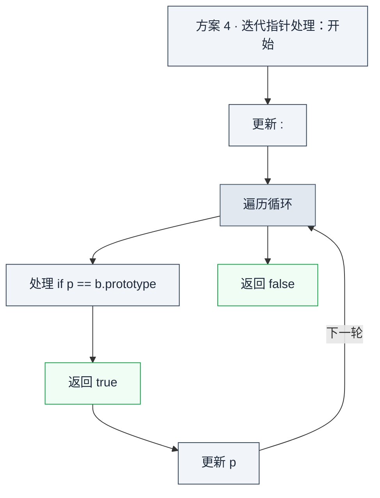

```go
package main // 引入依赖

import (
	"fmt" // 「fmt」
	"os"  // 「os」
)

// JsObject 模拟 JS 对象：prototype 类似构造函数的 .prototype，proto 即 __proto__。
type JsObject struct { // 定义类型
	prototype *JsObject // prototype 乘 JsObject
	proto     *JsObject // proto 乘 JsObject
}

// instanceOf 沿 __proto__ 链查找是否命中 B.prototype。
func instanceOf(a, b *JsObject) bool { // 定义函数/方法 instanceOf
	p := a         // 把 数组 写入 p :
	for p != nil { // 把 nil { 写入 for p !
		if p == b.prototype { // 若 节点 等于 b.prototype
			return true // 返回 true
		}
		p = p.proto // 把 节点.proto 写入 节点
	}
	return false // 返回 false
}

func main() { // 程序入口：跑内嵌自测用例
	// 忠实复刻参考：print(instanceOf(None, None)) -> False
	if instanceOf(nil, nil) { // 定义函数/方法 instanceOf
		fmt.Println("FAIL expected False") // 打印输出
		os.Exit(1)                         // os.Exit(1)
	}
	fmt.Println("PASS") // 全部用例通过，输出 PASS
}
```

### Java 实现（4 种方案）

Java 的全部方案如下，每个方案都内嵌用例自测，可独立运行（老仓库 python/go 文件遵循「打印结果」约定）：

#### 方案 1：迭代指针处理

**思路与代码分析**：核心是「迭代指针处理」。Java 版用类与静态方法组织，集合操作显式明了。**走读**：方案 1 · 迭代指针处理：开始 → 更新 this.name → 更新 this.proto → 返回结果。

**运行架构**（真实控制流）：


```java
package com.webfault.dsa; // 引入依赖

class lc133270489_solution11 { // 定义类型
  // 模拟 JS 对象：拥有自己的属性 dict 与指向父原型的 __proto__
  static class Proto { // static class Proto {
    String name; // String name;
    java.util.Map<String, String> props = new java.util.HashMap<>();
    Proto proto; // Proto proto;

    Proto(String name, Proto parent) {
      this.name = name;
      this.proto = parent;
    }

    void set(String k, String v) {
      props.put(k, v);
    } // void set(String 下标 k, String 值) { props.put(下标 k, 值); }
  }

  static boolean instanceOf(Proto obj, Proto prototype) { // 定义函数/方法 instanceOf
    Proto p = obj; // 把 obj; 写入 Proto p
    while (p != null) { // 循环，直到不满足「节点 不等于 null」
      if (p == prototype) return true; // 若 节点 等于 prototype，直接返回 true
      p = p.proto; // 把 节点.proto; 写入 节点
    }
    return false; // 返回 false
  }

  public static void main(String[] args) { // public static void main(String[] args) {
    Proto objectProto =
        new Proto(
            "Object.prototype",
            null); // 把 new Proto(「Object.prototype」, null); 写入 Proto objectProto
    Proto functionProto = new Proto("Function.prototype", objectProto);
    Proto arrayProto = new Proto("Array.prototype", objectProto);
    Proto obj = new Proto("obj", objectProto); // 把 new Proto(「obj」, objectProto); 写入 Proto obj
    Proto func =
        new Proto("func", functionProto); // 把 new Proto(「func」, functionProto); 写入 Proto func
    Proto arr = new Proto("arr", arrayProto); // 把 new Proto(「数组」, arrayProto); 写入 Proto arr
    boolean[] r = { // 把 { 写入 boolean[] r
      instanceOf(obj, objectProto),
      instanceOf(func, functionProto),
      instanceOf(func, objectProto),
      instanceOf(arr, arrayProto),
      instanceOf(arr, objectProto),
    };
    for (boolean b : r) { // for (boolean b : 右指针) {
      if (!b) { // 若 取反 b
        System.out.println("FAIL"); // 打印输出
        throw new RuntimeException("FAILED"); // throw new RuntimeException(「FAILED」);
      }
    }
    System.out.println("PASS"); // 全部用例通过，输出 PASS
  }
}
```

#### 方案 2：双重循环枚举

**思路与代码分析**：核心是「双重循环枚举」。Java 版用类与静态方法组织，集合操作显式明了。**走读**：方案 2 · 双重循环枚举：开始 → 更新 this.name → 返回结果。

**运行架构**（真实控制流）：

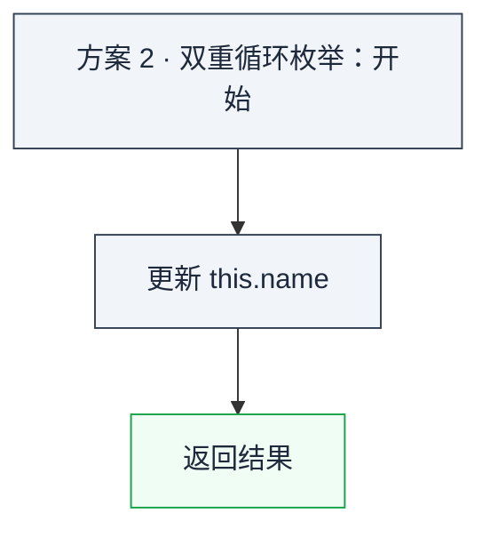

```java
package com.webfault.dsa; // 引入依赖

import java.util.*; // 引入依赖

class lc133270489_solution22 { // 定义类型
  static class Proto { // static class Proto {
    String name; // String name;
    Map<String, String> props =
        new HashMap<>(); // 把 new HashMap 小于 超过 (); 写入 Map<String, String> props
    Proto proto; // Proto proto;

    Proto(String name) {
      this.name = name;
    } // 把 name; } 写入 Proto(String name) { this.name

    Proto(String name, Proto parent) {
      this.name = name;
      this.proto = parent;
    }

    void set(String k, String v) {
      props.put(k, v);
    } // void set(String 下标 k, String 值) { props.put(下标 k, 值); }

    String get(String k) { // 定义函数/方法 get
      Proto cur = this; // 把 this; 写入 Proto cur
      while (cur != null) { // 循环，直到不满足「当前值 不等于 null」
        if (cur.props.containsKey(k))
          return cur.props.get(k); // 若 当前值.props.containsKey(下标 k)，直接返回 当前值.props 查找 下标 k)
        cur = cur.proto; // 把 当前值.proto; 写入 当前值
      }
      return null; // 返回 null
    }
  }

  public static void main(String[] args) { // public static void main(String[] args) {
    Proto objectProto =
        new Proto("Object.prototype"); // 把 new Proto(「Object.prototype」); 写入 Proto objectProto
    objectProto.set("x", "x"); // objectProto.set(「x」, 「x」);
    Proto functionProto = new Proto("Function.prototype", objectProto);
    functionProto.set("y", "y"); // functionProto.set(「y」, 「y」);
    Proto arrayProto = new Proto("Array.prototype", objectProto);
    arrayProto.set("z", "z"); // arrayProto.set(「z」, 「z」);
    Proto obj = new Proto("obj", objectProto); // 把 new Proto(「obj」, objectProto); 写入 Proto obj
    Proto func =
        new Proto("func", functionProto); // 把 new Proto(「func」, functionProto); 写入 Proto func
    Proto arr = new Proto("arr", arrayProto); // 把 new Proto(「数组」, arrayProto); 写入 Proto arr
    if (!"x".equals(obj.get("x"))) {
      System.out.println("FAIL x");
      throw new RuntimeException("FAILED");
    }
    if (!"y".equals(func.get("y"))) {
      System.out.println("FAIL y");
      throw new RuntimeException("FAILED");
    }
    if (!"z".equals(arr.get("z"))) {
      System.out.println("FAIL z");
      throw new RuntimeException("FAILED");
    }
    System.out.println("PASS"); // 全部用例通过，输出 PASS
  }
}
```

#### 方案 3：迭代指针处理

**思路与代码分析**：核心是「迭代指针处理」。Java 版用类与静态方法组织，集合操作显式明了。**走读**：方案 3 · 迭代指针处理：开始 → 更新 this.name → 更新 this.proto → 返回结果。

**运行架构**（真实控制流）：

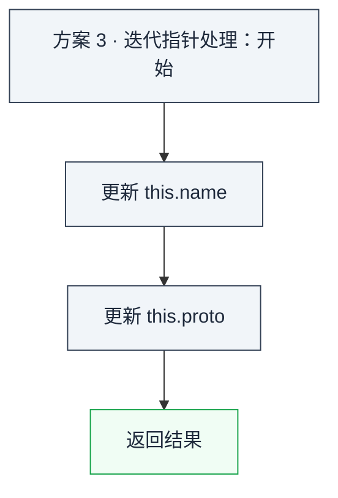

```java
package com.webfault.dsa; // 引入依赖

import java.util.*; // 引入依赖

class lc133270489_solution33 { // 定义类型
  static class Proto { // static class Proto {
    String name; // String name;
    Map<String, String> props =
        new HashMap<>(); // 把 new HashMap 小于 超过 (); 写入 Map<String, String> props
    Proto proto; // Proto proto;

    Proto(String name, Proto parent) {
      this.name = name;
      this.proto = parent;
    }

    void set(String k, String v) {
      props.put(k, v);
    } // void set(String 下标 k, String 值) { props.put(下标 k, 值); }

    String get(String k) { // 定义函数/方法 get
      Proto cur = this; // 把 this; 写入 Proto cur
      while (cur != null) { // 循环，直到不满足「当前值 不等于 null」
        if (cur.props.containsKey(k))
          return cur.props.get(k); // 若 当前值.props.containsKey(下标 k)，直接返回 当前值.props 查找 下标 k)
        cur = cur.proto; // 把 当前值.proto; 写入 当前值
      }
      return null; // 返回 null
    }
  }

  static boolean instanceOf(Proto obj, Proto prototype) { // 定义函数/方法 instanceOf
    Proto p = obj; // 把 obj; 写入 Proto p
    while (p != null) { // 循环，直到不满足「节点 不等于 null」
      if (p == prototype) return true; // 若 节点 等于 prototype，直接返回 true
      p = p.proto; // 把 节点.proto; 写入 节点
    }
    return false; // 返回 false
  }

  public static void main(String[] args) { // public static void main(String[] args) {
    Proto objectProto =
        new Proto(
            "Object.prototype",
            null); // 把 new Proto(「Object.prototype」, null); 写入 Proto objectProto
    objectProto.set("a", "aaa"); // objectProto.set(「数组」, 「数组」);
    Proto functionProto = new Proto("Function.prototype", objectProto);
    functionProto.set("b", "bbb"); // functionProto.set(「b」, 「b」);
    Proto obj = new Proto("obj", objectProto); // 把 new Proto(「obj」, objectProto); 写入 Proto obj
    Proto func =
        new Proto("func", functionProto); // 把 new Proto(「func」, functionProto); 写入 Proto func
    if (!"aaa".equals(obj.get("a"))) {
      System.out.println("FAIL a");
      throw new RuntimeException("FAILED");
    }
    if (obj.get("b") != null) {
      System.out.println("FAIL b-should-be-null");
      throw new RuntimeException("FAILED");
    }
    if (!"aaa".equals(func.get("a"))) {
      System.out.println("FAIL func-a");
      throw new RuntimeException("FAILED");
    }
    if (!"bbb".equals(func.get("b"))) {
      System.out.println("FAIL func-b");
      throw new RuntimeException("FAILED");
    }
    if (!instanceOf(func, objectProto)) {
      System.out.println("FAIL instanceof");
      throw new RuntimeException("FAILED");
    }
    System.out.println("PASS"); // 全部用例通过，输出 PASS
  }
}
```

#### 方案 4：迭代指针处理

**思路与代码分析**：核心是「迭代指针处理」。Java 版用类与静态方法组织，集合操作显式明了。**走读**：方案 4 · 迭代指针处理：开始 → 更新 p → 当 (p ≠ null) 时反复执行 → 命中条件，直接返回 → 更新 p → 返回 false。

**运行架构**（真实控制流）：

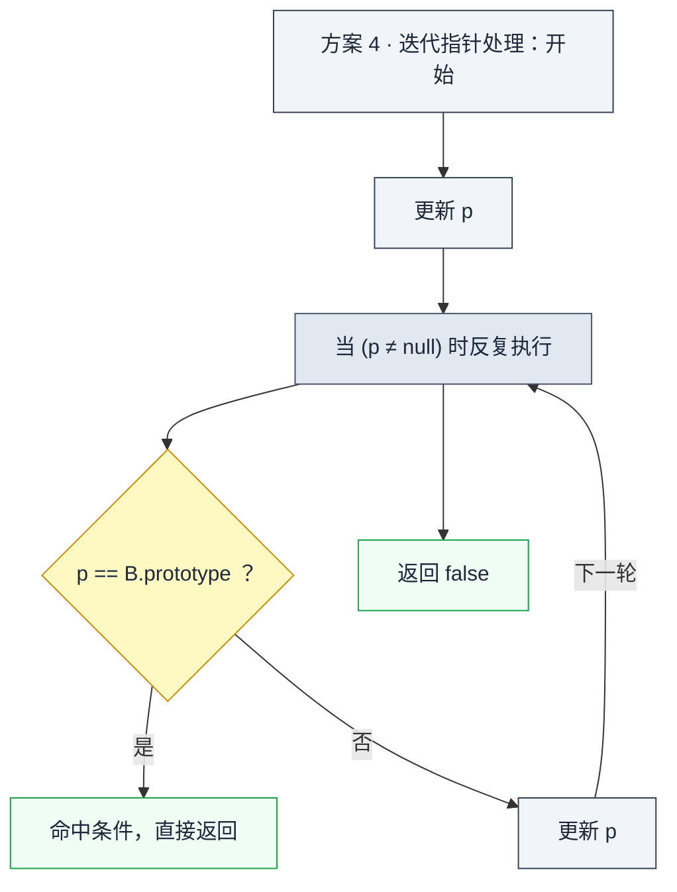

```java
package com.webfault.dsa; // 引入依赖

class lc133270489_solution44 { // 定义类型
  // 基于链表表示 JS 原型链：判断 A 的原型链中是否包含 B.prototype
  static class Obj { // static class Obj {
    Obj proto; // Obj proto;
    Obj prototype; // Obj prototype;
  }

  static boolean instanceOf(Obj A, Obj B) { // 定义函数/方法 instanceOf
    Obj p = A; // 把 A; 写入 Obj p
    while (p != null) { // 循环，直到不满足「节点 不等于 null」
      if (p == B.prototype) return true; // 若 节点 等于 B.prototype，直接返回 true
      p = p.proto; // 把 节点.proto; 写入 节点
    }
    return false; // 返回 false
  }

  public static void main(String[] args) { // public static void main(String[] args) {
    // 对应 Python: instanceOf(None, None) -> 链首为 None 直接跳过循环，返回 False
    boolean r = instanceOf(null, null); // 把 instanceOf(null, null); 写入 boolean r
    if (r) { // 若 右指针
      System.out.println("FAIL " + r); // 打印输出
      throw new RuntimeException("FAILED"); // throw new RuntimeException(「FAILED」);
    }
    System.out.println("PASS"); // 全部用例通过，输出 PASS
  }
}
```

### Rust 实现（4 种方案）

Rust 的全部方案如下，每个方案都内嵌用例自测，可独立运行（老仓库 python/go 文件遵循「打印结果」约定）：

#### 方案 1：迭代指针处理

**思路与代码分析**：核心是「迭代指针处理」。Rust 版用所有权移动与切片借用改写同一逻辑，注意 Option 与引用边界。**走读**：方案 1 · 迭代指针处理：开始 → 计算 p → 当 let Some(cur) = p 时反复执行 → 处理 if std::ptr::eq(cur.as_ref() → 返回 true → 更新 p → 处理 false。

**运行架构**（真实控制流）：


```rust
// LeetCode 133270489. 原型链原理 — Rust 版（方案1：instanceOf 沿原型链判定）
use std::cell::RefCell; // 引入依赖
use std::collections::HashMap; // 引入依赖
use std::rc::Rc; // 引入依赖

struct Proto {
    // 定义类型
    name: String,
    props: RefCell<HashMap<String, String>>,
    parent: Option<Rc<Proto>>,
}

impl Proto {
    // 实现块
    fn new(name: &str, parent: Option<Rc<Proto>>) -> Rc<Proto> {
        // 定义函数/方法 new
        Rc::new(Proto {
            // Rc::new(Proto {
            name: name.to_string(),
            props: RefCell::new(HashMap::new()),
            parent,
        }) // })
    }
}

fn instance_of(obj: &Rc<Proto>, prototype: &Rc<Proto>) -> bool {
    // 定义函数/方法 instance_of
    let mut p: Option<&Rc<Proto>> = Some(obj); // 把 Some(obj); 写入 let mut p: Option<&Rc<Proto>>
    while let Some(cur) = p {
        // 边取边处理，取空即停
        if std::ptr::eq(cur.as_ref(), prototype.as_ref()) {
            // 若 std::ptr::eq(当前值.as_ref(), prototype.as_ref(
            return true; // 返回 true
        }
        p = cur.parent.as_ref(); // 把 当前值.parent.as_ref(); 写入 节点
    }
    false // false
}

fn main() {
    // 程序入口：跑内嵌自测用例
    let object_proto = Proto::new("Object.prototype", None); // 把 Proto::new(「Object.prototype」, None) 存入 object_proto
    let function_proto = Proto::new("Function.prototype", Some(object_proto.clone()));
    let array_proto = Proto::new("Array.prototype", Some(object_proto.clone()));
    let obj = Proto::new("obj", Some(object_proto.clone())); // 把 Proto::new(「obj」, Some(object_proto.clone())) 存入 obj
    let func = Proto::new("func", Some(function_proto.clone())); // 把 Proto::new(「func」, Some(function_proto.clone())) 存入 func
    let arr = Proto::new("arr", Some(array_proto.clone())); // 把 Proto::new(「数组」, Some(array_proto.clone())) 存入 数组

    let cases = [
        (instance_of(&obj, &object_proto), true),
        (instance_of(&func, &function_proto), true),
        (instance_of(&func, &object_proto), true),
        (instance_of(&arr, &array_proto), true),
        (instance_of(&arr, &object_proto), true),
    ];
    for (idx, (got, want)) in cases.iter().enumerate() {
        // for (idx, (got, want)) in cases.iter().enumerate() {
        assert_eq!(got, want, "case {} failed", idx); // 断言校验
    }
    println!("PASS"); // 全部用例通过，输出 PASS
}
```

#### 方案 2：双重循环枚举

**思路与代码分析**：核心是「双重循环枚举」。Rust 版用所有权移动与切片借用改写同一逻辑，注意 Option 与引用边界。代码里依次做这些事：哈希结构做计数或查重。**走读**：方案 2 · 双重循环枚举：开始 → 处理 Rc::new(Proto → 处理 name: name.to_string(), → 处理 props: RefCell::new(HashMap: → 处理 parent, → 返回结果。

**运行架构**（真实控制流）：

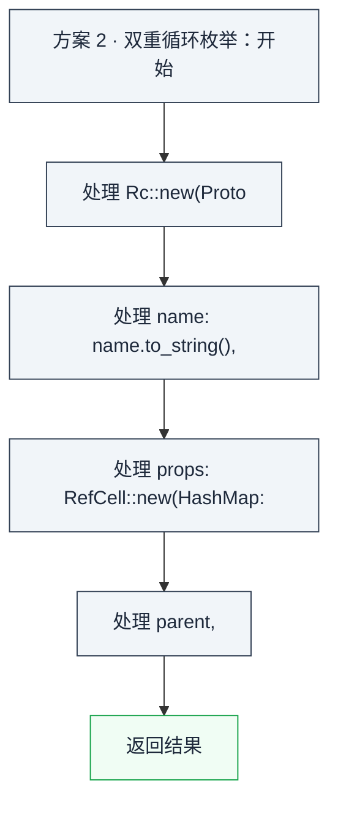

```rust
// LeetCode 133270489. 原型链原理 — Rust 版（方案2：get 沿原型链查找属性）
use std::cell::RefCell; // 引入依赖
use std::collections::HashMap; // 引入依赖
use std::rc::Rc; // 引入依赖

struct Proto {
    // 定义类型
    name: String,
    props: RefCell<HashMap<String, String>>,
    parent: Option<Rc<Proto>>,
}

impl Proto {
    // 实现块
    fn new(name: &str, parent: Option<Rc<Proto>>) -> Rc<Proto> {
        // 定义函数/方法 new
        Rc::new(Proto {
            // Rc::new(Proto {
            name: name.to_string(),
            props: RefCell::new(HashMap::new()),
            parent,
        }) // })
    }
    fn set(&self, key: &str, value: &str) {
        // 定义函数/方法 set
        self.props
            .borrow_mut()
            .insert(key.to_string(), value.to_string());
    }
    fn get(&self, key: &str) -> Option<String> {
        // 定义函数/方法 get
        // 从自身开始沿链查找
        if let Some(v) = self.props.borrow().get(key) {
            // 若 let Some(值) 赋值为 self.props.borrow() 查找 key
            return Some(v.clone()); // 返回 Some(值.clone())
        }
        let mut cur = self.parent.as_ref(); // 把 self.parent.as_ref(); 写入 let mut cur
        while let Some(node) = cur {
            // 边取边处理，取空即停
            if let Some(v) = node.props.borrow().get(key) {
                // 若 let Some(值) 赋值为 节点.props.borrow() 查找 key
                return Some(v.clone()); // 返回 Some(值.clone())
            }
            cur = node.parent.as_ref(); // 把 节点.parent.as_ref(); 写入 当前值
        }
        None // None
    }
}

fn main() {
    // 程序入口：跑内嵌自测用例
    let object_proto = Proto::new("Object.prototype", None); // 把 Proto::new(「Object.prototype」, None) 存入 object_proto
    object_proto.set("x", "x"); // object_proto.set(「x」, 「x」);
    let function_proto = Proto::new("Function.prototype", Some(object_proto.clone()));
    function_proto.set("y", "y"); // function_proto.set(「y」, 「y」);
    let array_proto = Proto::new("Array.prototype", Some(object_proto.clone()));
    array_proto.set("z", "z"); // array_proto.set(「z」, 「z」);
    let obj = Proto::new("obj", Some(object_proto.clone())); // 把 Proto::new(「obj」, Some(object_proto.clone())) 存入 obj
    let func = Proto::new("func", Some(function_proto.clone())); // 把 Proto::new(「func」, Some(function_proto.clone())) 存入 func
    let arr = Proto::new("arr", Some(array_proto.clone())); // 把 Proto::new(「数组」, Some(array_proto.clone())) 存入 数组

    assert_eq!(obj.get("x").as_deref(), Some("x"), "case 0 failed"); // 断言校验
    assert_eq!(func.get("y").as_deref(), Some("y"), "case 1 failed"); // 断言校验
    assert_eq!(arr.get("z").as_deref(), Some("z"), "case 2 failed"); // 断言校验
    println!("PASS"); // 全部用例通过，输出 PASS
}
```

#### 方案 3：迭代指针处理

**思路与代码分析**：核心是「迭代指针处理」。Rust 版用所有权移动与切片借用改写同一逻辑，注意 Option 与引用边界。**走读**：方案 3 · 迭代指针处理：开始 → 计算 p → 当 let Some(cur) = p 时反复执行 → 处理 if std::ptr::eq(cur.as_ref() → 返回 true → 更新 p → 处理 false。

**运行架构**（真实控制流）：

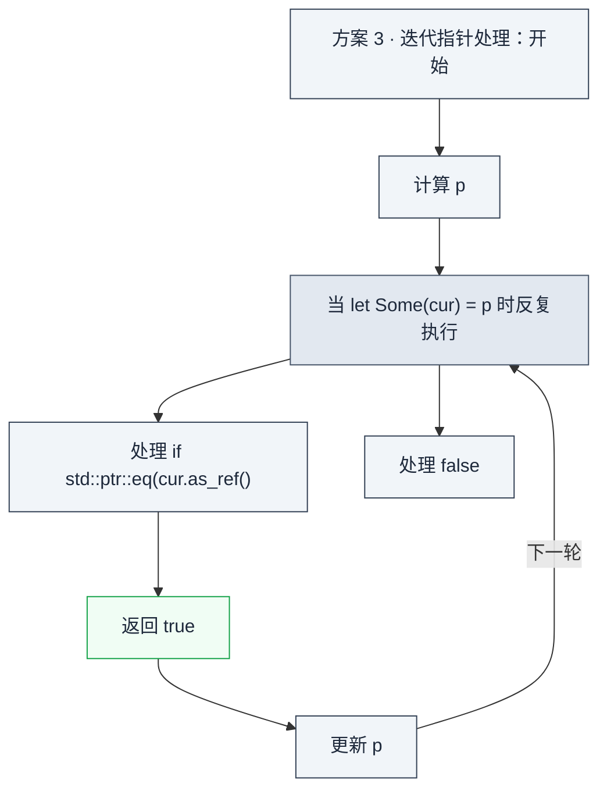

```rust
// LeetCode 133270489. 原型链原理 — Rust 版（方案3：get 查找 + instanceOf 判定）
use std::cell::RefCell; // 引入依赖
use std::collections::HashMap; // 引入依赖
use std::rc::Rc; // 引入依赖

struct Proto {
    // 定义类型
    name: String,
    props: RefCell<HashMap<String, String>>,
    parent: Option<Rc<Proto>>,
}

impl Proto {
    // 实现块
    fn new(name: &str, parent: Option<Rc<Proto>>) -> Rc<Proto> {
        // 定义函数/方法 new
        Rc::new(Proto {
            // Rc::new(Proto {
            name: name.to_string(),
            props: RefCell::new(HashMap::new()),
            parent,
        }) // })
    }
    fn set(&self, key: &str, value: &str) {
        // 定义函数/方法 set
        self.props
            .borrow_mut()
            .insert(key.to_string(), value.to_string());
    }
    fn get(&self, key: &str) -> Option<String> {
        // 定义函数/方法 get
        if let Some(v) = self.props.borrow().get(key) {
            // 若 let Some(值) 赋值为 self.props.borrow() 查找 key
            return Some(v.clone()); // 返回 Some(值.clone())
        }
        let mut cur = self.parent.as_ref(); // 把 self.parent.as_ref(); 写入 let mut cur
        while let Some(node) = cur {
            // 边取边处理，取空即停
            if let Some(v) = node.props.borrow().get(key) {
                // 若 let Some(值) 赋值为 节点.props.borrow() 查找 key
                return Some(v.clone()); // 返回 Some(值.clone())
            }
            cur = node.parent.as_ref(); // 把 节点.parent.as_ref(); 写入 当前值
        }
        None // None
    }
}

fn instance_of(obj: &Rc<Proto>, prototype: &Rc<Proto>) -> bool {
    // 定义函数/方法 instance_of
    let mut p: Option<&Rc<Proto>> = Some(obj); // 把 Some(obj); 写入 let mut p: Option<&Rc<Proto>>
    while let Some(cur) = p {
        // 边取边处理，取空即停
        if std::ptr::eq(cur.as_ref(), prototype.as_ref()) {
            // 若 std::ptr::eq(当前值.as_ref(), prototype.as_ref(
            return true; // 返回 true
        }
        p = cur.parent.as_ref(); // 把 当前值.parent.as_ref(); 写入 节点
    }
    false // false
}

fn main() {
    // 程序入口：跑内嵌自测用例
    let object_proto = Proto::new("Object.prototype", None); // 把 Proto::new(「Object.prototype」, None) 存入 object_proto
    object_proto.set("a", "aaa"); // object_proto.set(「数组」, 「数组」);
    let function_proto = Proto::new("Function.prototype", Some(object_proto.clone()));
    function_proto.set("b", "bbb"); // function_proto.set(「b」, 「b」);
    let obj = Proto::new("obj", Some(object_proto.clone())); // 把 Proto::new(「obj」, Some(object_proto.clone())) 存入 obj
    let func = Proto::new("func", Some(function_proto.clone())); // 把 Proto::new(「func」, Some(function_proto.clone())) 存入 func

    assert_eq!(obj.get("a").as_deref(), Some("aaa"), "case 0 failed"); // 断言校验
    assert_eq!(obj.get("b"), None, "case 1 failed"); // 断言校验
    assert_eq!(func.get("a").as_deref(), Some("aaa"), "case 2 failed"); // 断言校验
    assert_eq!(func.get("b").as_deref(), Some("bbb"), "case 3 failed"); // 断言校验
    assert!(instance_of(&func, &object_proto), "case 4 failed"); // 断言校验
    println!("PASS"); // 全部用例通过，输出 PASS
}
```

#### 方案 4：迭代指针处理

**思路与代码分析**：核心是「迭代指针处理」。Rust 版用所有权移动与切片借用改写同一逻辑，注意 Option 与引用边界。**走读**：方案 4 · 迭代指针处理：开始 → 计算 p → 更新 None → 更新 Some(o) → 当 let Some(ptr) = p 时反复执行 → 处理 if Some(ptr) == b.prototype → 返回 true → 更新 p → 处理 false。

**运行架构**（真实控制流）：

```mermaid
graph TD
    N0["方案 4 · 迭代指针处理：开始"]
    N1["计算 p"]
    N2["更新 None"]
    N3["更新 Some(o)"]
    N4["当 let Some(ptr) = p 时反复执行"]
    N5["处理 if Some(ptr) == b.prototype"]
    N6["返回 true"]
    N7["更新 p"]
    N8["处理 false"]
    N0 --> N1
    N1 --> N2
    N2 --> N3
    N3 --> N4
    N4 --> N5
    N5 --> N6
    N6 --> N7
    N7 -- 下一轮 --> N4
    N4 --> N8
    classDef n fill:#f1f5f9,stroke:#334155,color:#1e293b;
    classDef lp fill:#e2e8f0,stroke:#475569,color:#1e293b;
    classDef dc fill:#fef9c3,stroke:#ca8a04,color:#1e293b;
    classDef tm fill:#f0fdf4,stroke:#16a34a,color:#1e293b;
    class N0,N1,N2,N3,N5,N7,N8 n;
    class N4 lp;
    class N6 tm;
```

```rust
// LeetCode 133270489. 原型链原理 — Rust 版（方案4：null/undefined 边界：instanceOf 均返回 false）
struct FakeObj {
    // 定义类型
    proto: Option<*const u8>, // 模拟 __proto__ 指针
}

struct FakeCtor {
    // 定义类型
    prototype: Option<*const u8>,
}

fn instance_of(a: Option<&FakeObj>, b: &FakeCtor) -> bool {
    // 定义函数/方法 instance_of
    // 与 JS 语义对齐：null/undefined 沿链必为 false
    let mut p = match a {
        // 把 match 数组 { 写入 let mut p
        None => return false,
        Some(o) => o.proto,
    };
    while let Some(ptr) = p {
        // 边取边处理，取空即停
        if Some(ptr) == b.prototype {
            // 若 Some(ptr) 等于 b.prototype
            return true; // 返回 true
        }
        // 演示用：无法继续向上（无真实对象头），直接终止
        p = None; // 把 None; 写入 节点
    }
    false // false
}

fn main() {
    // 程序入口：跑内嵌自测用例
    // case: null / undefined 视为 None —— instanceOf 均为 false
    let ctor = FakeCtor { prototype: None }; // 把 FakeCtor { prototype: None } 存入 ctor
    assert!(!instance_of(None, &ctor), "null case failed"); // 断言校验
    assert!(!instance_of(None, &ctor), "undefined case failed"); // 断言校验
    println!("PASS"); // 全部用例通过，输出 PASS
}
```

### Lua 实现（4 种方案）

Lua 的全部方案如下，每个方案都内嵌用例自测，可独立运行（老仓库 python/go 文件遵循「打印结果」约定）：

#### 方案 1：迭代指针处理

**思路与代码分析**：核心是「迭代指针处理」。Lua 版用表与 ipairs 遍历，注意 ipairs 遇 nil 即停的语义。**走读**：方案 1 · 迭代指针处理：开始 → 更新 p → 当 p ~= nil do 时反复执行 → 处理 if p == prototype then → 返回 true → 更新 p → 返回 false。

**运行架构**（真实控制流）：

```mermaid
graph TD
    N0["方案 1 · 迭代指针处理：开始"]
    N1["更新 p"]
    N2["当 p ~= nil do 时反复执行"]
    N3["处理 if p == prototype then"]
    N4["返回 true"]
    N5["更新 p"]
    N6["返回 false"]
    N0 --> N1
    N1 --> N2
    N2 --> N3
    N3 --> N4
    N4 --> N5
    N5 --> N6
    classDef n fill:#f1f5f9,stroke:#334155,color:#1e293b;
    classDef lp fill:#e2e8f0,stroke:#475569,color:#1e293b;
    classDef dc fill:#fef9c3,stroke:#ca8a04,color:#1e293b;
    classDef tm fill:#f0fdf4,stroke:#16a34a,color:#1e293b;
    class N0,N1,N3,N5 n;
    class N2 lp;
    class N4,N6 tm;
```

```lua
-- LeetCode 133270489. 原型链原理 — Lua 版（方案1：instanceOf 沿原型链判定）
local Proto = {} -- 把 {} 写入 local Proto
Proto.__index = Proto -- 把 Proto 写入 Proto.__index
function Proto.new(name, parent) -- function Proto.new(name, parent)
	return setmetatable({ name = name, props = {}, parent = parent }, Proto)
end -- 终点

local function instance_of(obj, prototype) -- local function instance_of(obj, prototype)
	local p = obj -- 把 obj 写入 local p
	while p ~= nil do -- 把 nil do 写入 while p ~
		if p == prototype then
			return true
		end -- 若 节点 等于 prototype then return true 终点
		p = p.parent -- 把 节点.parent 存入 节点
	end -- 终点
	return false -- 返回 false
end -- 终点

local object_proto = Proto.new("Object.prototype", nil) -- 把 Proto.new(「Object.prototype」, nil) 写入 local object_proto
local function_proto = Proto.new("Function.prototype", object_proto)
local array_proto = Proto.new("Array.prototype", object_proto)
local obj = Proto.new("obj", object_proto) -- 把 Proto.new(「obj」, object_proto) 写入 local obj
local func = Proto.new("func", function_proto) -- 把 Proto.new(「func」, function_proto) 写入 local func
local arr = Proto.new("arr", array_proto) -- 把 Proto.new(「数组」, array_proto) 写入 local arr

local cases = { -- 把 { 写入 local cases
	{ instance_of(obj, object_proto), true },
	{ instance_of(func, function_proto), true },
	{ instance_of(func, object_proto), true },
	{ instance_of(arr, array_proto), true },
	{ instance_of(arr, object_proto), true },
}
for idx, c in ipairs(cases) do -- 遍历取 字符
	assert(c[1] == c[2], "case " .. idx .. " failed") -- 断言校验
end -- 终点
print("PASS") -- 全部用例通过，输出 PASS
```

#### 方案 2：双重循环枚举

**思路与代码分析**：核心是「双重循环枚举」。Lua 版用表与 ipairs 遍历，注意 ipairs 遇 nil 即停的语义。

**运行架构**（真实控制流）：

```mermaid
graph TD
    A["开始：读取输入"]
    F0["核心处理逻辑"]
    A --> F0
    Z["返回结果"]
    F0 --> Z
```

```lua
-- LeetCode 133270489. 原型链原理 — Lua 版（方案2：get 沿原型链查找属性）
local Proto = {} -- 把 {} 写入 local Proto
Proto.__index = Proto -- 把 Proto 写入 Proto.__index
function Proto.new(name, parent) -- function Proto.new(name, parent)
	return setmetatable({ name = name, props = {}, parent = parent }, Proto)
end -- 终点
function Proto:set(key, value) -- function Proto:set(key, value)
	self.props[key] = value -- 把 value 写入 self.props[key]
end -- 终点
function Proto:get(key) -- function Proto:get(key)
	local cur = self -- 把 self 写入 local cur
	while cur ~= nil do -- 把 nil do 写入 while cur ~
		if cur.props[key] ~= nil then
			return cur.props[key]
		end -- 若 当前值.props[key] ~ 赋值为 nil then return 当前值.props[key] 终点
		cur = cur.parent -- 把 当前值.parent 存入 当前值
	end -- 终点
	return nil -- 返回 nil
end -- 终点

local object_proto = Proto.new("Object.prototype") -- 把 Proto.new(「Object.prototype」) 写入 local object_proto
object_proto:set("x", "x") -- object_proto:set(「x」, 「x」)
local function_proto = Proto.new("Function.prototype", object_proto)
function_proto:set("y", "y") -- function_proto:set(「y」, 「y」)
local array_proto = Proto.new("Array.prototype", object_proto)
array_proto:set("z", "z") -- array_proto:set(「z」, 「z」)
local obj = Proto.new("obj", object_proto) -- 把 Proto.new(「obj」, object_proto) 写入 local obj
local func = Proto.new("func", function_proto) -- 把 Proto.new(「func」, function_proto) 写入 local func
local arr = Proto.new("arr", array_proto) -- 把 Proto.new(「数组」, array_proto) 写入 local arr

assert(obj:get("x") == "x", "case 0 failed") -- 断言校验
assert(func:get("y") == "y", "case 1 failed") -- 断言校验
assert(arr:get("z") == "z", "case 2 failed") -- 断言校验
print("PASS") -- 全部用例通过，输出 PASS
```

#### 方案 3：迭代指针处理

**思路与代码分析**：核心是「迭代指针处理」。Lua 版用表与 ipairs 遍历，注意 ipairs 遇 nil 即停的语义。**走读**：方案 3 · 迭代指针处理：开始 → 更新 p → 当 p ~= nil do 时反复执行 → 处理 if p == prototype then → 返回 true → 更新 p → 返回 false。

**运行架构**（真实控制流）：

```mermaid
graph TD
    N0["方案 3 · 迭代指针处理：开始"]
    N1["更新 p"]
    N2["当 p ~= nil do 时反复执行"]
    N3["处理 if p == prototype then"]
    N4["返回 true"]
    N5["更新 p"]
    N6["返回 false"]
    N0 --> N1
    N1 --> N2
    N2 --> N3
    N3 --> N4
    N4 --> N5
    N5 --> N6
    classDef n fill:#f1f5f9,stroke:#334155,color:#1e293b;
    classDef lp fill:#e2e8f0,stroke:#475569,color:#1e293b;
    classDef dc fill:#fef9c3,stroke:#ca8a04,color:#1e293b;
    classDef tm fill:#f0fdf4,stroke:#16a34a,color:#1e293b;
    class N0,N1,N3,N5 n;
    class N2 lp;
    class N4,N6 tm;
```

```lua
-- LeetCode 133270489. 原型链原理 — Lua 版（方案3：get 查找 + instanceOf 判定）
local Proto = {} -- 把 {} 写入 local Proto
Proto.__index = Proto -- 把 Proto 写入 Proto.__index
function Proto.new(name, parent) -- function Proto.new(name, parent)
	return setmetatable({ name = name, props = {}, parent = parent }, Proto)
end -- 终点
function Proto:set(key, value) -- function Proto:set(key, value)
	self.props[key] = value -- 把 value 写入 self.props[key]
end -- 终点
function Proto:get(key) -- function Proto:get(key)
	local cur = self -- 把 self 写入 local cur
	while cur ~= nil do -- 把 nil do 写入 while cur ~
		if cur.props[key] ~= nil then
			return cur.props[key]
		end -- 若 当前值.props[key] ~ 赋值为 nil then return 当前值.props[key] 终点
		cur = cur.parent -- 把 当前值.parent 存入 当前值
	end -- 终点
	return nil -- 返回 nil
end -- 终点

local function instance_of(obj, prototype) -- local function instance_of(obj, prototype)
	local p = obj -- 把 obj 写入 local p
	while p ~= nil do -- 把 nil do 写入 while p ~
		if p == prototype then
			return true
		end -- 若 节点 等于 prototype then return true 终点
		p = p.parent -- 把 节点.parent 存入 节点
	end -- 终点
	return false -- 返回 false
end -- 终点

local object_proto = Proto.new("Object.prototype") -- 把 Proto.new(「Object.prototype」) 写入 local object_proto
object_proto:set("a", "aaa") -- object_proto:set(「数组」, 「数组」)
local function_proto = Proto.new("Function.prototype", object_proto)
function_proto:set("b", "bbb") -- function_proto:set(「b」, 「b」)
local obj = Proto.new("obj", object_proto) -- 把 Proto.new(「obj」, object_proto) 写入 local obj
local func = Proto.new("func", function_proto) -- 把 Proto.new(「func」, function_proto) 写入 local func

assert(obj:get("a") == "aaa", "case 0 failed") -- 断言校验
assert(obj:get("b") == nil, "case 1 failed") -- 断言校验
assert(func:get("a") == "aaa", "case 2 failed") -- 断言校验
assert(func:get("b") == "bbb", "case 3 failed") -- 断言校验
assert(instance_of(func, object_proto) == true, "case 4 failed") -- 断言校验
print("PASS") -- 全部用例通过，输出 PASS
```

#### 方案 4：迭代指针处理

**思路与代码分析**：核心是「迭代指针处理」。Lua 版用表与 ipairs 遍历，注意 ipairs 遇 nil 即停的语义。**走读**：方案 4 · 迭代指针处理：开始 → 更新 p → 当 p ~= nil do 时反复执行 → 处理 if p == b.prototype then → 返回 true → 更新 p → 返回 false。

**运行架构**（真实控制流）：

```mermaid
graph TD
    N0["方案 4 · 迭代指针处理：开始"]
    N1["更新 p"]
    N2["当 p ~= nil do 时反复执行"]
    N3["处理 if p == b.prototype then"]
    N4["返回 true"]
    N5["更新 p"]
    N6["返回 false"]
    N0 --> N1
    N1 --> N2
    N2 --> N3
    N3 --> N4
    N4 --> N5
    N5 --> N6
    classDef n fill:#f1f5f9,stroke:#334155,color:#1e293b;
    classDef lp fill:#e2e8f0,stroke:#475569,color:#1e293b;
    classDef dc fill:#fef9c3,stroke:#ca8a04,color:#1e293b;
    classDef tm fill:#f0fdf4,stroke:#16a34a,color:#1e293b;
    class N0,N1,N3,N5 n;
    class N2 lp;
    class N4,N6 tm;
```

```lua
-- LeetCode 133270489. 原型链原理 — Lua 版（方案4：null/undefined 边界：instanceOf 均返回 false）
local function instance_of(a, b) -- local function instance_of(数组, b)
	local p = a -- 把 数组 写入 local p
	while p ~= nil do -- 把 nil do 写入 while p ~
		if p == b.prototype then
			return true
		end -- 若 节点 等于 b.prototype then return true 终点
		p = p.__proto__ -- 把 节点.__proto__ 存入 节点
	end -- 终点
	return false -- 返回 false
end -- 终点

local ctor = { prototype = nil } -- 把 { prototype 赋值为 nil } 写入 local ctor
assert(instance_of(nil, ctor) == false, "null case failed") -- 断言校验
assert(instance_of(nil, ctor) == false, "undefined case failed") -- 断言校验
print("PASS") -- 全部用例通过，输出 PASS
```

### C 实现（4 种方案）

C 的全部方案如下，每个方案都内嵌用例自测，可独立运行（老仓库 python/go 文件遵循「打印结果」约定）：

#### 方案 1：迭代指针处理

**思路与代码分析**：核心是「迭代指针处理」。C 版手动管理下标与内存，循环边界全部显式写出。**走读**：方案 1 · 迭代指针处理：开始 → 计算 Proto → 当 (p ≠ NULL) 时反复执行 → 命中条件，直接返回 → 更新 p → 返回 0。

**运行架构**（真实控制流）：

```mermaid
graph TD
    N0["方案 1 · 迭代指针处理：开始"]
    N1["计算 Proto"]
    N2["当 (p ≠ NULL) 时反复执行"]
    N3{"p == prototype ？"}
    N4["命中条件，直接返回"]
    N5["更新 p"]
    N6["返回 0"]
    N0 --> N1
    N1 --> N2
    N2 --> N3
    N3 -- 是 --> N4
    N3 -- 否 --> N5
    N5 -- 下一轮 --> N2
    N2 --> N6
    classDef n fill:#f1f5f9,stroke:#334155,color:#1e293b;
    classDef lp fill:#e2e8f0,stroke:#475569,color:#1e293b;
    classDef dc fill:#fef9c3,stroke:#ca8a04,color:#1e293b;
    classDef tm fill:#f0fdf4,stroke:#16a34a,color:#1e293b;
    class N0,N1,N5 n;
    class N2 lp;
    class N3 dc;
    class N4,N6 tm;
```

```c
* LeetCode 133270489. 原型链原理 — C 版（方案1：instanceOf 沿原型链判定）
 */
#include <stdio.h>  // 引入头文件
#include <string.h> // 引入头文件

typedef struct Proto {    // typedef struct Proto {
    const char *name;     // const char 乘 name;
    struct Proto *parent; // 定义类型
} Proto;                  // } Proto;

static int instance_of(const Proto *obj, const Proto *prototype) { // 定义函数/方法 instance_of
    const Proto *p = obj;                                          // 把 obj; 写入 const Proto *p
    while (p != NULL) { // 循环，直到不满足「节点 不等于 NULL」
        if (p == prototype)
            return 1;  // 若 节点 等于 prototype，直接返回 1
        p = p->parent; // 把 节点 减 超过 parent; 写入 节点
    }
    return 0; // 返回 0
}

int main(void) { // 程序入口：跑内嵌自测用例
    Proto object_proto = {"Object.prototype",
                          NULL}; // 把 {「Object.prototype」, NULL}; 写入 Proto object_proto
    Proto function_proto = {"Function.prototype", &object_proto};
    Proto array_proto = {"Array.prototype", &object_proto};
    Proto obj = {"obj", &object_proto};     // 把 {「obj」, 按位与 object_proto}; 写入 Proto obj
    Proto func = {"func", &function_proto}; // 把 {「func」, 按位与 function_proto}; 写入 Proto func
    Proto arr = {"arr", &array_proto};      // 把 {「数组」, 按位与 array_proto}; 写入 Proto arr

    int g0 = instance_of(&obj, &object_proto); // 把 instance_of( 按位与 obj, 按位与 object_proto) 存入 g0
    int g1 =
        instance_of(&func, &function_proto); // 把 instance_of( 按位与 func, 按位与 function_proto) 存入 g1
    int g2 = instance_of(&func, &object_proto); // 把 instance_of( 按位与 func, 按位与 object_proto) 存入 g2
    int g3 = instance_of(&arr, &array_proto); // 把 instance_of( 按位与 数组, 按位与 array_proto) 存入 g3
    int g4 = instance_of(&arr, &object_proto); // 把 instance_of( 按位与 数组, 按位与 object_proto) 存入 g4
    if (!g0 || !g1 || !g2 || !g3 || !g4) {
        printf("FAIL\n");
        return 1;
    }
    printf("PASS\n"); // 全部用例通过，输出 PASS
    return 0;         // 返回 0
}
```

#### 方案 2：双重循环枚举

**思路与代码分析**：核心是「双重循环枚举」。C 版手动管理下标与内存，循环边界全部显式写出。**走读**：方案 2 · 双重循环枚举：开始 → 调用 strcpy(p-＞keys[p-＞nprops], k → 调用 strcpy(p-＞vals[p-＞nprops], v → 处理 p-＞nprops++ → 返回结果。

**运行架构**（真实控制流）：

```mermaid
graph TD
    N0["方案 2 · 双重循环枚举：开始"]
    N1["调用 strcpy(p-＞keys[p-＞nprops], k"]
    N2["调用 strcpy(p-＞vals[p-＞nprops], v"]
    N3["处理 p-＞nprops++"]
    N4["返回结果"]
    N0 --> N1
    N1 --> N2
    N2 --> N3
    N3 --> N4
    classDef n fill:#f1f5f9,stroke:#334155,color:#1e293b;
    classDef lp fill:#e2e8f0,stroke:#475569,color:#1e293b;
    classDef dc fill:#fef9c3,stroke:#ca8a04,color:#1e293b;
    classDef tm fill:#f0fdf4,stroke:#16a34a,color:#1e293b;
    class N0,N1,N2,N3 n;
    class N4 tm;
```

```c
* LeetCode 133270489. 原型链原理 — C 版（方案2：get 沿原型链查找属性）
 */
#include <stdio.h>  // 引入头文件
#include <string.h> // 引入头文件

#define MAX_PROPS 8           // #define MAX_PROPS 8
typedef struct Proto {        // typedef struct Proto {
    const char *name;         // const char 乘 name;
    char keys[MAX_PROPS][16]; // char keys[MAX_PROPS][16];
    char vals[MAX_PROPS][32]; // char vals[MAX_PROPS][32];
    int nprops;               // int nprops;
    struct Proto *parent;     // 定义类型
} Proto;                      // } Proto;

static void set_prop(Proto *p, const char *key, const char *value) { // 定义函数/方法 set_prop
    strcpy(p->keys[p->nprops], key);   // strcpy(节点 减 超过 keys[节点 减 超过 nprops], key);
    strcpy(p->vals[p->nprops], value); // strcpy(节点 减 超过 vals[节点 减 超过 nprops], value);
    p->nprops++;                       // 节点 减 超过 nprops 加一 ;
}

static const char *get_prop(const Proto *p, const char *key) {
    const Proto *cur = p; // 把 节点; 写入 const Proto *cur
    while (cur != NULL) { // 循环，直到不满足「当前值 不等于 NULL」
        for (int i = 0; i < cur->nprops;
             i++) // 让 下标 i 从 0 开始计数，下标 i 小于 当前值 减 超过 nprops 就继续
            if (strcmp(cur->keys[i], key) == 0)
                return cur->vals[i];
        cur = cur->parent; // 把 当前值 减 超过 parent; 写入 当前值
    }
    return NULL; // 返回 NULL
}

int main(void) { // 程序入口：跑内嵌自测用例
    Proto object_proto = {"Object.prototype", {}, {}, 0, NULL};
    set_prop(&object_proto, "x", "x"); // set_prop( 按位与 object_proto, 「x」, 「x」);
    Proto function_proto = {"Function.prototype", {}, {}, 0, &object_proto};
    set_prop(&function_proto, "y", "y"); // set_prop( 按位与 function_proto, 「y」, 「y」);
    Proto array_proto = {"Array.prototype", {}, {}, 0, &object_proto};
    set_prop(&array_proto, "z", "z"); // set_prop( 按位与 array_proto, 「z」, 「z」);
    Proto obj = {
        "obj", {}, {}, 0, &object_proto}; // 把 {「obj」, {}, {}, 0, 按位与 object_proto}; 写入 Proto obj
    Proto func = {"func",
                  {},
                  {},
                  0,
                  &function_proto}; // 把 {「func」, {}, {}, 0, 按位与 function_proto}; 写入 Proto func
    Proto arr = {
        "arr", {}, {}, 0, &array_proto}; // 把 {「数组」, {}, {}, 0, 按位与 array_proto}; 写入 Proto arr

    if (strcmp(get_prop(&obj, "x"), "x") != 0) {
        printf("case 0 failed\n");
        return 1;
    }
    if (strcmp(get_prop(&func, "y"), "y") != 0) {
        printf("case 1 failed\n");
        return 1;
    }
    if (strcmp(get_prop(&arr, "z"), "z") != 0) {
        printf("case 2 failed\n");
        return 1;
    }
    printf("PASS\n"); // 全部用例通过，输出 PASS
    return 0;         // 返回 0
}
```

#### 方案 3：迭代指针处理

**思路与代码分析**：核心是「迭代指针处理」。C 版手动管理下标与内存，循环边界全部显式写出。**走读**：方案 3 · 迭代指针处理：开始 → 调用 strcpy(p-＞keys[p-＞nprops], k → 调用 strcpy(p-＞vals[p-＞nprops], v → 处理 p-＞nprops++ → 返回结果。

**运行架构**（真实控制流）：

```mermaid
graph TD
    N0["方案 3 · 迭代指针处理：开始"]
    N1["调用 strcpy(p-＞keys[p-＞nprops], k"]
    N2["调用 strcpy(p-＞vals[p-＞nprops], v"]
    N3["处理 p-＞nprops++"]
    N4["返回结果"]
    N0 --> N1
    N1 --> N2
    N2 --> N3
    N3 --> N4
    classDef n fill:#f1f5f9,stroke:#334155,color:#1e293b;
    classDef lp fill:#e2e8f0,stroke:#475569,color:#1e293b;
    classDef dc fill:#fef9c3,stroke:#ca8a04,color:#1e293b;
    classDef tm fill:#f0fdf4,stroke:#16a34a,color:#1e293b;
    class N0,N1,N2,N3 n;
    class N4 tm;
```

```c
* LeetCode 133270489. 原型链原理 — C 版（方案3：get 查找 + instanceOf 判定）
 */
#include <stdio.h>  // 引入头文件
#include <string.h> // 引入头文件

#define MAX_PROPS 8           // #define MAX_PROPS 8
typedef struct Proto {        // typedef struct Proto {
    const char *name;         // const char 乘 name;
    char keys[MAX_PROPS][16]; // char keys[MAX_PROPS][16];
    char vals[MAX_PROPS][32]; // char vals[MAX_PROPS][32];
    int nprops;               // int nprops;
    struct Proto *parent;     // 定义类型
} Proto;                      // } Proto;

static void set_prop(Proto *p, const char *key, const char *value) { // 定义函数/方法 set_prop
    strcpy(p->keys[p->nprops], key);   // strcpy(节点 减 超过 keys[节点 减 超过 nprops], key);
    strcpy(p->vals[p->nprops], value); // strcpy(节点 减 超过 vals[节点 减 超过 nprops], value);
    p->nprops++;                       // 节点 减 超过 nprops 加一 ;
}

static const char *get_prop(const Proto *p, const char *key) {
    const Proto *cur = p; // 把 节点; 写入 const Proto *cur
    while (cur != NULL) { // 循环，直到不满足「当前值 不等于 NULL」
        for (int i = 0; i < cur->nprops;
             i++) // 让 下标 i 从 0 开始计数，下标 i 小于 当前值 减 超过 nprops 就继续
            if (strcmp(cur->keys[i], key) == 0)
                return cur->vals[i];
        cur = cur->parent; // 把 当前值 减 超过 parent; 写入 当前值
    }
    return NULL; // 返回 NULL
}

static int instance_of(const Proto *obj, const Proto *prototype) { // 定义函数/方法 instance_of
    const Proto *p = obj;                                          // 把 obj; 写入 const Proto *p
    while (p != NULL) { // 循环，直到不满足「节点 不等于 NULL」
        if (p == prototype)
            return 1;  // 若 节点 等于 prototype，直接返回 1
        p = p->parent; // 把 节点 减 超过 parent; 写入 节点
    }
    return 0; // 返回 0
}

int main(void) { // 程序入口：跑内嵌自测用例
    Proto object_proto = {"Object.prototype", {}, {}, 0, NULL};
    set_prop(&object_proto, "a", "aaa"); // set_prop( 按位与 object_proto, 「数组」, 「数组」);
    Proto function_proto = {"Function.prototype", {}, {}, 0, &object_proto};
    set_prop(&function_proto, "b", "bbb"); // set_prop( 按位与 function_proto, 「b」, 「b」);
    Proto obj = {
        "obj", {}, {}, 0, &object_proto}; // 把 {「obj」, {}, {}, 0, 按位与 object_proto}; 写入 Proto obj
    Proto func = {"func",
                  {},
                  {},
                  0,
                  &function_proto}; // 把 {「func」, {}, {}, 0, 按位与 function_proto}; 写入 Proto func

    if (strcmp(get_prop(&obj, "a"), "aaa") != 0) {
        printf("case 0 failed\n");
        return 1;
    }
    if (get_prop(&obj, "b") != NULL) {
        printf("case 1 failed\n");
        return 1;
    } // 若 get_prop( 按位与 obj, 「b」) 不等于 NULL) { 输出「b」); return 1; }
    if (strcmp(get_prop(&func, "a"), "aaa") != 0) {
        printf("case 2 failed\n");
        return 1;
    }
    if (strcmp(get_prop(&func, "b"), "bbb") != 0) {
        printf("case 3 failed\n");
        return 1;
    }
    if (!instance_of(&func, &object_proto)) {
        printf("case 4 failed\n");
        return 1;
    }
    printf("PASS\n"); // 全部用例通过，输出 PASS
    return 0;         // 返回 0
}
```

#### 方案 4：迭代指针处理

**思路与代码分析**：核心是「迭代指针处理」。C 版手动管理下标与内存，循环边界全部显式写出。**走读**：方案 4 · 迭代指针处理：开始 → 计算 void → 当 (p ≠ NULL) 时反复执行 → 命中条件，直接返回 → 更新 p → 返回 0。

**运行架构**（真实控制流）：

```mermaid
graph TD
    N0["方案 4 · 迭代指针处理：开始"]
    N1["计算 void"]
    N2["当 (p ≠ NULL) 时反复执行"]
    N3{"p == b-＞prototype ？"}
    N4["命中条件，直接返回"]
    N5["更新 p"]
    N6["返回 0"]
    N0 --> N1
    N1 --> N2
    N2 --> N3
    N3 -- 是 --> N4
    N3 -- 否 --> N5
    N5 -- 下一轮 --> N2
    N2 --> N6
    classDef n fill:#f1f5f9,stroke:#334155,color:#1e293b;
    classDef lp fill:#e2e8f0,stroke:#475569,color:#1e293b;
    classDef dc fill:#fef9c3,stroke:#ca8a04,color:#1e293b;
    classDef tm fill:#f0fdf4,stroke:#16a34a,color:#1e293b;
    class N0,N1,N5 n;
    class N2 lp;
    class N3 dc;
    class N4,N6 tm;
```

```c
* LeetCode 133270489. 原型链原理 — C 版（方案4：null/undefined 边界：instanceOf 均返回 false）
 */
#include <stdio.h> // 引入头文件

typedef struct Obj { // typedef struct Obj {
    void *__proto__; // void 乘 __proto__;
} Obj;               // } Obj;

typedef struct Ctor { // typedef struct Ctor {
    void *prototype;  // void 乘 prototype;
} Ctor;               // } Ctor;

static int instance_of(const void *a, const Ctor *b) { // 定义函数/方法 instance_of
    const void *p = a;                                 // 把 数组; 写入 const void *p
    while (p != NULL) {                                // 循环，直到不满足「节点 不等于 NULL」
        if (p == b->prototype)
            return 1;                    // 若 节点 等于 b 减 超过 prototype，直接返回 1
        p = ((const Obj *)p)->__proto__; // 把 ((const Obj 乘 )节点) 减 超过 __proto__; 写入 节点
    }
    return 0; // 返回 0
}

int main(void) {        // 程序入口：跑内嵌自测用例
    Ctor ctor = {NULL}; // 把 { NULL }; 写入 Ctor ctor
    if (instance_of(NULL, &ctor)) {
        printf("null case failed\n");
        return 1;
    }
    if (instance_of(NULL, &ctor)) {
        printf("undefined case failed\n");
        return 1;
    }
    printf("PASS\n"); // 全部用例通过，输出 PASS
    return 0;         // 返回 0
}
```

### C++ 实现（4 种方案）

C++ 的全部方案如下，每个方案都内嵌用例自测，可独立运行（老仓库 python/go 文件遵循「打印结果」约定）：

#### 方案 1：迭代指针处理

**思路与代码分析**：核心是「迭代指针处理」。C++ 版用 STL 容器与迭代器，减少手写下标错误。**走读**：方案 1 · 迭代指针处理：开始 → 计算 Proto → 当 (p ≠ nullptr) 时反复执行 → 命中条件，直接返回 → 更新 p → 返回 false。

**运行架构**（真实控制流）：

```mermaid
graph TD
    N0["方案 1 · 迭代指针处理：开始"]
    N1["计算 Proto"]
    N2["当 (p ≠ nullptr) 时反复执行"]
    N3{"p == prototype ？"}
    N4["命中条件，直接返回"]
    N5["更新 p"]
    N6["返回 false"]
    N0 --> N1
    N1 --> N2
    N2 --> N3
    N3 -- 是 --> N4
    N3 -- 否 --> N5
    N5 -- 下一轮 --> N2
    N2 --> N6
    classDef n fill:#f1f5f9,stroke:#334155,color:#1e293b;
    classDef lp fill:#e2e8f0,stroke:#475569,color:#1e293b;
    classDef dc fill:#fef9c3,stroke:#ca8a04,color:#1e293b;
    classDef tm fill:#f0fdf4,stroke:#16a34a,color:#1e293b;
    class N0,N1,N5 n;
    class N2 lp;
    class N3 dc;
    class N4,N6 tm;
```

```cpp
// LeetCode 133270489. 原型链原理 — C++ 版（方案1：instanceOf 沿原型链判定）
#include <iostream>      // 引入头文件
#include <string>        // 引入头文件
#include <unordered_map> // 引入头文件

struct Proto {        // 定义类型
    std::string name; // std::string name;
    std::unordered_map<std::string, std::string>
        props;     // std::unordered_map 小于 std::string, std::string 超过 props;
    Proto *parent; // Proto 乘 parent;
    Proto(const std::string &n, Proto *p = nullptr) : name(n), parent(p) {}
};

static bool instance_of(const Proto *obj, const Proto *prototype) { // 定义函数/方法 instance_of
    const Proto *p = obj;                                           // 把 obj; 写入 const Proto *p
    while (p != nullptr) { // 循环，直到不满足「节点 不等于 nullptr」
        if (p == prototype)
            return true; // 若 节点 等于 prototype，直接返回 true
        p = p->parent;   // 把 节点 减 超过 parent; 写入 节点
    }
    return false; // 返回 false
}

int main() {                                // 程序入口：跑内嵌自测用例
    Proto object_proto("Object.prototype"); // Proto object_proto(「Object.prototype」);
    Proto function_proto("Function.prototype", &object_proto);
    Proto array_proto("Array.prototype",
                      &object_proto);    // Proto array_proto(「Array.prototype」, 按位与 object_proto);
    Proto obj("obj", &object_proto);     // Proto obj(「obj」, 按位与 object_proto);
    Proto func("func", &function_proto); // Proto func(「func」, 按位与 function_proto);
    Proto arr("arr", &array_proto);      // Proto 数组(「数组」, 按位与 array_proto);

    bool g0 = instance_of(&obj, &object_proto); // 把 instance_of( 按位与 obj, 按位与 object_proto) 存入 g0
    bool g1 =
        instance_of(&func, &function_proto); // 把 instance_of( 按位与 func, 按位与 function_proto) 存入 g1
    bool g2 = instance_of(&func, &object_proto); // 把 instance_of( 按位与 func, 按位与 object_proto) 存入 g2
    bool g3 = instance_of(&arr, &array_proto); // 把 instance_of( 按位与 数组, 按位与 array_proto) 存入 g3
    bool g4 = instance_of(&arr, &object_proto); // 把 instance_of( 按位与 数组, 按位与 object_proto) 存入 g4
    if (!g0 || !g1 || !g2 || !g3 || !g4) {
        std::cout << "FAIL" << std::endl;
        return 1;
    }
    std::cout << "PASS" << std::endl; // 全部用例通过，输出 PASS
    return 0;                         // 返回 0
}
```

#### 方案 2：双重循环枚举

**思路与代码分析**：核心是「双重循环枚举」。C++ 版用 STL 容器与迭代器，减少手写下标错误。代码里依次做这些事：哈希结构做计数或查重。

**运行架构**（真实控制流）：

```mermaid
graph TD
    A["开始：读取输入"]
    F0["哈希结构做计数或查重"]
    A --> F0
    Z["返回结果"]
    F0 --> Z
```

```cpp
// LeetCode 133270489. 原型链原理 — C++ 版（方案2：get 沿原型链查找属性）
#include <iostream>      // 引入头文件
#include <string>        // 引入头文件
#include <unordered_map> // 引入头文件

struct Proto {        // 定义类型
    std::string name; // std::string name;
    std::unordered_map<std::string, std::string>
        props;     // std::unordered_map 小于 std::string, std::string 超过 props;
    Proto *parent; // Proto 乘 parent;
    explicit Proto(const std::string &n, Proto *p = nullptr) : name(n), parent(p) {}
    void set(const std::string &key, const std::string &value) { props[key] = value; }
    std::string get(const std::string &key) const { // std::string get(const std::string 按位与 key) const {
        const Proto *cur = this;                    // 把 this; 写入 const Proto *cur
        while (cur != nullptr) {            // 循环，直到不满足「当前值 不等于 nullptr」
            auto it = cur->props.find(key); // 把 当前值 减 超过 props 查找 key) 存入 it
            if (it != cur->props.end())
                return it->second; // 若 it 不等于 当前值 减 超过 props.终点()，直接返回 it 减 超过 second
            cur = cur->parent; // 把 当前值 减 超过 parent; 写入 当前值
        }
        return ""; // 返回 「」
    }
};

int main() {                                // 程序入口：跑内嵌自测用例
    Proto object_proto("Object.prototype"); // Proto object_proto(「Object.prototype」);
    object_proto.set("x", "x");             // object_proto.set(「x」, 「x」);
    Proto function_proto("Function.prototype", &object_proto);
    function_proto.set("y", "y"); // function_proto.set(「y」, 「y」);
    Proto array_proto("Array.prototype",
                      &object_proto);    // Proto array_proto(「Array.prototype」, 按位与 object_proto);
    array_proto.set("z", "z");           // array_proto.set(「z」, 「z」);
    Proto obj("obj", &object_proto);     // Proto obj(「obj」, 按位与 object_proto);
    Proto func("func", &function_proto); // Proto func(「func」, 按位与 function_proto);
    Proto arr("arr", &array_proto);      // Proto 数组(「数组」, 按位与 array_proto);

    if (obj.get("x") != "x") {
        std::cout << "case 0 failed" << std::endl;
        return 1;
    }
    if (func.get("y") != "y") {
        std::cout << "case 1 failed" << std::endl;
        return 1;
    }
    if (arr.get("z") != "z") {
        std::cout << "case 2 failed" << std::endl;
        return 1;
    }
    std::cout << "PASS" << std::endl; // 全部用例通过，输出 PASS
    return 0;                         // 返回 0
}
```

#### 方案 3：迭代指针处理

**思路与代码分析**：核心是「迭代指针处理」。C++ 版用 STL 容器与迭代器，减少手写下标错误。**走读**：方案 3 · 迭代指针处理：开始 → 计算 Proto → 当 (p ≠ nullptr) 时反复执行 → 命中条件，直接返回 → 更新 p → 返回 false。

**运行架构**（真实控制流）：

```mermaid
graph TD
    N0["方案 3 · 迭代指针处理：开始"]
    N1["计算 Proto"]
    N2["当 (p ≠ nullptr) 时反复执行"]
    N3{"p == prototype ？"}
    N4["命中条件，直接返回"]
    N5["更新 p"]
    N6["返回 false"]
    N0 --> N1
    N1 --> N2
    N2 --> N3
    N3 -- 是 --> N4
    N3 -- 否 --> N5
    N5 -- 下一轮 --> N2
    N2 --> N6
    classDef n fill:#f1f5f9,stroke:#334155,color:#1e293b;
    classDef lp fill:#e2e8f0,stroke:#475569,color:#1e293b;
    classDef dc fill:#fef9c3,stroke:#ca8a04,color:#1e293b;
    classDef tm fill:#f0fdf4,stroke:#16a34a,color:#1e293b;
    class N0,N1,N5 n;
    class N2 lp;
    class N3 dc;
    class N4,N6 tm;
```

```cpp
// LeetCode 133270489. 原型链原理 — C++ 版（方案3：get 查找 + instanceOf 判定）
#include <iostream>      // 引入头文件
#include <string>        // 引入头文件
#include <unordered_map> // 引入头文件

struct Proto {        // 定义类型
    std::string name; // std::string name;
    std::unordered_map<std::string, std::string>
        props;     // std::unordered_map 小于 std::string, std::string 超过 props;
    Proto *parent; // Proto 乘 parent;
    explicit Proto(const std::string &n, Proto *p = nullptr) : name(n), parent(p) {}
    void set(const std::string &key, const std::string &value) { props[key] = value; }
    bool has(const std::string &key) const { // bool has(const std::string 按位与 key) const {
        const Proto *cur = this;             // 把 this; 写入 const Proto *cur
        while (cur != nullptr) {             // 循环，直到不满足「当前值 不等于 nullptr」
            if (cur->props.count(key))
                return true;   // 若 当前值 减 超过 props.计数(key)，直接返回 true
            cur = cur->parent; // 把 当前值 减 超过 parent; 写入 当前值
        }
        return false; // 返回 false
    }
    std::string get(const std::string &key) const { // std::string get(const std::string 按位与 key) const {
        const Proto *cur = this;                    // 把 this; 写入 const Proto *cur
        while (cur != nullptr) {            // 循环，直到不满足「当前值 不等于 nullptr」
            auto it = cur->props.find(key); // 把 当前值 减 超过 props 查找 key) 存入 it
            if (it != cur->props.end())
                return it->second; // 若 it 不等于 当前值 减 超过 props.终点()，直接返回 it 减 超过 second
            cur = cur->parent; // 把 当前值 减 超过 parent; 写入 当前值
        }
        return ""; // 返回 「」
    }
};

static bool instance_of(const Proto *obj, const Proto *prototype) { // 定义函数/方法 instance_of
    const Proto *p = obj;                                           // 把 obj; 写入 const Proto *p
    while (p != nullptr) { // 循环，直到不满足「节点 不等于 nullptr」
        if (p == prototype)
            return true; // 若 节点 等于 prototype，直接返回 true
        p = p->parent;   // 把 节点 减 超过 parent; 写入 节点
    }
    return false; // 返回 false
}

int main() {                                // 程序入口：跑内嵌自测用例
    Proto object_proto("Object.prototype"); // Proto object_proto(「Object.prototype」);
    object_proto.set("a", "aaa");           // object_proto.set(「数组」, 「数组」);
    Proto function_proto("Function.prototype", &object_proto);
    function_proto.set("b", "bbb");      // function_proto.set(「b」, 「b」);
    Proto obj("obj", &object_proto);     // Proto obj(「obj」, 按位与 object_proto);
    Proto func("func", &function_proto); // Proto func(「func」, 按位与 function_proto);

    if (obj.get("a") != "aaa") {
        std::cout << "case 0 failed" << std::endl;
        return 1;
    }
    if (obj.has("b")) {
        std::cout << "case 1 failed" << std::endl;
        return 1;
    }
    if (func.get("a") != "aaa") {
        std::cout << "case 2 failed" << std::endl;
        return 1;
    }
    if (func.get("b") != "bbb") {
        std::cout << "case 3 failed" << std::endl;
        return 1;
    }
    if (!instance_of(&func, &object_proto)) {
        std::cout << "case 4 failed" << std::endl;
        return 1;
    }
    std::cout << "PASS" << std::endl; // 全部用例通过，输出 PASS
    return 0;                         // 返回 0
}
```

#### 方案 4：迭代指针处理

**思路与代码分析**：核心是「迭代指针处理」。C++ 版用 STL 容器与迭代器，减少手写下标错误。**走读**：方案 4 · 迭代指针处理：开始 → 计算 void → 当 (p ≠ nullptr) 时反复执行 → 命中条件，直接返回 → 更新 p → 处理 -＞__proto__ → 返回 false。

**运行架构**（真实控制流）：

```mermaid
graph TD
    N0["方案 4 · 迭代指针处理：开始"]
    N1["计算 void"]
    N2["当 (p ≠ nullptr) 时反复执行"]
    N3{"p == b.prototype ？"}
    N4["命中条件，直接返回"]
    N5["更新 p"]
    N6["处理 -＞__proto__"]
    N7["返回 false"]
    N0 --> N1
    N1 --> N2
    N2 --> N3
    N3 -- 是 --> N4
    N3 -- 否 --> N5
    N5 --> N6
    N6 -- 下一轮 --> N2
    N2 --> N7
    classDef n fill:#f1f5f9,stroke:#334155,color:#1e293b;
    classDef lp fill:#e2e8f0,stroke:#475569,color:#1e293b;
    classDef dc fill:#fef9c3,stroke:#ca8a04,color:#1e293b;
    classDef tm fill:#f0fdf4,stroke:#16a34a,color:#1e293b;
    class N0,N1,N5,N6 n;
    class N2 lp;
    class N3 dc;
    class N4,N7 tm;
```

```cpp
// LeetCode 133270489. 原型链原理 — C++ 版（方案4：null/undefined 边界：instanceOf 均返回 false）
#include <iostream> // 引入头文件

struct Obj {                   // 定义类型
    void *__proto__ = nullptr; // 把 nullptr; 写入 void *__proto__
};

struct Ctor {                  // 定义类型
    void *prototype = nullptr; // 把 nullptr; 写入 void *prototype
};

static bool instance_of(const void *a, const Ctor &b) { // 定义函数/方法 instance_of
    const void *p = a;                                  // 把 数组; 写入 const void *p
    while (p != nullptr) { // 循环，直到不满足「节点 不等于 nullptr」
        if (p == b.prototype)
            return true; // 若 节点 等于 b.prototype，直接返回 true
        p = static_cast<const Obj *>(p)
                ->__proto__; // 把 static_cast 小于 const Obj 乘 超过 (节点) 减 超过 __proto__; 写入 节点
    }
    return false; // 返回 false
}

int main() {   // 程序入口：跑内嵌自测用例
    Ctor ctor; // Ctor ctor;
    if (instance_of(nullptr, ctor)) {
        std::cout << "null case failed" << std::endl;
        return 1;
    }
    if (instance_of(nullptr, ctor)) {
        std::cout << "undefined case failed" << std::endl;
        return 1;
    }
    std::cout << "PASS" << std::endl; // 全部用例通过，输出 PASS
    return 0;                         // 返回 0
}
```

### R 实现（4 种方案）

R 的全部方案如下，每个方案都内嵌用例自测，可独立运行（老仓库 python/go 文件遵循「打印结果」约定）：

#### 方案 1：迭代指针处理

**思路与代码分析**：核心是「迭代指针处理」。R 版用向量化思维与 1 起始下标，注意 1:n 的降序陷阱。**走读**：方案 1 · 迭代指针处理：开始 → 更新 new.env(parent → 处理 e$name ＜- name → 更新 new.env(parent → 处理 e$parent ＜- parent → 处理 e → 返回结果。

**运行架构**（真实控制流）：

```mermaid
graph TD
    N0["方案 1 · 迭代指针处理：开始"]
    N1["更新 new.env(parent"]
    N2["处理 e$name ＜- name"]
    N3["更新 new.env(parent"]
    N4["处理 e$parent ＜- parent"]
    N5["处理 e"]
    N6["返回结果"]
    N0 --> N1
    N1 --> N2
    N2 --> N3
    N3 --> N4
    N4 --> N5
    N5 --> N6
    classDef n fill:#f1f5f9,stroke:#334155,color:#1e293b;
    classDef lp fill:#e2e8f0,stroke:#475569,color:#1e293b;
    classDef dc fill:#fef9c3,stroke:#ca8a04,color:#1e293b;
    classDef tm fill:#f0fdf4,stroke:#16a34a,color:#1e293b;
    class N0,N1,N2,N3,N4,N5 n;
    class N6 tm;
```

```r
# 版（方案1：instanceOf 沿原型链判定） 节点用 environment 引用语义 定义函数 Proto（参数：name, parent 赋值为
# NULL）
Proto <- function(name, parent = NULL) {
    e <- new.env(parent = emptyenv())  # 把 new.env(parent 赋值为 emptyenv()) 存入 e
    e$name <- name  # 把 name 存入 e$name
    e$props <- new.env(parent = emptyenv())  # 把 new.env(parent 赋值为 emptyenv()) 存入 e$props
    e$parent <- parent  # 把 parent 存入 e$parent
    e
}
instance_of <- function(obj, prototype) {
    # 定义函数 instance_of（参数：obj, prototype）
    p <- obj  # 把 obj 存入 节点
    while (!is.null(p)) {
        # 循环，直到不满足「取反 is.null(节点」
        if (identical(p, prototype))
            return(TRUE)  # 若 identical(节点, prototype)) return(TRUE
        p <- p$parent  # 把 节点$parent 存入 节点
    }
    FALSE  # FALSE
}
object_proto <- Proto("Object.prototype")  # 把 Proto(「Object.prototype」) 存入 object_proto
function_proto <- Proto("Function.prototype", object_proto)
array_proto <- Proto("Array.prototype", object_proto)  # 把 Proto(「Array.prototype」, object_proto) 存入 array_proto
obj <- Proto("obj", object_proto)  # 把 Proto(「obj」, object_proto) 存入 obj
func <- Proto("func", function_proto)  # 把 Proto(「func」, function_proto) 存入 func
arr <- Proto("arr", array_proto)  # 把 Proto(「数组」, array_proto) 存入 数组
stopifnot(instance_of(obj, object_proto))  # 断言校验
stopifnot(instance_of(func, function_proto))  # 断言校验
stopifnot(instance_of(func, object_proto))  # 断言校验
stopifnot(instance_of(arr, array_proto))  # 断言校验
stopifnot(instance_of(arr, object_proto))  # 断言校验
cat("PASS\n")  # 全部用例通过，输出 PASS
```

#### 方案 2：双重循环枚举

**思路与代码分析**：核心是「双重循环枚举」。R 版用向量化思维与 1 起始下标，注意 1:n 的降序陷阱。**走读**：方案 2 · 双重循环枚举：开始 → 更新 new.env(parent → 处理 e$name ＜- name → 更新 new.env(parent → 处理 e$parent ＜- parent → 处理 e → 返回结果。

**运行架构**（真实控制流）：

```mermaid
graph TD
    N0["方案 2 · 双重循环枚举：开始"]
    N1["更新 new.env(parent"]
    N2["处理 e$name ＜- name"]
    N3["更新 new.env(parent"]
    N4["处理 e$parent ＜- parent"]
    N5["处理 e"]
    N6["返回结果"]
    N0 --> N1
    N1 --> N2
    N2 --> N3
    N3 --> N4
    N4 --> N5
    N5 --> N6
    classDef n fill:#f1f5f9,stroke:#334155,color:#1e293b;
    classDef lp fill:#e2e8f0,stroke:#475569,color:#1e293b;
    classDef dc fill:#fef9c3,stroke:#ca8a04,color:#1e293b;
    classDef tm fill:#f0fdf4,stroke:#16a34a,color:#1e293b;
    class N0,N1,N2,N3,N4,N5 n;
    class N6 tm;
```

```r
# 版（方案2：get 沿原型链查找属性） 定义函数 Proto（参数：name, parent 赋值为 NULL）
Proto <- function(name, parent = NULL) {
    e <- new.env(parent = emptyenv())  # 把 new.env(parent 赋值为 emptyenv()) 存入 e
    e$name <- name  # 把 name 存入 e$name
    e$props <- new.env(parent = emptyenv())  # 把 new.env(parent 赋值为 emptyenv()) 存入 e$props
    e$parent <- parent  # 把 parent 存入 e$parent
    e
}
set_prop <- function(p, key, value) p$props[[key]] <- value  # 定义函数 set_prop（参数：节点, key, value）
get_prop <- function(p, key) {
    # 定义函数 get_prop（参数：节点, key）
    cur <- p  # 把 节点 存入 当前值
    while (!is.null(cur)) {
        # 循环，直到不满足「取反 is.null(当前值」
        if (!is.null(cur$props[[key]]))
            return(cur$props[[key]])  # 若 取反 is.null(当前值$props[[key]])) return(当前值$props[[key]]
        cur <- cur$parent  # 把 当前值$parent 存入 当前值
    }
    NULL  # NULL
}
object_proto <- Proto("Object.prototype")  # 把 Proto(「Object.prototype」) 存入 object_proto
set_prop(object_proto, "x", "x")  # set_prop(object_proto, 「x」, 「x」)
function_proto <- Proto("Function.prototype", object_proto)
set_prop(function_proto, "y", "y")  # set_prop(function_proto, 「y」, 「y」)
array_proto <- Proto("Array.prototype", object_proto)  # 把 Proto(「Array.prototype」, object_proto) 存入 array_proto
set_prop(array_proto, "z", "z")  # set_prop(array_proto, 「z」, 「z」)
obj <- Proto("obj", object_proto)  # 把 Proto(「obj」, object_proto) 存入 obj
func <- Proto("func", function_proto)  # 把 Proto(「func」, function_proto) 存入 func
arr <- Proto("arr", array_proto)  # 把 Proto(「数组」, array_proto) 存入 数组
stopifnot(identical(get_prop(obj, "x"), "x"))  # 断言校验
stopifnot(identical(get_prop(func, "y"), "y"))  # 断言校验
stopifnot(identical(get_prop(arr, "z"), "z"))  # 断言校验
cat("PASS\n")  # 全部用例通过，输出 PASS
```

#### 方案 3：迭代指针处理

**思路与代码分析**：核心是「迭代指针处理」。R 版用向量化思维与 1 起始下标，注意 1:n 的降序陷阱。**走读**：方案 3 · 迭代指针处理：开始 → 更新 new.env(parent → 处理 e$name ＜- name → 更新 new.env(parent → 处理 e$parent ＜- parent → 处理 e → 返回结果。

**运行架构**（真实控制流）：

```mermaid
graph TD
    N0["方案 3 · 迭代指针处理：开始"]
    N1["更新 new.env(parent"]
    N2["处理 e$name ＜- name"]
    N3["更新 new.env(parent"]
    N4["处理 e$parent ＜- parent"]
    N5["处理 e"]
    N6["返回结果"]
    N0 --> N1
    N1 --> N2
    N2 --> N3
    N3 --> N4
    N4 --> N5
    N5 --> N6
    classDef n fill:#f1f5f9,stroke:#334155,color:#1e293b;
    classDef lp fill:#e2e8f0,stroke:#475569,color:#1e293b;
    classDef dc fill:#fef9c3,stroke:#ca8a04,color:#1e293b;
    classDef tm fill:#f0fdf4,stroke:#16a34a,color:#1e293b;
    class N0,N1,N2,N3,N4,N5 n;
    class N6 tm;
```

```r
# 版（方案3：get 查找 + instanceOf 判定） 定义函数 Proto（参数：name, parent 赋值为 NULL）
Proto <- function(name, parent = NULL) {
    e <- new.env(parent = emptyenv())  # 把 new.env(parent 赋值为 emptyenv()) 存入 e
    e$name <- name  # 把 name 存入 e$name
    e$props <- new.env(parent = emptyenv())  # 把 new.env(parent 赋值为 emptyenv()) 存入 e$props
    e$parent <- parent  # 把 parent 存入 e$parent
    e
}
set_prop <- function(p, key, value) p$props[[key]] <- value  # 定义函数 set_prop（参数：节点, key, value）
get_prop <- function(p, key) {
    # 定义函数 get_prop（参数：节点, key）
    cur <- p  # 把 节点 存入 当前值
    while (!is.null(cur)) {
        # 循环，直到不满足「取反 is.null(当前值」
        if (!is.null(cur$props[[key]]))
            return(cur$props[[key]])  # 若 取反 is.null(当前值$props[[key]])) return(当前值$props[[key]]
        cur <- cur$parent  # 把 当前值$parent 存入 当前值
    }
    NULL  # NULL
}
instance_of <- function(obj, prototype) {
    # 定义函数 instance_of（参数：obj, prototype）
    p <- obj  # 把 obj 存入 节点
    while (!is.null(p)) {
        # 循环，直到不满足「取反 is.null(节点」
        if (identical(p, prototype))
            return(TRUE)  # 若 identical(节点, prototype)) return(TRUE
        p <- p$parent  # 把 节点$parent 存入 节点
    }
    FALSE  # FALSE
}
object_proto <- Proto("Object.prototype")  # 把 Proto(「Object.prototype」) 存入 object_proto
set_prop(object_proto, "a", "aaa")  # set_prop(object_proto, 「数组」, 「数组」)
function_proto <- Proto("Function.prototype", object_proto)
set_prop(function_proto, "b", "bbb")  # set_prop(function_proto, 「b」, 「b」)
obj <- Proto("obj", object_proto)  # 把 Proto(「obj」, object_proto) 存入 obj
func <- Proto("func", function_proto)  # 把 Proto(「func」, function_proto) 存入 func
stopifnot(identical(get_prop(obj, "a"), "aaa"))  # 断言校验
stopifnot(is.null(get_prop(obj, "b")))  # 断言校验
stopifnot(identical(get_prop(func, "a"), "aaa"))  # 断言校验
stopifnot(identical(get_prop(func, "b"), "bbb"))  # 断言校验
stopifnot(instance_of(func, object_proto))  # 断言校验
cat("PASS\n")  # 全部用例通过，输出 PASS
```

#### 方案 4：迭代指针处理

**思路与代码分析**：核心是「迭代指针处理」。R 版用向量化思维与 1 起始下标，注意 1:n 的降序陷阱。**走读**：方案 4 · 迭代指针处理：开始 → 处理 p ＜- a → 当 (非 is.null(p)) 时反复执行 → 命中条件，直接返回 → 处理 p ＜- p$__proto__ → 处理 FALSE。

**运行架构**（真实控制流）：

```mermaid
graph TD
    N0["方案 4 · 迭代指针处理：开始"]
    N1["处理 p ＜- a"]
    N2["当 (非 is.null(p)) 时反复执行"]
    N3{"identical(p, b$prototype) ？"}
    N4["命中条件，直接返回"]
    N5["处理 p ＜- p$__proto__"]
    N6["处理 FALSE"]
    N0 --> N1
    N1 --> N2
    N2 --> N3
    N3 -- 是 --> N4
    N3 -- 否 --> N5
    N5 -- 下一轮 --> N2
    N2 --> N6
    classDef n fill:#f1f5f9,stroke:#334155,color:#1e293b;
    classDef lp fill:#e2e8f0,stroke:#475569,color:#1e293b;
    classDef dc fill:#fef9c3,stroke:#ca8a04,color:#1e293b;
    classDef tm fill:#f0fdf4,stroke:#16a34a,color:#1e293b;
    class N0,N1,N5,N6 n;
    class N2 lp;
    class N3 dc;
    class N4 tm;
```

```r
# 版（方案4：null/undefined 边界：instanceOf 均返回 false） 定义函数 instance_of（参数：数组, b）
instance_of <- function(a, b) {
    p <- a  # 把 数组 存入 节点
    while (!is.null(p)) {
        # 循环，直到不满足「取反 is.null(节点」
        if (identical(p, b$prototype))
            return(TRUE)  # 若 identical(节点, b$prototype)) return(TRUE
        p <- p$`__proto__`
    }
    FALSE  # FALSE
}
ctor <- new.env(parent = emptyenv())  # 把 new.env(parent 赋值为 emptyenv()) 存入 ctor
ctor$prototype <- NULL  # 把 NULL 存入 ctor$prototype
stopifnot(!instance_of(NULL, ctor))  # 断言校验
stopifnot(!instance_of(NULL, ctor))  # 断言校验
cat("PASS\n")  # 全部用例通过，输出 PASS
```

### Zig 实现（4 种方案）

Zig 的全部方案如下，每个方案都内嵌用例自测，可独立运行（老仓库 python/go 文件遵循「打印结果」约定）：

#### 方案 1：迭代指针处理

**思路与代码分析**：核心是「迭代指针处理」。Zig 版显式分配与清零，整型边界处理严格。**走读**：方案 1 · 迭代指针处理：开始 → 计算 p → 当 (p) ｜cur｜ 时反复执行 → 命中条件，直接返回 → 更新 p → 返回 false。

**运行架构**（真实控制流）：

```mermaid
graph TD
    N0["方案 1 · 迭代指针处理：开始"]
    N1["计算 p"]
    N2["当 (p) ｜cur｜ 时反复执行"]
    N3{"cur == prototype ？"}
    N4["命中条件，直接返回"]
    N5["更新 p"]
    N6["返回 false"]
    N0 --> N1
    N1 --> N2
    N2 --> N3
    N3 -- 是 --> N4
    N3 -- 否 --> N5
    N5 -- 下一轮 --> N2
    N2 --> N6
    classDef n fill:#f1f5f9,stroke:#334155,color:#1e293b;
    classDef lp fill:#e2e8f0,stroke:#475569,color:#1e293b;
    classDef dc fill:#fef9c3,stroke:#ca8a04,color:#1e293b;
    classDef tm fill:#f0fdf4,stroke:#16a34a,color:#1e293b;
    class N0,N1,N5 n;
    class N2 lp;
    class N3 dc;
    class N4,N6 tm;
```

```zig
// LeetCode 133270489. 原型链原理 — Zig 版（方案1：instanceOf 沿原型链判定）
const std = @import("std"); // 把 @import(「std」) 存入 std

const Proto = struct { // 把 struct { 存入 Proto
    name: []const u8,
    parent: ?*Proto,
};

fn instanceOf(obj: *const Proto, prototype: *const Proto) bool { // 定义函数/方法 instanceOf
    var p: ?*const Proto = obj; // 把 obj; 写入 var p: ?*const Proto
    while (p) |cur| { // 循环，直到不满足「节点) 按位或 当前值 按位或」
        if (cur == prototype) return true; // 若 当前值 等于 prototype，直接返回 true
        p = cur.parent; // 把 当前值.parent; 写入 节点
    }
    return false; // 返回 false
}

pub fn main() !void { // 程序入口：跑内嵌自测用例
    var gpa = std.heap.GeneralPurposeAllocator(.{}){}; // 把 std.堆.GeneralPurposeAllocator(.{}){} 存入 gpa
    const allocator = gpa.allocator(); // 把 gpa.allocator() 存入 allocator

    const object_proto = try allocator.create(Proto); // 把 try allocator.create(Proto) 存入 object_proto
    object_proto.* = .{ .name = "Object.prototype", .parent = null };
    const function_proto = try allocator.create(Proto); // 把 try allocator.create(Proto) 存入 function_proto
    function_proto.* = .{ .name = "Function.prototype", .parent = object_proto };
    const array_proto = try allocator.create(Proto); // 把 try allocator.create(Proto) 存入 array_proto
    array_proto.* = .{ .name = "Array.prototype", .parent = object_proto };
    const obj = try allocator.create(Proto); // 把 try allocator.create(Proto) 存入 obj
    obj.* = .{ .name = "obj", .parent = object_proto }; // 把 { .name 赋值为 「obj」, .parent 赋值为 object_proto }; 写入 obj.*
    const func = try allocator.create(Proto); // 把 try allocator.create(Proto) 存入 func
    func.* = .{ .name = "func", .parent = function_proto };
    const arr = try allocator.create(Proto); // 把 try allocator.create(Proto) 存入 数组
    arr.* = .{ .name = "arr", .parent = array_proto }; // 把 { .name 赋值为 「数组」, .parent 赋值为 array_proto }; 写入 arr.*

    if (!instanceOf(obj, object_proto)) return error.TestFailed; // 若 取反 instanceOf(obj, object_proto)，直接返回 error.TestFailed
    if (!instanceOf(func, function_proto)) return error.TestFailed; // 若 取反 instanceOf(func, function_proto)，直接返回 error.TestFailed
    if (!instanceOf(func, object_proto)) return error.TestFailed; // 若 取反 instanceOf(func, object_proto)，直接返回 error.TestFailed
    if (!instanceOf(arr, array_proto)) return error.TestFailed; // 若 取反 instanceOf(数组, array_proto)，直接返回 error.TestFailed
    if (!instanceOf(arr, object_proto)) return error.TestFailed; // 若 取反 instanceOf(数组, object_proto)，直接返回 error.TestFailed
    std.debug.print("PASS\n", .{}); // 全部用例通过，输出 PASS
}
```

#### 方案 2：双重循环枚举

**思路与代码分析**：核心是「双重循环枚举」。Zig 版显式分配与清零，整型边界处理严格。**走读**：方案 2 · 双重循环枚举：开始 → 更新 self.props[self.nprops] → 更新 + → 返回结果。

**运行架构**（真实控制流）：

```mermaid
graph TD
    N0["方案 2 · 双重循环枚举：开始"]
    N1["更新 self.props[self.nprops]"]
    N2["更新 +"]
    N3["返回结果"]
    N0 --> N1
    N1 --> N2
    N2 --> N3
    classDef n fill:#f1f5f9,stroke:#334155,color:#1e293b;
    classDef lp fill:#e2e8f0,stroke:#475569,color:#1e293b;
    classDef dc fill:#fef9c3,stroke:#ca8a04,color:#1e293b;
    classDef tm fill:#f0fdf4,stroke:#16a34a,color:#1e293b;
    class N0,N1,N2 n;
    class N3 tm;
```

```zig
// LeetCode 133270489. 原型链原理 — Zig 版（方案2：get 沿原型链查找属性）
const std = @import("std"); // 把 @import(「std」) 存入 std

const MAX_PROPS = 8; // 把 8 存入 MAX_PROPS
const Prop = struct { key: []const u8, val: []const u8 }; // 把 struct { key: []const u8, 值: []const u8 } 存入 Prop
const Proto = struct { // 把 struct { 存入 Proto
    name: []const u8,
    props: [MAX_PROPS]Prop = undefined,
    nprops: usize = 0,
    parent: ?*Proto = null,

    fn set(self: *Proto, key: []const u8, val: []const u8) void { // 定义函数/方法 set
        self.props[self.nprops] = .{ .key = key, .val = val }; // 把 { .key 赋值为 key, .值 赋值为 值 }; 写入 self.props[self.nprops]
        self.nprops += 1; // self.nprops累加 1
    }
    fn get(self: *const Proto, key: []const u8) ?[]const u8 { // 定义函数/方法 get
        var cur: ?*const Proto = self; // 把 self; 写入 var cur: ?*const Proto
        while (cur) |node| { // 循环，直到不满足「当前值) 按位或 节点 按位或」
            var i: usize = 0; // 把 0; 写入 var i: usize
            while (i < node.nprops) : (i += 1) { // 循环，直到不满足「下标 i 小于 节点.nprops) : (下标 i 累加 1」
                if (std.mem.eql(u8, node.props[i].key, key)) return node.props[i].val;
            }
            cur = node.parent; // 把 节点.parent; 写入 当前值
        }
        return null; // 返回 null
    }
};

pub fn main() !void { // 程序入口：跑内嵌自测用例
    var gpa = std.heap.GeneralPurposeAllocator(.{}){}; // 把 std.堆.GeneralPurposeAllocator(.{}){} 存入 gpa
    const allocator = gpa.allocator(); // 把 gpa.allocator() 存入 allocator

    const object_proto = try allocator.create(Proto); // 把 try allocator.create(Proto) 存入 object_proto
    object_proto.* = .{ .name = "Object.prototype" }; // 把 { .name 赋值为 「Object.prototype」 }; 写入 object_proto.*
    _ = object_proto.set("x", "x"); // 把 object_proto.set(「x」, 「x」); 写入 _
    const function_proto = try allocator.create(Proto); // 把 try allocator.create(Proto) 存入 function_proto
    function_proto.* = .{ .name = "Function.prototype", .parent = object_proto };
    _ = function_proto.set("y", "y"); // 把 function_proto.set(「y」, 「y」); 写入 _
    const array_proto = try allocator.create(Proto); // 把 try allocator.create(Proto) 存入 array_proto
    array_proto.* = .{ .name = "Array.prototype", .parent = object_proto };
    _ = array_proto.set("z", "z"); // 把 array_proto.set(「z」, 「z」); 写入 _
    const obj = try allocator.create(Proto); // 把 try allocator.create(Proto) 存入 obj
    obj.* = .{ .name = "obj", .parent = object_proto }; // 把 { .name 赋值为 「obj」, .parent 赋值为 object_proto }; 写入 obj.*
    const func = try allocator.create(Proto); // 把 try allocator.create(Proto) 存入 func
    func.* = .{ .name = "func", .parent = function_proto };
    const arr = try allocator.create(Proto); // 把 try allocator.create(Proto) 存入 数组
    arr.* = .{ .name = "arr", .parent = array_proto }; // 把 { .name 赋值为 「数组」, .parent 赋值为 array_proto }; 写入 arr.*

    if (!std.mem.eql(u8, obj.get("x").?, "x")) return error.TestFailed;
    if (!std.mem.eql(u8, func.get("y").?, "y")) return error.TestFailed;
    if (!std.mem.eql(u8, arr.get("z").?, "z")) return error.TestFailed;
    std.debug.print("PASS\n", .{}); // 全部用例通过，输出 PASS
}
```

#### 方案 3：迭代指针处理

**思路与代码分析**：核心是「迭代指针处理」。Zig 版显式分配与清零，整型边界处理严格。**走读**：方案 3 · 迭代指针处理：开始 → 计算 p → 当 (p) ｜cur｜ 时反复执行 → 命中条件，直接返回 → 更新 p → 返回 false。

**运行架构**（真实控制流）：

```mermaid
graph TD
    N0["方案 3 · 迭代指针处理：开始"]
    N1["计算 p"]
    N2["当 (p) ｜cur｜ 时反复执行"]
    N3{"cur == prototype ？"}
    N4["命中条件，直接返回"]
    N5["更新 p"]
    N6["返回 false"]
    N0 --> N1
    N1 --> N2
    N2 --> N3
    N3 -- 是 --> N4
    N3 -- 否 --> N5
    N5 -- 下一轮 --> N2
    N2 --> N6
    classDef n fill:#f1f5f9,stroke:#334155,color:#1e293b;
    classDef lp fill:#e2e8f0,stroke:#475569,color:#1e293b;
    classDef dc fill:#fef9c3,stroke:#ca8a04,color:#1e293b;
    classDef tm fill:#f0fdf4,stroke:#16a34a,color:#1e293b;
    class N0,N1,N5 n;
    class N2 lp;
    class N3 dc;
    class N4,N6 tm;
```

```zig
// LeetCode 133270489. 原型链原理 — Zig 版（方案3：get 查找 + instanceOf 判定）
const std = @import("std"); // 把 @import(「std」) 存入 std

const MAX_PROPS = 8; // 把 8 存入 MAX_PROPS
const Prop = struct { key: []const u8, val: []const u8 }; // 把 struct { key: []const u8, 值: []const u8 } 存入 Prop
const Proto = struct { // 把 struct { 存入 Proto
    name: []const u8,
    props: [MAX_PROPS]Prop = undefined,
    nprops: usize = 0,
    parent: ?*Proto = null,

    fn set(self: *Proto, key: []const u8, val: []const u8) void { // 定义函数/方法 set
        self.props[self.nprops] = .{ .key = key, .val = val }; // 把 { .key 赋值为 key, .值 赋值为 值 }; 写入 self.props[self.nprops]
        self.nprops += 1; // self.nprops累加 1
    }
    fn get(self: *const Proto, key: []const u8) ?[]const u8 { // 定义函数/方法 get
        var cur: ?*const Proto = self; // 把 self; 写入 var cur: ?*const Proto
        while (cur) |node| { // 循环，直到不满足「当前值) 按位或 节点 按位或」
            var i: usize = 0; // 把 0; 写入 var i: usize
            while (i < node.nprops) : (i += 1) { // 循环，直到不满足「下标 i 小于 节点.nprops) : (下标 i 累加 1」
                if (std.mem.eql(u8, node.props[i].key, key)) return node.props[i].val;
            }
            cur = node.parent; // 把 节点.parent; 写入 当前值
        }
        return null; // 返回 null
    }
};

fn instanceOf(obj: *const Proto, prototype: *const Proto) bool { // 定义函数/方法 instanceOf
    var p: ?*const Proto = obj; // 把 obj; 写入 var p: ?*const Proto
    while (p) |cur| { // 循环，直到不满足「节点) 按位或 当前值 按位或」
        if (cur == prototype) return true; // 若 当前值 等于 prototype，直接返回 true
        p = cur.parent; // 把 当前值.parent; 写入 节点
    }
    return false; // 返回 false
}

pub fn main() !void { // 程序入口：跑内嵌自测用例
    var gpa = std.heap.GeneralPurposeAllocator(.{}){}; // 把 std.堆.GeneralPurposeAllocator(.{}){} 存入 gpa
    const allocator = gpa.allocator(); // 把 gpa.allocator() 存入 allocator

    const object_proto = try allocator.create(Proto); // 把 try allocator.create(Proto) 存入 object_proto
    object_proto.* = .{ .name = "Object.prototype" }; // 把 { .name 赋值为 「Object.prototype」 }; 写入 object_proto.*
    _ = object_proto.set("a", "aaa"); // 把 object_proto.set(「数组」, 「数组」); 写入 _
    const function_proto = try allocator.create(Proto); // 把 try allocator.create(Proto) 存入 function_proto
    function_proto.* = .{ .name = "Function.prototype", .parent = object_proto };
    _ = function_proto.set("b", "bbb"); // 把 function_proto.set(「b」, 「b」); 写入 _
    const obj = try allocator.create(Proto); // 把 try allocator.create(Proto) 存入 obj
    obj.* = .{ .name = "obj", .parent = object_proto }; // 把 { .name 赋值为 「obj」, .parent 赋值为 object_proto }; 写入 obj.*
    const func = try allocator.create(Proto); // 把 try allocator.create(Proto) 存入 func
    func.* = .{ .name = "func", .parent = function_proto };

    if (!std.mem.eql(u8, obj.get("a").?, "aaa")) return error.TestFailed;
    if (obj.get("b") != null) return error.TestFailed; // 若 obj 查找 「b」) 不等于 null，直接返回 error.TestFailed
    if (!std.mem.eql(u8, func.get("a").?, "aaa")) return error.TestFailed;
    if (!std.mem.eql(u8, func.get("b").?, "bbb")) return error.TestFailed;
    if (!instanceOf(func, object_proto)) return error.TestFailed; // 若 取反 instanceOf(func, object_proto)，直接返回 error.TestFailed
    std.debug.print("PASS\n", .{}); // 全部用例通过，输出 PASS
}
```

#### 方案 4：迭代指针处理

**思路与代码分析**：核心是「迭代指针处理」。Zig 版显式分配与清零，整型边界处理严格。**走读**：方案 4 · 迭代指针处理：开始 → 计算 p → 当 (p) ｜cur｜ 时反复执行 → 命中条件，直接返回 → 更新 p → 返回 false。

**运行架构**（真实控制流）：

```mermaid
graph TD
    N0["方案 4 · 迭代指针处理：开始"]
    N1["计算 p"]
    N2["当 (p) ｜cur｜ 时反复执行"]
    N3{"cur.proto == b.prototype ？"}
    N4["命中条件，直接返回"]
    N5["更新 p"]
    N6["返回 false"]
    N0 --> N1
    N1 --> N2
    N2 --> N3
    N3 -- 是 --> N4
    N3 -- 否 --> N5
    N5 -- 下一轮 --> N2
    N2 --> N6
    classDef n fill:#f1f5f9,stroke:#334155,color:#1e293b;
    classDef lp fill:#e2e8f0,stroke:#475569,color:#1e293b;
    classDef dc fill:#fef9c3,stroke:#ca8a04,color:#1e293b;
    classDef tm fill:#f0fdf4,stroke:#16a34a,color:#1e293b;
    class N0,N1,N5 n;
    class N2 lp;
    class N3 dc;
    class N4,N6 tm;
```

```zig
// LeetCode 133270489. 原型链原理 — Zig 版（方案4：null/undefined 边界：instanceOf 均返回 false）
const std = @import("std"); // 把 @import(「std」) 存入 std

const Obj = struct { // 把 struct { 存入 Obj
    proto: ?*anyopaque = null,
};

const Ctor = struct { // 把 struct { 存入 Ctor
    prototype: ?*anyopaque = null,
};

fn instanceOf(a: ?*const Obj, b: *const Ctor) bool { // 定义函数/方法 instanceOf
    var p: ?*const Obj = a; // 把 数组; 写入 var p: ?*const Obj
    while (p) |cur| { // 循环，直到不满足「节点) 按位或 当前值 按位或」
        if (cur.proto == b.prototype) return true; // 若 当前值.proto 等于 b.prototype，直接返回 true
        // 演示用：__proto__ 无法继续解引用，直接终止
        p = null; // 把 null; 写入 节点
    }
    return false; // 返回 false
}

pub fn main() !void { // 程序入口：跑内嵌自测用例
    const ctor = Ctor{ .prototype = null }; // 把 Ctor{ .prototype 赋值为 null } 存入 ctor
    if (instanceOf(null, &ctor)) return error.TestFailed; // 若 instanceOf(null, 按位与 ctor)，直接返回 error.TestFailed
    if (instanceOf(null, &ctor)) return error.TestFailed; // 若 instanceOf(null, 按位与 ctor)，直接返回 error.TestFailed
    std.debug.print("PASS\n", .{}); // 全部用例通过，输出 PASS
}
```

### Dart 实现（4 种方案）

Dart 的全部方案如下，每个方案都内嵌用例自测，可独立运行（老仓库 python/go 文件遵循「打印结果」约定）：

#### 方案 1：迭代指针处理

**思路与代码分析**：核心是「迭代指针处理」。Dart 版用可空类型标注与集合方法，注意空安全。**走读**：方案 1 · 迭代指针处理：开始 → 更新 p → 当 (p ≠ null) 时反复执行 → 命中条件，直接返回 → 更新 p → 返回 false。

**运行架构**（真实控制流）：

```mermaid
graph TD
    N0["方案 1 · 迭代指针处理：开始"]
    N1["更新 p"]
    N2["当 (p ≠ null) 时反复执行"]
    N3{"identical(p, prototype) ？"}
    N4["命中条件，直接返回"]
    N5["更新 p"]
    N6["返回 false"]
    N0 --> N1
    N1 --> N2
    N2 --> N3
    N3 -- 是 --> N4
    N3 -- 否 --> N5
    N5 -- 下一轮 --> N2
    N2 --> N6
    classDef n fill:#f1f5f9,stroke:#334155,color:#1e293b;
    classDef lp fill:#e2e8f0,stroke:#475569,color:#1e293b;
    classDef dc fill:#fef9c3,stroke:#ca8a04,color:#1e293b;
    classDef tm fill:#f0fdf4,stroke:#16a34a,color:#1e293b;
    class N0,N1,N5 n;
    class N2 lp;
    class N3 dc;
    class N4,N6 tm;
```

```dart
// LeetCode 133270489. 原型链原理 — Dart 版（方案1：instanceOf 沿原型链判定）
class Proto {
  // 定义类型
  String name; // String name;
  Map<String, String> props = {}; // 把 {}; 写入 Map<String, String> props
  Proto? parent; // Proto? parent;
  Proto(this.name, [this.parent]); // Proto(this.name, [this.parent]);
}

bool instanceOf(Proto obj, Proto prototype) {
  // 定义函数/方法 instanceOf
  Proto? p = obj; // 把 obj; 写入 Proto? p
  while (p != null) {
    // 循环，直到不满足「节点 不等于 null」
    if (identical(p, prototype))
      return true; // 若 identical(节点, prototype)，直接返回 true
    p = p.parent; // 把 节点.parent 存入 节点
  }
  return false; // 返回 false
}

void main() {
  // 程序入口：跑内嵌自测用例
  final objectProto = Proto(
    'Object.prototype',
  ); // 把 Proto('Object.prototype') 存入 objectProto
  final functionProto = Proto(
    'Function.prototype',
    objectProto,
  ); // 把 Proto('Function.prototype', objectProto) 存入 functionProto
  final arrayProto = Proto(
    'Array.prototype',
    objectProto,
  ); // 把 Proto('Array.prototype', objectProto) 存入 arrayProto
  final obj = Proto('obj', objectProto); // 把 Proto('obj', objectProto) 存入 obj
  final func = Proto(
    'func',
    functionProto,
  ); // 把 Proto('func', functionProto) 存入 func
  final arr = Proto('arr', arrayProto); // 把 Proto('数组', arrayProto) 存入 数组

  assert(instanceOf(obj, objectProto), 'case 0 failed'); // 断言校验
  assert(instanceOf(func, functionProto), 'case 1 failed'); // 断言校验
  assert(instanceOf(func, objectProto), 'case 2 failed'); // 断言校验
  assert(instanceOf(arr, arrayProto), 'case 3 failed'); // 断言校验
  assert(instanceOf(arr, objectProto), 'case 4 failed'); // 断言校验
  print('PASS'); // 全部用例通过，输出 PASS
}
```

#### 方案 2：双重循环枚举

**思路与代码分析**：核心是「双重循环枚举」。Dart 版用可空类型标注与集合方法，注意空安全。**走读**：方案 2 · 双重循环枚举：开始 → 更新 props[key] → 返回结果。

**运行架构**（真实控制流）：

```mermaid
graph TD
    N0["方案 2 · 双重循环枚举：开始"]
    N1["更新 props[key]"]
    N2["返回结果"]
    N0 --> N1
    N1 --> N2
    classDef n fill:#f1f5f9,stroke:#334155,color:#1e293b;
    classDef lp fill:#e2e8f0,stroke:#475569,color:#1e293b;
    classDef dc fill:#fef9c3,stroke:#ca8a04,color:#1e293b;
    classDef tm fill:#f0fdf4,stroke:#16a34a,color:#1e293b;
    class N0,N1 n;
    class N2 tm;
```

```dart
// LeetCode 133270489. 原型链原理 — Dart 版（方案2：get 沿原型链查找属性）
class Proto {
  // 定义类型
  String name; // String name;
  Map<String, String> props = {}; // 把 {}; 写入 Map<String, String> props
  Proto? parent; // Proto? parent;
  Proto(this.name, [this.parent]); // Proto(this.name, [this.parent]);

  void set(String key, String value) {
    // 定义函数/方法 set
    props[key] = value; // 把 value; 写入 props[key]
  }

  String? get(String key) {
    // String? get(String key) {
    Proto? cur = this; // 把 this; 写入 Proto? cur
    while (cur != null) {
      // 循环，直到不满足「当前值 不等于 null」
      if (cur.props.containsKey(key))
        return cur
            .props[key]; // 若 当前值.props.containsKey(key)，直接返回 当前值.props[key]
      cur = cur.parent; // 把 当前值.parent 存入 当前值
    }
    return null; // 返回 null
  }
}

void main() {
  // 程序入口：跑内嵌自测用例
  final objectProto = Proto(
    'Object.prototype',
  ); // 把 Proto('Object.prototype') 存入 objectProto
  objectProto.set('x', 'x'); // objectProto.set('x', 'x');
  final functionProto = Proto(
    'Function.prototype',
    objectProto,
  ); // 把 Proto('Function.prototype', objectProto) 存入 functionProto
  functionProto.set('y', 'y'); // functionProto.set('y', 'y');
  final arrayProto = Proto(
    'Array.prototype',
    objectProto,
  ); // 把 Proto('Array.prototype', objectProto) 存入 arrayProto
  arrayProto.set('z', 'z'); // arrayProto.set('z', 'z');
  final obj = Proto('obj', objectProto); // 把 Proto('obj', objectProto) 存入 obj
  final func = Proto(
    'func',
    functionProto,
  ); // 把 Proto('func', functionProto) 存入 func
  final arr = Proto('arr', arrayProto); // 把 Proto('数组', arrayProto) 存入 数组

  assert(obj.get('x') == 'x', 'case 0 failed'); // 断言校验
  assert(func.get('y') == 'y', 'case 1 failed'); // 断言校验
  assert(arr.get('z') == 'z', 'case 2 failed'); // 断言校验
  print('PASS'); // 全部用例通过，输出 PASS
}
```

#### 方案 3：迭代指针处理

**思路与代码分析**：核心是「迭代指针处理」。Dart 版用可空类型标注与集合方法，注意空安全。**走读**：方案 3 · 迭代指针处理：开始 → 更新 p → 当 (p ≠ null) 时反复执行 → 命中条件，直接返回 → 更新 p → 返回 false。

**运行架构**（真实控制流）：

```mermaid
graph TD
    N0["方案 3 · 迭代指针处理：开始"]
    N1["更新 p"]
    N2["当 (p ≠ null) 时反复执行"]
    N3{"identical(p, prototype) ？"}
    N4["命中条件，直接返回"]
    N5["更新 p"]
    N6["返回 false"]
    N0 --> N1
    N1 --> N2
    N2 --> N3
    N3 -- 是 --> N4
    N3 -- 否 --> N5
    N5 -- 下一轮 --> N2
    N2 --> N6
    classDef n fill:#f1f5f9,stroke:#334155,color:#1e293b;
    classDef lp fill:#e2e8f0,stroke:#475569,color:#1e293b;
    classDef dc fill:#fef9c3,stroke:#ca8a04,color:#1e293b;
    classDef tm fill:#f0fdf4,stroke:#16a34a,color:#1e293b;
    class N0,N1,N5 n;
    class N2 lp;
    class N3 dc;
    class N4,N6 tm;
```

```dart
// LeetCode 133270489. 原型链原理 — Dart 版（方案3：get 查找 + instanceOf 判定）
class Proto {
  // 定义类型
  String name; // String name;
  Map<String, String> props = {}; // 把 {}; 写入 Map<String, String> props
  Proto? parent; // Proto? parent;
  Proto(this.name, [this.parent]); // Proto(this.name, [this.parent]);

  void set(String key, String value) {
    // 定义函数/方法 set
    props[key] = value; // 把 value; 写入 props[key]
  }

  bool has(String key) {
    // 定义函数/方法 has
    Proto? cur = this; // 把 this; 写入 Proto? cur
    while (cur != null) {
      // 循环，直到不满足「当前值 不等于 null」
      if (cur.props.containsKey(key))
        return true; // 若 当前值.props.containsKey(key)，直接返回 true
      cur = cur.parent; // 把 当前值.parent 存入 当前值
    }
    return false; // 返回 false
  }

  String? get(String key) {
    // String? get(String key) {
    Proto? cur = this; // 把 this; 写入 Proto? cur
    while (cur != null) {
      // 循环，直到不满足「当前值 不等于 null」
      if (cur.props.containsKey(key))
        return cur
            .props[key]; // 若 当前值.props.containsKey(key)，直接返回 当前值.props[key]
      cur = cur.parent; // 把 当前值.parent 存入 当前值
    }
    return null; // 返回 null
  }
}

bool instanceOf(Proto obj, Proto prototype) {
  // 定义函数/方法 instanceOf
  Proto? p = obj; // 把 obj; 写入 Proto? p
  while (p != null) {
    // 循环，直到不满足「节点 不等于 null」
    if (identical(p, prototype))
      return true; // 若 identical(节点, prototype)，直接返回 true
    p = p.parent; // 把 节点.parent 存入 节点
  }
  return false; // 返回 false
}

void main() {
  // 程序入口：跑内嵌自测用例
  final objectProto = Proto(
    'Object.prototype',
  ); // 把 Proto('Object.prototype') 存入 objectProto
  objectProto.set('a', 'aaa'); // objectProto.set('数组', 'aaa');
  final functionProto = Proto(
    'Function.prototype',
    objectProto,
  ); // 把 Proto('Function.prototype', objectProto) 存入 functionProto
  functionProto.set('b', 'bbb'); // functionProto.set('b', 'bbb');
  final obj = Proto('obj', objectProto); // 把 Proto('obj', objectProto) 存入 obj
  final func = Proto(
    'func',
    functionProto,
  ); // 把 Proto('func', functionProto) 存入 func

  assert(obj.get('a') == 'aaa', 'case 0 failed'); // 断言校验
  assert(!obj.has('b'), 'case 1 failed'); // 断言校验
  assert(func.get('a') == 'aaa', 'case 2 failed'); // 断言校验
  assert(func.get('b') == 'bbb', 'case 3 failed'); // 断言校验
  assert(instanceOf(func, objectProto), 'case 4 failed'); // 断言校验
  print('PASS'); // 全部用例通过，输出 PASS
}
```

#### 方案 4：迭代指针处理

**思路与代码分析**：核心是「迭代指针处理」。Dart 版用可空类型标注与集合方法，注意空安全。**走读**：方案 4 · 迭代指针处理：开始 → 更新 p → 当 (p ≠ null) 时反复执行 → 命中条件，直接返回 → 更新 p → 返回 false。

**运行架构**（真实控制流）：

```mermaid
graph TD
    N0["方案 4 · 迭代指针处理：开始"]
    N1["更新 p"]
    N2["当 (p ≠ null) 时反复执行"]
    N3{"identical(p, b.prototype) ？"}
    N4["命中条件，直接返回"]
    N5["更新 p"]
    N6["返回 false"]
    N0 --> N1
    N1 --> N2
    N2 --> N3
    N3 -- 是 --> N4
    N3 -- 否 --> N5
    N5 -- 下一轮 --> N2
    N2 --> N6
    classDef n fill:#f1f5f9,stroke:#334155,color:#1e293b;
    classDef lp fill:#e2e8f0,stroke:#475569,color:#1e293b;
    classDef dc fill:#fef9c3,stroke:#ca8a04,color:#1e293b;
    classDef tm fill:#f0fdf4,stroke:#16a34a,color:#1e293b;
    class N0,N1,N5 n;
    class N2 lp;
    class N3 dc;
    class N4,N6 tm;
```

```dart
// LeetCode 133270489. 原型链原理 — Dart 版（方案4：null/undefined 边界：instanceOf 均返回 false）
class Obj {
  // 定义类型
  Obj? __proto__; // Obj? __proto__;
}

class Ctor {
  // 定义类型
  Obj? prototype; // Obj? prototype;
}

bool instanceOf(Obj? a, Ctor b) {
  // 定义函数/方法 instanceOf
  Obj? p = a; // 把 数组; 写入 Obj? p
  while (p != null) {
    // 循环，直到不满足「节点 不等于 null」
    if (identical(p, b.prototype))
      return true; // 若 identical(节点, b.prototype)，直接返回 true
    p = p.__proto__; // 把 节点.__proto__ 存入 节点
  }
  return false; // 返回 false
}

void main() {
  // 程序入口：跑内嵌自测用例
  final ctor = Ctor(); // 把 Ctor() 存入 ctor
  // Dart 中 null 对应 JS 的 null/undefined
  if (instanceOf(null, ctor)) throw StateError('null case failed');
  if (instanceOf(null, ctor)) throw StateError('undefined case failed');
  print('PASS'); // 全部用例通过，输出 PASS
}
```

---

## 内容总结

- **基于链表实现js中的原型链原理与算法实现**（算法笔记 · Medium）：共 4 个方案，主线思路「迭代指针处理」；时间 O(n)（单趟线性扫描）；动画演示归并分治过程，附录给出 11 种语言 × 全部方案的可运行实现。
- 来源博客：[https://blog.csdn.net/tyro_java/article/details/133270489](https://blog.csdn.net/tyro_java/article/details/133270489)
- 导航：[📋 总目录](../) ｜ [← 222 pm](../222_pm/) ｜ [224 使用链表指针获取json节点值的 →](../224_使用链表指针获取json节点值的算法实现/)
