# 224 · 使用链表指针获取json节点值的算法实现（第附阶段 · 专题补充 · Medium）

> **难度**：⭐⭐ Medium ｜ **专题**：算法笔记
> **学习定位**：第附阶段 · 专题补充第 224 篇 ｜ **解法数**：4
> **内容总结**：**使用链表指针获取json节点值的算法实现**（算法笔记 · Medium）：共 4 个方案，主线思路「迭代指针处理」；时间 O(n)（单趟线性扫描）；动画演示归并分治过程，附录给出 11 种语言 × 全部方案的可运行实现。

---

## 题目描述

使用链表指针获取json节点值的算法实现。具体输入输出约定见函数签名与用例。

- 主函数签名：`function treeToLevel(root: any): any[]`

**用例演示**（摘自主解法内嵌自测，输入到输出一目了然）：

```typescript
  const cases = [
    { got: getValue(data, ['a', 'b', 'c']), want: 1 },
    { got: getValue(data, ['a', 'z']), want: null },
  ];
```

**数据范围与注意事项**：

- **易错点**：先看小例子手推一遍再对照代码，比直接读代码快得多。

## 题目分析

**场景是什么**：综合练习：把数据结构与策略组合起来解决一个完整问题。本题就是该场景的 Medium 级练习，主线做法是「迭代指针处理」。

**主线怎么解**：把主解法从头到尾过一遍，它其实在依次做这几件事：队列或堆的调度。

## 解题思路

**方案对比**（共 4 个方案，由浅入深）：

| 方案 | 时间复杂度 | 空间复杂度 |
|---|---|---|
| 方案 1 · 迭代指针处理 | O(n)（单趟线性扫描） | O(1) 到 O(n)（视辅助结构） |
| 方案 2 · 迭代指针处理 | O(n)（单趟线性扫描） | O(1) 到 O(n)（视辅助结构） |
| 方案 3 · 直接实现 | O(n) 量级 | O(n) |
| 方案 4 · 迭代指针处理 | O(n)（单趟线性扫描） | O(1) 到 O(n)（视辅助结构） |

**由浅入深的路径**：迭代指针处理 → 直接实现；每往右一步，都在补上一步的短板。

**方案间的取舍**：方案 1（迭代指针处理）；方案 2（迭代指针处理）；方案 3（直接实现）；方案 4（迭代指针处理）。数据规模小、可读性优先时选靠前的方案；规模大、性能优先时选靠后的方案。

**怎么读这一篇**：

- 🐣 **新手路线**：把「题目描述」的示例 1 在纸上手推一遍 → 读方案 1（最直观的写法）与它的代码走读 → 按「运行方式」本地跑通看 PASS → 回头对比方案 2 之后的写法差在哪
- 🦅 **大佬路线**：直接锁定最优方案 1（迭代指针处理，O(n)（单趟线性扫描））→ 跳读该方案代码与走读 → 用「逐步拆解与面试追问」补齐复杂度推导与边界追问

### 动态算法图（归并分治，GIF 自动循环）


动画演示算法笔记专题里归并分治的典型过程；每个方案在「TypeScript 解题方案」一节还配了专属动画与专属流程图。

### 主解法流程图（真实控制流）

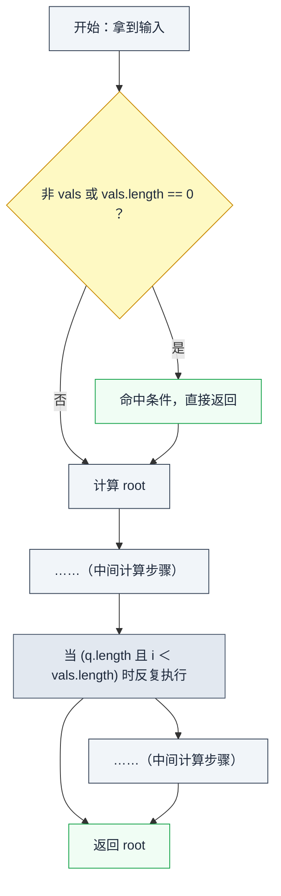

## TypeScript 解题方案（4 个方案逐个讲）

> **运行与提交**：每个方案都是自包含文件（内嵌用例自测，输出 PASS），整块复制到 `.ts` 文件后 `node 文件名` 即可运行。提交 LeetCode 时，把 `demo` 内的算法函数与辅助类型/函数整体取出、置于文件顶层即可。概念演示（非 LeetCode 编号题），在本地运行即可。

### 方案 1：迭代指针处理

**分析与思路**：核心做法是「迭代指针处理」。代码里依次做这些事：队列或堆的调度。

**运行方式**：`node 本文件`，内嵌用例全部通过会输出 PASS。


**方案专属流程图**（真实控制流）：


```typescript
class TreeNode {
  // 定义类型
  val: any;
  left: any;
  right: any; // 值: any; 左边界: any; 右边界: any;
  constructor(val?: any, left?: any, right?: any) {
    // constructor(值?: any, 左边界?: any, 右边界?: any) {
    this.val = val === undefined ? 0 : val; // 把 (值 全等于 undefined ? 0 : 值); 写入 值
    this.left = left === undefined ? null : left; // 把 (左边界 全等于 undefined ? null : 左边界); 写入 左边界
    this.right = right === undefined ? null : right; // 把 (右边界 全等于 undefined ? null : 右边界); 写入 右边界
  }
}
function buildTree(vals: any): any {
  // 定义函数/方法 buildTree
  if (!vals || vals.length === 0) return null; // 若 取反 vals 或 vals.长度 全等于 0，直接返回 null
  const root = new TreeNode(vals[0]);
  const q: any[] = [root];
  let i = 1;
  while (q.length && i < vals.length) {
    // 循环，直到不满足「节点.长度 且 下标 i 小于 vals.长度」
    const node = q.shift(); // 把 节点.shift() 存入 节点
    if (vals[i] !== null && vals[i] !== undefined) {
      node.left = new TreeNode(vals[i]);
      q.push(node.left);
    }
    i++; // 下标 i 加一
    if (i < vals.length && vals[i] !== null && vals[i] !== undefined) {
      node.right = new TreeNode(vals[i]);
      q.push(node.right);
    }
    i++; // 下标 i 加一
  }
  return root; // 返回 根节点
}
function treeToLevel(root: any): any[] {
  // 定义函数/方法 treeToLevel
  if (!root) return []; // 若 取反 根节点，直接返回 []
  const out: any[] = [];
  const q: any[] = [root]; // 把 []; const 节点: any[] 赋值为 [根节点]; 写入 const out: any[]
  while (q.length) {
    // 循环，直到不满足「节点.长度」
    const n = q.shift(); // 把 节点.shift() 存入 元素个数
    if (n === null || n === undefined) {
      out.push(null);
      continue;
    }
    out.push(n.val);
    q.push(n.left);
    q.push(n.right); // 把 元素个数.值 压入栈/数组尾部
  }
  while (out.length && out[out.length - 1] === null) out.pop(); // 循环，直到不满足「out.长度 且 out[out.长度 减 1] 全等于 null) out 弹出 );」
  return out; // 返回 out
}
class ListNode {
  // 定义类型
  val: any;
  next: any; // 值: any; 下一个: any;
  constructor(val?: any, next?: any) {
    this.val = val === undefined ? 0 : val;
    this.next = next === undefined ? null : next;
  }
}
function buildList(vals: any): any {
  // 定义函数/方法 buildList
  const dummy = new ListNode(0);
  let cur = dummy; // 把 new ListNode(0); let 当前值 赋值为 哨兵节点 存入 哨兵节点
  for (const v of vals) {
    cur.next = new ListNode(v);
    cur = cur.next;
  } // 把 new ListNode(值); 当前值 赋值为 当前值.下一个; } 写入 下一个
  return dummy.next; // 返回 哨兵节点.下一个
}
function listToArray(head: any): any[] {
  // 定义函数/方法 listToArray
  const out: any[] = [];
  let p = head; // 把 []; let 节点 赋值为 头节点; 写入 const out: any[]
  while (p) {
    out.push(p.val);
    p = p.next;
  } // 循环，直到不满足「节点) { out 追加 节点.值); 节点 赋值为 节点.下一个; }」
  return out; // 返回 out
}
// python-runtime shims
function pyLen(a: any): number {
  // 定义函数/方法 pyLen
  if (a === null || a === undefined) return 0; // 若 数组 全等于 null 或 数组 全等于 undefined，直接返回 0
  if (
    typeof a === 'string' ||
    Array.isArray(a) ||
    a instanceof Set ||
    a instanceof Map
  )
    return a.length ?? a.size;
  if (typeof a === 'object') return Object.keys(a).length; // 若 typeof 数组 全等于 'object'，直接返回 Object.keys(数组).长度
  return 0; // 返回 0
}
function pySlice(a: any, i: any, j: any, step?: any): any {
  // 定义函数/方法 pySlice
  if (typeof a === 'string') {
    const r = [...a].slice(i ?? 0, j ?? a.length);
    return step ? r.reverse().join('') : r.join('');
  }
  const arr = Array.isArray(a) ? a : [...a]; // 把 Array.isArray(数组) ? 数组 : 复制的 数组 存入 数组
  return arr.slice(i ?? 0, j ?? arr.length); // 返回 数组 截取 下标 i ?? 0, 下标 j ?? 数组.长度)
}
function pyRange(a: any, b?: any, step?: any): any[] {
  // 定义函数/方法 pyRange
  let s = 0,
    e = a,
    st = 1; // 把 0, e 赋值为 数组, st 赋值为 1 存入 字符串
  if (b !== undefined) {
    s = a;
    e = b;
  } // 若 b 不等于 undefined) { 字符串 赋值为 数组; e 赋值为 b; }
  if (step !== undefined) st = step; // 若 步数 不等于 undefined) st 赋值为 步数;
  const out: any[] = []; // 把 []; 写入 const out: any[]
  if (st > 0) for (let i = s; i < e; i += st) out.push(i);
  else for (let i = s; i > e; i += st) out.push(i); // 否则
  return out; // 返回 out
}
function pyIn(x: any, coll: any): boolean {
  // 定义函数/方法 pyIn
  if (coll === null || coll === undefined) return false; // 若 coll 全等于 null 或 coll 全等于 undefined，直接返回 false
  if (Array.isArray(coll)) return coll.includes(x); // 若 Array.isArray(coll)，直接返回 coll 是否包含 x)
  if (coll instanceof Set || coll instanceof Map) return coll.has(x); // 若 coll instanceof Set 或 coll instanceof Map，直接返回 coll.has(x)
  if (typeof coll === 'object') return x in coll; // 若 typeof coll 全等于 'object'，直接返回 x in coll
  if (typeof coll === 'string') return coll.indexOf(x) >= 0; // 若 typeof coll 全等于 'string'，直接返回 coll 查找 x) 不低于 0
  return false; // 返回 false
}
function pySorted(a: any): any[] {
  // 定义函数/方法 pySorted
  const arr = typeof a === 'string' ? [...a] : [...a]; // 把 (typeof 数组 全等于 'string') ? 复制的 数组 : 复制的 数组 存入 数组
  return arr.sort((x: any, y: any) => (x < y ? -1 : x > y ? 1 : 0));
}
function pyMin(a: any, b?: any): any {
  if (b !== undefined) return Math.min(a, b);
  if (Array.isArray(a) || a instanceof Set) return Math.min(...a);
  return Math.min(a);
} // 定义函数/方法 pyMin
function pyMax(a: any, b?: any): any {
  if (b !== undefined) return Math.max(a, b);
  if (Array.isArray(a) || a instanceof Set) return Math.max(...a);
  return Math.max(a);
} // 定义函数/方法 pyMax
function pySum(a: any): number {
  let s = 0;
  for (const v of a) s += v;
  return s;
} // 定义函数/方法 pySum
function pyAbs(x: any): number {
  return Math.abs(x);
} // 定义函数/方法 pyAbs
function pyEnumerate(a: any): any[] {
  const out: any[] = [];
  let i = 0;
  for (const v of a) {
    out.push([i, v]);
    i++;
  }
  return out;
} // 定义函数/方法 pyEnumerate
function pyZip(a: any, b: any): any[] {
  const n = Math.min(a.length, b.length);
  const out: any[] = [];
  for (let i = 0; i < n; i++) out.push([a[i], b[i]]);
  return out;
} // 定义函数/方法 pyZip
function pyDictGet(d: any, k: any, def?: any): any {
  return k in d ? d[k] : def === undefined ? null : def;
} // 定义函数/方法 pyDictGet
function pyPrint(...args: any[]): void {
  console.log(
    args
      .map((a) => (typeof a === 'object' && a !== null ? JSON.stringify(a) : a))
      .join(' '),
  );
} // 定义函数/方法 pyPrint
// collections / heapq
function heapPush(h: any[], x: any): void {
  h.push(x);
  let i = h.length - 1;
  while (i > 0) {
    const p = (i - 1) >> 1;
    if (h[p] <= h[i]) break;
    [h[p], h[i]] = [h[i], h[p]];
    i = p;
  }
} // 定义函数/方法 heapPush
function heapPop(h: any[]): any {
  const top = h[0];
  const last = h.pop();
  if (h.length) {
    h[0] = last;
    let i = 0;
    const n = h.length;
    while (true) {
      let l = 2 * i + 1,
        r = 2 * i + 2,
        s = i;
      if (l < n && h[l] < h[s]) s = l;
      if (r < n && h[r] < h[s]) s = r;
      if (s === i) break;
      [h[s], h[i]] = [h[i], h[s]];
      i = s;
    }
  }
  return top;
} // 定义函数/方法 heapPop
class Deque {
  private a: any[] = [];
  push(x: any) {
    this.a.push(x);
  }
  pushLeft(x: any) {
    this.a.unshift(x);
  }
  pop() {
    return this.a.pop();
  }
  popLeft() {
    return this.a.shift();
  }
  get length() {
    return this.a.length;
  }
  toArray() {
    return this.a.slice();
  }
} // 定义类型
function Counter(iter: any): any {
  const m: any = {};
  for (const v of iter) m[v] = (m[v] || 0) + 1;
  return m;
} // 定义函数/方法 Counter
function gcd(a: any, b: any): any {
  while (b) {
    [a, b] = [b, a % b];
  }
  return a;
} // 定义函数/方法 gcd
function pyInf(): number {
  return Infinity;
} // 定义函数/方法 pyInf

function norm(x: any): any {
  // 定义函数/方法 norm
  if (x === null || x === undefined) return null; // 若 x 全等于 null 或 x 全等于 undefined，直接返回 null
  if (typeof x === 'object') {
    // 若 typeof x 全等于 'object'
    if (x instanceof Deque) return x.toArray(); // 若 x instanceof Deque，直接返回 x.toArray()
    if (Array.isArray(x)) return x.map(norm); // 若 Array.isArray(x)，直接返回 x.映射表(norm)
    if (
      typeof x.val === 'number' &&
      (typeof x.left !== 'undefined' || typeof x.right !== 'undefined')
    )
      return treeToLevel(x);
    if (typeof x.next !== 'undefined' && typeof x.val === 'number')
      return listToArray(x);
    if (x instanceof Set) return [...x].sort(); // 若 x instanceof Set，直接返回 复制的 x 排序 )
    if (x instanceof Map) return Object.fromEntries(x); // 若 x instanceof Map，直接返回 Object.fromEntries(x)
    const o: any = {};
    for (const k of Object.keys(x)) o[k] = norm(x[k]);
    return o;
  }
  return x; // 返回 x
}
function eq(a: any, b: any): boolean {
  // 定义函数/方法 eq
  const x = norm(a),
    y = norm(b); // 把 norm(数组), y 赋值为 norm(b) 存入 x
  if (x === y) return true; // 若 x 全等于 y，直接返回 true
  if (x === null || y === null) return x === y; // 若 x 全等于 null 或 y 全等于 null，直接返回 x 全等于 y
  if (Array.isArray(x) && Array.isArray(y)) {
    // 若 Array.isArray(x) 且 Array.isArray(y
    if (x.length !== y.length) return false; // 若 x.长度 不等于 y.长度，直接返回 false
    for (let i = 0; i < x.length; i++) if (!eq(x[i], y[i])) return false; // 让 下标 i 从 0 开始计数，下标 i 小于 x.长度 就继续
    return true; // 返回 true
  }
  if (typeof x === 'object' && typeof y === 'object') {
    // 若 typeof x 全等于 'object' 且 typeof y 全等于 'object'
    const kx = Object.keys(x),
      ky = Object.keys(y); // 把 Object.keys(x), ky 赋值为 Object.keys(y) 存入 kx
    if (kx.length !== ky.length) return false; // 若 kx.长度 不等于 ky.长度，直接返回 false
    for (const k of kx) if (!eq(x[k], y[k])) return false;
    return true; // 返回 true
  }
  return x === y; // 返回 x 全等于 y
}

function getValue(data, path) {
  // 定义函数/方法 getValue
  let node = data; // 把 data 存入 节点
  for (const key of path) {
    // for (const key of 当前路径) {
    if (typeof node !== 'object' || node === null || !(key in node))
      return null;
    node = node[key]; // 把 节点[key] 存入 节点
  }
  return node; // 返回 节点
}
export function demo(): void {
  // 程序入口：跑内嵌自测用例
  const data = { a: { b: { c: 1 } }, d: { e: 2 } }; // 把 { 数组:{b:{字符:1}}, d:{e:2} } 存入 data
  const cases = [
    { got: getValue(data, ['a', 'b', 'c']), want: 1 },
    { got: getValue(data, ['a', 'z']), want: null },
  ];
  let fail = false; // 把 false 存入 fail
  for (const c of cases)
    if (!eq(c.got, c.want)) {
      fail = true;
      console.log('FAIL', JSON.stringify(c.got));
    } // 打印输出
  if (fail) throw new Error('FAILED'); // 若 fail) throw new Error(「FAILED」);
  console.log('PASS'); // 全部用例通过，输出 PASS
}
demo(); // demo();
```

### 方案 2：迭代指针处理

**分析与思路**：核心做法是「迭代指针处理」。代码里依次做这些事：队列或堆的调度。

**运行方式**：`node 本文件`，内嵌用例全部通过会输出 PASS。


**方案专属流程图**（真实控制流）：


```typescript
class TreeNode {
  // 定义类型
  val: any;
  left: any;
  right: any; // 值: any; 左边界: any; 右边界: any;
  constructor(val?: any, left?: any, right?: any) {
    // constructor(值?: any, 左边界?: any, 右边界?: any) {
    this.val = val === undefined ? 0 : val; // 把 (值 全等于 undefined ? 0 : 值); 写入 值
    this.left = left === undefined ? null : left; // 把 (左边界 全等于 undefined ? null : 左边界); 写入 左边界
    this.right = right === undefined ? null : right; // 把 (右边界 全等于 undefined ? null : 右边界); 写入 右边界
  }
}
function buildTree(vals: any): any {
  // 定义函数/方法 buildTree
  if (!vals || vals.length === 0) return null; // 若 取反 vals 或 vals.长度 全等于 0，直接返回 null
  const root = new TreeNode(vals[0]);
  const q: any[] = [root];
  let i = 1;
  while (q.length && i < vals.length) {
    // 循环，直到不满足「节点.长度 且 下标 i 小于 vals.长度」
    const node = q.shift(); // 把 节点.shift() 存入 节点
    if (vals[i] !== null && vals[i] !== undefined) {
      node.left = new TreeNode(vals[i]);
      q.push(node.left);
    }
    i++; // 下标 i 加一
    if (i < vals.length && vals[i] !== null && vals[i] !== undefined) {
      node.right = new TreeNode(vals[i]);
      q.push(node.right);
    }
    i++; // 下标 i 加一
  }
  return root; // 返回 根节点
}
function treeToLevel(root: any): any[] {
  // 定义函数/方法 treeToLevel
  if (!root) return []; // 若 取反 根节点，直接返回 []
  const out: any[] = [];
  const q: any[] = [root]; // 把 []; const 节点: any[] 赋值为 [根节点]; 写入 const out: any[]
  while (q.length) {
    // 循环，直到不满足「节点.长度」
    const n = q.shift(); // 把 节点.shift() 存入 元素个数
    if (n === null || n === undefined) {
      out.push(null);
      continue;
    }
    out.push(n.val);
    q.push(n.left);
    q.push(n.right); // 把 元素个数.值 压入栈/数组尾部
  }
  while (out.length && out[out.length - 1] === null) out.pop(); // 循环，直到不满足「out.长度 且 out[out.长度 减 1] 全等于 null) out 弹出 );」
  return out; // 返回 out
}
class ListNode {
  // 定义类型
  val: any;
  next: any; // 值: any; 下一个: any;
  constructor(val?: any, next?: any) {
    this.val = val === undefined ? 0 : val;
    this.next = next === undefined ? null : next;
  }
}
function buildList(vals: any): any {
  // 定义函数/方法 buildList
  const dummy = new ListNode(0);
  let cur = dummy; // 把 new ListNode(0); let 当前值 赋值为 哨兵节点 存入 哨兵节点
  for (const v of vals) {
    cur.next = new ListNode(v);
    cur = cur.next;
  } // 把 new ListNode(值); 当前值 赋值为 当前值.下一个; } 写入 下一个
  return dummy.next; // 返回 哨兵节点.下一个
}
function listToArray(head: any): any[] {
  // 定义函数/方法 listToArray
  const out: any[] = [];
  let p = head; // 把 []; let 节点 赋值为 头节点; 写入 const out: any[]
  while (p) {
    out.push(p.val);
    p = p.next;
  } // 循环，直到不满足「节点) { out 追加 节点.值); 节点 赋值为 节点.下一个; }」
  return out; // 返回 out
}
// python-runtime shims
function pyLen(a: any): number {
  // 定义函数/方法 pyLen
  if (a === null || a === undefined) return 0; // 若 数组 全等于 null 或 数组 全等于 undefined，直接返回 0
  if (
    typeof a === 'string' ||
    Array.isArray(a) ||
    a instanceof Set ||
    a instanceof Map
  )
    return a.length ?? a.size;
  if (typeof a === 'object') return Object.keys(a).length; // 若 typeof 数组 全等于 'object'，直接返回 Object.keys(数组).长度
  return 0; // 返回 0
}
function pySlice(a: any, i: any, j: any, step?: any): any {
  // 定义函数/方法 pySlice
  if (typeof a === 'string') {
    const r = [...a].slice(i ?? 0, j ?? a.length);
    return step ? r.reverse().join('') : r.join('');
  }
  const arr = Array.isArray(a) ? a : [...a]; // 把 Array.isArray(数组) ? 数组 : 复制的 数组 存入 数组
  return arr.slice(i ?? 0, j ?? arr.length); // 返回 数组 截取 下标 i ?? 0, 下标 j ?? 数组.长度)
}
function pyRange(a: any, b?: any, step?: any): any[] {
  // 定义函数/方法 pyRange
  let s = 0,
    e = a,
    st = 1; // 把 0, e 赋值为 数组, st 赋值为 1 存入 字符串
  if (b !== undefined) {
    s = a;
    e = b;
  } // 若 b 不等于 undefined) { 字符串 赋值为 数组; e 赋值为 b; }
  if (step !== undefined) st = step; // 若 步数 不等于 undefined) st 赋值为 步数;
  const out: any[] = []; // 把 []; 写入 const out: any[]
  if (st > 0) for (let i = s; i < e; i += st) out.push(i);
  else for (let i = s; i > e; i += st) out.push(i); // 否则
  return out; // 返回 out
}
function pyIn(x: any, coll: any): boolean {
  // 定义函数/方法 pyIn
  if (coll === null || coll === undefined) return false; // 若 coll 全等于 null 或 coll 全等于 undefined，直接返回 false
  if (Array.isArray(coll)) return coll.includes(x); // 若 Array.isArray(coll)，直接返回 coll 是否包含 x)
  if (coll instanceof Set || coll instanceof Map) return coll.has(x); // 若 coll instanceof Set 或 coll instanceof Map，直接返回 coll.has(x)
  if (typeof coll === 'object') return x in coll; // 若 typeof coll 全等于 'object'，直接返回 x in coll
  if (typeof coll === 'string') return coll.indexOf(x) >= 0; // 若 typeof coll 全等于 'string'，直接返回 coll 查找 x) 不低于 0
  return false; // 返回 false
}
function pySorted(a: any): any[] {
  // 定义函数/方法 pySorted
  const arr = typeof a === 'string' ? [...a] : [...a]; // 把 (typeof 数组 全等于 'string') ? 复制的 数组 : 复制的 数组 存入 数组
  return arr.sort((x: any, y: any) => (x < y ? -1 : x > y ? 1 : 0));
}
function pyMin(a: any, b?: any): any {
  if (b !== undefined) return Math.min(a, b);
  if (Array.isArray(a) || a instanceof Set) return Math.min(...a);
  return Math.min(a);
} // 定义函数/方法 pyMin
function pyMax(a: any, b?: any): any {
  if (b !== undefined) return Math.max(a, b);
  if (Array.isArray(a) || a instanceof Set) return Math.max(...a);
  return Math.max(a);
} // 定义函数/方法 pyMax
function pySum(a: any): number {
  let s = 0;
  for (const v of a) s += v;
  return s;
} // 定义函数/方法 pySum
function pyAbs(x: any): number {
  return Math.abs(x);
} // 定义函数/方法 pyAbs
function pyEnumerate(a: any): any[] {
  const out: any[] = [];
  let i = 0;
  for (const v of a) {
    out.push([i, v]);
    i++;
  }
  return out;
} // 定义函数/方法 pyEnumerate
function pyZip(a: any, b: any): any[] {
  const n = Math.min(a.length, b.length);
  const out: any[] = [];
  for (let i = 0; i < n; i++) out.push([a[i], b[i]]);
  return out;
} // 定义函数/方法 pyZip
function pyDictGet(d: any, k: any, def?: any): any {
  return k in d ? d[k] : def === undefined ? null : def;
} // 定义函数/方法 pyDictGet
function pyPrint(...args: any[]): void {
  console.log(
    args
      .map((a) => (typeof a === 'object' && a !== null ? JSON.stringify(a) : a))
      .join(' '),
  );
} // 定义函数/方法 pyPrint
// collections / heapq
function heapPush(h: any[], x: any): void {
  h.push(x);
  let i = h.length - 1;
  while (i > 0) {
    const p = (i - 1) >> 1;
    if (h[p] <= h[i]) break;
    [h[p], h[i]] = [h[i], h[p]];
    i = p;
  }
} // 定义函数/方法 heapPush
function heapPop(h: any[]): any {
  const top = h[0];
  const last = h.pop();
  if (h.length) {
    h[0] = last;
    let i = 0;
    const n = h.length;
    while (true) {
      let l = 2 * i + 1,
        r = 2 * i + 2,
        s = i;
      if (l < n && h[l] < h[s]) s = l;
      if (r < n && h[r] < h[s]) s = r;
      if (s === i) break;
      [h[s], h[i]] = [h[i], h[s]];
      i = s;
    }
  }
  return top;
} // 定义函数/方法 heapPop
class Deque {
  private a: any[] = [];
  push(x: any) {
    this.a.push(x);
  }
  pushLeft(x: any) {
    this.a.unshift(x);
  }
  pop() {
    return this.a.pop();
  }
  popLeft() {
    return this.a.shift();
  }
  get length() {
    return this.a.length;
  }
  toArray() {
    return this.a.slice();
  }
} // 定义类型
function Counter(iter: any): any {
  const m: any = {};
  for (const v of iter) m[v] = (m[v] || 0) + 1;
  return m;
} // 定义函数/方法 Counter
function gcd(a: any, b: any): any {
  while (b) {
    [a, b] = [b, a % b];
  }
  return a;
} // 定义函数/方法 gcd
function pyInf(): number {
  return Infinity;
} // 定义函数/方法 pyInf

function norm(x: any): any {
  // 定义函数/方法 norm
  if (x === null || x === undefined) return null; // 若 x 全等于 null 或 x 全等于 undefined，直接返回 null
  if (typeof x === 'object') {
    // 若 typeof x 全等于 'object'
    if (x instanceof Deque) return x.toArray(); // 若 x instanceof Deque，直接返回 x.toArray()
    if (Array.isArray(x)) return x.map(norm); // 若 Array.isArray(x)，直接返回 x.映射表(norm)
    if (
      typeof x.val === 'number' &&
      (typeof x.left !== 'undefined' || typeof x.right !== 'undefined')
    )
      return treeToLevel(x);
    if (typeof x.next !== 'undefined' && typeof x.val === 'number')
      return listToArray(x);
    if (x instanceof Set) return [...x].sort(); // 若 x instanceof Set，直接返回 复制的 x 排序 )
    if (x instanceof Map) return Object.fromEntries(x); // 若 x instanceof Map，直接返回 Object.fromEntries(x)
    const o: any = {};
    for (const k of Object.keys(x)) o[k] = norm(x[k]);
    return o;
  }
  return x; // 返回 x
}
function eq(a: any, b: any): boolean {
  // 定义函数/方法 eq
  const x = norm(a),
    y = norm(b); // 把 norm(数组), y 赋值为 norm(b) 存入 x
  if (x === y) return true; // 若 x 全等于 y，直接返回 true
  if (x === null || y === null) return x === y; // 若 x 全等于 null 或 y 全等于 null，直接返回 x 全等于 y
  if (Array.isArray(x) && Array.isArray(y)) {
    // 若 Array.isArray(x) 且 Array.isArray(y
    if (x.length !== y.length) return false; // 若 x.长度 不等于 y.长度，直接返回 false
    for (let i = 0; i < x.length; i++) if (!eq(x[i], y[i])) return false; // 让 下标 i 从 0 开始计数，下标 i 小于 x.长度 就继续
    return true; // 返回 true
  }
  if (typeof x === 'object' && typeof y === 'object') {
    // 若 typeof x 全等于 'object' 且 typeof y 全等于 'object'
    const kx = Object.keys(x),
      ky = Object.keys(y); // 把 Object.keys(x), ky 赋值为 Object.keys(y) 存入 kx
    if (kx.length !== ky.length) return false; // 若 kx.长度 不等于 ky.长度，直接返回 false
    for (const k of kx) if (!eq(x[k], y[k])) return false;
    return true; // 返回 true
  }
  return x === y; // 返回 x 全等于 y
}

function getValue(data, path) {
  // 定义函数/方法 getValue
  let result = data; // 把 data 存入 结果
  for (const k of path) result = result[k]; // 把 结果[下标 k]; 写入 for (const k of path) result
  return result; // 返回 结果
}
export function demo(): void {
  // 程序入口：跑内嵌自测用例
  const data = { a: { b: { c: 1 } }, d: { e: 2 } }; // 把 { 数组:{b:{字符:1}}, d:{e:2} } 存入 data
  const cases = [{ got: getValue(data, ['a', 'b', 'c']), want: 1 }];
  let fail = false; // 把 false 存入 fail
  for (const c of cases)
    if (!eq(c.got, c.want)) {
      fail = true;
      console.log('FAIL', JSON.stringify(c.got));
    } // 打印输出
  if (fail) throw new Error('FAILED'); // 若 fail) throw new Error(「FAILED」);
  console.log('PASS'); // 全部用例通过，输出 PASS
}
demo(); // demo();
```

### 方案 3：直接实现

**分析与思路**：核心做法是「直接实现」。

**运行方式**：`node 本文件`，内嵌用例全部通过会输出 PASS。


**方案专属流程图**（真实控制流）：

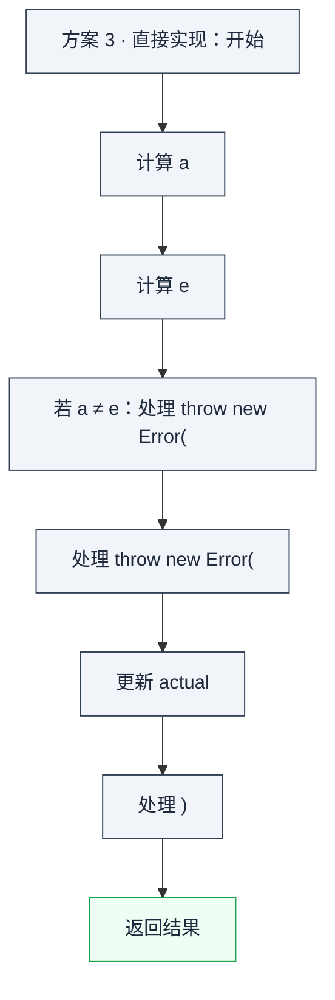

```typescript
function assertEq(actual: any, expected: any, msg: string = ''): void {
  // 定义函数/方法 assertEq
  const a = JSON.stringify(actual);
  const e = JSON.stringify(expected);
  if (a !== e)
    throw new Error(
      'ASSERT FAILED ' + msg + ' :: actual=' + a + ' expected=' + e,
    );
}

function get_value_eval(data: any, path: (string | number)[]): any {
  // 定义函数/方法 get_value_eval
  let cur: any = data; // 把 data; 写入 let cur: any
  for (const k of path) cur = cur[k]; // 把 当前值[下标 k]; 写入 for (const k of path) cur
  return cur; // 返回 当前值
}
export function demo(): void {
  // 程序入口：跑内嵌自测用例
  const data = { a: { b: { c: 1 } }, d: { e: 2 } }; // 把 { 数组: { b: { 字符: 1 } }, d: { e: 2 } } 存入 data
  assertEq(get_value_eval(data, ['a', 'b', 'c']), 1, 'p1'); // 断言校验
  assertEq(get_value_eval(data, ['d', 'e']), 2, 'p2'); // 断言校验
  console.log('PASS'); // 全部用例通过，输出 PASS
}
demo(); // demo();
```

### 方案 4：迭代指针处理

**分析与思路**：核心做法是「迭代指针处理」。代码里依次做这些事：队列或堆的调度。

**运行方式**：`node 本文件`，内嵌用例全部通过会输出 PASS。


**方案专属流程图**（真实控制流）：

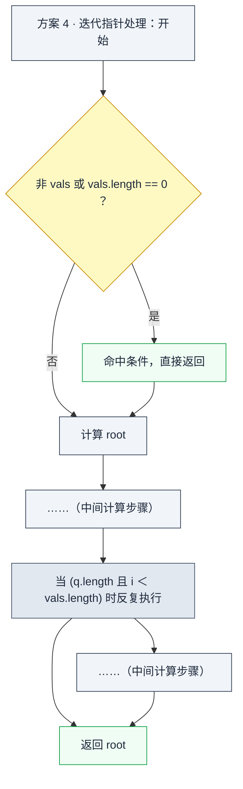

```typescript
class TreeNode {
  // 定义类型
  val: any;
  left: any;
  right: any; // 值: any; 左边界: any; 右边界: any;
  constructor(val?: any, left?: any, right?: any) {
    // constructor(值?: any, 左边界?: any, 右边界?: any) {
    this.val = val === undefined ? 0 : val; // 把 (值 全等于 undefined ? 0 : 值); 写入 值
    this.left = left === undefined ? null : left; // 把 (左边界 全等于 undefined ? null : 左边界); 写入 左边界
    this.right = right === undefined ? null : right; // 把 (右边界 全等于 undefined ? null : 右边界); 写入 右边界
  }
}
function buildTree(vals: any): any {
  // 定义函数/方法 buildTree
  if (!vals || vals.length === 0) return null; // 若 取反 vals 或 vals.长度 全等于 0，直接返回 null
  const root = new TreeNode(vals[0]);
  const q: any[] = [root];
  let i = 1;
  while (q.length && i < vals.length) {
    // 循环，直到不满足「节点.长度 且 下标 i 小于 vals.长度」
    const node = q.shift(); // 把 节点.shift() 存入 节点
    if (vals[i] !== null && vals[i] !== undefined) {
      node.left = new TreeNode(vals[i]);
      q.push(node.left);
    }
    i++; // 下标 i 加一
    if (i < vals.length && vals[i] !== null && vals[i] !== undefined) {
      node.right = new TreeNode(vals[i]);
      q.push(node.right);
    }
    i++; // 下标 i 加一
  }
  return root; // 返回 根节点
}
function treeToLevel(root: any): any[] {
  // 定义函数/方法 treeToLevel
  if (!root) return []; // 若 取反 根节点，直接返回 []
  const out: any[] = [];
  const q: any[] = [root]; // 把 []; const 节点: any[] 赋值为 [根节点]; 写入 const out: any[]
  while (q.length) {
    // 循环，直到不满足「节点.长度」
    const n = q.shift(); // 把 节点.shift() 存入 元素个数
    if (n === null || n === undefined) {
      out.push(null);
      continue;
    }
    out.push(n.val);
    q.push(n.left);
    q.push(n.right); // 把 元素个数.值 压入栈/数组尾部
  }
  while (out.length && out[out.length - 1] === null) out.pop(); // 循环，直到不满足「out.长度 且 out[out.长度 减 1] 全等于 null) out 弹出 );」
  return out; // 返回 out
}
class ListNode {
  // 定义类型
  val: any;
  next: any; // 值: any; 下一个: any;
  constructor(val?: any, next?: any) {
    this.val = val === undefined ? 0 : val;
    this.next = next === undefined ? null : next;
  }
}
function buildList(vals: any): any {
  // 定义函数/方法 buildList
  const dummy = new ListNode(0);
  let cur = dummy; // 把 new ListNode(0); let 当前值 赋值为 哨兵节点 存入 哨兵节点
  for (const v of vals) {
    cur.next = new ListNode(v);
    cur = cur.next;
  } // 把 new ListNode(值); 当前值 赋值为 当前值.下一个; } 写入 下一个
  return dummy.next; // 返回 哨兵节点.下一个
}
function listToArray(head: any): any[] {
  // 定义函数/方法 listToArray
  const out: any[] = [];
  let p = head; // 把 []; let 节点 赋值为 头节点; 写入 const out: any[]
  while (p) {
    out.push(p.val);
    p = p.next;
  } // 循环，直到不满足「节点) { out 追加 节点.值); 节点 赋值为 节点.下一个; }」
  return out; // 返回 out
}
// python-runtime shims
function pyLen(a: any): number {
  // 定义函数/方法 pyLen
  if (a === null || a === undefined) return 0; // 若 数组 全等于 null 或 数组 全等于 undefined，直接返回 0
  if (
    typeof a === 'string' ||
    Array.isArray(a) ||
    a instanceof Set ||
    a instanceof Map
  )
    return a.length ?? a.size;
  if (typeof a === 'object') return Object.keys(a).length; // 若 typeof 数组 全等于 'object'，直接返回 Object.keys(数组).长度
  return 0; // 返回 0
}
function pySlice(a: any, i: any, j: any, step?: any): any {
  // 定义函数/方法 pySlice
  if (typeof a === 'string') {
    const r = [...a].slice(i ?? 0, j ?? a.length);
    return step ? r.reverse().join('') : r.join('');
  }
  const arr = Array.isArray(a) ? a : [...a]; // 把 Array.isArray(数组) ? 数组 : 复制的 数组 存入 数组
  return arr.slice(i ?? 0, j ?? arr.length); // 返回 数组 截取 下标 i ?? 0, 下标 j ?? 数组.长度)
}
function pyRange(a: any, b?: any, step?: any): any[] {
  // 定义函数/方法 pyRange
  let s = 0,
    e = a,
    st = 1; // 把 0, e 赋值为 数组, st 赋值为 1 存入 字符串
  if (b !== undefined) {
    s = a;
    e = b;
  } // 若 b 不等于 undefined) { 字符串 赋值为 数组; e 赋值为 b; }
  if (step !== undefined) st = step; // 若 步数 不等于 undefined) st 赋值为 步数;
  const out: any[] = []; // 把 []; 写入 const out: any[]
  if (st > 0) for (let i = s; i < e; i += st) out.push(i);
  else for (let i = s; i > e; i += st) out.push(i); // 否则
  return out; // 返回 out
}
function pyIn(x: any, coll: any): boolean {
  // 定义函数/方法 pyIn
  if (coll === null || coll === undefined) return false; // 若 coll 全等于 null 或 coll 全等于 undefined，直接返回 false
  if (Array.isArray(coll)) return coll.includes(x); // 若 Array.isArray(coll)，直接返回 coll 是否包含 x)
  if (coll instanceof Set || coll instanceof Map) return coll.has(x); // 若 coll instanceof Set 或 coll instanceof Map，直接返回 coll.has(x)
  if (typeof coll === 'object') return x in coll; // 若 typeof coll 全等于 'object'，直接返回 x in coll
  if (typeof coll === 'string') return coll.indexOf(x) >= 0; // 若 typeof coll 全等于 'string'，直接返回 coll 查找 x) 不低于 0
  return false; // 返回 false
}
function pySorted(a: any): any[] {
  // 定义函数/方法 pySorted
  const arr = typeof a === 'string' ? [...a] : [...a]; // 把 (typeof 数组 全等于 'string') ? 复制的 数组 : 复制的 数组 存入 数组
  return arr.sort((x: any, y: any) => (x < y ? -1 : x > y ? 1 : 0));
}
function pyMin(a: any, b?: any): any {
  if (b !== undefined) return Math.min(a, b);
  if (Array.isArray(a) || a instanceof Set) return Math.min(...a);
  return Math.min(a);
} // 定义函数/方法 pyMin
function pyMax(a: any, b?: any): any {
  if (b !== undefined) return Math.max(a, b);
  if (Array.isArray(a) || a instanceof Set) return Math.max(...a);
  return Math.max(a);
} // 定义函数/方法 pyMax
function pySum(a: any): number {
  let s = 0;
  for (const v of a) s += v;
  return s;
} // 定义函数/方法 pySum
function pyAbs(x: any): number {
  return Math.abs(x);
} // 定义函数/方法 pyAbs
function pyEnumerate(a: any): any[] {
  const out: any[] = [];
  let i = 0;
  for (const v of a) {
    out.push([i, v]);
    i++;
  }
  return out;
} // 定义函数/方法 pyEnumerate
function pyZip(a: any, b: any): any[] {
  const n = Math.min(a.length, b.length);
  const out: any[] = [];
  for (let i = 0; i < n; i++) out.push([a[i], b[i]]);
  return out;
} // 定义函数/方法 pyZip
function pyDictGet(d: any, k: any, def?: any): any {
  return k in d ? d[k] : def === undefined ? null : def;
} // 定义函数/方法 pyDictGet
function pyPrint(...args: any[]): void {
  console.log(
    args
      .map((a) => (typeof a === 'object' && a !== null ? JSON.stringify(a) : a))
      .join(' '),
  );
} // 定义函数/方法 pyPrint
// collections / heapq
function heapPush(h: any[], x: any): void {
  h.push(x);
  let i = h.length - 1;
  while (i > 0) {
    const p = (i - 1) >> 1;
    if (h[p] <= h[i]) break;
    [h[p], h[i]] = [h[i], h[p]];
    i = p;
  }
} // 定义函数/方法 heapPush
function heapPop(h: any[]): any {
  const top = h[0];
  const last = h.pop();
  if (h.length) {
    h[0] = last;
    let i = 0;
    const n = h.length;
    while (true) {
      let l = 2 * i + 1,
        r = 2 * i + 2,
        s = i;
      if (l < n && h[l] < h[s]) s = l;
      if (r < n && h[r] < h[s]) s = r;
      if (s === i) break;
      [h[s], h[i]] = [h[i], h[s]];
      i = s;
    }
  }
  return top;
} // 定义函数/方法 heapPop
class Deque {
  private a: any[] = [];
  push(x: any) {
    this.a.push(x);
  }
  pushLeft(x: any) {
    this.a.unshift(x);
  }
  pop() {
    return this.a.pop();
  }
  popLeft() {
    return this.a.shift();
  }
  get length() {
    return this.a.length;
  }
  toArray() {
    return this.a.slice();
  }
} // 定义类型
function Counter(iter: any): any {
  const m: any = {};
  for (const v of iter) m[v] = (m[v] || 0) + 1;
  return m;
} // 定义函数/方法 Counter
function gcd(a: any, b: any): any {
  while (b) {
    [a, b] = [b, a % b];
  }
  return a;
} // 定义函数/方法 gcd
function pyInf(): number {
  return Infinity;
} // 定义函数/方法 pyInf

function norm(x: any): any {
  // 定义函数/方法 norm
  if (x === null || x === undefined) return null; // 若 x 全等于 null 或 x 全等于 undefined，直接返回 null
  if (typeof x === 'object') {
    // 若 typeof x 全等于 'object'
    if (x instanceof Deque) return x.toArray(); // 若 x instanceof Deque，直接返回 x.toArray()
    if (Array.isArray(x)) return x.map(norm); // 若 Array.isArray(x)，直接返回 x.映射表(norm)
    if (
      typeof x.val === 'number' &&
      (typeof x.left !== 'undefined' || typeof x.right !== 'undefined')
    )
      return treeToLevel(x);
    if (typeof x.next !== 'undefined' && typeof x.val === 'number')
      return listToArray(x);
    if (x instanceof Set) return [...x].sort(); // 若 x instanceof Set，直接返回 复制的 x 排序 )
    if (x instanceof Map) return Object.fromEntries(x); // 若 x instanceof Map，直接返回 Object.fromEntries(x)
    const o: any = {};
    for (const k of Object.keys(x)) o[k] = norm(x[k]);
    return o;
  }
  return x; // 返回 x
}
function eq(a: any, b: any): boolean {
  // 定义函数/方法 eq
  const x = norm(a),
    y = norm(b); // 把 norm(数组), y 赋值为 norm(b) 存入 x
  if (x === y) return true; // 若 x 全等于 y，直接返回 true
  if (x === null || y === null) return x === y; // 若 x 全等于 null 或 y 全等于 null，直接返回 x 全等于 y
  if (Array.isArray(x) && Array.isArray(y)) {
    // 若 Array.isArray(x) 且 Array.isArray(y
    if (x.length !== y.length) return false; // 若 x.长度 不等于 y.长度，直接返回 false
    for (let i = 0; i < x.length; i++) if (!eq(x[i], y[i])) return false; // 让 下标 i 从 0 开始计数，下标 i 小于 x.长度 就继续
    return true; // 返回 true
  }
  if (typeof x === 'object' && typeof y === 'object') {
    // 若 typeof x 全等于 'object' 且 typeof y 全等于 'object'
    const kx = Object.keys(x),
      ky = Object.keys(y); // 把 Object.keys(x), ky 赋值为 Object.keys(y) 存入 kx
    if (kx.length !== ky.length) return false; // 若 kx.长度 不等于 ky.长度，直接返回 false
    for (const k of kx) if (!eq(x[k], y[k])) return false;
    return true; // 返回 true
  }
  return x === y; // 返回 x 全等于 y
}

function getValueChain(data, path) {
  // 定义函数/方法 getValueChain
  return path.reduce((d, k) => d[k], data);
}
export function demo(): void {
  // 程序入口：跑内嵌自测用例
  const data = { a: { b: { c: 1 } }, d: { e: 2 } }; // 把 { 数组:{b:{字符:1}}, d:{e:2} } 存入 data
  const cases = [{ got: getValueChain(data, ['a', 'b', 'c']), want: 1 }];
  let fail = false; // 把 false 存入 fail
  for (const c of cases)
    if (!eq(c.got, c.want)) {
      fail = true;
      console.log('FAIL', JSON.stringify(c.got));
    } // 打印输出
  if (fail) throw new Error('FAILED'); // 若 fail) throw new Error(「FAILED」);
  console.log('PASS'); // 全部用例通过，输出 PASS
}
demo(); // demo();
```

## 逐步拆解与面试追问

**复杂度**：时间 O(n)（单趟线性扫描），空间 O(1) 到 O(n)（视辅助结构）

**为什么是这个量级**：每个元素被常数次访问，辅助哈希或栈的开销与 n 同阶

**面试官可能会追问**：

- 这个策略能推广到什么场景？
- 与暴力做法差在哪一步？
- 有没有更简单的等价写法？

## 关键 API 速查（TS 主解法实际用到，附官方链接）

| API | 作用 | 使用要点 | 官方文档 |
|---|---|---|---|
| `Array.prototype.sort()` | 原地排序 | 默认按字符串 Unicode 序（10 会排在 2 前），数字必须传 (a,b)=>a-b；V8 用 TimSort，稳定，O(n log n)；返回原数组引用 | [官方文档](https://developer.mozilla.org/zh-CN/docs/Web/JavaScript/Reference/Global_Objects/Array/sort) |
| `Array.prototype.map()` | 逐元素映射为新数组 | 回调 (v,i,arr)；返回等长新数组，不改变原数组；稀疏位跳过；链式调用注意中间数组开销 | [官方文档](https://developer.mozilla.org/zh-CN/docs/Web/JavaScript/Reference/Global_Objects/Array/map) |
| `Array.prototype.push()` | 尾部追加 | 返回新长度；可一次多个；均摊 O(1)；会改变原数组 | [官方文档](https://developer.mozilla.org/zh-CN/docs/Web/JavaScript/Reference/Global_Objects/Array/push) |
| `Array.prototype.pop()` | 尾部弹出 | 返回被删元素（空数组返回 undefined）；O(1) | [官方文档](https://developer.mozilla.org/zh-CN/docs/Web/JavaScript/Reference/Global_Objects/Array/pop) |
| `Array.prototype.shift()` | 头部取出 | O(n)（后续元素整体前移）；大量头部操作请用链表或双端结构 | [官方文档](https://developer.mozilla.org/zh-CN/docs/Web/JavaScript/Reference/Global_Objects/Array/shift) |
| `Array.prototype.unshift()` | 头部插入 | O(n)；与 shift 组合可当双端队列 | [官方文档](https://developer.mozilla.org/zh-CN/docs/Web/JavaScript/Reference/Global_Objects/Array/unshift) |
| `Array/String includes()` | 是否包含 | 数组用 SameValueZero（NaN 可判）；字符串按子串；第二个参数为起始下标 | [官方文档](https://developer.mozilla.org/zh-CN/docs/Web/JavaScript/Reference/Global_Objects/Array/includes) |
| `Array/String indexOf()` | 首次出现的下标 | 找不到返回 -1；无法判 NaN（用 includes）；字符串可传起始位 | [官方文档](https://developer.mozilla.org/zh-CN/docs/Web/JavaScript/Reference/Global_Objects/Array/indexOf) |
| `Array/String slice()` | 切片（不改原数组） | slice(start,end) 含头不含尾；负数从尾计；常用于复制数组（slice()） | [官方文档](https://developer.mozilla.org/zh-CN/docs/Web/JavaScript/Reference/Global_Objects/Array/slice) |
| `Array.prototype.join()` | 数组拼接为字符串 | undefined/null 转空串；嵌套数组会展平一层；join('') 用于字符数组还原 | [官方文档](https://developer.mozilla.org/zh-CN/docs/Web/JavaScript/Reference/Global_Objects/Array/join) |
| `Object.keys()` | 对象键名数组 | 仅自身可枚举字符串键（不含 symbol）；配 length 可当计数器 | [官方文档](https://developer.mozilla.org/zh-CN/docs/Web/JavaScript/Reference/Global_Objects/Object/keys) |
| `Object.fromEntries()` | 键值对数组转对象 | 参数为 [k,v] 可迭代；map 出来的键值对可直接转对象 | [官方文档](https://developer.mozilla.org/zh-CN/docs/Web/JavaScript/Reference/Global_Objects/Object/fromEntries) |
| `JSON.stringify()` | 序列化为 JSON 字符串 | 常用于结构化比较（深度相等判定）；undefined/函数/循环引用会被丢弃或抛错 | [官方文档](https://developer.mozilla.org/zh-CN/docs/Web/JavaScript/Reference/Global_Objects/JSON/stringify) |
| `Math.max()` | 最大值 | 配展开 Math.max(...arr)；空参返回 -Infinity；超大数组注意展开参数上限 | [官方文档](https://developer.mozilla.org/zh-CN/docs/Web/JavaScript/Reference/Global_Objects/Math/max) |
| `Math.min()` | 最小值 | 同 max；空参返回 Infinity | [官方文档](https://developer.mozilla.org/zh-CN/docs/Web/JavaScript/Reference/Global_Objects/Math/min) |
| `Math.abs()` | 绝对值 | 入参会被隐式转数字；-0 返回 +0 | [官方文档](https://developer.mozilla.org/zh-CN/docs/Web/JavaScript/Reference/Global_Objects/Math/abs) |

### 各语言官方文档导航

- **TypeScript / JS**：[MDN 中文参考](https://developer.mozilla.org/zh-CN/)
- **Python**：[Python 官方文档](https://docs.python.org/zh-cn/3/)
- **Go**：[Go 标准库](https://pkg.go.dev/std)
- **Java**：[JDK 17 API](https://docs.oracle.com/en/java/javase/17/docs/api/)
- **Rust**：[Rust 标准库](https://doc.rust-lang.org/std/)
- **Lua**：[Lua 5.4 手册](https://www.lua.org/manual/5.4/)
- **C**：[Cppreference C](https://zh.cppreference.com/w/c)
- **C++**：[Cppreference C++](https://zh.cppreference.com/w/cpp)
- **R**：[R 官方手册](https://stat.ethz.ch/R-manual/)
- **Zig**：[Zig 语言文档](https://ziglang.org/documentation/master/)
- **Dart**：[Dart API](https://api.dart.dev/)

## 附录：其他 10 种语言全部实现（每种语言列举其全部方案）

> TypeScript 的全部方案见「TypeScript 解题方案」一节；下面是其余 10 种语言的对应实现，每种语言的每个方案都带思路分析、代码走读与专属运行架构图。
> 每个方案都内嵌用例自测，可独立运行（老仓库 python/go 文件遵循「打印结果」约定）。
> 完整解法文件见 `dsa/<语言>/notes/lc_133278676_使用链表指针获取json节点值的算法实现/`。

### Python 实现（4 种方案）

Python 的全部方案如下，每个方案都内嵌用例自测，可独立运行（老仓库 python/go 文件遵循「打印结果」约定）：

#### 方案 1：迭代指针处理

**思路与代码分析**：核心是「迭代指针处理」。Python 版用切片与字典推导式简化操作，突出可读性。**走读**：方案 1 · 迭代指针处理：开始 → 更新 node → 遍历 path: 中的每个元素 key → 命中条件，直接返回 → 更新 node → 返回 node。

**运行架构**（真实控制流）：

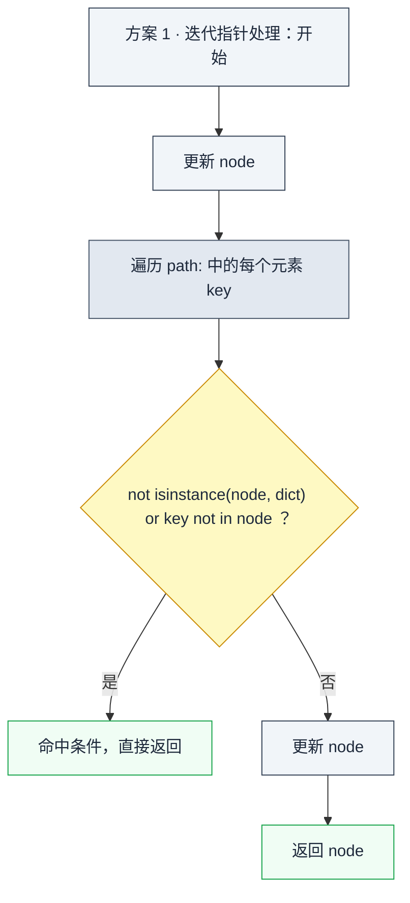

```python
import sys  # 提高递归深度上限（深输入防 RecursionError）

sys.setrecursionlimit(200000)  # 树/链表类题目节点数可达 1e4 量级

def get_value(data, path):  # 定义函数 get_value（参数：data, 当前路径）
    """使用指针(游标)逐层下钻，按 path 列表从嵌套字典中取节点值。"""
    node = data  # 把 data 存入 节点
    for key in path:  # 逐个取出 当前路径 的元素（key）
        if not isinstance(node, dict) or key not in node:  # 若 not isinstance(节点, dict) or key not in 节点
            return None  # 返回 None
        node = node[key]  # 把 节点[key] 存入 节点
    return node  # 返回 节点

if __name__ == "__main__":  # 若 __name__ 等于 '__main__'
    data = {  # 把 { 存入 data
        "a": {"b": {"c": 1}},
        "d": {"e": 2},
    }
    path = ["a", "b", "c"]  # 把 ['数组', 'b', '字符'] 存入 当前路径
    print("value:", get_value(data, path))  # 打印输出
```

#### 方案 2：迭代指针处理

**思路与代码分析**：核心是「迭代指针处理」。Python 版用切片与字典推导式简化操作，突出可读性。**走读**：方案 2 · 迭代指针处理：开始 → 更新 result → 遍历 path: 中的每个元素 k → 更新 result → 返回 result。

**运行架构**（真实控制流）：

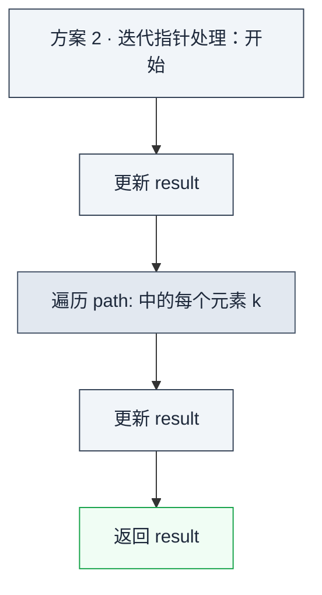

```python
import sys  # 提高递归深度上限（深输入防 RecursionError）

sys.setrecursionlimit(200000)  # 树/链表类题目节点数可达 1e4 量级

def get_value(data, path):  # 定义函数 get_value（参数：data, 当前路径）
    result = data  # 把 data 存入 结果
    for k in path:  # 逐个取出 当前路径 的元素（下标 k）
        result = result[k]  # 把 结果[下标 k] 存入 结果
    return result  # 返回 结果

if __name__ == "__main__":  # 若 __name__ 等于 「__main__」
    data = {"a": {"b": {"c": 1}}, "d": {"e": 2}}  # 把 {'数组': {'b': {'字符': 1}}, 'd': {'e': 2}} 存入 data
    path = ["a", "b", "c"]  # 把 ['数组', 'b', '字符'] 存入 当前路径
    print(get_value(data, path))  # 打印输出
```

#### 方案 3：直接实现

**思路与代码分析**：核心是「直接实现」。Python 版用切片与字典推导式简化操作，突出可读性。**走读**：方案 3 · 直接实现：开始 → 更新 expr → 返回 eval(expr,。

**运行架构**（真实控制流）：

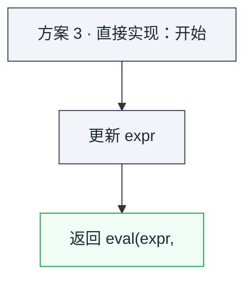

```python
import sys  # 提高递归深度上限（深输入防 RecursionError）

sys.setrecursionlimit(200000)  # 树/链表类题目节点数可达 1e4 量级

def get_value_eval(data, path):  # 定义函数 get_value_eval（参数：data, 当前路径）
    # 通过链表指针(动态属性)访问指定节点值，等价于 JS 的 eval(path.join('.'))
    expr = "data" + "".join("[{}]".format(repr(k)) for k in path)
    return eval(expr, {"data": data})  # 返回 eval(expr, {'data': data})

if __name__ == "__main__":  # 若 __name__ 等于 「__main__」
    data = {"a": {"b": {"c": 1}}, "d": {"e": 2}}  # 把 {'数组': {'b': {'字符': 1}}, 'd': {'e': 2}} 存入 data
    path = ["a", "b", "c"]  # 把 ['数组', 'b', '字符'] 存入 当前路径
    print(get_value_eval(data, path))  # 打印输出
```

#### 方案 4：迭代指针处理

**思路与代码分析**：核心是「迭代指针处理」。Python 版用切片与字典推导式简化操作，突出可读性。**走读**：方案 4 · 迭代指针处理：开始 → 返回 functools.reduce( → 处理 lambda d, k: d[k], path, dat → 处理 )。

**运行架构**（真实控制流）：

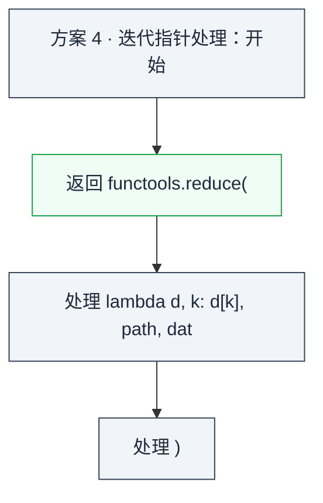

```python
import sys  # 提高递归深度上限（深输入防 RecursionError）

sys.setrecursionlimit(200000)  # 树/链表类题目节点数可达 1e4 量级
import functools  # 引入依赖

def get_value_chain(data, path):  # 定义函数 get_value_chain（参数：data, 当前路径）
    # 使用 reduce 沿着链表指针链依次取值，等价 JS 的 new Function 方式
    return functools.reduce(
        lambda d, k: d[k], path, data
    )  # 返回 functools.reduce(lambda d, 下标 k: d[下标 k], 当前路径, data)

if __name__ == "__main__":  # 若 __name__ 等于 「__main__」
    data = {"a": {"b": {"c": 1}}, "d": {"e": 2}}  # 把 {'数组': {'b': {'字符': 1}}, 'd': {'e': 2}} 存入 data
    path = ["a", "b", "c"]  # 把 ['数组', 'b', '字符'] 存入 当前路径
    print(get_value_chain(data, path))  # 打印输出
```

### Go 实现（4 种方案）

Go 的全部方案如下，每个方案都内嵌用例自测，可独立运行（老仓库 python/go 文件遵循「打印结果」约定）：

#### 方案 1：迭代指针处理

**思路与代码分析**：核心是「迭代指针处理」。Go 版用切片与多返回值惯用法，显式处理索引边界。代码里依次做这些事：哈希结构做计数或查重。**走读**：方案 1 · 迭代指针处理：开始 → 更新 : → 遍历 path 的下标与元素 key → 更新 : → 处理 if 非 ok → 返回 -1 → 更新 : → 处理 if 非 ok → 返回 -1 → 更新 node → 更新 : → 处理 if 非 ok → 返回 -1 → 返回 iv。

**运行架构**（真实控制流）：


```go
package main // 引入依赖

import (
	"fmt"
	"os"
) // 引入依赖

func getValue(data map[string]interface{}, path []string) int { // 定义函数/方法 getValue
	node := interface{}(data)  // 把 interface{}(data) 写入 node :
	for _, key := range path { // 同时取 _ 与 key 遍历
		m, ok := node.(map[string]interface{}) // 把 节点.(映射表[string]interface{}) 写入 m, ok :
		if !ok {                               // 若 取反 ok
			return -1 // 返回 减 1
		}
		v, ok := m[key] // 把 映射表[key] 写入 v, ok :
		if !ok {        // 若 取反 ok
			return -1 // 返回 减 1
		}
		node = v // 把 值 写入 节点
	}
	iv, ok := node.(int) // 把 节点.(int) 写入 iv, ok :
	if !ok {             // 若 取反 ok
		return -1 // 返回 减 1
	}
	return iv // 返回 iv
}

func main() { // 程序入口：跑内嵌自测用例
	data := map[string]interface{}{ // 把 映射表[string]interface{}{ 写入 data :
		"a": map[string]interface{}{ // 「数组」: 映射表[string]interface{}{
			"b": map[string]interface{}{ // 「b」: 映射表[string]interface{}{
				"c": 1,
			},
		},
		"d": map[string]interface{}{ // 「d」: 映射表[string]interface{}{
			"e": 2,
		},
	}
	cases := []struct { // 把 []struct { 写入 cases :
		path []string // 当前路径 []string
		want int      // want int
	}{ // }{
		{[]string{"a", "b", "c"}, 1},
		{[]string{"d", "e"}, 2},
		{[]string{"a", "x"}, -1},
	}
	ok := true                // 把 true 写入 ok :
	for _, c := range cases { // 同时取 _ 与 字符 遍历
		got := getValue(data, c.path) // 把 getValue(data, 字符.当前路径) 写入 got :
		if got != c.want {            // 若 got 不等于 字符.want
			ok = false                                                  // 把 false 写入 ok
			fmt.Printf("FAIL %v got %d want %d\n", c.path, got, c.want) // 打印输出
		}
	}
	if !ok {
		os.Exit(1)
	} // 若 取反 ok { os.Exit(1) }
	fmt.Println("PASS") // 全部用例通过，输出 PASS
}
```

#### 方案 2：迭代指针处理

**思路与代码分析**：核心是「迭代指针处理」。Go 版用切片与多返回值惯用法，显式处理索引边界。代码里依次做这些事：哈希结构做计数或查重。**走读**：方案 2 · 迭代指针处理：开始 → 更新 : → 遍历 path 的下标与元素 key → 更新 : → 处理 if 非 ok → 返回 -1 → 更新 : → 处理 if 非 ok → 返回 -1 → 更新 node → 更新 : → 处理 if 非 ok → 返回 -1 → 返回 iv。

**运行架构**（真实控制流）：


```go
package main // 引入依赖

import (
	"fmt"
	"os"
) // 引入依赖

func getValue(data map[string]interface{}, path []string) int { // 定义函数/方法 getValue
	node := interface{}(data)  // 把 interface{}(data) 写入 node :
	for _, key := range path { // 同时取 _ 与 key 遍历
		m, ok := node.(map[string]interface{}) // 把 节点.(映射表[string]interface{}) 写入 m, ok :
		if !ok {                               // 若 取反 ok
			return -1 // 返回 减 1
		}
		v, ok := m[key] // 把 映射表[key] 写入 v, ok :
		if !ok {        // 若 取反 ok
			return -1 // 返回 减 1
		}
		node = v // 把 值 写入 节点
	}
	iv, ok := node.(int) // 把 节点.(int) 写入 iv, ok :
	if !ok {             // 若 取反 ok
		return -1 // 返回 减 1
	}
	return iv // 返回 iv
}

func main() { // 程序入口：跑内嵌自测用例
	data := map[string]interface{}{ // 把 映射表[string]interface{}{ 写入 data :
		"a": map[string]interface{}{ // 「数组」: 映射表[string]interface{}{
			"b": map[string]interface{}{ // 「b」: 映射表[string]interface{}{
				"c": 1,
			},
		},
		"d": map[string]interface{}{ // 「d」: 映射表[string]interface{}{
			"e": 2,
		},
	}
	cases := []struct { // 把 []struct { 写入 cases :
		path []string // 当前路径 []string
		want int      // want int
	}{ // }{
		{[]string{"a", "b", "c"}, 1},
		{[]string{"d", "e"}, 2},
		{[]string{"a", "x"}, -1},
	}
	ok := true                // 把 true 写入 ok :
	for _, c := range cases { // 同时取 _ 与 字符 遍历
		got := getValue(data, c.path) // 把 getValue(data, 字符.当前路径) 写入 got :
		if got != c.want {            // 若 got 不等于 字符.want
			ok = false                                                  // 把 false 写入 ok
			fmt.Printf("FAIL %v got %d want %d\n", c.path, got, c.want) // 打印输出
		}
	}
	if !ok {
		os.Exit(1)
	} // 若 取反 ok { os.Exit(1) }
	fmt.Println("PASS") // 全部用例通过，输出 PASS
}
```

#### 方案 3：直接实现

**思路与代码分析**：核心是「直接实现」。Go 版用切片与多返回值惯用法，显式处理索引边界。代码里依次做这些事：哈希结构做计数或查重。**走读**：方案 3 · 直接实现：开始 → 更新 : → 遍历 path 的下标与元素 key → 更新 : → 处理 if 非 ok → 返回 -1 → 更新 : → 处理 if 非 ok → 返回 -1 → 更新 node → 更新 : → 处理 if 非 ok → 返回 -1 → 返回 iv。

**运行架构**（真实控制流）：

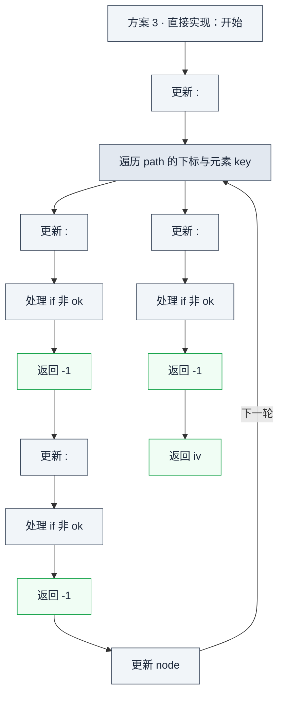

```go
package main // 引入依赖

import (
	"fmt"
	"os"
) // 引入依赖

func getValue(data map[string]interface{}, path []string) int { // 定义函数/方法 getValue
	node := interface{}(data)  // 把 interface{}(data) 写入 node :
	for _, key := range path { // 同时取 _ 与 key 遍历
		m, ok := node.(map[string]interface{}) // 把 节点.(映射表[string]interface{}) 写入 m, ok :
		if !ok {                               // 若 取反 ok
			return -1 // 返回 减 1
		}
		v, ok := m[key] // 把 映射表[key] 写入 v, ok :
		if !ok {        // 若 取反 ok
			return -1 // 返回 减 1
		}
		node = v // 把 值 写入 节点
	}
	iv, ok := node.(int) // 把 节点.(int) 写入 iv, ok :
	if !ok {             // 若 取反 ok
		return -1 // 返回 减 1
	}
	return iv // 返回 iv
}

func main() { // 程序入口：跑内嵌自测用例
	data := map[string]interface{}{ // 把 映射表[string]interface{}{ 写入 data :
		"a": map[string]interface{}{ // 「数组」: 映射表[string]interface{}{
			"b": map[string]interface{}{ // 「b」: 映射表[string]interface{}{
				"c": 1,
			},
		},
		"d": map[string]interface{}{ // 「d」: 映射表[string]interface{}{
			"e": 2,
		},
	}
	cases := []struct { // 把 []struct { 写入 cases :
		path []string // 当前路径 []string
		want int      // want int
	}{ // }{
		{[]string{"a", "b", "c"}, 1},
		{[]string{"d", "e"}, 2},
		{[]string{"a", "x"}, -1},
	}
	ok := true                // 把 true 写入 ok :
	for _, c := range cases { // 同时取 _ 与 字符 遍历
		got := getValue(data, c.path) // 把 getValue(data, 字符.当前路径) 写入 got :
		if got != c.want {            // 若 got 不等于 字符.want
			ok = false                                                  // 把 false 写入 ok
			fmt.Printf("FAIL %v got %d want %d\n", c.path, got, c.want) // 打印输出
		}
	}
	if !ok {
		os.Exit(1)
	} // 若 取反 ok { os.Exit(1) }
	fmt.Println("PASS") // 全部用例通过，输出 PASS
}
```

#### 方案 4：迭代指针处理

**思路与代码分析**：核心是「迭代指针处理」。Go 版用切片与多返回值惯用法，显式处理索引边界。代码里依次做这些事：哈希结构做计数或查重。**走读**：方案 4 · 迭代指针处理：开始 → 更新 : → 遍历 path 的下标与元素 key → 更新 : → 处理 if 非 ok → 返回 -1 → 更新 : → 处理 if 非 ok → 返回 -1 → 更新 node → 更新 : → 处理 if 非 ok → 返回 -1 → 返回 iv。

**运行架构**（真实控制流）：

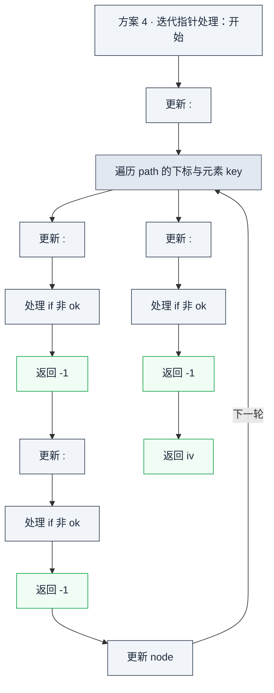

```go
package main // 引入依赖

import (
	"fmt"
	"os"
) // 引入依赖

func getValue(data map[string]interface{}, path []string) int { // 定义函数/方法 getValue
	node := interface{}(data)  // 把 interface{}(data) 写入 node :
	for _, key := range path { // 同时取 _ 与 key 遍历
		m, ok := node.(map[string]interface{}) // 把 节点.(映射表[string]interface{}) 写入 m, ok :
		if !ok {                               // 若 取反 ok
			return -1 // 返回 减 1
		}
		v, ok := m[key] // 把 映射表[key] 写入 v, ok :
		if !ok {        // 若 取反 ok
			return -1 // 返回 减 1
		}
		node = v // 把 值 写入 节点
	}
	iv, ok := node.(int) // 把 节点.(int) 写入 iv, ok :
	if !ok {             // 若 取反 ok
		return -1 // 返回 减 1
	}
	return iv // 返回 iv
}

func main() { // 程序入口：跑内嵌自测用例
	data := map[string]interface{}{ // 把 映射表[string]interface{}{ 写入 data :
		"a": map[string]interface{}{ // 「数组」: 映射表[string]interface{}{
			"b": map[string]interface{}{ // 「b」: 映射表[string]interface{}{
				"c": 1,
			},
		},
		"d": map[string]interface{}{ // 「d」: 映射表[string]interface{}{
			"e": 2,
		},
	}
	cases := []struct { // 把 []struct { 写入 cases :
		path []string // 当前路径 []string
		want int      // want int
	}{ // }{
		{[]string{"a", "b", "c"}, 1},
		{[]string{"d", "e"}, 2},
		{[]string{"a", "x"}, -1},
	}
	ok := true                // 把 true 写入 ok :
	for _, c := range cases { // 同时取 _ 与 字符 遍历
		got := getValue(data, c.path) // 把 getValue(data, 字符.当前路径) 写入 got :
		if got != c.want {            // 若 got 不等于 字符.want
			ok = false                                                  // 把 false 写入 ok
			fmt.Printf("FAIL %v got %d want %d\n", c.path, got, c.want) // 打印输出
		}
	}
	if !ok {
		os.Exit(1)
	} // 若 取反 ok { os.Exit(1) }
	fmt.Println("PASS") // 全部用例通过，输出 PASS
}
```

### Java 实现（4 种方案）

Java 的全部方案如下，每个方案都内嵌用例自测，可独立运行（老仓库 python/go 文件遵循「打印结果」约定）：

#### 方案 1：迭代指针处理

**思路与代码分析**：核心是「迭代指针处理」。Java 版用类与静态方法组织，集合操作显式明了。代码里依次做这些事：哈希结构做计数或查重。**走读**：方案 1 · 迭代指针处理：开始 → 更新 c → 处理 new LinkedHashMap＜＞() → 调用 c.put(c, 1) → 更新 b → 处理 new LinkedHashMap＜＞() → 调用 b.put(b, c) → 更新 d → 处理 new LinkedHashMap＜＞() → 调用 d.put(e, 2) → 更新 data → 处理 new LinkedHashMap＜＞() → 调用 data.put(a, b) → 调用 data.put(d, d) → 返回 data。

**运行架构**（真实控制流）：


```java
package com.webfault.dsa; // 引入依赖

import java.util.Arrays; // 引入依赖
import java.util.LinkedHashMap; // 引入依赖
import java.util.List; // 引入依赖
import java.util.Map; // 引入依赖

/** 忠实翻译 python/notes/lc_133278676_.../solution_1___1.py 方案1：使用指针（游标）逐层下钻，键缺失或节点非 Map 时返回 null。 */
class Lc133278676S1 { // 定义类型
  @SuppressWarnings("unchecked") // @SuppressWarnings(「unchecked」)
  static Object getValue(Object data, List<String> path) { // 定义函数/方法 getValue
    Object node = data; // 把 data; 写入 Object node
    for (String key : path) { // for (String key : 当前路径) {
      if (!(node instanceof Map) || !((Map<String, Object>) node).containsKey(key)) {
        return null; // 返回 null
      }
      node =
          ((Map<String, Object>) node)
              .get(key); // 把 ((Map 小于 String, Object 超过 ) 节点) 查找 key); 写入 节点
    }
    return node; // 返回 节点
  }

  static Map<String, Object> buildData() { // static Map 小于 String, Object 超过 buildData() {
    Map<String, Object> c =
        new LinkedHashMap<>(); // 把 new LinkedHashMap 小于 超过 (); 写入 Map<String, Object> c
    c.put("c", 1); // 字符.put(「字符」, 1);
    Map<String, Object> b =
        new LinkedHashMap<>(); // 把 new LinkedHashMap 小于 超过 (); 写入 Map<String, Object> b
    b.put("b", c); // b.put(「b」, 字符);
    Map<String, Object> d =
        new LinkedHashMap<>(); // 把 new LinkedHashMap 小于 超过 (); 写入 Map<String, Object> d
    d.put("e", 2); // d.put(「e」, 2);
    Map<String, Object> data =
        new LinkedHashMap<>(); // 把 new LinkedHashMap 小于 超过 (); 写入 Map<String, Object> data
    data.put("a", b); // data.put(「数组」, b);
    data.put("d", d); // data.put(「d」, d);
    return data; // 返回 data
  }

  public static void main(String[] args) { // public static void main(String[] args) {
    Map<String, Object> data = buildData(); // 把 buildData(); 写入 Map<String, Object> data
    Object v1 = getValue(data, Arrays.asList("a", "b", "c"));
    Object v2 =
        getValue(
            data,
            Arrays.asList("d", "e")); // 把 getValue(data, Arrays.asList(「d」, 「d」)); 写入 Object v2
    Object v3 =
        getValue(
            data,
            Arrays.asList("a", "x")); // 把 getValue(data, Arrays.asList(「数组」, 「数组」)); 写入 Object v3
    boolean ok =
        Integer.valueOf(1).equals(v1) // 把 Integer.valueOf(1).equals(v1) 写入 boolean ok
            && Integer.valueOf(2).equals(v2) // 且 Integer.valueOf(2).equals(v2)
            && v3 == null; // 把 赋值为 null; 写入 && v3
    if (!ok) { // 若 取反 ok
      System.out.println("FAIL got " + v1 + " " + v2 + " " + v3 + " want 1 2 null"); // 打印输出
      throw new RuntimeException("FAILED"); // throw new RuntimeException(「FAILED」);
    }
    System.out.println("PASS"); // 全部用例通过，输出 PASS
  }
}
```

#### 方案 2：迭代指针处理

**思路与代码分析**：核心是「迭代指针处理」。Java 版用类与静态方法组织，集合操作显式明了。代码里依次做这些事：哈希结构做计数或查重。**走读**：方案 2 · 迭代指针处理：开始 → 更新 c → 处理 new LinkedHashMap＜＞() → 调用 c.put(c, 1) → 更新 b → 处理 new LinkedHashMap＜＞() → 调用 b.put(b, c) → 更新 d → 处理 new LinkedHashMap＜＞() → 调用 d.put(e, 2) → 更新 data → 处理 new LinkedHashMap＜＞() → 调用 data.put(a, b) → 调用 data.put(d, d) → 返回 data。

**运行架构**（真实控制流）：

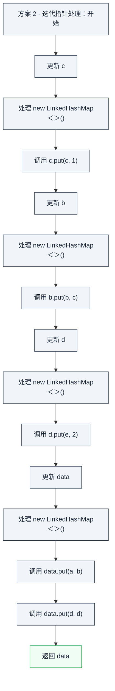

```java
package com.webfault.dsa; // 引入依赖

import java.util.Arrays; // 引入依赖
import java.util.LinkedHashMap; // 引入依赖
import java.util.List; // 引入依赖
import java.util.Map; // 引入依赖

/** 忠实翻译 python/notes/lc_133278676_.../solution_2___2.py 方案2：直接逐层取值；键缺失时抛错（对应 python 的 KeyError）。 */
class Lc133278676S2 { // 定义类型
  @SuppressWarnings("unchecked") // @SuppressWarnings(「unchecked」)
  static Object getValue(Map<String, Object> data, List<String> path) { // 定义函数/方法 getValue
    Object result = data; // 把 data; 写入 Object result
    for (String k : path) { // for (String 下标 k : 当前路径) {
      if (!(result instanceof Map) || !((Map<String, Object>) result).containsKey(k)) {
        throw new RuntimeException(
            "KeyError: " + k); // throw new RuntimeException(「KeyError: 」 加 下标 k);
      }
      result =
          ((Map<String, Object>) result)
              .get(k); // 把 ((Map 小于 String, Object 超过 ) 结果) 查找 下标 k); 写入 结果
    }
    return result; // 返回 结果
  }

  static Map<String, Object> buildData() { // static Map 小于 String, Object 超过 buildData() {
    Map<String, Object> c =
        new LinkedHashMap<>(); // 把 new LinkedHashMap 小于 超过 (); 写入 Map<String, Object> c
    c.put("c", 1); // 字符.put(「字符」, 1);
    Map<String, Object> b =
        new LinkedHashMap<>(); // 把 new LinkedHashMap 小于 超过 (); 写入 Map<String, Object> b
    b.put("b", c); // b.put(「b」, 字符);
    Map<String, Object> d =
        new LinkedHashMap<>(); // 把 new LinkedHashMap 小于 超过 (); 写入 Map<String, Object> d
    d.put("e", 2); // d.put(「e」, 2);
    Map<String, Object> data =
        new LinkedHashMap<>(); // 把 new LinkedHashMap 小于 超过 (); 写入 Map<String, Object> data
    data.put("a", b); // data.put(「数组」, b);
    data.put("d", d); // data.put(「d」, d);
    return data; // 返回 data
  }

  public static void main(String[] args) { // public static void main(String[] args) {
    Map<String, Object> data = buildData(); // 把 buildData(); 写入 Map<String, Object> data
    Object v1 = getValue(data, Arrays.asList("a", "b", "c"));
    Object v2 =
        getValue(
            data,
            Arrays.asList("d", "e")); // 把 getValue(data, Arrays.asList(「d」, 「d」)); 写入 Object v2
    boolean threw = false; // 把 false; 写入 boolean threw
    try { // try {
      getValue(data, Arrays.asList("a", "x")); // getValue(data, Arrays.asList(「数组」, 「数组」));
    } catch (RuntimeException ex) { // } catch (RuntimeException ex) {
      threw = true; // 把 true; 写入 threw
    }
    boolean ok = Integer.valueOf(1).equals(v1) && Integer.valueOf(2).equals(v2) && threw;
    if (!ok) { // 若 取反 ok
      System.out.println(
          "FAIL got " + v1 + " " + v2 + " threw=" + threw + " want 1 2 threw=true"); // 打印输出
      throw new RuntimeException("FAILED"); // throw new RuntimeException(「FAILED」);
    }
    System.out.println("PASS"); // 全部用例通过，输出 PASS
  }
}
```

#### 方案 3：直接实现

**思路与代码分析**：核心是「直接实现」。Java 版用类与静态方法组织，集合操作显式明了。代码里依次做这些事：哈希结构做计数或查重。**走读**：方案 3 · 直接实现：开始 → 更新 c → 处理 new LinkedHashMap＜＞() → 调用 c.put(c, 1) → 更新 b → 处理 new LinkedHashMap＜＞() → 调用 b.put(b, c) → 更新 d → 处理 new LinkedHashMap＜＞() → 调用 d.put(e, 2) → 更新 data → 处理 new LinkedHashMap＜＞() → 调用 data.put(a, b) → 调用 data.put(d, d) → 返回 data。

**运行架构**（真实控制流）：

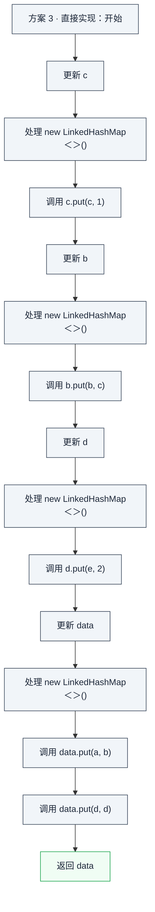

```java
package com.webfault.dsa; // 引入依赖

import java.util.Arrays; // 引入依赖
import java.util.LinkedHashMap; // 引入依赖
import java.util.List; // 引入依赖
import java.util.Map; // 引入依赖

/**
 * 忠实翻译 python/notes/lc_133278676_.../solution_3___3.py 方案3：把 path 拼成访问表达式后按链式下钻求值（等价 JS 的
 * eval(path.join('.')))， 键缺失时抛错（对应 python 的 KeyError）。
 */
class Lc133278676S3 { // 定义类型
  static String buildExpr(List<String> path) { // 定义函数/方法 buildExpr
    StringBuilder sb =
        new StringBuilder("data"); // 把 new StringBuilder(「data」); 写入 StringBuilder sb
    for (String k : path) { // for (String 下标 k : 当前路径) {
      sb.append("['").append(k).append("']"); // 把 「['」 追加到列表尾部
    }
    return sb.toString(); // 返回 sb.toString()
  }

  @SuppressWarnings("unchecked") // @SuppressWarnings(「unchecked」)
  static Object getValueEval(Map<String, Object> data, List<String> path) { // 定义函数/方法 getValueEval
    // 表达式字符串仅用于说明结构，实际按下钻指针取值
    buildExpr(path); // buildExpr(当前路径);
    Object node = data; // 把 data; 写入 Object node
    for (String k : path) { // for (String 下标 k : 当前路径) {
      if (!(node instanceof Map) || !((Map<String, Object>) node).containsKey(k)) {
        throw new RuntimeException(
            "KeyError: " + k); // throw new RuntimeException(「KeyError: 」 加 下标 k);
      }
      node =
          ((Map<String, Object>) node).get(k); // 把 ((Map 小于 String, Object 超过 ) 节点) 查找 下标 k); 写入 节点
    }
    return node; // 返回 节点
  }

  static Map<String, Object> buildData() { // static Map 小于 String, Object 超过 buildData() {
    Map<String, Object> c =
        new LinkedHashMap<>(); // 把 new LinkedHashMap 小于 超过 (); 写入 Map<String, Object> c
    c.put("c", 1); // 字符.put(「字符」, 1);
    Map<String, Object> b =
        new LinkedHashMap<>(); // 把 new LinkedHashMap 小于 超过 (); 写入 Map<String, Object> b
    b.put("b", c); // b.put(「b」, 字符);
    Map<String, Object> d =
        new LinkedHashMap<>(); // 把 new LinkedHashMap 小于 超过 (); 写入 Map<String, Object> d
    d.put("e", 2); // d.put(「e」, 2);
    Map<String, Object> data =
        new LinkedHashMap<>(); // 把 new LinkedHashMap 小于 超过 (); 写入 Map<String, Object> data
    data.put("a", b); // data.put(「数组」, b);
    data.put("d", d); // data.put(「d」, d);
    return data; // 返回 data
  }

  public static void main(String[] args) { // public static void main(String[] args) {
    Map<String, Object> data = buildData(); // 把 buildData(); 写入 Map<String, Object> data
    Object v1 = getValueEval(data, Arrays.asList("a", "b", "c"));
    Object v2 =
        getValueEval(
            data,
            Arrays.asList("d", "e")); // 把 getValueEval(data, Arrays.asList(「d」, 「d」)); 写入 Object v2
    boolean threw = false; // 把 false; 写入 boolean threw
    try { // try {
      getValueEval(data, Arrays.asList("a", "x")); // getValueEval(data, Arrays.asList(「数组」, 「数组」));
    } catch (RuntimeException ex) { // } catch (RuntimeException ex) {
      threw = true; // 把 true; 写入 threw
    }
    boolean ok = Integer.valueOf(1).equals(v1) && Integer.valueOf(2).equals(v2) && threw;
    if (!ok) { // 若 取反 ok
      System.out.println(
          "FAIL got " + v1 + " " + v2 + " threw=" + threw + " want 1 2 threw=true"); // 打印输出
      throw new RuntimeException("FAILED"); // throw new RuntimeException(「FAILED」);
    }
    System.out.println("PASS"); // 全部用例通过，输出 PASS
  }
}
```

#### 方案 4：迭代指针处理

**思路与代码分析**：核心是「迭代指针处理」。Java 版用类与静态方法组织，集合操作显式明了。代码里依次做这些事：哈希结构做计数或查重。**走读**：方案 4 · 迭代指针处理：开始 → 更新 c → 处理 new LinkedHashMap＜＞() → 调用 c.put(c, 1) → 更新 b → 处理 new LinkedHashMap＜＞() → 调用 b.put(b, c) → 更新 d → 处理 new LinkedHashMap＜＞() → 调用 d.put(e, 2) → 更新 data → 处理 new LinkedHashMap＜＞() → 调用 data.put(a, b) → 调用 data.put(d, d) → 返回 data。

**运行架构**（真实控制流）：


```java
package com.webfault.dsa; // 引入依赖

import java.util.Arrays; // 引入依赖
import java.util.LinkedHashMap; // 引入依赖
import java.util.List; // 引入依赖
import java.util.Map; // 引入依赖

/**
 * 忠实翻译 python/notes/lc_133278676_.../solution_4___4.py 方案4：使用 reduce 沿链表指针链依次取值（等价 JS 的 new
 * Function 方式）； 键缺失时抛错（对应 python 的 KeyError）。
 */
class Lc133278676S4 { // 定义类型
  @SuppressWarnings("unchecked") // @SuppressWarnings(「unchecked」)
  static Object getValueChain(
      Map<String, Object> data, List<String> path) { // 定义函数/方法 getValueChain
    Object acc = data; // 把 data; 写入 Object acc
    for (String k : path) { // for (String 下标 k : 当前路径) {
      if (!(acc instanceof Map) || !((Map<String, Object>) acc).containsKey(k)) {
        throw new RuntimeException(
            "KeyError: " + k); // throw new RuntimeException(「KeyError: 」 加 下标 k);
      }
      acc =
          ((Map<String, Object>) acc)
              .get(k); // 把 ((Map 小于 String, Object 超过 ) 累加器) 查找 下标 k); 写入 累加器
    }
    return acc; // 返回 累加器
  }

  static Map<String, Object> buildData() { // static Map 小于 String, Object 超过 buildData() {
    Map<String, Object> c =
        new LinkedHashMap<>(); // 把 new LinkedHashMap 小于 超过 (); 写入 Map<String, Object> c
    c.put("c", 1); // 字符.put(「字符」, 1);
    Map<String, Object> b =
        new LinkedHashMap<>(); // 把 new LinkedHashMap 小于 超过 (); 写入 Map<String, Object> b
    b.put("b", c); // b.put(「b」, 字符);
    Map<String, Object> d =
        new LinkedHashMap<>(); // 把 new LinkedHashMap 小于 超过 (); 写入 Map<String, Object> d
    d.put("e", 2); // d.put(「e」, 2);
    Map<String, Object> data =
        new LinkedHashMap<>(); // 把 new LinkedHashMap 小于 超过 (); 写入 Map<String, Object> data
    data.put("a", b); // data.put(「数组」, b);
    data.put("d", d); // data.put(「d」, d);
    return data; // 返回 data
  }

  public static void main(String[] args) { // public static void main(String[] args) {
    Map<String, Object> data = buildData(); // 把 buildData(); 写入 Map<String, Object> data
    Object v1 = getValueChain(data, Arrays.asList("a", "b", "c"));
    Object v2 =
        getValueChain(
            data,
            Arrays.asList(
                "d", "e")); // 把 getValueChain(data, Arrays.asList(「d」, 「d」)); 写入 Object v2
    boolean threw = false; // 把 false; 写入 boolean threw
    try { // try {
      getValueChain(
          data, Arrays.asList("a", "x")); // getValueChain(data, Arrays.asList(「数组」, 「数组」));
    } catch (RuntimeException ex) { // } catch (RuntimeException ex) {
      threw = true; // 把 true; 写入 threw
    }
    boolean ok = Integer.valueOf(1).equals(v1) && Integer.valueOf(2).equals(v2) && threw;
    if (!ok) { // 若 取反 ok
      System.out.println(
          "FAIL got " + v1 + " " + v2 + " threw=" + threw + " want 1 2 threw=true"); // 打印输出
      throw new RuntimeException("FAILED"); // throw new RuntimeException(「FAILED」);
    }
    System.out.println("PASS"); // 全部用例通过，输出 PASS
  }
}
```

### Rust 实现（4 种方案）

Rust 的全部方案如下，每个方案都内嵌用例自测，可独立运行（老仓库 python/go 文件遵循「打印结果」约定）：

#### 方案 1：迭代指针处理

**思路与代码分析**：核心是「迭代指针处理」。Rust 版用所有权移动与切片借用改写同一逻辑，注意 Option 与引用边界。**走读**：方案 1 · 迭代指针处理：开始 → 计算 node → 遍历 path 中的每个元素 key → 处理 match node → 更新 Json::Obj(map) → 更新 Some(next) → 更新 None → 更新 _ → 处理 match node → 更新 Json::Num(v) → 更新 _ → 返回结果。

**运行架构**（真实控制流）：

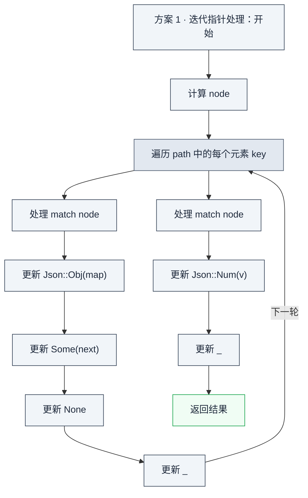

```rust
// LeetCode 133278676. 使用链表（指针链）获取 JSON 节点值 — Rust 版（方案A：安全遍历，缺失返回 None）
use std::collections::HashMap; // 引入依赖

#[derive(Debug, Clone, PartialEq)]
enum Json {
    // 定义类型
    Obj(HashMap<String, Json>),
    Num(i64),
}

fn get_value(data: &Json, path: &[&str]) -> Option<i64> {
    // 定义函数/方法 get_value
    let mut node = data; // 把 data; 写入 let mut node
    for key in path {
        // 逐个取出 当前路径 的元素（key）
        match node {
            // 按情况匹配处理
            Json::Obj(map) => match map.get(*key) {
                Some(next) => node = next,
                None => return None,
            },
            _ => return None,
        }
    }
    match node {
        // 按情况匹配处理
        Json::Num(v) => Some(*v),
        _ => None,
    }
}

fn sample() -> Json {
    // 定义函数/方法 sample
    let mut c = HashMap::new(); // 把 HashMap::new(); 写入 let mut c
    c.insert("c".to_string(), Json::Num(1)); // 字符 插入 「字符」.to_string(), Json::Num(1));
    let mut b = HashMap::new(); // 把 HashMap::new(); 写入 let mut b
    b.insert("b".to_string(), Json::Obj(c)); // b 插入 「b」.to_string(), Json::Obj(字符));
    let mut a = HashMap::new(); // 把 HashMap::new(); 写入 let mut a
    a.insert("a".to_string(), Json::Obj(b)); // 数组 插入 「数组」.to_string(), Json::Obj(b));
    let mut e = HashMap::new(); // 把 HashMap::new(); 写入 let mut e
    e.insert("e".to_string(), Json::Num(2)); // e 插入 「e」.to_string(), Json::Num(2));
    a.insert("d".to_string(), Json::Obj(e)); // 数组 插入 「d」.to_string(), Json::Obj(e));
    Json::Obj(a) // Json::Obj(数组)
}

fn main() {
    // 程序入口：跑内嵌自测用例
    let data = sample(); // 把 sample() 存入 data
    assert_eq!(get_value(&data, &["a", "b", "c"]), Some(1), "p1"); // 断言校验
    assert_eq!(get_value(&data, &["a", "z"]), None, "p2"); // 断言校验
    println!("PASS"); // 全部用例通过，输出 PASS
}
```

#### 方案 2：迭代指针处理

**思路与代码分析**：核心是「迭代指针处理」。Rust 版用所有权移动与切片借用改写同一逻辑，注意 Option 与引用边界。**走读**：方案 2 · 迭代指针处理：开始 → 计算 node → 遍历 path 中的每个元素 key → 处理 match node → 更新 Json::Obj(map) → 更新 Some(next) → 更新 None → 更新 _ → 处理 match node → 更新 Json::Num(v) → 更新 _ → 返回结果。

**运行架构**（真实控制流）：

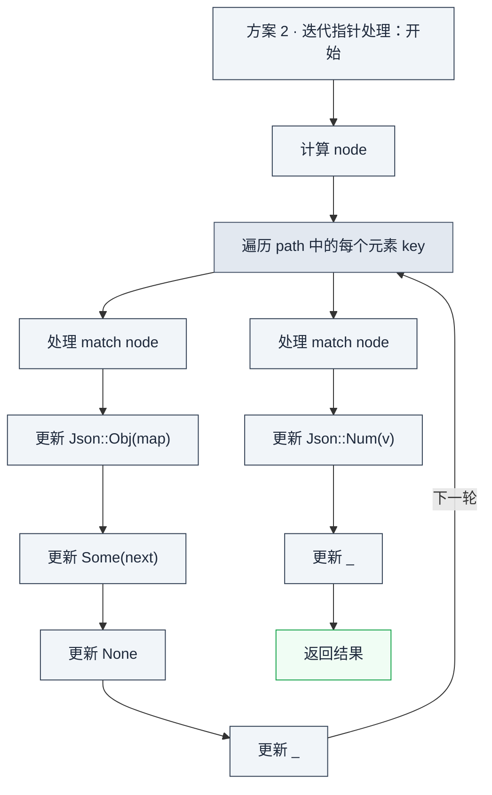

```rust
// LeetCode 133278676. 使用链表（指针链）获取 JSON 节点值 — Rust 版（方案A：安全遍历（单用例），缺失返回 None）
use std::collections::HashMap; // 引入依赖

#[derive(Debug, Clone, PartialEq)]
enum Json {
    // 定义类型
    Obj(HashMap<String, Json>),
    Num(i64),
}

fn get_value(data: &Json, path: &[&str]) -> Option<i64> {
    // 定义函数/方法 get_value
    let mut node = data; // 把 data; 写入 let mut node
    for key in path {
        // 逐个取出 当前路径 的元素（key）
        match node {
            // 按情况匹配处理
            Json::Obj(map) => match map.get(*key) {
                Some(next) => node = next,
                None => return None,
            },
            _ => return None,
        }
    }
    match node {
        // 按情况匹配处理
        Json::Num(v) => Some(*v),
        _ => None,
    }
}

fn sample() -> Json {
    // 定义函数/方法 sample
    let mut c = HashMap::new(); // 把 HashMap::new(); 写入 let mut c
    c.insert("c".to_string(), Json::Num(1)); // 字符 插入 「字符」.to_string(), Json::Num(1));
    let mut b = HashMap::new(); // 把 HashMap::new(); 写入 let mut b
    b.insert("b".to_string(), Json::Obj(c)); // b 插入 「b」.to_string(), Json::Obj(字符));
    let mut a = HashMap::new(); // 把 HashMap::new(); 写入 let mut a
    a.insert("a".to_string(), Json::Obj(b)); // 数组 插入 「数组」.to_string(), Json::Obj(b));
    let mut e = HashMap::new(); // 把 HashMap::new(); 写入 let mut e
    e.insert("e".to_string(), Json::Num(2)); // e 插入 「e」.to_string(), Json::Num(2));
    a.insert("d".to_string(), Json::Obj(e)); // 数组 插入 「d」.to_string(), Json::Obj(e));
    Json::Obj(a) // Json::Obj(数组)
}

fn main() {
    // 程序入口：跑内嵌自测用例
    let data = sample(); // 把 sample() 存入 data
    assert_eq!(get_value(&data, &["a", "b", "c"]), Some(1), "p1"); // 断言校验
    assert_eq!(get_value(&data, &["a", "z"]), None, "p2"); // 断言校验
    println!("PASS"); // 全部用例通过，输出 PASS
}
```

#### 方案 3：直接实现

**思路与代码分析**：核心是「直接实现」。Rust 版用所有权移动与切片借用改写同一逻辑，注意 Option 与引用边界。**走读**：方案 3 · 直接实现：开始 → 计算 node → 遍历 path 中的每个元素 key → 更新 node → 更新 Json::Obj(map) → 更新 _ → 处理 match node → 更新 Json::Num(v) → 更新 _ → 返回结果。

**运行架构**（真实控制流）：

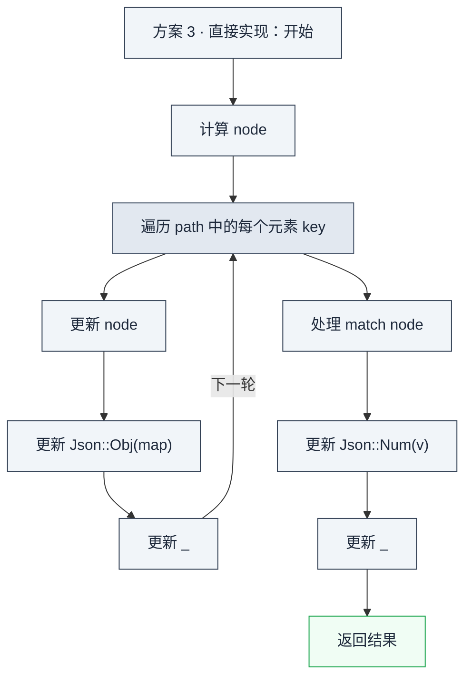

```rust
// LeetCode 133278676. 使用链表（指针链）获取 JSON 节点值 — Rust 版（方案B：逐键求值 / reduce 链式访问）
use std::collections::HashMap; // 引入依赖

#[derive(Debug, Clone, PartialEq)]
enum Json {
    // 定义类型
    Obj(HashMap<String, Json>),
    Num(i64),
}

// 逐键求值（合法路径语义，与 TS get_value_eval / getValueChain 一致）
fn get_value(data: &Json, path: &[&str]) -> Option<i64> {
    // 定义函数/方法 get_value
    let mut node = data; // 把 data; 写入 let mut node
    for key in path {
        // 逐个取出 当前路径 的元素（key）
        node = match node {
            // 把 match 节点 { 写入 节点
            Json::Obj(map) => map.get(*key)?,
            _ => return None,
        };
    }
    match node {
        // 按情况匹配处理
        Json::Num(v) => Some(*v),
        _ => None,
    }
}

fn sample() -> Json {
    // 定义函数/方法 sample
    let mut c = HashMap::new(); // 把 HashMap::new(); 写入 let mut c
    c.insert("c".to_string(), Json::Num(1)); // 字符 插入 「字符」.to_string(), Json::Num(1));
    let mut b = HashMap::new(); // 把 HashMap::new(); 写入 let mut b
    b.insert("b".to_string(), Json::Obj(c)); // b 插入 「b」.to_string(), Json::Obj(字符));
    let mut a = HashMap::new(); // 把 HashMap::new(); 写入 let mut a
    a.insert("a".to_string(), Json::Obj(b)); // 数组 插入 「数组」.to_string(), Json::Obj(b));
    let mut e = HashMap::new(); // 把 HashMap::new(); 写入 let mut e
    e.insert("e".to_string(), Json::Num(2)); // e 插入 「e」.to_string(), Json::Num(2));
    a.insert("d".to_string(), Json::Obj(e)); // 数组 插入 「d」.to_string(), Json::Obj(e));
    Json::Obj(a) // Json::Obj(数组)
}

fn main() {
    // 程序入口：跑内嵌自测用例
    let data = sample(); // 把 sample() 存入 data
                         // p1: 逐键求值
    assert_eq!(get_value(&data, &["a", "b", "c"]), Some(1), "p1"); // 断言校验
                                                                   // p2: reduce 链式访问
    assert_eq!(get_value(&data, &["d", "e"]), Some(2), "p2"); // 断言校验
    println!("PASS"); // 全部用例通过，输出 PASS
}
```

#### 方案 4：迭代指针处理

**思路与代码分析**：核心是「迭代指针处理」。Rust 版用所有权移动与切片借用改写同一逻辑，注意 Option 与引用边界。**走读**：方案 4 · 迭代指针处理：开始 → 计算 node → 遍历 path 中的每个元素 key → 更新 node → 更新 Json::Obj(map) → 更新 _ → 处理 match node → 更新 Json::Num(v) → 更新 _ → 返回结果。

**运行架构**（真实控制流）：

```mermaid
graph TD
    N0["方案 4 · 迭代指针处理：开始"]
    N1["计算 node"]
    N2["遍历 path 中的每个元素 key"]
    N3["更新 node"]
    N4["更新 Json::Obj(map)"]
    N5["更新 _"]
    N6["处理 match node"]
    N7["更新 Json::Num(v)"]
    N8["更新 _"]
    N9["返回结果"]
    N0 --> N1
    N1 --> N2
    N2 --> N3
    N3 --> N4
    N4 --> N5
    N5 -- 下一轮 --> N2
    N2 --> N6
    N6 --> N7
    N7 --> N8
    N8 --> N9
    classDef n fill:#f1f5f9,stroke:#334155,color:#1e293b;
    classDef lp fill:#e2e8f0,stroke:#475569,color:#1e293b;
    classDef dc fill:#fef9c3,stroke:#ca8a04,color:#1e293b;
    classDef tm fill:#f0fdf4,stroke:#16a34a,color:#1e293b;
    class N0,N1,N3,N4,N5,N6,N7,N8 n;
    class N2 lp;
    class N9 tm;
```

```rust
// LeetCode 133278676. 使用链表（指针链）获取 JSON 节点值 — Rust 版（方案B：逐键求值 / reduce 链式访问）
use std::collections::HashMap; // 引入依赖

#[derive(Debug, Clone, PartialEq)]
enum Json {
    // 定义类型
    Obj(HashMap<String, Json>),
    Num(i64),
}

// 逐键求值（合法路径语义，与 TS get_value_eval / getValueChain 一致）
fn get_value(data: &Json, path: &[&str]) -> Option<i64> {
    // 定义函数/方法 get_value
    let mut node = data; // 把 data; 写入 let mut node
    for key in path {
        // 逐个取出 当前路径 的元素（key）
        node = match node {
            // 把 match 节点 { 写入 节点
            Json::Obj(map) => map.get(*key)?,
            _ => return None,
        };
    }
    match node {
        // 按情况匹配处理
        Json::Num(v) => Some(*v),
        _ => None,
    }
}

fn sample() -> Json {
    // 定义函数/方法 sample
    let mut c = HashMap::new(); // 把 HashMap::new(); 写入 let mut c
    c.insert("c".to_string(), Json::Num(1)); // 字符 插入 「字符」.to_string(), Json::Num(1));
    let mut b = HashMap::new(); // 把 HashMap::new(); 写入 let mut b
    b.insert("b".to_string(), Json::Obj(c)); // b 插入 「b」.to_string(), Json::Obj(字符));
    let mut a = HashMap::new(); // 把 HashMap::new(); 写入 let mut a
    a.insert("a".to_string(), Json::Obj(b)); // 数组 插入 「数组」.to_string(), Json::Obj(b));
    let mut e = HashMap::new(); // 把 HashMap::new(); 写入 let mut e
    e.insert("e".to_string(), Json::Num(2)); // e 插入 「e」.to_string(), Json::Num(2));
    a.insert("d".to_string(), Json::Obj(e)); // 数组 插入 「d」.to_string(), Json::Obj(e));
    Json::Obj(a) // Json::Obj(数组)
}

fn main() {
    // 程序入口：跑内嵌自测用例
    let data = sample(); // 把 sample() 存入 data
                         // p1: 逐键求值
    assert_eq!(get_value(&data, &["a", "b", "c"]), Some(1), "p1"); // 断言校验
                                                                   // p2: reduce 链式访问
    assert_eq!(get_value(&data, &["d", "e"]), Some(2), "p2"); // 断言校验
    println!("PASS"); // 全部用例通过，输出 PASS
}
```

### Lua 实现（4 种方案）

Lua 的全部方案如下，每个方案都内嵌用例自测，可独立运行（老仓库 python/go 文件遵循「打印结果」约定）：

#### 方案 1：迭代指针处理

**思路与代码分析**：核心是「迭代指针处理」。Lua 版用表与 ipairs 遍历，注意 ipairs 遇 nil 即停的语义。**走读**：方案 1 · 迭代指针处理：开始 → 更新 node → 遍历 ipairs(path) do 中的每个元素 key → 处理 if type(node) ~= table or → 返回 nil → 更新 node → 返回 node。

**运行架构**（真实控制流）：

```mermaid
graph TD
    N0["方案 1 · 迭代指针处理：开始"]
    N1["更新 node"]
    N2["遍历 ipairs(path) do 中的每个元素 key"]
    N3["处理 if type(node) ~= table or"]
    N4["返回 nil"]
    N5["更新 node"]
    N6["返回 node"]
    N0 --> N1
    N1 --> N2
    N2 --> N3
    N3 --> N4
    N4 --> N5
    N5 --> N6
    classDef n fill:#f1f5f9,stroke:#334155,color:#1e293b;
    classDef lp fill:#e2e8f0,stroke:#475569,color:#1e293b;
    classDef dc fill:#fef9c3,stroke:#ca8a04,color:#1e293b;
    classDef tm fill:#f0fdf4,stroke:#16a34a,color:#1e293b;
    class N0,N1,N3,N5 n;
    class N2 lp;
    class N4,N6 tm;
```

```lua
-- LeetCode 133278676. 使用链表（指针链）获取 JSON 节点值 — Lua 版（方案A：安全遍历，缺失返回 nil）
local function get_value(data, path) -- local function get_value(data, 当前路径)
	local node = data -- 把 data 写入 local node
	for _, key in ipairs(path) do -- 遍历取 key
		if type(node) ~= "table" or node[key] == nil then
			return nil
		end
		node = node[key] -- 把 节点[key] 存入 节点
	end -- 终点
	return node -- 返回 节点
end -- 终点

local data = { a = { b = { c = 1 } }, d = { e = 2 } }
assert(get_value(data, { "a", "b", "c" }) == 1, "p1") -- 断言校验
assert(get_value(data, { "a", "z" }) == nil, "p2") -- 断言校验
print("PASS") -- 全部用例通过，输出 PASS
```

#### 方案 2：迭代指针处理

**思路与代码分析**：核心是「迭代指针处理」。Lua 版用表与 ipairs 遍历，注意 ipairs 遇 nil 即停的语义。**走读**：方案 2 · 迭代指针处理：开始 → 更新 node → 遍历 ipairs(path) do 中的每个元素 key → 处理 if type(node) ~= table or → 返回 nil → 更新 node → 返回 node。

**运行架构**（真实控制流）：

```mermaid
graph TD
    N0["方案 2 · 迭代指针处理：开始"]
    N1["更新 node"]
    N2["遍历 ipairs(path) do 中的每个元素 key"]
    N3["处理 if type(node) ~= table or"]
    N4["返回 nil"]
    N5["更新 node"]
    N6["返回 node"]
    N0 --> N1
    N1 --> N2
    N2 --> N3
    N3 --> N4
    N4 --> N5
    N5 --> N6
    classDef n fill:#f1f5f9,stroke:#334155,color:#1e293b;
    classDef lp fill:#e2e8f0,stroke:#475569,color:#1e293b;
    classDef dc fill:#fef9c3,stroke:#ca8a04,color:#1e293b;
    classDef tm fill:#f0fdf4,stroke:#16a34a,color:#1e293b;
    class N0,N1,N3,N5 n;
    class N2 lp;
    class N4,N6 tm;
```

```lua
-- LeetCode 133278676. 使用链表（指针链）获取 JSON 节点值 — Lua 版（方案A：安全遍历（单用例），缺失返回 nil）
local function get_value(data, path) -- local function get_value(data, 当前路径)
	local node = data -- 把 data 写入 local node
	for _, key in ipairs(path) do -- 遍历取 key
		if type(node) ~= "table" or node[key] == nil then
			return nil
		end
		node = node[key] -- 把 节点[key] 存入 节点
	end -- 终点
	return node -- 返回 节点
end -- 终点

local data = { a = { b = { c = 1 } }, d = { e = 2 } }
assert(get_value(data, { "a", "b", "c" }) == 1, "p1") -- 断言校验
assert(get_value(data, { "a", "z" }) == nil, "p2") -- 断言校验
print("PASS") -- 全部用例通过，输出 PASS
```

#### 方案 3：直接实现

**思路与代码分析**：核心是「直接实现」。Lua 版用表与 ipairs 遍历，注意 ipairs 遇 nil 即停的语义。**走读**：方案 3 · 直接实现：开始 → 更新 cur → 遍历 ipairs(path) do 中的每个元素 k → 更新 cur → 返回 cur。

**运行架构**（真实控制流）：

```mermaid
graph TD
    N0["方案 3 · 直接实现：开始"]
    N1["更新 cur"]
    N2["遍历 ipairs(path) do 中的每个元素 k"]
    N3["更新 cur"]
    N4["返回 cur"]
    N0 --> N1
    N1 --> N2
    N2 --> N3
    N3 --> N4
    classDef n fill:#f1f5f9,stroke:#334155,color:#1e293b;
    classDef lp fill:#e2e8f0,stroke:#475569,color:#1e293b;
    classDef dc fill:#fef9c3,stroke:#ca8a04,color:#1e293b;
    classDef tm fill:#f0fdf4,stroke:#16a34a,color:#1e293b;
    class N0,N1,N3 n;
    class N2 lp;
    class N4 tm;
```

```lua
-- LeetCode 133278676. 使用链表（指针链）获取 JSON 节点值 — Lua 版（方案B：逐键求值 / reduce 链式访问）
local function get_value_eval(data, path) -- local function get_value_eval(data, 当前路径)
	local cur = data -- 把 data 写入 local cur
	for _, k in ipairs(path) do -- 遍历取 下标 k
		cur = cur[k] -- 把 当前值[下标 k] 存入 当前值
	end -- 终点
	return cur -- 返回 当前值
end -- 终点

local function get_value_chain(data, path) -- local function get_value_chain(data, 当前路径)
	local acc = data -- 把 data 写入 local acc
	for _, k in ipairs(path) do -- 遍历取 下标 k
		acc = acc[k] -- 把 累加器[下标 k] 存入 累加器
	end -- 终点
	return acc -- 返回 累加器
end -- 终点

local data = { a = { b = { c = 1 } }, d = { e = 2 } }
assert(get_value_eval(data, { "a", "b", "c" }) == 1, "p1") -- 断言校验
assert(get_value_chain(data, { "d", "e" }) == 2, "p2") -- 断言校验
print("PASS") -- 全部用例通过，输出 PASS
```

#### 方案 4：迭代指针处理

**思路与代码分析**：核心是「迭代指针处理」。Lua 版用表与 ipairs 遍历，注意 ipairs 遇 nil 即停的语义。**走读**：方案 4 · 迭代指针处理：开始 → 更新 cur → 遍历 ipairs(path) do 中的每个元素 k → 更新 cur → 返回 cur。

**运行架构**（真实控制流）：

```mermaid
graph TD
    N0["方案 4 · 迭代指针处理：开始"]
    N1["更新 cur"]
    N2["遍历 ipairs(path) do 中的每个元素 k"]
    N3["更新 cur"]
    N4["返回 cur"]
    N0 --> N1
    N1 --> N2
    N2 --> N3
    N3 --> N4
    classDef n fill:#f1f5f9,stroke:#334155,color:#1e293b;
    classDef lp fill:#e2e8f0,stroke:#475569,color:#1e293b;
    classDef dc fill:#fef9c3,stroke:#ca8a04,color:#1e293b;
    classDef tm fill:#f0fdf4,stroke:#16a34a,color:#1e293b;
    class N0,N1,N3 n;
    class N2 lp;
    class N4 tm;
```

```lua
-- LeetCode 133278676. 使用链表（指针链）获取 JSON 节点值 — Lua 版（方案B：逐键求值 / reduce 链式访问）
local function get_value_eval(data, path) -- local function get_value_eval(data, 当前路径)
	local cur = data -- 把 data 写入 local cur
	for _, k in ipairs(path) do -- 遍历取 下标 k
		cur = cur[k] -- 把 当前值[下标 k] 存入 当前值
	end -- 终点
	return cur -- 返回 当前值
end -- 终点

local function get_value_chain(data, path) -- local function get_value_chain(data, 当前路径)
	local acc = data -- 把 data 写入 local acc
	for _, k in ipairs(path) do -- 遍历取 下标 k
		acc = acc[k] -- 把 累加器[下标 k] 存入 累加器
	end -- 终点
	return acc -- 返回 累加器
end -- 终点

local data = { a = { b = { c = 1 } }, d = { e = 2 } }
assert(get_value_eval(data, { "a", "b", "c" }) == 1, "p1") -- 断言校验
assert(get_value_chain(data, { "d", "e" }) == 2, "p2") -- 断言校验
print("PASS") -- 全部用例通过，输出 PASS
```

### C 实现（4 种方案）

C 的全部方案如下，每个方案都内嵌用例自测，可独立运行（老仓库 python/go 文件遵循「打印结果」约定）：

#### 方案 1：迭代指针处理

**思路与代码分析**：核心是「迭代指针处理」。C 版手动管理下标与内存，循环边界全部显式写出。**走读**：方案 1 · 迭代指针处理：开始 → 更新 *j → 更新 j->key → 更新 j->is_obj → 更新 j->val → 更新 j->nchildren → 返回 j。

**运行架构**（真实控制流）：

```mermaid
graph TD
    N0["方案 1 · 迭代指针处理：开始"]
    N1["更新 *j"]
    N2["更新 j->key"]
    N3["更新 j->is_obj"]
    N4["更新 j->val"]
    N5["更新 j->nchildren"]
    N6["返回 j"]
    N0 --> N1
    N1 --> N2
    N2 --> N3
    N3 --> N4
    N4 --> N5
    N5 --> N6
    classDef n fill:#f1f5f9,stroke:#334155,color:#1e293b;
    classDef lp fill:#e2e8f0,stroke:#475569,color:#1e293b;
    classDef dc fill:#fef9c3,stroke:#ca8a04,color:#1e293b;
    classDef tm fill:#f0fdf4,stroke:#16a34a,color:#1e293b;
    class N0,N1,N2,N3,N4,N5 n;
    class N6 tm;
```

```c
* LeetCode 133278676. 使用链表（指针链）获取 JSON 节点值 — C 版（方案A：安全遍历，缺失返回 NULL）
 * 最小 JSON 对象模型：节点为对象（带命名子节点）或整数
 */
#include <stdio.h>  // 引入头文件
#include <stdlib.h> // 引入头文件
#include <string.h> // 引入头文件

typedef struct JNode {                          // typedef struct JNode {
    const char *key;                            // const char 乘 key;
    int is_obj;                                 // int is_obj;
    int val; /* 叶子值 */                       // int 值; 除以 乘 叶子值 乘 除以
    struct JNode *children[8]; /* 对象子节点 */ // 定义类型
    int nchildren;                              // int nchildren;
} JNode;                                        // } JNode;

static JNode *obj(const char *key, JNode **children, int n) {
    JNode *j = malloc(sizeof(JNode)); // 把 malloc(sizeof(JNode)); 写入 JNode *j
    j->key = key;
    j->is_obj = 1;
    j->val = 0; // 把 key; 下标 j 减 超过 is_obj 赋值为 1; 下标 j 减 超过 值 赋值为 0; 写入 j->key
    for (int i = 0; i < n; i++)
        j->children[i] = children[i]; // 让 下标 i 从 0 开始计数，下标 i 小于 元素个数 就继续
    j->nchildren = n;                 // 把 元素个数; 写入 j->nchildren
    return j;                         // 返回 下标 j
}

static JNode *leaf(const char *key, int val) { // static JNode 乘 leaf(const char 乘 key, int 值) {
    JNode *j = malloc(sizeof(JNode));          // 把 malloc(sizeof(JNode)); 写入 JNode *j
    j->key = key;
    j->is_obj = 0;
    j->val = val;
    j->nchildren = 0;
    return j; // 返回 下标 j
}

static JNode *child(JNode *node,
                    const char *key) { // static JNode 乘 子节点(JNode 乘 节点, const char 乘 key) {
    for (int i = 0; i < node->nchildren;
         i++) // 让 下标 i 从 0 开始计数，下标 i 小于 节点 减 超过 nchildren 就继续
        if (strcmp(node->children[i]->key, key) == 0)
            return node->children[i];
    return NULL; // 返回 NULL
}

static JNode *get_value(JNode *data, const char **path, int n) {
    JNode *node = data;           // 把 data; 写入 JNode *node
    for (int i = 0; i < n; i++) { // 让 下标 i 从 0 开始计数，下标 i 小于 元素个数 就继续
        if (!node->is_obj)
            return NULL;             // 若 取反 节点 减 超过 is_obj，直接返回 NULL
        node = child(node, path[i]); // 把 子节点(节点, 当前路径[下标 i]); 写入 节点
        if (!node)
            return NULL; // 若 取反 节点，直接返回 NULL
    }
    return node; // 返回 节点
}

int main(void) {                                // 程序入口：跑内嵌自测用例
    JNode *c = leaf("c", 1);                    // 把 leaf(「字符」, 1); 写入 JNode *c
    JNode *b_children[1] = {c};                 // 把 {字符}; 写入 JNode *b_children[1]
    JNode *b = obj("b", b_children, 1);         // 把 obj(「b」, b_children, 1); 写入 JNode *b
    JNode *a_children[1] = {b};                 // 把 {b}; 写入 JNode *a_children[1]
    JNode *a = obj("a", a_children, 1);         // 把 obj(「数组」, a_children, 1); 写入 JNode *a
    JNode *e = leaf("e", 2);                    // 把 leaf(「e」, 2); 写入 JNode *e
    JNode *d_children[1] = {e};                 // 把 {e}; 写入 JNode *d_children[1]
    JNode *d = obj("d", d_children, 1);         // 把 obj(「d」, d_children, 1); 写入 JNode *d
    JNode *top_children[2] = {a, d};            // 把 {数组, d}; 写入 JNode *top_children[2]
    JNode *data = obj("root", top_children, 2); // 把 obj(「根节点」, top_children, 2); 写入 JNode *data

    const char *p1[] = {"a", "b", "c"}; // 把 {「数组」, 「数组」, 「数组」}; 写入 const char *p1[]
    const char *p2[] = {"a", "z"};      // 把 {「数组」, 「数组」}; 写入 const char *p2[]
    JNode *r1 = get_value(data, p1, 3); // 把 get_value(data, p1, 3); 写入 JNode *r1
    if (!r1 || r1->val != 1) {
        printf("p1 failed\n");
        return 1;
    } // 若 取反 r1 或 r1 减 超过 值 不等于 1) { 输出「p1 failed 」); return 1; }
    if (get_value(data, p2, 2) != NULL) {
        printf("p2 failed\n");
        return 1;
    }
    printf("PASS\n"); // 全部用例通过，输出 PASS
    return 0;         // 返回 0
}
```

#### 方案 2：迭代指针处理

**思路与代码分析**：核心是「迭代指针处理」。C 版手动管理下标与内存，循环边界全部显式写出。**走读**：方案 2 · 迭代指针处理：开始 → 更新 *j → 更新 j->key → 更新 j->is_obj → 更新 j->val → 更新 j->nchildren → 返回 j。

**运行架构**（真实控制流）：

```mermaid
graph TD
    N0["方案 2 · 迭代指针处理：开始"]
    N1["更新 *j"]
    N2["更新 j->key"]
    N3["更新 j->is_obj"]
    N4["更新 j->val"]
    N5["更新 j->nchildren"]
    N6["返回 j"]
    N0 --> N1
    N1 --> N2
    N2 --> N3
    N3 --> N4
    N4 --> N5
    N5 --> N6
    classDef n fill:#f1f5f9,stroke:#334155,color:#1e293b;
    classDef lp fill:#e2e8f0,stroke:#475569,color:#1e293b;
    classDef dc fill:#fef9c3,stroke:#ca8a04,color:#1e293b;
    classDef tm fill:#f0fdf4,stroke:#16a34a,color:#1e293b;
    class N0,N1,N2,N3,N4,N5 n;
    class N6 tm;
```

```c
* LeetCode 133278676. 使用链表（指针链）获取 JSON 节点值 — C 版（方案A：安全遍历（单用例），缺失返回 NULL）
 * 最小 JSON 对象模型：节点为对象（带命名子节点）或整数
 */
#include <stdio.h>  // 引入头文件
#include <stdlib.h> // 引入头文件
#include <string.h> // 引入头文件

typedef struct JNode {                          // typedef struct JNode {
    const char *key;                            // const char 乘 key;
    int is_obj;                                 // int is_obj;
    int val; /* 叶子值 */                       // int 值; 除以 乘 叶子值 乘 除以
    struct JNode *children[8]; /* 对象子节点 */ // 定义类型
    int nchildren;                              // int nchildren;
} JNode;                                        // } JNode;

static JNode *obj(const char *key, JNode **children, int n) {
    JNode *j = malloc(sizeof(JNode)); // 把 malloc(sizeof(JNode)); 写入 JNode *j
    j->key = key;
    j->is_obj = 1;
    j->val = 0; // 把 key; 下标 j 减 超过 is_obj 赋值为 1; 下标 j 减 超过 值 赋值为 0; 写入 j->key
    for (int i = 0; i < n; i++)
        j->children[i] = children[i]; // 让 下标 i 从 0 开始计数，下标 i 小于 元素个数 就继续
    j->nchildren = n;                 // 把 元素个数; 写入 j->nchildren
    return j;                         // 返回 下标 j
}

static JNode *leaf(const char *key, int val) { // static JNode 乘 leaf(const char 乘 key, int 值) {
    JNode *j = malloc(sizeof(JNode));          // 把 malloc(sizeof(JNode)); 写入 JNode *j
    j->key = key;
    j->is_obj = 0;
    j->val = val;
    j->nchildren = 0;
    return j; // 返回 下标 j
}

static JNode *child(JNode *node,
                    const char *key) { // static JNode 乘 子节点(JNode 乘 节点, const char 乘 key) {
    for (int i = 0; i < node->nchildren;
         i++) // 让 下标 i 从 0 开始计数，下标 i 小于 节点 减 超过 nchildren 就继续
        if (strcmp(node->children[i]->key, key) == 0)
            return node->children[i];
    return NULL; // 返回 NULL
}

static JNode *get_value(JNode *data, const char **path, int n) {
    JNode *node = data;           // 把 data; 写入 JNode *node
    for (int i = 0; i < n; i++) { // 让 下标 i 从 0 开始计数，下标 i 小于 元素个数 就继续
        if (!node->is_obj)
            return NULL;             // 若 取反 节点 减 超过 is_obj，直接返回 NULL
        node = child(node, path[i]); // 把 子节点(节点, 当前路径[下标 i]); 写入 节点
        if (!node)
            return NULL; // 若 取反 节点，直接返回 NULL
    }
    return node; // 返回 节点
}

int main(void) {                                // 程序入口：跑内嵌自测用例
    JNode *c = leaf("c", 1);                    // 把 leaf(「字符」, 1); 写入 JNode *c
    JNode *b_children[1] = {c};                 // 把 {字符}; 写入 JNode *b_children[1]
    JNode *b = obj("b", b_children, 1);         // 把 obj(「b」, b_children, 1); 写入 JNode *b
    JNode *a_children[1] = {b};                 // 把 {b}; 写入 JNode *a_children[1]
    JNode *a = obj("a", a_children, 1);         // 把 obj(「数组」, a_children, 1); 写入 JNode *a
    JNode *e = leaf("e", 2);                    // 把 leaf(「e」, 2); 写入 JNode *e
    JNode *d_children[1] = {e};                 // 把 {e}; 写入 JNode *d_children[1]
    JNode *d = obj("d", d_children, 1);         // 把 obj(「d」, d_children, 1); 写入 JNode *d
    JNode *top_children[2] = {a, d};            // 把 {数组, d}; 写入 JNode *top_children[2]
    JNode *data = obj("root", top_children, 2); // 把 obj(「根节点」, top_children, 2); 写入 JNode *data

    const char *p1[] = {"a", "b", "c"}; // 把 {「数组」, 「数组」, 「数组」}; 写入 const char *p1[]
    const char *p2[] = {"a", "z"};      // 把 {「数组」, 「数组」}; 写入 const char *p2[]
    JNode *r1 = get_value(data, p1, 3); // 把 get_value(data, p1, 3); 写入 JNode *r1
    if (!r1 || r1->val != 1) {
        printf("p1 failed\n");
        return 1;
    } // 若 取反 r1 或 r1 减 超过 值 不等于 1) { 输出「p1 failed 」); return 1; }
    if (get_value(data, p2, 2) != NULL) {
        printf("p2 failed\n");
        return 1;
    }
    printf("PASS\n"); // 全部用例通过，输出 PASS
    return 0;         // 返回 0
}
```

#### 方案 3：直接实现

**思路与代码分析**：核心是「直接实现」。C 版手动管理下标与内存，循环边界全部显式写出。代码里依次做这些事：单循环线性扫描。**走读**：方案 3 · 直接实现：开始 → 更新 *cur → 遍历循环 → 更新 cur → 返回 cur。

**运行架构**（真实控制流）：

```mermaid
graph TD
    N0["方案 3 · 直接实现：开始"]
    N1["更新 *cur"]
    N2["遍历循环"]
    N3["更新 cur"]
    N4["返回 cur"]
    N0 --> N1
    N1 --> N2
    N2 --> N3
    N3 --> N4
    classDef n fill:#f1f5f9,stroke:#334155,color:#1e293b;
    classDef lp fill:#e2e8f0,stroke:#475569,color:#1e293b;
    classDef dc fill:#fef9c3,stroke:#ca8a04,color:#1e293b;
    classDef tm fill:#f0fdf4,stroke:#16a34a,color:#1e293b;
    class N0,N1,N3 n;
    class N2 lp;
    class N4 tm;
```

```c
* LeetCode 133278676. 使用链表（指针链）获取 JSON 节点值 — C 版（方案B：逐键求值，合法路径直接索引）
 */
#include <stdio.h>  // 引入头文件
#include <stdlib.h> // 引入头文件
#include <string.h> // 引入头文件

typedef struct JNode {         // typedef struct JNode {
    const char *key;           // const char 乘 key;
    int is_obj;                // int is_obj;
    int val;                   // int 值;
    struct JNode *children[8]; // 定义类型
    int nchildren;             // int nchildren;
} JNode;                       // } JNode;

static JNode *child(JNode *node,
                    const char *key) { // static JNode 乘 子节点(JNode 乘 节点, const char 乘 key) {
    for (int i = 0; i < node->nchildren;
         i++) // 让 下标 i 从 0 开始计数，下标 i 小于 节点 减 超过 nchildren 就继续
        if (strcmp(node->children[i]->key, key) == 0)
            return node->children[i];
    return NULL; // 返回 NULL
}

/* 直接求值：假定路径合法（与 TS get_value_eval 一致） */
static JNode *get_value_eval(JNode *data, const char **path, int n) {
    JNode *cur = data; // 把 data; 写入 JNode *cur
    for (int i = 0; i < n; i++)
        cur = child(cur, path[i]); // 让 下标 i 从 0 开始计数，下标 i 小于 元素个数 就继续
    return cur;                    // 返回 当前值
}

int main(void) {                         // 程序入口：跑内嵌自测用例
    JNode *c = calloc(1, sizeof(JNode)); // 把 calloc(1, sizeof(JNode)); 写入 JNode *c
    c->key = "c";
    c->val = 1;                          // 把 「字符」; 字符 减 超过 值 赋值为 1; 写入 c->key
    JNode *b = calloc(1, sizeof(JNode)); // 把 calloc(1, sizeof(JNode)); 写入 JNode *b
    b->key = "b";
    b->is_obj = 1;
    b->children[0] = c;
    b->nchildren = 1;
    JNode *a = calloc(1, sizeof(JNode)); // 把 calloc(1, sizeof(JNode)); 写入 JNode *a
    a->key = "a";
    a->is_obj = 1;
    a->children[0] = b;
    a->nchildren = 1;
    JNode *e = calloc(1, sizeof(JNode)); // 把 calloc(1, sizeof(JNode)); 写入 JNode *e
    e->key = "e";
    e->val = 2;                          // 把 「e」; e 减 超过 值 赋值为 2; 写入 e->key
    JNode *d = calloc(1, sizeof(JNode)); // 把 calloc(1, sizeof(JNode)); 写入 JNode *d
    d->key = "d";
    d->is_obj = 1;
    d->children[0] = e;
    d->nchildren = 1;
    JNode *data = calloc(1, sizeof(JNode)); // 把 calloc(1, sizeof(JNode)); 写入 JNode *data
    data->key = "root";
    data->is_obj = 1; // 把 「根节点」; data 减 超过 is_obj 赋值为 1; 写入 data->key
    data->children[0] = a;
    data->children[1] = d;
    data->nchildren = 2;

    const char *p1[] = {"a", "b", "c"}; // 把 {「数组」, 「数组」, 「数组」}; 写入 const char *p1[]
    const char *p2[] = {"d", "e"};      // 把 {「d」, 「d」}; 写入 const char *p2[]
    if (get_value_eval(data, p1, 3)->val != 1) {
        printf("p1 failed\n");
        return 1;
    }
    if (get_value_eval(data, p2, 2)->val != 2) {
        printf("p2 failed\n");
        return 1;
    }
    printf("PASS\n"); // 全部用例通过，输出 PASS
    return 0;         // 返回 0
}
```

#### 方案 4：迭代指针处理

**思路与代码分析**：核心是「迭代指针处理」。C 版手动管理下标与内存，循环边界全部显式写出。代码里依次做这些事：单循环线性扫描。**走读**：方案 4 · 迭代指针处理：开始 → 更新 *cur → 遍历循环 → 更新 cur → 返回 cur。

**运行架构**（真实控制流）：

```mermaid
graph TD
    N0["方案 4 · 迭代指针处理：开始"]
    N1["更新 *cur"]
    N2["遍历循环"]
    N3["更新 cur"]
    N4["返回 cur"]
    N0 --> N1
    N1 --> N2
    N2 --> N3
    N3 --> N4
    classDef n fill:#f1f5f9,stroke:#334155,color:#1e293b;
    classDef lp fill:#e2e8f0,stroke:#475569,color:#1e293b;
    classDef dc fill:#fef9c3,stroke:#ca8a04,color:#1e293b;
    classDef tm fill:#f0fdf4,stroke:#16a34a,color:#1e293b;
    class N0,N1,N3 n;
    class N2 lp;
    class N4 tm;
```

```c
* LeetCode 133278676. 使用链表（指针链）获取 JSON 节点值 — C 版（方案B：逐键求值，合法路径直接索引）
 */
#include <stdio.h>  // 引入头文件
#include <stdlib.h> // 引入头文件
#include <string.h> // 引入头文件

typedef struct JNode {         // typedef struct JNode {
    const char *key;           // const char 乘 key;
    int is_obj;                // int is_obj;
    int val;                   // int 值;
    struct JNode *children[8]; // 定义类型
    int nchildren;             // int nchildren;
} JNode;                       // } JNode;

static JNode *child(JNode *node,
                    const char *key) { // static JNode 乘 子节点(JNode 乘 节点, const char 乘 key) {
    for (int i = 0; i < node->nchildren;
         i++) // 让 下标 i 从 0 开始计数，下标 i 小于 节点 减 超过 nchildren 就继续
        if (strcmp(node->children[i]->key, key) == 0)
            return node->children[i];
    return NULL; // 返回 NULL
}

/* 直接求值：假定路径合法（与 TS get_value_eval 一致） */
static JNode *get_value_eval(JNode *data, const char **path, int n) {
    JNode *cur = data; // 把 data; 写入 JNode *cur
    for (int i = 0; i < n; i++)
        cur = child(cur, path[i]); // 让 下标 i 从 0 开始计数，下标 i 小于 元素个数 就继续
    return cur;                    // 返回 当前值
}

int main(void) {                         // 程序入口：跑内嵌自测用例
    JNode *c = calloc(1, sizeof(JNode)); // 把 calloc(1, sizeof(JNode)); 写入 JNode *c
    c->key = "c";
    c->val = 1;                          // 把 「字符」; 字符 减 超过 值 赋值为 1; 写入 c->key
    JNode *b = calloc(1, sizeof(JNode)); // 把 calloc(1, sizeof(JNode)); 写入 JNode *b
    b->key = "b";
    b->is_obj = 1;
    b->children[0] = c;
    b->nchildren = 1;
    JNode *a = calloc(1, sizeof(JNode)); // 把 calloc(1, sizeof(JNode)); 写入 JNode *a
    a->key = "a";
    a->is_obj = 1;
    a->children[0] = b;
    a->nchildren = 1;
    JNode *e = calloc(1, sizeof(JNode)); // 把 calloc(1, sizeof(JNode)); 写入 JNode *e
    e->key = "e";
    e->val = 2;                          // 把 「e」; e 减 超过 值 赋值为 2; 写入 e->key
    JNode *d = calloc(1, sizeof(JNode)); // 把 calloc(1, sizeof(JNode)); 写入 JNode *d
    d->key = "d";
    d->is_obj = 1;
    d->children[0] = e;
    d->nchildren = 1;
    JNode *data = calloc(1, sizeof(JNode)); // 把 calloc(1, sizeof(JNode)); 写入 JNode *data
    data->key = "root";
    data->is_obj = 1; // 把 「根节点」; data 减 超过 is_obj 赋值为 1; 写入 data->key
    data->children[0] = a;
    data->children[1] = d;
    data->nchildren = 2;

    const char *p1[] = {"a", "b", "c"}; // 把 {「数组」, 「数组」, 「数组」}; 写入 const char *p1[]
    const char *p2[] = {"d", "e"};      // 把 {「d」, 「d」}; 写入 const char *p2[]
    if (get_value_eval(data, p1, 3)->val != 1) {
        printf("p1 failed\n");
        return 1;
    }
    if (get_value_eval(data, p2, 2)->val != 2) {
        printf("p2 failed\n");
        return 1;
    }
    printf("PASS\n"); // 全部用例通过，输出 PASS
    return 0;         // 返回 0
}
```

### C++ 实现（4 种方案）

C++ 的全部方案如下，每个方案都内嵌用例自测，可独立运行（老仓库 python/go 文件遵循「打印结果」约定）：

#### 方案 1：迭代指针处理

**思路与代码分析**：核心是「迭代指针处理」。C++ 版用 STL 容器与迭代器，减少手写下标错误。代码里依次做这些事：单循环线性扫描。**走读**：方案 1 · 迭代指针处理：开始 → 更新 *node → 遍历循环 → 命中条件，直接返回 → 更新 node → 命中条件，直接返回 → 返回 node。

**运行架构**（真实控制流）：

```mermaid
graph TD
    N0["方案 1 · 迭代指针处理：开始"]
    N1["更新 *node"]
    N2["遍历循环"]
    N3{"非 node-＞is_obj ？"}
    N4["命中条件，直接返回"]
    N5["更新 node"]
    N6{"非 node ？"}
    N7["命中条件，直接返回"]
    N8["返回 node"]
    N0 --> N1
    N1 --> N2
    N2 --> N3
    N3 -- 是 --> N4
    N3 -- 否 --> N5
    N5 --> N6
    N6 -- 是 --> N7
    N6 -- 下一轮 --> N2
    N2 --> N8
    classDef n fill:#f1f5f9,stroke:#334155,color:#1e293b;
    classDef lp fill:#e2e8f0,stroke:#475569,color:#1e293b;
    classDef dc fill:#fef9c3,stroke:#ca8a04,color:#1e293b;
    classDef tm fill:#f0fdf4,stroke:#16a34a,color:#1e293b;
    class N0,N1,N5 n;
    class N2 lp;
    class N3,N6 dc;
    class N4,N7,N8 tm;
```

```cpp
// LeetCode 133278676. 使用链表（指针链）获取 JSON 节点值 — C++ 版（方案A：安全遍历，缺失返回 nullptr）
#include <iostream> // 引入头文件
#include <map>      // 引入头文件
#include <memory>   // 引入头文件
#include <string>   // 引入头文件
#include <vector>   // 引入头文件

struct JNode {           // 定义类型
    bool is_obj = false; // 把 false 存入 is_obj
    int val = 0;         // 把 0 存入 值
    std::map<std::string, std::unique_ptr<JNode>> children;

    JNode *child(const std::string &key) const { // JNode 乘 子节点(const std::string 按位与 key) const {
        auto it = children.find(key);            // 把 children 查找 key) 存入 it
        return it == children.end()
                   ? nullptr
                   : it->second.get(); // 返回 it 等于 children.终点() ? nullptr : it 减 超过 second 查找 )
    }
};

static JNode *get_value(JNode *data, const std::vector<std::string> &path) {
    JNode *node = data;            // 把 data; 写入 JNode *node
    for (const auto &key : path) { // 逐个取出 当前路径 的元素（key）
        if (!node->is_obj)
            return nullptr;      // 若 取反 节点 减 超过 is_obj，直接返回 nullptr
        node = node->child(key); // 把 节点 减 超过 子节点(key); 写入 节点
        if (!node)
            return nullptr; // 若 取反 节点，直接返回 nullptr
    }
    return node; // 返回 节点
}

int main() {                               // 程序入口：跑内嵌自测用例
    auto data = std::make_unique<JNode>(); // 把 std::make_unique 小于 JNode 超过 () 存入 data
    data->is_obj = true;                   // 把 true; 写入 data->is_obj
    auto &a = data->children["a"];         // 把 data 减 超过 children[「数组」]; 写入 auto &a
    a = std::make_unique<JNode>();         // 把 std::make_unique 小于 JNode 超过 (); 写入 数组
    a->is_obj = true;                      // 把 true; 写入 a->is_obj
    auto &b = a->children["b"];            // 把 数组 减 超过 children[「b」]; 写入 auto &b
    b = std::make_unique<JNode>();         // 把 std::make_unique 小于 JNode 超过 (); 写入 b
    b->is_obj = true;                      // 把 true; 写入 b->is_obj
    auto &c = b->children["c"];            // 把 b 减 超过 children[「字符」]; 写入 auto &c
    c = std::make_unique<JNode>();         // 把 std::make_unique 小于 JNode 超过 (); 写入 字符
    c->val = 1;                            // 把 1; 写入 c->val
    auto &d = data->children["d"];         // 把 data 减 超过 children[「d」]; 写入 auto &d
    d = std::make_unique<JNode>();         // 把 std::make_unique 小于 JNode 超过 (); 写入 d
    d->is_obj = true;                      // 把 true; 写入 d->is_obj
    auto &e = d->children["e"];            // 把 d 减 超过 children[「e」]; 写入 auto &e
    e = std::make_unique<JNode>();         // 把 std::make_unique 小于 JNode 超过 (); 写入 e
    e->val = 2;                            // 把 2; 写入 e->val

    if (auto *r = get_value(
            data.get(),
            {"a", "b",
             "c"})) { // 若 auto 乘 右指针 赋值为 get_value(data 查找 ), {「数组」, 「数组」, 「数组」}
        if (r->val != 1) {
            std::cout << "p1 failed" << std::endl;
            return 1;
        }
    } else {                                   // 否则
        std::cout << "p1 failed" << std::endl; // 打印输出
        return 1;                              // 返回 1
    }
    if (get_value(data.get(), {"a", "z"}) != nullptr) {
        std::cout << "p2 failed" << std::endl;
        return 1;
    }
    std::cout << "PASS" << std::endl; // 全部用例通过，输出 PASS
    return 0;                         // 返回 0
}
```

#### 方案 2：迭代指针处理

**思路与代码分析**：核心是「迭代指针处理」。C++ 版用 STL 容器与迭代器，减少手写下标错误。代码里依次做这些事：单循环线性扫描。**走读**：方案 2 · 迭代指针处理：开始 → 更新 *node → 遍历循环 → 命中条件，直接返回 → 更新 node → 命中条件，直接返回 → 返回 node。

**运行架构**（真实控制流）：

```mermaid
graph TD
    N0["方案 2 · 迭代指针处理：开始"]
    N1["更新 *node"]
    N2["遍历循环"]
    N3{"非 node-＞is_obj ？"}
    N4["命中条件，直接返回"]
    N5["更新 node"]
    N6{"非 node ？"}
    N7["命中条件，直接返回"]
    N8["返回 node"]
    N0 --> N1
    N1 --> N2
    N2 --> N3
    N3 -- 是 --> N4
    N3 -- 否 --> N5
    N5 --> N6
    N6 -- 是 --> N7
    N6 -- 下一轮 --> N2
    N2 --> N8
    classDef n fill:#f1f5f9,stroke:#334155,color:#1e293b;
    classDef lp fill:#e2e8f0,stroke:#475569,color:#1e293b;
    classDef dc fill:#fef9c3,stroke:#ca8a04,color:#1e293b;
    classDef tm fill:#f0fdf4,stroke:#16a34a,color:#1e293b;
    class N0,N1,N5 n;
    class N2 lp;
    class N3,N6 dc;
    class N4,N7,N8 tm;
```

```cpp
// LeetCode 133278676. 使用链表（指针链）获取 JSON 节点值 — C++ 版（方案A：安全遍历（单用例），缺失返回
// nullptr）
#include <iostream> // 引入头文件
#include <map>      // 引入头文件
#include <memory>   // 引入头文件
#include <string>   // 引入头文件
#include <vector>   // 引入头文件

struct JNode {           // 定义类型
    bool is_obj = false; // 把 false 存入 is_obj
    int val = 0;         // 把 0 存入 值
    std::map<std::string, std::unique_ptr<JNode>> children;

    JNode *child(const std::string &key) const { // JNode 乘 子节点(const std::string 按位与 key) const {
        auto it = children.find(key);            // 把 children 查找 key) 存入 it
        return it == children.end()
                   ? nullptr
                   : it->second.get(); // 返回 it 等于 children.终点() ? nullptr : it 减 超过 second 查找 )
    }
};

static JNode *get_value(JNode *data, const std::vector<std::string> &path) {
    JNode *node = data;            // 把 data; 写入 JNode *node
    for (const auto &key : path) { // 逐个取出 当前路径 的元素（key）
        if (!node->is_obj)
            return nullptr;      // 若 取反 节点 减 超过 is_obj，直接返回 nullptr
        node = node->child(key); // 把 节点 减 超过 子节点(key); 写入 节点
        if (!node)
            return nullptr; // 若 取反 节点，直接返回 nullptr
    }
    return node; // 返回 节点
}

int main() {                               // 程序入口：跑内嵌自测用例
    auto data = std::make_unique<JNode>(); // 把 std::make_unique 小于 JNode 超过 () 存入 data
    data->is_obj = true;                   // 把 true; 写入 data->is_obj
    auto &a = data->children["a"];         // 把 data 减 超过 children[「数组」]; 写入 auto &a
    a = std::make_unique<JNode>();         // 把 std::make_unique 小于 JNode 超过 (); 写入 数组
    a->is_obj = true;                      // 把 true; 写入 a->is_obj
    auto &b = a->children["b"];            // 把 数组 减 超过 children[「b」]; 写入 auto &b
    b = std::make_unique<JNode>();         // 把 std::make_unique 小于 JNode 超过 (); 写入 b
    b->is_obj = true;                      // 把 true; 写入 b->is_obj
    auto &c = b->children["c"];            // 把 b 减 超过 children[「字符」]; 写入 auto &c
    c = std::make_unique<JNode>();         // 把 std::make_unique 小于 JNode 超过 (); 写入 字符
    c->val = 1;                            // 把 1; 写入 c->val
    auto &d = data->children["d"];         // 把 data 减 超过 children[「d」]; 写入 auto &d
    d = std::make_unique<JNode>();         // 把 std::make_unique 小于 JNode 超过 (); 写入 d
    d->is_obj = true;                      // 把 true; 写入 d->is_obj
    auto &e = d->children["e"];            // 把 d 减 超过 children[「e」]; 写入 auto &e
    e = std::make_unique<JNode>();         // 把 std::make_unique 小于 JNode 超过 (); 写入 e
    e->val = 2;                            // 把 2; 写入 e->val

    if (auto *r = get_value(
            data.get(),
            {"a", "b",
             "c"})) { // 若 auto 乘 右指针 赋值为 get_value(data 查找 ), {「数组」, 「数组」, 「数组」}
        if (r->val != 1) {
            std::cout << "p1 failed" << std::endl;
            return 1;
        }
    } else {                                   // 否则
        std::cout << "p1 failed" << std::endl; // 打印输出
        return 1;                              // 返回 1
    }
    if (get_value(data.get(), {"a", "z"}) != nullptr) {
        std::cout << "p2 failed" << std::endl;
        return 1;
    }
    std::cout << "PASS" << std::endl; // 全部用例通过，输出 PASS
    return 0;                         // 返回 0
}
```

#### 方案 3：直接实现

**思路与代码分析**：核心是「直接实现」。C++ 版用 STL 容器与迭代器，减少手写下标错误。**走读**：方案 3 · 直接实现：开始 → 更新 *cur → 更新 start → 当 (start ≤ path.size()) 时反复执行 → 更新 slash → 更新 key → 调用 path.substr(start, slash - s → 更新 cur → 若 slash == std::string::npos：处理 break → 跳出循环（break） → 更新 start → 返回 cur。

**运行架构**（真实控制流）：

```mermaid
graph TD
    N0["方案 3 · 直接实现：开始"]
    N1["更新 *cur"]
    N2["更新 start"]
    N3["当 (start ≤ path.size()) 时反复执行"]
    N4["更新 slash"]
    N5["更新 key"]
    N6["调用 path.substr(start, slash - s"]
    N7["更新 cur"]
    N8["若 slash == std::string::npos：处理 break"]
    N9["跳出循环（break）"]
    N10["更新 start"]
    N11["返回 cur"]
    N0 --> N1
    N1 --> N2
    N2 --> N3
    N3 --> N4
    N4 --> N5
    N5 --> N6
    N6 --> N7
    N7 --> N8
    N8 --> N9
    N9 --> N10
    N10 -- 下一轮 --> N3
    N3 --> N11
    classDef n fill:#f1f5f9,stroke:#334155,color:#1e293b;
    classDef lp fill:#e2e8f0,stroke:#475569,color:#1e293b;
    classDef dc fill:#fef9c3,stroke:#ca8a04,color:#1e293b;
    classDef tm fill:#f0fdf4,stroke:#16a34a,color:#1e293b;
    class N0,N1,N2,N4,N5,N6,N7,N8,N9,N10 n;
    class N3 lp;
    class N11 tm;
```

```cpp
// LeetCode 133278676. 使用链表（指针链）获取 JSON 节点值 — C++ 版（方案B：逐键求值 / reduce 链式访问）
#include <iostream> // 引入头文件
#include <map>      // 引入头文件
#include <memory>   // 引入头文件
#include <string>   // 引入头文件

struct JNode {           // 定义类型
    bool is_obj = false; // 把 false 存入 is_obj
    int val = 0;         // 把 0 存入 值
    std::map<std::string, std::unique_ptr<JNode>> children;
};

static JNode *get_value_eval(JNode *data, const std::string &path) {
    // 合法路径直接逐键求值（"a/b/c" 形式）
    JNode *cur = data;             // 把 data; 写入 JNode *cur
    size_t start = 0;              // 把 0; 写入 size_t start
    while (start <= path.size()) { // 循环，直到不满足「起点 不超过 当前路径.大小(」
        size_t slash = path.find('/', start); // 把 当前路径 查找 ' 除以 ', 起点); 写入 size_t slash
        std::string key =
            path.substr(start, slash - start); // 把 当前路径 截取 起点, slash 减 起点); 写入 std::string key
        cur = cur->children[key].get(); // 把 当前值 减 超过 children[key] 查找 ); 写入 当前值
        if (slash == std::string::npos)
            break;         // 若 slash 等于 std::string::npos) break;
        start = slash + 1; // 把 slash 加 1; 写入 起点
    }
    return cur; // 返回 当前值
}

int main() {                               // 程序入口：跑内嵌自测用例
    auto data = std::make_unique<JNode>(); // 把 std::make_unique 小于 JNode 超过 () 存入 data
    data->is_obj = true;                   // 把 true; 写入 data->is_obj
    auto &a = data->children["a"];         // 把 data 减 超过 children[「数组」]; 写入 auto &a
    a = std::make_unique<JNode>();         // 把 std::make_unique 小于 JNode 超过 (); 写入 数组
    a->is_obj = true;                      // 把 true; 写入 a->is_obj
    auto &b = a->children["b"];            // 把 数组 减 超过 children[「b」]; 写入 auto &b
    b = std::make_unique<JNode>();         // 把 std::make_unique 小于 JNode 超过 (); 写入 b
    b->is_obj = true;                      // 把 true; 写入 b->is_obj
    auto &c = b->children["c"];            // 把 b 减 超过 children[「字符」]; 写入 auto &c
    c = std::make_unique<JNode>();         // 把 std::make_unique 小于 JNode 超过 (); 写入 字符
    c->val = 1;                            // 把 1; 写入 c->val
    auto &d = data->children["d"];         // 把 data 减 超过 children[「d」]; 写入 auto &d
    d = std::make_unique<JNode>();         // 把 std::make_unique 小于 JNode 超过 (); 写入 d
    d->is_obj = true;                      // 把 true; 写入 d->is_obj
    auto &e = d->children["e"];            // 把 d 减 超过 children[「e」]; 写入 auto &e
    e = std::make_unique<JNode>();         // 把 std::make_unique 小于 JNode 超过 (); 写入 e
    e->val = 2;                            // 把 2; 写入 e->val

    // p1: 逐键求值
    if (get_value_eval(data.get(), "a/b/c")->val != 1) {
        std::cout << "p1 failed" << std::endl;
        return 1;
    }
    // p2: reduce 链式访问（同一遍历）
    if (get_value_eval(data.get(), "d/e")->val != 2) {
        std::cout << "p2 failed" << std::endl;
        return 1;
    }
    std::cout << "PASS" << std::endl; // 全部用例通过，输出 PASS
    return 0;                         // 返回 0
}
```

#### 方案 4：迭代指针处理

**思路与代码分析**：核心是「迭代指针处理」。C++ 版用 STL 容器与迭代器，减少手写下标错误。**走读**：方案 4 · 迭代指针处理：开始 → 更新 *cur → 更新 start → 当 (start ≤ path.size()) 时反复执行 → 更新 slash → 更新 key → 调用 path.substr(start, slash - s → 更新 cur → 若 slash == std::string::npos：处理 break → 跳出循环（break） → 更新 start → 返回 cur。

**运行架构**（真实控制流）：

```mermaid
graph TD
    N0["方案 4 · 迭代指针处理：开始"]
    N1["更新 *cur"]
    N2["更新 start"]
    N3["当 (start ≤ path.size()) 时反复执行"]
    N4["更新 slash"]
    N5["更新 key"]
    N6["调用 path.substr(start, slash - s"]
    N7["更新 cur"]
    N8["若 slash == std::string::npos：处理 break"]
    N9["跳出循环（break）"]
    N10["更新 start"]
    N11["返回 cur"]
    N0 --> N1
    N1 --> N2
    N2 --> N3
    N3 --> N4
    N4 --> N5
    N5 --> N6
    N6 --> N7
    N7 --> N8
    N8 --> N9
    N9 --> N10
    N10 -- 下一轮 --> N3
    N3 --> N11
    classDef n fill:#f1f5f9,stroke:#334155,color:#1e293b;
    classDef lp fill:#e2e8f0,stroke:#475569,color:#1e293b;
    classDef dc fill:#fef9c3,stroke:#ca8a04,color:#1e293b;
    classDef tm fill:#f0fdf4,stroke:#16a34a,color:#1e293b;
    class N0,N1,N2,N4,N5,N6,N7,N8,N9,N10 n;
    class N3 lp;
    class N11 tm;
```

```cpp
// LeetCode 133278676. 使用链表（指针链）获取 JSON 节点值 — C++ 版（方案B：逐键求值 / reduce 链式访问）
#include <iostream> // 引入头文件
#include <map>      // 引入头文件
#include <memory>   // 引入头文件
#include <string>   // 引入头文件

struct JNode {           // 定义类型
    bool is_obj = false; // 把 false 存入 is_obj
    int val = 0;         // 把 0 存入 值
    std::map<std::string, std::unique_ptr<JNode>> children;
};

static JNode *get_value_eval(JNode *data, const std::string &path) {
    // 合法路径直接逐键求值（"a/b/c" 形式）
    JNode *cur = data;             // 把 data; 写入 JNode *cur
    size_t start = 0;              // 把 0; 写入 size_t start
    while (start <= path.size()) { // 循环，直到不满足「起点 不超过 当前路径.大小(」
        size_t slash = path.find('/', start); // 把 当前路径 查找 ' 除以 ', 起点); 写入 size_t slash
        std::string key =
            path.substr(start, slash - start); // 把 当前路径 截取 起点, slash 减 起点); 写入 std::string key
        cur = cur->children[key].get(); // 把 当前值 减 超过 children[key] 查找 ); 写入 当前值
        if (slash == std::string::npos)
            break;         // 若 slash 等于 std::string::npos) break;
        start = slash + 1; // 把 slash 加 1; 写入 起点
    }
    return cur; // 返回 当前值
}

int main() {                               // 程序入口：跑内嵌自测用例
    auto data = std::make_unique<JNode>(); // 把 std::make_unique 小于 JNode 超过 () 存入 data
    data->is_obj = true;                   // 把 true; 写入 data->is_obj
    auto &a = data->children["a"];         // 把 data 减 超过 children[「数组」]; 写入 auto &a
    a = std::make_unique<JNode>();         // 把 std::make_unique 小于 JNode 超过 (); 写入 数组
    a->is_obj = true;                      // 把 true; 写入 a->is_obj
    auto &b = a->children["b"];            // 把 数组 减 超过 children[「b」]; 写入 auto &b
    b = std::make_unique<JNode>();         // 把 std::make_unique 小于 JNode 超过 (); 写入 b
    b->is_obj = true;                      // 把 true; 写入 b->is_obj
    auto &c = b->children["c"];            // 把 b 减 超过 children[「字符」]; 写入 auto &c
    c = std::make_unique<JNode>();         // 把 std::make_unique 小于 JNode 超过 (); 写入 字符
    c->val = 1;                            // 把 1; 写入 c->val
    auto &d = data->children["d"];         // 把 data 减 超过 children[「d」]; 写入 auto &d
    d = std::make_unique<JNode>();         // 把 std::make_unique 小于 JNode 超过 (); 写入 d
    d->is_obj = true;                      // 把 true; 写入 d->is_obj
    auto &e = d->children["e"];            // 把 d 减 超过 children[「e」]; 写入 auto &e
    e = std::make_unique<JNode>();         // 把 std::make_unique 小于 JNode 超过 (); 写入 e
    e->val = 2;                            // 把 2; 写入 e->val

    // p1: 逐键求值
    if (get_value_eval(data.get(), "a/b/c")->val != 1) {
        std::cout << "p1 failed" << std::endl;
        return 1;
    }
    // p2: reduce 链式访问（同一遍历）
    if (get_value_eval(data.get(), "d/e")->val != 2) {
        std::cout << "p2 failed" << std::endl;
        return 1;
    }
    std::cout << "PASS" << std::endl; // 全部用例通过，输出 PASS
    return 0;                         // 返回 0
}
```

### R 实现（4 种方案）

R 的全部方案如下，每个方案都内嵌用例自测，可独立运行（老仓库 python/go 文件遵循「打印结果」约定）：

#### 方案 1：迭代指针处理

**思路与代码分析**：核心是「迭代指针处理」。R 版用向量化思维与 1 起始下标，注意 1:n 的降序陷阱。代码里依次做这些事：单循环线性扫描。**走读**：方案 1 · 迭代指针处理：开始 → 处理 node ＜- data → 循环 key：遍历 path → 命中条件，直接返回 → 处理 node ＜- node[[key]] → 处理 node。

**运行架构**（真实控制流）：

```mermaid
graph TD
    N0["方案 1 · 迭代指针处理：开始"]
    N1["处理 node ＜- data"]
    N2["循环 key：遍历 path"]
    N3{"非 is.list(node) 或 is.null(node[[key]]) ？"}
    N4["命中条件，直接返回"]
    N5["处理 node ＜- node[[key]]"]
    N6["处理 node"]
    N0 --> N1
    N1 --> N2
    N2 --> N3
    N3 -- 是 --> N4
    N3 -- 否 --> N5
    N5 -- 下一轮 --> N2
    N2 --> N6
    classDef n fill:#f1f5f9,stroke:#334155,color:#1e293b;
    classDef lp fill:#e2e8f0,stroke:#475569,color:#1e293b;
    classDef dc fill:#fef9c3,stroke:#ca8a04,color:#1e293b;
    classDef tm fill:#f0fdf4,stroke:#16a34a,color:#1e293b;
    class N0,N1,N5,N6 n;
    class N2 lp;
    class N3 dc;
    class N4 tm;
```

```r
# 使用链表（指针链）获取 JSON 节点值 — R 版（方案A：安全遍历，缺失返回 NULL） 定义函数 get_value（参数：data,
# 当前路径）
get_value <- function(data, path) {
    node <- data  # 把 data 存入 节点
    for (key in path) {
        # for (key in 当前路径) {
        if (!is.list(node) || is.null(node[[key]]))
            return(NULL)  # 若 取反 is.列表(节点) 或 is.null(节点[[key]])) return(NULL
        node <- node[[key]]  # 把 节点[[key]] 存入 节点
    }
    node  # 节点
}
data <- list(a = list(b = list(c = 1L)), d = list(e = 2L))
stopifnot(identical(get_value(data, c("a", "b", "c")), 1L))  # 断言校验
stopifnot(is.null(get_value(data, c("a", "z"))))  # 断言校验
cat("PASS\n")  # 全部用例通过，输出 PASS
```

#### 方案 2：迭代指针处理

**思路与代码分析**：核心是「迭代指针处理」。R 版用向量化思维与 1 起始下标，注意 1:n 的降序陷阱。代码里依次做这些事：单循环线性扫描。**走读**：方案 2 · 迭代指针处理：开始 → 处理 node ＜- data → 循环 key：遍历 path → 命中条件，直接返回 → 处理 node ＜- node[[key]] → 处理 node。

**运行架构**（真实控制流）：

```mermaid
graph TD
    N0["方案 2 · 迭代指针处理：开始"]
    N1["处理 node ＜- data"]
    N2["循环 key：遍历 path"]
    N3{"非 is.list(node) 或 is.null(node[[key]]) ？"}
    N4["命中条件，直接返回"]
    N5["处理 node ＜- node[[key]]"]
    N6["处理 node"]
    N0 --> N1
    N1 --> N2
    N2 --> N3
    N3 -- 是 --> N4
    N3 -- 否 --> N5
    N5 -- 下一轮 --> N2
    N2 --> N6
    classDef n fill:#f1f5f9,stroke:#334155,color:#1e293b;
    classDef lp fill:#e2e8f0,stroke:#475569,color:#1e293b;
    classDef dc fill:#fef9c3,stroke:#ca8a04,color:#1e293b;
    classDef tm fill:#f0fdf4,stroke:#16a34a,color:#1e293b;
    class N0,N1,N5,N6 n;
    class N2 lp;
    class N3 dc;
    class N4 tm;
```

```r
# 使用链表（指针链）获取 JSON 节点值 — R 版（方案A：安全遍历（单用例），缺失返回 NULL） 定义函数
# get_value（参数：data, 当前路径）
get_value <- function(data, path) {
    node <- data  # 把 data 存入 节点
    for (key in path) {
        # for (key in 当前路径) {
        if (!is.list(node) || is.null(node[[key]]))
            return(NULL)  # 若 取反 is.列表(节点) 或 is.null(节点[[key]])) return(NULL
        node <- node[[key]]  # 把 节点[[key]] 存入 节点
    }
    node  # 节点
}
data <- list(a = list(b = list(c = 1L)), d = list(e = 2L))
stopifnot(identical(get_value(data, c("a", "b", "c")), 1L))  # 断言校验
stopifnot(is.null(get_value(data, c("a", "z"))))  # 断言校验
cat("PASS\n")  # 全部用例通过，输出 PASS
```

#### 方案 3：直接实现

**思路与代码分析**：核心是「直接实现」。R 版用向量化思维与 1 起始下标，注意 1:n 的降序陷阱。代码里依次做这些事：单循环线性扫描。**走读**：方案 3 · 直接实现：开始 → 处理 cur ＜- data → 循环 k：遍历 path → 处理 cur → 返回结果。

**运行架构**（真实控制流）：

```mermaid
graph TD
    N0["方案 3 · 直接实现：开始"]
    N1["处理 cur ＜- data"]
    N2["循环 k：遍历 path"]
    N3["处理 cur"]
    N4["返回结果"]
    N0 --> N1
    N1 --> N2
    N2 --> N3
    N3 --> N4
    classDef n fill:#f1f5f9,stroke:#334155,color:#1e293b;
    classDef lp fill:#e2e8f0,stroke:#475569,color:#1e293b;
    classDef dc fill:#fef9c3,stroke:#ca8a04,color:#1e293b;
    classDef tm fill:#f0fdf4,stroke:#16a34a,color:#1e293b;
    class N0,N1,N3 n;
    class N2 lp;
    class N4 tm;
```

```r
# 使用链表（指针链）获取 JSON 节点值 — R 版（方案B：逐键求值 / reduce 链式访问） 定义函数
# get_value_eval（参数：data, 当前路径）
get_value_eval <- function(data, path) {
    cur <- data  # 把 data 存入 当前值
    for (k in path) cur <- cur[[k]]  # for (下标 k in 当前路径) 当前值 小于 减 当前值[[下标 k]]
    cur  # 当前值
}
get_value_chain <- function(data, path) {
    # 定义函数 get_value_chain（参数：data, 当前路径）
    Reduce(function(acc, k) acc[[k]], path, init = data)  # 把 data) 写入 Reduce(function(acc, k) acc[[k]], path, init
}
data <- list(a = list(b = list(c = 1L)), d = list(e = 2L))
stopifnot(identical(get_value_eval(data, c("a", "b", "c")), 1L))  # 断言校验
stopifnot(identical(get_value_chain(data, c("d", "e")), 2L))  # 断言校验
cat("PASS\n")  # 全部用例通过，输出 PASS
```

#### 方案 4：迭代指针处理

**思路与代码分析**：核心是「迭代指针处理」。R 版用向量化思维与 1 起始下标，注意 1:n 的降序陷阱。代码里依次做这些事：单循环线性扫描。**走读**：方案 4 · 迭代指针处理：开始 → 处理 cur ＜- data → 循环 k：遍历 path → 处理 cur → 返回结果。

**运行架构**（真实控制流）：

```mermaid
graph TD
    N0["方案 4 · 迭代指针处理：开始"]
    N1["处理 cur ＜- data"]
    N2["循环 k：遍历 path"]
    N3["处理 cur"]
    N4["返回结果"]
    N0 --> N1
    N1 --> N2
    N2 --> N3
    N3 --> N4
    classDef n fill:#f1f5f9,stroke:#334155,color:#1e293b;
    classDef lp fill:#e2e8f0,stroke:#475569,color:#1e293b;
    classDef dc fill:#fef9c3,stroke:#ca8a04,color:#1e293b;
    classDef tm fill:#f0fdf4,stroke:#16a34a,color:#1e293b;
    class N0,N1,N3 n;
    class N2 lp;
    class N4 tm;
```

```r
# 使用链表（指针链）获取 JSON 节点值 — R 版（方案B：逐键求值 / reduce 链式访问） 定义函数
# get_value_eval（参数：data, 当前路径）
get_value_eval <- function(data, path) {
    cur <- data  # 把 data 存入 当前值
    for (k in path) cur <- cur[[k]]  # for (下标 k in 当前路径) 当前值 小于 减 当前值[[下标 k]]
    cur  # 当前值
}
get_value_chain <- function(data, path) {
    # 定义函数 get_value_chain（参数：data, 当前路径）
    Reduce(function(acc, k) acc[[k]], path, init = data)  # 把 data) 写入 Reduce(function(acc, k) acc[[k]], path, init
}
data <- list(a = list(b = list(c = 1L)), d = list(e = 2L))
stopifnot(identical(get_value_eval(data, c("a", "b", "c")), 1L))  # 断言校验
stopifnot(identical(get_value_chain(data, c("d", "e")), 2L))  # 断言校验
cat("PASS\n")  # 全部用例通过，输出 PASS
```

### Zig 实现（4 种方案）

Zig 的全部方案如下，每个方案都内嵌用例自测，可独立运行（老仓库 python/go 文件遵循「打印结果」约定）：

#### 方案 1：迭代指针处理

**思路与代码分析**：核心是「迭代指针处理」。Zig 版显式分配与清零，整型边界处理严格。代码里依次做这些事：单循环线性扫描。**走读**：方案 1 · 迭代指针处理：开始 → 计算 node → 遍历集合元素 → 命中条件，直接返回 → 更新 node → 返回 node。

**运行架构**（真实控制流）：

```mermaid
graph TD
    N0["方案 1 · 迭代指针处理：开始"]
    N1["计算 node"]
    N2["遍历集合元素"]
    N3{"非 node.is_obj ？"}
    N4["命中条件，直接返回"]
    N5["更新 node"]
    N6["返回 node"]
    N0 --> N1
    N1 --> N2
    N2 --> N3
    N3 -- 是 --> N4
    N3 -- 否 --> N5
    N5 -- 下一轮 --> N2
    N2 --> N6
    classDef n fill:#f1f5f9,stroke:#334155,color:#1e293b;
    classDef lp fill:#e2e8f0,stroke:#475569,color:#1e293b;
    classDef dc fill:#fef9c3,stroke:#ca8a04,color:#1e293b;
    classDef tm fill:#f0fdf4,stroke:#16a34a,color:#1e293b;
    class N0,N1,N5 n;
    class N2 lp;
    class N3 dc;
    class N4,N6 tm;
```

```zig
// LeetCode 133278676. 使用链表（指针链）获取 JSON 节点值 — Zig 版（方案A：安全遍历，缺失返回 null）
const std = @import("std"); // 把 @import(「std」) 存入 std

const MAX_CHILDREN = 8; // 把 8 存入 MAX_CHILDREN
const JNode = struct { // 把 struct { 存入 JNode
    is_obj: bool,
    val: i32 = 0,
    keys: [MAX_CHILDREN][]const u8 = undefined,
    children: [MAX_CHILDREN]*JNode = undefined,
    nchildren: usize = 0,

    fn addChild(self: *JNode, key: []const u8, node: *JNode) void { // 定义函数/方法 addChild
        self.keys[self.nchildren] = key; // 把 key; 写入 self.keys[self.nchildren]
        self.children[self.nchildren] = node; // 把 节点; 写入 self.children[self.nchildren]
        self.nchildren += 1; // self.nchildren累加 1
    }

    fn child(self: *const JNode, key: []const u8) ?*JNode { // 定义函数/方法 child
        var i: usize = 0; // 把 0; 写入 var i: usize
        while (i < self.nchildren) : (i += 1) { // 循环，直到不满足「下标 i 小于 self.nchildren) : (下标 i 累加 1」
            if (std.mem.eql(u8, self.keys[i], key)) return self.children[i];
        }
        return null; // 返回 null
    }
};

fn getValue(data: *JNode, path: []const []const u8) ?*JNode { // 定义函数/方法 getValue
    var node = data; // 把 data 存入 节点
    for (path) |key| { // 逐个取出 当前路径 的元素（key）
        if (!node.is_obj) return null; // 若 取反 节点.is_obj，直接返回 null
        node = node.child(key) orelse return null; // 把 节点.子节点(key) orelse return null; 写入 节点
    }
    return node; // 返回 节点
}

pub fn main() !void { // 程序入口：跑内嵌自测用例
    var gpa = std.heap.GeneralPurposeAllocator(.{}){}; // 把 std.堆.GeneralPurposeAllocator(.{}){} 存入 gpa
    const allocator = gpa.allocator(); // 把 gpa.allocator() 存入 allocator

    const data = try allocator.create(JNode); // 把 try allocator.create(JNode) 存入 data
    data.* = .{ .is_obj = true }; // 把 { .is_obj 赋值为 true }; 写入 data.*
    const a = try allocator.create(JNode); // 把 try allocator.create(JNode) 存入 数组
    a.* = .{ .is_obj = true }; // 把 { .is_obj 赋值为 true }; 写入 a.*
    const b = try allocator.create(JNode); // 把 try allocator.create(JNode) 存入 b
    b.* = .{ .is_obj = true }; // 把 { .is_obj 赋值为 true }; 写入 b.*
    const c = try allocator.create(JNode); // 把 try allocator.create(JNode) 存入 字符
    c.* = .{ .is_obj = false, .val = 1 }; // 把 { .is_obj 赋值为 false, .值 赋值为 1 }; 写入 c.*
    b.addChild("c", c); // b.addChild(「字符」, 字符);
    a.addChild("b", b); // 数组.addChild(「b」, b);
    data.addChild("a", a); // data.addChild(「数组」, 数组);
    const d = try allocator.create(JNode); // 把 try allocator.create(JNode) 存入 d
    d.* = .{ .is_obj = true }; // 把 { .is_obj 赋值为 true }; 写入 d.*
    const e = try allocator.create(JNode); // 把 try allocator.create(JNode) 存入 e
    e.* = .{ .is_obj = false, .val = 2 }; // 把 { .is_obj 赋值为 false, .值 赋值为 2 }; 写入 e.*
    d.addChild("e", e); // d.addChild(「e」, e);
    data.addChild("d", d); // data.addChild(「d」, d);

    const r1 = getValue(data, &.{ "a", "b", "c" }) orelse return error.TestFailed;
    if (r1.val != 1) return error.TestFailed; // 若 r1.值 不等于 1，直接返回 error.TestFailed
    if (getValue(data, &.{ "a", "z" }) != null) return error.TestFailed;
    std.debug.print("PASS\n", .{}); // 全部用例通过，输出 PASS
}
```

#### 方案 2：迭代指针处理

**思路与代码分析**：核心是「迭代指针处理」。Zig 版显式分配与清零，整型边界处理严格。代码里依次做这些事：单循环线性扫描。**走读**：方案 2 · 迭代指针处理：开始 → 计算 node → 遍历集合元素 → 命中条件，直接返回 → 更新 node → 返回 node。

**运行架构**（真实控制流）：

```mermaid
graph TD
    N0["方案 2 · 迭代指针处理：开始"]
    N1["计算 node"]
    N2["遍历集合元素"]
    N3{"非 node.is_obj ？"}
    N4["命中条件，直接返回"]
    N5["更新 node"]
    N6["返回 node"]
    N0 --> N1
    N1 --> N2
    N2 --> N3
    N3 -- 是 --> N4
    N3 -- 否 --> N5
    N5 -- 下一轮 --> N2
    N2 --> N6
    classDef n fill:#f1f5f9,stroke:#334155,color:#1e293b;
    classDef lp fill:#e2e8f0,stroke:#475569,color:#1e293b;
    classDef dc fill:#fef9c3,stroke:#ca8a04,color:#1e293b;
    classDef tm fill:#f0fdf4,stroke:#16a34a,color:#1e293b;
    class N0,N1,N5 n;
    class N2 lp;
    class N3 dc;
    class N4,N6 tm;
```

```zig
// LeetCode 133278676. 使用链表（指针链）获取 JSON 节点值 — Zig 版（方案A：安全遍历（单用例），缺失返回 null）
const std = @import("std"); // 把 @import(「std」) 存入 std

const MAX_CHILDREN = 8; // 把 8 存入 MAX_CHILDREN
const JNode = struct { // 把 struct { 存入 JNode
    is_obj: bool,
    val: i32 = 0,
    keys: [MAX_CHILDREN][]const u8 = undefined,
    children: [MAX_CHILDREN]*JNode = undefined,
    nchildren: usize = 0,

    fn addChild(self: *JNode, key: []const u8, node: *JNode) void { // 定义函数/方法 addChild
        self.keys[self.nchildren] = key; // 把 key; 写入 self.keys[self.nchildren]
        self.children[self.nchildren] = node; // 把 节点; 写入 self.children[self.nchildren]
        self.nchildren += 1; // self.nchildren累加 1
    }

    fn child(self: *const JNode, key: []const u8) ?*JNode { // 定义函数/方法 child
        var i: usize = 0; // 把 0; 写入 var i: usize
        while (i < self.nchildren) : (i += 1) { // 循环，直到不满足「下标 i 小于 self.nchildren) : (下标 i 累加 1」
            if (std.mem.eql(u8, self.keys[i], key)) return self.children[i];
        }
        return null; // 返回 null
    }
};

fn getValue(data: *JNode, path: []const []const u8) ?*JNode { // 定义函数/方法 getValue
    var node = data; // 把 data 存入 节点
    for (path) |key| { // 逐个取出 当前路径 的元素（key）
        if (!node.is_obj) return null; // 若 取反 节点.is_obj，直接返回 null
        node = node.child(key) orelse return null; // 把 节点.子节点(key) orelse return null; 写入 节点
    }
    return node; // 返回 节点
}

pub fn main() !void { // 程序入口：跑内嵌自测用例
    var gpa = std.heap.GeneralPurposeAllocator(.{}){}; // 把 std.堆.GeneralPurposeAllocator(.{}){} 存入 gpa
    const allocator = gpa.allocator(); // 把 gpa.allocator() 存入 allocator

    const data = try allocator.create(JNode); // 把 try allocator.create(JNode) 存入 data
    data.* = .{ .is_obj = true }; // 把 { .is_obj 赋值为 true }; 写入 data.*
    const a = try allocator.create(JNode); // 把 try allocator.create(JNode) 存入 数组
    a.* = .{ .is_obj = true }; // 把 { .is_obj 赋值为 true }; 写入 a.*
    const b = try allocator.create(JNode); // 把 try allocator.create(JNode) 存入 b
    b.* = .{ .is_obj = true }; // 把 { .is_obj 赋值为 true }; 写入 b.*
    const c = try allocator.create(JNode); // 把 try allocator.create(JNode) 存入 字符
    c.* = .{ .is_obj = false, .val = 1 }; // 把 { .is_obj 赋值为 false, .值 赋值为 1 }; 写入 c.*
    b.addChild("c", c); // b.addChild(「字符」, 字符);
    a.addChild("b", b); // 数组.addChild(「b」, b);
    data.addChild("a", a); // data.addChild(「数组」, 数组);
    const d = try allocator.create(JNode); // 把 try allocator.create(JNode) 存入 d
    d.* = .{ .is_obj = true }; // 把 { .is_obj 赋值为 true }; 写入 d.*
    const e = try allocator.create(JNode); // 把 try allocator.create(JNode) 存入 e
    e.* = .{ .is_obj = false, .val = 2 }; // 把 { .is_obj 赋值为 false, .值 赋值为 2 }; 写入 e.*
    d.addChild("e", e); // d.addChild(「e」, e);
    data.addChild("d", d); // data.addChild(「d」, d);

    const r1 = getValue(data, &.{ "a", "b", "c" }) orelse return error.TestFailed;
    if (r1.val != 1) return error.TestFailed; // 若 r1.值 不等于 1，直接返回 error.TestFailed
    if (getValue(data, &.{ "a", "z" }) != null) return error.TestFailed;
    std.debug.print("PASS\n", .{}); // 全部用例通过，输出 PASS
}
```

#### 方案 3：直接实现

**思路与代码分析**：核心是「直接实现」。Zig 版显式分配与清零，整型边界处理严格。代码里依次做这些事：单循环线性扫描。**走读**：方案 3 · 直接实现：开始 → 计算 cur → 遍历集合元素 → 更新 cur → 返回 cur。

**运行架构**（真实控制流）：

```mermaid
graph TD
    N0["方案 3 · 直接实现：开始"]
    N1["计算 cur"]
    N2["遍历集合元素"]
    N3["更新 cur"]
    N4["返回 cur"]
    N0 --> N1
    N1 --> N2
    N2 --> N3
    N3 -- 下一轮 --> N2
    N2 --> N4
    classDef n fill:#f1f5f9,stroke:#334155,color:#1e293b;
    classDef lp fill:#e2e8f0,stroke:#475569,color:#1e293b;
    classDef dc fill:#fef9c3,stroke:#ca8a04,color:#1e293b;
    classDef tm fill:#f0fdf4,stroke:#16a34a,color:#1e293b;
    class N0,N1,N3 n;
    class N2 lp;
    class N4 tm;
```

```zig
// LeetCode 133278676. 使用链表（指针链）获取 JSON 节点值 — Zig 版（方案B：逐键求值，合法路径直接索引）
const std = @import("std"); // 把 @import(「std」) 存入 std

const MAX_CHILDREN = 8; // 把 8 存入 MAX_CHILDREN
const JNode = struct { // 把 struct { 存入 JNode
    is_obj: bool,
    val: i32 = 0,
    keys: [MAX_CHILDREN][]const u8 = undefined,
    children: [MAX_CHILDREN]*JNode = undefined,
    nchildren: usize = 0,

    fn addChild(self: *JNode, key: []const u8, node: *JNode) void { // 定义函数/方法 addChild
        self.keys[self.nchildren] = key; // 把 key; 写入 self.keys[self.nchildren]
        self.children[self.nchildren] = node; // 把 节点; 写入 self.children[self.nchildren]
        self.nchildren += 1; // self.nchildren累加 1
    }

    fn child(self: *const JNode, key: []const u8) *JNode { // 定义函数/方法 child
        var i: usize = 0; // 把 0; 写入 var i: usize
        while (i < self.nchildren) : (i += 1) { // 循环，直到不满足「下标 i 小于 self.nchildren) : (下标 i 累加 1」
            if (std.mem.eql(u8, self.keys[i], key)) return self.children[i];
        }
        unreachable; // 合法路径语义
    }
};

fn getValueEval(data: *JNode, path: []const []const u8) *JNode { // 定义函数/方法 getValueEval
    var cur = data; // 把 data 存入 当前值
    for (path) |key| { // 逐个取出 当前路径 的元素（key）
        cur = cur.child(key); // 把 当前值.子节点(key); 写入 当前值
    }
    return cur; // 返回 当前值
}

pub fn main() !void { // 程序入口：跑内嵌自测用例
    var gpa = std.heap.GeneralPurposeAllocator(.{}){}; // 把 std.堆.GeneralPurposeAllocator(.{}){} 存入 gpa
    const allocator = gpa.allocator(); // 把 gpa.allocator() 存入 allocator

    const data = try allocator.create(JNode); // 把 try allocator.create(JNode) 存入 data
    data.* = .{ .is_obj = true }; // 把 { .is_obj 赋值为 true }; 写入 data.*
    const a = try allocator.create(JNode); // 把 try allocator.create(JNode) 存入 数组
    a.* = .{ .is_obj = true }; // 把 { .is_obj 赋值为 true }; 写入 a.*
    const b = try allocator.create(JNode); // 把 try allocator.create(JNode) 存入 b
    b.* = .{ .is_obj = true }; // 把 { .is_obj 赋值为 true }; 写入 b.*
    const c = try allocator.create(JNode); // 把 try allocator.create(JNode) 存入 字符
    c.* = .{ .is_obj = false, .val = 1 }; // 把 { .is_obj 赋值为 false, .值 赋值为 1 }; 写入 c.*
    b.addChild("c", c); // b.addChild(「字符」, 字符);
    a.addChild("b", b); // 数组.addChild(「b」, b);
    data.addChild("a", a); // data.addChild(「数组」, 数组);
    const d = try allocator.create(JNode); // 把 try allocator.create(JNode) 存入 d
    d.* = .{ .is_obj = true }; // 把 { .is_obj 赋值为 true }; 写入 d.*
    const e = try allocator.create(JNode); // 把 try allocator.create(JNode) 存入 e
    e.* = .{ .is_obj = false, .val = 2 }; // 把 { .is_obj 赋值为 false, .值 赋值为 2 }; 写入 e.*
    d.addChild("e", e); // d.addChild(「e」, e);
    data.addChild("d", d); // data.addChild(「d」, d);

    if (getValueEval(data, &.{ "a", "b", "c" }).val != 1) return error.TestFailed;
    if (getValueEval(data, &.{ "d", "e" }).val != 2) return error.TestFailed;
    std.debug.print("PASS\n", .{}); // 全部用例通过，输出 PASS
}
```

#### 方案 4：迭代指针处理

**思路与代码分析**：核心是「迭代指针处理」。Zig 版显式分配与清零，整型边界处理严格。代码里依次做这些事：单循环线性扫描。**走读**：方案 4 · 迭代指针处理：开始 → 计算 cur → 遍历集合元素 → 更新 cur → 返回 cur。

**运行架构**（真实控制流）：

```mermaid
graph TD
    N0["方案 4 · 迭代指针处理：开始"]
    N1["计算 cur"]
    N2["遍历集合元素"]
    N3["更新 cur"]
    N4["返回 cur"]
    N0 --> N1
    N1 --> N2
    N2 --> N3
    N3 -- 下一轮 --> N2
    N2 --> N4
    classDef n fill:#f1f5f9,stroke:#334155,color:#1e293b;
    classDef lp fill:#e2e8f0,stroke:#475569,color:#1e293b;
    classDef dc fill:#fef9c3,stroke:#ca8a04,color:#1e293b;
    classDef tm fill:#f0fdf4,stroke:#16a34a,color:#1e293b;
    class N0,N1,N3 n;
    class N2 lp;
    class N4 tm;
```

```zig
// LeetCode 133278676. 使用链表（指针链）获取 JSON 节点值 — Zig 版（方案B：逐键求值，合法路径直接索引）
const std = @import("std"); // 把 @import(「std」) 存入 std

const MAX_CHILDREN = 8; // 把 8 存入 MAX_CHILDREN
const JNode = struct { // 把 struct { 存入 JNode
    is_obj: bool,
    val: i32 = 0,
    keys: [MAX_CHILDREN][]const u8 = undefined,
    children: [MAX_CHILDREN]*JNode = undefined,
    nchildren: usize = 0,

    fn addChild(self: *JNode, key: []const u8, node: *JNode) void { // 定义函数/方法 addChild
        self.keys[self.nchildren] = key; // 把 key; 写入 self.keys[self.nchildren]
        self.children[self.nchildren] = node; // 把 节点; 写入 self.children[self.nchildren]
        self.nchildren += 1; // self.nchildren累加 1
    }

    fn child(self: *const JNode, key: []const u8) *JNode { // 定义函数/方法 child
        var i: usize = 0; // 把 0; 写入 var i: usize
        while (i < self.nchildren) : (i += 1) { // 循环，直到不满足「下标 i 小于 self.nchildren) : (下标 i 累加 1」
            if (std.mem.eql(u8, self.keys[i], key)) return self.children[i];
        }
        unreachable; // 合法路径语义
    }
};

fn getValueEval(data: *JNode, path: []const []const u8) *JNode { // 定义函数/方法 getValueEval
    var cur = data; // 把 data 存入 当前值
    for (path) |key| { // 逐个取出 当前路径 的元素（key）
        cur = cur.child(key); // 把 当前值.子节点(key); 写入 当前值
    }
    return cur; // 返回 当前值
}

pub fn main() !void { // 程序入口：跑内嵌自测用例
    var gpa = std.heap.GeneralPurposeAllocator(.{}){}; // 把 std.堆.GeneralPurposeAllocator(.{}){} 存入 gpa
    const allocator = gpa.allocator(); // 把 gpa.allocator() 存入 allocator

    const data = try allocator.create(JNode); // 把 try allocator.create(JNode) 存入 data
    data.* = .{ .is_obj = true }; // 把 { .is_obj 赋值为 true }; 写入 data.*
    const a = try allocator.create(JNode); // 把 try allocator.create(JNode) 存入 数组
    a.* = .{ .is_obj = true }; // 把 { .is_obj 赋值为 true }; 写入 a.*
    const b = try allocator.create(JNode); // 把 try allocator.create(JNode) 存入 b
    b.* = .{ .is_obj = true }; // 把 { .is_obj 赋值为 true }; 写入 b.*
    const c = try allocator.create(JNode); // 把 try allocator.create(JNode) 存入 字符
    c.* = .{ .is_obj = false, .val = 1 }; // 把 { .is_obj 赋值为 false, .值 赋值为 1 }; 写入 c.*
    b.addChild("c", c); // b.addChild(「字符」, 字符);
    a.addChild("b", b); // 数组.addChild(「b」, b);
    data.addChild("a", a); // data.addChild(「数组」, 数组);
    const d = try allocator.create(JNode); // 把 try allocator.create(JNode) 存入 d
    d.* = .{ .is_obj = true }; // 把 { .is_obj 赋值为 true }; 写入 d.*
    const e = try allocator.create(JNode); // 把 try allocator.create(JNode) 存入 e
    e.* = .{ .is_obj = false, .val = 2 }; // 把 { .is_obj 赋值为 false, .值 赋值为 2 }; 写入 e.*
    d.addChild("e", e); // d.addChild(「e」, e);
    data.addChild("d", d); // data.addChild(「d」, d);

    if (getValueEval(data, &.{ "a", "b", "c" }).val != 1) return error.TestFailed;
    if (getValueEval(data, &.{ "d", "e" }).val != 2) return error.TestFailed;
    std.debug.print("PASS\n", .{}); // 全部用例通过，输出 PASS
}
```

### Dart 实现（4 种方案）

Dart 的全部方案如下，每个方案都内嵌用例自测，可独立运行（老仓库 python/go 文件遵循「打印结果」约定）：

#### 方案 1：迭代指针处理

**思路与代码分析**：核心是「迭代指针处理」。Dart 版用可空类型标注与集合方法，注意空安全。代码里依次做这些事：双重循环遍历。

**运行架构**（真实控制流）：

```mermaid
graph TD
    A["开始：读取输入"]
    F0["双重循环遍历"]
    A --> F0
    Z["返回结果"]
    F0 --> Z
```

```dart
// LeetCode 133278676. 使用链表（指针链）获取 JSON 节点值 — Dart 版（方案A：安全遍历，缺失返回 null）
Object? getValue(Map<String, dynamic> data, List<String> path) {
  var node = data as Object?; // 把 data as Object? 存入 节点
  for (final key in path) {
    // for (final key in 当前路径) {
    if (node is! Map<String, dynamic> || !node.containsKey(key)) return null;
    node = node[key]; // 把 节点[key] 存入 节点
  }
  return node; // 返回 节点
}

void main() {
  // 程序入口：跑内嵌自测用例
  final data = <String, dynamic>{
    // 把 小于 String, dynamic 超过 { 存入 data
    'a': <String, dynamic>{
      'b': <String, dynamic>{'c': 1},
    },
    'd': <String, dynamic>{'e': 2},
  };
  if (getValue(data, ['a', 'b', 'c']) != 1) throw StateError('p1 failed');
  if (getValue(data, ['a', 'z']) != null) throw StateError('p2 failed');
  print('PASS'); // 全部用例通过，输出 PASS
}
```

#### 方案 2：迭代指针处理

**思路与代码分析**：核心是「迭代指针处理」。Dart 版用可空类型标注与集合方法，注意空安全。代码里依次做这些事：双重循环遍历。

**运行架构**：与方案 1 的控制流相同（同算法在该语言的等价实现），图见上。

```dart
// LeetCode 133278676. 使用链表（指针链）获取 JSON 节点值 — Dart 版（方案A：安全遍历（单用例），缺失返回 null）
Object? getValue(Map<String, dynamic> data, List<String> path) {
  var node = data as Object?; // 把 data as Object? 存入 节点
  for (final key in path) {
    // for (final key in 当前路径) {
    if (node is! Map<String, dynamic> || !node.containsKey(key)) return null;
    node = node[key]; // 把 节点[key] 存入 节点
  }
  return node; // 返回 节点
}

void main() {
  // 程序入口：跑内嵌自测用例
  final data = <String, dynamic>{
    // 把 小于 String, dynamic 超过 { 存入 data
    'a': <String, dynamic>{
      'b': <String, dynamic>{'c': 1},
    },
    'd': <String, dynamic>{'e': 2},
  };
  if (getValue(data, ['a', 'b', 'c']) != 1) throw StateError('p1 failed');
  if (getValue(data, ['a', 'z']) != null) throw StateError('p2 failed');
  print('PASS'); // 全部用例通过，输出 PASS
}
```

#### 方案 3：直接实现

**思路与代码分析**：核心是「直接实现」。Dart 版用可空类型标注与集合方法，注意空安全。代码里依次做这些事：双重循环遍历。

**运行架构**：与方案 1 的控制流相同（同算法在该语言的等价实现），图见上。

```dart
// LeetCode 133278676. 使用链表（指针链）获取 JSON 节点值 — Dart 版（方案B：逐键求值 / reduce 链式访问）
Object? getValueEval(Map<String, dynamic> data, List<String> path) {
  var cur = data as Object?; // 把 data as Object? 存入 当前值
  for (final k in path) {
    // for (final 下标 k in 当前路径) {
    cur =
        (cur
            as Map<
              String,
              dynamic
            >)[k]; // 把 (当前值 as Map 小于 String, dynamic 超过 )[下标 k] 存入 当前值
  }
  return cur; // 返回 当前值
}

Object? getValueChain(Map<String, dynamic> data, List<String> path) {
  return path.fold<Object?>(data, (acc, k) => (acc as Map<String, dynamic>)[k]);
}

void main() {
  // 程序入口：跑内嵌自测用例
  final data = <String, dynamic>{
    // 把 小于 String, dynamic 超过 { 存入 data
    'a': <String, dynamic>{
      'b': <String, dynamic>{'c': 1},
    },
    'd': <String, dynamic>{'e': 2},
  };
  if (getValueEval(data, ['a', 'b', 'c']) != 1) throw StateError('p1 failed');
  if (getValueChain(data, ['d', 'e']) != 2) throw StateError('p2 failed');
  print('PASS'); // 全部用例通过，输出 PASS
}
```

#### 方案 4：迭代指针处理

**思路与代码分析**：核心是「迭代指针处理」。Dart 版用可空类型标注与集合方法，注意空安全。代码里依次做这些事：双重循环遍历。

**运行架构**：与方案 1 的控制流相同（同算法在该语言的等价实现），图见上。

```dart
// LeetCode 133278676. 使用链表（指针链）获取 JSON 节点值 — Dart 版（方案B：逐键求值 / reduce 链式访问）
Object? getValueEval(Map<String, dynamic> data, List<String> path) {
  var cur = data as Object?; // 把 data as Object? 存入 当前值
  for (final k in path) {
    // for (final 下标 k in 当前路径) {
    cur =
        (cur
            as Map<
              String,
              dynamic
            >)[k]; // 把 (当前值 as Map 小于 String, dynamic 超过 )[下标 k] 存入 当前值
  }
  return cur; // 返回 当前值
}

Object? getValueChain(Map<String, dynamic> data, List<String> path) {
  return path.fold<Object?>(data, (acc, k) => (acc as Map<String, dynamic>)[k]);
}

void main() {
  // 程序入口：跑内嵌自测用例
  final data = <String, dynamic>{
    // 把 小于 String, dynamic 超过 { 存入 data
    'a': <String, dynamic>{
      'b': <String, dynamic>{'c': 1},
    },
    'd': <String, dynamic>{'e': 2},
  };
  if (getValueEval(data, ['a', 'b', 'c']) != 1) throw StateError('p1 failed');
  if (getValueChain(data, ['d', 'e']) != 2) throw StateError('p2 failed');
  print('PASS'); // 全部用例通过，输出 PASS
}
```

---

## 内容总结

- **使用链表指针获取json节点值的算法实现**（算法笔记 · Medium）：共 4 个方案，主线思路「迭代指针处理」；时间 O(n)（单趟线性扫描）；动画演示归并分治过程，附录给出 11 种语言 × 全部方案的可运行实现。
- 来源博客：[https://blog.csdn.net/tyro_java/article/details/133278676](https://blog.csdn.net/tyro_java/article/details/133278676)
- 导航：[📋 总目录](../) ｜ [← 223 基于链表实现js中的原型链原理与](../223_基于链表实现js中的原型链原理与算法实现/) ｜ [225 堆和实现最小堆类 →](../225_堆和实现最小堆类/)
