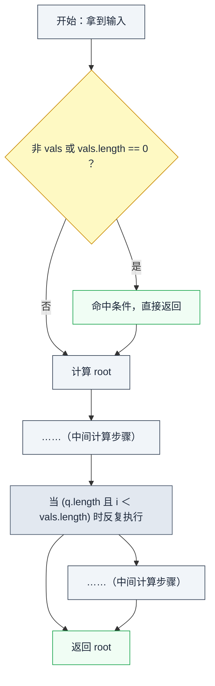
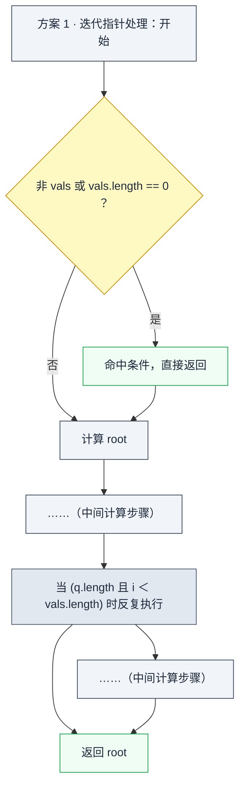
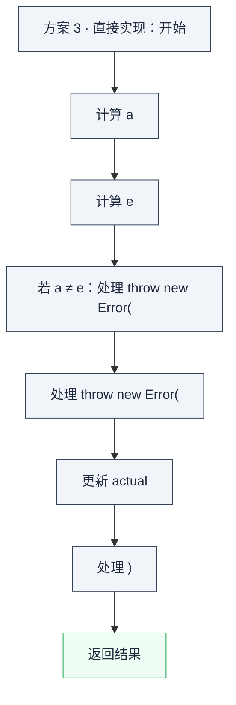
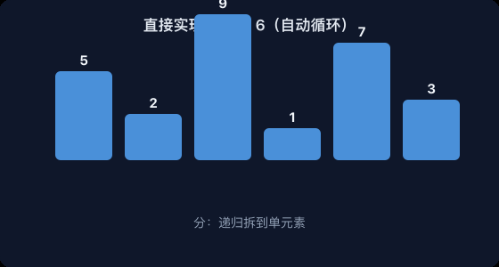
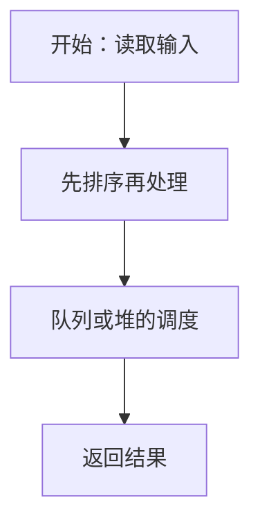
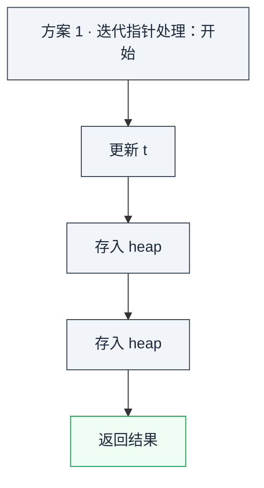
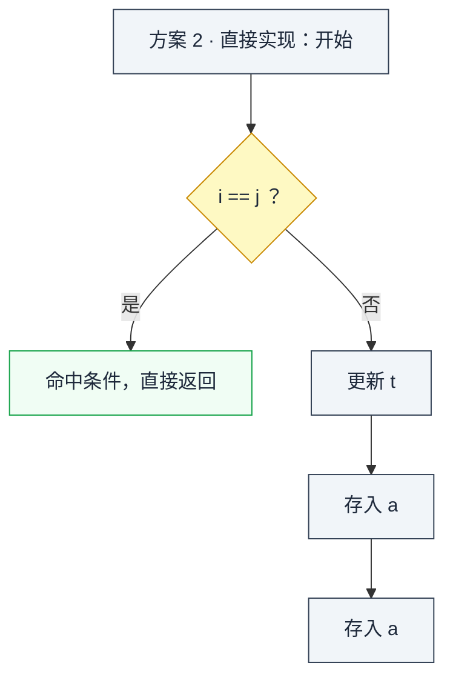
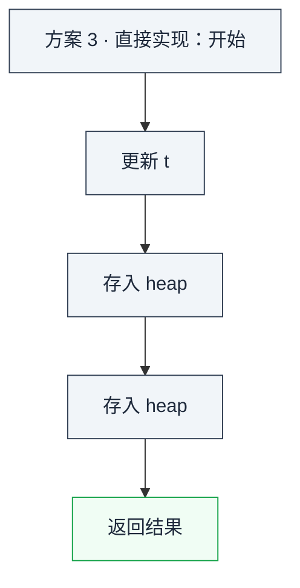
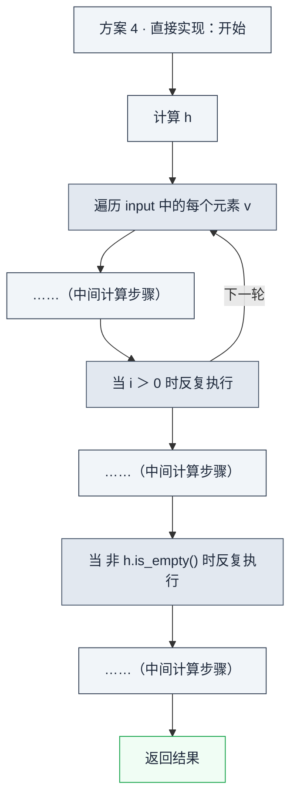
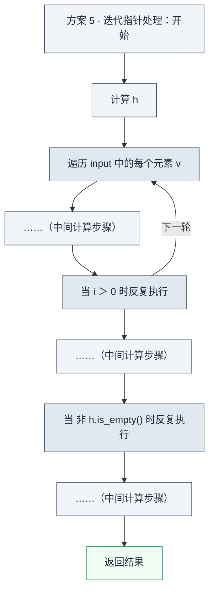

# 226 · 实现最大堆类的两种方式及实现堆排序（第附阶段 · 专题补充 · Medium）

> **难度**：⭐⭐ Medium ｜ **专题**：算法笔记
> **学习定位**：第附阶段 · 专题补充第 226 篇 ｜ **解法数**：6
> **内容总结**：**实现最大堆类的两种方式及实现堆排序**（算法笔记 · Medium）：共 6 个方案，主线思路「迭代指针处理」；时间 O(n)（单趟线性扫描）；动画演示归并分治过程，附录给出 11 种语言 × 全部方案的可运行实现。

---

## 题目描述

实现最大堆类的两种方式及实现堆排序。具体输入输出约定见函数签名与用例。

- 主函数签名：`function treeToLevel(root: any): any[]`

**用例演示**（摘自主解法内嵌自测，输入到输出一目了然）：

```typescript
  const cases = [{ got: out, want: [6, 5, 4, 3, 2, 1] }]; // 把 [{ got: out, want: [6,5,4,3,2,1] }] 存入 cases
  let fail = false; // 把 false 存入 fail
  for (const c of cases)
    if (!eq(c.got, c.want)) {
      fail = true;
      console.log('FAIL', c);
    } // 打印输出
  if (fail) throw new Error('FAILED'); // 若 fail) throw new Error(「FAILED」);
  console.log('PASS'); // 全部用例通过，输出 PASS
}
demo(); // demo();
```

**数据范围与注意事项**：

- **易错点**：先看小例子手推一遍再对照代码，比直接读代码快得多。

## 题目分析

**场景是什么**：综合练习：把数据结构与策略组合起来解决一个完整问题。本题就是该场景的 Medium 级练习，主线做法是「迭代指针处理」。

**主线怎么解**：把主解法从头到尾过一遍，它其实在依次做这几件事：队列或堆的调度。

## 解题思路

**方案对比**（共 6 个方案，由浅入深）：

| 方案 | 时间复杂度 | 空间复杂度 |
|---|---|---|
| 方案 1 · 迭代指针处理 | O(n)（单趟线性扫描） | O(1) 到 O(n)（视辅助结构） |
| 方案 2 · 直接实现 | O(n) 量级 | O(n) |
| 方案 3 · 直接实现 | O(n) 量级 | O(n) |
| 方案 4 · 直接实现 | O(n) 量级 | O(n) |
| 方案 5 · 迭代指针处理 | O(n)（单趟线性扫描） | O(1) 到 O(n)（视辅助结构） |
| 方案 6 · 直接实现 | O(n) 量级 | O(n) |

**由浅入深的路径**：迭代指针处理 → 直接实现；每往右一步，都在补上一步的短板。

**方案间的取舍**：方案 1（迭代指针处理）；方案 2（直接实现）；方案 3（直接实现）；方案 4（直接实现）；方案 5（迭代指针处理）；方案 6（直接实现）。数据规模小、可读性优先时选靠前的方案；规模大、性能优先时选靠后的方案。

**怎么读这一篇**：

- 🐣 **新手路线**：把「题目描述」的示例 1 在纸上手推一遍 → 读方案 1（最直观的写法）与它的代码走读 → 按「运行方式」本地跑通看 PASS → 回头对比方案 2 之后的写法差在哪
- 🦅 **大佬路线**：直接锁定最优方案 1（迭代指针处理，O(n)（单趟线性扫描））→ 跳读该方案代码与走读 → 用「逐步拆解与面试追问」补齐复杂度推导与边界追问

### 动态算法图（归并分治，GIF 自动循环）


动画演示算法笔记专题里归并分治的典型过程；每个方案在「TypeScript 解题方案」一节还配了专属动画与专属流程图。

### 主解法流程图（真实控制流）



## TypeScript 解题方案（6 个方案逐个讲）

> **运行与提交**：每个方案都是自包含文件（内嵌用例自测，输出 PASS），整块复制到 `.ts` 文件后 `node 文件名` 即可运行。提交 LeetCode 时，把 `demo` 内的算法函数与辅助类型/函数整体取出、置于文件顶层即可。概念演示（非 LeetCode 编号题），在本地运行即可。

### 方案 1：迭代指针处理

**分析与思路**：核心做法是「迭代指针处理」。代码里依次做这些事：队列或堆的调度。

**运行方式**：`node 本文件`，内嵌用例全部通过会输出 PASS。


**方案专属流程图**（真实控制流）：



```typescript
class TreeNode {
  // 定义类型
  val: any;
  left: any;
  right: any; // 值: any; 左边界: any; 右边界: any;
  constructor(val?: any, left?: any, right?: any) {
    // constructor(值?: any, 左边界?: any, 右边界?: any) {
    this.val = val === undefined ? 0 : val; // 把 (值 全等于 undefined ? 0 : 值); 写入 值
    this.left = left === undefined ? null : left; // 把 (左边界 全等于 undefined ? null : 左边界); 写入 左边界
    this.right = right === undefined ? null : right; // 把 (右边界 全等于 undefined ? null : 右边界); 写入 右边界
  }
}
function buildTree(vals: any): any {
  // 定义函数/方法 buildTree
  if (!vals || vals.length === 0) return null; // 若 取反 vals 或 vals.长度 全等于 0，直接返回 null
  const root = new TreeNode(vals[0]);
  const q: any[] = [root];
  let i = 1;
  while (q.length && i < vals.length) {
    // 循环，直到不满足「节点.长度 且 下标 i 小于 vals.长度」
    const node = q.shift(); // 把 节点.shift() 存入 节点
    if (vals[i] !== null && vals[i] !== undefined) {
      node.left = new TreeNode(vals[i]);
      q.push(node.left);
    }
    i++; // 下标 i 加一
    if (i < vals.length && vals[i] !== null && vals[i] !== undefined) {
      node.right = new TreeNode(vals[i]);
      q.push(node.right);
    }
    i++; // 下标 i 加一
  }
  return root; // 返回 根节点
}
function treeToLevel(root: any): any[] {
  // 定义函数/方法 treeToLevel
  if (!root) return []; // 若 取反 根节点，直接返回 []
  const out: any[] = [];
  const q: any[] = [root]; // 把 []; const 节点: any[] 赋值为 [根节点]; 写入 const out: any[]
  while (q.length) {
    // 循环，直到不满足「节点.长度」
    const n = q.shift(); // 把 节点.shift() 存入 元素个数
    if (n === null || n === undefined) {
      out.push(null);
      continue;
    }
    out.push(n.val);
    q.push(n.left);
    q.push(n.right); // 把 元素个数.值 压入栈/数组尾部
  }
  while (out.length && out[out.length - 1] === null) out.pop(); // 循环，直到不满足「out.长度 且 out[out.长度 减 1] 全等于 null) out 弹出 );」
  return out; // 返回 out
}
class ListNode {
  // 定义类型
  val: any;
  next: any; // 值: any; 下一个: any;
  constructor(val?: any, next?: any) {
    this.val = val === undefined ? 0 : val;
    this.next = next === undefined ? null : next;
  }
}
function buildList(vals: any): any {
  // 定义函数/方法 buildList
  const dummy = new ListNode(0);
  let cur = dummy; // 把 new ListNode(0); let 当前值 赋值为 哨兵节点 存入 哨兵节点
  for (const v of vals) {
    cur.next = new ListNode(v);
    cur = cur.next;
  } // 把 new ListNode(值); 当前值 赋值为 当前值.下一个; } 写入 下一个
  return dummy.next; // 返回 哨兵节点.下一个
}
function listToArray(head: any): any[] {
  // 定义函数/方法 listToArray
  const out: any[] = [];
  let p = head; // 把 []; let 节点 赋值为 头节点; 写入 const out: any[]
  while (p) {
    out.push(p.val);
    p = p.next;
  } // 循环，直到不满足「节点) { out 追加 节点.值); 节点 赋值为 节点.下一个; }」
  return out; // 返回 out
}
// python-runtime shims
function pyLen(a: any): number {
  // 定义函数/方法 pyLen
  if (a === null || a === undefined) return 0; // 若 数组 全等于 null 或 数组 全等于 undefined，直接返回 0
  if (
    typeof a === 'string' ||
    Array.isArray(a) ||
    a instanceof Set ||
    a instanceof Map
  )
    return a.length ?? a.size;
  if (typeof a === 'object') return Object.keys(a).length; // 若 typeof 数组 全等于 'object'，直接返回 Object.keys(数组).长度
  return 0; // 返回 0
}
function pySlice(a: any, i: any, j: any, step?: any): any {
  // 定义函数/方法 pySlice
  if (typeof a === 'string') {
    const r = [...a].slice(i ?? 0, j ?? a.length);
    return step ? r.reverse().join('') : r.join('');
  }
  const arr = Array.isArray(a) ? a : [...a]; // 把 Array.isArray(数组) ? 数组 : 复制的 数组 存入 数组
  return arr.slice(i ?? 0, j ?? arr.length); // 返回 数组 截取 下标 i ?? 0, 下标 j ?? 数组.长度)
}
function pyRange(a: any, b?: any, step?: any): any[] {
  // 定义函数/方法 pyRange
  let s = 0,
    e = a,
    st = 1; // 把 0, e 赋值为 数组, st 赋值为 1 存入 字符串
  if (b !== undefined) {
    s = a;
    e = b;
  } // 若 b 不等于 undefined) { 字符串 赋值为 数组; e 赋值为 b; }
  if (step !== undefined) st = step; // 若 步数 不等于 undefined) st 赋值为 步数;
  const out: any[] = []; // 把 []; 写入 const out: any[]
  if (st > 0) for (let i = s; i < e; i += st) out.push(i);
  else for (let i = s; i > e; i += st) out.push(i); // 否则
  return out; // 返回 out
}
function pyIn(x: any, coll: any): boolean {
  // 定义函数/方法 pyIn
  if (coll === null || coll === undefined) return false; // 若 coll 全等于 null 或 coll 全等于 undefined，直接返回 false
  if (Array.isArray(coll)) return coll.includes(x); // 若 Array.isArray(coll)，直接返回 coll 是否包含 x)
  if (coll instanceof Set || coll instanceof Map) return coll.has(x); // 若 coll instanceof Set 或 coll instanceof Map，直接返回 coll.has(x)
  if (typeof coll === 'object') return x in coll; // 若 typeof coll 全等于 'object'，直接返回 x in coll
  if (typeof coll === 'string') return coll.indexOf(x) >= 0; // 若 typeof coll 全等于 'string'，直接返回 coll 查找 x) 不低于 0
  return false; // 返回 false
}
function pySorted(a: any): any[] {
  // 定义函数/方法 pySorted
  const arr = typeof a === 'string' ? [...a] : [...a]; // 把 (typeof 数组 全等于 'string') ? 复制的 数组 : 复制的 数组 存入 数组
  return arr.sort((x: any, y: any) => (x < y ? -1 : x > y ? 1 : 0));
}
function pyMin(a: any, b?: any): any {
  if (b !== undefined) return Math.min(a, b);
  if (Array.isArray(a) || a instanceof Set) return Math.min(...a);
  return Math.min(a);
} // 定义函数/方法 pyMin
function pyMax(a: any, b?: any): any {
  if (b !== undefined) return Math.max(a, b);
  if (Array.isArray(a) || a instanceof Set) return Math.max(...a);
  return Math.max(a);
} // 定义函数/方法 pyMax
function pySum(a: any): number {
  let s = 0;
  for (const v of a) s += v;
  return s;
} // 定义函数/方法 pySum
function pyAbs(x: any): number {
  return Math.abs(x);
} // 定义函数/方法 pyAbs
function pyEnumerate(a: any): any[] {
  const out: any[] = [];
  let i = 0;
  for (const v of a) {
    out.push([i, v]);
    i++;
  }
  return out;
} // 定义函数/方法 pyEnumerate
function pyZip(a: any, b: any): any[] {
  const n = Math.min(a.length, b.length);
  const out: any[] = [];
  for (let i = 0; i < n; i++) out.push([a[i], b[i]]);
  return out;
} // 定义函数/方法 pyZip
function pyDictGet(d: any, k: any, def?: any): any {
  return k in d ? d[k] : def === undefined ? null : def;
} // 定义函数/方法 pyDictGet
function pyPrint(...args: any[]): void {
  console.log(
    args
      .map((a) => (typeof a === 'object' && a !== null ? JSON.stringify(a) : a))
      .join(' '),
  );
} // 定义函数/方法 pyPrint
// collections / heapq
function heapPush(h: any[], x: any): void {
  h.push(x);
  let i = h.length - 1;
  while (i > 0) {
    const p = (i - 1) >> 1;
    if (h[p] <= h[i]) break;
    [h[p], h[i]] = [h[i], h[p]];
    i = p;
  }
} // 定义函数/方法 heapPush
function heapPop(h: any[]): any {
  const top = h[0];
  const last = h.pop();
  if (h.length) {
    h[0] = last;
    let i = 0;
    const n = h.length;
    while (true) {
      let l = 2 * i + 1,
        r = 2 * i + 2,
        s = i;
      if (l < n && h[l] < h[s]) s = l;
      if (r < n && h[r] < h[s]) s = r;
      if (s === i) break;
      [h[s], h[i]] = [h[i], h[s]];
      i = s;
    }
  }
  return top;
} // 定义函数/方法 heapPop
class Deque {
  private a: any[] = [];
  push(x: any) {
    this.a.push(x);
  }
  pushLeft(x: any) {
    this.a.unshift(x);
  }
  pop() {
    return this.a.pop();
  }
  popLeft() {
    return this.a.shift();
  }
  get length() {
    return this.a.length;
  }
  toArray() {
    return this.a.slice();
  }
} // 定义类型
function Counter(iter: any): any {
  const m: any = {};
  for (const v of iter) m[v] = (m[v] || 0) + 1;
  return m;
} // 定义函数/方法 Counter
function gcd(a: any, b: any): any {
  while (b) {
    [a, b] = [b, a % b];
  }
  return a;
} // 定义函数/方法 gcd
function pyInf(): number {
  return Infinity;
} // 定义函数/方法 pyInf

function norm(x: any): any {
  // 定义函数/方法 norm
  if (x === null || x === undefined) return null; // 若 x 全等于 null 或 x 全等于 undefined，直接返回 null
  if (typeof x === 'object') {
    // 若 typeof x 全等于 'object'
    if (x instanceof Deque) return x.toArray(); // 若 x instanceof Deque，直接返回 x.toArray()
    if (Array.isArray(x)) return x.map(norm); // 若 Array.isArray(x)，直接返回 x.映射表(norm)
    if (
      typeof x.val === 'number' &&
      (typeof x.left !== 'undefined' || typeof x.right !== 'undefined')
    )
      return treeToLevel(x);
    if (typeof x.next !== 'undefined' && typeof x.val === 'number')
      return listToArray(x);
    if (x instanceof Set) return [...x].sort(); // 若 x instanceof Set，直接返回 复制的 x 排序 )
    if (x instanceof Map) return Object.fromEntries(x); // 若 x instanceof Map，直接返回 Object.fromEntries(x)
    const o: any = {};
    for (const k of Object.keys(x)) o[k] = norm(x[k]);
    return o;
  }
  return x; // 返回 x
}
function eq(a: any, b: any): boolean {
  // 定义函数/方法 eq
  const x = norm(a),
    y = norm(b); // 把 norm(数组), y 赋值为 norm(b) 存入 x
  if (x === y) return true; // 若 x 全等于 y，直接返回 true
  if (x === null || y === null) return x === y; // 若 x 全等于 null 或 y 全等于 null，直接返回 x 全等于 y
  if (Array.isArray(x) && Array.isArray(y)) {
    // 若 Array.isArray(x) 且 Array.isArray(y
    if (x.length !== y.length) return false; // 若 x.长度 不等于 y.长度，直接返回 false
    for (let i = 0; i < x.length; i++) if (!eq(x[i], y[i])) return false; // 让 下标 i 从 0 开始计数，下标 i 小于 x.长度 就继续
    return true; // 返回 true
  }
  if (typeof x === 'object' && typeof y === 'object') {
    // 若 typeof x 全等于 'object' 且 typeof y 全等于 'object'
    const kx = Object.keys(x),
      ky = Object.keys(y); // 把 Object.keys(x), ky 赋值为 Object.keys(y) 存入 kx
    if (kx.length !== ky.length) return false; // 若 kx.长度 不等于 ky.长度，直接返回 false
    for (const k of kx) if (!eq(x[k], y[k])) return false;
    return true; // 返回 true
  }
  return x === y; // 返回 x 全等于 y
}

class MaxHeap {
  // 定义类型
  heap: any[]; // 堆: any[];
  constructor() {
    this.heap = [];
  } // 把 []; } 写入 堆
  size() {
    return this.heap.length;
  } // 大小() { return this.堆.长度; }
  insert(value) {
    // insert(value) {
    this.heap.push(value); // 把 value 压入栈/数组尾部
    let i = this.heap.length - 1; // 把 this.堆.长度 减 1 存入 下标 i
    while (i > 0) {
      // 循环，直到不满足「下标 i 超过 0」
      const p = (i - 1) >> 1; // 把 (下标 i 减 1) 超过 超过 1 存入 节点
      if (this.heap[p] >= this.heap[i]) break; // 若 this.堆[节点] 不低于 this.堆[下标 i]) break;
      [this.heap[p], this.heap[i]] = [this.heap[i], this.heap[p]];
      i = p;
    }
  }
  pop() {
    // pop() {
    if (!this.heap.length) return undefined; // 若 取反 this.堆.长度，直接返回 undefined
    const top = this.heap[0]; // 把 this.堆[0] 存入 top
    const last = this.heap.pop(); // 把 this.堆 弹出 ) 存入 last
    if (this.heap.length) {
      this.heap[0] = last;
      this._down(0);
    } // 若 this.堆.长度) { this.堆[0] 赋值为 last; this._down(0); }
    return top; // 返回 top
  }
  peek() {
    return this.heap.length ? this.heap[0] : undefined;
  } // peek() { return this.堆.长度 ? this.堆[0] : undefined; }
  _down(i) {
    // _down(下标 i) {
    const n = this.heap.length; // 把 this.堆.长度 存入 元素个数
    while (true) {
      // 循环，直到不满足「true」
      let l = 2 * i + 1,
        r = 2 * i + 2,
        s = i; // 把 2 乘 下标 i 加 1, 右指针 赋值为 2 乘 下标 i 加 2, 字符串 赋值为 下标 i 存入 左指针
      if (l < n && this.heap[l] > this.heap[s]) s = l; // 若 左指针 小于 元素个数 且 this.堆[左指针] 超过 this.堆[字符串]) 字符串 赋值为 左指针;
      if (r < n && this.heap[r] > this.heap[s]) s = r; // 若 右指针 小于 元素个数 且 this.堆[右指针] 超过 this.堆[字符串]) 字符串 赋值为 右指针;
      if (s === i) break; // 若 字符串 全等于 下标 i) break;
      [this.heap[s], this.heap[i]] = [this.heap[i], this.heap[s]];
      i = s;
    }
  }
}
export function demo(): void {
  // 程序入口：跑内嵌自测用例
  const h = new MaxHeap(); // 把 new MaxHeap() 存入 h
  [3, 1, 6, 5, 2, 4].forEach((v) => h.insert(v));
  const out = []; // 把 [] 存入 out
  while (h.size()) out.push(h.pop()); // 循环，直到不满足「h.大小()) out 追加 h 弹出 ));」
  const cases = [{ got: out, want: [6, 5, 4, 3, 2, 1] }]; // 把 [{ got: out, want: [6,5,4,3,2,1] }] 存入 cases
  let fail = false; // 把 false 存入 fail
  for (const c of cases)
    if (!eq(c.got, c.want)) {
      fail = true;
      console.log('FAIL', c);
    } // 打印输出
  if (fail) throw new Error('FAILED'); // 若 fail) throw new Error(「FAILED」);
  console.log('PASS'); // 全部用例通过，输出 PASS
}
demo(); // demo();
```

### 方案 2：直接实现

**分析与思路**：核心做法是「直接实现」。

**运行方式**：`node 本文件`，内嵌用例全部通过会输出 PASS。


**方案专属流程图**（真实控制流）：


```typescript
function assertEq(actual: any, expected: any, msg: string = ''): void {
  // 定义函数/方法 assertEq
  const a = JSON.stringify(actual);
  const e = JSON.stringify(expected);
  if (a !== e)
    throw new Error(
      'ASSERT FAILED ' + msg + ' :: actual=' + a + ' expected=' + e,
    );
}

class MaxHeap {
  // 定义类型
  heap: number[]; // 堆: number[];
  constructor() {
    this.heap = [];
  } // 把 []; } 写入 堆
  static swap(arr: number[], i: number, j: number): void {
    // static 交换 数组: number[], 下标 i: number, 下标 j: number): void {
    if (i === j) return; // 若 下标 i 全等于 下标 j) return;
    const t = arr[i];
    arr[i] = arr[j];
    arr[j] = t;
  }
  static maxHeapify(arr: number[], i: number, size: number): void {
    const l = (i << 1) + 1,
      r = (i << 1) + 2; // 把 (下标 i 小于 小于 1) 加 1, 右指针 赋值为 (下标 i 小于 小于 1) 加 2 存入 左指针
    let largest = i; // 把 下标 i 存入 largest
    if (l < size && arr[l] > arr[largest]) largest = l; // 若 左指针 小于 大小 且 数组[左指针] 超过 数组[largest]) largest 赋值为 左指针;
    if (r < size && arr[r] > arr[largest]) largest = r; // 若 右指针 小于 大小 且 数组[右指针] 超过 数组[largest]) largest 赋值为 右指针;
    if (largest !== i) {
      MaxHeap.swap(arr, i, largest);
      MaxHeap.maxHeapify(arr, largest, size);
    }
  }
  sort(): number[] {
    // sort(): number[] {
    const i_arr = this.heap; // 把 this.堆 存入 i_arr
    const n = i_arr.length; // 把 i_arr.长度 存入 元素个数
    if (n <= 1) return i_arr; // 若 元素个数 不超过 1，直接返回 i_arr
    for (let i = Math.floor(n / 2) - 1; i >= 0; i--)
      MaxHeap.maxHeapify(i_arr, i, n); // 让 下标 i 从 向下取整(元素个数 除以 2) 减 1 开始计数，下标 i 不低于 0 就继续
    for (let j = 0; j < n - 1; j++) {
      // 让 下标 j 从 0 开始计数，下标 j 小于 元素个数 减 1 就继续
      MaxHeap.swap(i_arr, 0, n - 1 - j); // MaxHeap.交换 i_arr, 0, 元素个数 减 1 减 下标 j);
      MaxHeap.maxHeapify(i_arr, 0, n - 1 - j - 1); // MaxHeap.maxHeapify(i_arr, 0, 元素个数 减 1 减 下标 j 减 1);
    }
    return i_arr; // 返回 i_arr
  }
}
export function demo(): void {
  // 程序入口：跑内嵌自测用例
  const mh = new MaxHeap(); // 把 new MaxHeap() 存入 mh
  mh.heap = [1, 10, 9, 5, 3, 11, 3, 9, 11, 13, 1, -1, 98]; // 把 [1, 10, 9, 5, 3, 11, 3, 9, 11, 13, 1, 减 1, 98]; 写入 堆
  assertEq(
    mh.sort(),
    [-1, 1, 1, 3, 3, 5, 9, 9, 10, 11, 11, 13, 98],
    'heapSort',
  ); // 断言校验
  console.log('PASS'); // 全部用例通过，输出 PASS
}
demo(); // demo();
```

### 方案 3：直接实现

**分析与思路**：核心做法是「直接实现」。

**运行方式**：`node 本文件`，内嵌用例全部通过会输出 PASS。


**方案专属流程图**（真实控制流）：



```typescript
function assertEq(actual: any, expected: any, msg: string = ''): void {
  // 定义函数/方法 assertEq
  const a = JSON.stringify(actual);
  const e = JSON.stringify(expected);
  if (a !== e)
    throw new Error(
      'ASSERT FAILED ' + msg + ' :: actual=' + a + ' expected=' + e,
    );
}

class MaxHeap {
  // 定义类型
  heap: number[]; // 堆: number[];
  constructor() {
    this.heap = [];
  } // 把 []; } 写入 堆
  swap(i: number, j: number): void {
    const t = this.heap[i];
    this.heap[i] = this.heap[j];
    this.heap[j] = t;
  }
  getParentIndex(i: number): number {
    return (i - 1) >> 1;
  }
  getLeftIndex(i: number): number {
    return (i << 1) + 1;
  }
  getRightIndex(i: number): number {
    return (i << 1) + 2;
  }
  shiftUp(index: number): void {
    // shiftUp(index: number): void {
    if (index === 0) return; // 若 index 全等于 0) return;
    const p = this.getParentIndex(index); // 把 this.getParentIndex(index) 存入 节点
    if (this.heap[p] < this.heap[index]) {
      this.swap(p, index);
      this.shiftUp(p);
    }
  }
  shiftDown(index: number): void {
    // shiftDown(index: number): void {
    if (index >= this.heap.length - 1) return; // 若 index 不低于 this.堆.长度 减 1) return;
    const size = this.size(); // 把 this.大小() 存入 大小
    const l = this.getLeftIndex(index),
      r = this.getRightIndex(index);
    if (l < size && this.heap[l] > this.heap[index]) {
      this.swap(l, index);
      this.shiftDown(l);
    }
    if (r < size && this.heap[r] > this.heap[index]) {
      this.swap(r, index);
      this.shiftDown(r);
    }
  }
  insert(value: number): void {
    this.heap.push(value);
    this.shiftUp(this.heap.length - 1);
  } // 把 value 压入栈/数组尾部
  pop(): void {
    // pop(): void {
    if (this.heap.length <= 1) return; // 若 this.堆.长度 不超过 1) return;
    this.heap[0] = this.heap.pop()!; // 弹出栈顶元素
    this.shiftDown(0); // this.shiftDown(0);
  }
  peak(): number | null {
    return this.heap.length ? this.heap[0] : null;
  }
  size(): number {
    return this.heap.length;
  } // 大小(): number { return this.堆.长度; }
  sort(arr: number[]): number[] {
    // sort(数组: number[]): number[] {
    for (const n of arr) this.insert(n); // for (const 元素个数 of 数组) this 插入 元素个数);
    const result: number[] = []; // 把 []; 写入 const result: number[]
    while (this.size() > 1) {
      result.push(this.peak()!);
      this.pop();
    }
    result.push(this.peak()!); // 把 this.peak( 压入栈/数组尾部
    this.heap = result; // 把 结果; 写入 堆
    return result; // 返回 结果
  }
}
export function demo(): void {
  // 程序入口：跑内嵌自测用例
  const mh = new MaxHeap(); // 把 new MaxHeap() 存入 mh
  assertEq(
    mh.sort([1, 10, 9, 5, 3, 11, 3, 9, 11, 13, 1, -1, 98]),
    [98, 13, 11, 11, 10, 9, 9, 5, 3, 3, 1, 1, -1],
    'heapSortDesc',
  ); // 断言校验
  console.log('PASS'); // 全部用例通过，输出 PASS
}
demo(); // demo();
```

### 方案 4：直接实现

**分析与思路**：核心做法是「直接实现」。

**运行方式**：`node 本文件`，内嵌用例全部通过会输出 PASS。


**方案专属流程图**（真实控制流）：


```typescript
function assertEq(actual: any, expected: any, msg: string = ''): void {
  // 定义函数/方法 assertEq
  const a = JSON.stringify(actual);
  const e = JSON.stringify(expected);
  if (a !== e)
    throw new Error(
      'ASSERT FAILED ' + msg + ' :: actual=' + a + ' expected=' + e,
    );
}

class MaxHeap {
  // 定义类型
  heap: number[]; // 堆: number[];
  constructor(init: number[]) {
    this.heap = init.slice();
  } // 把 init 截取 ); } 写入 堆
  static swap(arr: number[], i: number, j: number): void {
    if (i === j) return;
    const t = arr[i];
    arr[i] = arr[j];
    arr[j] = t;
  }
  static maxHeapify(arr: number[], i: number, size: number): void {
    let largest = i; // 把 下标 i 存入 largest
    const l = (i << 1) + 1,
      r = (i << 1) + 2; // 把 (下标 i 小于 小于 1) 加 1, 右指针 赋值为 (下标 i 小于 小于 1) 加 2 存入 左指针
    if (l < size && arr[l] > arr[largest]) largest = l; // 若 左指针 小于 大小 且 数组[左指针] 超过 数组[largest]) largest 赋值为 左指针;
    if (r < size && arr[r] > arr[largest]) largest = r; // 若 右指针 小于 大小 且 数组[右指针] 超过 数组[largest]) largest 赋值为 右指针;
    if (largest !== i) {
      MaxHeap.swap(arr, i, largest);
      MaxHeap.maxHeapify(arr, largest, size);
    }
  }
  sort(): number[] {
    // sort(): number[] {
    const a = this.heap;
    const n = a.length; // 把 this.堆; const 元素个数 赋值为 数组.长度 存入 数组
    if (n <= 1) return a; // 若 元素个数 不超过 1，直接返回 数组
    for (let i = Math.floor(n / 2) - 1; i >= 0; i--)
      MaxHeap.maxHeapify(a, i, n); // 让 下标 i 从 向下取整(元素个数 除以 2) 减 1 开始计数，下标 i 不低于 0 就继续
    for (let j = 0; j < n - 1; j++) {
      MaxHeap.swap(a, 0, n - 1 - j);
      MaxHeap.maxHeapify(a, 0, n - 1 - j - 1);
    } // 让 下标 j 从 0 开始计数，下标 j 小于 元素个数 减 1 就继续
    return a; // 返回 数组
  }
}
export function demo(): void {
  // 程序入口：跑内嵌自测用例
  const mh = new MaxHeap([1, 10, 9, 5, 3, 11, 3, 9, 11, 13, 1, -1, 98]);
  assertEq(mh.sort(), [-1, 1, 1, 3, 3, 5, 9, 9, 10, 11, 11, 13, 98], 'hs'); // 断言校验
  console.log('PASS'); // 全部用例通过，输出 PASS
}
demo(); // demo();
```

### 方案 5：迭代指针处理

**分析与思路**：核心做法是「迭代指针处理」。代码里依次做这些事：队列或堆的调度。

**运行方式**：`node 本文件`，内嵌用例全部通过会输出 PASS。


**方案专属流程图**（真实控制流）：


```typescript
class TreeNode {
  // 定义类型
  val: any;
  left: any;
  right: any; // 值: any; 左边界: any; 右边界: any;
  constructor(val?: any, left?: any, right?: any) {
    // constructor(值?: any, 左边界?: any, 右边界?: any) {
    this.val = val === undefined ? 0 : val; // 把 (值 全等于 undefined ? 0 : 值); 写入 值
    this.left = left === undefined ? null : left; // 把 (左边界 全等于 undefined ? null : 左边界); 写入 左边界
    this.right = right === undefined ? null : right; // 把 (右边界 全等于 undefined ? null : 右边界); 写入 右边界
  }
}
function buildTree(vals: any): any {
  // 定义函数/方法 buildTree
  if (!vals || vals.length === 0) return null; // 若 取反 vals 或 vals.长度 全等于 0，直接返回 null
  const root = new TreeNode(vals[0]);
  const q: any[] = [root];
  let i = 1;
  while (q.length && i < vals.length) {
    // 循环，直到不满足「节点.长度 且 下标 i 小于 vals.长度」
    const node = q.shift(); // 把 节点.shift() 存入 节点
    if (vals[i] !== null && vals[i] !== undefined) {
      node.left = new TreeNode(vals[i]);
      q.push(node.left);
    }
    i++; // 下标 i 加一
    if (i < vals.length && vals[i] !== null && vals[i] !== undefined) {
      node.right = new TreeNode(vals[i]);
      q.push(node.right);
    }
    i++; // 下标 i 加一
  }
  return root; // 返回 根节点
}
function treeToLevel(root: any): any[] {
  // 定义函数/方法 treeToLevel
  if (!root) return []; // 若 取反 根节点，直接返回 []
  const out: any[] = [];
  const q: any[] = [root]; // 把 []; const 节点: any[] 赋值为 [根节点]; 写入 const out: any[]
  while (q.length) {
    // 循环，直到不满足「节点.长度」
    const n = q.shift(); // 把 节点.shift() 存入 元素个数
    if (n === null || n === undefined) {
      out.push(null);
      continue;
    }
    out.push(n.val);
    q.push(n.left);
    q.push(n.right); // 把 元素个数.值 压入栈/数组尾部
  }
  while (out.length && out[out.length - 1] === null) out.pop(); // 循环，直到不满足「out.长度 且 out[out.长度 减 1] 全等于 null) out 弹出 );」
  return out; // 返回 out
}
class ListNode {
  // 定义类型
  val: any;
  next: any; // 值: any; 下一个: any;
  constructor(val?: any, next?: any) {
    this.val = val === undefined ? 0 : val;
    this.next = next === undefined ? null : next;
  }
}
function buildList(vals: any): any {
  // 定义函数/方法 buildList
  const dummy = new ListNode(0);
  let cur = dummy; // 把 new ListNode(0); let 当前值 赋值为 哨兵节点 存入 哨兵节点
  for (const v of vals) {
    cur.next = new ListNode(v);
    cur = cur.next;
  } // 把 new ListNode(值); 当前值 赋值为 当前值.下一个; } 写入 下一个
  return dummy.next; // 返回 哨兵节点.下一个
}
function listToArray(head: any): any[] {
  // 定义函数/方法 listToArray
  const out: any[] = [];
  let p = head; // 把 []; let 节点 赋值为 头节点; 写入 const out: any[]
  while (p) {
    out.push(p.val);
    p = p.next;
  } // 循环，直到不满足「节点) { out 追加 节点.值); 节点 赋值为 节点.下一个; }」
  return out; // 返回 out
}
// python-runtime shims
function pyLen(a: any): number {
  // 定义函数/方法 pyLen
  if (a === null || a === undefined) return 0; // 若 数组 全等于 null 或 数组 全等于 undefined，直接返回 0
  if (
    typeof a === 'string' ||
    Array.isArray(a) ||
    a instanceof Set ||
    a instanceof Map
  )
    return a.length ?? a.size;
  if (typeof a === 'object') return Object.keys(a).length; // 若 typeof 数组 全等于 'object'，直接返回 Object.keys(数组).长度
  return 0; // 返回 0
}
function pySlice(a: any, i: any, j: any, step?: any): any {
  // 定义函数/方法 pySlice
  if (typeof a === 'string') {
    const r = [...a].slice(i ?? 0, j ?? a.length);
    return step ? r.reverse().join('') : r.join('');
  }
  const arr = Array.isArray(a) ? a : [...a]; // 把 Array.isArray(数组) ? 数组 : 复制的 数组 存入 数组
  return arr.slice(i ?? 0, j ?? arr.length); // 返回 数组 截取 下标 i ?? 0, 下标 j ?? 数组.长度)
}
function pyRange(a: any, b?: any, step?: any): any[] {
  // 定义函数/方法 pyRange
  let s = 0,
    e = a,
    st = 1; // 把 0, e 赋值为 数组, st 赋值为 1 存入 字符串
  if (b !== undefined) {
    s = a;
    e = b;
  } // 若 b 不等于 undefined) { 字符串 赋值为 数组; e 赋值为 b; }
  if (step !== undefined) st = step; // 若 步数 不等于 undefined) st 赋值为 步数;
  const out: any[] = []; // 把 []; 写入 const out: any[]
  if (st > 0) for (let i = s; i < e; i += st) out.push(i);
  else for (let i = s; i > e; i += st) out.push(i); // 否则
  return out; // 返回 out
}
function pyIn(x: any, coll: any): boolean {
  // 定义函数/方法 pyIn
  if (coll === null || coll === undefined) return false; // 若 coll 全等于 null 或 coll 全等于 undefined，直接返回 false
  if (Array.isArray(coll)) return coll.includes(x); // 若 Array.isArray(coll)，直接返回 coll 是否包含 x)
  if (coll instanceof Set || coll instanceof Map) return coll.has(x); // 若 coll instanceof Set 或 coll instanceof Map，直接返回 coll.has(x)
  if (typeof coll === 'object') return x in coll; // 若 typeof coll 全等于 'object'，直接返回 x in coll
  if (typeof coll === 'string') return coll.indexOf(x) >= 0; // 若 typeof coll 全等于 'string'，直接返回 coll 查找 x) 不低于 0
  return false; // 返回 false
}
function pySorted(a: any): any[] {
  // 定义函数/方法 pySorted
  const arr = typeof a === 'string' ? [...a] : [...a]; // 把 (typeof 数组 全等于 'string') ? 复制的 数组 : 复制的 数组 存入 数组
  return arr.sort((x: any, y: any) => (x < y ? -1 : x > y ? 1 : 0));
}
function pyMin(a: any, b?: any): any {
  if (b !== undefined) return Math.min(a, b);
  if (Array.isArray(a) || a instanceof Set) return Math.min(...a);
  return Math.min(a);
} // 定义函数/方法 pyMin
function pyMax(a: any, b?: any): any {
  if (b !== undefined) return Math.max(a, b);
  if (Array.isArray(a) || a instanceof Set) return Math.max(...a);
  return Math.max(a);
} // 定义函数/方法 pyMax
function pySum(a: any): number {
  let s = 0;
  for (const v of a) s += v;
  return s;
} // 定义函数/方法 pySum
function pyAbs(x: any): number {
  return Math.abs(x);
} // 定义函数/方法 pyAbs
function pyEnumerate(a: any): any[] {
  const out: any[] = [];
  let i = 0;
  for (const v of a) {
    out.push([i, v]);
    i++;
  }
  return out;
} // 定义函数/方法 pyEnumerate
function pyZip(a: any, b: any): any[] {
  const n = Math.min(a.length, b.length);
  const out: any[] = [];
  for (let i = 0; i < n; i++) out.push([a[i], b[i]]);
  return out;
} // 定义函数/方法 pyZip
function pyDictGet(d: any, k: any, def?: any): any {
  return k in d ? d[k] : def === undefined ? null : def;
} // 定义函数/方法 pyDictGet
function pyPrint(...args: any[]): void {
  console.log(
    args
      .map((a) => (typeof a === 'object' && a !== null ? JSON.stringify(a) : a))
      .join(' '),
  );
} // 定义函数/方法 pyPrint
// collections / heapq
function heapPush(h: any[], x: any): void {
  h.push(x);
  let i = h.length - 1;
  while (i > 0) {
    const p = (i - 1) >> 1;
    if (h[p] <= h[i]) break;
    [h[p], h[i]] = [h[i], h[p]];
    i = p;
  }
} // 定义函数/方法 heapPush
function heapPop(h: any[]): any {
  const top = h[0];
  const last = h.pop();
  if (h.length) {
    h[0] = last;
    let i = 0;
    const n = h.length;
    while (true) {
      let l = 2 * i + 1,
        r = 2 * i + 2,
        s = i;
      if (l < n && h[l] < h[s]) s = l;
      if (r < n && h[r] < h[s]) s = r;
      if (s === i) break;
      [h[s], h[i]] = [h[i], h[s]];
      i = s;
    }
  }
  return top;
} // 定义函数/方法 heapPop
class Deque {
  private a: any[] = [];
  push(x: any) {
    this.a.push(x);
  }
  pushLeft(x: any) {
    this.a.unshift(x);
  }
  pop() {
    return this.a.pop();
  }
  popLeft() {
    return this.a.shift();
  }
  get length() {
    return this.a.length;
  }
  toArray() {
    return this.a.slice();
  }
} // 定义类型
function Counter(iter: any): any {
  const m: any = {};
  for (const v of iter) m[v] = (m[v] || 0) + 1;
  return m;
} // 定义函数/方法 Counter
function gcd(a: any, b: any): any {
  while (b) {
    [a, b] = [b, a % b];
  }
  return a;
} // 定义函数/方法 gcd
function pyInf(): number {
  return Infinity;
} // 定义函数/方法 pyInf

function norm(x: any): any {
  // 定义函数/方法 norm
  if (x === null || x === undefined) return null; // 若 x 全等于 null 或 x 全等于 undefined，直接返回 null
  if (typeof x === 'object') {
    // 若 typeof x 全等于 'object'
    if (x instanceof Deque) return x.toArray(); // 若 x instanceof Deque，直接返回 x.toArray()
    if (Array.isArray(x)) return x.map(norm); // 若 Array.isArray(x)，直接返回 x.映射表(norm)
    if (
      typeof x.val === 'number' &&
      (typeof x.left !== 'undefined' || typeof x.right !== 'undefined')
    )
      return treeToLevel(x);
    if (typeof x.next !== 'undefined' && typeof x.val === 'number')
      return listToArray(x);
    if (x instanceof Set) return [...x].sort(); // 若 x instanceof Set，直接返回 复制的 x 排序 )
    if (x instanceof Map) return Object.fromEntries(x); // 若 x instanceof Map，直接返回 Object.fromEntries(x)
    const o: any = {};
    for (const k of Object.keys(x)) o[k] = norm(x[k]);
    return o;
  }
  return x; // 返回 x
}
function eq(a: any, b: any): boolean {
  // 定义函数/方法 eq
  const x = norm(a),
    y = norm(b); // 把 norm(数组), y 赋值为 norm(b) 存入 x
  if (x === y) return true; // 若 x 全等于 y，直接返回 true
  if (x === null || y === null) return x === y; // 若 x 全等于 null 或 y 全等于 null，直接返回 x 全等于 y
  if (Array.isArray(x) && Array.isArray(y)) {
    // 若 Array.isArray(x) 且 Array.isArray(y
    if (x.length !== y.length) return false; // 若 x.长度 不等于 y.长度，直接返回 false
    for (let i = 0; i < x.length; i++) if (!eq(x[i], y[i])) return false; // 让 下标 i 从 0 开始计数，下标 i 小于 x.长度 就继续
    return true; // 返回 true
  }
  if (typeof x === 'object' && typeof y === 'object') {
    // 若 typeof x 全等于 'object' 且 typeof y 全等于 'object'
    const kx = Object.keys(x),
      ky = Object.keys(y); // 把 Object.keys(x), ky 赋值为 Object.keys(y) 存入 kx
    if (kx.length !== ky.length) return false; // 若 kx.长度 不等于 ky.长度，直接返回 false
    for (const k of kx) if (!eq(x[k], y[k])) return false;
    return true; // 返回 true
  }
  return x === y; // 返回 x 全等于 y
}

class MaxHeap {
  // 定义类型
  heap: any[]; // 堆: any[];
  constructor() {
    this.heap = [];
  } // 把 []; } 写入 堆
  size() {
    return this.heap.length;
  } // 大小() { return this.堆.长度; }
  insert(value) {
    // insert(value) {
    this.heap.push(value); // 把 value 压入栈/数组尾部
    let i = this.heap.length - 1; // 把 this.堆.长度 减 1 存入 下标 i
    while (i > 0) {
      // 循环，直到不满足「下标 i 超过 0」
      const p = (i - 1) >> 1; // 把 (下标 i 减 1) 超过 超过 1 存入 节点
      if (this.heap[p] >= this.heap[i]) break; // 若 this.堆[节点] 不低于 this.堆[下标 i]) break;
      [this.heap[p], this.heap[i]] = [this.heap[i], this.heap[p]];
      i = p;
    }
  }
  pop() {
    // pop() {
    if (!this.heap.length) return undefined; // 若 取反 this.堆.长度，直接返回 undefined
    const top = this.heap[0]; // 把 this.堆[0] 存入 top
    const last = this.heap.pop(); // 把 this.堆 弹出 ) 存入 last
    if (this.heap.length) {
      this.heap[0] = last;
      this._down(0);
    } // 若 this.堆.长度) { this.堆[0] 赋值为 last; this._down(0); }
    return top; // 返回 top
  }
  peek() {
    return this.heap.length ? this.heap[0] : undefined;
  } // peek() { return this.堆.长度 ? this.堆[0] : undefined; }
  _down(i) {
    // _down(下标 i) {
    const n = this.heap.length; // 把 this.堆.长度 存入 元素个数
    while (true) {
      // 循环，直到不满足「true」
      let l = 2 * i + 1,
        r = 2 * i + 2,
        s = i; // 把 2 乘 下标 i 加 1, 右指针 赋值为 2 乘 下标 i 加 2, 字符串 赋值为 下标 i 存入 左指针
      if (l < n && this.heap[l] > this.heap[s]) s = l; // 若 左指针 小于 元素个数 且 this.堆[左指针] 超过 this.堆[字符串]) 字符串 赋值为 左指针;
      if (r < n && this.heap[r] > this.heap[s]) s = r; // 若 右指针 小于 元素个数 且 this.堆[右指针] 超过 this.堆[字符串]) 字符串 赋值为 右指针;
      if (s === i) break; // 若 字符串 全等于 下标 i) break;
      [this.heap[s], this.heap[i]] = [this.heap[i], this.heap[s]];
      i = s;
    }
  }
}
export function demo(): void {
  // 程序入口：跑内嵌自测用例
  const h = new MaxHeap(); // 把 new MaxHeap() 存入 h
  [3, 1, 6, 5, 2, 4].forEach((v) => h.insert(v));
  const out = []; // 把 [] 存入 out
  while (h.size()) out.push(h.pop()); // 循环，直到不满足「h.大小()) out 追加 h 弹出 ));」
  const cases = [{ got: out, want: [6, 5, 4, 3, 2, 1] }]; // 把 [{ got: out, want: [6,5,4,3,2,1] }] 存入 cases
  let fail = false; // 把 false 存入 fail
  for (const c of cases)
    if (!eq(c.got, c.want)) {
      fail = true;
      console.log('FAIL', c);
    } // 打印输出
  if (fail) throw new Error('FAILED'); // 若 fail) throw new Error(「FAILED」);
  console.log('PASS'); // 全部用例通过，输出 PASS
}
demo(); // demo();
```

### 方案 6：直接实现

**分析与思路**：核心做法是「直接实现」。

**运行方式**：`node 本文件`，内嵌用例全部通过会输出 PASS。



**方案专属流程图**（真实控制流）：


```typescript
function assertEq(actual: any, expected: any, msg: string = ''): void {
  // 定义函数/方法 assertEq
  const a = JSON.stringify(actual);
  const e = JSON.stringify(expected);
  if (a !== e)
    throw new Error(
      'ASSERT FAILED ' + msg + ' :: actual=' + a + ' expected=' + e,
    );
}

class MaxHeap {
  // 定义类型
  heap: number[]; // 堆: number[];
  constructor(init: number[]) {
    this.heap = init.slice();
  } // 把 init 截取 ); } 写入 堆
  static swap(arr: number[], i: number, j: number): void {
    if (i === j) return;
    const t = arr[i];
    arr[i] = arr[j];
    arr[j] = t;
  }
  static maxHeapify(arr: number[], i: number, size: number): void {
    let largest = i; // 把 下标 i 存入 largest
    const l = (i << 1) + 1,
      r = (i << 1) + 2; // 把 (下标 i 小于 小于 1) 加 1, 右指针 赋值为 (下标 i 小于 小于 1) 加 2 存入 左指针
    if (l < size && arr[l] > arr[largest]) largest = l; // 若 左指针 小于 大小 且 数组[左指针] 超过 数组[largest]) largest 赋值为 左指针;
    if (r < size && arr[r] > arr[largest]) largest = r; // 若 右指针 小于 大小 且 数组[右指针] 超过 数组[largest]) largest 赋值为 右指针;
    if (largest !== i) {
      MaxHeap.swap(arr, i, largest);
      MaxHeap.maxHeapify(arr, largest, size);
    }
  }
  sort(): number[] {
    // sort(): number[] {
    const a = this.heap;
    const n = a.length; // 把 this.堆; const 元素个数 赋值为 数组.长度 存入 数组
    if (n <= 1) return a; // 若 元素个数 不超过 1，直接返回 数组
    for (let i = Math.floor(n / 2) - 1; i >= 0; i--)
      MaxHeap.maxHeapify(a, i, n); // 让 下标 i 从 向下取整(元素个数 除以 2) 减 1 开始计数，下标 i 不低于 0 就继续
    for (let j = 0; j < n - 1; j++) {
      MaxHeap.swap(a, 0, n - 1 - j);
      MaxHeap.maxHeapify(a, 0, n - 1 - j - 1);
    } // 让 下标 j 从 0 开始计数，下标 j 小于 元素个数 减 1 就继续
    return a; // 返回 数组
  }
}
export function demo(): void {
  // 程序入口：跑内嵌自测用例
  const mh = new MaxHeap([1, 10, 9, 5, 3, 11, 3, 9, 11, 13, 1, -1, 98]);
  assertEq(mh.sort(), [-1, 1, 1, 3, 3, 5, 9, 9, 10, 11, 11, 13, 98], 'hs'); // 断言校验
  console.log('PASS'); // 全部用例通过，输出 PASS
}
demo(); // demo();
```

## 逐步拆解与面试追问

**复杂度**：时间 O(n)（单趟线性扫描），空间 O(1) 到 O(n)（视辅助结构）

**为什么是这个量级**：每个元素被常数次访问，辅助哈希或栈的开销与 n 同阶

**面试官可能会追问**：

- 这个策略能推广到什么场景？
- 与暴力做法差在哪一步？
- 有没有更简单的等价写法？

## 关键 API 速查（TS 主解法实际用到，附官方链接）

| API | 作用 | 使用要点 | 官方文档 |
|---|---|---|---|
| `Array.prototype.sort()` | 原地排序 | 默认按字符串 Unicode 序（10 会排在 2 前），数字必须传 (a,b)=>a-b；V8 用 TimSort，稳定，O(n log n)；返回原数组引用 | [官方文档](https://developer.mozilla.org/zh-CN/docs/Web/JavaScript/Reference/Global_Objects/Array/sort) |
| `Array.prototype.map()` | 逐元素映射为新数组 | 回调 (v,i,arr)；返回等长新数组，不改变原数组；稀疏位跳过；链式调用注意中间数组开销 | [官方文档](https://developer.mozilla.org/zh-CN/docs/Web/JavaScript/Reference/Global_Objects/Array/map) |
| `Array.prototype.push()` | 尾部追加 | 返回新长度；可一次多个；均摊 O(1)；会改变原数组 | [官方文档](https://developer.mozilla.org/zh-CN/docs/Web/JavaScript/Reference/Global_Objects/Array/push) |
| `Array.prototype.pop()` | 尾部弹出 | 返回被删元素（空数组返回 undefined）；O(1) | [官方文档](https://developer.mozilla.org/zh-CN/docs/Web/JavaScript/Reference/Global_Objects/Array/pop) |
| `Array.prototype.shift()` | 头部取出 | O(n)（后续元素整体前移）；大量头部操作请用链表或双端结构 | [官方文档](https://developer.mozilla.org/zh-CN/docs/Web/JavaScript/Reference/Global_Objects/Array/shift) |
| `Array.prototype.unshift()` | 头部插入 | O(n)；与 shift 组合可当双端队列 | [官方文档](https://developer.mozilla.org/zh-CN/docs/Web/JavaScript/Reference/Global_Objects/Array/unshift) |
| `Array/String includes()` | 是否包含 | 数组用 SameValueZero（NaN 可判）；字符串按子串；第二个参数为起始下标 | [官方文档](https://developer.mozilla.org/zh-CN/docs/Web/JavaScript/Reference/Global_Objects/Array/includes) |
| `Array/String indexOf()` | 首次出现的下标 | 找不到返回 -1；无法判 NaN（用 includes）；字符串可传起始位 | [官方文档](https://developer.mozilla.org/zh-CN/docs/Web/JavaScript/Reference/Global_Objects/Array/indexOf) |
| `Array/String slice()` | 切片（不改原数组） | slice(start,end) 含头不含尾；负数从尾计；常用于复制数组（slice()） | [官方文档](https://developer.mozilla.org/zh-CN/docs/Web/JavaScript/Reference/Global_Objects/Array/slice) |
| `Array.prototype.join()` | 数组拼接为字符串 | undefined/null 转空串；嵌套数组会展平一层；join('') 用于字符数组还原 | [官方文档](https://developer.mozilla.org/zh-CN/docs/Web/JavaScript/Reference/Global_Objects/Array/join) |
| `Object.keys()` | 对象键名数组 | 仅自身可枚举字符串键（不含 symbol）；配 length 可当计数器 | [官方文档](https://developer.mozilla.org/zh-CN/docs/Web/JavaScript/Reference/Global_Objects/Object/keys) |
| `Object.fromEntries()` | 键值对数组转对象 | 参数为 [k,v] 可迭代；map 出来的键值对可直接转对象 | [官方文档](https://developer.mozilla.org/zh-CN/docs/Web/JavaScript/Reference/Global_Objects/Object/fromEntries) |
| `JSON.stringify()` | 序列化为 JSON 字符串 | 常用于结构化比较（深度相等判定）；undefined/函数/循环引用会被丢弃或抛错 | [官方文档](https://developer.mozilla.org/zh-CN/docs/Web/JavaScript/Reference/Global_Objects/JSON/stringify) |
| `Math.max()` | 最大值 | 配展开 Math.max(...arr)；空参返回 -Infinity；超大数组注意展开参数上限 | [官方文档](https://developer.mozilla.org/zh-CN/docs/Web/JavaScript/Reference/Global_Objects/Math/max) |
| `Math.min()` | 最小值 | 同 max；空参返回 Infinity | [官方文档](https://developer.mozilla.org/zh-CN/docs/Web/JavaScript/Reference/Global_Objects/Math/min) |
| `Math.abs()` | 绝对值 | 入参会被隐式转数字；-0 返回 +0 | [官方文档](https://developer.mozilla.org/zh-CN/docs/Web/JavaScript/Reference/Global_Objects/Math/abs) |

### 各语言官方文档导航

- **TypeScript / JS**：[MDN 中文参考](https://developer.mozilla.org/zh-CN/)
- **Python**：[Python 官方文档](https://docs.python.org/zh-cn/3/)
- **Go**：[Go 标准库](https://pkg.go.dev/std)
- **Java**：[JDK 17 API](https://docs.oracle.com/en/java/javase/17/docs/api/)
- **Rust**：[Rust 标准库](https://doc.rust-lang.org/std/)
- **Lua**：[Lua 5.4 手册](https://www.lua.org/manual/5.4/)
- **C**：[Cppreference C](https://zh.cppreference.com/w/c)
- **C++**：[Cppreference C++](https://zh.cppreference.com/w/cpp)
- **R**：[R 官方手册](https://stat.ethz.ch/R-manual/)
- **Zig**：[Zig 语言文档](https://ziglang.org/documentation/master/)
- **Dart**：[Dart API](https://api.dart.dev/)

## 附录：其他 10 种语言全部实现（每种语言列举其全部方案）

> TypeScript 的全部方案见「TypeScript 解题方案」一节；下面是其余 10 种语言的对应实现，每种语言的每个方案都带思路分析、代码走读与专属运行架构图。
> 每个方案都内嵌用例自测，可独立运行（老仓库 python/go 文件遵循「打印结果」约定）。
> 完整解法文件见 `dsa/<语言>/notes/lc_133530983_实现最大堆类的两种方式及实现堆排序/`。

### Python 实现（6 种方案）

Python 的全部方案如下，每个方案都内嵌用例自测，可独立运行（老仓库 python/go 文件遵循「打印结果」约定）：

#### 方案 1：迭代指针处理

**思路与代码分析**：核心是「迭代指针处理」。Python 版用切片与字典推导式简化操作，突出可读性。代码里依次做这些事：先排序再处理；队列或堆的调度。

**运行架构**（真实控制流）：



```python
import sys  # 提高递归深度上限（深输入防 RecursionError）

sys.setrecursionlimit(200000)  # 树/链表类题目节点数可达 1e4 量级

class MaxHeap:  # 定义类
    def __init__(self):  # 构造函数：初始化成员
        self.heap = []  # 把 [] 写入 堆

    def swap(self, i, j):  # 定义函数 swap（参数：self, 下标 i, 下标 j）
        self.heap[i], self.heap[j] = (
            self.heap[j],
            self.heap[i],
        )  # 把 self.堆[下标 j], self.堆[下标 i] 写入 self.heap[i], self.heap[j]

    def get_parent_index(self, i):  # 定义函数 get_parent_index（参数：self, 下标 i）
        return (i - 1) >> 1  # 返回 (下标 i 减 1) 超过 超过 1

    def get_left_index(self, i):  # 定义函数 get_left_index（参数：self, 下标 i）
        return (i << 1) + 1  # 返回 (下标 i 小于 小于 1) 加 1

    def get_right_index(self, i):  # 定义函数 get_right_index（参数：self, 下标 i）
        return (i << 1) + 2  # 返回 (下标 i 小于 小于 1) 加 2

    def shift_up(self, index):  # 定义函数 shift_up（参数：self, index）
        if index == 0:  # 若 index 等于 0
            return  # return
        parent_index = self.get_parent_index(index)  # 把 self.get_parent_index(index) 存入 parent_index
        if self.heap[parent_index] < self.heap[index]:  # 若 self.堆[parent_index] 小于 self.堆[index]
            self.swap(parent_index, index)  # self.交换 parent_index, index)
            self.shift_up(parent_index)  # self.shift_up(parent_index)

    def shift_down(self, index):  # 定义函数 shift_down（参数：self, index）
        if index >= len(self.heap) - 1:  # 若 index 不低于 长度(self.堆) 减 1
            return  # return
        size = self.size()  # 把 self.大小() 存入 大小
        left_index = self.get_left_index(index)  # 把 self.get_left_index(index) 存入 left_index
        right_index = self.get_right_index(index)  # 把 self.get_right_index(index) 存入 right_index
        if (
            left_index < size and self.heap[left_index] > self.heap[index]
        ):  # 若 left_index 小于 大小 and self.堆[left_index] 超过 self.堆[index]
            self.swap(left_index, index)  # self.交换 left_index, index)
            self.shift_down(left_index)  # self.shift_down(left_index)
        if (
            right_index < size and self.heap[right_index] > self.heap[index]
        ):  # 若 right_index 小于 大小 and self.堆[right_index] 超过 self.堆[index]
            self.swap(right_index, index)  # self.交换 right_index, index)
            self.shift_down(right_index)  # self.shift_down(right_index)

    def insert(self, value):  # 定义函数 insert（参数：self, value）
        self.heap.append(value)  # 把 value 追加到列表尾部
        self.shift_up(len(self.heap) - 1)  # self.shift_up(长度(self.堆) 减 1)

    def pop(self):  # 定义函数 pop（参数：self）
        if len(self.heap) <= 1:  # 若 长度(self.堆) 不超过 1
            return  # return
        self.heap[0] = self.heap.pop()  # 弹出栈顶元素
        self.shift_down(0)  # self.shift_down(0)

    def peak(self):  # 定义函数 peak（参数：self）
        return self.heap[0] if self.heap else None  # 返回 self.堆[0] if self.堆 else None

    def size(self):  # 定义函数 size（参数：self）
        return len(self.heap)  # 返回 长度(self.堆)

    def sort(self, arr):  # 定义函数 sort（参数：self, 数组）
        for n in arr:  # 逐个取出 数组 的元素（元素个数）
            self.insert(n)  # self 插入 元素个数)
        result = []  # 把 [] 存入 结果
        while self.size() > 1:  # 循环，直到不满足「self.大小() 超过 1」
            result.append(self.peak())  # 把 self.peak( 追加到列表尾部
            self.pop()  # 弹出栈顶元素
        result.append(self.peak())  # 把 self.peak( 追加到列表尾部
        self.heap = result  # 把 结果 写入 堆
        return result  # 返回 结果

if __name__ == "__main__":  # 若 __name__ 等于 「__main__」
    mh = MaxHeap()  # 把 MaxHeap() 存入 mh
    sorted_array = mh.sort([1, 10, 9, 5, 3, 11, 3, 9, 11, 13, 1, -1, 98])
    print(sorted_array)  # 打印输出
```

#### 方案 2：直接实现

**思路与代码分析**：核心是「直接实现」。Python 版用切片与字典推导式简化操作，突出可读性。代码里依次做这些事：先排序再处理；队列或堆的调度。

**运行架构**：与方案 1 的控制流相同（同算法在该语言的等价实现），图见上。

```python
import sys  # 提高递归深度上限（深输入防 RecursionError）

sys.setrecursionlimit(200000)  # 树/链表类题目节点数可达 1e4 量级

class MaxHeap:  # 定义类
    def __init__(self):  # 构造函数：初始化成员
        self.heap = []  # 把 [] 写入 堆

    @staticmethod  # @staticmethod
    def swap(arr, i, j):  # 定义函数 swap（参数：数组, 下标 i, 下标 j）
        if i == j:  # 若 下标 i 等于 下标 j
            return  # return
        arr[i], arr[j] = arr[j], arr[i]  # 把 数组[下标 j], 数组[下标 i] 写入 arr[i], arr[j]

    @staticmethod  # @staticmethod
    def max_heapify(arr, i, size):  # 定义函数 max_heapify（参数：数组, 下标 i, 大小）
        l = (i << 1) + 1  # 把 (下标 i 小于 小于 1) 加 1 存入 左指针
        r = (i << 1) + 2  # 把 (下标 i 小于 小于 1) 加 2 存入 右指针
        largest = i  # 把 下标 i 存入 largest
        if l < size and arr[l] > arr[largest]:  # 若 左指针 小于 大小 and 数组[左指针] 超过 数组[largest]
            largest = l  # 把 左指针 存入 largest
        if r < size and arr[r] > arr[largest]:  # 若 右指针 小于 大小 and 数组[右指针] 超过 数组[largest]
            largest = r  # 把 右指针 存入 largest
        if largest != i:  # 若 largest 不等于 下标 i
            MaxHeap.swap(arr, i, largest)  # MaxHeap.交换 数组, 下标 i, largest)
            MaxHeap.max_heapify(arr, largest, size)  # MaxHeap.max_heapify(数组, largest, 大小)

    def sort(self):  # 定义函数 sort（参数：self）
        i_arr = self.heap  # 把 self.堆 存入 i_arr
        n = len(i_arr)  # 把 长度(i_arr) 存入 元素个数
        if n <= 1:  # 若 元素个数 不超过 1
            return i_arr  # 返回 i_arr
        for i in range(n // 2 - 1, -1, -1):  # 让 下标 i 从 元素个数 除以 除以 2 减 1 倒数回去（每步减 1）
            MaxHeap.max_heapify(i_arr, i, n)  # MaxHeap.max_heapify(i_arr, 下标 i, 元素个数)
        for j in range(n - 1):  # 让 下标 j 从 元素个数 减 1 遍历
            MaxHeap.swap(i_arr, 0, n - 1 - j)  # MaxHeap.交换 i_arr, 0, 元素个数 减 1 减 下标 j)
            MaxHeap.max_heapify(
                i_arr, 0, n - 1 - j - 1
            )  # MaxHeap.max_heapify(i_arr, 0, 元素个数 减 1 减 下标 j 减 1)
        return i_arr  # 返回 i_arr

if __name__ == "__main__":  # 若 __name__ 等于 「__main__」
    mh = MaxHeap()  # 把 MaxHeap() 存入 mh
    mh.heap = [
        1,
        10,
        9,
        5,
        3,
        11,
        3,
        9,
        11,
        13,
        1,
        -1,
        98,
    ]  # 把 [1, 10, 9, 5, 3, 11, 3, 9, 11, 13, 1, 减 1, 98] 写入 堆
    print(mh.sort())  # 打印输出
```

#### 方案 3：直接实现

**思路与代码分析**：核心是「直接实现」。Python 版用切片与字典推导式简化操作，突出可读性。代码里依次做这些事：先排序再处理；队列或堆的调度。

**运行架构**：与方案 1 的控制流相同（同算法在该语言的等价实现），图见上。

```python
import sys  # 提高递归深度上限（深输入防 RecursionError）

sys.setrecursionlimit(200000)  # 树/链表类题目节点数可达 1e4 量级

class MaxHeap:  # 定义类
    def __init__(self):  # 构造函数：初始化成员
        self.heap = []  # 把 [] 写入 堆

    def swap(self, i, j):  # 定义函数 swap（参数：self, 下标 i, 下标 j）
        self.heap[i], self.heap[j] = (
            self.heap[j],
            self.heap[i],
        )  # 把 self.堆[下标 j], self.堆[下标 i] 写入 self.heap[i], self.heap[j]

    def get_parent_index(self, i):  # 定义函数 get_parent_index（参数：self, 下标 i）
        return (i - 1) >> 1  # 返回 (下标 i 减 1) 超过 超过 1

    def get_left_index(self, i):  # 定义函数 get_left_index（参数：self, 下标 i）
        return (i << 1) + 1  # 返回 (下标 i 小于 小于 1) 加 1

    def get_right_index(self, i):  # 定义函数 get_right_index（参数：self, 下标 i）
        return (i << 1) + 2  # 返回 (下标 i 小于 小于 1) 加 2

    def shift_up(self, index):  # 定义函数 shift_up（参数：self, index）
        if index == 0:  # 若 index 等于 0
            return  # return
        parent_index = self.get_parent_index(index)  # 把 self.get_parent_index(index) 存入 parent_index
        if self.heap[parent_index] < self.heap[index]:  # 若 self.堆[parent_index] 小于 self.堆[index]
            self.swap(parent_index, index)  # self.交换 parent_index, index)
            self.shift_up(parent_index)  # self.shift_up(parent_index)

    def shift_down(self, index):  # 定义函数 shift_down（参数：self, index）
        if index >= len(self.heap) - 1:  # 若 index 不低于 长度(self.堆) 减 1
            return  # return
        size = self.size()  # 把 self.大小() 存入 大小
        left_index = self.get_left_index(index)  # 把 self.get_left_index(index) 存入 left_index
        right_index = self.get_right_index(index)  # 把 self.get_right_index(index) 存入 right_index
        if (
            left_index < size and self.heap[left_index] > self.heap[index]
        ):  # 若 left_index 小于 大小 and self.堆[left_index] 超过 self.堆[index]
            self.swap(left_index, index)  # self.交换 left_index, index)
            self.shift_down(left_index)  # self.shift_down(left_index)
        if (
            right_index < size and self.heap[right_index] > self.heap[index]
        ):  # 若 right_index 小于 大小 and self.堆[right_index] 超过 self.堆[index]
            self.swap(right_index, index)  # self.交换 right_index, index)
            self.shift_down(right_index)  # self.shift_down(right_index)

    def insert(self, value):  # 定义函数 insert（参数：self, value）
        self.heap.append(value)  # 把 value 追加到列表尾部
        self.shift_up(len(self.heap) - 1)  # self.shift_up(长度(self.堆) 减 1)

    def pop(self):  # 定义函数 pop（参数：self）
        if len(self.heap) <= 1:  # 若 长度(self.堆) 不超过 1
            return  # return
        self.heap[0] = self.heap.pop()  # 弹出栈顶元素
        self.shift_down(0)  # self.shift_down(0)

    def peak(self):  # 定义函数 peak（参数：self）
        return self.heap[0] if self.heap else None  # 返回 self.堆[0] if self.堆 else None

    def size(self):  # 定义函数 size（参数：self）
        return len(self.heap)  # 返回 长度(self.堆)

    def sort(self, arr):  # 定义函数 sort（参数：self, 数组）
        for n in arr:  # 逐个取出 数组 的元素（元素个数）
            self.insert(n)  # self 插入 元素个数)
        result = []  # 把 [] 存入 结果
        while self.size() > 1:  # 循环，直到不满足「self.大小() 超过 1」
            result.append(self.peak())  # 把 self.peak( 追加到列表尾部
            self.pop()  # 弹出栈顶元素
        result.append(self.peak())  # 把 self.peak( 追加到列表尾部
        self.heap = result  # 把 结果 写入 堆
        return result  # 返回 结果

if __name__ == "__main__":  # 若 __name__ 等于 「__main__」
    mh = MaxHeap()  # 把 MaxHeap() 存入 mh
    sorted_array = mh.sort([1, 10, 9, 5, 3, 11, 3, 9, 11, 13, 1, -1, 98])
    print(sorted_array)  # 打印输出
```

#### 方案 4：直接实现

**思路与代码分析**：核心是「直接实现」。Python 版用切片与字典推导式简化操作，突出可读性。代码里依次做这些事：先排序再处理；队列或堆的调度。

**运行架构**：与方案 1 的控制流相同（同算法在该语言的等价实现），图见上。

```python
import sys  # 提高递归深度上限（深输入防 RecursionError）

sys.setrecursionlimit(200000)  # 树/链表类题目节点数可达 1e4 量级

class MaxHeap:  # 定义类
    def __init__(self):  # 构造函数：初始化成员
        self.heap = []  # 把 [] 写入 堆

    @staticmethod  # @staticmethod
    def swap(arr, i, j):  # 定义函数 swap（参数：数组, 下标 i, 下标 j）
        if i == j:  # 若 下标 i 等于 下标 j
            return  # return
        arr[i], arr[j] = arr[j], arr[i]  # 把 数组[下标 j], 数组[下标 i] 写入 arr[i], arr[j]

    @staticmethod  # @staticmethod
    def max_heapify(arr, i, size):  # 定义函数 max_heapify（参数：数组, 下标 i, 大小）
        l = (i << 1) + 1  # 把 (下标 i 小于 小于 1) 加 1 存入 左指针
        r = (i << 1) + 2  # 把 (下标 i 小于 小于 1) 加 2 存入 右指针
        largest = i  # 把 下标 i 存入 largest
        if l < size and arr[l] > arr[largest]:  # 若 左指针 小于 大小 and 数组[左指针] 超过 数组[largest]
            largest = l  # 把 左指针 存入 largest
        if r < size and arr[r] > arr[largest]:  # 若 右指针 小于 大小 and 数组[右指针] 超过 数组[largest]
            largest = r  # 把 右指针 存入 largest
        if largest != i:  # 若 largest 不等于 下标 i
            MaxHeap.swap(arr, i, largest)  # MaxHeap.交换 数组, 下标 i, largest)
            MaxHeap.max_heapify(arr, largest, size)  # MaxHeap.max_heapify(数组, largest, 大小)

    def sort(self):  # 定义函数 sort（参数：self）
        i_arr = self.heap  # 把 self.堆 存入 i_arr
        n = len(i_arr)  # 把 长度(i_arr) 存入 元素个数
        if n <= 1:  # 若 元素个数 不超过 1
            return i_arr  # 返回 i_arr
        for i in range(n // 2 - 1, -1, -1):  # 让 下标 i 从 元素个数 除以 除以 2 减 1 倒数回去（每步减 1）
            MaxHeap.max_heapify(i_arr, i, n)  # MaxHeap.max_heapify(i_arr, 下标 i, 元素个数)
        for j in range(n - 1):  # 让 下标 j 从 元素个数 减 1 遍历
            MaxHeap.swap(i_arr, 0, n - 1 - j)  # MaxHeap.交换 i_arr, 0, 元素个数 减 1 减 下标 j)
            MaxHeap.max_heapify(
                i_arr, 0, n - 1 - j - 1
            )  # MaxHeap.max_heapify(i_arr, 0, 元素个数 减 1 减 下标 j 减 1)
        return i_arr  # 返回 i_arr

if __name__ == "__main__":  # 若 __name__ 等于 「__main__」
    mh = MaxHeap()  # 把 MaxHeap() 存入 mh
    mh.heap = [
        1,
        10,
        9,
        5,
        3,
        11,
        3,
        9,
        11,
        13,
        1,
        -1,
        98,
    ]  # 把 [1, 10, 9, 5, 3, 11, 3, 9, 11, 13, 1, 减 1, 98] 写入 堆
    print(mh.sort())  # 打印输出
```

#### 方案 5：迭代指针处理

**思路与代码分析**：核心是「迭代指针处理」。Python 版用切片与字典推导式简化操作，突出可读性。代码里依次做这些事：先排序再处理；队列或堆的调度。

**运行架构**：与方案 1 的控制流相同（同算法在该语言的等价实现），图见上。

```python
import sys  # 提高递归深度上限（深输入防 RecursionError）

sys.setrecursionlimit(200000)  # 树/链表类题目节点数可达 1e4 量级

class MaxHeap:  # 定义类
    def __init__(self):  # 构造函数：初始化成员
        self.heap = []  # 把 [] 写入 堆

    def swap(self, i, j):  # 定义函数 swap（参数：self, 下标 i, 下标 j）
        self.heap[i], self.heap[j] = (
            self.heap[j],
            self.heap[i],
        )  # 把 self.堆[下标 j], self.堆[下标 i] 写入 self.heap[i], self.heap[j]

    def get_parent_index(self, i):  # 定义函数 get_parent_index（参数：self, 下标 i）
        return (i - 1) >> 1  # 返回 (下标 i 减 1) 超过 超过 1

    def get_left_index(self, i):  # 定义函数 get_left_index（参数：self, 下标 i）
        return (i << 1) + 1  # 返回 (下标 i 小于 小于 1) 加 1

    def get_right_index(self, i):  # 定义函数 get_right_index（参数：self, 下标 i）
        return (i << 1) + 2  # 返回 (下标 i 小于 小于 1) 加 2

    def shift_up(self, index):  # 定义函数 shift_up（参数：self, index）
        if index == 0:  # 若 index 等于 0
            return  # return
        parent_index = self.get_parent_index(index)  # 把 self.get_parent_index(index) 存入 parent_index
        if self.heap[parent_index] < self.heap[index]:  # 若 self.堆[parent_index] 小于 self.堆[index]
            self.swap(parent_index, index)  # self.交换 parent_index, index)
            self.shift_up(parent_index)  # self.shift_up(parent_index)

    def shift_down(self, index):  # 定义函数 shift_down（参数：self, index）
        if index >= len(self.heap) - 1:  # 若 index 不低于 长度(self.堆) 减 1
            return  # return
        size = self.size()  # 把 self.大小() 存入 大小
        left_index = self.get_left_index(index)  # 把 self.get_left_index(index) 存入 left_index
        right_index = self.get_right_index(index)  # 把 self.get_right_index(index) 存入 right_index
        if (
            left_index < size and self.heap[left_index] > self.heap[index]
        ):  # 若 left_index 小于 大小 and self.堆[left_index] 超过 self.堆[index]
            self.swap(left_index, index)  # self.交换 left_index, index)
            self.shift_down(left_index)  # self.shift_down(left_index)
        if (
            right_index < size and self.heap[right_index] > self.heap[index]
        ):  # 若 right_index 小于 大小 and self.堆[right_index] 超过 self.堆[index]
            self.swap(right_index, index)  # self.交换 right_index, index)
            self.shift_down(right_index)  # self.shift_down(right_index)

    def insert(self, value):  # 定义函数 insert（参数：self, value）
        self.heap.append(value)  # 把 value 追加到列表尾部
        self.shift_up(len(self.heap) - 1)  # self.shift_up(长度(self.堆) 减 1)

    def pop(self):  # 定义函数 pop（参数：self）
        if len(self.heap) <= 1:  # 若 长度(self.堆) 不超过 1
            return  # return
        self.heap[0] = self.heap.pop()  # 弹出栈顶元素
        self.shift_down(0)  # self.shift_down(0)

    def peak(self):  # 定义函数 peak（参数：self）
        return self.heap[0] if self.heap else None  # 返回 self.堆[0] if self.堆 else None

    def size(self):  # 定义函数 size（参数：self）
        return len(self.heap)  # 返回 长度(self.堆)

    def sort(self, arr):  # 定义函数 sort（参数：self, 数组）
        for n in arr:  # 逐个取出 数组 的元素（元素个数）
            self.insert(n)  # self 插入 元素个数)
        result = []  # 把 [] 存入 结果
        while self.size() > 1:  # 循环，直到不满足「self.大小() 超过 1」
            result.append(self.peak())  # 把 self.peak( 追加到列表尾部
            self.pop()  # 弹出栈顶元素
        result.append(self.peak())  # 把 self.peak( 追加到列表尾部
        self.heap = result  # 把 结果 写入 堆
        return result  # 返回 结果

if __name__ == "__main__":  # 若 __name__ 等于 「__main__」
    mh = MaxHeap()  # 把 MaxHeap() 存入 mh
    sorted_array = mh.sort([1, 10, 9, 5, 3, 11, 3, 9, 11, 13, 1, -1, 98])
    print(sorted_array)  # 打印输出
```

#### 方案 6：直接实现

**思路与代码分析**：核心是「直接实现」。Python 版用切片与字典推导式简化操作，突出可读性。代码里依次做这些事：先排序再处理；队列或堆的调度。

**运行架构**：与方案 1 的控制流相同（同算法在该语言的等价实现），图见上。

```python
import sys  # 提高递归深度上限（深输入防 RecursionError）

sys.setrecursionlimit(200000)  # 树/链表类题目节点数可达 1e4 量级

class MaxHeap:  # 定义类
    def __init__(self):  # 构造函数：初始化成员
        self.heap = []  # 把 [] 写入 堆

    @staticmethod  # @staticmethod
    def swap(arr, i, j):  # 定义函数 swap（参数：数组, 下标 i, 下标 j）
        if i == j:  # 若 下标 i 等于 下标 j
            return  # return
        arr[i], arr[j] = arr[j], arr[i]  # 把 数组[下标 j], 数组[下标 i] 写入 arr[i], arr[j]

    @staticmethod  # @staticmethod
    def max_heapify(arr, i, size):  # 定义函数 max_heapify（参数：数组, 下标 i, 大小）
        l = (i << 1) + 1  # 把 (下标 i 小于 小于 1) 加 1 存入 左指针
        r = (i << 1) + 2  # 把 (下标 i 小于 小于 1) 加 2 存入 右指针
        largest = i  # 把 下标 i 存入 largest
        if l < size and arr[l] > arr[largest]:  # 若 左指针 小于 大小 and 数组[左指针] 超过 数组[largest]
            largest = l  # 把 左指针 存入 largest
        if r < size and arr[r] > arr[largest]:  # 若 右指针 小于 大小 and 数组[右指针] 超过 数组[largest]
            largest = r  # 把 右指针 存入 largest
        if largest != i:  # 若 largest 不等于 下标 i
            MaxHeap.swap(arr, i, largest)  # MaxHeap.交换 数组, 下标 i, largest)
            MaxHeap.max_heapify(arr, largest, size)  # MaxHeap.max_heapify(数组, largest, 大小)

    def sort(self):  # 定义函数 sort（参数：self）
        i_arr = self.heap  # 把 self.堆 存入 i_arr
        n = len(i_arr)  # 把 长度(i_arr) 存入 元素个数
        if n <= 1:  # 若 元素个数 不超过 1
            return i_arr  # 返回 i_arr
        for i in range(n // 2 - 1, -1, -1):  # 让 下标 i 从 元素个数 除以 除以 2 减 1 倒数回去（每步减 1）
            MaxHeap.max_heapify(i_arr, i, n)  # MaxHeap.max_heapify(i_arr, 下标 i, 元素个数)
        for j in range(n - 1):  # 让 下标 j 从 元素个数 减 1 遍历
            MaxHeap.swap(i_arr, 0, n - 1 - j)  # MaxHeap.交换 i_arr, 0, 元素个数 减 1 减 下标 j)
            MaxHeap.max_heapify(
                i_arr, 0, n - 1 - j - 1
            )  # MaxHeap.max_heapify(i_arr, 0, 元素个数 减 1 减 下标 j 减 1)
        return i_arr  # 返回 i_arr

if __name__ == "__main__":  # 若 __name__ 等于 「__main__」
    mh = MaxHeap()  # 把 MaxHeap() 存入 mh
    mh.heap = [
        1,
        10,
        9,
        5,
        3,
        11,
        3,
        9,
        11,
        13,
        1,
        -1,
        98,
    ]  # 把 [1, 10, 9, 5, 3, 11, 3, 9, 11, 13, 1, 减 1, 98] 写入 堆
    print(mh.sort())  # 打印输出
```

### Go 实现（6 种方案）

Go 的全部方案如下，每个方案都内嵌用例自测，可独立运行（老仓库 python/go 文件遵循「打印结果」约定）：

#### 方案 1：迭代指针处理

**思路与代码分析**：核心是「迭代指针处理」。Go 版用切片与多返回值惯用法，显式处理索引边界。代码里依次做这些事：先排序再处理；队列或堆的调度。

**运行架构**（真实控制流）：


```go
package main // 引入依赖

import (
	"fmt"     // 「fmt」
	"os"      // 「os」
	"reflect" // 「reflect」
)

// MaxHeap 实现最大堆（方式一：insert/pop 构建并排序）
type MaxHeap struct { // 定义类型
	heap []int // 堆 []int
}

func (h *MaxHeap) getParentIndex(i int) int { return (i - 1) >> 1 }                         // 定义函数/方法 getParentIndex
func (h *MaxHeap) getLeftIndex(i int) int   { return (i << 1) + 1 }                         // 定义函数/方法 getLeftIndex
func (h *MaxHeap) getRightIndex(i int) int  { return (i << 1) + 2 }                         // 定义函数/方法 getRightIndex
func (h *MaxHeap) swap(i, j int)            { h.heap[i], h.heap[j] = h.heap[j], h.heap[i] } // 定义函数/方法 swap

func (h *MaxHeap) shiftUp(index int) { // 定义函数/方法 shiftUp
	if index == 0 { // 若 index 等于 0
		return // return
	}
	parentIndex := h.getParentIndex(index)   // 把 h.getParentIndex(index) 写入 parentIndex :
	if h.heap[parentIndex] < h.heap[index] { // 若 h.堆[parentIndex] 小于 h.堆[index]
		h.swap(parentIndex, index) // h.交换 parentIndex, index)
		h.shiftUp(parentIndex)     // h.shiftUp(parentIndex)
	}
}

func (h *MaxHeap) shiftDown(index int) { // 定义函数/方法 shiftDown
	if index >= len(h.heap)-1 { // 若 index 不低于 长度(h.堆) 减 1
		return // return
	}
	size := h.size()                                           // 把 h.大小() 写入 size :
	leftIndex := h.getLeftIndex(index)                         // 把 h.getLeftIndex(index) 写入 leftIndex :
	rightIndex := h.getRightIndex(index)                       // 把 h.getRightIndex(index) 写入 rightIndex :
	if leftIndex < size && h.heap[leftIndex] > h.heap[index] { // 若 leftIndex 小于 大小 且 h.堆[leftIndex] 超过 h.堆[index]
		h.swap(leftIndex, index) // h.交换 leftIndex, index)
		h.shiftDown(leftIndex)   // h.shiftDown(leftIndex)
	}
	if rightIndex < size && h.heap[rightIndex] > h.heap[index] { // 若 rightIndex 小于 大小 且 h.堆[rightIndex] 超过 h.堆[index]
		h.swap(rightIndex, index) // h.交换 rightIndex, index)
		h.shiftDown(rightIndex)   // h.shiftDown(rightIndex)
	}
}

func (h *MaxHeap) insert(value int) { // 定义函数/方法 insert
	h.heap = append(h.heap, value) // 把 append(h.堆, value) 写入 堆
	h.shiftUp(len(h.heap) - 1)     // h.shiftUp(长度(h.堆) 减 1)
}

func (h *MaxHeap) pop() { // 定义函数/方法 pop
	if len(h.heap) <= 1 { // 若 长度(h.堆) 不超过 1
		return // return
	}
	h.heap[0] = h.heap[len(h.heap)-1] // 把 h.堆[长度(h.堆) 减 1] 写入 h.heap[0]
	h.heap = h.heap[:len(h.heap)-1]   // 把 h.堆[:长度(h.堆) 减 1] 写入 堆
	h.shiftDown(0)                    // h.shiftDown(0)
}

func (h *MaxHeap) peak() int { // 定义函数/方法 peak
	if len(h.heap) == 0 { // 若 长度(h.堆) 等于 0
		return 0 // 返回 0
	}
	return h.heap[0] // 返回 h.堆[0]
}

func (h *MaxHeap) size() int { return len(h.heap) } // 定义函数/方法 size

func (h *MaxHeap) sort(arr []int) []int { // 定义函数/方法 sort
	for _, n := range arr { // 同时取 _ 与 元素个数 遍历
		h.insert(n) // h 插入 元素个数)
	}
	result := []int{}  // 把 []int{} 写入 result :
	for h.size() > 1 { // for h.大小() 超过 1 {
		result = append(result, h.peak()) // 把 append(结果, h.peak()) 写入 结果
		h.pop()                           // 弹出栈顶元素
	}
	result = append(result, h.peak()) // 把 append(结果, h.peak()) 写入 结果
	h.heap = result                   // 把 结果 写入 堆
	return result                     // 返回 结果
}

func main() { // 程序入口：跑内嵌自测用例
	mh := &MaxHeap{}                                                   // 把 按位与 MaxHeap{} 写入 mh :
	got := mh.sort([]int{1, 10, 9, 5, 3, 11, 3, 9, 11, 13, 1, -1, 98}) // 排序
	want := []int{98, 13, 11, 11, 10, 9, 9, 5, 3, 3, 1, 1, -1}
	if !reflect.DeepEqual(got, want) { // 若 取反 reflect.DeepEqual(got, want
		fmt.Printf("FAIL sort=%v\n", got) // 打印输出
		os.Exit(1)                        // os.Exit(1)
	}
	fmt.Println("PASS") // 全部用例通过，输出 PASS
}
```

#### 方案 2：直接实现

**思路与代码分析**：核心是「直接实现」。Go 版用切片与多返回值惯用法，显式处理索引边界。代码里依次做这些事：先排序再处理；队列或堆的调度。

**运行架构**：与方案 1 的控制流相同（同算法在该语言的等价实现），图见上。

```go
package main // 引入依赖

import (
	"fmt"     // 「fmt」
	"os"      // 「os」
	"reflect" // 「reflect」
)

// MaxHeap 实现最大堆（方式二：max_heapify 原地建堆 + 堆排序）
type MaxHeap struct { // 定义类型
	heap []int // 堆 []int
}

func (h *MaxHeap) swap(i, j int) { // 定义函数/方法 swap
	if i == j { // 若 下标 i 等于 下标 j
		return // return
	}
	h.heap[i], h.heap[j] = h.heap[j], h.heap[i] // 把 h.堆[下标 j], h.堆[下标 i] 写入 h.heap[i], h.heap[j]
}

func (h *MaxHeap) maxHeapify(i, size int) { // 定义函数/方法 maxHeapify
	largest := i                                       // 把 下标 i 写入 largest :
	left := 2*i + 1                                    // 把 2 乘 下标 i 加 1 写入 left :
	right := 2*i + 2                                   // 把 2 乘 下标 i 加 2 写入 right :
	if left < size && h.heap[left] > h.heap[largest] { // 若 左边界 小于 大小 且 h.堆[左边界] 超过 h.堆[largest]
		largest = left // 把 左边界 写入 largest
	}
	if right < size && h.heap[right] > h.heap[largest] { // 若 右边界 小于 大小 且 h.堆[右边界] 超过 h.堆[largest]
		largest = right // 把 右边界 写入 largest
	}
	if largest != i { // 若 largest 不等于 下标 i
		h.swap(largest, i)          // h.交换 largest, 下标 i)
		h.maxHeapify(largest, size) // h.maxHeapify(largest, 大小)
	}
}

func (h *MaxHeap) sort() []int { // 定义函数/方法 sort
	n := len(h.heap) // 把 长度(h.堆) 写入 n :
	if n <= 1 {      // 若 元素个数 不超过 1
		return h.heap // 返回 h.堆
	}
	for i := n/2 - 1; i >= 0; i-- { // 把 元素个数 除以 2 减 1; 下标 i 不低于 0; 下标 i 减一 { 写入 for i :
		h.maxHeapify(i, n) // h.maxHeapify(下标 i, 元素个数)
	}
	for j := 0; j < n-1; j++ { // 让 下标 j 从 0 开始计数
		h.swap(0, n-1-j)         // h.交换 0, 元素个数 减 1 减 下标 j)
		h.maxHeapify(0, n-1-j-1) // h.maxHeapify(0, 元素个数 减 1 减 下标 j 减 1)
	}
	return h.heap // 返回 h.堆
}

func main() { // 程序入口：跑内嵌自测用例
	mh := &MaxHeap{}                                             // 把 按位与 MaxHeap{} 写入 mh :
	mh.heap = []int{1, 10, 9, 5, 3, 11, 3, 9, 11, 13, 1, -1, 98} // 把 []int{1, 10, 9, 5, 3, 11, 3, 9, 11, 13, 1, 减 1, 98} 写入 堆
	got := mh.sort()                                             // 排序
	want := []int{-1, 1, 1, 3, 3, 5, 9, 9, 10, 11, 11, 13, 98}
	if !reflect.DeepEqual(got, want) { // 若 取反 reflect.DeepEqual(got, want
		fmt.Printf("FAIL sort=%v\n", got) // 打印输出
		os.Exit(1)                        // os.Exit(1)
	}
	fmt.Println("PASS") // 全部用例通过，输出 PASS
}
```

#### 方案 3：直接实现

**思路与代码分析**：核心是「直接实现」。Go 版用切片与多返回值惯用法，显式处理索引边界。代码里依次做这些事：先排序再处理；队列或堆的调度。

**运行架构**：与方案 1 的控制流相同（同算法在该语言的等价实现），图见上。

```go
package main // 引入依赖

import (
	"fmt"     // 「fmt」
	"os"      // 「os」
	"reflect" // 「reflect」
)

// MaxHeap 实现最大堆（方式一：insert/pop 构建并排序）
type MaxHeap struct { // 定义类型
	heap []int // 堆 []int
}

func (h *MaxHeap) getParentIndex(i int) int { return (i - 1) >> 1 }                         // 定义函数/方法 getParentIndex
func (h *MaxHeap) getLeftIndex(i int) int   { return (i << 1) + 1 }                         // 定义函数/方法 getLeftIndex
func (h *MaxHeap) getRightIndex(i int) int  { return (i << 1) + 2 }                         // 定义函数/方法 getRightIndex
func (h *MaxHeap) swap(i, j int)            { h.heap[i], h.heap[j] = h.heap[j], h.heap[i] } // 定义函数/方法 swap

func (h *MaxHeap) shiftUp(index int) { // 定义函数/方法 shiftUp
	if index == 0 { // 若 index 等于 0
		return // return
	}
	parentIndex := h.getParentIndex(index)   // 把 h.getParentIndex(index) 写入 parentIndex :
	if h.heap[parentIndex] < h.heap[index] { // 若 h.堆[parentIndex] 小于 h.堆[index]
		h.swap(parentIndex, index) // h.交换 parentIndex, index)
		h.shiftUp(parentIndex)     // h.shiftUp(parentIndex)
	}
}

func (h *MaxHeap) shiftDown(index int) { // 定义函数/方法 shiftDown
	if index >= len(h.heap)-1 { // 若 index 不低于 长度(h.堆) 减 1
		return // return
	}
	size := h.size()                                           // 把 h.大小() 写入 size :
	leftIndex := h.getLeftIndex(index)                         // 把 h.getLeftIndex(index) 写入 leftIndex :
	rightIndex := h.getRightIndex(index)                       // 把 h.getRightIndex(index) 写入 rightIndex :
	if leftIndex < size && h.heap[leftIndex] > h.heap[index] { // 若 leftIndex 小于 大小 且 h.堆[leftIndex] 超过 h.堆[index]
		h.swap(leftIndex, index) // h.交换 leftIndex, index)
		h.shiftDown(leftIndex)   // h.shiftDown(leftIndex)
	}
	if rightIndex < size && h.heap[rightIndex] > h.heap[index] { // 若 rightIndex 小于 大小 且 h.堆[rightIndex] 超过 h.堆[index]
		h.swap(rightIndex, index) // h.交换 rightIndex, index)
		h.shiftDown(rightIndex)   // h.shiftDown(rightIndex)
	}
}

func (h *MaxHeap) insert(value int) { // 定义函数/方法 insert
	h.heap = append(h.heap, value) // 把 append(h.堆, value) 写入 堆
	h.shiftUp(len(h.heap) - 1)     // h.shiftUp(长度(h.堆) 减 1)
}

func (h *MaxHeap) pop() { // 定义函数/方法 pop
	if len(h.heap) <= 1 { // 若 长度(h.堆) 不超过 1
		return // return
	}
	h.heap[0] = h.heap[len(h.heap)-1] // 把 h.堆[长度(h.堆) 减 1] 写入 h.heap[0]
	h.heap = h.heap[:len(h.heap)-1]   // 把 h.堆[:长度(h.堆) 减 1] 写入 堆
	h.shiftDown(0)                    // h.shiftDown(0)
}

func (h *MaxHeap) peak() int { // 定义函数/方法 peak
	if len(h.heap) == 0 { // 若 长度(h.堆) 等于 0
		return 0 // 返回 0
	}
	return h.heap[0] // 返回 h.堆[0]
}

func (h *MaxHeap) size() int { return len(h.heap) } // 定义函数/方法 size

func (h *MaxHeap) sort(arr []int) []int { // 定义函数/方法 sort
	for _, n := range arr { // 同时取 _ 与 元素个数 遍历
		h.insert(n) // h 插入 元素个数)
	}
	result := []int{}  // 把 []int{} 写入 result :
	for h.size() > 1 { // for h.大小() 超过 1 {
		result = append(result, h.peak()) // 把 append(结果, h.peak()) 写入 结果
		h.pop()                           // 弹出栈顶元素
	}
	result = append(result, h.peak()) // 把 append(结果, h.peak()) 写入 结果
	h.heap = result                   // 把 结果 写入 堆
	return result                     // 返回 结果
}

func main() { // 程序入口：跑内嵌自测用例
	mh := &MaxHeap{}                                                   // 把 按位与 MaxHeap{} 写入 mh :
	got := mh.sort([]int{1, 10, 9, 5, 3, 11, 3, 9, 11, 13, 1, -1, 98}) // 排序
	want := []int{98, 13, 11, 11, 10, 9, 9, 5, 3, 3, 1, 1, -1}
	if !reflect.DeepEqual(got, want) { // 若 取反 reflect.DeepEqual(got, want
		fmt.Printf("FAIL sort=%v\n", got) // 打印输出
		os.Exit(1)                        // os.Exit(1)
	}
	fmt.Println("PASS") // 全部用例通过，输出 PASS
}
```

#### 方案 4：直接实现

**思路与代码分析**：核心是「直接实现」。Go 版用切片与多返回值惯用法，显式处理索引边界。代码里依次做这些事：先排序再处理；队列或堆的调度。

**运行架构**：与方案 1 的控制流相同（同算法在该语言的等价实现），图见上。

```go
package main // 引入依赖

import (
	"fmt"     // 「fmt」
	"os"      // 「os」
	"reflect" // 「reflect」
)

// MaxHeap 实现最大堆（方式二：max_heapify 原地建堆 + 堆排序）
type MaxHeap struct { // 定义类型
	heap []int // 堆 []int
}

func (h *MaxHeap) swap(i, j int) { // 定义函数/方法 swap
	if i == j { // 若 下标 i 等于 下标 j
		return // return
	}
	h.heap[i], h.heap[j] = h.heap[j], h.heap[i] // 把 h.堆[下标 j], h.堆[下标 i] 写入 h.heap[i], h.heap[j]
}

func (h *MaxHeap) maxHeapify(i, size int) { // 定义函数/方法 maxHeapify
	largest := i                                       // 把 下标 i 写入 largest :
	left := 2*i + 1                                    // 把 2 乘 下标 i 加 1 写入 left :
	right := 2*i + 2                                   // 把 2 乘 下标 i 加 2 写入 right :
	if left < size && h.heap[left] > h.heap[largest] { // 若 左边界 小于 大小 且 h.堆[左边界] 超过 h.堆[largest]
		largest = left // 把 左边界 写入 largest
	}
	if right < size && h.heap[right] > h.heap[largest] { // 若 右边界 小于 大小 且 h.堆[右边界] 超过 h.堆[largest]
		largest = right // 把 右边界 写入 largest
	}
	if largest != i { // 若 largest 不等于 下标 i
		h.swap(largest, i)          // h.交换 largest, 下标 i)
		h.maxHeapify(largest, size) // h.maxHeapify(largest, 大小)
	}
}

func (h *MaxHeap) sort() []int { // 定义函数/方法 sort
	n := len(h.heap) // 把 长度(h.堆) 写入 n :
	if n <= 1 {      // 若 元素个数 不超过 1
		return h.heap // 返回 h.堆
	}
	for i := n/2 - 1; i >= 0; i-- { // 把 元素个数 除以 2 减 1; 下标 i 不低于 0; 下标 i 减一 { 写入 for i :
		h.maxHeapify(i, n) // h.maxHeapify(下标 i, 元素个数)
	}
	for j := 0; j < n-1; j++ { // 让 下标 j 从 0 开始计数
		h.swap(0, n-1-j)         // h.交换 0, 元素个数 减 1 减 下标 j)
		h.maxHeapify(0, n-1-j-1) // h.maxHeapify(0, 元素个数 减 1 减 下标 j 减 1)
	}
	return h.heap // 返回 h.堆
}

func main() { // 程序入口：跑内嵌自测用例
	mh := &MaxHeap{}                                             // 把 按位与 MaxHeap{} 写入 mh :
	mh.heap = []int{1, 10, 9, 5, 3, 11, 3, 9, 11, 13, 1, -1, 98} // 把 []int{1, 10, 9, 5, 3, 11, 3, 9, 11, 13, 1, 减 1, 98} 写入 堆
	got := mh.sort()                                             // 排序
	want := []int{-1, 1, 1, 3, 3, 5, 9, 9, 10, 11, 11, 13, 98}
	if !reflect.DeepEqual(got, want) { // 若 取反 reflect.DeepEqual(got, want
		fmt.Printf("FAIL sort=%v\n", got) // 打印输出
		os.Exit(1)                        // os.Exit(1)
	}
	fmt.Println("PASS") // 全部用例通过，输出 PASS
}
```

#### 方案 5：迭代指针处理

**思路与代码分析**：核心是「迭代指针处理」。Go 版用切片与多返回值惯用法，显式处理索引边界。代码里依次做这些事：先排序再处理；队列或堆的调度。

**运行架构**：与方案 1 的控制流相同（同算法在该语言的等价实现），图见上。

```go
package main // 引入依赖

import (
	"fmt"     // 「fmt」
	"os"      // 「os」
	"reflect" // 「reflect」
)

// MaxHeap 实现最大堆（方式一：insert/pop 构建并排序）
type MaxHeap struct { // 定义类型
	heap []int // 堆 []int
}

func (h *MaxHeap) getParentIndex(i int) int { return (i - 1) >> 1 }                         // 定义函数/方法 getParentIndex
func (h *MaxHeap) getLeftIndex(i int) int   { return (i << 1) + 1 }                         // 定义函数/方法 getLeftIndex
func (h *MaxHeap) getRightIndex(i int) int  { return (i << 1) + 2 }                         // 定义函数/方法 getRightIndex
func (h *MaxHeap) swap(i, j int)            { h.heap[i], h.heap[j] = h.heap[j], h.heap[i] } // 定义函数/方法 swap

func (h *MaxHeap) shiftUp(index int) { // 定义函数/方法 shiftUp
	if index == 0 { // 若 index 等于 0
		return // return
	}
	parentIndex := h.getParentIndex(index)   // 把 h.getParentIndex(index) 写入 parentIndex :
	if h.heap[parentIndex] < h.heap[index] { // 若 h.堆[parentIndex] 小于 h.堆[index]
		h.swap(parentIndex, index) // h.交换 parentIndex, index)
		h.shiftUp(parentIndex)     // h.shiftUp(parentIndex)
	}
}

func (h *MaxHeap) shiftDown(index int) { // 定义函数/方法 shiftDown
	if index >= len(h.heap)-1 { // 若 index 不低于 长度(h.堆) 减 1
		return // return
	}
	size := h.size()                                           // 把 h.大小() 写入 size :
	leftIndex := h.getLeftIndex(index)                         // 把 h.getLeftIndex(index) 写入 leftIndex :
	rightIndex := h.getRightIndex(index)                       // 把 h.getRightIndex(index) 写入 rightIndex :
	if leftIndex < size && h.heap[leftIndex] > h.heap[index] { // 若 leftIndex 小于 大小 且 h.堆[leftIndex] 超过 h.堆[index]
		h.swap(leftIndex, index) // h.交换 leftIndex, index)
		h.shiftDown(leftIndex)   // h.shiftDown(leftIndex)
	}
	if rightIndex < size && h.heap[rightIndex] > h.heap[index] { // 若 rightIndex 小于 大小 且 h.堆[rightIndex] 超过 h.堆[index]
		h.swap(rightIndex, index) // h.交换 rightIndex, index)
		h.shiftDown(rightIndex)   // h.shiftDown(rightIndex)
	}
}

func (h *MaxHeap) insert(value int) { // 定义函数/方法 insert
	h.heap = append(h.heap, value) // 把 append(h.堆, value) 写入 堆
	h.shiftUp(len(h.heap) - 1)     // h.shiftUp(长度(h.堆) 减 1)
}

func (h *MaxHeap) pop() { // 定义函数/方法 pop
	if len(h.heap) <= 1 { // 若 长度(h.堆) 不超过 1
		return // return
	}
	h.heap[0] = h.heap[len(h.heap)-1] // 把 h.堆[长度(h.堆) 减 1] 写入 h.heap[0]
	h.heap = h.heap[:len(h.heap)-1]   // 把 h.堆[:长度(h.堆) 减 1] 写入 堆
	h.shiftDown(0)                    // h.shiftDown(0)
}

func (h *MaxHeap) peak() int { // 定义函数/方法 peak
	if len(h.heap) == 0 { // 若 长度(h.堆) 等于 0
		return 0 // 返回 0
	}
	return h.heap[0] // 返回 h.堆[0]
}

func (h *MaxHeap) size() int { return len(h.heap) } // 定义函数/方法 size

func (h *MaxHeap) sort(arr []int) []int { // 定义函数/方法 sort
	for _, n := range arr { // 同时取 _ 与 元素个数 遍历
		h.insert(n) // h 插入 元素个数)
	}
	result := []int{}  // 把 []int{} 写入 result :
	for h.size() > 1 { // for h.大小() 超过 1 {
		result = append(result, h.peak()) // 把 append(结果, h.peak()) 写入 结果
		h.pop()                           // 弹出栈顶元素
	}
	result = append(result, h.peak()) // 把 append(结果, h.peak()) 写入 结果
	h.heap = result                   // 把 结果 写入 堆
	return result                     // 返回 结果
}

func main() { // 程序入口：跑内嵌自测用例
	mh := &MaxHeap{}                                                   // 把 按位与 MaxHeap{} 写入 mh :
	got := mh.sort([]int{1, 10, 9, 5, 3, 11, 3, 9, 11, 13, 1, -1, 98}) // 排序
	want := []int{98, 13, 11, 11, 10, 9, 9, 5, 3, 3, 1, 1, -1}
	if !reflect.DeepEqual(got, want) { // 若 取反 reflect.DeepEqual(got, want
		fmt.Printf("FAIL sort=%v\n", got) // 打印输出
		os.Exit(1)                        // os.Exit(1)
	}
	fmt.Println("PASS") // 全部用例通过，输出 PASS
}
```

#### 方案 6：直接实现

**思路与代码分析**：核心是「直接实现」。Go 版用切片与多返回值惯用法，显式处理索引边界。代码里依次做这些事：先排序再处理；队列或堆的调度。

**运行架构**：与方案 1 的控制流相同（同算法在该语言的等价实现），图见上。

```go
package main // 引入依赖

import (
	"fmt"     // 「fmt」
	"os"      // 「os」
	"reflect" // 「reflect」
)

// MaxHeap 实现最大堆（方式二：max_heapify 原地建堆 + 堆排序）
type MaxHeap struct { // 定义类型
	heap []int // 堆 []int
}

func (h *MaxHeap) swap(i, j int) { // 定义函数/方法 swap
	if i == j { // 若 下标 i 等于 下标 j
		return // return
	}
	h.heap[i], h.heap[j] = h.heap[j], h.heap[i] // 把 h.堆[下标 j], h.堆[下标 i] 写入 h.heap[i], h.heap[j]
}

func (h *MaxHeap) maxHeapify(i, size int) { // 定义函数/方法 maxHeapify
	largest := i                                       // 把 下标 i 写入 largest :
	left := 2*i + 1                                    // 把 2 乘 下标 i 加 1 写入 left :
	right := 2*i + 2                                   // 把 2 乘 下标 i 加 2 写入 right :
	if left < size && h.heap[left] > h.heap[largest] { // 若 左边界 小于 大小 且 h.堆[左边界] 超过 h.堆[largest]
		largest = left // 把 左边界 写入 largest
	}
	if right < size && h.heap[right] > h.heap[largest] { // 若 右边界 小于 大小 且 h.堆[右边界] 超过 h.堆[largest]
		largest = right // 把 右边界 写入 largest
	}
	if largest != i { // 若 largest 不等于 下标 i
		h.swap(largest, i)          // h.交换 largest, 下标 i)
		h.maxHeapify(largest, size) // h.maxHeapify(largest, 大小)
	}
}

func (h *MaxHeap) sort() []int { // 定义函数/方法 sort
	n := len(h.heap) // 把 长度(h.堆) 写入 n :
	if n <= 1 {      // 若 元素个数 不超过 1
		return h.heap // 返回 h.堆
	}
	for i := n/2 - 1; i >= 0; i-- { // 把 元素个数 除以 2 减 1; 下标 i 不低于 0; 下标 i 减一 { 写入 for i :
		h.maxHeapify(i, n) // h.maxHeapify(下标 i, 元素个数)
	}
	for j := 0; j < n-1; j++ { // 让 下标 j 从 0 开始计数
		h.swap(0, n-1-j)         // h.交换 0, 元素个数 减 1 减 下标 j)
		h.maxHeapify(0, n-1-j-1) // h.maxHeapify(0, 元素个数 减 1 减 下标 j 减 1)
	}
	return h.heap // 返回 h.堆
}

func main() { // 程序入口：跑内嵌自测用例
	mh := &MaxHeap{}                                             // 把 按位与 MaxHeap{} 写入 mh :
	mh.heap = []int{1, 10, 9, 5, 3, 11, 3, 9, 11, 13, 1, -1, 98} // 把 []int{1, 10, 9, 5, 3, 11, 3, 9, 11, 13, 1, 减 1, 98} 写入 堆
	got := mh.sort()                                             // 排序
	want := []int{-1, 1, 1, 3, 3, 5, 9, 9, 10, 11, 11, 13, 98}
	if !reflect.DeepEqual(got, want) { // 若 取反 reflect.DeepEqual(got, want
		fmt.Printf("FAIL sort=%v\n", got) // 打印输出
		os.Exit(1)                        // os.Exit(1)
	}
	fmt.Println("PASS") // 全部用例通过，输出 PASS
}
```

### Java 实现（6 种方案）

Java 的全部方案如下，每个方案都内嵌用例自测，可独立运行（老仓库 python/go 文件遵循「打印结果」约定）：

#### 方案 1：迭代指针处理

**思路与代码分析**：核心是「迭代指针处理」。Java 版用类与静态方法组织，集合操作显式明了。代码里依次做这些事：队列或堆的调度。**走读**：方案 1 · 迭代指针处理：开始 → 更新 t → 存入 heap → 存入 heap → 返回结果。

**运行架构**（真实控制流）：



```java
package com.webfault.dsa; // 引入依赖

import java.util.*; // 引入依赖

class Lc133A1 { // 定义类型
  static class MaxHeap { // static class MaxHeap {
    ArrayList<Integer> heap =
        new ArrayList<>(); // 把 new ArrayList 小于 超过 (); 写入 ArrayList<Integer> heap

    void swap(int i, int j) {
      int t = heap.get(i);
      heap.set(i, heap.get(j));
      heap.set(j, t);
    }

    int parent(int i) {
      return (i - 1) >> 1;
    } // int parent(int 下标 i) { return (下标 i 减 1) 超过 超过 1; }

    int left(int i) {
      return (i << 1) + 1;
    } // int 左边界(int 下标 i) { return (下标 i 小于 小于 1) 加 1; }

    int right(int i) {
      return (i << 1) + 2;
    } // int 右边界(int 下标 i) { return (下标 i 小于 小于 1) 加 2; }

    void shiftUp(int idx) { // 定义函数/方法 shiftUp
      if (idx == 0) return; // 若 idx 等于 0) return;
      int p = parent(idx); // 把 parent(idx) 存入 节点
      if (heap.get(p) < heap.get(idx)) {
        swap(p, idx);
        shiftUp(p);
      } // 若 堆 查找 节点) 小于 堆 查找 idx)) { 交换 节点, idx); shiftUp(节点); }
    }

    void shiftDown(int idx) { // 定义函数/方法 shiftDown
      if (idx >= heap.size() - 1) return; // 若 idx 不低于 堆.大小() 减 1) return;
      int size = heap.size(); // 把 堆.大小() 存入 大小
      int l = left(idx), r = right(idx); // 把 左边界(idx), 右指针 赋值为 右边界(idx) 存入 左指针
      if (l < size && heap.get(l) > heap.get(idx)) {
        swap(l, idx);
        shiftDown(l);
      }
      if (r < size && heap.get(r) > heap.get(idx)) {
        swap(r, idx);
        shiftDown(r);
      }
    }

    void insert(int v) {
      heap.add(v);
      shiftUp(heap.size() - 1);
    } // void insert(int 值) { 堆 追加 值); shiftUp(堆.大小() 减 1); }

    void pop() { // 定义函数/方法 pop
      if (heap.size() <= 1) return; // 若 堆.大小() 不超过 1) return;
      heap.set(0, heap.remove(heap.size() - 1)); // 堆.set(0, 堆 弹出 堆.大小() 减 1));
      shiftDown(0); // shiftDown(0);
    }

    int peak() {
      return heap.get(0);
    } // int peak() { return 堆 查找 0); }

    int size() {
      return heap.size();
    } // int 大小() { return 堆.大小(); }

    ArrayList<Integer> sort(int[] arr) { // 定义函数/方法 sort
      for (int n : arr) insert(n); // for (int 元素个数 : 数组) insert(元素个数);
      ArrayList<Integer> result =
          new ArrayList<>(); // 把 new ArrayList 小于 超过 (); 写入 ArrayList<Integer> result
      while (size() > 1) {
        result.add(peak());
        pop();
      } // 循环，直到不满足「大小() 超过 1) { 结果 追加 peak()); pop(); }」
      result.add(peak()); // 结果 追加 peak());
      return result; // 返回 结果
    }
  }

  public static void main(String[] args) { // public static void main(String[] args) {
    Lc133A1 s = new Lc133A1(); // 把 new Lc133A1(); 写入 Lc133A1 s
    MaxHeap mh = new MaxHeap(); // 把 new MaxHeap(); 写入 MaxHeap mh
    ArrayList<Integer> got = mh.sort(new int[] {1, 10, 9, 5, 3, 11, 3, 9, 11, 13, 1, -1, 98}); // 排序
    ArrayList<Integer> want =
        new ArrayList<>(Arrays.asList(98, 13, 11, 11, 10, 9, 9, 5, 3, 3, 1, 1, -1));
    boolean ok = true; // 把 true; 写入 boolean ok
    if (!got.equals(want)) {
      ok = false;
      System.out.println("FAIL got " + got + " want " + want);
    }
    if (!ok) throw new RuntimeException("FAILED"); // 若 取反 ok) throw new RuntimeException(「FAILED」);
    System.out.println("PASS"); // 全部用例通过，输出 PASS
  }
}
```

#### 方案 2：直接实现

**思路与代码分析**：核心是「直接实现」。Java 版用类与静态方法组织，集合操作显式明了。**走读**：方案 2 · 直接实现：开始 → 命中条件，直接返回 → 更新 t → 存入 a → 存入 a。

**运行架构**（真实控制流）：



```java
package com.webfault.dsa; // 引入依赖

import java.util.*; // 引入依赖

class Lc133B2 { // 定义类型
  static class MaxHeap { // static class MaxHeap {
    ArrayList<Integer> heap =
        new ArrayList<>(); // 把 new ArrayList 小于 超过 (); 写入 ArrayList<Integer> heap

    static void swap(ArrayList<Integer> a, int i, int j) { // 定义函数/方法 swap
      if (i == j) return; // 若 下标 i 等于 下标 j) return;
      int t = a.get(i);
      a.set(i, a.get(j));
      a.set(j, t);
    }

    static void maxHeapify(ArrayList<Integer> a, int i, int size) { // 定义函数/方法 maxHeapify
      int l = (i << 1) + 1, r = (i << 1) + 2, largest = i;
      if (l < size && a.get(l) > a.get(largest))
        largest = l; // 若 左指针 小于 大小 且 数组 查找 左指针) 超过 数组 查找 largest)) largest 赋值为 左指针;
      if (r < size && a.get(r) > a.get(largest))
        largest = r; // 若 右指针 小于 大小 且 数组 查找 右指针) 超过 数组 查找 largest)) largest 赋值为 右指针;
      if (largest != i) {
        swap(a, i, largest);
        maxHeapify(a, largest, size);
      }
    }

    ArrayList<Integer> sort() { // 定义函数/方法 sort
      ArrayList<Integer> arr = heap; // 把 堆; 写入 ArrayList<Integer> arr
      int n = arr.size(); // 把 数组.大小() 存入 元素个数
      if (n <= 1) return arr; // 若 元素个数 不超过 1，直接返回 数组
      for (int i = n / 2 - 1; i >= 0; i--)
        maxHeapify(arr, i, n); // 让 下标 i 从 元素个数 除以 2 减 1 开始计数，下标 i 不低于 0 就继续
      for (int j = 0; j < n - 1; j++) { // 让 下标 j 从 0 开始计数，下标 j 小于 元素个数 减 1 就继续
        swap(arr, 0, n - 1 - j); // 交换 数组 与 0, 元素个数 减 1 减 下标 j
        maxHeapify(arr, 0, n - 1 - j - 1); // maxHeapify(数组, 0, 元素个数 减 1 减 下标 j 减 1);
      }
      return arr; // 返回 数组
    }
  }

  public static void main(String[] args) { // public static void main(String[] args) {
    Lc133B2 s = new Lc133B2(); // 把 new Lc133B2(); 写入 Lc133B2 s
    MaxHeap mh = new MaxHeap(); // 把 new MaxHeap(); 写入 MaxHeap mh
    mh.heap = new ArrayList<>(Arrays.asList(1, 10, 9, 5, 3, 11, 3, 9, 11, 13, 1, -1, 98));
    ArrayList<Integer> got = mh.sort(); // 排序
    ArrayList<Integer> want =
        new ArrayList<>(Arrays.asList(-1, 1, 1, 3, 3, 5, 9, 9, 10, 11, 11, 13, 98));
    boolean ok = true; // 把 true; 写入 boolean ok
    if (!got.equals(want)) {
      ok = false;
      System.out.println("FAIL got " + got + " want " + want);
    }
    if (!ok) throw new RuntimeException("FAILED"); // 若 取反 ok) throw new RuntimeException(「FAILED」);
    System.out.println("PASS"); // 全部用例通过，输出 PASS
  }
}
```

#### 方案 3：直接实现

**思路与代码分析**：核心是「直接实现」。Java 版用类与静态方法组织，集合操作显式明了。代码里依次做这些事：队列或堆的调度。**走读**：方案 3 · 直接实现：开始 → 更新 t → 存入 heap → 存入 heap → 返回结果。

**运行架构**（真实控制流）：



```java
package com.webfault.dsa; // 引入依赖

import java.util.*; // 引入依赖

class Lc133A3 { // 定义类型
  static class MaxHeap { // static class MaxHeap {
    ArrayList<Integer> heap =
        new ArrayList<>(); // 把 new ArrayList 小于 超过 (); 写入 ArrayList<Integer> heap

    void swap(int i, int j) {
      int t = heap.get(i);
      heap.set(i, heap.get(j));
      heap.set(j, t);
    }

    int parent(int i) {
      return (i - 1) >> 1;
    } // int parent(int 下标 i) { return (下标 i 减 1) 超过 超过 1; }

    int left(int i) {
      return (i << 1) + 1;
    } // int 左边界(int 下标 i) { return (下标 i 小于 小于 1) 加 1; }

    int right(int i) {
      return (i << 1) + 2;
    } // int 右边界(int 下标 i) { return (下标 i 小于 小于 1) 加 2; }

    void shiftUp(int idx) { // 定义函数/方法 shiftUp
      if (idx == 0) return; // 若 idx 等于 0) return;
      int p = parent(idx); // 把 parent(idx) 存入 节点
      if (heap.get(p) < heap.get(idx)) {
        swap(p, idx);
        shiftUp(p);
      } // 若 堆 查找 节点) 小于 堆 查找 idx)) { 交换 节点, idx); shiftUp(节点); }
    }

    void shiftDown(int idx) { // 定义函数/方法 shiftDown
      if (idx >= heap.size() - 1) return; // 若 idx 不低于 堆.大小() 减 1) return;
      int size = heap.size(); // 把 堆.大小() 存入 大小
      int l = left(idx), r = right(idx); // 把 左边界(idx), 右指针 赋值为 右边界(idx) 存入 左指针
      if (l < size && heap.get(l) > heap.get(idx)) {
        swap(l, idx);
        shiftDown(l);
      }
      if (r < size && heap.get(r) > heap.get(idx)) {
        swap(r, idx);
        shiftDown(r);
      }
    }

    void insert(int v) {
      heap.add(v);
      shiftUp(heap.size() - 1);
    } // void insert(int 值) { 堆 追加 值); shiftUp(堆.大小() 减 1); }

    void pop() { // 定义函数/方法 pop
      if (heap.size() <= 1) return; // 若 堆.大小() 不超过 1) return;
      heap.set(0, heap.remove(heap.size() - 1)); // 堆.set(0, 堆 弹出 堆.大小() 减 1));
      shiftDown(0); // shiftDown(0);
    }

    int peak() {
      return heap.get(0);
    } // int peak() { return 堆 查找 0); }

    int size() {
      return heap.size();
    } // int 大小() { return 堆.大小(); }

    ArrayList<Integer> sort(int[] arr) { // 定义函数/方法 sort
      for (int n : arr) insert(n); // for (int 元素个数 : 数组) insert(元素个数);
      ArrayList<Integer> result =
          new ArrayList<>(); // 把 new ArrayList 小于 超过 (); 写入 ArrayList<Integer> result
      while (size() > 1) {
        result.add(peak());
        pop();
      } // 循环，直到不满足「大小() 超过 1) { 结果 追加 peak()); pop(); }」
      result.add(peak()); // 结果 追加 peak());
      return result; // 返回 结果
    }
  }

  public static void main(String[] args) { // public static void main(String[] args) {
    Lc133A3 s = new Lc133A3(); // 把 new Lc133A3(); 写入 Lc133A3 s
    MaxHeap mh = new MaxHeap(); // 把 new MaxHeap(); 写入 MaxHeap mh
    ArrayList<Integer> got = mh.sort(new int[] {1, 10, 9, 5, 3, 11, 3, 9, 11, 13, 1, -1, 98}); // 排序
    ArrayList<Integer> want =
        new ArrayList<>(Arrays.asList(98, 13, 11, 11, 10, 9, 9, 5, 3, 3, 1, 1, -1));
    boolean ok = true; // 把 true; 写入 boolean ok
    if (!got.equals(want)) {
      ok = false;
      System.out.println("FAIL got " + got + " want " + want);
    }
    if (!ok) throw new RuntimeException("FAILED"); // 若 取反 ok) throw new RuntimeException(「FAILED」);
    System.out.println("PASS"); // 全部用例通过，输出 PASS
  }
}
```

#### 方案 4：直接实现

**思路与代码分析**：核心是「直接实现」。Java 版用类与静态方法组织，集合操作显式明了。**走读**：方案 4 · 直接实现：开始 → 命中条件，直接返回 → 更新 t → 存入 a → 存入 a。

**运行架构**（真实控制流）：


```java
package com.webfault.dsa; // 引入依赖

import java.util.*; // 引入依赖

class Lc133B4 { // 定义类型
  static class MaxHeap { // static class MaxHeap {
    ArrayList<Integer> heap =
        new ArrayList<>(); // 把 new ArrayList 小于 超过 (); 写入 ArrayList<Integer> heap

    static void swap(ArrayList<Integer> a, int i, int j) { // 定义函数/方法 swap
      if (i == j) return; // 若 下标 i 等于 下标 j) return;
      int t = a.get(i);
      a.set(i, a.get(j));
      a.set(j, t);
    }

    static void maxHeapify(ArrayList<Integer> a, int i, int size) { // 定义函数/方法 maxHeapify
      int l = (i << 1) + 1, r = (i << 1) + 2, largest = i;
      if (l < size && a.get(l) > a.get(largest))
        largest = l; // 若 左指针 小于 大小 且 数组 查找 左指针) 超过 数组 查找 largest)) largest 赋值为 左指针;
      if (r < size && a.get(r) > a.get(largest))
        largest = r; // 若 右指针 小于 大小 且 数组 查找 右指针) 超过 数组 查找 largest)) largest 赋值为 右指针;
      if (largest != i) {
        swap(a, i, largest);
        maxHeapify(a, largest, size);
      }
    }

    ArrayList<Integer> sort() { // 定义函数/方法 sort
      ArrayList<Integer> arr = heap; // 把 堆; 写入 ArrayList<Integer> arr
      int n = arr.size(); // 把 数组.大小() 存入 元素个数
      if (n <= 1) return arr; // 若 元素个数 不超过 1，直接返回 数组
      for (int i = n / 2 - 1; i >= 0; i--)
        maxHeapify(arr, i, n); // 让 下标 i 从 元素个数 除以 2 减 1 开始计数，下标 i 不低于 0 就继续
      for (int j = 0; j < n - 1; j++) { // 让 下标 j 从 0 开始计数，下标 j 小于 元素个数 减 1 就继续
        swap(arr, 0, n - 1 - j); // 交换 数组 与 0, 元素个数 减 1 减 下标 j
        maxHeapify(arr, 0, n - 1 - j - 1); // maxHeapify(数组, 0, 元素个数 减 1 减 下标 j 减 1);
      }
      return arr; // 返回 数组
    }
  }

  public static void main(String[] args) { // public static void main(String[] args) {
    Lc133B4 s = new Lc133B4(); // 把 new Lc133B4(); 写入 Lc133B4 s
    MaxHeap mh = new MaxHeap(); // 把 new MaxHeap(); 写入 MaxHeap mh
    mh.heap = new ArrayList<>(Arrays.asList(1, 10, 9, 5, 3, 11, 3, 9, 11, 13, 1, -1, 98));
    ArrayList<Integer> got = mh.sort(); // 排序
    ArrayList<Integer> want =
        new ArrayList<>(Arrays.asList(-1, 1, 1, 3, 3, 5, 9, 9, 10, 11, 11, 13, 98));
    boolean ok = true; // 把 true; 写入 boolean ok
    if (!got.equals(want)) {
      ok = false;
      System.out.println("FAIL got " + got + " want " + want);
    }
    if (!ok) throw new RuntimeException("FAILED"); // 若 取反 ok) throw new RuntimeException(「FAILED」);
    System.out.println("PASS"); // 全部用例通过，输出 PASS
  }
}
```

#### 方案 5：迭代指针处理

**思路与代码分析**：核心是「迭代指针处理」。Java 版用类与静态方法组织，集合操作显式明了。代码里依次做这些事：队列或堆的调度。**走读**：方案 5 · 迭代指针处理：开始 → 更新 t → 存入 heap → 存入 heap → 返回结果。

**运行架构**（真实控制流）：


```java
package com.webfault.dsa; // 引入依赖

import java.util.*; // 引入依赖

class Lc133A5 { // 定义类型
  static class MaxHeap { // static class MaxHeap {
    ArrayList<Integer> heap =
        new ArrayList<>(); // 把 new ArrayList 小于 超过 (); 写入 ArrayList<Integer> heap

    void swap(int i, int j) {
      int t = heap.get(i);
      heap.set(i, heap.get(j));
      heap.set(j, t);
    }

    int parent(int i) {
      return (i - 1) >> 1;
    } // int parent(int 下标 i) { return (下标 i 减 1) 超过 超过 1; }

    int left(int i) {
      return (i << 1) + 1;
    } // int 左边界(int 下标 i) { return (下标 i 小于 小于 1) 加 1; }

    int right(int i) {
      return (i << 1) + 2;
    } // int 右边界(int 下标 i) { return (下标 i 小于 小于 1) 加 2; }

    void shiftUp(int idx) { // 定义函数/方法 shiftUp
      if (idx == 0) return; // 若 idx 等于 0) return;
      int p = parent(idx); // 把 parent(idx) 存入 节点
      if (heap.get(p) < heap.get(idx)) {
        swap(p, idx);
        shiftUp(p);
      } // 若 堆 查找 节点) 小于 堆 查找 idx)) { 交换 节点, idx); shiftUp(节点); }
    }

    void shiftDown(int idx) { // 定义函数/方法 shiftDown
      if (idx >= heap.size() - 1) return; // 若 idx 不低于 堆.大小() 减 1) return;
      int size = heap.size(); // 把 堆.大小() 存入 大小
      int l = left(idx), r = right(idx); // 把 左边界(idx), 右指针 赋值为 右边界(idx) 存入 左指针
      if (l < size && heap.get(l) > heap.get(idx)) {
        swap(l, idx);
        shiftDown(l);
      }
      if (r < size && heap.get(r) > heap.get(idx)) {
        swap(r, idx);
        shiftDown(r);
      }
    }

    void insert(int v) {
      heap.add(v);
      shiftUp(heap.size() - 1);
    } // void insert(int 值) { 堆 追加 值); shiftUp(堆.大小() 减 1); }

    void pop() { // 定义函数/方法 pop
      if (heap.size() <= 1) return; // 若 堆.大小() 不超过 1) return;
      heap.set(0, heap.remove(heap.size() - 1)); // 堆.set(0, 堆 弹出 堆.大小() 减 1));
      shiftDown(0); // shiftDown(0);
    }

    int peak() {
      return heap.get(0);
    } // int peak() { return 堆 查找 0); }

    int size() {
      return heap.size();
    } // int 大小() { return 堆.大小(); }

    ArrayList<Integer> sort(int[] arr) { // 定义函数/方法 sort
      for (int n : arr) insert(n); // for (int 元素个数 : 数组) insert(元素个数);
      ArrayList<Integer> result =
          new ArrayList<>(); // 把 new ArrayList 小于 超过 (); 写入 ArrayList<Integer> result
      while (size() > 1) {
        result.add(peak());
        pop();
      } // 循环，直到不满足「大小() 超过 1) { 结果 追加 peak()); pop(); }」
      result.add(peak()); // 结果 追加 peak());
      return result; // 返回 结果
    }
  }

  public static void main(String[] args) { // public static void main(String[] args) {
    Lc133A5 s = new Lc133A5(); // 把 new Lc133A5(); 写入 Lc133A5 s
    MaxHeap mh = new MaxHeap(); // 把 new MaxHeap(); 写入 MaxHeap mh
    ArrayList<Integer> got = mh.sort(new int[] {1, 10, 9, 5, 3, 11, 3, 9, 11, 13, 1, -1, 98}); // 排序
    ArrayList<Integer> want =
        new ArrayList<>(Arrays.asList(98, 13, 11, 11, 10, 9, 9, 5, 3, 3, 1, 1, -1));
    boolean ok = true; // 把 true; 写入 boolean ok
    if (!got.equals(want)) {
      ok = false;
      System.out.println("FAIL got " + got + " want " + want);
    }
    if (!ok) throw new RuntimeException("FAILED"); // 若 取反 ok) throw new RuntimeException(「FAILED」);
    System.out.println("PASS"); // 全部用例通过，输出 PASS
  }
}
```

#### 方案 6：直接实现

**思路与代码分析**：核心是「直接实现」。Java 版用类与静态方法组织，集合操作显式明了。**走读**：方案 6 · 直接实现：开始 → 命中条件，直接返回 → 更新 t → 存入 a → 存入 a。

**运行架构**（真实控制流）：


```java
package com.webfault.dsa; // 引入依赖

import java.util.*; // 引入依赖

class Lc133B6 { // 定义类型
  static class MaxHeap { // static class MaxHeap {
    ArrayList<Integer> heap =
        new ArrayList<>(); // 把 new ArrayList 小于 超过 (); 写入 ArrayList<Integer> heap

    static void swap(ArrayList<Integer> a, int i, int j) { // 定义函数/方法 swap
      if (i == j) return; // 若 下标 i 等于 下标 j) return;
      int t = a.get(i);
      a.set(i, a.get(j));
      a.set(j, t);
    }

    static void maxHeapify(ArrayList<Integer> a, int i, int size) { // 定义函数/方法 maxHeapify
      int l = (i << 1) + 1, r = (i << 1) + 2, largest = i;
      if (l < size && a.get(l) > a.get(largest))
        largest = l; // 若 左指针 小于 大小 且 数组 查找 左指针) 超过 数组 查找 largest)) largest 赋值为 左指针;
      if (r < size && a.get(r) > a.get(largest))
        largest = r; // 若 右指针 小于 大小 且 数组 查找 右指针) 超过 数组 查找 largest)) largest 赋值为 右指针;
      if (largest != i) {
        swap(a, i, largest);
        maxHeapify(a, largest, size);
      }
    }

    ArrayList<Integer> sort() { // 定义函数/方法 sort
      ArrayList<Integer> arr = heap; // 把 堆; 写入 ArrayList<Integer> arr
      int n = arr.size(); // 把 数组.大小() 存入 元素个数
      if (n <= 1) return arr; // 若 元素个数 不超过 1，直接返回 数组
      for (int i = n / 2 - 1; i >= 0; i--)
        maxHeapify(arr, i, n); // 让 下标 i 从 元素个数 除以 2 减 1 开始计数，下标 i 不低于 0 就继续
      for (int j = 0; j < n - 1; j++) { // 让 下标 j 从 0 开始计数，下标 j 小于 元素个数 减 1 就继续
        swap(arr, 0, n - 1 - j); // 交换 数组 与 0, 元素个数 减 1 减 下标 j
        maxHeapify(arr, 0, n - 1 - j - 1); // maxHeapify(数组, 0, 元素个数 减 1 减 下标 j 减 1);
      }
      return arr; // 返回 数组
    }
  }

  public static void main(String[] args) { // public static void main(String[] args) {
    Lc133B6 s = new Lc133B6(); // 把 new Lc133B6(); 写入 Lc133B6 s
    MaxHeap mh = new MaxHeap(); // 把 new MaxHeap(); 写入 MaxHeap mh
    mh.heap = new ArrayList<>(Arrays.asList(1, 10, 9, 5, 3, 11, 3, 9, 11, 13, 1, -1, 98));
    ArrayList<Integer> got = mh.sort(); // 排序
    ArrayList<Integer> want =
        new ArrayList<>(Arrays.asList(-1, 1, 1, 3, 3, 5, 9, 9, 10, 11, 11, 13, 98));
    boolean ok = true; // 把 true; 写入 boolean ok
    if (!got.equals(want)) {
      ok = false;
      System.out.println("FAIL got " + got + " want " + want);
    }
    if (!ok) throw new RuntimeException("FAILED"); // 若 取反 ok) throw new RuntimeException(「FAILED」);
    System.out.println("PASS"); // 全部用例通过，输出 PASS
  }
}
```

### Rust 实现（6 种方案）

Rust 的全部方案如下，每个方案都内嵌用例自测，可独立运行（老仓库 python/go 文件遵循「打印结果」约定）：

#### 方案 1：迭代指针处理

**思路与代码分析**：核心是「迭代指针处理」。Rust 版用所有权移动与切片借用改写同一逻辑，注意 Option 与引用边界。代码里依次做这些事：栈的后进先出操作。**走读**：方案 1 · 迭代指针处理：开始 → 计算 h → 遍历 input 中的每个元素 v → 当 i ＞ 0 时反复执行 → 当 非 h.is_empty() 时反复执行 → 返回结果。

**运行架构**（真实控制流）：


```rust
// 数据结构与算法之堆: 实现最大堆类及堆排序 — Rust 版（方案1）
fn max_heap_pop_all(input: &[i32]) -> Vec<i32> {
    // 定义函数/方法 max_heap_pop_all
    let mut h: Vec<i32> = Vec::new(); // 把 Vec::new(); 写入 let mut h: Vec<i32>
    for &v in input {
        // for 按位与 值 in input {
        h.push(v); // 把 值 压入栈/数组尾部
        let mut i = h.len() - 1; // 把 h.长度() 减 1; 写入 let mut i
        while i > 0 {
            // while 下标 i 超过 0 {
            let p = (i - 1) / 2; // 把 (下标 i 减 1) 除以 2 存入 节点
            if h[p] >= h[i] {
                break;
            } // 若 h[节点] 不低于 h[下标 i] { break; }
            h.swap(p, i); // h.交换 节点, 下标 i);
            i = p; // 把 节点; 写入 下标 i
        }
    }
    let mut out = Vec::new(); // 把 Vec::new(); 写入 let mut out
    while !h.is_empty() {
        // while 取反 h 是否为空 {
        out.push(h[0]); // 把 h[0] 压入栈/数组尾部
        let last = h.pop().unwrap(); // 把 h 弹出 ).unwrap() 存入 last
        if !h.is_empty() {
            // 若 取反 h.is_empty(
            h[0] = last; // 把 last; 写入 h[0]
            let mut i = 0usize; // 把 0usize; 写入 let mut i
            loop {
                // loop {
                let (l, r) = (2 * i + 1, 2 * i + 2); // 把 (2 乘 下标 i 加 1, 2 乘 下标 i 加 2); 写入 let (l, r)
                let mut m = i; // 把 下标 i; 写入 let mut m
                if l < h.len() && h[l] > h[m] {
                    m = l;
                } // 若 左指针 小于 h.长度() 且 h[左指针] 超过 h[映射表] { 映射表 赋值为 左指针; }
                if r < h.len() && h[r] > h[m] {
                    m = r;
                } // 若 右指针 小于 h.长度() 且 h[右指针] 超过 h[映射表] { 映射表 赋值为 右指针; }
                if m == i {
                    break;
                } // 若 映射表 等于 下标 i { break; }
                h.swap(i, m); // h.交换 下标 i, 映射表);
                i = m; // 把 映射表; 写入 下标 i
            }
        }
    }
    out // out
}
fn main() {
    // 程序入口：跑内嵌自测用例
    assert_eq!(
        max_heap_pop_all(&[3, 1, 6, 5, 2, 4]),
        vec![6, 5, 4, 3, 2, 1]
    ); // 断言校验
    println!("PASS");
} // 全部用例通过，输出 PASS
```

#### 方案 2：直接实现

**思路与代码分析**：核心是「直接实现」。Rust 版用所有权移动与切片借用改写同一逻辑，注意 Option 与引用边界。代码里依次做这些事：栈的后进先出操作。**走读**：方案 2 · 直接实现：开始 → 计算 h → 遍历 input 中的每个元素 v → 当 i ＞ 0 时反复执行 → 当 非 h.is_empty() 时反复执行 → 返回结果。

**运行架构**（真实控制流）：


```rust
// 数据结构与算法之堆: 实现最大堆类及堆排序 — Rust 版（方案2）
fn max_heap_pop_all(input: &[i32]) -> Vec<i32> {
    // 定义函数/方法 max_heap_pop_all
    let mut h: Vec<i32> = Vec::new(); // 把 Vec::new(); 写入 let mut h: Vec<i32>
    for &v in input {
        // for 按位与 值 in input {
        h.push(v); // 把 值 压入栈/数组尾部
        let mut i = h.len() - 1; // 把 h.长度() 减 1; 写入 let mut i
        while i > 0 {
            // while 下标 i 超过 0 {
            let p = (i - 1) / 2; // 把 (下标 i 减 1) 除以 2 存入 节点
            if h[p] >= h[i] {
                break;
            } // 若 h[节点] 不低于 h[下标 i] { break; }
            h.swap(p, i); // h.交换 节点, 下标 i);
            i = p; // 把 节点; 写入 下标 i
        }
    }
    let mut out = Vec::new(); // 把 Vec::new(); 写入 let mut out
    while !h.is_empty() {
        // while 取反 h 是否为空 {
        out.push(h[0]); // 把 h[0] 压入栈/数组尾部
        let last = h.pop().unwrap(); // 把 h 弹出 ).unwrap() 存入 last
        if !h.is_empty() {
            // 若 取反 h.is_empty(
            h[0] = last; // 把 last; 写入 h[0]
            let mut i = 0usize; // 把 0usize; 写入 let mut i
            loop {
                // loop {
                let (l, r) = (2 * i + 1, 2 * i + 2); // 把 (2 乘 下标 i 加 1, 2 乘 下标 i 加 2); 写入 let (l, r)
                let mut m = i; // 把 下标 i; 写入 let mut m
                if l < h.len() && h[l] > h[m] {
                    m = l;
                } // 若 左指针 小于 h.长度() 且 h[左指针] 超过 h[映射表] { 映射表 赋值为 左指针; }
                if r < h.len() && h[r] > h[m] {
                    m = r;
                } // 若 右指针 小于 h.长度() 且 h[右指针] 超过 h[映射表] { 映射表 赋值为 右指针; }
                if m == i {
                    break;
                } // 若 映射表 等于 下标 i { break; }
                h.swap(i, m); // h.交换 下标 i, 映射表);
                i = m; // 把 映射表; 写入 下标 i
            }
        }
    }
    out // out
}
fn main() {
    // 程序入口：跑内嵌自测用例
    assert_eq!(
        max_heap_pop_all(&[3, 1, 6, 5, 2, 4]),
        vec![6, 5, 4, 3, 2, 1]
    ); // 断言校验
    println!("PASS");
} // 全部用例通过，输出 PASS
```

#### 方案 3：直接实现

**思路与代码分析**：核心是「直接实现」。Rust 版用所有权移动与切片借用改写同一逻辑，注意 Option 与引用边界。代码里依次做这些事：栈的后进先出操作。**走读**：方案 3 · 直接实现：开始 → 计算 h → 遍历 input 中的每个元素 v → 当 i ＞ 0 时反复执行 → 当 非 h.is_empty() 时反复执行 → 返回结果。

**运行架构**（真实控制流）：


```rust
// 数据结构与算法之堆: 实现最大堆类及堆排序 — Rust 版（方案3）
fn max_heap_pop_all(input: &[i32]) -> Vec<i32> {
    // 定义函数/方法 max_heap_pop_all
    let mut h: Vec<i32> = Vec::new(); // 把 Vec::new(); 写入 let mut h: Vec<i32>
    for &v in input {
        // for 按位与 值 in input {
        h.push(v); // 把 值 压入栈/数组尾部
        let mut i = h.len() - 1; // 把 h.长度() 减 1; 写入 let mut i
        while i > 0 {
            // while 下标 i 超过 0 {
            let p = (i - 1) / 2; // 把 (下标 i 减 1) 除以 2 存入 节点
            if h[p] >= h[i] {
                break;
            } // 若 h[节点] 不低于 h[下标 i] { break; }
            h.swap(p, i); // h.交换 节点, 下标 i);
            i = p; // 把 节点; 写入 下标 i
        }
    }
    let mut out = Vec::new(); // 把 Vec::new(); 写入 let mut out
    while !h.is_empty() {
        // while 取反 h 是否为空 {
        out.push(h[0]); // 把 h[0] 压入栈/数组尾部
        let last = h.pop().unwrap(); // 把 h 弹出 ).unwrap() 存入 last
        if !h.is_empty() {
            // 若 取反 h.is_empty(
            h[0] = last; // 把 last; 写入 h[0]
            let mut i = 0usize; // 把 0usize; 写入 let mut i
            loop {
                // loop {
                let (l, r) = (2 * i + 1, 2 * i + 2); // 把 (2 乘 下标 i 加 1, 2 乘 下标 i 加 2); 写入 let (l, r)
                let mut m = i; // 把 下标 i; 写入 let mut m
                if l < h.len() && h[l] > h[m] {
                    m = l;
                } // 若 左指针 小于 h.长度() 且 h[左指针] 超过 h[映射表] { 映射表 赋值为 左指针; }
                if r < h.len() && h[r] > h[m] {
                    m = r;
                } // 若 右指针 小于 h.长度() 且 h[右指针] 超过 h[映射表] { 映射表 赋值为 右指针; }
                if m == i {
                    break;
                } // 若 映射表 等于 下标 i { break; }
                h.swap(i, m); // h.交换 下标 i, 映射表);
                i = m; // 把 映射表; 写入 下标 i
            }
        }
    }
    out // out
}
fn main() {
    // 程序入口：跑内嵌自测用例
    assert_eq!(
        max_heap_pop_all(&[3, 1, 6, 5, 2, 4]),
        vec![6, 5, 4, 3, 2, 1]
    ); // 断言校验
    println!("PASS");
} // 全部用例通过，输出 PASS
```

#### 方案 4：直接实现

**思路与代码分析**：核心是「直接实现」。Rust 版用所有权移动与切片借用改写同一逻辑，注意 Option 与引用边界。代码里依次做这些事：栈的后进先出操作。**走读**：方案 4 · 直接实现：开始 → 计算 h → 遍历 input 中的每个元素 v → 当 i ＞ 0 时反复执行 → 当 非 h.is_empty() 时反复执行 → 返回结果。

**运行架构**（真实控制流）：



```rust
// 数据结构与算法之堆: 实现最大堆类及堆排序 — Rust 版（方案4）
fn max_heap_pop_all(input: &[i32]) -> Vec<i32> {
    // 定义函数/方法 max_heap_pop_all
    let mut h: Vec<i32> = Vec::new(); // 把 Vec::new(); 写入 let mut h: Vec<i32>
    for &v in input {
        // for 按位与 值 in input {
        h.push(v); // 把 值 压入栈/数组尾部
        let mut i = h.len() - 1; // 把 h.长度() 减 1; 写入 let mut i
        while i > 0 {
            // while 下标 i 超过 0 {
            let p = (i - 1) / 2; // 把 (下标 i 减 1) 除以 2 存入 节点
            if h[p] >= h[i] {
                break;
            } // 若 h[节点] 不低于 h[下标 i] { break; }
            h.swap(p, i); // h.交换 节点, 下标 i);
            i = p; // 把 节点; 写入 下标 i
        }
    }
    let mut out = Vec::new(); // 把 Vec::new(); 写入 let mut out
    while !h.is_empty() {
        // while 取反 h 是否为空 {
        out.push(h[0]); // 把 h[0] 压入栈/数组尾部
        let last = h.pop().unwrap(); // 把 h 弹出 ).unwrap() 存入 last
        if !h.is_empty() {
            // 若 取反 h.is_empty(
            h[0] = last; // 把 last; 写入 h[0]
            let mut i = 0usize; // 把 0usize; 写入 let mut i
            loop {
                // loop {
                let (l, r) = (2 * i + 1, 2 * i + 2); // 把 (2 乘 下标 i 加 1, 2 乘 下标 i 加 2); 写入 let (l, r)
                let mut m = i; // 把 下标 i; 写入 let mut m
                if l < h.len() && h[l] > h[m] {
                    m = l;
                } // 若 左指针 小于 h.长度() 且 h[左指针] 超过 h[映射表] { 映射表 赋值为 左指针; }
                if r < h.len() && h[r] > h[m] {
                    m = r;
                } // 若 右指针 小于 h.长度() 且 h[右指针] 超过 h[映射表] { 映射表 赋值为 右指针; }
                if m == i {
                    break;
                } // 若 映射表 等于 下标 i { break; }
                h.swap(i, m); // h.交换 下标 i, 映射表);
                i = m; // 把 映射表; 写入 下标 i
            }
        }
    }
    out // out
}
fn main() {
    // 程序入口：跑内嵌自测用例
    assert_eq!(
        max_heap_pop_all(&[3, 1, 6, 5, 2, 4]),
        vec![6, 5, 4, 3, 2, 1]
    ); // 断言校验
    println!("PASS");
} // 全部用例通过，输出 PASS
```

#### 方案 5：迭代指针处理

**思路与代码分析**：核心是「迭代指针处理」。Rust 版用所有权移动与切片借用改写同一逻辑，注意 Option 与引用边界。代码里依次做这些事：栈的后进先出操作。**走读**：方案 5 · 迭代指针处理：开始 → 计算 h → 遍历 input 中的每个元素 v → 当 i ＞ 0 时反复执行 → 当 非 h.is_empty() 时反复执行 → 返回结果。

**运行架构**（真实控制流）：



```rust
// 数据结构与算法之堆: 实现最大堆类及堆排序 — Rust 版（方案5）
fn max_heap_pop_all(input: &[i32]) -> Vec<i32> {
    // 定义函数/方法 max_heap_pop_all
    let mut h: Vec<i32> = Vec::new(); // 把 Vec::new(); 写入 let mut h: Vec<i32>
    for &v in input {
        // for 按位与 值 in input {
        h.push(v); // 把 值 压入栈/数组尾部
        let mut i = h.len() - 1; // 把 h.长度() 减 1; 写入 let mut i
        while i > 0 {
            // while 下标 i 超过 0 {
            let p = (i - 1) / 2; // 把 (下标 i 减 1) 除以 2 存入 节点
            if h[p] >= h[i] {
                break;
            } // 若 h[节点] 不低于 h[下标 i] { break; }
            h.swap(p, i); // h.交换 节点, 下标 i);
            i = p; // 把 节点; 写入 下标 i
        }
    }
    let mut out = Vec::new(); // 把 Vec::new(); 写入 let mut out
    while !h.is_empty() {
        // while 取反 h 是否为空 {
        out.push(h[0]); // 把 h[0] 压入栈/数组尾部
        let last = h.pop().unwrap(); // 把 h 弹出 ).unwrap() 存入 last
        if !h.is_empty() {
            // 若 取反 h.is_empty(
            h[0] = last; // 把 last; 写入 h[0]
            let mut i = 0usize; // 把 0usize; 写入 let mut i
            loop {
                // loop {
                let (l, r) = (2 * i + 1, 2 * i + 2); // 把 (2 乘 下标 i 加 1, 2 乘 下标 i 加 2); 写入 let (l, r)
                let mut m = i; // 把 下标 i; 写入 let mut m
                if l < h.len() && h[l] > h[m] {
                    m = l;
                } // 若 左指针 小于 h.长度() 且 h[左指针] 超过 h[映射表] { 映射表 赋值为 左指针; }
                if r < h.len() && h[r] > h[m] {
                    m = r;
                } // 若 右指针 小于 h.长度() 且 h[右指针] 超过 h[映射表] { 映射表 赋值为 右指针; }
                if m == i {
                    break;
                } // 若 映射表 等于 下标 i { break; }
                h.swap(i, m); // h.交换 下标 i, 映射表);
                i = m; // 把 映射表; 写入 下标 i
            }
        }
    }
    out // out
}
fn main() {
    // 程序入口：跑内嵌自测用例
    assert_eq!(
        max_heap_pop_all(&[3, 1, 6, 5, 2, 4]),
        vec![6, 5, 4, 3, 2, 1]
    ); // 断言校验
    println!("PASS");
} // 全部用例通过，输出 PASS
```

#### 方案 6：直接实现

**思路与代码分析**：核心是「直接实现」。Rust 版用所有权移动与切片借用改写同一逻辑，注意 Option 与引用边界。代码里依次做这些事：栈的后进先出操作。**走读**：方案 6 · 直接实现：开始 → 计算 h → 遍历 input 中的每个元素 v → 当 i ＞ 0 时反复执行 → 当 非 h.is_empty() 时反复执行 → 返回结果。

**运行架构**（真实控制流）：

```mermaid
graph TD
    N0["方案 6 · 直接实现：开始"]
    N1["计算 h"]
    N2["遍历 input 中的每个元素 v"]
    D1["……（中间计算步骤）"]
    N5["当 i ＞ 0 时反复执行"]
    D2["……（中间计算步骤）"]
    N12["当 非 h.is_empty() 时反复执行"]
    D3["……（中间计算步骤）"]
    N30["返回结果"]
    N0 --> N1
    N1 --> N2
    N5 -- 下一轮 --> N2
    N2 --> D1
    D1 --> N5
    N5 --> D2
    D2 --> N12
    N12 --> D3
    D3 --> N30
    classDef n fill:#f1f5f9,stroke:#334155,color:#1e293b;
    classDef lp fill:#e2e8f0,stroke:#475569,color:#1e293b;
    classDef dc fill:#fef9c3,stroke:#ca8a04,color:#1e293b;
    classDef tm fill:#f0fdf4,stroke:#16a34a,color:#1e293b;
    class N0,N1,D1,D2,D3 n;
    class N2,N5,N12 lp;
    class N30 tm;
```

```rust
// 数据结构与算法之堆: 实现最大堆类及堆排序 — Rust 版（方案6）
fn max_heap_pop_all(input: &[i32]) -> Vec<i32> {
    // 定义函数/方法 max_heap_pop_all
    let mut h: Vec<i32> = Vec::new(); // 把 Vec::new(); 写入 let mut h: Vec<i32>
    for &v in input {
        // for 按位与 值 in input {
        h.push(v); // 把 值 压入栈/数组尾部
        let mut i = h.len() - 1; // 把 h.长度() 减 1; 写入 let mut i
        while i > 0 {
            // while 下标 i 超过 0 {
            let p = (i - 1) / 2; // 把 (下标 i 减 1) 除以 2 存入 节点
            if h[p] >= h[i] {
                break;
            } // 若 h[节点] 不低于 h[下标 i] { break; }
            h.swap(p, i); // h.交换 节点, 下标 i);
            i = p; // 把 节点; 写入 下标 i
        }
    }
    let mut out = Vec::new(); // 把 Vec::new(); 写入 let mut out
    while !h.is_empty() {
        // while 取反 h 是否为空 {
        out.push(h[0]); // 把 h[0] 压入栈/数组尾部
        let last = h.pop().unwrap(); // 把 h 弹出 ).unwrap() 存入 last
        if !h.is_empty() {
            // 若 取反 h.is_empty(
            h[0] = last; // 把 last; 写入 h[0]
            let mut i = 0usize; // 把 0usize; 写入 let mut i
            loop {
                // loop {
                let (l, r) = (2 * i + 1, 2 * i + 2); // 把 (2 乘 下标 i 加 1, 2 乘 下标 i 加 2); 写入 let (l, r)
                let mut m = i; // 把 下标 i; 写入 let mut m
                if l < h.len() && h[l] > h[m] {
                    m = l;
                } // 若 左指针 小于 h.长度() 且 h[左指针] 超过 h[映射表] { 映射表 赋值为 左指针; }
                if r < h.len() && h[r] > h[m] {
                    m = r;
                } // 若 右指针 小于 h.长度() 且 h[右指针] 超过 h[映射表] { 映射表 赋值为 右指针; }
                if m == i {
                    break;
                } // 若 映射表 等于 下标 i { break; }
                h.swap(i, m); // h.交换 下标 i, 映射表);
                i = m; // 把 映射表; 写入 下标 i
            }
        }
    }
    out // out
}
fn main() {
    // 程序入口：跑内嵌自测用例
    assert_eq!(
        max_heap_pop_all(&[3, 1, 6, 5, 2, 4]),
        vec![6, 5, 4, 3, 2, 1]
    ); // 断言校验
    println!("PASS");
} // 全部用例通过，输出 PASS
```

### Lua 实现（6 种方案）

Lua 的全部方案如下，每个方案都内嵌用例自测，可独立运行（老仓库 python/go 文件遵循「打印结果」约定）：

#### 方案 1：迭代指针处理

**思路与代码分析**：核心是「迭代指针处理」。Lua 版用表与 ipairs 遍历，注意 ipairs 遇 nil 即停的语义。代码里依次做这些事：递归求解子问题。**走读**：方案 1 · 迭代指针处理：开始 → 更新 h → 当 i ＞ 1 do 时反复执行 → 当 true do 时反复执行 → 遍历 ipairs(input) do 中的每个元素 v → 当 #h ＞ 0 do 时反复执行 → 返回 out。

**运行架构**（真实控制流）：

```mermaid
graph TD
    N0["方案 1 · 迭代指针处理：开始"]
    N1["更新 h"]
    D1["……（中间计算步骤）"]
    N3["当 i ＞ 1 do 时反复执行"]
    D2["……（中间计算步骤）"]
    N11["当 true do 时反复执行"]
    D3["……（中间计算步骤）"]
    N21["遍历 ipairs(input) do 中的每个元素 v"]
    D4["……（中间计算步骤）"]
    N25["当 #h ＞ 0 do 时反复执行"]
    D5["……（中间计算步骤）"]
    N31["返回 out"]
    N0 --> N1
    N1 --> D1
    D1 --> N3
    N3 --> D2
    D2 --> N11
    N11 --> D3
    D3 --> N21
    N21 --> D4
    D4 --> N25
    N25 --> D5
    D5 --> N31
    classDef n fill:#f1f5f9,stroke:#334155,color:#1e293b;
    classDef lp fill:#e2e8f0,stroke:#475569,color:#1e293b;
    classDef dc fill:#fef9c3,stroke:#ca8a04,color:#1e293b;
    classDef tm fill:#f0fdf4,stroke:#16a34a,color:#1e293b;
    class N0,N1,D1,D2,D3,D4,D5 n;
    class N3,N11,N21,N25 lp;
    class N31 tm;
```

```lua
-- 数据结构与算法之堆: 实现最大堆类及堆排序 — Lua 版（方案1）
local function max_heap_pop_all(input) -- local function max_heap_pop_all(input)
	local h = {} -- 把 {} 写入 local h
	local function up(i) -- local function up(下标 i)
		while i > 1 do -- while 下标 i 超过 1 do
			local p = i // 2 -- 把 下标 i 写入 local p
			if h[p] >= h[i] then
				break
			end -- 若 h[节点] 不低于 h[下标 i] then break 终点
			h[p], h[i] = h[i], h[p] -- 把 h[下标 i], h[节点] 写入 h[p], h[i]
			i = p -- 把 节点 存入 下标 i
		end -- 终点
	end -- 终点
	local function down(i) -- local function down(下标 i)
		local n = #h -- 把 #h 写入 local n
		while true do -- while true do
			local l, r, m = 2 * i, 2 * i + 1, i -- 把 2 乘 下标 i, 2 乘 下标 i 加 1, 下标 i 写入 local l, r, m
			if l <= n and h[l] > h[m] then
				m = l
			end -- 若 左指针 不超过 元素个数 and h[左指针] 超过 h[映射表] then 映射表 赋值为 左指针 终点
			if r <= n and h[r] > h[m] then
				m = r
			end -- 若 右指针 不超过 元素个数 and h[右指针] 超过 h[映射表] then 映射表 赋值为 右指针 终点
			if m == i then
				break
			end -- 若 映射表 等于 下标 i then break 终点
			h[i], h[m] = h[m], h[i] -- 把 h[映射表], h[下标 i] 写入 h[i], h[m]
			i = m -- 把 映射表 存入 下标 i
		end -- 终点
	end -- 终点
	for _, v in ipairs(input) do -- 遍历取 值
		h[#h + 1] = v -- 把 值 写入 h[#h + 1]
		up(#h) -- up(#h)
	end -- 终点
	local out = {} -- 把 {} 写入 local out
	while #h > 0 do -- while #h 超过 0 do
		out[#out + 1] = h[1] -- 把 h[1] 写入 out[#out + 1]
		local last = table.remove(h) -- 把 table 弹出 h) 写入 local last
		if #h > 0 then -- 若 #h 超过 0 then
			h[1] = last -- 把 last 写入 h[1]
			down(1) -- down(1)
		end -- 终点
	end -- 终点
	return out -- 返回 out
end -- 终点
assert(table.concat(max_heap_pop_all({ 3, 1, 6, 5, 2, 4 }), ",") == "6,5,4,3,2,1") -- 打印输出
print("PASS") -- 全部用例通过，输出 PASS
```

#### 方案 2：直接实现

**思路与代码分析**：核心是「直接实现」。Lua 版用表与 ipairs 遍历，注意 ipairs 遇 nil 即停的语义。代码里依次做这些事：递归求解子问题。**走读**：方案 2 · 直接实现：开始 → 更新 h → 当 i ＞ 1 do 时反复执行 → 当 true do 时反复执行 → 遍历 ipairs(input) do 中的每个元素 v → 当 #h ＞ 0 do 时反复执行 → 返回 out。

**运行架构**（真实控制流）：

```mermaid
graph TD
    N0["方案 2 · 直接实现：开始"]
    N1["更新 h"]
    D1["……（中间计算步骤）"]
    N3["当 i ＞ 1 do 时反复执行"]
    D2["……（中间计算步骤）"]
    N11["当 true do 时反复执行"]
    D3["……（中间计算步骤）"]
    N21["遍历 ipairs(input) do 中的每个元素 v"]
    D4["……（中间计算步骤）"]
    N25["当 #h ＞ 0 do 时反复执行"]
    D5["……（中间计算步骤）"]
    N31["返回 out"]
    N0 --> N1
    N1 --> D1
    D1 --> N3
    N3 --> D2
    D2 --> N11
    N11 --> D3
    D3 --> N21
    N21 --> D4
    D4 --> N25
    N25 --> D5
    D5 --> N31
    classDef n fill:#f1f5f9,stroke:#334155,color:#1e293b;
    classDef lp fill:#e2e8f0,stroke:#475569,color:#1e293b;
    classDef dc fill:#fef9c3,stroke:#ca8a04,color:#1e293b;
    classDef tm fill:#f0fdf4,stroke:#16a34a,color:#1e293b;
    class N0,N1,D1,D2,D3,D4,D5 n;
    class N3,N11,N21,N25 lp;
    class N31 tm;
```

```lua
-- 数据结构与算法之堆: 实现最大堆类及堆排序 — Lua 版（方案2）
local function max_heap_pop_all(input) -- local function max_heap_pop_all(input)
	local h = {} -- 把 {} 写入 local h
	local function up(i) -- local function up(下标 i)
		while i > 1 do -- while 下标 i 超过 1 do
			local p = i // 2 -- 把 下标 i 写入 local p
			if h[p] >= h[i] then
				break
			end -- 若 h[节点] 不低于 h[下标 i] then break 终点
			h[p], h[i] = h[i], h[p] -- 把 h[下标 i], h[节点] 写入 h[p], h[i]
			i = p -- 把 节点 存入 下标 i
		end -- 终点
	end -- 终点
	local function down(i) -- local function down(下标 i)
		local n = #h -- 把 #h 写入 local n
		while true do -- while true do
			local l, r, m = 2 * i, 2 * i + 1, i -- 把 2 乘 下标 i, 2 乘 下标 i 加 1, 下标 i 写入 local l, r, m
			if l <= n and h[l] > h[m] then
				m = l
			end -- 若 左指针 不超过 元素个数 and h[左指针] 超过 h[映射表] then 映射表 赋值为 左指针 终点
			if r <= n and h[r] > h[m] then
				m = r
			end -- 若 右指针 不超过 元素个数 and h[右指针] 超过 h[映射表] then 映射表 赋值为 右指针 终点
			if m == i then
				break
			end -- 若 映射表 等于 下标 i then break 终点
			h[i], h[m] = h[m], h[i] -- 把 h[映射表], h[下标 i] 写入 h[i], h[m]
			i = m -- 把 映射表 存入 下标 i
		end -- 终点
	end -- 终点
	for _, v in ipairs(input) do -- 遍历取 值
		h[#h + 1] = v -- 把 值 写入 h[#h + 1]
		up(#h) -- up(#h)
	end -- 终点
	local out = {} -- 把 {} 写入 local out
	while #h > 0 do -- while #h 超过 0 do
		out[#out + 1] = h[1] -- 把 h[1] 写入 out[#out + 1]
		local last = table.remove(h) -- 把 table 弹出 h) 写入 local last
		if #h > 0 then -- 若 #h 超过 0 then
			h[1] = last -- 把 last 写入 h[1]
			down(1) -- down(1)
		end -- 终点
	end -- 终点
	return out -- 返回 out
end -- 终点
assert(table.concat(max_heap_pop_all({ 3, 1, 6, 5, 2, 4 }), ",") == "6,5,4,3,2,1") -- 打印输出
print("PASS") -- 全部用例通过，输出 PASS
```

#### 方案 3：直接实现

**思路与代码分析**：核心是「直接实现」。Lua 版用表与 ipairs 遍历，注意 ipairs 遇 nil 即停的语义。代码里依次做这些事：递归求解子问题。**走读**：方案 3 · 直接实现：开始 → 更新 h → 当 i ＞ 1 do 时反复执行 → 当 true do 时反复执行 → 遍历 ipairs(input) do 中的每个元素 v → 当 #h ＞ 0 do 时反复执行 → 返回 out。

**运行架构**（真实控制流）：

```mermaid
graph TD
    N0["方案 3 · 直接实现：开始"]
    N1["更新 h"]
    D1["……（中间计算步骤）"]
    N3["当 i ＞ 1 do 时反复执行"]
    D2["……（中间计算步骤）"]
    N11["当 true do 时反复执行"]
    D3["……（中间计算步骤）"]
    N21["遍历 ipairs(input) do 中的每个元素 v"]
    D4["……（中间计算步骤）"]
    N25["当 #h ＞ 0 do 时反复执行"]
    D5["……（中间计算步骤）"]
    N31["返回 out"]
    N0 --> N1
    N1 --> D1
    D1 --> N3
    N3 --> D2
    D2 --> N11
    N11 --> D3
    D3 --> N21
    N21 --> D4
    D4 --> N25
    N25 --> D5
    D5 --> N31
    classDef n fill:#f1f5f9,stroke:#334155,color:#1e293b;
    classDef lp fill:#e2e8f0,stroke:#475569,color:#1e293b;
    classDef dc fill:#fef9c3,stroke:#ca8a04,color:#1e293b;
    classDef tm fill:#f0fdf4,stroke:#16a34a,color:#1e293b;
    class N0,N1,D1,D2,D3,D4,D5 n;
    class N3,N11,N21,N25 lp;
    class N31 tm;
```

```lua
-- 数据结构与算法之堆: 实现最大堆类及堆排序 — Lua 版（方案3）
local function max_heap_pop_all(input) -- local function max_heap_pop_all(input)
	local h = {} -- 把 {} 写入 local h
	local function up(i) -- local function up(下标 i)
		while i > 1 do -- while 下标 i 超过 1 do
			local p = i // 2 -- 把 下标 i 写入 local p
			if h[p] >= h[i] then
				break
			end -- 若 h[节点] 不低于 h[下标 i] then break 终点
			h[p], h[i] = h[i], h[p] -- 把 h[下标 i], h[节点] 写入 h[p], h[i]
			i = p -- 把 节点 存入 下标 i
		end -- 终点
	end -- 终点
	local function down(i) -- local function down(下标 i)
		local n = #h -- 把 #h 写入 local n
		while true do -- while true do
			local l, r, m = 2 * i, 2 * i + 1, i -- 把 2 乘 下标 i, 2 乘 下标 i 加 1, 下标 i 写入 local l, r, m
			if l <= n and h[l] > h[m] then
				m = l
			end -- 若 左指针 不超过 元素个数 and h[左指针] 超过 h[映射表] then 映射表 赋值为 左指针 终点
			if r <= n and h[r] > h[m] then
				m = r
			end -- 若 右指针 不超过 元素个数 and h[右指针] 超过 h[映射表] then 映射表 赋值为 右指针 终点
			if m == i then
				break
			end -- 若 映射表 等于 下标 i then break 终点
			h[i], h[m] = h[m], h[i] -- 把 h[映射表], h[下标 i] 写入 h[i], h[m]
			i = m -- 把 映射表 存入 下标 i
		end -- 终点
	end -- 终点
	for _, v in ipairs(input) do -- 遍历取 值
		h[#h + 1] = v -- 把 值 写入 h[#h + 1]
		up(#h) -- up(#h)
	end -- 终点
	local out = {} -- 把 {} 写入 local out
	while #h > 0 do -- while #h 超过 0 do
		out[#out + 1] = h[1] -- 把 h[1] 写入 out[#out + 1]
		local last = table.remove(h) -- 把 table 弹出 h) 写入 local last
		if #h > 0 then -- 若 #h 超过 0 then
			h[1] = last -- 把 last 写入 h[1]
			down(1) -- down(1)
		end -- 终点
	end -- 终点
	return out -- 返回 out
end -- 终点
assert(table.concat(max_heap_pop_all({ 3, 1, 6, 5, 2, 4 }), ",") == "6,5,4,3,2,1") -- 打印输出
print("PASS") -- 全部用例通过，输出 PASS
```

#### 方案 4：直接实现

**思路与代码分析**：核心是「直接实现」。Lua 版用表与 ipairs 遍历，注意 ipairs 遇 nil 即停的语义。代码里依次做这些事：递归求解子问题。**走读**：方案 4 · 直接实现：开始 → 更新 h → 当 i ＞ 1 do 时反复执行 → 当 true do 时反复执行 → 遍历 ipairs(input) do 中的每个元素 v → 当 #h ＞ 0 do 时反复执行 → 返回 out。

**运行架构**（真实控制流）：

```mermaid
graph TD
    N0["方案 4 · 直接实现：开始"]
    N1["更新 h"]
    D1["……（中间计算步骤）"]
    N3["当 i ＞ 1 do 时反复执行"]
    D2["……（中间计算步骤）"]
    N11["当 true do 时反复执行"]
    D3["……（中间计算步骤）"]
    N21["遍历 ipairs(input) do 中的每个元素 v"]
    D4["……（中间计算步骤）"]
    N25["当 #h ＞ 0 do 时反复执行"]
    D5["……（中间计算步骤）"]
    N31["返回 out"]
    N0 --> N1
    N1 --> D1
    D1 --> N3
    N3 --> D2
    D2 --> N11
    N11 --> D3
    D3 --> N21
    N21 --> D4
    D4 --> N25
    N25 --> D5
    D5 --> N31
    classDef n fill:#f1f5f9,stroke:#334155,color:#1e293b;
    classDef lp fill:#e2e8f0,stroke:#475569,color:#1e293b;
    classDef dc fill:#fef9c3,stroke:#ca8a04,color:#1e293b;
    classDef tm fill:#f0fdf4,stroke:#16a34a,color:#1e293b;
    class N0,N1,D1,D2,D3,D4,D5 n;
    class N3,N11,N21,N25 lp;
    class N31 tm;
```

```lua
-- 数据结构与算法之堆: 实现最大堆类及堆排序 — Lua 版（方案4）
local function max_heap_pop_all(input) -- local function max_heap_pop_all(input)
	local h = {} -- 把 {} 写入 local h
	local function up(i) -- local function up(下标 i)
		while i > 1 do -- while 下标 i 超过 1 do
			local p = i // 2 -- 把 下标 i 写入 local p
			if h[p] >= h[i] then
				break
			end -- 若 h[节点] 不低于 h[下标 i] then break 终点
			h[p], h[i] = h[i], h[p] -- 把 h[下标 i], h[节点] 写入 h[p], h[i]
			i = p -- 把 节点 存入 下标 i
		end -- 终点
	end -- 终点
	local function down(i) -- local function down(下标 i)
		local n = #h -- 把 #h 写入 local n
		while true do -- while true do
			local l, r, m = 2 * i, 2 * i + 1, i -- 把 2 乘 下标 i, 2 乘 下标 i 加 1, 下标 i 写入 local l, r, m
			if l <= n and h[l] > h[m] then
				m = l
			end -- 若 左指针 不超过 元素个数 and h[左指针] 超过 h[映射表] then 映射表 赋值为 左指针 终点
			if r <= n and h[r] > h[m] then
				m = r
			end -- 若 右指针 不超过 元素个数 and h[右指针] 超过 h[映射表] then 映射表 赋值为 右指针 终点
			if m == i then
				break
			end -- 若 映射表 等于 下标 i then break 终点
			h[i], h[m] = h[m], h[i] -- 把 h[映射表], h[下标 i] 写入 h[i], h[m]
			i = m -- 把 映射表 存入 下标 i
		end -- 终点
	end -- 终点
	for _, v in ipairs(input) do -- 遍历取 值
		h[#h + 1] = v -- 把 值 写入 h[#h + 1]
		up(#h) -- up(#h)
	end -- 终点
	local out = {} -- 把 {} 写入 local out
	while #h > 0 do -- while #h 超过 0 do
		out[#out + 1] = h[1] -- 把 h[1] 写入 out[#out + 1]
		local last = table.remove(h) -- 把 table 弹出 h) 写入 local last
		if #h > 0 then -- 若 #h 超过 0 then
			h[1] = last -- 把 last 写入 h[1]
			down(1) -- down(1)
		end -- 终点
	end -- 终点
	return out -- 返回 out
end -- 终点
assert(table.concat(max_heap_pop_all({ 3, 1, 6, 5, 2, 4 }), ",") == "6,5,4,3,2,1") -- 打印输出
print("PASS") -- 全部用例通过，输出 PASS
```

#### 方案 5：迭代指针处理

**思路与代码分析**：核心是「迭代指针处理」。Lua 版用表与 ipairs 遍历，注意 ipairs 遇 nil 即停的语义。代码里依次做这些事：递归求解子问题。**走读**：方案 5 · 迭代指针处理：开始 → 更新 h → 当 i ＞ 1 do 时反复执行 → 当 true do 时反复执行 → 遍历 ipairs(input) do 中的每个元素 v → 当 #h ＞ 0 do 时反复执行 → 返回 out。

**运行架构**（真实控制流）：

```mermaid
graph TD
    N0["方案 5 · 迭代指针处理：开始"]
    N1["更新 h"]
    D1["……（中间计算步骤）"]
    N3["当 i ＞ 1 do 时反复执行"]
    D2["……（中间计算步骤）"]
    N11["当 true do 时反复执行"]
    D3["……（中间计算步骤）"]
    N21["遍历 ipairs(input) do 中的每个元素 v"]
    D4["……（中间计算步骤）"]
    N25["当 #h ＞ 0 do 时反复执行"]
    D5["……（中间计算步骤）"]
    N31["返回 out"]
    N0 --> N1
    N1 --> D1
    D1 --> N3
    N3 --> D2
    D2 --> N11
    N11 --> D3
    D3 --> N21
    N21 --> D4
    D4 --> N25
    N25 --> D5
    D5 --> N31
    classDef n fill:#f1f5f9,stroke:#334155,color:#1e293b;
    classDef lp fill:#e2e8f0,stroke:#475569,color:#1e293b;
    classDef dc fill:#fef9c3,stroke:#ca8a04,color:#1e293b;
    classDef tm fill:#f0fdf4,stroke:#16a34a,color:#1e293b;
    class N0,N1,D1,D2,D3,D4,D5 n;
    class N3,N11,N21,N25 lp;
    class N31 tm;
```

```lua
-- 数据结构与算法之堆: 实现最大堆类及堆排序 — Lua 版（方案5）
local function max_heap_pop_all(input) -- local function max_heap_pop_all(input)
	local h = {} -- 把 {} 写入 local h
	local function up(i) -- local function up(下标 i)
		while i > 1 do -- while 下标 i 超过 1 do
			local p = i // 2 -- 把 下标 i 写入 local p
			if h[p] >= h[i] then
				break
			end -- 若 h[节点] 不低于 h[下标 i] then break 终点
			h[p], h[i] = h[i], h[p] -- 把 h[下标 i], h[节点] 写入 h[p], h[i]
			i = p -- 把 节点 存入 下标 i
		end -- 终点
	end -- 终点
	local function down(i) -- local function down(下标 i)
		local n = #h -- 把 #h 写入 local n
		while true do -- while true do
			local l, r, m = 2 * i, 2 * i + 1, i -- 把 2 乘 下标 i, 2 乘 下标 i 加 1, 下标 i 写入 local l, r, m
			if l <= n and h[l] > h[m] then
				m = l
			end -- 若 左指针 不超过 元素个数 and h[左指针] 超过 h[映射表] then 映射表 赋值为 左指针 终点
			if r <= n and h[r] > h[m] then
				m = r
			end -- 若 右指针 不超过 元素个数 and h[右指针] 超过 h[映射表] then 映射表 赋值为 右指针 终点
			if m == i then
				break
			end -- 若 映射表 等于 下标 i then break 终点
			h[i], h[m] = h[m], h[i] -- 把 h[映射表], h[下标 i] 写入 h[i], h[m]
			i = m -- 把 映射表 存入 下标 i
		end -- 终点
	end -- 终点
	for _, v in ipairs(input) do -- 遍历取 值
		h[#h + 1] = v -- 把 值 写入 h[#h + 1]
		up(#h) -- up(#h)
	end -- 终点
	local out = {} -- 把 {} 写入 local out
	while #h > 0 do -- while #h 超过 0 do
		out[#out + 1] = h[1] -- 把 h[1] 写入 out[#out + 1]
		local last = table.remove(h) -- 把 table 弹出 h) 写入 local last
		if #h > 0 then -- 若 #h 超过 0 then
			h[1] = last -- 把 last 写入 h[1]
			down(1) -- down(1)
		end -- 终点
	end -- 终点
	return out -- 返回 out
end -- 终点
assert(table.concat(max_heap_pop_all({ 3, 1, 6, 5, 2, 4 }), ",") == "6,5,4,3,2,1") -- 打印输出
print("PASS") -- 全部用例通过，输出 PASS
```

#### 方案 6：直接实现

**思路与代码分析**：核心是「直接实现」。Lua 版用表与 ipairs 遍历，注意 ipairs 遇 nil 即停的语义。代码里依次做这些事：递归求解子问题。**走读**：方案 6 · 直接实现：开始 → 更新 h → 当 i ＞ 1 do 时反复执行 → 当 true do 时反复执行 → 遍历 ipairs(input) do 中的每个元素 v → 当 #h ＞ 0 do 时反复执行 → 返回 out。

**运行架构**（真实控制流）：

```mermaid
graph TD
    N0["方案 6 · 直接实现：开始"]
    N1["更新 h"]
    D1["……（中间计算步骤）"]
    N3["当 i ＞ 1 do 时反复执行"]
    D2["……（中间计算步骤）"]
    N11["当 true do 时反复执行"]
    D3["……（中间计算步骤）"]
    N21["遍历 ipairs(input) do 中的每个元素 v"]
    D4["……（中间计算步骤）"]
    N25["当 #h ＞ 0 do 时反复执行"]
    D5["……（中间计算步骤）"]
    N31["返回 out"]
    N0 --> N1
    N1 --> D1
    D1 --> N3
    N3 --> D2
    D2 --> N11
    N11 --> D3
    D3 --> N21
    N21 --> D4
    D4 --> N25
    N25 --> D5
    D5 --> N31
    classDef n fill:#f1f5f9,stroke:#334155,color:#1e293b;
    classDef lp fill:#e2e8f0,stroke:#475569,color:#1e293b;
    classDef dc fill:#fef9c3,stroke:#ca8a04,color:#1e293b;
    classDef tm fill:#f0fdf4,stroke:#16a34a,color:#1e293b;
    class N0,N1,D1,D2,D3,D4,D5 n;
    class N3,N11,N21,N25 lp;
    class N31 tm;
```

```lua
-- 数据结构与算法之堆: 实现最大堆类及堆排序 — Lua 版（方案6）
local function max_heap_pop_all(input) -- local function max_heap_pop_all(input)
	local h = {} -- 把 {} 写入 local h
	local function up(i) -- local function up(下标 i)
		while i > 1 do -- while 下标 i 超过 1 do
			local p = i // 2 -- 把 下标 i 写入 local p
			if h[p] >= h[i] then
				break
			end -- 若 h[节点] 不低于 h[下标 i] then break 终点
			h[p], h[i] = h[i], h[p] -- 把 h[下标 i], h[节点] 写入 h[p], h[i]
			i = p -- 把 节点 存入 下标 i
		end -- 终点
	end -- 终点
	local function down(i) -- local function down(下标 i)
		local n = #h -- 把 #h 写入 local n
		while true do -- while true do
			local l, r, m = 2 * i, 2 * i + 1, i -- 把 2 乘 下标 i, 2 乘 下标 i 加 1, 下标 i 写入 local l, r, m
			if l <= n and h[l] > h[m] then
				m = l
			end -- 若 左指针 不超过 元素个数 and h[左指针] 超过 h[映射表] then 映射表 赋值为 左指针 终点
			if r <= n and h[r] > h[m] then
				m = r
			end -- 若 右指针 不超过 元素个数 and h[右指针] 超过 h[映射表] then 映射表 赋值为 右指针 终点
			if m == i then
				break
			end -- 若 映射表 等于 下标 i then break 终点
			h[i], h[m] = h[m], h[i] -- 把 h[映射表], h[下标 i] 写入 h[i], h[m]
			i = m -- 把 映射表 存入 下标 i
		end -- 终点
	end -- 终点
	for _, v in ipairs(input) do -- 遍历取 值
		h[#h + 1] = v -- 把 值 写入 h[#h + 1]
		up(#h) -- up(#h)
	end -- 终点
	local out = {} -- 把 {} 写入 local out
	while #h > 0 do -- while #h 超过 0 do
		out[#out + 1] = h[1] -- 把 h[1] 写入 out[#out + 1]
		local last = table.remove(h) -- 把 table 弹出 h) 写入 local last
		if #h > 0 then -- 若 #h 超过 0 then
			h[1] = last -- 把 last 写入 h[1]
			down(1) -- down(1)
		end -- 终点
	end -- 终点
	return out -- 返回 out
end -- 终点
assert(table.concat(max_heap_pop_all({ 3, 1, 6, 5, 2, 4 }), ",") == "6,5,4,3,2,1") -- 打印输出
print("PASS") -- 全部用例通过，输出 PASS
```

### C 实现（6 种方案）

C 的全部方案如下，每个方案都内嵌用例自测，可独立运行（老仓库 python/go 文件遵循「打印结果」约定）：

#### 方案 1：迭代指针处理

**思路与代码分析**：核心是「迭代指针处理」。C 版手动管理下标与内存，循环边界全部显式写出。代码里依次做这些事：单循环线性扫描。**走读**：方案 1 · 迭代指针处理：开始 → 处理 int h[4096] → 更新 hn → 遍历循环 → 更新 h[hn++] → 调用 up_max(h, hn - 1) → 更新 on → 当 (hn ＞ 0) 时反复执行 → 更新 out[on++] → 更新 last → 若 hn ＞ 0 则： → 更新 h[0] → 调用 down_max(h, hn, 0) → 返回结果。

**运行架构**（真实控制流）：

```mermaid
graph TD
    N0["方案 1 · 迭代指针处理：开始"]
    N1["处理 int h[4096]"]
    N2["更新 hn"]
    N3["遍历循环"]
    N4["更新 h[hn++]"]
    N5["调用 up_max(h, hn - 1)"]
    N6["更新 on"]
    N7["当 (hn ＞ 0) 时反复执行"]
    N8["更新 out[on++]"]
    N9["更新 last"]
    N10["若 hn ＞ 0 则："]
    N11["更新 h[0]"]
    N12["调用 down_max(h, hn, 0)"]
    N13["返回结果"]
    N0 --> N1
    N1 --> N2
    N2 --> N3
    N3 --> N4
    N4 --> N5
    N5 -- 下一轮 --> N3
    N3 --> N6
    N6 --> N7
    N7 --> N8
    N8 --> N9
    N9 --> N10
    N10 --> N11
    N11 --> N12
    N12 -- 下一轮 --> N7
    N7 --> N13
    classDef n fill:#f1f5f9,stroke:#334155,color:#1e293b;
    classDef lp fill:#e2e8f0,stroke:#475569,color:#1e293b;
    classDef dc fill:#fef9c3,stroke:#ca8a04,color:#1e293b;
    classDef tm fill:#f0fdf4,stroke:#16a34a,color:#1e293b;
    class N0,N1,N2,N4,N5,N6,N8,N9,N10,N11,N12 n;
    class N3,N7 lp;
    class N13 tm;
```

```c
/* 数据结构与算法之堆: 实现最大堆类及堆排序 — C 版（方案1） */
#include <stdio.h>                  // 引入头文件
static void up_max(int *h, int i) { // 定义函数/方法 up_max
    while (i > 0) {                 // 循环，直到不满足「下标 i 超过 0」
        int p = (i - 1) / 2;        // 把 (下标 i 减 1) 除以 2 存入 节点
        if (h[p] >= h[i])
            break; // 若 h[节点] 不低于 h[下标 i]) break;
        int t = h[p];
        h[p] = h[i];
        h[i] = t; // 把 h[节点]; h[节点] 赋值为 h[下标 i]; h[下标 i] 赋值为 另一字符串 存入 另一字符串
        i = p;    // 把 节点; 写入 下标 i
    }
}
static void down_max(int *h, int n, int i) { // 定义函数/方法 down_max
    while (1) {                              // 循环，直到不满足「1」
        int l = 2 * i + 1, r = 2 * i + 2,
            m = i; // 把 2 乘 下标 i 加 1, 右指针 赋值为 2 乘 下标 i 加 2, 映射表 赋值为 下标 i 存入 左指针
        if (l < n && h[l] > h[m])
            m = l; // 若 左指针 小于 元素个数 且 h[左指针] 超过 h[映射表]) 映射表 赋值为 左指针;
        if (r < n && h[r] > h[m])
            m = r; // 若 右指针 小于 元素个数 且 h[右指针] 超过 h[映射表]) 映射表 赋值为 右指针;
        if (m == i)
            break; // 若 映射表 等于 下标 i) break;
        int t = h[i];
        h[i] = h[m];
        h[m] = t; // 把 h[下标 i]; h[下标 i] 赋值为 h[映射表]; h[映射表] 赋值为 另一字符串 存入 另一字符串
        i = m;    // 把 映射表; 写入 下标 i
    }
}
static void max_heap_pop_all(const int *in, int n, int out[]) { // 定义函数/方法 max_heap_pop_all
    int h[4096];                                                // int h[4096];
    int hn = 0;                                                 // 把 0 存入 hn
    for (int i = 0; i < n; i++) {
        h[hn++] = in[i];
        up_max(h, hn - 1);
    }                       // 让 下标 i 从 0 开始计数，下标 i 小于 元素个数 就继续
    int on = 0;             // 把 0 存入 on
    while (hn > 0) {        // 循环，直到不满足「hn 超过 0」
        out[on++] = h[0];   // 把 h[0]; 写入 out[on++]
        int last = h[--hn]; // 把 h[ 减一 hn] 存入 last
        if (hn > 0) {
            h[0] = last;
            down_max(h, hn, 0);
        } // 若 hn 超过 0) { h[0] 赋值为 last; down_max(h, hn, 0); }
    }
}
int main(void) {                                         // 程序入口：跑内嵌自测用例
    int out[64];                                         // int out[64];
    max_heap_pop_all((int[]){3, 1, 6, 5, 2, 4}, 6, out); // max_heap_pop_all((int[]){3,1,6,5,2,4}, 6, out);
    for (int i = 0; i < 6; i++)
        if (out[i] != 6 - i) {
            printf("FAIL\n");
            return 1;
        } // 让 下标 i 从 0 开始计数，下标 i 小于 6 就继续
    printf("PASS\n");
    return 0;
} // 全部用例通过，输出 PASS
```

#### 方案 2：直接实现

**思路与代码分析**：核心是「直接实现」。C 版手动管理下标与内存，循环边界全部显式写出。代码里依次做这些事：单循环线性扫描。**走读**：方案 2 · 直接实现：开始 → 处理 int h[4096] → 更新 hn → 遍历循环 → 更新 h[hn++] → 调用 up_max(h, hn - 1) → 更新 on → 当 (hn ＞ 0) 时反复执行 → 更新 out[on++] → 更新 last → 若 hn ＞ 0 则： → 更新 h[0] → 调用 down_max(h, hn, 0) → 返回结果。

**运行架构**（真实控制流）：

```mermaid
graph TD
    N0["方案 2 · 直接实现：开始"]
    N1["处理 int h[4096]"]
    N2["更新 hn"]
    N3["遍历循环"]
    N4["更新 h[hn++]"]
    N5["调用 up_max(h, hn - 1)"]
    N6["更新 on"]
    N7["当 (hn ＞ 0) 时反复执行"]
    N8["更新 out[on++]"]
    N9["更新 last"]
    N10["若 hn ＞ 0 则："]
    N11["更新 h[0]"]
    N12["调用 down_max(h, hn, 0)"]
    N13["返回结果"]
    N0 --> N1
    N1 --> N2
    N2 --> N3
    N3 --> N4
    N4 --> N5
    N5 -- 下一轮 --> N3
    N3 --> N6
    N6 --> N7
    N7 --> N8
    N8 --> N9
    N9 --> N10
    N10 --> N11
    N11 --> N12
    N12 -- 下一轮 --> N7
    N7 --> N13
    classDef n fill:#f1f5f9,stroke:#334155,color:#1e293b;
    classDef lp fill:#e2e8f0,stroke:#475569,color:#1e293b;
    classDef dc fill:#fef9c3,stroke:#ca8a04,color:#1e293b;
    classDef tm fill:#f0fdf4,stroke:#16a34a,color:#1e293b;
    class N0,N1,N2,N4,N5,N6,N8,N9,N10,N11,N12 n;
    class N3,N7 lp;
    class N13 tm;
```

```c
/* 数据结构与算法之堆: 实现最大堆类及堆排序 — C 版（方案2） */
#include <stdio.h>                  // 引入头文件
static void up_max(int *h, int i) { // 定义函数/方法 up_max
    while (i > 0) {                 // 循环，直到不满足「下标 i 超过 0」
        int p = (i - 1) / 2;        // 把 (下标 i 减 1) 除以 2 存入 节点
        if (h[p] >= h[i])
            break; // 若 h[节点] 不低于 h[下标 i]) break;
        int t = h[p];
        h[p] = h[i];
        h[i] = t; // 把 h[节点]; h[节点] 赋值为 h[下标 i]; h[下标 i] 赋值为 另一字符串 存入 另一字符串
        i = p;    // 把 节点; 写入 下标 i
    }
}
static void down_max(int *h, int n, int i) { // 定义函数/方法 down_max
    while (1) {                              // 循环，直到不满足「1」
        int l = 2 * i + 1, r = 2 * i + 2,
            m = i; // 把 2 乘 下标 i 加 1, 右指针 赋值为 2 乘 下标 i 加 2, 映射表 赋值为 下标 i 存入 左指针
        if (l < n && h[l] > h[m])
            m = l; // 若 左指针 小于 元素个数 且 h[左指针] 超过 h[映射表]) 映射表 赋值为 左指针;
        if (r < n && h[r] > h[m])
            m = r; // 若 右指针 小于 元素个数 且 h[右指针] 超过 h[映射表]) 映射表 赋值为 右指针;
        if (m == i)
            break; // 若 映射表 等于 下标 i) break;
        int t = h[i];
        h[i] = h[m];
        h[m] = t; // 把 h[下标 i]; h[下标 i] 赋值为 h[映射表]; h[映射表] 赋值为 另一字符串 存入 另一字符串
        i = m;    // 把 映射表; 写入 下标 i
    }
}
static void max_heap_pop_all(const int *in, int n, int out[]) { // 定义函数/方法 max_heap_pop_all
    int h[4096];                                                // int h[4096];
    int hn = 0;                                                 // 把 0 存入 hn
    for (int i = 0; i < n; i++) {
        h[hn++] = in[i];
        up_max(h, hn - 1);
    }                       // 让 下标 i 从 0 开始计数，下标 i 小于 元素个数 就继续
    int on = 0;             // 把 0 存入 on
    while (hn > 0) {        // 循环，直到不满足「hn 超过 0」
        out[on++] = h[0];   // 把 h[0]; 写入 out[on++]
        int last = h[--hn]; // 把 h[ 减一 hn] 存入 last
        if (hn > 0) {
            h[0] = last;
            down_max(h, hn, 0);
        } // 若 hn 超过 0) { h[0] 赋值为 last; down_max(h, hn, 0); }
    }
}
int main(void) {                                         // 程序入口：跑内嵌自测用例
    int out[64];                                         // int out[64];
    max_heap_pop_all((int[]){3, 1, 6, 5, 2, 4}, 6, out); // max_heap_pop_all((int[]){3,1,6,5,2,4}, 6, out);
    for (int i = 0; i < 6; i++)
        if (out[i] != 6 - i) {
            printf("FAIL\n");
            return 1;
        } // 让 下标 i 从 0 开始计数，下标 i 小于 6 就继续
    printf("PASS\n");
    return 0;
} // 全部用例通过，输出 PASS
```

#### 方案 3：直接实现

**思路与代码分析**：核心是「直接实现」。C 版手动管理下标与内存，循环边界全部显式写出。代码里依次做这些事：单循环线性扫描。**走读**：方案 3 · 直接实现：开始 → 处理 int h[4096] → 更新 hn → 遍历循环 → 更新 h[hn++] → 调用 up_max(h, hn - 1) → 更新 on → 当 (hn ＞ 0) 时反复执行 → 更新 out[on++] → 更新 last → 若 hn ＞ 0 则： → 更新 h[0] → 调用 down_max(h, hn, 0) → 返回结果。

**运行架构**（真实控制流）：

```mermaid
graph TD
    N0["方案 3 · 直接实现：开始"]
    N1["处理 int h[4096]"]
    N2["更新 hn"]
    N3["遍历循环"]
    N4["更新 h[hn++]"]
    N5["调用 up_max(h, hn - 1)"]
    N6["更新 on"]
    N7["当 (hn ＞ 0) 时反复执行"]
    N8["更新 out[on++]"]
    N9["更新 last"]
    N10["若 hn ＞ 0 则："]
    N11["更新 h[0]"]
    N12["调用 down_max(h, hn, 0)"]
    N13["返回结果"]
    N0 --> N1
    N1 --> N2
    N2 --> N3
    N3 --> N4
    N4 --> N5
    N5 -- 下一轮 --> N3
    N3 --> N6
    N6 --> N7
    N7 --> N8
    N8 --> N9
    N9 --> N10
    N10 --> N11
    N11 --> N12
    N12 -- 下一轮 --> N7
    N7 --> N13
    classDef n fill:#f1f5f9,stroke:#334155,color:#1e293b;
    classDef lp fill:#e2e8f0,stroke:#475569,color:#1e293b;
    classDef dc fill:#fef9c3,stroke:#ca8a04,color:#1e293b;
    classDef tm fill:#f0fdf4,stroke:#16a34a,color:#1e293b;
    class N0,N1,N2,N4,N5,N6,N8,N9,N10,N11,N12 n;
    class N3,N7 lp;
    class N13 tm;
```

```c
/* 数据结构与算法之堆: 实现最大堆类及堆排序 — C 版（方案3） */
#include <stdio.h>                  // 引入头文件
static void up_max(int *h, int i) { // 定义函数/方法 up_max
    while (i > 0) {                 // 循环，直到不满足「下标 i 超过 0」
        int p = (i - 1) / 2;        // 把 (下标 i 减 1) 除以 2 存入 节点
        if (h[p] >= h[i])
            break; // 若 h[节点] 不低于 h[下标 i]) break;
        int t = h[p];
        h[p] = h[i];
        h[i] = t; // 把 h[节点]; h[节点] 赋值为 h[下标 i]; h[下标 i] 赋值为 另一字符串 存入 另一字符串
        i = p;    // 把 节点; 写入 下标 i
    }
}
static void down_max(int *h, int n, int i) { // 定义函数/方法 down_max
    while (1) {                              // 循环，直到不满足「1」
        int l = 2 * i + 1, r = 2 * i + 2,
            m = i; // 把 2 乘 下标 i 加 1, 右指针 赋值为 2 乘 下标 i 加 2, 映射表 赋值为 下标 i 存入 左指针
        if (l < n && h[l] > h[m])
            m = l; // 若 左指针 小于 元素个数 且 h[左指针] 超过 h[映射表]) 映射表 赋值为 左指针;
        if (r < n && h[r] > h[m])
            m = r; // 若 右指针 小于 元素个数 且 h[右指针] 超过 h[映射表]) 映射表 赋值为 右指针;
        if (m == i)
            break; // 若 映射表 等于 下标 i) break;
        int t = h[i];
        h[i] = h[m];
        h[m] = t; // 把 h[下标 i]; h[下标 i] 赋值为 h[映射表]; h[映射表] 赋值为 另一字符串 存入 另一字符串
        i = m;    // 把 映射表; 写入 下标 i
    }
}
static void max_heap_pop_all(const int *in, int n, int out[]) { // 定义函数/方法 max_heap_pop_all
    int h[4096];                                                // int h[4096];
    int hn = 0;                                                 // 把 0 存入 hn
    for (int i = 0; i < n; i++) {
        h[hn++] = in[i];
        up_max(h, hn - 1);
    }                       // 让 下标 i 从 0 开始计数，下标 i 小于 元素个数 就继续
    int on = 0;             // 把 0 存入 on
    while (hn > 0) {        // 循环，直到不满足「hn 超过 0」
        out[on++] = h[0];   // 把 h[0]; 写入 out[on++]
        int last = h[--hn]; // 把 h[ 减一 hn] 存入 last
        if (hn > 0) {
            h[0] = last;
            down_max(h, hn, 0);
        } // 若 hn 超过 0) { h[0] 赋值为 last; down_max(h, hn, 0); }
    }
}
int main(void) {                                         // 程序入口：跑内嵌自测用例
    int out[64];                                         // int out[64];
    max_heap_pop_all((int[]){3, 1, 6, 5, 2, 4}, 6, out); // max_heap_pop_all((int[]){3,1,6,5,2,4}, 6, out);
    for (int i = 0; i < 6; i++)
        if (out[i] != 6 - i) {
            printf("FAIL\n");
            return 1;
        } // 让 下标 i 从 0 开始计数，下标 i 小于 6 就继续
    printf("PASS\n");
    return 0;
} // 全部用例通过，输出 PASS
```

#### 方案 4：直接实现

**思路与代码分析**：核心是「直接实现」。C 版手动管理下标与内存，循环边界全部显式写出。代码里依次做这些事：单循环线性扫描。**走读**：方案 4 · 直接实现：开始 → 处理 int h[4096] → 更新 hn → 遍历循环 → 更新 h[hn++] → 调用 up_max(h, hn - 1) → 更新 on → 当 (hn ＞ 0) 时反复执行 → 更新 out[on++] → 更新 last → 若 hn ＞ 0 则： → 更新 h[0] → 调用 down_max(h, hn, 0) → 返回结果。

**运行架构**（真实控制流）：

```mermaid
graph TD
    N0["方案 4 · 直接实现：开始"]
    N1["处理 int h[4096]"]
    N2["更新 hn"]
    N3["遍历循环"]
    N4["更新 h[hn++]"]
    N5["调用 up_max(h, hn - 1)"]
    N6["更新 on"]
    N7["当 (hn ＞ 0) 时反复执行"]
    N8["更新 out[on++]"]
    N9["更新 last"]
    N10["若 hn ＞ 0 则："]
    N11["更新 h[0]"]
    N12["调用 down_max(h, hn, 0)"]
    N13["返回结果"]
    N0 --> N1
    N1 --> N2
    N2 --> N3
    N3 --> N4
    N4 --> N5
    N5 -- 下一轮 --> N3
    N3 --> N6
    N6 --> N7
    N7 --> N8
    N8 --> N9
    N9 --> N10
    N10 --> N11
    N11 --> N12
    N12 -- 下一轮 --> N7
    N7 --> N13
    classDef n fill:#f1f5f9,stroke:#334155,color:#1e293b;
    classDef lp fill:#e2e8f0,stroke:#475569,color:#1e293b;
    classDef dc fill:#fef9c3,stroke:#ca8a04,color:#1e293b;
    classDef tm fill:#f0fdf4,stroke:#16a34a,color:#1e293b;
    class N0,N1,N2,N4,N5,N6,N8,N9,N10,N11,N12 n;
    class N3,N7 lp;
    class N13 tm;
```

```c
/* 数据结构与算法之堆: 实现最大堆类及堆排序 — C 版（方案4） */
#include <stdio.h>                  // 引入头文件
static void up_max(int *h, int i) { // 定义函数/方法 up_max
    while (i > 0) {                 // 循环，直到不满足「下标 i 超过 0」
        int p = (i - 1) / 2;        // 把 (下标 i 减 1) 除以 2 存入 节点
        if (h[p] >= h[i])
            break; // 若 h[节点] 不低于 h[下标 i]) break;
        int t = h[p];
        h[p] = h[i];
        h[i] = t; // 把 h[节点]; h[节点] 赋值为 h[下标 i]; h[下标 i] 赋值为 另一字符串 存入 另一字符串
        i = p;    // 把 节点; 写入 下标 i
    }
}
static void down_max(int *h, int n, int i) { // 定义函数/方法 down_max
    while (1) {                              // 循环，直到不满足「1」
        int l = 2 * i + 1, r = 2 * i + 2,
            m = i; // 把 2 乘 下标 i 加 1, 右指针 赋值为 2 乘 下标 i 加 2, 映射表 赋值为 下标 i 存入 左指针
        if (l < n && h[l] > h[m])
            m = l; // 若 左指针 小于 元素个数 且 h[左指针] 超过 h[映射表]) 映射表 赋值为 左指针;
        if (r < n && h[r] > h[m])
            m = r; // 若 右指针 小于 元素个数 且 h[右指针] 超过 h[映射表]) 映射表 赋值为 右指针;
        if (m == i)
            break; // 若 映射表 等于 下标 i) break;
        int t = h[i];
        h[i] = h[m];
        h[m] = t; // 把 h[下标 i]; h[下标 i] 赋值为 h[映射表]; h[映射表] 赋值为 另一字符串 存入 另一字符串
        i = m;    // 把 映射表; 写入 下标 i
    }
}
static void max_heap_pop_all(const int *in, int n, int out[]) { // 定义函数/方法 max_heap_pop_all
    int h[4096];                                                // int h[4096];
    int hn = 0;                                                 // 把 0 存入 hn
    for (int i = 0; i < n; i++) {
        h[hn++] = in[i];
        up_max(h, hn - 1);
    }                       // 让 下标 i 从 0 开始计数，下标 i 小于 元素个数 就继续
    int on = 0;             // 把 0 存入 on
    while (hn > 0) {        // 循环，直到不满足「hn 超过 0」
        out[on++] = h[0];   // 把 h[0]; 写入 out[on++]
        int last = h[--hn]; // 把 h[ 减一 hn] 存入 last
        if (hn > 0) {
            h[0] = last;
            down_max(h, hn, 0);
        } // 若 hn 超过 0) { h[0] 赋值为 last; down_max(h, hn, 0); }
    }
}
int main(void) {                                         // 程序入口：跑内嵌自测用例
    int out[64];                                         // int out[64];
    max_heap_pop_all((int[]){3, 1, 6, 5, 2, 4}, 6, out); // max_heap_pop_all((int[]){3,1,6,5,2,4}, 6, out);
    for (int i = 0; i < 6; i++)
        if (out[i] != 6 - i) {
            printf("FAIL\n");
            return 1;
        } // 让 下标 i 从 0 开始计数，下标 i 小于 6 就继续
    printf("PASS\n");
    return 0;
} // 全部用例通过，输出 PASS
```

#### 方案 5：迭代指针处理

**思路与代码分析**：核心是「迭代指针处理」。C 版手动管理下标与内存，循环边界全部显式写出。代码里依次做这些事：单循环线性扫描。**走读**：方案 5 · 迭代指针处理：开始 → 处理 int h[4096] → 更新 hn → 遍历循环 → 更新 h[hn++] → 调用 up_max(h, hn - 1) → 更新 on → 当 (hn ＞ 0) 时反复执行 → 更新 out[on++] → 更新 last → 若 hn ＞ 0 则： → 更新 h[0] → 调用 down_max(h, hn, 0) → 返回结果。

**运行架构**（真实控制流）：

```mermaid
graph TD
    N0["方案 5 · 迭代指针处理：开始"]
    N1["处理 int h[4096]"]
    N2["更新 hn"]
    N3["遍历循环"]
    N4["更新 h[hn++]"]
    N5["调用 up_max(h, hn - 1)"]
    N6["更新 on"]
    N7["当 (hn ＞ 0) 时反复执行"]
    N8["更新 out[on++]"]
    N9["更新 last"]
    N10["若 hn ＞ 0 则："]
    N11["更新 h[0]"]
    N12["调用 down_max(h, hn, 0)"]
    N13["返回结果"]
    N0 --> N1
    N1 --> N2
    N2 --> N3
    N3 --> N4
    N4 --> N5
    N5 -- 下一轮 --> N3
    N3 --> N6
    N6 --> N7
    N7 --> N8
    N8 --> N9
    N9 --> N10
    N10 --> N11
    N11 --> N12
    N12 -- 下一轮 --> N7
    N7 --> N13
    classDef n fill:#f1f5f9,stroke:#334155,color:#1e293b;
    classDef lp fill:#e2e8f0,stroke:#475569,color:#1e293b;
    classDef dc fill:#fef9c3,stroke:#ca8a04,color:#1e293b;
    classDef tm fill:#f0fdf4,stroke:#16a34a,color:#1e293b;
    class N0,N1,N2,N4,N5,N6,N8,N9,N10,N11,N12 n;
    class N3,N7 lp;
    class N13 tm;
```

```c
/* 数据结构与算法之堆: 实现最大堆类及堆排序 — C 版（方案5） */
#include <stdio.h>                  // 引入头文件
static void up_max(int *h, int i) { // 定义函数/方法 up_max
    while (i > 0) {                 // 循环，直到不满足「下标 i 超过 0」
        int p = (i - 1) / 2;        // 把 (下标 i 减 1) 除以 2 存入 节点
        if (h[p] >= h[i])
            break; // 若 h[节点] 不低于 h[下标 i]) break;
        int t = h[p];
        h[p] = h[i];
        h[i] = t; // 把 h[节点]; h[节点] 赋值为 h[下标 i]; h[下标 i] 赋值为 另一字符串 存入 另一字符串
        i = p;    // 把 节点; 写入 下标 i
    }
}
static void down_max(int *h, int n, int i) { // 定义函数/方法 down_max
    while (1) {                              // 循环，直到不满足「1」
        int l = 2 * i + 1, r = 2 * i + 2,
            m = i; // 把 2 乘 下标 i 加 1, 右指针 赋值为 2 乘 下标 i 加 2, 映射表 赋值为 下标 i 存入 左指针
        if (l < n && h[l] > h[m])
            m = l; // 若 左指针 小于 元素个数 且 h[左指针] 超过 h[映射表]) 映射表 赋值为 左指针;
        if (r < n && h[r] > h[m])
            m = r; // 若 右指针 小于 元素个数 且 h[右指针] 超过 h[映射表]) 映射表 赋值为 右指针;
        if (m == i)
            break; // 若 映射表 等于 下标 i) break;
        int t = h[i];
        h[i] = h[m];
        h[m] = t; // 把 h[下标 i]; h[下标 i] 赋值为 h[映射表]; h[映射表] 赋值为 另一字符串 存入 另一字符串
        i = m;    // 把 映射表; 写入 下标 i
    }
}
static void max_heap_pop_all(const int *in, int n, int out[]) { // 定义函数/方法 max_heap_pop_all
    int h[4096];                                                // int h[4096];
    int hn = 0;                                                 // 把 0 存入 hn
    for (int i = 0; i < n; i++) {
        h[hn++] = in[i];
        up_max(h, hn - 1);
    }                       // 让 下标 i 从 0 开始计数，下标 i 小于 元素个数 就继续
    int on = 0;             // 把 0 存入 on
    while (hn > 0) {        // 循环，直到不满足「hn 超过 0」
        out[on++] = h[0];   // 把 h[0]; 写入 out[on++]
        int last = h[--hn]; // 把 h[ 减一 hn] 存入 last
        if (hn > 0) {
            h[0] = last;
            down_max(h, hn, 0);
        } // 若 hn 超过 0) { h[0] 赋值为 last; down_max(h, hn, 0); }
    }
}
int main(void) {                                         // 程序入口：跑内嵌自测用例
    int out[64];                                         // int out[64];
    max_heap_pop_all((int[]){3, 1, 6, 5, 2, 4}, 6, out); // max_heap_pop_all((int[]){3,1,6,5,2,4}, 6, out);
    for (int i = 0; i < 6; i++)
        if (out[i] != 6 - i) {
            printf("FAIL\n");
            return 1;
        } // 让 下标 i 从 0 开始计数，下标 i 小于 6 就继续
    printf("PASS\n");
    return 0;
} // 全部用例通过，输出 PASS
```

#### 方案 6：直接实现

**思路与代码分析**：核心是「直接实现」。C 版手动管理下标与内存，循环边界全部显式写出。代码里依次做这些事：单循环线性扫描。**走读**：方案 6 · 直接实现：开始 → 处理 int h[4096] → 更新 hn → 遍历循环 → 更新 h[hn++] → 调用 up_max(h, hn - 1) → 更新 on → 当 (hn ＞ 0) 时反复执行 → 更新 out[on++] → 更新 last → 若 hn ＞ 0 则： → 更新 h[0] → 调用 down_max(h, hn, 0) → 返回结果。

**运行架构**（真实控制流）：

```mermaid
graph TD
    N0["方案 6 · 直接实现：开始"]
    N1["处理 int h[4096]"]
    N2["更新 hn"]
    N3["遍历循环"]
    N4["更新 h[hn++]"]
    N5["调用 up_max(h, hn - 1)"]
    N6["更新 on"]
    N7["当 (hn ＞ 0) 时反复执行"]
    N8["更新 out[on++]"]
    N9["更新 last"]
    N10["若 hn ＞ 0 则："]
    N11["更新 h[0]"]
    N12["调用 down_max(h, hn, 0)"]
    N13["返回结果"]
    N0 --> N1
    N1 --> N2
    N2 --> N3
    N3 --> N4
    N4 --> N5
    N5 -- 下一轮 --> N3
    N3 --> N6
    N6 --> N7
    N7 --> N8
    N8 --> N9
    N9 --> N10
    N10 --> N11
    N11 --> N12
    N12 -- 下一轮 --> N7
    N7 --> N13
    classDef n fill:#f1f5f9,stroke:#334155,color:#1e293b;
    classDef lp fill:#e2e8f0,stroke:#475569,color:#1e293b;
    classDef dc fill:#fef9c3,stroke:#ca8a04,color:#1e293b;
    classDef tm fill:#f0fdf4,stroke:#16a34a,color:#1e293b;
    class N0,N1,N2,N4,N5,N6,N8,N9,N10,N11,N12 n;
    class N3,N7 lp;
    class N13 tm;
```

```c
/* 数据结构与算法之堆: 实现最大堆类及堆排序 — C 版（方案6） */
#include <stdio.h>                  // 引入头文件
static void up_max(int *h, int i) { // 定义函数/方法 up_max
    while (i > 0) {                 // 循环，直到不满足「下标 i 超过 0」
        int p = (i - 1) / 2;        // 把 (下标 i 减 1) 除以 2 存入 节点
        if (h[p] >= h[i])
            break; // 若 h[节点] 不低于 h[下标 i]) break;
        int t = h[p];
        h[p] = h[i];
        h[i] = t; // 把 h[节点]; h[节点] 赋值为 h[下标 i]; h[下标 i] 赋值为 另一字符串 存入 另一字符串
        i = p;    // 把 节点; 写入 下标 i
    }
}
static void down_max(int *h, int n, int i) { // 定义函数/方法 down_max
    while (1) {                              // 循环，直到不满足「1」
        int l = 2 * i + 1, r = 2 * i + 2,
            m = i; // 把 2 乘 下标 i 加 1, 右指针 赋值为 2 乘 下标 i 加 2, 映射表 赋值为 下标 i 存入 左指针
        if (l < n && h[l] > h[m])
            m = l; // 若 左指针 小于 元素个数 且 h[左指针] 超过 h[映射表]) 映射表 赋值为 左指针;
        if (r < n && h[r] > h[m])
            m = r; // 若 右指针 小于 元素个数 且 h[右指针] 超过 h[映射表]) 映射表 赋值为 右指针;
        if (m == i)
            break; // 若 映射表 等于 下标 i) break;
        int t = h[i];
        h[i] = h[m];
        h[m] = t; // 把 h[下标 i]; h[下标 i] 赋值为 h[映射表]; h[映射表] 赋值为 另一字符串 存入 另一字符串
        i = m;    // 把 映射表; 写入 下标 i
    }
}
static void max_heap_pop_all(const int *in, int n, int out[]) { // 定义函数/方法 max_heap_pop_all
    int h[4096];                                                // int h[4096];
    int hn = 0;                                                 // 把 0 存入 hn
    for (int i = 0; i < n; i++) {
        h[hn++] = in[i];
        up_max(h, hn - 1);
    }                       // 让 下标 i 从 0 开始计数，下标 i 小于 元素个数 就继续
    int on = 0;             // 把 0 存入 on
    while (hn > 0) {        // 循环，直到不满足「hn 超过 0」
        out[on++] = h[0];   // 把 h[0]; 写入 out[on++]
        int last = h[--hn]; // 把 h[ 减一 hn] 存入 last
        if (hn > 0) {
            h[0] = last;
            down_max(h, hn, 0);
        } // 若 hn 超过 0) { h[0] 赋值为 last; down_max(h, hn, 0); }
    }
}
int main(void) {                                         // 程序入口：跑内嵌自测用例
    int out[64];                                         // int out[64];
    max_heap_pop_all((int[]){3, 1, 6, 5, 2, 4}, 6, out); // max_heap_pop_all((int[]){3,1,6,5,2,4}, 6, out);
    for (int i = 0; i < 6; i++)
        if (out[i] != 6 - i) {
            printf("FAIL\n");
            return 1;
        } // 让 下标 i 从 0 开始计数，下标 i 小于 6 就继续
    printf("PASS\n");
    return 0;
} // 全部用例通过，输出 PASS
```

### C++ 实现（6 种方案）

C++ 的全部方案如下，每个方案都内嵌用例自测，可独立运行（老仓库 python/go 文件遵循「打印结果」约定）：

#### 方案 1：迭代指针处理

**思路与代码分析**：核心是「迭代指针处理」。C++ 版用 STL 容器与迭代器，减少手写下标错误。代码里依次做这些事：单循环线性扫描。**走读**：方案 1 · 迭代指针处理：开始 → 处理 std::vector＜int＞ h → 当 (i ＞ 0) 时反复执行 → 当 (true) 时反复执行 → 遍历循环 → 当 (非 h.empty()) 时反复执行 → 返回 out。

**运行架构**（真实控制流）：

```mermaid
graph TD
    N0["方案 1 · 迭代指针处理：开始"]
    N1["处理 std::vector＜int＞ h"]
    D1["……（中间计算步骤）"]
    N3["当 (i ＞ 0) 时反复执行"]
    D2["……（中间计算步骤）"]
    N11["当 (true) 时反复执行"]
    D3["……（中间计算步骤）"]
    N21["遍历循环"]
    D4["……（中间计算步骤）"]
    N25["当 (非 h.empty()) 时反复执行"]
    D5["……（中间计算步骤）"]
    N32["返回 out"]
    N0 --> N1
    N11 --> N21
    N25 --> N32
    N1 --> D1
    D1 --> N3
    N3 --> D2
    D2 --> N11
    N11 --> D3
    D3 --> N21
    N21 --> D4
    D4 --> N25
    N25 --> D5
    D5 --> N32
    classDef n fill:#f1f5f9,stroke:#334155,color:#1e293b;
    classDef lp fill:#e2e8f0,stroke:#475569,color:#1e293b;
    classDef dc fill:#fef9c3,stroke:#ca8a04,color:#1e293b;
    classDef tm fill:#f0fdf4,stroke:#16a34a,color:#1e293b;
    class N0,N1,D1,D2,D3,D4,D5 n;
    class N3,N11,N21,N25 lp;
    class N32 tm;
```

```cpp
// 数据结构与算法之堆: 实现最大堆类及堆排序 — C++ 版（方案1）
#include <cassert>  // 引入头文件
#include <iostream> // 引入头文件
#include <vector>   // 引入头文件
static std::vector<int> maxHeapPopAll(const std::vector<int> &input) {
    std::vector<int> h;             // std::vector 小于 int 超过 h;
    auto up = [&](size_t i) {       // 把 [ 按位与 ](size_t 下标 i) { 存入 up
        while (i > 0) {             // 循环，直到不满足「下标 i 超过 0」
            size_t p = (i - 1) / 2; // 把 (下标 i 减 1) 除以 2; 写入 size_t p
            if (h[p] >= h[i])
                break;             // 若 h[节点] 不低于 h[下标 i]) break;
            std::swap(h[p], h[i]); // 交换 h[节点] 与 h[下标 i]
            i = p;                 // 把 节点; 写入 下标 i
        }
    };
    auto down = [&](size_t i) { // 把 [ 按位与 ](size_t 下标 i) { 存入 down
        size_t n = h.size();    // 把 h.大小(); 写入 size_t n
        while (true) {          // 循环，直到不满足「true」
            size_t l = 2 * i + 1, r = 2 * i + 2, m = i;
            if (l < n && h[l] > h[m])
                m = l; // 若 左指针 小于 元素个数 且 h[左指针] 超过 h[映射表]) 映射表 赋值为 左指针;
            if (r < n && h[r] > h[m])
                m = r; // 若 右指针 小于 元素个数 且 h[右指针] 超过 h[映射表]) 映射表 赋值为 右指针;
            if (m == i)
                break;             // 若 映射表 等于 下标 i) break;
            std::swap(h[i], h[m]); // 交换 h[下标 i] 与 h[映射表]
            i = m;                 // 把 映射表; 写入 下标 i
        }
    };
    for (int v : input) { // for (int 值 : input) {
        h.push_back(v);   // h 追加 值);
        up(h.size() - 1); // up(h.大小() 减 1);
    }
    std::vector<int> out;    // std::vector 小于 int 超过 out;
    while (!h.empty()) {     // 循环，直到不满足「取反 h.empty(」
        out.push_back(h[0]); // out 追加 h[0]);
        int last = h.back(); // 把 h.back() 存入 last
        h.pop_back();        // 弹出栈顶元素
        if (!h.empty()) {
            h[0] = last;
            down(0);
        } // 若 取反 h 是否为空) { h[0] 赋值为 last; down(0); }
    }
    return out; // 返回 out
}
int main() { // 程序入口：跑内嵌自测用例
    assert((maxHeapPopAll({3, 1, 6, 5, 2, 4}) == std::vector<int>{6, 5, 4, 3, 2, 1})); // 断言校验
    std::cout << "PASS" << std::endl;
} // 全部用例通过，输出 PASS
```

#### 方案 2：直接实现

**思路与代码分析**：核心是「直接实现」。C++ 版用 STL 容器与迭代器，减少手写下标错误。代码里依次做这些事：单循环线性扫描。**走读**：方案 2 · 直接实现：开始 → 处理 std::vector＜int＞ h → 当 (i ＞ 0) 时反复执行 → 当 (true) 时反复执行 → 遍历循环 → 当 (非 h.empty()) 时反复执行 → 返回 out。

**运行架构**（真实控制流）：

```mermaid
graph TD
    N0["方案 2 · 直接实现：开始"]
    N1["处理 std::vector＜int＞ h"]
    D1["……（中间计算步骤）"]
    N3["当 (i ＞ 0) 时反复执行"]
    D2["……（中间计算步骤）"]
    N11["当 (true) 时反复执行"]
    D3["……（中间计算步骤）"]
    N21["遍历循环"]
    D4["……（中间计算步骤）"]
    N25["当 (非 h.empty()) 时反复执行"]
    D5["……（中间计算步骤）"]
    N32["返回 out"]
    N0 --> N1
    N11 --> N21
    N25 --> N32
    N1 --> D1
    D1 --> N3
    N3 --> D2
    D2 --> N11
    N11 --> D3
    D3 --> N21
    N21 --> D4
    D4 --> N25
    N25 --> D5
    D5 --> N32
    classDef n fill:#f1f5f9,stroke:#334155,color:#1e293b;
    classDef lp fill:#e2e8f0,stroke:#475569,color:#1e293b;
    classDef dc fill:#fef9c3,stroke:#ca8a04,color:#1e293b;
    classDef tm fill:#f0fdf4,stroke:#16a34a,color:#1e293b;
    class N0,N1,D1,D2,D3,D4,D5 n;
    class N3,N11,N21,N25 lp;
    class N32 tm;
```

```cpp
// 数据结构与算法之堆: 实现最大堆类及堆排序 — C++ 版（方案2）
#include <cassert>  // 引入头文件
#include <iostream> // 引入头文件
#include <vector>   // 引入头文件
static std::vector<int> maxHeapPopAll(const std::vector<int> &input) {
    std::vector<int> h;             // std::vector 小于 int 超过 h;
    auto up = [&](size_t i) {       // 把 [ 按位与 ](size_t 下标 i) { 存入 up
        while (i > 0) {             // 循环，直到不满足「下标 i 超过 0」
            size_t p = (i - 1) / 2; // 把 (下标 i 减 1) 除以 2; 写入 size_t p
            if (h[p] >= h[i])
                break;             // 若 h[节点] 不低于 h[下标 i]) break;
            std::swap(h[p], h[i]); // 交换 h[节点] 与 h[下标 i]
            i = p;                 // 把 节点; 写入 下标 i
        }
    };
    auto down = [&](size_t i) { // 把 [ 按位与 ](size_t 下标 i) { 存入 down
        size_t n = h.size();    // 把 h.大小(); 写入 size_t n
        while (true) {          // 循环，直到不满足「true」
            size_t l = 2 * i + 1, r = 2 * i + 2, m = i;
            if (l < n && h[l] > h[m])
                m = l; // 若 左指针 小于 元素个数 且 h[左指针] 超过 h[映射表]) 映射表 赋值为 左指针;
            if (r < n && h[r] > h[m])
                m = r; // 若 右指针 小于 元素个数 且 h[右指针] 超过 h[映射表]) 映射表 赋值为 右指针;
            if (m == i)
                break;             // 若 映射表 等于 下标 i) break;
            std::swap(h[i], h[m]); // 交换 h[下标 i] 与 h[映射表]
            i = m;                 // 把 映射表; 写入 下标 i
        }
    };
    for (int v : input) { // for (int 值 : input) {
        h.push_back(v);   // h 追加 值);
        up(h.size() - 1); // up(h.大小() 减 1);
    }
    std::vector<int> out;    // std::vector 小于 int 超过 out;
    while (!h.empty()) {     // 循环，直到不满足「取反 h.empty(」
        out.push_back(h[0]); // out 追加 h[0]);
        int last = h.back(); // 把 h.back() 存入 last
        h.pop_back();        // 弹出栈顶元素
        if (!h.empty()) {
            h[0] = last;
            down(0);
        } // 若 取反 h 是否为空) { h[0] 赋值为 last; down(0); }
    }
    return out; // 返回 out
}
int main() { // 程序入口：跑内嵌自测用例
    assert((maxHeapPopAll({3, 1, 6, 5, 2, 4}) == std::vector<int>{6, 5, 4, 3, 2, 1})); // 断言校验
    std::cout << "PASS" << std::endl;
} // 全部用例通过，输出 PASS
```

#### 方案 3：直接实现

**思路与代码分析**：核心是「直接实现」。C++ 版用 STL 容器与迭代器，减少手写下标错误。代码里依次做这些事：单循环线性扫描。**走读**：方案 3 · 直接实现：开始 → 处理 std::vector＜int＞ h → 当 (i ＞ 0) 时反复执行 → 当 (true) 时反复执行 → 遍历循环 → 当 (非 h.empty()) 时反复执行 → 返回 out。

**运行架构**（真实控制流）：

```mermaid
graph TD
    N0["方案 3 · 直接实现：开始"]
    N1["处理 std::vector＜int＞ h"]
    D1["……（中间计算步骤）"]
    N3["当 (i ＞ 0) 时反复执行"]
    D2["……（中间计算步骤）"]
    N11["当 (true) 时反复执行"]
    D3["……（中间计算步骤）"]
    N21["遍历循环"]
    D4["……（中间计算步骤）"]
    N25["当 (非 h.empty()) 时反复执行"]
    D5["……（中间计算步骤）"]
    N32["返回 out"]
    N0 --> N1
    N11 --> N21
    N25 --> N32
    N1 --> D1
    D1 --> N3
    N3 --> D2
    D2 --> N11
    N11 --> D3
    D3 --> N21
    N21 --> D4
    D4 --> N25
    N25 --> D5
    D5 --> N32
    classDef n fill:#f1f5f9,stroke:#334155,color:#1e293b;
    classDef lp fill:#e2e8f0,stroke:#475569,color:#1e293b;
    classDef dc fill:#fef9c3,stroke:#ca8a04,color:#1e293b;
    classDef tm fill:#f0fdf4,stroke:#16a34a,color:#1e293b;
    class N0,N1,D1,D2,D3,D4,D5 n;
    class N3,N11,N21,N25 lp;
    class N32 tm;
```

```cpp
// 数据结构与算法之堆: 实现最大堆类及堆排序 — C++ 版（方案3）
#include <cassert>  // 引入头文件
#include <iostream> // 引入头文件
#include <vector>   // 引入头文件
static std::vector<int> maxHeapPopAll(const std::vector<int> &input) {
    std::vector<int> h;             // std::vector 小于 int 超过 h;
    auto up = [&](size_t i) {       // 把 [ 按位与 ](size_t 下标 i) { 存入 up
        while (i > 0) {             // 循环，直到不满足「下标 i 超过 0」
            size_t p = (i - 1) / 2; // 把 (下标 i 减 1) 除以 2; 写入 size_t p
            if (h[p] >= h[i])
                break;             // 若 h[节点] 不低于 h[下标 i]) break;
            std::swap(h[p], h[i]); // 交换 h[节点] 与 h[下标 i]
            i = p;                 // 把 节点; 写入 下标 i
        }
    };
    auto down = [&](size_t i) { // 把 [ 按位与 ](size_t 下标 i) { 存入 down
        size_t n = h.size();    // 把 h.大小(); 写入 size_t n
        while (true) {          // 循环，直到不满足「true」
            size_t l = 2 * i + 1, r = 2 * i + 2, m = i;
            if (l < n && h[l] > h[m])
                m = l; // 若 左指针 小于 元素个数 且 h[左指针] 超过 h[映射表]) 映射表 赋值为 左指针;
            if (r < n && h[r] > h[m])
                m = r; // 若 右指针 小于 元素个数 且 h[右指针] 超过 h[映射表]) 映射表 赋值为 右指针;
            if (m == i)
                break;             // 若 映射表 等于 下标 i) break;
            std::swap(h[i], h[m]); // 交换 h[下标 i] 与 h[映射表]
            i = m;                 // 把 映射表; 写入 下标 i
        }
    };
    for (int v : input) { // for (int 值 : input) {
        h.push_back(v);   // h 追加 值);
        up(h.size() - 1); // up(h.大小() 减 1);
    }
    std::vector<int> out;    // std::vector 小于 int 超过 out;
    while (!h.empty()) {     // 循环，直到不满足「取反 h.empty(」
        out.push_back(h[0]); // out 追加 h[0]);
        int last = h.back(); // 把 h.back() 存入 last
        h.pop_back();        // 弹出栈顶元素
        if (!h.empty()) {
            h[0] = last;
            down(0);
        } // 若 取反 h 是否为空) { h[0] 赋值为 last; down(0); }
    }
    return out; // 返回 out
}
int main() { // 程序入口：跑内嵌自测用例
    assert((maxHeapPopAll({3, 1, 6, 5, 2, 4}) == std::vector<int>{6, 5, 4, 3, 2, 1})); // 断言校验
    std::cout << "PASS" << std::endl;
} // 全部用例通过，输出 PASS
```

#### 方案 4：直接实现

**思路与代码分析**：核心是「直接实现」。C++ 版用 STL 容器与迭代器，减少手写下标错误。代码里依次做这些事：单循环线性扫描。**走读**：方案 4 · 直接实现：开始 → 处理 std::vector＜int＞ h → 当 (i ＞ 0) 时反复执行 → 当 (true) 时反复执行 → 遍历循环 → 当 (非 h.empty()) 时反复执行 → 返回 out。

**运行架构**（真实控制流）：

```mermaid
graph TD
    N0["方案 4 · 直接实现：开始"]
    N1["处理 std::vector＜int＞ h"]
    D1["……（中间计算步骤）"]
    N3["当 (i ＞ 0) 时反复执行"]
    D2["……（中间计算步骤）"]
    N11["当 (true) 时反复执行"]
    D3["……（中间计算步骤）"]
    N21["遍历循环"]
    D4["……（中间计算步骤）"]
    N25["当 (非 h.empty()) 时反复执行"]
    D5["……（中间计算步骤）"]
    N32["返回 out"]
    N0 --> N1
    N11 --> N21
    N25 --> N32
    N1 --> D1
    D1 --> N3
    N3 --> D2
    D2 --> N11
    N11 --> D3
    D3 --> N21
    N21 --> D4
    D4 --> N25
    N25 --> D5
    D5 --> N32
    classDef n fill:#f1f5f9,stroke:#334155,color:#1e293b;
    classDef lp fill:#e2e8f0,stroke:#475569,color:#1e293b;
    classDef dc fill:#fef9c3,stroke:#ca8a04,color:#1e293b;
    classDef tm fill:#f0fdf4,stroke:#16a34a,color:#1e293b;
    class N0,N1,D1,D2,D3,D4,D5 n;
    class N3,N11,N21,N25 lp;
    class N32 tm;
```

```cpp
// 数据结构与算法之堆: 实现最大堆类及堆排序 — C++ 版（方案4）
#include <cassert>  // 引入头文件
#include <iostream> // 引入头文件
#include <vector>   // 引入头文件
static std::vector<int> maxHeapPopAll(const std::vector<int> &input) {
    std::vector<int> h;             // std::vector 小于 int 超过 h;
    auto up = [&](size_t i) {       // 把 [ 按位与 ](size_t 下标 i) { 存入 up
        while (i > 0) {             // 循环，直到不满足「下标 i 超过 0」
            size_t p = (i - 1) / 2; // 把 (下标 i 减 1) 除以 2; 写入 size_t p
            if (h[p] >= h[i])
                break;             // 若 h[节点] 不低于 h[下标 i]) break;
            std::swap(h[p], h[i]); // 交换 h[节点] 与 h[下标 i]
            i = p;                 // 把 节点; 写入 下标 i
        }
    };
    auto down = [&](size_t i) { // 把 [ 按位与 ](size_t 下标 i) { 存入 down
        size_t n = h.size();    // 把 h.大小(); 写入 size_t n
        while (true) {          // 循环，直到不满足「true」
            size_t l = 2 * i + 1, r = 2 * i + 2, m = i;
            if (l < n && h[l] > h[m])
                m = l; // 若 左指针 小于 元素个数 且 h[左指针] 超过 h[映射表]) 映射表 赋值为 左指针;
            if (r < n && h[r] > h[m])
                m = r; // 若 右指针 小于 元素个数 且 h[右指针] 超过 h[映射表]) 映射表 赋值为 右指针;
            if (m == i)
                break;             // 若 映射表 等于 下标 i) break;
            std::swap(h[i], h[m]); // 交换 h[下标 i] 与 h[映射表]
            i = m;                 // 把 映射表; 写入 下标 i
        }
    };
    for (int v : input) { // for (int 值 : input) {
        h.push_back(v);   // h 追加 值);
        up(h.size() - 1); // up(h.大小() 减 1);
    }
    std::vector<int> out;    // std::vector 小于 int 超过 out;
    while (!h.empty()) {     // 循环，直到不满足「取反 h.empty(」
        out.push_back(h[0]); // out 追加 h[0]);
        int last = h.back(); // 把 h.back() 存入 last
        h.pop_back();        // 弹出栈顶元素
        if (!h.empty()) {
            h[0] = last;
            down(0);
        } // 若 取反 h 是否为空) { h[0] 赋值为 last; down(0); }
    }
    return out; // 返回 out
}
int main() { // 程序入口：跑内嵌自测用例
    assert((maxHeapPopAll({3, 1, 6, 5, 2, 4}) == std::vector<int>{6, 5, 4, 3, 2, 1})); // 断言校验
    std::cout << "PASS" << std::endl;
} // 全部用例通过，输出 PASS
```

#### 方案 5：迭代指针处理

**思路与代码分析**：核心是「迭代指针处理」。C++ 版用 STL 容器与迭代器，减少手写下标错误。代码里依次做这些事：单循环线性扫描。**走读**：方案 5 · 迭代指针处理：开始 → 处理 std::vector＜int＞ h → 当 (i ＞ 0) 时反复执行 → 当 (true) 时反复执行 → 遍历循环 → 当 (非 h.empty()) 时反复执行 → 返回 out。

**运行架构**（真实控制流）：

```mermaid
graph TD
    N0["方案 5 · 迭代指针处理：开始"]
    N1["处理 std::vector＜int＞ h"]
    D1["……（中间计算步骤）"]
    N3["当 (i ＞ 0) 时反复执行"]
    D2["……（中间计算步骤）"]
    N11["当 (true) 时反复执行"]
    D3["……（中间计算步骤）"]
    N21["遍历循环"]
    D4["……（中间计算步骤）"]
    N25["当 (非 h.empty()) 时反复执行"]
    D5["……（中间计算步骤）"]
    N32["返回 out"]
    N0 --> N1
    N11 --> N21
    N25 --> N32
    N1 --> D1
    D1 --> N3
    N3 --> D2
    D2 --> N11
    N11 --> D3
    D3 --> N21
    N21 --> D4
    D4 --> N25
    N25 --> D5
    D5 --> N32
    classDef n fill:#f1f5f9,stroke:#334155,color:#1e293b;
    classDef lp fill:#e2e8f0,stroke:#475569,color:#1e293b;
    classDef dc fill:#fef9c3,stroke:#ca8a04,color:#1e293b;
    classDef tm fill:#f0fdf4,stroke:#16a34a,color:#1e293b;
    class N0,N1,D1,D2,D3,D4,D5 n;
    class N3,N11,N21,N25 lp;
    class N32 tm;
```

```cpp
// 数据结构与算法之堆: 实现最大堆类及堆排序 — C++ 版（方案5）
#include <cassert>  // 引入头文件
#include <iostream> // 引入头文件
#include <vector>   // 引入头文件
static std::vector<int> maxHeapPopAll(const std::vector<int> &input) {
    std::vector<int> h;             // std::vector 小于 int 超过 h;
    auto up = [&](size_t i) {       // 把 [ 按位与 ](size_t 下标 i) { 存入 up
        while (i > 0) {             // 循环，直到不满足「下标 i 超过 0」
            size_t p = (i - 1) / 2; // 把 (下标 i 减 1) 除以 2; 写入 size_t p
            if (h[p] >= h[i])
                break;             // 若 h[节点] 不低于 h[下标 i]) break;
            std::swap(h[p], h[i]); // 交换 h[节点] 与 h[下标 i]
            i = p;                 // 把 节点; 写入 下标 i
        }
    };
    auto down = [&](size_t i) { // 把 [ 按位与 ](size_t 下标 i) { 存入 down
        size_t n = h.size();    // 把 h.大小(); 写入 size_t n
        while (true) {          // 循环，直到不满足「true」
            size_t l = 2 * i + 1, r = 2 * i + 2, m = i;
            if (l < n && h[l] > h[m])
                m = l; // 若 左指针 小于 元素个数 且 h[左指针] 超过 h[映射表]) 映射表 赋值为 左指针;
            if (r < n && h[r] > h[m])
                m = r; // 若 右指针 小于 元素个数 且 h[右指针] 超过 h[映射表]) 映射表 赋值为 右指针;
            if (m == i)
                break;             // 若 映射表 等于 下标 i) break;
            std::swap(h[i], h[m]); // 交换 h[下标 i] 与 h[映射表]
            i = m;                 // 把 映射表; 写入 下标 i
        }
    };
    for (int v : input) { // for (int 值 : input) {
        h.push_back(v);   // h 追加 值);
        up(h.size() - 1); // up(h.大小() 减 1);
    }
    std::vector<int> out;    // std::vector 小于 int 超过 out;
    while (!h.empty()) {     // 循环，直到不满足「取反 h.empty(」
        out.push_back(h[0]); // out 追加 h[0]);
        int last = h.back(); // 把 h.back() 存入 last
        h.pop_back();        // 弹出栈顶元素
        if (!h.empty()) {
            h[0] = last;
            down(0);
        } // 若 取反 h 是否为空) { h[0] 赋值为 last; down(0); }
    }
    return out; // 返回 out
}
int main() { // 程序入口：跑内嵌自测用例
    assert((maxHeapPopAll({3, 1, 6, 5, 2, 4}) == std::vector<int>{6, 5, 4, 3, 2, 1})); // 断言校验
    std::cout << "PASS" << std::endl;
} // 全部用例通过，输出 PASS
```

#### 方案 6：直接实现

**思路与代码分析**：核心是「直接实现」。C++ 版用 STL 容器与迭代器，减少手写下标错误。代码里依次做这些事：单循环线性扫描。**走读**：方案 6 · 直接实现：开始 → 处理 std::vector＜int＞ h → 当 (i ＞ 0) 时反复执行 → 当 (true) 时反复执行 → 遍历循环 → 当 (非 h.empty()) 时反复执行 → 返回 out。

**运行架构**（真实控制流）：

```mermaid
graph TD
    N0["方案 6 · 直接实现：开始"]
    N1["处理 std::vector＜int＞ h"]
    D1["……（中间计算步骤）"]
    N3["当 (i ＞ 0) 时反复执行"]
    D2["……（中间计算步骤）"]
    N11["当 (true) 时反复执行"]
    D3["……（中间计算步骤）"]
    N21["遍历循环"]
    D4["……（中间计算步骤）"]
    N25["当 (非 h.empty()) 时反复执行"]
    D5["……（中间计算步骤）"]
    N32["返回 out"]
    N0 --> N1
    N11 --> N21
    N25 --> N32
    N1 --> D1
    D1 --> N3
    N3 --> D2
    D2 --> N11
    N11 --> D3
    D3 --> N21
    N21 --> D4
    D4 --> N25
    N25 --> D5
    D5 --> N32
    classDef n fill:#f1f5f9,stroke:#334155,color:#1e293b;
    classDef lp fill:#e2e8f0,stroke:#475569,color:#1e293b;
    classDef dc fill:#fef9c3,stroke:#ca8a04,color:#1e293b;
    classDef tm fill:#f0fdf4,stroke:#16a34a,color:#1e293b;
    class N0,N1,D1,D2,D3,D4,D5 n;
    class N3,N11,N21,N25 lp;
    class N32 tm;
```

```cpp
// 数据结构与算法之堆: 实现最大堆类及堆排序 — C++ 版（方案6）
#include <cassert>  // 引入头文件
#include <iostream> // 引入头文件
#include <vector>   // 引入头文件
static std::vector<int> maxHeapPopAll(const std::vector<int> &input) {
    std::vector<int> h;             // std::vector 小于 int 超过 h;
    auto up = [&](size_t i) {       // 把 [ 按位与 ](size_t 下标 i) { 存入 up
        while (i > 0) {             // 循环，直到不满足「下标 i 超过 0」
            size_t p = (i - 1) / 2; // 把 (下标 i 减 1) 除以 2; 写入 size_t p
            if (h[p] >= h[i])
                break;             // 若 h[节点] 不低于 h[下标 i]) break;
            std::swap(h[p], h[i]); // 交换 h[节点] 与 h[下标 i]
            i = p;                 // 把 节点; 写入 下标 i
        }
    };
    auto down = [&](size_t i) { // 把 [ 按位与 ](size_t 下标 i) { 存入 down
        size_t n = h.size();    // 把 h.大小(); 写入 size_t n
        while (true) {          // 循环，直到不满足「true」
            size_t l = 2 * i + 1, r = 2 * i + 2, m = i;
            if (l < n && h[l] > h[m])
                m = l; // 若 左指针 小于 元素个数 且 h[左指针] 超过 h[映射表]) 映射表 赋值为 左指针;
            if (r < n && h[r] > h[m])
                m = r; // 若 右指针 小于 元素个数 且 h[右指针] 超过 h[映射表]) 映射表 赋值为 右指针;
            if (m == i)
                break;             // 若 映射表 等于 下标 i) break;
            std::swap(h[i], h[m]); // 交换 h[下标 i] 与 h[映射表]
            i = m;                 // 把 映射表; 写入 下标 i
        }
    };
    for (int v : input) { // for (int 值 : input) {
        h.push_back(v);   // h 追加 值);
        up(h.size() - 1); // up(h.大小() 减 1);
    }
    std::vector<int> out;    // std::vector 小于 int 超过 out;
    while (!h.empty()) {     // 循环，直到不满足「取反 h.empty(」
        out.push_back(h[0]); // out 追加 h[0]);
        int last = h.back(); // 把 h.back() 存入 last
        h.pop_back();        // 弹出栈顶元素
        if (!h.empty()) {
            h[0] = last;
            down(0);
        } // 若 取反 h 是否为空) { h[0] 赋值为 last; down(0); }
    }
    return out; // 返回 out
}
int main() { // 程序入口：跑内嵌自测用例
    assert((maxHeapPopAll({3, 1, 6, 5, 2, 4}) == std::vector<int>{6, 5, 4, 3, 2, 1})); // 断言校验
    std::cout << "PASS" << std::endl;
} // 全部用例通过，输出 PASS
```

### R 实现（6 种方案）

R 的全部方案如下，每个方案都内嵌用例自测，可独立运行（老仓库 python/go 文件遵循「打印结果」约定）：

#### 方案 1：迭代指针处理

**思路与代码分析**：核心是「迭代指针处理」。R 版用向量化思维与 1 起始下标，注意 1:n 的降序陷阱。代码里依次做这些事：队列或堆的调度。

**运行架构**（真实控制流）：

```mermaid
graph TD
    A["开始：读取输入"]
    F0["队列或堆的调度"]
    A --> F0
    Z["返回结果"]
    F0 --> Z
```

```r
# 实现最大堆类及堆排序 — R 版（方案1）
max_heap_pop_all <- function(input) sort(as.integer(input), decreasing = TRUE)  # 定义函数 max_heap_pop_all（参数：input）
stopifnot(identical(max_heap_pop_all(c(3, 1, 6, 5, 2, 4)), c(6L, 5L, 4L, 3L, 2L, 1L)))  # 断言校验
cat("PASS\n")  # 全部用例通过，输出 PASS
```

#### 方案 2：直接实现

**思路与代码分析**：核心是「直接实现」。R 版用向量化思维与 1 起始下标，注意 1:n 的降序陷阱。代码里依次做这些事：队列或堆的调度。

**运行架构**：与方案 1 的控制流相同（同算法在该语言的等价实现），图见上。

```r
# 实现最大堆类及堆排序 — R 版（方案2）
max_heap_pop_all <- function(input) sort(as.integer(input), decreasing = TRUE)  # 定义函数 max_heap_pop_all（参数：input）
stopifnot(identical(max_heap_pop_all(c(3, 1, 6, 5, 2, 4)), c(6L, 5L, 4L, 3L, 2L, 1L)))  # 断言校验
cat("PASS\n")  # 全部用例通过，输出 PASS
```

#### 方案 3：直接实现

**思路与代码分析**：核心是「直接实现」。R 版用向量化思维与 1 起始下标，注意 1:n 的降序陷阱。代码里依次做这些事：队列或堆的调度。

**运行架构**：与方案 1 的控制流相同（同算法在该语言的等价实现），图见上。

```r
# 实现最大堆类及堆排序 — R 版（方案3）
max_heap_pop_all <- function(input) sort(as.integer(input), decreasing = TRUE)  # 定义函数 max_heap_pop_all（参数：input）
stopifnot(identical(max_heap_pop_all(c(3, 1, 6, 5, 2, 4)), c(6L, 5L, 4L, 3L, 2L, 1L)))  # 断言校验
cat("PASS\n")  # 全部用例通过，输出 PASS
```

#### 方案 4：直接实现

**思路与代码分析**：核心是「直接实现」。R 版用向量化思维与 1 起始下标，注意 1:n 的降序陷阱。代码里依次做这些事：队列或堆的调度。

**运行架构**：与方案 1 的控制流相同（同算法在该语言的等价实现），图见上。

```r
# 实现最大堆类及堆排序 — R 版（方案4）
max_heap_pop_all <- function(input) sort(as.integer(input), decreasing = TRUE)  # 定义函数 max_heap_pop_all（参数：input）
stopifnot(identical(max_heap_pop_all(c(3, 1, 6, 5, 2, 4)), c(6L, 5L, 4L, 3L, 2L, 1L)))  # 断言校验
cat("PASS\n")  # 全部用例通过，输出 PASS
```

#### 方案 5：迭代指针处理

**思路与代码分析**：核心是「迭代指针处理」。R 版用向量化思维与 1 起始下标，注意 1:n 的降序陷阱。代码里依次做这些事：队列或堆的调度。

**运行架构**：与方案 1 的控制流相同（同算法在该语言的等价实现），图见上。

```r
# 实现最大堆类及堆排序 — R 版（方案5）
max_heap_pop_all <- function(input) sort(as.integer(input), decreasing = TRUE)  # 定义函数 max_heap_pop_all（参数：input）
stopifnot(identical(max_heap_pop_all(c(3, 1, 6, 5, 2, 4)), c(6L, 5L, 4L, 3L, 2L, 1L)))  # 断言校验
cat("PASS\n")  # 全部用例通过，输出 PASS
```

#### 方案 6：直接实现

**思路与代码分析**：核心是「直接实现」。R 版用向量化思维与 1 起始下标，注意 1:n 的降序陷阱。代码里依次做这些事：队列或堆的调度。

**运行架构**：与方案 1 的控制流相同（同算法在该语言的等价实现），图见上。

```r
# 实现最大堆类及堆排序 — R 版（方案6）
max_heap_pop_all <- function(input) sort(as.integer(input), decreasing = TRUE)  # 定义函数 max_heap_pop_all（参数：input）
stopifnot(identical(max_heap_pop_all(c(3, 1, 6, 5, 2, 4)), c(6L, 5L, 4L, 3L, 2L, 1L)))  # 断言校验
cat("PASS\n")  # 全部用例通过，输出 PASS
```

### Zig 实现（6 种方案）

Zig 的全部方案如下，每个方案都内嵌用例自测，可独立运行（老仓库 python/go 文件遵循「打印结果」约定）：

#### 方案 1：迭代指针处理

**思路与代码分析**：核心是「迭代指针处理」。Zig 版显式分配与清零，整型边界处理严格。代码里依次做这些事：单循环线性扫描。**走读**：方案 1 · 迭代指针处理：开始 → 计算 h → 遍历集合元素 → 当 (i ＞ 0) 时反复执行 → 当 (hn ＞ 0) 时反复执行 → 当 (true) 时反复执行 → 返回结果。

**运行架构**（真实控制流）：

```mermaid
graph TD
    N0["方案 1 · 迭代指针处理：开始"]
    N1["计算 h"]
    D1["……（中间计算步骤）"]
    N3["遍历集合元素"]
    D2["……（中间计算步骤）"]
    N7["当 (i ＞ 0) 时反复执行"]
    D3["……（中间计算步骤）"]
    N14["当 (hn ＞ 0) 时反复执行"]
    D4["……（中间计算步骤）"]
    N21["当 (true) 时反复执行"]
    D5["……（中间计算步骤）"]
    N32["返回结果"]
    N0 --> N1
    N7 -- 下一轮 --> N3
    N3 --> N14
    N21 -- 下一轮 --> N14
    N14 --> N32
    N1 --> D1
    D1 --> N3
    N3 --> D2
    D2 --> N7
    N7 --> D3
    D3 --> N14
    N14 --> D4
    D4 --> N21
    N21 --> D5
    D5 --> N32
    classDef n fill:#f1f5f9,stroke:#334155,color:#1e293b;
    classDef lp fill:#e2e8f0,stroke:#475569,color:#1e293b;
    classDef dc fill:#fef9c3,stroke:#ca8a04,color:#1e293b;
    classDef tm fill:#f0fdf4,stroke:#16a34a,color:#1e293b;
    class N0,N1,D1,D2,D3,D4,D5 n;
    class N3,N7,N14,N21 lp;
    class N32 tm;
```

```zig
// 数据结构与算法之堆: 实现最大堆类及堆排序 — Zig 版（方案1）
const std = @import("std"); // 把 @import(「std」) 存入 std
fn maxHeapPopAll(input: []const i32, out: *std.ArrayList(i32)) void { // 定义函数/方法 maxHeapPopAll
    var h: [4096]i32 = undefined; // 把 undefined; 写入 var h: [4096]i32
    var hn: usize = 0; // 把 0; 写入 var hn: usize
    for (input) |v| { // 逐个取出 input 的元素（值）
        h[hn] = v; // 把 值; 写入 h[hn]
        var i = hn; // 把 hn 存入 下标 i
        hn += 1; // hn累加 1
        while (i > 0) { // 循环，直到不满足「下标 i 超过 0」
            const p = (i - 1) / 2; // 把 (下标 i 减 1) 除以 2 存入 节点
            if (h[p] >= h[i]) break; // 若 h[节点] 不低于 h[下标 i]) break;
            const t = h[p]; // 把 h[节点] 存入 另一字符串
            h[p] = h[i]; // 把 h[下标 i]; 写入 h[p]
            h[i] = t; // 把 另一字符串; 写入 h[i]
            i = p; // 把 节点; 写入 下标 i
        }
    }
    while (hn > 0) { // 循环，直到不满足「hn 超过 0」
        out.append(h[0]) catch unreachable; // 把 h[0] 追加到列表尾部
        hn -= 1; // hn累减 1
        const last = h[hn]; // 把 h[hn] 存入 last
        if (hn > 0) { // 若 hn 超过 0
            h[0] = last; // 把 last; 写入 h[0]
            var i: usize = 0; // 把 0; 写入 var i: usize
            while (true) { // 循环，直到不满足「true」
                const l = 2 * i + 1; // 把 2 乘 下标 i 加 1 存入 左指针
                const r = 2 * i + 2; // 把 2 乘 下标 i 加 2 存入 右指针
                var m = i; // 把 下标 i 存入 映射表
                if (l < hn and h[l] > h[m]) m = l; // 若 左指针 小于 hn and h[左指针] 超过 h[映射表]) 映射表 赋值为 左指针;
                if (r < hn and h[r] > h[m]) m = r; // 若 右指针 小于 hn and h[右指针] 超过 h[映射表]) 映射表 赋值为 右指针;
                if (m == i) break; // 若 映射表 等于 下标 i) break;
                const t = h[i]; // 把 h[下标 i] 存入 另一字符串
                h[i] = h[m]; // 把 h[映射表]; 写入 h[i]
                h[m] = t; // 把 另一字符串; 写入 h[m]
                i = m; // 把 映射表; 写入 下标 i
            }
        }
    }
}
pub fn main() !void { // 程序入口：跑内嵌自测用例
    var out = std.ArrayList(i32).init(std.heap.page_allocator); // 把 std.ArrayList(i32).init(std.堆.page_allocator) 存入 out
    defer out.deinit(); // defer out.deinit();
    maxHeapPopAll(&[_]i32{ 3, 1, 6, 5, 2, 4 }, &out); // maxHeapPopAll( 按位与 [_]i32{ 3, 1, 6, 5, 2, 4 }, 按位与 out);
    for (out.items, 0..) |v, i| if (v != @as(i32, @intCast(6 - i))) return error.TestFailed;
    std.debug.print("PASS\n", .{});
} // 全部用例通过，输出 PASS
```

#### 方案 2：直接实现

**思路与代码分析**：核心是「直接实现」。Zig 版显式分配与清零，整型边界处理严格。代码里依次做这些事：单循环线性扫描。**走读**：方案 2 · 直接实现：开始 → 计算 h → 遍历集合元素 → 当 (i ＞ 0) 时反复执行 → 当 (hn ＞ 0) 时反复执行 → 当 (true) 时反复执行 → 返回结果。

**运行架构**（真实控制流）：

```mermaid
graph TD
    N0["方案 2 · 直接实现：开始"]
    N1["计算 h"]
    D1["……（中间计算步骤）"]
    N3["遍历集合元素"]
    D2["……（中间计算步骤）"]
    N7["当 (i ＞ 0) 时反复执行"]
    D3["……（中间计算步骤）"]
    N14["当 (hn ＞ 0) 时反复执行"]
    D4["……（中间计算步骤）"]
    N21["当 (true) 时反复执行"]
    D5["……（中间计算步骤）"]
    N32["返回结果"]
    N0 --> N1
    N7 -- 下一轮 --> N3
    N3 --> N14
    N21 -- 下一轮 --> N14
    N14 --> N32
    N1 --> D1
    D1 --> N3
    N3 --> D2
    D2 --> N7
    N7 --> D3
    D3 --> N14
    N14 --> D4
    D4 --> N21
    N21 --> D5
    D5 --> N32
    classDef n fill:#f1f5f9,stroke:#334155,color:#1e293b;
    classDef lp fill:#e2e8f0,stroke:#475569,color:#1e293b;
    classDef dc fill:#fef9c3,stroke:#ca8a04,color:#1e293b;
    classDef tm fill:#f0fdf4,stroke:#16a34a,color:#1e293b;
    class N0,N1,D1,D2,D3,D4,D5 n;
    class N3,N7,N14,N21 lp;
    class N32 tm;
```

```zig
// 数据结构与算法之堆: 实现最大堆类及堆排序 — Zig 版（方案2）
const std = @import("std"); // 把 @import(「std」) 存入 std
fn maxHeapPopAll(input: []const i32, out: *std.ArrayList(i32)) void { // 定义函数/方法 maxHeapPopAll
    var h: [4096]i32 = undefined; // 把 undefined; 写入 var h: [4096]i32
    var hn: usize = 0; // 把 0; 写入 var hn: usize
    for (input) |v| { // 逐个取出 input 的元素（值）
        h[hn] = v; // 把 值; 写入 h[hn]
        var i = hn; // 把 hn 存入 下标 i
        hn += 1; // hn累加 1
        while (i > 0) { // 循环，直到不满足「下标 i 超过 0」
            const p = (i - 1) / 2; // 把 (下标 i 减 1) 除以 2 存入 节点
            if (h[p] >= h[i]) break; // 若 h[节点] 不低于 h[下标 i]) break;
            const t = h[p]; // 把 h[节点] 存入 另一字符串
            h[p] = h[i]; // 把 h[下标 i]; 写入 h[p]
            h[i] = t; // 把 另一字符串; 写入 h[i]
            i = p; // 把 节点; 写入 下标 i
        }
    }
    while (hn > 0) { // 循环，直到不满足「hn 超过 0」
        out.append(h[0]) catch unreachable; // 把 h[0] 追加到列表尾部
        hn -= 1; // hn累减 1
        const last = h[hn]; // 把 h[hn] 存入 last
        if (hn > 0) { // 若 hn 超过 0
            h[0] = last; // 把 last; 写入 h[0]
            var i: usize = 0; // 把 0; 写入 var i: usize
            while (true) { // 循环，直到不满足「true」
                const l = 2 * i + 1; // 把 2 乘 下标 i 加 1 存入 左指针
                const r = 2 * i + 2; // 把 2 乘 下标 i 加 2 存入 右指针
                var m = i; // 把 下标 i 存入 映射表
                if (l < hn and h[l] > h[m]) m = l; // 若 左指针 小于 hn and h[左指针] 超过 h[映射表]) 映射表 赋值为 左指针;
                if (r < hn and h[r] > h[m]) m = r; // 若 右指针 小于 hn and h[右指针] 超过 h[映射表]) 映射表 赋值为 右指针;
                if (m == i) break; // 若 映射表 等于 下标 i) break;
                const t = h[i]; // 把 h[下标 i] 存入 另一字符串
                h[i] = h[m]; // 把 h[映射表]; 写入 h[i]
                h[m] = t; // 把 另一字符串; 写入 h[m]
                i = m; // 把 映射表; 写入 下标 i
            }
        }
    }
}
pub fn main() !void { // 程序入口：跑内嵌自测用例
    var out = std.ArrayList(i32).init(std.heap.page_allocator); // 把 std.ArrayList(i32).init(std.堆.page_allocator) 存入 out
    defer out.deinit(); // defer out.deinit();
    maxHeapPopAll(&[_]i32{ 3, 1, 6, 5, 2, 4 }, &out); // maxHeapPopAll( 按位与 [_]i32{ 3, 1, 6, 5, 2, 4 }, 按位与 out);
    for (out.items, 0..) |v, i| if (v != @as(i32, @intCast(6 - i))) return error.TestFailed;
    std.debug.print("PASS\n", .{});
} // 全部用例通过，输出 PASS
```

#### 方案 3：直接实现

**思路与代码分析**：核心是「直接实现」。Zig 版显式分配与清零，整型边界处理严格。代码里依次做这些事：单循环线性扫描。**走读**：方案 3 · 直接实现：开始 → 计算 h → 遍历集合元素 → 当 (i ＞ 0) 时反复执行 → 当 (hn ＞ 0) 时反复执行 → 当 (true) 时反复执行 → 返回结果。

**运行架构**（真实控制流）：

```mermaid
graph TD
    N0["方案 3 · 直接实现：开始"]
    N1["计算 h"]
    D1["……（中间计算步骤）"]
    N3["遍历集合元素"]
    D2["……（中间计算步骤）"]
    N7["当 (i ＞ 0) 时反复执行"]
    D3["……（中间计算步骤）"]
    N14["当 (hn ＞ 0) 时反复执行"]
    D4["……（中间计算步骤）"]
    N21["当 (true) 时反复执行"]
    D5["……（中间计算步骤）"]
    N32["返回结果"]
    N0 --> N1
    N7 -- 下一轮 --> N3
    N3 --> N14
    N21 -- 下一轮 --> N14
    N14 --> N32
    N1 --> D1
    D1 --> N3
    N3 --> D2
    D2 --> N7
    N7 --> D3
    D3 --> N14
    N14 --> D4
    D4 --> N21
    N21 --> D5
    D5 --> N32
    classDef n fill:#f1f5f9,stroke:#334155,color:#1e293b;
    classDef lp fill:#e2e8f0,stroke:#475569,color:#1e293b;
    classDef dc fill:#fef9c3,stroke:#ca8a04,color:#1e293b;
    classDef tm fill:#f0fdf4,stroke:#16a34a,color:#1e293b;
    class N0,N1,D1,D2,D3,D4,D5 n;
    class N3,N7,N14,N21 lp;
    class N32 tm;
```

```zig
// 数据结构与算法之堆: 实现最大堆类及堆排序 — Zig 版（方案3）
const std = @import("std"); // 把 @import(「std」) 存入 std
fn maxHeapPopAll(input: []const i32, out: *std.ArrayList(i32)) void { // 定义函数/方法 maxHeapPopAll
    var h: [4096]i32 = undefined; // 把 undefined; 写入 var h: [4096]i32
    var hn: usize = 0; // 把 0; 写入 var hn: usize
    for (input) |v| { // 逐个取出 input 的元素（值）
        h[hn] = v; // 把 值; 写入 h[hn]
        var i = hn; // 把 hn 存入 下标 i
        hn += 1; // hn累加 1
        while (i > 0) { // 循环，直到不满足「下标 i 超过 0」
            const p = (i - 1) / 2; // 把 (下标 i 减 1) 除以 2 存入 节点
            if (h[p] >= h[i]) break; // 若 h[节点] 不低于 h[下标 i]) break;
            const t = h[p]; // 把 h[节点] 存入 另一字符串
            h[p] = h[i]; // 把 h[下标 i]; 写入 h[p]
            h[i] = t; // 把 另一字符串; 写入 h[i]
            i = p; // 把 节点; 写入 下标 i
        }
    }
    while (hn > 0) { // 循环，直到不满足「hn 超过 0」
        out.append(h[0]) catch unreachable; // 把 h[0] 追加到列表尾部
        hn -= 1; // hn累减 1
        const last = h[hn]; // 把 h[hn] 存入 last
        if (hn > 0) { // 若 hn 超过 0
            h[0] = last; // 把 last; 写入 h[0]
            var i: usize = 0; // 把 0; 写入 var i: usize
            while (true) { // 循环，直到不满足「true」
                const l = 2 * i + 1; // 把 2 乘 下标 i 加 1 存入 左指针
                const r = 2 * i + 2; // 把 2 乘 下标 i 加 2 存入 右指针
                var m = i; // 把 下标 i 存入 映射表
                if (l < hn and h[l] > h[m]) m = l; // 若 左指针 小于 hn and h[左指针] 超过 h[映射表]) 映射表 赋值为 左指针;
                if (r < hn and h[r] > h[m]) m = r; // 若 右指针 小于 hn and h[右指针] 超过 h[映射表]) 映射表 赋值为 右指针;
                if (m == i) break; // 若 映射表 等于 下标 i) break;
                const t = h[i]; // 把 h[下标 i] 存入 另一字符串
                h[i] = h[m]; // 把 h[映射表]; 写入 h[i]
                h[m] = t; // 把 另一字符串; 写入 h[m]
                i = m; // 把 映射表; 写入 下标 i
            }
        }
    }
}
pub fn main() !void { // 程序入口：跑内嵌自测用例
    var out = std.ArrayList(i32).init(std.heap.page_allocator); // 把 std.ArrayList(i32).init(std.堆.page_allocator) 存入 out
    defer out.deinit(); // defer out.deinit();
    maxHeapPopAll(&[_]i32{ 3, 1, 6, 5, 2, 4 }, &out); // maxHeapPopAll( 按位与 [_]i32{ 3, 1, 6, 5, 2, 4 }, 按位与 out);
    for (out.items, 0..) |v, i| if (v != @as(i32, @intCast(6 - i))) return error.TestFailed;
    std.debug.print("PASS\n", .{});
} // 全部用例通过，输出 PASS
```

#### 方案 4：直接实现

**思路与代码分析**：核心是「直接实现」。Zig 版显式分配与清零，整型边界处理严格。代码里依次做这些事：单循环线性扫描。**走读**：方案 4 · 直接实现：开始 → 计算 h → 遍历集合元素 → 当 (i ＞ 0) 时反复执行 → 当 (hn ＞ 0) 时反复执行 → 当 (true) 时反复执行 → 返回结果。

**运行架构**（真实控制流）：

```mermaid
graph TD
    N0["方案 4 · 直接实现：开始"]
    N1["计算 h"]
    D1["……（中间计算步骤）"]
    N3["遍历集合元素"]
    D2["……（中间计算步骤）"]
    N7["当 (i ＞ 0) 时反复执行"]
    D3["……（中间计算步骤）"]
    N14["当 (hn ＞ 0) 时反复执行"]
    D4["……（中间计算步骤）"]
    N21["当 (true) 时反复执行"]
    D5["……（中间计算步骤）"]
    N32["返回结果"]
    N0 --> N1
    N7 -- 下一轮 --> N3
    N3 --> N14
    N21 -- 下一轮 --> N14
    N14 --> N32
    N1 --> D1
    D1 --> N3
    N3 --> D2
    D2 --> N7
    N7 --> D3
    D3 --> N14
    N14 --> D4
    D4 --> N21
    N21 --> D5
    D5 --> N32
    classDef n fill:#f1f5f9,stroke:#334155,color:#1e293b;
    classDef lp fill:#e2e8f0,stroke:#475569,color:#1e293b;
    classDef dc fill:#fef9c3,stroke:#ca8a04,color:#1e293b;
    classDef tm fill:#f0fdf4,stroke:#16a34a,color:#1e293b;
    class N0,N1,D1,D2,D3,D4,D5 n;
    class N3,N7,N14,N21 lp;
    class N32 tm;
```

```zig
// 数据结构与算法之堆: 实现最大堆类及堆排序 — Zig 版（方案4）
const std = @import("std"); // 把 @import(「std」) 存入 std
fn maxHeapPopAll(input: []const i32, out: *std.ArrayList(i32)) void { // 定义函数/方法 maxHeapPopAll
    var h: [4096]i32 = undefined; // 把 undefined; 写入 var h: [4096]i32
    var hn: usize = 0; // 把 0; 写入 var hn: usize
    for (input) |v| { // 逐个取出 input 的元素（值）
        h[hn] = v; // 把 值; 写入 h[hn]
        var i = hn; // 把 hn 存入 下标 i
        hn += 1; // hn累加 1
        while (i > 0) { // 循环，直到不满足「下标 i 超过 0」
            const p = (i - 1) / 2; // 把 (下标 i 减 1) 除以 2 存入 节点
            if (h[p] >= h[i]) break; // 若 h[节点] 不低于 h[下标 i]) break;
            const t = h[p]; // 把 h[节点] 存入 另一字符串
            h[p] = h[i]; // 把 h[下标 i]; 写入 h[p]
            h[i] = t; // 把 另一字符串; 写入 h[i]
            i = p; // 把 节点; 写入 下标 i
        }
    }
    while (hn > 0) { // 循环，直到不满足「hn 超过 0」
        out.append(h[0]) catch unreachable; // 把 h[0] 追加到列表尾部
        hn -= 1; // hn累减 1
        const last = h[hn]; // 把 h[hn] 存入 last
        if (hn > 0) { // 若 hn 超过 0
            h[0] = last; // 把 last; 写入 h[0]
            var i: usize = 0; // 把 0; 写入 var i: usize
            while (true) { // 循环，直到不满足「true」
                const l = 2 * i + 1; // 把 2 乘 下标 i 加 1 存入 左指针
                const r = 2 * i + 2; // 把 2 乘 下标 i 加 2 存入 右指针
                var m = i; // 把 下标 i 存入 映射表
                if (l < hn and h[l] > h[m]) m = l; // 若 左指针 小于 hn and h[左指针] 超过 h[映射表]) 映射表 赋值为 左指针;
                if (r < hn and h[r] > h[m]) m = r; // 若 右指针 小于 hn and h[右指针] 超过 h[映射表]) 映射表 赋值为 右指针;
                if (m == i) break; // 若 映射表 等于 下标 i) break;
                const t = h[i]; // 把 h[下标 i] 存入 另一字符串
                h[i] = h[m]; // 把 h[映射表]; 写入 h[i]
                h[m] = t; // 把 另一字符串; 写入 h[m]
                i = m; // 把 映射表; 写入 下标 i
            }
        }
    }
}
pub fn main() !void { // 程序入口：跑内嵌自测用例
    var out = std.ArrayList(i32).init(std.heap.page_allocator); // 把 std.ArrayList(i32).init(std.堆.page_allocator) 存入 out
    defer out.deinit(); // defer out.deinit();
    maxHeapPopAll(&[_]i32{ 3, 1, 6, 5, 2, 4 }, &out); // maxHeapPopAll( 按位与 [_]i32{ 3, 1, 6, 5, 2, 4 }, 按位与 out);
    for (out.items, 0..) |v, i| if (v != @as(i32, @intCast(6 - i))) return error.TestFailed;
    std.debug.print("PASS\n", .{});
} // 全部用例通过，输出 PASS
```

#### 方案 5：迭代指针处理

**思路与代码分析**：核心是「迭代指针处理」。Zig 版显式分配与清零，整型边界处理严格。代码里依次做这些事：单循环线性扫描。**走读**：方案 5 · 迭代指针处理：开始 → 计算 h → 遍历集合元素 → 当 (i ＞ 0) 时反复执行 → 当 (hn ＞ 0) 时反复执行 → 当 (true) 时反复执行 → 返回结果。

**运行架构**（真实控制流）：

```mermaid
graph TD
    N0["方案 5 · 迭代指针处理：开始"]
    N1["计算 h"]
    D1["……（中间计算步骤）"]
    N3["遍历集合元素"]
    D2["……（中间计算步骤）"]
    N7["当 (i ＞ 0) 时反复执行"]
    D3["……（中间计算步骤）"]
    N14["当 (hn ＞ 0) 时反复执行"]
    D4["……（中间计算步骤）"]
    N21["当 (true) 时反复执行"]
    D5["……（中间计算步骤）"]
    N32["返回结果"]
    N0 --> N1
    N7 -- 下一轮 --> N3
    N3 --> N14
    N21 -- 下一轮 --> N14
    N14 --> N32
    N1 --> D1
    D1 --> N3
    N3 --> D2
    D2 --> N7
    N7 --> D3
    D3 --> N14
    N14 --> D4
    D4 --> N21
    N21 --> D5
    D5 --> N32
    classDef n fill:#f1f5f9,stroke:#334155,color:#1e293b;
    classDef lp fill:#e2e8f0,stroke:#475569,color:#1e293b;
    classDef dc fill:#fef9c3,stroke:#ca8a04,color:#1e293b;
    classDef tm fill:#f0fdf4,stroke:#16a34a,color:#1e293b;
    class N0,N1,D1,D2,D3,D4,D5 n;
    class N3,N7,N14,N21 lp;
    class N32 tm;
```

```zig
// 数据结构与算法之堆: 实现最大堆类及堆排序 — Zig 版（方案5）
const std = @import("std"); // 把 @import(「std」) 存入 std
fn maxHeapPopAll(input: []const i32, out: *std.ArrayList(i32)) void { // 定义函数/方法 maxHeapPopAll
    var h: [4096]i32 = undefined; // 把 undefined; 写入 var h: [4096]i32
    var hn: usize = 0; // 把 0; 写入 var hn: usize
    for (input) |v| { // 逐个取出 input 的元素（值）
        h[hn] = v; // 把 值; 写入 h[hn]
        var i = hn; // 把 hn 存入 下标 i
        hn += 1; // hn累加 1
        while (i > 0) { // 循环，直到不满足「下标 i 超过 0」
            const p = (i - 1) / 2; // 把 (下标 i 减 1) 除以 2 存入 节点
            if (h[p] >= h[i]) break; // 若 h[节点] 不低于 h[下标 i]) break;
            const t = h[p]; // 把 h[节点] 存入 另一字符串
            h[p] = h[i]; // 把 h[下标 i]; 写入 h[p]
            h[i] = t; // 把 另一字符串; 写入 h[i]
            i = p; // 把 节点; 写入 下标 i
        }
    }
    while (hn > 0) { // 循环，直到不满足「hn 超过 0」
        out.append(h[0]) catch unreachable; // 把 h[0] 追加到列表尾部
        hn -= 1; // hn累减 1
        const last = h[hn]; // 把 h[hn] 存入 last
        if (hn > 0) { // 若 hn 超过 0
            h[0] = last; // 把 last; 写入 h[0]
            var i: usize = 0; // 把 0; 写入 var i: usize
            while (true) { // 循环，直到不满足「true」
                const l = 2 * i + 1; // 把 2 乘 下标 i 加 1 存入 左指针
                const r = 2 * i + 2; // 把 2 乘 下标 i 加 2 存入 右指针
                var m = i; // 把 下标 i 存入 映射表
                if (l < hn and h[l] > h[m]) m = l; // 若 左指针 小于 hn and h[左指针] 超过 h[映射表]) 映射表 赋值为 左指针;
                if (r < hn and h[r] > h[m]) m = r; // 若 右指针 小于 hn and h[右指针] 超过 h[映射表]) 映射表 赋值为 右指针;
                if (m == i) break; // 若 映射表 等于 下标 i) break;
                const t = h[i]; // 把 h[下标 i] 存入 另一字符串
                h[i] = h[m]; // 把 h[映射表]; 写入 h[i]
                h[m] = t; // 把 另一字符串; 写入 h[m]
                i = m; // 把 映射表; 写入 下标 i
            }
        }
    }
}
pub fn main() !void { // 程序入口：跑内嵌自测用例
    var out = std.ArrayList(i32).init(std.heap.page_allocator); // 把 std.ArrayList(i32).init(std.堆.page_allocator) 存入 out
    defer out.deinit(); // defer out.deinit();
    maxHeapPopAll(&[_]i32{ 3, 1, 6, 5, 2, 4 }, &out); // maxHeapPopAll( 按位与 [_]i32{ 3, 1, 6, 5, 2, 4 }, 按位与 out);
    for (out.items, 0..) |v, i| if (v != @as(i32, @intCast(6 - i))) return error.TestFailed;
    std.debug.print("PASS\n", .{});
} // 全部用例通过，输出 PASS
```

#### 方案 6：直接实现

**思路与代码分析**：核心是「直接实现」。Zig 版显式分配与清零，整型边界处理严格。代码里依次做这些事：单循环线性扫描。**走读**：方案 6 · 直接实现：开始 → 计算 h → 遍历集合元素 → 当 (i ＞ 0) 时反复执行 → 当 (hn ＞ 0) 时反复执行 → 当 (true) 时反复执行 → 返回结果。

**运行架构**（真实控制流）：

```mermaid
graph TD
    N0["方案 6 · 直接实现：开始"]
    N1["计算 h"]
    D1["……（中间计算步骤）"]
    N3["遍历集合元素"]
    D2["……（中间计算步骤）"]
    N7["当 (i ＞ 0) 时反复执行"]
    D3["……（中间计算步骤）"]
    N14["当 (hn ＞ 0) 时反复执行"]
    D4["……（中间计算步骤）"]
    N21["当 (true) 时反复执行"]
    D5["……（中间计算步骤）"]
    N32["返回结果"]
    N0 --> N1
    N7 -- 下一轮 --> N3
    N3 --> N14
    N21 -- 下一轮 --> N14
    N14 --> N32
    N1 --> D1
    D1 --> N3
    N3 --> D2
    D2 --> N7
    N7 --> D3
    D3 --> N14
    N14 --> D4
    D4 --> N21
    N21 --> D5
    D5 --> N32
    classDef n fill:#f1f5f9,stroke:#334155,color:#1e293b;
    classDef lp fill:#e2e8f0,stroke:#475569,color:#1e293b;
    classDef dc fill:#fef9c3,stroke:#ca8a04,color:#1e293b;
    classDef tm fill:#f0fdf4,stroke:#16a34a,color:#1e293b;
    class N0,N1,D1,D2,D3,D4,D5 n;
    class N3,N7,N14,N21 lp;
    class N32 tm;
```

```zig
// 数据结构与算法之堆: 实现最大堆类及堆排序 — Zig 版（方案6）
const std = @import("std"); // 把 @import(「std」) 存入 std
fn maxHeapPopAll(input: []const i32, out: *std.ArrayList(i32)) void { // 定义函数/方法 maxHeapPopAll
    var h: [4096]i32 = undefined; // 把 undefined; 写入 var h: [4096]i32
    var hn: usize = 0; // 把 0; 写入 var hn: usize
    for (input) |v| { // 逐个取出 input 的元素（值）
        h[hn] = v; // 把 值; 写入 h[hn]
        var i = hn; // 把 hn 存入 下标 i
        hn += 1; // hn累加 1
        while (i > 0) { // 循环，直到不满足「下标 i 超过 0」
            const p = (i - 1) / 2; // 把 (下标 i 减 1) 除以 2 存入 节点
            if (h[p] >= h[i]) break; // 若 h[节点] 不低于 h[下标 i]) break;
            const t = h[p]; // 把 h[节点] 存入 另一字符串
            h[p] = h[i]; // 把 h[下标 i]; 写入 h[p]
            h[i] = t; // 把 另一字符串; 写入 h[i]
            i = p; // 把 节点; 写入 下标 i
        }
    }
    while (hn > 0) { // 循环，直到不满足「hn 超过 0」
        out.append(h[0]) catch unreachable; // 把 h[0] 追加到列表尾部
        hn -= 1; // hn累减 1
        const last = h[hn]; // 把 h[hn] 存入 last
        if (hn > 0) { // 若 hn 超过 0
            h[0] = last; // 把 last; 写入 h[0]
            var i: usize = 0; // 把 0; 写入 var i: usize
            while (true) { // 循环，直到不满足「true」
                const l = 2 * i + 1; // 把 2 乘 下标 i 加 1 存入 左指针
                const r = 2 * i + 2; // 把 2 乘 下标 i 加 2 存入 右指针
                var m = i; // 把 下标 i 存入 映射表
                if (l < hn and h[l] > h[m]) m = l; // 若 左指针 小于 hn and h[左指针] 超过 h[映射表]) 映射表 赋值为 左指针;
                if (r < hn and h[r] > h[m]) m = r; // 若 右指针 小于 hn and h[右指针] 超过 h[映射表]) 映射表 赋值为 右指针;
                if (m == i) break; // 若 映射表 等于 下标 i) break;
                const t = h[i]; // 把 h[下标 i] 存入 另一字符串
                h[i] = h[m]; // 把 h[映射表]; 写入 h[i]
                h[m] = t; // 把 另一字符串; 写入 h[m]
                i = m; // 把 映射表; 写入 下标 i
            }
        }
    }
}
pub fn main() !void { // 程序入口：跑内嵌自测用例
    var out = std.ArrayList(i32).init(std.heap.page_allocator); // 把 std.ArrayList(i32).init(std.堆.page_allocator) 存入 out
    defer out.deinit(); // defer out.deinit();
    maxHeapPopAll(&[_]i32{ 3, 1, 6, 5, 2, 4 }, &out); // maxHeapPopAll( 按位与 [_]i32{ 3, 1, 6, 5, 2, 4 }, 按位与 out);
    for (out.items, 0..) |v, i| if (v != @as(i32, @intCast(6 - i))) return error.TestFailed;
    std.debug.print("PASS\n", .{});
} // 全部用例通过，输出 PASS
```

### Dart 实现（6 种方案）

Dart 的全部方案如下，每个方案都内嵌用例自测，可独立运行（老仓库 python/go 文件遵循「打印结果」约定）：

#### 方案 1：迭代指针处理

**思路与代码分析**：核心是「迭代指针处理」。Dart 版用可空类型标注与集合方法，注意空安全。代码里依次做这些事：单循环线性扫描。**走读**：方案 1 · 迭代指针处理：开始 → 更新 h → 当 (i ＞ 0) 时反复执行 → 当 (true) 时反复执行 → 遍历循环 → 当 (h.isNotEmpty) 时反复执行 → 返回 out。

**运行架构**（真实控制流）：

```mermaid
graph TD
    N0["方案 1 · 迭代指针处理：开始"]
    N1["更新 h"]
    D1["……（中间计算步骤）"]
    N3["当 (i ＞ 0) 时反复执行"]
    D2["……（中间计算步骤）"]
    N12["当 (true) 时反复执行"]
    D3["……（中间计算步骤）"]
    N25["遍历循环"]
    D4["……（中间计算步骤）"]
    N29["当 (h.isNotEmpty) 时反复执行"]
    D5["……（中间计算步骤）"]
    N35["返回 out"]
    N0 --> N1
    N12 --> N25
    N29 --> N35
    N1 --> D1
    D1 --> N3
    N3 --> D2
    D2 --> N12
    N12 --> D3
    D3 --> N25
    N25 --> D4
    D4 --> N29
    N29 --> D5
    D5 --> N35
    classDef n fill:#f1f5f9,stroke:#334155,color:#1e293b;
    classDef lp fill:#e2e8f0,stroke:#475569,color:#1e293b;
    classDef dc fill:#fef9c3,stroke:#ca8a04,color:#1e293b;
    classDef tm fill:#f0fdf4,stroke:#16a34a,color:#1e293b;
    class N0,N1,D1,D2,D3,D4,D5 n;
    class N3,N12,N25,N29 lp;
    class N35 tm;
```

```dart
// 数据结构与算法之堆: 实现最大堆类及堆排序 — Dart 版（方案1）
List<int> maxHeapPopAll(List<int> input) {
  // 定义函数/方法 maxHeapPopAll
  final h = <int>[]; // 把 小于 int 超过 [] 存入 h
  void up(int i) {
    // 定义函数/方法 up
    while (i > 0) {
      // 循环，直到不满足「下标 i 超过 0」
      final p = (i - 1) ~/ 2; // 把 (下标 i 减 1) ~ 除以 2 存入 节点
      if (h[p] >= h[i]) break; // 若 h[节点] 不低于 h[下标 i]) break;
      final t = h[p]; // 把 h[节点] 存入 另一字符串
      h[p] = h[i]; // 把 h[下标 i]; 写入 h[p]
      h[i] = t; // 把 另一字符串; 写入 h[i]
      i = p; // 把 节点 存入 下标 i
    }
  }

  void down(int i) {
    // 定义函数/方法 down
    final n = h.length; // 把 h.长度 存入 元素个数
    while (true) {
      // 循环，直到不满足「true」
      final l = 2 * i + 1,
          r = 2 * i + 2; // 把 2 乘 下标 i 加 1, 右指针 赋值为 2 乘 下标 i 加 2 存入 左指针
      var m = i; // 把 下标 i 存入 映射表
      if (l < n && h[l] > h[m])
        m = l; // 若 左指针 小于 元素个数 且 h[左指针] 超过 h[映射表]) 映射表 赋值为 左指针;
      if (r < n && h[r] > h[m])
        m = r; // 若 右指针 小于 元素个数 且 h[右指针] 超过 h[映射表]) 映射表 赋值为 右指针;
      if (m == i) break; // 若 映射表 等于 下标 i) break;
      final t = h[i]; // 把 h[下标 i] 存入 另一字符串
      h[i] = h[m]; // 把 h[映射表]; 写入 h[i]
      h[m] = t; // 把 另一字符串; 写入 h[m]
      i = m; // 把 映射表 存入 下标 i
    }
  }

  for (final v in input) {
    // for (final 值 in input) {
    h.add(v); // h 追加 值);
    up(h.length - 1); // up(h.长度 减 1);
  }
  final out = <int>[]; // 把 小于 int 超过 [] 存入 out
  while (h.isNotEmpty) {
    // 循环，直到不满足「h.isNotEmpty」
    out.add(h[0]); // out 追加 h[0]);
    final last = h.removeLast(); // 把 h.removeLast() 存入 last
    if (h.isNotEmpty) {
      h[0] = last;
      down(0);
    } // 若 h.isNotEmpty) { h[0] 赋值为 last; down(0); }
  }
  return out; // 返回 out
}

void main() {
  if (maxHeapPopAll([3, 1, 6, 5, 2, 4]).toString() != '[6, 5, 4, 3, 2, 1]')
    throw StateError('c1');
  print('PASS');
} // 全部用例通过，输出 PASS
```

#### 方案 2：直接实现

**思路与代码分析**：核心是「直接实现」。Dart 版用可空类型标注与集合方法，注意空安全。代码里依次做这些事：单循环线性扫描。**走读**：方案 2 · 直接实现：开始 → 更新 h → 当 (i ＞ 0) 时反复执行 → 当 (true) 时反复执行 → 遍历循环 → 当 (h.isNotEmpty) 时反复执行 → 返回 out。

**运行架构**（真实控制流）：

```mermaid
graph TD
    N0["方案 2 · 直接实现：开始"]
    N1["更新 h"]
    D1["……（中间计算步骤）"]
    N3["当 (i ＞ 0) 时反复执行"]
    D2["……（中间计算步骤）"]
    N12["当 (true) 时反复执行"]
    D3["……（中间计算步骤）"]
    N25["遍历循环"]
    D4["……（中间计算步骤）"]
    N29["当 (h.isNotEmpty) 时反复执行"]
    D5["……（中间计算步骤）"]
    N35["返回 out"]
    N0 --> N1
    N12 --> N25
    N29 --> N35
    N1 --> D1
    D1 --> N3
    N3 --> D2
    D2 --> N12
    N12 --> D3
    D3 --> N25
    N25 --> D4
    D4 --> N29
    N29 --> D5
    D5 --> N35
    classDef n fill:#f1f5f9,stroke:#334155,color:#1e293b;
    classDef lp fill:#e2e8f0,stroke:#475569,color:#1e293b;
    classDef dc fill:#fef9c3,stroke:#ca8a04,color:#1e293b;
    classDef tm fill:#f0fdf4,stroke:#16a34a,color:#1e293b;
    class N0,N1,D1,D2,D3,D4,D5 n;
    class N3,N12,N25,N29 lp;
    class N35 tm;
```

```dart
// 数据结构与算法之堆: 实现最大堆类及堆排序 — Dart 版（方案2）
List<int> maxHeapPopAll(List<int> input) {
  // 定义函数/方法 maxHeapPopAll
  final h = <int>[]; // 把 小于 int 超过 [] 存入 h
  void up(int i) {
    // 定义函数/方法 up
    while (i > 0) {
      // 循环，直到不满足「下标 i 超过 0」
      final p = (i - 1) ~/ 2; // 把 (下标 i 减 1) ~ 除以 2 存入 节点
      if (h[p] >= h[i]) break; // 若 h[节点] 不低于 h[下标 i]) break;
      final t = h[p]; // 把 h[节点] 存入 另一字符串
      h[p] = h[i]; // 把 h[下标 i]; 写入 h[p]
      h[i] = t; // 把 另一字符串; 写入 h[i]
      i = p; // 把 节点 存入 下标 i
    }
  }

  void down(int i) {
    // 定义函数/方法 down
    final n = h.length; // 把 h.长度 存入 元素个数
    while (true) {
      // 循环，直到不满足「true」
      final l = 2 * i + 1,
          r = 2 * i + 2; // 把 2 乘 下标 i 加 1, 右指针 赋值为 2 乘 下标 i 加 2 存入 左指针
      var m = i; // 把 下标 i 存入 映射表
      if (l < n && h[l] > h[m])
        m = l; // 若 左指针 小于 元素个数 且 h[左指针] 超过 h[映射表]) 映射表 赋值为 左指针;
      if (r < n && h[r] > h[m])
        m = r; // 若 右指针 小于 元素个数 且 h[右指针] 超过 h[映射表]) 映射表 赋值为 右指针;
      if (m == i) break; // 若 映射表 等于 下标 i) break;
      final t = h[i]; // 把 h[下标 i] 存入 另一字符串
      h[i] = h[m]; // 把 h[映射表]; 写入 h[i]
      h[m] = t; // 把 另一字符串; 写入 h[m]
      i = m; // 把 映射表 存入 下标 i
    }
  }

  for (final v in input) {
    // for (final 值 in input) {
    h.add(v); // h 追加 值);
    up(h.length - 1); // up(h.长度 减 1);
  }
  final out = <int>[]; // 把 小于 int 超过 [] 存入 out
  while (h.isNotEmpty) {
    // 循环，直到不满足「h.isNotEmpty」
    out.add(h[0]); // out 追加 h[0]);
    final last = h.removeLast(); // 把 h.removeLast() 存入 last
    if (h.isNotEmpty) {
      h[0] = last;
      down(0);
    } // 若 h.isNotEmpty) { h[0] 赋值为 last; down(0); }
  }
  return out; // 返回 out
}

void main() {
  if (maxHeapPopAll([3, 1, 6, 5, 2, 4]).toString() != '[6, 5, 4, 3, 2, 1]')
    throw StateError('c1');
  print('PASS');
} // 全部用例通过，输出 PASS
```

#### 方案 3：直接实现

**思路与代码分析**：核心是「直接实现」。Dart 版用可空类型标注与集合方法，注意空安全。代码里依次做这些事：单循环线性扫描。**走读**：方案 3 · 直接实现：开始 → 更新 h → 当 (i ＞ 0) 时反复执行 → 当 (true) 时反复执行 → 遍历循环 → 当 (h.isNotEmpty) 时反复执行 → 返回 out。

**运行架构**（真实控制流）：

```mermaid
graph TD
    N0["方案 3 · 直接实现：开始"]
    N1["更新 h"]
    D1["……（中间计算步骤）"]
    N3["当 (i ＞ 0) 时反复执行"]
    D2["……（中间计算步骤）"]
    N12["当 (true) 时反复执行"]
    D3["……（中间计算步骤）"]
    N25["遍历循环"]
    D4["……（中间计算步骤）"]
    N29["当 (h.isNotEmpty) 时反复执行"]
    D5["……（中间计算步骤）"]
    N35["返回 out"]
    N0 --> N1
    N12 --> N25
    N29 --> N35
    N1 --> D1
    D1 --> N3
    N3 --> D2
    D2 --> N12
    N12 --> D3
    D3 --> N25
    N25 --> D4
    D4 --> N29
    N29 --> D5
    D5 --> N35
    classDef n fill:#f1f5f9,stroke:#334155,color:#1e293b;
    classDef lp fill:#e2e8f0,stroke:#475569,color:#1e293b;
    classDef dc fill:#fef9c3,stroke:#ca8a04,color:#1e293b;
    classDef tm fill:#f0fdf4,stroke:#16a34a,color:#1e293b;
    class N0,N1,D1,D2,D3,D4,D5 n;
    class N3,N12,N25,N29 lp;
    class N35 tm;
```

```dart
// 数据结构与算法之堆: 实现最大堆类及堆排序 — Dart 版（方案3）
List<int> maxHeapPopAll(List<int> input) {
  // 定义函数/方法 maxHeapPopAll
  final h = <int>[]; // 把 小于 int 超过 [] 存入 h
  void up(int i) {
    // 定义函数/方法 up
    while (i > 0) {
      // 循环，直到不满足「下标 i 超过 0」
      final p = (i - 1) ~/ 2; // 把 (下标 i 减 1) ~ 除以 2 存入 节点
      if (h[p] >= h[i]) break; // 若 h[节点] 不低于 h[下标 i]) break;
      final t = h[p]; // 把 h[节点] 存入 另一字符串
      h[p] = h[i]; // 把 h[下标 i]; 写入 h[p]
      h[i] = t; // 把 另一字符串; 写入 h[i]
      i = p; // 把 节点 存入 下标 i
    }
  }

  void down(int i) {
    // 定义函数/方法 down
    final n = h.length; // 把 h.长度 存入 元素个数
    while (true) {
      // 循环，直到不满足「true」
      final l = 2 * i + 1,
          r = 2 * i + 2; // 把 2 乘 下标 i 加 1, 右指针 赋值为 2 乘 下标 i 加 2 存入 左指针
      var m = i; // 把 下标 i 存入 映射表
      if (l < n && h[l] > h[m])
        m = l; // 若 左指针 小于 元素个数 且 h[左指针] 超过 h[映射表]) 映射表 赋值为 左指针;
      if (r < n && h[r] > h[m])
        m = r; // 若 右指针 小于 元素个数 且 h[右指针] 超过 h[映射表]) 映射表 赋值为 右指针;
      if (m == i) break; // 若 映射表 等于 下标 i) break;
      final t = h[i]; // 把 h[下标 i] 存入 另一字符串
      h[i] = h[m]; // 把 h[映射表]; 写入 h[i]
      h[m] = t; // 把 另一字符串; 写入 h[m]
      i = m; // 把 映射表 存入 下标 i
    }
  }

  for (final v in input) {
    // for (final 值 in input) {
    h.add(v); // h 追加 值);
    up(h.length - 1); // up(h.长度 减 1);
  }
  final out = <int>[]; // 把 小于 int 超过 [] 存入 out
  while (h.isNotEmpty) {
    // 循环，直到不满足「h.isNotEmpty」
    out.add(h[0]); // out 追加 h[0]);
    final last = h.removeLast(); // 把 h.removeLast() 存入 last
    if (h.isNotEmpty) {
      h[0] = last;
      down(0);
    } // 若 h.isNotEmpty) { h[0] 赋值为 last; down(0); }
  }
  return out; // 返回 out
}

void main() {
  if (maxHeapPopAll([3, 1, 6, 5, 2, 4]).toString() != '[6, 5, 4, 3, 2, 1]')
    throw StateError('c1');
  print('PASS');
} // 全部用例通过，输出 PASS
```

#### 方案 4：直接实现

**思路与代码分析**：核心是「直接实现」。Dart 版用可空类型标注与集合方法，注意空安全。代码里依次做这些事：单循环线性扫描。**走读**：方案 4 · 直接实现：开始 → 更新 h → 当 (i ＞ 0) 时反复执行 → 当 (true) 时反复执行 → 遍历循环 → 当 (h.isNotEmpty) 时反复执行 → 返回 out。

**运行架构**（真实控制流）：

```mermaid
graph TD
    N0["方案 4 · 直接实现：开始"]
    N1["更新 h"]
    D1["……（中间计算步骤）"]
    N3["当 (i ＞ 0) 时反复执行"]
    D2["……（中间计算步骤）"]
    N12["当 (true) 时反复执行"]
    D3["……（中间计算步骤）"]
    N25["遍历循环"]
    D4["……（中间计算步骤）"]
    N29["当 (h.isNotEmpty) 时反复执行"]
    D5["……（中间计算步骤）"]
    N35["返回 out"]
    N0 --> N1
    N12 --> N25
    N29 --> N35
    N1 --> D1
    D1 --> N3
    N3 --> D2
    D2 --> N12
    N12 --> D3
    D3 --> N25
    N25 --> D4
    D4 --> N29
    N29 --> D5
    D5 --> N35
    classDef n fill:#f1f5f9,stroke:#334155,color:#1e293b;
    classDef lp fill:#e2e8f0,stroke:#475569,color:#1e293b;
    classDef dc fill:#fef9c3,stroke:#ca8a04,color:#1e293b;
    classDef tm fill:#f0fdf4,stroke:#16a34a,color:#1e293b;
    class N0,N1,D1,D2,D3,D4,D5 n;
    class N3,N12,N25,N29 lp;
    class N35 tm;
```

```dart
// 数据结构与算法之堆: 实现最大堆类及堆排序 — Dart 版（方案4）
List<int> maxHeapPopAll(List<int> input) {
  // 定义函数/方法 maxHeapPopAll
  final h = <int>[]; // 把 小于 int 超过 [] 存入 h
  void up(int i) {
    // 定义函数/方法 up
    while (i > 0) {
      // 循环，直到不满足「下标 i 超过 0」
      final p = (i - 1) ~/ 2; // 把 (下标 i 减 1) ~ 除以 2 存入 节点
      if (h[p] >= h[i]) break; // 若 h[节点] 不低于 h[下标 i]) break;
      final t = h[p]; // 把 h[节点] 存入 另一字符串
      h[p] = h[i]; // 把 h[下标 i]; 写入 h[p]
      h[i] = t; // 把 另一字符串; 写入 h[i]
      i = p; // 把 节点 存入 下标 i
    }
  }

  void down(int i) {
    // 定义函数/方法 down
    final n = h.length; // 把 h.长度 存入 元素个数
    while (true) {
      // 循环，直到不满足「true」
      final l = 2 * i + 1,
          r = 2 * i + 2; // 把 2 乘 下标 i 加 1, 右指针 赋值为 2 乘 下标 i 加 2 存入 左指针
      var m = i; // 把 下标 i 存入 映射表
      if (l < n && h[l] > h[m])
        m = l; // 若 左指针 小于 元素个数 且 h[左指针] 超过 h[映射表]) 映射表 赋值为 左指针;
      if (r < n && h[r] > h[m])
        m = r; // 若 右指针 小于 元素个数 且 h[右指针] 超过 h[映射表]) 映射表 赋值为 右指针;
      if (m == i) break; // 若 映射表 等于 下标 i) break;
      final t = h[i]; // 把 h[下标 i] 存入 另一字符串
      h[i] = h[m]; // 把 h[映射表]; 写入 h[i]
      h[m] = t; // 把 另一字符串; 写入 h[m]
      i = m; // 把 映射表 存入 下标 i
    }
  }

  for (final v in input) {
    // for (final 值 in input) {
    h.add(v); // h 追加 值);
    up(h.length - 1); // up(h.长度 减 1);
  }
  final out = <int>[]; // 把 小于 int 超过 [] 存入 out
  while (h.isNotEmpty) {
    // 循环，直到不满足「h.isNotEmpty」
    out.add(h[0]); // out 追加 h[0]);
    final last = h.removeLast(); // 把 h.removeLast() 存入 last
    if (h.isNotEmpty) {
      h[0] = last;
      down(0);
    } // 若 h.isNotEmpty) { h[0] 赋值为 last; down(0); }
  }
  return out; // 返回 out
}

void main() {
  if (maxHeapPopAll([3, 1, 6, 5, 2, 4]).toString() != '[6, 5, 4, 3, 2, 1]')
    throw StateError('c1');
  print('PASS');
} // 全部用例通过，输出 PASS
```

#### 方案 5：迭代指针处理

**思路与代码分析**：核心是「迭代指针处理」。Dart 版用可空类型标注与集合方法，注意空安全。代码里依次做这些事：单循环线性扫描。**走读**：方案 5 · 迭代指针处理：开始 → 更新 h → 当 (i ＞ 0) 时反复执行 → 当 (true) 时反复执行 → 遍历循环 → 当 (h.isNotEmpty) 时反复执行 → 返回 out。

**运行架构**（真实控制流）：

```mermaid
graph TD
    N0["方案 5 · 迭代指针处理：开始"]
    N1["更新 h"]
    D1["……（中间计算步骤）"]
    N3["当 (i ＞ 0) 时反复执行"]
    D2["……（中间计算步骤）"]
    N12["当 (true) 时反复执行"]
    D3["……（中间计算步骤）"]
    N25["遍历循环"]
    D4["……（中间计算步骤）"]
    N29["当 (h.isNotEmpty) 时反复执行"]
    D5["……（中间计算步骤）"]
    N35["返回 out"]
    N0 --> N1
    N12 --> N25
    N29 --> N35
    N1 --> D1
    D1 --> N3
    N3 --> D2
    D2 --> N12
    N12 --> D3
    D3 --> N25
    N25 --> D4
    D4 --> N29
    N29 --> D5
    D5 --> N35
    classDef n fill:#f1f5f9,stroke:#334155,color:#1e293b;
    classDef lp fill:#e2e8f0,stroke:#475569,color:#1e293b;
    classDef dc fill:#fef9c3,stroke:#ca8a04,color:#1e293b;
    classDef tm fill:#f0fdf4,stroke:#16a34a,color:#1e293b;
    class N0,N1,D1,D2,D3,D4,D5 n;
    class N3,N12,N25,N29 lp;
    class N35 tm;
```

```dart
// 数据结构与算法之堆: 实现最大堆类及堆排序 — Dart 版（方案5）
List<int> maxHeapPopAll(List<int> input) {
  // 定义函数/方法 maxHeapPopAll
  final h = <int>[]; // 把 小于 int 超过 [] 存入 h
  void up(int i) {
    // 定义函数/方法 up
    while (i > 0) {
      // 循环，直到不满足「下标 i 超过 0」
      final p = (i - 1) ~/ 2; // 把 (下标 i 减 1) ~ 除以 2 存入 节点
      if (h[p] >= h[i]) break; // 若 h[节点] 不低于 h[下标 i]) break;
      final t = h[p]; // 把 h[节点] 存入 另一字符串
      h[p] = h[i]; // 把 h[下标 i]; 写入 h[p]
      h[i] = t; // 把 另一字符串; 写入 h[i]
      i = p; // 把 节点 存入 下标 i
    }
  }

  void down(int i) {
    // 定义函数/方法 down
    final n = h.length; // 把 h.长度 存入 元素个数
    while (true) {
      // 循环，直到不满足「true」
      final l = 2 * i + 1,
          r = 2 * i + 2; // 把 2 乘 下标 i 加 1, 右指针 赋值为 2 乘 下标 i 加 2 存入 左指针
      var m = i; // 把 下标 i 存入 映射表
      if (l < n && h[l] > h[m])
        m = l; // 若 左指针 小于 元素个数 且 h[左指针] 超过 h[映射表]) 映射表 赋值为 左指针;
      if (r < n && h[r] > h[m])
        m = r; // 若 右指针 小于 元素个数 且 h[右指针] 超过 h[映射表]) 映射表 赋值为 右指针;
      if (m == i) break; // 若 映射表 等于 下标 i) break;
      final t = h[i]; // 把 h[下标 i] 存入 另一字符串
      h[i] = h[m]; // 把 h[映射表]; 写入 h[i]
      h[m] = t; // 把 另一字符串; 写入 h[m]
      i = m; // 把 映射表 存入 下标 i
    }
  }

  for (final v in input) {
    // for (final 值 in input) {
    h.add(v); // h 追加 值);
    up(h.length - 1); // up(h.长度 减 1);
  }
  final out = <int>[]; // 把 小于 int 超过 [] 存入 out
  while (h.isNotEmpty) {
    // 循环，直到不满足「h.isNotEmpty」
    out.add(h[0]); // out 追加 h[0]);
    final last = h.removeLast(); // 把 h.removeLast() 存入 last
    if (h.isNotEmpty) {
      h[0] = last;
      down(0);
    } // 若 h.isNotEmpty) { h[0] 赋值为 last; down(0); }
  }
  return out; // 返回 out
}

void main() {
  if (maxHeapPopAll([3, 1, 6, 5, 2, 4]).toString() != '[6, 5, 4, 3, 2, 1]')
    throw StateError('c1');
  print('PASS');
} // 全部用例通过，输出 PASS
```

#### 方案 6：直接实现

**思路与代码分析**：核心是「直接实现」。Dart 版用可空类型标注与集合方法，注意空安全。代码里依次做这些事：单循环线性扫描。**走读**：方案 6 · 直接实现：开始 → 更新 h → 当 (i ＞ 0) 时反复执行 → 当 (true) 时反复执行 → 遍历循环 → 当 (h.isNotEmpty) 时反复执行 → 返回 out。

**运行架构**（真实控制流）：

```mermaid
graph TD
    N0["方案 6 · 直接实现：开始"]
    N1["更新 h"]
    D1["……（中间计算步骤）"]
    N3["当 (i ＞ 0) 时反复执行"]
    D2["……（中间计算步骤）"]
    N12["当 (true) 时反复执行"]
    D3["……（中间计算步骤）"]
    N25["遍历循环"]
    D4["……（中间计算步骤）"]
    N29["当 (h.isNotEmpty) 时反复执行"]
    D5["……（中间计算步骤）"]
    N35["返回 out"]
    N0 --> N1
    N12 --> N25
    N29 --> N35
    N1 --> D1
    D1 --> N3
    N3 --> D2
    D2 --> N12
    N12 --> D3
    D3 --> N25
    N25 --> D4
    D4 --> N29
    N29 --> D5
    D5 --> N35
    classDef n fill:#f1f5f9,stroke:#334155,color:#1e293b;
    classDef lp fill:#e2e8f0,stroke:#475569,color:#1e293b;
    classDef dc fill:#fef9c3,stroke:#ca8a04,color:#1e293b;
    classDef tm fill:#f0fdf4,stroke:#16a34a,color:#1e293b;
    class N0,N1,D1,D2,D3,D4,D5 n;
    class N3,N12,N25,N29 lp;
    class N35 tm;
```

```dart
// 数据结构与算法之堆: 实现最大堆类及堆排序 — Dart 版（方案6）
List<int> maxHeapPopAll(List<int> input) {
  // 定义函数/方法 maxHeapPopAll
  final h = <int>[]; // 把 小于 int 超过 [] 存入 h
  void up(int i) {
    // 定义函数/方法 up
    while (i > 0) {
      // 循环，直到不满足「下标 i 超过 0」
      final p = (i - 1) ~/ 2; // 把 (下标 i 减 1) ~ 除以 2 存入 节点
      if (h[p] >= h[i]) break; // 若 h[节点] 不低于 h[下标 i]) break;
      final t = h[p]; // 把 h[节点] 存入 另一字符串
      h[p] = h[i]; // 把 h[下标 i]; 写入 h[p]
      h[i] = t; // 把 另一字符串; 写入 h[i]
      i = p; // 把 节点 存入 下标 i
    }
  }

  void down(int i) {
    // 定义函数/方法 down
    final n = h.length; // 把 h.长度 存入 元素个数
    while (true) {
      // 循环，直到不满足「true」
      final l = 2 * i + 1,
          r = 2 * i + 2; // 把 2 乘 下标 i 加 1, 右指针 赋值为 2 乘 下标 i 加 2 存入 左指针
      var m = i; // 把 下标 i 存入 映射表
      if (l < n && h[l] > h[m])
        m = l; // 若 左指针 小于 元素个数 且 h[左指针] 超过 h[映射表]) 映射表 赋值为 左指针;
      if (r < n && h[r] > h[m])
        m = r; // 若 右指针 小于 元素个数 且 h[右指针] 超过 h[映射表]) 映射表 赋值为 右指针;
      if (m == i) break; // 若 映射表 等于 下标 i) break;
      final t = h[i]; // 把 h[下标 i] 存入 另一字符串
      h[i] = h[m]; // 把 h[映射表]; 写入 h[i]
      h[m] = t; // 把 另一字符串; 写入 h[m]
      i = m; // 把 映射表 存入 下标 i
    }
  }

  for (final v in input) {
    // for (final 值 in input) {
    h.add(v); // h 追加 值);
    up(h.length - 1); // up(h.长度 减 1);
  }
  final out = <int>[]; // 把 小于 int 超过 [] 存入 out
  while (h.isNotEmpty) {
    // 循环，直到不满足「h.isNotEmpty」
    out.add(h[0]); // out 追加 h[0]);
    final last = h.removeLast(); // 把 h.removeLast() 存入 last
    if (h.isNotEmpty) {
      h[0] = last;
      down(0);
    } // 若 h.isNotEmpty) { h[0] 赋值为 last; down(0); }
  }
  return out; // 返回 out
}

void main() {
  if (maxHeapPopAll([3, 1, 6, 5, 2, 4]).toString() != '[6, 5, 4, 3, 2, 1]')
    throw StateError('c1');
  print('PASS');
} // 全部用例通过，输出 PASS
```

---

## 内容总结

- **实现最大堆类的两种方式及实现堆排序**（算法笔记 · Medium）：共 6 个方案，主线思路「迭代指针处理」；时间 O(n)（单趟线性扫描）；动画演示归并分治过程，附录给出 11 种语言 × 全部方案的可运行实现。
- 来源博客：[https://blog.csdn.net/tyro_java/article/details/133530983](https://blog.csdn.net/tyro_java/article/details/133530983)
- 导航：[📋 总目录](../) ｜ [← 225 堆和实现最小堆类](../225_堆和实现最小堆类/) ｜ [227 图及其深度和广度优先遍历实现 →](../227_图及其深度和广度优先遍历实现/)
