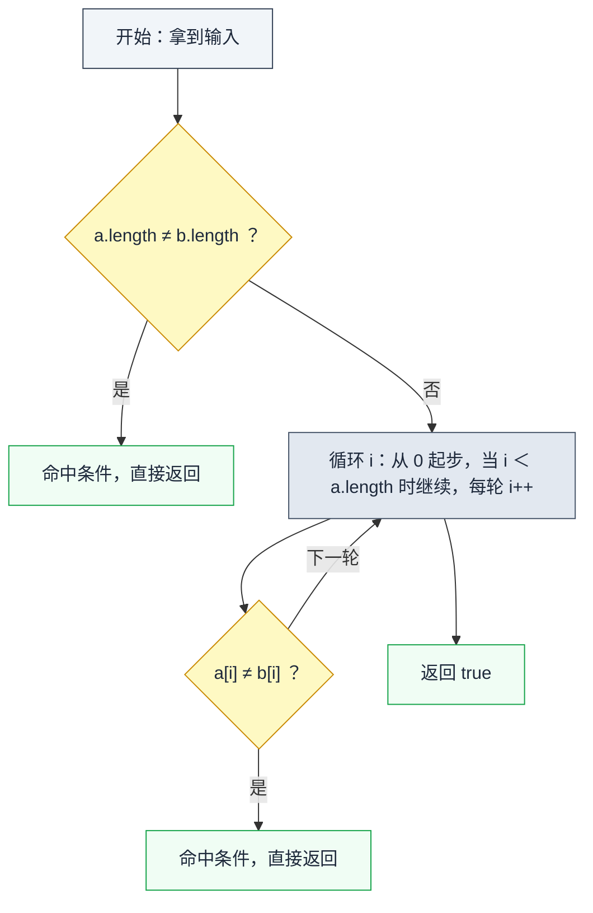
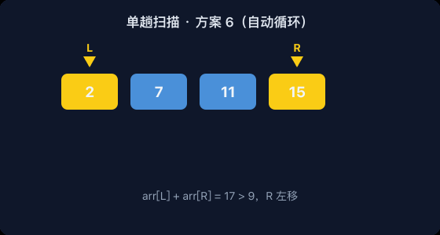
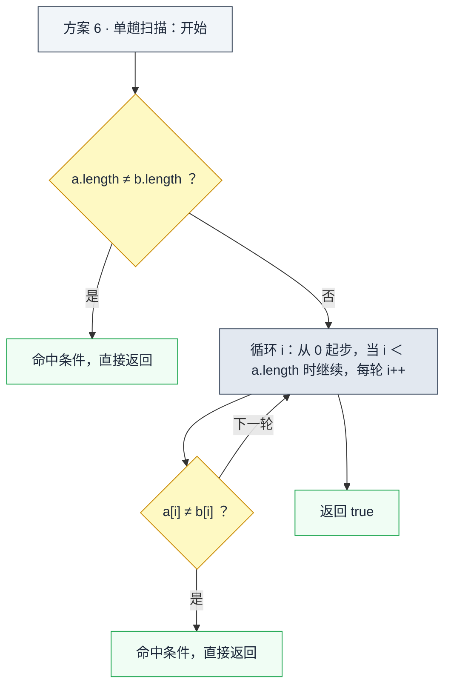
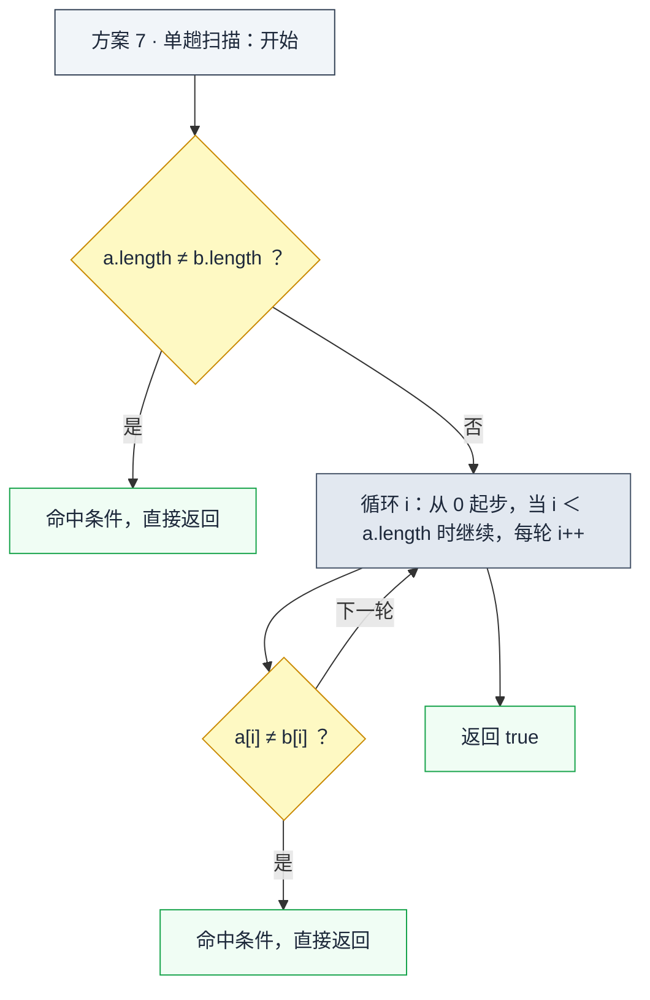
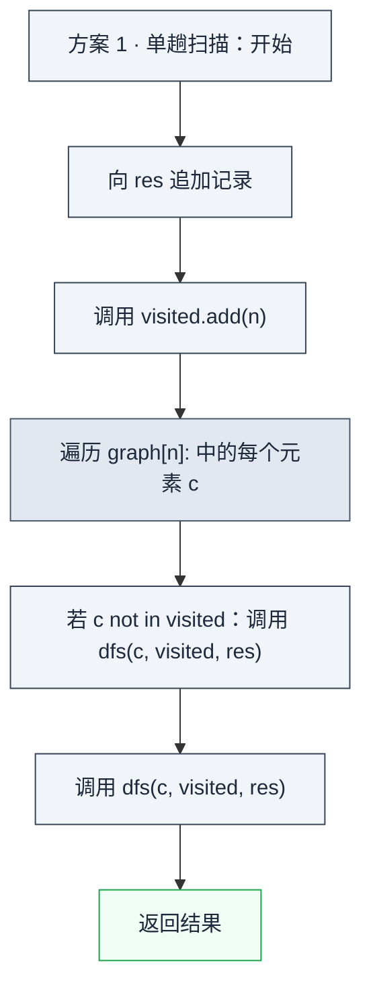
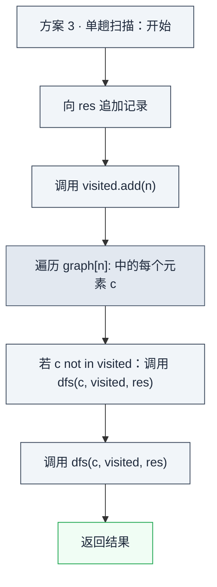
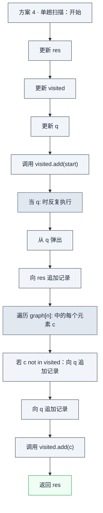
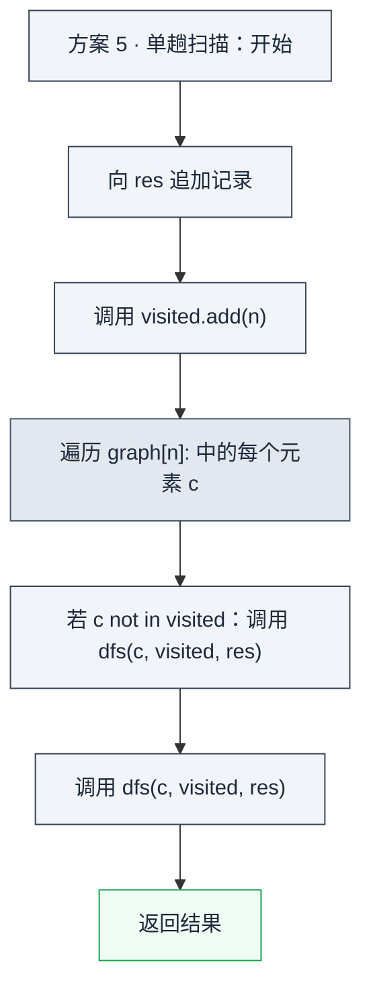
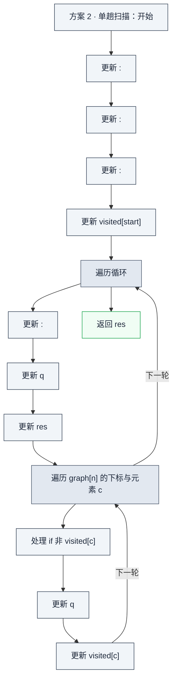
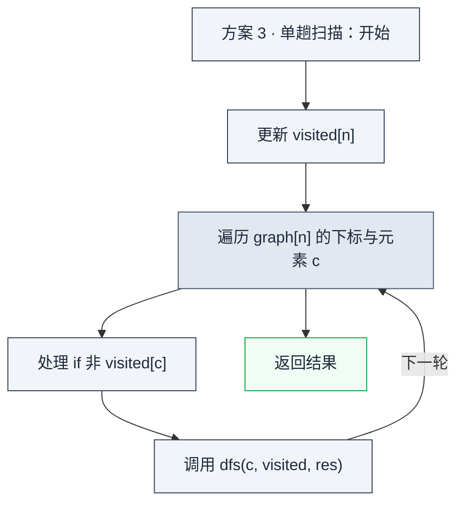

# 227 · 图及其深度和广度优先遍历实现（第附阶段 · 专题补充 · Medium）

> **难度**：⭐⭐ Medium ｜ **专题**：算法笔记
> **学习定位**：第附阶段 · 专题补充第 227 篇 ｜ **解法数**：8
> **内容总结**：**图及其深度和广度优先遍历实现**（算法笔记 · Medium）：共 8 个方案，主线思路「单趟扫描」；时间 O(n)（单趟线性扫描）；动画演示归并分治过程，附录给出 11 种语言 × 全部方案的可运行实现。

---

## 题目描述

图及其深度和广度优先遍历实现。具体输入输出约定见函数签名与用例。

- 主函数签名：`function eq(a: number[], b: number[]): boolean`

**数据范围与注意事项**：

- **易错点**：先看小例子手推一遍再对照代码，比直接读代码快得多。

## 题目分析

**场景是什么**：综合练习：把数据结构与策略组合起来解决一个完整问题。本题就是该场景的 Medium 级练习，主线做法是「单趟扫描」。

**主线怎么解**：把主解法从头到尾过一遍，它其实在依次做这几件事：单循环线性扫描。

## 解题思路

**方案对比**（共 8 个方案，由浅入深）：

| 方案 | 时间复杂度 | 空间复杂度 |
|---|---|---|
| 方案 1 · 单趟扫描 | O(n)（单趟线性扫描） | O(1) 到 O(n)（视辅助结构） |
| 方案 2 · 单趟扫描 | O(n)（单趟线性扫描） | O(1) 到 O(n)（视辅助结构） |
| 方案 3 · 单趟扫描 | O(n)（单趟线性扫描） | O(1) 到 O(n)（视辅助结构） |
| 方案 4 · 单趟扫描 | O(n)（单趟线性扫描） | O(1) 到 O(n)（视辅助结构） |
| 方案 5 · 单趟扫描 | O(n)（单趟线性扫描） | O(1) 到 O(n)（视辅助结构） |
| 方案 6 · 单趟扫描 | O(n)（单趟线性扫描） | O(1) 到 O(n)（视辅助结构） |
| 方案 7 · 单趟扫描 | O(n)（单趟线性扫描） | O(1) 到 O(n)（视辅助结构） |
| 方案 8 · 单趟扫描 | O(n)（单趟线性扫描） | O(1) 到 O(n)（视辅助结构） |

**方案间的取舍**：方案 1（单趟扫描）；方案 2（单趟扫描）；方案 3（单趟扫描）；方案 4（单趟扫描）；方案 5（单趟扫描）；方案 6（单趟扫描）；方案 7（单趟扫描）；方案 8（单趟扫描）。数据规模小、可读性优先时选靠前的方案；规模大、性能优先时选靠后的方案。

**怎么读这一篇**：

- 🐣 **新手路线**：把「题目描述」的示例 1 在纸上手推一遍 → 读方案 1（最直观的写法）与它的代码走读 → 按「运行方式」本地跑通看 PASS → 回头对比方案 2 之后的写法差在哪
- 🦅 **大佬路线**：直接锁定最优方案 1（单趟扫描，O(n)（单趟线性扫描））→ 跳读该方案代码与走读 → 用「逐步拆解与面试追问」补齐复杂度推导与边界追问

### 动态算法图（归并分治，GIF 自动循环）


动画演示算法笔记专题里归并分治的典型过程；每个方案在「TypeScript 解题方案」一节还配了专属动画与专属流程图。

### 主解法流程图（真实控制流）



## TypeScript 解题方案（8 个方案逐个讲）

> **运行与提交**：每个方案都是自包含文件（内嵌用例自测，输出 PASS），整块复制到 `.ts` 文件后 `node 文件名` 即可运行。提交 LeetCode 时，把 `demo` 内的算法函数与辅助类型/函数整体取出、置于文件顶层即可。概念演示（非 LeetCode 编号题），在本地运行即可。

### 方案 1：单趟扫描

**分析与思路**：核心做法是「单趟扫描」。代码里依次做这些事：单循环线性扫描。

**运行方式**：`node 本文件`，内嵌用例全部通过会输出 PASS。


**方案专属流程图**（真实控制流）：


```typescript
/**
 ** LeetCode 133651611. 图及其深度和广度优先遍历实现
 ** 来源：https://blog.csdn.net/tyro_java/article/details/133651611
 */

class Graph {
  // 定义类型
  private adjList: Map<number, number[]>; // private adjList: Map 小于 number, number[] 超过 ;

  constructor() {
    // constructor() {
    this.adjList = new Map(); // 把 new Map(); 写入 this.adjList
  }

  addEdge(from: number, to: number): void {
    // addEdge(from: number, to: number): void {
    if (!this.adjList.has(from)) this.adjList.set(from, []); // 若 取反 this.adjList.has(from)) this.adjList.set(from, []);
    if (!this.adjList.has(to)) this.adjList.set(to, []); // 若 取反 this.adjList.has(to)) this.adjList.set(to, []);
    this.adjList.get(from)!.push(to); // 把 to 压入栈/数组尾部
    this.adjList.get(to)!.push(from); // 把 from 压入栈/数组尾部
  }

  dfs(start: number): number[] {
    // dfs(起点: number): number[] {
    const visited = new Set<number>(); // 把 new Set 小于 number 超过 () 存入 已访问集合
    const result: number[] = []; // 把 []; 写入 const result: number[]
    this.dfsHelper(start, visited, result); // this.dfsHelper(起点, 已访问集合, 结果);
    return result; // 返回 结果
  }

  private dfsHelper(
    node: number,
    visited: Set<number>,
    result: number[],
  ): void {
    if (visited.has(node)) return; // 若 已访问集合.has(节点)) return;
    visited.add(node); // 已访问集合 追加 节点);
    result.push(node); // 把 节点 压入栈/数组尾部
    for (const neighbor of this.adjList.get(node) || []) {
      // for (const neighbor of this.adjList 查找 节点) 或 []) {
      this.dfsHelper(neighbor, visited, result); // this.dfsHelper(neighbor, 已访问集合, 结果);
    }
  }

  bfs(start: number): number[] {
    // bfs(起点: number): number[] {
    const visited = new Set<number>(); // 把 new Set 小于 number 超过 () 存入 已访问集合
    const result: number[] = []; // 把 []; 写入 const result: number[]
    const queue: number[] = [start]; // 把 [起点]; 写入 const queue: number[]
    visited.add(start); // 已访问集合 追加 起点);

    while (queue.length > 0) {
      // 循环，直到不满足「队列.长度 超过 0」
      const node = queue.shift()!; // 把 队列.shift()取反 存入 节点
      result.push(node); // 把 节点 压入栈/数组尾部
      for (const neighbor of this.adjList.get(node) || []) {
        // for (const neighbor of this.adjList 查找 节点) 或 []) {
        if (!visited.has(neighbor)) {
          // 若 取反 已访问集合.has(neighbor
          visited.add(neighbor); // 已访问集合 追加 neighbor);
          queue.push(neighbor); // 把 neighbor 压入栈/数组尾部
        }
      }
    }
    return result; // 返回 结果
  }
}

function eq(a: number[], b: number[]): boolean {
  // 定义函数/方法 eq
  if (a.length !== b.length) return false; // 若 数组.长度 不等于 b.长度，直接返回 false
  for (let i = 0; i < a.length; i++) {
    // 让 下标 i 从 0 开始计数，下标 i 小于 数组.长度 就继续
    if (a[i] !== b[i]) return false; // 若 数组[下标 i] 不等于 b[下标 i]，直接返回 false
  }
  return true; // 返回 true
}

export function demo(): void {
  // 程序入口：跑内嵌自测用例
  // case 1: square graph 0-1-3-2-0
  const g1 = new Graph(); // 把 new Graph() 存入 g1
  g1.addEdge(0, 1); // g1.addEdge(0, 1);
  g1.addEdge(0, 2); // g1.addEdge(0, 2);
  g1.addEdge(1, 3); // g1.addEdge(1, 3);
  g1.addEdge(2, 3); // g1.addEdge(2, 3);
  if (!eq(g1.dfs(0), [0, 1, 3, 2])) throw new Error('FAILED case1 dfs(0)');
  if (!eq(g1.bfs(0), [0, 1, 2, 3])) throw new Error('FAILED case1 bfs(0)');

  // case 2: traversal from another start node
  if (!eq(g1.dfs(2), [2, 0, 1, 3])) throw new Error('FAILED case2 dfs(2)');
  if (!eq(g1.bfs(2), [2, 0, 3, 1])) throw new Error('FAILED case2 bfs(2)');

  console.log('PASS'); // 全部用例通过，输出 PASS
}

demo(); // demo();
```

### 方案 2：单趟扫描

**分析与思路**：核心做法是「单趟扫描」。代码里依次做这些事：单循环线性扫描。

**运行方式**：`node 本文件`，内嵌用例全部通过会输出 PASS。


**方案专属流程图**（真实控制流）：


```typescript
/**
 ** LeetCode 133651611. 图及其深度和广度优先遍历实现
 ** 来源：https://blog.csdn.net/tyro_java/article/details/133651611
 */

class Graph {
  // 定义类型
  private adjList: Map<number, number[]>; // private adjList: Map 小于 number, number[] 超过 ;

  constructor() {
    // constructor() {
    this.adjList = new Map(); // 把 new Map(); 写入 this.adjList
  }

  addEdge(from: number, to: number): void {
    // addEdge(from: number, to: number): void {
    if (!this.adjList.has(from)) this.adjList.set(from, []); // 若 取反 this.adjList.has(from)) this.adjList.set(from, []);
    if (!this.adjList.has(to)) this.adjList.set(to, []); // 若 取反 this.adjList.has(to)) this.adjList.set(to, []);
    this.adjList.get(from)!.push(to); // 把 to 压入栈/数组尾部
    this.adjList.get(to)!.push(from); // 把 from 压入栈/数组尾部
  }

  dfs(start: number): number[] {
    // dfs(起点: number): number[] {
    const visited = new Set<number>(); // 把 new Set 小于 number 超过 () 存入 已访问集合
    const result: number[] = []; // 把 []; 写入 const result: number[]
    this.dfsHelper(start, visited, result); // this.dfsHelper(起点, 已访问集合, 结果);
    return result; // 返回 结果
  }

  private dfsHelper(
    node: number,
    visited: Set<number>,
    result: number[],
  ): void {
    if (visited.has(node)) return; // 若 已访问集合.has(节点)) return;
    visited.add(node); // 已访问集合 追加 节点);
    result.push(node); // 把 节点 压入栈/数组尾部
    for (const neighbor of this.adjList.get(node) || []) {
      // for (const neighbor of this.adjList 查找 节点) 或 []) {
      this.dfsHelper(neighbor, visited, result); // this.dfsHelper(neighbor, 已访问集合, 结果);
    }
  }

  bfs(start: number): number[] {
    // bfs(起点: number): number[] {
    const visited = new Set<number>(); // 把 new Set 小于 number 超过 () 存入 已访问集合
    const result: number[] = []; // 把 []; 写入 const result: number[]
    const queue: number[] = [start]; // 把 [起点]; 写入 const queue: number[]
    visited.add(start); // 已访问集合 追加 起点);

    while (queue.length > 0) {
      // 循环，直到不满足「队列.长度 超过 0」
      const node = queue.shift()!; // 把 队列.shift()取反 存入 节点
      result.push(node); // 把 节点 压入栈/数组尾部
      for (const neighbor of this.adjList.get(node) || []) {
        // for (const neighbor of this.adjList 查找 节点) 或 []) {
        if (!visited.has(neighbor)) {
          // 若 取反 已访问集合.has(neighbor
          visited.add(neighbor); // 已访问集合 追加 neighbor);
          queue.push(neighbor); // 把 neighbor 压入栈/数组尾部
        }
      }
    }
    return result; // 返回 结果
  }
}

function eq(a: number[], b: number[]): boolean {
  // 定义函数/方法 eq
  if (a.length !== b.length) return false; // 若 数组.长度 不等于 b.长度，直接返回 false
  for (let i = 0; i < a.length; i++) {
    // 让 下标 i 从 0 开始计数，下标 i 小于 数组.长度 就继续
    if (a[i] !== b[i]) return false; // 若 数组[下标 i] 不等于 b[下标 i]，直接返回 false
  }
  return true; // 返回 true
}

export function demo(): void {
  // 程序入口：跑内嵌自测用例
  // case 1: square graph 0-1-3-2-0
  const g1 = new Graph(); // 把 new Graph() 存入 g1
  g1.addEdge(0, 1); // g1.addEdge(0, 1);
  g1.addEdge(0, 2); // g1.addEdge(0, 2);
  g1.addEdge(1, 3); // g1.addEdge(1, 3);
  g1.addEdge(2, 3); // g1.addEdge(2, 3);
  if (!eq(g1.dfs(0), [0, 1, 3, 2])) throw new Error('FAILED case1 dfs(0)');
  if (!eq(g1.bfs(0), [0, 1, 2, 3])) throw new Error('FAILED case1 bfs(0)');

  // case 2: traversal from another start node
  if (!eq(g1.dfs(2), [2, 0, 1, 3])) throw new Error('FAILED case2 dfs(2)');
  if (!eq(g1.bfs(2), [2, 0, 3, 1])) throw new Error('FAILED case2 bfs(2)');

  console.log('PASS'); // 全部用例通过，输出 PASS
}

demo(); // demo();
```

### 方案 3：单趟扫描

**分析与思路**：核心做法是「单趟扫描」。代码里依次做这些事：单循环线性扫描。

**运行方式**：`node 本文件`，内嵌用例全部通过会输出 PASS。


**方案专属流程图**（真实控制流）：


```typescript
/**
 ** LeetCode 133651611. 图及其深度和广度优先遍历实现
 ** 来源：https://blog.csdn.net/tyro_java/article/details/133651611
 */

class Graph {
  // 定义类型
  private adjList: Map<number, number[]>; // private adjList: Map 小于 number, number[] 超过 ;

  constructor() {
    // constructor() {
    this.adjList = new Map(); // 把 new Map(); 写入 this.adjList
  }

  addEdge(from: number, to: number): void {
    // addEdge(from: number, to: number): void {
    if (!this.adjList.has(from)) this.adjList.set(from, []); // 若 取反 this.adjList.has(from)) this.adjList.set(from, []);
    if (!this.adjList.has(to)) this.adjList.set(to, []); // 若 取反 this.adjList.has(to)) this.adjList.set(to, []);
    this.adjList.get(from)!.push(to); // 把 to 压入栈/数组尾部
    this.adjList.get(to)!.push(from); // 把 from 压入栈/数组尾部
  }

  dfs(start: number): number[] {
    // dfs(起点: number): number[] {
    const visited = new Set<number>(); // 把 new Set 小于 number 超过 () 存入 已访问集合
    const result: number[] = []; // 把 []; 写入 const result: number[]
    this.dfsHelper(start, visited, result); // this.dfsHelper(起点, 已访问集合, 结果);
    return result; // 返回 结果
  }

  private dfsHelper(
    node: number,
    visited: Set<number>,
    result: number[],
  ): void {
    if (visited.has(node)) return; // 若 已访问集合.has(节点)) return;
    visited.add(node); // 已访问集合 追加 节点);
    result.push(node); // 把 节点 压入栈/数组尾部
    for (const neighbor of this.adjList.get(node) || []) {
      // for (const neighbor of this.adjList 查找 节点) 或 []) {
      this.dfsHelper(neighbor, visited, result); // this.dfsHelper(neighbor, 已访问集合, 结果);
    }
  }

  bfs(start: number): number[] {
    // bfs(起点: number): number[] {
    const visited = new Set<number>(); // 把 new Set 小于 number 超过 () 存入 已访问集合
    const result: number[] = []; // 把 []; 写入 const result: number[]
    const queue: number[] = [start]; // 把 [起点]; 写入 const queue: number[]
    visited.add(start); // 已访问集合 追加 起点);

    while (queue.length > 0) {
      // 循环，直到不满足「队列.长度 超过 0」
      const node = queue.shift()!; // 把 队列.shift()取反 存入 节点
      result.push(node); // 把 节点 压入栈/数组尾部
      for (const neighbor of this.adjList.get(node) || []) {
        // for (const neighbor of this.adjList 查找 节点) 或 []) {
        if (!visited.has(neighbor)) {
          // 若 取反 已访问集合.has(neighbor
          visited.add(neighbor); // 已访问集合 追加 neighbor);
          queue.push(neighbor); // 把 neighbor 压入栈/数组尾部
        }
      }
    }
    return result; // 返回 结果
  }
}

function eq(a: number[], b: number[]): boolean {
  // 定义函数/方法 eq
  if (a.length !== b.length) return false; // 若 数组.长度 不等于 b.长度，直接返回 false
  for (let i = 0; i < a.length; i++) {
    // 让 下标 i 从 0 开始计数，下标 i 小于 数组.长度 就继续
    if (a[i] !== b[i]) return false; // 若 数组[下标 i] 不等于 b[下标 i]，直接返回 false
  }
  return true; // 返回 true
}

export function demo(): void {
  // 程序入口：跑内嵌自测用例
  // case 1: square graph 0-1-3-2-0
  const g1 = new Graph(); // 把 new Graph() 存入 g1
  g1.addEdge(0, 1); // g1.addEdge(0, 1);
  g1.addEdge(0, 2); // g1.addEdge(0, 2);
  g1.addEdge(1, 3); // g1.addEdge(1, 3);
  g1.addEdge(2, 3); // g1.addEdge(2, 3);
  if (!eq(g1.dfs(0), [0, 1, 3, 2])) throw new Error('FAILED case1 dfs(0)');
  if (!eq(g1.bfs(0), [0, 1, 2, 3])) throw new Error('FAILED case1 bfs(0)');

  // case 2: traversal from another start node
  if (!eq(g1.dfs(2), [2, 0, 1, 3])) throw new Error('FAILED case2 dfs(2)');
  if (!eq(g1.bfs(2), [2, 0, 3, 1])) throw new Error('FAILED case2 bfs(2)');

  console.log('PASS'); // 全部用例通过，输出 PASS
}

demo(); // demo();
```

### 方案 4：单趟扫描

**分析与思路**：核心做法是「单趟扫描」。代码里依次做这些事：单循环线性扫描。

**运行方式**：`node 本文件`，内嵌用例全部通过会输出 PASS。


**方案专属流程图**（真实控制流）：


```typescript
/**
 ** LeetCode 133651611. 图及其深度和广度优先遍历实现
 ** 来源：https://blog.csdn.net/tyro_java/article/details/133651611
 */

class Graph {
  // 定义类型
  private adjList: Map<number, number[]>; // private adjList: Map 小于 number, number[] 超过 ;

  constructor() {
    // constructor() {
    this.adjList = new Map(); // 把 new Map(); 写入 this.adjList
  }

  addEdge(from: number, to: number): void {
    // addEdge(from: number, to: number): void {
    if (!this.adjList.has(from)) this.adjList.set(from, []); // 若 取反 this.adjList.has(from)) this.adjList.set(from, []);
    if (!this.adjList.has(to)) this.adjList.set(to, []); // 若 取反 this.adjList.has(to)) this.adjList.set(to, []);
    this.adjList.get(from)!.push(to); // 把 to 压入栈/数组尾部
    this.adjList.get(to)!.push(from); // 把 from 压入栈/数组尾部
  }

  dfs(start: number): number[] {
    // dfs(起点: number): number[] {
    const visited = new Set<number>(); // 把 new Set 小于 number 超过 () 存入 已访问集合
    const result: number[] = []; // 把 []; 写入 const result: number[]
    this.dfsHelper(start, visited, result); // this.dfsHelper(起点, 已访问集合, 结果);
    return result; // 返回 结果
  }

  private dfsHelper(
    node: number,
    visited: Set<number>,
    result: number[],
  ): void {
    if (visited.has(node)) return; // 若 已访问集合.has(节点)) return;
    visited.add(node); // 已访问集合 追加 节点);
    result.push(node); // 把 节点 压入栈/数组尾部
    for (const neighbor of this.adjList.get(node) || []) {
      // for (const neighbor of this.adjList 查找 节点) 或 []) {
      this.dfsHelper(neighbor, visited, result); // this.dfsHelper(neighbor, 已访问集合, 结果);
    }
  }

  bfs(start: number): number[] {
    // bfs(起点: number): number[] {
    const visited = new Set<number>(); // 把 new Set 小于 number 超过 () 存入 已访问集合
    const result: number[] = []; // 把 []; 写入 const result: number[]
    const queue: number[] = [start]; // 把 [起点]; 写入 const queue: number[]
    visited.add(start); // 已访问集合 追加 起点);

    while (queue.length > 0) {
      // 循环，直到不满足「队列.长度 超过 0」
      const node = queue.shift()!; // 把 队列.shift()取反 存入 节点
      result.push(node); // 把 节点 压入栈/数组尾部
      for (const neighbor of this.adjList.get(node) || []) {
        // for (const neighbor of this.adjList 查找 节点) 或 []) {
        if (!visited.has(neighbor)) {
          // 若 取反 已访问集合.has(neighbor
          visited.add(neighbor); // 已访问集合 追加 neighbor);
          queue.push(neighbor); // 把 neighbor 压入栈/数组尾部
        }
      }
    }
    return result; // 返回 结果
  }
}

function eq(a: number[], b: number[]): boolean {
  // 定义函数/方法 eq
  if (a.length !== b.length) return false; // 若 数组.长度 不等于 b.长度，直接返回 false
  for (let i = 0; i < a.length; i++) {
    // 让 下标 i 从 0 开始计数，下标 i 小于 数组.长度 就继续
    if (a[i] !== b[i]) return false; // 若 数组[下标 i] 不等于 b[下标 i]，直接返回 false
  }
  return true; // 返回 true
}

export function demo(): void {
  // 程序入口：跑内嵌自测用例
  // case 1: square graph 0-1-3-2-0
  const g1 = new Graph(); // 把 new Graph() 存入 g1
  g1.addEdge(0, 1); // g1.addEdge(0, 1);
  g1.addEdge(0, 2); // g1.addEdge(0, 2);
  g1.addEdge(1, 3); // g1.addEdge(1, 3);
  g1.addEdge(2, 3); // g1.addEdge(2, 3);
  if (!eq(g1.dfs(0), [0, 1, 3, 2])) throw new Error('FAILED case1 dfs(0)');
  if (!eq(g1.bfs(0), [0, 1, 2, 3])) throw new Error('FAILED case1 bfs(0)');

  // case 2: traversal from another start node
  if (!eq(g1.dfs(2), [2, 0, 1, 3])) throw new Error('FAILED case2 dfs(2)');
  if (!eq(g1.bfs(2), [2, 0, 3, 1])) throw new Error('FAILED case2 bfs(2)');

  console.log('PASS'); // 全部用例通过，输出 PASS
}

demo(); // demo();
```

### 方案 5：单趟扫描

**分析与思路**：核心做法是「单趟扫描」。代码里依次做这些事：单循环线性扫描。

**运行方式**：`node 本文件`，内嵌用例全部通过会输出 PASS。


**方案专属流程图**（真实控制流）：


```typescript
/**
 ** LeetCode 133651611. 图及其深度和广度优先遍历实现
 ** 来源：https://blog.csdn.net/tyro_java/article/details/133651611
 */

class Graph {
  // 定义类型
  private adjList: Map<number, number[]>; // private adjList: Map 小于 number, number[] 超过 ;

  constructor() {
    // constructor() {
    this.adjList = new Map(); // 把 new Map(); 写入 this.adjList
  }

  addEdge(from: number, to: number): void {
    // addEdge(from: number, to: number): void {
    if (!this.adjList.has(from)) this.adjList.set(from, []); // 若 取反 this.adjList.has(from)) this.adjList.set(from, []);
    if (!this.adjList.has(to)) this.adjList.set(to, []); // 若 取反 this.adjList.has(to)) this.adjList.set(to, []);
    this.adjList.get(from)!.push(to); // 把 to 压入栈/数组尾部
    this.adjList.get(to)!.push(from); // 把 from 压入栈/数组尾部
  }

  dfs(start: number): number[] {
    // dfs(起点: number): number[] {
    const visited = new Set<number>(); // 把 new Set 小于 number 超过 () 存入 已访问集合
    const result: number[] = []; // 把 []; 写入 const result: number[]
    this.dfsHelper(start, visited, result); // this.dfsHelper(起点, 已访问集合, 结果);
    return result; // 返回 结果
  }

  private dfsHelper(
    node: number,
    visited: Set<number>,
    result: number[],
  ): void {
    if (visited.has(node)) return; // 若 已访问集合.has(节点)) return;
    visited.add(node); // 已访问集合 追加 节点);
    result.push(node); // 把 节点 压入栈/数组尾部
    for (const neighbor of this.adjList.get(node) || []) {
      // for (const neighbor of this.adjList 查找 节点) 或 []) {
      this.dfsHelper(neighbor, visited, result); // this.dfsHelper(neighbor, 已访问集合, 结果);
    }
  }

  bfs(start: number): number[] {
    // bfs(起点: number): number[] {
    const visited = new Set<number>(); // 把 new Set 小于 number 超过 () 存入 已访问集合
    const result: number[] = []; // 把 []; 写入 const result: number[]
    const queue: number[] = [start]; // 把 [起点]; 写入 const queue: number[]
    visited.add(start); // 已访问集合 追加 起点);

    while (queue.length > 0) {
      // 循环，直到不满足「队列.长度 超过 0」
      const node = queue.shift()!; // 把 队列.shift()取反 存入 节点
      result.push(node); // 把 节点 压入栈/数组尾部
      for (const neighbor of this.adjList.get(node) || []) {
        // for (const neighbor of this.adjList 查找 节点) 或 []) {
        if (!visited.has(neighbor)) {
          // 若 取反 已访问集合.has(neighbor
          visited.add(neighbor); // 已访问集合 追加 neighbor);
          queue.push(neighbor); // 把 neighbor 压入栈/数组尾部
        }
      }
    }
    return result; // 返回 结果
  }
}

function eq(a: number[], b: number[]): boolean {
  // 定义函数/方法 eq
  if (a.length !== b.length) return false; // 若 数组.长度 不等于 b.长度，直接返回 false
  for (let i = 0; i < a.length; i++) {
    // 让 下标 i 从 0 开始计数，下标 i 小于 数组.长度 就继续
    if (a[i] !== b[i]) return false; // 若 数组[下标 i] 不等于 b[下标 i]，直接返回 false
  }
  return true; // 返回 true
}

export function demo(): void {
  // 程序入口：跑内嵌自测用例
  // case 1: square graph 0-1-3-2-0
  const g1 = new Graph(); // 把 new Graph() 存入 g1
  g1.addEdge(0, 1); // g1.addEdge(0, 1);
  g1.addEdge(0, 2); // g1.addEdge(0, 2);
  g1.addEdge(1, 3); // g1.addEdge(1, 3);
  g1.addEdge(2, 3); // g1.addEdge(2, 3);
  if (!eq(g1.dfs(0), [0, 1, 3, 2])) throw new Error('FAILED case1 dfs(0)');
  if (!eq(g1.bfs(0), [0, 1, 2, 3])) throw new Error('FAILED case1 bfs(0)');

  // case 2: traversal from another start node
  if (!eq(g1.dfs(2), [2, 0, 1, 3])) throw new Error('FAILED case2 dfs(2)');
  if (!eq(g1.bfs(2), [2, 0, 3, 1])) throw new Error('FAILED case2 bfs(2)');

  console.log('PASS'); // 全部用例通过，输出 PASS
}

demo(); // demo();
```

### 方案 6：单趟扫描

**分析与思路**：核心做法是「单趟扫描」。代码里依次做这些事：单循环线性扫描。

**运行方式**：`node 本文件`，内嵌用例全部通过会输出 PASS。



**方案专属流程图**（真实控制流）：



```typescript
/**
 ** LeetCode 133651611. 图及其深度和广度优先遍历实现
 ** 来源：https://blog.csdn.net/tyro_java/article/details/133651611
 */

class Graph {
  // 定义类型
  private adjList: Map<number, number[]>; // private adjList: Map 小于 number, number[] 超过 ;

  constructor() {
    // constructor() {
    this.adjList = new Map(); // 把 new Map(); 写入 this.adjList
  }

  addEdge(from: number, to: number): void {
    // addEdge(from: number, to: number): void {
    if (!this.adjList.has(from)) this.adjList.set(from, []); // 若 取反 this.adjList.has(from)) this.adjList.set(from, []);
    if (!this.adjList.has(to)) this.adjList.set(to, []); // 若 取反 this.adjList.has(to)) this.adjList.set(to, []);
    this.adjList.get(from)!.push(to); // 把 to 压入栈/数组尾部
    this.adjList.get(to)!.push(from); // 把 from 压入栈/数组尾部
  }

  dfs(start: number): number[] {
    // dfs(起点: number): number[] {
    const visited = new Set<number>(); // 把 new Set 小于 number 超过 () 存入 已访问集合
    const result: number[] = []; // 把 []; 写入 const result: number[]
    this.dfsHelper(start, visited, result); // this.dfsHelper(起点, 已访问集合, 结果);
    return result; // 返回 结果
  }

  private dfsHelper(
    node: number,
    visited: Set<number>,
    result: number[],
  ): void {
    if (visited.has(node)) return; // 若 已访问集合.has(节点)) return;
    visited.add(node); // 已访问集合 追加 节点);
    result.push(node); // 把 节点 压入栈/数组尾部
    for (const neighbor of this.adjList.get(node) || []) {
      // for (const neighbor of this.adjList 查找 节点) 或 []) {
      this.dfsHelper(neighbor, visited, result); // this.dfsHelper(neighbor, 已访问集合, 结果);
    }
  }

  bfs(start: number): number[] {
    // bfs(起点: number): number[] {
    const visited = new Set<number>(); // 把 new Set 小于 number 超过 () 存入 已访问集合
    const result: number[] = []; // 把 []; 写入 const result: number[]
    const queue: number[] = [start]; // 把 [起点]; 写入 const queue: number[]
    visited.add(start); // 已访问集合 追加 起点);

    while (queue.length > 0) {
      // 循环，直到不满足「队列.长度 超过 0」
      const node = queue.shift()!; // 把 队列.shift()取反 存入 节点
      result.push(node); // 把 节点 压入栈/数组尾部
      for (const neighbor of this.adjList.get(node) || []) {
        // for (const neighbor of this.adjList 查找 节点) 或 []) {
        if (!visited.has(neighbor)) {
          // 若 取反 已访问集合.has(neighbor
          visited.add(neighbor); // 已访问集合 追加 neighbor);
          queue.push(neighbor); // 把 neighbor 压入栈/数组尾部
        }
      }
    }
    return result; // 返回 结果
  }
}

function eq(a: number[], b: number[]): boolean {
  // 定义函数/方法 eq
  if (a.length !== b.length) return false; // 若 数组.长度 不等于 b.长度，直接返回 false
  for (let i = 0; i < a.length; i++) {
    // 让 下标 i 从 0 开始计数，下标 i 小于 数组.长度 就继续
    if (a[i] !== b[i]) return false; // 若 数组[下标 i] 不等于 b[下标 i]，直接返回 false
  }
  return true; // 返回 true
}

export function demo(): void {
  // 程序入口：跑内嵌自测用例
  // case 1: square graph 0-1-3-2-0
  const g1 = new Graph(); // 把 new Graph() 存入 g1
  g1.addEdge(0, 1); // g1.addEdge(0, 1);
  g1.addEdge(0, 2); // g1.addEdge(0, 2);
  g1.addEdge(1, 3); // g1.addEdge(1, 3);
  g1.addEdge(2, 3); // g1.addEdge(2, 3);
  if (!eq(g1.dfs(0), [0, 1, 3, 2])) throw new Error('FAILED case1 dfs(0)');
  if (!eq(g1.bfs(0), [0, 1, 2, 3])) throw new Error('FAILED case1 bfs(0)');

  // case 2: traversal from another start node
  if (!eq(g1.dfs(2), [2, 0, 1, 3])) throw new Error('FAILED case2 dfs(2)');
  if (!eq(g1.bfs(2), [2, 0, 3, 1])) throw new Error('FAILED case2 bfs(2)');

  console.log('PASS'); // 全部用例通过，输出 PASS
}

demo(); // demo();
```

### 方案 7：单趟扫描

**分析与思路**：核心做法是「单趟扫描」。代码里依次做这些事：单循环线性扫描。

**运行方式**：`node 本文件`，内嵌用例全部通过会输出 PASS。


**方案专属流程图**（真实控制流）：



```typescript
/**
 ** LeetCode 133651611. 图及其深度和广度优先遍历实现
 ** 来源：https://blog.csdn.net/tyro_java/article/details/133651611
 */

class Graph {
  // 定义类型
  private adjList: Map<number, number[]>; // private adjList: Map 小于 number, number[] 超过 ;

  constructor() {
    // constructor() {
    this.adjList = new Map(); // 把 new Map(); 写入 this.adjList
  }

  addEdge(from: number, to: number): void {
    // addEdge(from: number, to: number): void {
    if (!this.adjList.has(from)) this.adjList.set(from, []); // 若 取反 this.adjList.has(from)) this.adjList.set(from, []);
    if (!this.adjList.has(to)) this.adjList.set(to, []); // 若 取反 this.adjList.has(to)) this.adjList.set(to, []);
    this.adjList.get(from)!.push(to); // 把 to 压入栈/数组尾部
    this.adjList.get(to)!.push(from); // 把 from 压入栈/数组尾部
  }

  dfs(start: number): number[] {
    // dfs(起点: number): number[] {
    const visited = new Set<number>(); // 把 new Set 小于 number 超过 () 存入 已访问集合
    const result: number[] = []; // 把 []; 写入 const result: number[]
    this.dfsHelper(start, visited, result); // this.dfsHelper(起点, 已访问集合, 结果);
    return result; // 返回 结果
  }

  private dfsHelper(
    node: number,
    visited: Set<number>,
    result: number[],
  ): void {
    if (visited.has(node)) return; // 若 已访问集合.has(节点)) return;
    visited.add(node); // 已访问集合 追加 节点);
    result.push(node); // 把 节点 压入栈/数组尾部
    for (const neighbor of this.adjList.get(node) || []) {
      // for (const neighbor of this.adjList 查找 节点) 或 []) {
      this.dfsHelper(neighbor, visited, result); // this.dfsHelper(neighbor, 已访问集合, 结果);
    }
  }

  bfs(start: number): number[] {
    // bfs(起点: number): number[] {
    const visited = new Set<number>(); // 把 new Set 小于 number 超过 () 存入 已访问集合
    const result: number[] = []; // 把 []; 写入 const result: number[]
    const queue: number[] = [start]; // 把 [起点]; 写入 const queue: number[]
    visited.add(start); // 已访问集合 追加 起点);

    while (queue.length > 0) {
      // 循环，直到不满足「队列.长度 超过 0」
      const node = queue.shift()!; // 把 队列.shift()取反 存入 节点
      result.push(node); // 把 节点 压入栈/数组尾部
      for (const neighbor of this.adjList.get(node) || []) {
        // for (const neighbor of this.adjList 查找 节点) 或 []) {
        if (!visited.has(neighbor)) {
          // 若 取反 已访问集合.has(neighbor
          visited.add(neighbor); // 已访问集合 追加 neighbor);
          queue.push(neighbor); // 把 neighbor 压入栈/数组尾部
        }
      }
    }
    return result; // 返回 结果
  }
}

function eq(a: number[], b: number[]): boolean {
  // 定义函数/方法 eq
  if (a.length !== b.length) return false; // 若 数组.长度 不等于 b.长度，直接返回 false
  for (let i = 0; i < a.length; i++) {
    // 让 下标 i 从 0 开始计数，下标 i 小于 数组.长度 就继续
    if (a[i] !== b[i]) return false; // 若 数组[下标 i] 不等于 b[下标 i]，直接返回 false
  }
  return true; // 返回 true
}

export function demo(): void {
  // 程序入口：跑内嵌自测用例
  // case 1: square graph 0-1-3-2-0
  const g1 = new Graph(); // 把 new Graph() 存入 g1
  g1.addEdge(0, 1); // g1.addEdge(0, 1);
  g1.addEdge(0, 2); // g1.addEdge(0, 2);
  g1.addEdge(1, 3); // g1.addEdge(1, 3);
  g1.addEdge(2, 3); // g1.addEdge(2, 3);
  if (!eq(g1.dfs(0), [0, 1, 3, 2])) throw new Error('FAILED case1 dfs(0)');
  if (!eq(g1.bfs(0), [0, 1, 2, 3])) throw new Error('FAILED case1 bfs(0)');

  // case 2: traversal from another start node
  if (!eq(g1.dfs(2), [2, 0, 1, 3])) throw new Error('FAILED case2 dfs(2)');
  if (!eq(g1.bfs(2), [2, 0, 3, 1])) throw new Error('FAILED case2 bfs(2)');

  console.log('PASS'); // 全部用例通过，输出 PASS
}

demo(); // demo();
```

### 方案 8：单趟扫描

**分析与思路**：核心做法是「单趟扫描」。代码里依次做这些事：单循环线性扫描。

**运行方式**：`node 本文件`，内嵌用例全部通过会输出 PASS。


**方案专属流程图**（真实控制流）：


```typescript
/**
 ** LeetCode 133651611. 图及其深度和广度优先遍历实现
 ** 来源：https://blog.csdn.net/tyro_java/article/details/133651611
 */

class Graph {
  // 定义类型
  private adjList: Map<number, number[]>; // private adjList: Map 小于 number, number[] 超过 ;

  constructor() {
    // constructor() {
    this.adjList = new Map(); // 把 new Map(); 写入 this.adjList
  }

  addEdge(from: number, to: number): void {
    // addEdge(from: number, to: number): void {
    if (!this.adjList.has(from)) this.adjList.set(from, []); // 若 取反 this.adjList.has(from)) this.adjList.set(from, []);
    if (!this.adjList.has(to)) this.adjList.set(to, []); // 若 取反 this.adjList.has(to)) this.adjList.set(to, []);
    this.adjList.get(from)!.push(to); // 把 to 压入栈/数组尾部
    this.adjList.get(to)!.push(from); // 把 from 压入栈/数组尾部
  }

  dfs(start: number): number[] {
    // dfs(起点: number): number[] {
    const visited = new Set<number>(); // 把 new Set 小于 number 超过 () 存入 已访问集合
    const result: number[] = []; // 把 []; 写入 const result: number[]
    this.dfsHelper(start, visited, result); // this.dfsHelper(起点, 已访问集合, 结果);
    return result; // 返回 结果
  }

  private dfsHelper(
    node: number,
    visited: Set<number>,
    result: number[],
  ): void {
    if (visited.has(node)) return; // 若 已访问集合.has(节点)) return;
    visited.add(node); // 已访问集合 追加 节点);
    result.push(node); // 把 节点 压入栈/数组尾部
    for (const neighbor of this.adjList.get(node) || []) {
      // for (const neighbor of this.adjList 查找 节点) 或 []) {
      this.dfsHelper(neighbor, visited, result); // this.dfsHelper(neighbor, 已访问集合, 结果);
    }
  }

  bfs(start: number): number[] {
    // bfs(起点: number): number[] {
    const visited = new Set<number>(); // 把 new Set 小于 number 超过 () 存入 已访问集合
    const result: number[] = []; // 把 []; 写入 const result: number[]
    const queue: number[] = [start]; // 把 [起点]; 写入 const queue: number[]
    visited.add(start); // 已访问集合 追加 起点);

    while (queue.length > 0) {
      // 循环，直到不满足「队列.长度 超过 0」
      const node = queue.shift()!; // 把 队列.shift()取反 存入 节点
      result.push(node); // 把 节点 压入栈/数组尾部
      for (const neighbor of this.adjList.get(node) || []) {
        // for (const neighbor of this.adjList 查找 节点) 或 []) {
        if (!visited.has(neighbor)) {
          // 若 取反 已访问集合.has(neighbor
          visited.add(neighbor); // 已访问集合 追加 neighbor);
          queue.push(neighbor); // 把 neighbor 压入栈/数组尾部
        }
      }
    }
    return result; // 返回 结果
  }
}

function eq(a: number[], b: number[]): boolean {
  // 定义函数/方法 eq
  if (a.length !== b.length) return false; // 若 数组.长度 不等于 b.长度，直接返回 false
  for (let i = 0; i < a.length; i++) {
    // 让 下标 i 从 0 开始计数，下标 i 小于 数组.长度 就继续
    if (a[i] !== b[i]) return false; // 若 数组[下标 i] 不等于 b[下标 i]，直接返回 false
  }
  return true; // 返回 true
}

export function demo(): void {
  // 程序入口：跑内嵌自测用例
  // case 1: square graph 0-1-3-2-0
  const g1 = new Graph(); // 把 new Graph() 存入 g1
  g1.addEdge(0, 1); // g1.addEdge(0, 1);
  g1.addEdge(0, 2); // g1.addEdge(0, 2);
  g1.addEdge(1, 3); // g1.addEdge(1, 3);
  g1.addEdge(2, 3); // g1.addEdge(2, 3);
  if (!eq(g1.dfs(0), [0, 1, 3, 2])) throw new Error('FAILED case1 dfs(0)');
  if (!eq(g1.bfs(0), [0, 1, 2, 3])) throw new Error('FAILED case1 bfs(0)');

  // case 2: traversal from another start node
  if (!eq(g1.dfs(2), [2, 0, 1, 3])) throw new Error('FAILED case2 dfs(2)');
  if (!eq(g1.bfs(2), [2, 0, 3, 1])) throw new Error('FAILED case2 bfs(2)');

  console.log('PASS'); // 全部用例通过，输出 PASS
}

demo(); // demo();
```

## 逐步拆解与面试追问

**复杂度**：时间 O(n)（单趟线性扫描），空间 O(1) 到 O(n)（视辅助结构）

**为什么是这个量级**：每个元素被常数次访问，辅助哈希或栈的开销与 n 同阶

**面试官可能会追问**：

- 这个策略能推广到什么场景？
- 与暴力做法差在哪一步？
- 有没有更简单的等价写法？

## 关键 API 速查（TS 主解法实际用到，附官方链接）

| API | 作用 | 使用要点 | 官方文档 |
|---|---|---|---|
| `Map` | 哈希表：任意类型键值对 | set(k,v) 存、get(k) 取（不存在返回 undefined）、has(k) 判存在、delete(k) 删；增删查均摊 O(1)；键顺序为插入序；键必须用引用区分（对象键按身份） | [官方文档](https://developer.mozilla.org/zh-CN/docs/Web/JavaScript/Reference/Global_Objects/Map) |
| `Set` | 集合：元素唯一 | add/add.has/delete；has 均摊 O(1)；NaN 视为相同；去重常用 [...new Set(arr)] | [官方文档](https://developer.mozilla.org/zh-CN/docs/Web/JavaScript/Reference/Global_Objects/Set) |
| `Array.prototype.push()` | 尾部追加 | 返回新长度；可一次多个；均摊 O(1)；会改变原数组 | [官方文档](https://developer.mozilla.org/zh-CN/docs/Web/JavaScript/Reference/Global_Objects/Array/push) |
| `Array.prototype.shift()` | 头部取出 | O(n)（后续元素整体前移）；大量头部操作请用链表或双端结构 | [官方文档](https://developer.mozilla.org/zh-CN/docs/Web/JavaScript/Reference/Global_Objects/Array/shift) |

### 各语言官方文档导航

- **TypeScript / JS**：[MDN 中文参考](https://developer.mozilla.org/zh-CN/)
- **Python**：[Python 官方文档](https://docs.python.org/zh-cn/3/)
- **Go**：[Go 标准库](https://pkg.go.dev/std)
- **Java**：[JDK 17 API](https://docs.oracle.com/en/java/javase/17/docs/api/)
- **Rust**：[Rust 标准库](https://doc.rust-lang.org/std/)
- **Lua**：[Lua 5.4 手册](https://www.lua.org/manual/5.4/)
- **C**：[Cppreference C](https://zh.cppreference.com/w/c)
- **C++**：[Cppreference C++](https://zh.cppreference.com/w/cpp)
- **R**：[R 官方手册](https://stat.ethz.ch/R-manual/)
- **Zig**：[Zig 语言文档](https://ziglang.org/documentation/master/)
- **Dart**：[Dart API](https://api.dart.dev/)

## 附录：其他 10 种语言全部实现（每种语言列举其全部方案）

> TypeScript 的全部方案见「TypeScript 解题方案」一节；下面是其余 10 种语言的对应实现，每种语言的每个方案都带思路分析、代码走读与专属运行架构图。
> 每个方案都内嵌用例自测，可独立运行（老仓库 python/go 文件遵循「打印结果」约定）。
> 完整解法文件见 `dsa/<语言>/notes/lc_133651611_图及其深度和广度优先遍历实现/`。

### Python 实现（8 种方案）

Python 的全部方案如下，每个方案都内嵌用例自测，可独立运行（老仓库 python/go 文件遵循「打印结果」约定）：

#### 方案 1：单趟扫描

**思路与代码分析**：核心是「单趟扫描」。Python 版用切片与字典推导式简化操作，突出可读性。**走读**：方案 1 · 单趟扫描：开始 → 向 res 追加记录 → 调用 visited.add(n) → 遍历 graph[n]: 中的每个元素 c → 若 c not in visited：调用 dfs(c, visited, res) → 调用 dfs(c, visited, res) → 返回结果。

**运行架构**（真实控制流）：



```python
import sys  # 提高递归深度上限（深输入防 RecursionError）

sys.setrecursionlimit(200000)  # 树/链表类题目节点数可达 1e4 量级
graph = {  # 把 { 存入 graph
    0: [1, 2],
    1: [2],
    2: [0, 3],
    3: [3],
}

def dfs(n, visited, res):  # 定义函数 dfs（参数：元素个数, 已访问集合, 结果）
    res.append(n)  # 把 元素个数 追加到列表尾部
    visited.add(n)  # 已访问集合 追加 元素个数)
    for c in graph[n]:  # 逐个取出 graph 的元素（字符）
        if c not in visited:  # 若 字符 not in 已访问集合
            dfs(c, visited, res)  # dfs(字符, 已访问集合, 结果)

if __name__ == "__main__":  # 若 __name__ 等于 「__main__」
    visited = set()  # 把 set() 存入 已访问集合
    res = []  # 把 [] 存入 结果
    dfs(2, visited, res)  # dfs(2, 已访问集合, 结果)
    print(",".join(map(str, res)))  # 打印输出
```

#### 方案 2：单趟扫描

**思路与代码分析**：核心是「单趟扫描」。Python 版用切片与字典推导式简化操作，突出可读性。**走读**：方案 2 · 单趟扫描：开始 → 更新 res → 更新 visited → 更新 q → 调用 visited.add(start) → 当 q: 时反复执行 → 从 q 弹出 → 向 res 追加记录 → 遍历 graph[n]: 中的每个元素 c → 若 c not in visited：向 q 追加记录 → 向 q 追加记录 → 调用 visited.add(c) → 返回 res。

**运行架构**（真实控制流）：


```python
import sys  # 提高递归深度上限（深输入防 RecursionError）

sys.setrecursionlimit(200000)  # 树/链表类题目节点数可达 1e4 量级
graph = {  # 把 { 存入 graph
    0: [1, 2],
    1: [2],
    2: [0, 3],
    3: [3],
}

def bfs(start):  # 定义函数 bfs（参数：起点）
    res = []  # 把 [] 存入 结果
    visited = set()  # 把 set() 存入 已访问集合
    q = [start]  # 把 [起点] 存入 节点
    visited.add(start)  # 已访问集合 追加 起点)
    while q:  # 循环，直到不满足「节点」
        n = q.pop(0)  # 把 节点 弹出 0) 存入 元素个数
        res.append(n)  # 把 元素个数 追加到列表尾部
        for c in graph[n]:  # 逐个取出 graph 的元素（字符）
            if c not in visited:  # 若 字符 not in 已访问集合
                q.append(c)  # 把 字符 追加到列表尾部
                visited.add(c)  # 已访问集合 追加 字符)
    return res  # 返回 结果

if __name__ == "__main__":  # 若 __name__ 等于 「__main__」
    print(",".join(map(str, bfs(2))))  # 打印输出
```

#### 方案 3：单趟扫描

**思路与代码分析**：核心是「单趟扫描」。Python 版用切片与字典推导式简化操作，突出可读性。**走读**：方案 3 · 单趟扫描：开始 → 向 res 追加记录 → 调用 visited.add(n) → 遍历 graph[n]: 中的每个元素 c → 若 c not in visited：调用 dfs(c, visited, res) → 调用 dfs(c, visited, res) → 返回结果。

**运行架构**（真实控制流）：



```python
import sys  # 提高递归深度上限（深输入防 RecursionError）

sys.setrecursionlimit(200000)  # 树/链表类题目节点数可达 1e4 量级
graph = {  # 把 { 存入 graph
    0: [1, 2],
    1: [2],
    2: [0, 3],
    3: [3],
}

def dfs(n, visited, res):  # 定义函数 dfs（参数：元素个数, 已访问集合, 结果）
    res.append(n)  # 把 元素个数 追加到列表尾部
    visited.add(n)  # 已访问集合 追加 元素个数)
    for c in graph[n]:  # 逐个取出 graph 的元素（字符）
        if c not in visited:  # 若 字符 not in 已访问集合
            dfs(c, visited, res)  # dfs(字符, 已访问集合, 结果)

if __name__ == "__main__":  # 若 __name__ 等于 「__main__」
    visited = set()  # 把 set() 存入 已访问集合
    res = []  # 把 [] 存入 结果
    dfs(2, visited, res)  # dfs(2, 已访问集合, 结果)
    print(",".join(map(str, res)))  # 打印输出
```

#### 方案 4：单趟扫描

**思路与代码分析**：核心是「单趟扫描」。Python 版用切片与字典推导式简化操作，突出可读性。**走读**：方案 4 · 单趟扫描：开始 → 更新 res → 更新 visited → 更新 q → 调用 visited.add(start) → 当 q: 时反复执行 → 从 q 弹出 → 向 res 追加记录 → 遍历 graph[n]: 中的每个元素 c → 若 c not in visited：向 q 追加记录 → 向 q 追加记录 → 调用 visited.add(c) → 返回 res。

**运行架构**（真实控制流）：



```python
import sys  # 提高递归深度上限（深输入防 RecursionError）

sys.setrecursionlimit(200000)  # 树/链表类题目节点数可达 1e4 量级
graph = {  # 把 { 存入 graph
    0: [1, 2],
    1: [2],
    2: [0, 3],
    3: [3],
}

def bfs(start):  # 定义函数 bfs（参数：起点）
    res = []  # 把 [] 存入 结果
    visited = set()  # 把 set() 存入 已访问集合
    q = [start]  # 把 [起点] 存入 节点
    visited.add(start)  # 已访问集合 追加 起点)
    while q:  # 循环，直到不满足「节点」
        n = q.pop(0)  # 把 节点 弹出 0) 存入 元素个数
        res.append(n)  # 把 元素个数 追加到列表尾部
        for c in graph[n]:  # 逐个取出 graph 的元素（字符）
            if c not in visited:  # 若 字符 not in 已访问集合
                q.append(c)  # 把 字符 追加到列表尾部
                visited.add(c)  # 已访问集合 追加 字符)
    return res  # 返回 结果

if __name__ == "__main__":  # 若 __name__ 等于 「__main__」
    print(",".join(map(str, bfs(2))))  # 打印输出
```

#### 方案 5：单趟扫描

**思路与代码分析**：核心是「单趟扫描」。Python 版用切片与字典推导式简化操作，突出可读性。**走读**：方案 5 · 单趟扫描：开始 → 向 res 追加记录 → 调用 visited.add(n) → 遍历 graph[n]: 中的每个元素 c → 若 c not in visited：调用 dfs(c, visited, res) → 调用 dfs(c, visited, res) → 返回结果。

**运行架构**（真实控制流）：



```python
import sys  # 提高递归深度上限（深输入防 RecursionError）

sys.setrecursionlimit(200000)  # 树/链表类题目节点数可达 1e4 量级
graph = {  # 把 { 存入 graph
    0: [1, 2],
    1: [2],
    2: [0, 3],
    3: [3],
}

def dfs(n, visited, res):  # 定义函数 dfs（参数：元素个数, 已访问集合, 结果）
    res.append(n)  # 把 元素个数 追加到列表尾部
    visited.add(n)  # 已访问集合 追加 元素个数)
    for c in graph[n]:  # 逐个取出 graph 的元素（字符）
        if c not in visited:  # 若 字符 not in 已访问集合
            dfs(c, visited, res)  # dfs(字符, 已访问集合, 结果)

if __name__ == "__main__":  # 若 __name__ 等于 「__main__」
    visited = set()  # 把 set() 存入 已访问集合
    res = []  # 把 [] 存入 结果
    dfs(2, visited, res)  # dfs(2, 已访问集合, 结果)
    print(",".join(map(str, res)))  # 打印输出
```

#### 方案 6：单趟扫描

**思路与代码分析**：核心是「单趟扫描」。Python 版用切片与字典推导式简化操作，突出可读性。**走读**：方案 6 · 单趟扫描：开始 → 更新 res → 更新 visited → 更新 q → 调用 visited.add(start) → 当 q: 时反复执行 → 从 q 弹出 → 向 res 追加记录 → 遍历 graph[n]: 中的每个元素 c → 若 c not in visited：向 q 追加记录 → 向 q 追加记录 → 调用 visited.add(c) → 返回 res。

**运行架构**（真实控制流）：


```python
import sys  # 提高递归深度上限（深输入防 RecursionError）

sys.setrecursionlimit(200000)  # 树/链表类题目节点数可达 1e4 量级
graph = {  # 把 { 存入 graph
    0: [1, 2],
    1: [2],
    2: [0, 3],
    3: [3],
}

def bfs(start):  # 定义函数 bfs（参数：起点）
    res = []  # 把 [] 存入 结果
    visited = set()  # 把 set() 存入 已访问集合
    q = [start]  # 把 [起点] 存入 节点
    visited.add(start)  # 已访问集合 追加 起点)
    while q:  # 循环，直到不满足「节点」
        n = q.pop(0)  # 把 节点 弹出 0) 存入 元素个数
        res.append(n)  # 把 元素个数 追加到列表尾部
        for c in graph[n]:  # 逐个取出 graph 的元素（字符）
            if c not in visited:  # 若 字符 not in 已访问集合
                q.append(c)  # 把 字符 追加到列表尾部
                visited.add(c)  # 已访问集合 追加 字符)
    return res  # 返回 结果

if __name__ == "__main__":  # 若 __name__ 等于 「__main__」
    print(",".join(map(str, bfs(2))))  # 打印输出
```

#### 方案 7：单趟扫描

**思路与代码分析**：核心是「单趟扫描」。Python 版用切片与字典推导式简化操作，突出可读性。**走读**：方案 7 · 单趟扫描：开始 → 向 res 追加记录 → 调用 visited.add(n) → 遍历 graph[n]: 中的每个元素 c → 若 c not in visited：调用 dfs(c, visited, res) → 调用 dfs(c, visited, res) → 返回结果。

**运行架构**（真实控制流）：


```python
import sys  # 提高递归深度上限（深输入防 RecursionError）

sys.setrecursionlimit(200000)  # 树/链表类题目节点数可达 1e4 量级
graph = {  # 把 { 存入 graph
    0: [1, 2],
    1: [2],
    2: [0, 3],
    3: [3],
}

def dfs(n, visited, res):  # 定义函数 dfs（参数：元素个数, 已访问集合, 结果）
    res.append(n)  # 把 元素个数 追加到列表尾部
    visited.add(n)  # 已访问集合 追加 元素个数)
    for c in graph[n]:  # 逐个取出 graph 的元素（字符）
        if c not in visited:  # 若 字符 not in 已访问集合
            dfs(c, visited, res)  # dfs(字符, 已访问集合, 结果)

if __name__ == "__main__":  # 若 __name__ 等于 「__main__」
    visited = set()  # 把 set() 存入 已访问集合
    res = []  # 把 [] 存入 结果
    dfs(2, visited, res)  # dfs(2, 已访问集合, 结果)
    print(",".join(map(str, res)))  # 打印输出
```

#### 方案 8：单趟扫描

**思路与代码分析**：核心是「单趟扫描」。Python 版用切片与字典推导式简化操作，突出可读性。**走读**：方案 8 · 单趟扫描：开始 → 更新 res → 更新 visited → 更新 q → 调用 visited.add(start) → 当 q: 时反复执行 → 从 q 弹出 → 向 res 追加记录 → 遍历 graph[n]: 中的每个元素 c → 若 c not in visited：向 q 追加记录 → 向 q 追加记录 → 调用 visited.add(c) → 返回 res。

**运行架构**（真实控制流）：


```python
import sys  # 提高递归深度上限（深输入防 RecursionError）

sys.setrecursionlimit(200000)  # 树/链表类题目节点数可达 1e4 量级
graph = {  # 把 { 存入 graph
    0: [1, 2],
    1: [2],
    2: [0, 3],
    3: [3],
}

def bfs(start):  # 定义函数 bfs（参数：起点）
    res = []  # 把 [] 存入 结果
    visited = set()  # 把 set() 存入 已访问集合
    q = [start]  # 把 [起点] 存入 节点
    visited.add(start)  # 已访问集合 追加 起点)
    while q:  # 循环，直到不满足「节点」
        n = q.pop(0)  # 把 节点 弹出 0) 存入 元素个数
        res.append(n)  # 把 元素个数 追加到列表尾部
        for c in graph[n]:  # 逐个取出 graph 的元素（字符）
            if c not in visited:  # 若 字符 not in 已访问集合
                q.append(c)  # 把 字符 追加到列表尾部
                visited.add(c)  # 已访问集合 追加 字符)
    return res  # 返回 结果

if __name__ == "__main__":  # 若 __name__ 等于 「__main__」
    print(",".join(map(str, bfs(2))))  # 打印输出
```

### Go 实现（8 种方案）

Go 的全部方案如下，每个方案都内嵌用例自测，可独立运行（老仓库 python/go 文件遵循「打印结果」约定）：

#### 方案 1：单趟扫描

**思路与代码分析**：核心是「单趟扫描」。Go 版用切片与多返回值惯用法，显式处理索引边界。**走读**：方案 1 · 单趟扫描：开始 → 更新 visited[n] → 遍历 graph[n] 的下标与元素 c → 处理 if 非 visited[c] → 调用 dfs(c, visited, res) → 返回结果。

**运行架构**（真实控制流）：


```go
package main // 引入依赖

import (
	"fmt"
	"os"
	"reflect"
) // 引入依赖

var graph = map[int][]int{ // 把 映射表[int][]int{ 存入 graph
	0: {1, 2},
	1: {2},
	2: {0, 3},
	3: {3},
}

func dfs(n int, visited map[int]bool, res *[]int) { // 定义函数/方法 dfs
	*res = append(*res, n)
	visited[n] = true            // 把 true 写入 visited[n]
	for _, c := range graph[n] { // 同时取 _ 与 字符 遍历
		if !visited[c] { // 若 取反 已访问集合[字符]
			dfs(c, visited, res) // dfs(字符, 已访问集合, 结果)
		}
	}
}

func main() { // 程序入口：跑内嵌自测用例
	visited := map[int]bool{}          // 把 映射表[int]bool{} 写入 visited :
	res := []int{}                     // 把 []int{} 写入 res :
	dfs(2, visited, &res)              // dfs(2, 已访问集合, 按位与 结果)
	want := []int{2, 0, 1, 3}          // 把 []int{2, 0, 1, 3} 写入 want :
	if !reflect.DeepEqual(res, want) { // 若 取反 reflect.DeepEqual(结果, want
		fmt.Println("FAIL dfs", res) // 打印输出
		os.Exit(1)                   // os.Exit(1)
	}
	fmt.Println("PASS") // 全部用例通过，输出 PASS
}
```

#### 方案 2：单趟扫描

**思路与代码分析**：核心是「单趟扫描」。Go 版用切片与多返回值惯用法，显式处理索引边界。代码里依次做这些事：哈希结构做计数或查重。**走读**：方案 2 · 单趟扫描：开始 → 更新 : → 更新 : → 更新 : → 更新 visited[start] → 遍历循环 → 更新 : → 更新 q → 更新 res → 遍历 graph[n] 的下标与元素 c → 处理 if 非 visited[c] → 更新 q → 更新 visited[c] → 返回 res。

**运行架构**（真实控制流）：



```go
package main // 引入依赖

import (
	"fmt"
	"os"
	"reflect"
) // 引入依赖

var graph = map[int][]int{ // 把 映射表[int][]int{ 存入 graph
	0: {1, 2},
	1: {2},
	2: {0, 3},
	3: {3},
}

func bfs(start int) []int { // 定义函数/方法 bfs
	res := []int{}            // 把 []int{} 写入 res :
	visited := map[int]bool{} // 把 映射表[int]bool{} 写入 visited :
	q := []int{start}         // 把 []int{起点} 写入 q :
	visited[start] = true     // 把 true 写入 visited[start]
	for len(q) > 0 {          // for 长度(节点) 超过 0 {
		n := q[0]                    // 把 节点[0] 写入 n :
		q = q[1:]                    // 把 节点[1:] 写入 节点
		res = append(res, n)         // 把 append(结果, 元素个数) 写入 结果
		for _, c := range graph[n] { // 同时取 _ 与 字符 遍历
			if !visited[c] { // 若 取反 已访问集合[字符]
				q = append(q, c)  // 把 append(节点, 字符) 写入 节点
				visited[c] = true // 把 true 写入 visited[c]
			}
		}
	}
	return res // 返回 结果
}

func main() { // 程序入口：跑内嵌自测用例
	res := bfs(2)                      // 把 bfs(2) 写入 res :
	want := []int{2, 0, 3, 1}          // 把 []int{2, 0, 3, 1} 写入 want :
	if !reflect.DeepEqual(res, want) { // 若 取反 reflect.DeepEqual(结果, want
		fmt.Println("FAIL bfs", res) // 打印输出
		os.Exit(1)                   // os.Exit(1)
	}
	fmt.Println("PASS") // 全部用例通过，输出 PASS
}
```

#### 方案 3：单趟扫描

**思路与代码分析**：核心是「单趟扫描」。Go 版用切片与多返回值惯用法，显式处理索引边界。**走读**：方案 3 · 单趟扫描：开始 → 更新 visited[n] → 遍历 graph[n] 的下标与元素 c → 处理 if 非 visited[c] → 调用 dfs(c, visited, res) → 返回结果。

**运行架构**（真实控制流）：



```go
package main // 引入依赖

import (
	"fmt"
	"os"
	"reflect"
) // 引入依赖

var graph = map[int][]int{ // 把 映射表[int][]int{ 存入 graph
	0: {1, 2},
	1: {2},
	2: {0, 3},
	3: {3},
}

func dfs(n int, visited map[int]bool, res *[]int) { // 定义函数/方法 dfs
	*res = append(*res, n)
	visited[n] = true            // 把 true 写入 visited[n]
	for _, c := range graph[n] { // 同时取 _ 与 字符 遍历
		if !visited[c] { // 若 取反 已访问集合[字符]
			dfs(c, visited, res) // dfs(字符, 已访问集合, 结果)
		}
	}
}

func main() { // 程序入口：跑内嵌自测用例
	visited := map[int]bool{}          // 把 映射表[int]bool{} 写入 visited :
	res := []int{}                     // 把 []int{} 写入 res :
	dfs(2, visited, &res)              // dfs(2, 已访问集合, 按位与 结果)
	want := []int{2, 0, 1, 3}          // 把 []int{2, 0, 1, 3} 写入 want :
	if !reflect.DeepEqual(res, want) { // 若 取反 reflect.DeepEqual(结果, want
		fmt.Println("FAIL dfs", res) // 打印输出
		os.Exit(1)                   // os.Exit(1)
	}
	fmt.Println("PASS") // 全部用例通过，输出 PASS
}
```

#### 方案 4：单趟扫描

**思路与代码分析**：核心是「单趟扫描」。Go 版用切片与多返回值惯用法，显式处理索引边界。代码里依次做这些事：哈希结构做计数或查重。**走读**：方案 4 · 单趟扫描：开始 → 更新 : → 更新 : → 更新 : → 更新 visited[start] → 遍历循环 → 更新 : → 更新 q → 更新 res → 遍历 graph[n] 的下标与元素 c → 处理 if 非 visited[c] → 更新 q → 更新 visited[c] → 返回 res。

**运行架构**（真实控制流）：

```mermaid
graph TD
    N0["方案 4 · 单趟扫描：开始"]
    N1["更新 :"]
    N2["更新 :"]
    N3["更新 :"]
    N4["更新 visited[start]"]
    N5["遍历循环"]
    N6["更新 :"]
    N7["更新 q"]
    N8["更新 res"]
    N9["遍历 graph[n] 的下标与元素 c"]
    N10["处理 if 非 visited[c]"]
    N11["更新 q"]
    N12["更新 visited[c]"]
    N13["返回 res"]
    N0 --> N1
    N1 --> N2
    N2 --> N3
    N3 --> N4
    N4 --> N5
    N5 --> N6
    N6 --> N7
    N7 --> N8
    N8 --> N9
    N9 --> N10
    N10 --> N11
    N11 --> N12
    N12 -- 下一轮 --> N9
    N9 -- 下一轮 --> N5
    N5 --> N13
    classDef n fill:#f1f5f9,stroke:#334155,color:#1e293b;
    classDef lp fill:#e2e8f0,stroke:#475569,color:#1e293b;
    classDef dc fill:#fef9c3,stroke:#ca8a04,color:#1e293b;
    classDef tm fill:#f0fdf4,stroke:#16a34a,color:#1e293b;
    class N0,N1,N2,N3,N4,N6,N7,N8,N10,N11,N12 n;
    class N5,N9 lp;
    class N13 tm;
```

```go
package main // 引入依赖

import (
	"fmt"
	"os"
	"reflect"
) // 引入依赖

var graph = map[int][]int{ // 把 映射表[int][]int{ 存入 graph
	0: {1, 2},
	1: {2},
	2: {0, 3},
	3: {3},
}

func bfs(start int) []int { // 定义函数/方法 bfs
	res := []int{}            // 把 []int{} 写入 res :
	visited := map[int]bool{} // 把 映射表[int]bool{} 写入 visited :
	q := []int{start}         // 把 []int{起点} 写入 q :
	visited[start] = true     // 把 true 写入 visited[start]
	for len(q) > 0 {          // for 长度(节点) 超过 0 {
		n := q[0]                    // 把 节点[0] 写入 n :
		q = q[1:]                    // 把 节点[1:] 写入 节点
		res = append(res, n)         // 把 append(结果, 元素个数) 写入 结果
		for _, c := range graph[n] { // 同时取 _ 与 字符 遍历
			if !visited[c] { // 若 取反 已访问集合[字符]
				q = append(q, c)  // 把 append(节点, 字符) 写入 节点
				visited[c] = true // 把 true 写入 visited[c]
			}
		}
	}
	return res // 返回 结果
}

func main() { // 程序入口：跑内嵌自测用例
	res := bfs(2)                      // 把 bfs(2) 写入 res :
	want := []int{2, 0, 3, 1}          // 把 []int{2, 0, 3, 1} 写入 want :
	if !reflect.DeepEqual(res, want) { // 若 取反 reflect.DeepEqual(结果, want
		fmt.Println("FAIL bfs", res) // 打印输出
		os.Exit(1)                   // os.Exit(1)
	}
	fmt.Println("PASS") // 全部用例通过，输出 PASS
}
```

#### 方案 5：单趟扫描

**思路与代码分析**：核心是「单趟扫描」。Go 版用切片与多返回值惯用法，显式处理索引边界。**走读**：方案 5 · 单趟扫描：开始 → 更新 visited[n] → 遍历 graph[n] 的下标与元素 c → 处理 if 非 visited[c] → 调用 dfs(c, visited, res) → 返回结果。

**运行架构**（真实控制流）：

```mermaid
graph TD
    N0["方案 5 · 单趟扫描：开始"]
    N1["更新 visited[n]"]
    N2["遍历 graph[n] 的下标与元素 c"]
    N3["处理 if 非 visited[c]"]
    N4["调用 dfs(c, visited, res)"]
    N5["返回结果"]
    N0 --> N1
    N1 --> N2
    N2 --> N3
    N3 --> N4
    N4 -- 下一轮 --> N2
    N2 --> N5
    classDef n fill:#f1f5f9,stroke:#334155,color:#1e293b;
    classDef lp fill:#e2e8f0,stroke:#475569,color:#1e293b;
    classDef dc fill:#fef9c3,stroke:#ca8a04,color:#1e293b;
    classDef tm fill:#f0fdf4,stroke:#16a34a,color:#1e293b;
    class N0,N1,N3,N4 n;
    class N2 lp;
    class N5 tm;
```

```go
package main // 引入依赖

import (
	"fmt"
	"os"
	"reflect"
) // 引入依赖

var graph = map[int][]int{ // 把 映射表[int][]int{ 存入 graph
	0: {1, 2},
	1: {2},
	2: {0, 3},
	3: {3},
}

func dfs(n int, visited map[int]bool, res *[]int) { // 定义函数/方法 dfs
	*res = append(*res, n)
	visited[n] = true            // 把 true 写入 visited[n]
	for _, c := range graph[n] { // 同时取 _ 与 字符 遍历
		if !visited[c] { // 若 取反 已访问集合[字符]
			dfs(c, visited, res) // dfs(字符, 已访问集合, 结果)
		}
	}
}

func main() { // 程序入口：跑内嵌自测用例
	visited := map[int]bool{}          // 把 映射表[int]bool{} 写入 visited :
	res := []int{}                     // 把 []int{} 写入 res :
	dfs(2, visited, &res)              // dfs(2, 已访问集合, 按位与 结果)
	want := []int{2, 0, 1, 3}          // 把 []int{2, 0, 1, 3} 写入 want :
	if !reflect.DeepEqual(res, want) { // 若 取反 reflect.DeepEqual(结果, want
		fmt.Println("FAIL dfs", res) // 打印输出
		os.Exit(1)                   // os.Exit(1)
	}
	fmt.Println("PASS") // 全部用例通过，输出 PASS
}
```

#### 方案 6：单趟扫描

**思路与代码分析**：核心是「单趟扫描」。Go 版用切片与多返回值惯用法，显式处理索引边界。代码里依次做这些事：哈希结构做计数或查重。**走读**：方案 6 · 单趟扫描：开始 → 更新 : → 更新 : → 更新 : → 更新 visited[start] → 遍历循环 → 更新 : → 更新 q → 更新 res → 遍历 graph[n] 的下标与元素 c → 处理 if 非 visited[c] → 更新 q → 更新 visited[c] → 返回 res。

**运行架构**（真实控制流）：

```mermaid
graph TD
    N0["方案 6 · 单趟扫描：开始"]
    N1["更新 :"]
    N2["更新 :"]
    N3["更新 :"]
    N4["更新 visited[start]"]
    N5["遍历循环"]
    N6["更新 :"]
    N7["更新 q"]
    N8["更新 res"]
    N9["遍历 graph[n] 的下标与元素 c"]
    N10["处理 if 非 visited[c]"]
    N11["更新 q"]
    N12["更新 visited[c]"]
    N13["返回 res"]
    N0 --> N1
    N1 --> N2
    N2 --> N3
    N3 --> N4
    N4 --> N5
    N5 --> N6
    N6 --> N7
    N7 --> N8
    N8 --> N9
    N9 --> N10
    N10 --> N11
    N11 --> N12
    N12 -- 下一轮 --> N9
    N9 -- 下一轮 --> N5
    N5 --> N13
    classDef n fill:#f1f5f9,stroke:#334155,color:#1e293b;
    classDef lp fill:#e2e8f0,stroke:#475569,color:#1e293b;
    classDef dc fill:#fef9c3,stroke:#ca8a04,color:#1e293b;
    classDef tm fill:#f0fdf4,stroke:#16a34a,color:#1e293b;
    class N0,N1,N2,N3,N4,N6,N7,N8,N10,N11,N12 n;
    class N5,N9 lp;
    class N13 tm;
```

```go
package main // 引入依赖

import (
	"fmt"
	"os"
	"reflect"
) // 引入依赖

var graph = map[int][]int{ // 把 映射表[int][]int{ 存入 graph
	0: {1, 2},
	1: {2},
	2: {0, 3},
	3: {3},
}

func bfs(start int) []int { // 定义函数/方法 bfs
	res := []int{}            // 把 []int{} 写入 res :
	visited := map[int]bool{} // 把 映射表[int]bool{} 写入 visited :
	q := []int{start}         // 把 []int{起点} 写入 q :
	visited[start] = true     // 把 true 写入 visited[start]
	for len(q) > 0 {          // for 长度(节点) 超过 0 {
		n := q[0]                    // 把 节点[0] 写入 n :
		q = q[1:]                    // 把 节点[1:] 写入 节点
		res = append(res, n)         // 把 append(结果, 元素个数) 写入 结果
		for _, c := range graph[n] { // 同时取 _ 与 字符 遍历
			if !visited[c] { // 若 取反 已访问集合[字符]
				q = append(q, c)  // 把 append(节点, 字符) 写入 节点
				visited[c] = true // 把 true 写入 visited[c]
			}
		}
	}
	return res // 返回 结果
}

func main() { // 程序入口：跑内嵌自测用例
	res := bfs(2)                      // 把 bfs(2) 写入 res :
	want := []int{2, 0, 3, 1}          // 把 []int{2, 0, 3, 1} 写入 want :
	if !reflect.DeepEqual(res, want) { // 若 取反 reflect.DeepEqual(结果, want
		fmt.Println("FAIL bfs", res) // 打印输出
		os.Exit(1)                   // os.Exit(1)
	}
	fmt.Println("PASS") // 全部用例通过，输出 PASS
}
```

#### 方案 7：单趟扫描

**思路与代码分析**：核心是「单趟扫描」。Go 版用切片与多返回值惯用法，显式处理索引边界。**走读**：方案 7 · 单趟扫描：开始 → 更新 visited[n] → 遍历 graph[n] 的下标与元素 c → 处理 if 非 visited[c] → 调用 dfs(c, visited, res) → 返回结果。

**运行架构**（真实控制流）：

```mermaid
graph TD
    N0["方案 7 · 单趟扫描：开始"]
    N1["更新 visited[n]"]
    N2["遍历 graph[n] 的下标与元素 c"]
    N3["处理 if 非 visited[c]"]
    N4["调用 dfs(c, visited, res)"]
    N5["返回结果"]
    N0 --> N1
    N1 --> N2
    N2 --> N3
    N3 --> N4
    N4 -- 下一轮 --> N2
    N2 --> N5
    classDef n fill:#f1f5f9,stroke:#334155,color:#1e293b;
    classDef lp fill:#e2e8f0,stroke:#475569,color:#1e293b;
    classDef dc fill:#fef9c3,stroke:#ca8a04,color:#1e293b;
    classDef tm fill:#f0fdf4,stroke:#16a34a,color:#1e293b;
    class N0,N1,N3,N4 n;
    class N2 lp;
    class N5 tm;
```

```go
package main // 引入依赖

import (
	"fmt"
	"os"
	"reflect"
) // 引入依赖

var graph = map[int][]int{ // 把 映射表[int][]int{ 存入 graph
	0: {1, 2},
	1: {2},
	2: {0, 3},
	3: {3},
}

func dfs(n int, visited map[int]bool, res *[]int) { // 定义函数/方法 dfs
	*res = append(*res, n)
	visited[n] = true            // 把 true 写入 visited[n]
	for _, c := range graph[n] { // 同时取 _ 与 字符 遍历
		if !visited[c] { // 若 取反 已访问集合[字符]
			dfs(c, visited, res) // dfs(字符, 已访问集合, 结果)
		}
	}
}

func main() { // 程序入口：跑内嵌自测用例
	visited := map[int]bool{}          // 把 映射表[int]bool{} 写入 visited :
	res := []int{}                     // 把 []int{} 写入 res :
	dfs(2, visited, &res)              // dfs(2, 已访问集合, 按位与 结果)
	want := []int{2, 0, 1, 3}          // 把 []int{2, 0, 1, 3} 写入 want :
	if !reflect.DeepEqual(res, want) { // 若 取反 reflect.DeepEqual(结果, want
		fmt.Println("FAIL dfs", res) // 打印输出
		os.Exit(1)                   // os.Exit(1)
	}
	fmt.Println("PASS") // 全部用例通过，输出 PASS
}
```

#### 方案 8：单趟扫描

**思路与代码分析**：核心是「单趟扫描」。Go 版用切片与多返回值惯用法，显式处理索引边界。代码里依次做这些事：哈希结构做计数或查重。**走读**：方案 8 · 单趟扫描：开始 → 更新 : → 更新 : → 更新 : → 更新 visited[start] → 遍历循环 → 更新 : → 更新 q → 更新 res → 遍历 graph[n] 的下标与元素 c → 处理 if 非 visited[c] → 更新 q → 更新 visited[c] → 返回 res。

**运行架构**（真实控制流）：

```mermaid
graph TD
    N0["方案 8 · 单趟扫描：开始"]
    N1["更新 :"]
    N2["更新 :"]
    N3["更新 :"]
    N4["更新 visited[start]"]
    N5["遍历循环"]
    N6["更新 :"]
    N7["更新 q"]
    N8["更新 res"]
    N9["遍历 graph[n] 的下标与元素 c"]
    N10["处理 if 非 visited[c]"]
    N11["更新 q"]
    N12["更新 visited[c]"]
    N13["返回 res"]
    N0 --> N1
    N1 --> N2
    N2 --> N3
    N3 --> N4
    N4 --> N5
    N5 --> N6
    N6 --> N7
    N7 --> N8
    N8 --> N9
    N9 --> N10
    N10 --> N11
    N11 --> N12
    N12 -- 下一轮 --> N9
    N9 -- 下一轮 --> N5
    N5 --> N13
    classDef n fill:#f1f5f9,stroke:#334155,color:#1e293b;
    classDef lp fill:#e2e8f0,stroke:#475569,color:#1e293b;
    classDef dc fill:#fef9c3,stroke:#ca8a04,color:#1e293b;
    classDef tm fill:#f0fdf4,stroke:#16a34a,color:#1e293b;
    class N0,N1,N2,N3,N4,N6,N7,N8,N10,N11,N12 n;
    class N5,N9 lp;
    class N13 tm;
```

```go
package main // 引入依赖

import (
	"fmt"
	"os"
	"reflect"
) // 引入依赖

var graph = map[int][]int{ // 把 映射表[int][]int{ 存入 graph
	0: {1, 2},
	1: {2},
	2: {0, 3},
	3: {3},
}

func bfs(start int) []int { // 定义函数/方法 bfs
	res := []int{}            // 把 []int{} 写入 res :
	visited := map[int]bool{} // 把 映射表[int]bool{} 写入 visited :
	q := []int{start}         // 把 []int{起点} 写入 q :
	visited[start] = true     // 把 true 写入 visited[start]
	for len(q) > 0 {          // for 长度(节点) 超过 0 {
		n := q[0]                    // 把 节点[0] 写入 n :
		q = q[1:]                    // 把 节点[1:] 写入 节点
		res = append(res, n)         // 把 append(结果, 元素个数) 写入 结果
		for _, c := range graph[n] { // 同时取 _ 与 字符 遍历
			if !visited[c] { // 若 取反 已访问集合[字符]
				q = append(q, c)  // 把 append(节点, 字符) 写入 节点
				visited[c] = true // 把 true 写入 visited[c]
			}
		}
	}
	return res // 返回 结果
}

func main() { // 程序入口：跑内嵌自测用例
	res := bfs(2)                      // 把 bfs(2) 写入 res :
	want := []int{2, 0, 3, 1}          // 把 []int{2, 0, 3, 1} 写入 want :
	if !reflect.DeepEqual(res, want) { // 若 取反 reflect.DeepEqual(结果, want
		fmt.Println("FAIL bfs", res) // 打印输出
		os.Exit(1)                   // os.Exit(1)
	}
	fmt.Println("PASS") // 全部用例通过，输出 PASS
}
```

### Java 实现（8 种方案）

Java 的全部方案如下，每个方案都内嵌用例自测，可独立运行（老仓库 python/go 文件遵循「打印结果」约定）：

#### 方案 1：单趟扫描

**思路与代码分析**：核心是「单趟扫描」。Java 版用类与静态方法组织，集合操作显式明了。**走读**：方案 1 · 单趟扫描：开始 → 更新 res → 更新 visited → 调用 dfsRec(start, visited, res) → 返回 res。

**运行架构**（真实控制流）：

```mermaid
graph TD
    N0["方案 1 · 单趟扫描：开始"]
    N1["更新 res"]
    N2["更新 visited"]
    N3["调用 dfsRec(start, visited, res)"]
    N4["返回 res"]
    N0 --> N1
    N1 --> N2
    N2 --> N3
    N3 --> N4
    classDef n fill:#f1f5f9,stroke:#334155,color:#1e293b;
    classDef lp fill:#e2e8f0,stroke:#475569,color:#1e293b;
    classDef dc fill:#fef9c3,stroke:#ca8a04,color:#1e293b;
    classDef tm fill:#f0fdf4,stroke:#16a34a,color:#1e293b;
    class N0,N1,N2,N3 n;
    class N4 tm;
```

```java
package com.webfault.dsa; // 引入依赖

import java.util.*; // 引入依赖

class Lc133651611 { // 定义类型
  static Map<Integer, List<Integer>> graph; // static Map 小于 Integer,List 小于 Integer 超过 超过 graph;

  static { // static {
    graph = new HashMap<>(); // 把 new HashMap 小于 超过 (); 写入 graph
    graph.put(0, Arrays.asList(1, 2)); // graph.put(0,Arrays.asList(1,2));
    graph.put(1, Arrays.asList(2)); // graph.put(1,Arrays.asList(2));
    graph.put(2, Arrays.asList(0, 3)); // graph.put(2,Arrays.asList(0,3));
    graph.put(3, Arrays.asList(3)); // graph.put(3,Arrays.asList(3));
  }

  List<Integer> dfs(int start) { // 定义函数/方法 dfs
    List<Integer> res = new ArrayList<>(); // 把 new ArrayList 小于 超过 (); 写入 List<Integer> res
    Set<Integer> visited = new HashSet<>(); // 把 new HashSet 小于 超过 (); 写入 Set<Integer> visited
    dfsRec(start, visited, res); // dfsRec(起点,已访问集合,结果);
    return res; // 返回 结果
  }

  void dfsRec(int n, Set<Integer> visited, List<Integer> res) { // 定义函数/方法 dfsRec
    res.add(n);
    visited.add(n); // 结果 追加 元素个数); 已访问集合 追加 元素个数);
    for (int c : graph.get(n)) if (!visited.contains(c)) dfsRec(c, visited, res);
  }

  List<Integer> bfs(int start) { // 定义函数/方法 bfs
    List<Integer> res = new ArrayList<>(); // 把 new ArrayList 小于 超过 (); 写入 List<Integer> res
    Set<Integer> visited = new HashSet<>(); // 把 new HashSet 小于 超过 (); 写入 Set<Integer> visited
    Deque<Integer> q = new ArrayDeque<>();
    q.offer(start);
    visited.add(start);
    while (!q.isEmpty()) { // 循环，直到不满足「取反 节点.isEmpty(」
      int n = q.poll();
      res.add(n); // 把 节点.poll(); 结果 追加 元素个数) 存入 元素个数
      for (int c : graph.get(n))
        if (!visited.contains(c)) {
          visited.add(c);
          q.offer(c);
        }
    }
    return res; // 返回 结果
  }

  public static void main(String[] args) { // public static void main(String[] args){
    Lc133651611 s = new Lc133651611(); // 把 new Lc133651611(); 写入 Lc133651611 s
    List<Integer> d = s.dfs(2); // 把 字符串.dfs(2); 写入 List<Integer> d
    List<Integer> b = s.bfs(2); // 把 字符串.bfs(2); 写入 List<Integer> b
    List<Integer> dw = Arrays.asList(2, 0, 1, 3); // 把 Arrays.asList(2,0,1,3); 写入 List<Integer> dw
    List<Integer> bw = Arrays.asList(2, 0, 3, 1); // 把 Arrays.asList(2,0,3,1); 写入 List<Integer> bw
    boolean ok = true; // 把 true; 写入 boolean ok
    if (d.size() != dw.size()) ok = false;
    else for (int i = 0; i < dw.size(); i++) if (!d.get(i).equals(dw.get(i))) ok = false;
    if (b.size() != bw.size()) ok = false;
    else for (int i = 0; i < bw.size(); i++) if (!b.get(i).equals(bw.get(i))) ok = false;
    if (!ok) throw new RuntimeException("FAILED"); // 若 取反 ok) throw new RuntimeException(「FAILED」);
    System.out.println("PASS"); // 全部用例通过，输出 PASS
  }
}
```

#### 方案 2：单趟扫描

**思路与代码分析**：核心是「单趟扫描」。Java 版用类与静态方法组织，集合操作显式明了。**走读**：方案 2 · 单趟扫描：开始 → 更新 res → 更新 visited → 调用 dfsRec(start, visited, res) → 返回 res。

**运行架构**（真实控制流）：

```mermaid
graph TD
    N0["方案 2 · 单趟扫描：开始"]
    N1["更新 res"]
    N2["更新 visited"]
    N3["调用 dfsRec(start, visited, res)"]
    N4["返回 res"]
    N0 --> N1
    N1 --> N2
    N2 --> N3
    N3 --> N4
    classDef n fill:#f1f5f9,stroke:#334155,color:#1e293b;
    classDef lp fill:#e2e8f0,stroke:#475569,color:#1e293b;
    classDef dc fill:#fef9c3,stroke:#ca8a04,color:#1e293b;
    classDef tm fill:#f0fdf4,stroke:#16a34a,color:#1e293b;
    class N0,N1,N2,N3 n;
    class N4 tm;
```

```java
package com.webfault.dsa; // 引入依赖

import java.util.*; // 引入依赖

class Lc133651611 { // 定义类型
  static Map<Integer, List<Integer>> graph; // static Map 小于 Integer,List 小于 Integer 超过 超过 graph;

  static { // static {
    graph = new HashMap<>(); // 把 new HashMap 小于 超过 (); 写入 graph
    graph.put(0, Arrays.asList(1, 2)); // graph.put(0,Arrays.asList(1,2));
    graph.put(1, Arrays.asList(2)); // graph.put(1,Arrays.asList(2));
    graph.put(2, Arrays.asList(0, 3)); // graph.put(2,Arrays.asList(0,3));
    graph.put(3, Arrays.asList(3)); // graph.put(3,Arrays.asList(3));
  }

  List<Integer> dfs(int start) { // 定义函数/方法 dfs
    List<Integer> res = new ArrayList<>(); // 把 new ArrayList 小于 超过 (); 写入 List<Integer> res
    Set<Integer> visited = new HashSet<>(); // 把 new HashSet 小于 超过 (); 写入 Set<Integer> visited
    dfsRec(start, visited, res); // dfsRec(起点,已访问集合,结果);
    return res; // 返回 结果
  }

  void dfsRec(int n, Set<Integer> visited, List<Integer> res) { // 定义函数/方法 dfsRec
    res.add(n);
    visited.add(n); // 结果 追加 元素个数); 已访问集合 追加 元素个数);
    for (int c : graph.get(n)) if (!visited.contains(c)) dfsRec(c, visited, res);
  }

  List<Integer> bfs(int start) { // 定义函数/方法 bfs
    List<Integer> res = new ArrayList<>(); // 把 new ArrayList 小于 超过 (); 写入 List<Integer> res
    Set<Integer> visited = new HashSet<>(); // 把 new HashSet 小于 超过 (); 写入 Set<Integer> visited
    Deque<Integer> q = new ArrayDeque<>();
    q.offer(start);
    visited.add(start);
    while (!q.isEmpty()) { // 循环，直到不满足「取反 节点.isEmpty(」
      int n = q.poll();
      res.add(n); // 把 节点.poll(); 结果 追加 元素个数) 存入 元素个数
      for (int c : graph.get(n))
        if (!visited.contains(c)) {
          visited.add(c);
          q.offer(c);
        }
    }
    return res; // 返回 结果
  }

  public static void main(String[] args) { // public static void main(String[] args){
    Lc133651611 s = new Lc133651611(); // 把 new Lc133651611(); 写入 Lc133651611 s
    List<Integer> d = s.dfs(2); // 把 字符串.dfs(2); 写入 List<Integer> d
    List<Integer> b = s.bfs(2); // 把 字符串.bfs(2); 写入 List<Integer> b
    List<Integer> dw = Arrays.asList(2, 0, 1, 3); // 把 Arrays.asList(2,0,1,3); 写入 List<Integer> dw
    List<Integer> bw = Arrays.asList(2, 0, 3, 1); // 把 Arrays.asList(2,0,3,1); 写入 List<Integer> bw
    boolean ok = true; // 把 true; 写入 boolean ok
    if (d.size() != dw.size()) ok = false;
    else for (int i = 0; i < dw.size(); i++) if (!d.get(i).equals(dw.get(i))) ok = false;
    if (b.size() != bw.size()) ok = false;
    else for (int i = 0; i < bw.size(); i++) if (!b.get(i).equals(bw.get(i))) ok = false;
    if (!ok) throw new RuntimeException("FAILED"); // 若 取反 ok) throw new RuntimeException(「FAILED」);
    System.out.println("PASS"); // 全部用例通过，输出 PASS
  }
}
```

#### 方案 3：单趟扫描

**思路与代码分析**：核心是「单趟扫描」。Java 版用类与静态方法组织，集合操作显式明了。**走读**：方案 3 · 单趟扫描：开始 → 更新 res → 更新 visited → 调用 dfsRec(start, visited, res) → 返回 res。

**运行架构**（真实控制流）：

```mermaid
graph TD
    N0["方案 3 · 单趟扫描：开始"]
    N1["更新 res"]
    N2["更新 visited"]
    N3["调用 dfsRec(start, visited, res)"]
    N4["返回 res"]
    N0 --> N1
    N1 --> N2
    N2 --> N3
    N3 --> N4
    classDef n fill:#f1f5f9,stroke:#334155,color:#1e293b;
    classDef lp fill:#e2e8f0,stroke:#475569,color:#1e293b;
    classDef dc fill:#fef9c3,stroke:#ca8a04,color:#1e293b;
    classDef tm fill:#f0fdf4,stroke:#16a34a,color:#1e293b;
    class N0,N1,N2,N3 n;
    class N4 tm;
```

```java
package com.webfault.dsa; // 引入依赖

import java.util.*; // 引入依赖

class Lc133651611 { // 定义类型
  static Map<Integer, List<Integer>> graph; // static Map 小于 Integer,List 小于 Integer 超过 超过 graph;

  static { // static {
    graph = new HashMap<>(); // 把 new HashMap 小于 超过 (); 写入 graph
    graph.put(0, Arrays.asList(1, 2)); // graph.put(0,Arrays.asList(1,2));
    graph.put(1, Arrays.asList(2)); // graph.put(1,Arrays.asList(2));
    graph.put(2, Arrays.asList(0, 3)); // graph.put(2,Arrays.asList(0,3));
    graph.put(3, Arrays.asList(3)); // graph.put(3,Arrays.asList(3));
  }

  List<Integer> dfs(int start) { // 定义函数/方法 dfs
    List<Integer> res = new ArrayList<>(); // 把 new ArrayList 小于 超过 (); 写入 List<Integer> res
    Set<Integer> visited = new HashSet<>(); // 把 new HashSet 小于 超过 (); 写入 Set<Integer> visited
    dfsRec(start, visited, res); // dfsRec(起点,已访问集合,结果);
    return res; // 返回 结果
  }

  void dfsRec(int n, Set<Integer> visited, List<Integer> res) { // 定义函数/方法 dfsRec
    res.add(n);
    visited.add(n); // 结果 追加 元素个数); 已访问集合 追加 元素个数);
    for (int c : graph.get(n)) if (!visited.contains(c)) dfsRec(c, visited, res);
  }

  List<Integer> bfs(int start) { // 定义函数/方法 bfs
    List<Integer> res = new ArrayList<>(); // 把 new ArrayList 小于 超过 (); 写入 List<Integer> res
    Set<Integer> visited = new HashSet<>(); // 把 new HashSet 小于 超过 (); 写入 Set<Integer> visited
    Deque<Integer> q = new ArrayDeque<>();
    q.offer(start);
    visited.add(start);
    while (!q.isEmpty()) { // 循环，直到不满足「取反 节点.isEmpty(」
      int n = q.poll();
      res.add(n); // 把 节点.poll(); 结果 追加 元素个数) 存入 元素个数
      for (int c : graph.get(n))
        if (!visited.contains(c)) {
          visited.add(c);
          q.offer(c);
        }
    }
    return res; // 返回 结果
  }

  public static void main(String[] args) { // public static void main(String[] args){
    Lc133651611 s = new Lc133651611(); // 把 new Lc133651611(); 写入 Lc133651611 s
    List<Integer> d = s.dfs(2); // 把 字符串.dfs(2); 写入 List<Integer> d
    List<Integer> b = s.bfs(2); // 把 字符串.bfs(2); 写入 List<Integer> b
    List<Integer> dw = Arrays.asList(2, 0, 1, 3); // 把 Arrays.asList(2,0,1,3); 写入 List<Integer> dw
    List<Integer> bw = Arrays.asList(2, 0, 3, 1); // 把 Arrays.asList(2,0,3,1); 写入 List<Integer> bw
    boolean ok = true; // 把 true; 写入 boolean ok
    if (d.size() != dw.size()) ok = false;
    else for (int i = 0; i < dw.size(); i++) if (!d.get(i).equals(dw.get(i))) ok = false;
    if (b.size() != bw.size()) ok = false;
    else for (int i = 0; i < bw.size(); i++) if (!b.get(i).equals(bw.get(i))) ok = false;
    if (!ok) throw new RuntimeException("FAILED"); // 若 取反 ok) throw new RuntimeException(「FAILED」);
    System.out.println("PASS"); // 全部用例通过，输出 PASS
  }
}
```

#### 方案 4：单趟扫描

**思路与代码分析**：核心是「单趟扫描」。Java 版用类与静态方法组织，集合操作显式明了。**走读**：方案 4 · 单趟扫描：开始 → 更新 res → 更新 visited → 调用 dfsRec(start, visited, res) → 返回 res。

**运行架构**（真实控制流）：

```mermaid
graph TD
    N0["方案 4 · 单趟扫描：开始"]
    N1["更新 res"]
    N2["更新 visited"]
    N3["调用 dfsRec(start, visited, res)"]
    N4["返回 res"]
    N0 --> N1
    N1 --> N2
    N2 --> N3
    N3 --> N4
    classDef n fill:#f1f5f9,stroke:#334155,color:#1e293b;
    classDef lp fill:#e2e8f0,stroke:#475569,color:#1e293b;
    classDef dc fill:#fef9c3,stroke:#ca8a04,color:#1e293b;
    classDef tm fill:#f0fdf4,stroke:#16a34a,color:#1e293b;
    class N0,N1,N2,N3 n;
    class N4 tm;
```

```java
package com.webfault.dsa; // 引入依赖

import java.util.*; // 引入依赖

class Lc133651611 { // 定义类型
  static Map<Integer, List<Integer>> graph; // static Map 小于 Integer,List 小于 Integer 超过 超过 graph;

  static { // static {
    graph = new HashMap<>(); // 把 new HashMap 小于 超过 (); 写入 graph
    graph.put(0, Arrays.asList(1, 2)); // graph.put(0,Arrays.asList(1,2));
    graph.put(1, Arrays.asList(2)); // graph.put(1,Arrays.asList(2));
    graph.put(2, Arrays.asList(0, 3)); // graph.put(2,Arrays.asList(0,3));
    graph.put(3, Arrays.asList(3)); // graph.put(3,Arrays.asList(3));
  }

  List<Integer> dfs(int start) { // 定义函数/方法 dfs
    List<Integer> res = new ArrayList<>(); // 把 new ArrayList 小于 超过 (); 写入 List<Integer> res
    Set<Integer> visited = new HashSet<>(); // 把 new HashSet 小于 超过 (); 写入 Set<Integer> visited
    dfsRec(start, visited, res); // dfsRec(起点,已访问集合,结果);
    return res; // 返回 结果
  }

  void dfsRec(int n, Set<Integer> visited, List<Integer> res) { // 定义函数/方法 dfsRec
    res.add(n);
    visited.add(n); // 结果 追加 元素个数); 已访问集合 追加 元素个数);
    for (int c : graph.get(n)) if (!visited.contains(c)) dfsRec(c, visited, res);
  }

  List<Integer> bfs(int start) { // 定义函数/方法 bfs
    List<Integer> res = new ArrayList<>(); // 把 new ArrayList 小于 超过 (); 写入 List<Integer> res
    Set<Integer> visited = new HashSet<>(); // 把 new HashSet 小于 超过 (); 写入 Set<Integer> visited
    Deque<Integer> q = new ArrayDeque<>();
    q.offer(start);
    visited.add(start);
    while (!q.isEmpty()) { // 循环，直到不满足「取反 节点.isEmpty(」
      int n = q.poll();
      res.add(n); // 把 节点.poll(); 结果 追加 元素个数) 存入 元素个数
      for (int c : graph.get(n))
        if (!visited.contains(c)) {
          visited.add(c);
          q.offer(c);
        }
    }
    return res; // 返回 结果
  }

  public static void main(String[] args) { // public static void main(String[] args){
    Lc133651611 s = new Lc133651611(); // 把 new Lc133651611(); 写入 Lc133651611 s
    List<Integer> d = s.dfs(2); // 把 字符串.dfs(2); 写入 List<Integer> d
    List<Integer> b = s.bfs(2); // 把 字符串.bfs(2); 写入 List<Integer> b
    List<Integer> dw = Arrays.asList(2, 0, 1, 3); // 把 Arrays.asList(2,0,1,3); 写入 List<Integer> dw
    List<Integer> bw = Arrays.asList(2, 0, 3, 1); // 把 Arrays.asList(2,0,3,1); 写入 List<Integer> bw
    boolean ok = true; // 把 true; 写入 boolean ok
    if (d.size() != dw.size()) ok = false;
    else for (int i = 0; i < dw.size(); i++) if (!d.get(i).equals(dw.get(i))) ok = false;
    if (b.size() != bw.size()) ok = false;
    else for (int i = 0; i < bw.size(); i++) if (!b.get(i).equals(bw.get(i))) ok = false;
    if (!ok) throw new RuntimeException("FAILED"); // 若 取反 ok) throw new RuntimeException(「FAILED」);
    System.out.println("PASS"); // 全部用例通过，输出 PASS
  }
}
```

#### 方案 5：单趟扫描

**思路与代码分析**：核心是「单趟扫描」。Java 版用类与静态方法组织，集合操作显式明了。**走读**：方案 5 · 单趟扫描：开始 → 更新 res → 更新 visited → 调用 dfsRec(start, visited, res) → 返回 res。

**运行架构**（真实控制流）：

```mermaid
graph TD
    N0["方案 5 · 单趟扫描：开始"]
    N1["更新 res"]
    N2["更新 visited"]
    N3["调用 dfsRec(start, visited, res)"]
    N4["返回 res"]
    N0 --> N1
    N1 --> N2
    N2 --> N3
    N3 --> N4
    classDef n fill:#f1f5f9,stroke:#334155,color:#1e293b;
    classDef lp fill:#e2e8f0,stroke:#475569,color:#1e293b;
    classDef dc fill:#fef9c3,stroke:#ca8a04,color:#1e293b;
    classDef tm fill:#f0fdf4,stroke:#16a34a,color:#1e293b;
    class N0,N1,N2,N3 n;
    class N4 tm;
```

```java
package com.webfault.dsa; // 引入依赖

import java.util.*; // 引入依赖

class Lc133651611 { // 定义类型
  static Map<Integer, List<Integer>> graph; // static Map 小于 Integer,List 小于 Integer 超过 超过 graph;

  static { // static {
    graph = new HashMap<>(); // 把 new HashMap 小于 超过 (); 写入 graph
    graph.put(0, Arrays.asList(1, 2)); // graph.put(0,Arrays.asList(1,2));
    graph.put(1, Arrays.asList(2)); // graph.put(1,Arrays.asList(2));
    graph.put(2, Arrays.asList(0, 3)); // graph.put(2,Arrays.asList(0,3));
    graph.put(3, Arrays.asList(3)); // graph.put(3,Arrays.asList(3));
  }

  List<Integer> dfs(int start) { // 定义函数/方法 dfs
    List<Integer> res = new ArrayList<>(); // 把 new ArrayList 小于 超过 (); 写入 List<Integer> res
    Set<Integer> visited = new HashSet<>(); // 把 new HashSet 小于 超过 (); 写入 Set<Integer> visited
    dfsRec(start, visited, res); // dfsRec(起点,已访问集合,结果);
    return res; // 返回 结果
  }

  void dfsRec(int n, Set<Integer> visited, List<Integer> res) { // 定义函数/方法 dfsRec
    res.add(n);
    visited.add(n); // 结果 追加 元素个数); 已访问集合 追加 元素个数);
    for (int c : graph.get(n)) if (!visited.contains(c)) dfsRec(c, visited, res);
  }

  List<Integer> bfs(int start) { // 定义函数/方法 bfs
    List<Integer> res = new ArrayList<>(); // 把 new ArrayList 小于 超过 (); 写入 List<Integer> res
    Set<Integer> visited = new HashSet<>(); // 把 new HashSet 小于 超过 (); 写入 Set<Integer> visited
    Deque<Integer> q = new ArrayDeque<>();
    q.offer(start);
    visited.add(start);
    while (!q.isEmpty()) { // 循环，直到不满足「取反 节点.isEmpty(」
      int n = q.poll();
      res.add(n); // 把 节点.poll(); 结果 追加 元素个数) 存入 元素个数
      for (int c : graph.get(n))
        if (!visited.contains(c)) {
          visited.add(c);
          q.offer(c);
        }
    }
    return res; // 返回 结果
  }

  public static void main(String[] args) { // public static void main(String[] args){
    Lc133651611 s = new Lc133651611(); // 把 new Lc133651611(); 写入 Lc133651611 s
    List<Integer> d = s.dfs(2); // 把 字符串.dfs(2); 写入 List<Integer> d
    List<Integer> b = s.bfs(2); // 把 字符串.bfs(2); 写入 List<Integer> b
    List<Integer> dw = Arrays.asList(2, 0, 1, 3); // 把 Arrays.asList(2,0,1,3); 写入 List<Integer> dw
    List<Integer> bw = Arrays.asList(2, 0, 3, 1); // 把 Arrays.asList(2,0,3,1); 写入 List<Integer> bw
    boolean ok = true; // 把 true; 写入 boolean ok
    if (d.size() != dw.size()) ok = false;
    else for (int i = 0; i < dw.size(); i++) if (!d.get(i).equals(dw.get(i))) ok = false;
    if (b.size() != bw.size()) ok = false;
    else for (int i = 0; i < bw.size(); i++) if (!b.get(i).equals(bw.get(i))) ok = false;
    if (!ok) throw new RuntimeException("FAILED"); // 若 取反 ok) throw new RuntimeException(「FAILED」);
    System.out.println("PASS"); // 全部用例通过，输出 PASS
  }
}
```

#### 方案 6：单趟扫描

**思路与代码分析**：核心是「单趟扫描」。Java 版用类与静态方法组织，集合操作显式明了。**走读**：方案 6 · 单趟扫描：开始 → 更新 res → 更新 visited → 调用 dfsRec(start, visited, res) → 返回 res。

**运行架构**（真实控制流）：

```mermaid
graph TD
    N0["方案 6 · 单趟扫描：开始"]
    N1["更新 res"]
    N2["更新 visited"]
    N3["调用 dfsRec(start, visited, res)"]
    N4["返回 res"]
    N0 --> N1
    N1 --> N2
    N2 --> N3
    N3 --> N4
    classDef n fill:#f1f5f9,stroke:#334155,color:#1e293b;
    classDef lp fill:#e2e8f0,stroke:#475569,color:#1e293b;
    classDef dc fill:#fef9c3,stroke:#ca8a04,color:#1e293b;
    classDef tm fill:#f0fdf4,stroke:#16a34a,color:#1e293b;
    class N0,N1,N2,N3 n;
    class N4 tm;
```

```java
package com.webfault.dsa; // 引入依赖

import java.util.*; // 引入依赖

class Lc133651611 { // 定义类型
  static Map<Integer, List<Integer>> graph; // static Map 小于 Integer,List 小于 Integer 超过 超过 graph;

  static { // static {
    graph = new HashMap<>(); // 把 new HashMap 小于 超过 (); 写入 graph
    graph.put(0, Arrays.asList(1, 2)); // graph.put(0,Arrays.asList(1,2));
    graph.put(1, Arrays.asList(2)); // graph.put(1,Arrays.asList(2));
    graph.put(2, Arrays.asList(0, 3)); // graph.put(2,Arrays.asList(0,3));
    graph.put(3, Arrays.asList(3)); // graph.put(3,Arrays.asList(3));
  }

  List<Integer> dfs(int start) { // 定义函数/方法 dfs
    List<Integer> res = new ArrayList<>(); // 把 new ArrayList 小于 超过 (); 写入 List<Integer> res
    Set<Integer> visited = new HashSet<>(); // 把 new HashSet 小于 超过 (); 写入 Set<Integer> visited
    dfsRec(start, visited, res); // dfsRec(起点,已访问集合,结果);
    return res; // 返回 结果
  }

  void dfsRec(int n, Set<Integer> visited, List<Integer> res) { // 定义函数/方法 dfsRec
    res.add(n);
    visited.add(n); // 结果 追加 元素个数); 已访问集合 追加 元素个数);
    for (int c : graph.get(n)) if (!visited.contains(c)) dfsRec(c, visited, res);
  }

  List<Integer> bfs(int start) { // 定义函数/方法 bfs
    List<Integer> res = new ArrayList<>(); // 把 new ArrayList 小于 超过 (); 写入 List<Integer> res
    Set<Integer> visited = new HashSet<>(); // 把 new HashSet 小于 超过 (); 写入 Set<Integer> visited
    Deque<Integer> q = new ArrayDeque<>();
    q.offer(start);
    visited.add(start);
    while (!q.isEmpty()) { // 循环，直到不满足「取反 节点.isEmpty(」
      int n = q.poll();
      res.add(n); // 把 节点.poll(); 结果 追加 元素个数) 存入 元素个数
      for (int c : graph.get(n))
        if (!visited.contains(c)) {
          visited.add(c);
          q.offer(c);
        }
    }
    return res; // 返回 结果
  }

  public static void main(String[] args) { // public static void main(String[] args){
    Lc133651611 s = new Lc133651611(); // 把 new Lc133651611(); 写入 Lc133651611 s
    List<Integer> d = s.dfs(2); // 把 字符串.dfs(2); 写入 List<Integer> d
    List<Integer> b = s.bfs(2); // 把 字符串.bfs(2); 写入 List<Integer> b
    List<Integer> dw = Arrays.asList(2, 0, 1, 3); // 把 Arrays.asList(2,0,1,3); 写入 List<Integer> dw
    List<Integer> bw = Arrays.asList(2, 0, 3, 1); // 把 Arrays.asList(2,0,3,1); 写入 List<Integer> bw
    boolean ok = true; // 把 true; 写入 boolean ok
    if (d.size() != dw.size()) ok = false;
    else for (int i = 0; i < dw.size(); i++) if (!d.get(i).equals(dw.get(i))) ok = false;
    if (b.size() != bw.size()) ok = false;
    else for (int i = 0; i < bw.size(); i++) if (!b.get(i).equals(bw.get(i))) ok = false;
    if (!ok) throw new RuntimeException("FAILED"); // 若 取反 ok) throw new RuntimeException(「FAILED」);
    System.out.println("PASS"); // 全部用例通过，输出 PASS
  }
}
```

#### 方案 7：单趟扫描

**思路与代码分析**：核心是「单趟扫描」。Java 版用类与静态方法组织，集合操作显式明了。**走读**：方案 7 · 单趟扫描：开始 → 更新 res → 更新 visited → 调用 dfsRec(start, visited, res) → 返回 res。

**运行架构**（真实控制流）：

```mermaid
graph TD
    N0["方案 7 · 单趟扫描：开始"]
    N1["更新 res"]
    N2["更新 visited"]
    N3["调用 dfsRec(start, visited, res)"]
    N4["返回 res"]
    N0 --> N1
    N1 --> N2
    N2 --> N3
    N3 --> N4
    classDef n fill:#f1f5f9,stroke:#334155,color:#1e293b;
    classDef lp fill:#e2e8f0,stroke:#475569,color:#1e293b;
    classDef dc fill:#fef9c3,stroke:#ca8a04,color:#1e293b;
    classDef tm fill:#f0fdf4,stroke:#16a34a,color:#1e293b;
    class N0,N1,N2,N3 n;
    class N4 tm;
```

```java
package com.webfault.dsa; // 引入依赖

import java.util.*; // 引入依赖

class Lc133651611 { // 定义类型
  static Map<Integer, List<Integer>> graph; // static Map 小于 Integer,List 小于 Integer 超过 超过 graph;

  static { // static {
    graph = new HashMap<>(); // 把 new HashMap 小于 超过 (); 写入 graph
    graph.put(0, Arrays.asList(1, 2)); // graph.put(0,Arrays.asList(1,2));
    graph.put(1, Arrays.asList(2)); // graph.put(1,Arrays.asList(2));
    graph.put(2, Arrays.asList(0, 3)); // graph.put(2,Arrays.asList(0,3));
    graph.put(3, Arrays.asList(3)); // graph.put(3,Arrays.asList(3));
  }

  List<Integer> dfs(int start) { // 定义函数/方法 dfs
    List<Integer> res = new ArrayList<>(); // 把 new ArrayList 小于 超过 (); 写入 List<Integer> res
    Set<Integer> visited = new HashSet<>(); // 把 new HashSet 小于 超过 (); 写入 Set<Integer> visited
    dfsRec(start, visited, res); // dfsRec(起点,已访问集合,结果);
    return res; // 返回 结果
  }

  void dfsRec(int n, Set<Integer> visited, List<Integer> res) { // 定义函数/方法 dfsRec
    res.add(n);
    visited.add(n); // 结果 追加 元素个数); 已访问集合 追加 元素个数);
    for (int c : graph.get(n)) if (!visited.contains(c)) dfsRec(c, visited, res);
  }

  List<Integer> bfs(int start) { // 定义函数/方法 bfs
    List<Integer> res = new ArrayList<>(); // 把 new ArrayList 小于 超过 (); 写入 List<Integer> res
    Set<Integer> visited = new HashSet<>(); // 把 new HashSet 小于 超过 (); 写入 Set<Integer> visited
    Deque<Integer> q = new ArrayDeque<>();
    q.offer(start);
    visited.add(start);
    while (!q.isEmpty()) { // 循环，直到不满足「取反 节点.isEmpty(」
      int n = q.poll();
      res.add(n); // 把 节点.poll(); 结果 追加 元素个数) 存入 元素个数
      for (int c : graph.get(n))
        if (!visited.contains(c)) {
          visited.add(c);
          q.offer(c);
        }
    }
    return res; // 返回 结果
  }

  public static void main(String[] args) { // public static void main(String[] args){
    Lc133651611 s = new Lc133651611(); // 把 new Lc133651611(); 写入 Lc133651611 s
    List<Integer> d = s.dfs(2); // 把 字符串.dfs(2); 写入 List<Integer> d
    List<Integer> b = s.bfs(2); // 把 字符串.bfs(2); 写入 List<Integer> b
    List<Integer> dw = Arrays.asList(2, 0, 1, 3); // 把 Arrays.asList(2,0,1,3); 写入 List<Integer> dw
    List<Integer> bw = Arrays.asList(2, 0, 3, 1); // 把 Arrays.asList(2,0,3,1); 写入 List<Integer> bw
    boolean ok = true; // 把 true; 写入 boolean ok
    if (d.size() != dw.size()) ok = false;
    else for (int i = 0; i < dw.size(); i++) if (!d.get(i).equals(dw.get(i))) ok = false;
    if (b.size() != bw.size()) ok = false;
    else for (int i = 0; i < bw.size(); i++) if (!b.get(i).equals(bw.get(i))) ok = false;
    if (!ok) throw new RuntimeException("FAILED"); // 若 取反 ok) throw new RuntimeException(「FAILED」);
    System.out.println("PASS"); // 全部用例通过，输出 PASS
  }
}
```

#### 方案 8：单趟扫描

**思路与代码分析**：核心是「单趟扫描」。Java 版用类与静态方法组织，集合操作显式明了。**走读**：方案 8 · 单趟扫描：开始 → 更新 res → 更新 visited → 调用 dfsRec(start, visited, res) → 返回 res。

**运行架构**（真实控制流）：

```mermaid
graph TD
    N0["方案 8 · 单趟扫描：开始"]
    N1["更新 res"]
    N2["更新 visited"]
    N3["调用 dfsRec(start, visited, res)"]
    N4["返回 res"]
    N0 --> N1
    N1 --> N2
    N2 --> N3
    N3 --> N4
    classDef n fill:#f1f5f9,stroke:#334155,color:#1e293b;
    classDef lp fill:#e2e8f0,stroke:#475569,color:#1e293b;
    classDef dc fill:#fef9c3,stroke:#ca8a04,color:#1e293b;
    classDef tm fill:#f0fdf4,stroke:#16a34a,color:#1e293b;
    class N0,N1,N2,N3 n;
    class N4 tm;
```

```java
package com.webfault.dsa; // 引入依赖

import java.util.*; // 引入依赖

class Lc133651611 { // 定义类型
  static Map<Integer, List<Integer>> graph; // static Map 小于 Integer,List 小于 Integer 超过 超过 graph;

  static { // static {
    graph = new HashMap<>(); // 把 new HashMap 小于 超过 (); 写入 graph
    graph.put(0, Arrays.asList(1, 2)); // graph.put(0,Arrays.asList(1,2));
    graph.put(1, Arrays.asList(2)); // graph.put(1,Arrays.asList(2));
    graph.put(2, Arrays.asList(0, 3)); // graph.put(2,Arrays.asList(0,3));
    graph.put(3, Arrays.asList(3)); // graph.put(3,Arrays.asList(3));
  }

  List<Integer> dfs(int start) { // 定义函数/方法 dfs
    List<Integer> res = new ArrayList<>(); // 把 new ArrayList 小于 超过 (); 写入 List<Integer> res
    Set<Integer> visited = new HashSet<>(); // 把 new HashSet 小于 超过 (); 写入 Set<Integer> visited
    dfsRec(start, visited, res); // dfsRec(起点,已访问集合,结果);
    return res; // 返回 结果
  }

  void dfsRec(int n, Set<Integer> visited, List<Integer> res) { // 定义函数/方法 dfsRec
    res.add(n);
    visited.add(n); // 结果 追加 元素个数); 已访问集合 追加 元素个数);
    for (int c : graph.get(n)) if (!visited.contains(c)) dfsRec(c, visited, res);
  }

  List<Integer> bfs(int start) { // 定义函数/方法 bfs
    List<Integer> res = new ArrayList<>(); // 把 new ArrayList 小于 超过 (); 写入 List<Integer> res
    Set<Integer> visited = new HashSet<>(); // 把 new HashSet 小于 超过 (); 写入 Set<Integer> visited
    Deque<Integer> q = new ArrayDeque<>();
    q.offer(start);
    visited.add(start);
    while (!q.isEmpty()) { // 循环，直到不满足「取反 节点.isEmpty(」
      int n = q.poll();
      res.add(n); // 把 节点.poll(); 结果 追加 元素个数) 存入 元素个数
      for (int c : graph.get(n))
        if (!visited.contains(c)) {
          visited.add(c);
          q.offer(c);
        }
    }
    return res; // 返回 结果
  }

  public static void main(String[] args) { // public static void main(String[] args){
    Lc133651611 s = new Lc133651611(); // 把 new Lc133651611(); 写入 Lc133651611 s
    List<Integer> d = s.dfs(2); // 把 字符串.dfs(2); 写入 List<Integer> d
    List<Integer> b = s.bfs(2); // 把 字符串.bfs(2); 写入 List<Integer> b
    List<Integer> dw = Arrays.asList(2, 0, 1, 3); // 把 Arrays.asList(2,0,1,3); 写入 List<Integer> dw
    List<Integer> bw = Arrays.asList(2, 0, 3, 1); // 把 Arrays.asList(2,0,3,1); 写入 List<Integer> bw
    boolean ok = true; // 把 true; 写入 boolean ok
    if (d.size() != dw.size()) ok = false;
    else for (int i = 0; i < dw.size(); i++) if (!d.get(i).equals(dw.get(i))) ok = false;
    if (b.size() != bw.size()) ok = false;
    else for (int i = 0; i < bw.size(); i++) if (!b.get(i).equals(bw.get(i))) ok = false;
    if (!ok) throw new RuntimeException("FAILED"); // 若 取反 ok) throw new RuntimeException(「FAILED」);
    System.out.println("PASS"); // 全部用例通过，输出 PASS
  }
}
```

### Rust 实现（8 种方案）

Rust 的全部方案如下，每个方案都内嵌用例自测，可独立运行（老仓库 python/go 文件遵循「打印结果」约定）：

#### 方案 1：单趟扫描

**思路与代码分析**：核心是「单趟扫描」。Rust 版用所有权移动与切片借用改写同一逻辑，注意 Option 与引用边界。**走读**：方案 1 · 单趟扫描：开始 → 更新 = → 返回结果。

**运行架构**（真实控制流）：

```mermaid
graph TD
    N0["方案 1 · 单趟扫描：开始"]
    N1["更新 ="]
    N2["返回结果"]
    N0 --> N1
    N1 --> N2
    classDef n fill:#f1f5f9,stroke:#334155,color:#1e293b;
    classDef lp fill:#e2e8f0,stroke:#475569,color:#1e293b;
    classDef dc fill:#fef9c3,stroke:#ca8a04,color:#1e293b;
    classDef tm fill:#f0fdf4,stroke:#16a34a,color:#1e293b;
    class N0,N1 n;
    class N2 tm;
```

```rust
// LeetCode 133651611. 图及其深度和广度优先遍历实现 — Rust 版（方案1）
use std::collections::{HashMap, HashSet}; // 引入依赖

#[derive(Default)]
struct Graph {
    // 定义类型
    adj: HashMap<i32, Vec<i32>>,
}

impl Graph {
    // 实现块
    fn add_edge(&mut self, from: i32, to: i32) {
        // 定义函数/方法 add_edge
        self.adj.entry(from).or_default().push(to); // 把 to 压入栈/数组尾部
        self.adj.entry(to).or_default().push(from); // 把 from 压入栈/数组尾部
    }

    fn dfs(&self, start: i32) -> Vec<i32> {
        // 定义函数/方法 dfs
        let mut visited: HashSet<i32> = HashSet::new(); // 把 HashSet::new(); 写入 let mut visited: HashSet<i32>
        let mut result: Vec<i32> = vec![]; // 把 vec取反 []; 写入 let mut result: Vec<i32>
        self.dfs_helper(start, &mut visited, &mut result); // self.dfs_helper(起点, 按位与 mut 已访问集合, 按位与 mut 结果);
        result // 结果
    }

    fn dfs_helper(&self, node: i32, visited: &mut HashSet<i32>, result: &mut Vec<i32>) {
        // 定义函数/方法 dfs_helper
        if visited.contains(&node) {
            // 若 已访问集合 是否包含 按位与 节点
            return; // return;
        }
        visited.insert(node); // 已访问集合 插入 节点);
        result.push(node); // 把 节点 压入栈/数组尾部
        if let Some(neighbors) = self.adj.get(&node) {
            // 若 let Some(neighbors) 赋值为 self.邻接表 查找 按位与 节点
            for &neighbor in neighbors {
                // for 按位与 neighbor in neighbors {
                self.dfs_helper(neighbor, visited, result); // self.dfs_helper(neighbor, 已访问集合, 结果);
            }
        }
    }

    fn bfs(&self, start: i32) -> Vec<i32> {
        // 定义函数/方法 bfs
        let mut visited: HashSet<i32> = HashSet::new(); // 把 HashSet::new(); 写入 let mut visited: HashSet<i32>
        let mut result: Vec<i32> = vec![]; // 把 vec取反 []; 写入 let mut result: Vec<i32>
        let mut queue: std::collections::VecDeque<i32> = std::collections::VecDeque::new();
        queue.push_back(start); // 队列 追加 起点);
        visited.insert(start); // 已访问集合 插入 起点);

        while let Some(node) = queue.pop_front() {
            // 边取边处理，取空即停
            result.push(node); // 把 节点 压入栈/数组尾部
            if let Some(neighbors) = self.adj.get(&node) {
                // 若 let Some(neighbors) 赋值为 self.邻接表 查找 按位与 节点
                for &neighbor in neighbors {
                    // for 按位与 neighbor in neighbors {
                    if !visited.contains(&neighbor) {
                        // 若 取反 已访问集合 是否包含 按位与 neighbor
                        visited.insert(neighbor); // 已访问集合 插入 neighbor);
                        queue.push_back(neighbor); // 队列 追加 neighbor);
                    }
                }
            }
        }
        result // 结果
    }
}

fn eq(a: &[i32], b: &[i32]) -> bool {
    // 定义函数/方法 eq
    a == b // 把 赋值为 b 写入 数组
}

fn main() {
    // 程序入口：跑内嵌自测用例
    // case 1: 方形图 0-1-3-2-0
    let mut g1 = Graph::default(); // 把 Graph::default(); 写入 let mut g1
    g1.add_edge(0, 1); // g1.add_edge(0, 1);
    g1.add_edge(0, 2); // g1.add_edge(0, 2);
    g1.add_edge(1, 3); // g1.add_edge(1, 3);
    g1.add_edge(2, 3); // g1.add_edge(2, 3);
    assert!(eq(&g1.dfs(0), &[0, 1, 3, 2]), "case1 dfs(0)"); // 断言校验
    assert!(eq(&g1.bfs(0), &[0, 1, 2, 3]), "case1 bfs(0)"); // 断言校验

    // case 2: 从另一节点出发
    assert!(eq(&g1.dfs(2), &[2, 0, 1, 3]), "case2 dfs(2)"); // 断言校验
    assert!(eq(&g1.bfs(2), &[2, 0, 3, 1]), "case2 bfs(2)"); // 断言校验

    println!("PASS"); // 全部用例通过，输出 PASS
}
```

#### 方案 2：单趟扫描

**思路与代码分析**：核心是「单趟扫描」。Rust 版用所有权移动与切片借用改写同一逻辑，注意 Option 与引用边界。**走读**：方案 2 · 单趟扫描：开始 → 更新 = → 返回结果。

**运行架构**（真实控制流）：

```mermaid
graph TD
    N0["方案 2 · 单趟扫描：开始"]
    N1["更新 ="]
    N2["返回结果"]
    N0 --> N1
    N1 --> N2
    classDef n fill:#f1f5f9,stroke:#334155,color:#1e293b;
    classDef lp fill:#e2e8f0,stroke:#475569,color:#1e293b;
    classDef dc fill:#fef9c3,stroke:#ca8a04,color:#1e293b;
    classDef tm fill:#f0fdf4,stroke:#16a34a,color:#1e293b;
    class N0,N1 n;
    class N2 tm;
```

```rust
// LeetCode 133651611. 图及其深度和广度优先遍历实现 — Rust 版（方案2）
use std::collections::{HashMap, HashSet}; // 引入依赖

#[derive(Default)]
struct Graph {
    // 定义类型
    adj: HashMap<i32, Vec<i32>>,
}

impl Graph {
    // 实现块
    fn add_edge(&mut self, from: i32, to: i32) {
        // 定义函数/方法 add_edge
        self.adj.entry(from).or_default().push(to); // 把 to 压入栈/数组尾部
        self.adj.entry(to).or_default().push(from); // 把 from 压入栈/数组尾部
    }

    fn dfs(&self, start: i32) -> Vec<i32> {
        // 定义函数/方法 dfs
        let mut visited: HashSet<i32> = HashSet::new(); // 把 HashSet::new(); 写入 let mut visited: HashSet<i32>
        let mut result: Vec<i32> = vec![]; // 把 vec取反 []; 写入 let mut result: Vec<i32>
        self.dfs_helper(start, &mut visited, &mut result); // self.dfs_helper(起点, 按位与 mut 已访问集合, 按位与 mut 结果);
        result // 结果
    }

    fn dfs_helper(&self, node: i32, visited: &mut HashSet<i32>, result: &mut Vec<i32>) {
        // 定义函数/方法 dfs_helper
        if visited.contains(&node) {
            // 若 已访问集合 是否包含 按位与 节点
            return; // return;
        }
        visited.insert(node); // 已访问集合 插入 节点);
        result.push(node); // 把 节点 压入栈/数组尾部
        if let Some(neighbors) = self.adj.get(&node) {
            // 若 let Some(neighbors) 赋值为 self.邻接表 查找 按位与 节点
            for &neighbor in neighbors {
                // for 按位与 neighbor in neighbors {
                self.dfs_helper(neighbor, visited, result); // self.dfs_helper(neighbor, 已访问集合, 结果);
            }
        }
    }

    fn bfs(&self, start: i32) -> Vec<i32> {
        // 定义函数/方法 bfs
        let mut visited: HashSet<i32> = HashSet::new(); // 把 HashSet::new(); 写入 let mut visited: HashSet<i32>
        let mut result: Vec<i32> = vec![]; // 把 vec取反 []; 写入 let mut result: Vec<i32>
        let mut queue: std::collections::VecDeque<i32> = std::collections::VecDeque::new();
        queue.push_back(start); // 队列 追加 起点);
        visited.insert(start); // 已访问集合 插入 起点);

        while let Some(node) = queue.pop_front() {
            // 边取边处理，取空即停
            result.push(node); // 把 节点 压入栈/数组尾部
            if let Some(neighbors) = self.adj.get(&node) {
                // 若 let Some(neighbors) 赋值为 self.邻接表 查找 按位与 节点
                for &neighbor in neighbors {
                    // for 按位与 neighbor in neighbors {
                    if !visited.contains(&neighbor) {
                        // 若 取反 已访问集合 是否包含 按位与 neighbor
                        visited.insert(neighbor); // 已访问集合 插入 neighbor);
                        queue.push_back(neighbor); // 队列 追加 neighbor);
                    }
                }
            }
        }
        result // 结果
    }
}

fn eq(a: &[i32], b: &[i32]) -> bool {
    // 定义函数/方法 eq
    a == b // 把 赋值为 b 写入 数组
}

fn main() {
    // 程序入口：跑内嵌自测用例
    // case 1: 方形图 0-1-3-2-0
    let mut g1 = Graph::default(); // 把 Graph::default(); 写入 let mut g1
    g1.add_edge(0, 1); // g1.add_edge(0, 1);
    g1.add_edge(0, 2); // g1.add_edge(0, 2);
    g1.add_edge(1, 3); // g1.add_edge(1, 3);
    g1.add_edge(2, 3); // g1.add_edge(2, 3);
    assert!(eq(&g1.dfs(0), &[0, 1, 3, 2]), "case1 dfs(0)"); // 断言校验
    assert!(eq(&g1.bfs(0), &[0, 1, 2, 3]), "case1 bfs(0)"); // 断言校验

    // case 2: 从另一节点出发
    assert!(eq(&g1.dfs(2), &[2, 0, 1, 3]), "case2 dfs(2)"); // 断言校验
    assert!(eq(&g1.bfs(2), &[2, 0, 3, 1]), "case2 bfs(2)"); // 断言校验

    println!("PASS"); // 全部用例通过，输出 PASS
}
```

#### 方案 3：单趟扫描

**思路与代码分析**：核心是「单趟扫描」。Rust 版用所有权移动与切片借用改写同一逻辑，注意 Option 与引用边界。**走读**：方案 3 · 单趟扫描：开始 → 更新 = → 返回结果。

**运行架构**（真实控制流）：

```mermaid
graph TD
    N0["方案 3 · 单趟扫描：开始"]
    N1["更新 ="]
    N2["返回结果"]
    N0 --> N1
    N1 --> N2
    classDef n fill:#f1f5f9,stroke:#334155,color:#1e293b;
    classDef lp fill:#e2e8f0,stroke:#475569,color:#1e293b;
    classDef dc fill:#fef9c3,stroke:#ca8a04,color:#1e293b;
    classDef tm fill:#f0fdf4,stroke:#16a34a,color:#1e293b;
    class N0,N1 n;
    class N2 tm;
```

```rust
// LeetCode 133651611. 图及其深度和广度优先遍历实现 — Rust 版（方案3）
use std::collections::{HashMap, HashSet}; // 引入依赖

#[derive(Default)]
struct Graph {
    // 定义类型
    adj: HashMap<i32, Vec<i32>>,
}

impl Graph {
    // 实现块
    fn add_edge(&mut self, from: i32, to: i32) {
        // 定义函数/方法 add_edge
        self.adj.entry(from).or_default().push(to); // 把 to 压入栈/数组尾部
        self.adj.entry(to).or_default().push(from); // 把 from 压入栈/数组尾部
    }

    fn dfs(&self, start: i32) -> Vec<i32> {
        // 定义函数/方法 dfs
        let mut visited: HashSet<i32> = HashSet::new(); // 把 HashSet::new(); 写入 let mut visited: HashSet<i32>
        let mut result: Vec<i32> = vec![]; // 把 vec取反 []; 写入 let mut result: Vec<i32>
        self.dfs_helper(start, &mut visited, &mut result); // self.dfs_helper(起点, 按位与 mut 已访问集合, 按位与 mut 结果);
        result // 结果
    }

    fn dfs_helper(&self, node: i32, visited: &mut HashSet<i32>, result: &mut Vec<i32>) {
        // 定义函数/方法 dfs_helper
        if visited.contains(&node) {
            // 若 已访问集合 是否包含 按位与 节点
            return; // return;
        }
        visited.insert(node); // 已访问集合 插入 节点);
        result.push(node); // 把 节点 压入栈/数组尾部
        if let Some(neighbors) = self.adj.get(&node) {
            // 若 let Some(neighbors) 赋值为 self.邻接表 查找 按位与 节点
            for &neighbor in neighbors {
                // for 按位与 neighbor in neighbors {
                self.dfs_helper(neighbor, visited, result); // self.dfs_helper(neighbor, 已访问集合, 结果);
            }
        }
    }

    fn bfs(&self, start: i32) -> Vec<i32> {
        // 定义函数/方法 bfs
        let mut visited: HashSet<i32> = HashSet::new(); // 把 HashSet::new(); 写入 let mut visited: HashSet<i32>
        let mut result: Vec<i32> = vec![]; // 把 vec取反 []; 写入 let mut result: Vec<i32>
        let mut queue: std::collections::VecDeque<i32> = std::collections::VecDeque::new();
        queue.push_back(start); // 队列 追加 起点);
        visited.insert(start); // 已访问集合 插入 起点);

        while let Some(node) = queue.pop_front() {
            // 边取边处理，取空即停
            result.push(node); // 把 节点 压入栈/数组尾部
            if let Some(neighbors) = self.adj.get(&node) {
                // 若 let Some(neighbors) 赋值为 self.邻接表 查找 按位与 节点
                for &neighbor in neighbors {
                    // for 按位与 neighbor in neighbors {
                    if !visited.contains(&neighbor) {
                        // 若 取反 已访问集合 是否包含 按位与 neighbor
                        visited.insert(neighbor); // 已访问集合 插入 neighbor);
                        queue.push_back(neighbor); // 队列 追加 neighbor);
                    }
                }
            }
        }
        result // 结果
    }
}

fn eq(a: &[i32], b: &[i32]) -> bool {
    // 定义函数/方法 eq
    a == b // 把 赋值为 b 写入 数组
}

fn main() {
    // 程序入口：跑内嵌自测用例
    // case 1: 方形图 0-1-3-2-0
    let mut g1 = Graph::default(); // 把 Graph::default(); 写入 let mut g1
    g1.add_edge(0, 1); // g1.add_edge(0, 1);
    g1.add_edge(0, 2); // g1.add_edge(0, 2);
    g1.add_edge(1, 3); // g1.add_edge(1, 3);
    g1.add_edge(2, 3); // g1.add_edge(2, 3);
    assert!(eq(&g1.dfs(0), &[0, 1, 3, 2]), "case1 dfs(0)"); // 断言校验
    assert!(eq(&g1.bfs(0), &[0, 1, 2, 3]), "case1 bfs(0)"); // 断言校验

    // case 2: 从另一节点出发
    assert!(eq(&g1.dfs(2), &[2, 0, 1, 3]), "case2 dfs(2)"); // 断言校验
    assert!(eq(&g1.bfs(2), &[2, 0, 3, 1]), "case2 bfs(2)"); // 断言校验

    println!("PASS"); // 全部用例通过，输出 PASS
}
```

#### 方案 4：单趟扫描

**思路与代码分析**：核心是「单趟扫描」。Rust 版用所有权移动与切片借用改写同一逻辑，注意 Option 与引用边界。**走读**：方案 4 · 单趟扫描：开始 → 更新 = → 返回结果。

**运行架构**（真实控制流）：

```mermaid
graph TD
    N0["方案 4 · 单趟扫描：开始"]
    N1["更新 ="]
    N2["返回结果"]
    N0 --> N1
    N1 --> N2
    classDef n fill:#f1f5f9,stroke:#334155,color:#1e293b;
    classDef lp fill:#e2e8f0,stroke:#475569,color:#1e293b;
    classDef dc fill:#fef9c3,stroke:#ca8a04,color:#1e293b;
    classDef tm fill:#f0fdf4,stroke:#16a34a,color:#1e293b;
    class N0,N1 n;
    class N2 tm;
```

```rust
// LeetCode 133651611. 图及其深度和广度优先遍历实现 — Rust 版（方案4）
use std::collections::{HashMap, HashSet}; // 引入依赖

#[derive(Default)]
struct Graph {
    // 定义类型
    adj: HashMap<i32, Vec<i32>>,
}

impl Graph {
    // 实现块
    fn add_edge(&mut self, from: i32, to: i32) {
        // 定义函数/方法 add_edge
        self.adj.entry(from).or_default().push(to); // 把 to 压入栈/数组尾部
        self.adj.entry(to).or_default().push(from); // 把 from 压入栈/数组尾部
    }

    fn dfs(&self, start: i32) -> Vec<i32> {
        // 定义函数/方法 dfs
        let mut visited: HashSet<i32> = HashSet::new(); // 把 HashSet::new(); 写入 let mut visited: HashSet<i32>
        let mut result: Vec<i32> = vec![]; // 把 vec取反 []; 写入 let mut result: Vec<i32>
        self.dfs_helper(start, &mut visited, &mut result); // self.dfs_helper(起点, 按位与 mut 已访问集合, 按位与 mut 结果);
        result // 结果
    }

    fn dfs_helper(&self, node: i32, visited: &mut HashSet<i32>, result: &mut Vec<i32>) {
        // 定义函数/方法 dfs_helper
        if visited.contains(&node) {
            // 若 已访问集合 是否包含 按位与 节点
            return; // return;
        }
        visited.insert(node); // 已访问集合 插入 节点);
        result.push(node); // 把 节点 压入栈/数组尾部
        if let Some(neighbors) = self.adj.get(&node) {
            // 若 let Some(neighbors) 赋值为 self.邻接表 查找 按位与 节点
            for &neighbor in neighbors {
                // for 按位与 neighbor in neighbors {
                self.dfs_helper(neighbor, visited, result); // self.dfs_helper(neighbor, 已访问集合, 结果);
            }
        }
    }

    fn bfs(&self, start: i32) -> Vec<i32> {
        // 定义函数/方法 bfs
        let mut visited: HashSet<i32> = HashSet::new(); // 把 HashSet::new(); 写入 let mut visited: HashSet<i32>
        let mut result: Vec<i32> = vec![]; // 把 vec取反 []; 写入 let mut result: Vec<i32>
        let mut queue: std::collections::VecDeque<i32> = std::collections::VecDeque::new();
        queue.push_back(start); // 队列 追加 起点);
        visited.insert(start); // 已访问集合 插入 起点);

        while let Some(node) = queue.pop_front() {
            // 边取边处理，取空即停
            result.push(node); // 把 节点 压入栈/数组尾部
            if let Some(neighbors) = self.adj.get(&node) {
                // 若 let Some(neighbors) 赋值为 self.邻接表 查找 按位与 节点
                for &neighbor in neighbors {
                    // for 按位与 neighbor in neighbors {
                    if !visited.contains(&neighbor) {
                        // 若 取反 已访问集合 是否包含 按位与 neighbor
                        visited.insert(neighbor); // 已访问集合 插入 neighbor);
                        queue.push_back(neighbor); // 队列 追加 neighbor);
                    }
                }
            }
        }
        result // 结果
    }
}

fn eq(a: &[i32], b: &[i32]) -> bool {
    // 定义函数/方法 eq
    a == b // 把 赋值为 b 写入 数组
}

fn main() {
    // 程序入口：跑内嵌自测用例
    // case 1: 方形图 0-1-3-2-0
    let mut g1 = Graph::default(); // 把 Graph::default(); 写入 let mut g1
    g1.add_edge(0, 1); // g1.add_edge(0, 1);
    g1.add_edge(0, 2); // g1.add_edge(0, 2);
    g1.add_edge(1, 3); // g1.add_edge(1, 3);
    g1.add_edge(2, 3); // g1.add_edge(2, 3);
    assert!(eq(&g1.dfs(0), &[0, 1, 3, 2]), "case1 dfs(0)"); // 断言校验
    assert!(eq(&g1.bfs(0), &[0, 1, 2, 3]), "case1 bfs(0)"); // 断言校验

    // case 2: 从另一节点出发
    assert!(eq(&g1.dfs(2), &[2, 0, 1, 3]), "case2 dfs(2)"); // 断言校验
    assert!(eq(&g1.bfs(2), &[2, 0, 3, 1]), "case2 bfs(2)"); // 断言校验

    println!("PASS"); // 全部用例通过，输出 PASS
}
```

#### 方案 5：单趟扫描

**思路与代码分析**：核心是「单趟扫描」。Rust 版用所有权移动与切片借用改写同一逻辑，注意 Option 与引用边界。**走读**：方案 5 · 单趟扫描：开始 → 更新 = → 返回结果。

**运行架构**（真实控制流）：

```mermaid
graph TD
    N0["方案 5 · 单趟扫描：开始"]
    N1["更新 ="]
    N2["返回结果"]
    N0 --> N1
    N1 --> N2
    classDef n fill:#f1f5f9,stroke:#334155,color:#1e293b;
    classDef lp fill:#e2e8f0,stroke:#475569,color:#1e293b;
    classDef dc fill:#fef9c3,stroke:#ca8a04,color:#1e293b;
    classDef tm fill:#f0fdf4,stroke:#16a34a,color:#1e293b;
    class N0,N1 n;
    class N2 tm;
```

```rust
// LeetCode 133651611. 图及其深度和广度优先遍历实现 — Rust 版（方案5）
use std::collections::{HashMap, HashSet}; // 引入依赖

#[derive(Default)]
struct Graph {
    // 定义类型
    adj: HashMap<i32, Vec<i32>>,
}

impl Graph {
    // 实现块
    fn add_edge(&mut self, from: i32, to: i32) {
        // 定义函数/方法 add_edge
        self.adj.entry(from).or_default().push(to); // 把 to 压入栈/数组尾部
        self.adj.entry(to).or_default().push(from); // 把 from 压入栈/数组尾部
    }

    fn dfs(&self, start: i32) -> Vec<i32> {
        // 定义函数/方法 dfs
        let mut visited: HashSet<i32> = HashSet::new(); // 把 HashSet::new(); 写入 let mut visited: HashSet<i32>
        let mut result: Vec<i32> = vec![]; // 把 vec取反 []; 写入 let mut result: Vec<i32>
        self.dfs_helper(start, &mut visited, &mut result); // self.dfs_helper(起点, 按位与 mut 已访问集合, 按位与 mut 结果);
        result // 结果
    }

    fn dfs_helper(&self, node: i32, visited: &mut HashSet<i32>, result: &mut Vec<i32>) {
        // 定义函数/方法 dfs_helper
        if visited.contains(&node) {
            // 若 已访问集合 是否包含 按位与 节点
            return; // return;
        }
        visited.insert(node); // 已访问集合 插入 节点);
        result.push(node); // 把 节点 压入栈/数组尾部
        if let Some(neighbors) = self.adj.get(&node) {
            // 若 let Some(neighbors) 赋值为 self.邻接表 查找 按位与 节点
            for &neighbor in neighbors {
                // for 按位与 neighbor in neighbors {
                self.dfs_helper(neighbor, visited, result); // self.dfs_helper(neighbor, 已访问集合, 结果);
            }
        }
    }

    fn bfs(&self, start: i32) -> Vec<i32> {
        // 定义函数/方法 bfs
        let mut visited: HashSet<i32> = HashSet::new(); // 把 HashSet::new(); 写入 let mut visited: HashSet<i32>
        let mut result: Vec<i32> = vec![]; // 把 vec取反 []; 写入 let mut result: Vec<i32>
        let mut queue: std::collections::VecDeque<i32> = std::collections::VecDeque::new();
        queue.push_back(start); // 队列 追加 起点);
        visited.insert(start); // 已访问集合 插入 起点);

        while let Some(node) = queue.pop_front() {
            // 边取边处理，取空即停
            result.push(node); // 把 节点 压入栈/数组尾部
            if let Some(neighbors) = self.adj.get(&node) {
                // 若 let Some(neighbors) 赋值为 self.邻接表 查找 按位与 节点
                for &neighbor in neighbors {
                    // for 按位与 neighbor in neighbors {
                    if !visited.contains(&neighbor) {
                        // 若 取反 已访问集合 是否包含 按位与 neighbor
                        visited.insert(neighbor); // 已访问集合 插入 neighbor);
                        queue.push_back(neighbor); // 队列 追加 neighbor);
                    }
                }
            }
        }
        result // 结果
    }
}

fn eq(a: &[i32], b: &[i32]) -> bool {
    // 定义函数/方法 eq
    a == b // 把 赋值为 b 写入 数组
}

fn main() {
    // 程序入口：跑内嵌自测用例
    // case 1: 方形图 0-1-3-2-0
    let mut g1 = Graph::default(); // 把 Graph::default(); 写入 let mut g1
    g1.add_edge(0, 1); // g1.add_edge(0, 1);
    g1.add_edge(0, 2); // g1.add_edge(0, 2);
    g1.add_edge(1, 3); // g1.add_edge(1, 3);
    g1.add_edge(2, 3); // g1.add_edge(2, 3);
    assert!(eq(&g1.dfs(0), &[0, 1, 3, 2]), "case1 dfs(0)"); // 断言校验
    assert!(eq(&g1.bfs(0), &[0, 1, 2, 3]), "case1 bfs(0)"); // 断言校验

    // case 2: 从另一节点出发
    assert!(eq(&g1.dfs(2), &[2, 0, 1, 3]), "case2 dfs(2)"); // 断言校验
    assert!(eq(&g1.bfs(2), &[2, 0, 3, 1]), "case2 bfs(2)"); // 断言校验

    println!("PASS"); // 全部用例通过，输出 PASS
}
```

#### 方案 6：单趟扫描

**思路与代码分析**：核心是「单趟扫描」。Rust 版用所有权移动与切片借用改写同一逻辑，注意 Option 与引用边界。**走读**：方案 6 · 单趟扫描：开始 → 更新 = → 返回结果。

**运行架构**（真实控制流）：

```mermaid
graph TD
    N0["方案 6 · 单趟扫描：开始"]
    N1["更新 ="]
    N2["返回结果"]
    N0 --> N1
    N1 --> N2
    classDef n fill:#f1f5f9,stroke:#334155,color:#1e293b;
    classDef lp fill:#e2e8f0,stroke:#475569,color:#1e293b;
    classDef dc fill:#fef9c3,stroke:#ca8a04,color:#1e293b;
    classDef tm fill:#f0fdf4,stroke:#16a34a,color:#1e293b;
    class N0,N1 n;
    class N2 tm;
```

```rust
// LeetCode 133651611. 图及其深度和广度优先遍历实现 — Rust 版（方案6）
use std::collections::{HashMap, HashSet}; // 引入依赖

#[derive(Default)]
struct Graph {
    // 定义类型
    adj: HashMap<i32, Vec<i32>>,
}

impl Graph {
    // 实现块
    fn add_edge(&mut self, from: i32, to: i32) {
        // 定义函数/方法 add_edge
        self.adj.entry(from).or_default().push(to); // 把 to 压入栈/数组尾部
        self.adj.entry(to).or_default().push(from); // 把 from 压入栈/数组尾部
    }

    fn dfs(&self, start: i32) -> Vec<i32> {
        // 定义函数/方法 dfs
        let mut visited: HashSet<i32> = HashSet::new(); // 把 HashSet::new(); 写入 let mut visited: HashSet<i32>
        let mut result: Vec<i32> = vec![]; // 把 vec取反 []; 写入 let mut result: Vec<i32>
        self.dfs_helper(start, &mut visited, &mut result); // self.dfs_helper(起点, 按位与 mut 已访问集合, 按位与 mut 结果);
        result // 结果
    }

    fn dfs_helper(&self, node: i32, visited: &mut HashSet<i32>, result: &mut Vec<i32>) {
        // 定义函数/方法 dfs_helper
        if visited.contains(&node) {
            // 若 已访问集合 是否包含 按位与 节点
            return; // return;
        }
        visited.insert(node); // 已访问集合 插入 节点);
        result.push(node); // 把 节点 压入栈/数组尾部
        if let Some(neighbors) = self.adj.get(&node) {
            // 若 let Some(neighbors) 赋值为 self.邻接表 查找 按位与 节点
            for &neighbor in neighbors {
                // for 按位与 neighbor in neighbors {
                self.dfs_helper(neighbor, visited, result); // self.dfs_helper(neighbor, 已访问集合, 结果);
            }
        }
    }

    fn bfs(&self, start: i32) -> Vec<i32> {
        // 定义函数/方法 bfs
        let mut visited: HashSet<i32> = HashSet::new(); // 把 HashSet::new(); 写入 let mut visited: HashSet<i32>
        let mut result: Vec<i32> = vec![]; // 把 vec取反 []; 写入 let mut result: Vec<i32>
        let mut queue: std::collections::VecDeque<i32> = std::collections::VecDeque::new();
        queue.push_back(start); // 队列 追加 起点);
        visited.insert(start); // 已访问集合 插入 起点);

        while let Some(node) = queue.pop_front() {
            // 边取边处理，取空即停
            result.push(node); // 把 节点 压入栈/数组尾部
            if let Some(neighbors) = self.adj.get(&node) {
                // 若 let Some(neighbors) 赋值为 self.邻接表 查找 按位与 节点
                for &neighbor in neighbors {
                    // for 按位与 neighbor in neighbors {
                    if !visited.contains(&neighbor) {
                        // 若 取反 已访问集合 是否包含 按位与 neighbor
                        visited.insert(neighbor); // 已访问集合 插入 neighbor);
                        queue.push_back(neighbor); // 队列 追加 neighbor);
                    }
                }
            }
        }
        result // 结果
    }
}

fn eq(a: &[i32], b: &[i32]) -> bool {
    // 定义函数/方法 eq
    a == b // 把 赋值为 b 写入 数组
}

fn main() {
    // 程序入口：跑内嵌自测用例
    // case 1: 方形图 0-1-3-2-0
    let mut g1 = Graph::default(); // 把 Graph::default(); 写入 let mut g1
    g1.add_edge(0, 1); // g1.add_edge(0, 1);
    g1.add_edge(0, 2); // g1.add_edge(0, 2);
    g1.add_edge(1, 3); // g1.add_edge(1, 3);
    g1.add_edge(2, 3); // g1.add_edge(2, 3);
    assert!(eq(&g1.dfs(0), &[0, 1, 3, 2]), "case1 dfs(0)"); // 断言校验
    assert!(eq(&g1.bfs(0), &[0, 1, 2, 3]), "case1 bfs(0)"); // 断言校验

    // case 2: 从另一节点出发
    assert!(eq(&g1.dfs(2), &[2, 0, 1, 3]), "case2 dfs(2)"); // 断言校验
    assert!(eq(&g1.bfs(2), &[2, 0, 3, 1]), "case2 bfs(2)"); // 断言校验

    println!("PASS"); // 全部用例通过，输出 PASS
}
```

#### 方案 7：单趟扫描

**思路与代码分析**：核心是「单趟扫描」。Rust 版用所有权移动与切片借用改写同一逻辑，注意 Option 与引用边界。**走读**：方案 7 · 单趟扫描：开始 → 更新 = → 返回结果。

**运行架构**（真实控制流）：

```mermaid
graph TD
    N0["方案 7 · 单趟扫描：开始"]
    N1["更新 ="]
    N2["返回结果"]
    N0 --> N1
    N1 --> N2
    classDef n fill:#f1f5f9,stroke:#334155,color:#1e293b;
    classDef lp fill:#e2e8f0,stroke:#475569,color:#1e293b;
    classDef dc fill:#fef9c3,stroke:#ca8a04,color:#1e293b;
    classDef tm fill:#f0fdf4,stroke:#16a34a,color:#1e293b;
    class N0,N1 n;
    class N2 tm;
```

```rust
// LeetCode 133651611. 图及其深度和广度优先遍历实现 — Rust 版（方案7）
use std::collections::{HashMap, HashSet}; // 引入依赖

#[derive(Default)]
struct Graph {
    // 定义类型
    adj: HashMap<i32, Vec<i32>>,
}

impl Graph {
    // 实现块
    fn add_edge(&mut self, from: i32, to: i32) {
        // 定义函数/方法 add_edge
        self.adj.entry(from).or_default().push(to); // 把 to 压入栈/数组尾部
        self.adj.entry(to).or_default().push(from); // 把 from 压入栈/数组尾部
    }

    fn dfs(&self, start: i32) -> Vec<i32> {
        // 定义函数/方法 dfs
        let mut visited: HashSet<i32> = HashSet::new(); // 把 HashSet::new(); 写入 let mut visited: HashSet<i32>
        let mut result: Vec<i32> = vec![]; // 把 vec取反 []; 写入 let mut result: Vec<i32>
        self.dfs_helper(start, &mut visited, &mut result); // self.dfs_helper(起点, 按位与 mut 已访问集合, 按位与 mut 结果);
        result // 结果
    }

    fn dfs_helper(&self, node: i32, visited: &mut HashSet<i32>, result: &mut Vec<i32>) {
        // 定义函数/方法 dfs_helper
        if visited.contains(&node) {
            // 若 已访问集合 是否包含 按位与 节点
            return; // return;
        }
        visited.insert(node); // 已访问集合 插入 节点);
        result.push(node); // 把 节点 压入栈/数组尾部
        if let Some(neighbors) = self.adj.get(&node) {
            // 若 let Some(neighbors) 赋值为 self.邻接表 查找 按位与 节点
            for &neighbor in neighbors {
                // for 按位与 neighbor in neighbors {
                self.dfs_helper(neighbor, visited, result); // self.dfs_helper(neighbor, 已访问集合, 结果);
            }
        }
    }

    fn bfs(&self, start: i32) -> Vec<i32> {
        // 定义函数/方法 bfs
        let mut visited: HashSet<i32> = HashSet::new(); // 把 HashSet::new(); 写入 let mut visited: HashSet<i32>
        let mut result: Vec<i32> = vec![]; // 把 vec取反 []; 写入 let mut result: Vec<i32>
        let mut queue: std::collections::VecDeque<i32> = std::collections::VecDeque::new();
        queue.push_back(start); // 队列 追加 起点);
        visited.insert(start); // 已访问集合 插入 起点);

        while let Some(node) = queue.pop_front() {
            // 边取边处理，取空即停
            result.push(node); // 把 节点 压入栈/数组尾部
            if let Some(neighbors) = self.adj.get(&node) {
                // 若 let Some(neighbors) 赋值为 self.邻接表 查找 按位与 节点
                for &neighbor in neighbors {
                    // for 按位与 neighbor in neighbors {
                    if !visited.contains(&neighbor) {
                        // 若 取反 已访问集合 是否包含 按位与 neighbor
                        visited.insert(neighbor); // 已访问集合 插入 neighbor);
                        queue.push_back(neighbor); // 队列 追加 neighbor);
                    }
                }
            }
        }
        result // 结果
    }
}

fn eq(a: &[i32], b: &[i32]) -> bool {
    // 定义函数/方法 eq
    a == b // 把 赋值为 b 写入 数组
}

fn main() {
    // 程序入口：跑内嵌自测用例
    // case 1: 方形图 0-1-3-2-0
    let mut g1 = Graph::default(); // 把 Graph::default(); 写入 let mut g1
    g1.add_edge(0, 1); // g1.add_edge(0, 1);
    g1.add_edge(0, 2); // g1.add_edge(0, 2);
    g1.add_edge(1, 3); // g1.add_edge(1, 3);
    g1.add_edge(2, 3); // g1.add_edge(2, 3);
    assert!(eq(&g1.dfs(0), &[0, 1, 3, 2]), "case1 dfs(0)"); // 断言校验
    assert!(eq(&g1.bfs(0), &[0, 1, 2, 3]), "case1 bfs(0)"); // 断言校验

    // case 2: 从另一节点出发
    assert!(eq(&g1.dfs(2), &[2, 0, 1, 3]), "case2 dfs(2)"); // 断言校验
    assert!(eq(&g1.bfs(2), &[2, 0, 3, 1]), "case2 bfs(2)"); // 断言校验

    println!("PASS"); // 全部用例通过，输出 PASS
}
```

#### 方案 8：单趟扫描

**思路与代码分析**：核心是「单趟扫描」。Rust 版用所有权移动与切片借用改写同一逻辑，注意 Option 与引用边界。**走读**：方案 8 · 单趟扫描：开始 → 更新 = → 返回结果。

**运行架构**（真实控制流）：

```mermaid
graph TD
    N0["方案 8 · 单趟扫描：开始"]
    N1["更新 ="]
    N2["返回结果"]
    N0 --> N1
    N1 --> N2
    classDef n fill:#f1f5f9,stroke:#334155,color:#1e293b;
    classDef lp fill:#e2e8f0,stroke:#475569,color:#1e293b;
    classDef dc fill:#fef9c3,stroke:#ca8a04,color:#1e293b;
    classDef tm fill:#f0fdf4,stroke:#16a34a,color:#1e293b;
    class N0,N1 n;
    class N2 tm;
```

```rust
// LeetCode 133651611. 图及其深度和广度优先遍历实现 — Rust 版（方案8）
use std::collections::{HashMap, HashSet}; // 引入依赖

#[derive(Default)]
struct Graph {
    // 定义类型
    adj: HashMap<i32, Vec<i32>>,
}

impl Graph {
    // 实现块
    fn add_edge(&mut self, from: i32, to: i32) {
        // 定义函数/方法 add_edge
        self.adj.entry(from).or_default().push(to); // 把 to 压入栈/数组尾部
        self.adj.entry(to).or_default().push(from); // 把 from 压入栈/数组尾部
    }

    fn dfs(&self, start: i32) -> Vec<i32> {
        // 定义函数/方法 dfs
        let mut visited: HashSet<i32> = HashSet::new(); // 把 HashSet::new(); 写入 let mut visited: HashSet<i32>
        let mut result: Vec<i32> = vec![]; // 把 vec取反 []; 写入 let mut result: Vec<i32>
        self.dfs_helper(start, &mut visited, &mut result); // self.dfs_helper(起点, 按位与 mut 已访问集合, 按位与 mut 结果);
        result // 结果
    }

    fn dfs_helper(&self, node: i32, visited: &mut HashSet<i32>, result: &mut Vec<i32>) {
        // 定义函数/方法 dfs_helper
        if visited.contains(&node) {
            // 若 已访问集合 是否包含 按位与 节点
            return; // return;
        }
        visited.insert(node); // 已访问集合 插入 节点);
        result.push(node); // 把 节点 压入栈/数组尾部
        if let Some(neighbors) = self.adj.get(&node) {
            // 若 let Some(neighbors) 赋值为 self.邻接表 查找 按位与 节点
            for &neighbor in neighbors {
                // for 按位与 neighbor in neighbors {
                self.dfs_helper(neighbor, visited, result); // self.dfs_helper(neighbor, 已访问集合, 结果);
            }
        }
    }

    fn bfs(&self, start: i32) -> Vec<i32> {
        // 定义函数/方法 bfs
        let mut visited: HashSet<i32> = HashSet::new(); // 把 HashSet::new(); 写入 let mut visited: HashSet<i32>
        let mut result: Vec<i32> = vec![]; // 把 vec取反 []; 写入 let mut result: Vec<i32>
        let mut queue: std::collections::VecDeque<i32> = std::collections::VecDeque::new();
        queue.push_back(start); // 队列 追加 起点);
        visited.insert(start); // 已访问集合 插入 起点);

        while let Some(node) = queue.pop_front() {
            // 边取边处理，取空即停
            result.push(node); // 把 节点 压入栈/数组尾部
            if let Some(neighbors) = self.adj.get(&node) {
                // 若 let Some(neighbors) 赋值为 self.邻接表 查找 按位与 节点
                for &neighbor in neighbors {
                    // for 按位与 neighbor in neighbors {
                    if !visited.contains(&neighbor) {
                        // 若 取反 已访问集合 是否包含 按位与 neighbor
                        visited.insert(neighbor); // 已访问集合 插入 neighbor);
                        queue.push_back(neighbor); // 队列 追加 neighbor);
                    }
                }
            }
        }
        result // 结果
    }
}

fn eq(a: &[i32], b: &[i32]) -> bool {
    // 定义函数/方法 eq
    a == b // 把 赋值为 b 写入 数组
}

fn main() {
    // 程序入口：跑内嵌自测用例
    // case 1: 方形图 0-1-3-2-0
    let mut g1 = Graph::default(); // 把 Graph::default(); 写入 let mut g1
    g1.add_edge(0, 1); // g1.add_edge(0, 1);
    g1.add_edge(0, 2); // g1.add_edge(0, 2);
    g1.add_edge(1, 3); // g1.add_edge(1, 3);
    g1.add_edge(2, 3); // g1.add_edge(2, 3);
    assert!(eq(&g1.dfs(0), &[0, 1, 3, 2]), "case1 dfs(0)"); // 断言校验
    assert!(eq(&g1.bfs(0), &[0, 1, 2, 3]), "case1 bfs(0)"); // 断言校验

    // case 2: 从另一节点出发
    assert!(eq(&g1.dfs(2), &[2, 0, 1, 3]), "case2 dfs(2)"); // 断言校验
    assert!(eq(&g1.bfs(2), &[2, 0, 3, 1]), "case2 bfs(2)"); // 断言校验

    println!("PASS"); // 全部用例通过，输出 PASS
}
```

### Lua 实现（8 种方案）

Lua 的全部方案如下，每个方案都内嵌用例自测，可独立运行（老仓库 python/go 文件遵循「打印结果」约定）：

#### 方案 1：单趟扫描

**思路与代码分析**：核心是「单趟扫描」。Lua 版用表与 ipairs 遍历，注意 ipairs 遇 nil 即停的语义。**走读**：方案 1 · 单趟扫描：开始 → 处理 if visited[node] then → 返回  → 更新 visited[node] → 更新 1] → 遍历 ipairs(self.adj[node] or 中的每个元素 neighbor → 调用 helper(neighbor)。

**运行架构**（真实控制流）：

```mermaid
graph TD
    N0["方案 1 · 单趟扫描：开始"]
    N1["处理 if visited[node] then"]
    N2["返回 "]
    N3["更新 visited[node]"]
    N4["更新 1]"]
    N5["遍历 ipairs(self.adj[node] or 中的每个元素 neighbor"]
    N6["调用 helper(neighbor)"]
    N0 --> N1
    N1 --> N2
    N2 --> N3
    N3 --> N4
    N4 --> N5
    N5 --> N6
    classDef n fill:#f1f5f9,stroke:#334155,color:#1e293b;
    classDef lp fill:#e2e8f0,stroke:#475569,color:#1e293b;
    classDef dc fill:#fef9c3,stroke:#ca8a04,color:#1e293b;
    classDef tm fill:#f0fdf4,stroke:#16a34a,color:#1e293b;
    class N0,N1,N3,N4,N6 n;
    class N5 lp;
    class N2 tm;
```

```lua
-- LeetCode 133651611. 图及其深度和广度优先遍历实现 — Lua 版（方案1）
local Graph = {} -- 把 {} 写入 local Graph
Graph.__index = Graph -- 把 Graph 写入 Graph.__index

function Graph.new() -- function Graph.new()
	return setmetatable({ adj = {} }, Graph) -- 返回 setmetatable({ 邻接表 赋值为 {} }, Graph)
end -- 终点

function Graph:addEdge(from, to) -- function Graph:addEdge(from, to)
	self.adj[from] = self.adj[from] or {} -- 把 self.邻接表[from] or {} 写入 self.adj[from]
	self.adj[to] = self.adj[to] or {} -- 把 self.邻接表[to] or {} 写入 self.adj[to]
	self.adj[from][#self.adj[from] + 1] = to -- 把 to 写入 self.adj[from][#self.adj[from] + 1]
	self.adj[to][#self.adj[to] + 1] = from -- 把 from 写入 self.adj[to][#self.adj[to] + 1]
end -- 终点

function Graph:dfs(start) -- function Graph:dfs(起点)
	local visited = {} -- 把 {} 写入 local visited
	local result = {} -- 把 {} 写入 local result
	local function helper(node) -- local function helper(节点)
		if visited[node] then
			return
		end -- 若 已访问集合[节点] then return 终点
		visited[node] = true -- 把 true 写入 visited[node]
		result[#result + 1] = node -- 把 节点 写入 result[#result + 1]
		for _, neighbor in ipairs(self.adj[node] or {}) do -- 遍历取 neighbor
			helper(neighbor) -- helper(neighbor)
		end -- 终点
	end -- 终点
	helper(start) -- helper(起点)
	return result -- 返回 结果
end -- 终点

function Graph:bfs(start) -- function Graph:bfs(起点)
	local visited = { [start] = true } -- 把 { [起点] 赋值为 true } 写入 local visited
	local result = {} -- 把 {} 写入 local result
	local queue = { start } -- 把 { 起点 } 写入 local queue
	local head = 1 -- 把 1 写入 local head
	while head <= #queue do -- 把 #队列 do 写入 while head <
		local node = queue[head] -- 把 队列[头节点] 写入 local node
		head = head + 1 -- 把 头节点 加 1 存入 头节点
		result[#result + 1] = node -- 把 节点 写入 result[#result + 1]
		for _, neighbor in ipairs(self.adj[node] or {}) do -- 遍历取 neighbor
			if not visited[neighbor] then -- 若 not 已访问集合[neighbor] then
				visited[neighbor] = true -- 把 true 写入 visited[neighbor]
				queue[#queue + 1] = neighbor -- 把 neighbor 写入 queue[#queue + 1]
			end -- 终点
		end -- 终点
	end -- 终点
	return result -- 返回 结果
end -- 终点

local function eq(a, b) -- local function eq(数组, b)
	if #a ~= #b then
		return false
	end -- 若 #数组 ~ 赋值为 #b then return false 终点
	for i = 1, #a do -- 把 1, #数组 do 写入 for i
		if a[i] ~= b[i] then
			return false
		end -- 若 数组[下标 i] ~ 赋值为 b[下标 i] then return false 终点
	end -- 终点
	return true -- 返回 true
end -- 终点

-- case 1: 方形图 0-1-3-2-0
local g1 = Graph.new() -- 把 Graph.new() 写入 local g1
g1:addEdge(0, 1) -- g1:addEdge(0, 1)
g1:addEdge(0, 2) -- g1:addEdge(0, 2)
g1:addEdge(1, 3) -- g1:addEdge(1, 3)
g1:addEdge(2, 3) -- g1:addEdge(2, 3)
assert(eq(g1:dfs(0), { 0, 1, 3, 2 }), "case1 dfs(0)") -- 断言校验
assert(eq(g1:bfs(0), { 0, 1, 2, 3 }), "case1 bfs(0)") -- 断言校验

-- case 2: 从另一节点出发
assert(eq(g1:dfs(2), { 2, 0, 1, 3 }), "case2 dfs(2)") -- 断言校验
assert(eq(g1:bfs(2), { 2, 0, 3, 1 }), "case2 bfs(2)") -- 断言校验

print("PASS") -- 全部用例通过，输出 PASS
```

#### 方案 2：单趟扫描

**思路与代码分析**：核心是「单趟扫描」。Lua 版用表与 ipairs 遍历，注意 ipairs 遇 nil 即停的语义。**走读**：方案 2 · 单趟扫描：开始 → 处理 if visited[node] then → 返回  → 更新 visited[node] → 更新 1] → 遍历 ipairs(self.adj[node] or 中的每个元素 neighbor → 调用 helper(neighbor)。

**运行架构**（真实控制流）：

```mermaid
graph TD
    N0["方案 2 · 单趟扫描：开始"]
    N1["处理 if visited[node] then"]
    N2["返回 "]
    N3["更新 visited[node]"]
    N4["更新 1]"]
    N5["遍历 ipairs(self.adj[node] or 中的每个元素 neighbor"]
    N6["调用 helper(neighbor)"]
    N0 --> N1
    N1 --> N2
    N2 --> N3
    N3 --> N4
    N4 --> N5
    N5 --> N6
    classDef n fill:#f1f5f9,stroke:#334155,color:#1e293b;
    classDef lp fill:#e2e8f0,stroke:#475569,color:#1e293b;
    classDef dc fill:#fef9c3,stroke:#ca8a04,color:#1e293b;
    classDef tm fill:#f0fdf4,stroke:#16a34a,color:#1e293b;
    class N0,N1,N3,N4,N6 n;
    class N5 lp;
    class N2 tm;
```

```lua
-- LeetCode 133651611. 图及其深度和广度优先遍历实现 — Lua 版（方案2）
local Graph = {} -- 把 {} 写入 local Graph
Graph.__index = Graph -- 把 Graph 写入 Graph.__index

function Graph.new() -- function Graph.new()
	return setmetatable({ adj = {} }, Graph) -- 返回 setmetatable({ 邻接表 赋值为 {} }, Graph)
end -- 终点

function Graph:addEdge(from, to) -- function Graph:addEdge(from, to)
	self.adj[from] = self.adj[from] or {} -- 把 self.邻接表[from] or {} 写入 self.adj[from]
	self.adj[to] = self.adj[to] or {} -- 把 self.邻接表[to] or {} 写入 self.adj[to]
	self.adj[from][#self.adj[from] + 1] = to -- 把 to 写入 self.adj[from][#self.adj[from] + 1]
	self.adj[to][#self.adj[to] + 1] = from -- 把 from 写入 self.adj[to][#self.adj[to] + 1]
end -- 终点

function Graph:dfs(start) -- function Graph:dfs(起点)
	local visited = {} -- 把 {} 写入 local visited
	local result = {} -- 把 {} 写入 local result
	local function helper(node) -- local function helper(节点)
		if visited[node] then
			return
		end -- 若 已访问集合[节点] then return 终点
		visited[node] = true -- 把 true 写入 visited[node]
		result[#result + 1] = node -- 把 节点 写入 result[#result + 1]
		for _, neighbor in ipairs(self.adj[node] or {}) do -- 遍历取 neighbor
			helper(neighbor) -- helper(neighbor)
		end -- 终点
	end -- 终点
	helper(start) -- helper(起点)
	return result -- 返回 结果
end -- 终点

function Graph:bfs(start) -- function Graph:bfs(起点)
	local visited = { [start] = true } -- 把 { [起点] 赋值为 true } 写入 local visited
	local result = {} -- 把 {} 写入 local result
	local queue = { start } -- 把 { 起点 } 写入 local queue
	local head = 1 -- 把 1 写入 local head
	while head <= #queue do -- 把 #队列 do 写入 while head <
		local node = queue[head] -- 把 队列[头节点] 写入 local node
		head = head + 1 -- 把 头节点 加 1 存入 头节点
		result[#result + 1] = node -- 把 节点 写入 result[#result + 1]
		for _, neighbor in ipairs(self.adj[node] or {}) do -- 遍历取 neighbor
			if not visited[neighbor] then -- 若 not 已访问集合[neighbor] then
				visited[neighbor] = true -- 把 true 写入 visited[neighbor]
				queue[#queue + 1] = neighbor -- 把 neighbor 写入 queue[#queue + 1]
			end -- 终点
		end -- 终点
	end -- 终点
	return result -- 返回 结果
end -- 终点

local function eq(a, b) -- local function eq(数组, b)
	if #a ~= #b then
		return false
	end -- 若 #数组 ~ 赋值为 #b then return false 终点
	for i = 1, #a do -- 把 1, #数组 do 写入 for i
		if a[i] ~= b[i] then
			return false
		end -- 若 数组[下标 i] ~ 赋值为 b[下标 i] then return false 终点
	end -- 终点
	return true -- 返回 true
end -- 终点

-- case 1: 方形图 0-1-3-2-0
local g1 = Graph.new() -- 把 Graph.new() 写入 local g1
g1:addEdge(0, 1) -- g1:addEdge(0, 1)
g1:addEdge(0, 2) -- g1:addEdge(0, 2)
g1:addEdge(1, 3) -- g1:addEdge(1, 3)
g1:addEdge(2, 3) -- g1:addEdge(2, 3)
assert(eq(g1:dfs(0), { 0, 1, 3, 2 }), "case1 dfs(0)") -- 断言校验
assert(eq(g1:bfs(0), { 0, 1, 2, 3 }), "case1 bfs(0)") -- 断言校验

-- case 2: 从另一节点出发
assert(eq(g1:dfs(2), { 2, 0, 1, 3 }), "case2 dfs(2)") -- 断言校验
assert(eq(g1:bfs(2), { 2, 0, 3, 1 }), "case2 bfs(2)") -- 断言校验

print("PASS") -- 全部用例通过，输出 PASS
```

#### 方案 3：单趟扫描

**思路与代码分析**：核心是「单趟扫描」。Lua 版用表与 ipairs 遍历，注意 ipairs 遇 nil 即停的语义。**走读**：方案 3 · 单趟扫描：开始 → 处理 if visited[node] then → 返回  → 更新 visited[node] → 更新 1] → 遍历 ipairs(self.adj[node] or 中的每个元素 neighbor → 调用 helper(neighbor)。

**运行架构**（真实控制流）：

```mermaid
graph TD
    N0["方案 3 · 单趟扫描：开始"]
    N1["处理 if visited[node] then"]
    N2["返回 "]
    N3["更新 visited[node]"]
    N4["更新 1]"]
    N5["遍历 ipairs(self.adj[node] or 中的每个元素 neighbor"]
    N6["调用 helper(neighbor)"]
    N0 --> N1
    N1 --> N2
    N2 --> N3
    N3 --> N4
    N4 --> N5
    N5 --> N6
    classDef n fill:#f1f5f9,stroke:#334155,color:#1e293b;
    classDef lp fill:#e2e8f0,stroke:#475569,color:#1e293b;
    classDef dc fill:#fef9c3,stroke:#ca8a04,color:#1e293b;
    classDef tm fill:#f0fdf4,stroke:#16a34a,color:#1e293b;
    class N0,N1,N3,N4,N6 n;
    class N5 lp;
    class N2 tm;
```

```lua
-- LeetCode 133651611. 图及其深度和广度优先遍历实现 — Lua 版（方案3）
local Graph = {} -- 把 {} 写入 local Graph
Graph.__index = Graph -- 把 Graph 写入 Graph.__index

function Graph.new() -- function Graph.new()
	return setmetatable({ adj = {} }, Graph) -- 返回 setmetatable({ 邻接表 赋值为 {} }, Graph)
end -- 终点

function Graph:addEdge(from, to) -- function Graph:addEdge(from, to)
	self.adj[from] = self.adj[from] or {} -- 把 self.邻接表[from] or {} 写入 self.adj[from]
	self.adj[to] = self.adj[to] or {} -- 把 self.邻接表[to] or {} 写入 self.adj[to]
	self.adj[from][#self.adj[from] + 1] = to -- 把 to 写入 self.adj[from][#self.adj[from] + 1]
	self.adj[to][#self.adj[to] + 1] = from -- 把 from 写入 self.adj[to][#self.adj[to] + 1]
end -- 终点

function Graph:dfs(start) -- function Graph:dfs(起点)
	local visited = {} -- 把 {} 写入 local visited
	local result = {} -- 把 {} 写入 local result
	local function helper(node) -- local function helper(节点)
		if visited[node] then
			return
		end -- 若 已访问集合[节点] then return 终点
		visited[node] = true -- 把 true 写入 visited[node]
		result[#result + 1] = node -- 把 节点 写入 result[#result + 1]
		for _, neighbor in ipairs(self.adj[node] or {}) do -- 遍历取 neighbor
			helper(neighbor) -- helper(neighbor)
		end -- 终点
	end -- 终点
	helper(start) -- helper(起点)
	return result -- 返回 结果
end -- 终点

function Graph:bfs(start) -- function Graph:bfs(起点)
	local visited = { [start] = true } -- 把 { [起点] 赋值为 true } 写入 local visited
	local result = {} -- 把 {} 写入 local result
	local queue = { start } -- 把 { 起点 } 写入 local queue
	local head = 1 -- 把 1 写入 local head
	while head <= #queue do -- 把 #队列 do 写入 while head <
		local node = queue[head] -- 把 队列[头节点] 写入 local node
		head = head + 1 -- 把 头节点 加 1 存入 头节点
		result[#result + 1] = node -- 把 节点 写入 result[#result + 1]
		for _, neighbor in ipairs(self.adj[node] or {}) do -- 遍历取 neighbor
			if not visited[neighbor] then -- 若 not 已访问集合[neighbor] then
				visited[neighbor] = true -- 把 true 写入 visited[neighbor]
				queue[#queue + 1] = neighbor -- 把 neighbor 写入 queue[#queue + 1]
			end -- 终点
		end -- 终点
	end -- 终点
	return result -- 返回 结果
end -- 终点

local function eq(a, b) -- local function eq(数组, b)
	if #a ~= #b then
		return false
	end -- 若 #数组 ~ 赋值为 #b then return false 终点
	for i = 1, #a do -- 把 1, #数组 do 写入 for i
		if a[i] ~= b[i] then
			return false
		end -- 若 数组[下标 i] ~ 赋值为 b[下标 i] then return false 终点
	end -- 终点
	return true -- 返回 true
end -- 终点

-- case 1: 方形图 0-1-3-2-0
local g1 = Graph.new() -- 把 Graph.new() 写入 local g1
g1:addEdge(0, 1) -- g1:addEdge(0, 1)
g1:addEdge(0, 2) -- g1:addEdge(0, 2)
g1:addEdge(1, 3) -- g1:addEdge(1, 3)
g1:addEdge(2, 3) -- g1:addEdge(2, 3)
assert(eq(g1:dfs(0), { 0, 1, 3, 2 }), "case1 dfs(0)") -- 断言校验
assert(eq(g1:bfs(0), { 0, 1, 2, 3 }), "case1 bfs(0)") -- 断言校验

-- case 2: 从另一节点出发
assert(eq(g1:dfs(2), { 2, 0, 1, 3 }), "case2 dfs(2)") -- 断言校验
assert(eq(g1:bfs(2), { 2, 0, 3, 1 }), "case2 bfs(2)") -- 断言校验

print("PASS") -- 全部用例通过，输出 PASS
```

#### 方案 4：单趟扫描

**思路与代码分析**：核心是「单趟扫描」。Lua 版用表与 ipairs 遍历，注意 ipairs 遇 nil 即停的语义。**走读**：方案 4 · 单趟扫描：开始 → 处理 if visited[node] then → 返回  → 更新 visited[node] → 更新 1] → 遍历 ipairs(self.adj[node] or 中的每个元素 neighbor → 调用 helper(neighbor)。

**运行架构**（真实控制流）：

```mermaid
graph TD
    N0["方案 4 · 单趟扫描：开始"]
    N1["处理 if visited[node] then"]
    N2["返回 "]
    N3["更新 visited[node]"]
    N4["更新 1]"]
    N5["遍历 ipairs(self.adj[node] or 中的每个元素 neighbor"]
    N6["调用 helper(neighbor)"]
    N0 --> N1
    N1 --> N2
    N2 --> N3
    N3 --> N4
    N4 --> N5
    N5 --> N6
    classDef n fill:#f1f5f9,stroke:#334155,color:#1e293b;
    classDef lp fill:#e2e8f0,stroke:#475569,color:#1e293b;
    classDef dc fill:#fef9c3,stroke:#ca8a04,color:#1e293b;
    classDef tm fill:#f0fdf4,stroke:#16a34a,color:#1e293b;
    class N0,N1,N3,N4,N6 n;
    class N5 lp;
    class N2 tm;
```

```lua
-- LeetCode 133651611. 图及其深度和广度优先遍历实现 — Lua 版（方案4）
local Graph = {} -- 把 {} 写入 local Graph
Graph.__index = Graph -- 把 Graph 写入 Graph.__index

function Graph.new() -- function Graph.new()
	return setmetatable({ adj = {} }, Graph) -- 返回 setmetatable({ 邻接表 赋值为 {} }, Graph)
end -- 终点

function Graph:addEdge(from, to) -- function Graph:addEdge(from, to)
	self.adj[from] = self.adj[from] or {} -- 把 self.邻接表[from] or {} 写入 self.adj[from]
	self.adj[to] = self.adj[to] or {} -- 把 self.邻接表[to] or {} 写入 self.adj[to]
	self.adj[from][#self.adj[from] + 1] = to -- 把 to 写入 self.adj[from][#self.adj[from] + 1]
	self.adj[to][#self.adj[to] + 1] = from -- 把 from 写入 self.adj[to][#self.adj[to] + 1]
end -- 终点

function Graph:dfs(start) -- function Graph:dfs(起点)
	local visited = {} -- 把 {} 写入 local visited
	local result = {} -- 把 {} 写入 local result
	local function helper(node) -- local function helper(节点)
		if visited[node] then
			return
		end -- 若 已访问集合[节点] then return 终点
		visited[node] = true -- 把 true 写入 visited[node]
		result[#result + 1] = node -- 把 节点 写入 result[#result + 1]
		for _, neighbor in ipairs(self.adj[node] or {}) do -- 遍历取 neighbor
			helper(neighbor) -- helper(neighbor)
		end -- 终点
	end -- 终点
	helper(start) -- helper(起点)
	return result -- 返回 结果
end -- 终点

function Graph:bfs(start) -- function Graph:bfs(起点)
	local visited = { [start] = true } -- 把 { [起点] 赋值为 true } 写入 local visited
	local result = {} -- 把 {} 写入 local result
	local queue = { start } -- 把 { 起点 } 写入 local queue
	local head = 1 -- 把 1 写入 local head
	while head <= #queue do -- 把 #队列 do 写入 while head <
		local node = queue[head] -- 把 队列[头节点] 写入 local node
		head = head + 1 -- 把 头节点 加 1 存入 头节点
		result[#result + 1] = node -- 把 节点 写入 result[#result + 1]
		for _, neighbor in ipairs(self.adj[node] or {}) do -- 遍历取 neighbor
			if not visited[neighbor] then -- 若 not 已访问集合[neighbor] then
				visited[neighbor] = true -- 把 true 写入 visited[neighbor]
				queue[#queue + 1] = neighbor -- 把 neighbor 写入 queue[#queue + 1]
			end -- 终点
		end -- 终点
	end -- 终点
	return result -- 返回 结果
end -- 终点

local function eq(a, b) -- local function eq(数组, b)
	if #a ~= #b then
		return false
	end -- 若 #数组 ~ 赋值为 #b then return false 终点
	for i = 1, #a do -- 把 1, #数组 do 写入 for i
		if a[i] ~= b[i] then
			return false
		end -- 若 数组[下标 i] ~ 赋值为 b[下标 i] then return false 终点
	end -- 终点
	return true -- 返回 true
end -- 终点

-- case 1: 方形图 0-1-3-2-0
local g1 = Graph.new() -- 把 Graph.new() 写入 local g1
g1:addEdge(0, 1) -- g1:addEdge(0, 1)
g1:addEdge(0, 2) -- g1:addEdge(0, 2)
g1:addEdge(1, 3) -- g1:addEdge(1, 3)
g1:addEdge(2, 3) -- g1:addEdge(2, 3)
assert(eq(g1:dfs(0), { 0, 1, 3, 2 }), "case1 dfs(0)") -- 断言校验
assert(eq(g1:bfs(0), { 0, 1, 2, 3 }), "case1 bfs(0)") -- 断言校验

-- case 2: 从另一节点出发
assert(eq(g1:dfs(2), { 2, 0, 1, 3 }), "case2 dfs(2)") -- 断言校验
assert(eq(g1:bfs(2), { 2, 0, 3, 1 }), "case2 bfs(2)") -- 断言校验

print("PASS") -- 全部用例通过，输出 PASS
```

#### 方案 5：单趟扫描

**思路与代码分析**：核心是「单趟扫描」。Lua 版用表与 ipairs 遍历，注意 ipairs 遇 nil 即停的语义。**走读**：方案 5 · 单趟扫描：开始 → 处理 if visited[node] then → 返回  → 更新 visited[node] → 更新 1] → 遍历 ipairs(self.adj[node] or 中的每个元素 neighbor → 调用 helper(neighbor)。

**运行架构**（真实控制流）：

```mermaid
graph TD
    N0["方案 5 · 单趟扫描：开始"]
    N1["处理 if visited[node] then"]
    N2["返回 "]
    N3["更新 visited[node]"]
    N4["更新 1]"]
    N5["遍历 ipairs(self.adj[node] or 中的每个元素 neighbor"]
    N6["调用 helper(neighbor)"]
    N0 --> N1
    N1 --> N2
    N2 --> N3
    N3 --> N4
    N4 --> N5
    N5 --> N6
    classDef n fill:#f1f5f9,stroke:#334155,color:#1e293b;
    classDef lp fill:#e2e8f0,stroke:#475569,color:#1e293b;
    classDef dc fill:#fef9c3,stroke:#ca8a04,color:#1e293b;
    classDef tm fill:#f0fdf4,stroke:#16a34a,color:#1e293b;
    class N0,N1,N3,N4,N6 n;
    class N5 lp;
    class N2 tm;
```

```lua
-- LeetCode 133651611. 图及其深度和广度优先遍历实现 — Lua 版（方案5）
local Graph = {} -- 把 {} 写入 local Graph
Graph.__index = Graph -- 把 Graph 写入 Graph.__index

function Graph.new() -- function Graph.new()
	return setmetatable({ adj = {} }, Graph) -- 返回 setmetatable({ 邻接表 赋值为 {} }, Graph)
end -- 终点

function Graph:addEdge(from, to) -- function Graph:addEdge(from, to)
	self.adj[from] = self.adj[from] or {} -- 把 self.邻接表[from] or {} 写入 self.adj[from]
	self.adj[to] = self.adj[to] or {} -- 把 self.邻接表[to] or {} 写入 self.adj[to]
	self.adj[from][#self.adj[from] + 1] = to -- 把 to 写入 self.adj[from][#self.adj[from] + 1]
	self.adj[to][#self.adj[to] + 1] = from -- 把 from 写入 self.adj[to][#self.adj[to] + 1]
end -- 终点

function Graph:dfs(start) -- function Graph:dfs(起点)
	local visited = {} -- 把 {} 写入 local visited
	local result = {} -- 把 {} 写入 local result
	local function helper(node) -- local function helper(节点)
		if visited[node] then
			return
		end -- 若 已访问集合[节点] then return 终点
		visited[node] = true -- 把 true 写入 visited[node]
		result[#result + 1] = node -- 把 节点 写入 result[#result + 1]
		for _, neighbor in ipairs(self.adj[node] or {}) do -- 遍历取 neighbor
			helper(neighbor) -- helper(neighbor)
		end -- 终点
	end -- 终点
	helper(start) -- helper(起点)
	return result -- 返回 结果
end -- 终点

function Graph:bfs(start) -- function Graph:bfs(起点)
	local visited = { [start] = true } -- 把 { [起点] 赋值为 true } 写入 local visited
	local result = {} -- 把 {} 写入 local result
	local queue = { start } -- 把 { 起点 } 写入 local queue
	local head = 1 -- 把 1 写入 local head
	while head <= #queue do -- 把 #队列 do 写入 while head <
		local node = queue[head] -- 把 队列[头节点] 写入 local node
		head = head + 1 -- 把 头节点 加 1 存入 头节点
		result[#result + 1] = node -- 把 节点 写入 result[#result + 1]
		for _, neighbor in ipairs(self.adj[node] or {}) do -- 遍历取 neighbor
			if not visited[neighbor] then -- 若 not 已访问集合[neighbor] then
				visited[neighbor] = true -- 把 true 写入 visited[neighbor]
				queue[#queue + 1] = neighbor -- 把 neighbor 写入 queue[#queue + 1]
			end -- 终点
		end -- 终点
	end -- 终点
	return result -- 返回 结果
end -- 终点

local function eq(a, b) -- local function eq(数组, b)
	if #a ~= #b then
		return false
	end -- 若 #数组 ~ 赋值为 #b then return false 终点
	for i = 1, #a do -- 把 1, #数组 do 写入 for i
		if a[i] ~= b[i] then
			return false
		end -- 若 数组[下标 i] ~ 赋值为 b[下标 i] then return false 终点
	end -- 终点
	return true -- 返回 true
end -- 终点

-- case 1: 方形图 0-1-3-2-0
local g1 = Graph.new() -- 把 Graph.new() 写入 local g1
g1:addEdge(0, 1) -- g1:addEdge(0, 1)
g1:addEdge(0, 2) -- g1:addEdge(0, 2)
g1:addEdge(1, 3) -- g1:addEdge(1, 3)
g1:addEdge(2, 3) -- g1:addEdge(2, 3)
assert(eq(g1:dfs(0), { 0, 1, 3, 2 }), "case1 dfs(0)") -- 断言校验
assert(eq(g1:bfs(0), { 0, 1, 2, 3 }), "case1 bfs(0)") -- 断言校验

-- case 2: 从另一节点出发
assert(eq(g1:dfs(2), { 2, 0, 1, 3 }), "case2 dfs(2)") -- 断言校验
assert(eq(g1:bfs(2), { 2, 0, 3, 1 }), "case2 bfs(2)") -- 断言校验

print("PASS") -- 全部用例通过，输出 PASS
```

#### 方案 6：单趟扫描

**思路与代码分析**：核心是「单趟扫描」。Lua 版用表与 ipairs 遍历，注意 ipairs 遇 nil 即停的语义。**走读**：方案 6 · 单趟扫描：开始 → 处理 if visited[node] then → 返回  → 更新 visited[node] → 更新 1] → 遍历 ipairs(self.adj[node] or 中的每个元素 neighbor → 调用 helper(neighbor)。

**运行架构**（真实控制流）：

```mermaid
graph TD
    N0["方案 6 · 单趟扫描：开始"]
    N1["处理 if visited[node] then"]
    N2["返回 "]
    N3["更新 visited[node]"]
    N4["更新 1]"]
    N5["遍历 ipairs(self.adj[node] or 中的每个元素 neighbor"]
    N6["调用 helper(neighbor)"]
    N0 --> N1
    N1 --> N2
    N2 --> N3
    N3 --> N4
    N4 --> N5
    N5 --> N6
    classDef n fill:#f1f5f9,stroke:#334155,color:#1e293b;
    classDef lp fill:#e2e8f0,stroke:#475569,color:#1e293b;
    classDef dc fill:#fef9c3,stroke:#ca8a04,color:#1e293b;
    classDef tm fill:#f0fdf4,stroke:#16a34a,color:#1e293b;
    class N0,N1,N3,N4,N6 n;
    class N5 lp;
    class N2 tm;
```

```lua
-- LeetCode 133651611. 图及其深度和广度优先遍历实现 — Lua 版（方案6）
local Graph = {} -- 把 {} 写入 local Graph
Graph.__index = Graph -- 把 Graph 写入 Graph.__index

function Graph.new() -- function Graph.new()
	return setmetatable({ adj = {} }, Graph) -- 返回 setmetatable({ 邻接表 赋值为 {} }, Graph)
end -- 终点

function Graph:addEdge(from, to) -- function Graph:addEdge(from, to)
	self.adj[from] = self.adj[from] or {} -- 把 self.邻接表[from] or {} 写入 self.adj[from]
	self.adj[to] = self.adj[to] or {} -- 把 self.邻接表[to] or {} 写入 self.adj[to]
	self.adj[from][#self.adj[from] + 1] = to -- 把 to 写入 self.adj[from][#self.adj[from] + 1]
	self.adj[to][#self.adj[to] + 1] = from -- 把 from 写入 self.adj[to][#self.adj[to] + 1]
end -- 终点

function Graph:dfs(start) -- function Graph:dfs(起点)
	local visited = {} -- 把 {} 写入 local visited
	local result = {} -- 把 {} 写入 local result
	local function helper(node) -- local function helper(节点)
		if visited[node] then
			return
		end -- 若 已访问集合[节点] then return 终点
		visited[node] = true -- 把 true 写入 visited[node]
		result[#result + 1] = node -- 把 节点 写入 result[#result + 1]
		for _, neighbor in ipairs(self.adj[node] or {}) do -- 遍历取 neighbor
			helper(neighbor) -- helper(neighbor)
		end -- 终点
	end -- 终点
	helper(start) -- helper(起点)
	return result -- 返回 结果
end -- 终点

function Graph:bfs(start) -- function Graph:bfs(起点)
	local visited = { [start] = true } -- 把 { [起点] 赋值为 true } 写入 local visited
	local result = {} -- 把 {} 写入 local result
	local queue = { start } -- 把 { 起点 } 写入 local queue
	local head = 1 -- 把 1 写入 local head
	while head <= #queue do -- 把 #队列 do 写入 while head <
		local node = queue[head] -- 把 队列[头节点] 写入 local node
		head = head + 1 -- 把 头节点 加 1 存入 头节点
		result[#result + 1] = node -- 把 节点 写入 result[#result + 1]
		for _, neighbor in ipairs(self.adj[node] or {}) do -- 遍历取 neighbor
			if not visited[neighbor] then -- 若 not 已访问集合[neighbor] then
				visited[neighbor] = true -- 把 true 写入 visited[neighbor]
				queue[#queue + 1] = neighbor -- 把 neighbor 写入 queue[#queue + 1]
			end -- 终点
		end -- 终点
	end -- 终点
	return result -- 返回 结果
end -- 终点

local function eq(a, b) -- local function eq(数组, b)
	if #a ~= #b then
		return false
	end -- 若 #数组 ~ 赋值为 #b then return false 终点
	for i = 1, #a do -- 把 1, #数组 do 写入 for i
		if a[i] ~= b[i] then
			return false
		end -- 若 数组[下标 i] ~ 赋值为 b[下标 i] then return false 终点
	end -- 终点
	return true -- 返回 true
end -- 终点

-- case 1: 方形图 0-1-3-2-0
local g1 = Graph.new() -- 把 Graph.new() 写入 local g1
g1:addEdge(0, 1) -- g1:addEdge(0, 1)
g1:addEdge(0, 2) -- g1:addEdge(0, 2)
g1:addEdge(1, 3) -- g1:addEdge(1, 3)
g1:addEdge(2, 3) -- g1:addEdge(2, 3)
assert(eq(g1:dfs(0), { 0, 1, 3, 2 }), "case1 dfs(0)") -- 断言校验
assert(eq(g1:bfs(0), { 0, 1, 2, 3 }), "case1 bfs(0)") -- 断言校验

-- case 2: 从另一节点出发
assert(eq(g1:dfs(2), { 2, 0, 1, 3 }), "case2 dfs(2)") -- 断言校验
assert(eq(g1:bfs(2), { 2, 0, 3, 1 }), "case2 bfs(2)") -- 断言校验

print("PASS") -- 全部用例通过，输出 PASS
```

#### 方案 7：单趟扫描

**思路与代码分析**：核心是「单趟扫描」。Lua 版用表与 ipairs 遍历，注意 ipairs 遇 nil 即停的语义。**走读**：方案 7 · 单趟扫描：开始 → 处理 if visited[node] then → 返回  → 更新 visited[node] → 更新 1] → 遍历 ipairs(self.adj[node] or 中的每个元素 neighbor → 调用 helper(neighbor)。

**运行架构**（真实控制流）：

```mermaid
graph TD
    N0["方案 7 · 单趟扫描：开始"]
    N1["处理 if visited[node] then"]
    N2["返回 "]
    N3["更新 visited[node]"]
    N4["更新 1]"]
    N5["遍历 ipairs(self.adj[node] or 中的每个元素 neighbor"]
    N6["调用 helper(neighbor)"]
    N0 --> N1
    N1 --> N2
    N2 --> N3
    N3 --> N4
    N4 --> N5
    N5 --> N6
    classDef n fill:#f1f5f9,stroke:#334155,color:#1e293b;
    classDef lp fill:#e2e8f0,stroke:#475569,color:#1e293b;
    classDef dc fill:#fef9c3,stroke:#ca8a04,color:#1e293b;
    classDef tm fill:#f0fdf4,stroke:#16a34a,color:#1e293b;
    class N0,N1,N3,N4,N6 n;
    class N5 lp;
    class N2 tm;
```

```lua
-- LeetCode 133651611. 图及其深度和广度优先遍历实现 — Lua 版（方案7）
local Graph = {} -- 把 {} 写入 local Graph
Graph.__index = Graph -- 把 Graph 写入 Graph.__index

function Graph.new() -- function Graph.new()
	return setmetatable({ adj = {} }, Graph) -- 返回 setmetatable({ 邻接表 赋值为 {} }, Graph)
end -- 终点

function Graph:addEdge(from, to) -- function Graph:addEdge(from, to)
	self.adj[from] = self.adj[from] or {} -- 把 self.邻接表[from] or {} 写入 self.adj[from]
	self.adj[to] = self.adj[to] or {} -- 把 self.邻接表[to] or {} 写入 self.adj[to]
	self.adj[from][#self.adj[from] + 1] = to -- 把 to 写入 self.adj[from][#self.adj[from] + 1]
	self.adj[to][#self.adj[to] + 1] = from -- 把 from 写入 self.adj[to][#self.adj[to] + 1]
end -- 终点

function Graph:dfs(start) -- function Graph:dfs(起点)
	local visited = {} -- 把 {} 写入 local visited
	local result = {} -- 把 {} 写入 local result
	local function helper(node) -- local function helper(节点)
		if visited[node] then
			return
		end -- 若 已访问集合[节点] then return 终点
		visited[node] = true -- 把 true 写入 visited[node]
		result[#result + 1] = node -- 把 节点 写入 result[#result + 1]
		for _, neighbor in ipairs(self.adj[node] or {}) do -- 遍历取 neighbor
			helper(neighbor) -- helper(neighbor)
		end -- 终点
	end -- 终点
	helper(start) -- helper(起点)
	return result -- 返回 结果
end -- 终点

function Graph:bfs(start) -- function Graph:bfs(起点)
	local visited = { [start] = true } -- 把 { [起点] 赋值为 true } 写入 local visited
	local result = {} -- 把 {} 写入 local result
	local queue = { start } -- 把 { 起点 } 写入 local queue
	local head = 1 -- 把 1 写入 local head
	while head <= #queue do -- 把 #队列 do 写入 while head <
		local node = queue[head] -- 把 队列[头节点] 写入 local node
		head = head + 1 -- 把 头节点 加 1 存入 头节点
		result[#result + 1] = node -- 把 节点 写入 result[#result + 1]
		for _, neighbor in ipairs(self.adj[node] or {}) do -- 遍历取 neighbor
			if not visited[neighbor] then -- 若 not 已访问集合[neighbor] then
				visited[neighbor] = true -- 把 true 写入 visited[neighbor]
				queue[#queue + 1] = neighbor -- 把 neighbor 写入 queue[#queue + 1]
			end -- 终点
		end -- 终点
	end -- 终点
	return result -- 返回 结果
end -- 终点

local function eq(a, b) -- local function eq(数组, b)
	if #a ~= #b then
		return false
	end -- 若 #数组 ~ 赋值为 #b then return false 终点
	for i = 1, #a do -- 把 1, #数组 do 写入 for i
		if a[i] ~= b[i] then
			return false
		end -- 若 数组[下标 i] ~ 赋值为 b[下标 i] then return false 终点
	end -- 终点
	return true -- 返回 true
end -- 终点

-- case 1: 方形图 0-1-3-2-0
local g1 = Graph.new() -- 把 Graph.new() 写入 local g1
g1:addEdge(0, 1) -- g1:addEdge(0, 1)
g1:addEdge(0, 2) -- g1:addEdge(0, 2)
g1:addEdge(1, 3) -- g1:addEdge(1, 3)
g1:addEdge(2, 3) -- g1:addEdge(2, 3)
assert(eq(g1:dfs(0), { 0, 1, 3, 2 }), "case1 dfs(0)") -- 断言校验
assert(eq(g1:bfs(0), { 0, 1, 2, 3 }), "case1 bfs(0)") -- 断言校验

-- case 2: 从另一节点出发
assert(eq(g1:dfs(2), { 2, 0, 1, 3 }), "case2 dfs(2)") -- 断言校验
assert(eq(g1:bfs(2), { 2, 0, 3, 1 }), "case2 bfs(2)") -- 断言校验

print("PASS") -- 全部用例通过，输出 PASS
```

#### 方案 8：单趟扫描

**思路与代码分析**：核心是「单趟扫描」。Lua 版用表与 ipairs 遍历，注意 ipairs 遇 nil 即停的语义。**走读**：方案 8 · 单趟扫描：开始 → 处理 if visited[node] then → 返回  → 更新 visited[node] → 更新 1] → 遍历 ipairs(self.adj[node] or 中的每个元素 neighbor → 调用 helper(neighbor)。

**运行架构**（真实控制流）：

```mermaid
graph TD
    N0["方案 8 · 单趟扫描：开始"]
    N1["处理 if visited[node] then"]
    N2["返回 "]
    N3["更新 visited[node]"]
    N4["更新 1]"]
    N5["遍历 ipairs(self.adj[node] or 中的每个元素 neighbor"]
    N6["调用 helper(neighbor)"]
    N0 --> N1
    N1 --> N2
    N2 --> N3
    N3 --> N4
    N4 --> N5
    N5 --> N6
    classDef n fill:#f1f5f9,stroke:#334155,color:#1e293b;
    classDef lp fill:#e2e8f0,stroke:#475569,color:#1e293b;
    classDef dc fill:#fef9c3,stroke:#ca8a04,color:#1e293b;
    classDef tm fill:#f0fdf4,stroke:#16a34a,color:#1e293b;
    class N0,N1,N3,N4,N6 n;
    class N5 lp;
    class N2 tm;
```

```lua
-- LeetCode 133651611. 图及其深度和广度优先遍历实现 — Lua 版（方案8）
local Graph = {} -- 把 {} 写入 local Graph
Graph.__index = Graph -- 把 Graph 写入 Graph.__index

function Graph.new() -- function Graph.new()
	return setmetatable({ adj = {} }, Graph) -- 返回 setmetatable({ 邻接表 赋值为 {} }, Graph)
end -- 终点

function Graph:addEdge(from, to) -- function Graph:addEdge(from, to)
	self.adj[from] = self.adj[from] or {} -- 把 self.邻接表[from] or {} 写入 self.adj[from]
	self.adj[to] = self.adj[to] or {} -- 把 self.邻接表[to] or {} 写入 self.adj[to]
	self.adj[from][#self.adj[from] + 1] = to -- 把 to 写入 self.adj[from][#self.adj[from] + 1]
	self.adj[to][#self.adj[to] + 1] = from -- 把 from 写入 self.adj[to][#self.adj[to] + 1]
end -- 终点

function Graph:dfs(start) -- function Graph:dfs(起点)
	local visited = {} -- 把 {} 写入 local visited
	local result = {} -- 把 {} 写入 local result
	local function helper(node) -- local function helper(节点)
		if visited[node] then
			return
		end -- 若 已访问集合[节点] then return 终点
		visited[node] = true -- 把 true 写入 visited[node]
		result[#result + 1] = node -- 把 节点 写入 result[#result + 1]
		for _, neighbor in ipairs(self.adj[node] or {}) do -- 遍历取 neighbor
			helper(neighbor) -- helper(neighbor)
		end -- 终点
	end -- 终点
	helper(start) -- helper(起点)
	return result -- 返回 结果
end -- 终点

function Graph:bfs(start) -- function Graph:bfs(起点)
	local visited = { [start] = true } -- 把 { [起点] 赋值为 true } 写入 local visited
	local result = {} -- 把 {} 写入 local result
	local queue = { start } -- 把 { 起点 } 写入 local queue
	local head = 1 -- 把 1 写入 local head
	while head <= #queue do -- 把 #队列 do 写入 while head <
		local node = queue[head] -- 把 队列[头节点] 写入 local node
		head = head + 1 -- 把 头节点 加 1 存入 头节点
		result[#result + 1] = node -- 把 节点 写入 result[#result + 1]
		for _, neighbor in ipairs(self.adj[node] or {}) do -- 遍历取 neighbor
			if not visited[neighbor] then -- 若 not 已访问集合[neighbor] then
				visited[neighbor] = true -- 把 true 写入 visited[neighbor]
				queue[#queue + 1] = neighbor -- 把 neighbor 写入 queue[#queue + 1]
			end -- 终点
		end -- 终点
	end -- 终点
	return result -- 返回 结果
end -- 终点

local function eq(a, b) -- local function eq(数组, b)
	if #a ~= #b then
		return false
	end -- 若 #数组 ~ 赋值为 #b then return false 终点
	for i = 1, #a do -- 把 1, #数组 do 写入 for i
		if a[i] ~= b[i] then
			return false
		end -- 若 数组[下标 i] ~ 赋值为 b[下标 i] then return false 终点
	end -- 终点
	return true -- 返回 true
end -- 终点

-- case 1: 方形图 0-1-3-2-0
local g1 = Graph.new() -- 把 Graph.new() 写入 local g1
g1:addEdge(0, 1) -- g1:addEdge(0, 1)
g1:addEdge(0, 2) -- g1:addEdge(0, 2)
g1:addEdge(1, 3) -- g1:addEdge(1, 3)
g1:addEdge(2, 3) -- g1:addEdge(2, 3)
assert(eq(g1:dfs(0), { 0, 1, 3, 2 }), "case1 dfs(0)") -- 断言校验
assert(eq(g1:bfs(0), { 0, 1, 2, 3 }), "case1 bfs(0)") -- 断言校验

-- case 2: 从另一节点出发
assert(eq(g1:dfs(2), { 2, 0, 1, 3 }), "case2 dfs(2)") -- 断言校验
assert(eq(g1:bfs(2), { 2, 0, 3, 1 }), "case2 bfs(2)") -- 断言校验

print("PASS") -- 全部用例通过，输出 PASS
```

### C 实现（8 种方案）

C 的全部方案如下，每个方案都内嵌用例自测，可独立运行（老仓库 python/go 文件遵循「打印结果」约定）：

#### 方案 1：单趟扫描

**思路与代码分析**：核心是「单趟扫描」。C 版手动管理下标与内存，循环边界全部显式写出。代码里依次做这些事：单循环线性扫描。**走读**：方案 1 · 单趟扫描：开始 → 遍历循环 → 更新 g->deg[i] → 返回结果。

**运行架构**（真实控制流）：

```mermaid
graph TD
    N0["方案 1 · 单趟扫描：开始"]
    N1["遍历循环"]
    N2["更新 g->deg[i]"]
    N3["返回结果"]
    N0 --> N1
    N1 --> N2
    N2 --> N3
    classDef n fill:#f1f5f9,stroke:#334155,color:#1e293b;
    classDef lp fill:#e2e8f0,stroke:#475569,color:#1e293b;
    classDef dc fill:#fef9c3,stroke:#ca8a04,color:#1e293b;
    classDef tm fill:#f0fdf4,stroke:#16a34a,color:#1e293b;
    class N0,N2 n;
    class N1 lp;
    class N3 tm;
```

```c
* LeetCode 133651611. 图及其深度和广度优先遍历实现 — C 版（方案1）
 * 邻接表（保持插入序），最大 16 节点每点 8 邻居
 */
#include <stdio.h> // 引入头文件

#define MAXV 16  // #define MAXV 16
#define MAXDEG 8 // #define MAXDEG 8

typedef struct {           // typedef struct {
    int adj[MAXV][MAXDEG]; // int 邻接表[MAXV][MAXDEG];
    int deg[MAXV];         // int deg[MAXV];
} Graph;                   // } Graph;

static void graph_init(Graph *g) { // 定义函数/方法 graph_init
    for (int i = 0; i < MAXV; i++)
        g->deg[i] = 0; // 让 下标 i 从 0 开始计数，下标 i 小于 MAXV 就继续
}

static void add_edge(Graph *g, int from, int to) { // 定义函数/方法 add_edge
    g->adj[from][g->deg[from]++] = to;             // 把 to; 写入 g->adj[from][g->deg[from]++]
    g->adj[to][g->deg[to]++] = from;               // 把 from; 写入 g->adj[to][g->deg[to]++]
}

static int visited[MAXV]; // static int 已访问集合[MAXV];
static int result[MAXV];  // static int 结果[MAXV];
static int result_len;    // static int result_len;

static void dfs_helper(const Graph *g, int node) { // 定义函数/方法 dfs_helper
    if (visited[node])
        return;                  // 若 已访问集合[节点]) return;
    visited[node] = 1;           // 把 1; 写入 visited[node]
    result[result_len++] = node; // 把 节点; 写入 result[result_len++]
    for (int i = 0; i < g->deg[node];
         i++) { // 让 下标 i 从 0 开始计数，下标 i 小于 g 减 超过 deg[节点] 就继续
        dfs_helper(g, g->adj[node][i]); // dfs_helper(g, g 减 超过 邻接表[节点][下标 i]);
    }
}

static int dfs(const Graph *g, int start, int out[]) { // 定义函数/方法 dfs
    for (int i = 0; i < MAXV; i++)
        visited[i] = 0;   // 让 下标 i 从 0 开始计数，下标 i 小于 MAXV 就继续
    result_len = 0;       // 把 0; 写入 result_len
    dfs_helper(g, start); // dfs_helper(g, 起点);
    for (int i = 0; i < result_len; i++)
        out[i] = result[i]; // 让 下标 i 从 0 开始计数，下标 i 小于 result_len 就继续
    return result_len;      // 返回 result_len
}

static int bfs(const Graph *g, int start, int out[]) { // 定义函数/方法 bfs
    for (int i = 0; i < MAXV; i++)
        visited[i] = 0;                  // 让 下标 i 从 0 开始计数，下标 i 小于 MAXV 就继续
    int queue[MAXV], head = 0, tail = 0; // 把 0, 尾节点 赋值为 0; 写入 int queue[MAXV], head
    int len = 0;                         // 把 0 存入 长度
    queue[tail++] = start;               // 把 起点; 写入 queue[tail++]
    visited[start] = 1;                  // 把 1; 写入 visited[start]
    while (head < tail) {                // 循环，直到不满足「头节点 小于 尾节点」
        int node = queue[head++];        // 把 队列[头节点 加一 ] 存入 节点
        out[len++] = node;               // 把 节点; 写入 out[len++]
        for (int i = 0; i < g->deg[node];
             i++) { // 让 下标 i 从 0 开始计数，下标 i 小于 g 减 超过 deg[节点] 就继续
            int nb = g->adj[node][i]; // 把 g 减 超过 邻接表[节点][下标 i] 存入 nb
            if (!visited[nb]) {       // 若 取反 已访问集合[nb]
                visited[nb] = 1;      // 把 1; 写入 visited[nb]
                queue[tail++] = nb;   // 把 nb; 写入 queue[tail++]
            }
        }
    }
    return len; // 返回 长度
}

static int eq(const int *a, const int *b, int n) { // 定义函数/方法 eq
    for (int i = 0; i < n; i++)
        if (a[i] != b[i])
            return 0; // 让 下标 i 从 0 开始计数，下标 i 小于 元素个数 就继续
    return 1;         // 返回 1
}

int main(void) { // 程序入口：跑内嵌自测用例
    /* case 1: 方形图 0-1-3-2-0 */
    Graph g1;            // Graph g1;
    graph_init(&g1);     // graph_init( 按位与 g1);
    add_edge(&g1, 0, 1); // add_edge( 按位与 g1, 0, 1);
    add_edge(&g1, 0, 2); // add_edge( 按位与 g1, 0, 2);
    add_edge(&g1, 1, 3); // add_edge( 按位与 g1, 1, 3);
    add_edge(&g1, 2, 3); // add_edge( 按位与 g1, 2, 3);

    int got[8];  // int got[8];
    int want[4]; // int want[4];

    want[0] = 0;
    want[1] = 1;
    want[2] = 3;
    want[3] = 2; // 把 0; want[1] 赋值为 1; want[2] 赋值为 3; want[3] 赋值为 2; 写入 want[0]
    if (dfs(&g1, 0, got) != 4 || !eq(got, want, 4)) {
        printf("case1 dfs(0) failed\n");
        return 1;
    }
    want[0] = 0;
    want[1] = 1;
    want[2] = 2;
    want[3] = 3; // 把 0; want[1] 赋值为 1; want[2] 赋值为 2; want[3] 赋值为 3; 写入 want[0]
    if (bfs(&g1, 0, got) != 4 || !eq(got, want, 4)) {
        printf("case1 bfs(0) failed\n");
        return 1;
    }

    /* case 2: 从另一节点出发 */
    want[0] = 2;
    want[1] = 0;
    want[2] = 1;
    want[3] = 3; // 把 2; want[1] 赋值为 0; want[2] 赋值为 1; want[3] 赋值为 3; 写入 want[0]
    if (dfs(&g1, 2, got) != 4 || !eq(got, want, 4)) {
        printf("case2 dfs(2) failed\n");
        return 1;
    }
    want[0] = 2;
    want[1] = 0;
    want[2] = 3;
    want[3] = 1; // 把 2; want[1] 赋值为 0; want[2] 赋值为 3; want[3] 赋值为 1; 写入 want[0]
    if (bfs(&g1, 2, got) != 4 || !eq(got, want, 4)) {
        printf("case2 bfs(2) failed\n");
        return 1;
    }

    printf("PASS\n"); // 全部用例通过，输出 PASS
    return 0;         // 返回 0
}
```

#### 方案 2：单趟扫描

**思路与代码分析**：核心是「单趟扫描」。C 版手动管理下标与内存，循环边界全部显式写出。代码里依次做这些事：单循环线性扫描。**走读**：方案 2 · 单趟扫描：开始 → 遍历循环 → 更新 g->deg[i] → 返回结果。

**运行架构**（真实控制流）：

```mermaid
graph TD
    N0["方案 2 · 单趟扫描：开始"]
    N1["遍历循环"]
    N2["更新 g->deg[i]"]
    N3["返回结果"]
    N0 --> N1
    N1 --> N2
    N2 --> N3
    classDef n fill:#f1f5f9,stroke:#334155,color:#1e293b;
    classDef lp fill:#e2e8f0,stroke:#475569,color:#1e293b;
    classDef dc fill:#fef9c3,stroke:#ca8a04,color:#1e293b;
    classDef tm fill:#f0fdf4,stroke:#16a34a,color:#1e293b;
    class N0,N2 n;
    class N1 lp;
    class N3 tm;
```

```c
* LeetCode 133651611. 图及其深度和广度优先遍历实现 — C 版（方案2）
 * 邻接表（保持插入序），最大 16 节点每点 8 邻居
 */
#include <stdio.h> // 引入头文件

#define MAXV 16  // #define MAXV 16
#define MAXDEG 8 // #define MAXDEG 8

typedef struct {           // typedef struct {
    int adj[MAXV][MAXDEG]; // int 邻接表[MAXV][MAXDEG];
    int deg[MAXV];         // int deg[MAXV];
} Graph;                   // } Graph;

static void graph_init(Graph *g) { // 定义函数/方法 graph_init
    for (int i = 0; i < MAXV; i++)
        g->deg[i] = 0; // 让 下标 i 从 0 开始计数，下标 i 小于 MAXV 就继续
}

static void add_edge(Graph *g, int from, int to) { // 定义函数/方法 add_edge
    g->adj[from][g->deg[from]++] = to;             // 把 to; 写入 g->adj[from][g->deg[from]++]
    g->adj[to][g->deg[to]++] = from;               // 把 from; 写入 g->adj[to][g->deg[to]++]
}

static int visited[MAXV]; // static int 已访问集合[MAXV];
static int result[MAXV];  // static int 结果[MAXV];
static int result_len;    // static int result_len;

static void dfs_helper(const Graph *g, int node) { // 定义函数/方法 dfs_helper
    if (visited[node])
        return;                  // 若 已访问集合[节点]) return;
    visited[node] = 1;           // 把 1; 写入 visited[node]
    result[result_len++] = node; // 把 节点; 写入 result[result_len++]
    for (int i = 0; i < g->deg[node];
         i++) { // 让 下标 i 从 0 开始计数，下标 i 小于 g 减 超过 deg[节点] 就继续
        dfs_helper(g, g->adj[node][i]); // dfs_helper(g, g 减 超过 邻接表[节点][下标 i]);
    }
}

static int dfs(const Graph *g, int start, int out[]) { // 定义函数/方法 dfs
    for (int i = 0; i < MAXV; i++)
        visited[i] = 0;   // 让 下标 i 从 0 开始计数，下标 i 小于 MAXV 就继续
    result_len = 0;       // 把 0; 写入 result_len
    dfs_helper(g, start); // dfs_helper(g, 起点);
    for (int i = 0; i < result_len; i++)
        out[i] = result[i]; // 让 下标 i 从 0 开始计数，下标 i 小于 result_len 就继续
    return result_len;      // 返回 result_len
}

static int bfs(const Graph *g, int start, int out[]) { // 定义函数/方法 bfs
    for (int i = 0; i < MAXV; i++)
        visited[i] = 0;                  // 让 下标 i 从 0 开始计数，下标 i 小于 MAXV 就继续
    int queue[MAXV], head = 0, tail = 0; // 把 0, 尾节点 赋值为 0; 写入 int queue[MAXV], head
    int len = 0;                         // 把 0 存入 长度
    queue[tail++] = start;               // 把 起点; 写入 queue[tail++]
    visited[start] = 1;                  // 把 1; 写入 visited[start]
    while (head < tail) {                // 循环，直到不满足「头节点 小于 尾节点」
        int node = queue[head++];        // 把 队列[头节点 加一 ] 存入 节点
        out[len++] = node;               // 把 节点; 写入 out[len++]
        for (int i = 0; i < g->deg[node];
             i++) { // 让 下标 i 从 0 开始计数，下标 i 小于 g 减 超过 deg[节点] 就继续
            int nb = g->adj[node][i]; // 把 g 减 超过 邻接表[节点][下标 i] 存入 nb
            if (!visited[nb]) {       // 若 取反 已访问集合[nb]
                visited[nb] = 1;      // 把 1; 写入 visited[nb]
                queue[tail++] = nb;   // 把 nb; 写入 queue[tail++]
            }
        }
    }
    return len; // 返回 长度
}

static int eq(const int *a, const int *b, int n) { // 定义函数/方法 eq
    for (int i = 0; i < n; i++)
        if (a[i] != b[i])
            return 0; // 让 下标 i 从 0 开始计数，下标 i 小于 元素个数 就继续
    return 1;         // 返回 1
}

int main(void) { // 程序入口：跑内嵌自测用例
    /* case 1: 方形图 0-1-3-2-0 */
    Graph g1;            // Graph g1;
    graph_init(&g1);     // graph_init( 按位与 g1);
    add_edge(&g1, 0, 1); // add_edge( 按位与 g1, 0, 1);
    add_edge(&g1, 0, 2); // add_edge( 按位与 g1, 0, 2);
    add_edge(&g1, 1, 3); // add_edge( 按位与 g1, 1, 3);
    add_edge(&g1, 2, 3); // add_edge( 按位与 g1, 2, 3);

    int got[8];  // int got[8];
    int want[4]; // int want[4];

    want[0] = 0;
    want[1] = 1;
    want[2] = 3;
    want[3] = 2; // 把 0; want[1] 赋值为 1; want[2] 赋值为 3; want[3] 赋值为 2; 写入 want[0]
    if (dfs(&g1, 0, got) != 4 || !eq(got, want, 4)) {
        printf("case1 dfs(0) failed\n");
        return 1;
    }
    want[0] = 0;
    want[1] = 1;
    want[2] = 2;
    want[3] = 3; // 把 0; want[1] 赋值为 1; want[2] 赋值为 2; want[3] 赋值为 3; 写入 want[0]
    if (bfs(&g1, 0, got) != 4 || !eq(got, want, 4)) {
        printf("case1 bfs(0) failed\n");
        return 1;
    }

    /* case 2: 从另一节点出发 */
    want[0] = 2;
    want[1] = 0;
    want[2] = 1;
    want[3] = 3; // 把 2; want[1] 赋值为 0; want[2] 赋值为 1; want[3] 赋值为 3; 写入 want[0]
    if (dfs(&g1, 2, got) != 4 || !eq(got, want, 4)) {
        printf("case2 dfs(2) failed\n");
        return 1;
    }
    want[0] = 2;
    want[1] = 0;
    want[2] = 3;
    want[3] = 1; // 把 2; want[1] 赋值为 0; want[2] 赋值为 3; want[3] 赋值为 1; 写入 want[0]
    if (bfs(&g1, 2, got) != 4 || !eq(got, want, 4)) {
        printf("case2 bfs(2) failed\n");
        return 1;
    }

    printf("PASS\n"); // 全部用例通过，输出 PASS
    return 0;         // 返回 0
}
```

#### 方案 3：单趟扫描

**思路与代码分析**：核心是「单趟扫描」。C 版手动管理下标与内存，循环边界全部显式写出。代码里依次做这些事：单循环线性扫描。**走读**：方案 3 · 单趟扫描：开始 → 遍历循环 → 更新 g->deg[i] → 返回结果。

**运行架构**（真实控制流）：

```mermaid
graph TD
    N0["方案 3 · 单趟扫描：开始"]
    N1["遍历循环"]
    N2["更新 g->deg[i]"]
    N3["返回结果"]
    N0 --> N1
    N1 --> N2
    N2 --> N3
    classDef n fill:#f1f5f9,stroke:#334155,color:#1e293b;
    classDef lp fill:#e2e8f0,stroke:#475569,color:#1e293b;
    classDef dc fill:#fef9c3,stroke:#ca8a04,color:#1e293b;
    classDef tm fill:#f0fdf4,stroke:#16a34a,color:#1e293b;
    class N0,N2 n;
    class N1 lp;
    class N3 tm;
```

```c
* LeetCode 133651611. 图及其深度和广度优先遍历实现 — C 版（方案3）
 * 邻接表（保持插入序），最大 16 节点每点 8 邻居
 */
#include <stdio.h> // 引入头文件

#define MAXV 16  // #define MAXV 16
#define MAXDEG 8 // #define MAXDEG 8

typedef struct {           // typedef struct {
    int adj[MAXV][MAXDEG]; // int 邻接表[MAXV][MAXDEG];
    int deg[MAXV];         // int deg[MAXV];
} Graph;                   // } Graph;

static void graph_init(Graph *g) { // 定义函数/方法 graph_init
    for (int i = 0; i < MAXV; i++)
        g->deg[i] = 0; // 让 下标 i 从 0 开始计数，下标 i 小于 MAXV 就继续
}

static void add_edge(Graph *g, int from, int to) { // 定义函数/方法 add_edge
    g->adj[from][g->deg[from]++] = to;             // 把 to; 写入 g->adj[from][g->deg[from]++]
    g->adj[to][g->deg[to]++] = from;               // 把 from; 写入 g->adj[to][g->deg[to]++]
}

static int visited[MAXV]; // static int 已访问集合[MAXV];
static int result[MAXV];  // static int 结果[MAXV];
static int result_len;    // static int result_len;

static void dfs_helper(const Graph *g, int node) { // 定义函数/方法 dfs_helper
    if (visited[node])
        return;                  // 若 已访问集合[节点]) return;
    visited[node] = 1;           // 把 1; 写入 visited[node]
    result[result_len++] = node; // 把 节点; 写入 result[result_len++]
    for (int i = 0; i < g->deg[node];
         i++) { // 让 下标 i 从 0 开始计数，下标 i 小于 g 减 超过 deg[节点] 就继续
        dfs_helper(g, g->adj[node][i]); // dfs_helper(g, g 减 超过 邻接表[节点][下标 i]);
    }
}

static int dfs(const Graph *g, int start, int out[]) { // 定义函数/方法 dfs
    for (int i = 0; i < MAXV; i++)
        visited[i] = 0;   // 让 下标 i 从 0 开始计数，下标 i 小于 MAXV 就继续
    result_len = 0;       // 把 0; 写入 result_len
    dfs_helper(g, start); // dfs_helper(g, 起点);
    for (int i = 0; i < result_len; i++)
        out[i] = result[i]; // 让 下标 i 从 0 开始计数，下标 i 小于 result_len 就继续
    return result_len;      // 返回 result_len
}

static int bfs(const Graph *g, int start, int out[]) { // 定义函数/方法 bfs
    for (int i = 0; i < MAXV; i++)
        visited[i] = 0;                  // 让 下标 i 从 0 开始计数，下标 i 小于 MAXV 就继续
    int queue[MAXV], head = 0, tail = 0; // 把 0, 尾节点 赋值为 0; 写入 int queue[MAXV], head
    int len = 0;                         // 把 0 存入 长度
    queue[tail++] = start;               // 把 起点; 写入 queue[tail++]
    visited[start] = 1;                  // 把 1; 写入 visited[start]
    while (head < tail) {                // 循环，直到不满足「头节点 小于 尾节点」
        int node = queue[head++];        // 把 队列[头节点 加一 ] 存入 节点
        out[len++] = node;               // 把 节点; 写入 out[len++]
        for (int i = 0; i < g->deg[node];
             i++) { // 让 下标 i 从 0 开始计数，下标 i 小于 g 减 超过 deg[节点] 就继续
            int nb = g->adj[node][i]; // 把 g 减 超过 邻接表[节点][下标 i] 存入 nb
            if (!visited[nb]) {       // 若 取反 已访问集合[nb]
                visited[nb] = 1;      // 把 1; 写入 visited[nb]
                queue[tail++] = nb;   // 把 nb; 写入 queue[tail++]
            }
        }
    }
    return len; // 返回 长度
}

static int eq(const int *a, const int *b, int n) { // 定义函数/方法 eq
    for (int i = 0; i < n; i++)
        if (a[i] != b[i])
            return 0; // 让 下标 i 从 0 开始计数，下标 i 小于 元素个数 就继续
    return 1;         // 返回 1
}

int main(void) { // 程序入口：跑内嵌自测用例
    /* case 1: 方形图 0-1-3-2-0 */
    Graph g1;            // Graph g1;
    graph_init(&g1);     // graph_init( 按位与 g1);
    add_edge(&g1, 0, 1); // add_edge( 按位与 g1, 0, 1);
    add_edge(&g1, 0, 2); // add_edge( 按位与 g1, 0, 2);
    add_edge(&g1, 1, 3); // add_edge( 按位与 g1, 1, 3);
    add_edge(&g1, 2, 3); // add_edge( 按位与 g1, 2, 3);

    int got[8];  // int got[8];
    int want[4]; // int want[4];

    want[0] = 0;
    want[1] = 1;
    want[2] = 3;
    want[3] = 2; // 把 0; want[1] 赋值为 1; want[2] 赋值为 3; want[3] 赋值为 2; 写入 want[0]
    if (dfs(&g1, 0, got) != 4 || !eq(got, want, 4)) {
        printf("case1 dfs(0) failed\n");
        return 1;
    }
    want[0] = 0;
    want[1] = 1;
    want[2] = 2;
    want[3] = 3; // 把 0; want[1] 赋值为 1; want[2] 赋值为 2; want[3] 赋值为 3; 写入 want[0]
    if (bfs(&g1, 0, got) != 4 || !eq(got, want, 4)) {
        printf("case1 bfs(0) failed\n");
        return 1;
    }

    /* case 2: 从另一节点出发 */
    want[0] = 2;
    want[1] = 0;
    want[2] = 1;
    want[3] = 3; // 把 2; want[1] 赋值为 0; want[2] 赋值为 1; want[3] 赋值为 3; 写入 want[0]
    if (dfs(&g1, 2, got) != 4 || !eq(got, want, 4)) {
        printf("case2 dfs(2) failed\n");
        return 1;
    }
    want[0] = 2;
    want[1] = 0;
    want[2] = 3;
    want[3] = 1; // 把 2; want[1] 赋值为 0; want[2] 赋值为 3; want[3] 赋值为 1; 写入 want[0]
    if (bfs(&g1, 2, got) != 4 || !eq(got, want, 4)) {
        printf("case2 bfs(2) failed\n");
        return 1;
    }

    printf("PASS\n"); // 全部用例通过，输出 PASS
    return 0;         // 返回 0
}
```

#### 方案 4：单趟扫描

**思路与代码分析**：核心是「单趟扫描」。C 版手动管理下标与内存，循环边界全部显式写出。代码里依次做这些事：单循环线性扫描。**走读**：方案 4 · 单趟扫描：开始 → 遍历循环 → 更新 g->deg[i] → 返回结果。

**运行架构**（真实控制流）：

```mermaid
graph TD
    N0["方案 4 · 单趟扫描：开始"]
    N1["遍历循环"]
    N2["更新 g->deg[i]"]
    N3["返回结果"]
    N0 --> N1
    N1 --> N2
    N2 --> N3
    classDef n fill:#f1f5f9,stroke:#334155,color:#1e293b;
    classDef lp fill:#e2e8f0,stroke:#475569,color:#1e293b;
    classDef dc fill:#fef9c3,stroke:#ca8a04,color:#1e293b;
    classDef tm fill:#f0fdf4,stroke:#16a34a,color:#1e293b;
    class N0,N2 n;
    class N1 lp;
    class N3 tm;
```

```c
* LeetCode 133651611. 图及其深度和广度优先遍历实现 — C 版（方案4）
 * 邻接表（保持插入序），最大 16 节点每点 8 邻居
 */
#include <stdio.h> // 引入头文件

#define MAXV 16  // #define MAXV 16
#define MAXDEG 8 // #define MAXDEG 8

typedef struct {           // typedef struct {
    int adj[MAXV][MAXDEG]; // int 邻接表[MAXV][MAXDEG];
    int deg[MAXV];         // int deg[MAXV];
} Graph;                   // } Graph;

static void graph_init(Graph *g) { // 定义函数/方法 graph_init
    for (int i = 0; i < MAXV; i++)
        g->deg[i] = 0; // 让 下标 i 从 0 开始计数，下标 i 小于 MAXV 就继续
}

static void add_edge(Graph *g, int from, int to) { // 定义函数/方法 add_edge
    g->adj[from][g->deg[from]++] = to;             // 把 to; 写入 g->adj[from][g->deg[from]++]
    g->adj[to][g->deg[to]++] = from;               // 把 from; 写入 g->adj[to][g->deg[to]++]
}

static int visited[MAXV]; // static int 已访问集合[MAXV];
static int result[MAXV];  // static int 结果[MAXV];
static int result_len;    // static int result_len;

static void dfs_helper(const Graph *g, int node) { // 定义函数/方法 dfs_helper
    if (visited[node])
        return;                  // 若 已访问集合[节点]) return;
    visited[node] = 1;           // 把 1; 写入 visited[node]
    result[result_len++] = node; // 把 节点; 写入 result[result_len++]
    for (int i = 0; i < g->deg[node];
         i++) { // 让 下标 i 从 0 开始计数，下标 i 小于 g 减 超过 deg[节点] 就继续
        dfs_helper(g, g->adj[node][i]); // dfs_helper(g, g 减 超过 邻接表[节点][下标 i]);
    }
}

static int dfs(const Graph *g, int start, int out[]) { // 定义函数/方法 dfs
    for (int i = 0; i < MAXV; i++)
        visited[i] = 0;   // 让 下标 i 从 0 开始计数，下标 i 小于 MAXV 就继续
    result_len = 0;       // 把 0; 写入 result_len
    dfs_helper(g, start); // dfs_helper(g, 起点);
    for (int i = 0; i < result_len; i++)
        out[i] = result[i]; // 让 下标 i 从 0 开始计数，下标 i 小于 result_len 就继续
    return result_len;      // 返回 result_len
}

static int bfs(const Graph *g, int start, int out[]) { // 定义函数/方法 bfs
    for (int i = 0; i < MAXV; i++)
        visited[i] = 0;                  // 让 下标 i 从 0 开始计数，下标 i 小于 MAXV 就继续
    int queue[MAXV], head = 0, tail = 0; // 把 0, 尾节点 赋值为 0; 写入 int queue[MAXV], head
    int len = 0;                         // 把 0 存入 长度
    queue[tail++] = start;               // 把 起点; 写入 queue[tail++]
    visited[start] = 1;                  // 把 1; 写入 visited[start]
    while (head < tail) {                // 循环，直到不满足「头节点 小于 尾节点」
        int node = queue[head++];        // 把 队列[头节点 加一 ] 存入 节点
        out[len++] = node;               // 把 节点; 写入 out[len++]
        for (int i = 0; i < g->deg[node];
             i++) { // 让 下标 i 从 0 开始计数，下标 i 小于 g 减 超过 deg[节点] 就继续
            int nb = g->adj[node][i]; // 把 g 减 超过 邻接表[节点][下标 i] 存入 nb
            if (!visited[nb]) {       // 若 取反 已访问集合[nb]
                visited[nb] = 1;      // 把 1; 写入 visited[nb]
                queue[tail++] = nb;   // 把 nb; 写入 queue[tail++]
            }
        }
    }
    return len; // 返回 长度
}

static int eq(const int *a, const int *b, int n) { // 定义函数/方法 eq
    for (int i = 0; i < n; i++)
        if (a[i] != b[i])
            return 0; // 让 下标 i 从 0 开始计数，下标 i 小于 元素个数 就继续
    return 1;         // 返回 1
}

int main(void) { // 程序入口：跑内嵌自测用例
    /* case 1: 方形图 0-1-3-2-0 */
    Graph g1;            // Graph g1;
    graph_init(&g1);     // graph_init( 按位与 g1);
    add_edge(&g1, 0, 1); // add_edge( 按位与 g1, 0, 1);
    add_edge(&g1, 0, 2); // add_edge( 按位与 g1, 0, 2);
    add_edge(&g1, 1, 3); // add_edge( 按位与 g1, 1, 3);
    add_edge(&g1, 2, 3); // add_edge( 按位与 g1, 2, 3);

    int got[8];  // int got[8];
    int want[4]; // int want[4];

    want[0] = 0;
    want[1] = 1;
    want[2] = 3;
    want[3] = 2; // 把 0; want[1] 赋值为 1; want[2] 赋值为 3; want[3] 赋值为 2; 写入 want[0]
    if (dfs(&g1, 0, got) != 4 || !eq(got, want, 4)) {
        printf("case1 dfs(0) failed\n");
        return 1;
    }
    want[0] = 0;
    want[1] = 1;
    want[2] = 2;
    want[3] = 3; // 把 0; want[1] 赋值为 1; want[2] 赋值为 2; want[3] 赋值为 3; 写入 want[0]
    if (bfs(&g1, 0, got) != 4 || !eq(got, want, 4)) {
        printf("case1 bfs(0) failed\n");
        return 1;
    }

    /* case 2: 从另一节点出发 */
    want[0] = 2;
    want[1] = 0;
    want[2] = 1;
    want[3] = 3; // 把 2; want[1] 赋值为 0; want[2] 赋值为 1; want[3] 赋值为 3; 写入 want[0]
    if (dfs(&g1, 2, got) != 4 || !eq(got, want, 4)) {
        printf("case2 dfs(2) failed\n");
        return 1;
    }
    want[0] = 2;
    want[1] = 0;
    want[2] = 3;
    want[3] = 1; // 把 2; want[1] 赋值为 0; want[2] 赋值为 3; want[3] 赋值为 1; 写入 want[0]
    if (bfs(&g1, 2, got) != 4 || !eq(got, want, 4)) {
        printf("case2 bfs(2) failed\n");
        return 1;
    }

    printf("PASS\n"); // 全部用例通过，输出 PASS
    return 0;         // 返回 0
}
```

#### 方案 5：单趟扫描

**思路与代码分析**：核心是「单趟扫描」。C 版手动管理下标与内存，循环边界全部显式写出。代码里依次做这些事：单循环线性扫描。**走读**：方案 5 · 单趟扫描：开始 → 遍历循环 → 更新 g->deg[i] → 返回结果。

**运行架构**（真实控制流）：

```mermaid
graph TD
    N0["方案 5 · 单趟扫描：开始"]
    N1["遍历循环"]
    N2["更新 g->deg[i]"]
    N3["返回结果"]
    N0 --> N1
    N1 --> N2
    N2 --> N3
    classDef n fill:#f1f5f9,stroke:#334155,color:#1e293b;
    classDef lp fill:#e2e8f0,stroke:#475569,color:#1e293b;
    classDef dc fill:#fef9c3,stroke:#ca8a04,color:#1e293b;
    classDef tm fill:#f0fdf4,stroke:#16a34a,color:#1e293b;
    class N0,N2 n;
    class N1 lp;
    class N3 tm;
```

```c
* LeetCode 133651611. 图及其深度和广度优先遍历实现 — C 版（方案5）
 * 邻接表（保持插入序），最大 16 节点每点 8 邻居
 */
#include <stdio.h> // 引入头文件

#define MAXV 16  // #define MAXV 16
#define MAXDEG 8 // #define MAXDEG 8

typedef struct {           // typedef struct {
    int adj[MAXV][MAXDEG]; // int 邻接表[MAXV][MAXDEG];
    int deg[MAXV];         // int deg[MAXV];
} Graph;                   // } Graph;

static void graph_init(Graph *g) { // 定义函数/方法 graph_init
    for (int i = 0; i < MAXV; i++)
        g->deg[i] = 0; // 让 下标 i 从 0 开始计数，下标 i 小于 MAXV 就继续
}

static void add_edge(Graph *g, int from, int to) { // 定义函数/方法 add_edge
    g->adj[from][g->deg[from]++] = to;             // 把 to; 写入 g->adj[from][g->deg[from]++]
    g->adj[to][g->deg[to]++] = from;               // 把 from; 写入 g->adj[to][g->deg[to]++]
}

static int visited[MAXV]; // static int 已访问集合[MAXV];
static int result[MAXV];  // static int 结果[MAXV];
static int result_len;    // static int result_len;

static void dfs_helper(const Graph *g, int node) { // 定义函数/方法 dfs_helper
    if (visited[node])
        return;                  // 若 已访问集合[节点]) return;
    visited[node] = 1;           // 把 1; 写入 visited[node]
    result[result_len++] = node; // 把 节点; 写入 result[result_len++]
    for (int i = 0; i < g->deg[node];
         i++) { // 让 下标 i 从 0 开始计数，下标 i 小于 g 减 超过 deg[节点] 就继续
        dfs_helper(g, g->adj[node][i]); // dfs_helper(g, g 减 超过 邻接表[节点][下标 i]);
    }
}

static int dfs(const Graph *g, int start, int out[]) { // 定义函数/方法 dfs
    for (int i = 0; i < MAXV; i++)
        visited[i] = 0;   // 让 下标 i 从 0 开始计数，下标 i 小于 MAXV 就继续
    result_len = 0;       // 把 0; 写入 result_len
    dfs_helper(g, start); // dfs_helper(g, 起点);
    for (int i = 0; i < result_len; i++)
        out[i] = result[i]; // 让 下标 i 从 0 开始计数，下标 i 小于 result_len 就继续
    return result_len;      // 返回 result_len
}

static int bfs(const Graph *g, int start, int out[]) { // 定义函数/方法 bfs
    for (int i = 0; i < MAXV; i++)
        visited[i] = 0;                  // 让 下标 i 从 0 开始计数，下标 i 小于 MAXV 就继续
    int queue[MAXV], head = 0, tail = 0; // 把 0, 尾节点 赋值为 0; 写入 int queue[MAXV], head
    int len = 0;                         // 把 0 存入 长度
    queue[tail++] = start;               // 把 起点; 写入 queue[tail++]
    visited[start] = 1;                  // 把 1; 写入 visited[start]
    while (head < tail) {                // 循环，直到不满足「头节点 小于 尾节点」
        int node = queue[head++];        // 把 队列[头节点 加一 ] 存入 节点
        out[len++] = node;               // 把 节点; 写入 out[len++]
        for (int i = 0; i < g->deg[node];
             i++) { // 让 下标 i 从 0 开始计数，下标 i 小于 g 减 超过 deg[节点] 就继续
            int nb = g->adj[node][i]; // 把 g 减 超过 邻接表[节点][下标 i] 存入 nb
            if (!visited[nb]) {       // 若 取反 已访问集合[nb]
                visited[nb] = 1;      // 把 1; 写入 visited[nb]
                queue[tail++] = nb;   // 把 nb; 写入 queue[tail++]
            }
        }
    }
    return len; // 返回 长度
}

static int eq(const int *a, const int *b, int n) { // 定义函数/方法 eq
    for (int i = 0; i < n; i++)
        if (a[i] != b[i])
            return 0; // 让 下标 i 从 0 开始计数，下标 i 小于 元素个数 就继续
    return 1;         // 返回 1
}

int main(void) { // 程序入口：跑内嵌自测用例
    /* case 1: 方形图 0-1-3-2-0 */
    Graph g1;            // Graph g1;
    graph_init(&g1);     // graph_init( 按位与 g1);
    add_edge(&g1, 0, 1); // add_edge( 按位与 g1, 0, 1);
    add_edge(&g1, 0, 2); // add_edge( 按位与 g1, 0, 2);
    add_edge(&g1, 1, 3); // add_edge( 按位与 g1, 1, 3);
    add_edge(&g1, 2, 3); // add_edge( 按位与 g1, 2, 3);

    int got[8];  // int got[8];
    int want[4]; // int want[4];

    want[0] = 0;
    want[1] = 1;
    want[2] = 3;
    want[3] = 2; // 把 0; want[1] 赋值为 1; want[2] 赋值为 3; want[3] 赋值为 2; 写入 want[0]
    if (dfs(&g1, 0, got) != 4 || !eq(got, want, 4)) {
        printf("case1 dfs(0) failed\n");
        return 1;
    }
    want[0] = 0;
    want[1] = 1;
    want[2] = 2;
    want[3] = 3; // 把 0; want[1] 赋值为 1; want[2] 赋值为 2; want[3] 赋值为 3; 写入 want[0]
    if (bfs(&g1, 0, got) != 4 || !eq(got, want, 4)) {
        printf("case1 bfs(0) failed\n");
        return 1;
    }

    /* case 2: 从另一节点出发 */
    want[0] = 2;
    want[1] = 0;
    want[2] = 1;
    want[3] = 3; // 把 2; want[1] 赋值为 0; want[2] 赋值为 1; want[3] 赋值为 3; 写入 want[0]
    if (dfs(&g1, 2, got) != 4 || !eq(got, want, 4)) {
        printf("case2 dfs(2) failed\n");
        return 1;
    }
    want[0] = 2;
    want[1] = 0;
    want[2] = 3;
    want[3] = 1; // 把 2; want[1] 赋值为 0; want[2] 赋值为 3; want[3] 赋值为 1; 写入 want[0]
    if (bfs(&g1, 2, got) != 4 || !eq(got, want, 4)) {
        printf("case2 bfs(2) failed\n");
        return 1;
    }

    printf("PASS\n"); // 全部用例通过，输出 PASS
    return 0;         // 返回 0
}
```

#### 方案 6：单趟扫描

**思路与代码分析**：核心是「单趟扫描」。C 版手动管理下标与内存，循环边界全部显式写出。代码里依次做这些事：单循环线性扫描。**走读**：方案 6 · 单趟扫描：开始 → 遍历循环 → 更新 g->deg[i] → 返回结果。

**运行架构**（真实控制流）：

```mermaid
graph TD
    N0["方案 6 · 单趟扫描：开始"]
    N1["遍历循环"]
    N2["更新 g->deg[i]"]
    N3["返回结果"]
    N0 --> N1
    N1 --> N2
    N2 --> N3
    classDef n fill:#f1f5f9,stroke:#334155,color:#1e293b;
    classDef lp fill:#e2e8f0,stroke:#475569,color:#1e293b;
    classDef dc fill:#fef9c3,stroke:#ca8a04,color:#1e293b;
    classDef tm fill:#f0fdf4,stroke:#16a34a,color:#1e293b;
    class N0,N2 n;
    class N1 lp;
    class N3 tm;
```

```c
* LeetCode 133651611. 图及其深度和广度优先遍历实现 — C 版（方案6）
 * 邻接表（保持插入序），最大 16 节点每点 8 邻居
 */
#include <stdio.h> // 引入头文件

#define MAXV 16  // #define MAXV 16
#define MAXDEG 8 // #define MAXDEG 8

typedef struct {           // typedef struct {
    int adj[MAXV][MAXDEG]; // int 邻接表[MAXV][MAXDEG];
    int deg[MAXV];         // int deg[MAXV];
} Graph;                   // } Graph;

static void graph_init(Graph *g) { // 定义函数/方法 graph_init
    for (int i = 0; i < MAXV; i++)
        g->deg[i] = 0; // 让 下标 i 从 0 开始计数，下标 i 小于 MAXV 就继续
}

static void add_edge(Graph *g, int from, int to) { // 定义函数/方法 add_edge
    g->adj[from][g->deg[from]++] = to;             // 把 to; 写入 g->adj[from][g->deg[from]++]
    g->adj[to][g->deg[to]++] = from;               // 把 from; 写入 g->adj[to][g->deg[to]++]
}

static int visited[MAXV]; // static int 已访问集合[MAXV];
static int result[MAXV];  // static int 结果[MAXV];
static int result_len;    // static int result_len;

static void dfs_helper(const Graph *g, int node) { // 定义函数/方法 dfs_helper
    if (visited[node])
        return;                  // 若 已访问集合[节点]) return;
    visited[node] = 1;           // 把 1; 写入 visited[node]
    result[result_len++] = node; // 把 节点; 写入 result[result_len++]
    for (int i = 0; i < g->deg[node];
         i++) { // 让 下标 i 从 0 开始计数，下标 i 小于 g 减 超过 deg[节点] 就继续
        dfs_helper(g, g->adj[node][i]); // dfs_helper(g, g 减 超过 邻接表[节点][下标 i]);
    }
}

static int dfs(const Graph *g, int start, int out[]) { // 定义函数/方法 dfs
    for (int i = 0; i < MAXV; i++)
        visited[i] = 0;   // 让 下标 i 从 0 开始计数，下标 i 小于 MAXV 就继续
    result_len = 0;       // 把 0; 写入 result_len
    dfs_helper(g, start); // dfs_helper(g, 起点);
    for (int i = 0; i < result_len; i++)
        out[i] = result[i]; // 让 下标 i 从 0 开始计数，下标 i 小于 result_len 就继续
    return result_len;      // 返回 result_len
}

static int bfs(const Graph *g, int start, int out[]) { // 定义函数/方法 bfs
    for (int i = 0; i < MAXV; i++)
        visited[i] = 0;                  // 让 下标 i 从 0 开始计数，下标 i 小于 MAXV 就继续
    int queue[MAXV], head = 0, tail = 0; // 把 0, 尾节点 赋值为 0; 写入 int queue[MAXV], head
    int len = 0;                         // 把 0 存入 长度
    queue[tail++] = start;               // 把 起点; 写入 queue[tail++]
    visited[start] = 1;                  // 把 1; 写入 visited[start]
    while (head < tail) {                // 循环，直到不满足「头节点 小于 尾节点」
        int node = queue[head++];        // 把 队列[头节点 加一 ] 存入 节点
        out[len++] = node;               // 把 节点; 写入 out[len++]
        for (int i = 0; i < g->deg[node];
             i++) { // 让 下标 i 从 0 开始计数，下标 i 小于 g 减 超过 deg[节点] 就继续
            int nb = g->adj[node][i]; // 把 g 减 超过 邻接表[节点][下标 i] 存入 nb
            if (!visited[nb]) {       // 若 取反 已访问集合[nb]
                visited[nb] = 1;      // 把 1; 写入 visited[nb]
                queue[tail++] = nb;   // 把 nb; 写入 queue[tail++]
            }
        }
    }
    return len; // 返回 长度
}

static int eq(const int *a, const int *b, int n) { // 定义函数/方法 eq
    for (int i = 0; i < n; i++)
        if (a[i] != b[i])
            return 0; // 让 下标 i 从 0 开始计数，下标 i 小于 元素个数 就继续
    return 1;         // 返回 1
}

int main(void) { // 程序入口：跑内嵌自测用例
    /* case 1: 方形图 0-1-3-2-0 */
    Graph g1;            // Graph g1;
    graph_init(&g1);     // graph_init( 按位与 g1);
    add_edge(&g1, 0, 1); // add_edge( 按位与 g1, 0, 1);
    add_edge(&g1, 0, 2); // add_edge( 按位与 g1, 0, 2);
    add_edge(&g1, 1, 3); // add_edge( 按位与 g1, 1, 3);
    add_edge(&g1, 2, 3); // add_edge( 按位与 g1, 2, 3);

    int got[8];  // int got[8];
    int want[4]; // int want[4];

    want[0] = 0;
    want[1] = 1;
    want[2] = 3;
    want[3] = 2; // 把 0; want[1] 赋值为 1; want[2] 赋值为 3; want[3] 赋值为 2; 写入 want[0]
    if (dfs(&g1, 0, got) != 4 || !eq(got, want, 4)) {
        printf("case1 dfs(0) failed\n");
        return 1;
    }
    want[0] = 0;
    want[1] = 1;
    want[2] = 2;
    want[3] = 3; // 把 0; want[1] 赋值为 1; want[2] 赋值为 2; want[3] 赋值为 3; 写入 want[0]
    if (bfs(&g1, 0, got) != 4 || !eq(got, want, 4)) {
        printf("case1 bfs(0) failed\n");
        return 1;
    }

    /* case 2: 从另一节点出发 */
    want[0] = 2;
    want[1] = 0;
    want[2] = 1;
    want[3] = 3; // 把 2; want[1] 赋值为 0; want[2] 赋值为 1; want[3] 赋值为 3; 写入 want[0]
    if (dfs(&g1, 2, got) != 4 || !eq(got, want, 4)) {
        printf("case2 dfs(2) failed\n");
        return 1;
    }
    want[0] = 2;
    want[1] = 0;
    want[2] = 3;
    want[3] = 1; // 把 2; want[1] 赋值为 0; want[2] 赋值为 3; want[3] 赋值为 1; 写入 want[0]
    if (bfs(&g1, 2, got) != 4 || !eq(got, want, 4)) {
        printf("case2 bfs(2) failed\n");
        return 1;
    }

    printf("PASS\n"); // 全部用例通过，输出 PASS
    return 0;         // 返回 0
}
```

#### 方案 7：单趟扫描

**思路与代码分析**：核心是「单趟扫描」。C 版手动管理下标与内存，循环边界全部显式写出。代码里依次做这些事：单循环线性扫描。**走读**：方案 7 · 单趟扫描：开始 → 遍历循环 → 更新 g->deg[i] → 返回结果。

**运行架构**（真实控制流）：

```mermaid
graph TD
    N0["方案 7 · 单趟扫描：开始"]
    N1["遍历循环"]
    N2["更新 g->deg[i]"]
    N3["返回结果"]
    N0 --> N1
    N1 --> N2
    N2 --> N3
    classDef n fill:#f1f5f9,stroke:#334155,color:#1e293b;
    classDef lp fill:#e2e8f0,stroke:#475569,color:#1e293b;
    classDef dc fill:#fef9c3,stroke:#ca8a04,color:#1e293b;
    classDef tm fill:#f0fdf4,stroke:#16a34a,color:#1e293b;
    class N0,N2 n;
    class N1 lp;
    class N3 tm;
```

```c
* LeetCode 133651611. 图及其深度和广度优先遍历实现 — C 版（方案7）
 * 邻接表（保持插入序），最大 16 节点每点 8 邻居
 */
#include <stdio.h> // 引入头文件

#define MAXV 16  // #define MAXV 16
#define MAXDEG 8 // #define MAXDEG 8

typedef struct {           // typedef struct {
    int adj[MAXV][MAXDEG]; // int 邻接表[MAXV][MAXDEG];
    int deg[MAXV];         // int deg[MAXV];
} Graph;                   // } Graph;

static void graph_init(Graph *g) { // 定义函数/方法 graph_init
    for (int i = 0; i < MAXV; i++)
        g->deg[i] = 0; // 让 下标 i 从 0 开始计数，下标 i 小于 MAXV 就继续
}

static void add_edge(Graph *g, int from, int to) { // 定义函数/方法 add_edge
    g->adj[from][g->deg[from]++] = to;             // 把 to; 写入 g->adj[from][g->deg[from]++]
    g->adj[to][g->deg[to]++] = from;               // 把 from; 写入 g->adj[to][g->deg[to]++]
}

static int visited[MAXV]; // static int 已访问集合[MAXV];
static int result[MAXV];  // static int 结果[MAXV];
static int result_len;    // static int result_len;

static void dfs_helper(const Graph *g, int node) { // 定义函数/方法 dfs_helper
    if (visited[node])
        return;                  // 若 已访问集合[节点]) return;
    visited[node] = 1;           // 把 1; 写入 visited[node]
    result[result_len++] = node; // 把 节点; 写入 result[result_len++]
    for (int i = 0; i < g->deg[node];
         i++) { // 让 下标 i 从 0 开始计数，下标 i 小于 g 减 超过 deg[节点] 就继续
        dfs_helper(g, g->adj[node][i]); // dfs_helper(g, g 减 超过 邻接表[节点][下标 i]);
    }
}

static int dfs(const Graph *g, int start, int out[]) { // 定义函数/方法 dfs
    for (int i = 0; i < MAXV; i++)
        visited[i] = 0;   // 让 下标 i 从 0 开始计数，下标 i 小于 MAXV 就继续
    result_len = 0;       // 把 0; 写入 result_len
    dfs_helper(g, start); // dfs_helper(g, 起点);
    for (int i = 0; i < result_len; i++)
        out[i] = result[i]; // 让 下标 i 从 0 开始计数，下标 i 小于 result_len 就继续
    return result_len;      // 返回 result_len
}

static int bfs(const Graph *g, int start, int out[]) { // 定义函数/方法 bfs
    for (int i = 0; i < MAXV; i++)
        visited[i] = 0;                  // 让 下标 i 从 0 开始计数，下标 i 小于 MAXV 就继续
    int queue[MAXV], head = 0, tail = 0; // 把 0, 尾节点 赋值为 0; 写入 int queue[MAXV], head
    int len = 0;                         // 把 0 存入 长度
    queue[tail++] = start;               // 把 起点; 写入 queue[tail++]
    visited[start] = 1;                  // 把 1; 写入 visited[start]
    while (head < tail) {                // 循环，直到不满足「头节点 小于 尾节点」
        int node = queue[head++];        // 把 队列[头节点 加一 ] 存入 节点
        out[len++] = node;               // 把 节点; 写入 out[len++]
        for (int i = 0; i < g->deg[node];
             i++) { // 让 下标 i 从 0 开始计数，下标 i 小于 g 减 超过 deg[节点] 就继续
            int nb = g->adj[node][i]; // 把 g 减 超过 邻接表[节点][下标 i] 存入 nb
            if (!visited[nb]) {       // 若 取反 已访问集合[nb]
                visited[nb] = 1;      // 把 1; 写入 visited[nb]
                queue[tail++] = nb;   // 把 nb; 写入 queue[tail++]
            }
        }
    }
    return len; // 返回 长度
}

static int eq(const int *a, const int *b, int n) { // 定义函数/方法 eq
    for (int i = 0; i < n; i++)
        if (a[i] != b[i])
            return 0; // 让 下标 i 从 0 开始计数，下标 i 小于 元素个数 就继续
    return 1;         // 返回 1
}

int main(void) { // 程序入口：跑内嵌自测用例
    /* case 1: 方形图 0-1-3-2-0 */
    Graph g1;            // Graph g1;
    graph_init(&g1);     // graph_init( 按位与 g1);
    add_edge(&g1, 0, 1); // add_edge( 按位与 g1, 0, 1);
    add_edge(&g1, 0, 2); // add_edge( 按位与 g1, 0, 2);
    add_edge(&g1, 1, 3); // add_edge( 按位与 g1, 1, 3);
    add_edge(&g1, 2, 3); // add_edge( 按位与 g1, 2, 3);

    int got[8];  // int got[8];
    int want[4]; // int want[4];

    want[0] = 0;
    want[1] = 1;
    want[2] = 3;
    want[3] = 2; // 把 0; want[1] 赋值为 1; want[2] 赋值为 3; want[3] 赋值为 2; 写入 want[0]
    if (dfs(&g1, 0, got) != 4 || !eq(got, want, 4)) {
        printf("case1 dfs(0) failed\n");
        return 1;
    }
    want[0] = 0;
    want[1] = 1;
    want[2] = 2;
    want[3] = 3; // 把 0; want[1] 赋值为 1; want[2] 赋值为 2; want[3] 赋值为 3; 写入 want[0]
    if (bfs(&g1, 0, got) != 4 || !eq(got, want, 4)) {
        printf("case1 bfs(0) failed\n");
        return 1;
    }

    /* case 2: 从另一节点出发 */
    want[0] = 2;
    want[1] = 0;
    want[2] = 1;
    want[3] = 3; // 把 2; want[1] 赋值为 0; want[2] 赋值为 1; want[3] 赋值为 3; 写入 want[0]
    if (dfs(&g1, 2, got) != 4 || !eq(got, want, 4)) {
        printf("case2 dfs(2) failed\n");
        return 1;
    }
    want[0] = 2;
    want[1] = 0;
    want[2] = 3;
    want[3] = 1; // 把 2; want[1] 赋值为 0; want[2] 赋值为 3; want[3] 赋值为 1; 写入 want[0]
    if (bfs(&g1, 2, got) != 4 || !eq(got, want, 4)) {
        printf("case2 bfs(2) failed\n");
        return 1;
    }

    printf("PASS\n"); // 全部用例通过，输出 PASS
    return 0;         // 返回 0
}
```

#### 方案 8：单趟扫描

**思路与代码分析**：核心是「单趟扫描」。C 版手动管理下标与内存，循环边界全部显式写出。代码里依次做这些事：单循环线性扫描。**走读**：方案 8 · 单趟扫描：开始 → 遍历循环 → 更新 g->deg[i] → 返回结果。

**运行架构**（真实控制流）：

```mermaid
graph TD
    N0["方案 8 · 单趟扫描：开始"]
    N1["遍历循环"]
    N2["更新 g->deg[i]"]
    N3["返回结果"]
    N0 --> N1
    N1 --> N2
    N2 --> N3
    classDef n fill:#f1f5f9,stroke:#334155,color:#1e293b;
    classDef lp fill:#e2e8f0,stroke:#475569,color:#1e293b;
    classDef dc fill:#fef9c3,stroke:#ca8a04,color:#1e293b;
    classDef tm fill:#f0fdf4,stroke:#16a34a,color:#1e293b;
    class N0,N2 n;
    class N1 lp;
    class N3 tm;
```

```c
* LeetCode 133651611. 图及其深度和广度优先遍历实现 — C 版（方案8）
 * 邻接表（保持插入序），最大 16 节点每点 8 邻居
 */
#include <stdio.h> // 引入头文件

#define MAXV 16  // #define MAXV 16
#define MAXDEG 8 // #define MAXDEG 8

typedef struct {           // typedef struct {
    int adj[MAXV][MAXDEG]; // int 邻接表[MAXV][MAXDEG];
    int deg[MAXV];         // int deg[MAXV];
} Graph;                   // } Graph;

static void graph_init(Graph *g) { // 定义函数/方法 graph_init
    for (int i = 0; i < MAXV; i++)
        g->deg[i] = 0; // 让 下标 i 从 0 开始计数，下标 i 小于 MAXV 就继续
}

static void add_edge(Graph *g, int from, int to) { // 定义函数/方法 add_edge
    g->adj[from][g->deg[from]++] = to;             // 把 to; 写入 g->adj[from][g->deg[from]++]
    g->adj[to][g->deg[to]++] = from;               // 把 from; 写入 g->adj[to][g->deg[to]++]
}

static int visited[MAXV]; // static int 已访问集合[MAXV];
static int result[MAXV];  // static int 结果[MAXV];
static int result_len;    // static int result_len;

static void dfs_helper(const Graph *g, int node) { // 定义函数/方法 dfs_helper
    if (visited[node])
        return;                  // 若 已访问集合[节点]) return;
    visited[node] = 1;           // 把 1; 写入 visited[node]
    result[result_len++] = node; // 把 节点; 写入 result[result_len++]
    for (int i = 0; i < g->deg[node];
         i++) { // 让 下标 i 从 0 开始计数，下标 i 小于 g 减 超过 deg[节点] 就继续
        dfs_helper(g, g->adj[node][i]); // dfs_helper(g, g 减 超过 邻接表[节点][下标 i]);
    }
}

static int dfs(const Graph *g, int start, int out[]) { // 定义函数/方法 dfs
    for (int i = 0; i < MAXV; i++)
        visited[i] = 0;   // 让 下标 i 从 0 开始计数，下标 i 小于 MAXV 就继续
    result_len = 0;       // 把 0; 写入 result_len
    dfs_helper(g, start); // dfs_helper(g, 起点);
    for (int i = 0; i < result_len; i++)
        out[i] = result[i]; // 让 下标 i 从 0 开始计数，下标 i 小于 result_len 就继续
    return result_len;      // 返回 result_len
}

static int bfs(const Graph *g, int start, int out[]) { // 定义函数/方法 bfs
    for (int i = 0; i < MAXV; i++)
        visited[i] = 0;                  // 让 下标 i 从 0 开始计数，下标 i 小于 MAXV 就继续
    int queue[MAXV], head = 0, tail = 0; // 把 0, 尾节点 赋值为 0; 写入 int queue[MAXV], head
    int len = 0;                         // 把 0 存入 长度
    queue[tail++] = start;               // 把 起点; 写入 queue[tail++]
    visited[start] = 1;                  // 把 1; 写入 visited[start]
    while (head < tail) {                // 循环，直到不满足「头节点 小于 尾节点」
        int node = queue[head++];        // 把 队列[头节点 加一 ] 存入 节点
        out[len++] = node;               // 把 节点; 写入 out[len++]
        for (int i = 0; i < g->deg[node];
             i++) { // 让 下标 i 从 0 开始计数，下标 i 小于 g 减 超过 deg[节点] 就继续
            int nb = g->adj[node][i]; // 把 g 减 超过 邻接表[节点][下标 i] 存入 nb
            if (!visited[nb]) {       // 若 取反 已访问集合[nb]
                visited[nb] = 1;      // 把 1; 写入 visited[nb]
                queue[tail++] = nb;   // 把 nb; 写入 queue[tail++]
            }
        }
    }
    return len; // 返回 长度
}

static int eq(const int *a, const int *b, int n) { // 定义函数/方法 eq
    for (int i = 0; i < n; i++)
        if (a[i] != b[i])
            return 0; // 让 下标 i 从 0 开始计数，下标 i 小于 元素个数 就继续
    return 1;         // 返回 1
}

int main(void) { // 程序入口：跑内嵌自测用例
    /* case 1: 方形图 0-1-3-2-0 */
    Graph g1;            // Graph g1;
    graph_init(&g1);     // graph_init( 按位与 g1);
    add_edge(&g1, 0, 1); // add_edge( 按位与 g1, 0, 1);
    add_edge(&g1, 0, 2); // add_edge( 按位与 g1, 0, 2);
    add_edge(&g1, 1, 3); // add_edge( 按位与 g1, 1, 3);
    add_edge(&g1, 2, 3); // add_edge( 按位与 g1, 2, 3);

    int got[8];  // int got[8];
    int want[4]; // int want[4];

    want[0] = 0;
    want[1] = 1;
    want[2] = 3;
    want[3] = 2; // 把 0; want[1] 赋值为 1; want[2] 赋值为 3; want[3] 赋值为 2; 写入 want[0]
    if (dfs(&g1, 0, got) != 4 || !eq(got, want, 4)) {
        printf("case1 dfs(0) failed\n");
        return 1;
    }
    want[0] = 0;
    want[1] = 1;
    want[2] = 2;
    want[3] = 3; // 把 0; want[1] 赋值为 1; want[2] 赋值为 2; want[3] 赋值为 3; 写入 want[0]
    if (bfs(&g1, 0, got) != 4 || !eq(got, want, 4)) {
        printf("case1 bfs(0) failed\n");
        return 1;
    }

    /* case 2: 从另一节点出发 */
    want[0] = 2;
    want[1] = 0;
    want[2] = 1;
    want[3] = 3; // 把 2; want[1] 赋值为 0; want[2] 赋值为 1; want[3] 赋值为 3; 写入 want[0]
    if (dfs(&g1, 2, got) != 4 || !eq(got, want, 4)) {
        printf("case2 dfs(2) failed\n");
        return 1;
    }
    want[0] = 2;
    want[1] = 0;
    want[2] = 3;
    want[3] = 1; // 把 2; want[1] 赋值为 0; want[2] 赋值为 3; want[3] 赋值为 1; 写入 want[0]
    if (bfs(&g1, 2, got) != 4 || !eq(got, want, 4)) {
        printf("case2 bfs(2) failed\n");
        return 1;
    }

    printf("PASS\n"); // 全部用例通过，输出 PASS
    return 0;         // 返回 0
}
```

### C++ 实现（8 种方案）

C++ 的全部方案如下，每个方案都内嵌用例自测，可独立运行（老仓库 python/go 文件遵循「打印结果」约定）：

#### 方案 1：单趟扫描

**思路与代码分析**：核心是「单趟扫描」。C++ 版用 STL 容器与迭代器，减少手写下标错误。**走读**：方案 1 · 单趟扫描：开始 → 返回 a == b。

**运行架构**（真实控制流）：

```mermaid
graph TD
    N0["方案 1 · 单趟扫描：开始"]
    N1["返回 a == b"]
    N0 --> N1
    classDef n fill:#f1f5f9,stroke:#334155,color:#1e293b;
    classDef lp fill:#e2e8f0,stroke:#475569,color:#1e293b;
    classDef dc fill:#fef9c3,stroke:#ca8a04,color:#1e293b;
    classDef tm fill:#f0fdf4,stroke:#16a34a,color:#1e293b;
    class N0 n;
    class N1 tm;
```

```cpp
// LeetCode 133651611. 图及其深度和广度优先遍历实现 — C++ 版（方案1）
#include <iostream> // 引入头文件
#include <map>      // 引入头文件
#include <queue>    // 引入头文件
#include <set>      // 引入头文件
#include <vector>   // 引入头文件

class Graph {                        // 定义类型
  public:                            // public:
    void addEdge(int from, int to) { // 定义函数/方法 addEdge
        adj_[from].push_back(to);    // adj_[from] 追加 to);
        adj_[to].push_back(from);    // adj_[to] 追加 from);
    }

    std::vector<int> dfs(int start) const { // std::vector 小于 int 超过 dfs(int 起点) const {
        std::set<int> visited;              // std::set 小于 int 超过 已访问集合;
        std::vector<int> result;            // std::vector 小于 int 超过 结果;
        dfsHelper(start, visited, result);  // dfsHelper(起点, 已访问集合, 结果);
        return result;                      // 返回 结果
    }

    std::vector<int> bfs(int start) const { // std::vector 小于 int 超过 bfs(int 起点) const {
        std::set<int> visited;              // std::set 小于 int 超过 已访问集合;
        std::vector<int> result;            // std::vector 小于 int 超过 结果;
        std::queue<int> q;                  // std::队列 小于 int 超过 节点;
        q.push(start);                      // 把 起点 压入栈/数组尾部
        visited.insert(start);              // 已访问集合 插入 起点);
        while (!q.empty()) {                // 循环，直到不满足「取反 节点.empty(」
            int node = q.front();           // 把 节点.front() 存入 节点
            q.pop();                        // 弹出栈顶元素
            result.push_back(node);         // 结果 追加 节点);
            auto it = adj_.find(node);      // 把 adj_ 查找 节点) 存入 it
            if (it == adj_.end())
                continue;                       // 若 it 等于 adj_.终点()) continue;
            for (int neighbor : it->second) {   // for (int neighbor : it 减 超过 second) {
                if (!visited.count(neighbor)) { // 若 取反 已访问集合.计数(neighbor
                    visited.insert(neighbor);   // 已访问集合 插入 neighbor);
                    q.push(neighbor);           // 把 neighbor 压入栈/数组尾部
                }
            }
        }
        return result; // 返回 结果
    }

  private: // private:
    void dfsHelper(int node, std::set<int> &visited, std::vector<int> &result) const {
        if (visited.count(node))
            return;                // 若 已访问集合.计数(节点)) return;
        visited.insert(node);      // 已访问集合 插入 节点);
        result.push_back(node);    // 结果 追加 节点);
        auto it = adj_.find(node); // 把 adj_ 查找 节点) 存入 it
        if (it == adj_.end())
            return;                               // 若 it 等于 adj_.终点()) return;
        for (int neighbor : it->second) {         // for (int neighbor : it 减 超过 second) {
            dfsHelper(neighbor, visited, result); // dfsHelper(neighbor, 已访问集合, 结果);
        }
    }

    std::map<int, std::vector<int>> adj_; // std::映射表 小于 int, std::vector 小于 int 超过 超过 adj_;
};

static bool eq(const std::vector<int> &a, const std::vector<int> &b) { // 定义函数/方法 eq
    return a == b;                                                     // 返回 数组 等于 b
}

int main() { // 程序入口：跑内嵌自测用例
    // case 1: 方形图 0-1-3-2-0
    Graph g1;         // Graph g1;
    g1.addEdge(0, 1); // g1.addEdge(0, 1);
    g1.addEdge(0, 2); // g1.addEdge(0, 2);
    g1.addEdge(1, 3); // g1.addEdge(1, 3);
    g1.addEdge(2, 3); // g1.addEdge(2, 3);
    if (!eq(g1.dfs(0), {0, 1, 3, 2})) {
        std::cout << "FAILED case1 dfs(0)" << std::endl;
        return 1;
    }
    if (!eq(g1.bfs(0), {0, 1, 2, 3})) {
        std::cout << "FAILED case1 bfs(0)" << std::endl;
        return 1;
    }

    // case 2: 从另一节点出发
    if (!eq(g1.dfs(2), {2, 0, 1, 3})) {
        std::cout << "FAILED case2 dfs(2)" << std::endl;
        return 1;
    }
    if (!eq(g1.bfs(2), {2, 0, 3, 1})) {
        std::cout << "FAILED case2 bfs(2)" << std::endl;
        return 1;
    }

    std::cout << "PASS" << std::endl; // 全部用例通过，输出 PASS
    return 0;                         // 返回 0
}
```

#### 方案 2：单趟扫描

**思路与代码分析**：核心是「单趟扫描」。C++ 版用 STL 容器与迭代器，减少手写下标错误。**走读**：方案 2 · 单趟扫描：开始 → 返回 a == b。

**运行架构**（真实控制流）：

```mermaid
graph TD
    N0["方案 2 · 单趟扫描：开始"]
    N1["返回 a == b"]
    N0 --> N1
    classDef n fill:#f1f5f9,stroke:#334155,color:#1e293b;
    classDef lp fill:#e2e8f0,stroke:#475569,color:#1e293b;
    classDef dc fill:#fef9c3,stroke:#ca8a04,color:#1e293b;
    classDef tm fill:#f0fdf4,stroke:#16a34a,color:#1e293b;
    class N0 n;
    class N1 tm;
```

```cpp
// LeetCode 133651611. 图及其深度和广度优先遍历实现 — C++ 版（方案2）
#include <iostream> // 引入头文件
#include <map>      // 引入头文件
#include <queue>    // 引入头文件
#include <set>      // 引入头文件
#include <vector>   // 引入头文件

class Graph {                        // 定义类型
  public:                            // public:
    void addEdge(int from, int to) { // 定义函数/方法 addEdge
        adj_[from].push_back(to);    // adj_[from] 追加 to);
        adj_[to].push_back(from);    // adj_[to] 追加 from);
    }

    std::vector<int> dfs(int start) const { // std::vector 小于 int 超过 dfs(int 起点) const {
        std::set<int> visited;              // std::set 小于 int 超过 已访问集合;
        std::vector<int> result;            // std::vector 小于 int 超过 结果;
        dfsHelper(start, visited, result);  // dfsHelper(起点, 已访问集合, 结果);
        return result;                      // 返回 结果
    }

    std::vector<int> bfs(int start) const { // std::vector 小于 int 超过 bfs(int 起点) const {
        std::set<int> visited;              // std::set 小于 int 超过 已访问集合;
        std::vector<int> result;            // std::vector 小于 int 超过 结果;
        std::queue<int> q;                  // std::队列 小于 int 超过 节点;
        q.push(start);                      // 把 起点 压入栈/数组尾部
        visited.insert(start);              // 已访问集合 插入 起点);
        while (!q.empty()) {                // 循环，直到不满足「取反 节点.empty(」
            int node = q.front();           // 把 节点.front() 存入 节点
            q.pop();                        // 弹出栈顶元素
            result.push_back(node);         // 结果 追加 节点);
            auto it = adj_.find(node);      // 把 adj_ 查找 节点) 存入 it
            if (it == adj_.end())
                continue;                       // 若 it 等于 adj_.终点()) continue;
            for (int neighbor : it->second) {   // for (int neighbor : it 减 超过 second) {
                if (!visited.count(neighbor)) { // 若 取反 已访问集合.计数(neighbor
                    visited.insert(neighbor);   // 已访问集合 插入 neighbor);
                    q.push(neighbor);           // 把 neighbor 压入栈/数组尾部
                }
            }
        }
        return result; // 返回 结果
    }

  private: // private:
    void dfsHelper(int node, std::set<int> &visited, std::vector<int> &result) const {
        if (visited.count(node))
            return;                // 若 已访问集合.计数(节点)) return;
        visited.insert(node);      // 已访问集合 插入 节点);
        result.push_back(node);    // 结果 追加 节点);
        auto it = adj_.find(node); // 把 adj_ 查找 节点) 存入 it
        if (it == adj_.end())
            return;                               // 若 it 等于 adj_.终点()) return;
        for (int neighbor : it->second) {         // for (int neighbor : it 减 超过 second) {
            dfsHelper(neighbor, visited, result); // dfsHelper(neighbor, 已访问集合, 结果);
        }
    }

    std::map<int, std::vector<int>> adj_; // std::映射表 小于 int, std::vector 小于 int 超过 超过 adj_;
};

static bool eq(const std::vector<int> &a, const std::vector<int> &b) { // 定义函数/方法 eq
    return a == b;                                                     // 返回 数组 等于 b
}

int main() { // 程序入口：跑内嵌自测用例
    // case 1: 方形图 0-1-3-2-0
    Graph g1;         // Graph g1;
    g1.addEdge(0, 1); // g1.addEdge(0, 1);
    g1.addEdge(0, 2); // g1.addEdge(0, 2);
    g1.addEdge(1, 3); // g1.addEdge(1, 3);
    g1.addEdge(2, 3); // g1.addEdge(2, 3);
    if (!eq(g1.dfs(0), {0, 1, 3, 2})) {
        std::cout << "FAILED case1 dfs(0)" << std::endl;
        return 1;
    }
    if (!eq(g1.bfs(0), {0, 1, 2, 3})) {
        std::cout << "FAILED case1 bfs(0)" << std::endl;
        return 1;
    }

    // case 2: 从另一节点出发
    if (!eq(g1.dfs(2), {2, 0, 1, 3})) {
        std::cout << "FAILED case2 dfs(2)" << std::endl;
        return 1;
    }
    if (!eq(g1.bfs(2), {2, 0, 3, 1})) {
        std::cout << "FAILED case2 bfs(2)" << std::endl;
        return 1;
    }

    std::cout << "PASS" << std::endl; // 全部用例通过，输出 PASS
    return 0;                         // 返回 0
}
```

#### 方案 3：单趟扫描

**思路与代码分析**：核心是「单趟扫描」。C++ 版用 STL 容器与迭代器，减少手写下标错误。**走读**：方案 3 · 单趟扫描：开始 → 返回 a == b。

**运行架构**（真实控制流）：

```mermaid
graph TD
    N0["方案 3 · 单趟扫描：开始"]
    N1["返回 a == b"]
    N0 --> N1
    classDef n fill:#f1f5f9,stroke:#334155,color:#1e293b;
    classDef lp fill:#e2e8f0,stroke:#475569,color:#1e293b;
    classDef dc fill:#fef9c3,stroke:#ca8a04,color:#1e293b;
    classDef tm fill:#f0fdf4,stroke:#16a34a,color:#1e293b;
    class N0 n;
    class N1 tm;
```

```cpp
// LeetCode 133651611. 图及其深度和广度优先遍历实现 — C++ 版（方案3）
#include <iostream> // 引入头文件
#include <map>      // 引入头文件
#include <queue>    // 引入头文件
#include <set>      // 引入头文件
#include <vector>   // 引入头文件

class Graph {                        // 定义类型
  public:                            // public:
    void addEdge(int from, int to) { // 定义函数/方法 addEdge
        adj_[from].push_back(to);    // adj_[from] 追加 to);
        adj_[to].push_back(from);    // adj_[to] 追加 from);
    }

    std::vector<int> dfs(int start) const { // std::vector 小于 int 超过 dfs(int 起点) const {
        std::set<int> visited;              // std::set 小于 int 超过 已访问集合;
        std::vector<int> result;            // std::vector 小于 int 超过 结果;
        dfsHelper(start, visited, result);  // dfsHelper(起点, 已访问集合, 结果);
        return result;                      // 返回 结果
    }

    std::vector<int> bfs(int start) const { // std::vector 小于 int 超过 bfs(int 起点) const {
        std::set<int> visited;              // std::set 小于 int 超过 已访问集合;
        std::vector<int> result;            // std::vector 小于 int 超过 结果;
        std::queue<int> q;                  // std::队列 小于 int 超过 节点;
        q.push(start);                      // 把 起点 压入栈/数组尾部
        visited.insert(start);              // 已访问集合 插入 起点);
        while (!q.empty()) {                // 循环，直到不满足「取反 节点.empty(」
            int node = q.front();           // 把 节点.front() 存入 节点
            q.pop();                        // 弹出栈顶元素
            result.push_back(node);         // 结果 追加 节点);
            auto it = adj_.find(node);      // 把 adj_ 查找 节点) 存入 it
            if (it == adj_.end())
                continue;                       // 若 it 等于 adj_.终点()) continue;
            for (int neighbor : it->second) {   // for (int neighbor : it 减 超过 second) {
                if (!visited.count(neighbor)) { // 若 取反 已访问集合.计数(neighbor
                    visited.insert(neighbor);   // 已访问集合 插入 neighbor);
                    q.push(neighbor);           // 把 neighbor 压入栈/数组尾部
                }
            }
        }
        return result; // 返回 结果
    }

  private: // private:
    void dfsHelper(int node, std::set<int> &visited, std::vector<int> &result) const {
        if (visited.count(node))
            return;                // 若 已访问集合.计数(节点)) return;
        visited.insert(node);      // 已访问集合 插入 节点);
        result.push_back(node);    // 结果 追加 节点);
        auto it = adj_.find(node); // 把 adj_ 查找 节点) 存入 it
        if (it == adj_.end())
            return;                               // 若 it 等于 adj_.终点()) return;
        for (int neighbor : it->second) {         // for (int neighbor : it 减 超过 second) {
            dfsHelper(neighbor, visited, result); // dfsHelper(neighbor, 已访问集合, 结果);
        }
    }

    std::map<int, std::vector<int>> adj_; // std::映射表 小于 int, std::vector 小于 int 超过 超过 adj_;
};

static bool eq(const std::vector<int> &a, const std::vector<int> &b) { // 定义函数/方法 eq
    return a == b;                                                     // 返回 数组 等于 b
}

int main() { // 程序入口：跑内嵌自测用例
    // case 1: 方形图 0-1-3-2-0
    Graph g1;         // Graph g1;
    g1.addEdge(0, 1); // g1.addEdge(0, 1);
    g1.addEdge(0, 2); // g1.addEdge(0, 2);
    g1.addEdge(1, 3); // g1.addEdge(1, 3);
    g1.addEdge(2, 3); // g1.addEdge(2, 3);
    if (!eq(g1.dfs(0), {0, 1, 3, 2})) {
        std::cout << "FAILED case1 dfs(0)" << std::endl;
        return 1;
    }
    if (!eq(g1.bfs(0), {0, 1, 2, 3})) {
        std::cout << "FAILED case1 bfs(0)" << std::endl;
        return 1;
    }

    // case 2: 从另一节点出发
    if (!eq(g1.dfs(2), {2, 0, 1, 3})) {
        std::cout << "FAILED case2 dfs(2)" << std::endl;
        return 1;
    }
    if (!eq(g1.bfs(2), {2, 0, 3, 1})) {
        std::cout << "FAILED case2 bfs(2)" << std::endl;
        return 1;
    }

    std::cout << "PASS" << std::endl; // 全部用例通过，输出 PASS
    return 0;                         // 返回 0
}
```

#### 方案 4：单趟扫描

**思路与代码分析**：核心是「单趟扫描」。C++ 版用 STL 容器与迭代器，减少手写下标错误。**走读**：方案 4 · 单趟扫描：开始 → 返回 a == b。

**运行架构**（真实控制流）：

```mermaid
graph TD
    N0["方案 4 · 单趟扫描：开始"]
    N1["返回 a == b"]
    N0 --> N1
    classDef n fill:#f1f5f9,stroke:#334155,color:#1e293b;
    classDef lp fill:#e2e8f0,stroke:#475569,color:#1e293b;
    classDef dc fill:#fef9c3,stroke:#ca8a04,color:#1e293b;
    classDef tm fill:#f0fdf4,stroke:#16a34a,color:#1e293b;
    class N0 n;
    class N1 tm;
```

```cpp
// LeetCode 133651611. 图及其深度和广度优先遍历实现 — C++ 版（方案4）
#include <iostream> // 引入头文件
#include <map>      // 引入头文件
#include <queue>    // 引入头文件
#include <set>      // 引入头文件
#include <vector>   // 引入头文件

class Graph {                        // 定义类型
  public:                            // public:
    void addEdge(int from, int to) { // 定义函数/方法 addEdge
        adj_[from].push_back(to);    // adj_[from] 追加 to);
        adj_[to].push_back(from);    // adj_[to] 追加 from);
    }

    std::vector<int> dfs(int start) const { // std::vector 小于 int 超过 dfs(int 起点) const {
        std::set<int> visited;              // std::set 小于 int 超过 已访问集合;
        std::vector<int> result;            // std::vector 小于 int 超过 结果;
        dfsHelper(start, visited, result);  // dfsHelper(起点, 已访问集合, 结果);
        return result;                      // 返回 结果
    }

    std::vector<int> bfs(int start) const { // std::vector 小于 int 超过 bfs(int 起点) const {
        std::set<int> visited;              // std::set 小于 int 超过 已访问集合;
        std::vector<int> result;            // std::vector 小于 int 超过 结果;
        std::queue<int> q;                  // std::队列 小于 int 超过 节点;
        q.push(start);                      // 把 起点 压入栈/数组尾部
        visited.insert(start);              // 已访问集合 插入 起点);
        while (!q.empty()) {                // 循环，直到不满足「取反 节点.empty(」
            int node = q.front();           // 把 节点.front() 存入 节点
            q.pop();                        // 弹出栈顶元素
            result.push_back(node);         // 结果 追加 节点);
            auto it = adj_.find(node);      // 把 adj_ 查找 节点) 存入 it
            if (it == adj_.end())
                continue;                       // 若 it 等于 adj_.终点()) continue;
            for (int neighbor : it->second) {   // for (int neighbor : it 减 超过 second) {
                if (!visited.count(neighbor)) { // 若 取反 已访问集合.计数(neighbor
                    visited.insert(neighbor);   // 已访问集合 插入 neighbor);
                    q.push(neighbor);           // 把 neighbor 压入栈/数组尾部
                }
            }
        }
        return result; // 返回 结果
    }

  private: // private:
    void dfsHelper(int node, std::set<int> &visited, std::vector<int> &result) const {
        if (visited.count(node))
            return;                // 若 已访问集合.计数(节点)) return;
        visited.insert(node);      // 已访问集合 插入 节点);
        result.push_back(node);    // 结果 追加 节点);
        auto it = adj_.find(node); // 把 adj_ 查找 节点) 存入 it
        if (it == adj_.end())
            return;                               // 若 it 等于 adj_.终点()) return;
        for (int neighbor : it->second) {         // for (int neighbor : it 减 超过 second) {
            dfsHelper(neighbor, visited, result); // dfsHelper(neighbor, 已访问集合, 结果);
        }
    }

    std::map<int, std::vector<int>> adj_; // std::映射表 小于 int, std::vector 小于 int 超过 超过 adj_;
};

static bool eq(const std::vector<int> &a, const std::vector<int> &b) { // 定义函数/方法 eq
    return a == b;                                                     // 返回 数组 等于 b
}

int main() { // 程序入口：跑内嵌自测用例
    // case 1: 方形图 0-1-3-2-0
    Graph g1;         // Graph g1;
    g1.addEdge(0, 1); // g1.addEdge(0, 1);
    g1.addEdge(0, 2); // g1.addEdge(0, 2);
    g1.addEdge(1, 3); // g1.addEdge(1, 3);
    g1.addEdge(2, 3); // g1.addEdge(2, 3);
    if (!eq(g1.dfs(0), {0, 1, 3, 2})) {
        std::cout << "FAILED case1 dfs(0)" << std::endl;
        return 1;
    }
    if (!eq(g1.bfs(0), {0, 1, 2, 3})) {
        std::cout << "FAILED case1 bfs(0)" << std::endl;
        return 1;
    }

    // case 2: 从另一节点出发
    if (!eq(g1.dfs(2), {2, 0, 1, 3})) {
        std::cout << "FAILED case2 dfs(2)" << std::endl;
        return 1;
    }
    if (!eq(g1.bfs(2), {2, 0, 3, 1})) {
        std::cout << "FAILED case2 bfs(2)" << std::endl;
        return 1;
    }

    std::cout << "PASS" << std::endl; // 全部用例通过，输出 PASS
    return 0;                         // 返回 0
}
```

#### 方案 5：单趟扫描

**思路与代码分析**：核心是「单趟扫描」。C++ 版用 STL 容器与迭代器，减少手写下标错误。**走读**：方案 5 · 单趟扫描：开始 → 返回 a == b。

**运行架构**（真实控制流）：

```mermaid
graph TD
    N0["方案 5 · 单趟扫描：开始"]
    N1["返回 a == b"]
    N0 --> N1
    classDef n fill:#f1f5f9,stroke:#334155,color:#1e293b;
    classDef lp fill:#e2e8f0,stroke:#475569,color:#1e293b;
    classDef dc fill:#fef9c3,stroke:#ca8a04,color:#1e293b;
    classDef tm fill:#f0fdf4,stroke:#16a34a,color:#1e293b;
    class N0 n;
    class N1 tm;
```

```cpp
// LeetCode 133651611. 图及其深度和广度优先遍历实现 — C++ 版（方案5）
#include <iostream> // 引入头文件
#include <map>      // 引入头文件
#include <queue>    // 引入头文件
#include <set>      // 引入头文件
#include <vector>   // 引入头文件

class Graph {                        // 定义类型
  public:                            // public:
    void addEdge(int from, int to) { // 定义函数/方法 addEdge
        adj_[from].push_back(to);    // adj_[from] 追加 to);
        adj_[to].push_back(from);    // adj_[to] 追加 from);
    }

    std::vector<int> dfs(int start) const { // std::vector 小于 int 超过 dfs(int 起点) const {
        std::set<int> visited;              // std::set 小于 int 超过 已访问集合;
        std::vector<int> result;            // std::vector 小于 int 超过 结果;
        dfsHelper(start, visited, result);  // dfsHelper(起点, 已访问集合, 结果);
        return result;                      // 返回 结果
    }

    std::vector<int> bfs(int start) const { // std::vector 小于 int 超过 bfs(int 起点) const {
        std::set<int> visited;              // std::set 小于 int 超过 已访问集合;
        std::vector<int> result;            // std::vector 小于 int 超过 结果;
        std::queue<int> q;                  // std::队列 小于 int 超过 节点;
        q.push(start);                      // 把 起点 压入栈/数组尾部
        visited.insert(start);              // 已访问集合 插入 起点);
        while (!q.empty()) {                // 循环，直到不满足「取反 节点.empty(」
            int node = q.front();           // 把 节点.front() 存入 节点
            q.pop();                        // 弹出栈顶元素
            result.push_back(node);         // 结果 追加 节点);
            auto it = adj_.find(node);      // 把 adj_ 查找 节点) 存入 it
            if (it == adj_.end())
                continue;                       // 若 it 等于 adj_.终点()) continue;
            for (int neighbor : it->second) {   // for (int neighbor : it 减 超过 second) {
                if (!visited.count(neighbor)) { // 若 取反 已访问集合.计数(neighbor
                    visited.insert(neighbor);   // 已访问集合 插入 neighbor);
                    q.push(neighbor);           // 把 neighbor 压入栈/数组尾部
                }
            }
        }
        return result; // 返回 结果
    }

  private: // private:
    void dfsHelper(int node, std::set<int> &visited, std::vector<int> &result) const {
        if (visited.count(node))
            return;                // 若 已访问集合.计数(节点)) return;
        visited.insert(node);      // 已访问集合 插入 节点);
        result.push_back(node);    // 结果 追加 节点);
        auto it = adj_.find(node); // 把 adj_ 查找 节点) 存入 it
        if (it == adj_.end())
            return;                               // 若 it 等于 adj_.终点()) return;
        for (int neighbor : it->second) {         // for (int neighbor : it 减 超过 second) {
            dfsHelper(neighbor, visited, result); // dfsHelper(neighbor, 已访问集合, 结果);
        }
    }

    std::map<int, std::vector<int>> adj_; // std::映射表 小于 int, std::vector 小于 int 超过 超过 adj_;
};

static bool eq(const std::vector<int> &a, const std::vector<int> &b) { // 定义函数/方法 eq
    return a == b;                                                     // 返回 数组 等于 b
}

int main() { // 程序入口：跑内嵌自测用例
    // case 1: 方形图 0-1-3-2-0
    Graph g1;         // Graph g1;
    g1.addEdge(0, 1); // g1.addEdge(0, 1);
    g1.addEdge(0, 2); // g1.addEdge(0, 2);
    g1.addEdge(1, 3); // g1.addEdge(1, 3);
    g1.addEdge(2, 3); // g1.addEdge(2, 3);
    if (!eq(g1.dfs(0), {0, 1, 3, 2})) {
        std::cout << "FAILED case1 dfs(0)" << std::endl;
        return 1;
    }
    if (!eq(g1.bfs(0), {0, 1, 2, 3})) {
        std::cout << "FAILED case1 bfs(0)" << std::endl;
        return 1;
    }

    // case 2: 从另一节点出发
    if (!eq(g1.dfs(2), {2, 0, 1, 3})) {
        std::cout << "FAILED case2 dfs(2)" << std::endl;
        return 1;
    }
    if (!eq(g1.bfs(2), {2, 0, 3, 1})) {
        std::cout << "FAILED case2 bfs(2)" << std::endl;
        return 1;
    }

    std::cout << "PASS" << std::endl; // 全部用例通过，输出 PASS
    return 0;                         // 返回 0
}
```

#### 方案 6：单趟扫描

**思路与代码分析**：核心是「单趟扫描」。C++ 版用 STL 容器与迭代器，减少手写下标错误。**走读**：方案 6 · 单趟扫描：开始 → 返回 a == b。

**运行架构**（真实控制流）：

```mermaid
graph TD
    N0["方案 6 · 单趟扫描：开始"]
    N1["返回 a == b"]
    N0 --> N1
    classDef n fill:#f1f5f9,stroke:#334155,color:#1e293b;
    classDef lp fill:#e2e8f0,stroke:#475569,color:#1e293b;
    classDef dc fill:#fef9c3,stroke:#ca8a04,color:#1e293b;
    classDef tm fill:#f0fdf4,stroke:#16a34a,color:#1e293b;
    class N0 n;
    class N1 tm;
```

```cpp
// LeetCode 133651611. 图及其深度和广度优先遍历实现 — C++ 版（方案6）
#include <iostream> // 引入头文件
#include <map>      // 引入头文件
#include <queue>    // 引入头文件
#include <set>      // 引入头文件
#include <vector>   // 引入头文件

class Graph {                        // 定义类型
  public:                            // public:
    void addEdge(int from, int to) { // 定义函数/方法 addEdge
        adj_[from].push_back(to);    // adj_[from] 追加 to);
        adj_[to].push_back(from);    // adj_[to] 追加 from);
    }

    std::vector<int> dfs(int start) const { // std::vector 小于 int 超过 dfs(int 起点) const {
        std::set<int> visited;              // std::set 小于 int 超过 已访问集合;
        std::vector<int> result;            // std::vector 小于 int 超过 结果;
        dfsHelper(start, visited, result);  // dfsHelper(起点, 已访问集合, 结果);
        return result;                      // 返回 结果
    }

    std::vector<int> bfs(int start) const { // std::vector 小于 int 超过 bfs(int 起点) const {
        std::set<int> visited;              // std::set 小于 int 超过 已访问集合;
        std::vector<int> result;            // std::vector 小于 int 超过 结果;
        std::queue<int> q;                  // std::队列 小于 int 超过 节点;
        q.push(start);                      // 把 起点 压入栈/数组尾部
        visited.insert(start);              // 已访问集合 插入 起点);
        while (!q.empty()) {                // 循环，直到不满足「取反 节点.empty(」
            int node = q.front();           // 把 节点.front() 存入 节点
            q.pop();                        // 弹出栈顶元素
            result.push_back(node);         // 结果 追加 节点);
            auto it = adj_.find(node);      // 把 adj_ 查找 节点) 存入 it
            if (it == adj_.end())
                continue;                       // 若 it 等于 adj_.终点()) continue;
            for (int neighbor : it->second) {   // for (int neighbor : it 减 超过 second) {
                if (!visited.count(neighbor)) { // 若 取反 已访问集合.计数(neighbor
                    visited.insert(neighbor);   // 已访问集合 插入 neighbor);
                    q.push(neighbor);           // 把 neighbor 压入栈/数组尾部
                }
            }
        }
        return result; // 返回 结果
    }

  private: // private:
    void dfsHelper(int node, std::set<int> &visited, std::vector<int> &result) const {
        if (visited.count(node))
            return;                // 若 已访问集合.计数(节点)) return;
        visited.insert(node);      // 已访问集合 插入 节点);
        result.push_back(node);    // 结果 追加 节点);
        auto it = adj_.find(node); // 把 adj_ 查找 节点) 存入 it
        if (it == adj_.end())
            return;                               // 若 it 等于 adj_.终点()) return;
        for (int neighbor : it->second) {         // for (int neighbor : it 减 超过 second) {
            dfsHelper(neighbor, visited, result); // dfsHelper(neighbor, 已访问集合, 结果);
        }
    }

    std::map<int, std::vector<int>> adj_; // std::映射表 小于 int, std::vector 小于 int 超过 超过 adj_;
};

static bool eq(const std::vector<int> &a, const std::vector<int> &b) { // 定义函数/方法 eq
    return a == b;                                                     // 返回 数组 等于 b
}

int main() { // 程序入口：跑内嵌自测用例
    // case 1: 方形图 0-1-3-2-0
    Graph g1;         // Graph g1;
    g1.addEdge(0, 1); // g1.addEdge(0, 1);
    g1.addEdge(0, 2); // g1.addEdge(0, 2);
    g1.addEdge(1, 3); // g1.addEdge(1, 3);
    g1.addEdge(2, 3); // g1.addEdge(2, 3);
    if (!eq(g1.dfs(0), {0, 1, 3, 2})) {
        std::cout << "FAILED case1 dfs(0)" << std::endl;
        return 1;
    }
    if (!eq(g1.bfs(0), {0, 1, 2, 3})) {
        std::cout << "FAILED case1 bfs(0)" << std::endl;
        return 1;
    }

    // case 2: 从另一节点出发
    if (!eq(g1.dfs(2), {2, 0, 1, 3})) {
        std::cout << "FAILED case2 dfs(2)" << std::endl;
        return 1;
    }
    if (!eq(g1.bfs(2), {2, 0, 3, 1})) {
        std::cout << "FAILED case2 bfs(2)" << std::endl;
        return 1;
    }

    std::cout << "PASS" << std::endl; // 全部用例通过，输出 PASS
    return 0;                         // 返回 0
}
```

#### 方案 7：单趟扫描

**思路与代码分析**：核心是「单趟扫描」。C++ 版用 STL 容器与迭代器，减少手写下标错误。**走读**：方案 7 · 单趟扫描：开始 → 返回 a == b。

**运行架构**（真实控制流）：

```mermaid
graph TD
    N0["方案 7 · 单趟扫描：开始"]
    N1["返回 a == b"]
    N0 --> N1
    classDef n fill:#f1f5f9,stroke:#334155,color:#1e293b;
    classDef lp fill:#e2e8f0,stroke:#475569,color:#1e293b;
    classDef dc fill:#fef9c3,stroke:#ca8a04,color:#1e293b;
    classDef tm fill:#f0fdf4,stroke:#16a34a,color:#1e293b;
    class N0 n;
    class N1 tm;
```

```cpp
// LeetCode 133651611. 图及其深度和广度优先遍历实现 — C++ 版（方案7）
#include <iostream> // 引入头文件
#include <map>      // 引入头文件
#include <queue>    // 引入头文件
#include <set>      // 引入头文件
#include <vector>   // 引入头文件

class Graph {                        // 定义类型
  public:                            // public:
    void addEdge(int from, int to) { // 定义函数/方法 addEdge
        adj_[from].push_back(to);    // adj_[from] 追加 to);
        adj_[to].push_back(from);    // adj_[to] 追加 from);
    }

    std::vector<int> dfs(int start) const { // std::vector 小于 int 超过 dfs(int 起点) const {
        std::set<int> visited;              // std::set 小于 int 超过 已访问集合;
        std::vector<int> result;            // std::vector 小于 int 超过 结果;
        dfsHelper(start, visited, result);  // dfsHelper(起点, 已访问集合, 结果);
        return result;                      // 返回 结果
    }

    std::vector<int> bfs(int start) const { // std::vector 小于 int 超过 bfs(int 起点) const {
        std::set<int> visited;              // std::set 小于 int 超过 已访问集合;
        std::vector<int> result;            // std::vector 小于 int 超过 结果;
        std::queue<int> q;                  // std::队列 小于 int 超过 节点;
        q.push(start);                      // 把 起点 压入栈/数组尾部
        visited.insert(start);              // 已访问集合 插入 起点);
        while (!q.empty()) {                // 循环，直到不满足「取反 节点.empty(」
            int node = q.front();           // 把 节点.front() 存入 节点
            q.pop();                        // 弹出栈顶元素
            result.push_back(node);         // 结果 追加 节点);
            auto it = adj_.find(node);      // 把 adj_ 查找 节点) 存入 it
            if (it == adj_.end())
                continue;                       // 若 it 等于 adj_.终点()) continue;
            for (int neighbor : it->second) {   // for (int neighbor : it 减 超过 second) {
                if (!visited.count(neighbor)) { // 若 取反 已访问集合.计数(neighbor
                    visited.insert(neighbor);   // 已访问集合 插入 neighbor);
                    q.push(neighbor);           // 把 neighbor 压入栈/数组尾部
                }
            }
        }
        return result; // 返回 结果
    }

  private: // private:
    void dfsHelper(int node, std::set<int> &visited, std::vector<int> &result) const {
        if (visited.count(node))
            return;                // 若 已访问集合.计数(节点)) return;
        visited.insert(node);      // 已访问集合 插入 节点);
        result.push_back(node);    // 结果 追加 节点);
        auto it = adj_.find(node); // 把 adj_ 查找 节点) 存入 it
        if (it == adj_.end())
            return;                               // 若 it 等于 adj_.终点()) return;
        for (int neighbor : it->second) {         // for (int neighbor : it 减 超过 second) {
            dfsHelper(neighbor, visited, result); // dfsHelper(neighbor, 已访问集合, 结果);
        }
    }

    std::map<int, std::vector<int>> adj_; // std::映射表 小于 int, std::vector 小于 int 超过 超过 adj_;
};

static bool eq(const std::vector<int> &a, const std::vector<int> &b) { // 定义函数/方法 eq
    return a == b;                                                     // 返回 数组 等于 b
}

int main() { // 程序入口：跑内嵌自测用例
    // case 1: 方形图 0-1-3-2-0
    Graph g1;         // Graph g1;
    g1.addEdge(0, 1); // g1.addEdge(0, 1);
    g1.addEdge(0, 2); // g1.addEdge(0, 2);
    g1.addEdge(1, 3); // g1.addEdge(1, 3);
    g1.addEdge(2, 3); // g1.addEdge(2, 3);
    if (!eq(g1.dfs(0), {0, 1, 3, 2})) {
        std::cout << "FAILED case1 dfs(0)" << std::endl;
        return 1;
    }
    if (!eq(g1.bfs(0), {0, 1, 2, 3})) {
        std::cout << "FAILED case1 bfs(0)" << std::endl;
        return 1;
    }

    // case 2: 从另一节点出发
    if (!eq(g1.dfs(2), {2, 0, 1, 3})) {
        std::cout << "FAILED case2 dfs(2)" << std::endl;
        return 1;
    }
    if (!eq(g1.bfs(2), {2, 0, 3, 1})) {
        std::cout << "FAILED case2 bfs(2)" << std::endl;
        return 1;
    }

    std::cout << "PASS" << std::endl; // 全部用例通过，输出 PASS
    return 0;                         // 返回 0
}
```

#### 方案 8：单趟扫描

**思路与代码分析**：核心是「单趟扫描」。C++ 版用 STL 容器与迭代器，减少手写下标错误。**走读**：方案 8 · 单趟扫描：开始 → 返回 a == b。

**运行架构**（真实控制流）：

```mermaid
graph TD
    N0["方案 8 · 单趟扫描：开始"]
    N1["返回 a == b"]
    N0 --> N1
    classDef n fill:#f1f5f9,stroke:#334155,color:#1e293b;
    classDef lp fill:#e2e8f0,stroke:#475569,color:#1e293b;
    classDef dc fill:#fef9c3,stroke:#ca8a04,color:#1e293b;
    classDef tm fill:#f0fdf4,stroke:#16a34a,color:#1e293b;
    class N0 n;
    class N1 tm;
```

```cpp
// LeetCode 133651611. 图及其深度和广度优先遍历实现 — C++ 版（方案8）
#include <iostream> // 引入头文件
#include <map>      // 引入头文件
#include <queue>    // 引入头文件
#include <set>      // 引入头文件
#include <vector>   // 引入头文件

class Graph {                        // 定义类型
  public:                            // public:
    void addEdge(int from, int to) { // 定义函数/方法 addEdge
        adj_[from].push_back(to);    // adj_[from] 追加 to);
        adj_[to].push_back(from);    // adj_[to] 追加 from);
    }

    std::vector<int> dfs(int start) const { // std::vector 小于 int 超过 dfs(int 起点) const {
        std::set<int> visited;              // std::set 小于 int 超过 已访问集合;
        std::vector<int> result;            // std::vector 小于 int 超过 结果;
        dfsHelper(start, visited, result);  // dfsHelper(起点, 已访问集合, 结果);
        return result;                      // 返回 结果
    }

    std::vector<int> bfs(int start) const { // std::vector 小于 int 超过 bfs(int 起点) const {
        std::set<int> visited;              // std::set 小于 int 超过 已访问集合;
        std::vector<int> result;            // std::vector 小于 int 超过 结果;
        std::queue<int> q;                  // std::队列 小于 int 超过 节点;
        q.push(start);                      // 把 起点 压入栈/数组尾部
        visited.insert(start);              // 已访问集合 插入 起点);
        while (!q.empty()) {                // 循环，直到不满足「取反 节点.empty(」
            int node = q.front();           // 把 节点.front() 存入 节点
            q.pop();                        // 弹出栈顶元素
            result.push_back(node);         // 结果 追加 节点);
            auto it = adj_.find(node);      // 把 adj_ 查找 节点) 存入 it
            if (it == adj_.end())
                continue;                       // 若 it 等于 adj_.终点()) continue;
            for (int neighbor : it->second) {   // for (int neighbor : it 减 超过 second) {
                if (!visited.count(neighbor)) { // 若 取反 已访问集合.计数(neighbor
                    visited.insert(neighbor);   // 已访问集合 插入 neighbor);
                    q.push(neighbor);           // 把 neighbor 压入栈/数组尾部
                }
            }
        }
        return result; // 返回 结果
    }

  private: // private:
    void dfsHelper(int node, std::set<int> &visited, std::vector<int> &result) const {
        if (visited.count(node))
            return;                // 若 已访问集合.计数(节点)) return;
        visited.insert(node);      // 已访问集合 插入 节点);
        result.push_back(node);    // 结果 追加 节点);
        auto it = adj_.find(node); // 把 adj_ 查找 节点) 存入 it
        if (it == adj_.end())
            return;                               // 若 it 等于 adj_.终点()) return;
        for (int neighbor : it->second) {         // for (int neighbor : it 减 超过 second) {
            dfsHelper(neighbor, visited, result); // dfsHelper(neighbor, 已访问集合, 结果);
        }
    }

    std::map<int, std::vector<int>> adj_; // std::映射表 小于 int, std::vector 小于 int 超过 超过 adj_;
};

static bool eq(const std::vector<int> &a, const std::vector<int> &b) { // 定义函数/方法 eq
    return a == b;                                                     // 返回 数组 等于 b
}

int main() { // 程序入口：跑内嵌自测用例
    // case 1: 方形图 0-1-3-2-0
    Graph g1;         // Graph g1;
    g1.addEdge(0, 1); // g1.addEdge(0, 1);
    g1.addEdge(0, 2); // g1.addEdge(0, 2);
    g1.addEdge(1, 3); // g1.addEdge(1, 3);
    g1.addEdge(2, 3); // g1.addEdge(2, 3);
    if (!eq(g1.dfs(0), {0, 1, 3, 2})) {
        std::cout << "FAILED case1 dfs(0)" << std::endl;
        return 1;
    }
    if (!eq(g1.bfs(0), {0, 1, 2, 3})) {
        std::cout << "FAILED case1 bfs(0)" << std::endl;
        return 1;
    }

    // case 2: 从另一节点出发
    if (!eq(g1.dfs(2), {2, 0, 1, 3})) {
        std::cout << "FAILED case2 dfs(2)" << std::endl;
        return 1;
    }
    if (!eq(g1.bfs(2), {2, 0, 3, 1})) {
        std::cout << "FAILED case2 bfs(2)" << std::endl;
        return 1;
    }

    std::cout << "PASS" << std::endl; // 全部用例通过，输出 PASS
    return 0;                         // 返回 0
}
```

### R 实现（8 种方案）

R 的全部方案如下，每个方案都内嵌用例自测，可独立运行（老仓库 python/go 文件遵循「打印结果」约定）：

#### 方案 1：单趟扫描

**思路与代码分析**：核心是「单趟扫描」。R 版用向量化思维与 1 起始下标，注意 1:n 的降序陷阱。**走读**：方案 1 · 单趟扫描：开始 → 更新 new.env(parent → 处理 e$adj ＜- list() → 调用 class(e) ＜- Graph → 处理 e → 返回结果。

**运行架构**（真实控制流）：

```mermaid
graph TD
    N0["方案 1 · 单趟扫描：开始"]
    N1["更新 new.env(parent"]
    N2["处理 e$adj ＜- list()"]
    N3["调用 class(e) ＜- Graph"]
    N4["处理 e"]
    N5["返回结果"]
    N0 --> N1
    N1 --> N2
    N2 --> N3
    N3 --> N4
    N4 --> N5
    classDef n fill:#f1f5f9,stroke:#334155,color:#1e293b;
    classDef lp fill:#e2e8f0,stroke:#475569,color:#1e293b;
    classDef dc fill:#fef9c3,stroke:#ca8a04,color:#1e293b;
    classDef tm fill:#f0fdf4,stroke:#16a34a,color:#1e293b;
    class N0,N1,N2,N3,N4 n;
    class N5 tm;
```

```r
# 图及其深度和广度优先遍历实现 — R 版（方案1） 邻接表用 environment 引用语义 定义函数 Graph（参数：无）
Graph <- function() {
    e <- new.env(parent = emptyenv())  # 把 new.env(parent 赋值为 emptyenv()) 存入 e
    e$adj <- list()  # 把 列表() 存入 e$adj
    class(e) <- "Graph"  # 把 「Graph」 存入 class(e)
    e
}
add_edge <- function(g, from, to) {
    # 定义函数 add_edge（参数：g, from, to）
    if (is.null(g$adj[[as.character(from)]]))
        g$adj[[as.character(from)]] <- c()
    if (is.null(g$adj[[as.character(to)]]))
        g$adj[[as.character(to)]] <- c()
    g$adj[[as.character(from)]] <- c(g$adj[[as.character(from)]], from * 0 + to)
    g$adj[[as.character(to)]] <- c(g$adj[[as.character(to)]], to * 0 + from)
    invisible(NULL)  # invisible(NULL)
}
dfs <- function(g, start) {
    # 定义函数 dfs（参数：g, 起点）
    visited <- new.env(parent = emptyenv())  # 把 new.env(parent 赋值为 emptyenv()) 存入 已访问集合
    result <- c()  # 把 字符() 存入 结果
    helper <- function(node) {
        # 定义函数 helper（参数：节点）
        if (!is.null(visited[[as.character(node)]]))
            return(invisible(NULL))
        visited[[as.character(node)]] <- TRUE  # 把 TRUE 存入 visited[[as.character(node)]]
        result <<- c(result, node)  # 结果 小于 小于 减 字符(结果, 节点)
        for (nb in g$adj[[as.character(node)]] %||% c()) helper(nb)
    }
    helper(start)  # helper(起点)
    as.integer(result)  # as.integer(结果)
}
`%||%` <- function(a, b) if (is.null(a)) b else a
bfs <- function(g, start) {
    # 定义函数 bfs（参数：g, 起点）
    visited <- new.env(parent = emptyenv())  # 把 new.env(parent 赋值为 emptyenv()) 存入 已访问集合
    visited[[as.character(start)]] <- TRUE  # 把 TRUE 存入 visited[[as.character(start)]]
    result <- c()  # 把 字符() 存入 结果
    queue <- c(start)  # 把 字符(起点) 存入 队列
    head <- 1L  # 把 1L 存入 头节点
    while (head <= length(queue)) {
        # 循环，直到不满足「头节点 不超过 长度(队列」
        node <- queue[head]  # 把 队列[头节点] 存入 节点
        head <- head + 1L  # 把 头节点 加 1L 存入 头节点
        result <- c(result, node)  # 把 字符(结果, 节点) 存入 结果
        nbs <- g$adj[[as.character(node)]] %||% c()  # 把 g$邻接表[[as.character(节点)]] 对…取模 或 对…取模 字符() 存入 nbs
        for (nb in nbs) {
            # for (nb in nbs) { 若 is.null(已访问集合[[as.character(nb)]]
            if (is.null(visited[[as.character(nb)]])) {
                visited[[as.character(nb)]] <- TRUE  # 把 TRUE 存入 visited[[as.character(nb)]]
                queue <- c(queue, nb)  # 把 字符(队列, nb) 存入 队列
            }
        }
    }
    as.integer(result)  # as.integer(结果)
}
eq <- function(a, b) identical(as.integer(a), as.integer(b))  # 定义函数 eq（参数：数组, b）
# case 1: 方形图 0-1-3-2-0
g1 <- Graph()  # 把 Graph() 存入 g1
add_edge(g1, 0L, 1L)  # add_edge(g1, 0L, 1L)
add_edge(g1, 0L, 2L)  # add_edge(g1, 0L, 2L)
add_edge(g1, 1L, 3L)  # add_edge(g1, 1L, 3L)
add_edge(g1, 2L, 3L)  # add_edge(g1, 2L, 3L)
stopifnot(eq(dfs(g1, 0L), c(0L, 1L, 3L, 2L)))  # 断言校验
stopifnot(eq(bfs(g1, 0L), c(0L, 1L, 2L, 3L)))  # 断言校验
# case 2: 从另一节点出发
stopifnot(eq(dfs(g1, 2L), c(2L, 0L, 1L, 3L)))  # 断言校验
stopifnot(eq(bfs(g1, 2L), c(2L, 0L, 3L, 1L)))  # 断言校验
cat("PASS\n")  # 全部用例通过，输出 PASS
```

#### 方案 2：单趟扫描

**思路与代码分析**：核心是「单趟扫描」。R 版用向量化思维与 1 起始下标，注意 1:n 的降序陷阱。**走读**：方案 2 · 单趟扫描：开始 → 更新 new.env(parent → 处理 e$adj ＜- list() → 调用 class(e) ＜- Graph → 处理 e → 返回结果。

**运行架构**（真实控制流）：

```mermaid
graph TD
    N0["方案 2 · 单趟扫描：开始"]
    N1["更新 new.env(parent"]
    N2["处理 e$adj ＜- list()"]
    N3["调用 class(e) ＜- Graph"]
    N4["处理 e"]
    N5["返回结果"]
    N0 --> N1
    N1 --> N2
    N2 --> N3
    N3 --> N4
    N4 --> N5
    classDef n fill:#f1f5f9,stroke:#334155,color:#1e293b;
    classDef lp fill:#e2e8f0,stroke:#475569,color:#1e293b;
    classDef dc fill:#fef9c3,stroke:#ca8a04,color:#1e293b;
    classDef tm fill:#f0fdf4,stroke:#16a34a,color:#1e293b;
    class N0,N1,N2,N3,N4 n;
    class N5 tm;
```

```r
# 图及其深度和广度优先遍历实现 — R 版（方案2） 邻接表用 environment 引用语义 定义函数 Graph（参数：无）
Graph <- function() {
    e <- new.env(parent = emptyenv())  # 把 new.env(parent 赋值为 emptyenv()) 存入 e
    e$adj <- list()  # 把 列表() 存入 e$adj
    class(e) <- "Graph"  # 把 「Graph」 存入 class(e)
    e
}
add_edge <- function(g, from, to) {
    # 定义函数 add_edge（参数：g, from, to）
    if (is.null(g$adj[[as.character(from)]]))
        g$adj[[as.character(from)]] <- c()
    if (is.null(g$adj[[as.character(to)]]))
        g$adj[[as.character(to)]] <- c()
    g$adj[[as.character(from)]] <- c(g$adj[[as.character(from)]], from * 0 + to)
    g$adj[[as.character(to)]] <- c(g$adj[[as.character(to)]], to * 0 + from)
    invisible(NULL)  # invisible(NULL)
}
dfs <- function(g, start) {
    # 定义函数 dfs（参数：g, 起点）
    visited <- new.env(parent = emptyenv())  # 把 new.env(parent 赋值为 emptyenv()) 存入 已访问集合
    result <- c()  # 把 字符() 存入 结果
    helper <- function(node) {
        # 定义函数 helper（参数：节点）
        if (!is.null(visited[[as.character(node)]]))
            return(invisible(NULL))
        visited[[as.character(node)]] <- TRUE  # 把 TRUE 存入 visited[[as.character(node)]]
        result <<- c(result, node)  # 结果 小于 小于 减 字符(结果, 节点)
        for (nb in g$adj[[as.character(node)]] %||% c()) helper(nb)
    }
    helper(start)  # helper(起点)
    as.integer(result)  # as.integer(结果)
}
`%||%` <- function(a, b) if (is.null(a)) b else a
bfs <- function(g, start) {
    # 定义函数 bfs（参数：g, 起点）
    visited <- new.env(parent = emptyenv())  # 把 new.env(parent 赋值为 emptyenv()) 存入 已访问集合
    visited[[as.character(start)]] <- TRUE  # 把 TRUE 存入 visited[[as.character(start)]]
    result <- c()  # 把 字符() 存入 结果
    queue <- c(start)  # 把 字符(起点) 存入 队列
    head <- 1L  # 把 1L 存入 头节点
    while (head <= length(queue)) {
        # 循环，直到不满足「头节点 不超过 长度(队列」
        node <- queue[head]  # 把 队列[头节点] 存入 节点
        head <- head + 1L  # 把 头节点 加 1L 存入 头节点
        result <- c(result, node)  # 把 字符(结果, 节点) 存入 结果
        nbs <- g$adj[[as.character(node)]] %||% c()  # 把 g$邻接表[[as.character(节点)]] 对…取模 或 对…取模 字符() 存入 nbs
        for (nb in nbs) {
            # for (nb in nbs) { 若 is.null(已访问集合[[as.character(nb)]]
            if (is.null(visited[[as.character(nb)]])) {
                visited[[as.character(nb)]] <- TRUE  # 把 TRUE 存入 visited[[as.character(nb)]]
                queue <- c(queue, nb)  # 把 字符(队列, nb) 存入 队列
            }
        }
    }
    as.integer(result)  # as.integer(结果)
}
eq <- function(a, b) identical(as.integer(a), as.integer(b))  # 定义函数 eq（参数：数组, b）
# case 1: 方形图 0-1-3-2-0
g1 <- Graph()  # 把 Graph() 存入 g1
add_edge(g1, 0L, 1L)  # add_edge(g1, 0L, 1L)
add_edge(g1, 0L, 2L)  # add_edge(g1, 0L, 2L)
add_edge(g1, 1L, 3L)  # add_edge(g1, 1L, 3L)
add_edge(g1, 2L, 3L)  # add_edge(g1, 2L, 3L)
stopifnot(eq(dfs(g1, 0L), c(0L, 1L, 3L, 2L)))  # 断言校验
stopifnot(eq(bfs(g1, 0L), c(0L, 1L, 2L, 3L)))  # 断言校验
# case 2: 从另一节点出发
stopifnot(eq(dfs(g1, 2L), c(2L, 0L, 1L, 3L)))  # 断言校验
stopifnot(eq(bfs(g1, 2L), c(2L, 0L, 3L, 1L)))  # 断言校验
cat("PASS\n")  # 全部用例通过，输出 PASS
```

#### 方案 3：单趟扫描

**思路与代码分析**：核心是「单趟扫描」。R 版用向量化思维与 1 起始下标，注意 1:n 的降序陷阱。**走读**：方案 3 · 单趟扫描：开始 → 更新 new.env(parent → 处理 e$adj ＜- list() → 调用 class(e) ＜- Graph → 处理 e → 返回结果。

**运行架构**（真实控制流）：

```mermaid
graph TD
    N0["方案 3 · 单趟扫描：开始"]
    N1["更新 new.env(parent"]
    N2["处理 e$adj ＜- list()"]
    N3["调用 class(e) ＜- Graph"]
    N4["处理 e"]
    N5["返回结果"]
    N0 --> N1
    N1 --> N2
    N2 --> N3
    N3 --> N4
    N4 --> N5
    classDef n fill:#f1f5f9,stroke:#334155,color:#1e293b;
    classDef lp fill:#e2e8f0,stroke:#475569,color:#1e293b;
    classDef dc fill:#fef9c3,stroke:#ca8a04,color:#1e293b;
    classDef tm fill:#f0fdf4,stroke:#16a34a,color:#1e293b;
    class N0,N1,N2,N3,N4 n;
    class N5 tm;
```

```r
# 图及其深度和广度优先遍历实现 — R 版（方案3） 邻接表用 environment 引用语义 定义函数 Graph（参数：无）
Graph <- function() {
    e <- new.env(parent = emptyenv())  # 把 new.env(parent 赋值为 emptyenv()) 存入 e
    e$adj <- list()  # 把 列表() 存入 e$adj
    class(e) <- "Graph"  # 把 「Graph」 存入 class(e)
    e
}
add_edge <- function(g, from, to) {
    # 定义函数 add_edge（参数：g, from, to）
    if (is.null(g$adj[[as.character(from)]]))
        g$adj[[as.character(from)]] <- c()
    if (is.null(g$adj[[as.character(to)]]))
        g$adj[[as.character(to)]] <- c()
    g$adj[[as.character(from)]] <- c(g$adj[[as.character(from)]], from * 0 + to)
    g$adj[[as.character(to)]] <- c(g$adj[[as.character(to)]], to * 0 + from)
    invisible(NULL)  # invisible(NULL)
}
dfs <- function(g, start) {
    # 定义函数 dfs（参数：g, 起点）
    visited <- new.env(parent = emptyenv())  # 把 new.env(parent 赋值为 emptyenv()) 存入 已访问集合
    result <- c()  # 把 字符() 存入 结果
    helper <- function(node) {
        # 定义函数 helper（参数：节点）
        if (!is.null(visited[[as.character(node)]]))
            return(invisible(NULL))
        visited[[as.character(node)]] <- TRUE  # 把 TRUE 存入 visited[[as.character(node)]]
        result <<- c(result, node)  # 结果 小于 小于 减 字符(结果, 节点)
        for (nb in g$adj[[as.character(node)]] %||% c()) helper(nb)
    }
    helper(start)  # helper(起点)
    as.integer(result)  # as.integer(结果)
}
`%||%` <- function(a, b) if (is.null(a)) b else a
bfs <- function(g, start) {
    # 定义函数 bfs（参数：g, 起点）
    visited <- new.env(parent = emptyenv())  # 把 new.env(parent 赋值为 emptyenv()) 存入 已访问集合
    visited[[as.character(start)]] <- TRUE  # 把 TRUE 存入 visited[[as.character(start)]]
    result <- c()  # 把 字符() 存入 结果
    queue <- c(start)  # 把 字符(起点) 存入 队列
    head <- 1L  # 把 1L 存入 头节点
    while (head <= length(queue)) {
        # 循环，直到不满足「头节点 不超过 长度(队列」
        node <- queue[head]  # 把 队列[头节点] 存入 节点
        head <- head + 1L  # 把 头节点 加 1L 存入 头节点
        result <- c(result, node)  # 把 字符(结果, 节点) 存入 结果
        nbs <- g$adj[[as.character(node)]] %||% c()  # 把 g$邻接表[[as.character(节点)]] 对…取模 或 对…取模 字符() 存入 nbs
        for (nb in nbs) {
            # for (nb in nbs) { 若 is.null(已访问集合[[as.character(nb)]]
            if (is.null(visited[[as.character(nb)]])) {
                visited[[as.character(nb)]] <- TRUE  # 把 TRUE 存入 visited[[as.character(nb)]]
                queue <- c(queue, nb)  # 把 字符(队列, nb) 存入 队列
            }
        }
    }
    as.integer(result)  # as.integer(结果)
}
eq <- function(a, b) identical(as.integer(a), as.integer(b))  # 定义函数 eq（参数：数组, b）
# case 1: 方形图 0-1-3-2-0
g1 <- Graph()  # 把 Graph() 存入 g1
add_edge(g1, 0L, 1L)  # add_edge(g1, 0L, 1L)
add_edge(g1, 0L, 2L)  # add_edge(g1, 0L, 2L)
add_edge(g1, 1L, 3L)  # add_edge(g1, 1L, 3L)
add_edge(g1, 2L, 3L)  # add_edge(g1, 2L, 3L)
stopifnot(eq(dfs(g1, 0L), c(0L, 1L, 3L, 2L)))  # 断言校验
stopifnot(eq(bfs(g1, 0L), c(0L, 1L, 2L, 3L)))  # 断言校验
# case 2: 从另一节点出发
stopifnot(eq(dfs(g1, 2L), c(2L, 0L, 1L, 3L)))  # 断言校验
stopifnot(eq(bfs(g1, 2L), c(2L, 0L, 3L, 1L)))  # 断言校验
cat("PASS\n")  # 全部用例通过，输出 PASS
```

#### 方案 4：单趟扫描

**思路与代码分析**：核心是「单趟扫描」。R 版用向量化思维与 1 起始下标，注意 1:n 的降序陷阱。**走读**：方案 4 · 单趟扫描：开始 → 更新 new.env(parent → 处理 e$adj ＜- list() → 调用 class(e) ＜- Graph → 处理 e → 返回结果。

**运行架构**（真实控制流）：

```mermaid
graph TD
    N0["方案 4 · 单趟扫描：开始"]
    N1["更新 new.env(parent"]
    N2["处理 e$adj ＜- list()"]
    N3["调用 class(e) ＜- Graph"]
    N4["处理 e"]
    N5["返回结果"]
    N0 --> N1
    N1 --> N2
    N2 --> N3
    N3 --> N4
    N4 --> N5
    classDef n fill:#f1f5f9,stroke:#334155,color:#1e293b;
    classDef lp fill:#e2e8f0,stroke:#475569,color:#1e293b;
    classDef dc fill:#fef9c3,stroke:#ca8a04,color:#1e293b;
    classDef tm fill:#f0fdf4,stroke:#16a34a,color:#1e293b;
    class N0,N1,N2,N3,N4 n;
    class N5 tm;
```

```r
# 图及其深度和广度优先遍历实现 — R 版（方案4） 邻接表用 environment 引用语义 定义函数 Graph（参数：无）
Graph <- function() {
    e <- new.env(parent = emptyenv())  # 把 new.env(parent 赋值为 emptyenv()) 存入 e
    e$adj <- list()  # 把 列表() 存入 e$adj
    class(e) <- "Graph"  # 把 「Graph」 存入 class(e)
    e
}
add_edge <- function(g, from, to) {
    # 定义函数 add_edge（参数：g, from, to）
    if (is.null(g$adj[[as.character(from)]]))
        g$adj[[as.character(from)]] <- c()
    if (is.null(g$adj[[as.character(to)]]))
        g$adj[[as.character(to)]] <- c()
    g$adj[[as.character(from)]] <- c(g$adj[[as.character(from)]], from * 0 + to)
    g$adj[[as.character(to)]] <- c(g$adj[[as.character(to)]], to * 0 + from)
    invisible(NULL)  # invisible(NULL)
}
dfs <- function(g, start) {
    # 定义函数 dfs（参数：g, 起点）
    visited <- new.env(parent = emptyenv())  # 把 new.env(parent 赋值为 emptyenv()) 存入 已访问集合
    result <- c()  # 把 字符() 存入 结果
    helper <- function(node) {
        # 定义函数 helper（参数：节点）
        if (!is.null(visited[[as.character(node)]]))
            return(invisible(NULL))
        visited[[as.character(node)]] <- TRUE  # 把 TRUE 存入 visited[[as.character(node)]]
        result <<- c(result, node)  # 结果 小于 小于 减 字符(结果, 节点)
        for (nb in g$adj[[as.character(node)]] %||% c()) helper(nb)
    }
    helper(start)  # helper(起点)
    as.integer(result)  # as.integer(结果)
}
`%||%` <- function(a, b) if (is.null(a)) b else a
bfs <- function(g, start) {
    # 定义函数 bfs（参数：g, 起点）
    visited <- new.env(parent = emptyenv())  # 把 new.env(parent 赋值为 emptyenv()) 存入 已访问集合
    visited[[as.character(start)]] <- TRUE  # 把 TRUE 存入 visited[[as.character(start)]]
    result <- c()  # 把 字符() 存入 结果
    queue <- c(start)  # 把 字符(起点) 存入 队列
    head <- 1L  # 把 1L 存入 头节点
    while (head <= length(queue)) {
        # 循环，直到不满足「头节点 不超过 长度(队列」
        node <- queue[head]  # 把 队列[头节点] 存入 节点
        head <- head + 1L  # 把 头节点 加 1L 存入 头节点
        result <- c(result, node)  # 把 字符(结果, 节点) 存入 结果
        nbs <- g$adj[[as.character(node)]] %||% c()  # 把 g$邻接表[[as.character(节点)]] 对…取模 或 对…取模 字符() 存入 nbs
        for (nb in nbs) {
            # for (nb in nbs) { 若 is.null(已访问集合[[as.character(nb)]]
            if (is.null(visited[[as.character(nb)]])) {
                visited[[as.character(nb)]] <- TRUE  # 把 TRUE 存入 visited[[as.character(nb)]]
                queue <- c(queue, nb)  # 把 字符(队列, nb) 存入 队列
            }
        }
    }
    as.integer(result)  # as.integer(结果)
}
eq <- function(a, b) identical(as.integer(a), as.integer(b))  # 定义函数 eq（参数：数组, b）
# case 1: 方形图 0-1-3-2-0
g1 <- Graph()  # 把 Graph() 存入 g1
add_edge(g1, 0L, 1L)  # add_edge(g1, 0L, 1L)
add_edge(g1, 0L, 2L)  # add_edge(g1, 0L, 2L)
add_edge(g1, 1L, 3L)  # add_edge(g1, 1L, 3L)
add_edge(g1, 2L, 3L)  # add_edge(g1, 2L, 3L)
stopifnot(eq(dfs(g1, 0L), c(0L, 1L, 3L, 2L)))  # 断言校验
stopifnot(eq(bfs(g1, 0L), c(0L, 1L, 2L, 3L)))  # 断言校验
# case 2: 从另一节点出发
stopifnot(eq(dfs(g1, 2L), c(2L, 0L, 1L, 3L)))  # 断言校验
stopifnot(eq(bfs(g1, 2L), c(2L, 0L, 3L, 1L)))  # 断言校验
cat("PASS\n")  # 全部用例通过，输出 PASS
```

#### 方案 5：单趟扫描

**思路与代码分析**：核心是「单趟扫描」。R 版用向量化思维与 1 起始下标，注意 1:n 的降序陷阱。**走读**：方案 5 · 单趟扫描：开始 → 更新 new.env(parent → 处理 e$adj ＜- list() → 调用 class(e) ＜- Graph → 处理 e → 返回结果。

**运行架构**（真实控制流）：

```mermaid
graph TD
    N0["方案 5 · 单趟扫描：开始"]
    N1["更新 new.env(parent"]
    N2["处理 e$adj ＜- list()"]
    N3["调用 class(e) ＜- Graph"]
    N4["处理 e"]
    N5["返回结果"]
    N0 --> N1
    N1 --> N2
    N2 --> N3
    N3 --> N4
    N4 --> N5
    classDef n fill:#f1f5f9,stroke:#334155,color:#1e293b;
    classDef lp fill:#e2e8f0,stroke:#475569,color:#1e293b;
    classDef dc fill:#fef9c3,stroke:#ca8a04,color:#1e293b;
    classDef tm fill:#f0fdf4,stroke:#16a34a,color:#1e293b;
    class N0,N1,N2,N3,N4 n;
    class N5 tm;
```

```r
# 图及其深度和广度优先遍历实现 — R 版（方案5） 邻接表用 environment 引用语义 定义函数 Graph（参数：无）
Graph <- function() {
    e <- new.env(parent = emptyenv())  # 把 new.env(parent 赋值为 emptyenv()) 存入 e
    e$adj <- list()  # 把 列表() 存入 e$adj
    class(e) <- "Graph"  # 把 「Graph」 存入 class(e)
    e
}
add_edge <- function(g, from, to) {
    # 定义函数 add_edge（参数：g, from, to）
    if (is.null(g$adj[[as.character(from)]]))
        g$adj[[as.character(from)]] <- c()
    if (is.null(g$adj[[as.character(to)]]))
        g$adj[[as.character(to)]] <- c()
    g$adj[[as.character(from)]] <- c(g$adj[[as.character(from)]], from * 0 + to)
    g$adj[[as.character(to)]] <- c(g$adj[[as.character(to)]], to * 0 + from)
    invisible(NULL)  # invisible(NULL)
}
dfs <- function(g, start) {
    # 定义函数 dfs（参数：g, 起点）
    visited <- new.env(parent = emptyenv())  # 把 new.env(parent 赋值为 emptyenv()) 存入 已访问集合
    result <- c()  # 把 字符() 存入 结果
    helper <- function(node) {
        # 定义函数 helper（参数：节点）
        if (!is.null(visited[[as.character(node)]]))
            return(invisible(NULL))
        visited[[as.character(node)]] <- TRUE  # 把 TRUE 存入 visited[[as.character(node)]]
        result <<- c(result, node)  # 结果 小于 小于 减 字符(结果, 节点)
        for (nb in g$adj[[as.character(node)]] %||% c()) helper(nb)
    }
    helper(start)  # helper(起点)
    as.integer(result)  # as.integer(结果)
}
`%||%` <- function(a, b) if (is.null(a)) b else a
bfs <- function(g, start) {
    # 定义函数 bfs（参数：g, 起点）
    visited <- new.env(parent = emptyenv())  # 把 new.env(parent 赋值为 emptyenv()) 存入 已访问集合
    visited[[as.character(start)]] <- TRUE  # 把 TRUE 存入 visited[[as.character(start)]]
    result <- c()  # 把 字符() 存入 结果
    queue <- c(start)  # 把 字符(起点) 存入 队列
    head <- 1L  # 把 1L 存入 头节点
    while (head <= length(queue)) {
        # 循环，直到不满足「头节点 不超过 长度(队列」
        node <- queue[head]  # 把 队列[头节点] 存入 节点
        head <- head + 1L  # 把 头节点 加 1L 存入 头节点
        result <- c(result, node)  # 把 字符(结果, 节点) 存入 结果
        nbs <- g$adj[[as.character(node)]] %||% c()  # 把 g$邻接表[[as.character(节点)]] 对…取模 或 对…取模 字符() 存入 nbs
        for (nb in nbs) {
            # for (nb in nbs) { 若 is.null(已访问集合[[as.character(nb)]]
            if (is.null(visited[[as.character(nb)]])) {
                visited[[as.character(nb)]] <- TRUE  # 把 TRUE 存入 visited[[as.character(nb)]]
                queue <- c(queue, nb)  # 把 字符(队列, nb) 存入 队列
            }
        }
    }
    as.integer(result)  # as.integer(结果)
}
eq <- function(a, b) identical(as.integer(a), as.integer(b))  # 定义函数 eq（参数：数组, b）
# case 1: 方形图 0-1-3-2-0
g1 <- Graph()  # 把 Graph() 存入 g1
add_edge(g1, 0L, 1L)  # add_edge(g1, 0L, 1L)
add_edge(g1, 0L, 2L)  # add_edge(g1, 0L, 2L)
add_edge(g1, 1L, 3L)  # add_edge(g1, 1L, 3L)
add_edge(g1, 2L, 3L)  # add_edge(g1, 2L, 3L)
stopifnot(eq(dfs(g1, 0L), c(0L, 1L, 3L, 2L)))  # 断言校验
stopifnot(eq(bfs(g1, 0L), c(0L, 1L, 2L, 3L)))  # 断言校验
# case 2: 从另一节点出发
stopifnot(eq(dfs(g1, 2L), c(2L, 0L, 1L, 3L)))  # 断言校验
stopifnot(eq(bfs(g1, 2L), c(2L, 0L, 3L, 1L)))  # 断言校验
cat("PASS\n")  # 全部用例通过，输出 PASS
```

#### 方案 6：单趟扫描

**思路与代码分析**：核心是「单趟扫描」。R 版用向量化思维与 1 起始下标，注意 1:n 的降序陷阱。**走读**：方案 6 · 单趟扫描：开始 → 更新 new.env(parent → 处理 e$adj ＜- list() → 调用 class(e) ＜- Graph → 处理 e → 返回结果。

**运行架构**（真实控制流）：

```mermaid
graph TD
    N0["方案 6 · 单趟扫描：开始"]
    N1["更新 new.env(parent"]
    N2["处理 e$adj ＜- list()"]
    N3["调用 class(e) ＜- Graph"]
    N4["处理 e"]
    N5["返回结果"]
    N0 --> N1
    N1 --> N2
    N2 --> N3
    N3 --> N4
    N4 --> N5
    classDef n fill:#f1f5f9,stroke:#334155,color:#1e293b;
    classDef lp fill:#e2e8f0,stroke:#475569,color:#1e293b;
    classDef dc fill:#fef9c3,stroke:#ca8a04,color:#1e293b;
    classDef tm fill:#f0fdf4,stroke:#16a34a,color:#1e293b;
    class N0,N1,N2,N3,N4 n;
    class N5 tm;
```

```r
# 图及其深度和广度优先遍历实现 — R 版（方案6） 邻接表用 environment 引用语义 定义函数 Graph（参数：无）
Graph <- function() {
    e <- new.env(parent = emptyenv())  # 把 new.env(parent 赋值为 emptyenv()) 存入 e
    e$adj <- list()  # 把 列表() 存入 e$adj
    class(e) <- "Graph"  # 把 「Graph」 存入 class(e)
    e
}
add_edge <- function(g, from, to) {
    # 定义函数 add_edge（参数：g, from, to）
    if (is.null(g$adj[[as.character(from)]]))
        g$adj[[as.character(from)]] <- c()
    if (is.null(g$adj[[as.character(to)]]))
        g$adj[[as.character(to)]] <- c()
    g$adj[[as.character(from)]] <- c(g$adj[[as.character(from)]], from * 0 + to)
    g$adj[[as.character(to)]] <- c(g$adj[[as.character(to)]], to * 0 + from)
    invisible(NULL)  # invisible(NULL)
}
dfs <- function(g, start) {
    # 定义函数 dfs（参数：g, 起点）
    visited <- new.env(parent = emptyenv())  # 把 new.env(parent 赋值为 emptyenv()) 存入 已访问集合
    result <- c()  # 把 字符() 存入 结果
    helper <- function(node) {
        # 定义函数 helper（参数：节点）
        if (!is.null(visited[[as.character(node)]]))
            return(invisible(NULL))
        visited[[as.character(node)]] <- TRUE  # 把 TRUE 存入 visited[[as.character(node)]]
        result <<- c(result, node)  # 结果 小于 小于 减 字符(结果, 节点)
        for (nb in g$adj[[as.character(node)]] %||% c()) helper(nb)
    }
    helper(start)  # helper(起点)
    as.integer(result)  # as.integer(结果)
}
`%||%` <- function(a, b) if (is.null(a)) b else a
bfs <- function(g, start) {
    # 定义函数 bfs（参数：g, 起点）
    visited <- new.env(parent = emptyenv())  # 把 new.env(parent 赋值为 emptyenv()) 存入 已访问集合
    visited[[as.character(start)]] <- TRUE  # 把 TRUE 存入 visited[[as.character(start)]]
    result <- c()  # 把 字符() 存入 结果
    queue <- c(start)  # 把 字符(起点) 存入 队列
    head <- 1L  # 把 1L 存入 头节点
    while (head <= length(queue)) {
        # 循环，直到不满足「头节点 不超过 长度(队列」
        node <- queue[head]  # 把 队列[头节点] 存入 节点
        head <- head + 1L  # 把 头节点 加 1L 存入 头节点
        result <- c(result, node)  # 把 字符(结果, 节点) 存入 结果
        nbs <- g$adj[[as.character(node)]] %||% c()  # 把 g$邻接表[[as.character(节点)]] 对…取模 或 对…取模 字符() 存入 nbs
        for (nb in nbs) {
            # for (nb in nbs) { 若 is.null(已访问集合[[as.character(nb)]]
            if (is.null(visited[[as.character(nb)]])) {
                visited[[as.character(nb)]] <- TRUE  # 把 TRUE 存入 visited[[as.character(nb)]]
                queue <- c(queue, nb)  # 把 字符(队列, nb) 存入 队列
            }
        }
    }
    as.integer(result)  # as.integer(结果)
}
eq <- function(a, b) identical(as.integer(a), as.integer(b))  # 定义函数 eq（参数：数组, b）
# case 1: 方形图 0-1-3-2-0
g1 <- Graph()  # 把 Graph() 存入 g1
add_edge(g1, 0L, 1L)  # add_edge(g1, 0L, 1L)
add_edge(g1, 0L, 2L)  # add_edge(g1, 0L, 2L)
add_edge(g1, 1L, 3L)  # add_edge(g1, 1L, 3L)
add_edge(g1, 2L, 3L)  # add_edge(g1, 2L, 3L)
stopifnot(eq(dfs(g1, 0L), c(0L, 1L, 3L, 2L)))  # 断言校验
stopifnot(eq(bfs(g1, 0L), c(0L, 1L, 2L, 3L)))  # 断言校验
# case 2: 从另一节点出发
stopifnot(eq(dfs(g1, 2L), c(2L, 0L, 1L, 3L)))  # 断言校验
stopifnot(eq(bfs(g1, 2L), c(2L, 0L, 3L, 1L)))  # 断言校验
cat("PASS\n")  # 全部用例通过，输出 PASS
```

#### 方案 7：单趟扫描

**思路与代码分析**：核心是「单趟扫描」。R 版用向量化思维与 1 起始下标，注意 1:n 的降序陷阱。**走读**：方案 7 · 单趟扫描：开始 → 更新 new.env(parent → 处理 e$adj ＜- list() → 调用 class(e) ＜- Graph → 处理 e → 返回结果。

**运行架构**（真实控制流）：

```mermaid
graph TD
    N0["方案 7 · 单趟扫描：开始"]
    N1["更新 new.env(parent"]
    N2["处理 e$adj ＜- list()"]
    N3["调用 class(e) ＜- Graph"]
    N4["处理 e"]
    N5["返回结果"]
    N0 --> N1
    N1 --> N2
    N2 --> N3
    N3 --> N4
    N4 --> N5
    classDef n fill:#f1f5f9,stroke:#334155,color:#1e293b;
    classDef lp fill:#e2e8f0,stroke:#475569,color:#1e293b;
    classDef dc fill:#fef9c3,stroke:#ca8a04,color:#1e293b;
    classDef tm fill:#f0fdf4,stroke:#16a34a,color:#1e293b;
    class N0,N1,N2,N3,N4 n;
    class N5 tm;
```

```r
# 图及其深度和广度优先遍历实现 — R 版（方案7） 邻接表用 environment 引用语义 定义函数 Graph（参数：无）
Graph <- function() {
    e <- new.env(parent = emptyenv())  # 把 new.env(parent 赋值为 emptyenv()) 存入 e
    e$adj <- list()  # 把 列表() 存入 e$adj
    class(e) <- "Graph"  # 把 「Graph」 存入 class(e)
    e
}
add_edge <- function(g, from, to) {
    # 定义函数 add_edge（参数：g, from, to）
    if (is.null(g$adj[[as.character(from)]]))
        g$adj[[as.character(from)]] <- c()
    if (is.null(g$adj[[as.character(to)]]))
        g$adj[[as.character(to)]] <- c()
    g$adj[[as.character(from)]] <- c(g$adj[[as.character(from)]], from * 0 + to)
    g$adj[[as.character(to)]] <- c(g$adj[[as.character(to)]], to * 0 + from)
    invisible(NULL)  # invisible(NULL)
}
dfs <- function(g, start) {
    # 定义函数 dfs（参数：g, 起点）
    visited <- new.env(parent = emptyenv())  # 把 new.env(parent 赋值为 emptyenv()) 存入 已访问集合
    result <- c()  # 把 字符() 存入 结果
    helper <- function(node) {
        # 定义函数 helper（参数：节点）
        if (!is.null(visited[[as.character(node)]]))
            return(invisible(NULL))
        visited[[as.character(node)]] <- TRUE  # 把 TRUE 存入 visited[[as.character(node)]]
        result <<- c(result, node)  # 结果 小于 小于 减 字符(结果, 节点)
        for (nb in g$adj[[as.character(node)]] %||% c()) helper(nb)
    }
    helper(start)  # helper(起点)
    as.integer(result)  # as.integer(结果)
}
`%||%` <- function(a, b) if (is.null(a)) b else a
bfs <- function(g, start) {
    # 定义函数 bfs（参数：g, 起点）
    visited <- new.env(parent = emptyenv())  # 把 new.env(parent 赋值为 emptyenv()) 存入 已访问集合
    visited[[as.character(start)]] <- TRUE  # 把 TRUE 存入 visited[[as.character(start)]]
    result <- c()  # 把 字符() 存入 结果
    queue <- c(start)  # 把 字符(起点) 存入 队列
    head <- 1L  # 把 1L 存入 头节点
    while (head <= length(queue)) {
        # 循环，直到不满足「头节点 不超过 长度(队列」
        node <- queue[head]  # 把 队列[头节点] 存入 节点
        head <- head + 1L  # 把 头节点 加 1L 存入 头节点
        result <- c(result, node)  # 把 字符(结果, 节点) 存入 结果
        nbs <- g$adj[[as.character(node)]] %||% c()  # 把 g$邻接表[[as.character(节点)]] 对…取模 或 对…取模 字符() 存入 nbs
        for (nb in nbs) {
            # for (nb in nbs) { 若 is.null(已访问集合[[as.character(nb)]]
            if (is.null(visited[[as.character(nb)]])) {
                visited[[as.character(nb)]] <- TRUE  # 把 TRUE 存入 visited[[as.character(nb)]]
                queue <- c(queue, nb)  # 把 字符(队列, nb) 存入 队列
            }
        }
    }
    as.integer(result)  # as.integer(结果)
}
eq <- function(a, b) identical(as.integer(a), as.integer(b))  # 定义函数 eq（参数：数组, b）
# case 1: 方形图 0-1-3-2-0
g1 <- Graph()  # 把 Graph() 存入 g1
add_edge(g1, 0L, 1L)  # add_edge(g1, 0L, 1L)
add_edge(g1, 0L, 2L)  # add_edge(g1, 0L, 2L)
add_edge(g1, 1L, 3L)  # add_edge(g1, 1L, 3L)
add_edge(g1, 2L, 3L)  # add_edge(g1, 2L, 3L)
stopifnot(eq(dfs(g1, 0L), c(0L, 1L, 3L, 2L)))  # 断言校验
stopifnot(eq(bfs(g1, 0L), c(0L, 1L, 2L, 3L)))  # 断言校验
# case 2: 从另一节点出发
stopifnot(eq(dfs(g1, 2L), c(2L, 0L, 1L, 3L)))  # 断言校验
stopifnot(eq(bfs(g1, 2L), c(2L, 0L, 3L, 1L)))  # 断言校验
cat("PASS\n")  # 全部用例通过，输出 PASS
```

#### 方案 8：单趟扫描

**思路与代码分析**：核心是「单趟扫描」。R 版用向量化思维与 1 起始下标，注意 1:n 的降序陷阱。**走读**：方案 8 · 单趟扫描：开始 → 更新 new.env(parent → 处理 e$adj ＜- list() → 调用 class(e) ＜- Graph → 处理 e → 返回结果。

**运行架构**（真实控制流）：

```mermaid
graph TD
    N0["方案 8 · 单趟扫描：开始"]
    N1["更新 new.env(parent"]
    N2["处理 e$adj ＜- list()"]
    N3["调用 class(e) ＜- Graph"]
    N4["处理 e"]
    N5["返回结果"]
    N0 --> N1
    N1 --> N2
    N2 --> N3
    N3 --> N4
    N4 --> N5
    classDef n fill:#f1f5f9,stroke:#334155,color:#1e293b;
    classDef lp fill:#e2e8f0,stroke:#475569,color:#1e293b;
    classDef dc fill:#fef9c3,stroke:#ca8a04,color:#1e293b;
    classDef tm fill:#f0fdf4,stroke:#16a34a,color:#1e293b;
    class N0,N1,N2,N3,N4 n;
    class N5 tm;
```

```r
# 图及其深度和广度优先遍历实现 — R 版（方案8） 邻接表用 environment 引用语义 定义函数 Graph（参数：无）
Graph <- function() {
    e <- new.env(parent = emptyenv())  # 把 new.env(parent 赋值为 emptyenv()) 存入 e
    e$adj <- list()  # 把 列表() 存入 e$adj
    class(e) <- "Graph"  # 把 「Graph」 存入 class(e)
    e
}
add_edge <- function(g, from, to) {
    # 定义函数 add_edge（参数：g, from, to）
    if (is.null(g$adj[[as.character(from)]]))
        g$adj[[as.character(from)]] <- c()
    if (is.null(g$adj[[as.character(to)]]))
        g$adj[[as.character(to)]] <- c()
    g$adj[[as.character(from)]] <- c(g$adj[[as.character(from)]], from * 0 + to)
    g$adj[[as.character(to)]] <- c(g$adj[[as.character(to)]], to * 0 + from)
    invisible(NULL)  # invisible(NULL)
}
dfs <- function(g, start) {
    # 定义函数 dfs（参数：g, 起点）
    visited <- new.env(parent = emptyenv())  # 把 new.env(parent 赋值为 emptyenv()) 存入 已访问集合
    result <- c()  # 把 字符() 存入 结果
    helper <- function(node) {
        # 定义函数 helper（参数：节点）
        if (!is.null(visited[[as.character(node)]]))
            return(invisible(NULL))
        visited[[as.character(node)]] <- TRUE  # 把 TRUE 存入 visited[[as.character(node)]]
        result <<- c(result, node)  # 结果 小于 小于 减 字符(结果, 节点)
        for (nb in g$adj[[as.character(node)]] %||% c()) helper(nb)
    }
    helper(start)  # helper(起点)
    as.integer(result)  # as.integer(结果)
}
`%||%` <- function(a, b) if (is.null(a)) b else a
bfs <- function(g, start) {
    # 定义函数 bfs（参数：g, 起点）
    visited <- new.env(parent = emptyenv())  # 把 new.env(parent 赋值为 emptyenv()) 存入 已访问集合
    visited[[as.character(start)]] <- TRUE  # 把 TRUE 存入 visited[[as.character(start)]]
    result <- c()  # 把 字符() 存入 结果
    queue <- c(start)  # 把 字符(起点) 存入 队列
    head <- 1L  # 把 1L 存入 头节点
    while (head <= length(queue)) {
        # 循环，直到不满足「头节点 不超过 长度(队列」
        node <- queue[head]  # 把 队列[头节点] 存入 节点
        head <- head + 1L  # 把 头节点 加 1L 存入 头节点
        result <- c(result, node)  # 把 字符(结果, 节点) 存入 结果
        nbs <- g$adj[[as.character(node)]] %||% c()  # 把 g$邻接表[[as.character(节点)]] 对…取模 或 对…取模 字符() 存入 nbs
        for (nb in nbs) {
            # for (nb in nbs) { 若 is.null(已访问集合[[as.character(nb)]]
            if (is.null(visited[[as.character(nb)]])) {
                visited[[as.character(nb)]] <- TRUE  # 把 TRUE 存入 visited[[as.character(nb)]]
                queue <- c(queue, nb)  # 把 字符(队列, nb) 存入 队列
            }
        }
    }
    as.integer(result)  # as.integer(结果)
}
eq <- function(a, b) identical(as.integer(a), as.integer(b))  # 定义函数 eq（参数：数组, b）
# case 1: 方形图 0-1-3-2-0
g1 <- Graph()  # 把 Graph() 存入 g1
add_edge(g1, 0L, 1L)  # add_edge(g1, 0L, 1L)
add_edge(g1, 0L, 2L)  # add_edge(g1, 0L, 2L)
add_edge(g1, 1L, 3L)  # add_edge(g1, 1L, 3L)
add_edge(g1, 2L, 3L)  # add_edge(g1, 2L, 3L)
stopifnot(eq(dfs(g1, 0L), c(0L, 1L, 3L, 2L)))  # 断言校验
stopifnot(eq(bfs(g1, 0L), c(0L, 1L, 2L, 3L)))  # 断言校验
# case 2: 从另一节点出发
stopifnot(eq(dfs(g1, 2L), c(2L, 0L, 1L, 3L)))  # 断言校验
stopifnot(eq(bfs(g1, 2L), c(2L, 0L, 3L, 1L)))  # 断言校验
cat("PASS\n")  # 全部用例通过，输出 PASS
```

### Zig 实现（8 种方案）

Zig 的全部方案如下，每个方案都内嵌用例自测，可独立运行（老仓库 python/go 文件遵循「打印结果」约定）：

#### 方案 1：单趟扫描

**思路与代码分析**：核心是「单趟扫描」。Zig 版显式分配与清零，整型边界处理严格。**走读**：方案 1 · 单趟扫描：开始 → 返回 std.mem.eql(i32, a, b)。

**运行架构**（真实控制流）：

```mermaid
graph TD
    N0["方案 1 · 单趟扫描：开始"]
    N1["返回 std.mem.eql(i32, a, b)"]
    N0 --> N1
    classDef n fill:#f1f5f9,stroke:#334155,color:#1e293b;
    classDef lp fill:#e2e8f0,stroke:#475569,color:#1e293b;
    classDef dc fill:#fef9c3,stroke:#ca8a04,color:#1e293b;
    classDef tm fill:#f0fdf4,stroke:#16a34a,color:#1e293b;
    class N0 n;
    class N1 tm;
```

```zig
// LeetCode 133651611. 图及其深度和广度优先遍历实现 — Zig 版（方案1）
const std = @import("std"); // 把 @import(「std」) 存入 std

const MAXV = 16; // 把 16 存入 MAXV
const MAXDEG = 8; // 把 8 存入 MAXDEG

const Graph = struct { // 把 struct { 存入 Graph
    adj: [MAXV][MAXDEG]i32 = undefined,
    deg: [MAXV]usize = [_]usize{0} ** MAXV,

    fn addEdge(self: *Graph, from: usize, to: usize) void { // 定义函数/方法 addEdge
        self.adj[from][self.deg[from]] = @intCast(to); // 把 @intCast(to); 写入 self.adj[from][self.deg[from]]
        self.deg[from] += 1; // self.deg[from]累加 1
        self.adj[to][self.deg[to]] = @intCast(from); // 把 @intCast(from); 写入 self.adj[to][self.deg[to]]
        self.deg[to] += 1; // self.deg[to]累加 1
    }

    fn dfs(self: *const Graph, start: usize, out: []i32) usize { // 定义函数/方法 dfs
        var visited = [_]bool{false} ** MAXV; // 把 [_]bool{false} 乘 乘 MAXV 存入 已访问集合
        var len: usize = 0; // 把 0; 写入 var len: usize
        self.dfsHelper(start, &visited, out, &len); // self.dfsHelper(起点, 按位与 已访问集合, out, 按位与 长度);
        return len; // 返回 长度
    }

    fn dfsHelper(self: *const Graph, node: usize, visited: *[MAXV]bool, out: []i32, len: *usize) void { // 定义函数/方法 dfsHelper
        if (visited[node]) return; // 若 已访问集合[节点]) return;
        visited[node] = true; // 把 true; 写入 visited[node]
        out[len.*] = @intCast(node); // 把 @intCast(节点); 写入 out[len.*]
        len.* += 1; // 把 1; 写入 len.* +
        var i: usize = 0; // 把 0; 写入 var i: usize
        while (i < self.deg[node]) : (i += 1) { // 循环，直到不满足「下标 i 小于 self.deg[节点]) : (下标 i 累加 1」
            self.dfsHelper(@intCast(self.adj[node][i]), visited, out, len);
        }
    }

    fn bfs(self: *const Graph, start: usize, out: []i32) usize { // 定义函数/方法 bfs
        var visited = [_]bool{false} ** MAXV; // 把 [_]bool{false} 乘 乘 MAXV 存入 已访问集合
        var queue: [MAXV]usize = undefined; // 把 undefined; 写入 var queue: [MAXV]usize
        var head: usize = 0; // 把 0; 写入 var head: usize
        var tail: usize = 0; // 把 0; 写入 var tail: usize
        var len: usize = 0; // 把 0; 写入 var len: usize
        queue[tail] = start; // 把 起点; 写入 queue[tail]
        tail += 1; // 尾节点累加 1
        visited[start] = true; // 把 true; 写入 visited[start]
        while (head < tail) { // 循环，直到不满足「头节点 小于 尾节点」
            const node = queue[head]; // 把 队列[头节点] 存入 节点
            head += 1; // 头节点累加 1
            out[len] = @intCast(node); // 把 @intCast(节点); 写入 out[len]
            len += 1; // 长度累加 1
            var i: usize = 0; // 把 0; 写入 var i: usize
            while (i < self.deg[node]) : (i += 1) { // 循环，直到不满足「下标 i 小于 self.deg[节点]) : (下标 i 累加 1」
                const nb: usize = @intCast(self.adj[node][i]); // 把 @intCast(self.邻接表[节点][下标 i]); 写入 const nb: usize
                if (!visited[nb]) { // 若 取反 已访问集合[nb]
                    visited[nb] = true; // 把 true; 写入 visited[nb]
                    queue[tail] = nb; // 把 nb; 写入 queue[tail]
                    tail += 1; // 尾节点累加 1
                }
            }
        }
        return len; // 返回 长度
    }
};

fn eq(a: []const i32, b: []const i32) bool { // 定义函数/方法 eq
    return std.mem.eql(i32, a, b); // 返回 std.mem.eql(i32, 数组, b)
}

pub fn main() !void { // 程序入口：跑内嵌自测用例
    // case 1: 方形图 0-1-3-2-0
    var g1 = Graph{}; // 把 Graph{} 存入 g1
    g1.addEdge(0, 1); // g1.addEdge(0, 1);
    g1.addEdge(0, 2); // g1.addEdge(0, 2);
    g1.addEdge(1, 3); // g1.addEdge(1, 3);
    g1.addEdge(2, 3); // g1.addEdge(2, 3);

    var got: [8]i32 = undefined; // 把 undefined; 写入 var got: [8]i32
    const want1 = [_]i32{ 0, 1, 3, 2 }; // 把 [_]i32{ 0, 1, 3, 2 } 存入 want1
    if (g1.dfs(0, &got) != 4 or !eq(got[0..4], &want1)) return error.TestFailed;
    const want2 = [_]i32{ 0, 1, 2, 3 }; // 把 [_]i32{ 0, 1, 2, 3 } 存入 want2
    if (g1.bfs(0, &got) != 4 or !eq(got[0..4], &want2)) return error.TestFailed;

    // case 2: 从另一节点出发
    const want3 = [_]i32{ 2, 0, 1, 3 }; // 把 [_]i32{ 2, 0, 1, 3 } 存入 want3
    if (g1.dfs(2, &got) != 4 or !eq(got[0..4], &want3)) return error.TestFailed;
    const want4 = [_]i32{ 2, 0, 3, 1 }; // 把 [_]i32{ 2, 0, 3, 1 } 存入 want4
    if (g1.bfs(2, &got) != 4 or !eq(got[0..4], &want4)) return error.TestFailed;

    std.debug.print("PASS\n", .{}); // 全部用例通过，输出 PASS
}
```

#### 方案 2：单趟扫描

**思路与代码分析**：核心是「单趟扫描」。Zig 版显式分配与清零，整型边界处理严格。**走读**：方案 2 · 单趟扫描：开始 → 返回 std.mem.eql(i32, a, b)。

**运行架构**（真实控制流）：

```mermaid
graph TD
    N0["方案 2 · 单趟扫描：开始"]
    N1["返回 std.mem.eql(i32, a, b)"]
    N0 --> N1
    classDef n fill:#f1f5f9,stroke:#334155,color:#1e293b;
    classDef lp fill:#e2e8f0,stroke:#475569,color:#1e293b;
    classDef dc fill:#fef9c3,stroke:#ca8a04,color:#1e293b;
    classDef tm fill:#f0fdf4,stroke:#16a34a,color:#1e293b;
    class N0 n;
    class N1 tm;
```

```zig
// LeetCode 133651611. 图及其深度和广度优先遍历实现 — Zig 版（方案2）
const std = @import("std"); // 把 @import(「std」) 存入 std

const MAXV = 16; // 把 16 存入 MAXV
const MAXDEG = 8; // 把 8 存入 MAXDEG

const Graph = struct { // 把 struct { 存入 Graph
    adj: [MAXV][MAXDEG]i32 = undefined,
    deg: [MAXV]usize = [_]usize{0} ** MAXV,

    fn addEdge(self: *Graph, from: usize, to: usize) void { // 定义函数/方法 addEdge
        self.adj[from][self.deg[from]] = @intCast(to); // 把 @intCast(to); 写入 self.adj[from][self.deg[from]]
        self.deg[from] += 1; // self.deg[from]累加 1
        self.adj[to][self.deg[to]] = @intCast(from); // 把 @intCast(from); 写入 self.adj[to][self.deg[to]]
        self.deg[to] += 1; // self.deg[to]累加 1
    }

    fn dfs(self: *const Graph, start: usize, out: []i32) usize { // 定义函数/方法 dfs
        var visited = [_]bool{false} ** MAXV; // 把 [_]bool{false} 乘 乘 MAXV 存入 已访问集合
        var len: usize = 0; // 把 0; 写入 var len: usize
        self.dfsHelper(start, &visited, out, &len); // self.dfsHelper(起点, 按位与 已访问集合, out, 按位与 长度);
        return len; // 返回 长度
    }

    fn dfsHelper(self: *const Graph, node: usize, visited: *[MAXV]bool, out: []i32, len: *usize) void { // 定义函数/方法 dfsHelper
        if (visited[node]) return; // 若 已访问集合[节点]) return;
        visited[node] = true; // 把 true; 写入 visited[node]
        out[len.*] = @intCast(node); // 把 @intCast(节点); 写入 out[len.*]
        len.* += 1; // 把 1; 写入 len.* +
        var i: usize = 0; // 把 0; 写入 var i: usize
        while (i < self.deg[node]) : (i += 1) { // 循环，直到不满足「下标 i 小于 self.deg[节点]) : (下标 i 累加 1」
            self.dfsHelper(@intCast(self.adj[node][i]), visited, out, len);
        }
    }

    fn bfs(self: *const Graph, start: usize, out: []i32) usize { // 定义函数/方法 bfs
        var visited = [_]bool{false} ** MAXV; // 把 [_]bool{false} 乘 乘 MAXV 存入 已访问集合
        var queue: [MAXV]usize = undefined; // 把 undefined; 写入 var queue: [MAXV]usize
        var head: usize = 0; // 把 0; 写入 var head: usize
        var tail: usize = 0; // 把 0; 写入 var tail: usize
        var len: usize = 0; // 把 0; 写入 var len: usize
        queue[tail] = start; // 把 起点; 写入 queue[tail]
        tail += 1; // 尾节点累加 1
        visited[start] = true; // 把 true; 写入 visited[start]
        while (head < tail) { // 循环，直到不满足「头节点 小于 尾节点」
            const node = queue[head]; // 把 队列[头节点] 存入 节点
            head += 1; // 头节点累加 1
            out[len] = @intCast(node); // 把 @intCast(节点); 写入 out[len]
            len += 1; // 长度累加 1
            var i: usize = 0; // 把 0; 写入 var i: usize
            while (i < self.deg[node]) : (i += 1) { // 循环，直到不满足「下标 i 小于 self.deg[节点]) : (下标 i 累加 1」
                const nb: usize = @intCast(self.adj[node][i]); // 把 @intCast(self.邻接表[节点][下标 i]); 写入 const nb: usize
                if (!visited[nb]) { // 若 取反 已访问集合[nb]
                    visited[nb] = true; // 把 true; 写入 visited[nb]
                    queue[tail] = nb; // 把 nb; 写入 queue[tail]
                    tail += 1; // 尾节点累加 1
                }
            }
        }
        return len; // 返回 长度
    }
};

fn eq(a: []const i32, b: []const i32) bool { // 定义函数/方法 eq
    return std.mem.eql(i32, a, b); // 返回 std.mem.eql(i32, 数组, b)
}

pub fn main() !void { // 程序入口：跑内嵌自测用例
    // case 1: 方形图 0-1-3-2-0
    var g1 = Graph{}; // 把 Graph{} 存入 g1
    g1.addEdge(0, 1); // g1.addEdge(0, 1);
    g1.addEdge(0, 2); // g1.addEdge(0, 2);
    g1.addEdge(1, 3); // g1.addEdge(1, 3);
    g1.addEdge(2, 3); // g1.addEdge(2, 3);

    var got: [8]i32 = undefined; // 把 undefined; 写入 var got: [8]i32
    const want1 = [_]i32{ 0, 1, 3, 2 }; // 把 [_]i32{ 0, 1, 3, 2 } 存入 want1
    if (g1.dfs(0, &got) != 4 or !eq(got[0..4], &want1)) return error.TestFailed;
    const want2 = [_]i32{ 0, 1, 2, 3 }; // 把 [_]i32{ 0, 1, 2, 3 } 存入 want2
    if (g1.bfs(0, &got) != 4 or !eq(got[0..4], &want2)) return error.TestFailed;

    // case 2: 从另一节点出发
    const want3 = [_]i32{ 2, 0, 1, 3 }; // 把 [_]i32{ 2, 0, 1, 3 } 存入 want3
    if (g1.dfs(2, &got) != 4 or !eq(got[0..4], &want3)) return error.TestFailed;
    const want4 = [_]i32{ 2, 0, 3, 1 }; // 把 [_]i32{ 2, 0, 3, 1 } 存入 want4
    if (g1.bfs(2, &got) != 4 or !eq(got[0..4], &want4)) return error.TestFailed;

    std.debug.print("PASS\n", .{}); // 全部用例通过，输出 PASS
}
```

#### 方案 3：单趟扫描

**思路与代码分析**：核心是「单趟扫描」。Zig 版显式分配与清零，整型边界处理严格。**走读**：方案 3 · 单趟扫描：开始 → 返回 std.mem.eql(i32, a, b)。

**运行架构**（真实控制流）：

```mermaid
graph TD
    N0["方案 3 · 单趟扫描：开始"]
    N1["返回 std.mem.eql(i32, a, b)"]
    N0 --> N1
    classDef n fill:#f1f5f9,stroke:#334155,color:#1e293b;
    classDef lp fill:#e2e8f0,stroke:#475569,color:#1e293b;
    classDef dc fill:#fef9c3,stroke:#ca8a04,color:#1e293b;
    classDef tm fill:#f0fdf4,stroke:#16a34a,color:#1e293b;
    class N0 n;
    class N1 tm;
```

```zig
// LeetCode 133651611. 图及其深度和广度优先遍历实现 — Zig 版（方案3）
const std = @import("std"); // 把 @import(「std」) 存入 std

const MAXV = 16; // 把 16 存入 MAXV
const MAXDEG = 8; // 把 8 存入 MAXDEG

const Graph = struct { // 把 struct { 存入 Graph
    adj: [MAXV][MAXDEG]i32 = undefined,
    deg: [MAXV]usize = [_]usize{0} ** MAXV,

    fn addEdge(self: *Graph, from: usize, to: usize) void { // 定义函数/方法 addEdge
        self.adj[from][self.deg[from]] = @intCast(to); // 把 @intCast(to); 写入 self.adj[from][self.deg[from]]
        self.deg[from] += 1; // self.deg[from]累加 1
        self.adj[to][self.deg[to]] = @intCast(from); // 把 @intCast(from); 写入 self.adj[to][self.deg[to]]
        self.deg[to] += 1; // self.deg[to]累加 1
    }

    fn dfs(self: *const Graph, start: usize, out: []i32) usize { // 定义函数/方法 dfs
        var visited = [_]bool{false} ** MAXV; // 把 [_]bool{false} 乘 乘 MAXV 存入 已访问集合
        var len: usize = 0; // 把 0; 写入 var len: usize
        self.dfsHelper(start, &visited, out, &len); // self.dfsHelper(起点, 按位与 已访问集合, out, 按位与 长度);
        return len; // 返回 长度
    }

    fn dfsHelper(self: *const Graph, node: usize, visited: *[MAXV]bool, out: []i32, len: *usize) void { // 定义函数/方法 dfsHelper
        if (visited[node]) return; // 若 已访问集合[节点]) return;
        visited[node] = true; // 把 true; 写入 visited[node]
        out[len.*] = @intCast(node); // 把 @intCast(节点); 写入 out[len.*]
        len.* += 1; // 把 1; 写入 len.* +
        var i: usize = 0; // 把 0; 写入 var i: usize
        while (i < self.deg[node]) : (i += 1) { // 循环，直到不满足「下标 i 小于 self.deg[节点]) : (下标 i 累加 1」
            self.dfsHelper(@intCast(self.adj[node][i]), visited, out, len);
        }
    }

    fn bfs(self: *const Graph, start: usize, out: []i32) usize { // 定义函数/方法 bfs
        var visited = [_]bool{false} ** MAXV; // 把 [_]bool{false} 乘 乘 MAXV 存入 已访问集合
        var queue: [MAXV]usize = undefined; // 把 undefined; 写入 var queue: [MAXV]usize
        var head: usize = 0; // 把 0; 写入 var head: usize
        var tail: usize = 0; // 把 0; 写入 var tail: usize
        var len: usize = 0; // 把 0; 写入 var len: usize
        queue[tail] = start; // 把 起点; 写入 queue[tail]
        tail += 1; // 尾节点累加 1
        visited[start] = true; // 把 true; 写入 visited[start]
        while (head < tail) { // 循环，直到不满足「头节点 小于 尾节点」
            const node = queue[head]; // 把 队列[头节点] 存入 节点
            head += 1; // 头节点累加 1
            out[len] = @intCast(node); // 把 @intCast(节点); 写入 out[len]
            len += 1; // 长度累加 1
            var i: usize = 0; // 把 0; 写入 var i: usize
            while (i < self.deg[node]) : (i += 1) { // 循环，直到不满足「下标 i 小于 self.deg[节点]) : (下标 i 累加 1」
                const nb: usize = @intCast(self.adj[node][i]); // 把 @intCast(self.邻接表[节点][下标 i]); 写入 const nb: usize
                if (!visited[nb]) { // 若 取反 已访问集合[nb]
                    visited[nb] = true; // 把 true; 写入 visited[nb]
                    queue[tail] = nb; // 把 nb; 写入 queue[tail]
                    tail += 1; // 尾节点累加 1
                }
            }
        }
        return len; // 返回 长度
    }
};

fn eq(a: []const i32, b: []const i32) bool { // 定义函数/方法 eq
    return std.mem.eql(i32, a, b); // 返回 std.mem.eql(i32, 数组, b)
}

pub fn main() !void { // 程序入口：跑内嵌自测用例
    // case 1: 方形图 0-1-3-2-0
    var g1 = Graph{}; // 把 Graph{} 存入 g1
    g1.addEdge(0, 1); // g1.addEdge(0, 1);
    g1.addEdge(0, 2); // g1.addEdge(0, 2);
    g1.addEdge(1, 3); // g1.addEdge(1, 3);
    g1.addEdge(2, 3); // g1.addEdge(2, 3);

    var got: [8]i32 = undefined; // 把 undefined; 写入 var got: [8]i32
    const want1 = [_]i32{ 0, 1, 3, 2 }; // 把 [_]i32{ 0, 1, 3, 2 } 存入 want1
    if (g1.dfs(0, &got) != 4 or !eq(got[0..4], &want1)) return error.TestFailed;
    const want2 = [_]i32{ 0, 1, 2, 3 }; // 把 [_]i32{ 0, 1, 2, 3 } 存入 want2
    if (g1.bfs(0, &got) != 4 or !eq(got[0..4], &want2)) return error.TestFailed;

    // case 2: 从另一节点出发
    const want3 = [_]i32{ 2, 0, 1, 3 }; // 把 [_]i32{ 2, 0, 1, 3 } 存入 want3
    if (g1.dfs(2, &got) != 4 or !eq(got[0..4], &want3)) return error.TestFailed;
    const want4 = [_]i32{ 2, 0, 3, 1 }; // 把 [_]i32{ 2, 0, 3, 1 } 存入 want4
    if (g1.bfs(2, &got) != 4 or !eq(got[0..4], &want4)) return error.TestFailed;

    std.debug.print("PASS\n", .{}); // 全部用例通过，输出 PASS
}
```

#### 方案 4：单趟扫描

**思路与代码分析**：核心是「单趟扫描」。Zig 版显式分配与清零，整型边界处理严格。**走读**：方案 4 · 单趟扫描：开始 → 返回 std.mem.eql(i32, a, b)。

**运行架构**（真实控制流）：

```mermaid
graph TD
    N0["方案 4 · 单趟扫描：开始"]
    N1["返回 std.mem.eql(i32, a, b)"]
    N0 --> N1
    classDef n fill:#f1f5f9,stroke:#334155,color:#1e293b;
    classDef lp fill:#e2e8f0,stroke:#475569,color:#1e293b;
    classDef dc fill:#fef9c3,stroke:#ca8a04,color:#1e293b;
    classDef tm fill:#f0fdf4,stroke:#16a34a,color:#1e293b;
    class N0 n;
    class N1 tm;
```

```zig
// LeetCode 133651611. 图及其深度和广度优先遍历实现 — Zig 版（方案4）
const std = @import("std"); // 把 @import(「std」) 存入 std

const MAXV = 16; // 把 16 存入 MAXV
const MAXDEG = 8; // 把 8 存入 MAXDEG

const Graph = struct { // 把 struct { 存入 Graph
    adj: [MAXV][MAXDEG]i32 = undefined,
    deg: [MAXV]usize = [_]usize{0} ** MAXV,

    fn addEdge(self: *Graph, from: usize, to: usize) void { // 定义函数/方法 addEdge
        self.adj[from][self.deg[from]] = @intCast(to); // 把 @intCast(to); 写入 self.adj[from][self.deg[from]]
        self.deg[from] += 1; // self.deg[from]累加 1
        self.adj[to][self.deg[to]] = @intCast(from); // 把 @intCast(from); 写入 self.adj[to][self.deg[to]]
        self.deg[to] += 1; // self.deg[to]累加 1
    }

    fn dfs(self: *const Graph, start: usize, out: []i32) usize { // 定义函数/方法 dfs
        var visited = [_]bool{false} ** MAXV; // 把 [_]bool{false} 乘 乘 MAXV 存入 已访问集合
        var len: usize = 0; // 把 0; 写入 var len: usize
        self.dfsHelper(start, &visited, out, &len); // self.dfsHelper(起点, 按位与 已访问集合, out, 按位与 长度);
        return len; // 返回 长度
    }

    fn dfsHelper(self: *const Graph, node: usize, visited: *[MAXV]bool, out: []i32, len: *usize) void { // 定义函数/方法 dfsHelper
        if (visited[node]) return; // 若 已访问集合[节点]) return;
        visited[node] = true; // 把 true; 写入 visited[node]
        out[len.*] = @intCast(node); // 把 @intCast(节点); 写入 out[len.*]
        len.* += 1; // 把 1; 写入 len.* +
        var i: usize = 0; // 把 0; 写入 var i: usize
        while (i < self.deg[node]) : (i += 1) { // 循环，直到不满足「下标 i 小于 self.deg[节点]) : (下标 i 累加 1」
            self.dfsHelper(@intCast(self.adj[node][i]), visited, out, len);
        }
    }

    fn bfs(self: *const Graph, start: usize, out: []i32) usize { // 定义函数/方法 bfs
        var visited = [_]bool{false} ** MAXV; // 把 [_]bool{false} 乘 乘 MAXV 存入 已访问集合
        var queue: [MAXV]usize = undefined; // 把 undefined; 写入 var queue: [MAXV]usize
        var head: usize = 0; // 把 0; 写入 var head: usize
        var tail: usize = 0; // 把 0; 写入 var tail: usize
        var len: usize = 0; // 把 0; 写入 var len: usize
        queue[tail] = start; // 把 起点; 写入 queue[tail]
        tail += 1; // 尾节点累加 1
        visited[start] = true; // 把 true; 写入 visited[start]
        while (head < tail) { // 循环，直到不满足「头节点 小于 尾节点」
            const node = queue[head]; // 把 队列[头节点] 存入 节点
            head += 1; // 头节点累加 1
            out[len] = @intCast(node); // 把 @intCast(节点); 写入 out[len]
            len += 1; // 长度累加 1
            var i: usize = 0; // 把 0; 写入 var i: usize
            while (i < self.deg[node]) : (i += 1) { // 循环，直到不满足「下标 i 小于 self.deg[节点]) : (下标 i 累加 1」
                const nb: usize = @intCast(self.adj[node][i]); // 把 @intCast(self.邻接表[节点][下标 i]); 写入 const nb: usize
                if (!visited[nb]) { // 若 取反 已访问集合[nb]
                    visited[nb] = true; // 把 true; 写入 visited[nb]
                    queue[tail] = nb; // 把 nb; 写入 queue[tail]
                    tail += 1; // 尾节点累加 1
                }
            }
        }
        return len; // 返回 长度
    }
};

fn eq(a: []const i32, b: []const i32) bool { // 定义函数/方法 eq
    return std.mem.eql(i32, a, b); // 返回 std.mem.eql(i32, 数组, b)
}

pub fn main() !void { // 程序入口：跑内嵌自测用例
    // case 1: 方形图 0-1-3-2-0
    var g1 = Graph{}; // 把 Graph{} 存入 g1
    g1.addEdge(0, 1); // g1.addEdge(0, 1);
    g1.addEdge(0, 2); // g1.addEdge(0, 2);
    g1.addEdge(1, 3); // g1.addEdge(1, 3);
    g1.addEdge(2, 3); // g1.addEdge(2, 3);

    var got: [8]i32 = undefined; // 把 undefined; 写入 var got: [8]i32
    const want1 = [_]i32{ 0, 1, 3, 2 }; // 把 [_]i32{ 0, 1, 3, 2 } 存入 want1
    if (g1.dfs(0, &got) != 4 or !eq(got[0..4], &want1)) return error.TestFailed;
    const want2 = [_]i32{ 0, 1, 2, 3 }; // 把 [_]i32{ 0, 1, 2, 3 } 存入 want2
    if (g1.bfs(0, &got) != 4 or !eq(got[0..4], &want2)) return error.TestFailed;

    // case 2: 从另一节点出发
    const want3 = [_]i32{ 2, 0, 1, 3 }; // 把 [_]i32{ 2, 0, 1, 3 } 存入 want3
    if (g1.dfs(2, &got) != 4 or !eq(got[0..4], &want3)) return error.TestFailed;
    const want4 = [_]i32{ 2, 0, 3, 1 }; // 把 [_]i32{ 2, 0, 3, 1 } 存入 want4
    if (g1.bfs(2, &got) != 4 or !eq(got[0..4], &want4)) return error.TestFailed;

    std.debug.print("PASS\n", .{}); // 全部用例通过，输出 PASS
}
```

#### 方案 5：单趟扫描

**思路与代码分析**：核心是「单趟扫描」。Zig 版显式分配与清零，整型边界处理严格。**走读**：方案 5 · 单趟扫描：开始 → 返回 std.mem.eql(i32, a, b)。

**运行架构**（真实控制流）：

```mermaid
graph TD
    N0["方案 5 · 单趟扫描：开始"]
    N1["返回 std.mem.eql(i32, a, b)"]
    N0 --> N1
    classDef n fill:#f1f5f9,stroke:#334155,color:#1e293b;
    classDef lp fill:#e2e8f0,stroke:#475569,color:#1e293b;
    classDef dc fill:#fef9c3,stroke:#ca8a04,color:#1e293b;
    classDef tm fill:#f0fdf4,stroke:#16a34a,color:#1e293b;
    class N0 n;
    class N1 tm;
```

```zig
// LeetCode 133651611. 图及其深度和广度优先遍历实现 — Zig 版（方案5）
const std = @import("std"); // 把 @import(「std」) 存入 std

const MAXV = 16; // 把 16 存入 MAXV
const MAXDEG = 8; // 把 8 存入 MAXDEG

const Graph = struct { // 把 struct { 存入 Graph
    adj: [MAXV][MAXDEG]i32 = undefined,
    deg: [MAXV]usize = [_]usize{0} ** MAXV,

    fn addEdge(self: *Graph, from: usize, to: usize) void { // 定义函数/方法 addEdge
        self.adj[from][self.deg[from]] = @intCast(to); // 把 @intCast(to); 写入 self.adj[from][self.deg[from]]
        self.deg[from] += 1; // self.deg[from]累加 1
        self.adj[to][self.deg[to]] = @intCast(from); // 把 @intCast(from); 写入 self.adj[to][self.deg[to]]
        self.deg[to] += 1; // self.deg[to]累加 1
    }

    fn dfs(self: *const Graph, start: usize, out: []i32) usize { // 定义函数/方法 dfs
        var visited = [_]bool{false} ** MAXV; // 把 [_]bool{false} 乘 乘 MAXV 存入 已访问集合
        var len: usize = 0; // 把 0; 写入 var len: usize
        self.dfsHelper(start, &visited, out, &len); // self.dfsHelper(起点, 按位与 已访问集合, out, 按位与 长度);
        return len; // 返回 长度
    }

    fn dfsHelper(self: *const Graph, node: usize, visited: *[MAXV]bool, out: []i32, len: *usize) void { // 定义函数/方法 dfsHelper
        if (visited[node]) return; // 若 已访问集合[节点]) return;
        visited[node] = true; // 把 true; 写入 visited[node]
        out[len.*] = @intCast(node); // 把 @intCast(节点); 写入 out[len.*]
        len.* += 1; // 把 1; 写入 len.* +
        var i: usize = 0; // 把 0; 写入 var i: usize
        while (i < self.deg[node]) : (i += 1) { // 循环，直到不满足「下标 i 小于 self.deg[节点]) : (下标 i 累加 1」
            self.dfsHelper(@intCast(self.adj[node][i]), visited, out, len);
        }
    }

    fn bfs(self: *const Graph, start: usize, out: []i32) usize { // 定义函数/方法 bfs
        var visited = [_]bool{false} ** MAXV; // 把 [_]bool{false} 乘 乘 MAXV 存入 已访问集合
        var queue: [MAXV]usize = undefined; // 把 undefined; 写入 var queue: [MAXV]usize
        var head: usize = 0; // 把 0; 写入 var head: usize
        var tail: usize = 0; // 把 0; 写入 var tail: usize
        var len: usize = 0; // 把 0; 写入 var len: usize
        queue[tail] = start; // 把 起点; 写入 queue[tail]
        tail += 1; // 尾节点累加 1
        visited[start] = true; // 把 true; 写入 visited[start]
        while (head < tail) { // 循环，直到不满足「头节点 小于 尾节点」
            const node = queue[head]; // 把 队列[头节点] 存入 节点
            head += 1; // 头节点累加 1
            out[len] = @intCast(node); // 把 @intCast(节点); 写入 out[len]
            len += 1; // 长度累加 1
            var i: usize = 0; // 把 0; 写入 var i: usize
            while (i < self.deg[node]) : (i += 1) { // 循环，直到不满足「下标 i 小于 self.deg[节点]) : (下标 i 累加 1」
                const nb: usize = @intCast(self.adj[node][i]); // 把 @intCast(self.邻接表[节点][下标 i]); 写入 const nb: usize
                if (!visited[nb]) { // 若 取反 已访问集合[nb]
                    visited[nb] = true; // 把 true; 写入 visited[nb]
                    queue[tail] = nb; // 把 nb; 写入 queue[tail]
                    tail += 1; // 尾节点累加 1
                }
            }
        }
        return len; // 返回 长度
    }
};

fn eq(a: []const i32, b: []const i32) bool { // 定义函数/方法 eq
    return std.mem.eql(i32, a, b); // 返回 std.mem.eql(i32, 数组, b)
}

pub fn main() !void { // 程序入口：跑内嵌自测用例
    // case 1: 方形图 0-1-3-2-0
    var g1 = Graph{}; // 把 Graph{} 存入 g1
    g1.addEdge(0, 1); // g1.addEdge(0, 1);
    g1.addEdge(0, 2); // g1.addEdge(0, 2);
    g1.addEdge(1, 3); // g1.addEdge(1, 3);
    g1.addEdge(2, 3); // g1.addEdge(2, 3);

    var got: [8]i32 = undefined; // 把 undefined; 写入 var got: [8]i32
    const want1 = [_]i32{ 0, 1, 3, 2 }; // 把 [_]i32{ 0, 1, 3, 2 } 存入 want1
    if (g1.dfs(0, &got) != 4 or !eq(got[0..4], &want1)) return error.TestFailed;
    const want2 = [_]i32{ 0, 1, 2, 3 }; // 把 [_]i32{ 0, 1, 2, 3 } 存入 want2
    if (g1.bfs(0, &got) != 4 or !eq(got[0..4], &want2)) return error.TestFailed;

    // case 2: 从另一节点出发
    const want3 = [_]i32{ 2, 0, 1, 3 }; // 把 [_]i32{ 2, 0, 1, 3 } 存入 want3
    if (g1.dfs(2, &got) != 4 or !eq(got[0..4], &want3)) return error.TestFailed;
    const want4 = [_]i32{ 2, 0, 3, 1 }; // 把 [_]i32{ 2, 0, 3, 1 } 存入 want4
    if (g1.bfs(2, &got) != 4 or !eq(got[0..4], &want4)) return error.TestFailed;

    std.debug.print("PASS\n", .{}); // 全部用例通过，输出 PASS
}
```

#### 方案 6：单趟扫描

**思路与代码分析**：核心是「单趟扫描」。Zig 版显式分配与清零，整型边界处理严格。**走读**：方案 6 · 单趟扫描：开始 → 返回 std.mem.eql(i32, a, b)。

**运行架构**（真实控制流）：

```mermaid
graph TD
    N0["方案 6 · 单趟扫描：开始"]
    N1["返回 std.mem.eql(i32, a, b)"]
    N0 --> N1
    classDef n fill:#f1f5f9,stroke:#334155,color:#1e293b;
    classDef lp fill:#e2e8f0,stroke:#475569,color:#1e293b;
    classDef dc fill:#fef9c3,stroke:#ca8a04,color:#1e293b;
    classDef tm fill:#f0fdf4,stroke:#16a34a,color:#1e293b;
    class N0 n;
    class N1 tm;
```

```zig
// LeetCode 133651611. 图及其深度和广度优先遍历实现 — Zig 版（方案6）
const std = @import("std"); // 把 @import(「std」) 存入 std

const MAXV = 16; // 把 16 存入 MAXV
const MAXDEG = 8; // 把 8 存入 MAXDEG

const Graph = struct { // 把 struct { 存入 Graph
    adj: [MAXV][MAXDEG]i32 = undefined,
    deg: [MAXV]usize = [_]usize{0} ** MAXV,

    fn addEdge(self: *Graph, from: usize, to: usize) void { // 定义函数/方法 addEdge
        self.adj[from][self.deg[from]] = @intCast(to); // 把 @intCast(to); 写入 self.adj[from][self.deg[from]]
        self.deg[from] += 1; // self.deg[from]累加 1
        self.adj[to][self.deg[to]] = @intCast(from); // 把 @intCast(from); 写入 self.adj[to][self.deg[to]]
        self.deg[to] += 1; // self.deg[to]累加 1
    }

    fn dfs(self: *const Graph, start: usize, out: []i32) usize { // 定义函数/方法 dfs
        var visited = [_]bool{false} ** MAXV; // 把 [_]bool{false} 乘 乘 MAXV 存入 已访问集合
        var len: usize = 0; // 把 0; 写入 var len: usize
        self.dfsHelper(start, &visited, out, &len); // self.dfsHelper(起点, 按位与 已访问集合, out, 按位与 长度);
        return len; // 返回 长度
    }

    fn dfsHelper(self: *const Graph, node: usize, visited: *[MAXV]bool, out: []i32, len: *usize) void { // 定义函数/方法 dfsHelper
        if (visited[node]) return; // 若 已访问集合[节点]) return;
        visited[node] = true; // 把 true; 写入 visited[node]
        out[len.*] = @intCast(node); // 把 @intCast(节点); 写入 out[len.*]
        len.* += 1; // 把 1; 写入 len.* +
        var i: usize = 0; // 把 0; 写入 var i: usize
        while (i < self.deg[node]) : (i += 1) { // 循环，直到不满足「下标 i 小于 self.deg[节点]) : (下标 i 累加 1」
            self.dfsHelper(@intCast(self.adj[node][i]), visited, out, len);
        }
    }

    fn bfs(self: *const Graph, start: usize, out: []i32) usize { // 定义函数/方法 bfs
        var visited = [_]bool{false} ** MAXV; // 把 [_]bool{false} 乘 乘 MAXV 存入 已访问集合
        var queue: [MAXV]usize = undefined; // 把 undefined; 写入 var queue: [MAXV]usize
        var head: usize = 0; // 把 0; 写入 var head: usize
        var tail: usize = 0; // 把 0; 写入 var tail: usize
        var len: usize = 0; // 把 0; 写入 var len: usize
        queue[tail] = start; // 把 起点; 写入 queue[tail]
        tail += 1; // 尾节点累加 1
        visited[start] = true; // 把 true; 写入 visited[start]
        while (head < tail) { // 循环，直到不满足「头节点 小于 尾节点」
            const node = queue[head]; // 把 队列[头节点] 存入 节点
            head += 1; // 头节点累加 1
            out[len] = @intCast(node); // 把 @intCast(节点); 写入 out[len]
            len += 1; // 长度累加 1
            var i: usize = 0; // 把 0; 写入 var i: usize
            while (i < self.deg[node]) : (i += 1) { // 循环，直到不满足「下标 i 小于 self.deg[节点]) : (下标 i 累加 1」
                const nb: usize = @intCast(self.adj[node][i]); // 把 @intCast(self.邻接表[节点][下标 i]); 写入 const nb: usize
                if (!visited[nb]) { // 若 取反 已访问集合[nb]
                    visited[nb] = true; // 把 true; 写入 visited[nb]
                    queue[tail] = nb; // 把 nb; 写入 queue[tail]
                    tail += 1; // 尾节点累加 1
                }
            }
        }
        return len; // 返回 长度
    }
};

fn eq(a: []const i32, b: []const i32) bool { // 定义函数/方法 eq
    return std.mem.eql(i32, a, b); // 返回 std.mem.eql(i32, 数组, b)
}

pub fn main() !void { // 程序入口：跑内嵌自测用例
    // case 1: 方形图 0-1-3-2-0
    var g1 = Graph{}; // 把 Graph{} 存入 g1
    g1.addEdge(0, 1); // g1.addEdge(0, 1);
    g1.addEdge(0, 2); // g1.addEdge(0, 2);
    g1.addEdge(1, 3); // g1.addEdge(1, 3);
    g1.addEdge(2, 3); // g1.addEdge(2, 3);

    var got: [8]i32 = undefined; // 把 undefined; 写入 var got: [8]i32
    const want1 = [_]i32{ 0, 1, 3, 2 }; // 把 [_]i32{ 0, 1, 3, 2 } 存入 want1
    if (g1.dfs(0, &got) != 4 or !eq(got[0..4], &want1)) return error.TestFailed;
    const want2 = [_]i32{ 0, 1, 2, 3 }; // 把 [_]i32{ 0, 1, 2, 3 } 存入 want2
    if (g1.bfs(0, &got) != 4 or !eq(got[0..4], &want2)) return error.TestFailed;

    // case 2: 从另一节点出发
    const want3 = [_]i32{ 2, 0, 1, 3 }; // 把 [_]i32{ 2, 0, 1, 3 } 存入 want3
    if (g1.dfs(2, &got) != 4 or !eq(got[0..4], &want3)) return error.TestFailed;
    const want4 = [_]i32{ 2, 0, 3, 1 }; // 把 [_]i32{ 2, 0, 3, 1 } 存入 want4
    if (g1.bfs(2, &got) != 4 or !eq(got[0..4], &want4)) return error.TestFailed;

    std.debug.print("PASS\n", .{}); // 全部用例通过，输出 PASS
}
```

#### 方案 7：单趟扫描

**思路与代码分析**：核心是「单趟扫描」。Zig 版显式分配与清零，整型边界处理严格。**走读**：方案 7 · 单趟扫描：开始 → 返回 std.mem.eql(i32, a, b)。

**运行架构**（真实控制流）：

```mermaid
graph TD
    N0["方案 7 · 单趟扫描：开始"]
    N1["返回 std.mem.eql(i32, a, b)"]
    N0 --> N1
    classDef n fill:#f1f5f9,stroke:#334155,color:#1e293b;
    classDef lp fill:#e2e8f0,stroke:#475569,color:#1e293b;
    classDef dc fill:#fef9c3,stroke:#ca8a04,color:#1e293b;
    classDef tm fill:#f0fdf4,stroke:#16a34a,color:#1e293b;
    class N0 n;
    class N1 tm;
```

```zig
// LeetCode 133651611. 图及其深度和广度优先遍历实现 — Zig 版（方案7）
const std = @import("std"); // 把 @import(「std」) 存入 std

const MAXV = 16; // 把 16 存入 MAXV
const MAXDEG = 8; // 把 8 存入 MAXDEG

const Graph = struct { // 把 struct { 存入 Graph
    adj: [MAXV][MAXDEG]i32 = undefined,
    deg: [MAXV]usize = [_]usize{0} ** MAXV,

    fn addEdge(self: *Graph, from: usize, to: usize) void { // 定义函数/方法 addEdge
        self.adj[from][self.deg[from]] = @intCast(to); // 把 @intCast(to); 写入 self.adj[from][self.deg[from]]
        self.deg[from] += 1; // self.deg[from]累加 1
        self.adj[to][self.deg[to]] = @intCast(from); // 把 @intCast(from); 写入 self.adj[to][self.deg[to]]
        self.deg[to] += 1; // self.deg[to]累加 1
    }

    fn dfs(self: *const Graph, start: usize, out: []i32) usize { // 定义函数/方法 dfs
        var visited = [_]bool{false} ** MAXV; // 把 [_]bool{false} 乘 乘 MAXV 存入 已访问集合
        var len: usize = 0; // 把 0; 写入 var len: usize
        self.dfsHelper(start, &visited, out, &len); // self.dfsHelper(起点, 按位与 已访问集合, out, 按位与 长度);
        return len; // 返回 长度
    }

    fn dfsHelper(self: *const Graph, node: usize, visited: *[MAXV]bool, out: []i32, len: *usize) void { // 定义函数/方法 dfsHelper
        if (visited[node]) return; // 若 已访问集合[节点]) return;
        visited[node] = true; // 把 true; 写入 visited[node]
        out[len.*] = @intCast(node); // 把 @intCast(节点); 写入 out[len.*]
        len.* += 1; // 把 1; 写入 len.* +
        var i: usize = 0; // 把 0; 写入 var i: usize
        while (i < self.deg[node]) : (i += 1) { // 循环，直到不满足「下标 i 小于 self.deg[节点]) : (下标 i 累加 1」
            self.dfsHelper(@intCast(self.adj[node][i]), visited, out, len);
        }
    }

    fn bfs(self: *const Graph, start: usize, out: []i32) usize { // 定义函数/方法 bfs
        var visited = [_]bool{false} ** MAXV; // 把 [_]bool{false} 乘 乘 MAXV 存入 已访问集合
        var queue: [MAXV]usize = undefined; // 把 undefined; 写入 var queue: [MAXV]usize
        var head: usize = 0; // 把 0; 写入 var head: usize
        var tail: usize = 0; // 把 0; 写入 var tail: usize
        var len: usize = 0; // 把 0; 写入 var len: usize
        queue[tail] = start; // 把 起点; 写入 queue[tail]
        tail += 1; // 尾节点累加 1
        visited[start] = true; // 把 true; 写入 visited[start]
        while (head < tail) { // 循环，直到不满足「头节点 小于 尾节点」
            const node = queue[head]; // 把 队列[头节点] 存入 节点
            head += 1; // 头节点累加 1
            out[len] = @intCast(node); // 把 @intCast(节点); 写入 out[len]
            len += 1; // 长度累加 1
            var i: usize = 0; // 把 0; 写入 var i: usize
            while (i < self.deg[node]) : (i += 1) { // 循环，直到不满足「下标 i 小于 self.deg[节点]) : (下标 i 累加 1」
                const nb: usize = @intCast(self.adj[node][i]); // 把 @intCast(self.邻接表[节点][下标 i]); 写入 const nb: usize
                if (!visited[nb]) { // 若 取反 已访问集合[nb]
                    visited[nb] = true; // 把 true; 写入 visited[nb]
                    queue[tail] = nb; // 把 nb; 写入 queue[tail]
                    tail += 1; // 尾节点累加 1
                }
            }
        }
        return len; // 返回 长度
    }
};

fn eq(a: []const i32, b: []const i32) bool { // 定义函数/方法 eq
    return std.mem.eql(i32, a, b); // 返回 std.mem.eql(i32, 数组, b)
}

pub fn main() !void { // 程序入口：跑内嵌自测用例
    // case 1: 方形图 0-1-3-2-0
    var g1 = Graph{}; // 把 Graph{} 存入 g1
    g1.addEdge(0, 1); // g1.addEdge(0, 1);
    g1.addEdge(0, 2); // g1.addEdge(0, 2);
    g1.addEdge(1, 3); // g1.addEdge(1, 3);
    g1.addEdge(2, 3); // g1.addEdge(2, 3);

    var got: [8]i32 = undefined; // 把 undefined; 写入 var got: [8]i32
    const want1 = [_]i32{ 0, 1, 3, 2 }; // 把 [_]i32{ 0, 1, 3, 2 } 存入 want1
    if (g1.dfs(0, &got) != 4 or !eq(got[0..4], &want1)) return error.TestFailed;
    const want2 = [_]i32{ 0, 1, 2, 3 }; // 把 [_]i32{ 0, 1, 2, 3 } 存入 want2
    if (g1.bfs(0, &got) != 4 or !eq(got[0..4], &want2)) return error.TestFailed;

    // case 2: 从另一节点出发
    const want3 = [_]i32{ 2, 0, 1, 3 }; // 把 [_]i32{ 2, 0, 1, 3 } 存入 want3
    if (g1.dfs(2, &got) != 4 or !eq(got[0..4], &want3)) return error.TestFailed;
    const want4 = [_]i32{ 2, 0, 3, 1 }; // 把 [_]i32{ 2, 0, 3, 1 } 存入 want4
    if (g1.bfs(2, &got) != 4 or !eq(got[0..4], &want4)) return error.TestFailed;

    std.debug.print("PASS\n", .{}); // 全部用例通过，输出 PASS
}
```

#### 方案 8：单趟扫描

**思路与代码分析**：核心是「单趟扫描」。Zig 版显式分配与清零，整型边界处理严格。**走读**：方案 8 · 单趟扫描：开始 → 返回 std.mem.eql(i32, a, b)。

**运行架构**（真实控制流）：

```mermaid
graph TD
    N0["方案 8 · 单趟扫描：开始"]
    N1["返回 std.mem.eql(i32, a, b)"]
    N0 --> N1
    classDef n fill:#f1f5f9,stroke:#334155,color:#1e293b;
    classDef lp fill:#e2e8f0,stroke:#475569,color:#1e293b;
    classDef dc fill:#fef9c3,stroke:#ca8a04,color:#1e293b;
    classDef tm fill:#f0fdf4,stroke:#16a34a,color:#1e293b;
    class N0 n;
    class N1 tm;
```

```zig
// LeetCode 133651611. 图及其深度和广度优先遍历实现 — Zig 版（方案8）
const std = @import("std"); // 把 @import(「std」) 存入 std

const MAXV = 16; // 把 16 存入 MAXV
const MAXDEG = 8; // 把 8 存入 MAXDEG

const Graph = struct { // 把 struct { 存入 Graph
    adj: [MAXV][MAXDEG]i32 = undefined,
    deg: [MAXV]usize = [_]usize{0} ** MAXV,

    fn addEdge(self: *Graph, from: usize, to: usize) void { // 定义函数/方法 addEdge
        self.adj[from][self.deg[from]] = @intCast(to); // 把 @intCast(to); 写入 self.adj[from][self.deg[from]]
        self.deg[from] += 1; // self.deg[from]累加 1
        self.adj[to][self.deg[to]] = @intCast(from); // 把 @intCast(from); 写入 self.adj[to][self.deg[to]]
        self.deg[to] += 1; // self.deg[to]累加 1
    }

    fn dfs(self: *const Graph, start: usize, out: []i32) usize { // 定义函数/方法 dfs
        var visited = [_]bool{false} ** MAXV; // 把 [_]bool{false} 乘 乘 MAXV 存入 已访问集合
        var len: usize = 0; // 把 0; 写入 var len: usize
        self.dfsHelper(start, &visited, out, &len); // self.dfsHelper(起点, 按位与 已访问集合, out, 按位与 长度);
        return len; // 返回 长度
    }

    fn dfsHelper(self: *const Graph, node: usize, visited: *[MAXV]bool, out: []i32, len: *usize) void { // 定义函数/方法 dfsHelper
        if (visited[node]) return; // 若 已访问集合[节点]) return;
        visited[node] = true; // 把 true; 写入 visited[node]
        out[len.*] = @intCast(node); // 把 @intCast(节点); 写入 out[len.*]
        len.* += 1; // 把 1; 写入 len.* +
        var i: usize = 0; // 把 0; 写入 var i: usize
        while (i < self.deg[node]) : (i += 1) { // 循环，直到不满足「下标 i 小于 self.deg[节点]) : (下标 i 累加 1」
            self.dfsHelper(@intCast(self.adj[node][i]), visited, out, len);
        }
    }

    fn bfs(self: *const Graph, start: usize, out: []i32) usize { // 定义函数/方法 bfs
        var visited = [_]bool{false} ** MAXV; // 把 [_]bool{false} 乘 乘 MAXV 存入 已访问集合
        var queue: [MAXV]usize = undefined; // 把 undefined; 写入 var queue: [MAXV]usize
        var head: usize = 0; // 把 0; 写入 var head: usize
        var tail: usize = 0; // 把 0; 写入 var tail: usize
        var len: usize = 0; // 把 0; 写入 var len: usize
        queue[tail] = start; // 把 起点; 写入 queue[tail]
        tail += 1; // 尾节点累加 1
        visited[start] = true; // 把 true; 写入 visited[start]
        while (head < tail) { // 循环，直到不满足「头节点 小于 尾节点」
            const node = queue[head]; // 把 队列[头节点] 存入 节点
            head += 1; // 头节点累加 1
            out[len] = @intCast(node); // 把 @intCast(节点); 写入 out[len]
            len += 1; // 长度累加 1
            var i: usize = 0; // 把 0; 写入 var i: usize
            while (i < self.deg[node]) : (i += 1) { // 循环，直到不满足「下标 i 小于 self.deg[节点]) : (下标 i 累加 1」
                const nb: usize = @intCast(self.adj[node][i]); // 把 @intCast(self.邻接表[节点][下标 i]); 写入 const nb: usize
                if (!visited[nb]) { // 若 取反 已访问集合[nb]
                    visited[nb] = true; // 把 true; 写入 visited[nb]
                    queue[tail] = nb; // 把 nb; 写入 queue[tail]
                    tail += 1; // 尾节点累加 1
                }
            }
        }
        return len; // 返回 长度
    }
};

fn eq(a: []const i32, b: []const i32) bool { // 定义函数/方法 eq
    return std.mem.eql(i32, a, b); // 返回 std.mem.eql(i32, 数组, b)
}

pub fn main() !void { // 程序入口：跑内嵌自测用例
    // case 1: 方形图 0-1-3-2-0
    var g1 = Graph{}; // 把 Graph{} 存入 g1
    g1.addEdge(0, 1); // g1.addEdge(0, 1);
    g1.addEdge(0, 2); // g1.addEdge(0, 2);
    g1.addEdge(1, 3); // g1.addEdge(1, 3);
    g1.addEdge(2, 3); // g1.addEdge(2, 3);

    var got: [8]i32 = undefined; // 把 undefined; 写入 var got: [8]i32
    const want1 = [_]i32{ 0, 1, 3, 2 }; // 把 [_]i32{ 0, 1, 3, 2 } 存入 want1
    if (g1.dfs(0, &got) != 4 or !eq(got[0..4], &want1)) return error.TestFailed;
    const want2 = [_]i32{ 0, 1, 2, 3 }; // 把 [_]i32{ 0, 1, 2, 3 } 存入 want2
    if (g1.bfs(0, &got) != 4 or !eq(got[0..4], &want2)) return error.TestFailed;

    // case 2: 从另一节点出发
    const want3 = [_]i32{ 2, 0, 1, 3 }; // 把 [_]i32{ 2, 0, 1, 3 } 存入 want3
    if (g1.dfs(2, &got) != 4 or !eq(got[0..4], &want3)) return error.TestFailed;
    const want4 = [_]i32{ 2, 0, 3, 1 }; // 把 [_]i32{ 2, 0, 3, 1 } 存入 want4
    if (g1.bfs(2, &got) != 4 or !eq(got[0..4], &want4)) return error.TestFailed;

    std.debug.print("PASS\n", .{}); // 全部用例通过，输出 PASS
}
```

### Dart 实现（8 种方案）

Dart 的全部方案如下，每个方案都内嵌用例自测，可独立运行（老仓库 python/go 文件遵循「打印结果」约定）：

#### 方案 1：单趟扫描

**思路与代码分析**：核心是「单趟扫描」。Dart 版用可空类型标注与集合方法，注意空安全。代码里依次做这些事：单循环线性扫描。**走读**：方案 1 · 单趟扫描：开始 → 命中条件，直接返回 → 遍历循环 → 命中条件，直接返回 → 返回 true。

**运行架构**（真实控制流）：

```mermaid
graph TD
    N0["方案 1 · 单趟扫描：开始"]
    N1{"a.length ≠ b.length ？"}
    N2["命中条件，直接返回"]
    N3["遍历循环"]
    N4{"a[i] ≠ b[i] ？"}
    N5["命中条件，直接返回"]
    N6["返回 true"]
    N0 --> N1
    N1 -- 是 --> N2
    N1 -- 否 --> N3
    N3 --> N4
    N4 -- 是 --> N5
    N4 -- 下一轮 --> N3
    N3 --> N6
    classDef n fill:#f1f5f9,stroke:#334155,color:#1e293b;
    classDef lp fill:#e2e8f0,stroke:#475569,color:#1e293b;
    classDef dc fill:#fef9c3,stroke:#ca8a04,color:#1e293b;
    classDef tm fill:#f0fdf4,stroke:#16a34a,color:#1e293b;
    class N0 n;
    class N3 lp;
    class N1,N4 dc;
    class N2,N5,N6 tm;
```

```dart
// LeetCode 133651611. 图及其深度和广度优先遍历实现 — Dart 版（方案1）
class Graph {
  // 定义类型
  final Map<int, List<int>> _adjList =
      {}; // 把 {}; 写入 final Map<int, List<int>> _adjList

  void addEdge(int from, int to) {
    // 定义函数/方法 addEdge
    _adjList.putIfAbsent(from, () => <int>[]);
    _adjList.putIfAbsent(to, () => <int>[]);
    _adjList[from]!.add(to); // _adjList[from]取反 追加 to);
    _adjList[to]!.add(from); // _adjList[to]取反 追加 from);
  }

  List<int> dfs(int start) {
    // 定义函数/方法 dfs
    final visited = <int>{}; // 把 小于 int 超过 {} 存入 已访问集合
    final result = <int>[]; // 把 小于 int 超过 [] 存入 结果
    void helper(int node) {
      // 定义函数/方法 helper
      if (visited.contains(node)) return; // 若 已访问集合 是否包含 节点)) return;
      visited.add(node); // 已访问集合 追加 节点);
      result.add(node); // 结果 追加 节点);
      for (final neighbor in _adjList[node] ?? <int>[]) {
        // for (final neighbor in _adjList[节点] ?? 小于 int 超过 []) {
        helper(neighbor); // helper(neighbor);
      }
    }

    helper(start); // helper(起点);
    return result; // 返回 结果
  }

  List<int> bfs(int start) {
    // 定义函数/方法 bfs
    final visited = <int>{start}; // 把 小于 int 超过 {起点} 存入 已访问集合
    final result = <int>[]; // 把 小于 int 超过 [] 存入 结果
    final queue = <int>[start]; // 把 小于 int 超过 [起点] 存入 队列
    var head = 0; // 把 0 存入 头节点
    while (head < queue.length) {
      // 循环，直到不满足「头节点 小于 队列.长度」
      final node = queue[head++]; // 把 队列[头节点 加一 ] 存入 节点
      result.add(node); // 结果 追加 节点);
      for (final neighbor in _adjList[node] ?? <int>[]) {
        // for (final neighbor in _adjList[节点] ?? 小于 int 超过 []) {
        if (!visited.contains(neighbor)) {
          // 若 取反 已访问集合 是否包含 neighbor
          visited.add(neighbor); // 已访问集合 追加 neighbor);
          queue.add(neighbor); // 队列 追加 neighbor);
        }
      }
    }
    return result; // 返回 结果
  }
}

bool eq(List<int> a, List<int> b) {
  // 定义函数/方法 eq
  if (a.length != b.length) return false; // 若 数组.长度 不等于 b.长度，直接返回 false
  for (var i = 0; i < a.length; i++) {
    // 让 下标 i 从 0 开始计数，下标 i 小于 数组.长度 就继续
    if (a[i] != b[i]) return false; // 若 数组[下标 i] 不等于 b[下标 i]，直接返回 false
  }
  return true; // 返回 true
}

void main() {
  // 程序入口：跑内嵌自测用例
  // case 1: 方形图 0-1-3-2-0
  final g1 = Graph(); // 把 Graph() 存入 g1
  g1.addEdge(0, 1); // g1.addEdge(0, 1);
  g1.addEdge(0, 2); // g1.addEdge(0, 2);
  g1.addEdge(1, 3); // g1.addEdge(1, 3);
  g1.addEdge(2, 3); // g1.addEdge(2, 3);
  if (!eq(g1.dfs(0), [0, 1, 3, 2])) throw StateError('FAILED case1 dfs(0)');
  if (!eq(g1.bfs(0), [0, 1, 2, 3])) throw StateError('FAILED case1 bfs(0)');

  // case 2: 从另一节点出发
  if (!eq(g1.dfs(2), [2, 0, 1, 3])) throw StateError('FAILED case2 dfs(2)');
  if (!eq(g1.bfs(2), [2, 0, 3, 1])) throw StateError('FAILED case2 bfs(2)');

  print('PASS'); // 全部用例通过，输出 PASS
}
```

#### 方案 2：单趟扫描

**思路与代码分析**：核心是「单趟扫描」。Dart 版用可空类型标注与集合方法，注意空安全。代码里依次做这些事：单循环线性扫描。**走读**：方案 2 · 单趟扫描：开始 → 命中条件，直接返回 → 遍历循环 → 命中条件，直接返回 → 返回 true。

**运行架构**（真实控制流）：

```mermaid
graph TD
    N0["方案 2 · 单趟扫描：开始"]
    N1{"a.length ≠ b.length ？"}
    N2["命中条件，直接返回"]
    N3["遍历循环"]
    N4{"a[i] ≠ b[i] ？"}
    N5["命中条件，直接返回"]
    N6["返回 true"]
    N0 --> N1
    N1 -- 是 --> N2
    N1 -- 否 --> N3
    N3 --> N4
    N4 -- 是 --> N5
    N4 -- 下一轮 --> N3
    N3 --> N6
    classDef n fill:#f1f5f9,stroke:#334155,color:#1e293b;
    classDef lp fill:#e2e8f0,stroke:#475569,color:#1e293b;
    classDef dc fill:#fef9c3,stroke:#ca8a04,color:#1e293b;
    classDef tm fill:#f0fdf4,stroke:#16a34a,color:#1e293b;
    class N0 n;
    class N3 lp;
    class N1,N4 dc;
    class N2,N5,N6 tm;
```

```dart
// LeetCode 133651611. 图及其深度和广度优先遍历实现 — Dart 版（方案2）
class Graph {
  // 定义类型
  final Map<int, List<int>> _adjList =
      {}; // 把 {}; 写入 final Map<int, List<int>> _adjList

  void addEdge(int from, int to) {
    // 定义函数/方法 addEdge
    _adjList.putIfAbsent(from, () => <int>[]);
    _adjList.putIfAbsent(to, () => <int>[]);
    _adjList[from]!.add(to); // _adjList[from]取反 追加 to);
    _adjList[to]!.add(from); // _adjList[to]取反 追加 from);
  }

  List<int> dfs(int start) {
    // 定义函数/方法 dfs
    final visited = <int>{}; // 把 小于 int 超过 {} 存入 已访问集合
    final result = <int>[]; // 把 小于 int 超过 [] 存入 结果
    void helper(int node) {
      // 定义函数/方法 helper
      if (visited.contains(node)) return; // 若 已访问集合 是否包含 节点)) return;
      visited.add(node); // 已访问集合 追加 节点);
      result.add(node); // 结果 追加 节点);
      for (final neighbor in _adjList[node] ?? <int>[]) {
        // for (final neighbor in _adjList[节点] ?? 小于 int 超过 []) {
        helper(neighbor); // helper(neighbor);
      }
    }

    helper(start); // helper(起点);
    return result; // 返回 结果
  }

  List<int> bfs(int start) {
    // 定义函数/方法 bfs
    final visited = <int>{start}; // 把 小于 int 超过 {起点} 存入 已访问集合
    final result = <int>[]; // 把 小于 int 超过 [] 存入 结果
    final queue = <int>[start]; // 把 小于 int 超过 [起点] 存入 队列
    var head = 0; // 把 0 存入 头节点
    while (head < queue.length) {
      // 循环，直到不满足「头节点 小于 队列.长度」
      final node = queue[head++]; // 把 队列[头节点 加一 ] 存入 节点
      result.add(node); // 结果 追加 节点);
      for (final neighbor in _adjList[node] ?? <int>[]) {
        // for (final neighbor in _adjList[节点] ?? 小于 int 超过 []) {
        if (!visited.contains(neighbor)) {
          // 若 取反 已访问集合 是否包含 neighbor
          visited.add(neighbor); // 已访问集合 追加 neighbor);
          queue.add(neighbor); // 队列 追加 neighbor);
        }
      }
    }
    return result; // 返回 结果
  }
}

bool eq(List<int> a, List<int> b) {
  // 定义函数/方法 eq
  if (a.length != b.length) return false; // 若 数组.长度 不等于 b.长度，直接返回 false
  for (var i = 0; i < a.length; i++) {
    // 让 下标 i 从 0 开始计数，下标 i 小于 数组.长度 就继续
    if (a[i] != b[i]) return false; // 若 数组[下标 i] 不等于 b[下标 i]，直接返回 false
  }
  return true; // 返回 true
}

void main() {
  // 程序入口：跑内嵌自测用例
  // case 1: 方形图 0-1-3-2-0
  final g1 = Graph(); // 把 Graph() 存入 g1
  g1.addEdge(0, 1); // g1.addEdge(0, 1);
  g1.addEdge(0, 2); // g1.addEdge(0, 2);
  g1.addEdge(1, 3); // g1.addEdge(1, 3);
  g1.addEdge(2, 3); // g1.addEdge(2, 3);
  if (!eq(g1.dfs(0), [0, 1, 3, 2])) throw StateError('FAILED case1 dfs(0)');
  if (!eq(g1.bfs(0), [0, 1, 2, 3])) throw StateError('FAILED case1 bfs(0)');

  // case 2: 从另一节点出发
  if (!eq(g1.dfs(2), [2, 0, 1, 3])) throw StateError('FAILED case2 dfs(2)');
  if (!eq(g1.bfs(2), [2, 0, 3, 1])) throw StateError('FAILED case2 bfs(2)');

  print('PASS'); // 全部用例通过，输出 PASS
}
```

#### 方案 3：单趟扫描

**思路与代码分析**：核心是「单趟扫描」。Dart 版用可空类型标注与集合方法，注意空安全。代码里依次做这些事：单循环线性扫描。**走读**：方案 3 · 单趟扫描：开始 → 命中条件，直接返回 → 遍历循环 → 命中条件，直接返回 → 返回 true。

**运行架构**（真实控制流）：

```mermaid
graph TD
    N0["方案 3 · 单趟扫描：开始"]
    N1{"a.length ≠ b.length ？"}
    N2["命中条件，直接返回"]
    N3["遍历循环"]
    N4{"a[i] ≠ b[i] ？"}
    N5["命中条件，直接返回"]
    N6["返回 true"]
    N0 --> N1
    N1 -- 是 --> N2
    N1 -- 否 --> N3
    N3 --> N4
    N4 -- 是 --> N5
    N4 -- 下一轮 --> N3
    N3 --> N6
    classDef n fill:#f1f5f9,stroke:#334155,color:#1e293b;
    classDef lp fill:#e2e8f0,stroke:#475569,color:#1e293b;
    classDef dc fill:#fef9c3,stroke:#ca8a04,color:#1e293b;
    classDef tm fill:#f0fdf4,stroke:#16a34a,color:#1e293b;
    class N0 n;
    class N3 lp;
    class N1,N4 dc;
    class N2,N5,N6 tm;
```

```dart
// LeetCode 133651611. 图及其深度和广度优先遍历实现 — Dart 版（方案3）
class Graph {
  // 定义类型
  final Map<int, List<int>> _adjList =
      {}; // 把 {}; 写入 final Map<int, List<int>> _adjList

  void addEdge(int from, int to) {
    // 定义函数/方法 addEdge
    _adjList.putIfAbsent(from, () => <int>[]);
    _adjList.putIfAbsent(to, () => <int>[]);
    _adjList[from]!.add(to); // _adjList[from]取反 追加 to);
    _adjList[to]!.add(from); // _adjList[to]取反 追加 from);
  }

  List<int> dfs(int start) {
    // 定义函数/方法 dfs
    final visited = <int>{}; // 把 小于 int 超过 {} 存入 已访问集合
    final result = <int>[]; // 把 小于 int 超过 [] 存入 结果
    void helper(int node) {
      // 定义函数/方法 helper
      if (visited.contains(node)) return; // 若 已访问集合 是否包含 节点)) return;
      visited.add(node); // 已访问集合 追加 节点);
      result.add(node); // 结果 追加 节点);
      for (final neighbor in _adjList[node] ?? <int>[]) {
        // for (final neighbor in _adjList[节点] ?? 小于 int 超过 []) {
        helper(neighbor); // helper(neighbor);
      }
    }

    helper(start); // helper(起点);
    return result; // 返回 结果
  }

  List<int> bfs(int start) {
    // 定义函数/方法 bfs
    final visited = <int>{start}; // 把 小于 int 超过 {起点} 存入 已访问集合
    final result = <int>[]; // 把 小于 int 超过 [] 存入 结果
    final queue = <int>[start]; // 把 小于 int 超过 [起点] 存入 队列
    var head = 0; // 把 0 存入 头节点
    while (head < queue.length) {
      // 循环，直到不满足「头节点 小于 队列.长度」
      final node = queue[head++]; // 把 队列[头节点 加一 ] 存入 节点
      result.add(node); // 结果 追加 节点);
      for (final neighbor in _adjList[node] ?? <int>[]) {
        // for (final neighbor in _adjList[节点] ?? 小于 int 超过 []) {
        if (!visited.contains(neighbor)) {
          // 若 取反 已访问集合 是否包含 neighbor
          visited.add(neighbor); // 已访问集合 追加 neighbor);
          queue.add(neighbor); // 队列 追加 neighbor);
        }
      }
    }
    return result; // 返回 结果
  }
}

bool eq(List<int> a, List<int> b) {
  // 定义函数/方法 eq
  if (a.length != b.length) return false; // 若 数组.长度 不等于 b.长度，直接返回 false
  for (var i = 0; i < a.length; i++) {
    // 让 下标 i 从 0 开始计数，下标 i 小于 数组.长度 就继续
    if (a[i] != b[i]) return false; // 若 数组[下标 i] 不等于 b[下标 i]，直接返回 false
  }
  return true; // 返回 true
}

void main() {
  // 程序入口：跑内嵌自测用例
  // case 1: 方形图 0-1-3-2-0
  final g1 = Graph(); // 把 Graph() 存入 g1
  g1.addEdge(0, 1); // g1.addEdge(0, 1);
  g1.addEdge(0, 2); // g1.addEdge(0, 2);
  g1.addEdge(1, 3); // g1.addEdge(1, 3);
  g1.addEdge(2, 3); // g1.addEdge(2, 3);
  if (!eq(g1.dfs(0), [0, 1, 3, 2])) throw StateError('FAILED case1 dfs(0)');
  if (!eq(g1.bfs(0), [0, 1, 2, 3])) throw StateError('FAILED case1 bfs(0)');

  // case 2: 从另一节点出发
  if (!eq(g1.dfs(2), [2, 0, 1, 3])) throw StateError('FAILED case2 dfs(2)');
  if (!eq(g1.bfs(2), [2, 0, 3, 1])) throw StateError('FAILED case2 bfs(2)');

  print('PASS'); // 全部用例通过，输出 PASS
}
```

#### 方案 4：单趟扫描

**思路与代码分析**：核心是「单趟扫描」。Dart 版用可空类型标注与集合方法，注意空安全。代码里依次做这些事：单循环线性扫描。**走读**：方案 4 · 单趟扫描：开始 → 命中条件，直接返回 → 遍历循环 → 命中条件，直接返回 → 返回 true。

**运行架构**（真实控制流）：

```mermaid
graph TD
    N0["方案 4 · 单趟扫描：开始"]
    N1{"a.length ≠ b.length ？"}
    N2["命中条件，直接返回"]
    N3["遍历循环"]
    N4{"a[i] ≠ b[i] ？"}
    N5["命中条件，直接返回"]
    N6["返回 true"]
    N0 --> N1
    N1 -- 是 --> N2
    N1 -- 否 --> N3
    N3 --> N4
    N4 -- 是 --> N5
    N4 -- 下一轮 --> N3
    N3 --> N6
    classDef n fill:#f1f5f9,stroke:#334155,color:#1e293b;
    classDef lp fill:#e2e8f0,stroke:#475569,color:#1e293b;
    classDef dc fill:#fef9c3,stroke:#ca8a04,color:#1e293b;
    classDef tm fill:#f0fdf4,stroke:#16a34a,color:#1e293b;
    class N0 n;
    class N3 lp;
    class N1,N4 dc;
    class N2,N5,N6 tm;
```

```dart
// LeetCode 133651611. 图及其深度和广度优先遍历实现 — Dart 版（方案4）
class Graph {
  // 定义类型
  final Map<int, List<int>> _adjList =
      {}; // 把 {}; 写入 final Map<int, List<int>> _adjList

  void addEdge(int from, int to) {
    // 定义函数/方法 addEdge
    _adjList.putIfAbsent(from, () => <int>[]);
    _adjList.putIfAbsent(to, () => <int>[]);
    _adjList[from]!.add(to); // _adjList[from]取反 追加 to);
    _adjList[to]!.add(from); // _adjList[to]取反 追加 from);
  }

  List<int> dfs(int start) {
    // 定义函数/方法 dfs
    final visited = <int>{}; // 把 小于 int 超过 {} 存入 已访问集合
    final result = <int>[]; // 把 小于 int 超过 [] 存入 结果
    void helper(int node) {
      // 定义函数/方法 helper
      if (visited.contains(node)) return; // 若 已访问集合 是否包含 节点)) return;
      visited.add(node); // 已访问集合 追加 节点);
      result.add(node); // 结果 追加 节点);
      for (final neighbor in _adjList[node] ?? <int>[]) {
        // for (final neighbor in _adjList[节点] ?? 小于 int 超过 []) {
        helper(neighbor); // helper(neighbor);
      }
    }

    helper(start); // helper(起点);
    return result; // 返回 结果
  }

  List<int> bfs(int start) {
    // 定义函数/方法 bfs
    final visited = <int>{start}; // 把 小于 int 超过 {起点} 存入 已访问集合
    final result = <int>[]; // 把 小于 int 超过 [] 存入 结果
    final queue = <int>[start]; // 把 小于 int 超过 [起点] 存入 队列
    var head = 0; // 把 0 存入 头节点
    while (head < queue.length) {
      // 循环，直到不满足「头节点 小于 队列.长度」
      final node = queue[head++]; // 把 队列[头节点 加一 ] 存入 节点
      result.add(node); // 结果 追加 节点);
      for (final neighbor in _adjList[node] ?? <int>[]) {
        // for (final neighbor in _adjList[节点] ?? 小于 int 超过 []) {
        if (!visited.contains(neighbor)) {
          // 若 取反 已访问集合 是否包含 neighbor
          visited.add(neighbor); // 已访问集合 追加 neighbor);
          queue.add(neighbor); // 队列 追加 neighbor);
        }
      }
    }
    return result; // 返回 结果
  }
}

bool eq(List<int> a, List<int> b) {
  // 定义函数/方法 eq
  if (a.length != b.length) return false; // 若 数组.长度 不等于 b.长度，直接返回 false
  for (var i = 0; i < a.length; i++) {
    // 让 下标 i 从 0 开始计数，下标 i 小于 数组.长度 就继续
    if (a[i] != b[i]) return false; // 若 数组[下标 i] 不等于 b[下标 i]，直接返回 false
  }
  return true; // 返回 true
}

void main() {
  // 程序入口：跑内嵌自测用例
  // case 1: 方形图 0-1-3-2-0
  final g1 = Graph(); // 把 Graph() 存入 g1
  g1.addEdge(0, 1); // g1.addEdge(0, 1);
  g1.addEdge(0, 2); // g1.addEdge(0, 2);
  g1.addEdge(1, 3); // g1.addEdge(1, 3);
  g1.addEdge(2, 3); // g1.addEdge(2, 3);
  if (!eq(g1.dfs(0), [0, 1, 3, 2])) throw StateError('FAILED case1 dfs(0)');
  if (!eq(g1.bfs(0), [0, 1, 2, 3])) throw StateError('FAILED case1 bfs(0)');

  // case 2: 从另一节点出发
  if (!eq(g1.dfs(2), [2, 0, 1, 3])) throw StateError('FAILED case2 dfs(2)');
  if (!eq(g1.bfs(2), [2, 0, 3, 1])) throw StateError('FAILED case2 bfs(2)');

  print('PASS'); // 全部用例通过，输出 PASS
}
```

#### 方案 5：单趟扫描

**思路与代码分析**：核心是「单趟扫描」。Dart 版用可空类型标注与集合方法，注意空安全。代码里依次做这些事：单循环线性扫描。**走读**：方案 5 · 单趟扫描：开始 → 命中条件，直接返回 → 遍历循环 → 命中条件，直接返回 → 返回 true。

**运行架构**（真实控制流）：

```mermaid
graph TD
    N0["方案 5 · 单趟扫描：开始"]
    N1{"a.length ≠ b.length ？"}
    N2["命中条件，直接返回"]
    N3["遍历循环"]
    N4{"a[i] ≠ b[i] ？"}
    N5["命中条件，直接返回"]
    N6["返回 true"]
    N0 --> N1
    N1 -- 是 --> N2
    N1 -- 否 --> N3
    N3 --> N4
    N4 -- 是 --> N5
    N4 -- 下一轮 --> N3
    N3 --> N6
    classDef n fill:#f1f5f9,stroke:#334155,color:#1e293b;
    classDef lp fill:#e2e8f0,stroke:#475569,color:#1e293b;
    classDef dc fill:#fef9c3,stroke:#ca8a04,color:#1e293b;
    classDef tm fill:#f0fdf4,stroke:#16a34a,color:#1e293b;
    class N0 n;
    class N3 lp;
    class N1,N4 dc;
    class N2,N5,N6 tm;
```

```dart
// LeetCode 133651611. 图及其深度和广度优先遍历实现 — Dart 版（方案5）
class Graph {
  // 定义类型
  final Map<int, List<int>> _adjList =
      {}; // 把 {}; 写入 final Map<int, List<int>> _adjList

  void addEdge(int from, int to) {
    // 定义函数/方法 addEdge
    _adjList.putIfAbsent(from, () => <int>[]);
    _adjList.putIfAbsent(to, () => <int>[]);
    _adjList[from]!.add(to); // _adjList[from]取反 追加 to);
    _adjList[to]!.add(from); // _adjList[to]取反 追加 from);
  }

  List<int> dfs(int start) {
    // 定义函数/方法 dfs
    final visited = <int>{}; // 把 小于 int 超过 {} 存入 已访问集合
    final result = <int>[]; // 把 小于 int 超过 [] 存入 结果
    void helper(int node) {
      // 定义函数/方法 helper
      if (visited.contains(node)) return; // 若 已访问集合 是否包含 节点)) return;
      visited.add(node); // 已访问集合 追加 节点);
      result.add(node); // 结果 追加 节点);
      for (final neighbor in _adjList[node] ?? <int>[]) {
        // for (final neighbor in _adjList[节点] ?? 小于 int 超过 []) {
        helper(neighbor); // helper(neighbor);
      }
    }

    helper(start); // helper(起点);
    return result; // 返回 结果
  }

  List<int> bfs(int start) {
    // 定义函数/方法 bfs
    final visited = <int>{start}; // 把 小于 int 超过 {起点} 存入 已访问集合
    final result = <int>[]; // 把 小于 int 超过 [] 存入 结果
    final queue = <int>[start]; // 把 小于 int 超过 [起点] 存入 队列
    var head = 0; // 把 0 存入 头节点
    while (head < queue.length) {
      // 循环，直到不满足「头节点 小于 队列.长度」
      final node = queue[head++]; // 把 队列[头节点 加一 ] 存入 节点
      result.add(node); // 结果 追加 节点);
      for (final neighbor in _adjList[node] ?? <int>[]) {
        // for (final neighbor in _adjList[节点] ?? 小于 int 超过 []) {
        if (!visited.contains(neighbor)) {
          // 若 取反 已访问集合 是否包含 neighbor
          visited.add(neighbor); // 已访问集合 追加 neighbor);
          queue.add(neighbor); // 队列 追加 neighbor);
        }
      }
    }
    return result; // 返回 结果
  }
}

bool eq(List<int> a, List<int> b) {
  // 定义函数/方法 eq
  if (a.length != b.length) return false; // 若 数组.长度 不等于 b.长度，直接返回 false
  for (var i = 0; i < a.length; i++) {
    // 让 下标 i 从 0 开始计数，下标 i 小于 数组.长度 就继续
    if (a[i] != b[i]) return false; // 若 数组[下标 i] 不等于 b[下标 i]，直接返回 false
  }
  return true; // 返回 true
}

void main() {
  // 程序入口：跑内嵌自测用例
  // case 1: 方形图 0-1-3-2-0
  final g1 = Graph(); // 把 Graph() 存入 g1
  g1.addEdge(0, 1); // g1.addEdge(0, 1);
  g1.addEdge(0, 2); // g1.addEdge(0, 2);
  g1.addEdge(1, 3); // g1.addEdge(1, 3);
  g1.addEdge(2, 3); // g1.addEdge(2, 3);
  if (!eq(g1.dfs(0), [0, 1, 3, 2])) throw StateError('FAILED case1 dfs(0)');
  if (!eq(g1.bfs(0), [0, 1, 2, 3])) throw StateError('FAILED case1 bfs(0)');

  // case 2: 从另一节点出发
  if (!eq(g1.dfs(2), [2, 0, 1, 3])) throw StateError('FAILED case2 dfs(2)');
  if (!eq(g1.bfs(2), [2, 0, 3, 1])) throw StateError('FAILED case2 bfs(2)');

  print('PASS'); // 全部用例通过，输出 PASS
}
```

#### 方案 6：单趟扫描

**思路与代码分析**：核心是「单趟扫描」。Dart 版用可空类型标注与集合方法，注意空安全。代码里依次做这些事：单循环线性扫描。**走读**：方案 6 · 单趟扫描：开始 → 命中条件，直接返回 → 遍历循环 → 命中条件，直接返回 → 返回 true。

**运行架构**（真实控制流）：

```mermaid
graph TD
    N0["方案 6 · 单趟扫描：开始"]
    N1{"a.length ≠ b.length ？"}
    N2["命中条件，直接返回"]
    N3["遍历循环"]
    N4{"a[i] ≠ b[i] ？"}
    N5["命中条件，直接返回"]
    N6["返回 true"]
    N0 --> N1
    N1 -- 是 --> N2
    N1 -- 否 --> N3
    N3 --> N4
    N4 -- 是 --> N5
    N4 -- 下一轮 --> N3
    N3 --> N6
    classDef n fill:#f1f5f9,stroke:#334155,color:#1e293b;
    classDef lp fill:#e2e8f0,stroke:#475569,color:#1e293b;
    classDef dc fill:#fef9c3,stroke:#ca8a04,color:#1e293b;
    classDef tm fill:#f0fdf4,stroke:#16a34a,color:#1e293b;
    class N0 n;
    class N3 lp;
    class N1,N4 dc;
    class N2,N5,N6 tm;
```

```dart
// LeetCode 133651611. 图及其深度和广度优先遍历实现 — Dart 版（方案6）
class Graph {
  // 定义类型
  final Map<int, List<int>> _adjList =
      {}; // 把 {}; 写入 final Map<int, List<int>> _adjList

  void addEdge(int from, int to) {
    // 定义函数/方法 addEdge
    _adjList.putIfAbsent(from, () => <int>[]);
    _adjList.putIfAbsent(to, () => <int>[]);
    _adjList[from]!.add(to); // _adjList[from]取反 追加 to);
    _adjList[to]!.add(from); // _adjList[to]取反 追加 from);
  }

  List<int> dfs(int start) {
    // 定义函数/方法 dfs
    final visited = <int>{}; // 把 小于 int 超过 {} 存入 已访问集合
    final result = <int>[]; // 把 小于 int 超过 [] 存入 结果
    void helper(int node) {
      // 定义函数/方法 helper
      if (visited.contains(node)) return; // 若 已访问集合 是否包含 节点)) return;
      visited.add(node); // 已访问集合 追加 节点);
      result.add(node); // 结果 追加 节点);
      for (final neighbor in _adjList[node] ?? <int>[]) {
        // for (final neighbor in _adjList[节点] ?? 小于 int 超过 []) {
        helper(neighbor); // helper(neighbor);
      }
    }

    helper(start); // helper(起点);
    return result; // 返回 结果
  }

  List<int> bfs(int start) {
    // 定义函数/方法 bfs
    final visited = <int>{start}; // 把 小于 int 超过 {起点} 存入 已访问集合
    final result = <int>[]; // 把 小于 int 超过 [] 存入 结果
    final queue = <int>[start]; // 把 小于 int 超过 [起点] 存入 队列
    var head = 0; // 把 0 存入 头节点
    while (head < queue.length) {
      // 循环，直到不满足「头节点 小于 队列.长度」
      final node = queue[head++]; // 把 队列[头节点 加一 ] 存入 节点
      result.add(node); // 结果 追加 节点);
      for (final neighbor in _adjList[node] ?? <int>[]) {
        // for (final neighbor in _adjList[节点] ?? 小于 int 超过 []) {
        if (!visited.contains(neighbor)) {
          // 若 取反 已访问集合 是否包含 neighbor
          visited.add(neighbor); // 已访问集合 追加 neighbor);
          queue.add(neighbor); // 队列 追加 neighbor);
        }
      }
    }
    return result; // 返回 结果
  }
}

bool eq(List<int> a, List<int> b) {
  // 定义函数/方法 eq
  if (a.length != b.length) return false; // 若 数组.长度 不等于 b.长度，直接返回 false
  for (var i = 0; i < a.length; i++) {
    // 让 下标 i 从 0 开始计数，下标 i 小于 数组.长度 就继续
    if (a[i] != b[i]) return false; // 若 数组[下标 i] 不等于 b[下标 i]，直接返回 false
  }
  return true; // 返回 true
}

void main() {
  // 程序入口：跑内嵌自测用例
  // case 1: 方形图 0-1-3-2-0
  final g1 = Graph(); // 把 Graph() 存入 g1
  g1.addEdge(0, 1); // g1.addEdge(0, 1);
  g1.addEdge(0, 2); // g1.addEdge(0, 2);
  g1.addEdge(1, 3); // g1.addEdge(1, 3);
  g1.addEdge(2, 3); // g1.addEdge(2, 3);
  if (!eq(g1.dfs(0), [0, 1, 3, 2])) throw StateError('FAILED case1 dfs(0)');
  if (!eq(g1.bfs(0), [0, 1, 2, 3])) throw StateError('FAILED case1 bfs(0)');

  // case 2: 从另一节点出发
  if (!eq(g1.dfs(2), [2, 0, 1, 3])) throw StateError('FAILED case2 dfs(2)');
  if (!eq(g1.bfs(2), [2, 0, 3, 1])) throw StateError('FAILED case2 bfs(2)');

  print('PASS'); // 全部用例通过，输出 PASS
}
```

#### 方案 7：单趟扫描

**思路与代码分析**：核心是「单趟扫描」。Dart 版用可空类型标注与集合方法，注意空安全。代码里依次做这些事：单循环线性扫描。**走读**：方案 7 · 单趟扫描：开始 → 命中条件，直接返回 → 遍历循环 → 命中条件，直接返回 → 返回 true。

**运行架构**（真实控制流）：

```mermaid
graph TD
    N0["方案 7 · 单趟扫描：开始"]
    N1{"a.length ≠ b.length ？"}
    N2["命中条件，直接返回"]
    N3["遍历循环"]
    N4{"a[i] ≠ b[i] ？"}
    N5["命中条件，直接返回"]
    N6["返回 true"]
    N0 --> N1
    N1 -- 是 --> N2
    N1 -- 否 --> N3
    N3 --> N4
    N4 -- 是 --> N5
    N4 -- 下一轮 --> N3
    N3 --> N6
    classDef n fill:#f1f5f9,stroke:#334155,color:#1e293b;
    classDef lp fill:#e2e8f0,stroke:#475569,color:#1e293b;
    classDef dc fill:#fef9c3,stroke:#ca8a04,color:#1e293b;
    classDef tm fill:#f0fdf4,stroke:#16a34a,color:#1e293b;
    class N0 n;
    class N3 lp;
    class N1,N4 dc;
    class N2,N5,N6 tm;
```

```dart
// LeetCode 133651611. 图及其深度和广度优先遍历实现 — Dart 版（方案7）
class Graph {
  // 定义类型
  final Map<int, List<int>> _adjList =
      {}; // 把 {}; 写入 final Map<int, List<int>> _adjList

  void addEdge(int from, int to) {
    // 定义函数/方法 addEdge
    _adjList.putIfAbsent(from, () => <int>[]);
    _adjList.putIfAbsent(to, () => <int>[]);
    _adjList[from]!.add(to); // _adjList[from]取反 追加 to);
    _adjList[to]!.add(from); // _adjList[to]取反 追加 from);
  }

  List<int> dfs(int start) {
    // 定义函数/方法 dfs
    final visited = <int>{}; // 把 小于 int 超过 {} 存入 已访问集合
    final result = <int>[]; // 把 小于 int 超过 [] 存入 结果
    void helper(int node) {
      // 定义函数/方法 helper
      if (visited.contains(node)) return; // 若 已访问集合 是否包含 节点)) return;
      visited.add(node); // 已访问集合 追加 节点);
      result.add(node); // 结果 追加 节点);
      for (final neighbor in _adjList[node] ?? <int>[]) {
        // for (final neighbor in _adjList[节点] ?? 小于 int 超过 []) {
        helper(neighbor); // helper(neighbor);
      }
    }

    helper(start); // helper(起点);
    return result; // 返回 结果
  }

  List<int> bfs(int start) {
    // 定义函数/方法 bfs
    final visited = <int>{start}; // 把 小于 int 超过 {起点} 存入 已访问集合
    final result = <int>[]; // 把 小于 int 超过 [] 存入 结果
    final queue = <int>[start]; // 把 小于 int 超过 [起点] 存入 队列
    var head = 0; // 把 0 存入 头节点
    while (head < queue.length) {
      // 循环，直到不满足「头节点 小于 队列.长度」
      final node = queue[head++]; // 把 队列[头节点 加一 ] 存入 节点
      result.add(node); // 结果 追加 节点);
      for (final neighbor in _adjList[node] ?? <int>[]) {
        // for (final neighbor in _adjList[节点] ?? 小于 int 超过 []) {
        if (!visited.contains(neighbor)) {
          // 若 取反 已访问集合 是否包含 neighbor
          visited.add(neighbor); // 已访问集合 追加 neighbor);
          queue.add(neighbor); // 队列 追加 neighbor);
        }
      }
    }
    return result; // 返回 结果
  }
}

bool eq(List<int> a, List<int> b) {
  // 定义函数/方法 eq
  if (a.length != b.length) return false; // 若 数组.长度 不等于 b.长度，直接返回 false
  for (var i = 0; i < a.length; i++) {
    // 让 下标 i 从 0 开始计数，下标 i 小于 数组.长度 就继续
    if (a[i] != b[i]) return false; // 若 数组[下标 i] 不等于 b[下标 i]，直接返回 false
  }
  return true; // 返回 true
}

void main() {
  // 程序入口：跑内嵌自测用例
  // case 1: 方形图 0-1-3-2-0
  final g1 = Graph(); // 把 Graph() 存入 g1
  g1.addEdge(0, 1); // g1.addEdge(0, 1);
  g1.addEdge(0, 2); // g1.addEdge(0, 2);
  g1.addEdge(1, 3); // g1.addEdge(1, 3);
  g1.addEdge(2, 3); // g1.addEdge(2, 3);
  if (!eq(g1.dfs(0), [0, 1, 3, 2])) throw StateError('FAILED case1 dfs(0)');
  if (!eq(g1.bfs(0), [0, 1, 2, 3])) throw StateError('FAILED case1 bfs(0)');

  // case 2: 从另一节点出发
  if (!eq(g1.dfs(2), [2, 0, 1, 3])) throw StateError('FAILED case2 dfs(2)');
  if (!eq(g1.bfs(2), [2, 0, 3, 1])) throw StateError('FAILED case2 bfs(2)');

  print('PASS'); // 全部用例通过，输出 PASS
}
```

#### 方案 8：单趟扫描

**思路与代码分析**：核心是「单趟扫描」。Dart 版用可空类型标注与集合方法，注意空安全。代码里依次做这些事：单循环线性扫描。**走读**：方案 8 · 单趟扫描：开始 → 命中条件，直接返回 → 遍历循环 → 命中条件，直接返回 → 返回 true。

**运行架构**（真实控制流）：

```mermaid
graph TD
    N0["方案 8 · 单趟扫描：开始"]
    N1{"a.length ≠ b.length ？"}
    N2["命中条件，直接返回"]
    N3["遍历循环"]
    N4{"a[i] ≠ b[i] ？"}
    N5["命中条件，直接返回"]
    N6["返回 true"]
    N0 --> N1
    N1 -- 是 --> N2
    N1 -- 否 --> N3
    N3 --> N4
    N4 -- 是 --> N5
    N4 -- 下一轮 --> N3
    N3 --> N6
    classDef n fill:#f1f5f9,stroke:#334155,color:#1e293b;
    classDef lp fill:#e2e8f0,stroke:#475569,color:#1e293b;
    classDef dc fill:#fef9c3,stroke:#ca8a04,color:#1e293b;
    classDef tm fill:#f0fdf4,stroke:#16a34a,color:#1e293b;
    class N0 n;
    class N3 lp;
    class N1,N4 dc;
    class N2,N5,N6 tm;
```

```dart
// LeetCode 133651611. 图及其深度和广度优先遍历实现 — Dart 版（方案8）
class Graph {
  // 定义类型
  final Map<int, List<int>> _adjList =
      {}; // 把 {}; 写入 final Map<int, List<int>> _adjList

  void addEdge(int from, int to) {
    // 定义函数/方法 addEdge
    _adjList.putIfAbsent(from, () => <int>[]);
    _adjList.putIfAbsent(to, () => <int>[]);
    _adjList[from]!.add(to); // _adjList[from]取反 追加 to);
    _adjList[to]!.add(from); // _adjList[to]取反 追加 from);
  }

  List<int> dfs(int start) {
    // 定义函数/方法 dfs
    final visited = <int>{}; // 把 小于 int 超过 {} 存入 已访问集合
    final result = <int>[]; // 把 小于 int 超过 [] 存入 结果
    void helper(int node) {
      // 定义函数/方法 helper
      if (visited.contains(node)) return; // 若 已访问集合 是否包含 节点)) return;
      visited.add(node); // 已访问集合 追加 节点);
      result.add(node); // 结果 追加 节点);
      for (final neighbor in _adjList[node] ?? <int>[]) {
        // for (final neighbor in _adjList[节点] ?? 小于 int 超过 []) {
        helper(neighbor); // helper(neighbor);
      }
    }

    helper(start); // helper(起点);
    return result; // 返回 结果
  }

  List<int> bfs(int start) {
    // 定义函数/方法 bfs
    final visited = <int>{start}; // 把 小于 int 超过 {起点} 存入 已访问集合
    final result = <int>[]; // 把 小于 int 超过 [] 存入 结果
    final queue = <int>[start]; // 把 小于 int 超过 [起点] 存入 队列
    var head = 0; // 把 0 存入 头节点
    while (head < queue.length) {
      // 循环，直到不满足「头节点 小于 队列.长度」
      final node = queue[head++]; // 把 队列[头节点 加一 ] 存入 节点
      result.add(node); // 结果 追加 节点);
      for (final neighbor in _adjList[node] ?? <int>[]) {
        // for (final neighbor in _adjList[节点] ?? 小于 int 超过 []) {
        if (!visited.contains(neighbor)) {
          // 若 取反 已访问集合 是否包含 neighbor
          visited.add(neighbor); // 已访问集合 追加 neighbor);
          queue.add(neighbor); // 队列 追加 neighbor);
        }
      }
    }
    return result; // 返回 结果
  }
}

bool eq(List<int> a, List<int> b) {
  // 定义函数/方法 eq
  if (a.length != b.length) return false; // 若 数组.长度 不等于 b.长度，直接返回 false
  for (var i = 0; i < a.length; i++) {
    // 让 下标 i 从 0 开始计数，下标 i 小于 数组.长度 就继续
    if (a[i] != b[i]) return false; // 若 数组[下标 i] 不等于 b[下标 i]，直接返回 false
  }
  return true; // 返回 true
}

void main() {
  // 程序入口：跑内嵌自测用例
  // case 1: 方形图 0-1-3-2-0
  final g1 = Graph(); // 把 Graph() 存入 g1
  g1.addEdge(0, 1); // g1.addEdge(0, 1);
  g1.addEdge(0, 2); // g1.addEdge(0, 2);
  g1.addEdge(1, 3); // g1.addEdge(1, 3);
  g1.addEdge(2, 3); // g1.addEdge(2, 3);
  if (!eq(g1.dfs(0), [0, 1, 3, 2])) throw StateError('FAILED case1 dfs(0)');
  if (!eq(g1.bfs(0), [0, 1, 2, 3])) throw StateError('FAILED case1 bfs(0)');

  // case 2: 从另一节点出发
  if (!eq(g1.dfs(2), [2, 0, 1, 3])) throw StateError('FAILED case2 dfs(2)');
  if (!eq(g1.bfs(2), [2, 0, 3, 1])) throw StateError('FAILED case2 bfs(2)');

  print('PASS'); // 全部用例通过，输出 PASS
}
```

---

## 内容总结

- **图及其深度和广度优先遍历实现**（算法笔记 · Medium）：共 8 个方案，主线思路「单趟扫描」；时间 O(n)（单趟线性扫描）；动画演示归并分治过程，附录给出 11 种语言 × 全部方案的可运行实现。
- 来源博客：[https://blog.csdn.net/tyro_java/article/details/133651611](https://blog.csdn.net/tyro_java/article/details/133651611)
- 导航：[📋 总目录](../) ｜ [← 226 实现最大堆类的两种方式及实现堆排](../226_实现最大堆类的两种方式及实现堆排序/) ｜ [228 侏儒排序 →](../228_侏儒排序/)
