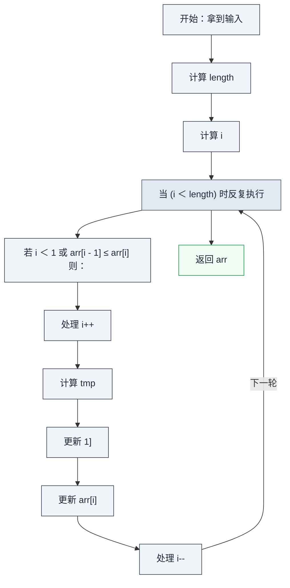
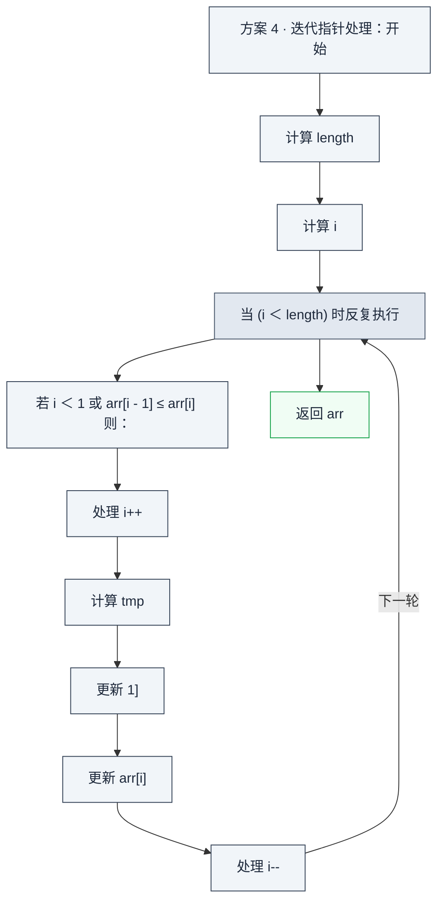
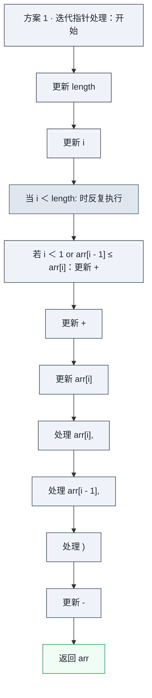
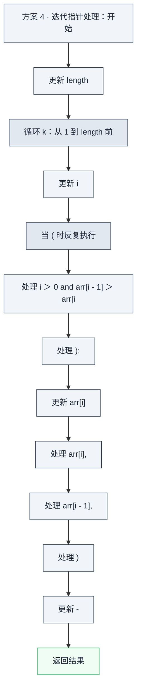
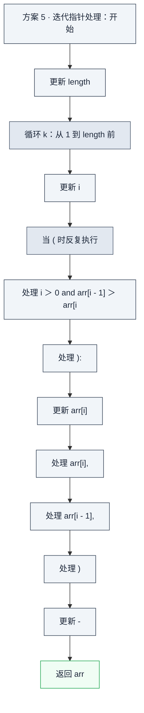
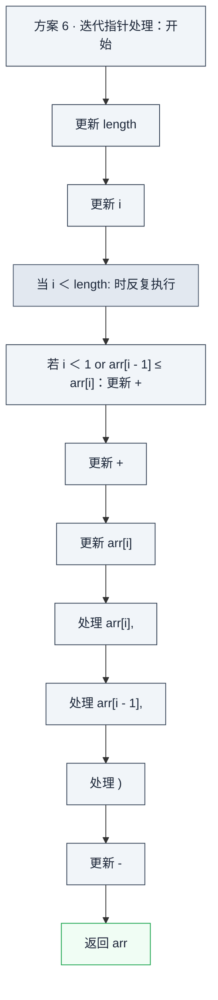
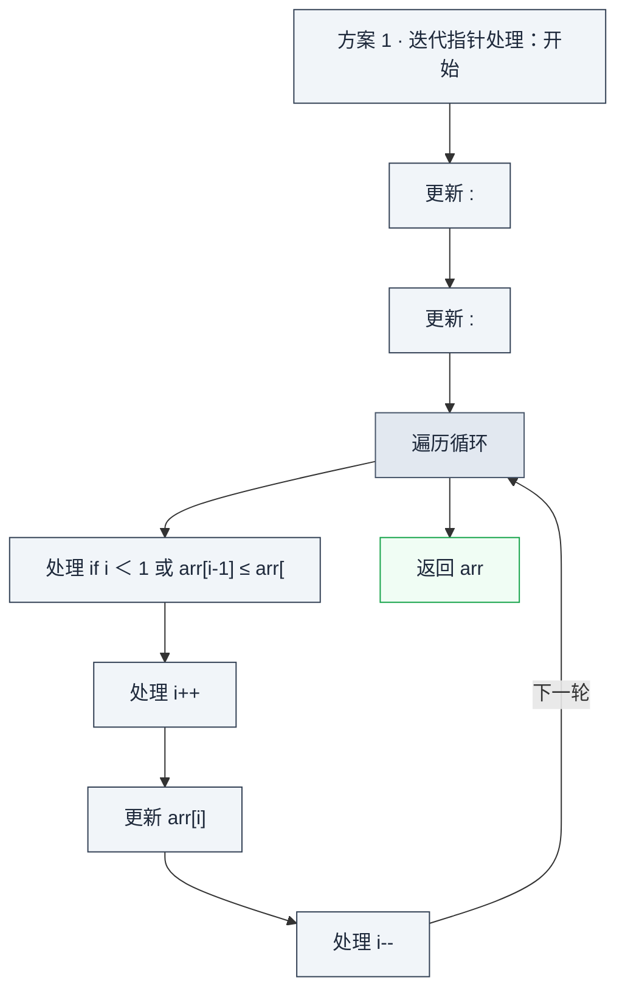
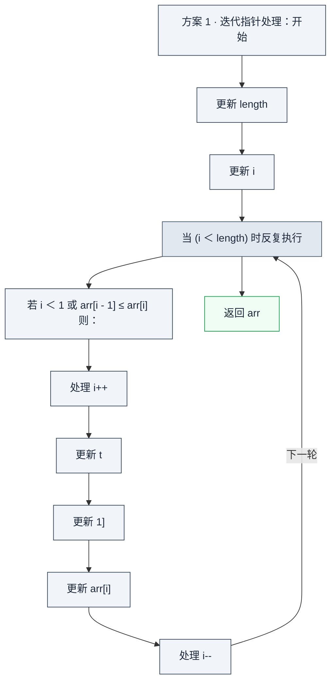

# 228 · 侏儒排序（第附阶段 · 专题补充 · Medium）

> **难度**：⭐⭐ Medium ｜ **专题**：算法笔记
> **学习定位**：第附阶段 · 专题补充第 228 篇 ｜ **解法数**：6
> **内容总结**：**侏儒排序**（算法笔记 · Medium）：共 6 个方案，主线思路「迭代指针处理」；时间 O(n)（单趟线性扫描）；动画演示归并分治过程，附录给出 11 种语言 × 全部方案的可运行实现。

---

## 题目描述

侏儒排序。具体输入输出约定见函数签名与用例。

- 主函数签名：`function gnomeSort(arr: number[]): number[]`

**用例演示**（摘自主解法内嵌自测，输入到输出一目了然）：

```typescript
  const cases: [number[], number[]][] = [
    [
      [5, 4, 3, 2, 1],
      [1, 2, 3, 4, 5],
    ],
    [
      [3, 1, 2],
      [1, 2, 3],
    ],
  ];
```

**数据范围与注意事项**：

- **易错点**：先看小例子手推一遍再对照代码，比直接读代码快得多。

## 题目分析

**场景是什么**：综合练习：把数据结构与策略组合起来解决一个完整问题。本题就是该场景的 Medium 级练习，主线做法是「迭代指针处理」。

**主线怎么解**：主解法结构简单：读入、处理、返回。

## 解题思路

**方案对比**（共 6 个方案，由浅入深）：

| 方案 | 时间复杂度 | 空间复杂度 |
|---|---|---|
| 方案 1 · 迭代指针处理 | O(n)（单趟线性扫描） | O(1) 到 O(n)（视辅助结构） |
| 方案 2 · 迭代指针处理 | O(n)（单趟线性扫描） | O(1) 到 O(n)（视辅助结构） |
| 方案 3 · 迭代指针处理 | O(n)（单趟线性扫描） | O(1) 到 O(n)（视辅助结构） |
| 方案 4 · 迭代指针处理 | O(n)（单趟线性扫描） | O(1) 到 O(n)（视辅助结构） |
| 方案 5 · 迭代指针处理 | O(n)（单趟线性扫描） | O(1) 到 O(n)（视辅助结构） |
| 方案 6 · 迭代指针处理 | O(n)（单趟线性扫描） | O(1) 到 O(n)（视辅助结构） |

**方案间的取舍**：方案 1（迭代指针处理）；方案 2（迭代指针处理）；方案 3（迭代指针处理）；方案 4（迭代指针处理）；方案 5（迭代指针处理）；方案 6（迭代指针处理）。数据规模小、可读性优先时选靠前的方案；规模大、性能优先时选靠后的方案。

**怎么读这一篇**：

- 🐣 **新手路线**：把「题目描述」的示例 1 在纸上手推一遍 → 读方案 1（最直观的写法）与它的代码走读 → 按「运行方式」本地跑通看 PASS → 回头对比方案 2 之后的写法差在哪
- 🦅 **大佬路线**：直接锁定最优方案 1（迭代指针处理，O(n)（单趟线性扫描））→ 跳读该方案代码与走读 → 用「逐步拆解与面试追问」补齐复杂度推导与边界追问

### 动态算法图（归并分治，GIF 自动循环）


动画演示算法笔记专题里归并分治的典型过程；每个方案在「TypeScript 解题方案」一节还配了专属动画与专属流程图。

### 主解法流程图（真实控制流）



## TypeScript 解题方案（6 个方案逐个讲）

> **运行与提交**：每个方案都是自包含文件（内嵌用例自测，输出 PASS），整块复制到 `.ts` 文件后 `node 文件名` 即可运行。提交 LeetCode 时，把 `demo` 内的算法函数与辅助类型/函数整体取出、置于文件顶层即可。概念演示（非 LeetCode 编号题），在本地运行即可。

### 方案 1：迭代指针处理

**分析与思路**：核心做法是「迭代指针处理」。

**运行方式**：`node 本文件`，内嵌用例全部通过会输出 PASS。


**方案专属流程图**（真实控制流）：


```typescript
export function demo(): void {
  // 程序入口：跑内嵌自测用例
  function gnomeSort(arr: number[]): number[] {
    // 定义函数/方法 gnomeSort
    const length = arr.length; // 把 数组.长度 存入 长度
    let i = 1; // 把 1 存入 下标 i
    while (i < length) {
      // 循环，直到不满足「下标 i 小于 长度」
      if (i < 1 || arr[i - 1] <= arr[i]) {
        // 若 下标 i 小于 1 或 数组[下标 i 减 1] 不超过 数组[下标 i]
        i++; // 下标 i 加一
      } else {
        // 否则
        const tmp = arr[i - 1];
        arr[i - 1] = arr[i];
        arr[i] = tmp;
        i--; // 下标 i 减一
      }
    }
    return arr; // 返回 数组
  }
  const cases: [number[], number[]][] = [
    [
      [5, 4, 3, 2, 1],
      [1, 2, 3, 4, 5],
    ],
    [
      [3, 1, 2],
      [1, 2, 3],
    ],
  ];
  let fail = false; // 把 false 存入 fail
  for (const c of cases) {
    // for (const 字符 of cases) {
    const inp = c[0];
    const want = c[1]; // 把 字符[0]; const want 赋值为 字符[1] 存入 inp
    const got = gnomeSort(inp.slice()); // 把 gnomeSort(inp 截取 )) 存入 got
    if (JSON.stringify(got) !== JSON.stringify(want)) {
      fail = true;
      console.log(
        'FAIL gnomeSort(' +
          JSON.stringify(inp) +
          ')=' +
          JSON.stringify(got) +
          ' want ' +
          JSON.stringify(want),
      );
    }
  }
  if (fail) throw new Error('FAILED'); // 若 fail) throw new Error(「FAILED」);
  console.log('PASS'); // 全部用例通过，输出 PASS
}
demo(); // demo();
```

### 方案 2：迭代指针处理

**分析与思路**：核心做法是「迭代指针处理」。

**运行方式**：`node 本文件`，内嵌用例全部通过会输出 PASS。


**方案专属流程图**（真实控制流）：


```typescript
export function demo(): void {
  // 程序入口：跑内嵌自测用例
  function gnomeSort(arr: number[]): number[] {
    // 定义函数/方法 gnomeSort
    const length = arr.length; // 把 数组.长度 存入 长度
    let i = 1; // 把 1 存入 下标 i
    while (i < length) {
      // 循环，直到不满足「下标 i 小于 长度」
      if (i < 1 || arr[i - 1] <= arr[i]) {
        // 若 下标 i 小于 1 或 数组[下标 i 减 1] 不超过 数组[下标 i]
        i++; // 下标 i 加一
      } else {
        // 否则
        const tmp = arr[i - 1];
        arr[i - 1] = arr[i];
        arr[i] = tmp;
        i--; // 下标 i 减一
      }
    }
    return arr; // 返回 数组
  }
  const cases: [number[], number[]][] = [
    [
      [5, 4, 3, 2, 1],
      [1, 2, 3, 4, 5],
    ],
    [
      [3, 1, 2],
      [1, 2, 3],
    ],
  ];
  let fail = false; // 把 false 存入 fail
  for (const c of cases) {
    // for (const 字符 of cases) {
    const inp = c[0];
    const want = c[1]; // 把 字符[0]; const want 赋值为 字符[1] 存入 inp
    const got = gnomeSort(inp.slice()); // 把 gnomeSort(inp 截取 )) 存入 got
    if (JSON.stringify(got) !== JSON.stringify(want)) {
      fail = true;
      console.log(
        'FAIL gnomeSort(' +
          JSON.stringify(inp) +
          ')=' +
          JSON.stringify(got) +
          ' want ' +
          JSON.stringify(want),
      );
    }
  }
  if (fail) throw new Error('FAILED'); // 若 fail) throw new Error(「FAILED」);
  console.log('PASS'); // 全部用例通过，输出 PASS
}
demo(); // demo();
```

### 方案 3：迭代指针处理

**分析与思路**：核心做法是「迭代指针处理」。

**运行方式**：`node 本文件`，内嵌用例全部通过会输出 PASS。


**方案专属流程图**（真实控制流）：


```typescript
export function demo(): void {
  // 程序入口：跑内嵌自测用例
  function gnomeSort(arr: number[]): number[] {
    // 定义函数/方法 gnomeSort
    const length = arr.length; // 把 数组.长度 存入 长度
    let i = 1; // 把 1 存入 下标 i
    while (i < length) {
      // 循环，直到不满足「下标 i 小于 长度」
      if (i < 1 || arr[i - 1] <= arr[i]) {
        // 若 下标 i 小于 1 或 数组[下标 i 减 1] 不超过 数组[下标 i]
        i++; // 下标 i 加一
      } else {
        // 否则
        const tmp = arr[i - 1];
        arr[i - 1] = arr[i];
        arr[i] = tmp;
        i--; // 下标 i 减一
      }
    }
    return arr; // 返回 数组
  }
  const cases: [number[], number[]][] = [
    [
      [5, 4, 3, 2, 1],
      [1, 2, 3, 4, 5],
    ],
    [
      [3, 1, 2],
      [1, 2, 3],
    ],
  ];
  let fail = false; // 把 false 存入 fail
  for (const c of cases) {
    // for (const 字符 of cases) {
    const inp = c[0];
    const want = c[1]; // 把 字符[0]; const want 赋值为 字符[1] 存入 inp
    const got = gnomeSort(inp.slice()); // 把 gnomeSort(inp 截取 )) 存入 got
    if (JSON.stringify(got) !== JSON.stringify(want)) {
      fail = true;
      console.log(
        'FAIL gnomeSort(' +
          JSON.stringify(inp) +
          ')=' +
          JSON.stringify(got) +
          ' want ' +
          JSON.stringify(want),
      );
    }
  }
  if (fail) throw new Error('FAILED'); // 若 fail) throw new Error(「FAILED」);
  console.log('PASS'); // 全部用例通过，输出 PASS
}
demo(); // demo();
```

### 方案 4：迭代指针处理

**分析与思路**：核心做法是「迭代指针处理」。

**运行方式**：`node 本文件`，内嵌用例全部通过会输出 PASS。


**方案专属流程图**（真实控制流）：



```typescript
export function demo(): void {
  // 程序入口：跑内嵌自测用例
  function gnomeSort(arr: number[]): number[] {
    // 定义函数/方法 gnomeSort
    const length = arr.length; // 把 数组.长度 存入 长度
    let i = 1; // 把 1 存入 下标 i
    while (i < length) {
      // 循环，直到不满足「下标 i 小于 长度」
      if (i < 1 || arr[i - 1] <= arr[i]) {
        // 若 下标 i 小于 1 或 数组[下标 i 减 1] 不超过 数组[下标 i]
        i++; // 下标 i 加一
      } else {
        // 否则
        const tmp = arr[i - 1];
        arr[i - 1] = arr[i];
        arr[i] = tmp;
        i--; // 下标 i 减一
      }
    }
    return arr; // 返回 数组
  }
  const cases: [number[], number[]][] = [
    [
      [5, 4, 3, 2, 1],
      [1, 2, 3, 4, 5],
    ],
    [
      [3, 1, 2],
      [1, 2, 3],
    ],
  ];
  let fail = false; // 把 false 存入 fail
  for (const c of cases) {
    // for (const 字符 of cases) {
    const inp = c[0];
    const want = c[1]; // 把 字符[0]; const want 赋值为 字符[1] 存入 inp
    const got = gnomeSort(inp.slice()); // 把 gnomeSort(inp 截取 )) 存入 got
    if (JSON.stringify(got) !== JSON.stringify(want)) {
      fail = true;
      console.log(
        'FAIL gnomeSort(' +
          JSON.stringify(inp) +
          ')=' +
          JSON.stringify(got) +
          ' want ' +
          JSON.stringify(want),
      );
    }
  }
  if (fail) throw new Error('FAILED'); // 若 fail) throw new Error(「FAILED」);
  console.log('PASS'); // 全部用例通过，输出 PASS
}
demo(); // demo();
```

### 方案 5：迭代指针处理

**分析与思路**：核心做法是「迭代指针处理」。

**运行方式**：`node 本文件`，内嵌用例全部通过会输出 PASS。


**方案专属流程图**（真实控制流）：


```typescript
export function demo(): void {
  // 程序入口：跑内嵌自测用例
  function gnomeSort(arr: number[]): number[] {
    // 定义函数/方法 gnomeSort
    const length = arr.length; // 把 数组.长度 存入 长度
    let i = 1; // 把 1 存入 下标 i
    while (i < length) {
      // 循环，直到不满足「下标 i 小于 长度」
      if (i < 1 || arr[i - 1] <= arr[i]) {
        // 若 下标 i 小于 1 或 数组[下标 i 减 1] 不超过 数组[下标 i]
        i++; // 下标 i 加一
      } else {
        // 否则
        const tmp = arr[i - 1];
        arr[i - 1] = arr[i];
        arr[i] = tmp;
        i--; // 下标 i 减一
      }
    }
    return arr; // 返回 数组
  }
  const cases: [number[], number[]][] = [
    [
      [5, 4, 3, 2, 1],
      [1, 2, 3, 4, 5],
    ],
    [
      [3, 1, 2],
      [1, 2, 3],
    ],
  ];
  let fail = false; // 把 false 存入 fail
  for (const c of cases) {
    // for (const 字符 of cases) {
    const inp = c[0];
    const want = c[1]; // 把 字符[0]; const want 赋值为 字符[1] 存入 inp
    const got = gnomeSort(inp.slice()); // 把 gnomeSort(inp 截取 )) 存入 got
    if (JSON.stringify(got) !== JSON.stringify(want)) {
      fail = true;
      console.log(
        'FAIL gnomeSort(' +
          JSON.stringify(inp) +
          ')=' +
          JSON.stringify(got) +
          ' want ' +
          JSON.stringify(want),
      );
    }
  }
  if (fail) throw new Error('FAILED'); // 若 fail) throw new Error(「FAILED」);
  console.log('PASS'); // 全部用例通过，输出 PASS
}
demo(); // demo();
```

### 方案 6：迭代指针处理

**分析与思路**：核心做法是「迭代指针处理」。

**运行方式**：`node 本文件`，内嵌用例全部通过会输出 PASS。


**方案专属流程图**（真实控制流）：


```typescript
export function demo(): void {
  // 程序入口：跑内嵌自测用例
  function gnomeSort(arr: number[]): number[] {
    // 定义函数/方法 gnomeSort
    const length = arr.length; // 把 数组.长度 存入 长度
    let i = 1; // 把 1 存入 下标 i
    while (i < length) {
      // 循环，直到不满足「下标 i 小于 长度」
      if (i < 1 || arr[i - 1] <= arr[i]) {
        // 若 下标 i 小于 1 或 数组[下标 i 减 1] 不超过 数组[下标 i]
        i++; // 下标 i 加一
      } else {
        // 否则
        const tmp = arr[i - 1];
        arr[i - 1] = arr[i];
        arr[i] = tmp;
        i--; // 下标 i 减一
      }
    }
    return arr; // 返回 数组
  }
  const cases: [number[], number[]][] = [
    [
      [5, 4, 3, 2, 1],
      [1, 2, 3, 4, 5],
    ],
    [
      [3, 1, 2],
      [1, 2, 3],
    ],
  ];
  let fail = false; // 把 false 存入 fail
  for (const c of cases) {
    // for (const 字符 of cases) {
    const inp = c[0];
    const want = c[1]; // 把 字符[0]; const want 赋值为 字符[1] 存入 inp
    const got = gnomeSort(inp.slice()); // 把 gnomeSort(inp 截取 )) 存入 got
    if (JSON.stringify(got) !== JSON.stringify(want)) {
      fail = true;
      console.log(
        'FAIL gnomeSort(' +
          JSON.stringify(inp) +
          ')=' +
          JSON.stringify(got) +
          ' want ' +
          JSON.stringify(want),
      );
    }
  }
  if (fail) throw new Error('FAILED'); // 若 fail) throw new Error(「FAILED」);
  console.log('PASS'); // 全部用例通过，输出 PASS
}
demo(); // demo();
```

## 逐步拆解与面试追问

**复杂度**：时间 O(n)（单趟线性扫描），空间 O(1) 到 O(n)（视辅助结构）

**为什么是这个量级**：每个元素被常数次访问，辅助哈希或栈的开销与 n 同阶

**面试官可能会追问**：

- 这个策略能推广到什么场景？
- 与暴力做法差在哪一步？
- 有没有更简单的等价写法？

## 关键 API 速查（TS 主解法实际用到，附官方链接）

| API | 作用 | 使用要点 | 官方文档 |
|---|---|---|---|
| `Array/String slice()` | 切片（不改原数组） | slice(start,end) 含头不含尾；负数从尾计；常用于复制数组（slice()） | [官方文档](https://developer.mozilla.org/zh-CN/docs/Web/JavaScript/Reference/Global_Objects/Array/slice) |
| `JSON.stringify()` | 序列化为 JSON 字符串 | 常用于结构化比较（深度相等判定）；undefined/函数/循环引用会被丢弃或抛错 | [官方文档](https://developer.mozilla.org/zh-CN/docs/Web/JavaScript/Reference/Global_Objects/JSON/stringify) |

### 各语言官方文档导航

- **TypeScript / JS**：[MDN 中文参考](https://developer.mozilla.org/zh-CN/)
- **Python**：[Python 官方文档](https://docs.python.org/zh-cn/3/)
- **Go**：[Go 标准库](https://pkg.go.dev/std)
- **Java**：[JDK 17 API](https://docs.oracle.com/en/java/javase/17/docs/api/)
- **Rust**：[Rust 标准库](https://doc.rust-lang.org/std/)
- **Lua**：[Lua 5.4 手册](https://www.lua.org/manual/5.4/)
- **C**：[Cppreference C](https://zh.cppreference.com/w/c)
- **C++**：[Cppreference C++](https://zh.cppreference.com/w/cpp)
- **R**：[R 官方手册](https://stat.ethz.ch/R-manual/)
- **Zig**：[Zig 语言文档](https://ziglang.org/documentation/master/)
- **Dart**：[Dart API](https://api.dart.dev/)

## 附录：其他 10 种语言全部实现（每种语言列举其全部方案）

> TypeScript 的全部方案见「TypeScript 解题方案」一节；下面是其余 10 种语言的对应实现，每种语言的每个方案都带思路分析、代码走读与专属运行架构图。
> 每个方案都内嵌用例自测，可独立运行（老仓库 python/go 文件遵循「打印结果」约定）。
> 完整解法文件见 `dsa/<语言>/notes/lc_134053461_侏儒排序/`。

### Python 实现（6 种方案）

Python 的全部方案如下，每个方案都内嵌用例自测，可独立运行（老仓库 python/go 文件遵循「打印结果」约定）：

#### 方案 1：迭代指针处理

**思路与代码分析**：核心是「迭代指针处理」。Python 版用切片与字典推导式简化操作，突出可读性。**走读**：方案 1 · 迭代指针处理：开始 → 更新 length → 更新 i → 当 i ＜ length: 时反复执行 → 若 i ＜ 1 or arr[i - 1] ≤ arr[i]：更新 + → 更新 + → 更新 arr[i] → 处理 arr[i], → 处理 arr[i - 1], → 处理 ) → 更新 - → 返回 arr。

**运行架构**（真实控制流）：



```python
import sys  # 提高递归深度上限（深输入防 RecursionError）

sys.setrecursionlimit(200000)  # 树/链表类题目节点数可达 1e4 量级

def gnome_sort_v1(arr):  # 定义函数 gnome_sort_v1（参数：数组）
    length = len(arr)  # 把 长度(数组) 存入 长度
    i = 1  # 把 1 存入 下标 i
    while i < length:  # 循环，直到不满足「下标 i 小于 长度」
        if i < 1 or arr[i - 1] <= arr[i]:  # 若 下标 i 小于 1 or 数组[下标 i 减 1] 不超过 数组[下标 i]
            i += 1  # 下标 i累加 1
        else:  # 否则
            arr[i - 1], arr[i] = (
                arr[i],
                arr[i - 1],
            )  # 把 数组[下标 i], 数组[下标 i 减 1] 写入 arr[i - 1], arr[i]
            i -= 1  # 下标 i累减 1
    return arr  # 返回 数组

if __name__ == "__main__":  # 若 __name__ 等于 「__main__」
    arr = [5, 4, 3, 2, 1]  # 把 [5, 4, 3, 2, 1] 存入 数组
    gnome_sort_v1(arr)  # gnome_sort_v1(数组)
    print(arr)  # 打印输出
```

#### 方案 2：迭代指针处理

**思路与代码分析**：核心是「迭代指针处理」。Python 版用切片与字典推导式简化操作，突出可读性。**走读**：方案 2 · 迭代指针处理：开始 → 更新 length → 循环 k：从 1 到 length 前 → 更新 i → 当 ( 时反复执行 → 处理 i ＞ 0 and arr[i - 1] ＞ arr[i → 处理 ): → 更新 arr[i] → 处理 arr[i], → 处理 arr[i - 1], → 处理 ) → 更新 - → 返回 arr。

**运行架构**（真实控制流）：


```python
import sys  # 提高递归深度上限（深输入防 RecursionError）

sys.setrecursionlimit(200000)  # 树/链表类题目节点数可达 1e4 量级

def gnome_sort_v2(arr):  # 定义函数 gnome_sort_v2（参数：数组）
    length = len(arr)  # 把 长度(数组) 存入 长度
    for k in range(1, length):  # 让 下标 k 从 1 到 长度 遍历
        i = k  # 把 下标 k 存入 下标 i
        while (
            i > 0 and arr[i - 1] > arr[i]
        ):  # 循环，直到不满足「下标 i 超过 0 and 数组[下标 i 减 1] 超过 数组[下标 i]」
            arr[i - 1], arr[i] = (
                arr[i],
                arr[i - 1],
            )  # 把 数组[下标 i], 数组[下标 i 减 1] 写入 arr[i - 1], arr[i]
            i -= 1  # 下标 i累减 1
    return arr  # 返回 数组

if __name__ == "__main__":  # 若 __name__ 等于 「__main__」
    arr = [5, 4, 3, 2, 1]  # 把 [5, 4, 3, 2, 1] 存入 数组
    gnome_sort_v2(arr)  # gnome_sort_v2(数组)
    print(arr)  # 打印输出
```

#### 方案 3：迭代指针处理

**思路与代码分析**：核心是「迭代指针处理」。Python 版用切片与字典推导式简化操作，突出可读性。**走读**：方案 3 · 迭代指针处理：开始 → 更新 length → 更新 i → 当 i ＜ length: 时反复执行 → 若 i ＜ 1 or arr[i - 1] ≤ arr[i]：更新 + → 更新 + → 更新 arr[i] → 处理 arr[i], → 处理 arr[i - 1], → 处理 ) → 更新 - → 返回 arr。

**运行架构**（真实控制流）：


```python
import sys  # 提高递归深度上限（深输入防 RecursionError）

sys.setrecursionlimit(200000)  # 树/链表类题目节点数可达 1e4 量级

def gnome_sort_v1(arr):  # 定义函数 gnome_sort_v1（参数：数组）
    length = len(arr)  # 把 长度(数组) 存入 长度
    i = 1  # 把 1 存入 下标 i
    while i < length:  # 循环，直到不满足「下标 i 小于 长度」
        if i < 1 or arr[i - 1] <= arr[i]:  # 若 下标 i 小于 1 or 数组[下标 i 减 1] 不超过 数组[下标 i]
            i += 1  # 下标 i累加 1
        else:  # 否则
            arr[i - 1], arr[i] = (
                arr[i],
                arr[i - 1],
            )  # 把 数组[下标 i], 数组[下标 i 减 1] 写入 arr[i - 1], arr[i]
            i -= 1  # 下标 i累减 1
    return arr  # 返回 数组

if __name__ == "__main__":  # 若 __name__ 等于 「__main__」
    arr = [5, 4, 3, 2, 1]  # 把 [5, 4, 3, 2, 1] 存入 数组
    gnome_sort_v1(arr)  # gnome_sort_v1(数组)
    print(arr)  # 打印输出
```

#### 方案 4：迭代指针处理

**思路与代码分析**：核心是「迭代指针处理」。Python 版用切片与字典推导式简化操作，突出可读性。**走读**：方案 4 · 迭代指针处理：开始 → 更新 length → 循环 k：从 1 到 length 前 → 更新 i → 当 ( 时反复执行 → 处理 i ＞ 0 and arr[i - 1] ＞ arr[i → 处理 ): → 更新 arr[i] → 处理 arr[i], → 处理 arr[i - 1], → 处理 ) → 更新 - → 返回结果。

**运行架构**（真实控制流）：



```python
import sys  # 提高递归深度上限（深输入防 RecursionError）

sys.setrecursionlimit(200000)  # 树/链表类题目节点数可达 1e4 量级

def gnome_sort_v2(arr):  # 定义函数 gnome_sort_v2（参数：数组）
    length = len(arr)  # 把 长度(数组) 存入 长度
    for k in range(1, length):  # 让 下标 k 从 1 到 长度 遍历
        i = k  # 把 下标 k 存入 下标 i
        while (
            i > 0 and arr[i - 1] > arr[i]
        ):  # 循环，直到不满足「下标 i 超过 0 and 数组[下标 i 减 1] 超过 数组[下标 i]」
            arr[i - 1], arr[i] = (
                arr[i],
                arr[i - 1],
            )  # 把 数组[下标 i], 数组[下标 i 减 1] 写入 arr[i - 1], arr[i]
            i -= 1  # 下标 i累减 1

if __name__ == "__main__":  # 若 __name__ 等于 '__main__'
    arr = [5, 4, 3, 2, 1]  # 把 [5, 4, 3, 2, 1] 存入 数组
    gnome_sort_v2(arr)  # gnome_sort_v2(数组)
    print(arr)  # 打印输出
```

#### 方案 5：迭代指针处理

**思路与代码分析**：核心是「迭代指针处理」。Python 版用切片与字典推导式简化操作，突出可读性。**走读**：方案 5 · 迭代指针处理：开始 → 更新 length → 循环 k：从 1 到 length 前 → 更新 i → 当 ( 时反复执行 → 处理 i ＞ 0 and arr[i - 1] ＞ arr[i → 处理 ): → 更新 arr[i] → 处理 arr[i], → 处理 arr[i - 1], → 处理 ) → 更新 - → 返回 arr。

**运行架构**（真实控制流）：



```python
import sys  # 提高递归深度上限（深输入防 RecursionError）

sys.setrecursionlimit(200000)  # 树/链表类题目节点数可达 1e4 量级

def gnome_sort_v2(arr):  # 定义函数 gnome_sort_v2（参数：数组）
    length = len(arr)  # 把 长度(数组) 存入 长度
    for k in range(1, length):  # 让 下标 k 从 1 到 长度 遍历
        i = k  # 把 下标 k 存入 下标 i
        while (
            i > 0 and arr[i - 1] > arr[i]
        ):  # 循环，直到不满足「下标 i 超过 0 and 数组[下标 i 减 1] 超过 数组[下标 i]」
            arr[i - 1], arr[i] = (
                arr[i],
                arr[i - 1],
            )  # 把 数组[下标 i], 数组[下标 i 减 1] 写入 arr[i - 1], arr[i]
            i -= 1  # 下标 i累减 1
    return arr  # 返回 数组

if __name__ == "__main__":  # 若 __name__ 等于 「__main__」
    arr = [5, 4, 3, 2, 1]  # 把 [5, 4, 3, 2, 1] 存入 数组
    gnome_sort_v2(arr)  # gnome_sort_v2(数组)
    print(arr)  # 打印输出
```

#### 方案 6：迭代指针处理

**思路与代码分析**：核心是「迭代指针处理」。Python 版用切片与字典推导式简化操作，突出可读性。**走读**：方案 6 · 迭代指针处理：开始 → 更新 length → 更新 i → 当 i ＜ length: 时反复执行 → 若 i ＜ 1 or arr[i - 1] ≤ arr[i]：更新 + → 更新 + → 更新 arr[i] → 处理 arr[i], → 处理 arr[i - 1], → 处理 ) → 更新 - → 返回 arr。

**运行架构**（真实控制流）：



```python
import sys  # 提高递归深度上限（深输入防 RecursionError）

sys.setrecursionlimit(200000)  # 树/链表类题目节点数可达 1e4 量级

def gnome_sort_v1(arr):  # 定义函数 gnome_sort_v1（参数：数组）
    length = len(arr)  # 把 长度(数组) 存入 长度
    i = 1  # 把 1 存入 下标 i
    while i < length:  # 循环，直到不满足「下标 i 小于 长度」
        if i < 1 or arr[i - 1] <= arr[i]:  # 若 下标 i 小于 1 or 数组[下标 i 减 1] 不超过 数组[下标 i]
            i += 1  # 下标 i累加 1
        else:  # 否则
            arr[i - 1], arr[i] = (
                arr[i],
                arr[i - 1],
            )  # 把 数组[下标 i], 数组[下标 i 减 1] 写入 arr[i - 1], arr[i]
            i -= 1  # 下标 i累减 1
    return arr  # 返回 数组

if __name__ == "__main__":  # 若 __name__ 等于 「__main__」
    arr = [5, 4, 3, 2, 1]  # 把 [5, 4, 3, 2, 1] 存入 数组
    gnome_sort_v1(arr)  # gnome_sort_v1(数组)
    print(arr)  # 打印输出
```

### Go 实现（6 种方案）

Go 的全部方案如下，每个方案都内嵌用例自测，可独立运行（老仓库 python/go 文件遵循「打印结果」约定）：

#### 方案 1：迭代指针处理

**思路与代码分析**：核心是「迭代指针处理」。Go 版用切片与多返回值惯用法，显式处理索引边界。**走读**：方案 1 · 迭代指针处理：开始 → 更新 : → 更新 : → 遍历循环 → 处理 if i ＜ 1 或 arr[i-1] ≤ arr[ → 处理 i++ → 更新 arr[i] → 处理 i-- → 返回 arr。

**运行架构**（真实控制流）：



```go
package main // 引入依赖
import (
	"fmt"
	"os"
	"reflect"
) // 引入依赖
func gnomeSort(arr []int) []int { // 定义函数/方法 gnomeSort
	length := len(arr) // 把 长度(数组) 写入 length :
	i := 1             // 把 1 写入 i :
	for i < length {   // for 下标 i 小于 长度 {
		if i < 1 || arr[i-1] <= arr[i] { // 若 下标 i 小于 1 或 数组[下标 i 减 1] 不超过 数组[下标 i]
			i++ // 下标 i 加一
		} else { // 否则
			arr[i-1], arr[i] = arr[i], arr[i-1] // 把 数组[下标 i], 数组[下标 i 减 1] 写入 arr[i-1], arr[i]
			i--                                 // 下标 i 减一
		}
	}
	return arr // 返回 数组
}
func main() { // 程序入口：跑内嵌自测用例
	cases := []struct {
		in   []int
		want []int
	}{ // 把 []struct{ in []int; want []int }{ 写入 cases :
		{[]int{5, 4, 3, 2, 1}, []int{1, 2, 3, 4, 5}},
		{[]int{3, 1, 2}, []int{1, 2, 3}},
	}
	ok := true                // 把 true 写入 ok :
	for _, c := range cases { // 同时取 _ 与 字符 遍历
		in := make([]int, len(c.in))         // 把 make([]int, 长度(字符.in)) 写入 in :
		copy(in, c.in)                       // copy(in, 字符.in)
		got := gnomeSort(in)                 // 把 gnomeSort(in) 写入 got :
		if !reflect.DeepEqual(got, c.want) { // 若 取反 reflect.DeepEqual(got, 字符.want
			ok = false
			fmt.Printf("FAIL gnomeSort(%v)=%v want %v\n", c.in, got, c.want) // 打印输出
		}
	}
	if !ok {
		os.Exit(1)
	} // 若 取反 ok { os.Exit(1) }
	fmt.Println("PASS") // 全部用例通过，输出 PASS
}
```

#### 方案 2：迭代指针处理

**思路与代码分析**：核心是「迭代指针处理」。Go 版用切片与多返回值惯用法，显式处理索引边界。**走读**：方案 2 · 迭代指针处理：开始 → 更新 : → 更新 : → 遍历循环 → 处理 if i ＜ 1 或 arr[i-1] ≤ arr[ → 处理 i++ → 更新 arr[i] → 处理 i-- → 返回 arr。

**运行架构**（真实控制流）：


```go
package main // 引入依赖
import (
	"fmt"
	"os"
	"reflect"
) // 引入依赖
func gnomeSort(arr []int) []int { // 定义函数/方法 gnomeSort
	length := len(arr) // 把 长度(数组) 写入 length :
	i := 1             // 把 1 写入 i :
	for i < length {   // for 下标 i 小于 长度 {
		if i < 1 || arr[i-1] <= arr[i] { // 若 下标 i 小于 1 或 数组[下标 i 减 1] 不超过 数组[下标 i]
			i++ // 下标 i 加一
		} else { // 否则
			arr[i-1], arr[i] = arr[i], arr[i-1] // 把 数组[下标 i], 数组[下标 i 减 1] 写入 arr[i-1], arr[i]
			i--                                 // 下标 i 减一
		}
	}
	return arr // 返回 数组
}
func main() { // 程序入口：跑内嵌自测用例
	cases := []struct {
		in   []int
		want []int
	}{ // 把 []struct{ in []int; want []int }{ 写入 cases :
		{[]int{5, 4, 3, 2, 1}, []int{1, 2, 3, 4, 5}},
		{[]int{3, 1, 2}, []int{1, 2, 3}},
	}
	ok := true                // 把 true 写入 ok :
	for _, c := range cases { // 同时取 _ 与 字符 遍历
		in := make([]int, len(c.in))         // 把 make([]int, 长度(字符.in)) 写入 in :
		copy(in, c.in)                       // copy(in, 字符.in)
		got := gnomeSort(in)                 // 把 gnomeSort(in) 写入 got :
		if !reflect.DeepEqual(got, c.want) { // 若 取反 reflect.DeepEqual(got, 字符.want
			ok = false
			fmt.Printf("FAIL gnomeSort(%v)=%v want %v\n", c.in, got, c.want) // 打印输出
		}
	}
	if !ok {
		os.Exit(1)
	} // 若 取反 ok { os.Exit(1) }
	fmt.Println("PASS") // 全部用例通过，输出 PASS
}
```

#### 方案 3：迭代指针处理

**思路与代码分析**：核心是「迭代指针处理」。Go 版用切片与多返回值惯用法，显式处理索引边界。**走读**：方案 3 · 迭代指针处理：开始 → 更新 : → 更新 : → 遍历循环 → 处理 if i ＜ 1 或 arr[i-1] ≤ arr[ → 处理 i++ → 更新 arr[i] → 处理 i-- → 返回 arr。

**运行架构**（真实控制流）：


```go
package main // 引入依赖
import (
	"fmt"
	"os"
	"reflect"
) // 引入依赖
func gnomeSort(arr []int) []int { // 定义函数/方法 gnomeSort
	length := len(arr) // 把 长度(数组) 写入 length :
	i := 1             // 把 1 写入 i :
	for i < length {   // for 下标 i 小于 长度 {
		if i < 1 || arr[i-1] <= arr[i] { // 若 下标 i 小于 1 或 数组[下标 i 减 1] 不超过 数组[下标 i]
			i++ // 下标 i 加一
		} else { // 否则
			arr[i-1], arr[i] = arr[i], arr[i-1] // 把 数组[下标 i], 数组[下标 i 减 1] 写入 arr[i-1], arr[i]
			i--                                 // 下标 i 减一
		}
	}
	return arr // 返回 数组
}
func main() { // 程序入口：跑内嵌自测用例
	cases := []struct {
		in   []int
		want []int
	}{ // 把 []struct{ in []int; want []int }{ 写入 cases :
		{[]int{5, 4, 3, 2, 1}, []int{1, 2, 3, 4, 5}},
		{[]int{3, 1, 2}, []int{1, 2, 3}},
	}
	ok := true                // 把 true 写入 ok :
	for _, c := range cases { // 同时取 _ 与 字符 遍历
		in := make([]int, len(c.in))         // 把 make([]int, 长度(字符.in)) 写入 in :
		copy(in, c.in)                       // copy(in, 字符.in)
		got := gnomeSort(in)                 // 把 gnomeSort(in) 写入 got :
		if !reflect.DeepEqual(got, c.want) { // 若 取反 reflect.DeepEqual(got, 字符.want
			ok = false
			fmt.Printf("FAIL gnomeSort(%v)=%v want %v\n", c.in, got, c.want) // 打印输出
		}
	}
	if !ok {
		os.Exit(1)
	} // 若 取反 ok { os.Exit(1) }
	fmt.Println("PASS") // 全部用例通过，输出 PASS
}
```

#### 方案 4：迭代指针处理

**思路与代码分析**：核心是「迭代指针处理」。Go 版用切片与多返回值惯用法，显式处理索引边界。**走读**：方案 4 · 迭代指针处理：开始 → 更新 : → 更新 : → 遍历循环 → 处理 if i ＜ 1 或 arr[i-1] ≤ arr[ → 处理 i++ → 更新 arr[i] → 处理 i-- → 返回 arr。

**运行架构**（真实控制流）：


```go
package main // 引入依赖
import (
	"fmt"
	"os"
	"reflect"
) // 引入依赖
func gnomeSort(arr []int) []int { // 定义函数/方法 gnomeSort
	length := len(arr) // 把 长度(数组) 写入 length :
	i := 1             // 把 1 写入 i :
	for i < length {   // for 下标 i 小于 长度 {
		if i < 1 || arr[i-1] <= arr[i] { // 若 下标 i 小于 1 或 数组[下标 i 减 1] 不超过 数组[下标 i]
			i++ // 下标 i 加一
		} else { // 否则
			arr[i-1], arr[i] = arr[i], arr[i-1] // 把 数组[下标 i], 数组[下标 i 减 1] 写入 arr[i-1], arr[i]
			i--                                 // 下标 i 减一
		}
	}
	return arr // 返回 数组
}
func main() { // 程序入口：跑内嵌自测用例
	cases := []struct {
		in   []int
		want []int
	}{ // 把 []struct{ in []int; want []int }{ 写入 cases :
		{[]int{5, 4, 3, 2, 1}, []int{1, 2, 3, 4, 5}},
		{[]int{3, 1, 2}, []int{1, 2, 3}},
	}
	ok := true                // 把 true 写入 ok :
	for _, c := range cases { // 同时取 _ 与 字符 遍历
		in := make([]int, len(c.in))         // 把 make([]int, 长度(字符.in)) 写入 in :
		copy(in, c.in)                       // copy(in, 字符.in)
		got := gnomeSort(in)                 // 把 gnomeSort(in) 写入 got :
		if !reflect.DeepEqual(got, c.want) { // 若 取反 reflect.DeepEqual(got, 字符.want
			ok = false
			fmt.Printf("FAIL gnomeSort(%v)=%v want %v\n", c.in, got, c.want) // 打印输出
		}
	}
	if !ok {
		os.Exit(1)
	} // 若 取反 ok { os.Exit(1) }
	fmt.Println("PASS") // 全部用例通过，输出 PASS
}
```

#### 方案 5：迭代指针处理

**思路与代码分析**：核心是「迭代指针处理」。Go 版用切片与多返回值惯用法，显式处理索引边界。**走读**：方案 5 · 迭代指针处理：开始 → 更新 : → 更新 : → 遍历循环 → 处理 if i ＜ 1 或 arr[i-1] ≤ arr[ → 处理 i++ → 更新 arr[i] → 处理 i-- → 返回 arr。

**运行架构**（真实控制流）：


```go
package main // 引入依赖
import (
	"fmt"
	"os"
	"reflect"
) // 引入依赖
func gnomeSort(arr []int) []int { // 定义函数/方法 gnomeSort
	length := len(arr) // 把 长度(数组) 写入 length :
	i := 1             // 把 1 写入 i :
	for i < length {   // for 下标 i 小于 长度 {
		if i < 1 || arr[i-1] <= arr[i] { // 若 下标 i 小于 1 或 数组[下标 i 减 1] 不超过 数组[下标 i]
			i++ // 下标 i 加一
		} else { // 否则
			arr[i-1], arr[i] = arr[i], arr[i-1] // 把 数组[下标 i], 数组[下标 i 减 1] 写入 arr[i-1], arr[i]
			i--                                 // 下标 i 减一
		}
	}
	return arr // 返回 数组
}
func main() { // 程序入口：跑内嵌自测用例
	cases := []struct {
		in   []int
		want []int
	}{ // 把 []struct{ in []int; want []int }{ 写入 cases :
		{[]int{5, 4, 3, 2, 1}, []int{1, 2, 3, 4, 5}},
		{[]int{3, 1, 2}, []int{1, 2, 3}},
	}
	ok := true                // 把 true 写入 ok :
	for _, c := range cases { // 同时取 _ 与 字符 遍历
		in := make([]int, len(c.in))         // 把 make([]int, 长度(字符.in)) 写入 in :
		copy(in, c.in)                       // copy(in, 字符.in)
		got := gnomeSort(in)                 // 把 gnomeSort(in) 写入 got :
		if !reflect.DeepEqual(got, c.want) { // 若 取反 reflect.DeepEqual(got, 字符.want
			ok = false
			fmt.Printf("FAIL gnomeSort(%v)=%v want %v\n", c.in, got, c.want) // 打印输出
		}
	}
	if !ok {
		os.Exit(1)
	} // 若 取反 ok { os.Exit(1) }
	fmt.Println("PASS") // 全部用例通过，输出 PASS
}
```

#### 方案 6：迭代指针处理

**思路与代码分析**：核心是「迭代指针处理」。Go 版用切片与多返回值惯用法，显式处理索引边界。**走读**：方案 6 · 迭代指针处理：开始 → 更新 : → 更新 : → 遍历循环 → 处理 if i ＜ 1 或 arr[i-1] ≤ arr[ → 处理 i++ → 更新 arr[i] → 处理 i-- → 返回 arr。

**运行架构**（真实控制流）：


```go
package main // 引入依赖
import (
	"fmt"
	"os"
	"reflect"
) // 引入依赖
func gnomeSort(arr []int) []int { // 定义函数/方法 gnomeSort
	length := len(arr) // 把 长度(数组) 写入 length :
	i := 1             // 把 1 写入 i :
	for i < length {   // for 下标 i 小于 长度 {
		if i < 1 || arr[i-1] <= arr[i] { // 若 下标 i 小于 1 或 数组[下标 i 减 1] 不超过 数组[下标 i]
			i++ // 下标 i 加一
		} else { // 否则
			arr[i-1], arr[i] = arr[i], arr[i-1] // 把 数组[下标 i], 数组[下标 i 减 1] 写入 arr[i-1], arr[i]
			i--                                 // 下标 i 减一
		}
	}
	return arr // 返回 数组
}
func main() { // 程序入口：跑内嵌自测用例
	cases := []struct {
		in   []int
		want []int
	}{ // 把 []struct{ in []int; want []int }{ 写入 cases :
		{[]int{5, 4, 3, 2, 1}, []int{1, 2, 3, 4, 5}},
		{[]int{3, 1, 2}, []int{1, 2, 3}},
	}
	ok := true                // 把 true 写入 ok :
	for _, c := range cases { // 同时取 _ 与 字符 遍历
		in := make([]int, len(c.in))         // 把 make([]int, 长度(字符.in)) 写入 in :
		copy(in, c.in)                       // copy(in, 字符.in)
		got := gnomeSort(in)                 // 把 gnomeSort(in) 写入 got :
		if !reflect.DeepEqual(got, c.want) { // 若 取反 reflect.DeepEqual(got, 字符.want
			ok = false
			fmt.Printf("FAIL gnomeSort(%v)=%v want %v\n", c.in, got, c.want) // 打印输出
		}
	}
	if !ok {
		os.Exit(1)
	} // 若 取反 ok { os.Exit(1) }
	fmt.Println("PASS") // 全部用例通过，输出 PASS
}
```

### Java 实现（6 种方案）

Java 的全部方案如下，每个方案都内嵌用例自测，可独立运行（老仓库 python/go 文件遵循「打印结果」约定）：

#### 方案 1：迭代指针处理

**思路与代码分析**：核心是「迭代指针处理」。Java 版用类与静态方法组织，集合操作显式明了。**走读**：方案 1 · 迭代指针处理：开始 → 更新 length → 更新 i → 当 (i ＜ length) 时反复执行 → 若 i ＜ 1 或 arr[i - 1] ≤ arr[i] 则： → 处理 i++ → 更新 t → 更新 1] → 更新 arr[i] → 处理 i-- → 返回 arr。

**运行架构**（真实控制流）：



```java
package com.webfault.dsa; // 引入依赖

import java.util.*; // 引入依赖

class lc134053461_solution11 { // 定义类型
  // 侏儒排序
  static int[] gnomeSort(int[] arr) { // 定义函数/方法 gnomeSort
    int length = arr.length; // 把 数组.长度 存入 长度
    int i = 1; // 把 1 存入 下标 i
    while (i < length) { // 循环，直到不满足「下标 i 小于 长度」
      if (i < 1 || arr[i - 1] <= arr[i]) { // 若 下标 i 小于 1 或 数组[下标 i 减 1] 不超过 数组[下标 i]
        i++; // 下标 i 加一
      } else { // 否则
        int t = arr[i - 1];
        arr[i - 1] = arr[i];
        arr[i] = t;
        i--; // 下标 i 减一
      }
    }
    return arr; // 返回 数组
  }

  public static void main(String[] args) { // public static void main(String[] args) {
    int[] r =
        gnomeSort(new int[] {5, 4, 3, 2, 1}); // 把 gnomeSort(new int[]{5, 4, 3, 2, 1}); 写入 int[] r
    int[] expect = {1, 2, 3, 4, 5}; // 把 {1, 2, 3, 4, 5}; 写入 int[] expect
    if (!Arrays.equals(r, expect)) { // 若 取反 Arrays.equals(右指针, expect
      System.out.println("FAIL " + Arrays.toString(r)); // 打印输出
      throw new RuntimeException("FAILED"); // throw new RuntimeException(「FAILED」);
    }
    System.out.println("PASS"); // 全部用例通过，输出 PASS
  }
}
```

#### 方案 2：迭代指针处理

**思路与代码分析**：核心是「迭代指针处理」。Java 版用类与静态方法组织，集合操作显式明了。代码里依次做这些事：单循环线性扫描。**走读**：方案 2 · 迭代指针处理：开始 → 更新 length → 遍历循环 → 更新 i → 当 (i ＞ 0 且 arr[i - 1] ＞ arr[i]) 时反复执行 → 更新 t → 更新 1] → 更新 arr[i] → 处理 i-- → 返回结果。

**运行架构**（真实控制流）：

```mermaid
graph TD
    N0["方案 2 · 迭代指针处理：开始"]
    N1["更新 length"]
    N2["遍历循环"]
    N3["更新 i"]
    N4["当 (i ＞ 0 且 arr[i - 1] ＞ arr[i]) 时反复执行"]
    N5["更新 t"]
    N6["更新 1]"]
    N7["更新 arr[i]"]
    N8["处理 i--"]
    N9["返回结果"]
    N0 --> N1
    N1 --> N2
    N2 --> N3
    N3 --> N4
    N4 --> N5
    N5 --> N6
    N6 --> N7
    N7 --> N8
    N8 -- 下一轮 --> N4
    N4 -- 下一轮 --> N2
    N2 --> N9
    classDef n fill:#f1f5f9,stroke:#334155,color:#1e293b;
    classDef lp fill:#e2e8f0,stroke:#475569,color:#1e293b;
    classDef dc fill:#fef9c3,stroke:#ca8a04,color:#1e293b;
    classDef tm fill:#f0fdf4,stroke:#16a34a,color:#1e293b;
    class N0,N1,N3,N5,N6,N7,N8 n;
    class N2,N4 lp;
    class N9 tm;
```

```java
package com.webfault.dsa; // 引入依赖

import java.util.*; // 引入依赖

class GnomeS2 { // 定义类型
  static void gnomeSort(int[] arr) { // 定义函数/方法 gnomeSort
    int length = arr.length; // 把 数组.长度 存入 长度
    for (int k = 1; k < length; k++) { // 让 下标 k 从 1 开始计数，下标 k 小于 长度 就继续
      int i = k; // 把 下标 k 存入 下标 i
      while (i > 0 && arr[i - 1] > arr[i]) { // 循环，直到不满足「下标 i 超过 0 且 数组[下标 i 减 1] 超过 数组[下标 i]」
        int t = arr[i - 1];
        arr[i - 1] = arr[i];
        arr[i] = t;
        i--; // 下标 i 减一
      }
    }
  }

  public static void main(String[] args) { // public static void main(String[] args) {
    int[][][] cases = { // 把 { 写入 int[][][] cases
      {{5, 4, 3, 2, 1}, {1, 2, 3, 4, 5}},
      {{3, 1, 4, 1, 5, 9, 2, 6}, {1, 1, 2, 3, 4, 5, 6, 9}},
      {{1}, {1}},
      {{2, 1}, {1, 2}},
    };
    boolean ok = true; // 把 true; 写入 boolean ok
    for (int[][] c : cases) { // for (int[][] 字符 : cases) {
      int[] in = c[0].clone(); // 把 字符[0].clone(); 写入 int[] in
      gnomeSort(in); // gnomeSort(in);
      if (!Arrays.equals(in, c[1])) { // 若 取反 Arrays.equals(in, 字符[1]
        ok = false; // 把 false; 写入 ok
        System.out.println(
            "FAIL "
                + Arrays.toString(c[0])
                + " -> "
                + Arrays.toString(in)
                + " want "
                + Arrays.toString(c[1])); // 打印输出
      }
    }
    if (!ok) throw new RuntimeException("FAILED"); // 若 取反 ok) throw new RuntimeException(「FAILED」);
    System.out.println("PASS"); // 全部用例通过，输出 PASS
  }
}
```

#### 方案 3：迭代指针处理

**思路与代码分析**：核心是「迭代指针处理」。Java 版用类与静态方法组织，集合操作显式明了。**走读**：方案 3 · 迭代指针处理：开始 → 更新 length → 更新 i → 当 (i ＜ length) 时反复执行 → 若 i ＜ 1 或 arr[i - 1] ≤ arr[i] 则： → 处理 i++ → 更新 t → 更新 1] → 更新 arr[i] → 处理 i-- → 返回结果。

**运行架构**（真实控制流）：

```mermaid
graph TD
    N0["方案 3 · 迭代指针处理：开始"]
    N1["更新 length"]
    N2["更新 i"]
    N3["当 (i ＜ length) 时反复执行"]
    N4["若 i ＜ 1 或 arr[i - 1] ≤ arr[i] 则："]
    N5["处理 i++"]
    N6["更新 t"]
    N7["更新 1]"]
    N8["更新 arr[i]"]
    N9["处理 i--"]
    N10["返回结果"]
    N0 --> N1
    N1 --> N2
    N2 --> N3
    N3 --> N4
    N4 --> N5
    N5 --> N6
    N6 --> N7
    N7 --> N8
    N8 --> N9
    N9 -- 下一轮 --> N3
    N3 --> N10
    classDef n fill:#f1f5f9,stroke:#334155,color:#1e293b;
    classDef lp fill:#e2e8f0,stroke:#475569,color:#1e293b;
    classDef dc fill:#fef9c3,stroke:#ca8a04,color:#1e293b;
    classDef tm fill:#f0fdf4,stroke:#16a34a,color:#1e293b;
    class N0,N1,N2,N4,N5,N6,N7,N8,N9 n;
    class N3 lp;
    class N10 tm;
```

```java
package com.webfault.dsa; // 引入依赖

import java.util.*; // 引入依赖

class GnomeS3 { // 定义类型
  static void gnomeSort(int[] arr) { // 定义函数/方法 gnomeSort
    int length = arr.length; // 把 数组.长度 存入 长度
    int i = 1; // 把 1 存入 下标 i
    while (i < length) { // 循环，直到不满足「下标 i 小于 长度」
      if (i < 1 || arr[i - 1] <= arr[i]) { // 若 下标 i 小于 1 或 数组[下标 i 减 1] 不超过 数组[下标 i]
        i++; // 下标 i 加一
      } else { // 否则
        int t = arr[i - 1];
        arr[i - 1] = arr[i];
        arr[i] = t;
        i--; // 下标 i 减一
      }
    }
  }

  public static void main(String[] args) { // public static void main(String[] args) {
    int[][][] cases = { // 把 { 写入 int[][][] cases
      {{5, 4, 3, 2, 1}, {1, 2, 3, 4, 5}},
      {{3, 1, 4, 1, 5, 9, 2, 6}, {1, 1, 2, 3, 4, 5, 6, 9}},
      {{1}, {1}},
      {{2, 1}, {1, 2}},
    };
    boolean ok = true; // 把 true; 写入 boolean ok
    for (int[][] c : cases) { // for (int[][] 字符 : cases) {
      int[] in = c[0].clone(); // 把 字符[0].clone(); 写入 int[] in
      gnomeSort(in); // gnomeSort(in);
      if (!Arrays.equals(in, c[1])) { // 若 取反 Arrays.equals(in, 字符[1]
        ok = false; // 把 false; 写入 ok
        System.out.println(
            "FAIL "
                + Arrays.toString(c[0])
                + " -> "
                + Arrays.toString(in)
                + " want "
                + Arrays.toString(c[1])); // 打印输出
      }
    }
    if (!ok) throw new RuntimeException("FAILED"); // 若 取反 ok) throw new RuntimeException(「FAILED」);
    System.out.println("PASS"); // 全部用例通过，输出 PASS
  }
}
```

#### 方案 4：迭代指针处理

**思路与代码分析**：核心是「迭代指针处理」。Java 版用类与静态方法组织，集合操作显式明了。代码里依次做这些事：单循环线性扫描。**走读**：方案 4 · 迭代指针处理：开始 → 更新 length → 遍历循环 → 更新 i → 当 (i ＞ 0 且 arr[i - 1] ＞ arr[i]) 时反复执行 → 更新 t → 更新 1] → 更新 arr[i] → 处理 i-- → 返回结果。

**运行架构**（真实控制流）：

```mermaid
graph TD
    N0["方案 4 · 迭代指针处理：开始"]
    N1["更新 length"]
    N2["遍历循环"]
    N3["更新 i"]
    N4["当 (i ＞ 0 且 arr[i - 1] ＞ arr[i]) 时反复执行"]
    N5["更新 t"]
    N6["更新 1]"]
    N7["更新 arr[i]"]
    N8["处理 i--"]
    N9["返回结果"]
    N0 --> N1
    N1 --> N2
    N2 --> N3
    N3 --> N4
    N4 --> N5
    N5 --> N6
    N6 --> N7
    N7 --> N8
    N8 -- 下一轮 --> N4
    N4 -- 下一轮 --> N2
    N2 --> N9
    classDef n fill:#f1f5f9,stroke:#334155,color:#1e293b;
    classDef lp fill:#e2e8f0,stroke:#475569,color:#1e293b;
    classDef dc fill:#fef9c3,stroke:#ca8a04,color:#1e293b;
    classDef tm fill:#f0fdf4,stroke:#16a34a,color:#1e293b;
    class N0,N1,N3,N5,N6,N7,N8 n;
    class N2,N4 lp;
    class N9 tm;
```

```java
package com.webfault.dsa; // 引入依赖

import java.util.*; // 引入依赖

class GnomeS4 { // 定义类型
  static void gnomeSort(int[] arr) { // 定义函数/方法 gnomeSort
    int length = arr.length; // 把 数组.长度 存入 长度
    for (int k = 1; k < length; k++) { // 让 下标 k 从 1 开始计数，下标 k 小于 长度 就继续
      int i = k; // 把 下标 k 存入 下标 i
      while (i > 0 && arr[i - 1] > arr[i]) { // 循环，直到不满足「下标 i 超过 0 且 数组[下标 i 减 1] 超过 数组[下标 i]」
        int t = arr[i - 1];
        arr[i - 1] = arr[i];
        arr[i] = t;
        i--; // 下标 i 减一
      }
    }
  }

  public static void main(String[] args) { // public static void main(String[] args) {
    int[][][] cases = { // 把 { 写入 int[][][] cases
      {{5, 4, 3, 2, 1}, {1, 2, 3, 4, 5}},
      {{3, 1, 4, 1, 5, 9, 2, 6}, {1, 1, 2, 3, 4, 5, 6, 9}},
      {{1}, {1}},
      {{2, 1}, {1, 2}},
    };
    boolean ok = true; // 把 true; 写入 boolean ok
    for (int[][] c : cases) { // for (int[][] 字符 : cases) {
      int[] in = c[0].clone(); // 把 字符[0].clone(); 写入 int[] in
      gnomeSort(in); // gnomeSort(in);
      if (!Arrays.equals(in, c[1])) { // 若 取反 Arrays.equals(in, 字符[1]
        ok = false; // 把 false; 写入 ok
        System.out.println(
            "FAIL "
                + Arrays.toString(c[0])
                + " -> "
                + Arrays.toString(in)
                + " want "
                + Arrays.toString(c[1])); // 打印输出
      }
    }
    if (!ok) throw new RuntimeException("FAILED"); // 若 取反 ok) throw new RuntimeException(「FAILED」);
    System.out.println("PASS"); // 全部用例通过，输出 PASS
  }
}
```

#### 方案 5：迭代指针处理

**思路与代码分析**：核心是「迭代指针处理」。Java 版用类与静态方法组织，集合操作显式明了。代码里依次做这些事：单循环线性扫描。**走读**：方案 5 · 迭代指针处理：开始 → 更新 length → 遍历循环 → 更新 i → 当 (i ＞ 0 且 arr[i - 1] ＞ arr[i]) 时反复执行 → 更新 t → 更新 1] → 更新 arr[i] → 处理 i-- → 返回结果。

**运行架构**（真实控制流）：

```mermaid
graph TD
    N0["方案 5 · 迭代指针处理：开始"]
    N1["更新 length"]
    N2["遍历循环"]
    N3["更新 i"]
    N4["当 (i ＞ 0 且 arr[i - 1] ＞ arr[i]) 时反复执行"]
    N5["更新 t"]
    N6["更新 1]"]
    N7["更新 arr[i]"]
    N8["处理 i--"]
    N9["返回结果"]
    N0 --> N1
    N1 --> N2
    N2 --> N3
    N3 --> N4
    N4 --> N5
    N5 --> N6
    N6 --> N7
    N7 --> N8
    N8 -- 下一轮 --> N4
    N4 -- 下一轮 --> N2
    N2 --> N9
    classDef n fill:#f1f5f9,stroke:#334155,color:#1e293b;
    classDef lp fill:#e2e8f0,stroke:#475569,color:#1e293b;
    classDef dc fill:#fef9c3,stroke:#ca8a04,color:#1e293b;
    classDef tm fill:#f0fdf4,stroke:#16a34a,color:#1e293b;
    class N0,N1,N3,N5,N6,N7,N8 n;
    class N2,N4 lp;
    class N9 tm;
```

```java
package com.webfault.dsa; // 引入依赖

import java.util.*; // 引入依赖

class GnomeS5 { // 定义类型
  static void gnomeSort(int[] arr) { // 定义函数/方法 gnomeSort
    int length = arr.length; // 把 数组.长度 存入 长度
    for (int k = 1; k < length; k++) { // 让 下标 k 从 1 开始计数，下标 k 小于 长度 就继续
      int i = k; // 把 下标 k 存入 下标 i
      while (i > 0 && arr[i - 1] > arr[i]) { // 循环，直到不满足「下标 i 超过 0 且 数组[下标 i 减 1] 超过 数组[下标 i]」
        int t = arr[i - 1];
        arr[i - 1] = arr[i];
        arr[i] = t;
        i--; // 下标 i 减一
      }
    }
  }

  public static void main(String[] args) { // public static void main(String[] args) {
    int[][][] cases = { // 把 { 写入 int[][][] cases
      {{5, 4, 3, 2, 1}, {1, 2, 3, 4, 5}},
      {{3, 1, 4, 1, 5, 9, 2, 6}, {1, 1, 2, 3, 4, 5, 6, 9}},
      {{1}, {1}},
      {{2, 1}, {1, 2}},
    };
    boolean ok = true; // 把 true; 写入 boolean ok
    for (int[][] c : cases) { // for (int[][] 字符 : cases) {
      int[] in = c[0].clone(); // 把 字符[0].clone(); 写入 int[] in
      gnomeSort(in); // gnomeSort(in);
      if (!Arrays.equals(in, c[1])) { // 若 取反 Arrays.equals(in, 字符[1]
        ok = false; // 把 false; 写入 ok
        System.out.println(
            "FAIL "
                + Arrays.toString(c[0])
                + " -> "
                + Arrays.toString(in)
                + " want "
                + Arrays.toString(c[1])); // 打印输出
      }
    }
    if (!ok) throw new RuntimeException("FAILED"); // 若 取反 ok) throw new RuntimeException(「FAILED」);
    System.out.println("PASS"); // 全部用例通过，输出 PASS
  }
}
```

#### 方案 6：迭代指针处理

**思路与代码分析**：核心是「迭代指针处理」。Java 版用类与静态方法组织，集合操作显式明了。**走读**：方案 6 · 迭代指针处理：开始 → 更新 length → 更新 i → 当 (i ＜ length) 时反复执行 → 若 i ＜ 1 或 arr[i - 1] ≤ arr[i] 则： → 处理 i++ → 更新 t → 更新 1] → 更新 arr[i] → 处理 i-- → 返回结果。

**运行架构**（真实控制流）：

```mermaid
graph TD
    N0["方案 6 · 迭代指针处理：开始"]
    N1["更新 length"]
    N2["更新 i"]
    N3["当 (i ＜ length) 时反复执行"]
    N4["若 i ＜ 1 或 arr[i - 1] ≤ arr[i] 则："]
    N5["处理 i++"]
    N6["更新 t"]
    N7["更新 1]"]
    N8["更新 arr[i]"]
    N9["处理 i--"]
    N10["返回结果"]
    N0 --> N1
    N1 --> N2
    N2 --> N3
    N3 --> N4
    N4 --> N5
    N5 --> N6
    N6 --> N7
    N7 --> N8
    N8 --> N9
    N9 -- 下一轮 --> N3
    N3 --> N10
    classDef n fill:#f1f5f9,stroke:#334155,color:#1e293b;
    classDef lp fill:#e2e8f0,stroke:#475569,color:#1e293b;
    classDef dc fill:#fef9c3,stroke:#ca8a04,color:#1e293b;
    classDef tm fill:#f0fdf4,stroke:#16a34a,color:#1e293b;
    class N0,N1,N2,N4,N5,N6,N7,N8,N9 n;
    class N3 lp;
    class N10 tm;
```

```java
package com.webfault.dsa; // 引入依赖

import java.util.*; // 引入依赖

class GnomeS6 { // 定义类型
  static void gnomeSort(int[] arr) { // 定义函数/方法 gnomeSort
    int length = arr.length; // 把 数组.长度 存入 长度
    int i = 1; // 把 1 存入 下标 i
    while (i < length) { // 循环，直到不满足「下标 i 小于 长度」
      if (i < 1 || arr[i - 1] <= arr[i]) { // 若 下标 i 小于 1 或 数组[下标 i 减 1] 不超过 数组[下标 i]
        i++; // 下标 i 加一
      } else { // 否则
        int t = arr[i - 1];
        arr[i - 1] = arr[i];
        arr[i] = t;
        i--; // 下标 i 减一
      }
    }
  }

  public static void main(String[] args) { // public static void main(String[] args) {
    int[][][] cases = { // 把 { 写入 int[][][] cases
      {{5, 4, 3, 2, 1}, {1, 2, 3, 4, 5}},
      {{3, 1, 4, 1, 5, 9, 2, 6}, {1, 1, 2, 3, 4, 5, 6, 9}},
      {{1}, {1}},
      {{2, 1}, {1, 2}},
    };
    boolean ok = true; // 把 true; 写入 boolean ok
    for (int[][] c : cases) { // for (int[][] 字符 : cases) {
      int[] in = c[0].clone(); // 把 字符[0].clone(); 写入 int[] in
      gnomeSort(in); // gnomeSort(in);
      if (!Arrays.equals(in, c[1])) { // 若 取反 Arrays.equals(in, 字符[1]
        ok = false; // 把 false; 写入 ok
        System.out.println(
            "FAIL "
                + Arrays.toString(c[0])
                + " -> "
                + Arrays.toString(in)
                + " want "
                + Arrays.toString(c[1])); // 打印输出
      }
    }
    if (!ok) throw new RuntimeException("FAILED"); // 若 取反 ok) throw new RuntimeException(「FAILED」);
    System.out.println("PASS"); // 全部用例通过，输出 PASS
  }
}
```

### Rust 实现（6 种方案）

Rust 的全部方案如下，每个方案都内嵌用例自测，可独立运行（老仓库 python/go 文件遵循「打印结果」约定）：

#### 方案 1：迭代指针处理

**思路与代码分析**：核心是「迭代指针处理」。Rust 版用所有权移动与切片借用改写同一逻辑，注意 Option 与引用边界。**走读**：方案 1 · 迭代指针处理：开始 → 计算 v → 计算 i → 当 i ＜ v.len() 时反复执行 → 处理 if i == 0 或 v[i - 1] ≤ v[i → 更新 + → 调用 v.swap(i - 1, i) → 更新 - → 处理 v → 返回结果。

**运行架构**（真实控制流）：

```mermaid
graph TD
    N0["方案 1 · 迭代指针处理：开始"]
    N1["计算 v"]
    N2["计算 i"]
    N3["当 i ＜ v.len() 时反复执行"]
    N4["处理 if i == 0 或 v[i - 1] ≤ v[i"]
    N5["更新 +"]
    N6["调用 v.swap(i - 1, i)"]
    N7["更新 -"]
    N8["处理 v"]
    N9["返回结果"]
    N0 --> N1
    N1 --> N2
    N2 --> N3
    N3 --> N4
    N4 --> N5
    N5 --> N6
    N6 --> N7
    N7 -- 下一轮 --> N3
    N3 --> N8
    N8 --> N9
    classDef n fill:#f1f5f9,stroke:#334155,color:#1e293b;
    classDef lp fill:#e2e8f0,stroke:#475569,color:#1e293b;
    classDef dc fill:#fef9c3,stroke:#ca8a04,color:#1e293b;
    classDef tm fill:#f0fdf4,stroke:#16a34a,color:#1e293b;
    class N0,N1,N2,N4,N5,N6,N7,N8 n;
    class N3 lp;
    class N9 tm;
```

```rust
// 数据结构与算法之排序: 侏儒排序 — Rust 版（方案1）
fn gnome_sort(nums: Vec<i32>) -> Vec<i32> {
    // 定义函数/方法 gnome_sort
    let mut v = nums; // 把 数组; 写入 let mut v
    let mut i = 0usize; // 把 0usize; 写入 let mut i
    while i < v.len() {
        // while 下标 i 小于 值.长度() {
        if i == 0 || v[i - 1] <= v[i] {
            i += 1;
        }
        // 若 下标 i 等于 0 或 值[下标 i 减 1] 不超过 值[下标 i] { 下标 i 累加 1; }
        else {
            v.swap(i - 1, i);
            i -= 1;
        } // 否则
    }
    v
}
fn main() {
    // 程序入口：跑内嵌自测用例
    assert_eq!(gnome_sort(vec![5, 4, 3, 2, 1]), vec![1, 2, 3, 4, 5]); // 断言校验
    assert_eq!(gnome_sort(vec![3, 1, 2]), vec![1, 2, 3]); // 断言校验
    println!("PASS");
} // 全部用例通过，输出 PASS
```

#### 方案 2：迭代指针处理

**思路与代码分析**：核心是「迭代指针处理」。Rust 版用所有权移动与切片借用改写同一逻辑，注意 Option 与引用边界。**走读**：方案 2 · 迭代指针处理：开始 → 计算 v → 计算 i → 当 i ＜ v.len() 时反复执行 → 处理 if i == 0 或 v[i - 1] ≤ v[i → 更新 + → 调用 v.swap(i - 1, i) → 更新 - → 处理 v → 返回结果。

**运行架构**（真实控制流）：

```mermaid
graph TD
    N0["方案 2 · 迭代指针处理：开始"]
    N1["计算 v"]
    N2["计算 i"]
    N3["当 i ＜ v.len() 时反复执行"]
    N4["处理 if i == 0 或 v[i - 1] ≤ v[i"]
    N5["更新 +"]
    N6["调用 v.swap(i - 1, i)"]
    N7["更新 -"]
    N8["处理 v"]
    N9["返回结果"]
    N0 --> N1
    N1 --> N2
    N2 --> N3
    N3 --> N4
    N4 --> N5
    N5 --> N6
    N6 --> N7
    N7 -- 下一轮 --> N3
    N3 --> N8
    N8 --> N9
    classDef n fill:#f1f5f9,stroke:#334155,color:#1e293b;
    classDef lp fill:#e2e8f0,stroke:#475569,color:#1e293b;
    classDef dc fill:#fef9c3,stroke:#ca8a04,color:#1e293b;
    classDef tm fill:#f0fdf4,stroke:#16a34a,color:#1e293b;
    class N0,N1,N2,N4,N5,N6,N7,N8 n;
    class N3 lp;
    class N9 tm;
```

```rust
// 数据结构与算法之排序: 侏儒排序 — Rust 版（方案2）
fn gnome_sort(nums: Vec<i32>) -> Vec<i32> {
    // 定义函数/方法 gnome_sort
    let mut v = nums; // 把 数组; 写入 let mut v
    let mut i = 0usize; // 把 0usize; 写入 let mut i
    while i < v.len() {
        // while 下标 i 小于 值.长度() {
        if i == 0 || v[i - 1] <= v[i] {
            i += 1;
        }
        // 若 下标 i 等于 0 或 值[下标 i 减 1] 不超过 值[下标 i] { 下标 i 累加 1; }
        else {
            v.swap(i - 1, i);
            i -= 1;
        } // 否则
    }
    v
}
fn main() {
    // 程序入口：跑内嵌自测用例
    assert_eq!(gnome_sort(vec![5, 4, 3, 2, 1]), vec![1, 2, 3, 4, 5]); // 断言校验
    assert_eq!(gnome_sort(vec![3, 1, 2]), vec![1, 2, 3]); // 断言校验
    println!("PASS");
} // 全部用例通过，输出 PASS
```

#### 方案 3：迭代指针处理

**思路与代码分析**：核心是「迭代指针处理」。Rust 版用所有权移动与切片借用改写同一逻辑，注意 Option 与引用边界。**走读**：方案 3 · 迭代指针处理：开始 → 计算 v → 计算 i → 当 i ＜ v.len() 时反复执行 → 处理 if i == 0 或 v[i - 1] ≤ v[i → 更新 + → 调用 v.swap(i - 1, i) → 更新 - → 处理 v → 返回结果。

**运行架构**（真实控制流）：

```mermaid
graph TD
    N0["方案 3 · 迭代指针处理：开始"]
    N1["计算 v"]
    N2["计算 i"]
    N3["当 i ＜ v.len() 时反复执行"]
    N4["处理 if i == 0 或 v[i - 1] ≤ v[i"]
    N5["更新 +"]
    N6["调用 v.swap(i - 1, i)"]
    N7["更新 -"]
    N8["处理 v"]
    N9["返回结果"]
    N0 --> N1
    N1 --> N2
    N2 --> N3
    N3 --> N4
    N4 --> N5
    N5 --> N6
    N6 --> N7
    N7 -- 下一轮 --> N3
    N3 --> N8
    N8 --> N9
    classDef n fill:#f1f5f9,stroke:#334155,color:#1e293b;
    classDef lp fill:#e2e8f0,stroke:#475569,color:#1e293b;
    classDef dc fill:#fef9c3,stroke:#ca8a04,color:#1e293b;
    classDef tm fill:#f0fdf4,stroke:#16a34a,color:#1e293b;
    class N0,N1,N2,N4,N5,N6,N7,N8 n;
    class N3 lp;
    class N9 tm;
```

```rust
// 数据结构与算法之排序: 侏儒排序 — Rust 版（方案3）
fn gnome_sort(nums: Vec<i32>) -> Vec<i32> {
    // 定义函数/方法 gnome_sort
    let mut v = nums; // 把 数组; 写入 let mut v
    let mut i = 0usize; // 把 0usize; 写入 let mut i
    while i < v.len() {
        // while 下标 i 小于 值.长度() {
        if i == 0 || v[i - 1] <= v[i] {
            i += 1;
        }
        // 若 下标 i 等于 0 或 值[下标 i 减 1] 不超过 值[下标 i] { 下标 i 累加 1; }
        else {
            v.swap(i - 1, i);
            i -= 1;
        } // 否则
    }
    v
}
fn main() {
    // 程序入口：跑内嵌自测用例
    assert_eq!(gnome_sort(vec![5, 4, 3, 2, 1]), vec![1, 2, 3, 4, 5]); // 断言校验
    assert_eq!(gnome_sort(vec![3, 1, 2]), vec![1, 2, 3]); // 断言校验
    println!("PASS");
} // 全部用例通过，输出 PASS
```

#### 方案 4：迭代指针处理

**思路与代码分析**：核心是「迭代指针处理」。Rust 版用所有权移动与切片借用改写同一逻辑，注意 Option 与引用边界。**走读**：方案 4 · 迭代指针处理：开始 → 计算 v → 计算 i → 当 i ＜ v.len() 时反复执行 → 处理 if i == 0 或 v[i - 1] ≤ v[i → 更新 + → 调用 v.swap(i - 1, i) → 更新 - → 处理 v → 返回结果。

**运行架构**（真实控制流）：

```mermaid
graph TD
    N0["方案 4 · 迭代指针处理：开始"]
    N1["计算 v"]
    N2["计算 i"]
    N3["当 i ＜ v.len() 时反复执行"]
    N4["处理 if i == 0 或 v[i - 1] ≤ v[i"]
    N5["更新 +"]
    N6["调用 v.swap(i - 1, i)"]
    N7["更新 -"]
    N8["处理 v"]
    N9["返回结果"]
    N0 --> N1
    N1 --> N2
    N2 --> N3
    N3 --> N4
    N4 --> N5
    N5 --> N6
    N6 --> N7
    N7 -- 下一轮 --> N3
    N3 --> N8
    N8 --> N9
    classDef n fill:#f1f5f9,stroke:#334155,color:#1e293b;
    classDef lp fill:#e2e8f0,stroke:#475569,color:#1e293b;
    classDef dc fill:#fef9c3,stroke:#ca8a04,color:#1e293b;
    classDef tm fill:#f0fdf4,stroke:#16a34a,color:#1e293b;
    class N0,N1,N2,N4,N5,N6,N7,N8 n;
    class N3 lp;
    class N9 tm;
```

```rust
// 数据结构与算法之排序: 侏儒排序 — Rust 版（方案4）
fn gnome_sort(nums: Vec<i32>) -> Vec<i32> {
    // 定义函数/方法 gnome_sort
    let mut v = nums; // 把 数组; 写入 let mut v
    let mut i = 0usize; // 把 0usize; 写入 let mut i
    while i < v.len() {
        // while 下标 i 小于 值.长度() {
        if i == 0 || v[i - 1] <= v[i] {
            i += 1;
        }
        // 若 下标 i 等于 0 或 值[下标 i 减 1] 不超过 值[下标 i] { 下标 i 累加 1; }
        else {
            v.swap(i - 1, i);
            i -= 1;
        } // 否则
    }
    v
}
fn main() {
    // 程序入口：跑内嵌自测用例
    assert_eq!(gnome_sort(vec![5, 4, 3, 2, 1]), vec![1, 2, 3, 4, 5]); // 断言校验
    assert_eq!(gnome_sort(vec![3, 1, 2]), vec![1, 2, 3]); // 断言校验
    println!("PASS");
} // 全部用例通过，输出 PASS
```

#### 方案 5：迭代指针处理

**思路与代码分析**：核心是「迭代指针处理」。Rust 版用所有权移动与切片借用改写同一逻辑，注意 Option 与引用边界。**走读**：方案 5 · 迭代指针处理：开始 → 计算 v → 计算 i → 当 i ＜ v.len() 时反复执行 → 处理 if i == 0 或 v[i - 1] ≤ v[i → 更新 + → 调用 v.swap(i - 1, i) → 更新 - → 处理 v → 返回结果。

**运行架构**（真实控制流）：

```mermaid
graph TD
    N0["方案 5 · 迭代指针处理：开始"]
    N1["计算 v"]
    N2["计算 i"]
    N3["当 i ＜ v.len() 时反复执行"]
    N4["处理 if i == 0 或 v[i - 1] ≤ v[i"]
    N5["更新 +"]
    N6["调用 v.swap(i - 1, i)"]
    N7["更新 -"]
    N8["处理 v"]
    N9["返回结果"]
    N0 --> N1
    N1 --> N2
    N2 --> N3
    N3 --> N4
    N4 --> N5
    N5 --> N6
    N6 --> N7
    N7 -- 下一轮 --> N3
    N3 --> N8
    N8 --> N9
    classDef n fill:#f1f5f9,stroke:#334155,color:#1e293b;
    classDef lp fill:#e2e8f0,stroke:#475569,color:#1e293b;
    classDef dc fill:#fef9c3,stroke:#ca8a04,color:#1e293b;
    classDef tm fill:#f0fdf4,stroke:#16a34a,color:#1e293b;
    class N0,N1,N2,N4,N5,N6,N7,N8 n;
    class N3 lp;
    class N9 tm;
```

```rust
// 数据结构与算法之排序: 侏儒排序 — Rust 版（方案5）
fn gnome_sort(nums: Vec<i32>) -> Vec<i32> {
    // 定义函数/方法 gnome_sort
    let mut v = nums; // 把 数组; 写入 let mut v
    let mut i = 0usize; // 把 0usize; 写入 let mut i
    while i < v.len() {
        // while 下标 i 小于 值.长度() {
        if i == 0 || v[i - 1] <= v[i] {
            i += 1;
        }
        // 若 下标 i 等于 0 或 值[下标 i 减 1] 不超过 值[下标 i] { 下标 i 累加 1; }
        else {
            v.swap(i - 1, i);
            i -= 1;
        } // 否则
    }
    v
}
fn main() {
    // 程序入口：跑内嵌自测用例
    assert_eq!(gnome_sort(vec![5, 4, 3, 2, 1]), vec![1, 2, 3, 4, 5]); // 断言校验
    assert_eq!(gnome_sort(vec![3, 1, 2]), vec![1, 2, 3]); // 断言校验
    println!("PASS");
} // 全部用例通过，输出 PASS
```

#### 方案 6：迭代指针处理

**思路与代码分析**：核心是「迭代指针处理」。Rust 版用所有权移动与切片借用改写同一逻辑，注意 Option 与引用边界。**走读**：方案 6 · 迭代指针处理：开始 → 计算 v → 计算 i → 当 i ＜ v.len() 时反复执行 → 处理 if i == 0 或 v[i - 1] ≤ v[i → 更新 + → 调用 v.swap(i - 1, i) → 更新 - → 处理 v → 返回结果。

**运行架构**（真实控制流）：

```mermaid
graph TD
    N0["方案 6 · 迭代指针处理：开始"]
    N1["计算 v"]
    N2["计算 i"]
    N3["当 i ＜ v.len() 时反复执行"]
    N4["处理 if i == 0 或 v[i - 1] ≤ v[i"]
    N5["更新 +"]
    N6["调用 v.swap(i - 1, i)"]
    N7["更新 -"]
    N8["处理 v"]
    N9["返回结果"]
    N0 --> N1
    N1 --> N2
    N2 --> N3
    N3 --> N4
    N4 --> N5
    N5 --> N6
    N6 --> N7
    N7 -- 下一轮 --> N3
    N3 --> N8
    N8 --> N9
    classDef n fill:#f1f5f9,stroke:#334155,color:#1e293b;
    classDef lp fill:#e2e8f0,stroke:#475569,color:#1e293b;
    classDef dc fill:#fef9c3,stroke:#ca8a04,color:#1e293b;
    classDef tm fill:#f0fdf4,stroke:#16a34a,color:#1e293b;
    class N0,N1,N2,N4,N5,N6,N7,N8 n;
    class N3 lp;
    class N9 tm;
```

```rust
// 数据结构与算法之排序: 侏儒排序 — Rust 版（方案6）
fn gnome_sort(nums: Vec<i32>) -> Vec<i32> {
    // 定义函数/方法 gnome_sort
    let mut v = nums; // 把 数组; 写入 let mut v
    let mut i = 0usize; // 把 0usize; 写入 let mut i
    while i < v.len() {
        // while 下标 i 小于 值.长度() {
        if i == 0 || v[i - 1] <= v[i] {
            i += 1;
        }
        // 若 下标 i 等于 0 或 值[下标 i 减 1] 不超过 值[下标 i] { 下标 i 累加 1; }
        else {
            v.swap(i - 1, i);
            i -= 1;
        } // 否则
    }
    v
}
fn main() {
    // 程序入口：跑内嵌自测用例
    assert_eq!(gnome_sort(vec![5, 4, 3, 2, 1]), vec![1, 2, 3, 4, 5]); // 断言校验
    assert_eq!(gnome_sort(vec![3, 1, 2]), vec![1, 2, 3]); // 断言校验
    println!("PASS");
} // 全部用例通过，输出 PASS
```

### Lua 实现（6 种方案）

Lua 的全部方案如下，每个方案都内嵌用例自测，可独立运行（老仓库 python/go 文件遵循「打印结果」约定）：

#### 方案 1：迭代指针处理

**思路与代码分析**：核心是「迭代指针处理」。Lua 版用表与 ipairs 遍历，注意 ipairs 遇 nil 即停的语义。**走读**：方案 1 · 迭代指针处理：开始 → 更新 v → 更新 i → 当 i ≤ #v do 时反复执行 → 处理 if i == 1 or v[i - 1] ≤ v[i → 更新 i → 更新 v[i] → 更新 i → 返回 v。

**运行架构**（真实控制流）：

```mermaid
graph TD
    N0["方案 1 · 迭代指针处理：开始"]
    N1["更新 v"]
    N2["更新 i"]
    N3["当 i ≤ #v do 时反复执行"]
    N4["处理 if i == 1 or v[i - 1] ≤ v[i"]
    N5["更新 i"]
    N6["更新 v[i]"]
    N7["更新 i"]
    N8["返回 v"]
    N0 --> N1
    N1 --> N2
    N2 --> N3
    N3 --> N4
    N4 --> N5
    N5 --> N6
    N6 --> N7
    N7 --> N8
    classDef n fill:#f1f5f9,stroke:#334155,color:#1e293b;
    classDef lp fill:#e2e8f0,stroke:#475569,color:#1e293b;
    classDef dc fill:#fef9c3,stroke:#ca8a04,color:#1e293b;
    classDef tm fill:#f0fdf4,stroke:#16a34a,color:#1e293b;
    class N0,N1,N2,N4,N5,N6,N7 n;
    class N3 lp;
    class N8 tm;
```

```lua
-- 数据结构与算法之排序: 侏儒排序 — Lua 版（方案1）
local function gnome_sort(nums) -- local function gnome_sort(数组)
	local v = { table.unpack(nums) } -- 把 {table.unpack(数组)} 写入 local v
	local i = 1 -- 把 1 写入 local i
	while i <= #v do -- 把 #值 do 写入 while i <
		if i == 1 or v[i - 1] <= v[i] then
			i = i + 1
		else
			v[i - 1], v[i] = v[i], v[i - 1]
			i = i - 1
		end -- 否则
	end -- 终点
	return v -- 返回 值
end -- 终点
assert(table.concat(gnome_sort({ 5, 4, 3, 2, 1 }), ",") == "1,2,3,4,5") -- 打印输出
assert(table.concat(gnome_sort({ 3, 1, 2 }), ",") == "1,2,3") -- 打印输出
print("PASS") -- 全部用例通过，输出 PASS
```

#### 方案 2：迭代指针处理

**思路与代码分析**：核心是「迭代指针处理」。Lua 版用表与 ipairs 遍历，注意 ipairs 遇 nil 即停的语义。**走读**：方案 2 · 迭代指针处理：开始 → 更新 v → 更新 i → 当 i ≤ #v do 时反复执行 → 处理 if i == 1 or v[i - 1] ≤ v[i → 更新 i → 更新 v[i] → 更新 i → 返回 v。

**运行架构**（真实控制流）：

```mermaid
graph TD
    N0["方案 2 · 迭代指针处理：开始"]
    N1["更新 v"]
    N2["更新 i"]
    N3["当 i ≤ #v do 时反复执行"]
    N4["处理 if i == 1 or v[i - 1] ≤ v[i"]
    N5["更新 i"]
    N6["更新 v[i]"]
    N7["更新 i"]
    N8["返回 v"]
    N0 --> N1
    N1 --> N2
    N2 --> N3
    N3 --> N4
    N4 --> N5
    N5 --> N6
    N6 --> N7
    N7 --> N8
    classDef n fill:#f1f5f9,stroke:#334155,color:#1e293b;
    classDef lp fill:#e2e8f0,stroke:#475569,color:#1e293b;
    classDef dc fill:#fef9c3,stroke:#ca8a04,color:#1e293b;
    classDef tm fill:#f0fdf4,stroke:#16a34a,color:#1e293b;
    class N0,N1,N2,N4,N5,N6,N7 n;
    class N3 lp;
    class N8 tm;
```

```lua
-- 数据结构与算法之排序: 侏儒排序 — Lua 版（方案2）
local function gnome_sort(nums) -- local function gnome_sort(数组)
	local v = { table.unpack(nums) } -- 把 {table.unpack(数组)} 写入 local v
	local i = 1 -- 把 1 写入 local i
	while i <= #v do -- 把 #值 do 写入 while i <
		if i == 1 or v[i - 1] <= v[i] then
			i = i + 1
		else
			v[i - 1], v[i] = v[i], v[i - 1]
			i = i - 1
		end -- 否则
	end -- 终点
	return v -- 返回 值
end -- 终点
assert(table.concat(gnome_sort({ 5, 4, 3, 2, 1 }), ",") == "1,2,3,4,5") -- 打印输出
assert(table.concat(gnome_sort({ 3, 1, 2 }), ",") == "1,2,3") -- 打印输出
print("PASS") -- 全部用例通过，输出 PASS
```

#### 方案 3：迭代指针处理

**思路与代码分析**：核心是「迭代指针处理」。Lua 版用表与 ipairs 遍历，注意 ipairs 遇 nil 即停的语义。**走读**：方案 3 · 迭代指针处理：开始 → 更新 v → 更新 i → 当 i ≤ #v do 时反复执行 → 处理 if i == 1 or v[i - 1] ≤ v[i → 更新 i → 更新 v[i] → 更新 i → 返回 v。

**运行架构**（真实控制流）：

```mermaid
graph TD
    N0["方案 3 · 迭代指针处理：开始"]
    N1["更新 v"]
    N2["更新 i"]
    N3["当 i ≤ #v do 时反复执行"]
    N4["处理 if i == 1 or v[i - 1] ≤ v[i"]
    N5["更新 i"]
    N6["更新 v[i]"]
    N7["更新 i"]
    N8["返回 v"]
    N0 --> N1
    N1 --> N2
    N2 --> N3
    N3 --> N4
    N4 --> N5
    N5 --> N6
    N6 --> N7
    N7 --> N8
    classDef n fill:#f1f5f9,stroke:#334155,color:#1e293b;
    classDef lp fill:#e2e8f0,stroke:#475569,color:#1e293b;
    classDef dc fill:#fef9c3,stroke:#ca8a04,color:#1e293b;
    classDef tm fill:#f0fdf4,stroke:#16a34a,color:#1e293b;
    class N0,N1,N2,N4,N5,N6,N7 n;
    class N3 lp;
    class N8 tm;
```

```lua
-- 数据结构与算法之排序: 侏儒排序 — Lua 版（方案3）
local function gnome_sort(nums) -- local function gnome_sort(数组)
	local v = { table.unpack(nums) } -- 把 {table.unpack(数组)} 写入 local v
	local i = 1 -- 把 1 写入 local i
	while i <= #v do -- 把 #值 do 写入 while i <
		if i == 1 or v[i - 1] <= v[i] then
			i = i + 1
		else
			v[i - 1], v[i] = v[i], v[i - 1]
			i = i - 1
		end -- 否则
	end -- 终点
	return v -- 返回 值
end -- 终点
assert(table.concat(gnome_sort({ 5, 4, 3, 2, 1 }), ",") == "1,2,3,4,5") -- 打印输出
assert(table.concat(gnome_sort({ 3, 1, 2 }), ",") == "1,2,3") -- 打印输出
print("PASS") -- 全部用例通过，输出 PASS
```

#### 方案 4：迭代指针处理

**思路与代码分析**：核心是「迭代指针处理」。Lua 版用表与 ipairs 遍历，注意 ipairs 遇 nil 即停的语义。**走读**：方案 4 · 迭代指针处理：开始 → 更新 v → 更新 i → 当 i ≤ #v do 时反复执行 → 处理 if i == 1 or v[i - 1] ≤ v[i → 更新 i → 更新 v[i] → 更新 i → 返回 v。

**运行架构**（真实控制流）：

```mermaid
graph TD
    N0["方案 4 · 迭代指针处理：开始"]
    N1["更新 v"]
    N2["更新 i"]
    N3["当 i ≤ #v do 时反复执行"]
    N4["处理 if i == 1 or v[i - 1] ≤ v[i"]
    N5["更新 i"]
    N6["更新 v[i]"]
    N7["更新 i"]
    N8["返回 v"]
    N0 --> N1
    N1 --> N2
    N2 --> N3
    N3 --> N4
    N4 --> N5
    N5 --> N6
    N6 --> N7
    N7 --> N8
    classDef n fill:#f1f5f9,stroke:#334155,color:#1e293b;
    classDef lp fill:#e2e8f0,stroke:#475569,color:#1e293b;
    classDef dc fill:#fef9c3,stroke:#ca8a04,color:#1e293b;
    classDef tm fill:#f0fdf4,stroke:#16a34a,color:#1e293b;
    class N0,N1,N2,N4,N5,N6,N7 n;
    class N3 lp;
    class N8 tm;
```

```lua
-- 数据结构与算法之排序: 侏儒排序 — Lua 版（方案4）
local function gnome_sort(nums) -- local function gnome_sort(数组)
	local v = { table.unpack(nums) } -- 把 {table.unpack(数组)} 写入 local v
	local i = 1 -- 把 1 写入 local i
	while i <= #v do -- 把 #值 do 写入 while i <
		if i == 1 or v[i - 1] <= v[i] then
			i = i + 1
		else
			v[i - 1], v[i] = v[i], v[i - 1]
			i = i - 1
		end -- 否则
	end -- 终点
	return v -- 返回 值
end -- 终点
assert(table.concat(gnome_sort({ 5, 4, 3, 2, 1 }), ",") == "1,2,3,4,5") -- 打印输出
assert(table.concat(gnome_sort({ 3, 1, 2 }), ",") == "1,2,3") -- 打印输出
print("PASS") -- 全部用例通过，输出 PASS
```

#### 方案 5：迭代指针处理

**思路与代码分析**：核心是「迭代指针处理」。Lua 版用表与 ipairs 遍历，注意 ipairs 遇 nil 即停的语义。**走读**：方案 5 · 迭代指针处理：开始 → 更新 v → 更新 i → 当 i ≤ #v do 时反复执行 → 处理 if i == 1 or v[i - 1] ≤ v[i → 更新 i → 更新 v[i] → 更新 i → 返回 v。

**运行架构**（真实控制流）：

```mermaid
graph TD
    N0["方案 5 · 迭代指针处理：开始"]
    N1["更新 v"]
    N2["更新 i"]
    N3["当 i ≤ #v do 时反复执行"]
    N4["处理 if i == 1 or v[i - 1] ≤ v[i"]
    N5["更新 i"]
    N6["更新 v[i]"]
    N7["更新 i"]
    N8["返回 v"]
    N0 --> N1
    N1 --> N2
    N2 --> N3
    N3 --> N4
    N4 --> N5
    N5 --> N6
    N6 --> N7
    N7 --> N8
    classDef n fill:#f1f5f9,stroke:#334155,color:#1e293b;
    classDef lp fill:#e2e8f0,stroke:#475569,color:#1e293b;
    classDef dc fill:#fef9c3,stroke:#ca8a04,color:#1e293b;
    classDef tm fill:#f0fdf4,stroke:#16a34a,color:#1e293b;
    class N0,N1,N2,N4,N5,N6,N7 n;
    class N3 lp;
    class N8 tm;
```

```lua
-- 数据结构与算法之排序: 侏儒排序 — Lua 版（方案5）
local function gnome_sort(nums) -- local function gnome_sort(数组)
	local v = { table.unpack(nums) } -- 把 {table.unpack(数组)} 写入 local v
	local i = 1 -- 把 1 写入 local i
	while i <= #v do -- 把 #值 do 写入 while i <
		if i == 1 or v[i - 1] <= v[i] then
			i = i + 1
		else
			v[i - 1], v[i] = v[i], v[i - 1]
			i = i - 1
		end -- 否则
	end -- 终点
	return v -- 返回 值
end -- 终点
assert(table.concat(gnome_sort({ 5, 4, 3, 2, 1 }), ",") == "1,2,3,4,5") -- 打印输出
assert(table.concat(gnome_sort({ 3, 1, 2 }), ",") == "1,2,3") -- 打印输出
print("PASS") -- 全部用例通过，输出 PASS
```

#### 方案 6：迭代指针处理

**思路与代码分析**：核心是「迭代指针处理」。Lua 版用表与 ipairs 遍历，注意 ipairs 遇 nil 即停的语义。**走读**：方案 6 · 迭代指针处理：开始 → 更新 v → 更新 i → 当 i ≤ #v do 时反复执行 → 处理 if i == 1 or v[i - 1] ≤ v[i → 更新 i → 更新 v[i] → 更新 i → 返回 v。

**运行架构**（真实控制流）：

```mermaid
graph TD
    N0["方案 6 · 迭代指针处理：开始"]
    N1["更新 v"]
    N2["更新 i"]
    N3["当 i ≤ #v do 时反复执行"]
    N4["处理 if i == 1 or v[i - 1] ≤ v[i"]
    N5["更新 i"]
    N6["更新 v[i]"]
    N7["更新 i"]
    N8["返回 v"]
    N0 --> N1
    N1 --> N2
    N2 --> N3
    N3 --> N4
    N4 --> N5
    N5 --> N6
    N6 --> N7
    N7 --> N8
    classDef n fill:#f1f5f9,stroke:#334155,color:#1e293b;
    classDef lp fill:#e2e8f0,stroke:#475569,color:#1e293b;
    classDef dc fill:#fef9c3,stroke:#ca8a04,color:#1e293b;
    classDef tm fill:#f0fdf4,stroke:#16a34a,color:#1e293b;
    class N0,N1,N2,N4,N5,N6,N7 n;
    class N3 lp;
    class N8 tm;
```

```lua
-- 数据结构与算法之排序: 侏儒排序 — Lua 版（方案6）
local function gnome_sort(nums) -- local function gnome_sort(数组)
	local v = { table.unpack(nums) } -- 把 {table.unpack(数组)} 写入 local v
	local i = 1 -- 把 1 写入 local i
	while i <= #v do -- 把 #值 do 写入 while i <
		if i == 1 or v[i - 1] <= v[i] then
			i = i + 1
		else
			v[i - 1], v[i] = v[i], v[i - 1]
			i = i - 1
		end -- 否则
	end -- 终点
	return v -- 返回 值
end -- 终点
assert(table.concat(gnome_sort({ 5, 4, 3, 2, 1 }), ",") == "1,2,3,4,5") -- 打印输出
assert(table.concat(gnome_sort({ 3, 1, 2 }), ",") == "1,2,3") -- 打印输出
print("PASS") -- 全部用例通过，输出 PASS
```

### C 实现（6 种方案）

C 的全部方案如下，每个方案都内嵌用例自测，可独立运行（老仓库 python/go 文件遵循「打印结果」约定）：

#### 方案 1：迭代指针处理

**思路与代码分析**：核心是「迭代指针处理」。C 版手动管理下标与内存，循环边界全部显式写出。**走读**：方案 1 · 迭代指针处理：开始 → 更新 i → 当 (i ＜ n) 时反复执行 → 若 i == 0 或 v[i - 1] ≤ v[i]：处理 i++ → 处理 i++ → 更新 t → 更新 1] → 更新 v[i] → 处理 i-- → 返回结果。

**运行架构**（真实控制流）：

```mermaid
graph TD
    N0["方案 1 · 迭代指针处理：开始"]
    N1["更新 i"]
    N2["当 (i ＜ n) 时反复执行"]
    N3["若 i == 0 或 v[i - 1] ≤ v[i]：处理 i++"]
    N4["处理 i++"]
    N5["更新 t"]
    N6["更新 1]"]
    N7["更新 v[i]"]
    N8["处理 i--"]
    N9["返回结果"]
    N0 --> N1
    N1 --> N2
    N2 --> N3
    N3 --> N4
    N4 --> N5
    N5 --> N6
    N6 --> N7
    N7 --> N8
    N8 -- 下一轮 --> N2
    N2 --> N9
    classDef n fill:#f1f5f9,stroke:#334155,color:#1e293b;
    classDef lp fill:#e2e8f0,stroke:#475569,color:#1e293b;
    classDef dc fill:#fef9c3,stroke:#ca8a04,color:#1e293b;
    classDef tm fill:#f0fdf4,stroke:#16a34a,color:#1e293b;
    class N0,N1,N3,N4,N5,N6,N7,N8 n;
    class N2 lp;
    class N9 tm;
```

```c
/* 数据结构与算法之排序: 侏儒排序 — C 版（方案1） */
#include <stdio.h>                       // 引入头文件
static void gnome_sort(int v[], int n) { // 定义函数/方法 gnome_sort
    int i = 0;                           // 把 0 存入 下标 i
    while (i < n) {                      // 循环，直到不满足「下标 i 小于 元素个数」
        if (i == 0 || v[i - 1] <= v[i])
            i++; // 若 下标 i 等于 0 或 值[下标 i 减 1] 不超过 值[下标 i]) 下标 i 加一 ;
        else {
            int t = v[i - 1];
            v[i - 1] = v[i];
            v[i] = t;
            i--;
        } // 否则
    }
}
int main(void) {                // 程序入口：跑内嵌自测用例
    int v1[] = {5, 4, 3, 2, 1}; // 把 {5,4,3,2,1}; 写入 int v1[]
    gnome_sort(v1, 5);          // gnome_sort(v1, 5);
    for (int i = 0; i < 5; i++)
        if (v1[i] != i + 1) {
            printf("FAIL\n");
            return 1;
        } // 让 下标 i 从 0 开始计数，下标 i 小于 5 就继续
    printf("PASS\n");
    return 0;
} // 全部用例通过，输出 PASS
```

#### 方案 2：迭代指针处理

**思路与代码分析**：核心是「迭代指针处理」。C 版手动管理下标与内存，循环边界全部显式写出。**走读**：方案 2 · 迭代指针处理：开始 → 更新 i → 当 (i ＜ n) 时反复执行 → 若 i == 0 或 v[i - 1] ≤ v[i]：处理 i++ → 处理 i++ → 更新 t → 更新 1] → 更新 v[i] → 处理 i-- → 返回结果。

**运行架构**（真实控制流）：

```mermaid
graph TD
    N0["方案 2 · 迭代指针处理：开始"]
    N1["更新 i"]
    N2["当 (i ＜ n) 时反复执行"]
    N3["若 i == 0 或 v[i - 1] ≤ v[i]：处理 i++"]
    N4["处理 i++"]
    N5["更新 t"]
    N6["更新 1]"]
    N7["更新 v[i]"]
    N8["处理 i--"]
    N9["返回结果"]
    N0 --> N1
    N1 --> N2
    N2 --> N3
    N3 --> N4
    N4 --> N5
    N5 --> N6
    N6 --> N7
    N7 --> N8
    N8 -- 下一轮 --> N2
    N2 --> N9
    classDef n fill:#f1f5f9,stroke:#334155,color:#1e293b;
    classDef lp fill:#e2e8f0,stroke:#475569,color:#1e293b;
    classDef dc fill:#fef9c3,stroke:#ca8a04,color:#1e293b;
    classDef tm fill:#f0fdf4,stroke:#16a34a,color:#1e293b;
    class N0,N1,N3,N4,N5,N6,N7,N8 n;
    class N2 lp;
    class N9 tm;
```

```c
/* 数据结构与算法之排序: 侏儒排序 — C 版（方案2） */
#include <stdio.h>                       // 引入头文件
static void gnome_sort(int v[], int n) { // 定义函数/方法 gnome_sort
    int i = 0;                           // 把 0 存入 下标 i
    while (i < n) {                      // 循环，直到不满足「下标 i 小于 元素个数」
        if (i == 0 || v[i - 1] <= v[i])
            i++; // 若 下标 i 等于 0 或 值[下标 i 减 1] 不超过 值[下标 i]) 下标 i 加一 ;
        else {
            int t = v[i - 1];
            v[i - 1] = v[i];
            v[i] = t;
            i--;
        } // 否则
    }
}
int main(void) {                // 程序入口：跑内嵌自测用例
    int v1[] = {5, 4, 3, 2, 1}; // 把 {5,4,3,2,1}; 写入 int v1[]
    gnome_sort(v1, 5);          // gnome_sort(v1, 5);
    for (int i = 0; i < 5; i++)
        if (v1[i] != i + 1) {
            printf("FAIL\n");
            return 1;
        } // 让 下标 i 从 0 开始计数，下标 i 小于 5 就继续
    printf("PASS\n");
    return 0;
} // 全部用例通过，输出 PASS
```

#### 方案 3：迭代指针处理

**思路与代码分析**：核心是「迭代指针处理」。C 版手动管理下标与内存，循环边界全部显式写出。**走读**：方案 3 · 迭代指针处理：开始 → 更新 i → 当 (i ＜ n) 时反复执行 → 若 i == 0 或 v[i - 1] ≤ v[i]：处理 i++ → 处理 i++ → 更新 t → 更新 1] → 更新 v[i] → 处理 i-- → 返回结果。

**运行架构**（真实控制流）：

```mermaid
graph TD
    N0["方案 3 · 迭代指针处理：开始"]
    N1["更新 i"]
    N2["当 (i ＜ n) 时反复执行"]
    N3["若 i == 0 或 v[i - 1] ≤ v[i]：处理 i++"]
    N4["处理 i++"]
    N5["更新 t"]
    N6["更新 1]"]
    N7["更新 v[i]"]
    N8["处理 i--"]
    N9["返回结果"]
    N0 --> N1
    N1 --> N2
    N2 --> N3
    N3 --> N4
    N4 --> N5
    N5 --> N6
    N6 --> N7
    N7 --> N8
    N8 -- 下一轮 --> N2
    N2 --> N9
    classDef n fill:#f1f5f9,stroke:#334155,color:#1e293b;
    classDef lp fill:#e2e8f0,stroke:#475569,color:#1e293b;
    classDef dc fill:#fef9c3,stroke:#ca8a04,color:#1e293b;
    classDef tm fill:#f0fdf4,stroke:#16a34a,color:#1e293b;
    class N0,N1,N3,N4,N5,N6,N7,N8 n;
    class N2 lp;
    class N9 tm;
```

```c
/* 数据结构与算法之排序: 侏儒排序 — C 版（方案3） */
#include <stdio.h>                       // 引入头文件
static void gnome_sort(int v[], int n) { // 定义函数/方法 gnome_sort
    int i = 0;                           // 把 0 存入 下标 i
    while (i < n) {                      // 循环，直到不满足「下标 i 小于 元素个数」
        if (i == 0 || v[i - 1] <= v[i])
            i++; // 若 下标 i 等于 0 或 值[下标 i 减 1] 不超过 值[下标 i]) 下标 i 加一 ;
        else {
            int t = v[i - 1];
            v[i - 1] = v[i];
            v[i] = t;
            i--;
        } // 否则
    }
}
int main(void) {                // 程序入口：跑内嵌自测用例
    int v1[] = {5, 4, 3, 2, 1}; // 把 {5,4,3,2,1}; 写入 int v1[]
    gnome_sort(v1, 5);          // gnome_sort(v1, 5);
    for (int i = 0; i < 5; i++)
        if (v1[i] != i + 1) {
            printf("FAIL\n");
            return 1;
        } // 让 下标 i 从 0 开始计数，下标 i 小于 5 就继续
    printf("PASS\n");
    return 0;
} // 全部用例通过，输出 PASS
```

#### 方案 4：迭代指针处理

**思路与代码分析**：核心是「迭代指针处理」。C 版手动管理下标与内存，循环边界全部显式写出。**走读**：方案 4 · 迭代指针处理：开始 → 更新 i → 当 (i ＜ n) 时反复执行 → 若 i == 0 或 v[i - 1] ≤ v[i]：处理 i++ → 处理 i++ → 更新 t → 更新 1] → 更新 v[i] → 处理 i-- → 返回结果。

**运行架构**（真实控制流）：

```mermaid
graph TD
    N0["方案 4 · 迭代指针处理：开始"]
    N1["更新 i"]
    N2["当 (i ＜ n) 时反复执行"]
    N3["若 i == 0 或 v[i - 1] ≤ v[i]：处理 i++"]
    N4["处理 i++"]
    N5["更新 t"]
    N6["更新 1]"]
    N7["更新 v[i]"]
    N8["处理 i--"]
    N9["返回结果"]
    N0 --> N1
    N1 --> N2
    N2 --> N3
    N3 --> N4
    N4 --> N5
    N5 --> N6
    N6 --> N7
    N7 --> N8
    N8 -- 下一轮 --> N2
    N2 --> N9
    classDef n fill:#f1f5f9,stroke:#334155,color:#1e293b;
    classDef lp fill:#e2e8f0,stroke:#475569,color:#1e293b;
    classDef dc fill:#fef9c3,stroke:#ca8a04,color:#1e293b;
    classDef tm fill:#f0fdf4,stroke:#16a34a,color:#1e293b;
    class N0,N1,N3,N4,N5,N6,N7,N8 n;
    class N2 lp;
    class N9 tm;
```

```c
/* 数据结构与算法之排序: 侏儒排序 — C 版（方案4） */
#include <stdio.h>                       // 引入头文件
static void gnome_sort(int v[], int n) { // 定义函数/方法 gnome_sort
    int i = 0;                           // 把 0 存入 下标 i
    while (i < n) {                      // 循环，直到不满足「下标 i 小于 元素个数」
        if (i == 0 || v[i - 1] <= v[i])
            i++; // 若 下标 i 等于 0 或 值[下标 i 减 1] 不超过 值[下标 i]) 下标 i 加一 ;
        else {
            int t = v[i - 1];
            v[i - 1] = v[i];
            v[i] = t;
            i--;
        } // 否则
    }
}
int main(void) {                // 程序入口：跑内嵌自测用例
    int v1[] = {5, 4, 3, 2, 1}; // 把 {5,4,3,2,1}; 写入 int v1[]
    gnome_sort(v1, 5);          // gnome_sort(v1, 5);
    for (int i = 0; i < 5; i++)
        if (v1[i] != i + 1) {
            printf("FAIL\n");
            return 1;
        } // 让 下标 i 从 0 开始计数，下标 i 小于 5 就继续
    printf("PASS\n");
    return 0;
} // 全部用例通过，输出 PASS
```

#### 方案 5：迭代指针处理

**思路与代码分析**：核心是「迭代指针处理」。C 版手动管理下标与内存，循环边界全部显式写出。**走读**：方案 5 · 迭代指针处理：开始 → 更新 i → 当 (i ＜ n) 时反复执行 → 若 i == 0 或 v[i - 1] ≤ v[i]：处理 i++ → 处理 i++ → 更新 t → 更新 1] → 更新 v[i] → 处理 i-- → 返回结果。

**运行架构**（真实控制流）：

```mermaid
graph TD
    N0["方案 5 · 迭代指针处理：开始"]
    N1["更新 i"]
    N2["当 (i ＜ n) 时反复执行"]
    N3["若 i == 0 或 v[i - 1] ≤ v[i]：处理 i++"]
    N4["处理 i++"]
    N5["更新 t"]
    N6["更新 1]"]
    N7["更新 v[i]"]
    N8["处理 i--"]
    N9["返回结果"]
    N0 --> N1
    N1 --> N2
    N2 --> N3
    N3 --> N4
    N4 --> N5
    N5 --> N6
    N6 --> N7
    N7 --> N8
    N8 -- 下一轮 --> N2
    N2 --> N9
    classDef n fill:#f1f5f9,stroke:#334155,color:#1e293b;
    classDef lp fill:#e2e8f0,stroke:#475569,color:#1e293b;
    classDef dc fill:#fef9c3,stroke:#ca8a04,color:#1e293b;
    classDef tm fill:#f0fdf4,stroke:#16a34a,color:#1e293b;
    class N0,N1,N3,N4,N5,N6,N7,N8 n;
    class N2 lp;
    class N9 tm;
```

```c
/* 数据结构与算法之排序: 侏儒排序 — C 版（方案5） */
#include <stdio.h>                       // 引入头文件
static void gnome_sort(int v[], int n) { // 定义函数/方法 gnome_sort
    int i = 0;                           // 把 0 存入 下标 i
    while (i < n) {                      // 循环，直到不满足「下标 i 小于 元素个数」
        if (i == 0 || v[i - 1] <= v[i])
            i++; // 若 下标 i 等于 0 或 值[下标 i 减 1] 不超过 值[下标 i]) 下标 i 加一 ;
        else {
            int t = v[i - 1];
            v[i - 1] = v[i];
            v[i] = t;
            i--;
        } // 否则
    }
}
int main(void) {                // 程序入口：跑内嵌自测用例
    int v1[] = {5, 4, 3, 2, 1}; // 把 {5,4,3,2,1}; 写入 int v1[]
    gnome_sort(v1, 5);          // gnome_sort(v1, 5);
    for (int i = 0; i < 5; i++)
        if (v1[i] != i + 1) {
            printf("FAIL\n");
            return 1;
        } // 让 下标 i 从 0 开始计数，下标 i 小于 5 就继续
    printf("PASS\n");
    return 0;
} // 全部用例通过，输出 PASS
```

#### 方案 6：迭代指针处理

**思路与代码分析**：核心是「迭代指针处理」。C 版手动管理下标与内存，循环边界全部显式写出。**走读**：方案 6 · 迭代指针处理：开始 → 更新 i → 当 (i ＜ n) 时反复执行 → 若 i == 0 或 v[i - 1] ≤ v[i]：处理 i++ → 处理 i++ → 更新 t → 更新 1] → 更新 v[i] → 处理 i-- → 返回结果。

**运行架构**（真实控制流）：

```mermaid
graph TD
    N0["方案 6 · 迭代指针处理：开始"]
    N1["更新 i"]
    N2["当 (i ＜ n) 时反复执行"]
    N3["若 i == 0 或 v[i - 1] ≤ v[i]：处理 i++"]
    N4["处理 i++"]
    N5["更新 t"]
    N6["更新 1]"]
    N7["更新 v[i]"]
    N8["处理 i--"]
    N9["返回结果"]
    N0 --> N1
    N1 --> N2
    N2 --> N3
    N3 --> N4
    N4 --> N5
    N5 --> N6
    N6 --> N7
    N7 --> N8
    N8 -- 下一轮 --> N2
    N2 --> N9
    classDef n fill:#f1f5f9,stroke:#334155,color:#1e293b;
    classDef lp fill:#e2e8f0,stroke:#475569,color:#1e293b;
    classDef dc fill:#fef9c3,stroke:#ca8a04,color:#1e293b;
    classDef tm fill:#f0fdf4,stroke:#16a34a,color:#1e293b;
    class N0,N1,N3,N4,N5,N6,N7,N8 n;
    class N2 lp;
    class N9 tm;
```

```c
/* 数据结构与算法之排序: 侏儒排序 — C 版（方案6） */
#include <stdio.h>                       // 引入头文件
static void gnome_sort(int v[], int n) { // 定义函数/方法 gnome_sort
    int i = 0;                           // 把 0 存入 下标 i
    while (i < n) {                      // 循环，直到不满足「下标 i 小于 元素个数」
        if (i == 0 || v[i - 1] <= v[i])
            i++; // 若 下标 i 等于 0 或 值[下标 i 减 1] 不超过 值[下标 i]) 下标 i 加一 ;
        else {
            int t = v[i - 1];
            v[i - 1] = v[i];
            v[i] = t;
            i--;
        } // 否则
    }
}
int main(void) {                // 程序入口：跑内嵌自测用例
    int v1[] = {5, 4, 3, 2, 1}; // 把 {5,4,3,2,1}; 写入 int v1[]
    gnome_sort(v1, 5);          // gnome_sort(v1, 5);
    for (int i = 0; i < 5; i++)
        if (v1[i] != i + 1) {
            printf("FAIL\n");
            return 1;
        } // 让 下标 i 从 0 开始计数，下标 i 小于 5 就继续
    printf("PASS\n");
    return 0;
} // 全部用例通过，输出 PASS
```

### C++ 实现（6 种方案）

C++ 的全部方案如下，每个方案都内嵌用例自测，可独立运行（老仓库 python/go 文件遵循「打印结果」约定）：

#### 方案 1：迭代指针处理

**思路与代码分析**：核心是「迭代指针处理」。C++ 版用 STL 容器与迭代器，减少手写下标错误。**走读**：方案 1 · 迭代指针处理：开始 → 更新 i → 当 (i ＜ v.size()) 时反复执行 → 若 i == 0 或 v[i - 1] ≤ v[i]：处理 ++i → 处理 ++i → 处理 std::swap(v[i - 1], v[i]) → 处理 --i → 返回 v。

**运行架构**（真实控制流）：

```mermaid
graph TD
    N0["方案 1 · 迭代指针处理：开始"]
    N1["更新 i"]
    N2["当 (i ＜ v.size()) 时反复执行"]
    N3["若 i == 0 或 v[i - 1] ≤ v[i]：处理 ++i"]
    N4["处理 ++i"]
    N5["处理 std::swap(v[i - 1], v[i])"]
    N6["处理 --i"]
    N7["返回 v"]
    N0 --> N1
    N1 --> N2
    N2 --> N3
    N3 --> N4
    N4 --> N5
    N5 --> N6
    N6 -- 下一轮 --> N2
    N2 --> N7
    classDef n fill:#f1f5f9,stroke:#334155,color:#1e293b;
    classDef lp fill:#e2e8f0,stroke:#475569,color:#1e293b;
    classDef dc fill:#fef9c3,stroke:#ca8a04,color:#1e293b;
    classDef tm fill:#f0fdf4,stroke:#16a34a,color:#1e293b;
    class N0,N1,N3,N4,N5,N6 n;
    class N2 lp;
    class N7 tm;
```

```cpp
// 数据结构与算法之排序: 侏儒排序 — C++ 版（方案1）
#include <cassert>  // 引入头文件
#include <iostream> // 引入头文件
#include <vector>   // 引入头文件
static std::vector<int> gnomeSort(std::vector<int> v) {
    size_t i = 0;          // 把 0; 写入 size_t i
    while (i < v.size()) { // 循环，直到不满足「下标 i 小于 值.大小(」
        if (i == 0 || v[i - 1] <= v[i])
            ++i; // 若 下标 i 等于 0 或 值[下标 i 减 1] 不超过 值[下标 i]) 加一 下标 i;
        else {
            std::swap(v[i - 1], v[i]);
            --i;
        } // 否则
    }
    return v; // 返回 值
}
int main() {
    assert((gnomeSort({5, 4, 3, 2, 1}) == std::vector<int>{1, 2, 3, 4, 5}));
    std::cout << "PASS" << std::endl;
} // 全部用例通过，输出 PASS
```

#### 方案 2：迭代指针处理

**思路与代码分析**：核心是「迭代指针处理」。C++ 版用 STL 容器与迭代器，减少手写下标错误。**走读**：方案 2 · 迭代指针处理：开始 → 更新 i → 当 (i ＜ v.size()) 时反复执行 → 若 i == 0 或 v[i - 1] ≤ v[i]：处理 ++i → 处理 ++i → 处理 std::swap(v[i - 1], v[i]) → 处理 --i → 返回 v。

**运行架构**（真实控制流）：

```mermaid
graph TD
    N0["方案 2 · 迭代指针处理：开始"]
    N1["更新 i"]
    N2["当 (i ＜ v.size()) 时反复执行"]
    N3["若 i == 0 或 v[i - 1] ≤ v[i]：处理 ++i"]
    N4["处理 ++i"]
    N5["处理 std::swap(v[i - 1], v[i])"]
    N6["处理 --i"]
    N7["返回 v"]
    N0 --> N1
    N1 --> N2
    N2 --> N3
    N3 --> N4
    N4 --> N5
    N5 --> N6
    N6 -- 下一轮 --> N2
    N2 --> N7
    classDef n fill:#f1f5f9,stroke:#334155,color:#1e293b;
    classDef lp fill:#e2e8f0,stroke:#475569,color:#1e293b;
    classDef dc fill:#fef9c3,stroke:#ca8a04,color:#1e293b;
    classDef tm fill:#f0fdf4,stroke:#16a34a,color:#1e293b;
    class N0,N1,N3,N4,N5,N6 n;
    class N2 lp;
    class N7 tm;
```

```cpp
// 数据结构与算法之排序: 侏儒排序 — C++ 版（方案2）
#include <cassert>  // 引入头文件
#include <iostream> // 引入头文件
#include <vector>   // 引入头文件
static std::vector<int> gnomeSort(std::vector<int> v) {
    size_t i = 0;          // 把 0; 写入 size_t i
    while (i < v.size()) { // 循环，直到不满足「下标 i 小于 值.大小(」
        if (i == 0 || v[i - 1] <= v[i])
            ++i; // 若 下标 i 等于 0 或 值[下标 i 减 1] 不超过 值[下标 i]) 加一 下标 i;
        else {
            std::swap(v[i - 1], v[i]);
            --i;
        } // 否则
    }
    return v; // 返回 值
}
int main() {
    assert((gnomeSort({5, 4, 3, 2, 1}) == std::vector<int>{1, 2, 3, 4, 5}));
    std::cout << "PASS" << std::endl;
} // 全部用例通过，输出 PASS
```

#### 方案 3：迭代指针处理

**思路与代码分析**：核心是「迭代指针处理」。C++ 版用 STL 容器与迭代器，减少手写下标错误。**走读**：方案 3 · 迭代指针处理：开始 → 更新 i → 当 (i ＜ v.size()) 时反复执行 → 若 i == 0 或 v[i - 1] ≤ v[i]：处理 ++i → 处理 ++i → 处理 std::swap(v[i - 1], v[i]) → 处理 --i → 返回 v。

**运行架构**（真实控制流）：

```mermaid
graph TD
    N0["方案 3 · 迭代指针处理：开始"]
    N1["更新 i"]
    N2["当 (i ＜ v.size()) 时反复执行"]
    N3["若 i == 0 或 v[i - 1] ≤ v[i]：处理 ++i"]
    N4["处理 ++i"]
    N5["处理 std::swap(v[i - 1], v[i])"]
    N6["处理 --i"]
    N7["返回 v"]
    N0 --> N1
    N1 --> N2
    N2 --> N3
    N3 --> N4
    N4 --> N5
    N5 --> N6
    N6 -- 下一轮 --> N2
    N2 --> N7
    classDef n fill:#f1f5f9,stroke:#334155,color:#1e293b;
    classDef lp fill:#e2e8f0,stroke:#475569,color:#1e293b;
    classDef dc fill:#fef9c3,stroke:#ca8a04,color:#1e293b;
    classDef tm fill:#f0fdf4,stroke:#16a34a,color:#1e293b;
    class N0,N1,N3,N4,N5,N6 n;
    class N2 lp;
    class N7 tm;
```

```cpp
// 数据结构与算法之排序: 侏儒排序 — C++ 版（方案3）
#include <cassert>  // 引入头文件
#include <iostream> // 引入头文件
#include <vector>   // 引入头文件
static std::vector<int> gnomeSort(std::vector<int> v) {
    size_t i = 0;          // 把 0; 写入 size_t i
    while (i < v.size()) { // 循环，直到不满足「下标 i 小于 值.大小(」
        if (i == 0 || v[i - 1] <= v[i])
            ++i; // 若 下标 i 等于 0 或 值[下标 i 减 1] 不超过 值[下标 i]) 加一 下标 i;
        else {
            std::swap(v[i - 1], v[i]);
            --i;
        } // 否则
    }
    return v; // 返回 值
}
int main() {
    assert((gnomeSort({5, 4, 3, 2, 1}) == std::vector<int>{1, 2, 3, 4, 5}));
    std::cout << "PASS" << std::endl;
} // 全部用例通过，输出 PASS
```

#### 方案 4：迭代指针处理

**思路与代码分析**：核心是「迭代指针处理」。C++ 版用 STL 容器与迭代器，减少手写下标错误。**走读**：方案 4 · 迭代指针处理：开始 → 更新 i → 当 (i ＜ v.size()) 时反复执行 → 若 i == 0 或 v[i - 1] ≤ v[i]：处理 ++i → 处理 ++i → 处理 std::swap(v[i - 1], v[i]) → 处理 --i → 返回 v。

**运行架构**（真实控制流）：

```mermaid
graph TD
    N0["方案 4 · 迭代指针处理：开始"]
    N1["更新 i"]
    N2["当 (i ＜ v.size()) 时反复执行"]
    N3["若 i == 0 或 v[i - 1] ≤ v[i]：处理 ++i"]
    N4["处理 ++i"]
    N5["处理 std::swap(v[i - 1], v[i])"]
    N6["处理 --i"]
    N7["返回 v"]
    N0 --> N1
    N1 --> N2
    N2 --> N3
    N3 --> N4
    N4 --> N5
    N5 --> N6
    N6 -- 下一轮 --> N2
    N2 --> N7
    classDef n fill:#f1f5f9,stroke:#334155,color:#1e293b;
    classDef lp fill:#e2e8f0,stroke:#475569,color:#1e293b;
    classDef dc fill:#fef9c3,stroke:#ca8a04,color:#1e293b;
    classDef tm fill:#f0fdf4,stroke:#16a34a,color:#1e293b;
    class N0,N1,N3,N4,N5,N6 n;
    class N2 lp;
    class N7 tm;
```

```cpp
// 数据结构与算法之排序: 侏儒排序 — C++ 版（方案4）
#include <cassert>  // 引入头文件
#include <iostream> // 引入头文件
#include <vector>   // 引入头文件
static std::vector<int> gnomeSort(std::vector<int> v) {
    size_t i = 0;          // 把 0; 写入 size_t i
    while (i < v.size()) { // 循环，直到不满足「下标 i 小于 值.大小(」
        if (i == 0 || v[i - 1] <= v[i])
            ++i; // 若 下标 i 等于 0 或 值[下标 i 减 1] 不超过 值[下标 i]) 加一 下标 i;
        else {
            std::swap(v[i - 1], v[i]);
            --i;
        } // 否则
    }
    return v; // 返回 值
}
int main() {
    assert((gnomeSort({5, 4, 3, 2, 1}) == std::vector<int>{1, 2, 3, 4, 5}));
    std::cout << "PASS" << std::endl;
} // 全部用例通过，输出 PASS
```

#### 方案 5：迭代指针处理

**思路与代码分析**：核心是「迭代指针处理」。C++ 版用 STL 容器与迭代器，减少手写下标错误。**走读**：方案 5 · 迭代指针处理：开始 → 更新 i → 当 (i ＜ v.size()) 时反复执行 → 若 i == 0 或 v[i - 1] ≤ v[i]：处理 ++i → 处理 ++i → 处理 std::swap(v[i - 1], v[i]) → 处理 --i → 返回 v。

**运行架构**（真实控制流）：

```mermaid
graph TD
    N0["方案 5 · 迭代指针处理：开始"]
    N1["更新 i"]
    N2["当 (i ＜ v.size()) 时反复执行"]
    N3["若 i == 0 或 v[i - 1] ≤ v[i]：处理 ++i"]
    N4["处理 ++i"]
    N5["处理 std::swap(v[i - 1], v[i])"]
    N6["处理 --i"]
    N7["返回 v"]
    N0 --> N1
    N1 --> N2
    N2 --> N3
    N3 --> N4
    N4 --> N5
    N5 --> N6
    N6 -- 下一轮 --> N2
    N2 --> N7
    classDef n fill:#f1f5f9,stroke:#334155,color:#1e293b;
    classDef lp fill:#e2e8f0,stroke:#475569,color:#1e293b;
    classDef dc fill:#fef9c3,stroke:#ca8a04,color:#1e293b;
    classDef tm fill:#f0fdf4,stroke:#16a34a,color:#1e293b;
    class N0,N1,N3,N4,N5,N6 n;
    class N2 lp;
    class N7 tm;
```

```cpp
// 数据结构与算法之排序: 侏儒排序 — C++ 版（方案5）
#include <cassert>  // 引入头文件
#include <iostream> // 引入头文件
#include <vector>   // 引入头文件
static std::vector<int> gnomeSort(std::vector<int> v) {
    size_t i = 0;          // 把 0; 写入 size_t i
    while (i < v.size()) { // 循环，直到不满足「下标 i 小于 值.大小(」
        if (i == 0 || v[i - 1] <= v[i])
            ++i; // 若 下标 i 等于 0 或 值[下标 i 减 1] 不超过 值[下标 i]) 加一 下标 i;
        else {
            std::swap(v[i - 1], v[i]);
            --i;
        } // 否则
    }
    return v; // 返回 值
}
int main() {
    assert((gnomeSort({5, 4, 3, 2, 1}) == std::vector<int>{1, 2, 3, 4, 5}));
    std::cout << "PASS" << std::endl;
} // 全部用例通过，输出 PASS
```

#### 方案 6：迭代指针处理

**思路与代码分析**：核心是「迭代指针处理」。C++ 版用 STL 容器与迭代器，减少手写下标错误。**走读**：方案 6 · 迭代指针处理：开始 → 更新 i → 当 (i ＜ v.size()) 时反复执行 → 若 i == 0 或 v[i - 1] ≤ v[i]：处理 ++i → 处理 ++i → 处理 std::swap(v[i - 1], v[i]) → 处理 --i → 返回 v。

**运行架构**（真实控制流）：

```mermaid
graph TD
    N0["方案 6 · 迭代指针处理：开始"]
    N1["更新 i"]
    N2["当 (i ＜ v.size()) 时反复执行"]
    N3["若 i == 0 或 v[i - 1] ≤ v[i]：处理 ++i"]
    N4["处理 ++i"]
    N5["处理 std::swap(v[i - 1], v[i])"]
    N6["处理 --i"]
    N7["返回 v"]
    N0 --> N1
    N1 --> N2
    N2 --> N3
    N3 --> N4
    N4 --> N5
    N5 --> N6
    N6 -- 下一轮 --> N2
    N2 --> N7
    classDef n fill:#f1f5f9,stroke:#334155,color:#1e293b;
    classDef lp fill:#e2e8f0,stroke:#475569,color:#1e293b;
    classDef dc fill:#fef9c3,stroke:#ca8a04,color:#1e293b;
    classDef tm fill:#f0fdf4,stroke:#16a34a,color:#1e293b;
    class N0,N1,N3,N4,N5,N6 n;
    class N2 lp;
    class N7 tm;
```

```cpp
// 数据结构与算法之排序: 侏儒排序 — C++ 版（方案6）
#include <cassert>  // 引入头文件
#include <iostream> // 引入头文件
#include <vector>   // 引入头文件
static std::vector<int> gnomeSort(std::vector<int> v) {
    size_t i = 0;          // 把 0; 写入 size_t i
    while (i < v.size()) { // 循环，直到不满足「下标 i 小于 值.大小(」
        if (i == 0 || v[i - 1] <= v[i])
            ++i; // 若 下标 i 等于 0 或 值[下标 i 减 1] 不超过 值[下标 i]) 加一 下标 i;
        else {
            std::swap(v[i - 1], v[i]);
            --i;
        } // 否则
    }
    return v; // 返回 值
}
int main() {
    assert((gnomeSort({5, 4, 3, 2, 1}) == std::vector<int>{1, 2, 3, 4, 5}));
    std::cout << "PASS" << std::endl;
} // 全部用例通过，输出 PASS
```

### R 实现（6 种方案）

R 的全部方案如下，每个方案都内嵌用例自测，可独立运行（老仓库 python/go 文件遵循「打印结果」约定）：

#### 方案 1：迭代指针处理

**思路与代码分析**：核心是「迭代指针处理」。R 版用向量化思维与 1 起始下标，注意 1:n 的降序陷阱。**走读**：方案 1 · 迭代指针处理：开始 → 处理 v ＜- nums → 处理 i ＜- 1L → 当 (i ≤ length(v)) 时反复执行 → 若 i == 1L 或 v[i - 1L] ≤ v[i]：处理 i ＜- i + 1L → 处理 i ＜- i + 1L → 处理 t ＜- v[i - 1L] → 处理 v[i - 1L] ＜- v[i] → 处理 v[i] ＜- t → 处理 i ＜- i - 1L → 处理 v → 返回结果。

**运行架构**（真实控制流）：

```mermaid
graph TD
    N0["方案 1 · 迭代指针处理：开始"]
    N1["处理 v ＜- nums"]
    N2["处理 i ＜- 1L"]
    N3["当 (i ≤ length(v)) 时反复执行"]
    N4["若 i == 1L 或 v[i - 1L] ≤ v[i]：处理 i ＜- i + 1L"]
    N5["处理 i ＜- i + 1L"]
    N6["处理 t ＜- v[i - 1L]"]
    N7["处理 v[i - 1L] ＜- v[i]"]
    N8["处理 v[i] ＜- t"]
    N9["处理 i ＜- i - 1L"]
    N10["处理 v"]
    N11["返回结果"]
    N0 --> N1
    N1 --> N2
    N2 --> N3
    N3 --> N4
    N4 --> N5
    N5 --> N6
    N6 --> N7
    N7 --> N8
    N8 --> N9
    N9 -- 下一轮 --> N3
    N3 --> N10
    N10 --> N11
    classDef n fill:#f1f5f9,stroke:#334155,color:#1e293b;
    classDef lp fill:#e2e8f0,stroke:#475569,color:#1e293b;
    classDef dc fill:#fef9c3,stroke:#ca8a04,color:#1e293b;
    classDef tm fill:#f0fdf4,stroke:#16a34a,color:#1e293b;
    class N0,N1,N2,N4,N5,N6,N7,N8,N9,N10 n;
    class N3 lp;
    class N11 tm;
```

```r
# 版（方案1） 定义函数 gnome_sort（参数：数组）
gnome_sort <- function(nums) {
    v <- nums  # 把 数组 存入 值
    i <- 1L  # 把 1L 存入 下标 i
    while (i <= length(v)) {
        # 循环，直到不满足「下标 i 不超过 长度(值」
        if (i == 1L || v[i - 1L] <= v[i])
            i <- i + 1L  # 若 下标 i 等于 1L 或 值[下标 i 减 1L] 不超过 值[下标 i]) 下标 i 小于 减 下标 i 加 1L
 else {
            t <- v[i - 1L]
            v[i - 1L] <- v[i]
            v[i] <- t
            i <- i - 1L
        }  # 否则
    }
    v
}
stopifnot(identical(as.integer(gnome_sort(c(5, 4, 3, 2, 1))), 1:5))  # 断言校验
stopifnot(identical(as.integer(gnome_sort(c(3, 1, 2))), c(1L, 2L, 3L)))  # 断言校验
cat("PASS\n")  # 全部用例通过，输出 PASS
```

#### 方案 2：迭代指针处理

**思路与代码分析**：核心是「迭代指针处理」。R 版用向量化思维与 1 起始下标，注意 1:n 的降序陷阱。**走读**：方案 2 · 迭代指针处理：开始 → 处理 v ＜- nums → 处理 i ＜- 1L → 当 (i ≤ length(v)) 时反复执行 → 若 i == 1L 或 v[i - 1L] ≤ v[i]：处理 i ＜- i + 1L → 处理 i ＜- i + 1L → 处理 t ＜- v[i - 1L] → 处理 v[i - 1L] ＜- v[i] → 处理 v[i] ＜- t → 处理 i ＜- i - 1L → 处理 v → 返回结果。

**运行架构**（真实控制流）：

```mermaid
graph TD
    N0["方案 2 · 迭代指针处理：开始"]
    N1["处理 v ＜- nums"]
    N2["处理 i ＜- 1L"]
    N3["当 (i ≤ length(v)) 时反复执行"]
    N4["若 i == 1L 或 v[i - 1L] ≤ v[i]：处理 i ＜- i + 1L"]
    N5["处理 i ＜- i + 1L"]
    N6["处理 t ＜- v[i - 1L]"]
    N7["处理 v[i - 1L] ＜- v[i]"]
    N8["处理 v[i] ＜- t"]
    N9["处理 i ＜- i - 1L"]
    N10["处理 v"]
    N11["返回结果"]
    N0 --> N1
    N1 --> N2
    N2 --> N3
    N3 --> N4
    N4 --> N5
    N5 --> N6
    N6 --> N7
    N7 --> N8
    N8 --> N9
    N9 -- 下一轮 --> N3
    N3 --> N10
    N10 --> N11
    classDef n fill:#f1f5f9,stroke:#334155,color:#1e293b;
    classDef lp fill:#e2e8f0,stroke:#475569,color:#1e293b;
    classDef dc fill:#fef9c3,stroke:#ca8a04,color:#1e293b;
    classDef tm fill:#f0fdf4,stroke:#16a34a,color:#1e293b;
    class N0,N1,N2,N4,N5,N6,N7,N8,N9,N10 n;
    class N3 lp;
    class N11 tm;
```

```r
# 版（方案2） 定义函数 gnome_sort（参数：数组）
gnome_sort <- function(nums) {
    v <- nums  # 把 数组 存入 值
    i <- 1L  # 把 1L 存入 下标 i
    while (i <= length(v)) {
        # 循环，直到不满足「下标 i 不超过 长度(值」
        if (i == 1L || v[i - 1L] <= v[i])
            i <- i + 1L  # 若 下标 i 等于 1L 或 值[下标 i 减 1L] 不超过 值[下标 i]) 下标 i 小于 减 下标 i 加 1L
 else {
            t <- v[i - 1L]
            v[i - 1L] <- v[i]
            v[i] <- t
            i <- i - 1L
        }  # 否则
    }
    v
}
stopifnot(identical(as.integer(gnome_sort(c(5, 4, 3, 2, 1))), 1:5))  # 断言校验
stopifnot(identical(as.integer(gnome_sort(c(3, 1, 2))), c(1L, 2L, 3L)))  # 断言校验
cat("PASS\n")  # 全部用例通过，输出 PASS
```

#### 方案 3：迭代指针处理

**思路与代码分析**：核心是「迭代指针处理」。R 版用向量化思维与 1 起始下标，注意 1:n 的降序陷阱。**走读**：方案 3 · 迭代指针处理：开始 → 处理 v ＜- nums → 处理 i ＜- 1L → 当 (i ≤ length(v)) 时反复执行 → 若 i == 1L 或 v[i - 1L] ≤ v[i]：处理 i ＜- i + 1L → 处理 i ＜- i + 1L → 处理 t ＜- v[i - 1L] → 处理 v[i - 1L] ＜- v[i] → 处理 v[i] ＜- t → 处理 i ＜- i - 1L → 处理 v → 返回结果。

**运行架构**（真实控制流）：

```mermaid
graph TD
    N0["方案 3 · 迭代指针处理：开始"]
    N1["处理 v ＜- nums"]
    N2["处理 i ＜- 1L"]
    N3["当 (i ≤ length(v)) 时反复执行"]
    N4["若 i == 1L 或 v[i - 1L] ≤ v[i]：处理 i ＜- i + 1L"]
    N5["处理 i ＜- i + 1L"]
    N6["处理 t ＜- v[i - 1L]"]
    N7["处理 v[i - 1L] ＜- v[i]"]
    N8["处理 v[i] ＜- t"]
    N9["处理 i ＜- i - 1L"]
    N10["处理 v"]
    N11["返回结果"]
    N0 --> N1
    N1 --> N2
    N2 --> N3
    N3 --> N4
    N4 --> N5
    N5 --> N6
    N6 --> N7
    N7 --> N8
    N8 --> N9
    N9 -- 下一轮 --> N3
    N3 --> N10
    N10 --> N11
    classDef n fill:#f1f5f9,stroke:#334155,color:#1e293b;
    classDef lp fill:#e2e8f0,stroke:#475569,color:#1e293b;
    classDef dc fill:#fef9c3,stroke:#ca8a04,color:#1e293b;
    classDef tm fill:#f0fdf4,stroke:#16a34a,color:#1e293b;
    class N0,N1,N2,N4,N5,N6,N7,N8,N9,N10 n;
    class N3 lp;
    class N11 tm;
```

```r
# 版（方案3） 定义函数 gnome_sort（参数：数组）
gnome_sort <- function(nums) {
    v <- nums  # 把 数组 存入 值
    i <- 1L  # 把 1L 存入 下标 i
    while (i <= length(v)) {
        # 循环，直到不满足「下标 i 不超过 长度(值」
        if (i == 1L || v[i - 1L] <= v[i])
            i <- i + 1L  # 若 下标 i 等于 1L 或 值[下标 i 减 1L] 不超过 值[下标 i]) 下标 i 小于 减 下标 i 加 1L
 else {
            t <- v[i - 1L]
            v[i - 1L] <- v[i]
            v[i] <- t
            i <- i - 1L
        }  # 否则
    }
    v
}
stopifnot(identical(as.integer(gnome_sort(c(5, 4, 3, 2, 1))), 1:5))  # 断言校验
stopifnot(identical(as.integer(gnome_sort(c(3, 1, 2))), c(1L, 2L, 3L)))  # 断言校验
cat("PASS\n")  # 全部用例通过，输出 PASS
```

#### 方案 4：迭代指针处理

**思路与代码分析**：核心是「迭代指针处理」。R 版用向量化思维与 1 起始下标，注意 1:n 的降序陷阱。**走读**：方案 4 · 迭代指针处理：开始 → 处理 v ＜- nums → 处理 i ＜- 1L → 当 (i ≤ length(v)) 时反复执行 → 若 i == 1L 或 v[i - 1L] ≤ v[i]：处理 i ＜- i + 1L → 处理 i ＜- i + 1L → 处理 t ＜- v[i - 1L] → 处理 v[i - 1L] ＜- v[i] → 处理 v[i] ＜- t → 处理 i ＜- i - 1L → 处理 v → 返回结果。

**运行架构**（真实控制流）：

```mermaid
graph TD
    N0["方案 4 · 迭代指针处理：开始"]
    N1["处理 v ＜- nums"]
    N2["处理 i ＜- 1L"]
    N3["当 (i ≤ length(v)) 时反复执行"]
    N4["若 i == 1L 或 v[i - 1L] ≤ v[i]：处理 i ＜- i + 1L"]
    N5["处理 i ＜- i + 1L"]
    N6["处理 t ＜- v[i - 1L]"]
    N7["处理 v[i - 1L] ＜- v[i]"]
    N8["处理 v[i] ＜- t"]
    N9["处理 i ＜- i - 1L"]
    N10["处理 v"]
    N11["返回结果"]
    N0 --> N1
    N1 --> N2
    N2 --> N3
    N3 --> N4
    N4 --> N5
    N5 --> N6
    N6 --> N7
    N7 --> N8
    N8 --> N9
    N9 -- 下一轮 --> N3
    N3 --> N10
    N10 --> N11
    classDef n fill:#f1f5f9,stroke:#334155,color:#1e293b;
    classDef lp fill:#e2e8f0,stroke:#475569,color:#1e293b;
    classDef dc fill:#fef9c3,stroke:#ca8a04,color:#1e293b;
    classDef tm fill:#f0fdf4,stroke:#16a34a,color:#1e293b;
    class N0,N1,N2,N4,N5,N6,N7,N8,N9,N10 n;
    class N3 lp;
    class N11 tm;
```

```r
# 版（方案4） 定义函数 gnome_sort（参数：数组）
gnome_sort <- function(nums) {
    v <- nums  # 把 数组 存入 值
    i <- 1L  # 把 1L 存入 下标 i
    while (i <= length(v)) {
        # 循环，直到不满足「下标 i 不超过 长度(值」
        if (i == 1L || v[i - 1L] <= v[i])
            i <- i + 1L  # 若 下标 i 等于 1L 或 值[下标 i 减 1L] 不超过 值[下标 i]) 下标 i 小于 减 下标 i 加 1L
 else {
            t <- v[i - 1L]
            v[i - 1L] <- v[i]
            v[i] <- t
            i <- i - 1L
        }  # 否则
    }
    v
}
stopifnot(identical(as.integer(gnome_sort(c(5, 4, 3, 2, 1))), 1:5))  # 断言校验
stopifnot(identical(as.integer(gnome_sort(c(3, 1, 2))), c(1L, 2L, 3L)))  # 断言校验
cat("PASS\n")  # 全部用例通过，输出 PASS
```

#### 方案 5：迭代指针处理

**思路与代码分析**：核心是「迭代指针处理」。R 版用向量化思维与 1 起始下标，注意 1:n 的降序陷阱。**走读**：方案 5 · 迭代指针处理：开始 → 处理 v ＜- nums → 处理 i ＜- 1L → 当 (i ≤ length(v)) 时反复执行 → 若 i == 1L 或 v[i - 1L] ≤ v[i]：处理 i ＜- i + 1L → 处理 i ＜- i + 1L → 处理 t ＜- v[i - 1L] → 处理 v[i - 1L] ＜- v[i] → 处理 v[i] ＜- t → 处理 i ＜- i - 1L → 处理 v → 返回结果。

**运行架构**（真实控制流）：

```mermaid
graph TD
    N0["方案 5 · 迭代指针处理：开始"]
    N1["处理 v ＜- nums"]
    N2["处理 i ＜- 1L"]
    N3["当 (i ≤ length(v)) 时反复执行"]
    N4["若 i == 1L 或 v[i - 1L] ≤ v[i]：处理 i ＜- i + 1L"]
    N5["处理 i ＜- i + 1L"]
    N6["处理 t ＜- v[i - 1L]"]
    N7["处理 v[i - 1L] ＜- v[i]"]
    N8["处理 v[i] ＜- t"]
    N9["处理 i ＜- i - 1L"]
    N10["处理 v"]
    N11["返回结果"]
    N0 --> N1
    N1 --> N2
    N2 --> N3
    N3 --> N4
    N4 --> N5
    N5 --> N6
    N6 --> N7
    N7 --> N8
    N8 --> N9
    N9 -- 下一轮 --> N3
    N3 --> N10
    N10 --> N11
    classDef n fill:#f1f5f9,stroke:#334155,color:#1e293b;
    classDef lp fill:#e2e8f0,stroke:#475569,color:#1e293b;
    classDef dc fill:#fef9c3,stroke:#ca8a04,color:#1e293b;
    classDef tm fill:#f0fdf4,stroke:#16a34a,color:#1e293b;
    class N0,N1,N2,N4,N5,N6,N7,N8,N9,N10 n;
    class N3 lp;
    class N11 tm;
```

```r
# 版（方案5） 定义函数 gnome_sort（参数：数组）
gnome_sort <- function(nums) {
    v <- nums  # 把 数组 存入 值
    i <- 1L  # 把 1L 存入 下标 i
    while (i <= length(v)) {
        # 循环，直到不满足「下标 i 不超过 长度(值」
        if (i == 1L || v[i - 1L] <= v[i])
            i <- i + 1L  # 若 下标 i 等于 1L 或 值[下标 i 减 1L] 不超过 值[下标 i]) 下标 i 小于 减 下标 i 加 1L
 else {
            t <- v[i - 1L]
            v[i - 1L] <- v[i]
            v[i] <- t
            i <- i - 1L
        }  # 否则
    }
    v
}
stopifnot(identical(as.integer(gnome_sort(c(5, 4, 3, 2, 1))), 1:5))  # 断言校验
stopifnot(identical(as.integer(gnome_sort(c(3, 1, 2))), c(1L, 2L, 3L)))  # 断言校验
cat("PASS\n")  # 全部用例通过，输出 PASS
```

#### 方案 6：迭代指针处理

**思路与代码分析**：核心是「迭代指针处理」。R 版用向量化思维与 1 起始下标，注意 1:n 的降序陷阱。**走读**：方案 6 · 迭代指针处理：开始 → 处理 v ＜- nums → 处理 i ＜- 1L → 当 (i ≤ length(v)) 时反复执行 → 若 i == 1L 或 v[i - 1L] ≤ v[i]：处理 i ＜- i + 1L → 处理 i ＜- i + 1L → 处理 t ＜- v[i - 1L] → 处理 v[i - 1L] ＜- v[i] → 处理 v[i] ＜- t → 处理 i ＜- i - 1L → 处理 v → 返回结果。

**运行架构**（真实控制流）：

```mermaid
graph TD
    N0["方案 6 · 迭代指针处理：开始"]
    N1["处理 v ＜- nums"]
    N2["处理 i ＜- 1L"]
    N3["当 (i ≤ length(v)) 时反复执行"]
    N4["若 i == 1L 或 v[i - 1L] ≤ v[i]：处理 i ＜- i + 1L"]
    N5["处理 i ＜- i + 1L"]
    N6["处理 t ＜- v[i - 1L]"]
    N7["处理 v[i - 1L] ＜- v[i]"]
    N8["处理 v[i] ＜- t"]
    N9["处理 i ＜- i - 1L"]
    N10["处理 v"]
    N11["返回结果"]
    N0 --> N1
    N1 --> N2
    N2 --> N3
    N3 --> N4
    N4 --> N5
    N5 --> N6
    N6 --> N7
    N7 --> N8
    N8 --> N9
    N9 -- 下一轮 --> N3
    N3 --> N10
    N10 --> N11
    classDef n fill:#f1f5f9,stroke:#334155,color:#1e293b;
    classDef lp fill:#e2e8f0,stroke:#475569,color:#1e293b;
    classDef dc fill:#fef9c3,stroke:#ca8a04,color:#1e293b;
    classDef tm fill:#f0fdf4,stroke:#16a34a,color:#1e293b;
    class N0,N1,N2,N4,N5,N6,N7,N8,N9,N10 n;
    class N3 lp;
    class N11 tm;
```

```r
# 版（方案6） 定义函数 gnome_sort（参数：数组）
gnome_sort <- function(nums) {
    v <- nums  # 把 数组 存入 值
    i <- 1L  # 把 1L 存入 下标 i
    while (i <= length(v)) {
        # 循环，直到不满足「下标 i 不超过 长度(值」
        if (i == 1L || v[i - 1L] <= v[i])
            i <- i + 1L  # 若 下标 i 等于 1L 或 值[下标 i 减 1L] 不超过 值[下标 i]) 下标 i 小于 减 下标 i 加 1L
 else {
            t <- v[i - 1L]
            v[i - 1L] <- v[i]
            v[i] <- t
            i <- i - 1L
        }  # 否则
    }
    v
}
stopifnot(identical(as.integer(gnome_sort(c(5, 4, 3, 2, 1))), 1:5))  # 断言校验
stopifnot(identical(as.integer(gnome_sort(c(3, 1, 2))), c(1L, 2L, 3L)))  # 断言校验
cat("PASS\n")  # 全部用例通过，输出 PASS
```

### Zig 实现（6 种方案）

Zig 的全部方案如下，每个方案都内嵌用例自测，可独立运行（老仓库 python/go 文件遵循「打印结果」约定）：

#### 方案 1：迭代指针处理

**思路与代码分析**：核心是「迭代指针处理」。Zig 版显式分配与清零，整型边界处理严格。**走读**：方案 1 · 迭代指针处理：开始 → 计算 i → 当 (i ＜ nums.len) 时反复执行 → 若 i == 0 or nums[i - 1] ≤ nums[i] 则： → 更新 + → 计算 t → 更新 1] → 更新 nums[i] → 更新 - → 返回结果。

**运行架构**（真实控制流）：

```mermaid
graph TD
    N0["方案 1 · 迭代指针处理：开始"]
    N1["计算 i"]
    N2["当 (i ＜ nums.len) 时反复执行"]
    N3["若 i == 0 or nums[i - 1] ≤ nums[i] 则："]
    N4["更新 +"]
    N5["计算 t"]
    N6["更新 1]"]
    N7["更新 nums[i]"]
    N8["更新 -"]
    N9["返回结果"]
    N0 --> N1
    N1 --> N2
    N2 --> N3
    N3 --> N4
    N4 --> N5
    N5 --> N6
    N6 --> N7
    N7 --> N8
    N8 -- 下一轮 --> N2
    N2 --> N9
    classDef n fill:#f1f5f9,stroke:#334155,color:#1e293b;
    classDef lp fill:#e2e8f0,stroke:#475569,color:#1e293b;
    classDef dc fill:#fef9c3,stroke:#ca8a04,color:#1e293b;
    classDef tm fill:#f0fdf4,stroke:#16a34a,color:#1e293b;
    class N0,N1,N3,N4,N5,N6,N7,N8 n;
    class N2 lp;
    class N9 tm;
```

```zig
// 数据结构与算法之排序: 侏儒排序 — Zig 版（方案1）
const std = @import("std"); // 把 @import(「std」) 存入 std
fn gnomeSort(nums: []i32) void { // 定义函数/方法 gnomeSort
    var i: usize = 0; // 把 0; 写入 var i: usize
    while (i < nums.len) { // 循环，直到不满足「下标 i 小于 数组.长度」
        if (i == 0 or nums[i - 1] <= nums[i]) { // 若 下标 i 等于 0 or 数组[下标 i 减 1] 不超过 数组[下标 i]
            i += 1; // 下标 i累加 1
        } else { // 否则
            const t = nums[i - 1]; // 把 数组[下标 i 减 1] 存入 另一字符串
            nums[i - 1] = nums[i]; // 把 数组[下标 i]; 写入 nums[i - 1]
            nums[i] = t; // 把 另一字符串; 写入 nums[i]
            i -= 1; // 下标 i累减 1
        }
    }
}
pub fn main() !void { // 程序入口：跑内嵌自测用例
    var v1 = [_]i32{ 5, 4, 3, 2, 1 }; // 把 [_]i32{ 5, 4, 3, 2, 1 } 存入 v1
    gnomeSort(&v1); // gnomeSort( 按位与 v1);
    if (v1[0] != 1 or v1[4] != 5) return error.TestFailed; // 若 v1[0] 不等于 1 or v1[4] 不等于 5，直接返回 error.TestFailed
    std.debug.print("PASS\n", .{});
} // 全部用例通过，输出 PASS
```

#### 方案 2：迭代指针处理

**思路与代码分析**：核心是「迭代指针处理」。Zig 版显式分配与清零，整型边界处理严格。**走读**：方案 2 · 迭代指针处理：开始 → 计算 i → 当 (i ＜ nums.len) 时反复执行 → 若 i == 0 or nums[i - 1] ≤ nums[i] 则： → 更新 + → 计算 t → 更新 1] → 更新 nums[i] → 更新 - → 返回结果。

**运行架构**（真实控制流）：

```mermaid
graph TD
    N0["方案 2 · 迭代指针处理：开始"]
    N1["计算 i"]
    N2["当 (i ＜ nums.len) 时反复执行"]
    N3["若 i == 0 or nums[i - 1] ≤ nums[i] 则："]
    N4["更新 +"]
    N5["计算 t"]
    N6["更新 1]"]
    N7["更新 nums[i]"]
    N8["更新 -"]
    N9["返回结果"]
    N0 --> N1
    N1 --> N2
    N2 --> N3
    N3 --> N4
    N4 --> N5
    N5 --> N6
    N6 --> N7
    N7 --> N8
    N8 -- 下一轮 --> N2
    N2 --> N9
    classDef n fill:#f1f5f9,stroke:#334155,color:#1e293b;
    classDef lp fill:#e2e8f0,stroke:#475569,color:#1e293b;
    classDef dc fill:#fef9c3,stroke:#ca8a04,color:#1e293b;
    classDef tm fill:#f0fdf4,stroke:#16a34a,color:#1e293b;
    class N0,N1,N3,N4,N5,N6,N7,N8 n;
    class N2 lp;
    class N9 tm;
```

```zig
// 数据结构与算法之排序: 侏儒排序 — Zig 版（方案2）
const std = @import("std"); // 把 @import(「std」) 存入 std
fn gnomeSort(nums: []i32) void { // 定义函数/方法 gnomeSort
    var i: usize = 0; // 把 0; 写入 var i: usize
    while (i < nums.len) { // 循环，直到不满足「下标 i 小于 数组.长度」
        if (i == 0 or nums[i - 1] <= nums[i]) { // 若 下标 i 等于 0 or 数组[下标 i 减 1] 不超过 数组[下标 i]
            i += 1; // 下标 i累加 1
        } else { // 否则
            const t = nums[i - 1]; // 把 数组[下标 i 减 1] 存入 另一字符串
            nums[i - 1] = nums[i]; // 把 数组[下标 i]; 写入 nums[i - 1]
            nums[i] = t; // 把 另一字符串; 写入 nums[i]
            i -= 1; // 下标 i累减 1
        }
    }
}
pub fn main() !void { // 程序入口：跑内嵌自测用例
    var v1 = [_]i32{ 5, 4, 3, 2, 1 }; // 把 [_]i32{ 5, 4, 3, 2, 1 } 存入 v1
    gnomeSort(&v1); // gnomeSort( 按位与 v1);
    if (v1[0] != 1 or v1[4] != 5) return error.TestFailed; // 若 v1[0] 不等于 1 or v1[4] 不等于 5，直接返回 error.TestFailed
    std.debug.print("PASS\n", .{});
} // 全部用例通过，输出 PASS
```

#### 方案 3：迭代指针处理

**思路与代码分析**：核心是「迭代指针处理」。Zig 版显式分配与清零，整型边界处理严格。**走读**：方案 3 · 迭代指针处理：开始 → 计算 i → 当 (i ＜ nums.len) 时反复执行 → 若 i == 0 or nums[i - 1] ≤ nums[i] 则： → 更新 + → 计算 t → 更新 1] → 更新 nums[i] → 更新 - → 返回结果。

**运行架构**（真实控制流）：

```mermaid
graph TD
    N0["方案 3 · 迭代指针处理：开始"]
    N1["计算 i"]
    N2["当 (i ＜ nums.len) 时反复执行"]
    N3["若 i == 0 or nums[i - 1] ≤ nums[i] 则："]
    N4["更新 +"]
    N5["计算 t"]
    N6["更新 1]"]
    N7["更新 nums[i]"]
    N8["更新 -"]
    N9["返回结果"]
    N0 --> N1
    N1 --> N2
    N2 --> N3
    N3 --> N4
    N4 --> N5
    N5 --> N6
    N6 --> N7
    N7 --> N8
    N8 -- 下一轮 --> N2
    N2 --> N9
    classDef n fill:#f1f5f9,stroke:#334155,color:#1e293b;
    classDef lp fill:#e2e8f0,stroke:#475569,color:#1e293b;
    classDef dc fill:#fef9c3,stroke:#ca8a04,color:#1e293b;
    classDef tm fill:#f0fdf4,stroke:#16a34a,color:#1e293b;
    class N0,N1,N3,N4,N5,N6,N7,N8 n;
    class N2 lp;
    class N9 tm;
```

```zig
// 数据结构与算法之排序: 侏儒排序 — Zig 版（方案3）
const std = @import("std"); // 把 @import(「std」) 存入 std
fn gnomeSort(nums: []i32) void { // 定义函数/方法 gnomeSort
    var i: usize = 0; // 把 0; 写入 var i: usize
    while (i < nums.len) { // 循环，直到不满足「下标 i 小于 数组.长度」
        if (i == 0 or nums[i - 1] <= nums[i]) { // 若 下标 i 等于 0 or 数组[下标 i 减 1] 不超过 数组[下标 i]
            i += 1; // 下标 i累加 1
        } else { // 否则
            const t = nums[i - 1]; // 把 数组[下标 i 减 1] 存入 另一字符串
            nums[i - 1] = nums[i]; // 把 数组[下标 i]; 写入 nums[i - 1]
            nums[i] = t; // 把 另一字符串; 写入 nums[i]
            i -= 1; // 下标 i累减 1
        }
    }
}
pub fn main() !void { // 程序入口：跑内嵌自测用例
    var v1 = [_]i32{ 5, 4, 3, 2, 1 }; // 把 [_]i32{ 5, 4, 3, 2, 1 } 存入 v1
    gnomeSort(&v1); // gnomeSort( 按位与 v1);
    if (v1[0] != 1 or v1[4] != 5) return error.TestFailed; // 若 v1[0] 不等于 1 or v1[4] 不等于 5，直接返回 error.TestFailed
    std.debug.print("PASS\n", .{});
} // 全部用例通过，输出 PASS
```

#### 方案 4：迭代指针处理

**思路与代码分析**：核心是「迭代指针处理」。Zig 版显式分配与清零，整型边界处理严格。**走读**：方案 4 · 迭代指针处理：开始 → 计算 i → 当 (i ＜ nums.len) 时反复执行 → 若 i == 0 or nums[i - 1] ≤ nums[i] 则： → 更新 + → 计算 t → 更新 1] → 更新 nums[i] → 更新 - → 返回结果。

**运行架构**（真实控制流）：

```mermaid
graph TD
    N0["方案 4 · 迭代指针处理：开始"]
    N1["计算 i"]
    N2["当 (i ＜ nums.len) 时反复执行"]
    N3["若 i == 0 or nums[i - 1] ≤ nums[i] 则："]
    N4["更新 +"]
    N5["计算 t"]
    N6["更新 1]"]
    N7["更新 nums[i]"]
    N8["更新 -"]
    N9["返回结果"]
    N0 --> N1
    N1 --> N2
    N2 --> N3
    N3 --> N4
    N4 --> N5
    N5 --> N6
    N6 --> N7
    N7 --> N8
    N8 -- 下一轮 --> N2
    N2 --> N9
    classDef n fill:#f1f5f9,stroke:#334155,color:#1e293b;
    classDef lp fill:#e2e8f0,stroke:#475569,color:#1e293b;
    classDef dc fill:#fef9c3,stroke:#ca8a04,color:#1e293b;
    classDef tm fill:#f0fdf4,stroke:#16a34a,color:#1e293b;
    class N0,N1,N3,N4,N5,N6,N7,N8 n;
    class N2 lp;
    class N9 tm;
```

```zig
// 数据结构与算法之排序: 侏儒排序 — Zig 版（方案4）
const std = @import("std"); // 把 @import(「std」) 存入 std
fn gnomeSort(nums: []i32) void { // 定义函数/方法 gnomeSort
    var i: usize = 0; // 把 0; 写入 var i: usize
    while (i < nums.len) { // 循环，直到不满足「下标 i 小于 数组.长度」
        if (i == 0 or nums[i - 1] <= nums[i]) { // 若 下标 i 等于 0 or 数组[下标 i 减 1] 不超过 数组[下标 i]
            i += 1; // 下标 i累加 1
        } else { // 否则
            const t = nums[i - 1]; // 把 数组[下标 i 减 1] 存入 另一字符串
            nums[i - 1] = nums[i]; // 把 数组[下标 i]; 写入 nums[i - 1]
            nums[i] = t; // 把 另一字符串; 写入 nums[i]
            i -= 1; // 下标 i累减 1
        }
    }
}
pub fn main() !void { // 程序入口：跑内嵌自测用例
    var v1 = [_]i32{ 5, 4, 3, 2, 1 }; // 把 [_]i32{ 5, 4, 3, 2, 1 } 存入 v1
    gnomeSort(&v1); // gnomeSort( 按位与 v1);
    if (v1[0] != 1 or v1[4] != 5) return error.TestFailed; // 若 v1[0] 不等于 1 or v1[4] 不等于 5，直接返回 error.TestFailed
    std.debug.print("PASS\n", .{});
} // 全部用例通过，输出 PASS
```

#### 方案 5：迭代指针处理

**思路与代码分析**：核心是「迭代指针处理」。Zig 版显式分配与清零，整型边界处理严格。**走读**：方案 5 · 迭代指针处理：开始 → 计算 i → 当 (i ＜ nums.len) 时反复执行 → 若 i == 0 or nums[i - 1] ≤ nums[i] 则： → 更新 + → 计算 t → 更新 1] → 更新 nums[i] → 更新 - → 返回结果。

**运行架构**（真实控制流）：

```mermaid
graph TD
    N0["方案 5 · 迭代指针处理：开始"]
    N1["计算 i"]
    N2["当 (i ＜ nums.len) 时反复执行"]
    N3["若 i == 0 or nums[i - 1] ≤ nums[i] 则："]
    N4["更新 +"]
    N5["计算 t"]
    N6["更新 1]"]
    N7["更新 nums[i]"]
    N8["更新 -"]
    N9["返回结果"]
    N0 --> N1
    N1 --> N2
    N2 --> N3
    N3 --> N4
    N4 --> N5
    N5 --> N6
    N6 --> N7
    N7 --> N8
    N8 -- 下一轮 --> N2
    N2 --> N9
    classDef n fill:#f1f5f9,stroke:#334155,color:#1e293b;
    classDef lp fill:#e2e8f0,stroke:#475569,color:#1e293b;
    classDef dc fill:#fef9c3,stroke:#ca8a04,color:#1e293b;
    classDef tm fill:#f0fdf4,stroke:#16a34a,color:#1e293b;
    class N0,N1,N3,N4,N5,N6,N7,N8 n;
    class N2 lp;
    class N9 tm;
```

```zig
// 数据结构与算法之排序: 侏儒排序 — Zig 版（方案5）
const std = @import("std"); // 把 @import(「std」) 存入 std
fn gnomeSort(nums: []i32) void { // 定义函数/方法 gnomeSort
    var i: usize = 0; // 把 0; 写入 var i: usize
    while (i < nums.len) { // 循环，直到不满足「下标 i 小于 数组.长度」
        if (i == 0 or nums[i - 1] <= nums[i]) { // 若 下标 i 等于 0 or 数组[下标 i 减 1] 不超过 数组[下标 i]
            i += 1; // 下标 i累加 1
        } else { // 否则
            const t = nums[i - 1]; // 把 数组[下标 i 减 1] 存入 另一字符串
            nums[i - 1] = nums[i]; // 把 数组[下标 i]; 写入 nums[i - 1]
            nums[i] = t; // 把 另一字符串; 写入 nums[i]
            i -= 1; // 下标 i累减 1
        }
    }
}
pub fn main() !void { // 程序入口：跑内嵌自测用例
    var v1 = [_]i32{ 5, 4, 3, 2, 1 }; // 把 [_]i32{ 5, 4, 3, 2, 1 } 存入 v1
    gnomeSort(&v1); // gnomeSort( 按位与 v1);
    if (v1[0] != 1 or v1[4] != 5) return error.TestFailed; // 若 v1[0] 不等于 1 or v1[4] 不等于 5，直接返回 error.TestFailed
    std.debug.print("PASS\n", .{});
} // 全部用例通过，输出 PASS
```

#### 方案 6：迭代指针处理

**思路与代码分析**：核心是「迭代指针处理」。Zig 版显式分配与清零，整型边界处理严格。**走读**：方案 6 · 迭代指针处理：开始 → 计算 i → 当 (i ＜ nums.len) 时反复执行 → 若 i == 0 or nums[i - 1] ≤ nums[i] 则： → 更新 + → 计算 t → 更新 1] → 更新 nums[i] → 更新 - → 返回结果。

**运行架构**（真实控制流）：

```mermaid
graph TD
    N0["方案 6 · 迭代指针处理：开始"]
    N1["计算 i"]
    N2["当 (i ＜ nums.len) 时反复执行"]
    N3["若 i == 0 or nums[i - 1] ≤ nums[i] 则："]
    N4["更新 +"]
    N5["计算 t"]
    N6["更新 1]"]
    N7["更新 nums[i]"]
    N8["更新 -"]
    N9["返回结果"]
    N0 --> N1
    N1 --> N2
    N2 --> N3
    N3 --> N4
    N4 --> N5
    N5 --> N6
    N6 --> N7
    N7 --> N8
    N8 -- 下一轮 --> N2
    N2 --> N9
    classDef n fill:#f1f5f9,stroke:#334155,color:#1e293b;
    classDef lp fill:#e2e8f0,stroke:#475569,color:#1e293b;
    classDef dc fill:#fef9c3,stroke:#ca8a04,color:#1e293b;
    classDef tm fill:#f0fdf4,stroke:#16a34a,color:#1e293b;
    class N0,N1,N3,N4,N5,N6,N7,N8 n;
    class N2 lp;
    class N9 tm;
```

```zig
// 数据结构与算法之排序: 侏儒排序 — Zig 版（方案6）
const std = @import("std"); // 把 @import(「std」) 存入 std
fn gnomeSort(nums: []i32) void { // 定义函数/方法 gnomeSort
    var i: usize = 0; // 把 0; 写入 var i: usize
    while (i < nums.len) { // 循环，直到不满足「下标 i 小于 数组.长度」
        if (i == 0 or nums[i - 1] <= nums[i]) { // 若 下标 i 等于 0 or 数组[下标 i 减 1] 不超过 数组[下标 i]
            i += 1; // 下标 i累加 1
        } else { // 否则
            const t = nums[i - 1]; // 把 数组[下标 i 减 1] 存入 另一字符串
            nums[i - 1] = nums[i]; // 把 数组[下标 i]; 写入 nums[i - 1]
            nums[i] = t; // 把 另一字符串; 写入 nums[i]
            i -= 1; // 下标 i累减 1
        }
    }
}
pub fn main() !void { // 程序入口：跑内嵌自测用例
    var v1 = [_]i32{ 5, 4, 3, 2, 1 }; // 把 [_]i32{ 5, 4, 3, 2, 1 } 存入 v1
    gnomeSort(&v1); // gnomeSort( 按位与 v1);
    if (v1[0] != 1 or v1[4] != 5) return error.TestFailed; // 若 v1[0] 不等于 1 or v1[4] 不等于 5，直接返回 error.TestFailed
    std.debug.print("PASS\n", .{});
} // 全部用例通过，输出 PASS
```

### Dart 实现（6 种方案）

Dart 的全部方案如下，每个方案都内嵌用例自测，可独立运行（老仓库 python/go 文件遵循「打印结果」约定）：

#### 方案 1：迭代指针处理

**思路与代码分析**：核心是「迭代指针处理」。Dart 版用可空类型标注与集合方法，注意空安全。**走读**：方案 1 · 迭代指针处理：开始 → 更新 v → 计算 i → 当 (i ＜ v.length) 时反复执行 → 若 i == 0 或 v[i - 1] ≤ v[i] 则： → 处理 i++ → 更新 t → 更新 1] → 更新 v[i] → 处理 i-- → 返回 v。

**运行架构**（真实控制流）：

```mermaid
graph TD
    N0["方案 1 · 迭代指针处理：开始"]
    N1["更新 v"]
    N2["计算 i"]
    N3["当 (i ＜ v.length) 时反复执行"]
    N4["若 i == 0 或 v[i - 1] ≤ v[i] 则："]
    N5["处理 i++"]
    N6["更新 t"]
    N7["更新 1]"]
    N8["更新 v[i]"]
    N9["处理 i--"]
    N10["返回 v"]
    N0 --> N1
    N1 --> N2
    N2 --> N3
    N3 --> N4
    N4 --> N5
    N5 --> N6
    N6 --> N7
    N7 --> N8
    N8 --> N9
    N9 -- 下一轮 --> N3
    N3 --> N10
    classDef n fill:#f1f5f9,stroke:#334155,color:#1e293b;
    classDef lp fill:#e2e8f0,stroke:#475569,color:#1e293b;
    classDef dc fill:#fef9c3,stroke:#ca8a04,color:#1e293b;
    classDef tm fill:#f0fdf4,stroke:#16a34a,color:#1e293b;
    class N0,N1,N2,N4,N5,N6,N7,N8,N9 n;
    class N3 lp;
    class N10 tm;
```

```dart
// 数据结构与算法之排序: 侏儒排序 — Dart 版（方案1）
List<int> gnomeSort(List<int> nums) {
  // 定义函数/方法 gnomeSort
  final v = List<int>.from(nums); // 把 List 小于 int 超过 .from(数组) 存入 值
  var i = 0; // 把 0 存入 下标 i
  while (i < v.length) {
    // 循环，直到不满足「下标 i 小于 值.长度」
    if (i == 0 || v[i - 1] <= v[i]) {
      i++;
    } // 若 下标 i 等于 0 或 值[下标 i 减 1] 不超过 值[下标 i]) { 下标 i 加一 ; }
    else {
      // 否则
      final t = v[i - 1]; // 把 值[下标 i 减 1] 存入 另一字符串
      v[i - 1] = v[i]; // 把 值[下标 i]; 写入 v[i - 1]
      v[i] = t; // 把 另一字符串; 写入 v[i]
      i--; // 下标 i 减一
    }
  }
  return v; // 返回 值
}

void main() {
  if (gnomeSort([5, 4, 3, 2, 1]).toString() != '[1, 2, 3, 4, 5]')
    throw StateError('c1');
  print('PASS');
} // 全部用例通过，输出 PASS
```

#### 方案 2：迭代指针处理

**思路与代码分析**：核心是「迭代指针处理」。Dart 版用可空类型标注与集合方法，注意空安全。**走读**：方案 2 · 迭代指针处理：开始 → 更新 v → 计算 i → 当 (i ＜ v.length) 时反复执行 → 若 i == 0 或 v[i - 1] ≤ v[i] 则： → 处理 i++ → 更新 t → 更新 1] → 更新 v[i] → 处理 i-- → 返回 v。

**运行架构**（真实控制流）：

```mermaid
graph TD
    N0["方案 2 · 迭代指针处理：开始"]
    N1["更新 v"]
    N2["计算 i"]
    N3["当 (i ＜ v.length) 时反复执行"]
    N4["若 i == 0 或 v[i - 1] ≤ v[i] 则："]
    N5["处理 i++"]
    N6["更新 t"]
    N7["更新 1]"]
    N8["更新 v[i]"]
    N9["处理 i--"]
    N10["返回 v"]
    N0 --> N1
    N1 --> N2
    N2 --> N3
    N3 --> N4
    N4 --> N5
    N5 --> N6
    N6 --> N7
    N7 --> N8
    N8 --> N9
    N9 -- 下一轮 --> N3
    N3 --> N10
    classDef n fill:#f1f5f9,stroke:#334155,color:#1e293b;
    classDef lp fill:#e2e8f0,stroke:#475569,color:#1e293b;
    classDef dc fill:#fef9c3,stroke:#ca8a04,color:#1e293b;
    classDef tm fill:#f0fdf4,stroke:#16a34a,color:#1e293b;
    class N0,N1,N2,N4,N5,N6,N7,N8,N9 n;
    class N3 lp;
    class N10 tm;
```

```dart
// 数据结构与算法之排序: 侏儒排序 — Dart 版（方案2）
List<int> gnomeSort(List<int> nums) {
  // 定义函数/方法 gnomeSort
  final v = List<int>.from(nums); // 把 List 小于 int 超过 .from(数组) 存入 值
  var i = 0; // 把 0 存入 下标 i
  while (i < v.length) {
    // 循环，直到不满足「下标 i 小于 值.长度」
    if (i == 0 || v[i - 1] <= v[i]) {
      i++;
    } // 若 下标 i 等于 0 或 值[下标 i 减 1] 不超过 值[下标 i]) { 下标 i 加一 ; }
    else {
      // 否则
      final t = v[i - 1]; // 把 值[下标 i 减 1] 存入 另一字符串
      v[i - 1] = v[i]; // 把 值[下标 i]; 写入 v[i - 1]
      v[i] = t; // 把 另一字符串; 写入 v[i]
      i--; // 下标 i 减一
    }
  }
  return v; // 返回 值
}

void main() {
  if (gnomeSort([5, 4, 3, 2, 1]).toString() != '[1, 2, 3, 4, 5]')
    throw StateError('c1');
  print('PASS');
} // 全部用例通过，输出 PASS
```

#### 方案 3：迭代指针处理

**思路与代码分析**：核心是「迭代指针处理」。Dart 版用可空类型标注与集合方法，注意空安全。**走读**：方案 3 · 迭代指针处理：开始 → 更新 v → 计算 i → 当 (i ＜ v.length) 时反复执行 → 若 i == 0 或 v[i - 1] ≤ v[i] 则： → 处理 i++ → 更新 t → 更新 1] → 更新 v[i] → 处理 i-- → 返回 v。

**运行架构**（真实控制流）：

```mermaid
graph TD
    N0["方案 3 · 迭代指针处理：开始"]
    N1["更新 v"]
    N2["计算 i"]
    N3["当 (i ＜ v.length) 时反复执行"]
    N4["若 i == 0 或 v[i - 1] ≤ v[i] 则："]
    N5["处理 i++"]
    N6["更新 t"]
    N7["更新 1]"]
    N8["更新 v[i]"]
    N9["处理 i--"]
    N10["返回 v"]
    N0 --> N1
    N1 --> N2
    N2 --> N3
    N3 --> N4
    N4 --> N5
    N5 --> N6
    N6 --> N7
    N7 --> N8
    N8 --> N9
    N9 -- 下一轮 --> N3
    N3 --> N10
    classDef n fill:#f1f5f9,stroke:#334155,color:#1e293b;
    classDef lp fill:#e2e8f0,stroke:#475569,color:#1e293b;
    classDef dc fill:#fef9c3,stroke:#ca8a04,color:#1e293b;
    classDef tm fill:#f0fdf4,stroke:#16a34a,color:#1e293b;
    class N0,N1,N2,N4,N5,N6,N7,N8,N9 n;
    class N3 lp;
    class N10 tm;
```

```dart
// 数据结构与算法之排序: 侏儒排序 — Dart 版（方案3）
List<int> gnomeSort(List<int> nums) {
  // 定义函数/方法 gnomeSort
  final v = List<int>.from(nums); // 把 List 小于 int 超过 .from(数组) 存入 值
  var i = 0; // 把 0 存入 下标 i
  while (i < v.length) {
    // 循环，直到不满足「下标 i 小于 值.长度」
    if (i == 0 || v[i - 1] <= v[i]) {
      i++;
    } // 若 下标 i 等于 0 或 值[下标 i 减 1] 不超过 值[下标 i]) { 下标 i 加一 ; }
    else {
      // 否则
      final t = v[i - 1]; // 把 值[下标 i 减 1] 存入 另一字符串
      v[i - 1] = v[i]; // 把 值[下标 i]; 写入 v[i - 1]
      v[i] = t; // 把 另一字符串; 写入 v[i]
      i--; // 下标 i 减一
    }
  }
  return v; // 返回 值
}

void main() {
  if (gnomeSort([5, 4, 3, 2, 1]).toString() != '[1, 2, 3, 4, 5]')
    throw StateError('c1');
  print('PASS');
} // 全部用例通过，输出 PASS
```

#### 方案 4：迭代指针处理

**思路与代码分析**：核心是「迭代指针处理」。Dart 版用可空类型标注与集合方法，注意空安全。**走读**：方案 4 · 迭代指针处理：开始 → 更新 v → 计算 i → 当 (i ＜ v.length) 时反复执行 → 若 i == 0 或 v[i - 1] ≤ v[i] 则： → 处理 i++ → 更新 t → 更新 1] → 更新 v[i] → 处理 i-- → 返回 v。

**运行架构**（真实控制流）：

```mermaid
graph TD
    N0["方案 4 · 迭代指针处理：开始"]
    N1["更新 v"]
    N2["计算 i"]
    N3["当 (i ＜ v.length) 时反复执行"]
    N4["若 i == 0 或 v[i - 1] ≤ v[i] 则："]
    N5["处理 i++"]
    N6["更新 t"]
    N7["更新 1]"]
    N8["更新 v[i]"]
    N9["处理 i--"]
    N10["返回 v"]
    N0 --> N1
    N1 --> N2
    N2 --> N3
    N3 --> N4
    N4 --> N5
    N5 --> N6
    N6 --> N7
    N7 --> N8
    N8 --> N9
    N9 -- 下一轮 --> N3
    N3 --> N10
    classDef n fill:#f1f5f9,stroke:#334155,color:#1e293b;
    classDef lp fill:#e2e8f0,stroke:#475569,color:#1e293b;
    classDef dc fill:#fef9c3,stroke:#ca8a04,color:#1e293b;
    classDef tm fill:#f0fdf4,stroke:#16a34a,color:#1e293b;
    class N0,N1,N2,N4,N5,N6,N7,N8,N9 n;
    class N3 lp;
    class N10 tm;
```

```dart
// 数据结构与算法之排序: 侏儒排序 — Dart 版（方案4）
List<int> gnomeSort(List<int> nums) {
  // 定义函数/方法 gnomeSort
  final v = List<int>.from(nums); // 把 List 小于 int 超过 .from(数组) 存入 值
  var i = 0; // 把 0 存入 下标 i
  while (i < v.length) {
    // 循环，直到不满足「下标 i 小于 值.长度」
    if (i == 0 || v[i - 1] <= v[i]) {
      i++;
    } // 若 下标 i 等于 0 或 值[下标 i 减 1] 不超过 值[下标 i]) { 下标 i 加一 ; }
    else {
      // 否则
      final t = v[i - 1]; // 把 值[下标 i 减 1] 存入 另一字符串
      v[i - 1] = v[i]; // 把 值[下标 i]; 写入 v[i - 1]
      v[i] = t; // 把 另一字符串; 写入 v[i]
      i--; // 下标 i 减一
    }
  }
  return v; // 返回 值
}

void main() {
  if (gnomeSort([5, 4, 3, 2, 1]).toString() != '[1, 2, 3, 4, 5]')
    throw StateError('c1');
  print('PASS');
} // 全部用例通过，输出 PASS
```

#### 方案 5：迭代指针处理

**思路与代码分析**：核心是「迭代指针处理」。Dart 版用可空类型标注与集合方法，注意空安全。**走读**：方案 5 · 迭代指针处理：开始 → 更新 v → 计算 i → 当 (i ＜ v.length) 时反复执行 → 若 i == 0 或 v[i - 1] ≤ v[i] 则： → 处理 i++ → 更新 t → 更新 1] → 更新 v[i] → 处理 i-- → 返回 v。

**运行架构**（真实控制流）：

```mermaid
graph TD
    N0["方案 5 · 迭代指针处理：开始"]
    N1["更新 v"]
    N2["计算 i"]
    N3["当 (i ＜ v.length) 时反复执行"]
    N4["若 i == 0 或 v[i - 1] ≤ v[i] 则："]
    N5["处理 i++"]
    N6["更新 t"]
    N7["更新 1]"]
    N8["更新 v[i]"]
    N9["处理 i--"]
    N10["返回 v"]
    N0 --> N1
    N1 --> N2
    N2 --> N3
    N3 --> N4
    N4 --> N5
    N5 --> N6
    N6 --> N7
    N7 --> N8
    N8 --> N9
    N9 -- 下一轮 --> N3
    N3 --> N10
    classDef n fill:#f1f5f9,stroke:#334155,color:#1e293b;
    classDef lp fill:#e2e8f0,stroke:#475569,color:#1e293b;
    classDef dc fill:#fef9c3,stroke:#ca8a04,color:#1e293b;
    classDef tm fill:#f0fdf4,stroke:#16a34a,color:#1e293b;
    class N0,N1,N2,N4,N5,N6,N7,N8,N9 n;
    class N3 lp;
    class N10 tm;
```

```dart
// 数据结构与算法之排序: 侏儒排序 — Dart 版（方案5）
List<int> gnomeSort(List<int> nums) {
  // 定义函数/方法 gnomeSort
  final v = List<int>.from(nums); // 把 List 小于 int 超过 .from(数组) 存入 值
  var i = 0; // 把 0 存入 下标 i
  while (i < v.length) {
    // 循环，直到不满足「下标 i 小于 值.长度」
    if (i == 0 || v[i - 1] <= v[i]) {
      i++;
    } // 若 下标 i 等于 0 或 值[下标 i 减 1] 不超过 值[下标 i]) { 下标 i 加一 ; }
    else {
      // 否则
      final t = v[i - 1]; // 把 值[下标 i 减 1] 存入 另一字符串
      v[i - 1] = v[i]; // 把 值[下标 i]; 写入 v[i - 1]
      v[i] = t; // 把 另一字符串; 写入 v[i]
      i--; // 下标 i 减一
    }
  }
  return v; // 返回 值
}

void main() {
  if (gnomeSort([5, 4, 3, 2, 1]).toString() != '[1, 2, 3, 4, 5]')
    throw StateError('c1');
  print('PASS');
} // 全部用例通过，输出 PASS
```

#### 方案 6：迭代指针处理

**思路与代码分析**：核心是「迭代指针处理」。Dart 版用可空类型标注与集合方法，注意空安全。**走读**：方案 6 · 迭代指针处理：开始 → 更新 v → 计算 i → 当 (i ＜ v.length) 时反复执行 → 若 i == 0 或 v[i - 1] ≤ v[i] 则： → 处理 i++ → 更新 t → 更新 1] → 更新 v[i] → 处理 i-- → 返回 v。

**运行架构**（真实控制流）：

```mermaid
graph TD
    N0["方案 6 · 迭代指针处理：开始"]
    N1["更新 v"]
    N2["计算 i"]
    N3["当 (i ＜ v.length) 时反复执行"]
    N4["若 i == 0 或 v[i - 1] ≤ v[i] 则："]
    N5["处理 i++"]
    N6["更新 t"]
    N7["更新 1]"]
    N8["更新 v[i]"]
    N9["处理 i--"]
    N10["返回 v"]
    N0 --> N1
    N1 --> N2
    N2 --> N3
    N3 --> N4
    N4 --> N5
    N5 --> N6
    N6 --> N7
    N7 --> N8
    N8 --> N9
    N9 -- 下一轮 --> N3
    N3 --> N10
    classDef n fill:#f1f5f9,stroke:#334155,color:#1e293b;
    classDef lp fill:#e2e8f0,stroke:#475569,color:#1e293b;
    classDef dc fill:#fef9c3,stroke:#ca8a04,color:#1e293b;
    classDef tm fill:#f0fdf4,stroke:#16a34a,color:#1e293b;
    class N0,N1,N2,N4,N5,N6,N7,N8,N9 n;
    class N3 lp;
    class N10 tm;
```

```dart
// 数据结构与算法之排序: 侏儒排序 — Dart 版（方案6）
List<int> gnomeSort(List<int> nums) {
  // 定义函数/方法 gnomeSort
  final v = List<int>.from(nums); // 把 List 小于 int 超过 .from(数组) 存入 值
  var i = 0; // 把 0 存入 下标 i
  while (i < v.length) {
    // 循环，直到不满足「下标 i 小于 值.长度」
    if (i == 0 || v[i - 1] <= v[i]) {
      i++;
    } // 若 下标 i 等于 0 或 值[下标 i 减 1] 不超过 值[下标 i]) { 下标 i 加一 ; }
    else {
      // 否则
      final t = v[i - 1]; // 把 值[下标 i 减 1] 存入 另一字符串
      v[i - 1] = v[i]; // 把 值[下标 i]; 写入 v[i - 1]
      v[i] = t; // 把 另一字符串; 写入 v[i]
      i--; // 下标 i 减一
    }
  }
  return v; // 返回 值
}

void main() {
  if (gnomeSort([5, 4, 3, 2, 1]).toString() != '[1, 2, 3, 4, 5]')
    throw StateError('c1');
  print('PASS');
} // 全部用例通过，输出 PASS
```

---

## 内容总结

- **侏儒排序**（算法笔记 · Medium）：共 6 个方案，主线思路「迭代指针处理」；时间 O(n)（单趟线性扫描）；动画演示归并分治过程，附录给出 11 种语言 × 全部方案的可运行实现。
- 来源博客：[https://blog.csdn.net/tyro_java/article/details/134053461](https://blog.csdn.net/tyro_java/article/details/134053461)
- 导航：[📋 总目录](../) ｜ [← 227 图及其深度和广度优先遍历实现](../227_图及其深度和广度优先遍历实现/) ｜ [229 冒泡排序 →](../229_冒泡排序/)
