# 229 · 冒泡排序（第附阶段 · 专题补充 · Medium）

> **难度**：⭐⭐ Medium ｜ **专题**：算法笔记
> **学习定位**：第附阶段 · 专题补充第 229 篇 ｜ **解法数**：15
> **内容总结**：**冒泡排序**（算法笔记 · Medium）：共 15 个方案，主线思路「双重循环枚举」；时间 O(n²)（两层嵌套扫描）；动画演示归并分治过程，附录给出 11 种语言 × 全部方案的可运行实现。

---

## 题目描述

冒泡排序。具体输入输出约定见函数签名与用例。

- 主函数签名：`function bubbleSort(nums: number[]): number[]`

**用例演示**（摘自主解法内嵌自测，输入到输出一目了然）：

```typescript
  const cases: { in: number[]; want: number[] }[] = [
    { in: [5, 4, 3, 2, 1], want: [1, 2, 3, 4, 5] },
    { in: [1, 2, 3], want: [1, 2, 3] },
    { in: [], want: [] },
    { in: [2, 2, 1], want: [1, 2, 2] },
  ];
```

**数据范围与注意事项**：

- **易错点**：先看小例子手推一遍再对照代码，比直接读代码快得多。

## 题目分析

**场景是什么**：综合练习：把数据结构与策略组合起来解决一个完整问题。本题就是该场景的 Medium 级练习，主线做法是「双重循环枚举」。

**主线怎么解**：把主解法从头到尾过一遍，它其实在依次做这几件事：双重循环遍历。

## 解题思路

**方案对比**（共 15 个方案，由浅入深）：

| 方案 | 时间复杂度 | 空间复杂度 |
|---|---|---|
| 方案 1 · 双重循环枚举 | O(n²)（两层嵌套扫描） | O(1) 到 O(n) |
| 方案 2 · 双重循环枚举 | O(n²)（两层嵌套扫描） | O(1) 到 O(n) |
| 方案 3 · 双重循环枚举 | O(n²)（两层嵌套扫描） | O(1) 到 O(n) |
| 方案 4 · 双重循环枚举 | O(n²)（两层嵌套扫描） | O(1) 到 O(n) |
| 方案 5 · 双重循环枚举 | O(n²)（两层嵌套扫描） | O(1) 到 O(n) |
| 方案 6 · 双重循环枚举 | O(n²)（两层嵌套扫描） | O(1) 到 O(n) |
| 方案 7 · 双重循环枚举 | O(n²)（两层嵌套扫描） | O(1) 到 O(n) |
| 方案 8 · 单趟扫描 | O(n²)（两层嵌套扫描） | O(1) 到 O(n) |
| 方案 9 · 单趟扫描 | O(n²)（两层嵌套扫描） | O(1) 到 O(n) |
| 方案 10 · 单趟扫描 | O(n²)（两层嵌套扫描） | O(1) 到 O(n) |
| 方案 11 · 双重循环枚举 | O(n²)（两层嵌套扫描） | O(1) 到 O(n) |
| 方案 12 · 双重循环枚举 | O(n²)（两层嵌套扫描） | O(1) 到 O(n) |
| 方案 13 · 单趟扫描 | O(n²)（两层嵌套扫描） | O(1) 到 O(n) |
| 方案 14 · 单趟扫描 | O(n²)（两层嵌套扫描） | O(1) 到 O(n) |
| 方案 15 · 单趟扫描 | O(n²)（两层嵌套扫描） | O(1) 到 O(n) |

**由浅入深的路径**：双重循环枚举 → 单趟扫描；每往右一步，都在补上一步的短板。

**方案间的取舍**：方案 1（双重循环枚举）；方案 2（双重循环枚举）；方案 3（双重循环枚举）；方案 4（双重循环枚举）；方案 5（双重循环枚举）；方案 6（双重循环枚举）；方案 7（双重循环枚举）；方案 8（单趟扫描）；方案 9（单趟扫描）；方案 10（单趟扫描）；方案 11（双重循环枚举）；方案 12（双重循环枚举）；方案 13（单趟扫描）；方案 14（单趟扫描）；方案 15（单趟扫描）。数据规模小、可读性优先时选靠前的方案；规模大、性能优先时选靠后的方案。

**怎么读这一篇**：

- 🐣 **新手路线**：把「题目描述」的示例 1 在纸上手推一遍 → 读方案 1（最直观的写法）与它的代码走读 → 按「运行方式」本地跑通看 PASS → 回头对比方案 2 之后的写法差在哪
- 🦅 **大佬路线**：直接锁定最优方案 1（双重循环枚举，O(n²)（两层嵌套扫描））→ 跳读该方案代码与走读 → 用「逐步拆解与面试追问」补齐复杂度推导与边界追问

### 动态算法图（归并分治，GIF 自动循环）


动画演示算法笔记专题里归并分治的典型过程；每个方案在「TypeScript 解题方案」一节还配了专属动画与专属流程图。

### 主解法流程图（真实控制流）

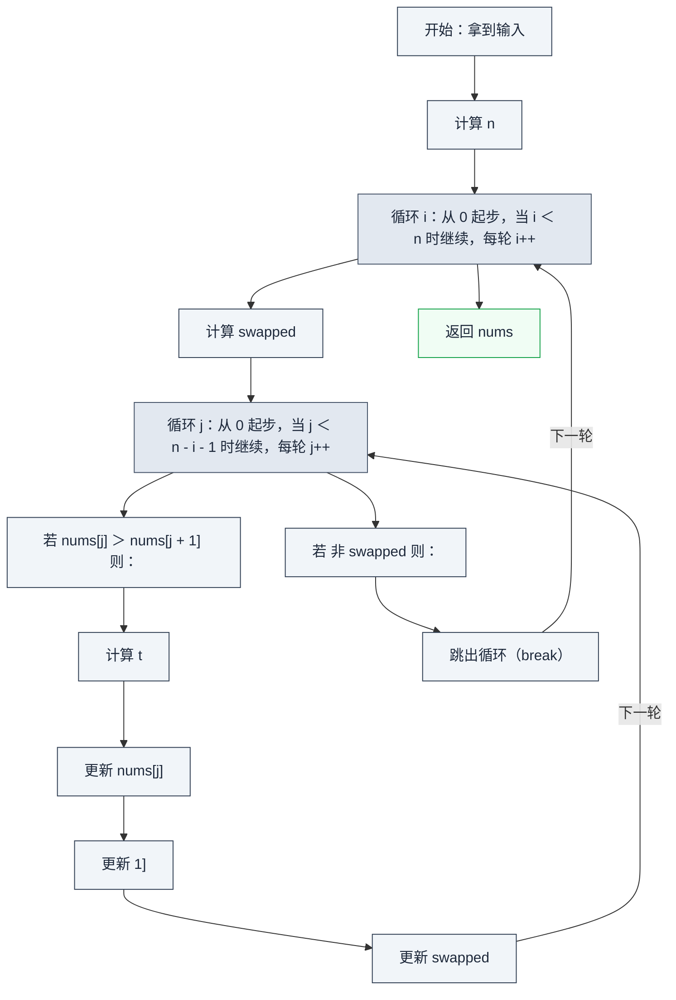

## TypeScript 解题方案（15 个方案逐个讲）

> **运行与提交**：每个方案都是自包含文件（内嵌用例自测，输出 PASS），整块复制到 `.ts` 文件后 `node 文件名` 即可运行。提交 LeetCode 时，把 `demo` 内的算法函数与辅助类型/函数整体取出、置于文件顶层即可。概念演示（非 LeetCode 编号题），在本地运行即可。

### 方案 1：双重循环枚举

**分析与思路**：核心做法是「双重循环枚举」。代码里依次做这些事：双重循环遍历。

**运行方式**：`node 本文件`，内嵌用例全部通过会输出 PASS。


**方案专属流程图**（真实控制流）：


```typescript
// 忠实翻译 python solution_1：bubbleSort，外层 n 趟 + swapped 提前终止
export function demo(): void {
  // 程序入口：跑内嵌自测用例
  function bubbleSort(nums: number[]): number[] {
    // 定义函数/方法 bubbleSort
    const n = nums.length; // 把 数组.长度 存入 元素个数
    for (let i = 0; i < n; i++) {
      // 让 下标 i 从 0 开始计数，下标 i 小于 元素个数 就继续
      let swapped = false; // 把 false 存入 swapped
      for (let j = 0; j < n - i - 1; j++) {
        // 让 下标 j 从 0 开始计数，下标 j 小于 元素个数 减 下标 i 减 1 就继续
        if (nums[j] > nums[j + 1]) {
          // 若 数组[下标 j] 超过 数组[下标 j 加 1]
          const t = nums[j]; // 把 数组[下标 j] 存入 另一字符串
          nums[j] = nums[j + 1]; // 把 数组[下标 j 加 1]; 写入 nums[j]
          nums[j + 1] = t; // 把 另一字符串; 写入 nums[j + 1]
          swapped = true; // 把 true 存入 swapped
        }
      }
      if (!swapped) {
        // 若 取反 swapped
        break; // 跳出循环
      }
    }
    return nums; // 返回 数组
  }
  const cases: { in: number[]; want: number[] }[] = [
    { in: [5, 4, 3, 2, 1], want: [1, 2, 3, 4, 5] },
    { in: [1, 2, 3], want: [1, 2, 3] },
    { in: [], want: [] },
    { in: [2, 2, 1], want: [1, 2, 2] },
  ];
  let fail = false; // 把 false 存入 fail
  for (const c of cases) {
    // for (const 字符 of cases) {
    const got = bubbleSort(c.in.slice()); // 把 bubbleSort(字符.in 截取 )) 存入 got
    if (JSON.stringify(got) !== JSON.stringify(c.want)) {
      // 若 JSON.stringify(got) 不等于 JSON.stringify(字符.want
      fail = true; // 把 true 存入 fail
      console.log(
        'FAIL bubbleSort(' +
          JSON.stringify(c.in) +
          ')=' +
          JSON.stringify(got) +
          ' want ' +
          JSON.stringify(c.want),
      ); // 打印输出
    }
  }
  if (fail) {
    // 若 fail
    throw new Error('FAILED'); // throw new Error(「FAILED」);
  }
  console.log('PASS'); // 全部用例通过，输出 PASS
}
demo(); // demo();
```

### 方案 2：双重循环枚举

**分析与思路**：核心做法是「双重循环枚举」。代码里依次做这些事：双重循环遍历。

**运行方式**：`node 本文件`，内嵌用例全部通过会输出 PASS。


**方案专属流程图**（真实控制流）：


```typescript
// 忠实翻译 python solution_2：bubbleSort（与 solution_1 同实现）
export function demo(): void {
  // 程序入口：跑内嵌自测用例
  function bubbleSort(nums: number[]): number[] {
    // 定义函数/方法 bubbleSort
    const n = nums.length; // 把 数组.长度 存入 元素个数
    for (let i = 0; i < n; i++) {
      // 让 下标 i 从 0 开始计数，下标 i 小于 元素个数 就继续
      let swapped = false; // 把 false 存入 swapped
      for (let j = 0; j < n - i - 1; j++) {
        // 让 下标 j 从 0 开始计数，下标 j 小于 元素个数 减 下标 i 减 1 就继续
        if (nums[j] > nums[j + 1]) {
          // 若 数组[下标 j] 超过 数组[下标 j 加 1]
          const t = nums[j]; // 把 数组[下标 j] 存入 另一字符串
          nums[j] = nums[j + 1]; // 把 数组[下标 j 加 1]; 写入 nums[j]
          nums[j + 1] = t; // 把 另一字符串; 写入 nums[j + 1]
          swapped = true; // 把 true 存入 swapped
        }
      }
      if (!swapped) {
        // 若 取反 swapped
        break; // 跳出循环
      }
    }
    return nums; // 返回 数组
  }
  const cases: { in: number[]; want: number[] }[] = [
    { in: [5, 4, 3, 2, 1], want: [1, 2, 3, 4, 5] },
    { in: [1, 2, 3], want: [1, 2, 3] },
    { in: [], want: [] },
    { in: [2, 2, 1], want: [1, 2, 2] },
  ];
  let fail = false; // 把 false 存入 fail
  for (const c of cases) {
    // for (const 字符 of cases) {
    const got = bubbleSort(c.in.slice()); // 把 bubbleSort(字符.in 截取 )) 存入 got
    if (JSON.stringify(got) !== JSON.stringify(c.want)) {
      // 若 JSON.stringify(got) 不等于 JSON.stringify(字符.want
      fail = true; // 把 true 存入 fail
      console.log(
        'FAIL bubbleSort(' +
          JSON.stringify(c.in) +
          ')=' +
          JSON.stringify(got) +
          ' want ' +
          JSON.stringify(c.want),
      ); // 打印输出
    }
  }
  if (fail) {
    // 若 fail
    throw new Error('FAILED'); // throw new Error(「FAILED」);
  }
  console.log('PASS'); // 全部用例通过，输出 PASS
}
demo(); // demo();
```

### 方案 3：双重循环枚举

**分析与思路**：核心做法是「双重循环枚举」。代码里依次做这些事：双重循环遍历。

**运行方式**：`node 本文件`，内嵌用例全部通过会输出 PASS。


**方案专属流程图**（真实控制流）：


```typescript
// 忠实翻译 python solution_3：bubbleSort（与 solution_1 同实现）
export function demo(): void {
  // 程序入口：跑内嵌自测用例
  function bubbleSort(nums: number[]): number[] {
    // 定义函数/方法 bubbleSort
    const n = nums.length; // 把 数组.长度 存入 元素个数
    for (let i = 0; i < n; i++) {
      // 让 下标 i 从 0 开始计数，下标 i 小于 元素个数 就继续
      let swapped = false; // 把 false 存入 swapped
      for (let j = 0; j < n - i - 1; j++) {
        // 让 下标 j 从 0 开始计数，下标 j 小于 元素个数 减 下标 i 减 1 就继续
        if (nums[j] > nums[j + 1]) {
          // 若 数组[下标 j] 超过 数组[下标 j 加 1]
          const t = nums[j]; // 把 数组[下标 j] 存入 另一字符串
          nums[j] = nums[j + 1]; // 把 数组[下标 j 加 1]; 写入 nums[j]
          nums[j + 1] = t; // 把 另一字符串; 写入 nums[j + 1]
          swapped = true; // 把 true 存入 swapped
        }
      }
      if (!swapped) {
        // 若 取反 swapped
        break; // 跳出循环
      }
    }
    return nums; // 返回 数组
  }
  const cases: { in: number[]; want: number[] }[] = [
    { in: [5, 4, 3, 2, 1], want: [1, 2, 3, 4, 5] },
    { in: [1, 2, 3], want: [1, 2, 3] },
    { in: [], want: [] },
    { in: [2, 2, 1], want: [1, 2, 2] },
  ];
  let fail = false; // 把 false 存入 fail
  for (const c of cases) {
    // for (const 字符 of cases) {
    const got = bubbleSort(c.in.slice()); // 把 bubbleSort(字符.in 截取 )) 存入 got
    if (JSON.stringify(got) !== JSON.stringify(c.want)) {
      // 若 JSON.stringify(got) 不等于 JSON.stringify(字符.want
      fail = true; // 把 true 存入 fail
      console.log(
        'FAIL bubbleSort(' +
          JSON.stringify(c.in) +
          ')=' +
          JSON.stringify(got) +
          ' want ' +
          JSON.stringify(c.want),
      ); // 打印输出
    }
  }
  if (fail) {
    // 若 fail
    throw new Error('FAILED'); // throw new Error(「FAILED」);
  }
  console.log('PASS'); // 全部用例通过，输出 PASS
}
demo(); // demo();
```

### 方案 4：双重循环枚举

**分析与思路**：核心做法是「双重循环枚举」。代码里依次做这些事：双重循环遍历。

**运行方式**：`node 本文件`，内嵌用例全部通过会输出 PASS。


**方案专属流程图**（真实控制流）：


```typescript
// 忠实翻译 python solution_4：bubbleSort（与 solution_1 同实现）
export function demo(): void {
  // 程序入口：跑内嵌自测用例
  function bubbleSort(nums: number[]): number[] {
    // 定义函数/方法 bubbleSort
    const n = nums.length; // 把 数组.长度 存入 元素个数
    for (let i = 0; i < n; i++) {
      // 让 下标 i 从 0 开始计数，下标 i 小于 元素个数 就继续
      let swapped = false; // 把 false 存入 swapped
      for (let j = 0; j < n - i - 1; j++) {
        // 让 下标 j 从 0 开始计数，下标 j 小于 元素个数 减 下标 i 减 1 就继续
        if (nums[j] > nums[j + 1]) {
          // 若 数组[下标 j] 超过 数组[下标 j 加 1]
          const t = nums[j]; // 把 数组[下标 j] 存入 另一字符串
          nums[j] = nums[j + 1]; // 把 数组[下标 j 加 1]; 写入 nums[j]
          nums[j + 1] = t; // 把 另一字符串; 写入 nums[j + 1]
          swapped = true; // 把 true 存入 swapped
        }
      }
      if (!swapped) {
        // 若 取反 swapped
        break; // 跳出循环
      }
    }
    return nums; // 返回 数组
  }
  const cases: { in: number[]; want: number[] }[] = [
    { in: [5, 4, 3, 2, 1], want: [1, 2, 3, 4, 5] },
    { in: [1, 2, 3], want: [1, 2, 3] },
    { in: [], want: [] },
    { in: [2, 2, 1], want: [1, 2, 2] },
  ];
  let fail = false; // 把 false 存入 fail
  for (const c of cases) {
    // for (const 字符 of cases) {
    const got = bubbleSort(c.in.slice()); // 把 bubbleSort(字符.in 截取 )) 存入 got
    if (JSON.stringify(got) !== JSON.stringify(c.want)) {
      // 若 JSON.stringify(got) 不等于 JSON.stringify(字符.want
      fail = true; // 把 true 存入 fail
      console.log(
        'FAIL bubbleSort(' +
          JSON.stringify(c.in) +
          ')=' +
          JSON.stringify(got) +
          ' want ' +
          JSON.stringify(c.want),
      ); // 打印输出
    }
  }
  if (fail) {
    // 若 fail
    throw new Error('FAILED'); // throw new Error(「FAILED」);
  }
  console.log('PASS'); // 全部用例通过，输出 PASS
}
demo(); // demo();
```

### 方案 5：双重循环枚举

**分析与思路**：核心做法是「双重循环枚举」。代码里依次做这些事：双重循环遍历。

**运行方式**：`node 本文件`，内嵌用例全部通过会输出 PASS。


**方案专属流程图**（真实控制流）：

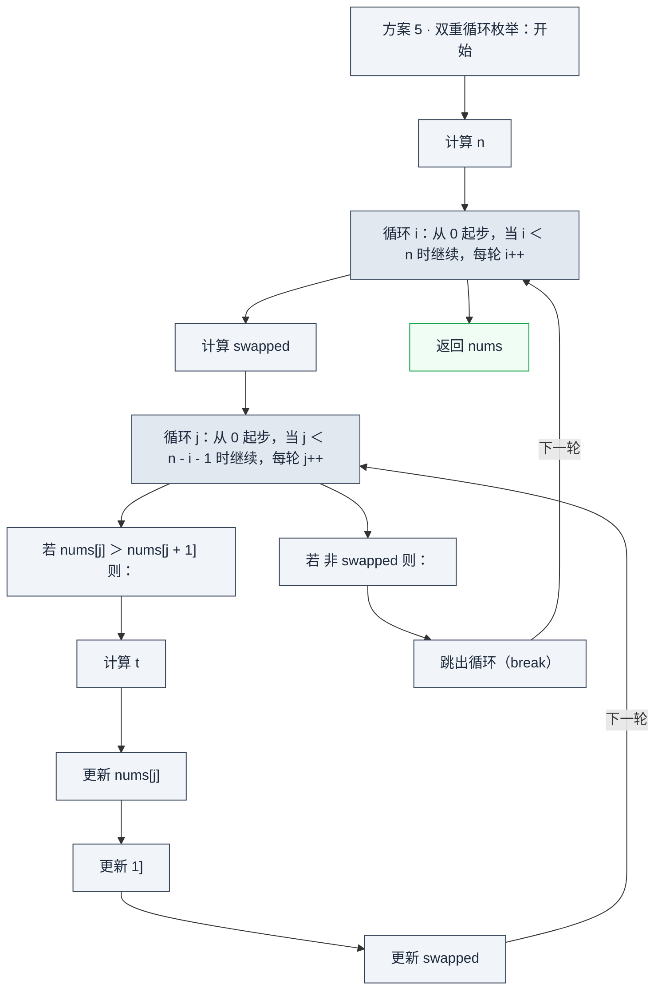

```typescript
// 忠实翻译 python solution_5：bubbleSort（与 solution_1 同实现）
export function demo(): void {
  // 程序入口：跑内嵌自测用例
  function bubbleSort(nums: number[]): number[] {
    // 定义函数/方法 bubbleSort
    const n = nums.length; // 把 数组.长度 存入 元素个数
    for (let i = 0; i < n; i++) {
      // 让 下标 i 从 0 开始计数，下标 i 小于 元素个数 就继续
      let swapped = false; // 把 false 存入 swapped
      for (let j = 0; j < n - i - 1; j++) {
        // 让 下标 j 从 0 开始计数，下标 j 小于 元素个数 减 下标 i 减 1 就继续
        if (nums[j] > nums[j + 1]) {
          // 若 数组[下标 j] 超过 数组[下标 j 加 1]
          const t = nums[j]; // 把 数组[下标 j] 存入 另一字符串
          nums[j] = nums[j + 1]; // 把 数组[下标 j 加 1]; 写入 nums[j]
          nums[j + 1] = t; // 把 另一字符串; 写入 nums[j + 1]
          swapped = true; // 把 true 存入 swapped
        }
      }
      if (!swapped) {
        // 若 取反 swapped
        break; // 跳出循环
      }
    }
    return nums; // 返回 数组
  }
  const cases: { in: number[]; want: number[] }[] = [
    { in: [5, 4, 3, 2, 1], want: [1, 2, 3, 4, 5] },
    { in: [1, 2, 3], want: [1, 2, 3] },
    { in: [], want: [] },
    { in: [2, 2, 1], want: [1, 2, 2] },
  ];
  let fail = false; // 把 false 存入 fail
  for (const c of cases) {
    // for (const 字符 of cases) {
    const got = bubbleSort(c.in.slice()); // 把 bubbleSort(字符.in 截取 )) 存入 got
    if (JSON.stringify(got) !== JSON.stringify(c.want)) {
      // 若 JSON.stringify(got) 不等于 JSON.stringify(字符.want
      fail = true; // 把 true 存入 fail
      console.log(
        'FAIL bubbleSort(' +
          JSON.stringify(c.in) +
          ')=' +
          JSON.stringify(got) +
          ' want ' +
          JSON.stringify(c.want),
      ); // 打印输出
    }
  }
  if (fail) {
    // 若 fail
    throw new Error('FAILED'); // throw new Error(「FAILED」);
  }
  console.log('PASS'); // 全部用例通过，输出 PASS
}
demo(); // demo();
```

### 方案 6：双重循环枚举

**分析与思路**：核心做法是「双重循环枚举」。代码里依次做这些事：双重循环遍历。

**运行方式**：`node 本文件`，内嵌用例全部通过会输出 PASS。


**方案专属流程图**（真实控制流）：


```typescript
// 忠实翻译 python solution_6：bubble_sort_v1 基础版（临时变量交换）
export function demo(): void {
  // 程序入口：跑内嵌自测用例
  function bubbleSortV1(nums: number[]): void {
    // 定义函数/方法 bubbleSortV1
    const length = nums.length; // 把 数组.长度 存入 长度
    for (let i = 0; i < length; i++) {
      // 让 下标 i 从 0 开始计数，下标 i 小于 长度 就继续
      for (let j = 0; j < length - 1 - i; j++) {
        // 让 下标 j 从 0 开始计数，下标 j 小于 长度 减 1 减 下标 i 就继续
        if (nums[j] > nums[j + 1]) {
          // 若 数组[下标 j] 超过 数组[下标 j 加 1]
          const tmp = nums[j]; // 把 数组[下标 j] 存入 临时变量
          nums[j] = nums[j + 1]; // 把 数组[下标 j 加 1]; 写入 nums[j]
          nums[j + 1] = tmp; // 把 临时变量; 写入 nums[j + 1]
        }
      }
    }
  }
  const cases: { in: number[]; want: number[] }[] = [
    { in: [5, 4, 3, 2, 1], want: [1, 2, 3, 4, 5] },
    { in: [1, 2, 3], want: [1, 2, 3] },
    { in: [], want: [] },
    { in: [2, 2, 1], want: [1, 2, 2] },
  ];
  let fail = false; // 把 false 存入 fail
  for (const c of cases) {
    // for (const 字符 of cases) {
    const arr = c.in.slice(); // 把 字符.in 截取 ) 存入 数组
    bubbleSortV1(arr); // bubbleSortV1(数组);
    if (JSON.stringify(arr) !== JSON.stringify(c.want)) {
      // 若 JSON.stringify(数组) 不等于 JSON.stringify(字符.want
      fail = true; // 把 true 存入 fail
      console.log(
        'FAIL bubble_sort_v1(' +
          JSON.stringify(c.in) +
          ')=' +
          JSON.stringify(arr) +
          ' want ' +
          JSON.stringify(c.want),
      ); // 打印输出
    }
  }
  if (fail) {
    // 若 fail
    throw new Error('FAILED'); // throw new Error(「FAILED」);
  }
  console.log('PASS'); // 全部用例通过，输出 PASS
}
demo(); // demo();
```

### 方案 7：双重循环枚举

**分析与思路**：核心做法是「双重循环枚举」。代码里依次做这些事：双重循环遍历。

**运行方式**：`node 本文件`，内嵌用例全部通过会输出 PASS。


**方案专属流程图**（真实控制流）：

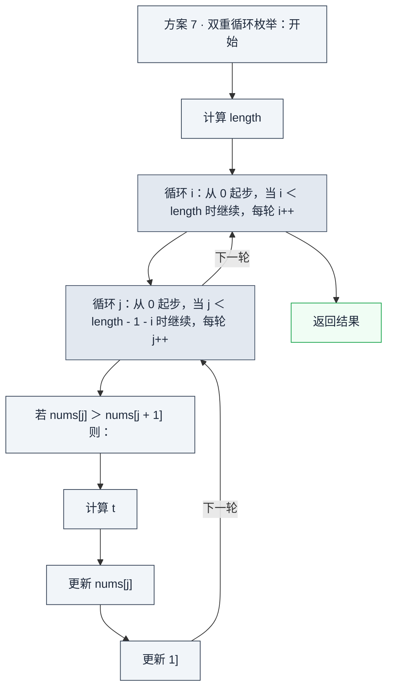

```typescript
// 忠实翻译 python solution_7：bubble_sort_v2 交换优化版（元组解包式交换）
export function demo(): void {
  // 程序入口：跑内嵌自测用例
  function bubbleSortV2(nums: number[]): void {
    // 定义函数/方法 bubbleSortV2
    const length = nums.length; // 把 数组.长度 存入 长度
    for (let i = 0; i < length; i++) {
      // 让 下标 i 从 0 开始计数，下标 i 小于 长度 就继续
      for (let j = 0; j < length - 1 - i; j++) {
        // 让 下标 j 从 0 开始计数，下标 j 小于 长度 减 1 减 下标 i 就继续
        if (nums[j] > nums[j + 1]) {
          // 若 数组[下标 j] 超过 数组[下标 j 加 1]
          const t = nums[j]; // 把 数组[下标 j] 存入 另一字符串
          nums[j] = nums[j + 1]; // 把 数组[下标 j 加 1]; 写入 nums[j]
          nums[j + 1] = t; // 把 另一字符串; 写入 nums[j + 1]
        }
      }
    }
  }
  const cases: { in: number[]; want: number[] }[] = [
    { in: [5, 4, 3, 2, 1], want: [1, 2, 3, 4, 5] },
    { in: [1, 2, 3], want: [1, 2, 3] },
    { in: [], want: [] },
    { in: [2, 2, 1], want: [1, 2, 2] },
  ];
  let fail = false; // 把 false 存入 fail
  for (const c of cases) {
    // for (const 字符 of cases) {
    const arr = c.in.slice(); // 把 字符.in 截取 ) 存入 数组
    bubbleSortV2(arr); // bubbleSortV2(数组);
    if (JSON.stringify(arr) !== JSON.stringify(c.want)) {
      // 若 JSON.stringify(数组) 不等于 JSON.stringify(字符.want
      fail = true; // 把 true 存入 fail
      console.log(
        'FAIL bubble_sort_v2(' +
          JSON.stringify(c.in) +
          ')=' +
          JSON.stringify(arr) +
          ' want ' +
          JSON.stringify(c.want),
      ); // 打印输出
    }
  }
  if (fail) {
    // 若 fail
    throw new Error('FAILED'); // throw new Error(「FAILED」);
  }
  console.log('PASS'); // 全部用例通过，输出 PASS
}
demo(); // demo();
```

### 方案 8：单趟扫描

**分析与思路**：核心做法是「单趟扫描」。代码里依次做这些事：单循环线性扫描。

**运行方式**：`node 本文件`，内嵌用例全部通过会输出 PASS。


**方案专属流程图**（真实控制流）：

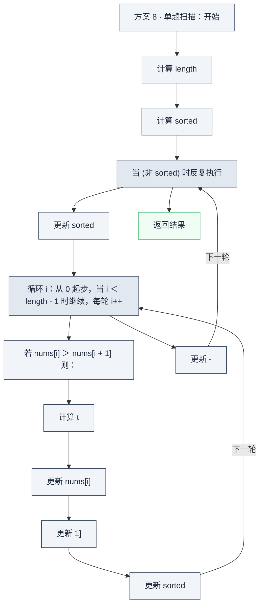

```typescript
// 忠实翻译 python solution_8：bubble_sort_v3 提前终止版（哨兵变量 + length 递减）
export function demo(): void {
  // 程序入口：跑内嵌自测用例
  function bubbleSortV3(nums: number[]): void {
    // 定义函数/方法 bubbleSortV3
    let length = nums.length; // 把 数组.长度 存入 长度
    let sorted = false; // 把 false 存入 sorted
    while (!sorted) {
      // 循环，直到不满足「取反 sorted」
      sorted = true; // 把 true 存入 sorted
      for (let i = 0; i < length - 1; i++) {
        // 让 下标 i 从 0 开始计数，下标 i 小于 长度 减 1 就继续
        if (nums[i] > nums[i + 1]) {
          // 若 数组[下标 i] 超过 数组[下标 i 加 1]
          const t = nums[i]; // 把 数组[下标 i] 存入 另一字符串
          nums[i] = nums[i + 1]; // 把 数组[下标 i 加 1]; 写入 nums[i]
          nums[i + 1] = t; // 把 另一字符串; 写入 nums[i + 1]
          sorted = false; // 把 false 存入 sorted
        }
      }
      length -= 1; // 长度累减 1
    }
  }
  const cases: { in: number[]; want: number[] }[] = [
    { in: [5, 4, 3, 2, 1], want: [1, 2, 3, 4, 5] },
    { in: [1, 2, 3], want: [1, 2, 3] },
    { in: [], want: [] },
    { in: [2, 2, 1], want: [1, 2, 2] },
  ];
  let fail = false; // 把 false 存入 fail
  for (const c of cases) {
    // for (const 字符 of cases) {
    const arr = c.in.slice(); // 把 字符.in 截取 ) 存入 数组
    bubbleSortV3(arr); // bubbleSortV3(数组);
    if (JSON.stringify(arr) !== JSON.stringify(c.want)) {
      // 若 JSON.stringify(数组) 不等于 JSON.stringify(字符.want
      fail = true; // 把 true 存入 fail
      console.log(
        'FAIL bubble_sort_v3(' +
          JSON.stringify(c.in) +
          ')=' +
          JSON.stringify(arr) +
          ' want ' +
          JSON.stringify(c.want),
      ); // 打印输出
    }
  }
  if (fail) {
    // 若 fail
    throw new Error('FAILED'); // throw new Error(「FAILED」);
  }
  console.log('PASS'); // 全部用例通过，输出 PASS
}
demo(); // demo();
```

### 方案 9：单趟扫描

**分析与思路**：核心做法是「单趟扫描」。代码里依次做这些事：单循环线性扫描。

**运行方式**：`node 本文件`，内嵌用例全部通过会输出 PASS。


**方案专属流程图**（真实控制流）：


```typescript
// 忠实翻译 python solution_9：bubble_sort_v4 跳跃版（记录最后一次交换位置）
export function demo(): void {
  // 程序入口：跑内嵌自测用例
  function bubbleSortV4(nums: number[]): void {
    // 定义函数/方法 bubbleSortV4
    const length = nums.length; // 把 数组.长度 存入 长度
    let k = length - 1; // 把 长度 减 1 存入 下标 k
    let last = 0; // 把 0 存入 last
    let i = 0; // 把 0 存入 下标 i
    while (i < length - 1) {
      // 循环，直到不满足「下标 i 小于 长度 减 1」
      for (let j = 0; j < k; j++) {
        // 让 下标 j 从 0 开始计数，下标 j 小于 下标 k 就继续
        if (nums[j] > nums[j + 1]) {
          // 若 数组[下标 j] 超过 数组[下标 j 加 1]
          const t = nums[j]; // 把 数组[下标 j] 存入 另一字符串
          nums[j] = nums[j + 1]; // 把 数组[下标 j 加 1]; 写入 nums[j]
          nums[j + 1] = t; // 把 另一字符串; 写入 nums[j + 1]
          last = j; // 把 下标 j 存入 last
        }
      }
      k = last; // 把 last 存入 下标 k
      i += 1; // 下标 i累加 1
    }
  }
  const cases: { in: number[]; want: number[] }[] = [
    { in: [5, 4, 3, 2, 1], want: [1, 2, 3, 4, 5] },
    { in: [1, 2, 3], want: [1, 2, 3] },
    { in: [], want: [] },
    { in: [2, 2, 1], want: [1, 2, 2] },
  ];
  let fail = false; // 把 false 存入 fail
  for (const c of cases) {
    // for (const 字符 of cases) {
    const arr = c.in.slice(); // 把 字符.in 截取 ) 存入 数组
    bubbleSortV4(arr); // bubbleSortV4(数组);
    if (JSON.stringify(arr) !== JSON.stringify(c.want)) {
      // 若 JSON.stringify(数组) 不等于 JSON.stringify(字符.want
      fail = true; // 把 true 存入 fail
      console.log(
        'FAIL bubble_sort_v4(' +
          JSON.stringify(c.in) +
          ')=' +
          JSON.stringify(arr) +
          ' want ' +
          JSON.stringify(c.want),
      ); // 打印输出
    }
  }
  if (fail) {
    // 若 fail
    throw new Error('FAILED'); // throw new Error(「FAILED」);
  }
  console.log('PASS'); // 全部用例通过，输出 PASS
}
demo(); // demo();
```

### 方案 10：单趟扫描

**分析与思路**：核心做法是「单趟扫描」。代码里依次做这些事：单循环线性扫描。

**运行方式**：`node 本文件`，内嵌用例全部通过会输出 PASS。

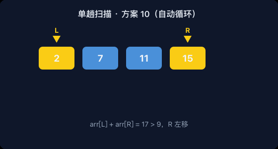

**方案专属流程图**（真实控制流）：


```typescript
// 忠实翻译 python solution_10：bubble_sort_v5 提前终止 + 跳跃版
export function demo(): void {
  // 程序入口：跑内嵌自测用例
  function bubbleSortV5(nums: number[]): void {
    // 定义函数/方法 bubbleSortV5
    const length = nums.length; // 把 数组.长度 存入 长度
    let k = length - 1; // 把 长度 减 1 存入 下标 k
    let last = 0; // 把 0 存入 last
    let i = 0; // 把 0 存入 下标 i
    let sorted = false; // 把 false 存入 sorted
    while (i < length - 1 && !sorted) {
      // 循环，直到不满足「下标 i 小于 长度 减 1 且 取反 sorted」
      sorted = true; // 把 true 存入 sorted
      for (let j = 0; j < k; j++) {
        // 让 下标 j 从 0 开始计数，下标 j 小于 下标 k 就继续
        if (nums[j] > nums[j + 1]) {
          // 若 数组[下标 j] 超过 数组[下标 j 加 1]
          const t = nums[j]; // 把 数组[下标 j] 存入 另一字符串
          nums[j] = nums[j + 1]; // 把 数组[下标 j 加 1]; 写入 nums[j]
          nums[j + 1] = t; // 把 另一字符串; 写入 nums[j + 1]
          last = j; // 把 下标 j 存入 last
          sorted = false; // 把 false 存入 sorted
        }
      }
      k = last; // 把 last 存入 下标 k
      i += 1; // 下标 i累加 1
    }
  }
  const cases: { in: number[]; want: number[] }[] = [
    { in: [5, 4, 3, 2, 1], want: [1, 2, 3, 4, 5] },
    { in: [1, 2, 3], want: [1, 2, 3] },
    { in: [], want: [] },
    { in: [2, 2, 1], want: [1, 2, 2] },
  ];
  let fail = false; // 把 false 存入 fail
  for (const c of cases) {
    // for (const 字符 of cases) {
    const arr = c.in.slice(); // 把 字符.in 截取 ) 存入 数组
    bubbleSortV5(arr); // bubbleSortV5(数组);
    if (JSON.stringify(arr) !== JSON.stringify(c.want)) {
      // 若 JSON.stringify(数组) 不等于 JSON.stringify(字符.want
      fail = true; // 把 true 存入 fail
      console.log(
        'FAIL bubble_sort_v5(' +
          JSON.stringify(c.in) +
          ')=' +
          JSON.stringify(arr) +
          ' want ' +
          JSON.stringify(c.want),
      ); // 打印输出
    }
  }
  if (fail) {
    // 若 fail
    throw new Error('FAILED'); // throw new Error(「FAILED」);
  }
  console.log('PASS'); // 全部用例通过，输出 PASS
}
demo(); // demo();
```

### 方案 11：双重循环枚举

**分析与思路**：核心做法是「双重循环枚举」。代码里依次做这些事：双重循环遍历。

**运行方式**：`node 本文件`，内嵌用例全部通过会输出 PASS。


**方案专属流程图**（真实控制流）：

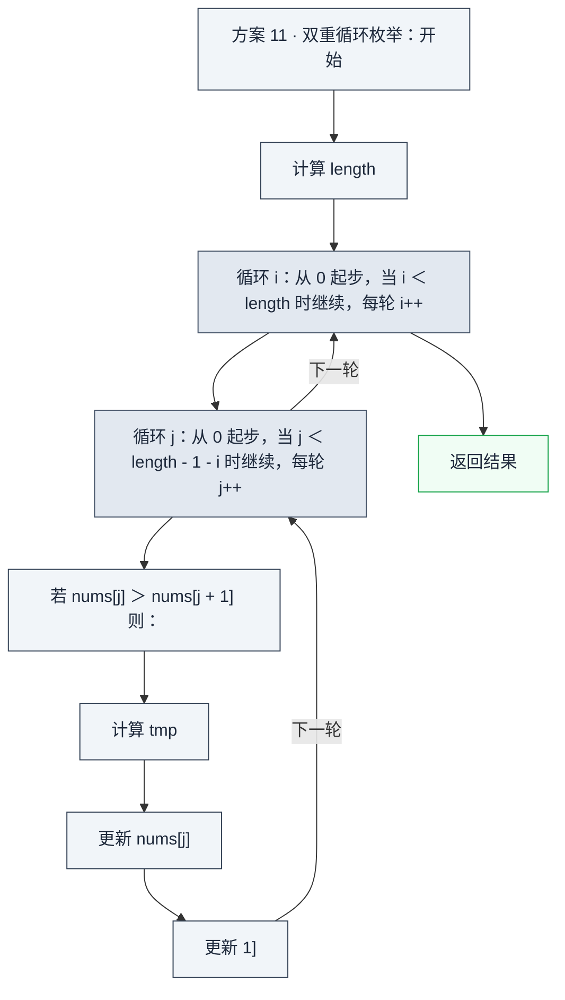

```typescript
// 忠实翻译 python solution_11：bubble_sort_v1 基础版
export function demo(): void {
  // 程序入口：跑内嵌自测用例
  function bubbleSortV1(nums: number[]): void {
    // 定义函数/方法 bubbleSortV1
    const length = nums.length; // 把 数组.长度 存入 长度
    for (let i = 0; i < length; i++) {
      // 让 下标 i 从 0 开始计数，下标 i 小于 长度 就继续
      for (let j = 0; j < length - 1 - i; j++) {
        // 让 下标 j 从 0 开始计数，下标 j 小于 长度 减 1 减 下标 i 就继续
        if (nums[j] > nums[j + 1]) {
          // 若 数组[下标 j] 超过 数组[下标 j 加 1]
          const tmp = nums[j]; // 把 数组[下标 j] 存入 临时变量
          nums[j] = nums[j + 1]; // 把 数组[下标 j 加 1]; 写入 nums[j]
          nums[j + 1] = tmp; // 把 临时变量; 写入 nums[j + 1]
        }
      }
    }
  }
  const cases: { in: number[]; want: number[] }[] = [
    { in: [5, 4, 3, 2, 1], want: [1, 2, 3, 4, 5] },
    { in: [1, 2, 3], want: [1, 2, 3] },
    { in: [], want: [] },
    { in: [2, 2, 1], want: [1, 2, 2] },
  ];
  let fail = false; // 把 false 存入 fail
  for (const c of cases) {
    // for (const 字符 of cases) {
    const arr = c.in.slice(); // 把 字符.in 截取 ) 存入 数组
    bubbleSortV1(arr); // bubbleSortV1(数组);
    if (JSON.stringify(arr) !== JSON.stringify(c.want)) {
      // 若 JSON.stringify(数组) 不等于 JSON.stringify(字符.want
      fail = true; // 把 true 存入 fail
      console.log(
        'FAIL bubble_sort_v1(' +
          JSON.stringify(c.in) +
          ')=' +
          JSON.stringify(arr) +
          ' want ' +
          JSON.stringify(c.want),
      ); // 打印输出
    }
  }
  if (fail) {
    // 若 fail
    throw new Error('FAILED'); // throw new Error(「FAILED」);
  }
  console.log('PASS'); // 全部用例通过，输出 PASS
}
demo(); // demo();
```

### 方案 12：双重循环枚举

**分析与思路**：核心做法是「双重循环枚举」。代码里依次做这些事：双重循环遍历。

**运行方式**：`node 本文件`，内嵌用例全部通过会输出 PASS。


**方案专属流程图**（真实控制流）：

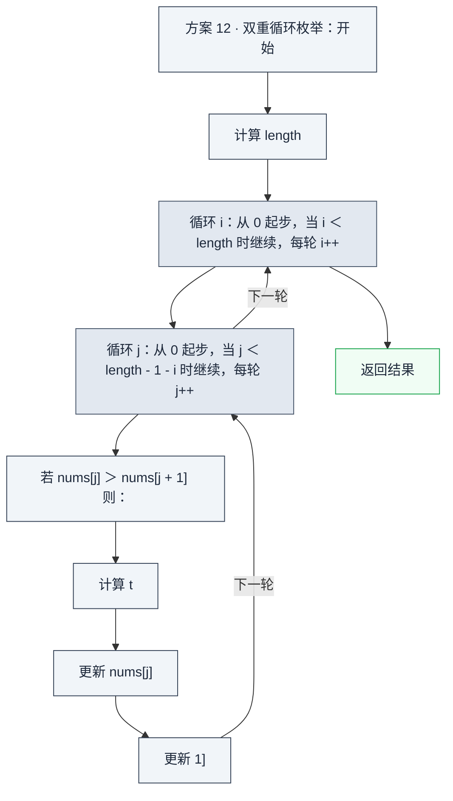

```typescript
// 忠实翻译 python solution_12：bubble_sort_v2 交换优化版
export function demo(): void {
  // 程序入口：跑内嵌自测用例
  function bubbleSortV2(nums: number[]): void {
    // 定义函数/方法 bubbleSortV2
    const length = nums.length; // 把 数组.长度 存入 长度
    for (let i = 0; i < length; i++) {
      // 让 下标 i 从 0 开始计数，下标 i 小于 长度 就继续
      for (let j = 0; j < length - 1 - i; j++) {
        // 让 下标 j 从 0 开始计数，下标 j 小于 长度 减 1 减 下标 i 就继续
        if (nums[j] > nums[j + 1]) {
          // 若 数组[下标 j] 超过 数组[下标 j 加 1]
          const t = nums[j]; // 把 数组[下标 j] 存入 另一字符串
          nums[j] = nums[j + 1]; // 把 数组[下标 j 加 1]; 写入 nums[j]
          nums[j + 1] = t; // 把 另一字符串; 写入 nums[j + 1]
        }
      }
    }
  }
  const cases: { in: number[]; want: number[] }[] = [
    { in: [5, 4, 3, 2, 1], want: [1, 2, 3, 4, 5] },
    { in: [1, 2, 3], want: [1, 2, 3] },
    { in: [], want: [] },
    { in: [2, 2, 1], want: [1, 2, 2] },
  ];
  let fail = false; // 把 false 存入 fail
  for (const c of cases) {
    // for (const 字符 of cases) {
    const arr = c.in.slice(); // 把 字符.in 截取 ) 存入 数组
    bubbleSortV2(arr); // bubbleSortV2(数组);
    if (JSON.stringify(arr) !== JSON.stringify(c.want)) {
      // 若 JSON.stringify(数组) 不等于 JSON.stringify(字符.want
      fail = true; // 把 true 存入 fail
      console.log(
        'FAIL bubble_sort_v2(' +
          JSON.stringify(c.in) +
          ')=' +
          JSON.stringify(arr) +
          ' want ' +
          JSON.stringify(c.want),
      ); // 打印输出
    }
  }
  if (fail) {
    // 若 fail
    throw new Error('FAILED'); // throw new Error(「FAILED」);
  }
  console.log('PASS'); // 全部用例通过，输出 PASS
}
demo(); // demo();
```

### 方案 13：单趟扫描

**分析与思路**：核心做法是「单趟扫描」。代码里依次做这些事：单循环线性扫描。

**运行方式**：`node 本文件`，内嵌用例全部通过会输出 PASS。


**方案专属流程图**（真实控制流）：

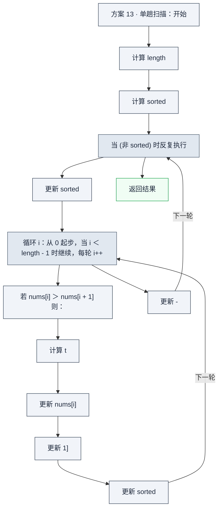

```typescript
// 忠实翻译 python solution_13：bubble_sort_v3 提前终止版
export function demo(): void {
  // 程序入口：跑内嵌自测用例
  function bubbleSortV3(nums: number[]): void {
    // 定义函数/方法 bubbleSortV3
    let length = nums.length; // 把 数组.长度 存入 长度
    let sorted = false; // 把 false 存入 sorted
    while (!sorted) {
      // 循环，直到不满足「取反 sorted」
      sorted = true; // 把 true 存入 sorted
      for (let i = 0; i < length - 1; i++) {
        // 让 下标 i 从 0 开始计数，下标 i 小于 长度 减 1 就继续
        if (nums[i] > nums[i + 1]) {
          // 若 数组[下标 i] 超过 数组[下标 i 加 1]
          const t = nums[i]; // 把 数组[下标 i] 存入 另一字符串
          nums[i] = nums[i + 1]; // 把 数组[下标 i 加 1]; 写入 nums[i]
          nums[i + 1] = t; // 把 另一字符串; 写入 nums[i + 1]
          sorted = false; // 把 false 存入 sorted
        }
      }
      length -= 1; // 长度累减 1
    }
  }
  const cases: { in: number[]; want: number[] }[] = [
    { in: [5, 4, 3, 2, 1], want: [1, 2, 3, 4, 5] },
    { in: [1, 2, 3], want: [1, 2, 3] },
    { in: [], want: [] },
    { in: [2, 2, 1], want: [1, 2, 2] },
  ];
  let fail = false; // 把 false 存入 fail
  for (const c of cases) {
    // for (const 字符 of cases) {
    const arr = c.in.slice(); // 把 字符.in 截取 ) 存入 数组
    bubbleSortV3(arr); // bubbleSortV3(数组);
    if (JSON.stringify(arr) !== JSON.stringify(c.want)) {
      // 若 JSON.stringify(数组) 不等于 JSON.stringify(字符.want
      fail = true; // 把 true 存入 fail
      console.log(
        'FAIL bubble_sort_v3(' +
          JSON.stringify(c.in) +
          ')=' +
          JSON.stringify(arr) +
          ' want ' +
          JSON.stringify(c.want),
      ); // 打印输出
    }
  }
  if (fail) {
    // 若 fail
    throw new Error('FAILED'); // throw new Error(「FAILED」);
  }
  console.log('PASS'); // 全部用例通过，输出 PASS
}
demo(); // demo();
```

### 方案 14：单趟扫描

**分析与思路**：核心做法是「单趟扫描」。代码里依次做这些事：单循环线性扫描。

**运行方式**：`node 本文件`，内嵌用例全部通过会输出 PASS。


**方案专属流程图**（真实控制流）：

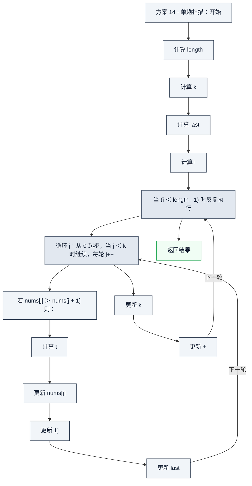

```typescript
// 忠实翻译 python solution_14：bubble_sort_v4 跳跃版
export function demo(): void {
  // 程序入口：跑内嵌自测用例
  function bubbleSortV4(nums: number[]): void {
    // 定义函数/方法 bubbleSortV4
    const length = nums.length; // 把 数组.长度 存入 长度
    let k = length - 1; // 把 长度 减 1 存入 下标 k
    let last = 0; // 把 0 存入 last
    let i = 0; // 把 0 存入 下标 i
    while (i < length - 1) {
      // 循环，直到不满足「下标 i 小于 长度 减 1」
      for (let j = 0; j < k; j++) {
        // 让 下标 j 从 0 开始计数，下标 j 小于 下标 k 就继续
        if (nums[j] > nums[j + 1]) {
          // 若 数组[下标 j] 超过 数组[下标 j 加 1]
          const t = nums[j]; // 把 数组[下标 j] 存入 另一字符串
          nums[j] = nums[j + 1]; // 把 数组[下标 j 加 1]; 写入 nums[j]
          nums[j + 1] = t; // 把 另一字符串; 写入 nums[j + 1]
          last = j; // 把 下标 j 存入 last
        }
      }
      k = last; // 把 last 存入 下标 k
      i += 1; // 下标 i累加 1
    }
  }
  const cases: { in: number[]; want: number[] }[] = [
    { in: [5, 4, 3, 2, 1], want: [1, 2, 3, 4, 5] },
    { in: [1, 2, 3], want: [1, 2, 3] },
    { in: [], want: [] },
    { in: [2, 2, 1], want: [1, 2, 2] },
  ];
  let fail = false; // 把 false 存入 fail
  for (const c of cases) {
    // for (const 字符 of cases) {
    const arr = c.in.slice(); // 把 字符.in 截取 ) 存入 数组
    bubbleSortV4(arr); // bubbleSortV4(数组);
    if (JSON.stringify(arr) !== JSON.stringify(c.want)) {
      // 若 JSON.stringify(数组) 不等于 JSON.stringify(字符.want
      fail = true; // 把 true 存入 fail
      console.log(
        'FAIL bubble_sort_v4(' +
          JSON.stringify(c.in) +
          ')=' +
          JSON.stringify(arr) +
          ' want ' +
          JSON.stringify(c.want),
      ); // 打印输出
    }
  }
  if (fail) {
    // 若 fail
    throw new Error('FAILED'); // throw new Error(「FAILED」);
  }
  console.log('PASS'); // 全部用例通过，输出 PASS
}
demo(); // demo();
```

### 方案 15：单趟扫描

**分析与思路**：核心做法是「单趟扫描」。代码里依次做这些事：单循环线性扫描。

**运行方式**：`node 本文件`，内嵌用例全部通过会输出 PASS。

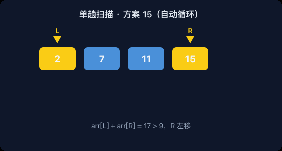

**方案专属流程图**（真实控制流）：

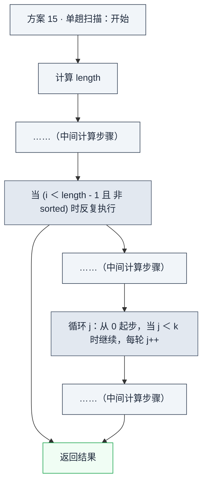

```typescript
// 忠实翻译 python solution_15：bubble_sort_v5 提前终止 + 跳跃版
export function demo(): void {
  // 程序入口：跑内嵌自测用例
  function bubbleSortV5(nums: number[]): void {
    // 定义函数/方法 bubbleSortV5
    const length = nums.length; // 把 数组.长度 存入 长度
    let k = length - 1; // 把 长度 减 1 存入 下标 k
    let last = 0; // 把 0 存入 last
    let i = 0; // 把 0 存入 下标 i
    let sorted = false; // 把 false 存入 sorted
    while (i < length - 1 && !sorted) {
      // 循环，直到不满足「下标 i 小于 长度 减 1 且 取反 sorted」
      sorted = true; // 把 true 存入 sorted
      for (let j = 0; j < k; j++) {
        // 让 下标 j 从 0 开始计数，下标 j 小于 下标 k 就继续
        if (nums[j] > nums[j + 1]) {
          // 若 数组[下标 j] 超过 数组[下标 j 加 1]
          const t = nums[j]; // 把 数组[下标 j] 存入 另一字符串
          nums[j] = nums[j + 1]; // 把 数组[下标 j 加 1]; 写入 nums[j]
          nums[j + 1] = t; // 把 另一字符串; 写入 nums[j + 1]
          last = j; // 把 下标 j 存入 last
          sorted = false; // 把 false 存入 sorted
        }
      }
      k = last; // 把 last 存入 下标 k
      i += 1; // 下标 i累加 1
    }
  }
  const cases: { in: number[]; want: number[] }[] = [
    { in: [5, 4, 3, 2, 1], want: [1, 2, 3, 4, 5] },
    { in: [1, 2, 3], want: [1, 2, 3] },
    { in: [], want: [] },
    { in: [2, 2, 1], want: [1, 2, 2] },
  ];
  let fail = false; // 把 false 存入 fail
  for (const c of cases) {
    // for (const 字符 of cases) {
    const arr = c.in.slice(); // 把 字符.in 截取 ) 存入 数组
    bubbleSortV5(arr); // bubbleSortV5(数组);
    if (JSON.stringify(arr) !== JSON.stringify(c.want)) {
      // 若 JSON.stringify(数组) 不等于 JSON.stringify(字符.want
      fail = true; // 把 true 存入 fail
      console.log(
        'FAIL bubble_sort_v5(' +
          JSON.stringify(c.in) +
          ')=' +
          JSON.stringify(arr) +
          ' want ' +
          JSON.stringify(c.want),
      ); // 打印输出
    }
  }
  if (fail) {
    // 若 fail
    throw new Error('FAILED'); // throw new Error(「FAILED」);
  }
  console.log('PASS'); // 全部用例通过，输出 PASS
}
demo(); // demo();
```

## 逐步拆解与面试追问

**复杂度**：时间 O(n²)（两层嵌套扫描），空间 O(1) 到 O(n)

**为什么是这个量级**：外层定起点、内层扫终点，n 个起点各扫 n 次

**面试官可能会追问**：

- 这个策略能推广到什么场景？
- 与暴力做法差在哪一步？
- 有没有更简单的等价写法？

## 关键 API 速查（TS 主解法实际用到，附官方链接）

| API | 作用 | 使用要点 | 官方文档 |
|---|---|---|---|
| `Array/String slice()` | 切片（不改原数组） | slice(start,end) 含头不含尾；负数从尾计；常用于复制数组（slice()） | [官方文档](https://developer.mozilla.org/zh-CN/docs/Web/JavaScript/Reference/Global_Objects/Array/slice) |
| `JSON.stringify()` | 序列化为 JSON 字符串 | 常用于结构化比较（深度相等判定）；undefined/函数/循环引用会被丢弃或抛错 | [官方文档](https://developer.mozilla.org/zh-CN/docs/Web/JavaScript/Reference/Global_Objects/JSON/stringify) |

### 各语言官方文档导航

- **TypeScript / JS**：[MDN 中文参考](https://developer.mozilla.org/zh-CN/)
- **Python**：[Python 官方文档](https://docs.python.org/zh-cn/3/)
- **Go**：[Go 标准库](https://pkg.go.dev/std)
- **Java**：[JDK 17 API](https://docs.oracle.com/en/java/javase/17/docs/api/)
- **Rust**：[Rust 标准库](https://doc.rust-lang.org/std/)
- **Lua**：[Lua 5.4 手册](https://www.lua.org/manual/5.4/)
- **C**：[Cppreference C](https://zh.cppreference.com/w/c)
- **C++**：[Cppreference C++](https://zh.cppreference.com/w/cpp)
- **R**：[R 官方手册](https://stat.ethz.ch/R-manual/)
- **Zig**：[Zig 语言文档](https://ziglang.org/documentation/master/)
- **Dart**：[Dart API](https://api.dart.dev/)

## 附录：其他 10 种语言全部实现（每种语言列举其全部方案）

> TypeScript 的全部方案见「TypeScript 解题方案」一节；下面是其余 10 种语言的对应实现，每种语言的每个方案都带思路分析、代码走读与专属运行架构图。
> 每个方案都内嵌用例自测，可独立运行（老仓库 python/go 文件遵循「打印结果」约定）。
> 完整解法文件见 `dsa/<语言>/notes/lc_134066237_冒泡排序/`。

### Python 实现（15 种方案）

Python 的全部方案如下，每个方案都内嵌用例自测，可独立运行（老仓库 python/go 文件遵循「打印结果」约定）：

#### 方案 1：双重循环枚举

**思路与代码分析**：核心是「双重循环枚举」。Python 版用切片与字典推导式简化操作，突出可读性。**走读**：方案 1 · 双重循环枚举：开始 → 更新 n → 循环 i：从 0 到 n 前 → 更新 swapped → 循环 j：从 0 到 n - i - 1 前 → 若 nums[j] ＞ nums[j + 1]：更新 1] → 更新 1] → 处理 nums[j + 1], → 处理 nums[j], → 处理 ) → 更新 swapped → 若 not swapped：处理 break → 跳出循环（break） → 返回 nums。

**运行架构**（真实控制流）：

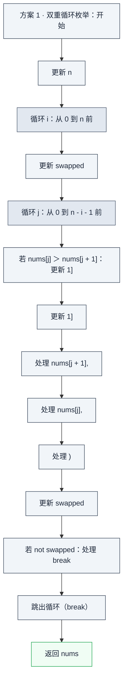

```python
import sys  # 提高递归深度上限（深输入防 RecursionError）

sys.setrecursionlimit(200000)  # 树/链表类题目节点数可达 1e4 量级

def bubbleSort(nums):  # 定义函数 bubbleSort（参数：数组）
    n = len(nums)  # 把 长度(数组) 存入 元素个数
    for i in range(n):  # 让 下标 i 从 元素个数 遍历
        swapped = False  # 把 False 存入 swapped
        for j in range(0, n - i - 1):  # 让 下标 j 从 0 到 元素个数 减 下标 i 减 1 遍历
            if nums[j] > nums[j + 1]:  # 若 数组[下标 j] 超过 数组[下标 j 加 1]
                nums[j], nums[j + 1] = (
                    nums[j + 1],
                    nums[j],
                )  # 把 数组[下标 j 加 1], 数组[下标 j] 写入 nums[j], nums[j + 1]
                swapped = True  # 把 True 存入 swapped
        if not swapped:  # 若 not swapped
            break  # 跳出循环
    return nums  # 返回 数组

if __name__ == "__main__":  # 若 __name__ 等于 '__main__'
    print(bubbleSort([1, 2, 3]))  # 打印输出
```

#### 方案 2：双重循环枚举

**思路与代码分析**：核心是「双重循环枚举」。Python 版用切片与字典推导式简化操作，突出可读性。**走读**：方案 2 · 双重循环枚举：开始 → 更新 n → 循环 i：从 0 到 n 前 → 更新 swapped → 循环 j：从 0 到 n - i - 1 前 → 若 nums[j] ＞ nums[j + 1]：更新 1] → 更新 1] → 处理 nums[j + 1], → 处理 nums[j], → 处理 ) → 更新 swapped → 若 not swapped：处理 break → 跳出循环（break） → 返回 nums。

**运行架构**（真实控制流）：

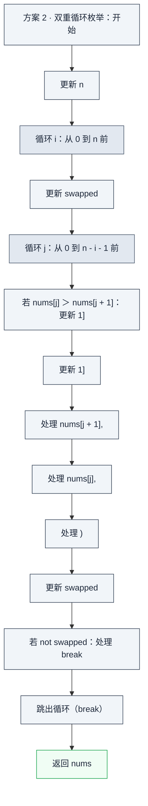

```python
import sys  # 提高递归深度上限（深输入防 RecursionError）

sys.setrecursionlimit(200000)  # 树/链表类题目节点数可达 1e4 量级

def bubbleSort(nums):  # 定义函数 bubbleSort（参数：数组）
    n = len(nums)  # 把 长度(数组) 存入 元素个数
    for i in range(n):  # 让 下标 i 从 元素个数 遍历
        swapped = False  # 把 False 存入 swapped
        for j in range(0, n - i - 1):  # 让 下标 j 从 0 到 元素个数 减 下标 i 减 1 遍历
            if nums[j] > nums[j + 1]:  # 若 数组[下标 j] 超过 数组[下标 j 加 1]
                nums[j], nums[j + 1] = (
                    nums[j + 1],
                    nums[j],
                )  # 把 数组[下标 j 加 1], 数组[下标 j] 写入 nums[j], nums[j + 1]
                swapped = True  # 把 True 存入 swapped
        if not swapped:  # 若 not swapped
            break  # 跳出循环
    return nums  # 返回 数组

if __name__ == "__main__":  # 若 __name__ 等于 '__main__'
    print(bubbleSort([1, 2, 3]))  # 打印输出
```

#### 方案 3：双重循环枚举

**思路与代码分析**：核心是「双重循环枚举」。Python 版用切片与字典推导式简化操作，突出可读性。**走读**：方案 3 · 双重循环枚举：开始 → 更新 n → 循环 i：从 0 到 n 前 → 更新 swapped → 循环 j：从 0 到 n - i - 1 前 → 若 nums[j] ＞ nums[j + 1]：更新 1] → 更新 1] → 处理 nums[j + 1], → 处理 nums[j], → 处理 ) → 更新 swapped → 若 not swapped：处理 break → 跳出循环（break） → 返回 nums。

**运行架构**（真实控制流）：


```python
import sys  # 提高递归深度上限（深输入防 RecursionError）

sys.setrecursionlimit(200000)  # 树/链表类题目节点数可达 1e4 量级

def bubbleSort(nums):  # 定义函数 bubbleSort（参数：数组）
    n = len(nums)  # 把 长度(数组) 存入 元素个数
    for i in range(n):  # 让 下标 i 从 元素个数 遍历
        swapped = False  # 把 False 存入 swapped
        for j in range(0, n - i - 1):  # 让 下标 j 从 0 到 元素个数 减 下标 i 减 1 遍历
            if nums[j] > nums[j + 1]:  # 若 数组[下标 j] 超过 数组[下标 j 加 1]
                nums[j], nums[j + 1] = (
                    nums[j + 1],
                    nums[j],
                )  # 把 数组[下标 j 加 1], 数组[下标 j] 写入 nums[j], nums[j + 1]
                swapped = True  # 把 True 存入 swapped
        if not swapped:  # 若 not swapped
            break  # 跳出循环
    return nums  # 返回 数组

if __name__ == "__main__":  # 若 __name__ 等于 '__main__'
    print(bubbleSort([1, 2, 3]))  # 打印输出
```

#### 方案 4：双重循环枚举

**思路与代码分析**：核心是「双重循环枚举」。Python 版用切片与字典推导式简化操作，突出可读性。**走读**：方案 4 · 双重循环枚举：开始 → 更新 n → 循环 i：从 0 到 n 前 → 更新 swapped → 循环 j：从 0 到 n - i - 1 前 → 若 nums[j] ＞ nums[j + 1]：更新 1] → 更新 1] → 处理 nums[j + 1], → 处理 nums[j], → 处理 ) → 更新 swapped → 若 not swapped：处理 break → 跳出循环（break） → 返回 nums。

**运行架构**（真实控制流）：


```python
import sys  # 提高递归深度上限（深输入防 RecursionError）

sys.setrecursionlimit(200000)  # 树/链表类题目节点数可达 1e4 量级

def bubbleSort(nums):  # 定义函数 bubbleSort（参数：数组）
    n = len(nums)  # 把 长度(数组) 存入 元素个数
    for i in range(n):  # 让 下标 i 从 元素个数 遍历
        swapped = False  # 把 False 存入 swapped
        for j in range(0, n - i - 1):  # 让 下标 j 从 0 到 元素个数 减 下标 i 减 1 遍历
            if nums[j] > nums[j + 1]:  # 若 数组[下标 j] 超过 数组[下标 j 加 1]
                nums[j], nums[j + 1] = (
                    nums[j + 1],
                    nums[j],
                )  # 把 数组[下标 j 加 1], 数组[下标 j] 写入 nums[j], nums[j + 1]
                swapped = True  # 把 True 存入 swapped
        if not swapped:  # 若 not swapped
            break  # 跳出循环
    return nums  # 返回 数组

if __name__ == "__main__":  # 若 __name__ 等于 '__main__'
    print(bubbleSort([1, 2, 3]))  # 打印输出
```

#### 方案 5：双重循环枚举

**思路与代码分析**：核心是「双重循环枚举」。Python 版用切片与字典推导式简化操作，突出可读性。**走读**：方案 5 · 双重循环枚举：开始 → 更新 n → 循环 i：从 0 到 n 前 → 更新 swapped → 循环 j：从 0 到 n - i - 1 前 → 若 nums[j] ＞ nums[j + 1]：更新 1] → 更新 1] → 处理 nums[j + 1], → 处理 nums[j], → 处理 ) → 更新 swapped → 若 not swapped：处理 break → 跳出循环（break） → 返回 nums。

**运行架构**（真实控制流）：

```mermaid
graph TD
    N0["方案 5 · 双重循环枚举：开始"]
    N1["更新 n"]
    N2["循环 i：从 0 到 n 前"]
    N3["更新 swapped"]
    N4["循环 j：从 0 到 n - i - 1 前"]
    N5["若 nums[j] ＞ nums[j + 1]：更新 1]"]
    N6["更新 1]"]
    N7["处理 nums[j + 1],"]
    N8["处理 nums[j],"]
    N9["处理 )"]
    N10["更新 swapped"]
    N11["若 not swapped：处理 break"]
    N12["跳出循环（break）"]
    N13["返回 nums"]
    N0 --> N1
    N1 --> N2
    N2 --> N3
    N3 --> N4
    N4 --> N5
    N5 --> N6
    N6 --> N7
    N7 --> N8
    N8 --> N9
    N9 --> N10
    N10 --> N11
    N11 --> N12
    N12 --> N13
    classDef n fill:#f1f5f9,stroke:#334155,color:#1e293b;
    classDef lp fill:#e2e8f0,stroke:#475569,color:#1e293b;
    classDef dc fill:#fef9c3,stroke:#ca8a04,color:#1e293b;
    classDef tm fill:#f0fdf4,stroke:#16a34a,color:#1e293b;
    class N0,N1,N3,N5,N6,N7,N8,N9,N10,N11,N12 n;
    class N2,N4 lp;
    class N13 tm;
```

```python
import sys  # 提高递归深度上限（深输入防 RecursionError）

sys.setrecursionlimit(200000)  # 树/链表类题目节点数可达 1e4 量级

def bubbleSort(nums):  # 定义函数 bubbleSort（参数：数组）
    n = len(nums)  # 把 长度(数组) 存入 元素个数
    for i in range(n):  # 让 下标 i 从 元素个数 遍历
        swapped = False  # 把 False 存入 swapped
        for j in range(0, n - i - 1):  # 让 下标 j 从 0 到 元素个数 减 下标 i 减 1 遍历
            if nums[j] > nums[j + 1]:  # 若 数组[下标 j] 超过 数组[下标 j 加 1]
                nums[j], nums[j + 1] = (
                    nums[j + 1],
                    nums[j],
                )  # 把 数组[下标 j 加 1], 数组[下标 j] 写入 nums[j], nums[j + 1]
                swapped = True  # 把 True 存入 swapped
        if not swapped:  # 若 not swapped
            break  # 跳出循环
    return nums  # 返回 数组

if __name__ == "__main__":  # 若 __name__ 等于 '__main__'
    print(bubbleSort([1, 2, 3]))  # 打印输出
```

#### 方案 6：双重循环枚举

**思路与代码分析**：核心是「双重循环枚举」。Python 版用切片与字典推导式简化操作，突出可读性。**走读**：方案 6 · 双重循环枚举：开始 → 更新 length → 循环 i：从 0 到 length 前 → 循环 j：从 0 到 length - 1 - i 前 → 若 nums[j] ＞ nums[j + 1]：更新 tmp → 更新 tmp → 更新 nums[j] → 更新 1] → 返回结果。

**运行架构**（真实控制流）：

```mermaid
graph TD
    N0["方案 6 · 双重循环枚举：开始"]
    N1["更新 length"]
    N2["循环 i：从 0 到 length 前"]
    N3["循环 j：从 0 到 length - 1 - i 前"]
    N4["若 nums[j] ＞ nums[j + 1]：更新 tmp"]
    N5["更新 tmp"]
    N6["更新 nums[j]"]
    N7["更新 1]"]
    N8["返回结果"]
    N0 --> N1
    N1 --> N2
    N2 --> N3
    N3 --> N4
    N4 --> N5
    N5 --> N6
    N6 --> N7
    N7 --> N8
    classDef n fill:#f1f5f9,stroke:#334155,color:#1e293b;
    classDef lp fill:#e2e8f0,stroke:#475569,color:#1e293b;
    classDef dc fill:#fef9c3,stroke:#ca8a04,color:#1e293b;
    classDef tm fill:#f0fdf4,stroke:#16a34a,color:#1e293b;
    class N0,N1,N4,N5,N6,N7 n;
    class N2,N3 lp;
    class N8 tm;
```

```python
import sys  # 提高递归深度上限（深输入防 RecursionError）

sys.setrecursionlimit(200000)  # 树/链表类题目节点数可达 1e4 量级

def bubble_sort_v1(nums):  # 定义函数 bubble_sort_v1（参数：数组）
    """冒泡排序 - 基础版：相邻元素比较交换，每轮把最大值冒泡到末尾。"""
    length = len(nums)  # 把 长度(数组) 存入 长度
    for i in range(length):  # 让 下标 i 从 长度 遍历
        for j in range(length - 1 - i):  # 让 下标 j 从 长度 减 1 减 下标 i 遍历
            if nums[j] > nums[j + 1]:  # 若 数组[下标 j] 超过 数组[下标 j 加 1]
                tmp = nums[j]  # 把 数组[下标 j] 存入 临时变量
                nums[j] = nums[j + 1]  # 把 数组[下标 j 加 1] 写入 nums[j]
                nums[j + 1] = tmp  # 把 临时变量 写入 nums[j + 1]

if __name__ == "__main__":  # 若 __name__ 等于 '__main__'
    list_ = [5, 4, 3, 2, 1]  # 把 [5, 4, 3, 2, 1] 存入 list_
    bubble_sort_v1(list_)  # bubble_sort_v1(list_)
    print(list_)  # 输出: [1, 2, 3, 4, 5]
```

#### 方案 7：双重循环枚举

**思路与代码分析**：核心是「双重循环枚举」。Python 版用切片与字典推导式简化操作，突出可读性。**走读**：方案 7 · 双重循环枚举：开始 → 更新 length → 循环 i：从 0 到 length 前 → 循环 j：从 0 到 length - 1 - i 前 → 若 nums[j] ＞ nums[j + 1]：更新 1] → 更新 1] → 处理 nums[j + 1], → 处理 nums[j], → 处理 ) → 返回结果。

**运行架构**（真实控制流）：

```mermaid
graph TD
    N0["方案 7 · 双重循环枚举：开始"]
    N1["更新 length"]
    N2["循环 i：从 0 到 length 前"]
    N3["循环 j：从 0 到 length - 1 - i 前"]
    N4["若 nums[j] ＞ nums[j + 1]：更新 1]"]
    N5["更新 1]"]
    N6["处理 nums[j + 1],"]
    N7["处理 nums[j],"]
    N8["处理 )"]
    N9["返回结果"]
    N0 --> N1
    N1 --> N2
    N2 --> N3
    N3 --> N4
    N4 --> N5
    N5 --> N6
    N6 --> N7
    N7 --> N8
    N8 --> N9
    classDef n fill:#f1f5f9,stroke:#334155,color:#1e293b;
    classDef lp fill:#e2e8f0,stroke:#475569,color:#1e293b;
    classDef dc fill:#fef9c3,stroke:#ca8a04,color:#1e293b;
    classDef tm fill:#f0fdf4,stroke:#16a34a,color:#1e293b;
    class N0,N1,N4,N5,N6,N7,N8 n;
    class N2,N3 lp;
    class N9 tm;
```

```python
import sys  # 提高递归深度上限（深输入防 RecursionError）

sys.setrecursionlimit(200000)  # 树/链表类题目节点数可达 1e4 量级

def bubble_sort_v2(nums):  # 定义函数 bubble_sort_v2（参数：数组）
    """冒泡排序 - ES6 交换优化版：使用元组解包交换，无需临时变量。"""
    length = len(nums)  # 把 长度(数组) 存入 长度
    for i in range(length):  # 让 下标 i 从 长度 遍历
        for j in range(length - 1 - i):  # 让 下标 j 从 长度 减 1 减 下标 i 遍历
            if nums[j] > nums[j + 1]:  # 若 数组[下标 j] 超过 数组[下标 j 加 1]
                nums[j], nums[j + 1] = (
                    nums[j + 1],
                    nums[j],
                )  # 把 数组[下标 j 加 1], 数组[下标 j] 写入 nums[j], nums[j + 1]

if __name__ == "__main__":  # 若 __name__ 等于 '__main__'
    list_ = [5, 4, 3, 2, 1]  # 把 [5, 4, 3, 2, 1] 存入 list_
    bubble_sort_v2(list_)  # bubble_sort_v2(list_)
    print(list_)  # 输出: [1, 2, 3, 4, 5]
```

#### 方案 8：单趟扫描

**思路与代码分析**：核心是「单趟扫描」。Python 版用切片与字典推导式简化操作，突出可读性。**走读**：方案 8 · 单趟扫描：开始 → 更新 length → 更新 sorted_ → 当 not sorted_: 时反复执行 → 更新 sorted_ → 循环 i：从 0 到 length - 1 前 → 若 nums[i] ＞ nums[i + 1]：更新 1] → 更新 1] → 处理 nums[i + 1], → 处理 nums[i], → 处理 ) → 更新 sorted_ → 更新 - → 返回结果。

**运行架构**（真实控制流）：

```mermaid
graph TD
    N0["方案 8 · 单趟扫描：开始"]
    N1["更新 length"]
    N2["更新 sorted_"]
    N3["当 not sorted_: 时反复执行"]
    N4["更新 sorted_"]
    N5["循环 i：从 0 到 length - 1 前"]
    N6["若 nums[i] ＞ nums[i + 1]：更新 1]"]
    N7["更新 1]"]
    N8["处理 nums[i + 1],"]
    N9["处理 nums[i],"]
    N10["处理 )"]
    N11["更新 sorted_"]
    N12["更新 -"]
    N13["返回结果"]
    N0 --> N1
    N1 --> N2
    N2 --> N3
    N3 --> N4
    N4 --> N5
    N5 --> N6
    N6 --> N7
    N7 --> N8
    N8 --> N9
    N9 --> N10
    N10 --> N11
    N11 --> N12
    N12 --> N13
    classDef n fill:#f1f5f9,stroke:#334155,color:#1e293b;
    classDef lp fill:#e2e8f0,stroke:#475569,color:#1e293b;
    classDef dc fill:#fef9c3,stroke:#ca8a04,color:#1e293b;
    classDef tm fill:#f0fdf4,stroke:#16a34a,color:#1e293b;
    class N0,N1,N2,N4,N6,N7,N8,N9,N10,N11,N12 n;
    class N3,N5 lp;
    class N13 tm;
```

```python
import sys  # 提高递归深度上限（深输入防 RecursionError）

sys.setrecursionlimit(200000)  # 树/链表类题目节点数可达 1e4 量级

def bubble_sort_v3(nums):  # 定义函数 bubble_sort_v3（参数：数组）
    """冒泡排序 - 提前终止版：若某一轮未发生交换，说明已整体有序，提前结束。"""
    length = len(nums)  # 把 长度(数组) 存入 长度
    sorted_ = False  # 哨兵变量
    while not sorted_:  # 循环，直到不满足「not sorted_」
        sorted_ = True  # 提前终止标识
        for i in range(length - 1):  # 让 下标 i 从 长度 减 1 遍历
            if nums[i] > nums[i + 1]:  # 若 数组[下标 i] 超过 数组[下标 i 加 1]
                nums[i], nums[i + 1] = (
                    nums[i + 1],
                    nums[i],
                )  # 把 数组[下标 i 加 1], 数组[下标 i] 写入 nums[i], nums[i + 1]
                sorted_ = False  # 把 False 存入 sorted_
        length -= 1  # 长度累减 1

if __name__ == "__main__":  # 若 __name__ 等于 '__main__'
    list_ = [5, 4, 3, 2, 1]  # 把 [5, 4, 3, 2, 1] 存入 list_
    bubble_sort_v3(list_)  # bubble_sort_v3(list_)
    print(list_)  # 输出: [1, 2, 3, 4, 5]
```

#### 方案 9：单趟扫描

**思路与代码分析**：核心是「单趟扫描」。Python 版用切片与字典推导式简化操作，突出可读性。**走读**：方案 9 · 单趟扫描：开始 → 更新 length → 更新 k → 更新 last → 更新 i → 当 i ＜ length - 1: 时反复执行 → 循环 j：从 0 到 k 前 → 若 nums[j] ＞ nums[j + 1]：更新 1] → 更新 1] → 处理 nums[j + 1], → 处理 nums[j], → 处理 ) → 更新 last → 更新 k → 更新 + → 返回结果。

**运行架构**（真实控制流）：

```mermaid
graph TD
    N0["方案 9 · 单趟扫描：开始"]
    N1["更新 length"]
    N2["更新 k"]
    N3["更新 last"]
    N4["更新 i"]
    N5["当 i ＜ length - 1: 时反复执行"]
    N6["循环 j：从 0 到 k 前"]
    N7["若 nums[j] ＞ nums[j + 1]：更新 1]"]
    N8["更新 1]"]
    N9["处理 nums[j + 1],"]
    N10["处理 nums[j],"]
    N11["处理 )"]
    N12["更新 last"]
    N13["更新 k"]
    N14["更新 +"]
    N15["返回结果"]
    N0 --> N1
    N1 --> N2
    N2 --> N3
    N3 --> N4
    N4 --> N5
    N5 --> N6
    N6 --> N7
    N7 --> N8
    N8 --> N9
    N9 --> N10
    N10 --> N11
    N11 --> N12
    N12 --> N13
    N13 --> N14
    N14 --> N15
    classDef n fill:#f1f5f9,stroke:#334155,color:#1e293b;
    classDef lp fill:#e2e8f0,stroke:#475569,color:#1e293b;
    classDef dc fill:#fef9c3,stroke:#ca8a04,color:#1e293b;
    classDef tm fill:#f0fdf4,stroke:#16a34a,color:#1e293b;
    class N0,N1,N2,N3,N4,N7,N8,N9,N10,N11,N12,N13,N14 n;
    class N5,N6 lp;
    class N15 tm;
```

```python
import sys  # 提高递归深度上限（深输入防 RecursionError）

sys.setrecursionlimit(200000)  # 树/链表类题目节点数可达 1e4 量级

def bubble_sort_v4(nums):  # 定义函数 bubble_sort_v4（参数：数组）
    """冒泡排序 - 跳跃版：记录最后一次交换位置，后续已有序的部分直接跳过。"""
    length = len(nums)  # 把 长度(数组) 存入 长度
    k = length - 1  # 跳跃标识
    last = 0  # 内层循环标识
    i = 0  # 最外层循环标识
    while i < length - 1:  # 循环，直到不满足「下标 i 小于 长度 减 1」
        for j in range(k):  # 让 下标 j 从 下标 k 遍历
            if nums[j] > nums[j + 1]:  # 若 数组[下标 j] 超过 数组[下标 j 加 1]
                nums[j], nums[j + 1] = (
                    nums[j + 1],
                    nums[j],
                )  # 把 数组[下标 j 加 1], 数组[下标 j] 写入 nums[j], nums[j + 1]
                last = j  # 把 下标 j 存入 last
        k = last  # 把 last 存入 下标 k
        i += 1  # 下标 i累加 1

if __name__ == "__main__":  # 若 __name__ 等于 '__main__'
    list_ = [5, 4, 3, 2, 1]  # 把 [5, 4, 3, 2, 1] 存入 list_
    bubble_sort_v4(list_)  # bubble_sort_v4(list_)
    print(list_)  # 输出: [1, 2, 3, 4, 5]
```

#### 方案 10：单趟扫描

**思路与代码分析**：核心是「单趟扫描」。Python 版用切片与字典推导式简化操作，突出可读性。**走读**：方案 10 · 单趟扫描：开始 → 更新 length → 当 i ＜ length - 1 and not sorted_: 时反复执行 → 循环 j：从 0 到 k 前 → 返回结果。

**运行架构**（真实控制流）：

```mermaid
graph TD
    N0["方案 10 · 单趟扫描：开始"]
    N1["更新 length"]
    D1["……（中间计算步骤）"]
    N6["当 i ＜ length - 1 and not sorted_: 时反复执行"]
    D2["……（中间计算步骤）"]
    N8["循环 j：从 0 到 k 前"]
    D3["……（中间计算步骤）"]
    N18["返回结果"]
    N0 --> N1
    N1 --> D1
    D1 --> N6
    N6 --> D2
    D2 --> N8
    N8 --> D3
    D3 --> N18
    classDef n fill:#f1f5f9,stroke:#334155,color:#1e293b;
    classDef lp fill:#e2e8f0,stroke:#475569,color:#1e293b;
    classDef dc fill:#fef9c3,stroke:#ca8a04,color:#1e293b;
    classDef tm fill:#f0fdf4,stroke:#16a34a,color:#1e293b;
    class N0,N1,D1,D2,D3 n;
    class N6,N8 lp;
    class N18 tm;
```

```python
import sys  # 提高递归深度上限（深输入防 RecursionError）

sys.setrecursionlimit(200000)  # 树/链表类题目节点数可达 1e4 量级

def bubble_sort_v5(nums):  # 定义函数 bubble_sort_v5（参数：数组）
    """冒泡排序 - 提前终止 + 跳跃版：综合两种优化。"""
    length = len(nums)  # 把 长度(数组) 存入 长度
    k = length - 1  # 跳跃标识
    last = 0  # 内层循环标识
    i = 0  # 最外层循环标识
    sorted_ = False  # 哨兵变量
    while i < length - 1 and not sorted_:  # 循环，直到不满足「下标 i 小于 长度 减 1 and not sorted_」
        sorted_ = True  # 把 True 存入 sorted_
        for j in range(k):  # 让 下标 j 从 下标 k 遍历
            if nums[j] > nums[j + 1]:  # 若 数组[下标 j] 超过 数组[下标 j 加 1]
                nums[j], nums[j + 1] = (
                    nums[j + 1],
                    nums[j],
                )  # 把 数组[下标 j 加 1], 数组[下标 j] 写入 nums[j], nums[j + 1]
                last = j  # 把 下标 j 存入 last
                sorted_ = False  # 把 False 存入 sorted_
        k = last  # 把 last 存入 下标 k
        i += 1  # 下标 i累加 1

if __name__ == "__main__":  # 若 __name__ 等于 '__main__'
    list_ = [5, 4, 3, 2, 1]  # 把 [5, 4, 3, 2, 1] 存入 list_
    bubble_sort_v5(list_)  # bubble_sort_v5(list_)
    print(list_)  # 输出: [1, 2, 3, 4, 5]
```

#### 方案 11：双重循环枚举

**思路与代码分析**：核心是「双重循环枚举」。Python 版用切片与字典推导式简化操作，突出可读性。**走读**：方案 11 · 双重循环枚举：开始 → 更新 length → 循环 i：从 0 到 length 前 → 循环 j：从 0 到 length - 1 - i 前 → 若 nums[j] ＞ nums[j + 1]：更新 tmp → 更新 tmp → 更新 nums[j] → 更新 1] → 返回结果。

**运行架构**（真实控制流）：

```mermaid
graph TD
    N0["方案 11 · 双重循环枚举：开始"]
    N1["更新 length"]
    N2["循环 i：从 0 到 length 前"]
    N3["循环 j：从 0 到 length - 1 - i 前"]
    N4["若 nums[j] ＞ nums[j + 1]：更新 tmp"]
    N5["更新 tmp"]
    N6["更新 nums[j]"]
    N7["更新 1]"]
    N8["返回结果"]
    N0 --> N1
    N1 --> N2
    N2 --> N3
    N3 --> N4
    N4 --> N5
    N5 --> N6
    N6 --> N7
    N7 --> N8
    classDef n fill:#f1f5f9,stroke:#334155,color:#1e293b;
    classDef lp fill:#e2e8f0,stroke:#475569,color:#1e293b;
    classDef dc fill:#fef9c3,stroke:#ca8a04,color:#1e293b;
    classDef tm fill:#f0fdf4,stroke:#16a34a,color:#1e293b;
    class N0,N1,N4,N5,N6,N7 n;
    class N2,N3 lp;
    class N8 tm;
```

```python
import sys  # 提高递归深度上限（深输入防 RecursionError）

sys.setrecursionlimit(200000)  # 树/链表类题目节点数可达 1e4 量级

def bubble_sort_v1(nums):  # 定义函数 bubble_sort_v1（参数：数组）
    """冒泡排序 - 基础版（对应 Go 版 V1 的 Python 翻译）。"""
    length = len(nums)  # 把 长度(数组) 存入 长度
    for i in range(length):  # 让 下标 i 从 长度 遍历
        for j in range(length - 1 - i):  # 让 下标 j 从 长度 减 1 减 下标 i 遍历
            if nums[j] > nums[j + 1]:  # 若 数组[下标 j] 超过 数组[下标 j 加 1]
                tmp = nums[j]  # 把 数组[下标 j] 存入 临时变量
                nums[j] = nums[j + 1]  # 把 数组[下标 j 加 1] 写入 nums[j]
                nums[j + 1] = tmp  # 把 临时变量 写入 nums[j + 1]

if __name__ == "__main__":  # 若 __name__ 等于 '__main__'
    list_ = [5, 4, 3, 2, 1]  # 把 [5, 4, 3, 2, 1] 存入 list_
    bubble_sort_v1(list_)  # bubble_sort_v1(list_)
    print(list_)  # 输出: [1, 2, 3, 4, 5]
```

#### 方案 12：双重循环枚举

**思路与代码分析**：核心是「双重循环枚举」。Python 版用切片与字典推导式简化操作，突出可读性。**走读**：方案 12 · 双重循环枚举：开始 → 更新 length → 循环 i：从 0 到 length 前 → 循环 j：从 0 到 length - 1 - i 前 → 若 nums[j] ＞ nums[j + 1]：更新 1] → 更新 1] → 处理 nums[j + 1], → 处理 nums[j], → 处理 ) → 返回结果。

**运行架构**（真实控制流）：

```mermaid
graph TD
    N0["方案 12 · 双重循环枚举：开始"]
    N1["更新 length"]
    N2["循环 i：从 0 到 length 前"]
    N3["循环 j：从 0 到 length - 1 - i 前"]
    N4["若 nums[j] ＞ nums[j + 1]：更新 1]"]
    N5["更新 1]"]
    N6["处理 nums[j + 1],"]
    N7["处理 nums[j],"]
    N8["处理 )"]
    N9["返回结果"]
    N0 --> N1
    N1 --> N2
    N2 --> N3
    N3 --> N4
    N4 --> N5
    N5 --> N6
    N6 --> N7
    N7 --> N8
    N8 --> N9
    classDef n fill:#f1f5f9,stroke:#334155,color:#1e293b;
    classDef lp fill:#e2e8f0,stroke:#475569,color:#1e293b;
    classDef dc fill:#fef9c3,stroke:#ca8a04,color:#1e293b;
    classDef tm fill:#f0fdf4,stroke:#16a34a,color:#1e293b;
    class N0,N1,N4,N5,N6,N7,N8 n;
    class N2,N3 lp;
    class N9 tm;
```

```python
import sys  # 提高递归深度上限（深输入防 RecursionError）

sys.setrecursionlimit(200000)  # 树/链表类题目节点数可达 1e4 量级

def bubble_sort_v2(nums):  # 定义函数 bubble_sort_v2（参数：数组）
    """冒泡排序 - 交换优化版（对应 Go 版 V2 的 Python 翻译）。"""
    length = len(nums)  # 把 长度(数组) 存入 长度
    for i in range(length):  # 让 下标 i 从 长度 遍历
        for j in range(length - 1 - i):  # 让 下标 j 从 长度 减 1 减 下标 i 遍历
            if nums[j] > nums[j + 1]:  # 若 数组[下标 j] 超过 数组[下标 j 加 1]
                nums[j], nums[j + 1] = (
                    nums[j + 1],
                    nums[j],
                )  # 把 数组[下标 j 加 1], 数组[下标 j] 写入 nums[j], nums[j + 1]

if __name__ == "__main__":  # 若 __name__ 等于 '__main__'
    list_ = [5, 4, 3, 2, 1]  # 把 [5, 4, 3, 2, 1] 存入 list_
    bubble_sort_v2(list_)  # bubble_sort_v2(list_)
    print(list_)  # 输出: [1, 2, 3, 4, 5]
```

#### 方案 13：单趟扫描

**思路与代码分析**：核心是「单趟扫描」。Python 版用切片与字典推导式简化操作，突出可读性。**走读**：方案 13 · 单趟扫描：开始 → 更新 length → 更新 sorted_ → 当 not sorted_: 时反复执行 → 更新 sorted_ → 循环 i：从 0 到 length - 1 前 → 若 nums[i] ＞ nums[i + 1]：更新 1] → 更新 1] → 处理 nums[i + 1], → 处理 nums[i], → 处理 ) → 更新 sorted_ → 更新 - → 返回结果。

**运行架构**（真实控制流）：

```mermaid
graph TD
    N0["方案 13 · 单趟扫描：开始"]
    N1["更新 length"]
    N2["更新 sorted_"]
    N3["当 not sorted_: 时反复执行"]
    N4["更新 sorted_"]
    N5["循环 i：从 0 到 length - 1 前"]
    N6["若 nums[i] ＞ nums[i + 1]：更新 1]"]
    N7["更新 1]"]
    N8["处理 nums[i + 1],"]
    N9["处理 nums[i],"]
    N10["处理 )"]
    N11["更新 sorted_"]
    N12["更新 -"]
    N13["返回结果"]
    N0 --> N1
    N1 --> N2
    N2 --> N3
    N3 --> N4
    N4 --> N5
    N5 --> N6
    N6 --> N7
    N7 --> N8
    N8 --> N9
    N9 --> N10
    N10 --> N11
    N11 --> N12
    N12 --> N13
    classDef n fill:#f1f5f9,stroke:#334155,color:#1e293b;
    classDef lp fill:#e2e8f0,stroke:#475569,color:#1e293b;
    classDef dc fill:#fef9c3,stroke:#ca8a04,color:#1e293b;
    classDef tm fill:#f0fdf4,stroke:#16a34a,color:#1e293b;
    class N0,N1,N2,N4,N6,N7,N8,N9,N10,N11,N12 n;
    class N3,N5 lp;
    class N13 tm;
```

```python
import sys  # 提高递归深度上限（深输入防 RecursionError）

sys.setrecursionlimit(200000)  # 树/链表类题目节点数可达 1e4 量级

def bubble_sort_v3(nums):  # 定义函数 bubble_sort_v3（参数：数组）
    """冒泡排序 - 提前终止版（对应 Go 版 V3 的 Python 翻译）。"""
    length = len(nums)  # 把 长度(数组) 存入 长度
    sorted_ = False  # 把 False 存入 sorted_
    while not sorted_:  # 循环，直到不满足「not sorted_」
        sorted_ = True  # 把 True 存入 sorted_
        for i in range(length - 1):  # 让 下标 i 从 长度 减 1 遍历
            if nums[i] > nums[i + 1]:  # 若 数组[下标 i] 超过 数组[下标 i 加 1]
                nums[i], nums[i + 1] = (
                    nums[i + 1],
                    nums[i],
                )  # 把 数组[下标 i 加 1], 数组[下标 i] 写入 nums[i], nums[i + 1]
                sorted_ = False  # 把 False 存入 sorted_
        length -= 1  # 长度累减 1

if __name__ == "__main__":  # 若 __name__ 等于 '__main__'
    list_ = [5, 4, 3, 2, 1]  # 把 [5, 4, 3, 2, 1] 存入 list_
    bubble_sort_v3(list_)  # bubble_sort_v3(list_)
    print(list_)  # 输出: [1, 2, 3, 4, 5]
```

#### 方案 14：单趟扫描

**思路与代码分析**：核心是「单趟扫描」。Python 版用切片与字典推导式简化操作，突出可读性。**走读**：方案 14 · 单趟扫描：开始 → 更新 length → 更新 k → 更新 last → 更新 i → 当 i ＜ length - 1: 时反复执行 → 循环 j：从 0 到 k 前 → 若 nums[j] ＞ nums[j + 1]：更新 1] → 更新 1] → 处理 nums[j + 1], → 处理 nums[j], → 处理 ) → 更新 last → 更新 k → 更新 + → 返回结果。

**运行架构**（真实控制流）：

```mermaid
graph TD
    N0["方案 14 · 单趟扫描：开始"]
    N1["更新 length"]
    N2["更新 k"]
    N3["更新 last"]
    N4["更新 i"]
    N5["当 i ＜ length - 1: 时反复执行"]
    N6["循环 j：从 0 到 k 前"]
    N7["若 nums[j] ＞ nums[j + 1]：更新 1]"]
    N8["更新 1]"]
    N9["处理 nums[j + 1],"]
    N10["处理 nums[j],"]
    N11["处理 )"]
    N12["更新 last"]
    N13["更新 k"]
    N14["更新 +"]
    N15["返回结果"]
    N0 --> N1
    N1 --> N2
    N2 --> N3
    N3 --> N4
    N4 --> N5
    N5 --> N6
    N6 --> N7
    N7 --> N8
    N8 --> N9
    N9 --> N10
    N10 --> N11
    N11 --> N12
    N12 --> N13
    N13 --> N14
    N14 --> N15
    classDef n fill:#f1f5f9,stroke:#334155,color:#1e293b;
    classDef lp fill:#e2e8f0,stroke:#475569,color:#1e293b;
    classDef dc fill:#fef9c3,stroke:#ca8a04,color:#1e293b;
    classDef tm fill:#f0fdf4,stroke:#16a34a,color:#1e293b;
    class N0,N1,N2,N3,N4,N7,N8,N9,N10,N11,N12,N13,N14 n;
    class N5,N6 lp;
    class N15 tm;
```

```python
import sys  # 提高递归深度上限（深输入防 RecursionError）

sys.setrecursionlimit(200000)  # 树/链表类题目节点数可达 1e4 量级

def bubble_sort_v4(nums):  # 定义函数 bubble_sort_v4（参数：数组）
    """冒泡排序 - 跳跃版（对应 Go 版 V4 的 Python 翻译）。"""
    length = len(nums)  # 把 长度(数组) 存入 长度
    k = length - 1  # 把 长度 减 1 存入 下标 k
    last = 0  # 把 0 存入 last
    i = 0  # 把 0 存入 下标 i
    while i < length - 1:  # 循环，直到不满足「下标 i 小于 长度 减 1」
        for j in range(k):  # 让 下标 j 从 下标 k 遍历
            if nums[j] > nums[j + 1]:  # 若 数组[下标 j] 超过 数组[下标 j 加 1]
                nums[j], nums[j + 1] = (
                    nums[j + 1],
                    nums[j],
                )  # 把 数组[下标 j 加 1], 数组[下标 j] 写入 nums[j], nums[j + 1]
                last = j  # 把 下标 j 存入 last
        k = last  # 把 last 存入 下标 k
        i += 1  # 下标 i累加 1

if __name__ == "__main__":  # 若 __name__ 等于 '__main__'
    list_ = [5, 4, 3, 2, 1]  # 把 [5, 4, 3, 2, 1] 存入 list_
    bubble_sort_v4(list_)  # bubble_sort_v4(list_)
    print(list_)  # 输出: [1, 2, 3, 4, 5]
```

#### 方案 15：单趟扫描

**思路与代码分析**：核心是「单趟扫描」。Python 版用切片与字典推导式简化操作，突出可读性。**走读**：方案 15 · 单趟扫描：开始 → 更新 length → 当 i ＜ length - 1 and not sorted_: 时反复执行 → 循环 j：从 0 到 k 前 → 返回结果。

**运行架构**（真实控制流）：

```mermaid
graph TD
    N0["方案 15 · 单趟扫描：开始"]
    N1["更新 length"]
    D1["……（中间计算步骤）"]
    N6["当 i ＜ length - 1 and not sorted_: 时反复执行"]
    D2["……（中间计算步骤）"]
    N8["循环 j：从 0 到 k 前"]
    D3["……（中间计算步骤）"]
    N18["返回结果"]
    N0 --> N1
    N1 --> D1
    D1 --> N6
    N6 --> D2
    D2 --> N8
    N8 --> D3
    D3 --> N18
    classDef n fill:#f1f5f9,stroke:#334155,color:#1e293b;
    classDef lp fill:#e2e8f0,stroke:#475569,color:#1e293b;
    classDef dc fill:#fef9c3,stroke:#ca8a04,color:#1e293b;
    classDef tm fill:#f0fdf4,stroke:#16a34a,color:#1e293b;
    class N0,N1,D1,D2,D3 n;
    class N6,N8 lp;
    class N18 tm;
```

```python
import sys  # 提高递归深度上限（深输入防 RecursionError）

sys.setrecursionlimit(200000)  # 树/链表类题目节点数可达 1e4 量级

def bubble_sort_v5(nums):  # 定义函数 bubble_sort_v5（参数：数组）
    """冒泡排序 - 提前终止 + 跳跃版（对应 Go 版 V5 的 Python 翻译）。"""
    length = len(nums)  # 把 长度(数组) 存入 长度
    k = length - 1  # 把 长度 减 1 存入 下标 k
    last = 0  # 把 0 存入 last
    i = 0  # 把 0 存入 下标 i
    sorted_ = False  # 把 False 存入 sorted_
    while i < length - 1 and not sorted_:  # 循环，直到不满足「下标 i 小于 长度 减 1 and not sorted_」
        sorted_ = True  # 把 True 存入 sorted_
        for j in range(k):  # 让 下标 j 从 下标 k 遍历
            if nums[j] > nums[j + 1]:  # 若 数组[下标 j] 超过 数组[下标 j 加 1]
                nums[j], nums[j + 1] = (
                    nums[j + 1],
                    nums[j],
                )  # 把 数组[下标 j 加 1], 数组[下标 j] 写入 nums[j], nums[j + 1]
                last = j  # 把 下标 j 存入 last
                sorted_ = False  # 把 False 存入 sorted_
        k = last  # 把 last 存入 下标 k
        i += 1  # 下标 i累加 1

if __name__ == "__main__":  # 若 __name__ 等于 '__main__'
    list_ = [5, 4, 3, 2, 1]  # 把 [5, 4, 3, 2, 1] 存入 list_
    bubble_sort_v5(list_)  # bubble_sort_v5(list_)
    print(list_)  # 输出: [1, 2, 3, 4, 5]
```

### Go 实现（15 种方案）

Go 的全部方案如下，每个方案都内嵌用例自测，可独立运行（老仓库 python/go 文件遵循「打印结果」约定）：

#### 方案 1：双重循环枚举

**思路与代码分析**：核心是「双重循环枚举」。Go 版用切片与多返回值惯用法，显式处理索引边界。**走读**：方案 1 · 双重循环枚举：开始 → 更新 : → 遍历循环 → 更新 : → 遍历循环 → 处理 if nums[j] ＞ nums[j+1] → 更新 nums[j+1] → 更新 swapped → 处理 if 非 swapped → 跳出循环（break） → 返回 nums。

**运行架构**（真实控制流）：

```mermaid
graph TD
    N0["方案 1 · 双重循环枚举：开始"]
    N1["更新 :"]
    N2["遍历循环"]
    N3["更新 :"]
    N4["遍历循环"]
    N5["处理 if nums[j] ＞ nums[j+1]"]
    N6["更新 nums[j+1]"]
    N7["更新 swapped"]
    N8["处理 if 非 swapped"]
    N9["跳出循环（break）"]
    N10["返回 nums"]
    N0 --> N1
    N1 --> N2
    N2 --> N3
    N3 --> N4
    N4 --> N5
    N5 --> N6
    N6 --> N7
    N7 -- 下一轮 --> N4
    N4 --> N8
    N8 --> N9
    N9 -- 下一轮 --> N2
    N2 --> N10
    classDef n fill:#f1f5f9,stroke:#334155,color:#1e293b;
    classDef lp fill:#e2e8f0,stroke:#475569,color:#1e293b;
    classDef dc fill:#fef9c3,stroke:#ca8a04,color:#1e293b;
    classDef tm fill:#f0fdf4,stroke:#16a34a,color:#1e293b;
    class N0,N1,N3,N5,N6,N7,N8,N9 n;
    class N2,N4 lp;
    class N10 tm;
```

```go
package main // 引入依赖

import (
	"fmt"     // 「fmt」
	"os"      // 「os」
	"reflect" // 「reflect」
)

// 忠实翻译 python/notes/lc_134066237_冒泡排序/solution_1___1.py
func bubbleSort(nums []int) []int { // 定义函数/方法 bubbleSort
	n := len(nums)           // 把 长度(数组) 写入 n :
	for i := 0; i < n; i++ { // 让 下标 i 从 0 开始计数
		swapped := false             // 把 false 写入 swapped :
		for j := 0; j < n-i-1; j++ { // 让 下标 j 从 0 开始计数
			if nums[j] > nums[j+1] { // 若 数组[下标 j] 超过 数组[下标 j 加 1]
				nums[j], nums[j+1] = nums[j+1], nums[j] // 把 数组[下标 j 加 1], 数组[下标 j] 写入 nums[j], nums[j+1]
				swapped = true                          // 把 true 写入 swapped
			}
		}
		if !swapped { // 若 取反 swapped
			break // 跳出循环
		}
	}
	return nums // 返回 数组
}

func eqIntSlice(a, b []int) bool { return reflect.DeepEqual(a, b) } // 定义函数/方法 eqIntSlice

func main() { // 程序入口：跑内嵌自测用例
	inputs := [][]int{ // 把 [][]int{ 写入 inputs :
		{5, 4, 3, 2, 1},
		{3, 1, 2, 5, 4},
		{9, -20, 99, 3, 6, 8, 10, 1, 2, 1},
		{-1, -3, -2, 0, 5, -10},
		{},
		{5},
		{2, 2, 2},
		{1, 2, 3},
	}
	wants := [][]int{ // 把 [][]int{ 写入 wants :
		{1, 2, 3, 4, 5},
		{1, 2, 3, 4, 5},
		{-20, 1, 1, 2, 3, 6, 8, 9, 10, 99},
		{-10, -3, -2, -1, 0, 5},
		{},
		{5},
		{2, 2, 2},
		{1, 2, 3},
	}
	ok := true              // 把 true 写入 ok :
	for i := range inputs { // 把 range inputs { 写入 for i :
		got := bubbleSort(append([]int{}, inputs[i]...)) // 把 bubbleSort(append([]int{}, inputs[下标 i]...)) 写入 got :
		if !eqIntSlice(got, wants[i]) {                  // 若 取反 eqIntSlice(got, wants[下标 i]
			ok = false                                                               // 把 false 写入 ok
			fmt.Printf("FAIL bubbleSort(%v)=%v want %v\n", inputs[i], got, wants[i]) // 打印输出
		}
	}
	if !ok { // 若 取反 ok
		os.Exit(1) // os.Exit(1)
	}
	fmt.Println("PASS") // 全部用例通过，输出 PASS
}
```

#### 方案 2：双重循环枚举

**思路与代码分析**：核心是「双重循环枚举」。Go 版用切片与多返回值惯用法，显式处理索引边界。**走读**：方案 2 · 双重循环枚举：开始 → 更新 : → 遍历循环 → 更新 : → 遍历循环 → 处理 if nums[j] ＞ nums[j+1] → 更新 nums[j+1] → 更新 swapped → 处理 if 非 swapped → 跳出循环（break） → 返回 nums。

**运行架构**（真实控制流）：

```mermaid
graph TD
    N0["方案 2 · 双重循环枚举：开始"]
    N1["更新 :"]
    N2["遍历循环"]
    N3["更新 :"]
    N4["遍历循环"]
    N5["处理 if nums[j] ＞ nums[j+1]"]
    N6["更新 nums[j+1]"]
    N7["更新 swapped"]
    N8["处理 if 非 swapped"]
    N9["跳出循环（break）"]
    N10["返回 nums"]
    N0 --> N1
    N1 --> N2
    N2 --> N3
    N3 --> N4
    N4 --> N5
    N5 --> N6
    N6 --> N7
    N7 -- 下一轮 --> N4
    N4 --> N8
    N8 --> N9
    N9 -- 下一轮 --> N2
    N2 --> N10
    classDef n fill:#f1f5f9,stroke:#334155,color:#1e293b;
    classDef lp fill:#e2e8f0,stroke:#475569,color:#1e293b;
    classDef dc fill:#fef9c3,stroke:#ca8a04,color:#1e293b;
    classDef tm fill:#f0fdf4,stroke:#16a34a,color:#1e293b;
    class N0,N1,N3,N5,N6,N7,N8,N9 n;
    class N2,N4 lp;
    class N10 tm;
```

```go
package main // 引入依赖

import (
	"fmt"     // 「fmt」
	"os"      // 「os」
	"reflect" // 「reflect」
)

// 忠实翻译 python/notes/lc_134066237_冒泡排序/solution_2___2.py
func bubbleSort(nums []int) []int { // 定义函数/方法 bubbleSort
	n := len(nums)           // 把 长度(数组) 写入 n :
	for i := 0; i < n; i++ { // 让 下标 i 从 0 开始计数
		swapped := false             // 把 false 写入 swapped :
		for j := 0; j < n-i-1; j++ { // 让 下标 j 从 0 开始计数
			if nums[j] > nums[j+1] { // 若 数组[下标 j] 超过 数组[下标 j 加 1]
				nums[j], nums[j+1] = nums[j+1], nums[j] // 把 数组[下标 j 加 1], 数组[下标 j] 写入 nums[j], nums[j+1]
				swapped = true                          // 把 true 写入 swapped
			}
		}
		if !swapped { // 若 取反 swapped
			break // 跳出循环
		}
	}
	return nums // 返回 数组
}

func eqIntSlice(a, b []int) bool { return reflect.DeepEqual(a, b) } // 定义函数/方法 eqIntSlice

func main() { // 程序入口：跑内嵌自测用例
	inputs := [][]int{ // 把 [][]int{ 写入 inputs :
		{5, 4, 3, 2, 1},
		{3, 1, 2, 5, 4},
		{9, -20, 99, 3, 6, 8, 10, 1, 2, 1},
		{-1, -3, -2, 0, 5, -10},
		{},
		{5},
		{2, 2, 2},
		{1, 2, 3},
	}
	wants := [][]int{ // 把 [][]int{ 写入 wants :
		{1, 2, 3, 4, 5},
		{1, 2, 3, 4, 5},
		{-20, 1, 1, 2, 3, 6, 8, 9, 10, 99},
		{-10, -3, -2, -1, 0, 5},
		{},
		{5},
		{2, 2, 2},
		{1, 2, 3},
	}
	ok := true              // 把 true 写入 ok :
	for i := range inputs { // 把 range inputs { 写入 for i :
		got := bubbleSort(append([]int{}, inputs[i]...)) // 把 bubbleSort(append([]int{}, inputs[下标 i]...)) 写入 got :
		if !eqIntSlice(got, wants[i]) {                  // 若 取反 eqIntSlice(got, wants[下标 i]
			ok = false                                                               // 把 false 写入 ok
			fmt.Printf("FAIL bubbleSort(%v)=%v want %v\n", inputs[i], got, wants[i]) // 打印输出
		}
	}
	if !ok { // 若 取反 ok
		os.Exit(1) // os.Exit(1)
	}
	fmt.Println("PASS") // 全部用例通过，输出 PASS
}
```

#### 方案 3：双重循环枚举

**思路与代码分析**：核心是「双重循环枚举」。Go 版用切片与多返回值惯用法，显式处理索引边界。**走读**：方案 3 · 双重循环枚举：开始 → 更新 : → 遍历循环 → 更新 : → 遍历循环 → 处理 if nums[j] ＞ nums[j+1] → 更新 nums[j+1] → 更新 swapped → 处理 if 非 swapped → 跳出循环（break） → 返回 nums。

**运行架构**（真实控制流）：

```mermaid
graph TD
    N0["方案 3 · 双重循环枚举：开始"]
    N1["更新 :"]
    N2["遍历循环"]
    N3["更新 :"]
    N4["遍历循环"]
    N5["处理 if nums[j] ＞ nums[j+1]"]
    N6["更新 nums[j+1]"]
    N7["更新 swapped"]
    N8["处理 if 非 swapped"]
    N9["跳出循环（break）"]
    N10["返回 nums"]
    N0 --> N1
    N1 --> N2
    N2 --> N3
    N3 --> N4
    N4 --> N5
    N5 --> N6
    N6 --> N7
    N7 -- 下一轮 --> N4
    N4 --> N8
    N8 --> N9
    N9 -- 下一轮 --> N2
    N2 --> N10
    classDef n fill:#f1f5f9,stroke:#334155,color:#1e293b;
    classDef lp fill:#e2e8f0,stroke:#475569,color:#1e293b;
    classDef dc fill:#fef9c3,stroke:#ca8a04,color:#1e293b;
    classDef tm fill:#f0fdf4,stroke:#16a34a,color:#1e293b;
    class N0,N1,N3,N5,N6,N7,N8,N9 n;
    class N2,N4 lp;
    class N10 tm;
```

```go
package main // 引入依赖

import (
	"fmt"     // 「fmt」
	"os"      // 「os」
	"reflect" // 「reflect」
)

// 忠实翻译 python/notes/lc_134066237_冒泡排序/solution_3___3.py
func bubbleSort(nums []int) []int { // 定义函数/方法 bubbleSort
	n := len(nums)           // 把 长度(数组) 写入 n :
	for i := 0; i < n; i++ { // 让 下标 i 从 0 开始计数
		swapped := false             // 把 false 写入 swapped :
		for j := 0; j < n-i-1; j++ { // 让 下标 j 从 0 开始计数
			if nums[j] > nums[j+1] { // 若 数组[下标 j] 超过 数组[下标 j 加 1]
				nums[j], nums[j+1] = nums[j+1], nums[j] // 把 数组[下标 j 加 1], 数组[下标 j] 写入 nums[j], nums[j+1]
				swapped = true                          // 把 true 写入 swapped
			}
		}
		if !swapped { // 若 取反 swapped
			break // 跳出循环
		}
	}
	return nums // 返回 数组
}

func eqIntSlice(a, b []int) bool { return reflect.DeepEqual(a, b) } // 定义函数/方法 eqIntSlice

func main() { // 程序入口：跑内嵌自测用例
	inputs := [][]int{ // 把 [][]int{ 写入 inputs :
		{5, 4, 3, 2, 1},
		{3, 1, 2, 5, 4},
		{9, -20, 99, 3, 6, 8, 10, 1, 2, 1},
		{-1, -3, -2, 0, 5, -10},
		{},
		{5},
		{2, 2, 2},
		{1, 2, 3},
	}
	wants := [][]int{ // 把 [][]int{ 写入 wants :
		{1, 2, 3, 4, 5},
		{1, 2, 3, 4, 5},
		{-20, 1, 1, 2, 3, 6, 8, 9, 10, 99},
		{-10, -3, -2, -1, 0, 5},
		{},
		{5},
		{2, 2, 2},
		{1, 2, 3},
	}
	ok := true              // 把 true 写入 ok :
	for i := range inputs { // 把 range inputs { 写入 for i :
		got := bubbleSort(append([]int{}, inputs[i]...)) // 把 bubbleSort(append([]int{}, inputs[下标 i]...)) 写入 got :
		if !eqIntSlice(got, wants[i]) {                  // 若 取反 eqIntSlice(got, wants[下标 i]
			ok = false                                                               // 把 false 写入 ok
			fmt.Printf("FAIL bubbleSort(%v)=%v want %v\n", inputs[i], got, wants[i]) // 打印输出
		}
	}
	if !ok { // 若 取反 ok
		os.Exit(1) // os.Exit(1)
	}
	fmt.Println("PASS") // 全部用例通过，输出 PASS
}
```

#### 方案 4：双重循环枚举

**思路与代码分析**：核心是「双重循环枚举」。Go 版用切片与多返回值惯用法，显式处理索引边界。**走读**：方案 4 · 双重循环枚举：开始 → 更新 : → 遍历循环 → 更新 : → 遍历循环 → 处理 if nums[j] ＞ nums[j+1] → 更新 nums[j+1] → 更新 swapped → 处理 if 非 swapped → 跳出循环（break） → 返回 nums。

**运行架构**（真实控制流）：

```mermaid
graph TD
    N0["方案 4 · 双重循环枚举：开始"]
    N1["更新 :"]
    N2["遍历循环"]
    N3["更新 :"]
    N4["遍历循环"]
    N5["处理 if nums[j] ＞ nums[j+1]"]
    N6["更新 nums[j+1]"]
    N7["更新 swapped"]
    N8["处理 if 非 swapped"]
    N9["跳出循环（break）"]
    N10["返回 nums"]
    N0 --> N1
    N1 --> N2
    N2 --> N3
    N3 --> N4
    N4 --> N5
    N5 --> N6
    N6 --> N7
    N7 -- 下一轮 --> N4
    N4 --> N8
    N8 --> N9
    N9 -- 下一轮 --> N2
    N2 --> N10
    classDef n fill:#f1f5f9,stroke:#334155,color:#1e293b;
    classDef lp fill:#e2e8f0,stroke:#475569,color:#1e293b;
    classDef dc fill:#fef9c3,stroke:#ca8a04,color:#1e293b;
    classDef tm fill:#f0fdf4,stroke:#16a34a,color:#1e293b;
    class N0,N1,N3,N5,N6,N7,N8,N9 n;
    class N2,N4 lp;
    class N10 tm;
```

```go
package main // 引入依赖

import (
	"fmt"     // 「fmt」
	"os"      // 「os」
	"reflect" // 「reflect」
)

// 忠实翻译 python/notes/lc_134066237_冒泡排序/solution_4___4.py
func bubbleSort(nums []int) []int { // 定义函数/方法 bubbleSort
	n := len(nums)           // 把 长度(数组) 写入 n :
	for i := 0; i < n; i++ { // 让 下标 i 从 0 开始计数
		swapped := false             // 把 false 写入 swapped :
		for j := 0; j < n-i-1; j++ { // 让 下标 j 从 0 开始计数
			if nums[j] > nums[j+1] { // 若 数组[下标 j] 超过 数组[下标 j 加 1]
				nums[j], nums[j+1] = nums[j+1], nums[j] // 把 数组[下标 j 加 1], 数组[下标 j] 写入 nums[j], nums[j+1]
				swapped = true                          // 把 true 写入 swapped
			}
		}
		if !swapped { // 若 取反 swapped
			break // 跳出循环
		}
	}
	return nums // 返回 数组
}

func eqIntSlice(a, b []int) bool { return reflect.DeepEqual(a, b) } // 定义函数/方法 eqIntSlice

func main() { // 程序入口：跑内嵌自测用例
	inputs := [][]int{ // 把 [][]int{ 写入 inputs :
		{5, 4, 3, 2, 1},
		{3, 1, 2, 5, 4},
		{9, -20, 99, 3, 6, 8, 10, 1, 2, 1},
		{-1, -3, -2, 0, 5, -10},
		{},
		{5},
		{2, 2, 2},
		{1, 2, 3},
	}
	wants := [][]int{ // 把 [][]int{ 写入 wants :
		{1, 2, 3, 4, 5},
		{1, 2, 3, 4, 5},
		{-20, 1, 1, 2, 3, 6, 8, 9, 10, 99},
		{-10, -3, -2, -1, 0, 5},
		{},
		{5},
		{2, 2, 2},
		{1, 2, 3},
	}
	ok := true              // 把 true 写入 ok :
	for i := range inputs { // 把 range inputs { 写入 for i :
		got := bubbleSort(append([]int{}, inputs[i]...)) // 把 bubbleSort(append([]int{}, inputs[下标 i]...)) 写入 got :
		if !eqIntSlice(got, wants[i]) {                  // 若 取反 eqIntSlice(got, wants[下标 i]
			ok = false                                                               // 把 false 写入 ok
			fmt.Printf("FAIL bubbleSort(%v)=%v want %v\n", inputs[i], got, wants[i]) // 打印输出
		}
	}
	if !ok { // 若 取反 ok
		os.Exit(1) // os.Exit(1)
	}
	fmt.Println("PASS") // 全部用例通过，输出 PASS
}
```

#### 方案 5：双重循环枚举

**思路与代码分析**：核心是「双重循环枚举」。Go 版用切片与多返回值惯用法，显式处理索引边界。**走读**：方案 5 · 双重循环枚举：开始 → 更新 : → 遍历循环 → 更新 : → 遍历循环 → 处理 if nums[j] ＞ nums[j+1] → 更新 nums[j+1] → 更新 swapped → 处理 if 非 swapped → 跳出循环（break） → 返回 nums。

**运行架构**（真实控制流）：

```mermaid
graph TD
    N0["方案 5 · 双重循环枚举：开始"]
    N1["更新 :"]
    N2["遍历循环"]
    N3["更新 :"]
    N4["遍历循环"]
    N5["处理 if nums[j] ＞ nums[j+1]"]
    N6["更新 nums[j+1]"]
    N7["更新 swapped"]
    N8["处理 if 非 swapped"]
    N9["跳出循环（break）"]
    N10["返回 nums"]
    N0 --> N1
    N1 --> N2
    N2 --> N3
    N3 --> N4
    N4 --> N5
    N5 --> N6
    N6 --> N7
    N7 -- 下一轮 --> N4
    N4 --> N8
    N8 --> N9
    N9 -- 下一轮 --> N2
    N2 --> N10
    classDef n fill:#f1f5f9,stroke:#334155,color:#1e293b;
    classDef lp fill:#e2e8f0,stroke:#475569,color:#1e293b;
    classDef dc fill:#fef9c3,stroke:#ca8a04,color:#1e293b;
    classDef tm fill:#f0fdf4,stroke:#16a34a,color:#1e293b;
    class N0,N1,N3,N5,N6,N7,N8,N9 n;
    class N2,N4 lp;
    class N10 tm;
```

```go
package main // 引入依赖

import (
	"fmt"     // 「fmt」
	"os"      // 「os」
	"reflect" // 「reflect」
)

// 忠实翻译 python/notes/lc_134066237_冒泡排序/solution_5___5.py
func bubbleSort(nums []int) []int { // 定义函数/方法 bubbleSort
	n := len(nums)           // 把 长度(数组) 写入 n :
	for i := 0; i < n; i++ { // 让 下标 i 从 0 开始计数
		swapped := false             // 把 false 写入 swapped :
		for j := 0; j < n-i-1; j++ { // 让 下标 j 从 0 开始计数
			if nums[j] > nums[j+1] { // 若 数组[下标 j] 超过 数组[下标 j 加 1]
				nums[j], nums[j+1] = nums[j+1], nums[j] // 把 数组[下标 j 加 1], 数组[下标 j] 写入 nums[j], nums[j+1]
				swapped = true                          // 把 true 写入 swapped
			}
		}
		if !swapped { // 若 取反 swapped
			break // 跳出循环
		}
	}
	return nums // 返回 数组
}

func eqIntSlice(a, b []int) bool { return reflect.DeepEqual(a, b) } // 定义函数/方法 eqIntSlice

func main() { // 程序入口：跑内嵌自测用例
	inputs := [][]int{ // 把 [][]int{ 写入 inputs :
		{5, 4, 3, 2, 1},
		{3, 1, 2, 5, 4},
		{9, -20, 99, 3, 6, 8, 10, 1, 2, 1},
		{-1, -3, -2, 0, 5, -10},
		{},
		{5},
		{2, 2, 2},
		{1, 2, 3},
	}
	wants := [][]int{ // 把 [][]int{ 写入 wants :
		{1, 2, 3, 4, 5},
		{1, 2, 3, 4, 5},
		{-20, 1, 1, 2, 3, 6, 8, 9, 10, 99},
		{-10, -3, -2, -1, 0, 5},
		{},
		{5},
		{2, 2, 2},
		{1, 2, 3},
	}
	ok := true              // 把 true 写入 ok :
	for i := range inputs { // 把 range inputs { 写入 for i :
		got := bubbleSort(append([]int{}, inputs[i]...)) // 把 bubbleSort(append([]int{}, inputs[下标 i]...)) 写入 got :
		if !eqIntSlice(got, wants[i]) {                  // 若 取反 eqIntSlice(got, wants[下标 i]
			ok = false                                                               // 把 false 写入 ok
			fmt.Printf("FAIL bubbleSort(%v)=%v want %v\n", inputs[i], got, wants[i]) // 打印输出
		}
	}
	if !ok { // 若 取反 ok
		os.Exit(1) // os.Exit(1)
	}
	fmt.Println("PASS") // 全部用例通过，输出 PASS
}
```

#### 方案 6：双重循环枚举

**思路与代码分析**：核心是「双重循环枚举」。Go 版用切片与多返回值惯用法，显式处理索引边界。**走读**：方案 6 · 双重循环枚举：开始 → 更新 : → 遍历循环 → 遍历循环 → 处理 if nums[j] ＞ nums[j+1] → 更新 nums[j+1] → 返回 nums。

**运行架构**（真实控制流）：

```mermaid
graph TD
    N0["方案 6 · 双重循环枚举：开始"]
    N1["更新 :"]
    N2["遍历循环"]
    N3["遍历循环"]
    N4["处理 if nums[j] ＞ nums[j+1]"]
    N5["更新 nums[j+1]"]
    N6["返回 nums"]
    N0 --> N1
    N1 --> N2
    N2 --> N3
    N3 --> N4
    N4 --> N5
    N5 -- 下一轮 --> N3
    N3 -- 下一轮 --> N2
    N2 --> N6
    classDef n fill:#f1f5f9,stroke:#334155,color:#1e293b;
    classDef lp fill:#e2e8f0,stroke:#475569,color:#1e293b;
    classDef dc fill:#fef9c3,stroke:#ca8a04,color:#1e293b;
    classDef tm fill:#f0fdf4,stroke:#16a34a,color:#1e293b;
    class N0,N1,N4,N5 n;
    class N2,N3 lp;
    class N6 tm;
```

```go
package main // 引入依赖

import (
	"fmt"     // 「fmt」
	"os"      // 「os」
	"reflect" // 「reflect」
)

// 忠实翻译 python/notes/lc_134066237_冒泡排序/solution_6___6.py
func bubbleSort(nums []int) []int { // 定义函数/方法 bubbleSort
	length := len(nums)           // 把 长度(数组) 写入 length :
	for i := 0; i < length; i++ { // 让 下标 i 从 0 开始计数
		for j := 0; j < length-1-i; j++ { // 让 下标 j 从 0 开始计数
			if nums[j] > nums[j+1] { // 若 数组[下标 j] 超过 数组[下标 j 加 1]
				nums[j], nums[j+1] = nums[j+1], nums[j] // 把 数组[下标 j 加 1], 数组[下标 j] 写入 nums[j], nums[j+1]
			}
		}
	}
	return nums // 返回 数组
}

func eqIntSlice(a, b []int) bool { return reflect.DeepEqual(a, b) } // 定义函数/方法 eqIntSlice

func main() { // 程序入口：跑内嵌自测用例
	inputs := [][]int{ // 把 [][]int{ 写入 inputs :
		{5, 4, 3, 2, 1},
		{3, 1, 2, 5, 4},
		{9, -20, 99, 3, 6, 8, 10, 1, 2, 1},
		{-1, -3, -2, 0, 5, -10},
		{},
		{5},
		{2, 2, 2},
		{1, 2, 3},
	}
	wants := [][]int{ // 把 [][]int{ 写入 wants :
		{1, 2, 3, 4, 5},
		{1, 2, 3, 4, 5},
		{-20, 1, 1, 2, 3, 6, 8, 9, 10, 99},
		{-10, -3, -2, -1, 0, 5},
		{},
		{5},
		{2, 2, 2},
		{1, 2, 3},
	}
	ok := true              // 把 true 写入 ok :
	for i := range inputs { // 把 range inputs { 写入 for i :
		got := bubbleSort(append([]int{}, inputs[i]...)) // 把 bubbleSort(append([]int{}, inputs[下标 i]...)) 写入 got :
		if !eqIntSlice(got, wants[i]) {                  // 若 取反 eqIntSlice(got, wants[下标 i]
			ok = false                                                               // 把 false 写入 ok
			fmt.Printf("FAIL bubbleSort(%v)=%v want %v\n", inputs[i], got, wants[i]) // 打印输出
		}
	}
	if !ok { // 若 取反 ok
		os.Exit(1) // os.Exit(1)
	}
	fmt.Println("PASS") // 全部用例通过，输出 PASS
}
```

#### 方案 7：双重循环枚举

**思路与代码分析**：核心是「双重循环枚举」。Go 版用切片与多返回值惯用法，显式处理索引边界。**走读**：方案 7 · 双重循环枚举：开始 → 更新 : → 遍历循环 → 遍历循环 → 处理 if nums[j] ＞ nums[j+1] → 更新 nums[j+1] → 返回 nums。

**运行架构**（真实控制流）：

```mermaid
graph TD
    N0["方案 7 · 双重循环枚举：开始"]
    N1["更新 :"]
    N2["遍历循环"]
    N3["遍历循环"]
    N4["处理 if nums[j] ＞ nums[j+1]"]
    N5["更新 nums[j+1]"]
    N6["返回 nums"]
    N0 --> N1
    N1 --> N2
    N2 --> N3
    N3 --> N4
    N4 --> N5
    N5 -- 下一轮 --> N3
    N3 -- 下一轮 --> N2
    N2 --> N6
    classDef n fill:#f1f5f9,stroke:#334155,color:#1e293b;
    classDef lp fill:#e2e8f0,stroke:#475569,color:#1e293b;
    classDef dc fill:#fef9c3,stroke:#ca8a04,color:#1e293b;
    classDef tm fill:#f0fdf4,stroke:#16a34a,color:#1e293b;
    class N0,N1,N4,N5 n;
    class N2,N3 lp;
    class N6 tm;
```

```go
package main // 引入依赖

import (
	"fmt"     // 「fmt」
	"os"      // 「os」
	"reflect" // 「reflect」
)

// 忠实翻译 python/notes/lc_134066237_冒泡排序/solution_7___7.py
func bubbleSort(nums []int) []int { // 定义函数/方法 bubbleSort
	length := len(nums)           // 把 长度(数组) 写入 length :
	for i := 0; i < length; i++ { // 让 下标 i 从 0 开始计数
		for j := 0; j < length-1-i; j++ { // 让 下标 j 从 0 开始计数
			if nums[j] > nums[j+1] { // 若 数组[下标 j] 超过 数组[下标 j 加 1]
				nums[j], nums[j+1] = nums[j+1], nums[j] // 把 数组[下标 j 加 1], 数组[下标 j] 写入 nums[j], nums[j+1]
			}
		}
	}
	return nums // 返回 数组
}

func eqIntSlice(a, b []int) bool { return reflect.DeepEqual(a, b) } // 定义函数/方法 eqIntSlice

func main() { // 程序入口：跑内嵌自测用例
	inputs := [][]int{ // 把 [][]int{ 写入 inputs :
		{5, 4, 3, 2, 1},
		{3, 1, 2, 5, 4},
		{9, -20, 99, 3, 6, 8, 10, 1, 2, 1},
		{-1, -3, -2, 0, 5, -10},
		{},
		{5},
		{2, 2, 2},
		{1, 2, 3},
	}
	wants := [][]int{ // 把 [][]int{ 写入 wants :
		{1, 2, 3, 4, 5},
		{1, 2, 3, 4, 5},
		{-20, 1, 1, 2, 3, 6, 8, 9, 10, 99},
		{-10, -3, -2, -1, 0, 5},
		{},
		{5},
		{2, 2, 2},
		{1, 2, 3},
	}
	ok := true              // 把 true 写入 ok :
	for i := range inputs { // 把 range inputs { 写入 for i :
		got := bubbleSort(append([]int{}, inputs[i]...)) // 把 bubbleSort(append([]int{}, inputs[下标 i]...)) 写入 got :
		if !eqIntSlice(got, wants[i]) {                  // 若 取反 eqIntSlice(got, wants[下标 i]
			ok = false                                                               // 把 false 写入 ok
			fmt.Printf("FAIL bubbleSort(%v)=%v want %v\n", inputs[i], got, wants[i]) // 打印输出
		}
	}
	if !ok { // 若 取反 ok
		os.Exit(1) // os.Exit(1)
	}
	fmt.Println("PASS") // 全部用例通过，输出 PASS
}
```

#### 方案 8：单趟扫描

**思路与代码分析**：核心是「单趟扫描」。Go 版用切片与多返回值惯用法，显式处理索引边界。**走读**：方案 8 · 单趟扫描：开始 → 更新 : → 更新 : → 遍历循环 → 更新 sorted → 遍历循环 → 处理 if nums[i] ＞ nums[i+1] → 更新 nums[i+1] → 更新 sorted → 处理 length-- → 返回 nums。

**运行架构**（真实控制流）：

```mermaid
graph TD
    N0["方案 8 · 单趟扫描：开始"]
    N1["更新 :"]
    N2["更新 :"]
    N3["遍历循环"]
    N4["更新 sorted"]
    N5["遍历循环"]
    N6["处理 if nums[i] ＞ nums[i+1]"]
    N7["更新 nums[i+1]"]
    N8["更新 sorted"]
    N9["处理 length--"]
    N10["返回 nums"]
    N0 --> N1
    N1 --> N2
    N2 --> N3
    N3 --> N4
    N4 --> N5
    N5 --> N6
    N6 --> N7
    N7 --> N8
    N8 -- 下一轮 --> N5
    N5 --> N9
    N9 -- 下一轮 --> N3
    N3 --> N10
    classDef n fill:#f1f5f9,stroke:#334155,color:#1e293b;
    classDef lp fill:#e2e8f0,stroke:#475569,color:#1e293b;
    classDef dc fill:#fef9c3,stroke:#ca8a04,color:#1e293b;
    classDef tm fill:#f0fdf4,stroke:#16a34a,color:#1e293b;
    class N0,N1,N2,N4,N6,N7,N8,N9 n;
    class N3,N5 lp;
    class N10 tm;
```

```go
package main // 引入依赖

import (
	"fmt"     // 「fmt」
	"os"      // 「os」
	"reflect" // 「reflect」
)

// 忠实翻译 python/notes/lc_134066237_冒泡排序/solution_8___8.py
func bubbleSort(nums []int) []int { // 定义函数/方法 bubbleSort
	length := len(nums) // 把 长度(数组) 写入 length :
	sorted := false     // 把 false 写入 sorted :
	for !sorted {       // for 取反 sorted {
		sorted = true                   // 把 true 写入 sorted
		for i := 0; i < length-1; i++ { // 让 下标 i 从 0 开始计数
			if nums[i] > nums[i+1] { // 若 数组[下标 i] 超过 数组[下标 i 加 1]
				nums[i], nums[i+1] = nums[i+1], nums[i] // 把 数组[下标 i 加 1], 数组[下标 i] 写入 nums[i], nums[i+1]
				sorted = false                          // 把 false 写入 sorted
			}
		}
		length-- // 长度 减一
	}
	return nums // 返回 数组
}

func eqIntSlice(a, b []int) bool { return reflect.DeepEqual(a, b) } // 定义函数/方法 eqIntSlice

func main() { // 程序入口：跑内嵌自测用例
	inputs := [][]int{ // 把 [][]int{ 写入 inputs :
		{5, 4, 3, 2, 1},
		{3, 1, 2, 5, 4},
		{9, -20, 99, 3, 6, 8, 10, 1, 2, 1},
		{-1, -3, -2, 0, 5, -10},
		{},
		{5},
		{2, 2, 2},
		{1, 2, 3},
	}
	wants := [][]int{ // 把 [][]int{ 写入 wants :
		{1, 2, 3, 4, 5},
		{1, 2, 3, 4, 5},
		{-20, 1, 1, 2, 3, 6, 8, 9, 10, 99},
		{-10, -3, -2, -1, 0, 5},
		{},
		{5},
		{2, 2, 2},
		{1, 2, 3},
	}
	ok := true              // 把 true 写入 ok :
	for i := range inputs { // 把 range inputs { 写入 for i :
		got := bubbleSort(append([]int{}, inputs[i]...)) // 把 bubbleSort(append([]int{}, inputs[下标 i]...)) 写入 got :
		if !eqIntSlice(got, wants[i]) {                  // 若 取反 eqIntSlice(got, wants[下标 i]
			ok = false                                                               // 把 false 写入 ok
			fmt.Printf("FAIL bubbleSort(%v)=%v want %v\n", inputs[i], got, wants[i]) // 打印输出
		}
	}
	if !ok { // 若 取反 ok
		os.Exit(1) // os.Exit(1)
	}
	fmt.Println("PASS") // 全部用例通过，输出 PASS
}
```

#### 方案 9：单趟扫描

**思路与代码分析**：核心是「单趟扫描」。Go 版用切片与多返回值惯用法，显式处理索引边界。**走读**：方案 9 · 单趟扫描：开始 → 更新 : → 更新 : → 更新 : → 更新 : → 遍历循环 → 遍历循环 → 处理 if nums[j] ＞ nums[j+1] → 更新 nums[j+1] → 更新 last → 更新 k → 处理 i++ → 返回 nums。

**运行架构**（真实控制流）：

```mermaid
graph TD
    N0["方案 9 · 单趟扫描：开始"]
    N1["更新 :"]
    N2["更新 :"]
    N3["更新 :"]
    N4["更新 :"]
    N5["遍历循环"]
    N6["遍历循环"]
    N7["处理 if nums[j] ＞ nums[j+1]"]
    N8["更新 nums[j+1]"]
    N9["更新 last"]
    N10["更新 k"]
    N11["处理 i++"]
    N12["返回 nums"]
    N0 --> N1
    N1 --> N2
    N2 --> N3
    N3 --> N4
    N4 --> N5
    N5 --> N6
    N6 --> N7
    N7 --> N8
    N8 --> N9
    N9 -- 下一轮 --> N6
    N6 --> N10
    N10 --> N11
    N11 -- 下一轮 --> N5
    N5 --> N12
    classDef n fill:#f1f5f9,stroke:#334155,color:#1e293b;
    classDef lp fill:#e2e8f0,stroke:#475569,color:#1e293b;
    classDef dc fill:#fef9c3,stroke:#ca8a04,color:#1e293b;
    classDef tm fill:#f0fdf4,stroke:#16a34a,color:#1e293b;
    class N0,N1,N2,N3,N4,N7,N8,N9,N10,N11 n;
    class N5,N6 lp;
    class N12 tm;
```

```go
package main // 引入依赖

import (
	"fmt"     // 「fmt」
	"os"      // 「os」
	"reflect" // 「reflect」
)

// 忠实翻译 python/notes/lc_134066237_冒泡排序/solution_9___9.py
func bubbleSort(nums []int) []int { // 定义函数/方法 bubbleSort
	length := len(nums) // 把 长度(数组) 写入 length :
	k := length - 1     // 把 长度 减 1 写入 k :
	last := 0           // 把 0 写入 last :
	i := 0              // 把 0 写入 i :
	for i < length-1 {  // for 下标 i 小于 长度 减 1 {
		for j := 0; j < k; j++ { // 让 下标 j 从 0 开始计数
			if nums[j] > nums[j+1] { // 若 数组[下标 j] 超过 数组[下标 j 加 1]
				nums[j], nums[j+1] = nums[j+1], nums[j] // 把 数组[下标 j 加 1], 数组[下标 j] 写入 nums[j], nums[j+1]
				last = j                                // 把 下标 j 写入 last
			}
		}
		k = last // 把 last 写入 下标 k
		i++      // 下标 i 加一
	}
	return nums // 返回 数组
}

func eqIntSlice(a, b []int) bool { return reflect.DeepEqual(a, b) } // 定义函数/方法 eqIntSlice

func main() { // 程序入口：跑内嵌自测用例
	inputs := [][]int{ // 把 [][]int{ 写入 inputs :
		{5, 4, 3, 2, 1},
		{3, 1, 2, 5, 4},
		{9, -20, 99, 3, 6, 8, 10, 1, 2, 1},
		{-1, -3, -2, 0, 5, -10},
		{},
		{5},
		{2, 2, 2},
		{1, 2, 3},
	}
	wants := [][]int{ // 把 [][]int{ 写入 wants :
		{1, 2, 3, 4, 5},
		{1, 2, 3, 4, 5},
		{-20, 1, 1, 2, 3, 6, 8, 9, 10, 99},
		{-10, -3, -2, -1, 0, 5},
		{},
		{5},
		{2, 2, 2},
		{1, 2, 3},
	}
	ok := true              // 把 true 写入 ok :
	for i := range inputs { // 把 range inputs { 写入 for i :
		got := bubbleSort(append([]int{}, inputs[i]...)) // 把 bubbleSort(append([]int{}, inputs[下标 i]...)) 写入 got :
		if !eqIntSlice(got, wants[i]) {                  // 若 取反 eqIntSlice(got, wants[下标 i]
			ok = false                                                               // 把 false 写入 ok
			fmt.Printf("FAIL bubbleSort(%v)=%v want %v\n", inputs[i], got, wants[i]) // 打印输出
		}
	}
	if !ok { // 若 取反 ok
		os.Exit(1) // os.Exit(1)
	}
	fmt.Println("PASS") // 全部用例通过，输出 PASS
}
```

#### 方案 10：单趟扫描

**思路与代码分析**：核心是「单趟扫描」。Go 版用切片与多返回值惯用法，显式处理索引边界。**走读**：方案 10 · 单趟扫描：开始 → 更新 : → 更新 : → 更新 : → 更新 : → 更新 : → 遍历循环 → 更新 sorted → 遍历循环 → 处理 if nums[j] ＞ nums[j+1] → 更新 nums[j+1] → 更新 last → 更新 sorted → 更新 k → 处理 i++ → 返回 nums。

**运行架构**（真实控制流）：

```mermaid
graph TD
    N0["方案 10 · 单趟扫描：开始"]
    N1["更新 :"]
    N2["更新 :"]
    N3["更新 :"]
    N4["更新 :"]
    N5["更新 :"]
    N6["遍历循环"]
    N7["更新 sorted"]
    N8["遍历循环"]
    N9["处理 if nums[j] ＞ nums[j+1]"]
    N10["更新 nums[j+1]"]
    N11["更新 last"]
    N12["更新 sorted"]
    N13["更新 k"]
    N14["处理 i++"]
    N15["返回 nums"]
    N0 --> N1
    N1 --> N2
    N2 --> N3
    N3 --> N4
    N4 --> N5
    N5 --> N6
    N6 --> N7
    N7 --> N8
    N8 --> N9
    N9 --> N10
    N10 --> N11
    N11 --> N12
    N12 -- 下一轮 --> N8
    N8 --> N13
    N13 --> N14
    N14 -- 下一轮 --> N6
    N6 --> N15
    classDef n fill:#f1f5f9,stroke:#334155,color:#1e293b;
    classDef lp fill:#e2e8f0,stroke:#475569,color:#1e293b;
    classDef dc fill:#fef9c3,stroke:#ca8a04,color:#1e293b;
    classDef tm fill:#f0fdf4,stroke:#16a34a,color:#1e293b;
    class N0,N1,N2,N3,N4,N5,N7,N9,N10,N11,N12,N13,N14 n;
    class N6,N8 lp;
    class N15 tm;
```

```go
package main // 引入依赖

import (
	"fmt"     // 「fmt」
	"os"      // 「os」
	"reflect" // 「reflect」
)

// 忠实翻译 python/notes/lc_134066237_冒泡排序/solution_10___10.py
func bubbleSort(nums []int) []int { // 定义函数/方法 bubbleSort
	length := len(nums)           // 把 长度(数组) 写入 length :
	k := length - 1               // 把 长度 减 1 写入 k :
	last := 0                     // 把 0 写入 last :
	i := 0                        // 把 0 写入 i :
	sorted := false               // 把 false 写入 sorted :
	for i < length-1 && !sorted { // for 下标 i 小于 长度 减 1 且 取反 sorted {
		sorted = true            // 把 true 写入 sorted
		for j := 0; j < k; j++ { // 让 下标 j 从 0 开始计数
			if nums[j] > nums[j+1] { // 若 数组[下标 j] 超过 数组[下标 j 加 1]
				nums[j], nums[j+1] = nums[j+1], nums[j] // 把 数组[下标 j 加 1], 数组[下标 j] 写入 nums[j], nums[j+1]
				last = j                                // 把 下标 j 写入 last
				sorted = false                          // 把 false 写入 sorted
			}
		}
		k = last // 把 last 写入 下标 k
		i++      // 下标 i 加一
	}
	return nums // 返回 数组
}

func eqIntSlice(a, b []int) bool { return reflect.DeepEqual(a, b) } // 定义函数/方法 eqIntSlice

func main() { // 程序入口：跑内嵌自测用例
	inputs := [][]int{ // 把 [][]int{ 写入 inputs :
		{5, 4, 3, 2, 1},
		{3, 1, 2, 5, 4},
		{9, -20, 99, 3, 6, 8, 10, 1, 2, 1},
		{-1, -3, -2, 0, 5, -10},
		{},
		{5},
		{2, 2, 2},
		{1, 2, 3},
	}
	wants := [][]int{ // 把 [][]int{ 写入 wants :
		{1, 2, 3, 4, 5},
		{1, 2, 3, 4, 5},
		{-20, 1, 1, 2, 3, 6, 8, 9, 10, 99},
		{-10, -3, -2, -1, 0, 5},
		{},
		{5},
		{2, 2, 2},
		{1, 2, 3},
	}
	ok := true              // 把 true 写入 ok :
	for i := range inputs { // 把 range inputs { 写入 for i :
		got := bubbleSort(append([]int{}, inputs[i]...)) // 把 bubbleSort(append([]int{}, inputs[下标 i]...)) 写入 got :
		if !eqIntSlice(got, wants[i]) {                  // 若 取反 eqIntSlice(got, wants[下标 i]
			ok = false                                                               // 把 false 写入 ok
			fmt.Printf("FAIL bubbleSort(%v)=%v want %v\n", inputs[i], got, wants[i]) // 打印输出
		}
	}
	if !ok { // 若 取反 ok
		os.Exit(1) // os.Exit(1)
	}
	fmt.Println("PASS") // 全部用例通过，输出 PASS
}
```

#### 方案 11：双重循环枚举

**思路与代码分析**：核心是「双重循环枚举」。Go 版用切片与多返回值惯用法，显式处理索引边界。**走读**：方案 11 · 双重循环枚举：开始 → 更新 : → 遍历循环 → 遍历循环 → 处理 if nums[j] ＞ nums[j+1] → 更新 nums[j+1] → 返回 nums。

**运行架构**（真实控制流）：

```mermaid
graph TD
    N0["方案 11 · 双重循环枚举：开始"]
    N1["更新 :"]
    N2["遍历循环"]
    N3["遍历循环"]
    N4["处理 if nums[j] ＞ nums[j+1]"]
    N5["更新 nums[j+1]"]
    N6["返回 nums"]
    N0 --> N1
    N1 --> N2
    N2 --> N3
    N3 --> N4
    N4 --> N5
    N5 -- 下一轮 --> N3
    N3 -- 下一轮 --> N2
    N2 --> N6
    classDef n fill:#f1f5f9,stroke:#334155,color:#1e293b;
    classDef lp fill:#e2e8f0,stroke:#475569,color:#1e293b;
    classDef dc fill:#fef9c3,stroke:#ca8a04,color:#1e293b;
    classDef tm fill:#f0fdf4,stroke:#16a34a,color:#1e293b;
    class N0,N1,N4,N5 n;
    class N2,N3 lp;
    class N6 tm;
```

```go
package main // 引入依赖

import (
	"fmt"     // 「fmt」
	"os"      // 「os」
	"reflect" // 「reflect」
)

// 忠实翻译 python/notes/lc_134066237_冒泡排序/solution_11___11.py
func bubbleSort(nums []int) []int { // 定义函数/方法 bubbleSort
	length := len(nums)           // 把 长度(数组) 写入 length :
	for i := 0; i < length; i++ { // 让 下标 i 从 0 开始计数
		for j := 0; j < length-1-i; j++ { // 让 下标 j 从 0 开始计数
			if nums[j] > nums[j+1] { // 若 数组[下标 j] 超过 数组[下标 j 加 1]
				nums[j], nums[j+1] = nums[j+1], nums[j] // 把 数组[下标 j 加 1], 数组[下标 j] 写入 nums[j], nums[j+1]
			}
		}
	}
	return nums // 返回 数组
}

func eqIntSlice(a, b []int) bool { return reflect.DeepEqual(a, b) } // 定义函数/方法 eqIntSlice

func main() { // 程序入口：跑内嵌自测用例
	inputs := [][]int{ // 把 [][]int{ 写入 inputs :
		{5, 4, 3, 2, 1},
		{3, 1, 2, 5, 4},
		{9, -20, 99, 3, 6, 8, 10, 1, 2, 1},
		{-1, -3, -2, 0, 5, -10},
		{},
		{5},
		{2, 2, 2},
		{1, 2, 3},
	}
	wants := [][]int{ // 把 [][]int{ 写入 wants :
		{1, 2, 3, 4, 5},
		{1, 2, 3, 4, 5},
		{-20, 1, 1, 2, 3, 6, 8, 9, 10, 99},
		{-10, -3, -2, -1, 0, 5},
		{},
		{5},
		{2, 2, 2},
		{1, 2, 3},
	}
	ok := true              // 把 true 写入 ok :
	for i := range inputs { // 把 range inputs { 写入 for i :
		got := bubbleSort(append([]int{}, inputs[i]...)) // 把 bubbleSort(append([]int{}, inputs[下标 i]...)) 写入 got :
		if !eqIntSlice(got, wants[i]) {                  // 若 取反 eqIntSlice(got, wants[下标 i]
			ok = false                                                               // 把 false 写入 ok
			fmt.Printf("FAIL bubbleSort(%v)=%v want %v\n", inputs[i], got, wants[i]) // 打印输出
		}
	}
	if !ok { // 若 取反 ok
		os.Exit(1) // os.Exit(1)
	}
	fmt.Println("PASS") // 全部用例通过，输出 PASS
}
```

#### 方案 12：双重循环枚举

**思路与代码分析**：核心是「双重循环枚举」。Go 版用切片与多返回值惯用法，显式处理索引边界。**走读**：方案 12 · 双重循环枚举：开始 → 更新 : → 遍历循环 → 遍历循环 → 处理 if nums[j] ＞ nums[j+1] → 更新 nums[j+1] → 返回 nums。

**运行架构**（真实控制流）：

```mermaid
graph TD
    N0["方案 12 · 双重循环枚举：开始"]
    N1["更新 :"]
    N2["遍历循环"]
    N3["遍历循环"]
    N4["处理 if nums[j] ＞ nums[j+1]"]
    N5["更新 nums[j+1]"]
    N6["返回 nums"]
    N0 --> N1
    N1 --> N2
    N2 --> N3
    N3 --> N4
    N4 --> N5
    N5 -- 下一轮 --> N3
    N3 -- 下一轮 --> N2
    N2 --> N6
    classDef n fill:#f1f5f9,stroke:#334155,color:#1e293b;
    classDef lp fill:#e2e8f0,stroke:#475569,color:#1e293b;
    classDef dc fill:#fef9c3,stroke:#ca8a04,color:#1e293b;
    classDef tm fill:#f0fdf4,stroke:#16a34a,color:#1e293b;
    class N0,N1,N4,N5 n;
    class N2,N3 lp;
    class N6 tm;
```

```go
package main // 引入依赖

import (
	"fmt"     // 「fmt」
	"os"      // 「os」
	"reflect" // 「reflect」
)

// 忠实翻译 python/notes/lc_134066237_冒泡排序/solution_12___12.py
func bubbleSort(nums []int) []int { // 定义函数/方法 bubbleSort
	length := len(nums)           // 把 长度(数组) 写入 length :
	for i := 0; i < length; i++ { // 让 下标 i 从 0 开始计数
		for j := 0; j < length-1-i; j++ { // 让 下标 j 从 0 开始计数
			if nums[j] > nums[j+1] { // 若 数组[下标 j] 超过 数组[下标 j 加 1]
				nums[j], nums[j+1] = nums[j+1], nums[j] // 把 数组[下标 j 加 1], 数组[下标 j] 写入 nums[j], nums[j+1]
			}
		}
	}
	return nums // 返回 数组
}

func eqIntSlice(a, b []int) bool { return reflect.DeepEqual(a, b) } // 定义函数/方法 eqIntSlice

func main() { // 程序入口：跑内嵌自测用例
	inputs := [][]int{ // 把 [][]int{ 写入 inputs :
		{5, 4, 3, 2, 1},
		{3, 1, 2, 5, 4},
		{9, -20, 99, 3, 6, 8, 10, 1, 2, 1},
		{-1, -3, -2, 0, 5, -10},
		{},
		{5},
		{2, 2, 2},
		{1, 2, 3},
	}
	wants := [][]int{ // 把 [][]int{ 写入 wants :
		{1, 2, 3, 4, 5},
		{1, 2, 3, 4, 5},
		{-20, 1, 1, 2, 3, 6, 8, 9, 10, 99},
		{-10, -3, -2, -1, 0, 5},
		{},
		{5},
		{2, 2, 2},
		{1, 2, 3},
	}
	ok := true              // 把 true 写入 ok :
	for i := range inputs { // 把 range inputs { 写入 for i :
		got := bubbleSort(append([]int{}, inputs[i]...)) // 把 bubbleSort(append([]int{}, inputs[下标 i]...)) 写入 got :
		if !eqIntSlice(got, wants[i]) {                  // 若 取反 eqIntSlice(got, wants[下标 i]
			ok = false                                                               // 把 false 写入 ok
			fmt.Printf("FAIL bubbleSort(%v)=%v want %v\n", inputs[i], got, wants[i]) // 打印输出
		}
	}
	if !ok { // 若 取反 ok
		os.Exit(1) // os.Exit(1)
	}
	fmt.Println("PASS") // 全部用例通过，输出 PASS
}
```

#### 方案 13：单趟扫描

**思路与代码分析**：核心是「单趟扫描」。Go 版用切片与多返回值惯用法，显式处理索引边界。**走读**：方案 13 · 单趟扫描：开始 → 更新 : → 更新 : → 遍历循环 → 更新 sorted → 遍历循环 → 处理 if nums[i] ＞ nums[i+1] → 更新 nums[i+1] → 更新 sorted → 处理 length-- → 返回 nums。

**运行架构**（真实控制流）：

```mermaid
graph TD
    N0["方案 13 · 单趟扫描：开始"]
    N1["更新 :"]
    N2["更新 :"]
    N3["遍历循环"]
    N4["更新 sorted"]
    N5["遍历循环"]
    N6["处理 if nums[i] ＞ nums[i+1]"]
    N7["更新 nums[i+1]"]
    N8["更新 sorted"]
    N9["处理 length--"]
    N10["返回 nums"]
    N0 --> N1
    N1 --> N2
    N2 --> N3
    N3 --> N4
    N4 --> N5
    N5 --> N6
    N6 --> N7
    N7 --> N8
    N8 -- 下一轮 --> N5
    N5 --> N9
    N9 -- 下一轮 --> N3
    N3 --> N10
    classDef n fill:#f1f5f9,stroke:#334155,color:#1e293b;
    classDef lp fill:#e2e8f0,stroke:#475569,color:#1e293b;
    classDef dc fill:#fef9c3,stroke:#ca8a04,color:#1e293b;
    classDef tm fill:#f0fdf4,stroke:#16a34a,color:#1e293b;
    class N0,N1,N2,N4,N6,N7,N8,N9 n;
    class N3,N5 lp;
    class N10 tm;
```

```go
package main // 引入依赖

import (
	"fmt"     // 「fmt」
	"os"      // 「os」
	"reflect" // 「reflect」
)

// 忠实翻译 python/notes/lc_134066237_冒泡排序/solution_13___13.py
func bubbleSort(nums []int) []int { // 定义函数/方法 bubbleSort
	length := len(nums) // 把 长度(数组) 写入 length :
	sorted := false     // 把 false 写入 sorted :
	for !sorted {       // for 取反 sorted {
		sorted = true                   // 把 true 写入 sorted
		for i := 0; i < length-1; i++ { // 让 下标 i 从 0 开始计数
			if nums[i] > nums[i+1] { // 若 数组[下标 i] 超过 数组[下标 i 加 1]
				nums[i], nums[i+1] = nums[i+1], nums[i] // 把 数组[下标 i 加 1], 数组[下标 i] 写入 nums[i], nums[i+1]
				sorted = false                          // 把 false 写入 sorted
			}
		}
		length-- // 长度 减一
	}
	return nums // 返回 数组
}

func eqIntSlice(a, b []int) bool { return reflect.DeepEqual(a, b) } // 定义函数/方法 eqIntSlice

func main() { // 程序入口：跑内嵌自测用例
	inputs := [][]int{ // 把 [][]int{ 写入 inputs :
		{5, 4, 3, 2, 1},
		{3, 1, 2, 5, 4},
		{9, -20, 99, 3, 6, 8, 10, 1, 2, 1},
		{-1, -3, -2, 0, 5, -10},
		{},
		{5},
		{2, 2, 2},
		{1, 2, 3},
	}
	wants := [][]int{ // 把 [][]int{ 写入 wants :
		{1, 2, 3, 4, 5},
		{1, 2, 3, 4, 5},
		{-20, 1, 1, 2, 3, 6, 8, 9, 10, 99},
		{-10, -3, -2, -1, 0, 5},
		{},
		{5},
		{2, 2, 2},
		{1, 2, 3},
	}
	ok := true              // 把 true 写入 ok :
	for i := range inputs { // 把 range inputs { 写入 for i :
		got := bubbleSort(append([]int{}, inputs[i]...)) // 把 bubbleSort(append([]int{}, inputs[下标 i]...)) 写入 got :
		if !eqIntSlice(got, wants[i]) {                  // 若 取反 eqIntSlice(got, wants[下标 i]
			ok = false                                                               // 把 false 写入 ok
			fmt.Printf("FAIL bubbleSort(%v)=%v want %v\n", inputs[i], got, wants[i]) // 打印输出
		}
	}
	if !ok { // 若 取反 ok
		os.Exit(1) // os.Exit(1)
	}
	fmt.Println("PASS") // 全部用例通过，输出 PASS
}
```

#### 方案 14：单趟扫描

**思路与代码分析**：核心是「单趟扫描」。Go 版用切片与多返回值惯用法，显式处理索引边界。**走读**：方案 14 · 单趟扫描：开始 → 更新 : → 更新 : → 更新 : → 更新 : → 遍历循环 → 遍历循环 → 处理 if nums[j] ＞ nums[j+1] → 更新 nums[j+1] → 更新 last → 更新 k → 处理 i++ → 返回 nums。

**运行架构**（真实控制流）：

```mermaid
graph TD
    N0["方案 14 · 单趟扫描：开始"]
    N1["更新 :"]
    N2["更新 :"]
    N3["更新 :"]
    N4["更新 :"]
    N5["遍历循环"]
    N6["遍历循环"]
    N7["处理 if nums[j] ＞ nums[j+1]"]
    N8["更新 nums[j+1]"]
    N9["更新 last"]
    N10["更新 k"]
    N11["处理 i++"]
    N12["返回 nums"]
    N0 --> N1
    N1 --> N2
    N2 --> N3
    N3 --> N4
    N4 --> N5
    N5 --> N6
    N6 --> N7
    N7 --> N8
    N8 --> N9
    N9 -- 下一轮 --> N6
    N6 --> N10
    N10 --> N11
    N11 -- 下一轮 --> N5
    N5 --> N12
    classDef n fill:#f1f5f9,stroke:#334155,color:#1e293b;
    classDef lp fill:#e2e8f0,stroke:#475569,color:#1e293b;
    classDef dc fill:#fef9c3,stroke:#ca8a04,color:#1e293b;
    classDef tm fill:#f0fdf4,stroke:#16a34a,color:#1e293b;
    class N0,N1,N2,N3,N4,N7,N8,N9,N10,N11 n;
    class N5,N6 lp;
    class N12 tm;
```

```go
package main // 引入依赖

import (
	"fmt"     // 「fmt」
	"os"      // 「os」
	"reflect" // 「reflect」
)

// 忠实翻译 python/notes/lc_134066237_冒泡排序/solution_14___14.py
func bubbleSort(nums []int) []int { // 定义函数/方法 bubbleSort
	length := len(nums) // 把 长度(数组) 写入 length :
	k := length - 1     // 把 长度 减 1 写入 k :
	last := 0           // 把 0 写入 last :
	i := 0              // 把 0 写入 i :
	for i < length-1 {  // for 下标 i 小于 长度 减 1 {
		for j := 0; j < k; j++ { // 让 下标 j 从 0 开始计数
			if nums[j] > nums[j+1] { // 若 数组[下标 j] 超过 数组[下标 j 加 1]
				nums[j], nums[j+1] = nums[j+1], nums[j] // 把 数组[下标 j 加 1], 数组[下标 j] 写入 nums[j], nums[j+1]
				last = j                                // 把 下标 j 写入 last
			}
		}
		k = last // 把 last 写入 下标 k
		i++      // 下标 i 加一
	}
	return nums // 返回 数组
}

func eqIntSlice(a, b []int) bool { return reflect.DeepEqual(a, b) } // 定义函数/方法 eqIntSlice

func main() { // 程序入口：跑内嵌自测用例
	inputs := [][]int{ // 把 [][]int{ 写入 inputs :
		{5, 4, 3, 2, 1},
		{3, 1, 2, 5, 4},
		{9, -20, 99, 3, 6, 8, 10, 1, 2, 1},
		{-1, -3, -2, 0, 5, -10},
		{},
		{5},
		{2, 2, 2},
		{1, 2, 3},
	}
	wants := [][]int{ // 把 [][]int{ 写入 wants :
		{1, 2, 3, 4, 5},
		{1, 2, 3, 4, 5},
		{-20, 1, 1, 2, 3, 6, 8, 9, 10, 99},
		{-10, -3, -2, -1, 0, 5},
		{},
		{5},
		{2, 2, 2},
		{1, 2, 3},
	}
	ok := true              // 把 true 写入 ok :
	for i := range inputs { // 把 range inputs { 写入 for i :
		got := bubbleSort(append([]int{}, inputs[i]...)) // 把 bubbleSort(append([]int{}, inputs[下标 i]...)) 写入 got :
		if !eqIntSlice(got, wants[i]) {                  // 若 取反 eqIntSlice(got, wants[下标 i]
			ok = false                                                               // 把 false 写入 ok
			fmt.Printf("FAIL bubbleSort(%v)=%v want %v\n", inputs[i], got, wants[i]) // 打印输出
		}
	}
	if !ok { // 若 取反 ok
		os.Exit(1) // os.Exit(1)
	}
	fmt.Println("PASS") // 全部用例通过，输出 PASS
}
```

#### 方案 15：单趟扫描

**思路与代码分析**：核心是「单趟扫描」。Go 版用切片与多返回值惯用法，显式处理索引边界。**走读**：方案 15 · 单趟扫描：开始 → 更新 : → 更新 : → 更新 : → 更新 : → 更新 : → 遍历循环 → 更新 sorted → 遍历循环 → 处理 if nums[j] ＞ nums[j+1] → 更新 nums[j+1] → 更新 last → 更新 sorted → 更新 k → 处理 i++ → 返回 nums。

**运行架构**（真实控制流）：

```mermaid
graph TD
    N0["方案 15 · 单趟扫描：开始"]
    N1["更新 :"]
    N2["更新 :"]
    N3["更新 :"]
    N4["更新 :"]
    N5["更新 :"]
    N6["遍历循环"]
    N7["更新 sorted"]
    N8["遍历循环"]
    N9["处理 if nums[j] ＞ nums[j+1]"]
    N10["更新 nums[j+1]"]
    N11["更新 last"]
    N12["更新 sorted"]
    N13["更新 k"]
    N14["处理 i++"]
    N15["返回 nums"]
    N0 --> N1
    N1 --> N2
    N2 --> N3
    N3 --> N4
    N4 --> N5
    N5 --> N6
    N6 --> N7
    N7 --> N8
    N8 --> N9
    N9 --> N10
    N10 --> N11
    N11 --> N12
    N12 -- 下一轮 --> N8
    N8 --> N13
    N13 --> N14
    N14 -- 下一轮 --> N6
    N6 --> N15
    classDef n fill:#f1f5f9,stroke:#334155,color:#1e293b;
    classDef lp fill:#e2e8f0,stroke:#475569,color:#1e293b;
    classDef dc fill:#fef9c3,stroke:#ca8a04,color:#1e293b;
    classDef tm fill:#f0fdf4,stroke:#16a34a,color:#1e293b;
    class N0,N1,N2,N3,N4,N5,N7,N9,N10,N11,N12,N13,N14 n;
    class N6,N8 lp;
    class N15 tm;
```

```go
package main // 引入依赖

import (
	"fmt"     // 「fmt」
	"os"      // 「os」
	"reflect" // 「reflect」
)

// 忠实翻译 python/notes/lc_134066237_冒泡排序/solution_15___15.py
func bubbleSort(nums []int) []int { // 定义函数/方法 bubbleSort
	length := len(nums)           // 把 长度(数组) 写入 length :
	k := length - 1               // 把 长度 减 1 写入 k :
	last := 0                     // 把 0 写入 last :
	i := 0                        // 把 0 写入 i :
	sorted := false               // 把 false 写入 sorted :
	for i < length-1 && !sorted { // for 下标 i 小于 长度 减 1 且 取反 sorted {
		sorted = true            // 把 true 写入 sorted
		for j := 0; j < k; j++ { // 让 下标 j 从 0 开始计数
			if nums[j] > nums[j+1] { // 若 数组[下标 j] 超过 数组[下标 j 加 1]
				nums[j], nums[j+1] = nums[j+1], nums[j] // 把 数组[下标 j 加 1], 数组[下标 j] 写入 nums[j], nums[j+1]
				last = j                                // 把 下标 j 写入 last
				sorted = false                          // 把 false 写入 sorted
			}
		}
		k = last // 把 last 写入 下标 k
		i++      // 下标 i 加一
	}
	return nums // 返回 数组
}

func eqIntSlice(a, b []int) bool { return reflect.DeepEqual(a, b) } // 定义函数/方法 eqIntSlice

func main() { // 程序入口：跑内嵌自测用例
	inputs := [][]int{ // 把 [][]int{ 写入 inputs :
		{5, 4, 3, 2, 1},
		{3, 1, 2, 5, 4},
		{9, -20, 99, 3, 6, 8, 10, 1, 2, 1},
		{-1, -3, -2, 0, 5, -10},
		{},
		{5},
		{2, 2, 2},
		{1, 2, 3},
	}
	wants := [][]int{ // 把 [][]int{ 写入 wants :
		{1, 2, 3, 4, 5},
		{1, 2, 3, 4, 5},
		{-20, 1, 1, 2, 3, 6, 8, 9, 10, 99},
		{-10, -3, -2, -1, 0, 5},
		{},
		{5},
		{2, 2, 2},
		{1, 2, 3},
	}
	ok := true              // 把 true 写入 ok :
	for i := range inputs { // 把 range inputs { 写入 for i :
		got := bubbleSort(append([]int{}, inputs[i]...)) // 把 bubbleSort(append([]int{}, inputs[下标 i]...)) 写入 got :
		if !eqIntSlice(got, wants[i]) {                  // 若 取反 eqIntSlice(got, wants[下标 i]
			ok = false                                                               // 把 false 写入 ok
			fmt.Printf("FAIL bubbleSort(%v)=%v want %v\n", inputs[i], got, wants[i]) // 打印输出
		}
	}
	if !ok { // 若 取反 ok
		os.Exit(1) // os.Exit(1)
	}
	fmt.Println("PASS") // 全部用例通过，输出 PASS
}
```

### Java 实现（15 种方案）

Java 的全部方案如下，每个方案都内嵌用例自测，可独立运行（老仓库 python/go 文件遵循「打印结果」约定）：

#### 方案 1：双重循环枚举

**思路与代码分析**：核心是「双重循环枚举」。Java 版用类与静态方法组织，集合操作显式明了。代码里依次做这些事：双重循环遍历。**走读**：方案 1 · 双重循环枚举：开始 → 更新 n → 遍历循环 → 更新 swapped → 遍历循环 → 若 nums[j] ＞ nums[j + 1] 则： → 更新 t → 更新 nums[j] → 更新 1] → 更新 swapped → 若 非 swapped：处理 break → 返回 nums。

**运行架构**（真实控制流）：

```mermaid
graph TD
    N0["方案 1 · 双重循环枚举：开始"]
    N1["更新 n"]
    N2["遍历循环"]
    N3["更新 swapped"]
    N4["遍历循环"]
    N5["若 nums[j] ＞ nums[j + 1] 则："]
    N6["更新 t"]
    N7["更新 nums[j]"]
    N8["更新 1]"]
    N9["更新 swapped"]
    N10["若 非 swapped：处理 break"]
    N11["返回 nums"]
    N0 --> N1
    N1 --> N2
    N2 --> N3
    N3 --> N4
    N4 --> N5
    N5 --> N6
    N6 --> N7
    N7 --> N8
    N8 --> N9
    N9 -- 下一轮 --> N4
    N4 --> N10
    N10 -- 下一轮 --> N2
    N2 --> N11
    classDef n fill:#f1f5f9,stroke:#334155,color:#1e293b;
    classDef lp fill:#e2e8f0,stroke:#475569,color:#1e293b;
    classDef dc fill:#fef9c3,stroke:#ca8a04,color:#1e293b;
    classDef tm fill:#f0fdf4,stroke:#16a34a,color:#1e293b;
    class N0,N1,N3,N5,N6,N7,N8,N9,N10 n;
    class N2,N4 lp;
    class N11 tm;
```

```java
package com.webfault.dsa; // 引入依赖

import java.util.*; // 引入依赖

class Main { // 定义类型
  // faithful translation of python solution_1___1.py (bubble sort with early termination)
  static int[] bubbleSort(int[] nums) { // 定义函数/方法 bubbleSort
    int n = nums.length; // 把 数组.长度 存入 元素个数
    for (int i = 0; i < n; i++) { // 让 下标 i 从 0 开始计数，下标 i 小于 元素个数 就继续
      boolean swapped = false; // 把 false; 写入 boolean swapped
      for (int j = 0; j < n - i - 1; j++) { // 让 下标 j 从 0 开始计数，下标 j 小于 元素个数 减 下标 i 减 1 就继续
        if (nums[j] > nums[j + 1]) { // 若 数组[下标 j] 超过 数组[下标 j 加 1]
          int t = nums[j];
          nums[j] = nums[j + 1];
          nums[j + 1] = t;
          swapped = true; // 把 true; 写入 swapped
        }
      }
      if (!swapped) break; // 若 取反 swapped) break;
    }
    return nums; // 返回 数组
  }

  public static void main(String[] args) { // public static void main(String[] args) {
    int[][] cases = { // 把 { 写入 int[][] cases
      {5, 4, 3, 2, 1},
      {1, 2, 3},
      {3, 1, 2},
      {},
      {1},
    };
    int[][] wants = { // 把 { 写入 int[][] wants
      {1, 2, 3, 4, 5},
      {1, 2, 3},
      {1, 2, 3},
      {},
      {1},
    };
    boolean ok = true; // 把 true; 写入 boolean ok
    for (int ci = 0; ci < cases.length; ci++) { // 让 ci 从 0 开始计数，ci 小于 cases.长度 就继续
      int[] got = bubbleSort(cases[ci].clone()); // 把 bubbleSort(cases[ci].clone()); 写入 int[] got
      if (!Arrays.equals(got, wants[ci])) { // 若 取反 Arrays.equals(got, wants[ci]
        ok = false; // 把 false; 写入 ok
        System.out.println(
            "FAIL bubbleSort("
                + Arrays.toString(cases[ci])
                + ")="
                + Arrays.toString(got)
                + " want="
                + Arrays.toString(wants[ci])); // 打印输出
      }
    }
    if (!ok) throw new RuntimeException("FAILED"); // 若 取反 ok) throw new RuntimeException(「FAILED」);
    System.out.println("PASS"); // 全部用例通过，输出 PASS
  }
}
```

#### 方案 2：双重循环枚举

**思路与代码分析**：核心是「双重循环枚举」。Java 版用类与静态方法组织，集合操作显式明了。代码里依次做这些事：双重循环遍历。**走读**：方案 2 · 双重循环枚举：开始 → 更新 n → 遍历循环 → 更新 swapped → 遍历循环 → 若 nums[j] ＞ nums[j + 1] 则： → 更新 t → 更新 nums[j] → 更新 1] → 更新 swapped → 若 非 swapped：处理 break → 返回 nums。

**运行架构**（真实控制流）：

```mermaid
graph TD
    N0["方案 2 · 双重循环枚举：开始"]
    N1["更新 n"]
    N2["遍历循环"]
    N3["更新 swapped"]
    N4["遍历循环"]
    N5["若 nums[j] ＞ nums[j + 1] 则："]
    N6["更新 t"]
    N7["更新 nums[j]"]
    N8["更新 1]"]
    N9["更新 swapped"]
    N10["若 非 swapped：处理 break"]
    N11["返回 nums"]
    N0 --> N1
    N1 --> N2
    N2 --> N3
    N3 --> N4
    N4 --> N5
    N5 --> N6
    N6 --> N7
    N7 --> N8
    N8 --> N9
    N9 -- 下一轮 --> N4
    N4 --> N10
    N10 -- 下一轮 --> N2
    N2 --> N11
    classDef n fill:#f1f5f9,stroke:#334155,color:#1e293b;
    classDef lp fill:#e2e8f0,stroke:#475569,color:#1e293b;
    classDef dc fill:#fef9c3,stroke:#ca8a04,color:#1e293b;
    classDef tm fill:#f0fdf4,stroke:#16a34a,color:#1e293b;
    class N0,N1,N3,N5,N6,N7,N8,N9,N10 n;
    class N2,N4 lp;
    class N11 tm;
```

```java
package com.webfault.dsa; // 引入依赖

import java.util.*; // 引入依赖

class Main { // 定义类型
  // faithful translation of python solution_2___2.py (bubble sort with early termination)
  static int[] bubbleSort(int[] nums) { // 定义函数/方法 bubbleSort
    int n = nums.length; // 把 数组.长度 存入 元素个数
    for (int i = 0; i < n; i++) { // 让 下标 i 从 0 开始计数，下标 i 小于 元素个数 就继续
      boolean swapped = false; // 把 false; 写入 boolean swapped
      for (int j = 0; j < n - i - 1; j++) { // 让 下标 j 从 0 开始计数，下标 j 小于 元素个数 减 下标 i 减 1 就继续
        if (nums[j] > nums[j + 1]) { // 若 数组[下标 j] 超过 数组[下标 j 加 1]
          int t = nums[j];
          nums[j] = nums[j + 1];
          nums[j + 1] = t;
          swapped = true; // 把 true; 写入 swapped
        }
      }
      if (!swapped) break; // 若 取反 swapped) break;
    }
    return nums; // 返回 数组
  }

  public static void main(String[] args) { // public static void main(String[] args) {
    int[][] cases = { // 把 { 写入 int[][] cases
      {5, 4, 3, 2, 1},
      {1, 2, 3},
      {3, 1, 2},
      {},
      {1},
    };
    int[][] wants = { // 把 { 写入 int[][] wants
      {1, 2, 3, 4, 5},
      {1, 2, 3},
      {1, 2, 3},
      {},
      {1},
    };
    boolean ok = true; // 把 true; 写入 boolean ok
    for (int ci = 0; ci < cases.length; ci++) { // 让 ci 从 0 开始计数，ci 小于 cases.长度 就继续
      int[] got = bubbleSort(cases[ci].clone()); // 把 bubbleSort(cases[ci].clone()); 写入 int[] got
      if (!Arrays.equals(got, wants[ci])) { // 若 取反 Arrays.equals(got, wants[ci]
        ok = false; // 把 false; 写入 ok
        System.out.println(
            "FAIL bubbleSort("
                + Arrays.toString(cases[ci])
                + ")="
                + Arrays.toString(got)
                + " want="
                + Arrays.toString(wants[ci])); // 打印输出
      }
    }
    if (!ok) throw new RuntimeException("FAILED"); // 若 取反 ok) throw new RuntimeException(「FAILED」);
    System.out.println("PASS"); // 全部用例通过，输出 PASS
  }
}
```

#### 方案 3：双重循环枚举

**思路与代码分析**：核心是「双重循环枚举」。Java 版用类与静态方法组织，集合操作显式明了。代码里依次做这些事：双重循环遍历。**走读**：方案 3 · 双重循环枚举：开始 → 更新 n → 遍历循环 → 更新 swapped → 遍历循环 → 若 nums[j] ＞ nums[j + 1] 则： → 更新 t → 更新 nums[j] → 更新 1] → 更新 swapped → 若 非 swapped：处理 break → 返回 nums。

**运行架构**（真实控制流）：

```mermaid
graph TD
    N0["方案 3 · 双重循环枚举：开始"]
    N1["更新 n"]
    N2["遍历循环"]
    N3["更新 swapped"]
    N4["遍历循环"]
    N5["若 nums[j] ＞ nums[j + 1] 则："]
    N6["更新 t"]
    N7["更新 nums[j]"]
    N8["更新 1]"]
    N9["更新 swapped"]
    N10["若 非 swapped：处理 break"]
    N11["返回 nums"]
    N0 --> N1
    N1 --> N2
    N2 --> N3
    N3 --> N4
    N4 --> N5
    N5 --> N6
    N6 --> N7
    N7 --> N8
    N8 --> N9
    N9 -- 下一轮 --> N4
    N4 --> N10
    N10 -- 下一轮 --> N2
    N2 --> N11
    classDef n fill:#f1f5f9,stroke:#334155,color:#1e293b;
    classDef lp fill:#e2e8f0,stroke:#475569,color:#1e293b;
    classDef dc fill:#fef9c3,stroke:#ca8a04,color:#1e293b;
    classDef tm fill:#f0fdf4,stroke:#16a34a,color:#1e293b;
    class N0,N1,N3,N5,N6,N7,N8,N9,N10 n;
    class N2,N4 lp;
    class N11 tm;
```

```java
package com.webfault.dsa; // 引入依赖

import java.util.*; // 引入依赖

class Main { // 定义类型
  // faithful translation of python solution_3___3.py (bubble sort with early termination)
  static int[] bubbleSort(int[] nums) { // 定义函数/方法 bubbleSort
    int n = nums.length; // 把 数组.长度 存入 元素个数
    for (int i = 0; i < n; i++) { // 让 下标 i 从 0 开始计数，下标 i 小于 元素个数 就继续
      boolean swapped = false; // 把 false; 写入 boolean swapped
      for (int j = 0; j < n - i - 1; j++) { // 让 下标 j 从 0 开始计数，下标 j 小于 元素个数 减 下标 i 减 1 就继续
        if (nums[j] > nums[j + 1]) { // 若 数组[下标 j] 超过 数组[下标 j 加 1]
          int t = nums[j];
          nums[j] = nums[j + 1];
          nums[j + 1] = t;
          swapped = true; // 把 true; 写入 swapped
        }
      }
      if (!swapped) break; // 若 取反 swapped) break;
    }
    return nums; // 返回 数组
  }

  public static void main(String[] args) { // public static void main(String[] args) {
    int[][] cases = { // 把 { 写入 int[][] cases
      {5, 4, 3, 2, 1},
      {1, 2, 3},
      {3, 1, 2},
      {},
      {1},
    };
    int[][] wants = { // 把 { 写入 int[][] wants
      {1, 2, 3, 4, 5},
      {1, 2, 3},
      {1, 2, 3},
      {},
      {1},
    };
    boolean ok = true; // 把 true; 写入 boolean ok
    for (int ci = 0; ci < cases.length; ci++) { // 让 ci 从 0 开始计数，ci 小于 cases.长度 就继续
      int[] got = bubbleSort(cases[ci].clone()); // 把 bubbleSort(cases[ci].clone()); 写入 int[] got
      if (!Arrays.equals(got, wants[ci])) { // 若 取反 Arrays.equals(got, wants[ci]
        ok = false; // 把 false; 写入 ok
        System.out.println(
            "FAIL bubbleSort("
                + Arrays.toString(cases[ci])
                + ")="
                + Arrays.toString(got)
                + " want="
                + Arrays.toString(wants[ci])); // 打印输出
      }
    }
    if (!ok) throw new RuntimeException("FAILED"); // 若 取反 ok) throw new RuntimeException(「FAILED」);
    System.out.println("PASS"); // 全部用例通过，输出 PASS
  }
}
```

#### 方案 4：双重循环枚举

**思路与代码分析**：核心是「双重循环枚举」。Java 版用类与静态方法组织，集合操作显式明了。代码里依次做这些事：双重循环遍历。**走读**：方案 4 · 双重循环枚举：开始 → 更新 n → 遍历循环 → 更新 swapped → 遍历循环 → 若 nums[j] ＞ nums[j + 1] 则： → 更新 t → 更新 nums[j] → 更新 1] → 更新 swapped → 若 非 swapped：处理 break → 返回 nums。

**运行架构**（真实控制流）：

```mermaid
graph TD
    N0["方案 4 · 双重循环枚举：开始"]
    N1["更新 n"]
    N2["遍历循环"]
    N3["更新 swapped"]
    N4["遍历循环"]
    N5["若 nums[j] ＞ nums[j + 1] 则："]
    N6["更新 t"]
    N7["更新 nums[j]"]
    N8["更新 1]"]
    N9["更新 swapped"]
    N10["若 非 swapped：处理 break"]
    N11["返回 nums"]
    N0 --> N1
    N1 --> N2
    N2 --> N3
    N3 --> N4
    N4 --> N5
    N5 --> N6
    N6 --> N7
    N7 --> N8
    N8 --> N9
    N9 -- 下一轮 --> N4
    N4 --> N10
    N10 -- 下一轮 --> N2
    N2 --> N11
    classDef n fill:#f1f5f9,stroke:#334155,color:#1e293b;
    classDef lp fill:#e2e8f0,stroke:#475569,color:#1e293b;
    classDef dc fill:#fef9c3,stroke:#ca8a04,color:#1e293b;
    classDef tm fill:#f0fdf4,stroke:#16a34a,color:#1e293b;
    class N0,N1,N3,N5,N6,N7,N8,N9,N10 n;
    class N2,N4 lp;
    class N11 tm;
```

```java
package com.webfault.dsa; // 引入依赖

import java.util.*; // 引入依赖

class Main { // 定义类型
  // faithful translation of python solution_4___4.py (bubble sort with early termination)
  static int[] bubbleSort(int[] nums) { // 定义函数/方法 bubbleSort
    int n = nums.length; // 把 数组.长度 存入 元素个数
    for (int i = 0; i < n; i++) { // 让 下标 i 从 0 开始计数，下标 i 小于 元素个数 就继续
      boolean swapped = false; // 把 false; 写入 boolean swapped
      for (int j = 0; j < n - i - 1; j++) { // 让 下标 j 从 0 开始计数，下标 j 小于 元素个数 减 下标 i 减 1 就继续
        if (nums[j] > nums[j + 1]) { // 若 数组[下标 j] 超过 数组[下标 j 加 1]
          int t = nums[j];
          nums[j] = nums[j + 1];
          nums[j + 1] = t;
          swapped = true; // 把 true; 写入 swapped
        }
      }
      if (!swapped) break; // 若 取反 swapped) break;
    }
    return nums; // 返回 数组
  }

  public static void main(String[] args) { // public static void main(String[] args) {
    int[][] cases = { // 把 { 写入 int[][] cases
      {5, 4, 3, 2, 1},
      {1, 2, 3},
      {3, 1, 2},
      {},
      {1},
    };
    int[][] wants = { // 把 { 写入 int[][] wants
      {1, 2, 3, 4, 5},
      {1, 2, 3},
      {1, 2, 3},
      {},
      {1},
    };
    boolean ok = true; // 把 true; 写入 boolean ok
    for (int ci = 0; ci < cases.length; ci++) { // 让 ci 从 0 开始计数，ci 小于 cases.长度 就继续
      int[] got = bubbleSort(cases[ci].clone()); // 把 bubbleSort(cases[ci].clone()); 写入 int[] got
      if (!Arrays.equals(got, wants[ci])) { // 若 取反 Arrays.equals(got, wants[ci]
        ok = false; // 把 false; 写入 ok
        System.out.println(
            "FAIL bubbleSort("
                + Arrays.toString(cases[ci])
                + ")="
                + Arrays.toString(got)
                + " want="
                + Arrays.toString(wants[ci])); // 打印输出
      }
    }
    if (!ok) throw new RuntimeException("FAILED"); // 若 取反 ok) throw new RuntimeException(「FAILED」);
    System.out.println("PASS"); // 全部用例通过，输出 PASS
  }
}
```

#### 方案 5：双重循环枚举

**思路与代码分析**：核心是「双重循环枚举」。Java 版用类与静态方法组织，集合操作显式明了。代码里依次做这些事：双重循环遍历。**走读**：方案 5 · 双重循环枚举：开始 → 更新 n → 遍历循环 → 更新 swapped → 遍历循环 → 若 nums[j] ＞ nums[j + 1] 则： → 更新 t → 更新 nums[j] → 更新 1] → 更新 swapped → 若 非 swapped：处理 break → 返回 nums。

**运行架构**（真实控制流）：

```mermaid
graph TD
    N0["方案 5 · 双重循环枚举：开始"]
    N1["更新 n"]
    N2["遍历循环"]
    N3["更新 swapped"]
    N4["遍历循环"]
    N5["若 nums[j] ＞ nums[j + 1] 则："]
    N6["更新 t"]
    N7["更新 nums[j]"]
    N8["更新 1]"]
    N9["更新 swapped"]
    N10["若 非 swapped：处理 break"]
    N11["返回 nums"]
    N0 --> N1
    N1 --> N2
    N2 --> N3
    N3 --> N4
    N4 --> N5
    N5 --> N6
    N6 --> N7
    N7 --> N8
    N8 --> N9
    N9 -- 下一轮 --> N4
    N4 --> N10
    N10 -- 下一轮 --> N2
    N2 --> N11
    classDef n fill:#f1f5f9,stroke:#334155,color:#1e293b;
    classDef lp fill:#e2e8f0,stroke:#475569,color:#1e293b;
    classDef dc fill:#fef9c3,stroke:#ca8a04,color:#1e293b;
    classDef tm fill:#f0fdf4,stroke:#16a34a,color:#1e293b;
    class N0,N1,N3,N5,N6,N7,N8,N9,N10 n;
    class N2,N4 lp;
    class N11 tm;
```

```java
package com.webfault.dsa; // 引入依赖

import java.util.*; // 引入依赖

class Main { // 定义类型
  // faithful translation of python solution_5___5.py (bubble sort with early termination)
  static int[] bubbleSort(int[] nums) { // 定义函数/方法 bubbleSort
    int n = nums.length; // 把 数组.长度 存入 元素个数
    for (int i = 0; i < n; i++) { // 让 下标 i 从 0 开始计数，下标 i 小于 元素个数 就继续
      boolean swapped = false; // 把 false; 写入 boolean swapped
      for (int j = 0; j < n - i - 1; j++) { // 让 下标 j 从 0 开始计数，下标 j 小于 元素个数 减 下标 i 减 1 就继续
        if (nums[j] > nums[j + 1]) { // 若 数组[下标 j] 超过 数组[下标 j 加 1]
          int t = nums[j];
          nums[j] = nums[j + 1];
          nums[j + 1] = t;
          swapped = true; // 把 true; 写入 swapped
        }
      }
      if (!swapped) break; // 若 取反 swapped) break;
    }
    return nums; // 返回 数组
  }

  public static void main(String[] args) { // public static void main(String[] args) {
    int[][] cases = { // 把 { 写入 int[][] cases
      {5, 4, 3, 2, 1},
      {1, 2, 3},
      {3, 1, 2},
      {},
      {1},
    };
    int[][] wants = { // 把 { 写入 int[][] wants
      {1, 2, 3, 4, 5},
      {1, 2, 3},
      {1, 2, 3},
      {},
      {1},
    };
    boolean ok = true; // 把 true; 写入 boolean ok
    for (int ci = 0; ci < cases.length; ci++) { // 让 ci 从 0 开始计数，ci 小于 cases.长度 就继续
      int[] got = bubbleSort(cases[ci].clone()); // 把 bubbleSort(cases[ci].clone()); 写入 int[] got
      if (!Arrays.equals(got, wants[ci])) { // 若 取反 Arrays.equals(got, wants[ci]
        ok = false; // 把 false; 写入 ok
        System.out.println(
            "FAIL bubbleSort("
                + Arrays.toString(cases[ci])
                + ")="
                + Arrays.toString(got)
                + " want="
                + Arrays.toString(wants[ci])); // 打印输出
      }
    }
    if (!ok) throw new RuntimeException("FAILED"); // 若 取反 ok) throw new RuntimeException(「FAILED」);
    System.out.println("PASS"); // 全部用例通过，输出 PASS
  }
}
```

#### 方案 6：双重循环枚举

**思路与代码分析**：核心是「双重循环枚举」。Java 版用类与静态方法组织，集合操作显式明了。代码里依次做这些事：双重循环遍历。**走读**：方案 6 · 双重循环枚举：开始 → 更新 length → 遍历循环 → 遍历循环 → 若 nums[j] ＞ nums[j + 1] 则： → 更新 tmp → 更新 nums[j] → 更新 1] → 返回结果。

**运行架构**（真实控制流）：

```mermaid
graph TD
    N0["方案 6 · 双重循环枚举：开始"]
    N1["更新 length"]
    N2["遍历循环"]
    N3["遍历循环"]
    N4["若 nums[j] ＞ nums[j + 1] 则："]
    N5["更新 tmp"]
    N6["更新 nums[j]"]
    N7["更新 1]"]
    N8["返回结果"]
    N0 --> N1
    N1 --> N2
    N2 --> N3
    N3 --> N4
    N4 --> N5
    N5 --> N6
    N6 --> N7
    N7 -- 下一轮 --> N3
    N3 -- 下一轮 --> N2
    N2 --> N8
    classDef n fill:#f1f5f9,stroke:#334155,color:#1e293b;
    classDef lp fill:#e2e8f0,stroke:#475569,color:#1e293b;
    classDef dc fill:#fef9c3,stroke:#ca8a04,color:#1e293b;
    classDef tm fill:#f0fdf4,stroke:#16a34a,color:#1e293b;
    class N0,N1,N4,N5,N6,N7 n;
    class N2,N3 lp;
    class N8 tm;
```

```java
package com.webfault.dsa; // 引入依赖

import java.util.*; // 引入依赖

class Main { // 定义类型
  // faithful translation of python solution_6___6.py (bubble_sort_v1: basic, tmp swap)
  static void bubbleSortV1(int[] nums) { // 定义函数/方法 bubbleSortV1
    int length = nums.length; // 把 数组.长度 存入 长度
    for (int i = 0; i < length; i++) { // 让 下标 i 从 0 开始计数，下标 i 小于 长度 就继续
      for (int j = 0; j < length - 1 - i; j++) { // 让 下标 j 从 0 开始计数，下标 j 小于 长度 减 1 减 下标 i 就继续
        if (nums[j] > nums[j + 1]) { // 若 数组[下标 j] 超过 数组[下标 j 加 1]
          int tmp = nums[j]; // 把 数组[下标 j] 存入 临时变量
          nums[j] = nums[j + 1]; // 把 数组[下标 j 加 1]; 写入 nums[j]
          nums[j + 1] = tmp; // 把 临时变量; 写入 nums[j + 1]
        }
      }
    }
  }

  public static void main(String[] args) { // public static void main(String[] args) {
    int[][] cases = { // 把 { 写入 int[][] cases
      {5, 4, 3, 2, 1},
      {1, 2, 3},
      {3, 1, 2},
      {},
      {1},
    };
    int[][] wants = { // 把 { 写入 int[][] wants
      {1, 2, 3, 4, 5},
      {1, 2, 3},
      {1, 2, 3},
      {},
      {1},
    };
    boolean ok = true; // 把 true; 写入 boolean ok
    for (int ci = 0; ci < cases.length; ci++) { // 让 ci 从 0 开始计数，ci 小于 cases.长度 就继续
      int[] arr = cases[ci].clone(); // 把 cases[ci].clone(); 写入 int[] arr
      bubbleSortV1(arr); // bubbleSortV1(数组);
      if (!Arrays.equals(arr, wants[ci])) { // 若 取反 Arrays.equals(数组, wants[ci]
        ok = false; // 把 false; 写入 ok
        System.out.println(
            "FAIL bubbleSortV1("
                + Arrays.toString(cases[ci])
                + ")="
                + Arrays.toString(arr)
                + " want="
                + Arrays.toString(wants[ci])); // 打印输出
      }
    }
    if (!ok) throw new RuntimeException("FAILED"); // 若 取反 ok) throw new RuntimeException(「FAILED」);
    System.out.println("PASS"); // 全部用例通过，输出 PASS
  }
}
```

#### 方案 7：双重循环枚举

**思路与代码分析**：核心是「双重循环枚举」。Java 版用类与静态方法组织，集合操作显式明了。代码里依次做这些事：双重循环遍历。**走读**：方案 7 · 双重循环枚举：开始 → 更新 length → 遍历循环 → 遍历循环 → 若 nums[j] ＞ nums[j + 1] 则： → 更新 t → 更新 nums[j] → 更新 1] → 返回结果。

**运行架构**（真实控制流）：

```mermaid
graph TD
    N0["方案 7 · 双重循环枚举：开始"]
    N1["更新 length"]
    N2["遍历循环"]
    N3["遍历循环"]
    N4["若 nums[j] ＞ nums[j + 1] 则："]
    N5["更新 t"]
    N6["更新 nums[j]"]
    N7["更新 1]"]
    N8["返回结果"]
    N0 --> N1
    N1 --> N2
    N2 --> N3
    N3 --> N4
    N4 --> N5
    N5 --> N6
    N6 --> N7
    N7 -- 下一轮 --> N3
    N3 -- 下一轮 --> N2
    N2 --> N8
    classDef n fill:#f1f5f9,stroke:#334155,color:#1e293b;
    classDef lp fill:#e2e8f0,stroke:#475569,color:#1e293b;
    classDef dc fill:#fef9c3,stroke:#ca8a04,color:#1e293b;
    classDef tm fill:#f0fdf4,stroke:#16a34a,color:#1e293b;
    class N0,N1,N4,N5,N6,N7 n;
    class N2,N3 lp;
    class N8 tm;
```

```java
package com.webfault.dsa; // 引入依赖

import java.util.*; // 引入依赖

class Main { // 定义类型
  // faithful translation of python solution_7___7.py (bubble_sort_v2: tuple-unpack swap)
  static void bubbleSortV2(int[] nums) { // 定义函数/方法 bubbleSortV2
    int length = nums.length; // 把 数组.长度 存入 长度
    for (int i = 0; i < length; i++) { // 让 下标 i 从 0 开始计数，下标 i 小于 长度 就继续
      for (int j = 0; j < length - 1 - i; j++) { // 让 下标 j 从 0 开始计数，下标 j 小于 长度 减 1 减 下标 i 就继续
        if (nums[j] > nums[j + 1]) { // 若 数组[下标 j] 超过 数组[下标 j 加 1]
          int t = nums[j];
          nums[j] = nums[j + 1];
          nums[j + 1] = t;
        }
      }
    }
  }

  public static void main(String[] args) { // public static void main(String[] args) {
    int[][] cases = { // 把 { 写入 int[][] cases
      {5, 4, 3, 2, 1},
      {1, 2, 3},
      {3, 1, 2},
      {},
      {1},
    };
    int[][] wants = { // 把 { 写入 int[][] wants
      {1, 2, 3, 4, 5},
      {1, 2, 3},
      {1, 2, 3},
      {},
      {1},
    };
    boolean ok = true; // 把 true; 写入 boolean ok
    for (int ci = 0; ci < cases.length; ci++) { // 让 ci 从 0 开始计数，ci 小于 cases.长度 就继续
      int[] arr = cases[ci].clone(); // 把 cases[ci].clone(); 写入 int[] arr
      bubbleSortV2(arr); // bubbleSortV2(数组);
      if (!Arrays.equals(arr, wants[ci])) { // 若 取反 Arrays.equals(数组, wants[ci]
        ok = false; // 把 false; 写入 ok
        System.out.println(
            "FAIL bubbleSortV2("
                + Arrays.toString(cases[ci])
                + ")="
                + Arrays.toString(arr)
                + " want="
                + Arrays.toString(wants[ci])); // 打印输出
      }
    }
    if (!ok) throw new RuntimeException("FAILED"); // 若 取反 ok) throw new RuntimeException(「FAILED」);
    System.out.println("PASS"); // 全部用例通过，输出 PASS
  }
}
```

#### 方案 8：单趟扫描

**思路与代码分析**：核心是「单趟扫描」。Java 版用类与静态方法组织，集合操作显式明了。代码里依次做这些事：单循环线性扫描。**走读**：方案 8 · 单趟扫描：开始 → 更新 length → 更新 sorted → 当 (非 sorted) 时反复执行 → 更新 sorted → 遍历循环 → 若 nums[i] ＞ nums[i + 1] 则： → 更新 t → 更新 nums[i] → 更新 1] → 更新 sorted → 更新 - → 返回结果。

**运行架构**（真实控制流）：

```mermaid
graph TD
    N0["方案 8 · 单趟扫描：开始"]
    N1["更新 length"]
    N2["更新 sorted"]
    N3["当 (非 sorted) 时反复执行"]
    N4["更新 sorted"]
    N5["遍历循环"]
    N6["若 nums[i] ＞ nums[i + 1] 则："]
    N7["更新 t"]
    N8["更新 nums[i]"]
    N9["更新 1]"]
    N10["更新 sorted"]
    N11["更新 -"]
    N12["返回结果"]
    N0 --> N1
    N1 --> N2
    N2 --> N3
    N3 --> N4
    N4 --> N5
    N5 --> N6
    N6 --> N7
    N7 --> N8
    N8 --> N9
    N9 --> N10
    N10 -- 下一轮 --> N5
    N5 --> N11
    N11 -- 下一轮 --> N3
    N3 --> N12
    classDef n fill:#f1f5f9,stroke:#334155,color:#1e293b;
    classDef lp fill:#e2e8f0,stroke:#475569,color:#1e293b;
    classDef dc fill:#fef9c3,stroke:#ca8a04,color:#1e293b;
    classDef tm fill:#f0fdf4,stroke:#16a34a,color:#1e293b;
    class N0,N1,N2,N4,N6,N7,N8,N9,N10,N11 n;
    class N3,N5 lp;
    class N12 tm;
```

```java
package com.webfault.dsa; // 引入依赖

import java.util.*; // 引入依赖

class Main { // 定义类型
  // faithful translation of python solution_8___8.py (bubble_sort_v3: sentinel early stop)
  static void bubbleSortV3(int[] nums) { // 定义函数/方法 bubbleSortV3
    int length = nums.length; // 把 数组.长度 存入 长度
    boolean sorted = false; // 哨兵变量
    while (!sorted) { // 循环，直到不满足「取反 sorted」
      sorted = true; // 提前终止标识
      for (int i = 0; i < length - 1; i++) { // 让 下标 i 从 0 开始计数，下标 i 小于 长度 减 1 就继续
        if (nums[i] > nums[i + 1]) { // 若 数组[下标 i] 超过 数组[下标 i 加 1]
          int t = nums[i];
          nums[i] = nums[i + 1];
          nums[i + 1] = t;
          sorted = false; // 把 false; 写入 sorted
        }
      }
      length -= 1; // 长度累减 1
    }
  }

  public static void main(String[] args) { // public static void main(String[] args) {
    int[][] cases = { // 把 { 写入 int[][] cases
      {5, 4, 3, 2, 1},
      {1, 2, 3},
      {3, 1, 2},
      {},
      {1},
    };
    int[][] wants = { // 把 { 写入 int[][] wants
      {1, 2, 3, 4, 5},
      {1, 2, 3},
      {1, 2, 3},
      {},
      {1},
    };
    boolean ok = true; // 把 true; 写入 boolean ok
    for (int ci = 0; ci < cases.length; ci++) { // 让 ci 从 0 开始计数，ci 小于 cases.长度 就继续
      int[] arr = cases[ci].clone(); // 把 cases[ci].clone(); 写入 int[] arr
      bubbleSortV3(arr); // bubbleSortV3(数组);
      if (!Arrays.equals(arr, wants[ci])) { // 若 取反 Arrays.equals(数组, wants[ci]
        ok = false; // 把 false; 写入 ok
        System.out.println(
            "FAIL bubbleSortV3("
                + Arrays.toString(cases[ci])
                + ")="
                + Arrays.toString(arr)
                + " want="
                + Arrays.toString(wants[ci])); // 打印输出
      }
    }
    if (!ok) throw new RuntimeException("FAILED"); // 若 取反 ok) throw new RuntimeException(「FAILED」);
    System.out.println("PASS"); // 全部用例通过，输出 PASS
  }
}
```

#### 方案 9：单趟扫描

**思路与代码分析**：核心是「单趟扫描」。Java 版用类与静态方法组织，集合操作显式明了。代码里依次做这些事：单循环线性扫描。**走读**：方案 9 · 单趟扫描：开始 → 更新 length → 更新 k → 更新 last → 更新 i → 当 (i ＜ length - 1) 时反复执行 → 遍历循环 → 若 nums[j] ＞ nums[j + 1] 则： → 更新 t → 更新 nums[j] → 更新 1] → 更新 last → 更新 k → 更新 + → 返回结果。

**运行架构**（真实控制流）：

```mermaid
graph TD
    N0["方案 9 · 单趟扫描：开始"]
    N1["更新 length"]
    N2["更新 k"]
    N3["更新 last"]
    N4["更新 i"]
    N5["当 (i ＜ length - 1) 时反复执行"]
    N6["遍历循环"]
    N7["若 nums[j] ＞ nums[j + 1] 则："]
    N8["更新 t"]
    N9["更新 nums[j]"]
    N10["更新 1]"]
    N11["更新 last"]
    N12["更新 k"]
    N13["更新 +"]
    N14["返回结果"]
    N0 --> N1
    N1 --> N2
    N2 --> N3
    N3 --> N4
    N4 --> N5
    N5 --> N6
    N6 --> N7
    N7 --> N8
    N8 --> N9
    N9 --> N10
    N10 --> N11
    N11 -- 下一轮 --> N6
    N6 --> N12
    N12 --> N13
    N13 -- 下一轮 --> N5
    N5 --> N14
    classDef n fill:#f1f5f9,stroke:#334155,color:#1e293b;
    classDef lp fill:#e2e8f0,stroke:#475569,color:#1e293b;
    classDef dc fill:#fef9c3,stroke:#ca8a04,color:#1e293b;
    classDef tm fill:#f0fdf4,stroke:#16a34a,color:#1e293b;
    class N0,N1,N2,N3,N4,N7,N8,N9,N10,N11,N12,N13 n;
    class N5,N6 lp;
    class N14 tm;
```

```java
package com.webfault.dsa; // 引入依赖

import java.util.*; // 引入依赖

class Main { // 定义类型
  // faithful translation of python solution_9___9.py (bubble_sort_v4: jump via last swap pos)
  static void bubbleSortV4(int[] nums) { // 定义函数/方法 bubbleSortV4
    int length = nums.length; // 把 数组.长度 存入 长度
    int k = length - 1; // 跳跃标识
    int last = 0; // 内层循环标识
    int i = 0; // 最外层循环标识
    while (i < length - 1) { // 循环，直到不满足「下标 i 小于 长度 减 1」
      for (int j = 0; j < k; j++) { // 让 下标 j 从 0 开始计数，下标 j 小于 下标 k 就继续
        if (nums[j] > nums[j + 1]) { // 若 数组[下标 j] 超过 数组[下标 j 加 1]
          int t = nums[j];
          nums[j] = nums[j + 1];
          nums[j + 1] = t;
          last = j; // 把 下标 j; 写入 last
        }
      }
      k = last; // 把 last; 写入 下标 k
      i += 1; // 下标 i累加 1
    }
  }

  public static void main(String[] args) { // public static void main(String[] args) {
    int[][] cases = { // 把 { 写入 int[][] cases
      {5, 4, 3, 2, 1},
      {1, 2, 3},
      {3, 1, 2},
      {},
      {1},
    };
    int[][] wants = { // 把 { 写入 int[][] wants
      {1, 2, 3, 4, 5},
      {1, 2, 3},
      {1, 2, 3},
      {},
      {1},
    };
    boolean ok = true; // 把 true; 写入 boolean ok
    for (int ci = 0; ci < cases.length; ci++) { // 让 ci 从 0 开始计数，ci 小于 cases.长度 就继续
      int[] arr = cases[ci].clone(); // 把 cases[ci].clone(); 写入 int[] arr
      bubbleSortV4(arr); // bubbleSortV4(数组);
      if (!Arrays.equals(arr, wants[ci])) { // 若 取反 Arrays.equals(数组, wants[ci]
        ok = false; // 把 false; 写入 ok
        System.out.println(
            "FAIL bubbleSortV4("
                + Arrays.toString(cases[ci])
                + ")="
                + Arrays.toString(arr)
                + " want="
                + Arrays.toString(wants[ci])); // 打印输出
      }
    }
    if (!ok) throw new RuntimeException("FAILED"); // 若 取反 ok) throw new RuntimeException(「FAILED」);
    System.out.println("PASS"); // 全部用例通过，输出 PASS
  }
}
```

#### 方案 10：单趟扫描

**思路与代码分析**：核心是「单趟扫描」。Java 版用类与静态方法组织，集合操作显式明了。代码里依次做这些事：单循环线性扫描。**走读**：方案 10 · 单趟扫描：开始 → 更新 length → 当 (i ＜ length - 1 且 非 sorted) 时反复执行 → 遍历循环 → 返回结果。

**运行架构**（真实控制流）：

```mermaid
graph TD
    N0["方案 10 · 单趟扫描：开始"]
    N1["更新 length"]
    D1["……（中间计算步骤）"]
    N6["当 (i ＜ length - 1 且 非 sorted) 时反复执行"]
    D2["……（中间计算步骤）"]
    N8["遍历循环"]
    D3["……（中间计算步骤）"]
    N17["返回结果"]
    N0 --> N1
    N6 --> N17
    N1 --> D1
    D1 --> N6
    N6 --> D2
    D2 --> N8
    N8 --> D3
    D3 --> N17
    classDef n fill:#f1f5f9,stroke:#334155,color:#1e293b;
    classDef lp fill:#e2e8f0,stroke:#475569,color:#1e293b;
    classDef dc fill:#fef9c3,stroke:#ca8a04,color:#1e293b;
    classDef tm fill:#f0fdf4,stroke:#16a34a,color:#1e293b;
    class N0,N1,D1,D2,D3 n;
    class N6,N8 lp;
    class N17 tm;
```

```java
package com.webfault.dsa; // 引入依赖

import java.util.*; // 引入依赖

class Main { // 定义类型
  // faithful translation of python solution_10___10.py (bubble_sort_v5: early stop + jump)
  static void bubbleSortV5(int[] nums) { // 定义函数/方法 bubbleSortV5
    int length = nums.length; // 把 数组.长度 存入 长度
    int k = length - 1; // 跳跃标识
    int last = 0; // 内层循环标识
    int i = 0; // 最外层循环标识
    boolean sorted = false; // 哨兵变量
    while (i < length - 1 && !sorted) { // 循环，直到不满足「下标 i 小于 长度 减 1 且 取反 sorted」
      sorted = true; // 把 true; 写入 sorted
      for (int j = 0; j < k; j++) { // 让 下标 j 从 0 开始计数，下标 j 小于 下标 k 就继续
        if (nums[j] > nums[j + 1]) { // 若 数组[下标 j] 超过 数组[下标 j 加 1]
          int t = nums[j];
          nums[j] = nums[j + 1];
          nums[j + 1] = t;
          last = j; // 把 下标 j; 写入 last
          sorted = false; // 把 false; 写入 sorted
        }
      }
      k = last; // 把 last; 写入 下标 k
      i += 1; // 下标 i累加 1
    }
  }

  public static void main(String[] args) { // public static void main(String[] args) {
    int[][] cases = { // 把 { 写入 int[][] cases
      {5, 4, 3, 2, 1},
      {1, 2, 3},
      {3, 1, 2},
      {},
      {1},
    };
    int[][] wants = { // 把 { 写入 int[][] wants
      {1, 2, 3, 4, 5},
      {1, 2, 3},
      {1, 2, 3},
      {},
      {1},
    };
    boolean ok = true; // 把 true; 写入 boolean ok
    for (int ci = 0; ci < cases.length; ci++) { // 让 ci 从 0 开始计数，ci 小于 cases.长度 就继续
      int[] arr = cases[ci].clone(); // 把 cases[ci].clone(); 写入 int[] arr
      bubbleSortV5(arr); // bubbleSortV5(数组);
      if (!Arrays.equals(arr, wants[ci])) { // 若 取反 Arrays.equals(数组, wants[ci]
        ok = false; // 把 false; 写入 ok
        System.out.println(
            "FAIL bubbleSortV5("
                + Arrays.toString(cases[ci])
                + ")="
                + Arrays.toString(arr)
                + " want="
                + Arrays.toString(wants[ci])); // 打印输出
      }
    }
    if (!ok) throw new RuntimeException("FAILED"); // 若 取反 ok) throw new RuntimeException(「FAILED」);
    System.out.println("PASS"); // 全部用例通过，输出 PASS
  }
}
```

#### 方案 11：双重循环枚举

**思路与代码分析**：核心是「双重循环枚举」。Java 版用类与静态方法组织，集合操作显式明了。代码里依次做这些事：双重循环遍历。**走读**：方案 11 · 双重循环枚举：开始 → 更新 length → 遍历循环 → 遍历循环 → 若 nums[j] ＞ nums[j + 1] 则： → 更新 tmp → 更新 nums[j] → 更新 1] → 返回结果。

**运行架构**（真实控制流）：

```mermaid
graph TD
    N0["方案 11 · 双重循环枚举：开始"]
    N1["更新 length"]
    N2["遍历循环"]
    N3["遍历循环"]
    N4["若 nums[j] ＞ nums[j + 1] 则："]
    N5["更新 tmp"]
    N6["更新 nums[j]"]
    N7["更新 1]"]
    N8["返回结果"]
    N0 --> N1
    N1 --> N2
    N2 --> N3
    N3 --> N4
    N4 --> N5
    N5 --> N6
    N6 --> N7
    N7 -- 下一轮 --> N3
    N3 -- 下一轮 --> N2
    N2 --> N8
    classDef n fill:#f1f5f9,stroke:#334155,color:#1e293b;
    classDef lp fill:#e2e8f0,stroke:#475569,color:#1e293b;
    classDef dc fill:#fef9c3,stroke:#ca8a04,color:#1e293b;
    classDef tm fill:#f0fdf4,stroke:#16a34a,color:#1e293b;
    class N0,N1,N4,N5,N6,N7 n;
    class N2,N3 lp;
    class N8 tm;
```

```java
package com.webfault.dsa; // 引入依赖

import java.util.*; // 引入依赖

class Main { // 定义类型
  // faithful translation of python solution_11___11.py (bubble_sort_v1: basic, tmp swap)
  static void bubbleSortV1(int[] nums) { // 定义函数/方法 bubbleSortV1
    int length = nums.length; // 把 数组.长度 存入 长度
    for (int i = 0; i < length; i++) { // 让 下标 i 从 0 开始计数，下标 i 小于 长度 就继续
      for (int j = 0; j < length - 1 - i; j++) { // 让 下标 j 从 0 开始计数，下标 j 小于 长度 减 1 减 下标 i 就继续
        if (nums[j] > nums[j + 1]) { // 若 数组[下标 j] 超过 数组[下标 j 加 1]
          int tmp = nums[j]; // 把 数组[下标 j] 存入 临时变量
          nums[j] = nums[j + 1]; // 把 数组[下标 j 加 1]; 写入 nums[j]
          nums[j + 1] = tmp; // 把 临时变量; 写入 nums[j + 1]
        }
      }
    }
  }

  public static void main(String[] args) { // public static void main(String[] args) {
    int[][] cases = { // 把 { 写入 int[][] cases
      {5, 4, 3, 2, 1},
      {1, 2, 3},
      {3, 1, 2},
      {},
      {1},
    };
    int[][] wants = { // 把 { 写入 int[][] wants
      {1, 2, 3, 4, 5},
      {1, 2, 3},
      {1, 2, 3},
      {},
      {1},
    };
    boolean ok = true; // 把 true; 写入 boolean ok
    for (int ci = 0; ci < cases.length; ci++) { // 让 ci 从 0 开始计数，ci 小于 cases.长度 就继续
      int[] arr = cases[ci].clone(); // 把 cases[ci].clone(); 写入 int[] arr
      bubbleSortV1(arr); // bubbleSortV1(数组);
      if (!Arrays.equals(arr, wants[ci])) { // 若 取反 Arrays.equals(数组, wants[ci]
        ok = false; // 把 false; 写入 ok
        System.out.println(
            "FAIL bubbleSortV1("
                + Arrays.toString(cases[ci])
                + ")="
                + Arrays.toString(arr)
                + " want="
                + Arrays.toString(wants[ci])); // 打印输出
      }
    }
    if (!ok) throw new RuntimeException("FAILED"); // 若 取反 ok) throw new RuntimeException(「FAILED」);
    System.out.println("PASS"); // 全部用例通过，输出 PASS
  }
}
```

#### 方案 12：双重循环枚举

**思路与代码分析**：核心是「双重循环枚举」。Java 版用类与静态方法组织，集合操作显式明了。代码里依次做这些事：双重循环遍历。**走读**：方案 12 · 双重循环枚举：开始 → 更新 length → 遍历循环 → 遍历循环 → 若 nums[j] ＞ nums[j + 1] 则： → 更新 t → 更新 nums[j] → 更新 1] → 返回结果。

**运行架构**（真实控制流）：

```mermaid
graph TD
    N0["方案 12 · 双重循环枚举：开始"]
    N1["更新 length"]
    N2["遍历循环"]
    N3["遍历循环"]
    N4["若 nums[j] ＞ nums[j + 1] 则："]
    N5["更新 t"]
    N6["更新 nums[j]"]
    N7["更新 1]"]
    N8["返回结果"]
    N0 --> N1
    N1 --> N2
    N2 --> N3
    N3 --> N4
    N4 --> N5
    N5 --> N6
    N6 --> N7
    N7 -- 下一轮 --> N3
    N3 -- 下一轮 --> N2
    N2 --> N8
    classDef n fill:#f1f5f9,stroke:#334155,color:#1e293b;
    classDef lp fill:#e2e8f0,stroke:#475569,color:#1e293b;
    classDef dc fill:#fef9c3,stroke:#ca8a04,color:#1e293b;
    classDef tm fill:#f0fdf4,stroke:#16a34a,color:#1e293b;
    class N0,N1,N4,N5,N6,N7 n;
    class N2,N3 lp;
    class N8 tm;
```

```java
package com.webfault.dsa; // 引入依赖

import java.util.*; // 引入依赖

class Main { // 定义类型
  // faithful translation of python solution_12___12.py (bubble_sort_v2: tuple-unpack swap)
  static void bubbleSortV2(int[] nums) { // 定义函数/方法 bubbleSortV2
    int length = nums.length; // 把 数组.长度 存入 长度
    for (int i = 0; i < length; i++) { // 让 下标 i 从 0 开始计数，下标 i 小于 长度 就继续
      for (int j = 0; j < length - 1 - i; j++) { // 让 下标 j 从 0 开始计数，下标 j 小于 长度 减 1 减 下标 i 就继续
        if (nums[j] > nums[j + 1]) { // 若 数组[下标 j] 超过 数组[下标 j 加 1]
          int t = nums[j];
          nums[j] = nums[j + 1];
          nums[j + 1] = t;
        }
      }
    }
  }

  public static void main(String[] args) { // public static void main(String[] args) {
    int[][] cases = { // 把 { 写入 int[][] cases
      {5, 4, 3, 2, 1},
      {1, 2, 3},
      {3, 1, 2},
      {},
      {1},
    };
    int[][] wants = { // 把 { 写入 int[][] wants
      {1, 2, 3, 4, 5},
      {1, 2, 3},
      {1, 2, 3},
      {},
      {1},
    };
    boolean ok = true; // 把 true; 写入 boolean ok
    for (int ci = 0; ci < cases.length; ci++) { // 让 ci 从 0 开始计数，ci 小于 cases.长度 就继续
      int[] arr = cases[ci].clone(); // 把 cases[ci].clone(); 写入 int[] arr
      bubbleSortV2(arr); // bubbleSortV2(数组);
      if (!Arrays.equals(arr, wants[ci])) { // 若 取反 Arrays.equals(数组, wants[ci]
        ok = false; // 把 false; 写入 ok
        System.out.println(
            "FAIL bubbleSortV2("
                + Arrays.toString(cases[ci])
                + ")="
                + Arrays.toString(arr)
                + " want="
                + Arrays.toString(wants[ci])); // 打印输出
      }
    }
    if (!ok) throw new RuntimeException("FAILED"); // 若 取反 ok) throw new RuntimeException(「FAILED」);
    System.out.println("PASS"); // 全部用例通过，输出 PASS
  }
}
```

#### 方案 13：单趟扫描

**思路与代码分析**：核心是「单趟扫描」。Java 版用类与静态方法组织，集合操作显式明了。代码里依次做这些事：单循环线性扫描。**走读**：方案 13 · 单趟扫描：开始 → 更新 length → 更新 sorted → 当 (非 sorted) 时反复执行 → 更新 sorted → 遍历循环 → 若 nums[i] ＞ nums[i + 1] 则： → 更新 t → 更新 nums[i] → 更新 1] → 更新 sorted → 更新 - → 返回结果。

**运行架构**（真实控制流）：

```mermaid
graph TD
    N0["方案 13 · 单趟扫描：开始"]
    N1["更新 length"]
    N2["更新 sorted"]
    N3["当 (非 sorted) 时反复执行"]
    N4["更新 sorted"]
    N5["遍历循环"]
    N6["若 nums[i] ＞ nums[i + 1] 则："]
    N7["更新 t"]
    N8["更新 nums[i]"]
    N9["更新 1]"]
    N10["更新 sorted"]
    N11["更新 -"]
    N12["返回结果"]
    N0 --> N1
    N1 --> N2
    N2 --> N3
    N3 --> N4
    N4 --> N5
    N5 --> N6
    N6 --> N7
    N7 --> N8
    N8 --> N9
    N9 --> N10
    N10 -- 下一轮 --> N5
    N5 --> N11
    N11 -- 下一轮 --> N3
    N3 --> N12
    classDef n fill:#f1f5f9,stroke:#334155,color:#1e293b;
    classDef lp fill:#e2e8f0,stroke:#475569,color:#1e293b;
    classDef dc fill:#fef9c3,stroke:#ca8a04,color:#1e293b;
    classDef tm fill:#f0fdf4,stroke:#16a34a,color:#1e293b;
    class N0,N1,N2,N4,N6,N7,N8,N9,N10,N11 n;
    class N3,N5 lp;
    class N12 tm;
```

```java
package com.webfault.dsa; // 引入依赖

import java.util.*; // 引入依赖

class Main { // 定义类型
  // faithful translation of python solution_13___13.py (bubble_sort_v3: sentinel early stop)
  static void bubbleSortV3(int[] nums) { // 定义函数/方法 bubbleSortV3
    int length = nums.length; // 把 数组.长度 存入 长度
    boolean sorted = false; // 把 false; 写入 boolean sorted
    while (!sorted) { // 循环，直到不满足「取反 sorted」
      sorted = true; // 把 true; 写入 sorted
      for (int i = 0; i < length - 1; i++) { // 让 下标 i 从 0 开始计数，下标 i 小于 长度 减 1 就继续
        if (nums[i] > nums[i + 1]) { // 若 数组[下标 i] 超过 数组[下标 i 加 1]
          int t = nums[i];
          nums[i] = nums[i + 1];
          nums[i + 1] = t;
          sorted = false; // 把 false; 写入 sorted
        }
      }
      length -= 1; // 长度累减 1
    }
  }

  public static void main(String[] args) { // public static void main(String[] args) {
    int[][] cases = { // 把 { 写入 int[][] cases
      {5, 4, 3, 2, 1},
      {1, 2, 3},
      {3, 1, 2},
      {},
      {1},
    };
    int[][] wants = { // 把 { 写入 int[][] wants
      {1, 2, 3, 4, 5},
      {1, 2, 3},
      {1, 2, 3},
      {},
      {1},
    };
    boolean ok = true; // 把 true; 写入 boolean ok
    for (int ci = 0; ci < cases.length; ci++) { // 让 ci 从 0 开始计数，ci 小于 cases.长度 就继续
      int[] arr = cases[ci].clone(); // 把 cases[ci].clone(); 写入 int[] arr
      bubbleSortV3(arr); // bubbleSortV3(数组);
      if (!Arrays.equals(arr, wants[ci])) { // 若 取反 Arrays.equals(数组, wants[ci]
        ok = false; // 把 false; 写入 ok
        System.out.println(
            "FAIL bubbleSortV3("
                + Arrays.toString(cases[ci])
                + ")="
                + Arrays.toString(arr)
                + " want="
                + Arrays.toString(wants[ci])); // 打印输出
      }
    }
    if (!ok) throw new RuntimeException("FAILED"); // 若 取反 ok) throw new RuntimeException(「FAILED」);
    System.out.println("PASS"); // 全部用例通过，输出 PASS
  }
}
```

#### 方案 14：单趟扫描

**思路与代码分析**：核心是「单趟扫描」。Java 版用类与静态方法组织，集合操作显式明了。代码里依次做这些事：单循环线性扫描。**走读**：方案 14 · 单趟扫描：开始 → 更新 length → 更新 k → 更新 last → 更新 i → 当 (i ＜ length - 1) 时反复执行 → 遍历循环 → 若 nums[j] ＞ nums[j + 1] 则： → 更新 t → 更新 nums[j] → 更新 1] → 更新 last → 更新 k → 更新 + → 返回结果。

**运行架构**（真实控制流）：

```mermaid
graph TD
    N0["方案 14 · 单趟扫描：开始"]
    N1["更新 length"]
    N2["更新 k"]
    N3["更新 last"]
    N4["更新 i"]
    N5["当 (i ＜ length - 1) 时反复执行"]
    N6["遍历循环"]
    N7["若 nums[j] ＞ nums[j + 1] 则："]
    N8["更新 t"]
    N9["更新 nums[j]"]
    N10["更新 1]"]
    N11["更新 last"]
    N12["更新 k"]
    N13["更新 +"]
    N14["返回结果"]
    N0 --> N1
    N1 --> N2
    N2 --> N3
    N3 --> N4
    N4 --> N5
    N5 --> N6
    N6 --> N7
    N7 --> N8
    N8 --> N9
    N9 --> N10
    N10 --> N11
    N11 -- 下一轮 --> N6
    N6 --> N12
    N12 --> N13
    N13 -- 下一轮 --> N5
    N5 --> N14
    classDef n fill:#f1f5f9,stroke:#334155,color:#1e293b;
    classDef lp fill:#e2e8f0,stroke:#475569,color:#1e293b;
    classDef dc fill:#fef9c3,stroke:#ca8a04,color:#1e293b;
    classDef tm fill:#f0fdf4,stroke:#16a34a,color:#1e293b;
    class N0,N1,N2,N3,N4,N7,N8,N9,N10,N11,N12,N13 n;
    class N5,N6 lp;
    class N14 tm;
```

```java
package com.webfault.dsa; // 引入依赖

import java.util.*; // 引入依赖

class Main { // 定义类型
  // faithful translation of python solution_14___14.py (bubble_sort_v4: jump via last swap pos)
  static void bubbleSortV4(int[] nums) { // 定义函数/方法 bubbleSortV4
    int length = nums.length; // 把 数组.长度 存入 长度
    int k = length - 1; // 把 长度 减 1 存入 下标 k
    int last = 0; // 把 0 存入 last
    int i = 0; // 把 0 存入 下标 i
    while (i < length - 1) { // 循环，直到不满足「下标 i 小于 长度 减 1」
      for (int j = 0; j < k; j++) { // 让 下标 j 从 0 开始计数，下标 j 小于 下标 k 就继续
        if (nums[j] > nums[j + 1]) { // 若 数组[下标 j] 超过 数组[下标 j 加 1]
          int t = nums[j];
          nums[j] = nums[j + 1];
          nums[j + 1] = t;
          last = j; // 把 下标 j; 写入 last
        }
      }
      k = last; // 把 last; 写入 下标 k
      i += 1; // 下标 i累加 1
    }
  }

  public static void main(String[] args) { // public static void main(String[] args) {
    int[][] cases = { // 把 { 写入 int[][] cases
      {5, 4, 3, 2, 1},
      {1, 2, 3},
      {3, 1, 2},
      {},
      {1},
    };
    int[][] wants = { // 把 { 写入 int[][] wants
      {1, 2, 3, 4, 5},
      {1, 2, 3},
      {1, 2, 3},
      {},
      {1},
    };
    boolean ok = true; // 把 true; 写入 boolean ok
    for (int ci = 0; ci < cases.length; ci++) { // 让 ci 从 0 开始计数，ci 小于 cases.长度 就继续
      int[] arr = cases[ci].clone(); // 把 cases[ci].clone(); 写入 int[] arr
      bubbleSortV4(arr); // bubbleSortV4(数组);
      if (!Arrays.equals(arr, wants[ci])) { // 若 取反 Arrays.equals(数组, wants[ci]
        ok = false; // 把 false; 写入 ok
        System.out.println(
            "FAIL bubbleSortV4("
                + Arrays.toString(cases[ci])
                + ")="
                + Arrays.toString(arr)
                + " want="
                + Arrays.toString(wants[ci])); // 打印输出
      }
    }
    if (!ok) throw new RuntimeException("FAILED"); // 若 取反 ok) throw new RuntimeException(「FAILED」);
    System.out.println("PASS"); // 全部用例通过，输出 PASS
  }
}
```

#### 方案 15：单趟扫描

**思路与代码分析**：核心是「单趟扫描」。Java 版用类与静态方法组织，集合操作显式明了。代码里依次做这些事：单循环线性扫描。**走读**：方案 15 · 单趟扫描：开始 → 更新 length → 当 (i ＜ length - 1 且 非 sorted) 时反复执行 → 遍历循环 → 返回结果。

**运行架构**（真实控制流）：

```mermaid
graph TD
    N0["方案 15 · 单趟扫描：开始"]
    N1["更新 length"]
    D1["……（中间计算步骤）"]
    N6["当 (i ＜ length - 1 且 非 sorted) 时反复执行"]
    D2["……（中间计算步骤）"]
    N8["遍历循环"]
    D3["……（中间计算步骤）"]
    N17["返回结果"]
    N0 --> N1
    N6 --> N17
    N1 --> D1
    D1 --> N6
    N6 --> D2
    D2 --> N8
    N8 --> D3
    D3 --> N17
    classDef n fill:#f1f5f9,stroke:#334155,color:#1e293b;
    classDef lp fill:#e2e8f0,stroke:#475569,color:#1e293b;
    classDef dc fill:#fef9c3,stroke:#ca8a04,color:#1e293b;
    classDef tm fill:#f0fdf4,stroke:#16a34a,color:#1e293b;
    class N0,N1,D1,D2,D3 n;
    class N6,N8 lp;
    class N17 tm;
```

```java
package com.webfault.dsa; // 引入依赖

import java.util.*; // 引入依赖

class Main { // 定义类型
  // faithful translation of python solution_15___15.py (bubble_sort_v5: early stop + jump)
  static void bubbleSortV5(int[] nums) { // 定义函数/方法 bubbleSortV5
    int length = nums.length; // 把 数组.长度 存入 长度
    int k = length - 1; // 把 长度 减 1 存入 下标 k
    int last = 0; // 把 0 存入 last
    int i = 0; // 把 0 存入 下标 i
    boolean sorted = false; // 把 false; 写入 boolean sorted
    while (i < length - 1 && !sorted) { // 循环，直到不满足「下标 i 小于 长度 减 1 且 取反 sorted」
      sorted = true; // 把 true; 写入 sorted
      for (int j = 0; j < k; j++) { // 让 下标 j 从 0 开始计数，下标 j 小于 下标 k 就继续
        if (nums[j] > nums[j + 1]) { // 若 数组[下标 j] 超过 数组[下标 j 加 1]
          int t = nums[j];
          nums[j] = nums[j + 1];
          nums[j + 1] = t;
          last = j; // 把 下标 j; 写入 last
          sorted = false; // 把 false; 写入 sorted
        }
      }
      k = last; // 把 last; 写入 下标 k
      i += 1; // 下标 i累加 1
    }
  }

  public static void main(String[] args) { // public static void main(String[] args) {
    int[][] cases = { // 把 { 写入 int[][] cases
      {5, 4, 3, 2, 1},
      {1, 2, 3},
      {3, 1, 2},
      {},
      {1},
    };
    int[][] wants = { // 把 { 写入 int[][] wants
      {1, 2, 3, 4, 5},
      {1, 2, 3},
      {1, 2, 3},
      {},
      {1},
    };
    boolean ok = true; // 把 true; 写入 boolean ok
    for (int ci = 0; ci < cases.length; ci++) { // 让 ci 从 0 开始计数，ci 小于 cases.长度 就继续
      int[] arr = cases[ci].clone(); // 把 cases[ci].clone(); 写入 int[] arr
      bubbleSortV5(arr); // bubbleSortV5(数组);
      if (!Arrays.equals(arr, wants[ci])) { // 若 取反 Arrays.equals(数组, wants[ci]
        ok = false; // 把 false; 写入 ok
        System.out.println(
            "FAIL bubbleSortV5("
                + Arrays.toString(cases[ci])
                + ")="
                + Arrays.toString(arr)
                + " want="
                + Arrays.toString(wants[ci])); // 打印输出
      }
    }
    if (!ok) throw new RuntimeException("FAILED"); // 若 取反 ok) throw new RuntimeException(「FAILED」);
    System.out.println("PASS"); // 全部用例通过，输出 PASS
  }
}
```

### Rust 实现（15 种方案）

Rust 的全部方案如下，每个方案都内嵌用例自测，可独立运行（老仓库 python/go 文件遵循「打印结果」约定）：

#### 方案 1：双重循环枚举

**思路与代码分析**：核心是「双重循环枚举」。Rust 版用所有权移动与切片借用改写同一逻辑，注意 Option 与引用边界。**走读**：方案 1 · 双重循环枚举：开始 → 计算 v → 计算 n → 遍历 0..n 中的每个元素 i → 遍历 0..n - 1 - i 中的每个元素 j → 处理 if v[j] ＞ v[j + 1] → 调用 v.swap(j, j + 1) → 处理 v → 返回结果。

**运行架构**（真实控制流）：

```mermaid
graph TD
    N0["方案 1 · 双重循环枚举：开始"]
    N1["计算 v"]
    N2["计算 n"]
    N3["遍历 0..n 中的每个元素 i"]
    N4["遍历 0..n - 1 - i 中的每个元素 j"]
    N5["处理 if v[j] ＞ v[j + 1]"]
    N6["调用 v.swap(j, j + 1)"]
    N7["处理 v"]
    N8["返回结果"]
    N0 --> N1
    N1 --> N2
    N2 --> N3
    N3 --> N4
    N4 --> N5
    N5 --> N6
    N6 -- 下一轮 --> N4
    N4 -- 下一轮 --> N3
    N3 --> N7
    N7 --> N8
    classDef n fill:#f1f5f9,stroke:#334155,color:#1e293b;
    classDef lp fill:#e2e8f0,stroke:#475569,color:#1e293b;
    classDef dc fill:#fef9c3,stroke:#ca8a04,color:#1e293b;
    classDef tm fill:#f0fdf4,stroke:#16a34a,color:#1e293b;
    class N0,N1,N2,N5,N6,N7 n;
    class N3,N4 lp;
    class N8 tm;
```

```rust
// 数据结构与算法之排序: 冒泡排序 — Rust 版（方案1）
fn gnome_sort_bubble(nums: Vec<i32>) -> Vec<i32> {
    // 定义函数/方法 gnome_sort_bubble
    let mut v = nums; // 把 数组; 写入 let mut v
    let n = v.len(); // 把 值.长度() 存入 元素个数
    for i in 0..n {
        // 逐个取出 0 的元素（下标 i）
        for j in 0..n - 1 - i {
            // 逐个取出 0 的元素（下标 j）
            if v[j] > v[j + 1] {
                v.swap(j, j + 1);
            } // 若 值[下标 j] 超过 值[下标 j 加 1] { 值.交换 下标 j, 下标 j 加 1); }
        }
    }
    v
}
fn main() {
    // 程序入口：跑内嵌自测用例
    assert_eq!(gnome_sort_bubble(vec![5, 4, 3, 2, 1]), vec![1, 2, 3, 4, 5]); // 断言校验
    assert_eq!(gnome_sort_bubble(vec![3, 1, 2]), vec![1, 2, 3]); // 断言校验
    assert_eq!(gnome_sort_bubble(vec![]), Vec::<i32>::new()); // 断言校验
    println!("PASS");
} // 全部用例通过，输出 PASS
```

#### 方案 2：双重循环枚举

**思路与代码分析**：核心是「双重循环枚举」。Rust 版用所有权移动与切片借用改写同一逻辑，注意 Option 与引用边界。**走读**：方案 2 · 双重循环枚举：开始 → 计算 v → 计算 n → 遍历 0..n 中的每个元素 i → 遍历 0..n - 1 - i 中的每个元素 j → 处理 if v[j] ＞ v[j + 1] → 调用 v.swap(j, j + 1) → 处理 v → 返回结果。

**运行架构**（真实控制流）：

```mermaid
graph TD
    N0["方案 2 · 双重循环枚举：开始"]
    N1["计算 v"]
    N2["计算 n"]
    N3["遍历 0..n 中的每个元素 i"]
    N4["遍历 0..n - 1 - i 中的每个元素 j"]
    N5["处理 if v[j] ＞ v[j + 1]"]
    N6["调用 v.swap(j, j + 1)"]
    N7["处理 v"]
    N8["返回结果"]
    N0 --> N1
    N1 --> N2
    N2 --> N3
    N3 --> N4
    N4 --> N5
    N5 --> N6
    N6 -- 下一轮 --> N4
    N4 -- 下一轮 --> N3
    N3 --> N7
    N7 --> N8
    classDef n fill:#f1f5f9,stroke:#334155,color:#1e293b;
    classDef lp fill:#e2e8f0,stroke:#475569,color:#1e293b;
    classDef dc fill:#fef9c3,stroke:#ca8a04,color:#1e293b;
    classDef tm fill:#f0fdf4,stroke:#16a34a,color:#1e293b;
    class N0,N1,N2,N5,N6,N7 n;
    class N3,N4 lp;
    class N8 tm;
```

```rust
// 数据结构与算法之排序: 冒泡排序 — Rust 版（方案2）
fn gnome_sort_bubble(nums: Vec<i32>) -> Vec<i32> {
    // 定义函数/方法 gnome_sort_bubble
    let mut v = nums; // 把 数组; 写入 let mut v
    let n = v.len(); // 把 值.长度() 存入 元素个数
    for i in 0..n {
        // 逐个取出 0 的元素（下标 i）
        for j in 0..n - 1 - i {
            // 逐个取出 0 的元素（下标 j）
            if v[j] > v[j + 1] {
                v.swap(j, j + 1);
            } // 若 值[下标 j] 超过 值[下标 j 加 1] { 值.交换 下标 j, 下标 j 加 1); }
        }
    }
    v
}
fn main() {
    // 程序入口：跑内嵌自测用例
    assert_eq!(gnome_sort_bubble(vec![5, 4, 3, 2, 1]), vec![1, 2, 3, 4, 5]); // 断言校验
    assert_eq!(gnome_sort_bubble(vec![3, 1, 2]), vec![1, 2, 3]); // 断言校验
    assert_eq!(gnome_sort_bubble(vec![]), Vec::<i32>::new()); // 断言校验
    println!("PASS");
} // 全部用例通过，输出 PASS
```

#### 方案 3：双重循环枚举

**思路与代码分析**：核心是「双重循环枚举」。Rust 版用所有权移动与切片借用改写同一逻辑，注意 Option 与引用边界。**走读**：方案 3 · 双重循环枚举：开始 → 计算 v → 计算 n → 遍历 0..n 中的每个元素 i → 遍历 0..n - 1 - i 中的每个元素 j → 处理 if v[j] ＞ v[j + 1] → 调用 v.swap(j, j + 1) → 处理 v → 返回结果。

**运行架构**（真实控制流）：

```mermaid
graph TD
    N0["方案 3 · 双重循环枚举：开始"]
    N1["计算 v"]
    N2["计算 n"]
    N3["遍历 0..n 中的每个元素 i"]
    N4["遍历 0..n - 1 - i 中的每个元素 j"]
    N5["处理 if v[j] ＞ v[j + 1]"]
    N6["调用 v.swap(j, j + 1)"]
    N7["处理 v"]
    N8["返回结果"]
    N0 --> N1
    N1 --> N2
    N2 --> N3
    N3 --> N4
    N4 --> N5
    N5 --> N6
    N6 -- 下一轮 --> N4
    N4 -- 下一轮 --> N3
    N3 --> N7
    N7 --> N8
    classDef n fill:#f1f5f9,stroke:#334155,color:#1e293b;
    classDef lp fill:#e2e8f0,stroke:#475569,color:#1e293b;
    classDef dc fill:#fef9c3,stroke:#ca8a04,color:#1e293b;
    classDef tm fill:#f0fdf4,stroke:#16a34a,color:#1e293b;
    class N0,N1,N2,N5,N6,N7 n;
    class N3,N4 lp;
    class N8 tm;
```

```rust
// 数据结构与算法之排序: 冒泡排序 — Rust 版（方案3）
fn gnome_sort_bubble(nums: Vec<i32>) -> Vec<i32> {
    // 定义函数/方法 gnome_sort_bubble
    let mut v = nums; // 把 数组; 写入 let mut v
    let n = v.len(); // 把 值.长度() 存入 元素个数
    for i in 0..n {
        // 逐个取出 0 的元素（下标 i）
        for j in 0..n - 1 - i {
            // 逐个取出 0 的元素（下标 j）
            if v[j] > v[j + 1] {
                v.swap(j, j + 1);
            } // 若 值[下标 j] 超过 值[下标 j 加 1] { 值.交换 下标 j, 下标 j 加 1); }
        }
    }
    v
}
fn main() {
    // 程序入口：跑内嵌自测用例
    assert_eq!(gnome_sort_bubble(vec![5, 4, 3, 2, 1]), vec![1, 2, 3, 4, 5]); // 断言校验
    assert_eq!(gnome_sort_bubble(vec![3, 1, 2]), vec![1, 2, 3]); // 断言校验
    assert_eq!(gnome_sort_bubble(vec![]), Vec::<i32>::new()); // 断言校验
    println!("PASS");
} // 全部用例通过，输出 PASS
```

#### 方案 4：双重循环枚举

**思路与代码分析**：核心是「双重循环枚举」。Rust 版用所有权移动与切片借用改写同一逻辑，注意 Option 与引用边界。**走读**：方案 4 · 双重循环枚举：开始 → 计算 v → 计算 n → 遍历 0..n 中的每个元素 i → 遍历 0..n - 1 - i 中的每个元素 j → 处理 if v[j] ＞ v[j + 1] → 调用 v.swap(j, j + 1) → 处理 v → 返回结果。

**运行架构**（真实控制流）：

```mermaid
graph TD
    N0["方案 4 · 双重循环枚举：开始"]
    N1["计算 v"]
    N2["计算 n"]
    N3["遍历 0..n 中的每个元素 i"]
    N4["遍历 0..n - 1 - i 中的每个元素 j"]
    N5["处理 if v[j] ＞ v[j + 1]"]
    N6["调用 v.swap(j, j + 1)"]
    N7["处理 v"]
    N8["返回结果"]
    N0 --> N1
    N1 --> N2
    N2 --> N3
    N3 --> N4
    N4 --> N5
    N5 --> N6
    N6 -- 下一轮 --> N4
    N4 -- 下一轮 --> N3
    N3 --> N7
    N7 --> N8
    classDef n fill:#f1f5f9,stroke:#334155,color:#1e293b;
    classDef lp fill:#e2e8f0,stroke:#475569,color:#1e293b;
    classDef dc fill:#fef9c3,stroke:#ca8a04,color:#1e293b;
    classDef tm fill:#f0fdf4,stroke:#16a34a,color:#1e293b;
    class N0,N1,N2,N5,N6,N7 n;
    class N3,N4 lp;
    class N8 tm;
```

```rust
// 数据结构与算法之排序: 冒泡排序 — Rust 版（方案4）
fn gnome_sort_bubble(nums: Vec<i32>) -> Vec<i32> {
    // 定义函数/方法 gnome_sort_bubble
    let mut v = nums; // 把 数组; 写入 let mut v
    let n = v.len(); // 把 值.长度() 存入 元素个数
    for i in 0..n {
        // 逐个取出 0 的元素（下标 i）
        for j in 0..n - 1 - i {
            // 逐个取出 0 的元素（下标 j）
            if v[j] > v[j + 1] {
                v.swap(j, j + 1);
            } // 若 值[下标 j] 超过 值[下标 j 加 1] { 值.交换 下标 j, 下标 j 加 1); }
        }
    }
    v
}
fn main() {
    // 程序入口：跑内嵌自测用例
    assert_eq!(gnome_sort_bubble(vec![5, 4, 3, 2, 1]), vec![1, 2, 3, 4, 5]); // 断言校验
    assert_eq!(gnome_sort_bubble(vec![3, 1, 2]), vec![1, 2, 3]); // 断言校验
    assert_eq!(gnome_sort_bubble(vec![]), Vec::<i32>::new()); // 断言校验
    println!("PASS");
} // 全部用例通过，输出 PASS
```

#### 方案 5：双重循环枚举

**思路与代码分析**：核心是「双重循环枚举」。Rust 版用所有权移动与切片借用改写同一逻辑，注意 Option 与引用边界。**走读**：方案 5 · 双重循环枚举：开始 → 计算 v → 计算 n → 遍历 0..n 中的每个元素 i → 遍历 0..n - 1 - i 中的每个元素 j → 处理 if v[j] ＞ v[j + 1] → 调用 v.swap(j, j + 1) → 处理 v → 返回结果。

**运行架构**（真实控制流）：

```mermaid
graph TD
    N0["方案 5 · 双重循环枚举：开始"]
    N1["计算 v"]
    N2["计算 n"]
    N3["遍历 0..n 中的每个元素 i"]
    N4["遍历 0..n - 1 - i 中的每个元素 j"]
    N5["处理 if v[j] ＞ v[j + 1]"]
    N6["调用 v.swap(j, j + 1)"]
    N7["处理 v"]
    N8["返回结果"]
    N0 --> N1
    N1 --> N2
    N2 --> N3
    N3 --> N4
    N4 --> N5
    N5 --> N6
    N6 -- 下一轮 --> N4
    N4 -- 下一轮 --> N3
    N3 --> N7
    N7 --> N8
    classDef n fill:#f1f5f9,stroke:#334155,color:#1e293b;
    classDef lp fill:#e2e8f0,stroke:#475569,color:#1e293b;
    classDef dc fill:#fef9c3,stroke:#ca8a04,color:#1e293b;
    classDef tm fill:#f0fdf4,stroke:#16a34a,color:#1e293b;
    class N0,N1,N2,N5,N6,N7 n;
    class N3,N4 lp;
    class N8 tm;
```

```rust
// 数据结构与算法之排序: 冒泡排序 — Rust 版（方案5）
fn gnome_sort_bubble(nums: Vec<i32>) -> Vec<i32> {
    // 定义函数/方法 gnome_sort_bubble
    let mut v = nums; // 把 数组; 写入 let mut v
    let n = v.len(); // 把 值.长度() 存入 元素个数
    for i in 0..n {
        // 逐个取出 0 的元素（下标 i）
        for j in 0..n - 1 - i {
            // 逐个取出 0 的元素（下标 j）
            if v[j] > v[j + 1] {
                v.swap(j, j + 1);
            } // 若 值[下标 j] 超过 值[下标 j 加 1] { 值.交换 下标 j, 下标 j 加 1); }
        }
    }
    v
}
fn main() {
    // 程序入口：跑内嵌自测用例
    assert_eq!(gnome_sort_bubble(vec![5, 4, 3, 2, 1]), vec![1, 2, 3, 4, 5]); // 断言校验
    assert_eq!(gnome_sort_bubble(vec![3, 1, 2]), vec![1, 2, 3]); // 断言校验
    assert_eq!(gnome_sort_bubble(vec![]), Vec::<i32>::new()); // 断言校验
    println!("PASS");
} // 全部用例通过，输出 PASS
```

#### 方案 6：双重循环枚举

**思路与代码分析**：核心是「双重循环枚举」。Rust 版用所有权移动与切片借用改写同一逻辑，注意 Option 与引用边界。**走读**：方案 6 · 双重循环枚举：开始 → 计算 v → 计算 n → 遍历 0..n 中的每个元素 i → 遍历 0..n - 1 - i 中的每个元素 j → 处理 if v[j] ＞ v[j + 1] → 调用 v.swap(j, j + 1) → 处理 v → 返回结果。

**运行架构**（真实控制流）：

```mermaid
graph TD
    N0["方案 6 · 双重循环枚举：开始"]
    N1["计算 v"]
    N2["计算 n"]
    N3["遍历 0..n 中的每个元素 i"]
    N4["遍历 0..n - 1 - i 中的每个元素 j"]
    N5["处理 if v[j] ＞ v[j + 1]"]
    N6["调用 v.swap(j, j + 1)"]
    N7["处理 v"]
    N8["返回结果"]
    N0 --> N1
    N1 --> N2
    N2 --> N3
    N3 --> N4
    N4 --> N5
    N5 --> N6
    N6 -- 下一轮 --> N4
    N4 -- 下一轮 --> N3
    N3 --> N7
    N7 --> N8
    classDef n fill:#f1f5f9,stroke:#334155,color:#1e293b;
    classDef lp fill:#e2e8f0,stroke:#475569,color:#1e293b;
    classDef dc fill:#fef9c3,stroke:#ca8a04,color:#1e293b;
    classDef tm fill:#f0fdf4,stroke:#16a34a,color:#1e293b;
    class N0,N1,N2,N5,N6,N7 n;
    class N3,N4 lp;
    class N8 tm;
```

```rust
// 数据结构与算法之排序: 冒泡排序 — Rust 版（方案6）
fn gnome_sort_bubble(nums: Vec<i32>) -> Vec<i32> {
    // 定义函数/方法 gnome_sort_bubble
    let mut v = nums; // 把 数组; 写入 let mut v
    let n = v.len(); // 把 值.长度() 存入 元素个数
    for i in 0..n {
        // 逐个取出 0 的元素（下标 i）
        for j in 0..n - 1 - i {
            // 逐个取出 0 的元素（下标 j）
            if v[j] > v[j + 1] {
                v.swap(j, j + 1);
            } // 若 值[下标 j] 超过 值[下标 j 加 1] { 值.交换 下标 j, 下标 j 加 1); }
        }
    }
    v
}
fn main() {
    // 程序入口：跑内嵌自测用例
    assert_eq!(gnome_sort_bubble(vec![5, 4, 3, 2, 1]), vec![1, 2, 3, 4, 5]); // 断言校验
    assert_eq!(gnome_sort_bubble(vec![3, 1, 2]), vec![1, 2, 3]); // 断言校验
    assert_eq!(gnome_sort_bubble(vec![]), Vec::<i32>::new()); // 断言校验
    println!("PASS");
} // 全部用例通过，输出 PASS
```

#### 方案 7：双重循环枚举

**思路与代码分析**：核心是「双重循环枚举」。Rust 版用所有权移动与切片借用改写同一逻辑，注意 Option 与引用边界。**走读**：方案 7 · 双重循环枚举：开始 → 计算 v → 计算 n → 遍历 0..n 中的每个元素 i → 遍历 0..n - 1 - i 中的每个元素 j → 处理 if v[j] ＞ v[j + 1] → 调用 v.swap(j, j + 1) → 处理 v → 返回结果。

**运行架构**（真实控制流）：

```mermaid
graph TD
    N0["方案 7 · 双重循环枚举：开始"]
    N1["计算 v"]
    N2["计算 n"]
    N3["遍历 0..n 中的每个元素 i"]
    N4["遍历 0..n - 1 - i 中的每个元素 j"]
    N5["处理 if v[j] ＞ v[j + 1]"]
    N6["调用 v.swap(j, j + 1)"]
    N7["处理 v"]
    N8["返回结果"]
    N0 --> N1
    N1 --> N2
    N2 --> N3
    N3 --> N4
    N4 --> N5
    N5 --> N6
    N6 -- 下一轮 --> N4
    N4 -- 下一轮 --> N3
    N3 --> N7
    N7 --> N8
    classDef n fill:#f1f5f9,stroke:#334155,color:#1e293b;
    classDef lp fill:#e2e8f0,stroke:#475569,color:#1e293b;
    classDef dc fill:#fef9c3,stroke:#ca8a04,color:#1e293b;
    classDef tm fill:#f0fdf4,stroke:#16a34a,color:#1e293b;
    class N0,N1,N2,N5,N6,N7 n;
    class N3,N4 lp;
    class N8 tm;
```

```rust
// 数据结构与算法之排序: 冒泡排序 — Rust 版（方案7）
fn gnome_sort_bubble(nums: Vec<i32>) -> Vec<i32> {
    // 定义函数/方法 gnome_sort_bubble
    let mut v = nums; // 把 数组; 写入 let mut v
    let n = v.len(); // 把 值.长度() 存入 元素个数
    for i in 0..n {
        // 逐个取出 0 的元素（下标 i）
        for j in 0..n - 1 - i {
            // 逐个取出 0 的元素（下标 j）
            if v[j] > v[j + 1] {
                v.swap(j, j + 1);
            } // 若 值[下标 j] 超过 值[下标 j 加 1] { 值.交换 下标 j, 下标 j 加 1); }
        }
    }
    v
}
fn main() {
    // 程序入口：跑内嵌自测用例
    assert_eq!(gnome_sort_bubble(vec![5, 4, 3, 2, 1]), vec![1, 2, 3, 4, 5]); // 断言校验
    assert_eq!(gnome_sort_bubble(vec![3, 1, 2]), vec![1, 2, 3]); // 断言校验
    assert_eq!(gnome_sort_bubble(vec![]), Vec::<i32>::new()); // 断言校验
    println!("PASS");
} // 全部用例通过，输出 PASS
```

#### 方案 8：单趟扫描

**思路与代码分析**：核心是「单趟扫描」。Rust 版用所有权移动与切片借用改写同一逻辑，注意 Option 与引用边界。**走读**：方案 8 · 单趟扫描：开始 → 计算 v → 计算 n → 遍历 0..n 中的每个元素 i → 遍历 0..n - 1 - i 中的每个元素 j → 处理 if v[j] ＞ v[j + 1] → 调用 v.swap(j, j + 1) → 处理 v → 返回结果。

**运行架构**（真实控制流）：

```mermaid
graph TD
    N0["方案 8 · 单趟扫描：开始"]
    N1["计算 v"]
    N2["计算 n"]
    N3["遍历 0..n 中的每个元素 i"]
    N4["遍历 0..n - 1 - i 中的每个元素 j"]
    N5["处理 if v[j] ＞ v[j + 1]"]
    N6["调用 v.swap(j, j + 1)"]
    N7["处理 v"]
    N8["返回结果"]
    N0 --> N1
    N1 --> N2
    N2 --> N3
    N3 --> N4
    N4 --> N5
    N5 --> N6
    N6 -- 下一轮 --> N4
    N4 -- 下一轮 --> N3
    N3 --> N7
    N7 --> N8
    classDef n fill:#f1f5f9,stroke:#334155,color:#1e293b;
    classDef lp fill:#e2e8f0,stroke:#475569,color:#1e293b;
    classDef dc fill:#fef9c3,stroke:#ca8a04,color:#1e293b;
    classDef tm fill:#f0fdf4,stroke:#16a34a,color:#1e293b;
    class N0,N1,N2,N5,N6,N7 n;
    class N3,N4 lp;
    class N8 tm;
```

```rust
// 数据结构与算法之排序: 冒泡排序 — Rust 版（方案8）
fn gnome_sort_bubble(nums: Vec<i32>) -> Vec<i32> {
    // 定义函数/方法 gnome_sort_bubble
    let mut v = nums; // 把 数组; 写入 let mut v
    let n = v.len(); // 把 值.长度() 存入 元素个数
    for i in 0..n {
        // 逐个取出 0 的元素（下标 i）
        for j in 0..n - 1 - i {
            // 逐个取出 0 的元素（下标 j）
            if v[j] > v[j + 1] {
                v.swap(j, j + 1);
            } // 若 值[下标 j] 超过 值[下标 j 加 1] { 值.交换 下标 j, 下标 j 加 1); }
        }
    }
    v
}
fn main() {
    // 程序入口：跑内嵌自测用例
    assert_eq!(gnome_sort_bubble(vec![5, 4, 3, 2, 1]), vec![1, 2, 3, 4, 5]); // 断言校验
    assert_eq!(gnome_sort_bubble(vec![3, 1, 2]), vec![1, 2, 3]); // 断言校验
    assert_eq!(gnome_sort_bubble(vec![]), Vec::<i32>::new()); // 断言校验
    println!("PASS");
} // 全部用例通过，输出 PASS
```

#### 方案 9：单趟扫描

**思路与代码分析**：核心是「单趟扫描」。Rust 版用所有权移动与切片借用改写同一逻辑，注意 Option 与引用边界。**走读**：方案 9 · 单趟扫描：开始 → 计算 v → 计算 n → 遍历 0..n 中的每个元素 i → 遍历 0..n - 1 - i 中的每个元素 j → 处理 if v[j] ＞ v[j + 1] → 调用 v.swap(j, j + 1) → 处理 v → 返回结果。

**运行架构**（真实控制流）：

```mermaid
graph TD
    N0["方案 9 · 单趟扫描：开始"]
    N1["计算 v"]
    N2["计算 n"]
    N3["遍历 0..n 中的每个元素 i"]
    N4["遍历 0..n - 1 - i 中的每个元素 j"]
    N5["处理 if v[j] ＞ v[j + 1]"]
    N6["调用 v.swap(j, j + 1)"]
    N7["处理 v"]
    N8["返回结果"]
    N0 --> N1
    N1 --> N2
    N2 --> N3
    N3 --> N4
    N4 --> N5
    N5 --> N6
    N6 -- 下一轮 --> N4
    N4 -- 下一轮 --> N3
    N3 --> N7
    N7 --> N8
    classDef n fill:#f1f5f9,stroke:#334155,color:#1e293b;
    classDef lp fill:#e2e8f0,stroke:#475569,color:#1e293b;
    classDef dc fill:#fef9c3,stroke:#ca8a04,color:#1e293b;
    classDef tm fill:#f0fdf4,stroke:#16a34a,color:#1e293b;
    class N0,N1,N2,N5,N6,N7 n;
    class N3,N4 lp;
    class N8 tm;
```

```rust
// 数据结构与算法之排序: 冒泡排序 — Rust 版（方案9）
fn gnome_sort_bubble(nums: Vec<i32>) -> Vec<i32> {
    // 定义函数/方法 gnome_sort_bubble
    let mut v = nums; // 把 数组; 写入 let mut v
    let n = v.len(); // 把 值.长度() 存入 元素个数
    for i in 0..n {
        // 逐个取出 0 的元素（下标 i）
        for j in 0..n - 1 - i {
            // 逐个取出 0 的元素（下标 j）
            if v[j] > v[j + 1] {
                v.swap(j, j + 1);
            } // 若 值[下标 j] 超过 值[下标 j 加 1] { 值.交换 下标 j, 下标 j 加 1); }
        }
    }
    v
}
fn main() {
    // 程序入口：跑内嵌自测用例
    assert_eq!(gnome_sort_bubble(vec![5, 4, 3, 2, 1]), vec![1, 2, 3, 4, 5]); // 断言校验
    assert_eq!(gnome_sort_bubble(vec![3, 1, 2]), vec![1, 2, 3]); // 断言校验
    assert_eq!(gnome_sort_bubble(vec![]), Vec::<i32>::new()); // 断言校验
    println!("PASS");
} // 全部用例通过，输出 PASS
```

#### 方案 10：单趟扫描

**思路与代码分析**：核心是「单趟扫描」。Rust 版用所有权移动与切片借用改写同一逻辑，注意 Option 与引用边界。**走读**：方案 10 · 单趟扫描：开始 → 计算 v → 计算 n → 遍历 0..n 中的每个元素 i → 遍历 0..n - 1 - i 中的每个元素 j → 处理 if v[j] ＞ v[j + 1] → 调用 v.swap(j, j + 1) → 处理 v → 返回结果。

**运行架构**（真实控制流）：

```mermaid
graph TD
    N0["方案 10 · 单趟扫描：开始"]
    N1["计算 v"]
    N2["计算 n"]
    N3["遍历 0..n 中的每个元素 i"]
    N4["遍历 0..n - 1 - i 中的每个元素 j"]
    N5["处理 if v[j] ＞ v[j + 1]"]
    N6["调用 v.swap(j, j + 1)"]
    N7["处理 v"]
    N8["返回结果"]
    N0 --> N1
    N1 --> N2
    N2 --> N3
    N3 --> N4
    N4 --> N5
    N5 --> N6
    N6 -- 下一轮 --> N4
    N4 -- 下一轮 --> N3
    N3 --> N7
    N7 --> N8
    classDef n fill:#f1f5f9,stroke:#334155,color:#1e293b;
    classDef lp fill:#e2e8f0,stroke:#475569,color:#1e293b;
    classDef dc fill:#fef9c3,stroke:#ca8a04,color:#1e293b;
    classDef tm fill:#f0fdf4,stroke:#16a34a,color:#1e293b;
    class N0,N1,N2,N5,N6,N7 n;
    class N3,N4 lp;
    class N8 tm;
```

```rust
// 数据结构与算法之排序: 冒泡排序 — Rust 版（方案10）
fn gnome_sort_bubble(nums: Vec<i32>) -> Vec<i32> {
    // 定义函数/方法 gnome_sort_bubble
    let mut v = nums; // 把 数组; 写入 let mut v
    let n = v.len(); // 把 值.长度() 存入 元素个数
    for i in 0..n {
        // 逐个取出 0 的元素（下标 i）
        for j in 0..n - 1 - i {
            // 逐个取出 0 的元素（下标 j）
            if v[j] > v[j + 1] {
                v.swap(j, j + 1);
            } // 若 值[下标 j] 超过 值[下标 j 加 1] { 值.交换 下标 j, 下标 j 加 1); }
        }
    }
    v
}
fn main() {
    // 程序入口：跑内嵌自测用例
    assert_eq!(gnome_sort_bubble(vec![5, 4, 3, 2, 1]), vec![1, 2, 3, 4, 5]); // 断言校验
    assert_eq!(gnome_sort_bubble(vec![3, 1, 2]), vec![1, 2, 3]); // 断言校验
    assert_eq!(gnome_sort_bubble(vec![]), Vec::<i32>::new()); // 断言校验
    println!("PASS");
} // 全部用例通过，输出 PASS
```

#### 方案 11：双重循环枚举

**思路与代码分析**：核心是「双重循环枚举」。Rust 版用所有权移动与切片借用改写同一逻辑，注意 Option 与引用边界。**走读**：方案 11 · 双重循环枚举：开始 → 计算 v → 计算 n → 遍历 0..n 中的每个元素 i → 遍历 0..n - 1 - i 中的每个元素 j → 处理 if v[j] ＞ v[j + 1] → 调用 v.swap(j, j + 1) → 处理 v → 返回结果。

**运行架构**（真实控制流）：

```mermaid
graph TD
    N0["方案 11 · 双重循环枚举：开始"]
    N1["计算 v"]
    N2["计算 n"]
    N3["遍历 0..n 中的每个元素 i"]
    N4["遍历 0..n - 1 - i 中的每个元素 j"]
    N5["处理 if v[j] ＞ v[j + 1]"]
    N6["调用 v.swap(j, j + 1)"]
    N7["处理 v"]
    N8["返回结果"]
    N0 --> N1
    N1 --> N2
    N2 --> N3
    N3 --> N4
    N4 --> N5
    N5 --> N6
    N6 -- 下一轮 --> N4
    N4 -- 下一轮 --> N3
    N3 --> N7
    N7 --> N8
    classDef n fill:#f1f5f9,stroke:#334155,color:#1e293b;
    classDef lp fill:#e2e8f0,stroke:#475569,color:#1e293b;
    classDef dc fill:#fef9c3,stroke:#ca8a04,color:#1e293b;
    classDef tm fill:#f0fdf4,stroke:#16a34a,color:#1e293b;
    class N0,N1,N2,N5,N6,N7 n;
    class N3,N4 lp;
    class N8 tm;
```

```rust
// 数据结构与算法之排序: 冒泡排序 — Rust 版（方案11）
fn gnome_sort_bubble(nums: Vec<i32>) -> Vec<i32> {
    // 定义函数/方法 gnome_sort_bubble
    let mut v = nums; // 把 数组; 写入 let mut v
    let n = v.len(); // 把 值.长度() 存入 元素个数
    for i in 0..n {
        // 逐个取出 0 的元素（下标 i）
        for j in 0..n - 1 - i {
            // 逐个取出 0 的元素（下标 j）
            if v[j] > v[j + 1] {
                v.swap(j, j + 1);
            } // 若 值[下标 j] 超过 值[下标 j 加 1] { 值.交换 下标 j, 下标 j 加 1); }
        }
    }
    v
}
fn main() {
    // 程序入口：跑内嵌自测用例
    assert_eq!(gnome_sort_bubble(vec![5, 4, 3, 2, 1]), vec![1, 2, 3, 4, 5]); // 断言校验
    assert_eq!(gnome_sort_bubble(vec![3, 1, 2]), vec![1, 2, 3]); // 断言校验
    assert_eq!(gnome_sort_bubble(vec![]), Vec::<i32>::new()); // 断言校验
    println!("PASS");
} // 全部用例通过，输出 PASS
```

#### 方案 12：双重循环枚举

**思路与代码分析**：核心是「双重循环枚举」。Rust 版用所有权移动与切片借用改写同一逻辑，注意 Option 与引用边界。**走读**：方案 12 · 双重循环枚举：开始 → 计算 v → 计算 n → 遍历 0..n 中的每个元素 i → 遍历 0..n - 1 - i 中的每个元素 j → 处理 if v[j] ＞ v[j + 1] → 调用 v.swap(j, j + 1) → 处理 v → 返回结果。

**运行架构**（真实控制流）：

```mermaid
graph TD
    N0["方案 12 · 双重循环枚举：开始"]
    N1["计算 v"]
    N2["计算 n"]
    N3["遍历 0..n 中的每个元素 i"]
    N4["遍历 0..n - 1 - i 中的每个元素 j"]
    N5["处理 if v[j] ＞ v[j + 1]"]
    N6["调用 v.swap(j, j + 1)"]
    N7["处理 v"]
    N8["返回结果"]
    N0 --> N1
    N1 --> N2
    N2 --> N3
    N3 --> N4
    N4 --> N5
    N5 --> N6
    N6 -- 下一轮 --> N4
    N4 -- 下一轮 --> N3
    N3 --> N7
    N7 --> N8
    classDef n fill:#f1f5f9,stroke:#334155,color:#1e293b;
    classDef lp fill:#e2e8f0,stroke:#475569,color:#1e293b;
    classDef dc fill:#fef9c3,stroke:#ca8a04,color:#1e293b;
    classDef tm fill:#f0fdf4,stroke:#16a34a,color:#1e293b;
    class N0,N1,N2,N5,N6,N7 n;
    class N3,N4 lp;
    class N8 tm;
```

```rust
// 数据结构与算法之排序: 冒泡排序 — Rust 版（方案12）
fn gnome_sort_bubble(nums: Vec<i32>) -> Vec<i32> {
    // 定义函数/方法 gnome_sort_bubble
    let mut v = nums; // 把 数组; 写入 let mut v
    let n = v.len(); // 把 值.长度() 存入 元素个数
    for i in 0..n {
        // 逐个取出 0 的元素（下标 i）
        for j in 0..n - 1 - i {
            // 逐个取出 0 的元素（下标 j）
            if v[j] > v[j + 1] {
                v.swap(j, j + 1);
            } // 若 值[下标 j] 超过 值[下标 j 加 1] { 值.交换 下标 j, 下标 j 加 1); }
        }
    }
    v
}
fn main() {
    // 程序入口：跑内嵌自测用例
    assert_eq!(gnome_sort_bubble(vec![5, 4, 3, 2, 1]), vec![1, 2, 3, 4, 5]); // 断言校验
    assert_eq!(gnome_sort_bubble(vec![3, 1, 2]), vec![1, 2, 3]); // 断言校验
    assert_eq!(gnome_sort_bubble(vec![]), Vec::<i32>::new()); // 断言校验
    println!("PASS");
} // 全部用例通过，输出 PASS
```

#### 方案 13：单趟扫描

**思路与代码分析**：核心是「单趟扫描」。Rust 版用所有权移动与切片借用改写同一逻辑，注意 Option 与引用边界。**走读**：方案 13 · 单趟扫描：开始 → 计算 v → 计算 n → 遍历 0..n 中的每个元素 i → 遍历 0..n - 1 - i 中的每个元素 j → 处理 if v[j] ＞ v[j + 1] → 调用 v.swap(j, j + 1) → 处理 v → 返回结果。

**运行架构**（真实控制流）：

```mermaid
graph TD
    N0["方案 13 · 单趟扫描：开始"]
    N1["计算 v"]
    N2["计算 n"]
    N3["遍历 0..n 中的每个元素 i"]
    N4["遍历 0..n - 1 - i 中的每个元素 j"]
    N5["处理 if v[j] ＞ v[j + 1]"]
    N6["调用 v.swap(j, j + 1)"]
    N7["处理 v"]
    N8["返回结果"]
    N0 --> N1
    N1 --> N2
    N2 --> N3
    N3 --> N4
    N4 --> N5
    N5 --> N6
    N6 -- 下一轮 --> N4
    N4 -- 下一轮 --> N3
    N3 --> N7
    N7 --> N8
    classDef n fill:#f1f5f9,stroke:#334155,color:#1e293b;
    classDef lp fill:#e2e8f0,stroke:#475569,color:#1e293b;
    classDef dc fill:#fef9c3,stroke:#ca8a04,color:#1e293b;
    classDef tm fill:#f0fdf4,stroke:#16a34a,color:#1e293b;
    class N0,N1,N2,N5,N6,N7 n;
    class N3,N4 lp;
    class N8 tm;
```

```rust
// 数据结构与算法之排序: 冒泡排序 — Rust 版（方案13）
fn gnome_sort_bubble(nums: Vec<i32>) -> Vec<i32> {
    // 定义函数/方法 gnome_sort_bubble
    let mut v = nums; // 把 数组; 写入 let mut v
    let n = v.len(); // 把 值.长度() 存入 元素个数
    for i in 0..n {
        // 逐个取出 0 的元素（下标 i）
        for j in 0..n - 1 - i {
            // 逐个取出 0 的元素（下标 j）
            if v[j] > v[j + 1] {
                v.swap(j, j + 1);
            } // 若 值[下标 j] 超过 值[下标 j 加 1] { 值.交换 下标 j, 下标 j 加 1); }
        }
    }
    v
}
fn main() {
    // 程序入口：跑内嵌自测用例
    assert_eq!(gnome_sort_bubble(vec![5, 4, 3, 2, 1]), vec![1, 2, 3, 4, 5]); // 断言校验
    assert_eq!(gnome_sort_bubble(vec![3, 1, 2]), vec![1, 2, 3]); // 断言校验
    assert_eq!(gnome_sort_bubble(vec![]), Vec::<i32>::new()); // 断言校验
    println!("PASS");
} // 全部用例通过，输出 PASS
```

#### 方案 14：单趟扫描

**思路与代码分析**：核心是「单趟扫描」。Rust 版用所有权移动与切片借用改写同一逻辑，注意 Option 与引用边界。**走读**：方案 14 · 单趟扫描：开始 → 计算 v → 计算 n → 遍历 0..n 中的每个元素 i → 遍历 0..n - 1 - i 中的每个元素 j → 处理 if v[j] ＞ v[j + 1] → 调用 v.swap(j, j + 1) → 处理 v → 返回结果。

**运行架构**（真实控制流）：

```mermaid
graph TD
    N0["方案 14 · 单趟扫描：开始"]
    N1["计算 v"]
    N2["计算 n"]
    N3["遍历 0..n 中的每个元素 i"]
    N4["遍历 0..n - 1 - i 中的每个元素 j"]
    N5["处理 if v[j] ＞ v[j + 1]"]
    N6["调用 v.swap(j, j + 1)"]
    N7["处理 v"]
    N8["返回结果"]
    N0 --> N1
    N1 --> N2
    N2 --> N3
    N3 --> N4
    N4 --> N5
    N5 --> N6
    N6 -- 下一轮 --> N4
    N4 -- 下一轮 --> N3
    N3 --> N7
    N7 --> N8
    classDef n fill:#f1f5f9,stroke:#334155,color:#1e293b;
    classDef lp fill:#e2e8f0,stroke:#475569,color:#1e293b;
    classDef dc fill:#fef9c3,stroke:#ca8a04,color:#1e293b;
    classDef tm fill:#f0fdf4,stroke:#16a34a,color:#1e293b;
    class N0,N1,N2,N5,N6,N7 n;
    class N3,N4 lp;
    class N8 tm;
```

```rust
// 数据结构与算法之排序: 冒泡排序 — Rust 版（方案14）
fn gnome_sort_bubble(nums: Vec<i32>) -> Vec<i32> {
    // 定义函数/方法 gnome_sort_bubble
    let mut v = nums; // 把 数组; 写入 let mut v
    let n = v.len(); // 把 值.长度() 存入 元素个数
    for i in 0..n {
        // 逐个取出 0 的元素（下标 i）
        for j in 0..n - 1 - i {
            // 逐个取出 0 的元素（下标 j）
            if v[j] > v[j + 1] {
                v.swap(j, j + 1);
            } // 若 值[下标 j] 超过 值[下标 j 加 1] { 值.交换 下标 j, 下标 j 加 1); }
        }
    }
    v
}
fn main() {
    // 程序入口：跑内嵌自测用例
    assert_eq!(gnome_sort_bubble(vec![5, 4, 3, 2, 1]), vec![1, 2, 3, 4, 5]); // 断言校验
    assert_eq!(gnome_sort_bubble(vec![3, 1, 2]), vec![1, 2, 3]); // 断言校验
    assert_eq!(gnome_sort_bubble(vec![]), Vec::<i32>::new()); // 断言校验
    println!("PASS");
} // 全部用例通过，输出 PASS
```

#### 方案 15：单趟扫描

**思路与代码分析**：核心是「单趟扫描」。Rust 版用所有权移动与切片借用改写同一逻辑，注意 Option 与引用边界。**走读**：方案 15 · 单趟扫描：开始 → 计算 v → 计算 n → 遍历 0..n 中的每个元素 i → 遍历 0..n - 1 - i 中的每个元素 j → 处理 if v[j] ＞ v[j + 1] → 调用 v.swap(j, j + 1) → 处理 v → 返回结果。

**运行架构**（真实控制流）：

```mermaid
graph TD
    N0["方案 15 · 单趟扫描：开始"]
    N1["计算 v"]
    N2["计算 n"]
    N3["遍历 0..n 中的每个元素 i"]
    N4["遍历 0..n - 1 - i 中的每个元素 j"]
    N5["处理 if v[j] ＞ v[j + 1]"]
    N6["调用 v.swap(j, j + 1)"]
    N7["处理 v"]
    N8["返回结果"]
    N0 --> N1
    N1 --> N2
    N2 --> N3
    N3 --> N4
    N4 --> N5
    N5 --> N6
    N6 -- 下一轮 --> N4
    N4 -- 下一轮 --> N3
    N3 --> N7
    N7 --> N8
    classDef n fill:#f1f5f9,stroke:#334155,color:#1e293b;
    classDef lp fill:#e2e8f0,stroke:#475569,color:#1e293b;
    classDef dc fill:#fef9c3,stroke:#ca8a04,color:#1e293b;
    classDef tm fill:#f0fdf4,stroke:#16a34a,color:#1e293b;
    class N0,N1,N2,N5,N6,N7 n;
    class N3,N4 lp;
    class N8 tm;
```

```rust
// 数据结构与算法之排序: 冒泡排序 — Rust 版（方案15）
fn gnome_sort_bubble(nums: Vec<i32>) -> Vec<i32> {
    // 定义函数/方法 gnome_sort_bubble
    let mut v = nums; // 把 数组; 写入 let mut v
    let n = v.len(); // 把 值.长度() 存入 元素个数
    for i in 0..n {
        // 逐个取出 0 的元素（下标 i）
        for j in 0..n - 1 - i {
            // 逐个取出 0 的元素（下标 j）
            if v[j] > v[j + 1] {
                v.swap(j, j + 1);
            } // 若 值[下标 j] 超过 值[下标 j 加 1] { 值.交换 下标 j, 下标 j 加 1); }
        }
    }
    v
}
fn main() {
    // 程序入口：跑内嵌自测用例
    assert_eq!(gnome_sort_bubble(vec![5, 4, 3, 2, 1]), vec![1, 2, 3, 4, 5]); // 断言校验
    assert_eq!(gnome_sort_bubble(vec![3, 1, 2]), vec![1, 2, 3]); // 断言校验
    assert_eq!(gnome_sort_bubble(vec![]), Vec::<i32>::new()); // 断言校验
    println!("PASS");
} // 全部用例通过，输出 PASS
```

### Lua 实现（15 种方案）

Lua 的全部方案如下，每个方案都内嵌用例自测，可独立运行（老仓库 python/go 文件遵循「打印结果」约定）：

#### 方案 1：双重循环枚举

**思路与代码分析**：核心是「双重循环枚举」。Lua 版用表与 ipairs 遍历，注意 ipairs 遇 nil 即停的语义。**走读**：方案 1 · 双重循环枚举：开始 → 更新 v → 更新 n → 循环 i：从 1 到 n do → 循环 j：从 1 到 n - i do → 处理 if v[j] ＞ v[j + 1] then → 更新 1] → 返回 v。

**运行架构**（真实控制流）：

```mermaid
graph TD
    N0["方案 1 · 双重循环枚举：开始"]
    N1["更新 v"]
    N2["更新 n"]
    N3["循环 i：从 1 到 n do"]
    N4["循环 j：从 1 到 n - i do"]
    N5["处理 if v[j] ＞ v[j + 1] then"]
    N6["更新 1]"]
    N7["返回 v"]
    N0 --> N1
    N1 --> N2
    N2 --> N3
    N3 --> N4
    N4 --> N5
    N5 --> N6
    N6 --> N7
    classDef n fill:#f1f5f9,stroke:#334155,color:#1e293b;
    classDef lp fill:#e2e8f0,stroke:#475569,color:#1e293b;
    classDef dc fill:#fef9c3,stroke:#ca8a04,color:#1e293b;
    classDef tm fill:#f0fdf4,stroke:#16a34a,color:#1e293b;
    class N0,N1,N2,N5,N6 n;
    class N3,N4 lp;
    class N7 tm;
```

```lua
-- 数据结构与算法之排序: 冒泡排序 — Lua 版（方案1）
local function gnome_sort_bubble(nums) -- local function gnome_sort_bubble(数组)
	local v = { table.unpack(nums) } -- 把 {table.unpack(数组)} 写入 local v
	local n = #v -- 把 #值 写入 local n
	for i = 1, n do -- 让 下标 i 从 1 走到 元素个数（Lua 1 基）
		for j = 1, n - i do -- 让 下标 j 从 1 走到 元素个数（Lua 1 基）
			if v[j] > v[j + 1] then
				v[j], v[j + 1] = v[j + 1], v[j]
			end
		end -- 终点
	end -- 终点
	return v -- 返回 值
end -- 终点
assert(table.concat(gnome_sort_bubble({ 5, 4, 3, 2, 1 }), ",") == "1,2,3,4,5") -- 打印输出
assert(table.concat(gnome_sort_bubble({ 3, 1, 2 }), ",") == "1,2,3") -- 打印输出
assert(#gnome_sort_bubble({}) == 0) -- 断言校验
print("PASS") -- 全部用例通过，输出 PASS
```

#### 方案 2：双重循环枚举

**思路与代码分析**：核心是「双重循环枚举」。Lua 版用表与 ipairs 遍历，注意 ipairs 遇 nil 即停的语义。**走读**：方案 2 · 双重循环枚举：开始 → 更新 v → 更新 n → 循环 i：从 1 到 n do → 循环 j：从 1 到 n - i do → 处理 if v[j] ＞ v[j + 1] then → 更新 1] → 返回 v。

**运行架构**（真实控制流）：

```mermaid
graph TD
    N0["方案 2 · 双重循环枚举：开始"]
    N1["更新 v"]
    N2["更新 n"]
    N3["循环 i：从 1 到 n do"]
    N4["循环 j：从 1 到 n - i do"]
    N5["处理 if v[j] ＞ v[j + 1] then"]
    N6["更新 1]"]
    N7["返回 v"]
    N0 --> N1
    N1 --> N2
    N2 --> N3
    N3 --> N4
    N4 --> N5
    N5 --> N6
    N6 --> N7
    classDef n fill:#f1f5f9,stroke:#334155,color:#1e293b;
    classDef lp fill:#e2e8f0,stroke:#475569,color:#1e293b;
    classDef dc fill:#fef9c3,stroke:#ca8a04,color:#1e293b;
    classDef tm fill:#f0fdf4,stroke:#16a34a,color:#1e293b;
    class N0,N1,N2,N5,N6 n;
    class N3,N4 lp;
    class N7 tm;
```

```lua
-- 数据结构与算法之排序: 冒泡排序 — Lua 版（方案2）
local function gnome_sort_bubble(nums) -- local function gnome_sort_bubble(数组)
	local v = { table.unpack(nums) } -- 把 {table.unpack(数组)} 写入 local v
	local n = #v -- 把 #值 写入 local n
	for i = 1, n do -- 让 下标 i 从 1 走到 元素个数（Lua 1 基）
		for j = 1, n - i do -- 让 下标 j 从 1 走到 元素个数（Lua 1 基）
			if v[j] > v[j + 1] then
				v[j], v[j + 1] = v[j + 1], v[j]
			end
		end -- 终点
	end -- 终点
	return v -- 返回 值
end -- 终点
assert(table.concat(gnome_sort_bubble({ 5, 4, 3, 2, 1 }), ",") == "1,2,3,4,5") -- 打印输出
assert(table.concat(gnome_sort_bubble({ 3, 1, 2 }), ",") == "1,2,3") -- 打印输出
assert(#gnome_sort_bubble({}) == 0) -- 断言校验
print("PASS") -- 全部用例通过，输出 PASS
```

#### 方案 3：双重循环枚举

**思路与代码分析**：核心是「双重循环枚举」。Lua 版用表与 ipairs 遍历，注意 ipairs 遇 nil 即停的语义。**走读**：方案 3 · 双重循环枚举：开始 → 更新 v → 更新 n → 循环 i：从 1 到 n do → 循环 j：从 1 到 n - i do → 处理 if v[j] ＞ v[j + 1] then → 更新 1] → 返回 v。

**运行架构**（真实控制流）：

```mermaid
graph TD
    N0["方案 3 · 双重循环枚举：开始"]
    N1["更新 v"]
    N2["更新 n"]
    N3["循环 i：从 1 到 n do"]
    N4["循环 j：从 1 到 n - i do"]
    N5["处理 if v[j] ＞ v[j + 1] then"]
    N6["更新 1]"]
    N7["返回 v"]
    N0 --> N1
    N1 --> N2
    N2 --> N3
    N3 --> N4
    N4 --> N5
    N5 --> N6
    N6 --> N7
    classDef n fill:#f1f5f9,stroke:#334155,color:#1e293b;
    classDef lp fill:#e2e8f0,stroke:#475569,color:#1e293b;
    classDef dc fill:#fef9c3,stroke:#ca8a04,color:#1e293b;
    classDef tm fill:#f0fdf4,stroke:#16a34a,color:#1e293b;
    class N0,N1,N2,N5,N6 n;
    class N3,N4 lp;
    class N7 tm;
```

```lua
-- 数据结构与算法之排序: 冒泡排序 — Lua 版（方案3）
local function gnome_sort_bubble(nums) -- local function gnome_sort_bubble(数组)
	local v = { table.unpack(nums) } -- 把 {table.unpack(数组)} 写入 local v
	local n = #v -- 把 #值 写入 local n
	for i = 1, n do -- 让 下标 i 从 1 走到 元素个数（Lua 1 基）
		for j = 1, n - i do -- 让 下标 j 从 1 走到 元素个数（Lua 1 基）
			if v[j] > v[j + 1] then
				v[j], v[j + 1] = v[j + 1], v[j]
			end
		end -- 终点
	end -- 终点
	return v -- 返回 值
end -- 终点
assert(table.concat(gnome_sort_bubble({ 5, 4, 3, 2, 1 }), ",") == "1,2,3,4,5") -- 打印输出
assert(table.concat(gnome_sort_bubble({ 3, 1, 2 }), ",") == "1,2,3") -- 打印输出
assert(#gnome_sort_bubble({}) == 0) -- 断言校验
print("PASS") -- 全部用例通过，输出 PASS
```

#### 方案 4：双重循环枚举

**思路与代码分析**：核心是「双重循环枚举」。Lua 版用表与 ipairs 遍历，注意 ipairs 遇 nil 即停的语义。**走读**：方案 4 · 双重循环枚举：开始 → 更新 v → 更新 n → 循环 i：从 1 到 n do → 循环 j：从 1 到 n - i do → 处理 if v[j] ＞ v[j + 1] then → 更新 1] → 返回 v。

**运行架构**（真实控制流）：

```mermaid
graph TD
    N0["方案 4 · 双重循环枚举：开始"]
    N1["更新 v"]
    N2["更新 n"]
    N3["循环 i：从 1 到 n do"]
    N4["循环 j：从 1 到 n - i do"]
    N5["处理 if v[j] ＞ v[j + 1] then"]
    N6["更新 1]"]
    N7["返回 v"]
    N0 --> N1
    N1 --> N2
    N2 --> N3
    N3 --> N4
    N4 --> N5
    N5 --> N6
    N6 --> N7
    classDef n fill:#f1f5f9,stroke:#334155,color:#1e293b;
    classDef lp fill:#e2e8f0,stroke:#475569,color:#1e293b;
    classDef dc fill:#fef9c3,stroke:#ca8a04,color:#1e293b;
    classDef tm fill:#f0fdf4,stroke:#16a34a,color:#1e293b;
    class N0,N1,N2,N5,N6 n;
    class N3,N4 lp;
    class N7 tm;
```

```lua
-- 数据结构与算法之排序: 冒泡排序 — Lua 版（方案4）
local function gnome_sort_bubble(nums) -- local function gnome_sort_bubble(数组)
	local v = { table.unpack(nums) } -- 把 {table.unpack(数组)} 写入 local v
	local n = #v -- 把 #值 写入 local n
	for i = 1, n do -- 让 下标 i 从 1 走到 元素个数（Lua 1 基）
		for j = 1, n - i do -- 让 下标 j 从 1 走到 元素个数（Lua 1 基）
			if v[j] > v[j + 1] then
				v[j], v[j + 1] = v[j + 1], v[j]
			end
		end -- 终点
	end -- 终点
	return v -- 返回 值
end -- 终点
assert(table.concat(gnome_sort_bubble({ 5, 4, 3, 2, 1 }), ",") == "1,2,3,4,5") -- 打印输出
assert(table.concat(gnome_sort_bubble({ 3, 1, 2 }), ",") == "1,2,3") -- 打印输出
assert(#gnome_sort_bubble({}) == 0) -- 断言校验
print("PASS") -- 全部用例通过，输出 PASS
```

#### 方案 5：双重循环枚举

**思路与代码分析**：核心是「双重循环枚举」。Lua 版用表与 ipairs 遍历，注意 ipairs 遇 nil 即停的语义。**走读**：方案 5 · 双重循环枚举：开始 → 更新 v → 更新 n → 循环 i：从 1 到 n do → 循环 j：从 1 到 n - i do → 处理 if v[j] ＞ v[j + 1] then → 更新 1] → 返回 v。

**运行架构**（真实控制流）：

```mermaid
graph TD
    N0["方案 5 · 双重循环枚举：开始"]
    N1["更新 v"]
    N2["更新 n"]
    N3["循环 i：从 1 到 n do"]
    N4["循环 j：从 1 到 n - i do"]
    N5["处理 if v[j] ＞ v[j + 1] then"]
    N6["更新 1]"]
    N7["返回 v"]
    N0 --> N1
    N1 --> N2
    N2 --> N3
    N3 --> N4
    N4 --> N5
    N5 --> N6
    N6 --> N7
    classDef n fill:#f1f5f9,stroke:#334155,color:#1e293b;
    classDef lp fill:#e2e8f0,stroke:#475569,color:#1e293b;
    classDef dc fill:#fef9c3,stroke:#ca8a04,color:#1e293b;
    classDef tm fill:#f0fdf4,stroke:#16a34a,color:#1e293b;
    class N0,N1,N2,N5,N6 n;
    class N3,N4 lp;
    class N7 tm;
```

```lua
-- 数据结构与算法之排序: 冒泡排序 — Lua 版（方案5）
local function gnome_sort_bubble(nums) -- local function gnome_sort_bubble(数组)
	local v = { table.unpack(nums) } -- 把 {table.unpack(数组)} 写入 local v
	local n = #v -- 把 #值 写入 local n
	for i = 1, n do -- 让 下标 i 从 1 走到 元素个数（Lua 1 基）
		for j = 1, n - i do -- 让 下标 j 从 1 走到 元素个数（Lua 1 基）
			if v[j] > v[j + 1] then
				v[j], v[j + 1] = v[j + 1], v[j]
			end
		end -- 终点
	end -- 终点
	return v -- 返回 值
end -- 终点
assert(table.concat(gnome_sort_bubble({ 5, 4, 3, 2, 1 }), ",") == "1,2,3,4,5") -- 打印输出
assert(table.concat(gnome_sort_bubble({ 3, 1, 2 }), ",") == "1,2,3") -- 打印输出
assert(#gnome_sort_bubble({}) == 0) -- 断言校验
print("PASS") -- 全部用例通过，输出 PASS
```

#### 方案 6：双重循环枚举

**思路与代码分析**：核心是「双重循环枚举」。Lua 版用表与 ipairs 遍历，注意 ipairs 遇 nil 即停的语义。**走读**：方案 6 · 双重循环枚举：开始 → 更新 v → 更新 n → 循环 i：从 1 到 n do → 循环 j：从 1 到 n - i do → 处理 if v[j] ＞ v[j + 1] then → 更新 1] → 返回 v。

**运行架构**（真实控制流）：

```mermaid
graph TD
    N0["方案 6 · 双重循环枚举：开始"]
    N1["更新 v"]
    N2["更新 n"]
    N3["循环 i：从 1 到 n do"]
    N4["循环 j：从 1 到 n - i do"]
    N5["处理 if v[j] ＞ v[j + 1] then"]
    N6["更新 1]"]
    N7["返回 v"]
    N0 --> N1
    N1 --> N2
    N2 --> N3
    N3 --> N4
    N4 --> N5
    N5 --> N6
    N6 --> N7
    classDef n fill:#f1f5f9,stroke:#334155,color:#1e293b;
    classDef lp fill:#e2e8f0,stroke:#475569,color:#1e293b;
    classDef dc fill:#fef9c3,stroke:#ca8a04,color:#1e293b;
    classDef tm fill:#f0fdf4,stroke:#16a34a,color:#1e293b;
    class N0,N1,N2,N5,N6 n;
    class N3,N4 lp;
    class N7 tm;
```

```lua
-- 数据结构与算法之排序: 冒泡排序 — Lua 版（方案6）
local function gnome_sort_bubble(nums) -- local function gnome_sort_bubble(数组)
	local v = { table.unpack(nums) } -- 把 {table.unpack(数组)} 写入 local v
	local n = #v -- 把 #值 写入 local n
	for i = 1, n do -- 让 下标 i 从 1 走到 元素个数（Lua 1 基）
		for j = 1, n - i do -- 让 下标 j 从 1 走到 元素个数（Lua 1 基）
			if v[j] > v[j + 1] then
				v[j], v[j + 1] = v[j + 1], v[j]
			end
		end -- 终点
	end -- 终点
	return v -- 返回 值
end -- 终点
assert(table.concat(gnome_sort_bubble({ 5, 4, 3, 2, 1 }), ",") == "1,2,3,4,5") -- 打印输出
assert(table.concat(gnome_sort_bubble({ 3, 1, 2 }), ",") == "1,2,3") -- 打印输出
assert(#gnome_sort_bubble({}) == 0) -- 断言校验
print("PASS") -- 全部用例通过，输出 PASS
```

#### 方案 7：双重循环枚举

**思路与代码分析**：核心是「双重循环枚举」。Lua 版用表与 ipairs 遍历，注意 ipairs 遇 nil 即停的语义。**走读**：方案 7 · 双重循环枚举：开始 → 更新 v → 更新 n → 循环 i：从 1 到 n do → 循环 j：从 1 到 n - i do → 处理 if v[j] ＞ v[j + 1] then → 更新 1] → 返回 v。

**运行架构**（真实控制流）：

```mermaid
graph TD
    N0["方案 7 · 双重循环枚举：开始"]
    N1["更新 v"]
    N2["更新 n"]
    N3["循环 i：从 1 到 n do"]
    N4["循环 j：从 1 到 n - i do"]
    N5["处理 if v[j] ＞ v[j + 1] then"]
    N6["更新 1]"]
    N7["返回 v"]
    N0 --> N1
    N1 --> N2
    N2 --> N3
    N3 --> N4
    N4 --> N5
    N5 --> N6
    N6 --> N7
    classDef n fill:#f1f5f9,stroke:#334155,color:#1e293b;
    classDef lp fill:#e2e8f0,stroke:#475569,color:#1e293b;
    classDef dc fill:#fef9c3,stroke:#ca8a04,color:#1e293b;
    classDef tm fill:#f0fdf4,stroke:#16a34a,color:#1e293b;
    class N0,N1,N2,N5,N6 n;
    class N3,N4 lp;
    class N7 tm;
```

```lua
-- 数据结构与算法之排序: 冒泡排序 — Lua 版（方案7）
local function gnome_sort_bubble(nums) -- local function gnome_sort_bubble(数组)
	local v = { table.unpack(nums) } -- 把 {table.unpack(数组)} 写入 local v
	local n = #v -- 把 #值 写入 local n
	for i = 1, n do -- 让 下标 i 从 1 走到 元素个数（Lua 1 基）
		for j = 1, n - i do -- 让 下标 j 从 1 走到 元素个数（Lua 1 基）
			if v[j] > v[j + 1] then
				v[j], v[j + 1] = v[j + 1], v[j]
			end
		end -- 终点
	end -- 终点
	return v -- 返回 值
end -- 终点
assert(table.concat(gnome_sort_bubble({ 5, 4, 3, 2, 1 }), ",") == "1,2,3,4,5") -- 打印输出
assert(table.concat(gnome_sort_bubble({ 3, 1, 2 }), ",") == "1,2,3") -- 打印输出
assert(#gnome_sort_bubble({}) == 0) -- 断言校验
print("PASS") -- 全部用例通过，输出 PASS
```

#### 方案 8：单趟扫描

**思路与代码分析**：核心是「单趟扫描」。Lua 版用表与 ipairs 遍历，注意 ipairs 遇 nil 即停的语义。**走读**：方案 8 · 单趟扫描：开始 → 更新 v → 更新 n → 循环 i：从 1 到 n do → 循环 j：从 1 到 n - i do → 处理 if v[j] ＞ v[j + 1] then → 更新 1] → 返回 v。

**运行架构**（真实控制流）：

```mermaid
graph TD
    N0["方案 8 · 单趟扫描：开始"]
    N1["更新 v"]
    N2["更新 n"]
    N3["循环 i：从 1 到 n do"]
    N4["循环 j：从 1 到 n - i do"]
    N5["处理 if v[j] ＞ v[j + 1] then"]
    N6["更新 1]"]
    N7["返回 v"]
    N0 --> N1
    N1 --> N2
    N2 --> N3
    N3 --> N4
    N4 --> N5
    N5 --> N6
    N6 --> N7
    classDef n fill:#f1f5f9,stroke:#334155,color:#1e293b;
    classDef lp fill:#e2e8f0,stroke:#475569,color:#1e293b;
    classDef dc fill:#fef9c3,stroke:#ca8a04,color:#1e293b;
    classDef tm fill:#f0fdf4,stroke:#16a34a,color:#1e293b;
    class N0,N1,N2,N5,N6 n;
    class N3,N4 lp;
    class N7 tm;
```

```lua
-- 数据结构与算法之排序: 冒泡排序 — Lua 版（方案8）
local function gnome_sort_bubble(nums) -- local function gnome_sort_bubble(数组)
	local v = { table.unpack(nums) } -- 把 {table.unpack(数组)} 写入 local v
	local n = #v -- 把 #值 写入 local n
	for i = 1, n do -- 让 下标 i 从 1 走到 元素个数（Lua 1 基）
		for j = 1, n - i do -- 让 下标 j 从 1 走到 元素个数（Lua 1 基）
			if v[j] > v[j + 1] then
				v[j], v[j + 1] = v[j + 1], v[j]
			end
		end -- 终点
	end -- 终点
	return v -- 返回 值
end -- 终点
assert(table.concat(gnome_sort_bubble({ 5, 4, 3, 2, 1 }), ",") == "1,2,3,4,5") -- 打印输出
assert(table.concat(gnome_sort_bubble({ 3, 1, 2 }), ",") == "1,2,3") -- 打印输出
assert(#gnome_sort_bubble({}) == 0) -- 断言校验
print("PASS") -- 全部用例通过，输出 PASS
```

#### 方案 9：单趟扫描

**思路与代码分析**：核心是「单趟扫描」。Lua 版用表与 ipairs 遍历，注意 ipairs 遇 nil 即停的语义。**走读**：方案 9 · 单趟扫描：开始 → 更新 v → 更新 n → 循环 i：从 1 到 n do → 循环 j：从 1 到 n - i do → 处理 if v[j] ＞ v[j + 1] then → 更新 1] → 返回 v。

**运行架构**（真实控制流）：

```mermaid
graph TD
    N0["方案 9 · 单趟扫描：开始"]
    N1["更新 v"]
    N2["更新 n"]
    N3["循环 i：从 1 到 n do"]
    N4["循环 j：从 1 到 n - i do"]
    N5["处理 if v[j] ＞ v[j + 1] then"]
    N6["更新 1]"]
    N7["返回 v"]
    N0 --> N1
    N1 --> N2
    N2 --> N3
    N3 --> N4
    N4 --> N5
    N5 --> N6
    N6 --> N7
    classDef n fill:#f1f5f9,stroke:#334155,color:#1e293b;
    classDef lp fill:#e2e8f0,stroke:#475569,color:#1e293b;
    classDef dc fill:#fef9c3,stroke:#ca8a04,color:#1e293b;
    classDef tm fill:#f0fdf4,stroke:#16a34a,color:#1e293b;
    class N0,N1,N2,N5,N6 n;
    class N3,N4 lp;
    class N7 tm;
```

```lua
-- 数据结构与算法之排序: 冒泡排序 — Lua 版（方案9）
local function gnome_sort_bubble(nums) -- local function gnome_sort_bubble(数组)
	local v = { table.unpack(nums) } -- 把 {table.unpack(数组)} 写入 local v
	local n = #v -- 把 #值 写入 local n
	for i = 1, n do -- 让 下标 i 从 1 走到 元素个数（Lua 1 基）
		for j = 1, n - i do -- 让 下标 j 从 1 走到 元素个数（Lua 1 基）
			if v[j] > v[j + 1] then
				v[j], v[j + 1] = v[j + 1], v[j]
			end
		end -- 终点
	end -- 终点
	return v -- 返回 值
end -- 终点
assert(table.concat(gnome_sort_bubble({ 5, 4, 3, 2, 1 }), ",") == "1,2,3,4,5") -- 打印输出
assert(table.concat(gnome_sort_bubble({ 3, 1, 2 }), ",") == "1,2,3") -- 打印输出
assert(#gnome_sort_bubble({}) == 0) -- 断言校验
print("PASS") -- 全部用例通过，输出 PASS
```

#### 方案 10：单趟扫描

**思路与代码分析**：核心是「单趟扫描」。Lua 版用表与 ipairs 遍历，注意 ipairs 遇 nil 即停的语义。**走读**：方案 10 · 单趟扫描：开始 → 更新 v → 更新 n → 循环 i：从 1 到 n do → 循环 j：从 1 到 n - i do → 处理 if v[j] ＞ v[j + 1] then → 更新 1] → 返回 v。

**运行架构**（真实控制流）：

```mermaid
graph TD
    N0["方案 10 · 单趟扫描：开始"]
    N1["更新 v"]
    N2["更新 n"]
    N3["循环 i：从 1 到 n do"]
    N4["循环 j：从 1 到 n - i do"]
    N5["处理 if v[j] ＞ v[j + 1] then"]
    N6["更新 1]"]
    N7["返回 v"]
    N0 --> N1
    N1 --> N2
    N2 --> N3
    N3 --> N4
    N4 --> N5
    N5 --> N6
    N6 --> N7
    classDef n fill:#f1f5f9,stroke:#334155,color:#1e293b;
    classDef lp fill:#e2e8f0,stroke:#475569,color:#1e293b;
    classDef dc fill:#fef9c3,stroke:#ca8a04,color:#1e293b;
    classDef tm fill:#f0fdf4,stroke:#16a34a,color:#1e293b;
    class N0,N1,N2,N5,N6 n;
    class N3,N4 lp;
    class N7 tm;
```

```lua
-- 数据结构与算法之排序: 冒泡排序 — Lua 版（方案10）
local function gnome_sort_bubble(nums) -- local function gnome_sort_bubble(数组)
	local v = { table.unpack(nums) } -- 把 {table.unpack(数组)} 写入 local v
	local n = #v -- 把 #值 写入 local n
	for i = 1, n do -- 让 下标 i 从 1 走到 元素个数（Lua 1 基）
		for j = 1, n - i do -- 让 下标 j 从 1 走到 元素个数（Lua 1 基）
			if v[j] > v[j + 1] then
				v[j], v[j + 1] = v[j + 1], v[j]
			end
		end -- 终点
	end -- 终点
	return v -- 返回 值
end -- 终点
assert(table.concat(gnome_sort_bubble({ 5, 4, 3, 2, 1 }), ",") == "1,2,3,4,5") -- 打印输出
assert(table.concat(gnome_sort_bubble({ 3, 1, 2 }), ",") == "1,2,3") -- 打印输出
assert(#gnome_sort_bubble({}) == 0) -- 断言校验
print("PASS") -- 全部用例通过，输出 PASS
```

#### 方案 11：双重循环枚举

**思路与代码分析**：核心是「双重循环枚举」。Lua 版用表与 ipairs 遍历，注意 ipairs 遇 nil 即停的语义。**走读**：方案 11 · 双重循环枚举：开始 → 更新 v → 更新 n → 循环 i：从 1 到 n do → 循环 j：从 1 到 n - i do → 处理 if v[j] ＞ v[j + 1] then → 更新 1] → 返回 v。

**运行架构**（真实控制流）：

```mermaid
graph TD
    N0["方案 11 · 双重循环枚举：开始"]
    N1["更新 v"]
    N2["更新 n"]
    N3["循环 i：从 1 到 n do"]
    N4["循环 j：从 1 到 n - i do"]
    N5["处理 if v[j] ＞ v[j + 1] then"]
    N6["更新 1]"]
    N7["返回 v"]
    N0 --> N1
    N1 --> N2
    N2 --> N3
    N3 --> N4
    N4 --> N5
    N5 --> N6
    N6 --> N7
    classDef n fill:#f1f5f9,stroke:#334155,color:#1e293b;
    classDef lp fill:#e2e8f0,stroke:#475569,color:#1e293b;
    classDef dc fill:#fef9c3,stroke:#ca8a04,color:#1e293b;
    classDef tm fill:#f0fdf4,stroke:#16a34a,color:#1e293b;
    class N0,N1,N2,N5,N6 n;
    class N3,N4 lp;
    class N7 tm;
```

```lua
-- 数据结构与算法之排序: 冒泡排序 — Lua 版（方案11）
local function gnome_sort_bubble(nums) -- local function gnome_sort_bubble(数组)
	local v = { table.unpack(nums) } -- 把 {table.unpack(数组)} 写入 local v
	local n = #v -- 把 #值 写入 local n
	for i = 1, n do -- 让 下标 i 从 1 走到 元素个数（Lua 1 基）
		for j = 1, n - i do -- 让 下标 j 从 1 走到 元素个数（Lua 1 基）
			if v[j] > v[j + 1] then
				v[j], v[j + 1] = v[j + 1], v[j]
			end
		end -- 终点
	end -- 终点
	return v -- 返回 值
end -- 终点
assert(table.concat(gnome_sort_bubble({ 5, 4, 3, 2, 1 }), ",") == "1,2,3,4,5") -- 打印输出
assert(table.concat(gnome_sort_bubble({ 3, 1, 2 }), ",") == "1,2,3") -- 打印输出
assert(#gnome_sort_bubble({}) == 0) -- 断言校验
print("PASS") -- 全部用例通过，输出 PASS
```

#### 方案 12：双重循环枚举

**思路与代码分析**：核心是「双重循环枚举」。Lua 版用表与 ipairs 遍历，注意 ipairs 遇 nil 即停的语义。**走读**：方案 12 · 双重循环枚举：开始 → 更新 v → 更新 n → 循环 i：从 1 到 n do → 循环 j：从 1 到 n - i do → 处理 if v[j] ＞ v[j + 1] then → 更新 1] → 返回 v。

**运行架构**（真实控制流）：

```mermaid
graph TD
    N0["方案 12 · 双重循环枚举：开始"]
    N1["更新 v"]
    N2["更新 n"]
    N3["循环 i：从 1 到 n do"]
    N4["循环 j：从 1 到 n - i do"]
    N5["处理 if v[j] ＞ v[j + 1] then"]
    N6["更新 1]"]
    N7["返回 v"]
    N0 --> N1
    N1 --> N2
    N2 --> N3
    N3 --> N4
    N4 --> N5
    N5 --> N6
    N6 --> N7
    classDef n fill:#f1f5f9,stroke:#334155,color:#1e293b;
    classDef lp fill:#e2e8f0,stroke:#475569,color:#1e293b;
    classDef dc fill:#fef9c3,stroke:#ca8a04,color:#1e293b;
    classDef tm fill:#f0fdf4,stroke:#16a34a,color:#1e293b;
    class N0,N1,N2,N5,N6 n;
    class N3,N4 lp;
    class N7 tm;
```

```lua
-- 数据结构与算法之排序: 冒泡排序 — Lua 版（方案12）
local function gnome_sort_bubble(nums) -- local function gnome_sort_bubble(数组)
	local v = { table.unpack(nums) } -- 把 {table.unpack(数组)} 写入 local v
	local n = #v -- 把 #值 写入 local n
	for i = 1, n do -- 让 下标 i 从 1 走到 元素个数（Lua 1 基）
		for j = 1, n - i do -- 让 下标 j 从 1 走到 元素个数（Lua 1 基）
			if v[j] > v[j + 1] then
				v[j], v[j + 1] = v[j + 1], v[j]
			end
		end -- 终点
	end -- 终点
	return v -- 返回 值
end -- 终点
assert(table.concat(gnome_sort_bubble({ 5, 4, 3, 2, 1 }), ",") == "1,2,3,4,5") -- 打印输出
assert(table.concat(gnome_sort_bubble({ 3, 1, 2 }), ",") == "1,2,3") -- 打印输出
assert(#gnome_sort_bubble({}) == 0) -- 断言校验
print("PASS") -- 全部用例通过，输出 PASS
```

#### 方案 13：单趟扫描

**思路与代码分析**：核心是「单趟扫描」。Lua 版用表与 ipairs 遍历，注意 ipairs 遇 nil 即停的语义。**走读**：方案 13 · 单趟扫描：开始 → 更新 v → 更新 n → 循环 i：从 1 到 n do → 循环 j：从 1 到 n - i do → 处理 if v[j] ＞ v[j + 1] then → 更新 1] → 返回 v。

**运行架构**（真实控制流）：

```mermaid
graph TD
    N0["方案 13 · 单趟扫描：开始"]
    N1["更新 v"]
    N2["更新 n"]
    N3["循环 i：从 1 到 n do"]
    N4["循环 j：从 1 到 n - i do"]
    N5["处理 if v[j] ＞ v[j + 1] then"]
    N6["更新 1]"]
    N7["返回 v"]
    N0 --> N1
    N1 --> N2
    N2 --> N3
    N3 --> N4
    N4 --> N5
    N5 --> N6
    N6 --> N7
    classDef n fill:#f1f5f9,stroke:#334155,color:#1e293b;
    classDef lp fill:#e2e8f0,stroke:#475569,color:#1e293b;
    classDef dc fill:#fef9c3,stroke:#ca8a04,color:#1e293b;
    classDef tm fill:#f0fdf4,stroke:#16a34a,color:#1e293b;
    class N0,N1,N2,N5,N6 n;
    class N3,N4 lp;
    class N7 tm;
```

```lua
-- 数据结构与算法之排序: 冒泡排序 — Lua 版（方案13）
local function gnome_sort_bubble(nums) -- local function gnome_sort_bubble(数组)
	local v = { table.unpack(nums) } -- 把 {table.unpack(数组)} 写入 local v
	local n = #v -- 把 #值 写入 local n
	for i = 1, n do -- 让 下标 i 从 1 走到 元素个数（Lua 1 基）
		for j = 1, n - i do -- 让 下标 j 从 1 走到 元素个数（Lua 1 基）
			if v[j] > v[j + 1] then
				v[j], v[j + 1] = v[j + 1], v[j]
			end
		end -- 终点
	end -- 终点
	return v -- 返回 值
end -- 终点
assert(table.concat(gnome_sort_bubble({ 5, 4, 3, 2, 1 }), ",") == "1,2,3,4,5") -- 打印输出
assert(table.concat(gnome_sort_bubble({ 3, 1, 2 }), ",") == "1,2,3") -- 打印输出
assert(#gnome_sort_bubble({}) == 0) -- 断言校验
print("PASS") -- 全部用例通过，输出 PASS
```

#### 方案 14：单趟扫描

**思路与代码分析**：核心是「单趟扫描」。Lua 版用表与 ipairs 遍历，注意 ipairs 遇 nil 即停的语义。**走读**：方案 14 · 单趟扫描：开始 → 更新 v → 更新 n → 循环 i：从 1 到 n do → 循环 j：从 1 到 n - i do → 处理 if v[j] ＞ v[j + 1] then → 更新 1] → 返回 v。

**运行架构**（真实控制流）：

```mermaid
graph TD
    N0["方案 14 · 单趟扫描：开始"]
    N1["更新 v"]
    N2["更新 n"]
    N3["循环 i：从 1 到 n do"]
    N4["循环 j：从 1 到 n - i do"]
    N5["处理 if v[j] ＞ v[j + 1] then"]
    N6["更新 1]"]
    N7["返回 v"]
    N0 --> N1
    N1 --> N2
    N2 --> N3
    N3 --> N4
    N4 --> N5
    N5 --> N6
    N6 --> N7
    classDef n fill:#f1f5f9,stroke:#334155,color:#1e293b;
    classDef lp fill:#e2e8f0,stroke:#475569,color:#1e293b;
    classDef dc fill:#fef9c3,stroke:#ca8a04,color:#1e293b;
    classDef tm fill:#f0fdf4,stroke:#16a34a,color:#1e293b;
    class N0,N1,N2,N5,N6 n;
    class N3,N4 lp;
    class N7 tm;
```

```lua
-- 数据结构与算法之排序: 冒泡排序 — Lua 版（方案14）
local function gnome_sort_bubble(nums) -- local function gnome_sort_bubble(数组)
	local v = { table.unpack(nums) } -- 把 {table.unpack(数组)} 写入 local v
	local n = #v -- 把 #值 写入 local n
	for i = 1, n do -- 让 下标 i 从 1 走到 元素个数（Lua 1 基）
		for j = 1, n - i do -- 让 下标 j 从 1 走到 元素个数（Lua 1 基）
			if v[j] > v[j + 1] then
				v[j], v[j + 1] = v[j + 1], v[j]
			end
		end -- 终点
	end -- 终点
	return v -- 返回 值
end -- 终点
assert(table.concat(gnome_sort_bubble({ 5, 4, 3, 2, 1 }), ",") == "1,2,3,4,5") -- 打印输出
assert(table.concat(gnome_sort_bubble({ 3, 1, 2 }), ",") == "1,2,3") -- 打印输出
assert(#gnome_sort_bubble({}) == 0) -- 断言校验
print("PASS") -- 全部用例通过，输出 PASS
```

#### 方案 15：单趟扫描

**思路与代码分析**：核心是「单趟扫描」。Lua 版用表与 ipairs 遍历，注意 ipairs 遇 nil 即停的语义。**走读**：方案 15 · 单趟扫描：开始 → 更新 v → 更新 n → 循环 i：从 1 到 n do → 循环 j：从 1 到 n - i do → 处理 if v[j] ＞ v[j + 1] then → 更新 1] → 返回 v。

**运行架构**（真实控制流）：

```mermaid
graph TD
    N0["方案 15 · 单趟扫描：开始"]
    N1["更新 v"]
    N2["更新 n"]
    N3["循环 i：从 1 到 n do"]
    N4["循环 j：从 1 到 n - i do"]
    N5["处理 if v[j] ＞ v[j + 1] then"]
    N6["更新 1]"]
    N7["返回 v"]
    N0 --> N1
    N1 --> N2
    N2 --> N3
    N3 --> N4
    N4 --> N5
    N5 --> N6
    N6 --> N7
    classDef n fill:#f1f5f9,stroke:#334155,color:#1e293b;
    classDef lp fill:#e2e8f0,stroke:#475569,color:#1e293b;
    classDef dc fill:#fef9c3,stroke:#ca8a04,color:#1e293b;
    classDef tm fill:#f0fdf4,stroke:#16a34a,color:#1e293b;
    class N0,N1,N2,N5,N6 n;
    class N3,N4 lp;
    class N7 tm;
```

```lua
-- 数据结构与算法之排序: 冒泡排序 — Lua 版（方案15）
local function gnome_sort_bubble(nums) -- local function gnome_sort_bubble(数组)
	local v = { table.unpack(nums) } -- 把 {table.unpack(数组)} 写入 local v
	local n = #v -- 把 #值 写入 local n
	for i = 1, n do -- 让 下标 i 从 1 走到 元素个数（Lua 1 基）
		for j = 1, n - i do -- 让 下标 j 从 1 走到 元素个数（Lua 1 基）
			if v[j] > v[j + 1] then
				v[j], v[j + 1] = v[j + 1], v[j]
			end
		end -- 终点
	end -- 终点
	return v -- 返回 值
end -- 终点
assert(table.concat(gnome_sort_bubble({ 5, 4, 3, 2, 1 }), ",") == "1,2,3,4,5") -- 打印输出
assert(table.concat(gnome_sort_bubble({ 3, 1, 2 }), ",") == "1,2,3") -- 打印输出
assert(#gnome_sort_bubble({}) == 0) -- 断言校验
print("PASS") -- 全部用例通过，输出 PASS
```

### C 实现（15 种方案）

C 的全部方案如下，每个方案都内嵌用例自测，可独立运行（老仓库 python/go 文件遵循「打印结果」约定）：

#### 方案 1：双重循环枚举

**思路与代码分析**：核心是「双重循环枚举」。C 版手动管理下标与内存，循环边界全部显式写出。代码里依次做这些事：双重循环遍历。**走读**：方案 1 · 双重循环枚举：开始 → 遍历循环 → 遍历循环 → 处理 j++) → 若 v[j] ＞ v[j + 1] 则： → 更新 t → 更新 v[j] → 更新 1] → 返回结果。

**运行架构**（真实控制流）：

```mermaid
graph TD
    N0["方案 1 · 双重循环枚举：开始"]
    N1["遍历循环"]
    N2["遍历循环"]
    N3["处理 j++)"]
    N4["若 v[j] ＞ v[j + 1] 则："]
    N5["更新 t"]
    N6["更新 v[j]"]
    N7["更新 1]"]
    N8["返回结果"]
    N0 --> N1
    N1 --> N2
    N2 --> N3
    N3 --> N4
    N4 --> N5
    N5 --> N6
    N6 --> N7
    N7 --> N8
    classDef n fill:#f1f5f9,stroke:#334155,color:#1e293b;
    classDef lp fill:#e2e8f0,stroke:#475569,color:#1e293b;
    classDef dc fill:#fef9c3,stroke:#ca8a04,color:#1e293b;
    classDef tm fill:#f0fdf4,stroke:#16a34a,color:#1e293b;
    class N0,N3,N4,N5,N6,N7 n;
    class N1,N2 lp;
    class N8 tm;
```

```c
/* 数据结构与算法之排序: 冒泡排序 — C 版（方案1） */
#include <stdio.h>                              // 引入头文件
static void gnome_sort_bubble(int v[], int n) { // 定义函数/方法 gnome_sort_bubble
    for (int i = 0; i < n; i++) // 让 下标 i 从 0 开始计数，下标 i 小于 元素个数 就继续
        for (int j = 0; j < n - 1 - i;
             j++) // 让 下标 j 从 0 开始计数，下标 j 小于 元素个数 减 1 减 下标 i 就继续
            if (v[j] > v[j + 1]) {
                int t = v[j];
                v[j] = v[j + 1];
                v[j + 1] = t;
            }
}
static int check(const int *v, int n, const int *w) { // 定义判定函数 check
    for (int i = 0; i < n; i++)
        if (v[i] != w[i])
            return 0; // 让 下标 i 从 0 开始计数，下标 i 小于 元素个数 就继续
    return 1;         // 返回 1
}
int main(void) {                // 程序入口：跑内嵌自测用例
    int v1[] = {5, 4, 3, 2, 1}; // 把 {5,4,3,2,1}; 写入 int v1[]
    gnome_sort_bubble(v1, 5);   // gnome_sort_bubble(v1, 5);
    int w1[] = {1, 2, 3, 4, 5}; // 把 {1,2,3,4,5}; 写入 int w1[]
    if (!check(v1, 5, w1)) {
        printf("FAIL 1\n");
        return 1;
    }                         // 若 取反 check(v1, 5, w1)) { 输出「FAIL 1 」); return 1; }
    int v2[] = {3, 1, 2};     // 把 {3,1,2}; 写入 int v2[]
    gnome_sort_bubble(v2, 3); // gnome_sort_bubble(v2, 3);
    int w2[] = {1, 2, 3};     // 把 {1,2,3}; 写入 int w2[]
    if (!check(v2, 3, w2)) {
        printf("FAIL 2\n");
        return 1;
    } // 若 取反 check(v2, 3, w2)) { 输出「FAIL 2 」); return 1; }
    printf("PASS\n");
    return 0;
} // 全部用例通过，输出 PASS
```

#### 方案 2：双重循环枚举

**思路与代码分析**：核心是「双重循环枚举」。C 版手动管理下标与内存，循环边界全部显式写出。代码里依次做这些事：双重循环遍历。**走读**：方案 2 · 双重循环枚举：开始 → 遍历循环 → 遍历循环 → 处理 j++) → 若 v[j] ＞ v[j + 1] 则： → 更新 t → 更新 v[j] → 更新 1] → 返回结果。

**运行架构**（真实控制流）：

```mermaid
graph TD
    N0["方案 2 · 双重循环枚举：开始"]
    N1["遍历循环"]
    N2["遍历循环"]
    N3["处理 j++)"]
    N4["若 v[j] ＞ v[j + 1] 则："]
    N5["更新 t"]
    N6["更新 v[j]"]
    N7["更新 1]"]
    N8["返回结果"]
    N0 --> N1
    N1 --> N2
    N2 --> N3
    N3 --> N4
    N4 --> N5
    N5 --> N6
    N6 --> N7
    N7 --> N8
    classDef n fill:#f1f5f9,stroke:#334155,color:#1e293b;
    classDef lp fill:#e2e8f0,stroke:#475569,color:#1e293b;
    classDef dc fill:#fef9c3,stroke:#ca8a04,color:#1e293b;
    classDef tm fill:#f0fdf4,stroke:#16a34a,color:#1e293b;
    class N0,N3,N4,N5,N6,N7 n;
    class N1,N2 lp;
    class N8 tm;
```

```c
/* 数据结构与算法之排序: 冒泡排序 — C 版（方案2） */
#include <stdio.h>                              // 引入头文件
static void gnome_sort_bubble(int v[], int n) { // 定义函数/方法 gnome_sort_bubble
    for (int i = 0; i < n; i++) // 让 下标 i 从 0 开始计数，下标 i 小于 元素个数 就继续
        for (int j = 0; j < n - 1 - i;
             j++) // 让 下标 j 从 0 开始计数，下标 j 小于 元素个数 减 1 减 下标 i 就继续
            if (v[j] > v[j + 1]) {
                int t = v[j];
                v[j] = v[j + 1];
                v[j + 1] = t;
            }
}
static int check(const int *v, int n, const int *w) { // 定义判定函数 check
    for (int i = 0; i < n; i++)
        if (v[i] != w[i])
            return 0; // 让 下标 i 从 0 开始计数，下标 i 小于 元素个数 就继续
    return 1;         // 返回 1
}
int main(void) {                // 程序入口：跑内嵌自测用例
    int v1[] = {5, 4, 3, 2, 1}; // 把 {5,4,3,2,1}; 写入 int v1[]
    gnome_sort_bubble(v1, 5);   // gnome_sort_bubble(v1, 5);
    int w1[] = {1, 2, 3, 4, 5}; // 把 {1,2,3,4,5}; 写入 int w1[]
    if (!check(v1, 5, w1)) {
        printf("FAIL 1\n");
        return 1;
    }                         // 若 取反 check(v1, 5, w1)) { 输出「FAIL 1 」); return 1; }
    int v2[] = {3, 1, 2};     // 把 {3,1,2}; 写入 int v2[]
    gnome_sort_bubble(v2, 3); // gnome_sort_bubble(v2, 3);
    int w2[] = {1, 2, 3};     // 把 {1,2,3}; 写入 int w2[]
    if (!check(v2, 3, w2)) {
        printf("FAIL 2\n");
        return 1;
    } // 若 取反 check(v2, 3, w2)) { 输出「FAIL 2 」); return 1; }
    printf("PASS\n");
    return 0;
} // 全部用例通过，输出 PASS
```

#### 方案 3：双重循环枚举

**思路与代码分析**：核心是「双重循环枚举」。C 版手动管理下标与内存，循环边界全部显式写出。代码里依次做这些事：双重循环遍历。**走读**：方案 3 · 双重循环枚举：开始 → 遍历循环 → 遍历循环 → 处理 j++) → 若 v[j] ＞ v[j + 1] 则： → 更新 t → 更新 v[j] → 更新 1] → 返回结果。

**运行架构**（真实控制流）：

```mermaid
graph TD
    N0["方案 3 · 双重循环枚举：开始"]
    N1["遍历循环"]
    N2["遍历循环"]
    N3["处理 j++)"]
    N4["若 v[j] ＞ v[j + 1] 则："]
    N5["更新 t"]
    N6["更新 v[j]"]
    N7["更新 1]"]
    N8["返回结果"]
    N0 --> N1
    N1 --> N2
    N2 --> N3
    N3 --> N4
    N4 --> N5
    N5 --> N6
    N6 --> N7
    N7 --> N8
    classDef n fill:#f1f5f9,stroke:#334155,color:#1e293b;
    classDef lp fill:#e2e8f0,stroke:#475569,color:#1e293b;
    classDef dc fill:#fef9c3,stroke:#ca8a04,color:#1e293b;
    classDef tm fill:#f0fdf4,stroke:#16a34a,color:#1e293b;
    class N0,N3,N4,N5,N6,N7 n;
    class N1,N2 lp;
    class N8 tm;
```

```c
/* 数据结构与算法之排序: 冒泡排序 — C 版（方案3） */
#include <stdio.h>                              // 引入头文件
static void gnome_sort_bubble(int v[], int n) { // 定义函数/方法 gnome_sort_bubble
    for (int i = 0; i < n; i++) // 让 下标 i 从 0 开始计数，下标 i 小于 元素个数 就继续
        for (int j = 0; j < n - 1 - i;
             j++) // 让 下标 j 从 0 开始计数，下标 j 小于 元素个数 减 1 减 下标 i 就继续
            if (v[j] > v[j + 1]) {
                int t = v[j];
                v[j] = v[j + 1];
                v[j + 1] = t;
            }
}
static int check(const int *v, int n, const int *w) { // 定义判定函数 check
    for (int i = 0; i < n; i++)
        if (v[i] != w[i])
            return 0; // 让 下标 i 从 0 开始计数，下标 i 小于 元素个数 就继续
    return 1;         // 返回 1
}
int main(void) {                // 程序入口：跑内嵌自测用例
    int v1[] = {5, 4, 3, 2, 1}; // 把 {5,4,3,2,1}; 写入 int v1[]
    gnome_sort_bubble(v1, 5);   // gnome_sort_bubble(v1, 5);
    int w1[] = {1, 2, 3, 4, 5}; // 把 {1,2,3,4,5}; 写入 int w1[]
    if (!check(v1, 5, w1)) {
        printf("FAIL 1\n");
        return 1;
    }                         // 若 取反 check(v1, 5, w1)) { 输出「FAIL 1 」); return 1; }
    int v2[] = {3, 1, 2};     // 把 {3,1,2}; 写入 int v2[]
    gnome_sort_bubble(v2, 3); // gnome_sort_bubble(v2, 3);
    int w2[] = {1, 2, 3};     // 把 {1,2,3}; 写入 int w2[]
    if (!check(v2, 3, w2)) {
        printf("FAIL 2\n");
        return 1;
    } // 若 取反 check(v2, 3, w2)) { 输出「FAIL 2 」); return 1; }
    printf("PASS\n");
    return 0;
} // 全部用例通过，输出 PASS
```

#### 方案 4：双重循环枚举

**思路与代码分析**：核心是「双重循环枚举」。C 版手动管理下标与内存，循环边界全部显式写出。代码里依次做这些事：双重循环遍历。**走读**：方案 4 · 双重循环枚举：开始 → 遍历循环 → 遍历循环 → 处理 j++) → 若 v[j] ＞ v[j + 1] 则： → 更新 t → 更新 v[j] → 更新 1] → 返回结果。

**运行架构**（真实控制流）：

```mermaid
graph TD
    N0["方案 4 · 双重循环枚举：开始"]
    N1["遍历循环"]
    N2["遍历循环"]
    N3["处理 j++)"]
    N4["若 v[j] ＞ v[j + 1] 则："]
    N5["更新 t"]
    N6["更新 v[j]"]
    N7["更新 1]"]
    N8["返回结果"]
    N0 --> N1
    N1 --> N2
    N2 --> N3
    N3 --> N4
    N4 --> N5
    N5 --> N6
    N6 --> N7
    N7 --> N8
    classDef n fill:#f1f5f9,stroke:#334155,color:#1e293b;
    classDef lp fill:#e2e8f0,stroke:#475569,color:#1e293b;
    classDef dc fill:#fef9c3,stroke:#ca8a04,color:#1e293b;
    classDef tm fill:#f0fdf4,stroke:#16a34a,color:#1e293b;
    class N0,N3,N4,N5,N6,N7 n;
    class N1,N2 lp;
    class N8 tm;
```

```c
/* 数据结构与算法之排序: 冒泡排序 — C 版（方案4） */
#include <stdio.h>                              // 引入头文件
static void gnome_sort_bubble(int v[], int n) { // 定义函数/方法 gnome_sort_bubble
    for (int i = 0; i < n; i++) // 让 下标 i 从 0 开始计数，下标 i 小于 元素个数 就继续
        for (int j = 0; j < n - 1 - i;
             j++) // 让 下标 j 从 0 开始计数，下标 j 小于 元素个数 减 1 减 下标 i 就继续
            if (v[j] > v[j + 1]) {
                int t = v[j];
                v[j] = v[j + 1];
                v[j + 1] = t;
            }
}
static int check(const int *v, int n, const int *w) { // 定义判定函数 check
    for (int i = 0; i < n; i++)
        if (v[i] != w[i])
            return 0; // 让 下标 i 从 0 开始计数，下标 i 小于 元素个数 就继续
    return 1;         // 返回 1
}
int main(void) {                // 程序入口：跑内嵌自测用例
    int v1[] = {5, 4, 3, 2, 1}; // 把 {5,4,3,2,1}; 写入 int v1[]
    gnome_sort_bubble(v1, 5);   // gnome_sort_bubble(v1, 5);
    int w1[] = {1, 2, 3, 4, 5}; // 把 {1,2,3,4,5}; 写入 int w1[]
    if (!check(v1, 5, w1)) {
        printf("FAIL 1\n");
        return 1;
    }                         // 若 取反 check(v1, 5, w1)) { 输出「FAIL 1 」); return 1; }
    int v2[] = {3, 1, 2};     // 把 {3,1,2}; 写入 int v2[]
    gnome_sort_bubble(v2, 3); // gnome_sort_bubble(v2, 3);
    int w2[] = {1, 2, 3};     // 把 {1,2,3}; 写入 int w2[]
    if (!check(v2, 3, w2)) {
        printf("FAIL 2\n");
        return 1;
    } // 若 取反 check(v2, 3, w2)) { 输出「FAIL 2 」); return 1; }
    printf("PASS\n");
    return 0;
} // 全部用例通过，输出 PASS
```

#### 方案 5：双重循环枚举

**思路与代码分析**：核心是「双重循环枚举」。C 版手动管理下标与内存，循环边界全部显式写出。代码里依次做这些事：双重循环遍历。**走读**：方案 5 · 双重循环枚举：开始 → 遍历循环 → 遍历循环 → 处理 j++) → 若 v[j] ＞ v[j + 1] 则： → 更新 t → 更新 v[j] → 更新 1] → 返回结果。

**运行架构**（真实控制流）：

```mermaid
graph TD
    N0["方案 5 · 双重循环枚举：开始"]
    N1["遍历循环"]
    N2["遍历循环"]
    N3["处理 j++)"]
    N4["若 v[j] ＞ v[j + 1] 则："]
    N5["更新 t"]
    N6["更新 v[j]"]
    N7["更新 1]"]
    N8["返回结果"]
    N0 --> N1
    N1 --> N2
    N2 --> N3
    N3 --> N4
    N4 --> N5
    N5 --> N6
    N6 --> N7
    N7 --> N8
    classDef n fill:#f1f5f9,stroke:#334155,color:#1e293b;
    classDef lp fill:#e2e8f0,stroke:#475569,color:#1e293b;
    classDef dc fill:#fef9c3,stroke:#ca8a04,color:#1e293b;
    classDef tm fill:#f0fdf4,stroke:#16a34a,color:#1e293b;
    class N0,N3,N4,N5,N6,N7 n;
    class N1,N2 lp;
    class N8 tm;
```

```c
/* 数据结构与算法之排序: 冒泡排序 — C 版（方案5） */
#include <stdio.h>                              // 引入头文件
static void gnome_sort_bubble(int v[], int n) { // 定义函数/方法 gnome_sort_bubble
    for (int i = 0; i < n; i++) // 让 下标 i 从 0 开始计数，下标 i 小于 元素个数 就继续
        for (int j = 0; j < n - 1 - i;
             j++) // 让 下标 j 从 0 开始计数，下标 j 小于 元素个数 减 1 减 下标 i 就继续
            if (v[j] > v[j + 1]) {
                int t = v[j];
                v[j] = v[j + 1];
                v[j + 1] = t;
            }
}
static int check(const int *v, int n, const int *w) { // 定义判定函数 check
    for (int i = 0; i < n; i++)
        if (v[i] != w[i])
            return 0; // 让 下标 i 从 0 开始计数，下标 i 小于 元素个数 就继续
    return 1;         // 返回 1
}
int main(void) {                // 程序入口：跑内嵌自测用例
    int v1[] = {5, 4, 3, 2, 1}; // 把 {5,4,3,2,1}; 写入 int v1[]
    gnome_sort_bubble(v1, 5);   // gnome_sort_bubble(v1, 5);
    int w1[] = {1, 2, 3, 4, 5}; // 把 {1,2,3,4,5}; 写入 int w1[]
    if (!check(v1, 5, w1)) {
        printf("FAIL 1\n");
        return 1;
    }                         // 若 取反 check(v1, 5, w1)) { 输出「FAIL 1 」); return 1; }
    int v2[] = {3, 1, 2};     // 把 {3,1,2}; 写入 int v2[]
    gnome_sort_bubble(v2, 3); // gnome_sort_bubble(v2, 3);
    int w2[] = {1, 2, 3};     // 把 {1,2,3}; 写入 int w2[]
    if (!check(v2, 3, w2)) {
        printf("FAIL 2\n");
        return 1;
    } // 若 取反 check(v2, 3, w2)) { 输出「FAIL 2 」); return 1; }
    printf("PASS\n");
    return 0;
} // 全部用例通过，输出 PASS
```

#### 方案 6：双重循环枚举

**思路与代码分析**：核心是「双重循环枚举」。C 版手动管理下标与内存，循环边界全部显式写出。代码里依次做这些事：双重循环遍历。**走读**：方案 6 · 双重循环枚举：开始 → 遍历循环 → 遍历循环 → 处理 j++) → 若 v[j] ＞ v[j + 1] 则： → 更新 t → 更新 v[j] → 更新 1] → 返回结果。

**运行架构**（真实控制流）：

```mermaid
graph TD
    N0["方案 6 · 双重循环枚举：开始"]
    N1["遍历循环"]
    N2["遍历循环"]
    N3["处理 j++)"]
    N4["若 v[j] ＞ v[j + 1] 则："]
    N5["更新 t"]
    N6["更新 v[j]"]
    N7["更新 1]"]
    N8["返回结果"]
    N0 --> N1
    N1 --> N2
    N2 --> N3
    N3 --> N4
    N4 --> N5
    N5 --> N6
    N6 --> N7
    N7 --> N8
    classDef n fill:#f1f5f9,stroke:#334155,color:#1e293b;
    classDef lp fill:#e2e8f0,stroke:#475569,color:#1e293b;
    classDef dc fill:#fef9c3,stroke:#ca8a04,color:#1e293b;
    classDef tm fill:#f0fdf4,stroke:#16a34a,color:#1e293b;
    class N0,N3,N4,N5,N6,N7 n;
    class N1,N2 lp;
    class N8 tm;
```

```c
/* 数据结构与算法之排序: 冒泡排序 — C 版（方案6） */
#include <stdio.h>                              // 引入头文件
static void gnome_sort_bubble(int v[], int n) { // 定义函数/方法 gnome_sort_bubble
    for (int i = 0; i < n; i++) // 让 下标 i 从 0 开始计数，下标 i 小于 元素个数 就继续
        for (int j = 0; j < n - 1 - i;
             j++) // 让 下标 j 从 0 开始计数，下标 j 小于 元素个数 减 1 减 下标 i 就继续
            if (v[j] > v[j + 1]) {
                int t = v[j];
                v[j] = v[j + 1];
                v[j + 1] = t;
            }
}
static int check(const int *v, int n, const int *w) { // 定义判定函数 check
    for (int i = 0; i < n; i++)
        if (v[i] != w[i])
            return 0; // 让 下标 i 从 0 开始计数，下标 i 小于 元素个数 就继续
    return 1;         // 返回 1
}
int main(void) {                // 程序入口：跑内嵌自测用例
    int v1[] = {5, 4, 3, 2, 1}; // 把 {5,4,3,2,1}; 写入 int v1[]
    gnome_sort_bubble(v1, 5);   // gnome_sort_bubble(v1, 5);
    int w1[] = {1, 2, 3, 4, 5}; // 把 {1,2,3,4,5}; 写入 int w1[]
    if (!check(v1, 5, w1)) {
        printf("FAIL 1\n");
        return 1;
    }                         // 若 取反 check(v1, 5, w1)) { 输出「FAIL 1 」); return 1; }
    int v2[] = {3, 1, 2};     // 把 {3,1,2}; 写入 int v2[]
    gnome_sort_bubble(v2, 3); // gnome_sort_bubble(v2, 3);
    int w2[] = {1, 2, 3};     // 把 {1,2,3}; 写入 int w2[]
    if (!check(v2, 3, w2)) {
        printf("FAIL 2\n");
        return 1;
    } // 若 取反 check(v2, 3, w2)) { 输出「FAIL 2 」); return 1; }
    printf("PASS\n");
    return 0;
} // 全部用例通过，输出 PASS
```

#### 方案 7：双重循环枚举

**思路与代码分析**：核心是「双重循环枚举」。C 版手动管理下标与内存，循环边界全部显式写出。代码里依次做这些事：双重循环遍历。**走读**：方案 7 · 双重循环枚举：开始 → 遍历循环 → 遍历循环 → 处理 j++) → 若 v[j] ＞ v[j + 1] 则： → 更新 t → 更新 v[j] → 更新 1] → 返回结果。

**运行架构**（真实控制流）：

```mermaid
graph TD
    N0["方案 7 · 双重循环枚举：开始"]
    N1["遍历循环"]
    N2["遍历循环"]
    N3["处理 j++)"]
    N4["若 v[j] ＞ v[j + 1] 则："]
    N5["更新 t"]
    N6["更新 v[j]"]
    N7["更新 1]"]
    N8["返回结果"]
    N0 --> N1
    N1 --> N2
    N2 --> N3
    N3 --> N4
    N4 --> N5
    N5 --> N6
    N6 --> N7
    N7 --> N8
    classDef n fill:#f1f5f9,stroke:#334155,color:#1e293b;
    classDef lp fill:#e2e8f0,stroke:#475569,color:#1e293b;
    classDef dc fill:#fef9c3,stroke:#ca8a04,color:#1e293b;
    classDef tm fill:#f0fdf4,stroke:#16a34a,color:#1e293b;
    class N0,N3,N4,N5,N6,N7 n;
    class N1,N2 lp;
    class N8 tm;
```

```c
/* 数据结构与算法之排序: 冒泡排序 — C 版（方案7） */
#include <stdio.h>                              // 引入头文件
static void gnome_sort_bubble(int v[], int n) { // 定义函数/方法 gnome_sort_bubble
    for (int i = 0; i < n; i++) // 让 下标 i 从 0 开始计数，下标 i 小于 元素个数 就继续
        for (int j = 0; j < n - 1 - i;
             j++) // 让 下标 j 从 0 开始计数，下标 j 小于 元素个数 减 1 减 下标 i 就继续
            if (v[j] > v[j + 1]) {
                int t = v[j];
                v[j] = v[j + 1];
                v[j + 1] = t;
            }
}
static int check(const int *v, int n, const int *w) { // 定义判定函数 check
    for (int i = 0; i < n; i++)
        if (v[i] != w[i])
            return 0; // 让 下标 i 从 0 开始计数，下标 i 小于 元素个数 就继续
    return 1;         // 返回 1
}
int main(void) {                // 程序入口：跑内嵌自测用例
    int v1[] = {5, 4, 3, 2, 1}; // 把 {5,4,3,2,1}; 写入 int v1[]
    gnome_sort_bubble(v1, 5);   // gnome_sort_bubble(v1, 5);
    int w1[] = {1, 2, 3, 4, 5}; // 把 {1,2,3,4,5}; 写入 int w1[]
    if (!check(v1, 5, w1)) {
        printf("FAIL 1\n");
        return 1;
    }                         // 若 取反 check(v1, 5, w1)) { 输出「FAIL 1 」); return 1; }
    int v2[] = {3, 1, 2};     // 把 {3,1,2}; 写入 int v2[]
    gnome_sort_bubble(v2, 3); // gnome_sort_bubble(v2, 3);
    int w2[] = {1, 2, 3};     // 把 {1,2,3}; 写入 int w2[]
    if (!check(v2, 3, w2)) {
        printf("FAIL 2\n");
        return 1;
    } // 若 取反 check(v2, 3, w2)) { 输出「FAIL 2 」); return 1; }
    printf("PASS\n");
    return 0;
} // 全部用例通过，输出 PASS
```

#### 方案 8：单趟扫描

**思路与代码分析**：核心是「单趟扫描」。C 版手动管理下标与内存，循环边界全部显式写出。代码里依次做这些事：双重循环遍历。**走读**：方案 8 · 单趟扫描：开始 → 遍历循环 → 遍历循环 → 处理 j++) → 若 v[j] ＞ v[j + 1] 则： → 更新 t → 更新 v[j] → 更新 1] → 返回结果。

**运行架构**（真实控制流）：

```mermaid
graph TD
    N0["方案 8 · 单趟扫描：开始"]
    N1["遍历循环"]
    N2["遍历循环"]
    N3["处理 j++)"]
    N4["若 v[j] ＞ v[j + 1] 则："]
    N5["更新 t"]
    N6["更新 v[j]"]
    N7["更新 1]"]
    N8["返回结果"]
    N0 --> N1
    N1 --> N2
    N2 --> N3
    N3 --> N4
    N4 --> N5
    N5 --> N6
    N6 --> N7
    N7 --> N8
    classDef n fill:#f1f5f9,stroke:#334155,color:#1e293b;
    classDef lp fill:#e2e8f0,stroke:#475569,color:#1e293b;
    classDef dc fill:#fef9c3,stroke:#ca8a04,color:#1e293b;
    classDef tm fill:#f0fdf4,stroke:#16a34a,color:#1e293b;
    class N0,N3,N4,N5,N6,N7 n;
    class N1,N2 lp;
    class N8 tm;
```

```c
/* 数据结构与算法之排序: 冒泡排序 — C 版（方案8） */
#include <stdio.h>                              // 引入头文件
static void gnome_sort_bubble(int v[], int n) { // 定义函数/方法 gnome_sort_bubble
    for (int i = 0; i < n; i++) // 让 下标 i 从 0 开始计数，下标 i 小于 元素个数 就继续
        for (int j = 0; j < n - 1 - i;
             j++) // 让 下标 j 从 0 开始计数，下标 j 小于 元素个数 减 1 减 下标 i 就继续
            if (v[j] > v[j + 1]) {
                int t = v[j];
                v[j] = v[j + 1];
                v[j + 1] = t;
            }
}
static int check(const int *v, int n, const int *w) { // 定义判定函数 check
    for (int i = 0; i < n; i++)
        if (v[i] != w[i])
            return 0; // 让 下标 i 从 0 开始计数，下标 i 小于 元素个数 就继续
    return 1;         // 返回 1
}
int main(void) {                // 程序入口：跑内嵌自测用例
    int v1[] = {5, 4, 3, 2, 1}; // 把 {5,4,3,2,1}; 写入 int v1[]
    gnome_sort_bubble(v1, 5);   // gnome_sort_bubble(v1, 5);
    int w1[] = {1, 2, 3, 4, 5}; // 把 {1,2,3,4,5}; 写入 int w1[]
    if (!check(v1, 5, w1)) {
        printf("FAIL 1\n");
        return 1;
    }                         // 若 取反 check(v1, 5, w1)) { 输出「FAIL 1 」); return 1; }
    int v2[] = {3, 1, 2};     // 把 {3,1,2}; 写入 int v2[]
    gnome_sort_bubble(v2, 3); // gnome_sort_bubble(v2, 3);
    int w2[] = {1, 2, 3};     // 把 {1,2,3}; 写入 int w2[]
    if (!check(v2, 3, w2)) {
        printf("FAIL 2\n");
        return 1;
    } // 若 取反 check(v2, 3, w2)) { 输出「FAIL 2 」); return 1; }
    printf("PASS\n");
    return 0;
} // 全部用例通过，输出 PASS
```

#### 方案 9：单趟扫描

**思路与代码分析**：核心是「单趟扫描」。C 版手动管理下标与内存，循环边界全部显式写出。代码里依次做这些事：双重循环遍历。**走读**：方案 9 · 单趟扫描：开始 → 遍历循环 → 遍历循环 → 处理 j++) → 若 v[j] ＞ v[j + 1] 则： → 更新 t → 更新 v[j] → 更新 1] → 返回结果。

**运行架构**（真实控制流）：

```mermaid
graph TD
    N0["方案 9 · 单趟扫描：开始"]
    N1["遍历循环"]
    N2["遍历循环"]
    N3["处理 j++)"]
    N4["若 v[j] ＞ v[j + 1] 则："]
    N5["更新 t"]
    N6["更新 v[j]"]
    N7["更新 1]"]
    N8["返回结果"]
    N0 --> N1
    N1 --> N2
    N2 --> N3
    N3 --> N4
    N4 --> N5
    N5 --> N6
    N6 --> N7
    N7 --> N8
    classDef n fill:#f1f5f9,stroke:#334155,color:#1e293b;
    classDef lp fill:#e2e8f0,stroke:#475569,color:#1e293b;
    classDef dc fill:#fef9c3,stroke:#ca8a04,color:#1e293b;
    classDef tm fill:#f0fdf4,stroke:#16a34a,color:#1e293b;
    class N0,N3,N4,N5,N6,N7 n;
    class N1,N2 lp;
    class N8 tm;
```

```c
/* 数据结构与算法之排序: 冒泡排序 — C 版（方案9） */
#include <stdio.h>                              // 引入头文件
static void gnome_sort_bubble(int v[], int n) { // 定义函数/方法 gnome_sort_bubble
    for (int i = 0; i < n; i++) // 让 下标 i 从 0 开始计数，下标 i 小于 元素个数 就继续
        for (int j = 0; j < n - 1 - i;
             j++) // 让 下标 j 从 0 开始计数，下标 j 小于 元素个数 减 1 减 下标 i 就继续
            if (v[j] > v[j + 1]) {
                int t = v[j];
                v[j] = v[j + 1];
                v[j + 1] = t;
            }
}
static int check(const int *v, int n, const int *w) { // 定义判定函数 check
    for (int i = 0; i < n; i++)
        if (v[i] != w[i])
            return 0; // 让 下标 i 从 0 开始计数，下标 i 小于 元素个数 就继续
    return 1;         // 返回 1
}
int main(void) {                // 程序入口：跑内嵌自测用例
    int v1[] = {5, 4, 3, 2, 1}; // 把 {5,4,3,2,1}; 写入 int v1[]
    gnome_sort_bubble(v1, 5);   // gnome_sort_bubble(v1, 5);
    int w1[] = {1, 2, 3, 4, 5}; // 把 {1,2,3,4,5}; 写入 int w1[]
    if (!check(v1, 5, w1)) {
        printf("FAIL 1\n");
        return 1;
    }                         // 若 取反 check(v1, 5, w1)) { 输出「FAIL 1 」); return 1; }
    int v2[] = {3, 1, 2};     // 把 {3,1,2}; 写入 int v2[]
    gnome_sort_bubble(v2, 3); // gnome_sort_bubble(v2, 3);
    int w2[] = {1, 2, 3};     // 把 {1,2,3}; 写入 int w2[]
    if (!check(v2, 3, w2)) {
        printf("FAIL 2\n");
        return 1;
    } // 若 取反 check(v2, 3, w2)) { 输出「FAIL 2 」); return 1; }
    printf("PASS\n");
    return 0;
} // 全部用例通过，输出 PASS
```

#### 方案 10：单趟扫描

**思路与代码分析**：核心是「单趟扫描」。C 版手动管理下标与内存，循环边界全部显式写出。代码里依次做这些事：双重循环遍历。**走读**：方案 10 · 单趟扫描：开始 → 遍历循环 → 遍历循环 → 处理 j++) → 若 v[j] ＞ v[j + 1] 则： → 更新 t → 更新 v[j] → 更新 1] → 返回结果。

**运行架构**（真实控制流）：

```mermaid
graph TD
    N0["方案 10 · 单趟扫描：开始"]
    N1["遍历循环"]
    N2["遍历循环"]
    N3["处理 j++)"]
    N4["若 v[j] ＞ v[j + 1] 则："]
    N5["更新 t"]
    N6["更新 v[j]"]
    N7["更新 1]"]
    N8["返回结果"]
    N0 --> N1
    N1 --> N2
    N2 --> N3
    N3 --> N4
    N4 --> N5
    N5 --> N6
    N6 --> N7
    N7 --> N8
    classDef n fill:#f1f5f9,stroke:#334155,color:#1e293b;
    classDef lp fill:#e2e8f0,stroke:#475569,color:#1e293b;
    classDef dc fill:#fef9c3,stroke:#ca8a04,color:#1e293b;
    classDef tm fill:#f0fdf4,stroke:#16a34a,color:#1e293b;
    class N0,N3,N4,N5,N6,N7 n;
    class N1,N2 lp;
    class N8 tm;
```

```c
/* 数据结构与算法之排序: 冒泡排序 — C 版（方案10） */
#include <stdio.h>                              // 引入头文件
static void gnome_sort_bubble(int v[], int n) { // 定义函数/方法 gnome_sort_bubble
    for (int i = 0; i < n; i++) // 让 下标 i 从 0 开始计数，下标 i 小于 元素个数 就继续
        for (int j = 0; j < n - 1 - i;
             j++) // 让 下标 j 从 0 开始计数，下标 j 小于 元素个数 减 1 减 下标 i 就继续
            if (v[j] > v[j + 1]) {
                int t = v[j];
                v[j] = v[j + 1];
                v[j + 1] = t;
            }
}
static int check(const int *v, int n, const int *w) { // 定义判定函数 check
    for (int i = 0; i < n; i++)
        if (v[i] != w[i])
            return 0; // 让 下标 i 从 0 开始计数，下标 i 小于 元素个数 就继续
    return 1;         // 返回 1
}
int main(void) {                // 程序入口：跑内嵌自测用例
    int v1[] = {5, 4, 3, 2, 1}; // 把 {5,4,3,2,1}; 写入 int v1[]
    gnome_sort_bubble(v1, 5);   // gnome_sort_bubble(v1, 5);
    int w1[] = {1, 2, 3, 4, 5}; // 把 {1,2,3,4,5}; 写入 int w1[]
    if (!check(v1, 5, w1)) {
        printf("FAIL 1\n");
        return 1;
    }                         // 若 取反 check(v1, 5, w1)) { 输出「FAIL 1 」); return 1; }
    int v2[] = {3, 1, 2};     // 把 {3,1,2}; 写入 int v2[]
    gnome_sort_bubble(v2, 3); // gnome_sort_bubble(v2, 3);
    int w2[] = {1, 2, 3};     // 把 {1,2,3}; 写入 int w2[]
    if (!check(v2, 3, w2)) {
        printf("FAIL 2\n");
        return 1;
    } // 若 取反 check(v2, 3, w2)) { 输出「FAIL 2 」); return 1; }
    printf("PASS\n");
    return 0;
} // 全部用例通过，输出 PASS
```

#### 方案 11：双重循环枚举

**思路与代码分析**：核心是「双重循环枚举」。C 版手动管理下标与内存，循环边界全部显式写出。代码里依次做这些事：双重循环遍历。**走读**：方案 11 · 双重循环枚举：开始 → 遍历循环 → 遍历循环 → 处理 j++) → 若 v[j] ＞ v[j + 1] 则： → 更新 t → 更新 v[j] → 更新 1] → 返回结果。

**运行架构**（真实控制流）：

```mermaid
graph TD
    N0["方案 11 · 双重循环枚举：开始"]
    N1["遍历循环"]
    N2["遍历循环"]
    N3["处理 j++)"]
    N4["若 v[j] ＞ v[j + 1] 则："]
    N5["更新 t"]
    N6["更新 v[j]"]
    N7["更新 1]"]
    N8["返回结果"]
    N0 --> N1
    N1 --> N2
    N2 --> N3
    N3 --> N4
    N4 --> N5
    N5 --> N6
    N6 --> N7
    N7 --> N8
    classDef n fill:#f1f5f9,stroke:#334155,color:#1e293b;
    classDef lp fill:#e2e8f0,stroke:#475569,color:#1e293b;
    classDef dc fill:#fef9c3,stroke:#ca8a04,color:#1e293b;
    classDef tm fill:#f0fdf4,stroke:#16a34a,color:#1e293b;
    class N0,N3,N4,N5,N6,N7 n;
    class N1,N2 lp;
    class N8 tm;
```

```c
/* 数据结构与算法之排序: 冒泡排序 — C 版（方案11） */
#include <stdio.h>                              // 引入头文件
static void gnome_sort_bubble(int v[], int n) { // 定义函数/方法 gnome_sort_bubble
    for (int i = 0; i < n; i++) // 让 下标 i 从 0 开始计数，下标 i 小于 元素个数 就继续
        for (int j = 0; j < n - 1 - i;
             j++) // 让 下标 j 从 0 开始计数，下标 j 小于 元素个数 减 1 减 下标 i 就继续
            if (v[j] > v[j + 1]) {
                int t = v[j];
                v[j] = v[j + 1];
                v[j + 1] = t;
            }
}
static int check(const int *v, int n, const int *w) { // 定义判定函数 check
    for (int i = 0; i < n; i++)
        if (v[i] != w[i])
            return 0; // 让 下标 i 从 0 开始计数，下标 i 小于 元素个数 就继续
    return 1;         // 返回 1
}
int main(void) {                // 程序入口：跑内嵌自测用例
    int v1[] = {5, 4, 3, 2, 1}; // 把 {5,4,3,2,1}; 写入 int v1[]
    gnome_sort_bubble(v1, 5);   // gnome_sort_bubble(v1, 5);
    int w1[] = {1, 2, 3, 4, 5}; // 把 {1,2,3,4,5}; 写入 int w1[]
    if (!check(v1, 5, w1)) {
        printf("FAIL 1\n");
        return 1;
    }                         // 若 取反 check(v1, 5, w1)) { 输出「FAIL 1 」); return 1; }
    int v2[] = {3, 1, 2};     // 把 {3,1,2}; 写入 int v2[]
    gnome_sort_bubble(v2, 3); // gnome_sort_bubble(v2, 3);
    int w2[] = {1, 2, 3};     // 把 {1,2,3}; 写入 int w2[]
    if (!check(v2, 3, w2)) {
        printf("FAIL 2\n");
        return 1;
    } // 若 取反 check(v2, 3, w2)) { 输出「FAIL 2 」); return 1; }
    printf("PASS\n");
    return 0;
} // 全部用例通过，输出 PASS
```

#### 方案 12：双重循环枚举

**思路与代码分析**：核心是「双重循环枚举」。C 版手动管理下标与内存，循环边界全部显式写出。代码里依次做这些事：双重循环遍历。**走读**：方案 12 · 双重循环枚举：开始 → 遍历循环 → 遍历循环 → 处理 j++) → 若 v[j] ＞ v[j + 1] 则： → 更新 t → 更新 v[j] → 更新 1] → 返回结果。

**运行架构**（真实控制流）：

```mermaid
graph TD
    N0["方案 12 · 双重循环枚举：开始"]
    N1["遍历循环"]
    N2["遍历循环"]
    N3["处理 j++)"]
    N4["若 v[j] ＞ v[j + 1] 则："]
    N5["更新 t"]
    N6["更新 v[j]"]
    N7["更新 1]"]
    N8["返回结果"]
    N0 --> N1
    N1 --> N2
    N2 --> N3
    N3 --> N4
    N4 --> N5
    N5 --> N6
    N6 --> N7
    N7 --> N8
    classDef n fill:#f1f5f9,stroke:#334155,color:#1e293b;
    classDef lp fill:#e2e8f0,stroke:#475569,color:#1e293b;
    classDef dc fill:#fef9c3,stroke:#ca8a04,color:#1e293b;
    classDef tm fill:#f0fdf4,stroke:#16a34a,color:#1e293b;
    class N0,N3,N4,N5,N6,N7 n;
    class N1,N2 lp;
    class N8 tm;
```

```c
/* 数据结构与算法之排序: 冒泡排序 — C 版（方案12） */
#include <stdio.h>                              // 引入头文件
static void gnome_sort_bubble(int v[], int n) { // 定义函数/方法 gnome_sort_bubble
    for (int i = 0; i < n; i++) // 让 下标 i 从 0 开始计数，下标 i 小于 元素个数 就继续
        for (int j = 0; j < n - 1 - i;
             j++) // 让 下标 j 从 0 开始计数，下标 j 小于 元素个数 减 1 减 下标 i 就继续
            if (v[j] > v[j + 1]) {
                int t = v[j];
                v[j] = v[j + 1];
                v[j + 1] = t;
            }
}
static int check(const int *v, int n, const int *w) { // 定义判定函数 check
    for (int i = 0; i < n; i++)
        if (v[i] != w[i])
            return 0; // 让 下标 i 从 0 开始计数，下标 i 小于 元素个数 就继续
    return 1;         // 返回 1
}
int main(void) {                // 程序入口：跑内嵌自测用例
    int v1[] = {5, 4, 3, 2, 1}; // 把 {5,4,3,2,1}; 写入 int v1[]
    gnome_sort_bubble(v1, 5);   // gnome_sort_bubble(v1, 5);
    int w1[] = {1, 2, 3, 4, 5}; // 把 {1,2,3,4,5}; 写入 int w1[]
    if (!check(v1, 5, w1)) {
        printf("FAIL 1\n");
        return 1;
    }                         // 若 取反 check(v1, 5, w1)) { 输出「FAIL 1 」); return 1; }
    int v2[] = {3, 1, 2};     // 把 {3,1,2}; 写入 int v2[]
    gnome_sort_bubble(v2, 3); // gnome_sort_bubble(v2, 3);
    int w2[] = {1, 2, 3};     // 把 {1,2,3}; 写入 int w2[]
    if (!check(v2, 3, w2)) {
        printf("FAIL 2\n");
        return 1;
    } // 若 取反 check(v2, 3, w2)) { 输出「FAIL 2 」); return 1; }
    printf("PASS\n");
    return 0;
} // 全部用例通过，输出 PASS
```

#### 方案 13：单趟扫描

**思路与代码分析**：核心是「单趟扫描」。C 版手动管理下标与内存，循环边界全部显式写出。代码里依次做这些事：双重循环遍历。**走读**：方案 13 · 单趟扫描：开始 → 遍历循环 → 遍历循环 → 处理 j++) → 若 v[j] ＞ v[j + 1] 则： → 更新 t → 更新 v[j] → 更新 1] → 返回结果。

**运行架构**（真实控制流）：

```mermaid
graph TD
    N0["方案 13 · 单趟扫描：开始"]
    N1["遍历循环"]
    N2["遍历循环"]
    N3["处理 j++)"]
    N4["若 v[j] ＞ v[j + 1] 则："]
    N5["更新 t"]
    N6["更新 v[j]"]
    N7["更新 1]"]
    N8["返回结果"]
    N0 --> N1
    N1 --> N2
    N2 --> N3
    N3 --> N4
    N4 --> N5
    N5 --> N6
    N6 --> N7
    N7 --> N8
    classDef n fill:#f1f5f9,stroke:#334155,color:#1e293b;
    classDef lp fill:#e2e8f0,stroke:#475569,color:#1e293b;
    classDef dc fill:#fef9c3,stroke:#ca8a04,color:#1e293b;
    classDef tm fill:#f0fdf4,stroke:#16a34a,color:#1e293b;
    class N0,N3,N4,N5,N6,N7 n;
    class N1,N2 lp;
    class N8 tm;
```

```c
/* 数据结构与算法之排序: 冒泡排序 — C 版（方案13） */
#include <stdio.h>                              // 引入头文件
static void gnome_sort_bubble(int v[], int n) { // 定义函数/方法 gnome_sort_bubble
    for (int i = 0; i < n; i++) // 让 下标 i 从 0 开始计数，下标 i 小于 元素个数 就继续
        for (int j = 0; j < n - 1 - i;
             j++) // 让 下标 j 从 0 开始计数，下标 j 小于 元素个数 减 1 减 下标 i 就继续
            if (v[j] > v[j + 1]) {
                int t = v[j];
                v[j] = v[j + 1];
                v[j + 1] = t;
            }
}
static int check(const int *v, int n, const int *w) { // 定义判定函数 check
    for (int i = 0; i < n; i++)
        if (v[i] != w[i])
            return 0; // 让 下标 i 从 0 开始计数，下标 i 小于 元素个数 就继续
    return 1;         // 返回 1
}
int main(void) {                // 程序入口：跑内嵌自测用例
    int v1[] = {5, 4, 3, 2, 1}; // 把 {5,4,3,2,1}; 写入 int v1[]
    gnome_sort_bubble(v1, 5);   // gnome_sort_bubble(v1, 5);
    int w1[] = {1, 2, 3, 4, 5}; // 把 {1,2,3,4,5}; 写入 int w1[]
    if (!check(v1, 5, w1)) {
        printf("FAIL 1\n");
        return 1;
    }                         // 若 取反 check(v1, 5, w1)) { 输出「FAIL 1 」); return 1; }
    int v2[] = {3, 1, 2};     // 把 {3,1,2}; 写入 int v2[]
    gnome_sort_bubble(v2, 3); // gnome_sort_bubble(v2, 3);
    int w2[] = {1, 2, 3};     // 把 {1,2,3}; 写入 int w2[]
    if (!check(v2, 3, w2)) {
        printf("FAIL 2\n");
        return 1;
    } // 若 取反 check(v2, 3, w2)) { 输出「FAIL 2 」); return 1; }
    printf("PASS\n");
    return 0;
} // 全部用例通过，输出 PASS
```

#### 方案 14：单趟扫描

**思路与代码分析**：核心是「单趟扫描」。C 版手动管理下标与内存，循环边界全部显式写出。代码里依次做这些事：双重循环遍历。**走读**：方案 14 · 单趟扫描：开始 → 遍历循环 → 遍历循环 → 处理 j++) → 若 v[j] ＞ v[j + 1] 则： → 更新 t → 更新 v[j] → 更新 1] → 返回结果。

**运行架构**（真实控制流）：

```mermaid
graph TD
    N0["方案 14 · 单趟扫描：开始"]
    N1["遍历循环"]
    N2["遍历循环"]
    N3["处理 j++)"]
    N4["若 v[j] ＞ v[j + 1] 则："]
    N5["更新 t"]
    N6["更新 v[j]"]
    N7["更新 1]"]
    N8["返回结果"]
    N0 --> N1
    N1 --> N2
    N2 --> N3
    N3 --> N4
    N4 --> N5
    N5 --> N6
    N6 --> N7
    N7 --> N8
    classDef n fill:#f1f5f9,stroke:#334155,color:#1e293b;
    classDef lp fill:#e2e8f0,stroke:#475569,color:#1e293b;
    classDef dc fill:#fef9c3,stroke:#ca8a04,color:#1e293b;
    classDef tm fill:#f0fdf4,stroke:#16a34a,color:#1e293b;
    class N0,N3,N4,N5,N6,N7 n;
    class N1,N2 lp;
    class N8 tm;
```

```c
/* 数据结构与算法之排序: 冒泡排序 — C 版（方案14） */
#include <stdio.h>                              // 引入头文件
static void gnome_sort_bubble(int v[], int n) { // 定义函数/方法 gnome_sort_bubble
    for (int i = 0; i < n; i++) // 让 下标 i 从 0 开始计数，下标 i 小于 元素个数 就继续
        for (int j = 0; j < n - 1 - i;
             j++) // 让 下标 j 从 0 开始计数，下标 j 小于 元素个数 减 1 减 下标 i 就继续
            if (v[j] > v[j + 1]) {
                int t = v[j];
                v[j] = v[j + 1];
                v[j + 1] = t;
            }
}
static int check(const int *v, int n, const int *w) { // 定义判定函数 check
    for (int i = 0; i < n; i++)
        if (v[i] != w[i])
            return 0; // 让 下标 i 从 0 开始计数，下标 i 小于 元素个数 就继续
    return 1;         // 返回 1
}
int main(void) {                // 程序入口：跑内嵌自测用例
    int v1[] = {5, 4, 3, 2, 1}; // 把 {5,4,3,2,1}; 写入 int v1[]
    gnome_sort_bubble(v1, 5);   // gnome_sort_bubble(v1, 5);
    int w1[] = {1, 2, 3, 4, 5}; // 把 {1,2,3,4,5}; 写入 int w1[]
    if (!check(v1, 5, w1)) {
        printf("FAIL 1\n");
        return 1;
    }                         // 若 取反 check(v1, 5, w1)) { 输出「FAIL 1 」); return 1; }
    int v2[] = {3, 1, 2};     // 把 {3,1,2}; 写入 int v2[]
    gnome_sort_bubble(v2, 3); // gnome_sort_bubble(v2, 3);
    int w2[] = {1, 2, 3};     // 把 {1,2,3}; 写入 int w2[]
    if (!check(v2, 3, w2)) {
        printf("FAIL 2\n");
        return 1;
    } // 若 取反 check(v2, 3, w2)) { 输出「FAIL 2 」); return 1; }
    printf("PASS\n");
    return 0;
} // 全部用例通过，输出 PASS
```

#### 方案 15：单趟扫描

**思路与代码分析**：核心是「单趟扫描」。C 版手动管理下标与内存，循环边界全部显式写出。代码里依次做这些事：双重循环遍历。**走读**：方案 15 · 单趟扫描：开始 → 遍历循环 → 遍历循环 → 处理 j++) → 若 v[j] ＞ v[j + 1] 则： → 更新 t → 更新 v[j] → 更新 1] → 返回结果。

**运行架构**（真实控制流）：

```mermaid
graph TD
    N0["方案 15 · 单趟扫描：开始"]
    N1["遍历循环"]
    N2["遍历循环"]
    N3["处理 j++)"]
    N4["若 v[j] ＞ v[j + 1] 则："]
    N5["更新 t"]
    N6["更新 v[j]"]
    N7["更新 1]"]
    N8["返回结果"]
    N0 --> N1
    N1 --> N2
    N2 --> N3
    N3 --> N4
    N4 --> N5
    N5 --> N6
    N6 --> N7
    N7 --> N8
    classDef n fill:#f1f5f9,stroke:#334155,color:#1e293b;
    classDef lp fill:#e2e8f0,stroke:#475569,color:#1e293b;
    classDef dc fill:#fef9c3,stroke:#ca8a04,color:#1e293b;
    classDef tm fill:#f0fdf4,stroke:#16a34a,color:#1e293b;
    class N0,N3,N4,N5,N6,N7 n;
    class N1,N2 lp;
    class N8 tm;
```

```c
/* 数据结构与算法之排序: 冒泡排序 — C 版（方案15） */
#include <stdio.h>                              // 引入头文件
static void gnome_sort_bubble(int v[], int n) { // 定义函数/方法 gnome_sort_bubble
    for (int i = 0; i < n; i++) // 让 下标 i 从 0 开始计数，下标 i 小于 元素个数 就继续
        for (int j = 0; j < n - 1 - i;
             j++) // 让 下标 j 从 0 开始计数，下标 j 小于 元素个数 减 1 减 下标 i 就继续
            if (v[j] > v[j + 1]) {
                int t = v[j];
                v[j] = v[j + 1];
                v[j + 1] = t;
            }
}
static int check(const int *v, int n, const int *w) { // 定义判定函数 check
    for (int i = 0; i < n; i++)
        if (v[i] != w[i])
            return 0; // 让 下标 i 从 0 开始计数，下标 i 小于 元素个数 就继续
    return 1;         // 返回 1
}
int main(void) {                // 程序入口：跑内嵌自测用例
    int v1[] = {5, 4, 3, 2, 1}; // 把 {5,4,3,2,1}; 写入 int v1[]
    gnome_sort_bubble(v1, 5);   // gnome_sort_bubble(v1, 5);
    int w1[] = {1, 2, 3, 4, 5}; // 把 {1,2,3,4,5}; 写入 int w1[]
    if (!check(v1, 5, w1)) {
        printf("FAIL 1\n");
        return 1;
    }                         // 若 取反 check(v1, 5, w1)) { 输出「FAIL 1 」); return 1; }
    int v2[] = {3, 1, 2};     // 把 {3,1,2}; 写入 int v2[]
    gnome_sort_bubble(v2, 3); // gnome_sort_bubble(v2, 3);
    int w2[] = {1, 2, 3};     // 把 {1,2,3}; 写入 int w2[]
    if (!check(v2, 3, w2)) {
        printf("FAIL 2\n");
        return 1;
    } // 若 取反 check(v2, 3, w2)) { 输出「FAIL 2 」); return 1; }
    printf("PASS\n");
    return 0;
} // 全部用例通过，输出 PASS
```

### C++ 实现（15 种方案）

C++ 的全部方案如下，每个方案都内嵌用例自测，可独立运行（老仓库 python/go 文件遵循「打印结果」约定）：

#### 方案 1：双重循环枚举

**思路与代码分析**：核心是「双重循环枚举」。C++ 版用 STL 容器与迭代器，减少手写下标错误。代码里依次做这些事：双重循环遍历。**走读**：方案 1 · 双重循环枚举：开始 → 遍历循环 → 遍历循环 → 处理 ++j) → 若 v[j] ＞ v[j + 1]：处理 std::swap( → 处理 std::swap( → 处理 v[j], → 处理 v[j + 1]) → 返回 v。

**运行架构**（真实控制流）：

```mermaid
graph TD
    N0["方案 1 · 双重循环枚举：开始"]
    N1["遍历循环"]
    N2["遍历循环"]
    N3["处理 ++j)"]
    N4["若 v[j] ＞ v[j + 1]：处理 std::swap("]
    N5["处理 std::swap("]
    N6["处理 v[j],"]
    N7["处理 v[j + 1])"]
    N8["返回 v"]
    N0 --> N1
    N1 --> N2
    N2 --> N3
    N3 --> N4
    N4 --> N5
    N5 --> N6
    N6 --> N7
    N7 --> N8
    classDef n fill:#f1f5f9,stroke:#334155,color:#1e293b;
    classDef lp fill:#e2e8f0,stroke:#475569,color:#1e293b;
    classDef dc fill:#fef9c3,stroke:#ca8a04,color:#1e293b;
    classDef tm fill:#f0fdf4,stroke:#16a34a,color:#1e293b;
    class N0,N3,N4,N5,N6,N7 n;
    class N1,N2 lp;
    class N8 tm;
```

```cpp
// 数据结构与算法之排序: 冒泡排序 — C++ 版（方案1）
#include <cassert>  // 引入头文件
#include <iostream> // 引入头文件
#include <vector>   // 引入头文件
static std::vector<int> gnomeSortBubble(std::vector<int> v) {
    for (size_t i = 0; i < v.size(); ++i) // 让 下标 i 从 0 开始计数，下标 i 小于 值.大小() 就继续
        for (size_t j = 0; j + 1 < v.size() - i;
             ++j) // 让 下标 j 从 0 开始计数，下标 j 加 1 小于 值.大小() 减 下标 i 就继续
            if (v[j] > v[j + 1])
                std::swap(
                    v[j],
                    v[j + 1]); // 若 值[下标 j] 超过 值[下标 j 加 1]) std::交换 值[下标 j], 值[下标 j 加 1]);
    return v; // 返回 值
}
int main() { // 程序入口：跑内嵌自测用例
    assert((gnomeSortBubble({5, 4, 3, 2, 1}) == std::vector<int>{1, 2, 3, 4, 5})); // 断言校验
    assert((gnomeSortBubble({3, 1, 2}) == std::vector<int>{1, 2, 3}));             // 断言校验
    assert(gnomeSortBubble({}).empty());                                           // 断言校验
    std::cout << "PASS" << std::endl;
} // 全部用例通过，输出 PASS
```

#### 方案 2：双重循环枚举

**思路与代码分析**：核心是「双重循环枚举」。C++ 版用 STL 容器与迭代器，减少手写下标错误。代码里依次做这些事：双重循环遍历。**走读**：方案 2 · 双重循环枚举：开始 → 遍历循环 → 遍历循环 → 处理 ++j) → 若 v[j] ＞ v[j + 1]：处理 std::swap( → 处理 std::swap( → 处理 v[j], → 处理 v[j + 1]) → 返回 v。

**运行架构**（真实控制流）：

```mermaid
graph TD
    N0["方案 2 · 双重循环枚举：开始"]
    N1["遍历循环"]
    N2["遍历循环"]
    N3["处理 ++j)"]
    N4["若 v[j] ＞ v[j + 1]：处理 std::swap("]
    N5["处理 std::swap("]
    N6["处理 v[j],"]
    N7["处理 v[j + 1])"]
    N8["返回 v"]
    N0 --> N1
    N1 --> N2
    N2 --> N3
    N3 --> N4
    N4 --> N5
    N5 --> N6
    N6 --> N7
    N7 --> N8
    classDef n fill:#f1f5f9,stroke:#334155,color:#1e293b;
    classDef lp fill:#e2e8f0,stroke:#475569,color:#1e293b;
    classDef dc fill:#fef9c3,stroke:#ca8a04,color:#1e293b;
    classDef tm fill:#f0fdf4,stroke:#16a34a,color:#1e293b;
    class N0,N3,N4,N5,N6,N7 n;
    class N1,N2 lp;
    class N8 tm;
```

```cpp
// 数据结构与算法之排序: 冒泡排序 — C++ 版（方案2）
#include <cassert>  // 引入头文件
#include <iostream> // 引入头文件
#include <vector>   // 引入头文件
static std::vector<int> gnomeSortBubble(std::vector<int> v) {
    for (size_t i = 0; i < v.size(); ++i) // 让 下标 i 从 0 开始计数，下标 i 小于 值.大小() 就继续
        for (size_t j = 0; j + 1 < v.size() - i;
             ++j) // 让 下标 j 从 0 开始计数，下标 j 加 1 小于 值.大小() 减 下标 i 就继续
            if (v[j] > v[j + 1])
                std::swap(
                    v[j],
                    v[j + 1]); // 若 值[下标 j] 超过 值[下标 j 加 1]) std::交换 值[下标 j], 值[下标 j 加 1]);
    return v; // 返回 值
}
int main() { // 程序入口：跑内嵌自测用例
    assert((gnomeSortBubble({5, 4, 3, 2, 1}) == std::vector<int>{1, 2, 3, 4, 5})); // 断言校验
    assert((gnomeSortBubble({3, 1, 2}) == std::vector<int>{1, 2, 3}));             // 断言校验
    assert(gnomeSortBubble({}).empty());                                           // 断言校验
    std::cout << "PASS" << std::endl;
} // 全部用例通过，输出 PASS
```

#### 方案 3：双重循环枚举

**思路与代码分析**：核心是「双重循环枚举」。C++ 版用 STL 容器与迭代器，减少手写下标错误。代码里依次做这些事：双重循环遍历。**走读**：方案 3 · 双重循环枚举：开始 → 遍历循环 → 遍历循环 → 处理 ++j) → 若 v[j] ＞ v[j + 1]：处理 std::swap( → 处理 std::swap( → 处理 v[j], → 处理 v[j + 1]) → 返回 v。

**运行架构**（真实控制流）：

```mermaid
graph TD
    N0["方案 3 · 双重循环枚举：开始"]
    N1["遍历循环"]
    N2["遍历循环"]
    N3["处理 ++j)"]
    N4["若 v[j] ＞ v[j + 1]：处理 std::swap("]
    N5["处理 std::swap("]
    N6["处理 v[j],"]
    N7["处理 v[j + 1])"]
    N8["返回 v"]
    N0 --> N1
    N1 --> N2
    N2 --> N3
    N3 --> N4
    N4 --> N5
    N5 --> N6
    N6 --> N7
    N7 --> N8
    classDef n fill:#f1f5f9,stroke:#334155,color:#1e293b;
    classDef lp fill:#e2e8f0,stroke:#475569,color:#1e293b;
    classDef dc fill:#fef9c3,stroke:#ca8a04,color:#1e293b;
    classDef tm fill:#f0fdf4,stroke:#16a34a,color:#1e293b;
    class N0,N3,N4,N5,N6,N7 n;
    class N1,N2 lp;
    class N8 tm;
```

```cpp
// 数据结构与算法之排序: 冒泡排序 — C++ 版（方案3）
#include <cassert>  // 引入头文件
#include <iostream> // 引入头文件
#include <vector>   // 引入头文件
static std::vector<int> gnomeSortBubble(std::vector<int> v) {
    for (size_t i = 0; i < v.size(); ++i) // 让 下标 i 从 0 开始计数，下标 i 小于 值.大小() 就继续
        for (size_t j = 0; j + 1 < v.size() - i;
             ++j) // 让 下标 j 从 0 开始计数，下标 j 加 1 小于 值.大小() 减 下标 i 就继续
            if (v[j] > v[j + 1])
                std::swap(
                    v[j],
                    v[j + 1]); // 若 值[下标 j] 超过 值[下标 j 加 1]) std::交换 值[下标 j], 值[下标 j 加 1]);
    return v; // 返回 值
}
int main() { // 程序入口：跑内嵌自测用例
    assert((gnomeSortBubble({5, 4, 3, 2, 1}) == std::vector<int>{1, 2, 3, 4, 5})); // 断言校验
    assert((gnomeSortBubble({3, 1, 2}) == std::vector<int>{1, 2, 3}));             // 断言校验
    assert(gnomeSortBubble({}).empty());                                           // 断言校验
    std::cout << "PASS" << std::endl;
} // 全部用例通过，输出 PASS
```

#### 方案 4：双重循环枚举

**思路与代码分析**：核心是「双重循环枚举」。C++ 版用 STL 容器与迭代器，减少手写下标错误。代码里依次做这些事：双重循环遍历。**走读**：方案 4 · 双重循环枚举：开始 → 遍历循环 → 遍历循环 → 处理 ++j) → 若 v[j] ＞ v[j + 1]：处理 std::swap( → 处理 std::swap( → 处理 v[j], → 处理 v[j + 1]) → 返回 v。

**运行架构**（真实控制流）：

```mermaid
graph TD
    N0["方案 4 · 双重循环枚举：开始"]
    N1["遍历循环"]
    N2["遍历循环"]
    N3["处理 ++j)"]
    N4["若 v[j] ＞ v[j + 1]：处理 std::swap("]
    N5["处理 std::swap("]
    N6["处理 v[j],"]
    N7["处理 v[j + 1])"]
    N8["返回 v"]
    N0 --> N1
    N1 --> N2
    N2 --> N3
    N3 --> N4
    N4 --> N5
    N5 --> N6
    N6 --> N7
    N7 --> N8
    classDef n fill:#f1f5f9,stroke:#334155,color:#1e293b;
    classDef lp fill:#e2e8f0,stroke:#475569,color:#1e293b;
    classDef dc fill:#fef9c3,stroke:#ca8a04,color:#1e293b;
    classDef tm fill:#f0fdf4,stroke:#16a34a,color:#1e293b;
    class N0,N3,N4,N5,N6,N7 n;
    class N1,N2 lp;
    class N8 tm;
```

```cpp
// 数据结构与算法之排序: 冒泡排序 — C++ 版（方案4）
#include <cassert>  // 引入头文件
#include <iostream> // 引入头文件
#include <vector>   // 引入头文件
static std::vector<int> gnomeSortBubble(std::vector<int> v) {
    for (size_t i = 0; i < v.size(); ++i) // 让 下标 i 从 0 开始计数，下标 i 小于 值.大小() 就继续
        for (size_t j = 0; j + 1 < v.size() - i;
             ++j) // 让 下标 j 从 0 开始计数，下标 j 加 1 小于 值.大小() 减 下标 i 就继续
            if (v[j] > v[j + 1])
                std::swap(
                    v[j],
                    v[j + 1]); // 若 值[下标 j] 超过 值[下标 j 加 1]) std::交换 值[下标 j], 值[下标 j 加 1]);
    return v; // 返回 值
}
int main() { // 程序入口：跑内嵌自测用例
    assert((gnomeSortBubble({5, 4, 3, 2, 1}) == std::vector<int>{1, 2, 3, 4, 5})); // 断言校验
    assert((gnomeSortBubble({3, 1, 2}) == std::vector<int>{1, 2, 3}));             // 断言校验
    assert(gnomeSortBubble({}).empty());                                           // 断言校验
    std::cout << "PASS" << std::endl;
} // 全部用例通过，输出 PASS
```

#### 方案 5：双重循环枚举

**思路与代码分析**：核心是「双重循环枚举」。C++ 版用 STL 容器与迭代器，减少手写下标错误。代码里依次做这些事：双重循环遍历。**走读**：方案 5 · 双重循环枚举：开始 → 遍历循环 → 遍历循环 → 处理 ++j) → 若 v[j] ＞ v[j + 1]：处理 std::swap( → 处理 std::swap( → 处理 v[j], → 处理 v[j + 1]) → 返回 v。

**运行架构**（真实控制流）：

```mermaid
graph TD
    N0["方案 5 · 双重循环枚举：开始"]
    N1["遍历循环"]
    N2["遍历循环"]
    N3["处理 ++j)"]
    N4["若 v[j] ＞ v[j + 1]：处理 std::swap("]
    N5["处理 std::swap("]
    N6["处理 v[j],"]
    N7["处理 v[j + 1])"]
    N8["返回 v"]
    N0 --> N1
    N1 --> N2
    N2 --> N3
    N3 --> N4
    N4 --> N5
    N5 --> N6
    N6 --> N7
    N7 --> N8
    classDef n fill:#f1f5f9,stroke:#334155,color:#1e293b;
    classDef lp fill:#e2e8f0,stroke:#475569,color:#1e293b;
    classDef dc fill:#fef9c3,stroke:#ca8a04,color:#1e293b;
    classDef tm fill:#f0fdf4,stroke:#16a34a,color:#1e293b;
    class N0,N3,N4,N5,N6,N7 n;
    class N1,N2 lp;
    class N8 tm;
```

```cpp
// 数据结构与算法之排序: 冒泡排序 — C++ 版（方案5）
#include <cassert>  // 引入头文件
#include <iostream> // 引入头文件
#include <vector>   // 引入头文件
static std::vector<int> gnomeSortBubble(std::vector<int> v) {
    for (size_t i = 0; i < v.size(); ++i) // 让 下标 i 从 0 开始计数，下标 i 小于 值.大小() 就继续
        for (size_t j = 0; j + 1 < v.size() - i;
             ++j) // 让 下标 j 从 0 开始计数，下标 j 加 1 小于 值.大小() 减 下标 i 就继续
            if (v[j] > v[j + 1])
                std::swap(
                    v[j],
                    v[j + 1]); // 若 值[下标 j] 超过 值[下标 j 加 1]) std::交换 值[下标 j], 值[下标 j 加 1]);
    return v; // 返回 值
}
int main() { // 程序入口：跑内嵌自测用例
    assert((gnomeSortBubble({5, 4, 3, 2, 1}) == std::vector<int>{1, 2, 3, 4, 5})); // 断言校验
    assert((gnomeSortBubble({3, 1, 2}) == std::vector<int>{1, 2, 3}));             // 断言校验
    assert(gnomeSortBubble({}).empty());                                           // 断言校验
    std::cout << "PASS" << std::endl;
} // 全部用例通过，输出 PASS
```

#### 方案 6：双重循环枚举

**思路与代码分析**：核心是「双重循环枚举」。C++ 版用 STL 容器与迭代器，减少手写下标错误。代码里依次做这些事：双重循环遍历。**走读**：方案 6 · 双重循环枚举：开始 → 遍历循环 → 遍历循环 → 处理 ++j) → 若 v[j] ＞ v[j + 1]：处理 std::swap( → 处理 std::swap( → 处理 v[j], → 处理 v[j + 1]) → 返回 v。

**运行架构**（真实控制流）：

```mermaid
graph TD
    N0["方案 6 · 双重循环枚举：开始"]
    N1["遍历循环"]
    N2["遍历循环"]
    N3["处理 ++j)"]
    N4["若 v[j] ＞ v[j + 1]：处理 std::swap("]
    N5["处理 std::swap("]
    N6["处理 v[j],"]
    N7["处理 v[j + 1])"]
    N8["返回 v"]
    N0 --> N1
    N1 --> N2
    N2 --> N3
    N3 --> N4
    N4 --> N5
    N5 --> N6
    N6 --> N7
    N7 --> N8
    classDef n fill:#f1f5f9,stroke:#334155,color:#1e293b;
    classDef lp fill:#e2e8f0,stroke:#475569,color:#1e293b;
    classDef dc fill:#fef9c3,stroke:#ca8a04,color:#1e293b;
    classDef tm fill:#f0fdf4,stroke:#16a34a,color:#1e293b;
    class N0,N3,N4,N5,N6,N7 n;
    class N1,N2 lp;
    class N8 tm;
```

```cpp
// 数据结构与算法之排序: 冒泡排序 — C++ 版（方案6）
#include <cassert>  // 引入头文件
#include <iostream> // 引入头文件
#include <vector>   // 引入头文件
static std::vector<int> gnomeSortBubble(std::vector<int> v) {
    for (size_t i = 0; i < v.size(); ++i) // 让 下标 i 从 0 开始计数，下标 i 小于 值.大小() 就继续
        for (size_t j = 0; j + 1 < v.size() - i;
             ++j) // 让 下标 j 从 0 开始计数，下标 j 加 1 小于 值.大小() 减 下标 i 就继续
            if (v[j] > v[j + 1])
                std::swap(
                    v[j],
                    v[j + 1]); // 若 值[下标 j] 超过 值[下标 j 加 1]) std::交换 值[下标 j], 值[下标 j 加 1]);
    return v; // 返回 值
}
int main() { // 程序入口：跑内嵌自测用例
    assert((gnomeSortBubble({5, 4, 3, 2, 1}) == std::vector<int>{1, 2, 3, 4, 5})); // 断言校验
    assert((gnomeSortBubble({3, 1, 2}) == std::vector<int>{1, 2, 3}));             // 断言校验
    assert(gnomeSortBubble({}).empty());                                           // 断言校验
    std::cout << "PASS" << std::endl;
} // 全部用例通过，输出 PASS
```

#### 方案 7：双重循环枚举

**思路与代码分析**：核心是「双重循环枚举」。C++ 版用 STL 容器与迭代器，减少手写下标错误。代码里依次做这些事：双重循环遍历。**走读**：方案 7 · 双重循环枚举：开始 → 遍历循环 → 遍历循环 → 处理 ++j) → 若 v[j] ＞ v[j + 1]：处理 std::swap( → 处理 std::swap( → 处理 v[j], → 处理 v[j + 1]) → 返回 v。

**运行架构**（真实控制流）：

```mermaid
graph TD
    N0["方案 7 · 双重循环枚举：开始"]
    N1["遍历循环"]
    N2["遍历循环"]
    N3["处理 ++j)"]
    N4["若 v[j] ＞ v[j + 1]：处理 std::swap("]
    N5["处理 std::swap("]
    N6["处理 v[j],"]
    N7["处理 v[j + 1])"]
    N8["返回 v"]
    N0 --> N1
    N1 --> N2
    N2 --> N3
    N3 --> N4
    N4 --> N5
    N5 --> N6
    N6 --> N7
    N7 --> N8
    classDef n fill:#f1f5f9,stroke:#334155,color:#1e293b;
    classDef lp fill:#e2e8f0,stroke:#475569,color:#1e293b;
    classDef dc fill:#fef9c3,stroke:#ca8a04,color:#1e293b;
    classDef tm fill:#f0fdf4,stroke:#16a34a,color:#1e293b;
    class N0,N3,N4,N5,N6,N7 n;
    class N1,N2 lp;
    class N8 tm;
```

```cpp
// 数据结构与算法之排序: 冒泡排序 — C++ 版（方案7）
#include <cassert>  // 引入头文件
#include <iostream> // 引入头文件
#include <vector>   // 引入头文件
static std::vector<int> gnomeSortBubble(std::vector<int> v) {
    for (size_t i = 0; i < v.size(); ++i) // 让 下标 i 从 0 开始计数，下标 i 小于 值.大小() 就继续
        for (size_t j = 0; j + 1 < v.size() - i;
             ++j) // 让 下标 j 从 0 开始计数，下标 j 加 1 小于 值.大小() 减 下标 i 就继续
            if (v[j] > v[j + 1])
                std::swap(
                    v[j],
                    v[j + 1]); // 若 值[下标 j] 超过 值[下标 j 加 1]) std::交换 值[下标 j], 值[下标 j 加 1]);
    return v; // 返回 值
}
int main() { // 程序入口：跑内嵌自测用例
    assert((gnomeSortBubble({5, 4, 3, 2, 1}) == std::vector<int>{1, 2, 3, 4, 5})); // 断言校验
    assert((gnomeSortBubble({3, 1, 2}) == std::vector<int>{1, 2, 3}));             // 断言校验
    assert(gnomeSortBubble({}).empty());                                           // 断言校验
    std::cout << "PASS" << std::endl;
} // 全部用例通过，输出 PASS
```

#### 方案 8：单趟扫描

**思路与代码分析**：核心是「单趟扫描」。C++ 版用 STL 容器与迭代器，减少手写下标错误。代码里依次做这些事：双重循环遍历。**走读**：方案 8 · 单趟扫描：开始 → 遍历循环 → 遍历循环 → 处理 ++j) → 若 v[j] ＞ v[j + 1]：处理 std::swap( → 处理 std::swap( → 处理 v[j], → 处理 v[j + 1]) → 返回 v。

**运行架构**（真实控制流）：

```mermaid
graph TD
    N0["方案 8 · 单趟扫描：开始"]
    N1["遍历循环"]
    N2["遍历循环"]
    N3["处理 ++j)"]
    N4["若 v[j] ＞ v[j + 1]：处理 std::swap("]
    N5["处理 std::swap("]
    N6["处理 v[j],"]
    N7["处理 v[j + 1])"]
    N8["返回 v"]
    N0 --> N1
    N1 --> N2
    N2 --> N3
    N3 --> N4
    N4 --> N5
    N5 --> N6
    N6 --> N7
    N7 --> N8
    classDef n fill:#f1f5f9,stroke:#334155,color:#1e293b;
    classDef lp fill:#e2e8f0,stroke:#475569,color:#1e293b;
    classDef dc fill:#fef9c3,stroke:#ca8a04,color:#1e293b;
    classDef tm fill:#f0fdf4,stroke:#16a34a,color:#1e293b;
    class N0,N3,N4,N5,N6,N7 n;
    class N1,N2 lp;
    class N8 tm;
```

```cpp
// 数据结构与算法之排序: 冒泡排序 — C++ 版（方案8）
#include <cassert>  // 引入头文件
#include <iostream> // 引入头文件
#include <vector>   // 引入头文件
static std::vector<int> gnomeSortBubble(std::vector<int> v) {
    for (size_t i = 0; i < v.size(); ++i) // 让 下标 i 从 0 开始计数，下标 i 小于 值.大小() 就继续
        for (size_t j = 0; j + 1 < v.size() - i;
             ++j) // 让 下标 j 从 0 开始计数，下标 j 加 1 小于 值.大小() 减 下标 i 就继续
            if (v[j] > v[j + 1])
                std::swap(
                    v[j],
                    v[j + 1]); // 若 值[下标 j] 超过 值[下标 j 加 1]) std::交换 值[下标 j], 值[下标 j 加 1]);
    return v; // 返回 值
}
int main() { // 程序入口：跑内嵌自测用例
    assert((gnomeSortBubble({5, 4, 3, 2, 1}) == std::vector<int>{1, 2, 3, 4, 5})); // 断言校验
    assert((gnomeSortBubble({3, 1, 2}) == std::vector<int>{1, 2, 3}));             // 断言校验
    assert(gnomeSortBubble({}).empty());                                           // 断言校验
    std::cout << "PASS" << std::endl;
} // 全部用例通过，输出 PASS
```

#### 方案 9：单趟扫描

**思路与代码分析**：核心是「单趟扫描」。C++ 版用 STL 容器与迭代器，减少手写下标错误。代码里依次做这些事：双重循环遍历。**走读**：方案 9 · 单趟扫描：开始 → 遍历循环 → 遍历循环 → 处理 ++j) → 若 v[j] ＞ v[j + 1]：处理 std::swap( → 处理 std::swap( → 处理 v[j], → 处理 v[j + 1]) → 返回 v。

**运行架构**（真实控制流）：

```mermaid
graph TD
    N0["方案 9 · 单趟扫描：开始"]
    N1["遍历循环"]
    N2["遍历循环"]
    N3["处理 ++j)"]
    N4["若 v[j] ＞ v[j + 1]：处理 std::swap("]
    N5["处理 std::swap("]
    N6["处理 v[j],"]
    N7["处理 v[j + 1])"]
    N8["返回 v"]
    N0 --> N1
    N1 --> N2
    N2 --> N3
    N3 --> N4
    N4 --> N5
    N5 --> N6
    N6 --> N7
    N7 --> N8
    classDef n fill:#f1f5f9,stroke:#334155,color:#1e293b;
    classDef lp fill:#e2e8f0,stroke:#475569,color:#1e293b;
    classDef dc fill:#fef9c3,stroke:#ca8a04,color:#1e293b;
    classDef tm fill:#f0fdf4,stroke:#16a34a,color:#1e293b;
    class N0,N3,N4,N5,N6,N7 n;
    class N1,N2 lp;
    class N8 tm;
```

```cpp
// 数据结构与算法之排序: 冒泡排序 — C++ 版（方案9）
#include <cassert>  // 引入头文件
#include <iostream> // 引入头文件
#include <vector>   // 引入头文件
static std::vector<int> gnomeSortBubble(std::vector<int> v) {
    for (size_t i = 0; i < v.size(); ++i) // 让 下标 i 从 0 开始计数，下标 i 小于 值.大小() 就继续
        for (size_t j = 0; j + 1 < v.size() - i;
             ++j) // 让 下标 j 从 0 开始计数，下标 j 加 1 小于 值.大小() 减 下标 i 就继续
            if (v[j] > v[j + 1])
                std::swap(
                    v[j],
                    v[j + 1]); // 若 值[下标 j] 超过 值[下标 j 加 1]) std::交换 值[下标 j], 值[下标 j 加 1]);
    return v; // 返回 值
}
int main() { // 程序入口：跑内嵌自测用例
    assert((gnomeSortBubble({5, 4, 3, 2, 1}) == std::vector<int>{1, 2, 3, 4, 5})); // 断言校验
    assert((gnomeSortBubble({3, 1, 2}) == std::vector<int>{1, 2, 3}));             // 断言校验
    assert(gnomeSortBubble({}).empty());                                           // 断言校验
    std::cout << "PASS" << std::endl;
} // 全部用例通过，输出 PASS
```

#### 方案 10：单趟扫描

**思路与代码分析**：核心是「单趟扫描」。C++ 版用 STL 容器与迭代器，减少手写下标错误。代码里依次做这些事：双重循环遍历。**走读**：方案 10 · 单趟扫描：开始 → 遍历循环 → 遍历循环 → 处理 ++j) → 若 v[j] ＞ v[j + 1]：处理 std::swap( → 处理 std::swap( → 处理 v[j], → 处理 v[j + 1]) → 返回 v。

**运行架构**（真实控制流）：

```mermaid
graph TD
    N0["方案 10 · 单趟扫描：开始"]
    N1["遍历循环"]
    N2["遍历循环"]
    N3["处理 ++j)"]
    N4["若 v[j] ＞ v[j + 1]：处理 std::swap("]
    N5["处理 std::swap("]
    N6["处理 v[j],"]
    N7["处理 v[j + 1])"]
    N8["返回 v"]
    N0 --> N1
    N1 --> N2
    N2 --> N3
    N3 --> N4
    N4 --> N5
    N5 --> N6
    N6 --> N7
    N7 --> N8
    classDef n fill:#f1f5f9,stroke:#334155,color:#1e293b;
    classDef lp fill:#e2e8f0,stroke:#475569,color:#1e293b;
    classDef dc fill:#fef9c3,stroke:#ca8a04,color:#1e293b;
    classDef tm fill:#f0fdf4,stroke:#16a34a,color:#1e293b;
    class N0,N3,N4,N5,N6,N7 n;
    class N1,N2 lp;
    class N8 tm;
```

```cpp
// 数据结构与算法之排序: 冒泡排序 — C++ 版（方案10）
#include <cassert>  // 引入头文件
#include <iostream> // 引入头文件
#include <vector>   // 引入头文件
static std::vector<int> gnomeSortBubble(std::vector<int> v) {
    for (size_t i = 0; i < v.size(); ++i) // 让 下标 i 从 0 开始计数，下标 i 小于 值.大小() 就继续
        for (size_t j = 0; j + 1 < v.size() - i;
             ++j) // 让 下标 j 从 0 开始计数，下标 j 加 1 小于 值.大小() 减 下标 i 就继续
            if (v[j] > v[j + 1])
                std::swap(
                    v[j],
                    v[j + 1]); // 若 值[下标 j] 超过 值[下标 j 加 1]) std::交换 值[下标 j], 值[下标 j 加 1]);
    return v; // 返回 值
}
int main() { // 程序入口：跑内嵌自测用例
    assert((gnomeSortBubble({5, 4, 3, 2, 1}) == std::vector<int>{1, 2, 3, 4, 5})); // 断言校验
    assert((gnomeSortBubble({3, 1, 2}) == std::vector<int>{1, 2, 3}));             // 断言校验
    assert(gnomeSortBubble({}).empty());                                           // 断言校验
    std::cout << "PASS" << std::endl;
} // 全部用例通过，输出 PASS
```

#### 方案 11：双重循环枚举

**思路与代码分析**：核心是「双重循环枚举」。C++ 版用 STL 容器与迭代器，减少手写下标错误。代码里依次做这些事：双重循环遍历。**走读**：方案 11 · 双重循环枚举：开始 → 遍历循环 → 遍历循环 → 处理 ++j) → 若 v[j] ＞ v[j + 1]：处理 std::swap( → 处理 std::swap( → 处理 v[j], → 处理 v[j + 1]) → 返回 v。

**运行架构**（真实控制流）：

```mermaid
graph TD
    N0["方案 11 · 双重循环枚举：开始"]
    N1["遍历循环"]
    N2["遍历循环"]
    N3["处理 ++j)"]
    N4["若 v[j] ＞ v[j + 1]：处理 std::swap("]
    N5["处理 std::swap("]
    N6["处理 v[j],"]
    N7["处理 v[j + 1])"]
    N8["返回 v"]
    N0 --> N1
    N1 --> N2
    N2 --> N3
    N3 --> N4
    N4 --> N5
    N5 --> N6
    N6 --> N7
    N7 --> N8
    classDef n fill:#f1f5f9,stroke:#334155,color:#1e293b;
    classDef lp fill:#e2e8f0,stroke:#475569,color:#1e293b;
    classDef dc fill:#fef9c3,stroke:#ca8a04,color:#1e293b;
    classDef tm fill:#f0fdf4,stroke:#16a34a,color:#1e293b;
    class N0,N3,N4,N5,N6,N7 n;
    class N1,N2 lp;
    class N8 tm;
```

```cpp
// 数据结构与算法之排序: 冒泡排序 — C++ 版（方案11）
#include <cassert>  // 引入头文件
#include <iostream> // 引入头文件
#include <vector>   // 引入头文件
static std::vector<int> gnomeSortBubble(std::vector<int> v) {
    for (size_t i = 0; i < v.size(); ++i) // 让 下标 i 从 0 开始计数，下标 i 小于 值.大小() 就继续
        for (size_t j = 0; j + 1 < v.size() - i;
             ++j) // 让 下标 j 从 0 开始计数，下标 j 加 1 小于 值.大小() 减 下标 i 就继续
            if (v[j] > v[j + 1])
                std::swap(
                    v[j],
                    v[j + 1]); // 若 值[下标 j] 超过 值[下标 j 加 1]) std::交换 值[下标 j], 值[下标 j 加 1]);
    return v; // 返回 值
}
int main() { // 程序入口：跑内嵌自测用例
    assert((gnomeSortBubble({5, 4, 3, 2, 1}) == std::vector<int>{1, 2, 3, 4, 5})); // 断言校验
    assert((gnomeSortBubble({3, 1, 2}) == std::vector<int>{1, 2, 3}));             // 断言校验
    assert(gnomeSortBubble({}).empty());                                           // 断言校验
    std::cout << "PASS" << std::endl;
} // 全部用例通过，输出 PASS
```

#### 方案 12：双重循环枚举

**思路与代码分析**：核心是「双重循环枚举」。C++ 版用 STL 容器与迭代器，减少手写下标错误。代码里依次做这些事：双重循环遍历。**走读**：方案 12 · 双重循环枚举：开始 → 遍历循环 → 遍历循环 → 处理 ++j) → 若 v[j] ＞ v[j + 1]：处理 std::swap( → 处理 std::swap( → 处理 v[j], → 处理 v[j + 1]) → 返回 v。

**运行架构**（真实控制流）：

```mermaid
graph TD
    N0["方案 12 · 双重循环枚举：开始"]
    N1["遍历循环"]
    N2["遍历循环"]
    N3["处理 ++j)"]
    N4["若 v[j] ＞ v[j + 1]：处理 std::swap("]
    N5["处理 std::swap("]
    N6["处理 v[j],"]
    N7["处理 v[j + 1])"]
    N8["返回 v"]
    N0 --> N1
    N1 --> N2
    N2 --> N3
    N3 --> N4
    N4 --> N5
    N5 --> N6
    N6 --> N7
    N7 --> N8
    classDef n fill:#f1f5f9,stroke:#334155,color:#1e293b;
    classDef lp fill:#e2e8f0,stroke:#475569,color:#1e293b;
    classDef dc fill:#fef9c3,stroke:#ca8a04,color:#1e293b;
    classDef tm fill:#f0fdf4,stroke:#16a34a,color:#1e293b;
    class N0,N3,N4,N5,N6,N7 n;
    class N1,N2 lp;
    class N8 tm;
```

```cpp
// 数据结构与算法之排序: 冒泡排序 — C++ 版（方案12）
#include <cassert>  // 引入头文件
#include <iostream> // 引入头文件
#include <vector>   // 引入头文件
static std::vector<int> gnomeSortBubble(std::vector<int> v) {
    for (size_t i = 0; i < v.size(); ++i) // 让 下标 i 从 0 开始计数，下标 i 小于 值.大小() 就继续
        for (size_t j = 0; j + 1 < v.size() - i;
             ++j) // 让 下标 j 从 0 开始计数，下标 j 加 1 小于 值.大小() 减 下标 i 就继续
            if (v[j] > v[j + 1])
                std::swap(
                    v[j],
                    v[j + 1]); // 若 值[下标 j] 超过 值[下标 j 加 1]) std::交换 值[下标 j], 值[下标 j 加 1]);
    return v; // 返回 值
}
int main() { // 程序入口：跑内嵌自测用例
    assert((gnomeSortBubble({5, 4, 3, 2, 1}) == std::vector<int>{1, 2, 3, 4, 5})); // 断言校验
    assert((gnomeSortBubble({3, 1, 2}) == std::vector<int>{1, 2, 3}));             // 断言校验
    assert(gnomeSortBubble({}).empty());                                           // 断言校验
    std::cout << "PASS" << std::endl;
} // 全部用例通过，输出 PASS
```

#### 方案 13：单趟扫描

**思路与代码分析**：核心是「单趟扫描」。C++ 版用 STL 容器与迭代器，减少手写下标错误。代码里依次做这些事：双重循环遍历。**走读**：方案 13 · 单趟扫描：开始 → 遍历循环 → 遍历循环 → 处理 ++j) → 若 v[j] ＞ v[j + 1]：处理 std::swap( → 处理 std::swap( → 处理 v[j], → 处理 v[j + 1]) → 返回 v。

**运行架构**（真实控制流）：

```mermaid
graph TD
    N0["方案 13 · 单趟扫描：开始"]
    N1["遍历循环"]
    N2["遍历循环"]
    N3["处理 ++j)"]
    N4["若 v[j] ＞ v[j + 1]：处理 std::swap("]
    N5["处理 std::swap("]
    N6["处理 v[j],"]
    N7["处理 v[j + 1])"]
    N8["返回 v"]
    N0 --> N1
    N1 --> N2
    N2 --> N3
    N3 --> N4
    N4 --> N5
    N5 --> N6
    N6 --> N7
    N7 --> N8
    classDef n fill:#f1f5f9,stroke:#334155,color:#1e293b;
    classDef lp fill:#e2e8f0,stroke:#475569,color:#1e293b;
    classDef dc fill:#fef9c3,stroke:#ca8a04,color:#1e293b;
    classDef tm fill:#f0fdf4,stroke:#16a34a,color:#1e293b;
    class N0,N3,N4,N5,N6,N7 n;
    class N1,N2 lp;
    class N8 tm;
```

```cpp
// 数据结构与算法之排序: 冒泡排序 — C++ 版（方案13）
#include <cassert>  // 引入头文件
#include <iostream> // 引入头文件
#include <vector>   // 引入头文件
static std::vector<int> gnomeSortBubble(std::vector<int> v) {
    for (size_t i = 0; i < v.size(); ++i) // 让 下标 i 从 0 开始计数，下标 i 小于 值.大小() 就继续
        for (size_t j = 0; j + 1 < v.size() - i;
             ++j) // 让 下标 j 从 0 开始计数，下标 j 加 1 小于 值.大小() 减 下标 i 就继续
            if (v[j] > v[j + 1])
                std::swap(
                    v[j],
                    v[j + 1]); // 若 值[下标 j] 超过 值[下标 j 加 1]) std::交换 值[下标 j], 值[下标 j 加 1]);
    return v; // 返回 值
}
int main() { // 程序入口：跑内嵌自测用例
    assert((gnomeSortBubble({5, 4, 3, 2, 1}) == std::vector<int>{1, 2, 3, 4, 5})); // 断言校验
    assert((gnomeSortBubble({3, 1, 2}) == std::vector<int>{1, 2, 3}));             // 断言校验
    assert(gnomeSortBubble({}).empty());                                           // 断言校验
    std::cout << "PASS" << std::endl;
} // 全部用例通过，输出 PASS
```

#### 方案 14：单趟扫描

**思路与代码分析**：核心是「单趟扫描」。C++ 版用 STL 容器与迭代器，减少手写下标错误。代码里依次做这些事：双重循环遍历。**走读**：方案 14 · 单趟扫描：开始 → 遍历循环 → 遍历循环 → 处理 ++j) → 若 v[j] ＞ v[j + 1]：处理 std::swap( → 处理 std::swap( → 处理 v[j], → 处理 v[j + 1]) → 返回 v。

**运行架构**（真实控制流）：

```mermaid
graph TD
    N0["方案 14 · 单趟扫描：开始"]
    N1["遍历循环"]
    N2["遍历循环"]
    N3["处理 ++j)"]
    N4["若 v[j] ＞ v[j + 1]：处理 std::swap("]
    N5["处理 std::swap("]
    N6["处理 v[j],"]
    N7["处理 v[j + 1])"]
    N8["返回 v"]
    N0 --> N1
    N1 --> N2
    N2 --> N3
    N3 --> N4
    N4 --> N5
    N5 --> N6
    N6 --> N7
    N7 --> N8
    classDef n fill:#f1f5f9,stroke:#334155,color:#1e293b;
    classDef lp fill:#e2e8f0,stroke:#475569,color:#1e293b;
    classDef dc fill:#fef9c3,stroke:#ca8a04,color:#1e293b;
    classDef tm fill:#f0fdf4,stroke:#16a34a,color:#1e293b;
    class N0,N3,N4,N5,N6,N7 n;
    class N1,N2 lp;
    class N8 tm;
```

```cpp
// 数据结构与算法之排序: 冒泡排序 — C++ 版（方案14）
#include <cassert>  // 引入头文件
#include <iostream> // 引入头文件
#include <vector>   // 引入头文件
static std::vector<int> gnomeSortBubble(std::vector<int> v) {
    for (size_t i = 0; i < v.size(); ++i) // 让 下标 i 从 0 开始计数，下标 i 小于 值.大小() 就继续
        for (size_t j = 0; j + 1 < v.size() - i;
             ++j) // 让 下标 j 从 0 开始计数，下标 j 加 1 小于 值.大小() 减 下标 i 就继续
            if (v[j] > v[j + 1])
                std::swap(
                    v[j],
                    v[j + 1]); // 若 值[下标 j] 超过 值[下标 j 加 1]) std::交换 值[下标 j], 值[下标 j 加 1]);
    return v; // 返回 值
}
int main() { // 程序入口：跑内嵌自测用例
    assert((gnomeSortBubble({5, 4, 3, 2, 1}) == std::vector<int>{1, 2, 3, 4, 5})); // 断言校验
    assert((gnomeSortBubble({3, 1, 2}) == std::vector<int>{1, 2, 3}));             // 断言校验
    assert(gnomeSortBubble({}).empty());                                           // 断言校验
    std::cout << "PASS" << std::endl;
} // 全部用例通过，输出 PASS
```

#### 方案 15：单趟扫描

**思路与代码分析**：核心是「单趟扫描」。C++ 版用 STL 容器与迭代器，减少手写下标错误。代码里依次做这些事：双重循环遍历。**走读**：方案 15 · 单趟扫描：开始 → 遍历循环 → 遍历循环 → 处理 ++j) → 若 v[j] ＞ v[j + 1]：处理 std::swap( → 处理 std::swap( → 处理 v[j], → 处理 v[j + 1]) → 返回 v。

**运行架构**（真实控制流）：

```mermaid
graph TD
    N0["方案 15 · 单趟扫描：开始"]
    N1["遍历循环"]
    N2["遍历循环"]
    N3["处理 ++j)"]
    N4["若 v[j] ＞ v[j + 1]：处理 std::swap("]
    N5["处理 std::swap("]
    N6["处理 v[j],"]
    N7["处理 v[j + 1])"]
    N8["返回 v"]
    N0 --> N1
    N1 --> N2
    N2 --> N3
    N3 --> N4
    N4 --> N5
    N5 --> N6
    N6 --> N7
    N7 --> N8
    classDef n fill:#f1f5f9,stroke:#334155,color:#1e293b;
    classDef lp fill:#e2e8f0,stroke:#475569,color:#1e293b;
    classDef dc fill:#fef9c3,stroke:#ca8a04,color:#1e293b;
    classDef tm fill:#f0fdf4,stroke:#16a34a,color:#1e293b;
    class N0,N3,N4,N5,N6,N7 n;
    class N1,N2 lp;
    class N8 tm;
```

```cpp
// 数据结构与算法之排序: 冒泡排序 — C++ 版（方案15）
#include <cassert>  // 引入头文件
#include <iostream> // 引入头文件
#include <vector>   // 引入头文件
static std::vector<int> gnomeSortBubble(std::vector<int> v) {
    for (size_t i = 0; i < v.size(); ++i) // 让 下标 i 从 0 开始计数，下标 i 小于 值.大小() 就继续
        for (size_t j = 0; j + 1 < v.size() - i;
             ++j) // 让 下标 j 从 0 开始计数，下标 j 加 1 小于 值.大小() 减 下标 i 就继续
            if (v[j] > v[j + 1])
                std::swap(
                    v[j],
                    v[j + 1]); // 若 值[下标 j] 超过 值[下标 j 加 1]) std::交换 值[下标 j], 值[下标 j 加 1]);
    return v; // 返回 值
}
int main() { // 程序入口：跑内嵌自测用例
    assert((gnomeSortBubble({5, 4, 3, 2, 1}) == std::vector<int>{1, 2, 3, 4, 5})); // 断言校验
    assert((gnomeSortBubble({3, 1, 2}) == std::vector<int>{1, 2, 3}));             // 断言校验
    assert(gnomeSortBubble({}).empty());                                           // 断言校验
    std::cout << "PASS" << std::endl;
} // 全部用例通过，输出 PASS
```

### R 实现（15 种方案）

R 的全部方案如下，每个方案都内嵌用例自测，可独立运行（老仓库 python/go 文件遵循「打印结果」约定）：

#### 方案 1：双重循环枚举

**思路与代码分析**：核心是「双重循环枚举」。R 版用向量化思维与 1 起始下标，注意 1:n 的降序陷阱。代码里依次做这些事：双重循环遍历。**走读**：方案 1 · 双重循环枚举：开始 → 处理 v ＜- nums → 处理 n ＜- length(v) → 若 n ≥ 2 则： → 循环 i：遍历 seq_len(n - 1) → 循环 j：遍历 1:(n - i) → 若 v[j] ＞ v[j + 1] 则： → 处理 t ＜- v[j] → 处理 v[j] ＜- v[j + 1] → 处理 v[j + 1] ＜- t → 处理 v → 返回结果。

**运行架构**（真实控制流）：

```mermaid
graph TD
    N0["方案 1 · 双重循环枚举：开始"]
    N1["处理 v ＜- nums"]
    N2["处理 n ＜- length(v)"]
    N3["若 n ≥ 2 则："]
    N4["循环 i：遍历 seq_len(n - 1)"]
    N5["循环 j：遍历 1:(n - i)"]
    N6["若 v[j] ＞ v[j + 1] 则："]
    N7["处理 t ＜- v[j]"]
    N8["处理 v[j] ＜- v[j + 1]"]
    N9["处理 v[j + 1] ＜- t"]
    N10["处理 v"]
    N11["返回结果"]
    N0 --> N1
    N1 --> N2
    N2 --> N3
    N3 --> N4
    N4 --> N5
    N5 --> N6
    N6 --> N7
    N7 --> N8
    N8 --> N9
    N9 -- 下一轮 --> N5
    N5 -- 下一轮 --> N4
    N4 --> N10
    N10 --> N11
    classDef n fill:#f1f5f9,stroke:#334155,color:#1e293b;
    classDef lp fill:#e2e8f0,stroke:#475569,color:#1e293b;
    classDef dc fill:#fef9c3,stroke:#ca8a04,color:#1e293b;
    classDef tm fill:#f0fdf4,stroke:#16a34a,color:#1e293b;
    class N0,N1,N2,N3,N6,N7,N8,N9,N10 n;
    class N4,N5 lp;
    class N11 tm;
```

```r
# 版（方案1） 定义函数 gnome_sort_bubble（参数：数组）
gnome_sort_bubble <- function(nums) {
    v <- nums  # 把 数组 存入 值
    n <- length(v)  # 把 长度(值) 存入 元素个数
    if (n >= 2) {
        # 若 元素个数 不低于 2 for (下标 i in seq_len(元素个数 减 1)) { for (下标 j in 1:(元素个数 减 下标
        # i)) {
        for (i in seq_len(n - 1)) {
            for (j in 1:(n - i)) {
                if (v[j] > v[j + 1]) {
                  t <- v[j]
                  v[j] <- v[j + 1]
                  v[j + 1] <- t
                }
            }
        }
    }
    v
}
stopifnot(identical(as.integer(gnome_sort_bubble(c(5, 4, 3, 2, 1))), 1:5))  # 断言校验
stopifnot(identical(as.integer(gnome_sort_bubble(c(3, 1, 2))), c(1L, 2L, 3L)))  # 断言校验
stopifnot(length(gnome_sort_bubble(integer(0))) == 0)  # 断言校验
cat("PASS\n")  # 全部用例通过，输出 PASS
```

#### 方案 2：双重循环枚举

**思路与代码分析**：核心是「双重循环枚举」。R 版用向量化思维与 1 起始下标，注意 1:n 的降序陷阱。代码里依次做这些事：双重循环遍历。**走读**：方案 2 · 双重循环枚举：开始 → 处理 v ＜- nums → 处理 n ＜- length(v) → 若 n ≥ 2 则： → 循环 i：遍历 seq_len(n - 1) → 循环 j：遍历 1:(n - i) → 若 v[j] ＞ v[j + 1] 则： → 处理 t ＜- v[j] → 处理 v[j] ＜- v[j + 1] → 处理 v[j + 1] ＜- t → 处理 v → 返回结果。

**运行架构**（真实控制流）：

```mermaid
graph TD
    N0["方案 2 · 双重循环枚举：开始"]
    N1["处理 v ＜- nums"]
    N2["处理 n ＜- length(v)"]
    N3["若 n ≥ 2 则："]
    N4["循环 i：遍历 seq_len(n - 1)"]
    N5["循环 j：遍历 1:(n - i)"]
    N6["若 v[j] ＞ v[j + 1] 则："]
    N7["处理 t ＜- v[j]"]
    N8["处理 v[j] ＜- v[j + 1]"]
    N9["处理 v[j + 1] ＜- t"]
    N10["处理 v"]
    N11["返回结果"]
    N0 --> N1
    N1 --> N2
    N2 --> N3
    N3 --> N4
    N4 --> N5
    N5 --> N6
    N6 --> N7
    N7 --> N8
    N8 --> N9
    N9 -- 下一轮 --> N5
    N5 -- 下一轮 --> N4
    N4 --> N10
    N10 --> N11
    classDef n fill:#f1f5f9,stroke:#334155,color:#1e293b;
    classDef lp fill:#e2e8f0,stroke:#475569,color:#1e293b;
    classDef dc fill:#fef9c3,stroke:#ca8a04,color:#1e293b;
    classDef tm fill:#f0fdf4,stroke:#16a34a,color:#1e293b;
    class N0,N1,N2,N3,N6,N7,N8,N9,N10 n;
    class N4,N5 lp;
    class N11 tm;
```

```r
# 版（方案2） 定义函数 gnome_sort_bubble（参数：数组）
gnome_sort_bubble <- function(nums) {
    v <- nums  # 把 数组 存入 值
    n <- length(v)  # 把 长度(值) 存入 元素个数
    if (n >= 2) {
        # 若 元素个数 不低于 2 for (下标 i in seq_len(元素个数 减 1)) { for (下标 j in 1:(元素个数 减 下标
        # i)) {
        for (i in seq_len(n - 1)) {
            for (j in 1:(n - i)) {
                if (v[j] > v[j + 1]) {
                  t <- v[j]
                  v[j] <- v[j + 1]
                  v[j + 1] <- t
                }
            }
        }
    }
    v
}
stopifnot(identical(as.integer(gnome_sort_bubble(c(5, 4, 3, 2, 1))), 1:5))  # 断言校验
stopifnot(identical(as.integer(gnome_sort_bubble(c(3, 1, 2))), c(1L, 2L, 3L)))  # 断言校验
stopifnot(length(gnome_sort_bubble(integer(0))) == 0)  # 断言校验
cat("PASS\n")  # 全部用例通过，输出 PASS
```

#### 方案 3：双重循环枚举

**思路与代码分析**：核心是「双重循环枚举」。R 版用向量化思维与 1 起始下标，注意 1:n 的降序陷阱。代码里依次做这些事：双重循环遍历。**走读**：方案 3 · 双重循环枚举：开始 → 处理 v ＜- nums → 处理 n ＜- length(v) → 若 n ≥ 2 则： → 循环 i：遍历 seq_len(n - 1) → 循环 j：遍历 1:(n - i) → 若 v[j] ＞ v[j + 1] 则： → 处理 t ＜- v[j] → 处理 v[j] ＜- v[j + 1] → 处理 v[j + 1] ＜- t → 处理 v → 返回结果。

**运行架构**（真实控制流）：

```mermaid
graph TD
    N0["方案 3 · 双重循环枚举：开始"]
    N1["处理 v ＜- nums"]
    N2["处理 n ＜- length(v)"]
    N3["若 n ≥ 2 则："]
    N4["循环 i：遍历 seq_len(n - 1)"]
    N5["循环 j：遍历 1:(n - i)"]
    N6["若 v[j] ＞ v[j + 1] 则："]
    N7["处理 t ＜- v[j]"]
    N8["处理 v[j] ＜- v[j + 1]"]
    N9["处理 v[j + 1] ＜- t"]
    N10["处理 v"]
    N11["返回结果"]
    N0 --> N1
    N1 --> N2
    N2 --> N3
    N3 --> N4
    N4 --> N5
    N5 --> N6
    N6 --> N7
    N7 --> N8
    N8 --> N9
    N9 -- 下一轮 --> N5
    N5 -- 下一轮 --> N4
    N4 --> N10
    N10 --> N11
    classDef n fill:#f1f5f9,stroke:#334155,color:#1e293b;
    classDef lp fill:#e2e8f0,stroke:#475569,color:#1e293b;
    classDef dc fill:#fef9c3,stroke:#ca8a04,color:#1e293b;
    classDef tm fill:#f0fdf4,stroke:#16a34a,color:#1e293b;
    class N0,N1,N2,N3,N6,N7,N8,N9,N10 n;
    class N4,N5 lp;
    class N11 tm;
```

```r
# 版（方案3） 定义函数 gnome_sort_bubble（参数：数组）
gnome_sort_bubble <- function(nums) {
    v <- nums  # 把 数组 存入 值
    n <- length(v)  # 把 长度(值) 存入 元素个数
    if (n >= 2) {
        # 若 元素个数 不低于 2 for (下标 i in seq_len(元素个数 减 1)) { for (下标 j in 1:(元素个数 减 下标
        # i)) {
        for (i in seq_len(n - 1)) {
            for (j in 1:(n - i)) {
                if (v[j] > v[j + 1]) {
                  t <- v[j]
                  v[j] <- v[j + 1]
                  v[j + 1] <- t
                }
            }
        }
    }
    v
}
stopifnot(identical(as.integer(gnome_sort_bubble(c(5, 4, 3, 2, 1))), 1:5))  # 断言校验
stopifnot(identical(as.integer(gnome_sort_bubble(c(3, 1, 2))), c(1L, 2L, 3L)))  # 断言校验
stopifnot(length(gnome_sort_bubble(integer(0))) == 0)  # 断言校验
cat("PASS\n")  # 全部用例通过，输出 PASS
```

#### 方案 4：双重循环枚举

**思路与代码分析**：核心是「双重循环枚举」。R 版用向量化思维与 1 起始下标，注意 1:n 的降序陷阱。代码里依次做这些事：双重循环遍历。**走读**：方案 4 · 双重循环枚举：开始 → 处理 v ＜- nums → 处理 n ＜- length(v) → 若 n ≥ 2 则： → 循环 i：遍历 seq_len(n - 1) → 循环 j：遍历 1:(n - i) → 若 v[j] ＞ v[j + 1] 则： → 处理 t ＜- v[j] → 处理 v[j] ＜- v[j + 1] → 处理 v[j + 1] ＜- t → 处理 v → 返回结果。

**运行架构**（真实控制流）：

```mermaid
graph TD
    N0["方案 4 · 双重循环枚举：开始"]
    N1["处理 v ＜- nums"]
    N2["处理 n ＜- length(v)"]
    N3["若 n ≥ 2 则："]
    N4["循环 i：遍历 seq_len(n - 1)"]
    N5["循环 j：遍历 1:(n - i)"]
    N6["若 v[j] ＞ v[j + 1] 则："]
    N7["处理 t ＜- v[j]"]
    N8["处理 v[j] ＜- v[j + 1]"]
    N9["处理 v[j + 1] ＜- t"]
    N10["处理 v"]
    N11["返回结果"]
    N0 --> N1
    N1 --> N2
    N2 --> N3
    N3 --> N4
    N4 --> N5
    N5 --> N6
    N6 --> N7
    N7 --> N8
    N8 --> N9
    N9 -- 下一轮 --> N5
    N5 -- 下一轮 --> N4
    N4 --> N10
    N10 --> N11
    classDef n fill:#f1f5f9,stroke:#334155,color:#1e293b;
    classDef lp fill:#e2e8f0,stroke:#475569,color:#1e293b;
    classDef dc fill:#fef9c3,stroke:#ca8a04,color:#1e293b;
    classDef tm fill:#f0fdf4,stroke:#16a34a,color:#1e293b;
    class N0,N1,N2,N3,N6,N7,N8,N9,N10 n;
    class N4,N5 lp;
    class N11 tm;
```

```r
# 版（方案4） 定义函数 gnome_sort_bubble（参数：数组）
gnome_sort_bubble <- function(nums) {
    v <- nums  # 把 数组 存入 值
    n <- length(v)  # 把 长度(值) 存入 元素个数
    if (n >= 2) {
        # 若 元素个数 不低于 2 for (下标 i in seq_len(元素个数 减 1)) { for (下标 j in 1:(元素个数 减 下标
        # i)) {
        for (i in seq_len(n - 1)) {
            for (j in 1:(n - i)) {
                if (v[j] > v[j + 1]) {
                  t <- v[j]
                  v[j] <- v[j + 1]
                  v[j + 1] <- t
                }
            }
        }
    }
    v
}
stopifnot(identical(as.integer(gnome_sort_bubble(c(5, 4, 3, 2, 1))), 1:5))  # 断言校验
stopifnot(identical(as.integer(gnome_sort_bubble(c(3, 1, 2))), c(1L, 2L, 3L)))  # 断言校验
stopifnot(length(gnome_sort_bubble(integer(0))) == 0)  # 断言校验
cat("PASS\n")  # 全部用例通过，输出 PASS
```

#### 方案 5：双重循环枚举

**思路与代码分析**：核心是「双重循环枚举」。R 版用向量化思维与 1 起始下标，注意 1:n 的降序陷阱。代码里依次做这些事：双重循环遍历。**走读**：方案 5 · 双重循环枚举：开始 → 处理 v ＜- nums → 处理 n ＜- length(v) → 若 n ≥ 2 则： → 循环 i：遍历 seq_len(n - 1) → 循环 j：遍历 1:(n - i) → 若 v[j] ＞ v[j + 1] 则： → 处理 t ＜- v[j] → 处理 v[j] ＜- v[j + 1] → 处理 v[j + 1] ＜- t → 处理 v → 返回结果。

**运行架构**（真实控制流）：

```mermaid
graph TD
    N0["方案 5 · 双重循环枚举：开始"]
    N1["处理 v ＜- nums"]
    N2["处理 n ＜- length(v)"]
    N3["若 n ≥ 2 则："]
    N4["循环 i：遍历 seq_len(n - 1)"]
    N5["循环 j：遍历 1:(n - i)"]
    N6["若 v[j] ＞ v[j + 1] 则："]
    N7["处理 t ＜- v[j]"]
    N8["处理 v[j] ＜- v[j + 1]"]
    N9["处理 v[j + 1] ＜- t"]
    N10["处理 v"]
    N11["返回结果"]
    N0 --> N1
    N1 --> N2
    N2 --> N3
    N3 --> N4
    N4 --> N5
    N5 --> N6
    N6 --> N7
    N7 --> N8
    N8 --> N9
    N9 -- 下一轮 --> N5
    N5 -- 下一轮 --> N4
    N4 --> N10
    N10 --> N11
    classDef n fill:#f1f5f9,stroke:#334155,color:#1e293b;
    classDef lp fill:#e2e8f0,stroke:#475569,color:#1e293b;
    classDef dc fill:#fef9c3,stroke:#ca8a04,color:#1e293b;
    classDef tm fill:#f0fdf4,stroke:#16a34a,color:#1e293b;
    class N0,N1,N2,N3,N6,N7,N8,N9,N10 n;
    class N4,N5 lp;
    class N11 tm;
```

```r
# 版（方案5） 定义函数 gnome_sort_bubble（参数：数组）
gnome_sort_bubble <- function(nums) {
    v <- nums  # 把 数组 存入 值
    n <- length(v)  # 把 长度(值) 存入 元素个数
    if (n >= 2) {
        # 若 元素个数 不低于 2 for (下标 i in seq_len(元素个数 减 1)) { for (下标 j in 1:(元素个数 减 下标
        # i)) {
        for (i in seq_len(n - 1)) {
            for (j in 1:(n - i)) {
                if (v[j] > v[j + 1]) {
                  t <- v[j]
                  v[j] <- v[j + 1]
                  v[j + 1] <- t
                }
            }
        }
    }
    v
}
stopifnot(identical(as.integer(gnome_sort_bubble(c(5, 4, 3, 2, 1))), 1:5))  # 断言校验
stopifnot(identical(as.integer(gnome_sort_bubble(c(3, 1, 2))), c(1L, 2L, 3L)))  # 断言校验
stopifnot(length(gnome_sort_bubble(integer(0))) == 0)  # 断言校验
cat("PASS\n")  # 全部用例通过，输出 PASS
```

#### 方案 6：双重循环枚举

**思路与代码分析**：核心是「双重循环枚举」。R 版用向量化思维与 1 起始下标，注意 1:n 的降序陷阱。代码里依次做这些事：双重循环遍历。**走读**：方案 6 · 双重循环枚举：开始 → 处理 v ＜- nums → 处理 n ＜- length(v) → 若 n ≥ 2 则： → 循环 i：遍历 seq_len(n - 1) → 循环 j：遍历 1:(n - i) → 若 v[j] ＞ v[j + 1] 则： → 处理 t ＜- v[j] → 处理 v[j] ＜- v[j + 1] → 处理 v[j + 1] ＜- t → 处理 v → 返回结果。

**运行架构**（真实控制流）：

```mermaid
graph TD
    N0["方案 6 · 双重循环枚举：开始"]
    N1["处理 v ＜- nums"]
    N2["处理 n ＜- length(v)"]
    N3["若 n ≥ 2 则："]
    N4["循环 i：遍历 seq_len(n - 1)"]
    N5["循环 j：遍历 1:(n - i)"]
    N6["若 v[j] ＞ v[j + 1] 则："]
    N7["处理 t ＜- v[j]"]
    N8["处理 v[j] ＜- v[j + 1]"]
    N9["处理 v[j + 1] ＜- t"]
    N10["处理 v"]
    N11["返回结果"]
    N0 --> N1
    N1 --> N2
    N2 --> N3
    N3 --> N4
    N4 --> N5
    N5 --> N6
    N6 --> N7
    N7 --> N8
    N8 --> N9
    N9 -- 下一轮 --> N5
    N5 -- 下一轮 --> N4
    N4 --> N10
    N10 --> N11
    classDef n fill:#f1f5f9,stroke:#334155,color:#1e293b;
    classDef lp fill:#e2e8f0,stroke:#475569,color:#1e293b;
    classDef dc fill:#fef9c3,stroke:#ca8a04,color:#1e293b;
    classDef tm fill:#f0fdf4,stroke:#16a34a,color:#1e293b;
    class N0,N1,N2,N3,N6,N7,N8,N9,N10 n;
    class N4,N5 lp;
    class N11 tm;
```

```r
# 版（方案6） 定义函数 gnome_sort_bubble（参数：数组）
gnome_sort_bubble <- function(nums) {
    v <- nums  # 把 数组 存入 值
    n <- length(v)  # 把 长度(值) 存入 元素个数
    if (n >= 2) {
        # 若 元素个数 不低于 2 for (下标 i in seq_len(元素个数 减 1)) { for (下标 j in 1:(元素个数 减 下标
        # i)) {
        for (i in seq_len(n - 1)) {
            for (j in 1:(n - i)) {
                if (v[j] > v[j + 1]) {
                  t <- v[j]
                  v[j] <- v[j + 1]
                  v[j + 1] <- t
                }
            }
        }
    }
    v
}
stopifnot(identical(as.integer(gnome_sort_bubble(c(5, 4, 3, 2, 1))), 1:5))  # 断言校验
stopifnot(identical(as.integer(gnome_sort_bubble(c(3, 1, 2))), c(1L, 2L, 3L)))  # 断言校验
stopifnot(length(gnome_sort_bubble(integer(0))) == 0)  # 断言校验
cat("PASS\n")  # 全部用例通过，输出 PASS
```

#### 方案 7：双重循环枚举

**思路与代码分析**：核心是「双重循环枚举」。R 版用向量化思维与 1 起始下标，注意 1:n 的降序陷阱。代码里依次做这些事：双重循环遍历。**走读**：方案 7 · 双重循环枚举：开始 → 处理 v ＜- nums → 处理 n ＜- length(v) → 若 n ≥ 2 则： → 循环 i：遍历 seq_len(n - 1) → 循环 j：遍历 1:(n - i) → 若 v[j] ＞ v[j + 1] 则： → 处理 t ＜- v[j] → 处理 v[j] ＜- v[j + 1] → 处理 v[j + 1] ＜- t → 处理 v → 返回结果。

**运行架构**（真实控制流）：

```mermaid
graph TD
    N0["方案 7 · 双重循环枚举：开始"]
    N1["处理 v ＜- nums"]
    N2["处理 n ＜- length(v)"]
    N3["若 n ≥ 2 则："]
    N4["循环 i：遍历 seq_len(n - 1)"]
    N5["循环 j：遍历 1:(n - i)"]
    N6["若 v[j] ＞ v[j + 1] 则："]
    N7["处理 t ＜- v[j]"]
    N8["处理 v[j] ＜- v[j + 1]"]
    N9["处理 v[j + 1] ＜- t"]
    N10["处理 v"]
    N11["返回结果"]
    N0 --> N1
    N1 --> N2
    N2 --> N3
    N3 --> N4
    N4 --> N5
    N5 --> N6
    N6 --> N7
    N7 --> N8
    N8 --> N9
    N9 -- 下一轮 --> N5
    N5 -- 下一轮 --> N4
    N4 --> N10
    N10 --> N11
    classDef n fill:#f1f5f9,stroke:#334155,color:#1e293b;
    classDef lp fill:#e2e8f0,stroke:#475569,color:#1e293b;
    classDef dc fill:#fef9c3,stroke:#ca8a04,color:#1e293b;
    classDef tm fill:#f0fdf4,stroke:#16a34a,color:#1e293b;
    class N0,N1,N2,N3,N6,N7,N8,N9,N10 n;
    class N4,N5 lp;
    class N11 tm;
```

```r
# 版（方案7） 定义函数 gnome_sort_bubble（参数：数组）
gnome_sort_bubble <- function(nums) {
    v <- nums  # 把 数组 存入 值
    n <- length(v)  # 把 长度(值) 存入 元素个数
    if (n >= 2) {
        # 若 元素个数 不低于 2 for (下标 i in seq_len(元素个数 减 1)) { for (下标 j in 1:(元素个数 减 下标
        # i)) {
        for (i in seq_len(n - 1)) {
            for (j in 1:(n - i)) {
                if (v[j] > v[j + 1]) {
                  t <- v[j]
                  v[j] <- v[j + 1]
                  v[j + 1] <- t
                }
            }
        }
    }
    v
}
stopifnot(identical(as.integer(gnome_sort_bubble(c(5, 4, 3, 2, 1))), 1:5))  # 断言校验
stopifnot(identical(as.integer(gnome_sort_bubble(c(3, 1, 2))), c(1L, 2L, 3L)))  # 断言校验
stopifnot(length(gnome_sort_bubble(integer(0))) == 0)  # 断言校验
cat("PASS\n")  # 全部用例通过，输出 PASS
```

#### 方案 8：单趟扫描

**思路与代码分析**：核心是「单趟扫描」。R 版用向量化思维与 1 起始下标，注意 1:n 的降序陷阱。代码里依次做这些事：双重循环遍历。**走读**：方案 8 · 单趟扫描：开始 → 处理 v ＜- nums → 处理 n ＜- length(v) → 若 n ≥ 2 则： → 循环 i：遍历 seq_len(n - 1) → 循环 j：遍历 1:(n - i) → 若 v[j] ＞ v[j + 1] 则： → 处理 t ＜- v[j] → 处理 v[j] ＜- v[j + 1] → 处理 v[j + 1] ＜- t → 处理 v → 返回结果。

**运行架构**（真实控制流）：

```mermaid
graph TD
    N0["方案 8 · 单趟扫描：开始"]
    N1["处理 v ＜- nums"]
    N2["处理 n ＜- length(v)"]
    N3["若 n ≥ 2 则："]
    N4["循环 i：遍历 seq_len(n - 1)"]
    N5["循环 j：遍历 1:(n - i)"]
    N6["若 v[j] ＞ v[j + 1] 则："]
    N7["处理 t ＜- v[j]"]
    N8["处理 v[j] ＜- v[j + 1]"]
    N9["处理 v[j + 1] ＜- t"]
    N10["处理 v"]
    N11["返回结果"]
    N0 --> N1
    N1 --> N2
    N2 --> N3
    N3 --> N4
    N4 --> N5
    N5 --> N6
    N6 --> N7
    N7 --> N8
    N8 --> N9
    N9 -- 下一轮 --> N5
    N5 -- 下一轮 --> N4
    N4 --> N10
    N10 --> N11
    classDef n fill:#f1f5f9,stroke:#334155,color:#1e293b;
    classDef lp fill:#e2e8f0,stroke:#475569,color:#1e293b;
    classDef dc fill:#fef9c3,stroke:#ca8a04,color:#1e293b;
    classDef tm fill:#f0fdf4,stroke:#16a34a,color:#1e293b;
    class N0,N1,N2,N3,N6,N7,N8,N9,N10 n;
    class N4,N5 lp;
    class N11 tm;
```

```r
# 版（方案8） 定义函数 gnome_sort_bubble（参数：数组）
gnome_sort_bubble <- function(nums) {
    v <- nums  # 把 数组 存入 值
    n <- length(v)  # 把 长度(值) 存入 元素个数
    if (n >= 2) {
        # 若 元素个数 不低于 2 for (下标 i in seq_len(元素个数 减 1)) { for (下标 j in 1:(元素个数 减 下标
        # i)) {
        for (i in seq_len(n - 1)) {
            for (j in 1:(n - i)) {
                if (v[j] > v[j + 1]) {
                  t <- v[j]
                  v[j] <- v[j + 1]
                  v[j + 1] <- t
                }
            }
        }
    }
    v
}
stopifnot(identical(as.integer(gnome_sort_bubble(c(5, 4, 3, 2, 1))), 1:5))  # 断言校验
stopifnot(identical(as.integer(gnome_sort_bubble(c(3, 1, 2))), c(1L, 2L, 3L)))  # 断言校验
stopifnot(length(gnome_sort_bubble(integer(0))) == 0)  # 断言校验
cat("PASS\n")  # 全部用例通过，输出 PASS
```

#### 方案 9：单趟扫描

**思路与代码分析**：核心是「单趟扫描」。R 版用向量化思维与 1 起始下标，注意 1:n 的降序陷阱。代码里依次做这些事：双重循环遍历。**走读**：方案 9 · 单趟扫描：开始 → 处理 v ＜- nums → 处理 n ＜- length(v) → 若 n ≥ 2 则： → 循环 i：遍历 seq_len(n - 1) → 循环 j：遍历 1:(n - i) → 若 v[j] ＞ v[j + 1] 则： → 处理 t ＜- v[j] → 处理 v[j] ＜- v[j + 1] → 处理 v[j + 1] ＜- t → 处理 v → 返回结果。

**运行架构**（真实控制流）：

```mermaid
graph TD
    N0["方案 9 · 单趟扫描：开始"]
    N1["处理 v ＜- nums"]
    N2["处理 n ＜- length(v)"]
    N3["若 n ≥ 2 则："]
    N4["循环 i：遍历 seq_len(n - 1)"]
    N5["循环 j：遍历 1:(n - i)"]
    N6["若 v[j] ＞ v[j + 1] 则："]
    N7["处理 t ＜- v[j]"]
    N8["处理 v[j] ＜- v[j + 1]"]
    N9["处理 v[j + 1] ＜- t"]
    N10["处理 v"]
    N11["返回结果"]
    N0 --> N1
    N1 --> N2
    N2 --> N3
    N3 --> N4
    N4 --> N5
    N5 --> N6
    N6 --> N7
    N7 --> N8
    N8 --> N9
    N9 -- 下一轮 --> N5
    N5 -- 下一轮 --> N4
    N4 --> N10
    N10 --> N11
    classDef n fill:#f1f5f9,stroke:#334155,color:#1e293b;
    classDef lp fill:#e2e8f0,stroke:#475569,color:#1e293b;
    classDef dc fill:#fef9c3,stroke:#ca8a04,color:#1e293b;
    classDef tm fill:#f0fdf4,stroke:#16a34a,color:#1e293b;
    class N0,N1,N2,N3,N6,N7,N8,N9,N10 n;
    class N4,N5 lp;
    class N11 tm;
```

```r
# 版（方案9） 定义函数 gnome_sort_bubble（参数：数组）
gnome_sort_bubble <- function(nums) {
    v <- nums  # 把 数组 存入 值
    n <- length(v)  # 把 长度(值) 存入 元素个数
    if (n >= 2) {
        # 若 元素个数 不低于 2 for (下标 i in seq_len(元素个数 减 1)) { for (下标 j in 1:(元素个数 减 下标
        # i)) {
        for (i in seq_len(n - 1)) {
            for (j in 1:(n - i)) {
                if (v[j] > v[j + 1]) {
                  t <- v[j]
                  v[j] <- v[j + 1]
                  v[j + 1] <- t
                }
            }
        }
    }
    v
}
stopifnot(identical(as.integer(gnome_sort_bubble(c(5, 4, 3, 2, 1))), 1:5))  # 断言校验
stopifnot(identical(as.integer(gnome_sort_bubble(c(3, 1, 2))), c(1L, 2L, 3L)))  # 断言校验
stopifnot(length(gnome_sort_bubble(integer(0))) == 0)  # 断言校验
cat("PASS\n")  # 全部用例通过，输出 PASS
```

#### 方案 10：单趟扫描

**思路与代码分析**：核心是「单趟扫描」。R 版用向量化思维与 1 起始下标，注意 1:n 的降序陷阱。代码里依次做这些事：双重循环遍历。**走读**：方案 10 · 单趟扫描：开始 → 处理 v ＜- nums → 处理 n ＜- length(v) → 若 n ≥ 2 则： → 循环 i：遍历 seq_len(n - 1) → 循环 j：遍历 1:(n - i) → 若 v[j] ＞ v[j + 1] 则： → 处理 t ＜- v[j] → 处理 v[j] ＜- v[j + 1] → 处理 v[j + 1] ＜- t → 处理 v → 返回结果。

**运行架构**（真实控制流）：

```mermaid
graph TD
    N0["方案 10 · 单趟扫描：开始"]
    N1["处理 v ＜- nums"]
    N2["处理 n ＜- length(v)"]
    N3["若 n ≥ 2 则："]
    N4["循环 i：遍历 seq_len(n - 1)"]
    N5["循环 j：遍历 1:(n - i)"]
    N6["若 v[j] ＞ v[j + 1] 则："]
    N7["处理 t ＜- v[j]"]
    N8["处理 v[j] ＜- v[j + 1]"]
    N9["处理 v[j + 1] ＜- t"]
    N10["处理 v"]
    N11["返回结果"]
    N0 --> N1
    N1 --> N2
    N2 --> N3
    N3 --> N4
    N4 --> N5
    N5 --> N6
    N6 --> N7
    N7 --> N8
    N8 --> N9
    N9 -- 下一轮 --> N5
    N5 -- 下一轮 --> N4
    N4 --> N10
    N10 --> N11
    classDef n fill:#f1f5f9,stroke:#334155,color:#1e293b;
    classDef lp fill:#e2e8f0,stroke:#475569,color:#1e293b;
    classDef dc fill:#fef9c3,stroke:#ca8a04,color:#1e293b;
    classDef tm fill:#f0fdf4,stroke:#16a34a,color:#1e293b;
    class N0,N1,N2,N3,N6,N7,N8,N9,N10 n;
    class N4,N5 lp;
    class N11 tm;
```

```r
# 版（方案10） 定义函数 gnome_sort_bubble（参数：数组）
gnome_sort_bubble <- function(nums) {
    v <- nums  # 把 数组 存入 值
    n <- length(v)  # 把 长度(值) 存入 元素个数
    if (n >= 2) {
        # 若 元素个数 不低于 2 for (下标 i in seq_len(元素个数 减 1)) { for (下标 j in 1:(元素个数 减 下标
        # i)) {
        for (i in seq_len(n - 1)) {
            for (j in 1:(n - i)) {
                if (v[j] > v[j + 1]) {
                  t <- v[j]
                  v[j] <- v[j + 1]
                  v[j + 1] <- t
                }
            }
        }
    }
    v
}
stopifnot(identical(as.integer(gnome_sort_bubble(c(5, 4, 3, 2, 1))), 1:5))  # 断言校验
stopifnot(identical(as.integer(gnome_sort_bubble(c(3, 1, 2))), c(1L, 2L, 3L)))  # 断言校验
stopifnot(length(gnome_sort_bubble(integer(0))) == 0)  # 断言校验
cat("PASS\n")  # 全部用例通过，输出 PASS
```

#### 方案 11：双重循环枚举

**思路与代码分析**：核心是「双重循环枚举」。R 版用向量化思维与 1 起始下标，注意 1:n 的降序陷阱。代码里依次做这些事：双重循环遍历。**走读**：方案 11 · 双重循环枚举：开始 → 处理 v ＜- nums → 处理 n ＜- length(v) → 若 n ≥ 2 则： → 循环 i：遍历 seq_len(n - 1) → 循环 j：遍历 1:(n - i) → 若 v[j] ＞ v[j + 1] 则： → 处理 t ＜- v[j] → 处理 v[j] ＜- v[j + 1] → 处理 v[j + 1] ＜- t → 处理 v → 返回结果。

**运行架构**（真实控制流）：

```mermaid
graph TD
    N0["方案 11 · 双重循环枚举：开始"]
    N1["处理 v ＜- nums"]
    N2["处理 n ＜- length(v)"]
    N3["若 n ≥ 2 则："]
    N4["循环 i：遍历 seq_len(n - 1)"]
    N5["循环 j：遍历 1:(n - i)"]
    N6["若 v[j] ＞ v[j + 1] 则："]
    N7["处理 t ＜- v[j]"]
    N8["处理 v[j] ＜- v[j + 1]"]
    N9["处理 v[j + 1] ＜- t"]
    N10["处理 v"]
    N11["返回结果"]
    N0 --> N1
    N1 --> N2
    N2 --> N3
    N3 --> N4
    N4 --> N5
    N5 --> N6
    N6 --> N7
    N7 --> N8
    N8 --> N9
    N9 -- 下一轮 --> N5
    N5 -- 下一轮 --> N4
    N4 --> N10
    N10 --> N11
    classDef n fill:#f1f5f9,stroke:#334155,color:#1e293b;
    classDef lp fill:#e2e8f0,stroke:#475569,color:#1e293b;
    classDef dc fill:#fef9c3,stroke:#ca8a04,color:#1e293b;
    classDef tm fill:#f0fdf4,stroke:#16a34a,color:#1e293b;
    class N0,N1,N2,N3,N6,N7,N8,N9,N10 n;
    class N4,N5 lp;
    class N11 tm;
```

```r
# 版（方案11） 定义函数 gnome_sort_bubble（参数：数组）
gnome_sort_bubble <- function(nums) {
    v <- nums  # 把 数组 存入 值
    n <- length(v)  # 把 长度(值) 存入 元素个数
    if (n >= 2) {
        # 若 元素个数 不低于 2 for (下标 i in seq_len(元素个数 减 1)) { for (下标 j in 1:(元素个数 减 下标
        # i)) {
        for (i in seq_len(n - 1)) {
            for (j in 1:(n - i)) {
                if (v[j] > v[j + 1]) {
                  t <- v[j]
                  v[j] <- v[j + 1]
                  v[j + 1] <- t
                }
            }
        }
    }
    v
}
stopifnot(identical(as.integer(gnome_sort_bubble(c(5, 4, 3, 2, 1))), 1:5))  # 断言校验
stopifnot(identical(as.integer(gnome_sort_bubble(c(3, 1, 2))), c(1L, 2L, 3L)))  # 断言校验
stopifnot(length(gnome_sort_bubble(integer(0))) == 0)  # 断言校验
cat("PASS\n")  # 全部用例通过，输出 PASS
```

#### 方案 12：双重循环枚举

**思路与代码分析**：核心是「双重循环枚举」。R 版用向量化思维与 1 起始下标，注意 1:n 的降序陷阱。代码里依次做这些事：双重循环遍历。**走读**：方案 12 · 双重循环枚举：开始 → 处理 v ＜- nums → 处理 n ＜- length(v) → 若 n ≥ 2 则： → 循环 i：遍历 seq_len(n - 1) → 循环 j：遍历 1:(n - i) → 若 v[j] ＞ v[j + 1] 则： → 处理 t ＜- v[j] → 处理 v[j] ＜- v[j + 1] → 处理 v[j + 1] ＜- t → 处理 v → 返回结果。

**运行架构**（真实控制流）：

```mermaid
graph TD
    N0["方案 12 · 双重循环枚举：开始"]
    N1["处理 v ＜- nums"]
    N2["处理 n ＜- length(v)"]
    N3["若 n ≥ 2 则："]
    N4["循环 i：遍历 seq_len(n - 1)"]
    N5["循环 j：遍历 1:(n - i)"]
    N6["若 v[j] ＞ v[j + 1] 则："]
    N7["处理 t ＜- v[j]"]
    N8["处理 v[j] ＜- v[j + 1]"]
    N9["处理 v[j + 1] ＜- t"]
    N10["处理 v"]
    N11["返回结果"]
    N0 --> N1
    N1 --> N2
    N2 --> N3
    N3 --> N4
    N4 --> N5
    N5 --> N6
    N6 --> N7
    N7 --> N8
    N8 --> N9
    N9 -- 下一轮 --> N5
    N5 -- 下一轮 --> N4
    N4 --> N10
    N10 --> N11
    classDef n fill:#f1f5f9,stroke:#334155,color:#1e293b;
    classDef lp fill:#e2e8f0,stroke:#475569,color:#1e293b;
    classDef dc fill:#fef9c3,stroke:#ca8a04,color:#1e293b;
    classDef tm fill:#f0fdf4,stroke:#16a34a,color:#1e293b;
    class N0,N1,N2,N3,N6,N7,N8,N9,N10 n;
    class N4,N5 lp;
    class N11 tm;
```

```r
# 版（方案12） 定义函数 gnome_sort_bubble（参数：数组）
gnome_sort_bubble <- function(nums) {
    v <- nums  # 把 数组 存入 值
    n <- length(v)  # 把 长度(值) 存入 元素个数
    if (n >= 2) {
        # 若 元素个数 不低于 2 for (下标 i in seq_len(元素个数 减 1)) { for (下标 j in 1:(元素个数 减 下标
        # i)) {
        for (i in seq_len(n - 1)) {
            for (j in 1:(n - i)) {
                if (v[j] > v[j + 1]) {
                  t <- v[j]
                  v[j] <- v[j + 1]
                  v[j + 1] <- t
                }
            }
        }
    }
    v
}
stopifnot(identical(as.integer(gnome_sort_bubble(c(5, 4, 3, 2, 1))), 1:5))  # 断言校验
stopifnot(identical(as.integer(gnome_sort_bubble(c(3, 1, 2))), c(1L, 2L, 3L)))  # 断言校验
stopifnot(length(gnome_sort_bubble(integer(0))) == 0)  # 断言校验
cat("PASS\n")  # 全部用例通过，输出 PASS
```

#### 方案 13：单趟扫描

**思路与代码分析**：核心是「单趟扫描」。R 版用向量化思维与 1 起始下标，注意 1:n 的降序陷阱。代码里依次做这些事：双重循环遍历。**走读**：方案 13 · 单趟扫描：开始 → 处理 v ＜- nums → 处理 n ＜- length(v) → 若 n ≥ 2 则： → 循环 i：遍历 seq_len(n - 1) → 循环 j：遍历 1:(n - i) → 若 v[j] ＞ v[j + 1] 则： → 处理 t ＜- v[j] → 处理 v[j] ＜- v[j + 1] → 处理 v[j + 1] ＜- t → 处理 v → 返回结果。

**运行架构**（真实控制流）：

```mermaid
graph TD
    N0["方案 13 · 单趟扫描：开始"]
    N1["处理 v ＜- nums"]
    N2["处理 n ＜- length(v)"]
    N3["若 n ≥ 2 则："]
    N4["循环 i：遍历 seq_len(n - 1)"]
    N5["循环 j：遍历 1:(n - i)"]
    N6["若 v[j] ＞ v[j + 1] 则："]
    N7["处理 t ＜- v[j]"]
    N8["处理 v[j] ＜- v[j + 1]"]
    N9["处理 v[j + 1] ＜- t"]
    N10["处理 v"]
    N11["返回结果"]
    N0 --> N1
    N1 --> N2
    N2 --> N3
    N3 --> N4
    N4 --> N5
    N5 --> N6
    N6 --> N7
    N7 --> N8
    N8 --> N9
    N9 -- 下一轮 --> N5
    N5 -- 下一轮 --> N4
    N4 --> N10
    N10 --> N11
    classDef n fill:#f1f5f9,stroke:#334155,color:#1e293b;
    classDef lp fill:#e2e8f0,stroke:#475569,color:#1e293b;
    classDef dc fill:#fef9c3,stroke:#ca8a04,color:#1e293b;
    classDef tm fill:#f0fdf4,stroke:#16a34a,color:#1e293b;
    class N0,N1,N2,N3,N6,N7,N8,N9,N10 n;
    class N4,N5 lp;
    class N11 tm;
```

```r
# 版（方案13） 定义函数 gnome_sort_bubble（参数：数组）
gnome_sort_bubble <- function(nums) {
    v <- nums  # 把 数组 存入 值
    n <- length(v)  # 把 长度(值) 存入 元素个数
    if (n >= 2) {
        # 若 元素个数 不低于 2 for (下标 i in seq_len(元素个数 减 1)) { for (下标 j in 1:(元素个数 减 下标
        # i)) {
        for (i in seq_len(n - 1)) {
            for (j in 1:(n - i)) {
                if (v[j] > v[j + 1]) {
                  t <- v[j]
                  v[j] <- v[j + 1]
                  v[j + 1] <- t
                }
            }
        }
    }
    v
}
stopifnot(identical(as.integer(gnome_sort_bubble(c(5, 4, 3, 2, 1))), 1:5))  # 断言校验
stopifnot(identical(as.integer(gnome_sort_bubble(c(3, 1, 2))), c(1L, 2L, 3L)))  # 断言校验
stopifnot(length(gnome_sort_bubble(integer(0))) == 0)  # 断言校验
cat("PASS\n")  # 全部用例通过，输出 PASS
```

#### 方案 14：单趟扫描

**思路与代码分析**：核心是「单趟扫描」。R 版用向量化思维与 1 起始下标，注意 1:n 的降序陷阱。代码里依次做这些事：双重循环遍历。**走读**：方案 14 · 单趟扫描：开始 → 处理 v ＜- nums → 处理 n ＜- length(v) → 若 n ≥ 2 则： → 循环 i：遍历 seq_len(n - 1) → 循环 j：遍历 1:(n - i) → 若 v[j] ＞ v[j + 1] 则： → 处理 t ＜- v[j] → 处理 v[j] ＜- v[j + 1] → 处理 v[j + 1] ＜- t → 处理 v → 返回结果。

**运行架构**（真实控制流）：

```mermaid
graph TD
    N0["方案 14 · 单趟扫描：开始"]
    N1["处理 v ＜- nums"]
    N2["处理 n ＜- length(v)"]
    N3["若 n ≥ 2 则："]
    N4["循环 i：遍历 seq_len(n - 1)"]
    N5["循环 j：遍历 1:(n - i)"]
    N6["若 v[j] ＞ v[j + 1] 则："]
    N7["处理 t ＜- v[j]"]
    N8["处理 v[j] ＜- v[j + 1]"]
    N9["处理 v[j + 1] ＜- t"]
    N10["处理 v"]
    N11["返回结果"]
    N0 --> N1
    N1 --> N2
    N2 --> N3
    N3 --> N4
    N4 --> N5
    N5 --> N6
    N6 --> N7
    N7 --> N8
    N8 --> N9
    N9 -- 下一轮 --> N5
    N5 -- 下一轮 --> N4
    N4 --> N10
    N10 --> N11
    classDef n fill:#f1f5f9,stroke:#334155,color:#1e293b;
    classDef lp fill:#e2e8f0,stroke:#475569,color:#1e293b;
    classDef dc fill:#fef9c3,stroke:#ca8a04,color:#1e293b;
    classDef tm fill:#f0fdf4,stroke:#16a34a,color:#1e293b;
    class N0,N1,N2,N3,N6,N7,N8,N9,N10 n;
    class N4,N5 lp;
    class N11 tm;
```

```r
# 版（方案14） 定义函数 gnome_sort_bubble（参数：数组）
gnome_sort_bubble <- function(nums) {
    v <- nums  # 把 数组 存入 值
    n <- length(v)  # 把 长度(值) 存入 元素个数
    if (n >= 2) {
        # 若 元素个数 不低于 2 for (下标 i in seq_len(元素个数 减 1)) { for (下标 j in 1:(元素个数 减 下标
        # i)) {
        for (i in seq_len(n - 1)) {
            for (j in 1:(n - i)) {
                if (v[j] > v[j + 1]) {
                  t <- v[j]
                  v[j] <- v[j + 1]
                  v[j + 1] <- t
                }
            }
        }
    }
    v
}
stopifnot(identical(as.integer(gnome_sort_bubble(c(5, 4, 3, 2, 1))), 1:5))  # 断言校验
stopifnot(identical(as.integer(gnome_sort_bubble(c(3, 1, 2))), c(1L, 2L, 3L)))  # 断言校验
stopifnot(length(gnome_sort_bubble(integer(0))) == 0)  # 断言校验
cat("PASS\n")  # 全部用例通过，输出 PASS
```

#### 方案 15：单趟扫描

**思路与代码分析**：核心是「单趟扫描」。R 版用向量化思维与 1 起始下标，注意 1:n 的降序陷阱。代码里依次做这些事：双重循环遍历。**走读**：方案 15 · 单趟扫描：开始 → 处理 v ＜- nums → 处理 n ＜- length(v) → 若 n ≥ 2 则： → 循环 i：遍历 seq_len(n - 1) → 循环 j：遍历 1:(n - i) → 若 v[j] ＞ v[j + 1] 则： → 处理 t ＜- v[j] → 处理 v[j] ＜- v[j + 1] → 处理 v[j + 1] ＜- t → 处理 v → 返回结果。

**运行架构**（真实控制流）：

```mermaid
graph TD
    N0["方案 15 · 单趟扫描：开始"]
    N1["处理 v ＜- nums"]
    N2["处理 n ＜- length(v)"]
    N3["若 n ≥ 2 则："]
    N4["循环 i：遍历 seq_len(n - 1)"]
    N5["循环 j：遍历 1:(n - i)"]
    N6["若 v[j] ＞ v[j + 1] 则："]
    N7["处理 t ＜- v[j]"]
    N8["处理 v[j] ＜- v[j + 1]"]
    N9["处理 v[j + 1] ＜- t"]
    N10["处理 v"]
    N11["返回结果"]
    N0 --> N1
    N1 --> N2
    N2 --> N3
    N3 --> N4
    N4 --> N5
    N5 --> N6
    N6 --> N7
    N7 --> N8
    N8 --> N9
    N9 -- 下一轮 --> N5
    N5 -- 下一轮 --> N4
    N4 --> N10
    N10 --> N11
    classDef n fill:#f1f5f9,stroke:#334155,color:#1e293b;
    classDef lp fill:#e2e8f0,stroke:#475569,color:#1e293b;
    classDef dc fill:#fef9c3,stroke:#ca8a04,color:#1e293b;
    classDef tm fill:#f0fdf4,stroke:#16a34a,color:#1e293b;
    class N0,N1,N2,N3,N6,N7,N8,N9,N10 n;
    class N4,N5 lp;
    class N11 tm;
```

```r
# 版（方案15） 定义函数 gnome_sort_bubble（参数：数组）
gnome_sort_bubble <- function(nums) {
    v <- nums  # 把 数组 存入 值
    n <- length(v)  # 把 长度(值) 存入 元素个数
    if (n >= 2) {
        # 若 元素个数 不低于 2 for (下标 i in seq_len(元素个数 减 1)) { for (下标 j in 1:(元素个数 减 下标
        # i)) {
        for (i in seq_len(n - 1)) {
            for (j in 1:(n - i)) {
                if (v[j] > v[j + 1]) {
                  t <- v[j]
                  v[j] <- v[j + 1]
                  v[j + 1] <- t
                }
            }
        }
    }
    v
}
stopifnot(identical(as.integer(gnome_sort_bubble(c(5, 4, 3, 2, 1))), 1:5))  # 断言校验
stopifnot(identical(as.integer(gnome_sort_bubble(c(3, 1, 2))), c(1L, 2L, 3L)))  # 断言校验
stopifnot(length(gnome_sort_bubble(integer(0))) == 0)  # 断言校验
cat("PASS\n")  # 全部用例通过，输出 PASS
```

### Zig 实现（15 种方案）

Zig 的全部方案如下，每个方案都内嵌用例自测，可独立运行（老仓库 python/go 文件遵循「打印结果」约定）：

#### 方案 1：双重循环枚举

**思路与代码分析**：核心是「双重循环枚举」。Zig 版显式分配与清零，整型边界处理严格。代码里依次做这些事：双重循环遍历。**走读**：方案 1 · 双重循环枚举：开始 → 计算 n → 遍历集合元素 → 遍历集合元素 → 若 nums[j] ＞ nums[j + 1] 则： → 计算 t → 更新 nums[j] → 更新 1] → 返回结果。

**运行架构**（真实控制流）：

```mermaid
graph TD
    N0["方案 1 · 双重循环枚举：开始"]
    N1["计算 n"]
    N2["遍历集合元素"]
    N3["遍历集合元素"]
    N4["若 nums[j] ＞ nums[j + 1] 则："]
    N5["计算 t"]
    N6["更新 nums[j]"]
    N7["更新 1]"]
    N8["返回结果"]
    N0 --> N1
    N1 --> N2
    N2 --> N3
    N3 --> N4
    N4 --> N5
    N5 --> N6
    N6 --> N7
    N7 -- 下一轮 --> N3
    N3 -- 下一轮 --> N2
    N2 --> N8
    classDef n fill:#f1f5f9,stroke:#334155,color:#1e293b;
    classDef lp fill:#e2e8f0,stroke:#475569,color:#1e293b;
    classDef dc fill:#fef9c3,stroke:#ca8a04,color:#1e293b;
    classDef tm fill:#f0fdf4,stroke:#16a34a,color:#1e293b;
    class N0,N1,N4,N5,N6,N7 n;
    class N2,N3 lp;
    class N8 tm;
```

```zig
// 数据结构与算法之排序: 冒泡排序 — Zig 版（方案1）
const std = @import("std"); // 把 @import(「std」) 存入 std
fn gnomeSortBubble(nums: []i32) void { // 定义函数/方法 gnomeSortBubble
    const n = nums.len; // 把 数组.长度 存入 元素个数
    for (0..n) |i| { // 让 下标 i 从 0 走到 元素个数 减一
        for (0..n - 1 - i) |j| { // for (0..元素个数 减 1 减 下标 i) 按位或 下标 j 按位或 {
            if (nums[j] > nums[j + 1]) { // 若 数组[下标 j] 超过 数组[下标 j 加 1]
                const t = nums[j]; // 把 数组[下标 j] 存入 另一字符串
                nums[j] = nums[j + 1]; // 把 数组[下标 j 加 1]; 写入 nums[j]
                nums[j + 1] = t; // 把 另一字符串; 写入 nums[j + 1]
            }
        }
    }
}
pub fn main() !void { // 程序入口：跑内嵌自测用例
    var v1 = [_]i32{ 5, 4, 3, 2, 1 }; // 把 [_]i32{ 5, 4, 3, 2, 1 } 存入 v1
    gnomeSortBubble(&v1); // gnomeSortBubble( 按位与 v1);
    if (v1[0] != 1 or v1[4] != 5) return error.TestFailed; // 若 v1[0] 不等于 1 or v1[4] 不等于 5，直接返回 error.TestFailed
    var v2 = [_]i32{ 3, 1, 2 }; // 把 [_]i32{ 3, 1, 2 } 存入 v2
    gnomeSortBubble(&v2); // gnomeSortBubble( 按位与 v2);
    if (v2[0] != 1 or v2[2] != 3) return error.TestFailed; // 若 v2[0] 不等于 1 or v2[2] 不等于 3，直接返回 error.TestFailed
    std.debug.print("PASS\n", .{});
} // 全部用例通过，输出 PASS
```

#### 方案 2：双重循环枚举

**思路与代码分析**：核心是「双重循环枚举」。Zig 版显式分配与清零，整型边界处理严格。代码里依次做这些事：双重循环遍历。**走读**：方案 2 · 双重循环枚举：开始 → 计算 n → 遍历集合元素 → 遍历集合元素 → 若 nums[j] ＞ nums[j + 1] 则： → 计算 t → 更新 nums[j] → 更新 1] → 返回结果。

**运行架构**（真实控制流）：

```mermaid
graph TD
    N0["方案 2 · 双重循环枚举：开始"]
    N1["计算 n"]
    N2["遍历集合元素"]
    N3["遍历集合元素"]
    N4["若 nums[j] ＞ nums[j + 1] 则："]
    N5["计算 t"]
    N6["更新 nums[j]"]
    N7["更新 1]"]
    N8["返回结果"]
    N0 --> N1
    N1 --> N2
    N2 --> N3
    N3 --> N4
    N4 --> N5
    N5 --> N6
    N6 --> N7
    N7 -- 下一轮 --> N3
    N3 -- 下一轮 --> N2
    N2 --> N8
    classDef n fill:#f1f5f9,stroke:#334155,color:#1e293b;
    classDef lp fill:#e2e8f0,stroke:#475569,color:#1e293b;
    classDef dc fill:#fef9c3,stroke:#ca8a04,color:#1e293b;
    classDef tm fill:#f0fdf4,stroke:#16a34a,color:#1e293b;
    class N0,N1,N4,N5,N6,N7 n;
    class N2,N3 lp;
    class N8 tm;
```

```zig
// 数据结构与算法之排序: 冒泡排序 — Zig 版（方案2）
const std = @import("std"); // 把 @import(「std」) 存入 std
fn gnomeSortBubble(nums: []i32) void { // 定义函数/方法 gnomeSortBubble
    const n = nums.len; // 把 数组.长度 存入 元素个数
    for (0..n) |i| { // 让 下标 i 从 0 走到 元素个数 减一
        for (0..n - 1 - i) |j| { // for (0..元素个数 减 1 减 下标 i) 按位或 下标 j 按位或 {
            if (nums[j] > nums[j + 1]) { // 若 数组[下标 j] 超过 数组[下标 j 加 1]
                const t = nums[j]; // 把 数组[下标 j] 存入 另一字符串
                nums[j] = nums[j + 1]; // 把 数组[下标 j 加 1]; 写入 nums[j]
                nums[j + 1] = t; // 把 另一字符串; 写入 nums[j + 1]
            }
        }
    }
}
pub fn main() !void { // 程序入口：跑内嵌自测用例
    var v1 = [_]i32{ 5, 4, 3, 2, 1 }; // 把 [_]i32{ 5, 4, 3, 2, 1 } 存入 v1
    gnomeSortBubble(&v1); // gnomeSortBubble( 按位与 v1);
    if (v1[0] != 1 or v1[4] != 5) return error.TestFailed; // 若 v1[0] 不等于 1 or v1[4] 不等于 5，直接返回 error.TestFailed
    var v2 = [_]i32{ 3, 1, 2 }; // 把 [_]i32{ 3, 1, 2 } 存入 v2
    gnomeSortBubble(&v2); // gnomeSortBubble( 按位与 v2);
    if (v2[0] != 1 or v2[2] != 3) return error.TestFailed; // 若 v2[0] 不等于 1 or v2[2] 不等于 3，直接返回 error.TestFailed
    std.debug.print("PASS\n", .{});
} // 全部用例通过，输出 PASS
```

#### 方案 3：双重循环枚举

**思路与代码分析**：核心是「双重循环枚举」。Zig 版显式分配与清零，整型边界处理严格。代码里依次做这些事：双重循环遍历。**走读**：方案 3 · 双重循环枚举：开始 → 计算 n → 遍历集合元素 → 遍历集合元素 → 若 nums[j] ＞ nums[j + 1] 则： → 计算 t → 更新 nums[j] → 更新 1] → 返回结果。

**运行架构**（真实控制流）：

```mermaid
graph TD
    N0["方案 3 · 双重循环枚举：开始"]
    N1["计算 n"]
    N2["遍历集合元素"]
    N3["遍历集合元素"]
    N4["若 nums[j] ＞ nums[j + 1] 则："]
    N5["计算 t"]
    N6["更新 nums[j]"]
    N7["更新 1]"]
    N8["返回结果"]
    N0 --> N1
    N1 --> N2
    N2 --> N3
    N3 --> N4
    N4 --> N5
    N5 --> N6
    N6 --> N7
    N7 -- 下一轮 --> N3
    N3 -- 下一轮 --> N2
    N2 --> N8
    classDef n fill:#f1f5f9,stroke:#334155,color:#1e293b;
    classDef lp fill:#e2e8f0,stroke:#475569,color:#1e293b;
    classDef dc fill:#fef9c3,stroke:#ca8a04,color:#1e293b;
    classDef tm fill:#f0fdf4,stroke:#16a34a,color:#1e293b;
    class N0,N1,N4,N5,N6,N7 n;
    class N2,N3 lp;
    class N8 tm;
```

```zig
// 数据结构与算法之排序: 冒泡排序 — Zig 版（方案3）
const std = @import("std"); // 把 @import(「std」) 存入 std
fn gnomeSortBubble(nums: []i32) void { // 定义函数/方法 gnomeSortBubble
    const n = nums.len; // 把 数组.长度 存入 元素个数
    for (0..n) |i| { // 让 下标 i 从 0 走到 元素个数 减一
        for (0..n - 1 - i) |j| { // for (0..元素个数 减 1 减 下标 i) 按位或 下标 j 按位或 {
            if (nums[j] > nums[j + 1]) { // 若 数组[下标 j] 超过 数组[下标 j 加 1]
                const t = nums[j]; // 把 数组[下标 j] 存入 另一字符串
                nums[j] = nums[j + 1]; // 把 数组[下标 j 加 1]; 写入 nums[j]
                nums[j + 1] = t; // 把 另一字符串; 写入 nums[j + 1]
            }
        }
    }
}
pub fn main() !void { // 程序入口：跑内嵌自测用例
    var v1 = [_]i32{ 5, 4, 3, 2, 1 }; // 把 [_]i32{ 5, 4, 3, 2, 1 } 存入 v1
    gnomeSortBubble(&v1); // gnomeSortBubble( 按位与 v1);
    if (v1[0] != 1 or v1[4] != 5) return error.TestFailed; // 若 v1[0] 不等于 1 or v1[4] 不等于 5，直接返回 error.TestFailed
    var v2 = [_]i32{ 3, 1, 2 }; // 把 [_]i32{ 3, 1, 2 } 存入 v2
    gnomeSortBubble(&v2); // gnomeSortBubble( 按位与 v2);
    if (v2[0] != 1 or v2[2] != 3) return error.TestFailed; // 若 v2[0] 不等于 1 or v2[2] 不等于 3，直接返回 error.TestFailed
    std.debug.print("PASS\n", .{});
} // 全部用例通过，输出 PASS
```

#### 方案 4：双重循环枚举

**思路与代码分析**：核心是「双重循环枚举」。Zig 版显式分配与清零，整型边界处理严格。代码里依次做这些事：双重循环遍历。**走读**：方案 4 · 双重循环枚举：开始 → 计算 n → 遍历集合元素 → 遍历集合元素 → 若 nums[j] ＞ nums[j + 1] 则： → 计算 t → 更新 nums[j] → 更新 1] → 返回结果。

**运行架构**（真实控制流）：

```mermaid
graph TD
    N0["方案 4 · 双重循环枚举：开始"]
    N1["计算 n"]
    N2["遍历集合元素"]
    N3["遍历集合元素"]
    N4["若 nums[j] ＞ nums[j + 1] 则："]
    N5["计算 t"]
    N6["更新 nums[j]"]
    N7["更新 1]"]
    N8["返回结果"]
    N0 --> N1
    N1 --> N2
    N2 --> N3
    N3 --> N4
    N4 --> N5
    N5 --> N6
    N6 --> N7
    N7 -- 下一轮 --> N3
    N3 -- 下一轮 --> N2
    N2 --> N8
    classDef n fill:#f1f5f9,stroke:#334155,color:#1e293b;
    classDef lp fill:#e2e8f0,stroke:#475569,color:#1e293b;
    classDef dc fill:#fef9c3,stroke:#ca8a04,color:#1e293b;
    classDef tm fill:#f0fdf4,stroke:#16a34a,color:#1e293b;
    class N0,N1,N4,N5,N6,N7 n;
    class N2,N3 lp;
    class N8 tm;
```

```zig
// 数据结构与算法之排序: 冒泡排序 — Zig 版（方案4）
const std = @import("std"); // 把 @import(「std」) 存入 std
fn gnomeSortBubble(nums: []i32) void { // 定义函数/方法 gnomeSortBubble
    const n = nums.len; // 把 数组.长度 存入 元素个数
    for (0..n) |i| { // 让 下标 i 从 0 走到 元素个数 减一
        for (0..n - 1 - i) |j| { // for (0..元素个数 减 1 减 下标 i) 按位或 下标 j 按位或 {
            if (nums[j] > nums[j + 1]) { // 若 数组[下标 j] 超过 数组[下标 j 加 1]
                const t = nums[j]; // 把 数组[下标 j] 存入 另一字符串
                nums[j] = nums[j + 1]; // 把 数组[下标 j 加 1]; 写入 nums[j]
                nums[j + 1] = t; // 把 另一字符串; 写入 nums[j + 1]
            }
        }
    }
}
pub fn main() !void { // 程序入口：跑内嵌自测用例
    var v1 = [_]i32{ 5, 4, 3, 2, 1 }; // 把 [_]i32{ 5, 4, 3, 2, 1 } 存入 v1
    gnomeSortBubble(&v1); // gnomeSortBubble( 按位与 v1);
    if (v1[0] != 1 or v1[4] != 5) return error.TestFailed; // 若 v1[0] 不等于 1 or v1[4] 不等于 5，直接返回 error.TestFailed
    var v2 = [_]i32{ 3, 1, 2 }; // 把 [_]i32{ 3, 1, 2 } 存入 v2
    gnomeSortBubble(&v2); // gnomeSortBubble( 按位与 v2);
    if (v2[0] != 1 or v2[2] != 3) return error.TestFailed; // 若 v2[0] 不等于 1 or v2[2] 不等于 3，直接返回 error.TestFailed
    std.debug.print("PASS\n", .{});
} // 全部用例通过，输出 PASS
```

#### 方案 5：双重循环枚举

**思路与代码分析**：核心是「双重循环枚举」。Zig 版显式分配与清零，整型边界处理严格。代码里依次做这些事：双重循环遍历。**走读**：方案 5 · 双重循环枚举：开始 → 计算 n → 遍历集合元素 → 遍历集合元素 → 若 nums[j] ＞ nums[j + 1] 则： → 计算 t → 更新 nums[j] → 更新 1] → 返回结果。

**运行架构**（真实控制流）：

```mermaid
graph TD
    N0["方案 5 · 双重循环枚举：开始"]
    N1["计算 n"]
    N2["遍历集合元素"]
    N3["遍历集合元素"]
    N4["若 nums[j] ＞ nums[j + 1] 则："]
    N5["计算 t"]
    N6["更新 nums[j]"]
    N7["更新 1]"]
    N8["返回结果"]
    N0 --> N1
    N1 --> N2
    N2 --> N3
    N3 --> N4
    N4 --> N5
    N5 --> N6
    N6 --> N7
    N7 -- 下一轮 --> N3
    N3 -- 下一轮 --> N2
    N2 --> N8
    classDef n fill:#f1f5f9,stroke:#334155,color:#1e293b;
    classDef lp fill:#e2e8f0,stroke:#475569,color:#1e293b;
    classDef dc fill:#fef9c3,stroke:#ca8a04,color:#1e293b;
    classDef tm fill:#f0fdf4,stroke:#16a34a,color:#1e293b;
    class N0,N1,N4,N5,N6,N7 n;
    class N2,N3 lp;
    class N8 tm;
```

```zig
// 数据结构与算法之排序: 冒泡排序 — Zig 版（方案5）
const std = @import("std"); // 把 @import(「std」) 存入 std
fn gnomeSortBubble(nums: []i32) void { // 定义函数/方法 gnomeSortBubble
    const n = nums.len; // 把 数组.长度 存入 元素个数
    for (0..n) |i| { // 让 下标 i 从 0 走到 元素个数 减一
        for (0..n - 1 - i) |j| { // for (0..元素个数 减 1 减 下标 i) 按位或 下标 j 按位或 {
            if (nums[j] > nums[j + 1]) { // 若 数组[下标 j] 超过 数组[下标 j 加 1]
                const t = nums[j]; // 把 数组[下标 j] 存入 另一字符串
                nums[j] = nums[j + 1]; // 把 数组[下标 j 加 1]; 写入 nums[j]
                nums[j + 1] = t; // 把 另一字符串; 写入 nums[j + 1]
            }
        }
    }
}
pub fn main() !void { // 程序入口：跑内嵌自测用例
    var v1 = [_]i32{ 5, 4, 3, 2, 1 }; // 把 [_]i32{ 5, 4, 3, 2, 1 } 存入 v1
    gnomeSortBubble(&v1); // gnomeSortBubble( 按位与 v1);
    if (v1[0] != 1 or v1[4] != 5) return error.TestFailed; // 若 v1[0] 不等于 1 or v1[4] 不等于 5，直接返回 error.TestFailed
    var v2 = [_]i32{ 3, 1, 2 }; // 把 [_]i32{ 3, 1, 2 } 存入 v2
    gnomeSortBubble(&v2); // gnomeSortBubble( 按位与 v2);
    if (v2[0] != 1 or v2[2] != 3) return error.TestFailed; // 若 v2[0] 不等于 1 or v2[2] 不等于 3，直接返回 error.TestFailed
    std.debug.print("PASS\n", .{});
} // 全部用例通过，输出 PASS
```

#### 方案 6：双重循环枚举

**思路与代码分析**：核心是「双重循环枚举」。Zig 版显式分配与清零，整型边界处理严格。代码里依次做这些事：双重循环遍历。**走读**：方案 6 · 双重循环枚举：开始 → 计算 n → 遍历集合元素 → 遍历集合元素 → 若 nums[j] ＞ nums[j + 1] 则： → 计算 t → 更新 nums[j] → 更新 1] → 返回结果。

**运行架构**（真实控制流）：

```mermaid
graph TD
    N0["方案 6 · 双重循环枚举：开始"]
    N1["计算 n"]
    N2["遍历集合元素"]
    N3["遍历集合元素"]
    N4["若 nums[j] ＞ nums[j + 1] 则："]
    N5["计算 t"]
    N6["更新 nums[j]"]
    N7["更新 1]"]
    N8["返回结果"]
    N0 --> N1
    N1 --> N2
    N2 --> N3
    N3 --> N4
    N4 --> N5
    N5 --> N6
    N6 --> N7
    N7 -- 下一轮 --> N3
    N3 -- 下一轮 --> N2
    N2 --> N8
    classDef n fill:#f1f5f9,stroke:#334155,color:#1e293b;
    classDef lp fill:#e2e8f0,stroke:#475569,color:#1e293b;
    classDef dc fill:#fef9c3,stroke:#ca8a04,color:#1e293b;
    classDef tm fill:#f0fdf4,stroke:#16a34a,color:#1e293b;
    class N0,N1,N4,N5,N6,N7 n;
    class N2,N3 lp;
    class N8 tm;
```

```zig
// 数据结构与算法之排序: 冒泡排序 — Zig 版（方案6）
const std = @import("std"); // 把 @import(「std」) 存入 std
fn gnomeSortBubble(nums: []i32) void { // 定义函数/方法 gnomeSortBubble
    const n = nums.len; // 把 数组.长度 存入 元素个数
    for (0..n) |i| { // 让 下标 i 从 0 走到 元素个数 减一
        for (0..n - 1 - i) |j| { // for (0..元素个数 减 1 减 下标 i) 按位或 下标 j 按位或 {
            if (nums[j] > nums[j + 1]) { // 若 数组[下标 j] 超过 数组[下标 j 加 1]
                const t = nums[j]; // 把 数组[下标 j] 存入 另一字符串
                nums[j] = nums[j + 1]; // 把 数组[下标 j 加 1]; 写入 nums[j]
                nums[j + 1] = t; // 把 另一字符串; 写入 nums[j + 1]
            }
        }
    }
}
pub fn main() !void { // 程序入口：跑内嵌自测用例
    var v1 = [_]i32{ 5, 4, 3, 2, 1 }; // 把 [_]i32{ 5, 4, 3, 2, 1 } 存入 v1
    gnomeSortBubble(&v1); // gnomeSortBubble( 按位与 v1);
    if (v1[0] != 1 or v1[4] != 5) return error.TestFailed; // 若 v1[0] 不等于 1 or v1[4] 不等于 5，直接返回 error.TestFailed
    var v2 = [_]i32{ 3, 1, 2 }; // 把 [_]i32{ 3, 1, 2 } 存入 v2
    gnomeSortBubble(&v2); // gnomeSortBubble( 按位与 v2);
    if (v2[0] != 1 or v2[2] != 3) return error.TestFailed; // 若 v2[0] 不等于 1 or v2[2] 不等于 3，直接返回 error.TestFailed
    std.debug.print("PASS\n", .{});
} // 全部用例通过，输出 PASS
```

#### 方案 7：双重循环枚举

**思路与代码分析**：核心是「双重循环枚举」。Zig 版显式分配与清零，整型边界处理严格。代码里依次做这些事：双重循环遍历。**走读**：方案 7 · 双重循环枚举：开始 → 计算 n → 遍历集合元素 → 遍历集合元素 → 若 nums[j] ＞ nums[j + 1] 则： → 计算 t → 更新 nums[j] → 更新 1] → 返回结果。

**运行架构**（真实控制流）：

```mermaid
graph TD
    N0["方案 7 · 双重循环枚举：开始"]
    N1["计算 n"]
    N2["遍历集合元素"]
    N3["遍历集合元素"]
    N4["若 nums[j] ＞ nums[j + 1] 则："]
    N5["计算 t"]
    N6["更新 nums[j]"]
    N7["更新 1]"]
    N8["返回结果"]
    N0 --> N1
    N1 --> N2
    N2 --> N3
    N3 --> N4
    N4 --> N5
    N5 --> N6
    N6 --> N7
    N7 -- 下一轮 --> N3
    N3 -- 下一轮 --> N2
    N2 --> N8
    classDef n fill:#f1f5f9,stroke:#334155,color:#1e293b;
    classDef lp fill:#e2e8f0,stroke:#475569,color:#1e293b;
    classDef dc fill:#fef9c3,stroke:#ca8a04,color:#1e293b;
    classDef tm fill:#f0fdf4,stroke:#16a34a,color:#1e293b;
    class N0,N1,N4,N5,N6,N7 n;
    class N2,N3 lp;
    class N8 tm;
```

```zig
// 数据结构与算法之排序: 冒泡排序 — Zig 版（方案7）
const std = @import("std"); // 把 @import(「std」) 存入 std
fn gnomeSortBubble(nums: []i32) void { // 定义函数/方法 gnomeSortBubble
    const n = nums.len; // 把 数组.长度 存入 元素个数
    for (0..n) |i| { // 让 下标 i 从 0 走到 元素个数 减一
        for (0..n - 1 - i) |j| { // for (0..元素个数 减 1 减 下标 i) 按位或 下标 j 按位或 {
            if (nums[j] > nums[j + 1]) { // 若 数组[下标 j] 超过 数组[下标 j 加 1]
                const t = nums[j]; // 把 数组[下标 j] 存入 另一字符串
                nums[j] = nums[j + 1]; // 把 数组[下标 j 加 1]; 写入 nums[j]
                nums[j + 1] = t; // 把 另一字符串; 写入 nums[j + 1]
            }
        }
    }
}
pub fn main() !void { // 程序入口：跑内嵌自测用例
    var v1 = [_]i32{ 5, 4, 3, 2, 1 }; // 把 [_]i32{ 5, 4, 3, 2, 1 } 存入 v1
    gnomeSortBubble(&v1); // gnomeSortBubble( 按位与 v1);
    if (v1[0] != 1 or v1[4] != 5) return error.TestFailed; // 若 v1[0] 不等于 1 or v1[4] 不等于 5，直接返回 error.TestFailed
    var v2 = [_]i32{ 3, 1, 2 }; // 把 [_]i32{ 3, 1, 2 } 存入 v2
    gnomeSortBubble(&v2); // gnomeSortBubble( 按位与 v2);
    if (v2[0] != 1 or v2[2] != 3) return error.TestFailed; // 若 v2[0] 不等于 1 or v2[2] 不等于 3，直接返回 error.TestFailed
    std.debug.print("PASS\n", .{});
} // 全部用例通过，输出 PASS
```

#### 方案 8：单趟扫描

**思路与代码分析**：核心是「单趟扫描」。Zig 版显式分配与清零，整型边界处理严格。代码里依次做这些事：双重循环遍历。**走读**：方案 8 · 单趟扫描：开始 → 计算 n → 遍历集合元素 → 遍历集合元素 → 若 nums[j] ＞ nums[j + 1] 则： → 计算 t → 更新 nums[j] → 更新 1] → 返回结果。

**运行架构**（真实控制流）：

```mermaid
graph TD
    N0["方案 8 · 单趟扫描：开始"]
    N1["计算 n"]
    N2["遍历集合元素"]
    N3["遍历集合元素"]
    N4["若 nums[j] ＞ nums[j + 1] 则："]
    N5["计算 t"]
    N6["更新 nums[j]"]
    N7["更新 1]"]
    N8["返回结果"]
    N0 --> N1
    N1 --> N2
    N2 --> N3
    N3 --> N4
    N4 --> N5
    N5 --> N6
    N6 --> N7
    N7 -- 下一轮 --> N3
    N3 -- 下一轮 --> N2
    N2 --> N8
    classDef n fill:#f1f5f9,stroke:#334155,color:#1e293b;
    classDef lp fill:#e2e8f0,stroke:#475569,color:#1e293b;
    classDef dc fill:#fef9c3,stroke:#ca8a04,color:#1e293b;
    classDef tm fill:#f0fdf4,stroke:#16a34a,color:#1e293b;
    class N0,N1,N4,N5,N6,N7 n;
    class N2,N3 lp;
    class N8 tm;
```

```zig
// 数据结构与算法之排序: 冒泡排序 — Zig 版（方案8）
const std = @import("std"); // 把 @import(「std」) 存入 std
fn gnomeSortBubble(nums: []i32) void { // 定义函数/方法 gnomeSortBubble
    const n = nums.len; // 把 数组.长度 存入 元素个数
    for (0..n) |i| { // 让 下标 i 从 0 走到 元素个数 减一
        for (0..n - 1 - i) |j| { // for (0..元素个数 减 1 减 下标 i) 按位或 下标 j 按位或 {
            if (nums[j] > nums[j + 1]) { // 若 数组[下标 j] 超过 数组[下标 j 加 1]
                const t = nums[j]; // 把 数组[下标 j] 存入 另一字符串
                nums[j] = nums[j + 1]; // 把 数组[下标 j 加 1]; 写入 nums[j]
                nums[j + 1] = t; // 把 另一字符串; 写入 nums[j + 1]
            }
        }
    }
}
pub fn main() !void { // 程序入口：跑内嵌自测用例
    var v1 = [_]i32{ 5, 4, 3, 2, 1 }; // 把 [_]i32{ 5, 4, 3, 2, 1 } 存入 v1
    gnomeSortBubble(&v1); // gnomeSortBubble( 按位与 v1);
    if (v1[0] != 1 or v1[4] != 5) return error.TestFailed; // 若 v1[0] 不等于 1 or v1[4] 不等于 5，直接返回 error.TestFailed
    var v2 = [_]i32{ 3, 1, 2 }; // 把 [_]i32{ 3, 1, 2 } 存入 v2
    gnomeSortBubble(&v2); // gnomeSortBubble( 按位与 v2);
    if (v2[0] != 1 or v2[2] != 3) return error.TestFailed; // 若 v2[0] 不等于 1 or v2[2] 不等于 3，直接返回 error.TestFailed
    std.debug.print("PASS\n", .{});
} // 全部用例通过，输出 PASS
```

#### 方案 9：单趟扫描

**思路与代码分析**：核心是「单趟扫描」。Zig 版显式分配与清零，整型边界处理严格。代码里依次做这些事：双重循环遍历。**走读**：方案 9 · 单趟扫描：开始 → 计算 n → 遍历集合元素 → 遍历集合元素 → 若 nums[j] ＞ nums[j + 1] 则： → 计算 t → 更新 nums[j] → 更新 1] → 返回结果。

**运行架构**（真实控制流）：

```mermaid
graph TD
    N0["方案 9 · 单趟扫描：开始"]
    N1["计算 n"]
    N2["遍历集合元素"]
    N3["遍历集合元素"]
    N4["若 nums[j] ＞ nums[j + 1] 则："]
    N5["计算 t"]
    N6["更新 nums[j]"]
    N7["更新 1]"]
    N8["返回结果"]
    N0 --> N1
    N1 --> N2
    N2 --> N3
    N3 --> N4
    N4 --> N5
    N5 --> N6
    N6 --> N7
    N7 -- 下一轮 --> N3
    N3 -- 下一轮 --> N2
    N2 --> N8
    classDef n fill:#f1f5f9,stroke:#334155,color:#1e293b;
    classDef lp fill:#e2e8f0,stroke:#475569,color:#1e293b;
    classDef dc fill:#fef9c3,stroke:#ca8a04,color:#1e293b;
    classDef tm fill:#f0fdf4,stroke:#16a34a,color:#1e293b;
    class N0,N1,N4,N5,N6,N7 n;
    class N2,N3 lp;
    class N8 tm;
```

```zig
// 数据结构与算法之排序: 冒泡排序 — Zig 版（方案9）
const std = @import("std"); // 把 @import(「std」) 存入 std
fn gnomeSortBubble(nums: []i32) void { // 定义函数/方法 gnomeSortBubble
    const n = nums.len; // 把 数组.长度 存入 元素个数
    for (0..n) |i| { // 让 下标 i 从 0 走到 元素个数 减一
        for (0..n - 1 - i) |j| { // for (0..元素个数 减 1 减 下标 i) 按位或 下标 j 按位或 {
            if (nums[j] > nums[j + 1]) { // 若 数组[下标 j] 超过 数组[下标 j 加 1]
                const t = nums[j]; // 把 数组[下标 j] 存入 另一字符串
                nums[j] = nums[j + 1]; // 把 数组[下标 j 加 1]; 写入 nums[j]
                nums[j + 1] = t; // 把 另一字符串; 写入 nums[j + 1]
            }
        }
    }
}
pub fn main() !void { // 程序入口：跑内嵌自测用例
    var v1 = [_]i32{ 5, 4, 3, 2, 1 }; // 把 [_]i32{ 5, 4, 3, 2, 1 } 存入 v1
    gnomeSortBubble(&v1); // gnomeSortBubble( 按位与 v1);
    if (v1[0] != 1 or v1[4] != 5) return error.TestFailed; // 若 v1[0] 不等于 1 or v1[4] 不等于 5，直接返回 error.TestFailed
    var v2 = [_]i32{ 3, 1, 2 }; // 把 [_]i32{ 3, 1, 2 } 存入 v2
    gnomeSortBubble(&v2); // gnomeSortBubble( 按位与 v2);
    if (v2[0] != 1 or v2[2] != 3) return error.TestFailed; // 若 v2[0] 不等于 1 or v2[2] 不等于 3，直接返回 error.TestFailed
    std.debug.print("PASS\n", .{});
} // 全部用例通过，输出 PASS
```

#### 方案 10：单趟扫描

**思路与代码分析**：核心是「单趟扫描」。Zig 版显式分配与清零，整型边界处理严格。代码里依次做这些事：双重循环遍历。**走读**：方案 10 · 单趟扫描：开始 → 计算 n → 遍历集合元素 → 遍历集合元素 → 若 nums[j] ＞ nums[j + 1] 则： → 计算 t → 更新 nums[j] → 更新 1] → 返回结果。

**运行架构**（真实控制流）：

```mermaid
graph TD
    N0["方案 10 · 单趟扫描：开始"]
    N1["计算 n"]
    N2["遍历集合元素"]
    N3["遍历集合元素"]
    N4["若 nums[j] ＞ nums[j + 1] 则："]
    N5["计算 t"]
    N6["更新 nums[j]"]
    N7["更新 1]"]
    N8["返回结果"]
    N0 --> N1
    N1 --> N2
    N2 --> N3
    N3 --> N4
    N4 --> N5
    N5 --> N6
    N6 --> N7
    N7 -- 下一轮 --> N3
    N3 -- 下一轮 --> N2
    N2 --> N8
    classDef n fill:#f1f5f9,stroke:#334155,color:#1e293b;
    classDef lp fill:#e2e8f0,stroke:#475569,color:#1e293b;
    classDef dc fill:#fef9c3,stroke:#ca8a04,color:#1e293b;
    classDef tm fill:#f0fdf4,stroke:#16a34a,color:#1e293b;
    class N0,N1,N4,N5,N6,N7 n;
    class N2,N3 lp;
    class N8 tm;
```

```zig
// 数据结构与算法之排序: 冒泡排序 — Zig 版（方案10）
const std = @import("std"); // 把 @import(「std」) 存入 std
fn gnomeSortBubble(nums: []i32) void { // 定义函数/方法 gnomeSortBubble
    const n = nums.len; // 把 数组.长度 存入 元素个数
    for (0..n) |i| { // 让 下标 i 从 0 走到 元素个数 减一
        for (0..n - 1 - i) |j| { // for (0..元素个数 减 1 减 下标 i) 按位或 下标 j 按位或 {
            if (nums[j] > nums[j + 1]) { // 若 数组[下标 j] 超过 数组[下标 j 加 1]
                const t = nums[j]; // 把 数组[下标 j] 存入 另一字符串
                nums[j] = nums[j + 1]; // 把 数组[下标 j 加 1]; 写入 nums[j]
                nums[j + 1] = t; // 把 另一字符串; 写入 nums[j + 1]
            }
        }
    }
}
pub fn main() !void { // 程序入口：跑内嵌自测用例
    var v1 = [_]i32{ 5, 4, 3, 2, 1 }; // 把 [_]i32{ 5, 4, 3, 2, 1 } 存入 v1
    gnomeSortBubble(&v1); // gnomeSortBubble( 按位与 v1);
    if (v1[0] != 1 or v1[4] != 5) return error.TestFailed; // 若 v1[0] 不等于 1 or v1[4] 不等于 5，直接返回 error.TestFailed
    var v2 = [_]i32{ 3, 1, 2 }; // 把 [_]i32{ 3, 1, 2 } 存入 v2
    gnomeSortBubble(&v2); // gnomeSortBubble( 按位与 v2);
    if (v2[0] != 1 or v2[2] != 3) return error.TestFailed; // 若 v2[0] 不等于 1 or v2[2] 不等于 3，直接返回 error.TestFailed
    std.debug.print("PASS\n", .{});
} // 全部用例通过，输出 PASS
```

#### 方案 11：双重循环枚举

**思路与代码分析**：核心是「双重循环枚举」。Zig 版显式分配与清零，整型边界处理严格。代码里依次做这些事：双重循环遍历。**走读**：方案 11 · 双重循环枚举：开始 → 计算 n → 遍历集合元素 → 遍历集合元素 → 若 nums[j] ＞ nums[j + 1] 则： → 计算 t → 更新 nums[j] → 更新 1] → 返回结果。

**运行架构**（真实控制流）：

```mermaid
graph TD
    N0["方案 11 · 双重循环枚举：开始"]
    N1["计算 n"]
    N2["遍历集合元素"]
    N3["遍历集合元素"]
    N4["若 nums[j] ＞ nums[j + 1] 则："]
    N5["计算 t"]
    N6["更新 nums[j]"]
    N7["更新 1]"]
    N8["返回结果"]
    N0 --> N1
    N1 --> N2
    N2 --> N3
    N3 --> N4
    N4 --> N5
    N5 --> N6
    N6 --> N7
    N7 -- 下一轮 --> N3
    N3 -- 下一轮 --> N2
    N2 --> N8
    classDef n fill:#f1f5f9,stroke:#334155,color:#1e293b;
    classDef lp fill:#e2e8f0,stroke:#475569,color:#1e293b;
    classDef dc fill:#fef9c3,stroke:#ca8a04,color:#1e293b;
    classDef tm fill:#f0fdf4,stroke:#16a34a,color:#1e293b;
    class N0,N1,N4,N5,N6,N7 n;
    class N2,N3 lp;
    class N8 tm;
```

```zig
// 数据结构与算法之排序: 冒泡排序 — Zig 版（方案11）
const std = @import("std"); // 把 @import(「std」) 存入 std
fn gnomeSortBubble(nums: []i32) void { // 定义函数/方法 gnomeSortBubble
    const n = nums.len; // 把 数组.长度 存入 元素个数
    for (0..n) |i| { // 让 下标 i 从 0 走到 元素个数 减一
        for (0..n - 1 - i) |j| { // for (0..元素个数 减 1 减 下标 i) 按位或 下标 j 按位或 {
            if (nums[j] > nums[j + 1]) { // 若 数组[下标 j] 超过 数组[下标 j 加 1]
                const t = nums[j]; // 把 数组[下标 j] 存入 另一字符串
                nums[j] = nums[j + 1]; // 把 数组[下标 j 加 1]; 写入 nums[j]
                nums[j + 1] = t; // 把 另一字符串; 写入 nums[j + 1]
            }
        }
    }
}
pub fn main() !void { // 程序入口：跑内嵌自测用例
    var v1 = [_]i32{ 5, 4, 3, 2, 1 }; // 把 [_]i32{ 5, 4, 3, 2, 1 } 存入 v1
    gnomeSortBubble(&v1); // gnomeSortBubble( 按位与 v1);
    if (v1[0] != 1 or v1[4] != 5) return error.TestFailed; // 若 v1[0] 不等于 1 or v1[4] 不等于 5，直接返回 error.TestFailed
    var v2 = [_]i32{ 3, 1, 2 }; // 把 [_]i32{ 3, 1, 2 } 存入 v2
    gnomeSortBubble(&v2); // gnomeSortBubble( 按位与 v2);
    if (v2[0] != 1 or v2[2] != 3) return error.TestFailed; // 若 v2[0] 不等于 1 or v2[2] 不等于 3，直接返回 error.TestFailed
    std.debug.print("PASS\n", .{});
} // 全部用例通过，输出 PASS
```

#### 方案 12：双重循环枚举

**思路与代码分析**：核心是「双重循环枚举」。Zig 版显式分配与清零，整型边界处理严格。代码里依次做这些事：双重循环遍历。**走读**：方案 12 · 双重循环枚举：开始 → 计算 n → 遍历集合元素 → 遍历集合元素 → 若 nums[j] ＞ nums[j + 1] 则： → 计算 t → 更新 nums[j] → 更新 1] → 返回结果。

**运行架构**（真实控制流）：

```mermaid
graph TD
    N0["方案 12 · 双重循环枚举：开始"]
    N1["计算 n"]
    N2["遍历集合元素"]
    N3["遍历集合元素"]
    N4["若 nums[j] ＞ nums[j + 1] 则："]
    N5["计算 t"]
    N6["更新 nums[j]"]
    N7["更新 1]"]
    N8["返回结果"]
    N0 --> N1
    N1 --> N2
    N2 --> N3
    N3 --> N4
    N4 --> N5
    N5 --> N6
    N6 --> N7
    N7 -- 下一轮 --> N3
    N3 -- 下一轮 --> N2
    N2 --> N8
    classDef n fill:#f1f5f9,stroke:#334155,color:#1e293b;
    classDef lp fill:#e2e8f0,stroke:#475569,color:#1e293b;
    classDef dc fill:#fef9c3,stroke:#ca8a04,color:#1e293b;
    classDef tm fill:#f0fdf4,stroke:#16a34a,color:#1e293b;
    class N0,N1,N4,N5,N6,N7 n;
    class N2,N3 lp;
    class N8 tm;
```

```zig
// 数据结构与算法之排序: 冒泡排序 — Zig 版（方案12）
const std = @import("std"); // 把 @import(「std」) 存入 std
fn gnomeSortBubble(nums: []i32) void { // 定义函数/方法 gnomeSortBubble
    const n = nums.len; // 把 数组.长度 存入 元素个数
    for (0..n) |i| { // 让 下标 i 从 0 走到 元素个数 减一
        for (0..n - 1 - i) |j| { // for (0..元素个数 减 1 减 下标 i) 按位或 下标 j 按位或 {
            if (nums[j] > nums[j + 1]) { // 若 数组[下标 j] 超过 数组[下标 j 加 1]
                const t = nums[j]; // 把 数组[下标 j] 存入 另一字符串
                nums[j] = nums[j + 1]; // 把 数组[下标 j 加 1]; 写入 nums[j]
                nums[j + 1] = t; // 把 另一字符串; 写入 nums[j + 1]
            }
        }
    }
}
pub fn main() !void { // 程序入口：跑内嵌自测用例
    var v1 = [_]i32{ 5, 4, 3, 2, 1 }; // 把 [_]i32{ 5, 4, 3, 2, 1 } 存入 v1
    gnomeSortBubble(&v1); // gnomeSortBubble( 按位与 v1);
    if (v1[0] != 1 or v1[4] != 5) return error.TestFailed; // 若 v1[0] 不等于 1 or v1[4] 不等于 5，直接返回 error.TestFailed
    var v2 = [_]i32{ 3, 1, 2 }; // 把 [_]i32{ 3, 1, 2 } 存入 v2
    gnomeSortBubble(&v2); // gnomeSortBubble( 按位与 v2);
    if (v2[0] != 1 or v2[2] != 3) return error.TestFailed; // 若 v2[0] 不等于 1 or v2[2] 不等于 3，直接返回 error.TestFailed
    std.debug.print("PASS\n", .{});
} // 全部用例通过，输出 PASS
```

#### 方案 13：单趟扫描

**思路与代码分析**：核心是「单趟扫描」。Zig 版显式分配与清零，整型边界处理严格。代码里依次做这些事：双重循环遍历。**走读**：方案 13 · 单趟扫描：开始 → 计算 n → 遍历集合元素 → 遍历集合元素 → 若 nums[j] ＞ nums[j + 1] 则： → 计算 t → 更新 nums[j] → 更新 1] → 返回结果。

**运行架构**（真实控制流）：

```mermaid
graph TD
    N0["方案 13 · 单趟扫描：开始"]
    N1["计算 n"]
    N2["遍历集合元素"]
    N3["遍历集合元素"]
    N4["若 nums[j] ＞ nums[j + 1] 则："]
    N5["计算 t"]
    N6["更新 nums[j]"]
    N7["更新 1]"]
    N8["返回结果"]
    N0 --> N1
    N1 --> N2
    N2 --> N3
    N3 --> N4
    N4 --> N5
    N5 --> N6
    N6 --> N7
    N7 -- 下一轮 --> N3
    N3 -- 下一轮 --> N2
    N2 --> N8
    classDef n fill:#f1f5f9,stroke:#334155,color:#1e293b;
    classDef lp fill:#e2e8f0,stroke:#475569,color:#1e293b;
    classDef dc fill:#fef9c3,stroke:#ca8a04,color:#1e293b;
    classDef tm fill:#f0fdf4,stroke:#16a34a,color:#1e293b;
    class N0,N1,N4,N5,N6,N7 n;
    class N2,N3 lp;
    class N8 tm;
```

```zig
// 数据结构与算法之排序: 冒泡排序 — Zig 版（方案13）
const std = @import("std"); // 把 @import(「std」) 存入 std
fn gnomeSortBubble(nums: []i32) void { // 定义函数/方法 gnomeSortBubble
    const n = nums.len; // 把 数组.长度 存入 元素个数
    for (0..n) |i| { // 让 下标 i 从 0 走到 元素个数 减一
        for (0..n - 1 - i) |j| { // for (0..元素个数 减 1 减 下标 i) 按位或 下标 j 按位或 {
            if (nums[j] > nums[j + 1]) { // 若 数组[下标 j] 超过 数组[下标 j 加 1]
                const t = nums[j]; // 把 数组[下标 j] 存入 另一字符串
                nums[j] = nums[j + 1]; // 把 数组[下标 j 加 1]; 写入 nums[j]
                nums[j + 1] = t; // 把 另一字符串; 写入 nums[j + 1]
            }
        }
    }
}
pub fn main() !void { // 程序入口：跑内嵌自测用例
    var v1 = [_]i32{ 5, 4, 3, 2, 1 }; // 把 [_]i32{ 5, 4, 3, 2, 1 } 存入 v1
    gnomeSortBubble(&v1); // gnomeSortBubble( 按位与 v1);
    if (v1[0] != 1 or v1[4] != 5) return error.TestFailed; // 若 v1[0] 不等于 1 or v1[4] 不等于 5，直接返回 error.TestFailed
    var v2 = [_]i32{ 3, 1, 2 }; // 把 [_]i32{ 3, 1, 2 } 存入 v2
    gnomeSortBubble(&v2); // gnomeSortBubble( 按位与 v2);
    if (v2[0] != 1 or v2[2] != 3) return error.TestFailed; // 若 v2[0] 不等于 1 or v2[2] 不等于 3，直接返回 error.TestFailed
    std.debug.print("PASS\n", .{});
} // 全部用例通过，输出 PASS
```

#### 方案 14：单趟扫描

**思路与代码分析**：核心是「单趟扫描」。Zig 版显式分配与清零，整型边界处理严格。代码里依次做这些事：双重循环遍历。**走读**：方案 14 · 单趟扫描：开始 → 计算 n → 遍历集合元素 → 遍历集合元素 → 若 nums[j] ＞ nums[j + 1] 则： → 计算 t → 更新 nums[j] → 更新 1] → 返回结果。

**运行架构**（真实控制流）：

```mermaid
graph TD
    N0["方案 14 · 单趟扫描：开始"]
    N1["计算 n"]
    N2["遍历集合元素"]
    N3["遍历集合元素"]
    N4["若 nums[j] ＞ nums[j + 1] 则："]
    N5["计算 t"]
    N6["更新 nums[j]"]
    N7["更新 1]"]
    N8["返回结果"]
    N0 --> N1
    N1 --> N2
    N2 --> N3
    N3 --> N4
    N4 --> N5
    N5 --> N6
    N6 --> N7
    N7 -- 下一轮 --> N3
    N3 -- 下一轮 --> N2
    N2 --> N8
    classDef n fill:#f1f5f9,stroke:#334155,color:#1e293b;
    classDef lp fill:#e2e8f0,stroke:#475569,color:#1e293b;
    classDef dc fill:#fef9c3,stroke:#ca8a04,color:#1e293b;
    classDef tm fill:#f0fdf4,stroke:#16a34a,color:#1e293b;
    class N0,N1,N4,N5,N6,N7 n;
    class N2,N3 lp;
    class N8 tm;
```

```zig
// 数据结构与算法之排序: 冒泡排序 — Zig 版（方案14）
const std = @import("std"); // 把 @import(「std」) 存入 std
fn gnomeSortBubble(nums: []i32) void { // 定义函数/方法 gnomeSortBubble
    const n = nums.len; // 把 数组.长度 存入 元素个数
    for (0..n) |i| { // 让 下标 i 从 0 走到 元素个数 减一
        for (0..n - 1 - i) |j| { // for (0..元素个数 减 1 减 下标 i) 按位或 下标 j 按位或 {
            if (nums[j] > nums[j + 1]) { // 若 数组[下标 j] 超过 数组[下标 j 加 1]
                const t = nums[j]; // 把 数组[下标 j] 存入 另一字符串
                nums[j] = nums[j + 1]; // 把 数组[下标 j 加 1]; 写入 nums[j]
                nums[j + 1] = t; // 把 另一字符串; 写入 nums[j + 1]
            }
        }
    }
}
pub fn main() !void { // 程序入口：跑内嵌自测用例
    var v1 = [_]i32{ 5, 4, 3, 2, 1 }; // 把 [_]i32{ 5, 4, 3, 2, 1 } 存入 v1
    gnomeSortBubble(&v1); // gnomeSortBubble( 按位与 v1);
    if (v1[0] != 1 or v1[4] != 5) return error.TestFailed; // 若 v1[0] 不等于 1 or v1[4] 不等于 5，直接返回 error.TestFailed
    var v2 = [_]i32{ 3, 1, 2 }; // 把 [_]i32{ 3, 1, 2 } 存入 v2
    gnomeSortBubble(&v2); // gnomeSortBubble( 按位与 v2);
    if (v2[0] != 1 or v2[2] != 3) return error.TestFailed; // 若 v2[0] 不等于 1 or v2[2] 不等于 3，直接返回 error.TestFailed
    std.debug.print("PASS\n", .{});
} // 全部用例通过，输出 PASS
```

#### 方案 15：单趟扫描

**思路与代码分析**：核心是「单趟扫描」。Zig 版显式分配与清零，整型边界处理严格。代码里依次做这些事：双重循环遍历。**走读**：方案 15 · 单趟扫描：开始 → 计算 n → 遍历集合元素 → 遍历集合元素 → 若 nums[j] ＞ nums[j + 1] 则： → 计算 t → 更新 nums[j] → 更新 1] → 返回结果。

**运行架构**（真实控制流）：

```mermaid
graph TD
    N0["方案 15 · 单趟扫描：开始"]
    N1["计算 n"]
    N2["遍历集合元素"]
    N3["遍历集合元素"]
    N4["若 nums[j] ＞ nums[j + 1] 则："]
    N5["计算 t"]
    N6["更新 nums[j]"]
    N7["更新 1]"]
    N8["返回结果"]
    N0 --> N1
    N1 --> N2
    N2 --> N3
    N3 --> N4
    N4 --> N5
    N5 --> N6
    N6 --> N7
    N7 -- 下一轮 --> N3
    N3 -- 下一轮 --> N2
    N2 --> N8
    classDef n fill:#f1f5f9,stroke:#334155,color:#1e293b;
    classDef lp fill:#e2e8f0,stroke:#475569,color:#1e293b;
    classDef dc fill:#fef9c3,stroke:#ca8a04,color:#1e293b;
    classDef tm fill:#f0fdf4,stroke:#16a34a,color:#1e293b;
    class N0,N1,N4,N5,N6,N7 n;
    class N2,N3 lp;
    class N8 tm;
```

```zig
// 数据结构与算法之排序: 冒泡排序 — Zig 版（方案15）
const std = @import("std"); // 把 @import(「std」) 存入 std
fn gnomeSortBubble(nums: []i32) void { // 定义函数/方法 gnomeSortBubble
    const n = nums.len; // 把 数组.长度 存入 元素个数
    for (0..n) |i| { // 让 下标 i 从 0 走到 元素个数 减一
        for (0..n - 1 - i) |j| { // for (0..元素个数 减 1 减 下标 i) 按位或 下标 j 按位或 {
            if (nums[j] > nums[j + 1]) { // 若 数组[下标 j] 超过 数组[下标 j 加 1]
                const t = nums[j]; // 把 数组[下标 j] 存入 另一字符串
                nums[j] = nums[j + 1]; // 把 数组[下标 j 加 1]; 写入 nums[j]
                nums[j + 1] = t; // 把 另一字符串; 写入 nums[j + 1]
            }
        }
    }
}
pub fn main() !void { // 程序入口：跑内嵌自测用例
    var v1 = [_]i32{ 5, 4, 3, 2, 1 }; // 把 [_]i32{ 5, 4, 3, 2, 1 } 存入 v1
    gnomeSortBubble(&v1); // gnomeSortBubble( 按位与 v1);
    if (v1[0] != 1 or v1[4] != 5) return error.TestFailed; // 若 v1[0] 不等于 1 or v1[4] 不等于 5，直接返回 error.TestFailed
    var v2 = [_]i32{ 3, 1, 2 }; // 把 [_]i32{ 3, 1, 2 } 存入 v2
    gnomeSortBubble(&v2); // gnomeSortBubble( 按位与 v2);
    if (v2[0] != 1 or v2[2] != 3) return error.TestFailed; // 若 v2[0] 不等于 1 or v2[2] 不等于 3，直接返回 error.TestFailed
    std.debug.print("PASS\n", .{});
} // 全部用例通过，输出 PASS
```

### Dart 实现（15 种方案）

Dart 的全部方案如下，每个方案都内嵌用例自测，可独立运行（老仓库 python/go 文件遵循「打印结果」约定）：

#### 方案 1：双重循环枚举

**思路与代码分析**：核心是「双重循环枚举」。Dart 版用可空类型标注与集合方法，注意空安全。代码里依次做这些事：双重循环遍历。**走读**：方案 1 · 双重循环枚举：开始 → 更新 v → 更新 n → 遍历循环 → 遍历循环 → 若 v[j] ＞ v[j + 1] 则： → 更新 t → 更新 v[j] → 更新 1] → 返回 v。

**运行架构**（真实控制流）：

```mermaid
graph TD
    N0["方案 1 · 双重循环枚举：开始"]
    N1["更新 v"]
    N2["更新 n"]
    N3["遍历循环"]
    N4["遍历循环"]
    N5["若 v[j] ＞ v[j + 1] 则："]
    N6["更新 t"]
    N7["更新 v[j]"]
    N8["更新 1]"]
    N9["返回 v"]
    N0 --> N1
    N1 --> N2
    N2 --> N3
    N3 --> N4
    N4 --> N5
    N5 --> N6
    N6 --> N7
    N7 --> N8
    N8 -- 下一轮 --> N4
    N4 -- 下一轮 --> N3
    N3 --> N9
    classDef n fill:#f1f5f9,stroke:#334155,color:#1e293b;
    classDef lp fill:#e2e8f0,stroke:#475569,color:#1e293b;
    classDef dc fill:#fef9c3,stroke:#ca8a04,color:#1e293b;
    classDef tm fill:#f0fdf4,stroke:#16a34a,color:#1e293b;
    class N0,N1,N2,N5,N6,N7,N8 n;
    class N3,N4 lp;
    class N9 tm;
```

```dart
// 数据结构与算法之排序: 冒泡排序 — Dart 版（方案1）
List<int> gnomeSortBubble(List<int> nums) {
  // 定义函数/方法 gnomeSortBubble
  final v = List<int>.from(nums); // 把 List 小于 int 超过 .from(数组) 存入 值
  final n = v.length; // 把 值.长度 存入 元素个数
  for (var i = 0; i < n; i++) {
    // 让 下标 i 从 0 开始计数，下标 i 小于 元素个数 就继续
    for (var j = 0; j < n - 1 - i; j++) {
      // 让 下标 j 从 0 开始计数，下标 j 小于 元素个数 减 1 减 下标 i 就继续
      if (v[j] > v[j + 1]) {
        // 若 值[下标 j] 超过 值[下标 j 加 1]
        final t = v[j]; // 把 值[下标 j] 存入 另一字符串
        v[j] = v[j + 1]; // 把 值[下标 j 加 1]; 写入 v[j]
        v[j + 1] = t; // 把 另一字符串; 写入 v[j + 1]
      }
    }
  }
  return v; // 返回 值
}

void main() {
  if (gnomeSortBubble([5, 4, 3, 2, 1]).toString() != '[1, 2, 3, 4, 5]')
    throw StateError('c1');
  if (gnomeSortBubble([3, 1, 2]).toString() != '[1, 2, 3]')
    throw StateError('c2');
  if (gnomeSortBubble([]).isNotEmpty) throw StateError('c3');
  print('PASS');
} // 全部用例通过，输出 PASS
```

#### 方案 2：双重循环枚举

**思路与代码分析**：核心是「双重循环枚举」。Dart 版用可空类型标注与集合方法，注意空安全。代码里依次做这些事：双重循环遍历。**走读**：方案 2 · 双重循环枚举：开始 → 更新 v → 更新 n → 遍历循环 → 遍历循环 → 若 v[j] ＞ v[j + 1] 则： → 更新 t → 更新 v[j] → 更新 1] → 返回 v。

**运行架构**（真实控制流）：

```mermaid
graph TD
    N0["方案 2 · 双重循环枚举：开始"]
    N1["更新 v"]
    N2["更新 n"]
    N3["遍历循环"]
    N4["遍历循环"]
    N5["若 v[j] ＞ v[j + 1] 则："]
    N6["更新 t"]
    N7["更新 v[j]"]
    N8["更新 1]"]
    N9["返回 v"]
    N0 --> N1
    N1 --> N2
    N2 --> N3
    N3 --> N4
    N4 --> N5
    N5 --> N6
    N6 --> N7
    N7 --> N8
    N8 -- 下一轮 --> N4
    N4 -- 下一轮 --> N3
    N3 --> N9
    classDef n fill:#f1f5f9,stroke:#334155,color:#1e293b;
    classDef lp fill:#e2e8f0,stroke:#475569,color:#1e293b;
    classDef dc fill:#fef9c3,stroke:#ca8a04,color:#1e293b;
    classDef tm fill:#f0fdf4,stroke:#16a34a,color:#1e293b;
    class N0,N1,N2,N5,N6,N7,N8 n;
    class N3,N4 lp;
    class N9 tm;
```

```dart
// 数据结构与算法之排序: 冒泡排序 — Dart 版（方案2）
List<int> gnomeSortBubble(List<int> nums) {
  // 定义函数/方法 gnomeSortBubble
  final v = List<int>.from(nums); // 把 List 小于 int 超过 .from(数组) 存入 值
  final n = v.length; // 把 值.长度 存入 元素个数
  for (var i = 0; i < n; i++) {
    // 让 下标 i 从 0 开始计数，下标 i 小于 元素个数 就继续
    for (var j = 0; j < n - 1 - i; j++) {
      // 让 下标 j 从 0 开始计数，下标 j 小于 元素个数 减 1 减 下标 i 就继续
      if (v[j] > v[j + 1]) {
        // 若 值[下标 j] 超过 值[下标 j 加 1]
        final t = v[j]; // 把 值[下标 j] 存入 另一字符串
        v[j] = v[j + 1]; // 把 值[下标 j 加 1]; 写入 v[j]
        v[j + 1] = t; // 把 另一字符串; 写入 v[j + 1]
      }
    }
  }
  return v; // 返回 值
}

void main() {
  if (gnomeSortBubble([5, 4, 3, 2, 1]).toString() != '[1, 2, 3, 4, 5]')
    throw StateError('c1');
  if (gnomeSortBubble([3, 1, 2]).toString() != '[1, 2, 3]')
    throw StateError('c2');
  if (gnomeSortBubble([]).isNotEmpty) throw StateError('c3');
  print('PASS');
} // 全部用例通过，输出 PASS
```

#### 方案 3：双重循环枚举

**思路与代码分析**：核心是「双重循环枚举」。Dart 版用可空类型标注与集合方法，注意空安全。代码里依次做这些事：双重循环遍历。**走读**：方案 3 · 双重循环枚举：开始 → 更新 v → 更新 n → 遍历循环 → 遍历循环 → 若 v[j] ＞ v[j + 1] 则： → 更新 t → 更新 v[j] → 更新 1] → 返回 v。

**运行架构**（真实控制流）：

```mermaid
graph TD
    N0["方案 3 · 双重循环枚举：开始"]
    N1["更新 v"]
    N2["更新 n"]
    N3["遍历循环"]
    N4["遍历循环"]
    N5["若 v[j] ＞ v[j + 1] 则："]
    N6["更新 t"]
    N7["更新 v[j]"]
    N8["更新 1]"]
    N9["返回 v"]
    N0 --> N1
    N1 --> N2
    N2 --> N3
    N3 --> N4
    N4 --> N5
    N5 --> N6
    N6 --> N7
    N7 --> N8
    N8 -- 下一轮 --> N4
    N4 -- 下一轮 --> N3
    N3 --> N9
    classDef n fill:#f1f5f9,stroke:#334155,color:#1e293b;
    classDef lp fill:#e2e8f0,stroke:#475569,color:#1e293b;
    classDef dc fill:#fef9c3,stroke:#ca8a04,color:#1e293b;
    classDef tm fill:#f0fdf4,stroke:#16a34a,color:#1e293b;
    class N0,N1,N2,N5,N6,N7,N8 n;
    class N3,N4 lp;
    class N9 tm;
```

```dart
// 数据结构与算法之排序: 冒泡排序 — Dart 版（方案3）
List<int> gnomeSortBubble(List<int> nums) {
  // 定义函数/方法 gnomeSortBubble
  final v = List<int>.from(nums); // 把 List 小于 int 超过 .from(数组) 存入 值
  final n = v.length; // 把 值.长度 存入 元素个数
  for (var i = 0; i < n; i++) {
    // 让 下标 i 从 0 开始计数，下标 i 小于 元素个数 就继续
    for (var j = 0; j < n - 1 - i; j++) {
      // 让 下标 j 从 0 开始计数，下标 j 小于 元素个数 减 1 减 下标 i 就继续
      if (v[j] > v[j + 1]) {
        // 若 值[下标 j] 超过 值[下标 j 加 1]
        final t = v[j]; // 把 值[下标 j] 存入 另一字符串
        v[j] = v[j + 1]; // 把 值[下标 j 加 1]; 写入 v[j]
        v[j + 1] = t; // 把 另一字符串; 写入 v[j + 1]
      }
    }
  }
  return v; // 返回 值
}

void main() {
  if (gnomeSortBubble([5, 4, 3, 2, 1]).toString() != '[1, 2, 3, 4, 5]')
    throw StateError('c1');
  if (gnomeSortBubble([3, 1, 2]).toString() != '[1, 2, 3]')
    throw StateError('c2');
  if (gnomeSortBubble([]).isNotEmpty) throw StateError('c3');
  print('PASS');
} // 全部用例通过，输出 PASS
```

#### 方案 4：双重循环枚举

**思路与代码分析**：核心是「双重循环枚举」。Dart 版用可空类型标注与集合方法，注意空安全。代码里依次做这些事：双重循环遍历。**走读**：方案 4 · 双重循环枚举：开始 → 更新 v → 更新 n → 遍历循环 → 遍历循环 → 若 v[j] ＞ v[j + 1] 则： → 更新 t → 更新 v[j] → 更新 1] → 返回 v。

**运行架构**（真实控制流）：

```mermaid
graph TD
    N0["方案 4 · 双重循环枚举：开始"]
    N1["更新 v"]
    N2["更新 n"]
    N3["遍历循环"]
    N4["遍历循环"]
    N5["若 v[j] ＞ v[j + 1] 则："]
    N6["更新 t"]
    N7["更新 v[j]"]
    N8["更新 1]"]
    N9["返回 v"]
    N0 --> N1
    N1 --> N2
    N2 --> N3
    N3 --> N4
    N4 --> N5
    N5 --> N6
    N6 --> N7
    N7 --> N8
    N8 -- 下一轮 --> N4
    N4 -- 下一轮 --> N3
    N3 --> N9
    classDef n fill:#f1f5f9,stroke:#334155,color:#1e293b;
    classDef lp fill:#e2e8f0,stroke:#475569,color:#1e293b;
    classDef dc fill:#fef9c3,stroke:#ca8a04,color:#1e293b;
    classDef tm fill:#f0fdf4,stroke:#16a34a,color:#1e293b;
    class N0,N1,N2,N5,N6,N7,N8 n;
    class N3,N4 lp;
    class N9 tm;
```

```dart
// 数据结构与算法之排序: 冒泡排序 — Dart 版（方案4）
List<int> gnomeSortBubble(List<int> nums) {
  // 定义函数/方法 gnomeSortBubble
  final v = List<int>.from(nums); // 把 List 小于 int 超过 .from(数组) 存入 值
  final n = v.length; // 把 值.长度 存入 元素个数
  for (var i = 0; i < n; i++) {
    // 让 下标 i 从 0 开始计数，下标 i 小于 元素个数 就继续
    for (var j = 0; j < n - 1 - i; j++) {
      // 让 下标 j 从 0 开始计数，下标 j 小于 元素个数 减 1 减 下标 i 就继续
      if (v[j] > v[j + 1]) {
        // 若 值[下标 j] 超过 值[下标 j 加 1]
        final t = v[j]; // 把 值[下标 j] 存入 另一字符串
        v[j] = v[j + 1]; // 把 值[下标 j 加 1]; 写入 v[j]
        v[j + 1] = t; // 把 另一字符串; 写入 v[j + 1]
      }
    }
  }
  return v; // 返回 值
}

void main() {
  if (gnomeSortBubble([5, 4, 3, 2, 1]).toString() != '[1, 2, 3, 4, 5]')
    throw StateError('c1');
  if (gnomeSortBubble([3, 1, 2]).toString() != '[1, 2, 3]')
    throw StateError('c2');
  if (gnomeSortBubble([]).isNotEmpty) throw StateError('c3');
  print('PASS');
} // 全部用例通过，输出 PASS
```

#### 方案 5：双重循环枚举

**思路与代码分析**：核心是「双重循环枚举」。Dart 版用可空类型标注与集合方法，注意空安全。代码里依次做这些事：双重循环遍历。**走读**：方案 5 · 双重循环枚举：开始 → 更新 v → 更新 n → 遍历循环 → 遍历循环 → 若 v[j] ＞ v[j + 1] 则： → 更新 t → 更新 v[j] → 更新 1] → 返回 v。

**运行架构**（真实控制流）：

```mermaid
graph TD
    N0["方案 5 · 双重循环枚举：开始"]
    N1["更新 v"]
    N2["更新 n"]
    N3["遍历循环"]
    N4["遍历循环"]
    N5["若 v[j] ＞ v[j + 1] 则："]
    N6["更新 t"]
    N7["更新 v[j]"]
    N8["更新 1]"]
    N9["返回 v"]
    N0 --> N1
    N1 --> N2
    N2 --> N3
    N3 --> N4
    N4 --> N5
    N5 --> N6
    N6 --> N7
    N7 --> N8
    N8 -- 下一轮 --> N4
    N4 -- 下一轮 --> N3
    N3 --> N9
    classDef n fill:#f1f5f9,stroke:#334155,color:#1e293b;
    classDef lp fill:#e2e8f0,stroke:#475569,color:#1e293b;
    classDef dc fill:#fef9c3,stroke:#ca8a04,color:#1e293b;
    classDef tm fill:#f0fdf4,stroke:#16a34a,color:#1e293b;
    class N0,N1,N2,N5,N6,N7,N8 n;
    class N3,N4 lp;
    class N9 tm;
```

```dart
// 数据结构与算法之排序: 冒泡排序 — Dart 版（方案5）
List<int> gnomeSortBubble(List<int> nums) {
  // 定义函数/方法 gnomeSortBubble
  final v = List<int>.from(nums); // 把 List 小于 int 超过 .from(数组) 存入 值
  final n = v.length; // 把 值.长度 存入 元素个数
  for (var i = 0; i < n; i++) {
    // 让 下标 i 从 0 开始计数，下标 i 小于 元素个数 就继续
    for (var j = 0; j < n - 1 - i; j++) {
      // 让 下标 j 从 0 开始计数，下标 j 小于 元素个数 减 1 减 下标 i 就继续
      if (v[j] > v[j + 1]) {
        // 若 值[下标 j] 超过 值[下标 j 加 1]
        final t = v[j]; // 把 值[下标 j] 存入 另一字符串
        v[j] = v[j + 1]; // 把 值[下标 j 加 1]; 写入 v[j]
        v[j + 1] = t; // 把 另一字符串; 写入 v[j + 1]
      }
    }
  }
  return v; // 返回 值
}

void main() {
  if (gnomeSortBubble([5, 4, 3, 2, 1]).toString() != '[1, 2, 3, 4, 5]')
    throw StateError('c1');
  if (gnomeSortBubble([3, 1, 2]).toString() != '[1, 2, 3]')
    throw StateError('c2');
  if (gnomeSortBubble([]).isNotEmpty) throw StateError('c3');
  print('PASS');
} // 全部用例通过，输出 PASS
```

#### 方案 6：双重循环枚举

**思路与代码分析**：核心是「双重循环枚举」。Dart 版用可空类型标注与集合方法，注意空安全。代码里依次做这些事：双重循环遍历。**走读**：方案 6 · 双重循环枚举：开始 → 更新 v → 更新 n → 遍历循环 → 遍历循环 → 若 v[j] ＞ v[j + 1] 则： → 更新 t → 更新 v[j] → 更新 1] → 返回 v。

**运行架构**（真实控制流）：

```mermaid
graph TD
    N0["方案 6 · 双重循环枚举：开始"]
    N1["更新 v"]
    N2["更新 n"]
    N3["遍历循环"]
    N4["遍历循环"]
    N5["若 v[j] ＞ v[j + 1] 则："]
    N6["更新 t"]
    N7["更新 v[j]"]
    N8["更新 1]"]
    N9["返回 v"]
    N0 --> N1
    N1 --> N2
    N2 --> N3
    N3 --> N4
    N4 --> N5
    N5 --> N6
    N6 --> N7
    N7 --> N8
    N8 -- 下一轮 --> N4
    N4 -- 下一轮 --> N3
    N3 --> N9
    classDef n fill:#f1f5f9,stroke:#334155,color:#1e293b;
    classDef lp fill:#e2e8f0,stroke:#475569,color:#1e293b;
    classDef dc fill:#fef9c3,stroke:#ca8a04,color:#1e293b;
    classDef tm fill:#f0fdf4,stroke:#16a34a,color:#1e293b;
    class N0,N1,N2,N5,N6,N7,N8 n;
    class N3,N4 lp;
    class N9 tm;
```

```dart
// 数据结构与算法之排序: 冒泡排序 — Dart 版（方案6）
List<int> gnomeSortBubble(List<int> nums) {
  // 定义函数/方法 gnomeSortBubble
  final v = List<int>.from(nums); // 把 List 小于 int 超过 .from(数组) 存入 值
  final n = v.length; // 把 值.长度 存入 元素个数
  for (var i = 0; i < n; i++) {
    // 让 下标 i 从 0 开始计数，下标 i 小于 元素个数 就继续
    for (var j = 0; j < n - 1 - i; j++) {
      // 让 下标 j 从 0 开始计数，下标 j 小于 元素个数 减 1 减 下标 i 就继续
      if (v[j] > v[j + 1]) {
        // 若 值[下标 j] 超过 值[下标 j 加 1]
        final t = v[j]; // 把 值[下标 j] 存入 另一字符串
        v[j] = v[j + 1]; // 把 值[下标 j 加 1]; 写入 v[j]
        v[j + 1] = t; // 把 另一字符串; 写入 v[j + 1]
      }
    }
  }
  return v; // 返回 值
}

void main() {
  if (gnomeSortBubble([5, 4, 3, 2, 1]).toString() != '[1, 2, 3, 4, 5]')
    throw StateError('c1');
  if (gnomeSortBubble([3, 1, 2]).toString() != '[1, 2, 3]')
    throw StateError('c2');
  if (gnomeSortBubble([]).isNotEmpty) throw StateError('c3');
  print('PASS');
} // 全部用例通过，输出 PASS
```

#### 方案 7：双重循环枚举

**思路与代码分析**：核心是「双重循环枚举」。Dart 版用可空类型标注与集合方法，注意空安全。代码里依次做这些事：双重循环遍历。**走读**：方案 7 · 双重循环枚举：开始 → 更新 v → 更新 n → 遍历循环 → 遍历循环 → 若 v[j] ＞ v[j + 1] 则： → 更新 t → 更新 v[j] → 更新 1] → 返回 v。

**运行架构**（真实控制流）：

```mermaid
graph TD
    N0["方案 7 · 双重循环枚举：开始"]
    N1["更新 v"]
    N2["更新 n"]
    N3["遍历循环"]
    N4["遍历循环"]
    N5["若 v[j] ＞ v[j + 1] 则："]
    N6["更新 t"]
    N7["更新 v[j]"]
    N8["更新 1]"]
    N9["返回 v"]
    N0 --> N1
    N1 --> N2
    N2 --> N3
    N3 --> N4
    N4 --> N5
    N5 --> N6
    N6 --> N7
    N7 --> N8
    N8 -- 下一轮 --> N4
    N4 -- 下一轮 --> N3
    N3 --> N9
    classDef n fill:#f1f5f9,stroke:#334155,color:#1e293b;
    classDef lp fill:#e2e8f0,stroke:#475569,color:#1e293b;
    classDef dc fill:#fef9c3,stroke:#ca8a04,color:#1e293b;
    classDef tm fill:#f0fdf4,stroke:#16a34a,color:#1e293b;
    class N0,N1,N2,N5,N6,N7,N8 n;
    class N3,N4 lp;
    class N9 tm;
```

```dart
// 数据结构与算法之排序: 冒泡排序 — Dart 版（方案7）
List<int> gnomeSortBubble(List<int> nums) {
  // 定义函数/方法 gnomeSortBubble
  final v = List<int>.from(nums); // 把 List 小于 int 超过 .from(数组) 存入 值
  final n = v.length; // 把 值.长度 存入 元素个数
  for (var i = 0; i < n; i++) {
    // 让 下标 i 从 0 开始计数，下标 i 小于 元素个数 就继续
    for (var j = 0; j < n - 1 - i; j++) {
      // 让 下标 j 从 0 开始计数，下标 j 小于 元素个数 减 1 减 下标 i 就继续
      if (v[j] > v[j + 1]) {
        // 若 值[下标 j] 超过 值[下标 j 加 1]
        final t = v[j]; // 把 值[下标 j] 存入 另一字符串
        v[j] = v[j + 1]; // 把 值[下标 j 加 1]; 写入 v[j]
        v[j + 1] = t; // 把 另一字符串; 写入 v[j + 1]
      }
    }
  }
  return v; // 返回 值
}

void main() {
  if (gnomeSortBubble([5, 4, 3, 2, 1]).toString() != '[1, 2, 3, 4, 5]')
    throw StateError('c1');
  if (gnomeSortBubble([3, 1, 2]).toString() != '[1, 2, 3]')
    throw StateError('c2');
  if (gnomeSortBubble([]).isNotEmpty) throw StateError('c3');
  print('PASS');
} // 全部用例通过，输出 PASS
```

#### 方案 8：单趟扫描

**思路与代码分析**：核心是「单趟扫描」。Dart 版用可空类型标注与集合方法，注意空安全。代码里依次做这些事：双重循环遍历。**走读**：方案 8 · 单趟扫描：开始 → 更新 v → 更新 n → 遍历循环 → 遍历循环 → 若 v[j] ＞ v[j + 1] 则： → 更新 t → 更新 v[j] → 更新 1] → 返回 v。

**运行架构**（真实控制流）：

```mermaid
graph TD
    N0["方案 8 · 单趟扫描：开始"]
    N1["更新 v"]
    N2["更新 n"]
    N3["遍历循环"]
    N4["遍历循环"]
    N5["若 v[j] ＞ v[j + 1] 则："]
    N6["更新 t"]
    N7["更新 v[j]"]
    N8["更新 1]"]
    N9["返回 v"]
    N0 --> N1
    N1 --> N2
    N2 --> N3
    N3 --> N4
    N4 --> N5
    N5 --> N6
    N6 --> N7
    N7 --> N8
    N8 -- 下一轮 --> N4
    N4 -- 下一轮 --> N3
    N3 --> N9
    classDef n fill:#f1f5f9,stroke:#334155,color:#1e293b;
    classDef lp fill:#e2e8f0,stroke:#475569,color:#1e293b;
    classDef dc fill:#fef9c3,stroke:#ca8a04,color:#1e293b;
    classDef tm fill:#f0fdf4,stroke:#16a34a,color:#1e293b;
    class N0,N1,N2,N5,N6,N7,N8 n;
    class N3,N4 lp;
    class N9 tm;
```

```dart
// 数据结构与算法之排序: 冒泡排序 — Dart 版（方案8）
List<int> gnomeSortBubble(List<int> nums) {
  // 定义函数/方法 gnomeSortBubble
  final v = List<int>.from(nums); // 把 List 小于 int 超过 .from(数组) 存入 值
  final n = v.length; // 把 值.长度 存入 元素个数
  for (var i = 0; i < n; i++) {
    // 让 下标 i 从 0 开始计数，下标 i 小于 元素个数 就继续
    for (var j = 0; j < n - 1 - i; j++) {
      // 让 下标 j 从 0 开始计数，下标 j 小于 元素个数 减 1 减 下标 i 就继续
      if (v[j] > v[j + 1]) {
        // 若 值[下标 j] 超过 值[下标 j 加 1]
        final t = v[j]; // 把 值[下标 j] 存入 另一字符串
        v[j] = v[j + 1]; // 把 值[下标 j 加 1]; 写入 v[j]
        v[j + 1] = t; // 把 另一字符串; 写入 v[j + 1]
      }
    }
  }
  return v; // 返回 值
}

void main() {
  if (gnomeSortBubble([5, 4, 3, 2, 1]).toString() != '[1, 2, 3, 4, 5]')
    throw StateError('c1');
  if (gnomeSortBubble([3, 1, 2]).toString() != '[1, 2, 3]')
    throw StateError('c2');
  if (gnomeSortBubble([]).isNotEmpty) throw StateError('c3');
  print('PASS');
} // 全部用例通过，输出 PASS
```

#### 方案 9：单趟扫描

**思路与代码分析**：核心是「单趟扫描」。Dart 版用可空类型标注与集合方法，注意空安全。代码里依次做这些事：双重循环遍历。**走读**：方案 9 · 单趟扫描：开始 → 更新 v → 更新 n → 遍历循环 → 遍历循环 → 若 v[j] ＞ v[j + 1] 则： → 更新 t → 更新 v[j] → 更新 1] → 返回 v。

**运行架构**（真实控制流）：

```mermaid
graph TD
    N0["方案 9 · 单趟扫描：开始"]
    N1["更新 v"]
    N2["更新 n"]
    N3["遍历循环"]
    N4["遍历循环"]
    N5["若 v[j] ＞ v[j + 1] 则："]
    N6["更新 t"]
    N7["更新 v[j]"]
    N8["更新 1]"]
    N9["返回 v"]
    N0 --> N1
    N1 --> N2
    N2 --> N3
    N3 --> N4
    N4 --> N5
    N5 --> N6
    N6 --> N7
    N7 --> N8
    N8 -- 下一轮 --> N4
    N4 -- 下一轮 --> N3
    N3 --> N9
    classDef n fill:#f1f5f9,stroke:#334155,color:#1e293b;
    classDef lp fill:#e2e8f0,stroke:#475569,color:#1e293b;
    classDef dc fill:#fef9c3,stroke:#ca8a04,color:#1e293b;
    classDef tm fill:#f0fdf4,stroke:#16a34a,color:#1e293b;
    class N0,N1,N2,N5,N6,N7,N8 n;
    class N3,N4 lp;
    class N9 tm;
```

```dart
// 数据结构与算法之排序: 冒泡排序 — Dart 版（方案9）
List<int> gnomeSortBubble(List<int> nums) {
  // 定义函数/方法 gnomeSortBubble
  final v = List<int>.from(nums); // 把 List 小于 int 超过 .from(数组) 存入 值
  final n = v.length; // 把 值.长度 存入 元素个数
  for (var i = 0; i < n; i++) {
    // 让 下标 i 从 0 开始计数，下标 i 小于 元素个数 就继续
    for (var j = 0; j < n - 1 - i; j++) {
      // 让 下标 j 从 0 开始计数，下标 j 小于 元素个数 减 1 减 下标 i 就继续
      if (v[j] > v[j + 1]) {
        // 若 值[下标 j] 超过 值[下标 j 加 1]
        final t = v[j]; // 把 值[下标 j] 存入 另一字符串
        v[j] = v[j + 1]; // 把 值[下标 j 加 1]; 写入 v[j]
        v[j + 1] = t; // 把 另一字符串; 写入 v[j + 1]
      }
    }
  }
  return v; // 返回 值
}

void main() {
  if (gnomeSortBubble([5, 4, 3, 2, 1]).toString() != '[1, 2, 3, 4, 5]')
    throw StateError('c1');
  if (gnomeSortBubble([3, 1, 2]).toString() != '[1, 2, 3]')
    throw StateError('c2');
  if (gnomeSortBubble([]).isNotEmpty) throw StateError('c3');
  print('PASS');
} // 全部用例通过，输出 PASS
```

#### 方案 10：单趟扫描

**思路与代码分析**：核心是「单趟扫描」。Dart 版用可空类型标注与集合方法，注意空安全。代码里依次做这些事：双重循环遍历。**走读**：方案 10 · 单趟扫描：开始 → 更新 v → 更新 n → 遍历循环 → 遍历循环 → 若 v[j] ＞ v[j + 1] 则： → 更新 t → 更新 v[j] → 更新 1] → 返回 v。

**运行架构**（真实控制流）：

```mermaid
graph TD
    N0["方案 10 · 单趟扫描：开始"]
    N1["更新 v"]
    N2["更新 n"]
    N3["遍历循环"]
    N4["遍历循环"]
    N5["若 v[j] ＞ v[j + 1] 则："]
    N6["更新 t"]
    N7["更新 v[j]"]
    N8["更新 1]"]
    N9["返回 v"]
    N0 --> N1
    N1 --> N2
    N2 --> N3
    N3 --> N4
    N4 --> N5
    N5 --> N6
    N6 --> N7
    N7 --> N8
    N8 -- 下一轮 --> N4
    N4 -- 下一轮 --> N3
    N3 --> N9
    classDef n fill:#f1f5f9,stroke:#334155,color:#1e293b;
    classDef lp fill:#e2e8f0,stroke:#475569,color:#1e293b;
    classDef dc fill:#fef9c3,stroke:#ca8a04,color:#1e293b;
    classDef tm fill:#f0fdf4,stroke:#16a34a,color:#1e293b;
    class N0,N1,N2,N5,N6,N7,N8 n;
    class N3,N4 lp;
    class N9 tm;
```

```dart
// 数据结构与算法之排序: 冒泡排序 — Dart 版（方案10）
List<int> gnomeSortBubble(List<int> nums) {
  // 定义函数/方法 gnomeSortBubble
  final v = List<int>.from(nums); // 把 List 小于 int 超过 .from(数组) 存入 值
  final n = v.length; // 把 值.长度 存入 元素个数
  for (var i = 0; i < n; i++) {
    // 让 下标 i 从 0 开始计数，下标 i 小于 元素个数 就继续
    for (var j = 0; j < n - 1 - i; j++) {
      // 让 下标 j 从 0 开始计数，下标 j 小于 元素个数 减 1 减 下标 i 就继续
      if (v[j] > v[j + 1]) {
        // 若 值[下标 j] 超过 值[下标 j 加 1]
        final t = v[j]; // 把 值[下标 j] 存入 另一字符串
        v[j] = v[j + 1]; // 把 值[下标 j 加 1]; 写入 v[j]
        v[j + 1] = t; // 把 另一字符串; 写入 v[j + 1]
      }
    }
  }
  return v; // 返回 值
}

void main() {
  if (gnomeSortBubble([5, 4, 3, 2, 1]).toString() != '[1, 2, 3, 4, 5]')
    throw StateError('c1');
  if (gnomeSortBubble([3, 1, 2]).toString() != '[1, 2, 3]')
    throw StateError('c2');
  if (gnomeSortBubble([]).isNotEmpty) throw StateError('c3');
  print('PASS');
} // 全部用例通过，输出 PASS
```

#### 方案 11：双重循环枚举

**思路与代码分析**：核心是「双重循环枚举」。Dart 版用可空类型标注与集合方法，注意空安全。代码里依次做这些事：双重循环遍历。**走读**：方案 11 · 双重循环枚举：开始 → 更新 v → 更新 n → 遍历循环 → 遍历循环 → 若 v[j] ＞ v[j + 1] 则： → 更新 t → 更新 v[j] → 更新 1] → 返回 v。

**运行架构**（真实控制流）：

```mermaid
graph TD
    N0["方案 11 · 双重循环枚举：开始"]
    N1["更新 v"]
    N2["更新 n"]
    N3["遍历循环"]
    N4["遍历循环"]
    N5["若 v[j] ＞ v[j + 1] 则："]
    N6["更新 t"]
    N7["更新 v[j]"]
    N8["更新 1]"]
    N9["返回 v"]
    N0 --> N1
    N1 --> N2
    N2 --> N3
    N3 --> N4
    N4 --> N5
    N5 --> N6
    N6 --> N7
    N7 --> N8
    N8 -- 下一轮 --> N4
    N4 -- 下一轮 --> N3
    N3 --> N9
    classDef n fill:#f1f5f9,stroke:#334155,color:#1e293b;
    classDef lp fill:#e2e8f0,stroke:#475569,color:#1e293b;
    classDef dc fill:#fef9c3,stroke:#ca8a04,color:#1e293b;
    classDef tm fill:#f0fdf4,stroke:#16a34a,color:#1e293b;
    class N0,N1,N2,N5,N6,N7,N8 n;
    class N3,N4 lp;
    class N9 tm;
```

```dart
// 数据结构与算法之排序: 冒泡排序 — Dart 版（方案11）
List<int> gnomeSortBubble(List<int> nums) {
  // 定义函数/方法 gnomeSortBubble
  final v = List<int>.from(nums); // 把 List 小于 int 超过 .from(数组) 存入 值
  final n = v.length; // 把 值.长度 存入 元素个数
  for (var i = 0; i < n; i++) {
    // 让 下标 i 从 0 开始计数，下标 i 小于 元素个数 就继续
    for (var j = 0; j < n - 1 - i; j++) {
      // 让 下标 j 从 0 开始计数，下标 j 小于 元素个数 减 1 减 下标 i 就继续
      if (v[j] > v[j + 1]) {
        // 若 值[下标 j] 超过 值[下标 j 加 1]
        final t = v[j]; // 把 值[下标 j] 存入 另一字符串
        v[j] = v[j + 1]; // 把 值[下标 j 加 1]; 写入 v[j]
        v[j + 1] = t; // 把 另一字符串; 写入 v[j + 1]
      }
    }
  }
  return v; // 返回 值
}

void main() {
  if (gnomeSortBubble([5, 4, 3, 2, 1]).toString() != '[1, 2, 3, 4, 5]')
    throw StateError('c1');
  if (gnomeSortBubble([3, 1, 2]).toString() != '[1, 2, 3]')
    throw StateError('c2');
  if (gnomeSortBubble([]).isNotEmpty) throw StateError('c3');
  print('PASS');
} // 全部用例通过，输出 PASS
```

#### 方案 12：双重循环枚举

**思路与代码分析**：核心是「双重循环枚举」。Dart 版用可空类型标注与集合方法，注意空安全。代码里依次做这些事：双重循环遍历。**走读**：方案 12 · 双重循环枚举：开始 → 更新 v → 更新 n → 遍历循环 → 遍历循环 → 若 v[j] ＞ v[j + 1] 则： → 更新 t → 更新 v[j] → 更新 1] → 返回 v。

**运行架构**（真实控制流）：

```mermaid
graph TD
    N0["方案 12 · 双重循环枚举：开始"]
    N1["更新 v"]
    N2["更新 n"]
    N3["遍历循环"]
    N4["遍历循环"]
    N5["若 v[j] ＞ v[j + 1] 则："]
    N6["更新 t"]
    N7["更新 v[j]"]
    N8["更新 1]"]
    N9["返回 v"]
    N0 --> N1
    N1 --> N2
    N2 --> N3
    N3 --> N4
    N4 --> N5
    N5 --> N6
    N6 --> N7
    N7 --> N8
    N8 -- 下一轮 --> N4
    N4 -- 下一轮 --> N3
    N3 --> N9
    classDef n fill:#f1f5f9,stroke:#334155,color:#1e293b;
    classDef lp fill:#e2e8f0,stroke:#475569,color:#1e293b;
    classDef dc fill:#fef9c3,stroke:#ca8a04,color:#1e293b;
    classDef tm fill:#f0fdf4,stroke:#16a34a,color:#1e293b;
    class N0,N1,N2,N5,N6,N7,N8 n;
    class N3,N4 lp;
    class N9 tm;
```

```dart
// 数据结构与算法之排序: 冒泡排序 — Dart 版（方案12）
List<int> gnomeSortBubble(List<int> nums) {
  // 定义函数/方法 gnomeSortBubble
  final v = List<int>.from(nums); // 把 List 小于 int 超过 .from(数组) 存入 值
  final n = v.length; // 把 值.长度 存入 元素个数
  for (var i = 0; i < n; i++) {
    // 让 下标 i 从 0 开始计数，下标 i 小于 元素个数 就继续
    for (var j = 0; j < n - 1 - i; j++) {
      // 让 下标 j 从 0 开始计数，下标 j 小于 元素个数 减 1 减 下标 i 就继续
      if (v[j] > v[j + 1]) {
        // 若 值[下标 j] 超过 值[下标 j 加 1]
        final t = v[j]; // 把 值[下标 j] 存入 另一字符串
        v[j] = v[j + 1]; // 把 值[下标 j 加 1]; 写入 v[j]
        v[j + 1] = t; // 把 另一字符串; 写入 v[j + 1]
      }
    }
  }
  return v; // 返回 值
}

void main() {
  if (gnomeSortBubble([5, 4, 3, 2, 1]).toString() != '[1, 2, 3, 4, 5]')
    throw StateError('c1');
  if (gnomeSortBubble([3, 1, 2]).toString() != '[1, 2, 3]')
    throw StateError('c2');
  if (gnomeSortBubble([]).isNotEmpty) throw StateError('c3');
  print('PASS');
} // 全部用例通过，输出 PASS
```

#### 方案 13：单趟扫描

**思路与代码分析**：核心是「单趟扫描」。Dart 版用可空类型标注与集合方法，注意空安全。代码里依次做这些事：双重循环遍历。**走读**：方案 13 · 单趟扫描：开始 → 更新 v → 更新 n → 遍历循环 → 遍历循环 → 若 v[j] ＞ v[j + 1] 则： → 更新 t → 更新 v[j] → 更新 1] → 返回 v。

**运行架构**（真实控制流）：

```mermaid
graph TD
    N0["方案 13 · 单趟扫描：开始"]
    N1["更新 v"]
    N2["更新 n"]
    N3["遍历循环"]
    N4["遍历循环"]
    N5["若 v[j] ＞ v[j + 1] 则："]
    N6["更新 t"]
    N7["更新 v[j]"]
    N8["更新 1]"]
    N9["返回 v"]
    N0 --> N1
    N1 --> N2
    N2 --> N3
    N3 --> N4
    N4 --> N5
    N5 --> N6
    N6 --> N7
    N7 --> N8
    N8 -- 下一轮 --> N4
    N4 -- 下一轮 --> N3
    N3 --> N9
    classDef n fill:#f1f5f9,stroke:#334155,color:#1e293b;
    classDef lp fill:#e2e8f0,stroke:#475569,color:#1e293b;
    classDef dc fill:#fef9c3,stroke:#ca8a04,color:#1e293b;
    classDef tm fill:#f0fdf4,stroke:#16a34a,color:#1e293b;
    class N0,N1,N2,N5,N6,N7,N8 n;
    class N3,N4 lp;
    class N9 tm;
```

```dart
// 数据结构与算法之排序: 冒泡排序 — Dart 版（方案13）
List<int> gnomeSortBubble(List<int> nums) {
  // 定义函数/方法 gnomeSortBubble
  final v = List<int>.from(nums); // 把 List 小于 int 超过 .from(数组) 存入 值
  final n = v.length; // 把 值.长度 存入 元素个数
  for (var i = 0; i < n; i++) {
    // 让 下标 i 从 0 开始计数，下标 i 小于 元素个数 就继续
    for (var j = 0; j < n - 1 - i; j++) {
      // 让 下标 j 从 0 开始计数，下标 j 小于 元素个数 减 1 减 下标 i 就继续
      if (v[j] > v[j + 1]) {
        // 若 值[下标 j] 超过 值[下标 j 加 1]
        final t = v[j]; // 把 值[下标 j] 存入 另一字符串
        v[j] = v[j + 1]; // 把 值[下标 j 加 1]; 写入 v[j]
        v[j + 1] = t; // 把 另一字符串; 写入 v[j + 1]
      }
    }
  }
  return v; // 返回 值
}

void main() {
  if (gnomeSortBubble([5, 4, 3, 2, 1]).toString() != '[1, 2, 3, 4, 5]')
    throw StateError('c1');
  if (gnomeSortBubble([3, 1, 2]).toString() != '[1, 2, 3]')
    throw StateError('c2');
  if (gnomeSortBubble([]).isNotEmpty) throw StateError('c3');
  print('PASS');
} // 全部用例通过，输出 PASS
```

#### 方案 14：单趟扫描

**思路与代码分析**：核心是「单趟扫描」。Dart 版用可空类型标注与集合方法，注意空安全。代码里依次做这些事：双重循环遍历。**走读**：方案 14 · 单趟扫描：开始 → 更新 v → 更新 n → 遍历循环 → 遍历循环 → 若 v[j] ＞ v[j + 1] 则： → 更新 t → 更新 v[j] → 更新 1] → 返回 v。

**运行架构**（真实控制流）：

```mermaid
graph TD
    N0["方案 14 · 单趟扫描：开始"]
    N1["更新 v"]
    N2["更新 n"]
    N3["遍历循环"]
    N4["遍历循环"]
    N5["若 v[j] ＞ v[j + 1] 则："]
    N6["更新 t"]
    N7["更新 v[j]"]
    N8["更新 1]"]
    N9["返回 v"]
    N0 --> N1
    N1 --> N2
    N2 --> N3
    N3 --> N4
    N4 --> N5
    N5 --> N6
    N6 --> N7
    N7 --> N8
    N8 -- 下一轮 --> N4
    N4 -- 下一轮 --> N3
    N3 --> N9
    classDef n fill:#f1f5f9,stroke:#334155,color:#1e293b;
    classDef lp fill:#e2e8f0,stroke:#475569,color:#1e293b;
    classDef dc fill:#fef9c3,stroke:#ca8a04,color:#1e293b;
    classDef tm fill:#f0fdf4,stroke:#16a34a,color:#1e293b;
    class N0,N1,N2,N5,N6,N7,N8 n;
    class N3,N4 lp;
    class N9 tm;
```

```dart
// 数据结构与算法之排序: 冒泡排序 — Dart 版（方案14）
List<int> gnomeSortBubble(List<int> nums) {
  // 定义函数/方法 gnomeSortBubble
  final v = List<int>.from(nums); // 把 List 小于 int 超过 .from(数组) 存入 值
  final n = v.length; // 把 值.长度 存入 元素个数
  for (var i = 0; i < n; i++) {
    // 让 下标 i 从 0 开始计数，下标 i 小于 元素个数 就继续
    for (var j = 0; j < n - 1 - i; j++) {
      // 让 下标 j 从 0 开始计数，下标 j 小于 元素个数 减 1 减 下标 i 就继续
      if (v[j] > v[j + 1]) {
        // 若 值[下标 j] 超过 值[下标 j 加 1]
        final t = v[j]; // 把 值[下标 j] 存入 另一字符串
        v[j] = v[j + 1]; // 把 值[下标 j 加 1]; 写入 v[j]
        v[j + 1] = t; // 把 另一字符串; 写入 v[j + 1]
      }
    }
  }
  return v; // 返回 值
}

void main() {
  if (gnomeSortBubble([5, 4, 3, 2, 1]).toString() != '[1, 2, 3, 4, 5]')
    throw StateError('c1');
  if (gnomeSortBubble([3, 1, 2]).toString() != '[1, 2, 3]')
    throw StateError('c2');
  if (gnomeSortBubble([]).isNotEmpty) throw StateError('c3');
  print('PASS');
} // 全部用例通过，输出 PASS
```

#### 方案 15：单趟扫描

**思路与代码分析**：核心是「单趟扫描」。Dart 版用可空类型标注与集合方法，注意空安全。代码里依次做这些事：双重循环遍历。**走读**：方案 15 · 单趟扫描：开始 → 更新 v → 更新 n → 遍历循环 → 遍历循环 → 若 v[j] ＞ v[j + 1] 则： → 更新 t → 更新 v[j] → 更新 1] → 返回 v。

**运行架构**（真实控制流）：

```mermaid
graph TD
    N0["方案 15 · 单趟扫描：开始"]
    N1["更新 v"]
    N2["更新 n"]
    N3["遍历循环"]
    N4["遍历循环"]
    N5["若 v[j] ＞ v[j + 1] 则："]
    N6["更新 t"]
    N7["更新 v[j]"]
    N8["更新 1]"]
    N9["返回 v"]
    N0 --> N1
    N1 --> N2
    N2 --> N3
    N3 --> N4
    N4 --> N5
    N5 --> N6
    N6 --> N7
    N7 --> N8
    N8 -- 下一轮 --> N4
    N4 -- 下一轮 --> N3
    N3 --> N9
    classDef n fill:#f1f5f9,stroke:#334155,color:#1e293b;
    classDef lp fill:#e2e8f0,stroke:#475569,color:#1e293b;
    classDef dc fill:#fef9c3,stroke:#ca8a04,color:#1e293b;
    classDef tm fill:#f0fdf4,stroke:#16a34a,color:#1e293b;
    class N0,N1,N2,N5,N6,N7,N8 n;
    class N3,N4 lp;
    class N9 tm;
```

```dart
// 数据结构与算法之排序: 冒泡排序 — Dart 版（方案15）
List<int> gnomeSortBubble(List<int> nums) {
  // 定义函数/方法 gnomeSortBubble
  final v = List<int>.from(nums); // 把 List 小于 int 超过 .from(数组) 存入 值
  final n = v.length; // 把 值.长度 存入 元素个数
  for (var i = 0; i < n; i++) {
    // 让 下标 i 从 0 开始计数，下标 i 小于 元素个数 就继续
    for (var j = 0; j < n - 1 - i; j++) {
      // 让 下标 j 从 0 开始计数，下标 j 小于 元素个数 减 1 减 下标 i 就继续
      if (v[j] > v[j + 1]) {
        // 若 值[下标 j] 超过 值[下标 j 加 1]
        final t = v[j]; // 把 值[下标 j] 存入 另一字符串
        v[j] = v[j + 1]; // 把 值[下标 j 加 1]; 写入 v[j]
        v[j + 1] = t; // 把 另一字符串; 写入 v[j + 1]
      }
    }
  }
  return v; // 返回 值
}

void main() {
  if (gnomeSortBubble([5, 4, 3, 2, 1]).toString() != '[1, 2, 3, 4, 5]')
    throw StateError('c1');
  if (gnomeSortBubble([3, 1, 2]).toString() != '[1, 2, 3]')
    throw StateError('c2');
  if (gnomeSortBubble([]).isNotEmpty) throw StateError('c3');
  print('PASS');
} // 全部用例通过，输出 PASS
```

---

## 内容总结

- **冒泡排序**（算法笔记 · Medium）：共 15 个方案，主线思路「双重循环枚举」；时间 O(n²)（两层嵌套扫描）；动画演示归并分治过程，附录给出 11 种语言 × 全部方案的可运行实现。
- 来源博客：[https://blog.csdn.net/tyro_java/article/details/134066237](https://blog.csdn.net/tyro_java/article/details/134066237)
- 导航：[📋 总目录](../) ｜ [← 228 侏儒排序](../228_侏儒排序/) ｜ [230 快速排序 →](../230_快速排序/)
