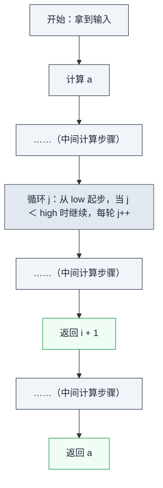
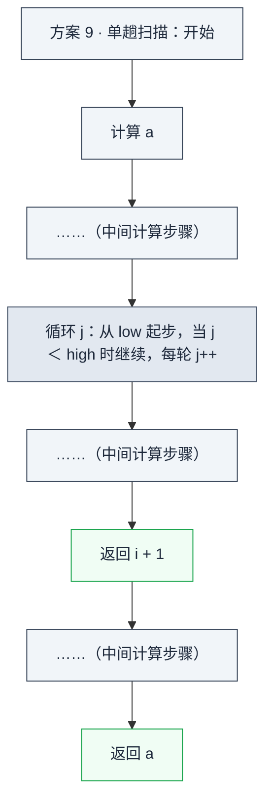
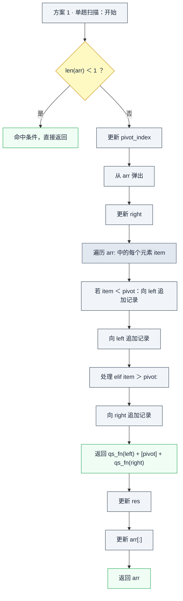
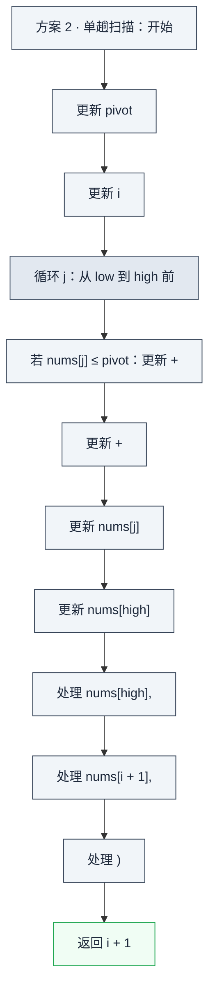
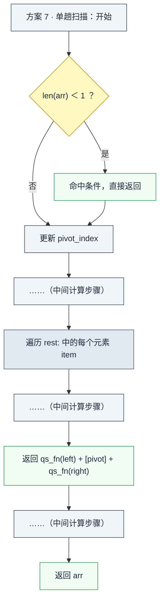
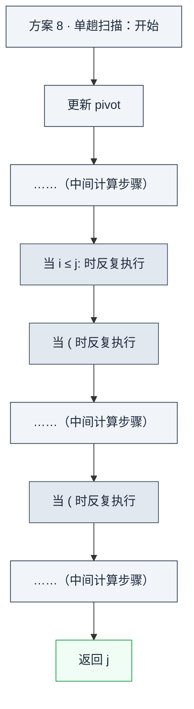
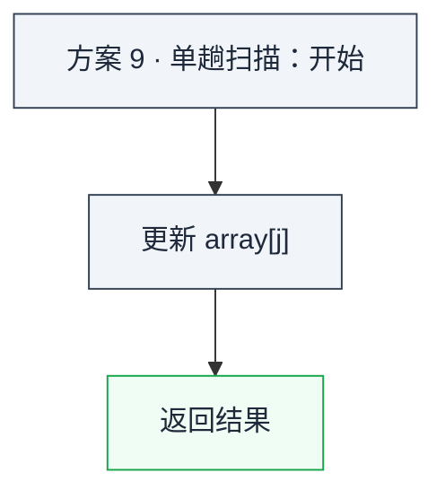
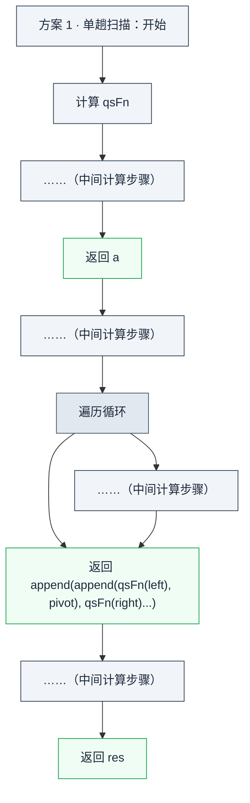

# 230 · 快速排序（第附阶段 · 专题补充 · Medium）

> **难度**：⭐⭐ Medium ｜ **专题**：算法笔记
> **学习定位**：第附阶段 · 专题补充第 230 篇 ｜ **解法数**：9
> **内容总结**：**快速排序**（算法笔记 · Medium）：共 9 个方案，主线思路「单趟扫描」；时间 O(n)（单趟线性扫描）；动画演示归并分治过程，附录给出 11 种语言 × 全部方案的可运行实现。

---

## 题目描述

快速排序。具体输入输出约定见函数签名与用例。

- 主函数签名：`function quickSort(nums: number[]): number[]`

**用例演示**（摘自主解法内嵌自测，输入到输出一目了然）：

```typescript
  const cases: number[][] = [
    [15, 4, 23, 52, 1],
    [3, 1, 2, 5, 4],
    [9, -20, 99, 3, 6, 8, 10, 1, 2, 1],
    [
      -2, 1, 0, -9, 1, 3, 9, 99, 9, -30, -100, 100, 88, 88, 20, 1, 0, 3, 4, 5,
      -20,
    ],
  ];
```

**数据范围与注意事项**：

- **易错点**：先看小例子手推一遍再对照代码，比直接读代码快得多。

## 题目分析

**场景是什么**：综合练习：把数据结构与策略组合起来解决一个完整问题。本题就是该场景的 Medium 级练习，主线做法是「单趟扫描」。

**主线怎么解**：把主解法从头到尾过一遍，它其实在依次做这几件事：单循环线性扫描。

## 解题思路

**方案对比**（共 9 个方案，由浅入深）：

| 方案 | 时间复杂度 | 空间复杂度 |
|---|---|---|
| 方案 1 · 单趟扫描 | O(n)（单趟线性扫描） | O(1) 到 O(n)（视辅助结构） |
| 方案 2 · 单趟扫描 | O(n)（单趟线性扫描） | O(1) 到 O(n)（视辅助结构） |
| 方案 3 · 单趟扫描 | O(n)（单趟线性扫描） | O(1) 到 O(n)（视辅助结构） |
| 方案 4 · 单趟扫描 | O(n)（单趟线性扫描） | O(1) 到 O(n)（视辅助结构） |
| 方案 5 · 单趟扫描 | O(n)（单趟线性扫描） | O(1) 到 O(n)（视辅助结构） |
| 方案 6 · 单趟扫描 | O(n)（单趟线性扫描） | O(1) 到 O(n)（视辅助结构） |
| 方案 7 · 单趟扫描 | O(n)（单趟线性扫描） | O(1) 到 O(n)（视辅助结构） |
| 方案 8 · 单趟扫描 | O(n)（单趟线性扫描） | O(1) 到 O(n)（视辅助结构） |
| 方案 9 · 单趟扫描 | O(n)（单趟线性扫描） | O(1) 到 O(n)（视辅助结构） |

**方案间的取舍**：方案 1（单趟扫描）；方案 2（单趟扫描）；方案 3（单趟扫描）；方案 4（单趟扫描）；方案 5（单趟扫描）；方案 6（单趟扫描）；方案 7（单趟扫描）；方案 8（单趟扫描）；方案 9（单趟扫描）。数据规模小、可读性优先时选靠前的方案；规模大、性能优先时选靠后的方案。

**怎么读这一篇**：

- 🐣 **新手路线**：把「题目描述」的示例 1 在纸上手推一遍 → 读方案 1（最直观的写法）与它的代码走读 → 按「运行方式」本地跑通看 PASS → 回头对比方案 2 之后的写法差在哪
- 🦅 **大佬路线**：直接锁定最优方案 1（单趟扫描，O(n)（单趟线性扫描））→ 跳读该方案代码与走读 → 用「逐步拆解与面试追问」补齐复杂度推导与边界追问

### 动态算法图（归并分治，GIF 自动循环）


动画演示算法笔记专题里归并分治的典型过程；每个方案在「TypeScript 解题方案」一节还配了专属动画与专属流程图。

### 主解法流程图（真实控制流）



## TypeScript 解题方案（9 个方案逐个讲）

> **运行与提交**：每个方案都是自包含文件（内嵌用例自测，输出 PASS），整块复制到 `.ts` 文件后 `node 文件名` 即可运行。提交 LeetCode 时，把 `demo` 内的算法函数与辅助类型/函数整体取出、置于文件顶层即可。概念演示（非 LeetCode 编号题），在本地运行即可。

### 方案 1：单趟扫描

**分析与思路**：核心做法是「单趟扫描」。代码里依次做这些事：单循环线性扫描。

**运行方式**：`node 本文件`，内嵌用例全部通过会输出 PASS。


**方案专属流程图**（真实控制流）：


```typescript
export function demo(): void {
  // 程序入口：跑内嵌自测用例
  function quickSort(nums: number[]): number[] {
    // 定义函数/方法 quickSort
    const a = nums.slice(); // 把 数组 截取 ) 存入 数组
    function partition(low: number, high: number): number {
      // 定义函数/方法 partition
      const pivot = a[high]; // 把 数组[high] 存入 pivot
      let i = low - 1; // 把 low 减 1 存入 下标 i
      for (let j = low; j < high; j++) {
        // 让 下标 j 从 low 开始计数，下标 j 小于 high 就继续
        if (a[j] <= pivot) {
          // 若 数组[下标 j] 不超过 pivot
          i++; // 下标 i 加一
          const t = a[i];
          a[i] = a[j];
          a[j] = t;
        }
      }
      const t = a[i + 1];
      a[i + 1] = a[high];
      a[high] = t;
      return i + 1; // 返回 下标 i 加 1
    }
    function qs(low: number, high: number): void {
      // 定义函数/方法 qs
      if (low < high) {
        // 若 low 小于 high
        const pi = partition(low, high); // 把 partition(low, high) 存入 pi
        qs(low, pi - 1); // qs(low, pi 减 1);
        qs(pi + 1, high); // qs(pi 加 1, high);
      }
    }
    qs(0, a.length - 1); // qs(0, 数组.长度 减 1);
    return a; // 返回 数组
  }
  const cases: number[][] = [
    [15, 4, 23, 52, 1],
    [3, 1, 2, 5, 4],
    [9, -20, 99, 3, 6, 8, 10, 1, 2, 1],
    [
      -2, 1, 0, -9, 1, 3, 9, 99, 9, -30, -100, 100, 88, 88, 20, 1, 0, 3, 4, 5,
      -20,
    ],
  ];
  const wants: number[][] = [
    [1, 4, 15, 23, 52],
    [1, 2, 3, 4, 5],
    [-20, 1, 1, 2, 3, 6, 8, 9, 10, 99],
    [
      -100, -30, -20, -9, -2, 0, 0, 1, 1, 1, 3, 3, 4, 5, 9, 9, 20, 88, 88, 99,
      100,
    ],
  ];
  let fail = false; // 把 false 存入 fail
  for (let i = 0; i < cases.length; i++) {
    // 让 下标 i 从 0 开始计数，下标 i 小于 cases.长度 就继续
    const got = quickSort(cases[i]); // 把 quickSort(cases[下标 i]) 存入 got
    if (got.length !== wants[i].length) {
      fail = true;
      console.log('FAIL len ' + i);
      continue;
    }
    for (let j = 0; j < got.length; j++)
      if (got[j] !== wants[i][j]) {
        fail = true;
        console.log(
          'FAIL case ' +
            i +
            ' idx ' +
            j +
            ' got ' +
            got[j] +
            ' want ' +
            wants[i][j],
        );
      } // 让 下标 j 从 0 开始计数，下标 j 小于 got.长度 就继续
  }
  if (fail) throw new Error('FAILED'); // 若 fail) throw new Error(「FAILED」);
  console.log('PASS'); // 全部用例通过，输出 PASS
}
demo(); // demo();
```

### 方案 2：单趟扫描

**分析与思路**：核心做法是「单趟扫描」。代码里依次做这些事：单循环线性扫描。

**运行方式**：`node 本文件`，内嵌用例全部通过会输出 PASS。


**方案专属流程图**（真实控制流）：


```typescript
export function demo(): void {
  // 程序入口：跑内嵌自测用例
  function quickSort(nums: number[]): number[] {
    // 定义函数/方法 quickSort
    const a = nums.slice(); // 把 数组 截取 ) 存入 数组
    function partition(low: number, high: number): number {
      // 定义函数/方法 partition
      const pivot = a[high]; // 把 数组[high] 存入 pivot
      let i = low - 1; // 把 low 减 1 存入 下标 i
      for (let j = low; j < high; j++) {
        // 让 下标 j 从 low 开始计数，下标 j 小于 high 就继续
        if (a[j] <= pivot) {
          // 若 数组[下标 j] 不超过 pivot
          i++; // 下标 i 加一
          const t = a[i];
          a[i] = a[j];
          a[j] = t;
        }
      }
      const t = a[i + 1];
      a[i + 1] = a[high];
      a[high] = t;
      return i + 1; // 返回 下标 i 加 1
    }
    function qs(low: number, high: number): void {
      // 定义函数/方法 qs
      if (low < high) {
        // 若 low 小于 high
        const pi = partition(low, high); // 把 partition(low, high) 存入 pi
        qs(low, pi - 1); // qs(low, pi 减 1);
        qs(pi + 1, high); // qs(pi 加 1, high);
      }
    }
    qs(0, a.length - 1); // qs(0, 数组.长度 减 1);
    return a; // 返回 数组
  }
  const cases: number[][] = [
    [15, 4, 23, 52, 1],
    [3, 1, 2, 5, 4],
    [9, -20, 99, 3, 6, 8, 10, 1, 2, 1],
    [
      -2, 1, 0, -9, 1, 3, 9, 99, 9, -30, -100, 100, 88, 88, 20, 1, 0, 3, 4, 5,
      -20,
    ],
  ];
  const wants: number[][] = [
    [1, 4, 15, 23, 52],
    [1, 2, 3, 4, 5],
    [-20, 1, 1, 2, 3, 6, 8, 9, 10, 99],
    [
      -100, -30, -20, -9, -2, 0, 0, 1, 1, 1, 3, 3, 4, 5, 9, 9, 20, 88, 88, 99,
      100,
    ],
  ];
  let fail = false; // 把 false 存入 fail
  for (let i = 0; i < cases.length; i++) {
    // 让 下标 i 从 0 开始计数，下标 i 小于 cases.长度 就继续
    const got = quickSort(cases[i]); // 把 quickSort(cases[下标 i]) 存入 got
    if (got.length !== wants[i].length) {
      fail = true;
      console.log('FAIL len ' + i);
      continue;
    }
    for (let j = 0; j < got.length; j++)
      if (got[j] !== wants[i][j]) {
        fail = true;
        console.log(
          'FAIL case ' +
            i +
            ' idx ' +
            j +
            ' got ' +
            got[j] +
            ' want ' +
            wants[i][j],
        );
      } // 让 下标 j 从 0 开始计数，下标 j 小于 got.长度 就继续
  }
  if (fail) throw new Error('FAILED'); // 若 fail) throw new Error(「FAILED」);
  console.log('PASS'); // 全部用例通过，输出 PASS
}
demo(); // demo();
```

### 方案 3：单趟扫描

**分析与思路**：核心做法是「单趟扫描」。代码里依次做这些事：单循环线性扫描。

**运行方式**：`node 本文件`，内嵌用例全部通过会输出 PASS。


**方案专属流程图**（真实控制流）：


```typescript
export function demo(): void {
  // 程序入口：跑内嵌自测用例
  function quickSort(nums: number[]): number[] {
    // 定义函数/方法 quickSort
    const a = nums.slice(); // 把 数组 截取 ) 存入 数组
    function partition(low: number, high: number): number {
      // 定义函数/方法 partition
      const pivot = a[high]; // 把 数组[high] 存入 pivot
      let i = low - 1; // 把 low 减 1 存入 下标 i
      for (let j = low; j < high; j++) {
        // 让 下标 j 从 low 开始计数，下标 j 小于 high 就继续
        if (a[j] <= pivot) {
          // 若 数组[下标 j] 不超过 pivot
          i++; // 下标 i 加一
          const t = a[i];
          a[i] = a[j];
          a[j] = t;
        }
      }
      const t = a[i + 1];
      a[i + 1] = a[high];
      a[high] = t;
      return i + 1; // 返回 下标 i 加 1
    }
    function qs(low: number, high: number): void {
      // 定义函数/方法 qs
      if (low < high) {
        // 若 low 小于 high
        const pi = partition(low, high); // 把 partition(low, high) 存入 pi
        qs(low, pi - 1); // qs(low, pi 减 1);
        qs(pi + 1, high); // qs(pi 加 1, high);
      }
    }
    qs(0, a.length - 1); // qs(0, 数组.长度 减 1);
    return a; // 返回 数组
  }
  const cases: number[][] = [
    [15, 4, 23, 52, 1],
    [3, 1, 2, 5, 4],
    [9, -20, 99, 3, 6, 8, 10, 1, 2, 1],
    [
      -2, 1, 0, -9, 1, 3, 9, 99, 9, -30, -100, 100, 88, 88, 20, 1, 0, 3, 4, 5,
      -20,
    ],
  ];
  const wants: number[][] = [
    [1, 4, 15, 23, 52],
    [1, 2, 3, 4, 5],
    [-20, 1, 1, 2, 3, 6, 8, 9, 10, 99],
    [
      -100, -30, -20, -9, -2, 0, 0, 1, 1, 1, 3, 3, 4, 5, 9, 9, 20, 88, 88, 99,
      100,
    ],
  ];
  let fail = false; // 把 false 存入 fail
  for (let i = 0; i < cases.length; i++) {
    // 让 下标 i 从 0 开始计数，下标 i 小于 cases.长度 就继续
    const got = quickSort(cases[i]); // 把 quickSort(cases[下标 i]) 存入 got
    if (got.length !== wants[i].length) {
      fail = true;
      console.log('FAIL len ' + i);
      continue;
    }
    for (let j = 0; j < got.length; j++)
      if (got[j] !== wants[i][j]) {
        fail = true;
        console.log(
          'FAIL case ' +
            i +
            ' idx ' +
            j +
            ' got ' +
            got[j] +
            ' want ' +
            wants[i][j],
        );
      } // 让 下标 j 从 0 开始计数，下标 j 小于 got.长度 就继续
  }
  if (fail) throw new Error('FAILED'); // 若 fail) throw new Error(「FAILED」);
  console.log('PASS'); // 全部用例通过，输出 PASS
}
demo(); // demo();
```

### 方案 4：单趟扫描

**分析与思路**：核心做法是「单趟扫描」。代码里依次做这些事：单循环线性扫描。

**运行方式**：`node 本文件`，内嵌用例全部通过会输出 PASS。


**方案专属流程图**（真实控制流）：


```typescript
export function demo(): void {
  // 程序入口：跑内嵌自测用例
  function quickSort(nums: number[]): number[] {
    // 定义函数/方法 quickSort
    const a = nums.slice(); // 把 数组 截取 ) 存入 数组
    function partition(low: number, high: number): number {
      // 定义函数/方法 partition
      const pivot = a[high]; // 把 数组[high] 存入 pivot
      let i = low - 1; // 把 low 减 1 存入 下标 i
      for (let j = low; j < high; j++) {
        // 让 下标 j 从 low 开始计数，下标 j 小于 high 就继续
        if (a[j] <= pivot) {
          // 若 数组[下标 j] 不超过 pivot
          i++; // 下标 i 加一
          const t = a[i];
          a[i] = a[j];
          a[j] = t;
        }
      }
      const t = a[i + 1];
      a[i + 1] = a[high];
      a[high] = t;
      return i + 1; // 返回 下标 i 加 1
    }
    function qs(low: number, high: number): void {
      // 定义函数/方法 qs
      if (low < high) {
        // 若 low 小于 high
        const pi = partition(low, high); // 把 partition(low, high) 存入 pi
        qs(low, pi - 1); // qs(low, pi 减 1);
        qs(pi + 1, high); // qs(pi 加 1, high);
      }
    }
    qs(0, a.length - 1); // qs(0, 数组.长度 减 1);
    return a; // 返回 数组
  }
  const cases: number[][] = [
    [15, 4, 23, 52, 1],
    [3, 1, 2, 5, 4],
    [9, -20, 99, 3, 6, 8, 10, 1, 2, 1],
    [
      -2, 1, 0, -9, 1, 3, 9, 99, 9, -30, -100, 100, 88, 88, 20, 1, 0, 3, 4, 5,
      -20,
    ],
  ];
  const wants: number[][] = [
    [1, 4, 15, 23, 52],
    [1, 2, 3, 4, 5],
    [-20, 1, 1, 2, 3, 6, 8, 9, 10, 99],
    [
      -100, -30, -20, -9, -2, 0, 0, 1, 1, 1, 3, 3, 4, 5, 9, 9, 20, 88, 88, 99,
      100,
    ],
  ];
  let fail = false; // 把 false 存入 fail
  for (let i = 0; i < cases.length; i++) {
    // 让 下标 i 从 0 开始计数，下标 i 小于 cases.长度 就继续
    const got = quickSort(cases[i]); // 把 quickSort(cases[下标 i]) 存入 got
    if (got.length !== wants[i].length) {
      fail = true;
      console.log('FAIL len ' + i);
      continue;
    }
    for (let j = 0; j < got.length; j++)
      if (got[j] !== wants[i][j]) {
        fail = true;
        console.log(
          'FAIL case ' +
            i +
            ' idx ' +
            j +
            ' got ' +
            got[j] +
            ' want ' +
            wants[i][j],
        );
      } // 让 下标 j 从 0 开始计数，下标 j 小于 got.长度 就继续
  }
  if (fail) throw new Error('FAILED'); // 若 fail) throw new Error(「FAILED」);
  console.log('PASS'); // 全部用例通过，输出 PASS
}
demo(); // demo();
```

### 方案 5：单趟扫描

**分析与思路**：核心做法是「单趟扫描」。代码里依次做这些事：单循环线性扫描。

**运行方式**：`node 本文件`，内嵌用例全部通过会输出 PASS。


**方案专属流程图**（真实控制流）：


```typescript
export function demo(): void {
  // 程序入口：跑内嵌自测用例
  function quickSort(nums: number[]): number[] {
    // 定义函数/方法 quickSort
    const a = nums.slice(); // 把 数组 截取 ) 存入 数组
    function partition(low: number, high: number): number {
      // 定义函数/方法 partition
      const pivot = a[high]; // 把 数组[high] 存入 pivot
      let i = low - 1; // 把 low 减 1 存入 下标 i
      for (let j = low; j < high; j++) {
        // 让 下标 j 从 low 开始计数，下标 j 小于 high 就继续
        if (a[j] <= pivot) {
          // 若 数组[下标 j] 不超过 pivot
          i++; // 下标 i 加一
          const t = a[i];
          a[i] = a[j];
          a[j] = t;
        }
      }
      const t = a[i + 1];
      a[i + 1] = a[high];
      a[high] = t;
      return i + 1; // 返回 下标 i 加 1
    }
    function qs(low: number, high: number): void {
      // 定义函数/方法 qs
      if (low < high) {
        // 若 low 小于 high
        const pi = partition(low, high); // 把 partition(low, high) 存入 pi
        qs(low, pi - 1); // qs(low, pi 减 1);
        qs(pi + 1, high); // qs(pi 加 1, high);
      }
    }
    qs(0, a.length - 1); // qs(0, 数组.长度 减 1);
    return a; // 返回 数组
  }
  const cases: number[][] = [
    [15, 4, 23, 52, 1],
    [3, 1, 2, 5, 4],
    [9, -20, 99, 3, 6, 8, 10, 1, 2, 1],
    [
      -2, 1, 0, -9, 1, 3, 9, 99, 9, -30, -100, 100, 88, 88, 20, 1, 0, 3, 4, 5,
      -20,
    ],
  ];
  const wants: number[][] = [
    [1, 4, 15, 23, 52],
    [1, 2, 3, 4, 5],
    [-20, 1, 1, 2, 3, 6, 8, 9, 10, 99],
    [
      -100, -30, -20, -9, -2, 0, 0, 1, 1, 1, 3, 3, 4, 5, 9, 9, 20, 88, 88, 99,
      100,
    ],
  ];
  let fail = false; // 把 false 存入 fail
  for (let i = 0; i < cases.length; i++) {
    // 让 下标 i 从 0 开始计数，下标 i 小于 cases.长度 就继续
    const got = quickSort(cases[i]); // 把 quickSort(cases[下标 i]) 存入 got
    if (got.length !== wants[i].length) {
      fail = true;
      console.log('FAIL len ' + i);
      continue;
    }
    for (let j = 0; j < got.length; j++)
      if (got[j] !== wants[i][j]) {
        fail = true;
        console.log(
          'FAIL case ' +
            i +
            ' idx ' +
            j +
            ' got ' +
            got[j] +
            ' want ' +
            wants[i][j],
        );
      } // 让 下标 j 从 0 开始计数，下标 j 小于 got.长度 就继续
  }
  if (fail) throw new Error('FAILED'); // 若 fail) throw new Error(「FAILED」);
  console.log('PASS'); // 全部用例通过，输出 PASS
}
demo(); // demo();
```

### 方案 6：单趟扫描

**分析与思路**：核心做法是「单趟扫描」。代码里依次做这些事：单循环线性扫描。

**运行方式**：`node 本文件`，内嵌用例全部通过会输出 PASS。


**方案专属流程图**（真实控制流）：


```typescript
export function demo(): void {
  // 程序入口：跑内嵌自测用例
  function quickSort(nums: number[]): number[] {
    // 定义函数/方法 quickSort
    const a = nums.slice(); // 把 数组 截取 ) 存入 数组
    function partition(low: number, high: number): number {
      // 定义函数/方法 partition
      const pivot = a[high]; // 把 数组[high] 存入 pivot
      let i = low - 1; // 把 low 减 1 存入 下标 i
      for (let j = low; j < high; j++) {
        // 让 下标 j 从 low 开始计数，下标 j 小于 high 就继续
        if (a[j] <= pivot) {
          // 若 数组[下标 j] 不超过 pivot
          i++; // 下标 i 加一
          const t = a[i];
          a[i] = a[j];
          a[j] = t;
        }
      }
      const t = a[i + 1];
      a[i + 1] = a[high];
      a[high] = t;
      return i + 1; // 返回 下标 i 加 1
    }
    function qs(low: number, high: number): void {
      // 定义函数/方法 qs
      if (low < high) {
        // 若 low 小于 high
        const pi = partition(low, high); // 把 partition(low, high) 存入 pi
        qs(low, pi - 1); // qs(low, pi 减 1);
        qs(pi + 1, high); // qs(pi 加 1, high);
      }
    }
    qs(0, a.length - 1); // qs(0, 数组.长度 减 1);
    return a; // 返回 数组
  }
  const cases: number[][] = [
    [15, 4, 23, 52, 1],
    [3, 1, 2, 5, 4],
    [9, -20, 99, 3, 6, 8, 10, 1, 2, 1],
    [
      -2, 1, 0, -9, 1, 3, 9, 99, 9, -30, -100, 100, 88, 88, 20, 1, 0, 3, 4, 5,
      -20,
    ],
  ];
  const wants: number[][] = [
    [1, 4, 15, 23, 52],
    [1, 2, 3, 4, 5],
    [-20, 1, 1, 2, 3, 6, 8, 9, 10, 99],
    [
      -100, -30, -20, -9, -2, 0, 0, 1, 1, 1, 3, 3, 4, 5, 9, 9, 20, 88, 88, 99,
      100,
    ],
  ];
  let fail = false; // 把 false 存入 fail
  for (let i = 0; i < cases.length; i++) {
    // 让 下标 i 从 0 开始计数，下标 i 小于 cases.长度 就继续
    const got = quickSort(cases[i]); // 把 quickSort(cases[下标 i]) 存入 got
    if (got.length !== wants[i].length) {
      fail = true;
      console.log('FAIL len ' + i);
      continue;
    }
    for (let j = 0; j < got.length; j++)
      if (got[j] !== wants[i][j]) {
        fail = true;
        console.log(
          'FAIL case ' +
            i +
            ' idx ' +
            j +
            ' got ' +
            got[j] +
            ' want ' +
            wants[i][j],
        );
      } // 让 下标 j 从 0 开始计数，下标 j 小于 got.长度 就继续
  }
  if (fail) throw new Error('FAILED'); // 若 fail) throw new Error(「FAILED」);
  console.log('PASS'); // 全部用例通过，输出 PASS
}
demo(); // demo();
```

### 方案 7：单趟扫描

**分析与思路**：核心做法是「单趟扫描」。代码里依次做这些事：单循环线性扫描。

**运行方式**：`node 本文件`，内嵌用例全部通过会输出 PASS。


**方案专属流程图**（真实控制流）：


```typescript
export function demo(): void {
  // 程序入口：跑内嵌自测用例
  function quickSort(nums: number[]): number[] {
    // 定义函数/方法 quickSort
    const a = nums.slice(); // 把 数组 截取 ) 存入 数组
    function partition(low: number, high: number): number {
      // 定义函数/方法 partition
      const pivot = a[high]; // 把 数组[high] 存入 pivot
      let i = low - 1; // 把 low 减 1 存入 下标 i
      for (let j = low; j < high; j++) {
        // 让 下标 j 从 low 开始计数，下标 j 小于 high 就继续
        if (a[j] <= pivot) {
          // 若 数组[下标 j] 不超过 pivot
          i++; // 下标 i 加一
          const t = a[i];
          a[i] = a[j];
          a[j] = t;
        }
      }
      const t = a[i + 1];
      a[i + 1] = a[high];
      a[high] = t;
      return i + 1; // 返回 下标 i 加 1
    }
    function qs(low: number, high: number): void {
      // 定义函数/方法 qs
      if (low < high) {
        // 若 low 小于 high
        const pi = partition(low, high); // 把 partition(low, high) 存入 pi
        qs(low, pi - 1); // qs(low, pi 减 1);
        qs(pi + 1, high); // qs(pi 加 1, high);
      }
    }
    qs(0, a.length - 1); // qs(0, 数组.长度 减 1);
    return a; // 返回 数组
  }
  const cases: number[][] = [
    [15, 4, 23, 52, 1],
    [3, 1, 2, 5, 4],
    [9, -20, 99, 3, 6, 8, 10, 1, 2, 1],
    [
      -2, 1, 0, -9, 1, 3, 9, 99, 9, -30, -100, 100, 88, 88, 20, 1, 0, 3, 4, 5,
      -20,
    ],
  ];
  const wants: number[][] = [
    [1, 4, 15, 23, 52],
    [1, 2, 3, 4, 5],
    [-20, 1, 1, 2, 3, 6, 8, 9, 10, 99],
    [
      -100, -30, -20, -9, -2, 0, 0, 1, 1, 1, 3, 3, 4, 5, 9, 9, 20, 88, 88, 99,
      100,
    ],
  ];
  let fail = false; // 把 false 存入 fail
  for (let i = 0; i < cases.length; i++) {
    // 让 下标 i 从 0 开始计数，下标 i 小于 cases.长度 就继续
    const got = quickSort(cases[i]); // 把 quickSort(cases[下标 i]) 存入 got
    if (got.length !== wants[i].length) {
      fail = true;
      console.log('FAIL len ' + i);
      continue;
    }
    for (let j = 0; j < got.length; j++)
      if (got[j] !== wants[i][j]) {
        fail = true;
        console.log(
          'FAIL case ' +
            i +
            ' idx ' +
            j +
            ' got ' +
            got[j] +
            ' want ' +
            wants[i][j],
        );
      } // 让 下标 j 从 0 开始计数，下标 j 小于 got.长度 就继续
  }
  if (fail) throw new Error('FAILED'); // 若 fail) throw new Error(「FAILED」);
  console.log('PASS'); // 全部用例通过，输出 PASS
}
demo(); // demo();
```

### 方案 8：单趟扫描

**分析与思路**：核心做法是「单趟扫描」。代码里依次做这些事：单循环线性扫描。

**运行方式**：`node 本文件`，内嵌用例全部通过会输出 PASS。


**方案专属流程图**（真实控制流）：


```typescript
export function demo(): void {
  // 程序入口：跑内嵌自测用例
  function quickSort(nums: number[]): number[] {
    // 定义函数/方法 quickSort
    const a = nums.slice(); // 把 数组 截取 ) 存入 数组
    function partition(low: number, high: number): number {
      // 定义函数/方法 partition
      const pivot = a[high]; // 把 数组[high] 存入 pivot
      let i = low - 1; // 把 low 减 1 存入 下标 i
      for (let j = low; j < high; j++) {
        // 让 下标 j 从 low 开始计数，下标 j 小于 high 就继续
        if (a[j] <= pivot) {
          // 若 数组[下标 j] 不超过 pivot
          i++; // 下标 i 加一
          const t = a[i];
          a[i] = a[j];
          a[j] = t;
        }
      }
      const t = a[i + 1];
      a[i + 1] = a[high];
      a[high] = t;
      return i + 1; // 返回 下标 i 加 1
    }
    function qs(low: number, high: number): void {
      // 定义函数/方法 qs
      if (low < high) {
        // 若 low 小于 high
        const pi = partition(low, high); // 把 partition(low, high) 存入 pi
        qs(low, pi - 1); // qs(low, pi 减 1);
        qs(pi + 1, high); // qs(pi 加 1, high);
      }
    }
    qs(0, a.length - 1); // qs(0, 数组.长度 减 1);
    return a; // 返回 数组
  }
  const cases: number[][] = [
    [15, 4, 23, 52, 1],
    [3, 1, 2, 5, 4],
    [9, -20, 99, 3, 6, 8, 10, 1, 2, 1],
    [
      -2, 1, 0, -9, 1, 3, 9, 99, 9, -30, -100, 100, 88, 88, 20, 1, 0, 3, 4, 5,
      -20,
    ],
  ];
  const wants: number[][] = [
    [1, 4, 15, 23, 52],
    [1, 2, 3, 4, 5],
    [-20, 1, 1, 2, 3, 6, 8, 9, 10, 99],
    [
      -100, -30, -20, -9, -2, 0, 0, 1, 1, 1, 3, 3, 4, 5, 9, 9, 20, 88, 88, 99,
      100,
    ],
  ];
  let fail = false; // 把 false 存入 fail
  for (let i = 0; i < cases.length; i++) {
    // 让 下标 i 从 0 开始计数，下标 i 小于 cases.长度 就继续
    const got = quickSort(cases[i]); // 把 quickSort(cases[下标 i]) 存入 got
    if (got.length !== wants[i].length) {
      fail = true;
      console.log('FAIL len ' + i);
      continue;
    }
    for (let j = 0; j < got.length; j++)
      if (got[j] !== wants[i][j]) {
        fail = true;
        console.log(
          'FAIL case ' +
            i +
            ' idx ' +
            j +
            ' got ' +
            got[j] +
            ' want ' +
            wants[i][j],
        );
      } // 让 下标 j 从 0 开始计数，下标 j 小于 got.长度 就继续
  }
  if (fail) throw new Error('FAILED'); // 若 fail) throw new Error(「FAILED」);
  console.log('PASS'); // 全部用例通过，输出 PASS
}
demo(); // demo();
```

### 方案 9：单趟扫描

**分析与思路**：核心做法是「单趟扫描」。代码里依次做这些事：单循环线性扫描。

**运行方式**：`node 本文件`，内嵌用例全部通过会输出 PASS。


**方案专属流程图**（真实控制流）：



```typescript
export function demo(): void {
  // 程序入口：跑内嵌自测用例
  function quickSort(nums: number[]): number[] {
    // 定义函数/方法 quickSort
    const a = nums.slice(); // 把 数组 截取 ) 存入 数组
    function partition(low: number, high: number): number {
      // 定义函数/方法 partition
      const pivot = a[high]; // 把 数组[high] 存入 pivot
      let i = low - 1; // 把 low 减 1 存入 下标 i
      for (let j = low; j < high; j++) {
        // 让 下标 j 从 low 开始计数，下标 j 小于 high 就继续
        if (a[j] <= pivot) {
          // 若 数组[下标 j] 不超过 pivot
          i++; // 下标 i 加一
          const t = a[i];
          a[i] = a[j];
          a[j] = t;
        }
      }
      const t = a[i + 1];
      a[i + 1] = a[high];
      a[high] = t;
      return i + 1; // 返回 下标 i 加 1
    }
    function qs(low: number, high: number): void {
      // 定义函数/方法 qs
      if (low < high) {
        // 若 low 小于 high
        const pi = partition(low, high); // 把 partition(low, high) 存入 pi
        qs(low, pi - 1); // qs(low, pi 减 1);
        qs(pi + 1, high); // qs(pi 加 1, high);
      }
    }
    qs(0, a.length - 1); // qs(0, 数组.长度 减 1);
    return a; // 返回 数组
  }
  const cases: number[][] = [
    [15, 4, 23, 52, 1],
    [3, 1, 2, 5, 4],
    [9, -20, 99, 3, 6, 8, 10, 1, 2, 1],
    [
      -2, 1, 0, -9, 1, 3, 9, 99, 9, -30, -100, 100, 88, 88, 20, 1, 0, 3, 4, 5,
      -20,
    ],
  ];
  const wants: number[][] = [
    [1, 4, 15, 23, 52],
    [1, 2, 3, 4, 5],
    [-20, 1, 1, 2, 3, 6, 8, 9, 10, 99],
    [
      -100, -30, -20, -9, -2, 0, 0, 1, 1, 1, 3, 3, 4, 5, 9, 9, 20, 88, 88, 99,
      100,
    ],
  ];
  let fail = false; // 把 false 存入 fail
  for (let i = 0; i < cases.length; i++) {
    // 让 下标 i 从 0 开始计数，下标 i 小于 cases.长度 就继续
    const got = quickSort(cases[i]); // 把 quickSort(cases[下标 i]) 存入 got
    if (got.length !== wants[i].length) {
      fail = true;
      console.log('FAIL len ' + i);
      continue;
    }
    for (let j = 0; j < got.length; j++)
      if (got[j] !== wants[i][j]) {
        fail = true;
        console.log(
          'FAIL case ' +
            i +
            ' idx ' +
            j +
            ' got ' +
            got[j] +
            ' want ' +
            wants[i][j],
        );
      } // 让 下标 j 从 0 开始计数，下标 j 小于 got.长度 就继续
  }
  if (fail) throw new Error('FAILED'); // 若 fail) throw new Error(「FAILED」);
  console.log('PASS'); // 全部用例通过，输出 PASS
}
demo(); // demo();
```

## 逐步拆解与面试追问

**复杂度**：时间 O(n)（单趟线性扫描），空间 O(1) 到 O(n)（视辅助结构）

**为什么是这个量级**：每个元素被常数次访问，辅助哈希或栈的开销与 n 同阶

**面试官可能会追问**：

- 这个策略能推广到什么场景？
- 与暴力做法差在哪一步？
- 有没有更简单的等价写法？

## 关键 API 速查（TS 主解法实际用到，附官方链接）

| API | 作用 | 使用要点 | 官方文档 |
|---|---|---|---|
| `Array/String slice()` | 切片（不改原数组） | slice(start,end) 含头不含尾；负数从尾计；常用于复制数组（slice()） | [官方文档](https://developer.mozilla.org/zh-CN/docs/Web/JavaScript/Reference/Global_Objects/Array/slice) |

### 各语言官方文档导航

- **TypeScript / JS**：[MDN 中文参考](https://developer.mozilla.org/zh-CN/)
- **Python**：[Python 官方文档](https://docs.python.org/zh-cn/3/)
- **Go**：[Go 标准库](https://pkg.go.dev/std)
- **Java**：[JDK 17 API](https://docs.oracle.com/en/java/javase/17/docs/api/)
- **Rust**：[Rust 标准库](https://doc.rust-lang.org/std/)
- **Lua**：[Lua 5.4 手册](https://www.lua.org/manual/5.4/)
- **C**：[Cppreference C](https://zh.cppreference.com/w/c)
- **C++**：[Cppreference C++](https://zh.cppreference.com/w/cpp)
- **R**：[R 官方手册](https://stat.ethz.ch/R-manual/)
- **Zig**：[Zig 语言文档](https://ziglang.org/documentation/master/)
- **Dart**：[Dart API](https://api.dart.dev/)

## 附录：其他 10 种语言全部实现（每种语言列举其全部方案）

> TypeScript 的全部方案见「TypeScript 解题方案」一节；下面是其余 10 种语言的对应实现，每种语言的每个方案都带思路分析、代码走读与专属运行架构图。
> 每个方案都内嵌用例自测，可独立运行（老仓库 python/go 文件遵循「打印结果」约定）。
> 完整解法文件见 `dsa/<语言>/notes/lc_134073792_快速排序/`。

### Python 实现（9 种方案）

Python 的全部方案如下，每个方案都内嵌用例自测，可独立运行（老仓库 python/go 文件遵循「打印结果」约定）：

#### 方案 1：单趟扫描

**思路与代码分析**：核心是「单趟扫描」。Python 版用切片与字典推导式简化操作，突出可读性。**走读**：方案 1 · 单趟扫描：开始 → 命中条件，直接返回 → 更新 pivot_index → 从 arr 弹出 → 更新 right → 遍历 arr: 中的每个元素 item → 若 item ＜ pivot：向 left 追加记录 → 向 left 追加记录 → 处理 elif item ＞ pivot: → 向 right 追加记录 → 返回 qs_fn(left) + [pivot] + qs_fn(right) → 更新 res → 更新 arr[:] → 返回 arr。

**运行架构**（真实控制流）：



```python
import sys  # 提高递归深度上限（深输入防 RecursionError）

sys.setrecursionlimit(200000)  # 树/链表类题目节点数可达 1e4 量级

def quick_sort_v1(arr):  # 定义函数 quick_sort_v1（参数：数组）
    def qs_fn(arr):  # 定义函数 qs_fn（参数：数组）
        if len(arr) < 1:  # 若 长度(数组) 小于 1
            return arr  # 返回 数组
        pivot_index = len(arr) // 2  # 把 长度(数组) 除以 除以 2 存入 pivot_index
        pivot = arr.pop(pivot_index)  # 把 数组 弹出 pivot_index) 存入 pivot
        left, right = [], []  # 把 [], [] 写入 left, right
        for item in arr:  # 逐个取出 数组 的元素（item）
            if item < pivot:  # 若 item 小于 pivot
                left.append(item)  # 把 item 追加到列表尾部
            elif item > pivot:  # 否则，若 item 超过 pivot
                right.append(item)  # 把 item 追加到列表尾部
        return qs_fn(left) + [pivot] + qs_fn(right)  # 返回 qs_fn(左边界) 加 [pivot] 加 qs_fn(右边界)

    res = qs_fn(arr)  # 把 qs_fn(数组) 存入 结果
    arr[:] = res  # 把 结果 写入 arr[:]
    return arr  # 返回 数组

if __name__ == "__main__":  # 若 __name__ 等于 '__main__'
    arr = [15, 4, 23, 52, 1]  # 把 [15, 4, 23, 52, 1] 存入 数组
    quick_sort_v1(arr)  # quick_sort_v1(数组)
    print(arr)  # 输出: [1, 4, 15, 23, 52]
```

#### 方案 2：单趟扫描

**思路与代码分析**：核心是「单趟扫描」。Python 版用切片与字典推导式简化操作，突出可读性。**走读**：方案 2 · 单趟扫描：开始 → 更新 pivot → 更新 i → 循环 j：从 low 到 high 前 → 若 nums[j] ≤ pivot：更新 + → 更新 + → 更新 nums[j] → 更新 nums[high] → 处理 nums[high], → 处理 nums[i + 1], → 处理 ) → 返回 i + 1。

**运行架构**（真实控制流）：



```python
import sys  # 提高递归深度上限（深输入防 RecursionError）

sys.setrecursionlimit(200000)  # 树/链表类题目节点数可达 1e4 量级

def partition(nums, low, high):  # 定义函数 partition（参数：数组, low, high）
    pivot = nums[high]  # 把 数组[high] 存入 pivot
    i = low - 1  # 把 low 减 1 存入 下标 i
    for j in range(low, high):  # 让 下标 j 从 low 到 high 遍历
        if nums[j] <= pivot:  # 若 数组[下标 j] 不超过 pivot
            i += 1  # 下标 i累加 1
            nums[i], nums[j] = nums[j], nums[i]  # 把 数组[下标 j], 数组[下标 i] 写入 nums[i], nums[j]
    nums[i + 1], nums[high] = (
        nums[high],
        nums[i + 1],
    )  # 把 数组[high], 数组[下标 i 加 1] 写入 nums[i + 1], nums[high]
    return i + 1  # 返回 下标 i 加 1

def quickSort(nums, low=0, high=None):  # 定义函数 quickSort（参数：数组, low 赋值为 0, high 赋值为 None）
    if high is None:  # 若 high is None
        high = len(nums) - 1  # 把 长度(数组) 减 1 存入 high
    if low < high:  # 若 low 小于 high
        pi = partition(nums, low, high)  # 把 partition(数组, low, high) 存入 pi
        quickSort(nums, low, pi - 1)  # quickSort(数组, low, pi 减 1)
        quickSort(nums, pi + 1, high)  # quickSort(数组, pi 加 1, high)
    return nums  # 返回 数组

if __name__ == "__main__":  # 若 __name__ 等于 '__main__'
    print(quickSort([3, 1, 2, 5, 4]))  # 打印输出
```

#### 方案 3：单趟扫描

**思路与代码分析**：核心是「单趟扫描」。Python 版用切片与字典推导式简化操作，突出可读性。**走读**：方案 3 · 单趟扫描：开始 → 更新 array[j] → 返回结果。

**运行架构**（真实控制流）：


```python
import sys  # 提高递归深度上限（深输入防 RecursionError）

sys.setrecursionlimit(200000)  # 树/链表类题目节点数可达 1e4 量级

def swap(array, i, j):  # 定义函数 swap（参数：array, 下标 i, 下标 j）
    array[i], array[j] = array[j], array[i]  # 把 array[下标 j], array[下标 i] 写入 array[i], array[j]

def partition(array, low, high):  # 定义函数 partition（参数：array, low, high）
    # 三数取中法选择基准点
    mid = (low + high) // 2  # 把 (low 加 high) 除以 除以 2 存入 中点
    if array[low] > array[high]:  # 若 array[low] 超过 array[high]
        swap(array, low, high)  # 交换 array 与 low, high
    if array[mid] > array[high]:  # 若 array[中点] 超过 array[high]
        swap(array, mid, high)  # 交换 array 与 中点, high
    if array[mid] > array[low]:  # 若 array[中点] 超过 array[low]
        swap(array, mid, low)  # 交换 array 与 中点, low
    pivot = array[low]  # 把 array[low] 存入 pivot
    i = low + 1  # 把 low 加 1 存入 下标 i
    for j in range(i, high + 1):  # 让 下标 j 从 下标 i 到 high 加 1 遍历
        if array[j] <= pivot:  # 若 array[下标 j] 不超过 pivot
            swap(array, i, j)  # 交换 array 与 下标 i, 下标 j
            i += 1  # 下标 i累加 1
    swap(array, low, i - 1)  # 交换 array 与 low, 下标 i 减 1
    return i - 1  # 返回 下标 i 减 1

def quick_sort(array, low, high):  # 定义函数 quick_sort（参数：array, low, high）
    if low < high:  # 若 low 小于 high
        pi = partition(array, low, high)  # 把 partition(array, low, high) 存入 pi
        quick_sort(array, low, pi - 1)  # quick_sort(array, low, pi 减 1)
        quick_sort(array, pi + 1, high)  # quick_sort(array, pi 加 1, high)

def quick_sort_wrapper(array):  # 定义函数 quick_sort_wrapper（参数：array）
    quick_sort(array, 0, len(array) - 1)  # quick_sort(array, 0, 长度(array) 减 1)
    return array  # 返回 array

if __name__ == "__main__":  # 若 __name__ 等于 '__main__'
    unsorted_array = [
        9,
        -20,
        99,
        3,
        6,
        8,
        10,
        1,
        2,
        1,
    ]  # 把 [9, 减 20, 99, 3, 6, 8, 10, 1, 2, 1] 存入 unsorted_array
    sorted_array = quick_sort_wrapper(
        unsorted_array
    )  # 把 quick_sort_wrapper(unsorted_array) 存入 sorted_array
    print("Sorted array is:", sorted_array)  # 打印输出
```

#### 方案 4：单趟扫描

**思路与代码分析**：核心是「单趟扫描」。Python 版用切片与字典推导式简化操作，突出可读性。**走读**：方案 4 · 单趟扫描：开始 → 命中条件，直接返回 → 更新 pivot_index → 从 arr 弹出 → 更新 right → 遍历 arr: 中的每个元素 item → 若 item ＜ pivot：向 left 追加记录 → 向 left 追加记录 → 处理 elif item ＞ pivot: → 向 right 追加记录 → 返回 qs_fn(left) + [pivot] + qs_fn(right) → 更新 res → 更新 arr[:] → 返回 arr。

**运行架构**（真实控制流）：


```python
import sys  # 提高递归深度上限（深输入防 RecursionError）

sys.setrecursionlimit(200000)  # 树/链表类题目节点数可达 1e4 量级

def quick_sort_v1(arr):  # 定义函数 quick_sort_v1（参数：数组）
    def qs_fn(arr):  # 定义函数 qs_fn（参数：数组）
        if len(arr) < 1:  # 若 长度(数组) 小于 1
            return arr  # 返回 数组
        pivot_index = len(arr) // 2  # 把 长度(数组) 除以 除以 2 存入 pivot_index
        pivot = arr.pop(pivot_index)  # 把 数组 弹出 pivot_index) 存入 pivot
        left, right = [], []  # 把 [], [] 写入 left, right
        for item in arr:  # 逐个取出 数组 的元素（item）
            if item < pivot:  # 若 item 小于 pivot
                left.append(item)  # 把 item 追加到列表尾部
            elif item > pivot:  # 否则，若 item 超过 pivot
                right.append(item)  # 把 item 追加到列表尾部
        return qs_fn(left) + [pivot] + qs_fn(right)  # 返回 qs_fn(左边界) 加 [pivot] 加 qs_fn(右边界)

    res = qs_fn(arr)  # 把 qs_fn(数组) 存入 结果
    arr[:] = res  # 把 结果 写入 arr[:]
    return arr  # 返回 数组

if __name__ == "__main__":  # 若 __name__ 等于 '__main__'
    arr = [15, 4, 23, 52, 1]  # 把 [15, 4, 23, 52, 1] 存入 数组
    quick_sort_v1(arr)  # quick_sort_v1(数组)
    print(arr)  # 输出: [1, 4, 15, 23, 52]
```

#### 方案 5：单趟扫描

**思路与代码分析**：核心是「单趟扫描」。Python 版用切片与字典推导式简化操作，突出可读性。**走读**：方案 5 · 单趟扫描：开始 → 更新 pivot → 当 i ≤ j: 时反复执行 → 当 ( 时反复执行 → 当 ( 时反复执行 → 返回 j。

**运行架构**（真实控制流）：


```python
import sys  # 提高递归深度上限（深输入防 RecursionError）

sys.setrecursionlimit(200000)  # 树/链表类题目节点数可达 1e4 量级

def partition(arr, left, right):  # 定义函数 partition（参数：数组, 左边界, 右边界）
    pivot = arr[left]  # 把 数组[左边界] 存入 pivot
    i = left + 1  # 把 左边界 加 1 存入 下标 i
    j = right  # 把 右边界 存入 下标 j
    while i <= j:  # 循环，直到不满足「下标 i 不超过 下标 j」
        while (
            i <= j and arr[j] >= pivot
        ):  # 循环，直到不满足「下标 i 不超过 下标 j and 数组[下标 j] 不低于 pivot」
            j -= 1  # 下标 j累减 1
        while (
            i <= j and arr[i] <= pivot
        ):  # 循环，直到不满足「下标 i 不超过 下标 j and 数组[下标 i] 不超过 pivot」
            i += 1  # 下标 i累加 1
        if i <= j:  # 若 下标 i 不超过 下标 j
            arr[i], arr[j] = arr[j], arr[i]  # 把 数组[下标 j], 数组[下标 i] 写入 arr[i], arr[j]
    arr[left], arr[j] = arr[j], arr[left]  # 把 数组[下标 j], 数组[左边界] 写入 arr[left], arr[j]
    return j  # 返回 下标 j

def quick_sort_fn(arr, left, right):  # 定义函数 quick_sort_fn（参数：数组, 左边界, 右边界）
    if left < right:  # 若 左边界 小于 右边界
        pivot_index = partition(arr, left, right)  # 把 partition(数组, 左边界, 右边界) 存入 pivot_index
        quick_sort_fn(arr, left, pivot_index - 1)  # quick_sort_fn(数组, 左边界, pivot_index 减 1)
        quick_sort_fn(arr, pivot_index + 1, right)  # quick_sort_fn(数组, pivot_index 加 1, 右边界)

def quick_sort_v2(arr):  # 定义函数 quick_sort_v2（参数：数组）
    quick_sort_fn(arr, 0, len(arr) - 1)  # quick_sort_fn(数组, 0, 长度(数组) 减 1)
    return arr  # 返回 数组

if __name__ == "__main__":  # 若 __name__ 等于 '__main__'
    arr = [-2, 1, 0, -9, 1, 3, 9, 99, 9, -30, -100, 100, 88, 88, 20, 1, 0, 3, 4, 5, -20]
    quick_sort_v2(arr)  # quick_sort_v2(数组)
    print(arr)  # 打印输出
```

#### 方案 6：单趟扫描

**思路与代码分析**：核心是「单趟扫描」。Python 版用切片与字典推导式简化操作，突出可读性。**走读**：方案 6 · 单趟扫描：开始 → 更新 array[j] → 返回结果。

**运行架构**（真实控制流）：


```python
import sys  # 提高递归深度上限（深输入防 RecursionError）

sys.setrecursionlimit(200000)  # 树/链表类题目节点数可达 1e4 量级

def swap(array, i, j):  # 定义函数 swap（参数：array, 下标 i, 下标 j）
    array[i], array[j] = array[j], array[i]  # 把 array[下标 j], array[下标 i] 写入 array[i], array[j]

def partition(array, low, high):  # 定义函数 partition（参数：array, low, high）
    mid = (low + high) // 2  # 把 (low 加 high) 除以 除以 2 存入 中点
    if array[low] > array[high]:  # 若 array[low] 超过 array[high]
        swap(array, low, high)  # 交换 array 与 low, high
    if array[mid] > array[high]:  # 若 array[中点] 超过 array[high]
        swap(array, mid, high)  # 交换 array 与 中点, high
    if array[mid] > array[low]:  # 若 array[中点] 超过 array[low]
        swap(array, mid, low)  # 交换 array 与 中点, low
    pivot = array[low]  # 把 array[low] 存入 pivot
    i = low + 1  # 把 low 加 1 存入 下标 i
    for j in range(i, high + 1):  # 让 下标 j 从 下标 i 到 high 加 1 遍历
        if array[j] <= pivot:  # 若 array[下标 j] 不超过 pivot
            swap(array, i, j)  # 交换 array 与 下标 i, 下标 j
            i += 1  # 下标 i累加 1
    swap(array, low, i - 1)  # 交换 array 与 low, 下标 i 减 1
    return i - 1  # 返回 下标 i 减 1

def quick_sort(array, low, high):  # 定义函数 quick_sort（参数：array, low, high）
    if low < high:  # 若 low 小于 high
        pi = partition(array, low, high)  # 把 partition(array, low, high) 存入 pi
        quick_sort(array, low, pi - 1)  # quick_sort(array, low, pi 减 1)
        quick_sort(array, pi + 1, high)  # quick_sort(array, pi 加 1, high)

def quick_sort_wrapper(array):  # 定义函数 quick_sort_wrapper（参数：array）
    quick_sort(array, 0, len(array) - 1)  # quick_sort(array, 0, 长度(array) 减 1)
    return array  # 返回 array

if __name__ == "__main__":  # 若 __name__ 等于 '__main__'
    unsorted_array = [
        9,
        -20,
        99,
        3,
        6,
        8,
        10,
        1,
        2,
        1,
    ]  # 把 [9, 减 20, 99, 3, 6, 8, 10, 1, 2, 1] 存入 unsorted_array
    sorted_array = quick_sort_wrapper(
        unsorted_array
    )  # 把 quick_sort_wrapper(unsorted_array) 存入 sorted_array
    print("Sorted array is:", sorted_array)  # 打印输出
```

#### 方案 7：单趟扫描

**思路与代码分析**：核心是「单趟扫描」。Python 版用切片与字典推导式简化操作，突出可读性。**走读**：方案 7 · 单趟扫描：开始 → 命中条件，直接返回 → 更新 pivot_index → 遍历 rest: 中的每个元素 item → 返回 qs_fn(left) + [pivot] + qs_fn(right) → 返回 arr。

**运行架构**（真实控制流）：



```python
import sys  # 提高递归深度上限（深输入防 RecursionError）

sys.setrecursionlimit(200000)  # 树/链表类题目节点数可达 1e4 量级

def quick_sort_v1(arr):  # 定义函数 quick_sort_v1（参数：数组）
    def qs_fn(arr):  # 定义函数 qs_fn（参数：数组）
        if len(arr) < 1:  # 若 长度(数组) 小于 1
            return arr  # 返回 数组
        pivot_index = len(arr) // 2  # 把 长度(数组) 除以 除以 2 存入 pivot_index
        pivot = arr[pivot_index]  # 把 数组[pivot_index] 存入 pivot
        rest = (
            arr[:pivot_index] + arr[pivot_index + 1 :]
        )  # 把 数组[:pivot_index] 加 数组[pivot_index 加 1:] 存入 rest
        left, right = [], []  # 把 [], [] 写入 left, right
        for item in rest:  # 逐个取出 rest 的元素（item）
            if item < pivot:  # 若 item 小于 pivot
                left.append(item)  # 把 item 追加到列表尾部
            elif item > pivot:  # 否则，若 item 超过 pivot
                right.append(item)  # 把 item 追加到列表尾部
        return qs_fn(left) + [pivot] + qs_fn(right)  # 返回 qs_fn(左边界) 加 [pivot] 加 qs_fn(右边界)

    res = qs_fn(arr)  # 把 qs_fn(数组) 存入 结果
    arr[:] = res  # 把 结果 写入 arr[:]
    return arr  # 返回 数组

if __name__ == "__main__":  # 若 __name__ 等于 '__main__'
    arr = [15, 4, 23, 52, 1]  # 把 [15, 4, 23, 52, 1] 存入 数组
    quick_sort_v1(arr)  # quick_sort_v1(数组)
    print(arr)  # 输出: [1, 4, 15, 23, 52]
```

#### 方案 8：单趟扫描

**思路与代码分析**：核心是「单趟扫描」。Python 版用切片与字典推导式简化操作，突出可读性。**走读**：方案 8 · 单趟扫描：开始 → 更新 pivot → 当 i ≤ j: 时反复执行 → 当 ( 时反复执行 → 当 ( 时反复执行 → 返回 j。

**运行架构**（真实控制流）：



```python
import sys  # 提高递归深度上限（深输入防 RecursionError）

sys.setrecursionlimit(200000)  # 树/链表类题目节点数可达 1e4 量级

def partition(arr, left, right):  # 定义函数 partition（参数：数组, 左边界, 右边界）
    pivot = arr[left]  # 把 数组[左边界] 存入 pivot
    i = left + 1  # 把 左边界 加 1 存入 下标 i
    j = right  # 把 右边界 存入 下标 j
    while i <= j:  # 循环，直到不满足「下标 i 不超过 下标 j」
        while (
            i <= j and arr[j] >= pivot
        ):  # 循环，直到不满足「下标 i 不超过 下标 j and 数组[下标 j] 不低于 pivot」
            j -= 1  # 下标 j累减 1
        while (
            i <= j and arr[i] <= pivot
        ):  # 循环，直到不满足「下标 i 不超过 下标 j and 数组[下标 i] 不超过 pivot」
            i += 1  # 下标 i累加 1
        if i <= j:  # 若 下标 i 不超过 下标 j
            arr[i], arr[j] = arr[j], arr[i]  # 把 数组[下标 j], 数组[下标 i] 写入 arr[i], arr[j]
    arr[left], arr[j] = arr[j], arr[left]  # 把 数组[下标 j], 数组[左边界] 写入 arr[left], arr[j]
    return j  # 返回 下标 j

def quick_sort_fn(arr, left, right):  # 定义函数 quick_sort_fn（参数：数组, 左边界, 右边界）
    if left < right:  # 若 左边界 小于 右边界
        pivot_index = partition(arr, left, right)  # 把 partition(数组, 左边界, 右边界) 存入 pivot_index
        quick_sort_fn(arr, left, pivot_index - 1)  # quick_sort_fn(数组, 左边界, pivot_index 减 1)
        quick_sort_fn(arr, pivot_index + 1, right)  # quick_sort_fn(数组, pivot_index 加 1, 右边界)

def quick_sort_v2(arr):  # 定义函数 quick_sort_v2（参数：数组）
    quick_sort_fn(arr, 0, len(arr) - 1)  # quick_sort_fn(数组, 0, 长度(数组) 减 1)
    return arr  # 返回 数组

if __name__ == "__main__":  # 若 __name__ 等于 '__main__'
    arr = [-2, 1, 0, -9, 1, 3, 9, 99, 9, -30, -100, 100, 88, 88, 20, 1, 0, 3, 4, 5, -20]
    quick_sort_v2(arr)  # quick_sort_v2(数组)
    print(arr)  # 打印输出
```

#### 方案 9：单趟扫描

**思路与代码分析**：核心是「单趟扫描」。Python 版用切片与字典推导式简化操作，突出可读性。**走读**：方案 9 · 单趟扫描：开始 → 更新 array[j] → 返回结果。

**运行架构**（真实控制流）：



```python
import sys  # 提高递归深度上限（深输入防 RecursionError）

sys.setrecursionlimit(200000)  # 树/链表类题目节点数可达 1e4 量级

def swap(array, i, j):  # 定义函数 swap（参数：array, 下标 i, 下标 j）
    array[i], array[j] = array[j], array[i]  # 把 array[下标 j], array[下标 i] 写入 array[i], array[j]

def partition(array, low, high):  # 定义函数 partition（参数：array, low, high）
    mid = (low + high) // 2  # 把 (low 加 high) 除以 除以 2 存入 中点
    if array[low] > array[high]:  # 若 array[low] 超过 array[high]
        swap(array, low, high)  # 交换 array 与 low, high
    if array[mid] > array[high]:  # 若 array[中点] 超过 array[high]
        swap(array, mid, high)  # 交换 array 与 中点, high
    if array[mid] > array[low]:  # 若 array[中点] 超过 array[low]
        swap(array, mid, low)  # 交换 array 与 中点, low
    pivot = array[low]  # 把 array[low] 存入 pivot
    i = low + 1  # 把 low 加 1 存入 下标 i
    for j in range(i, high + 1):  # 让 下标 j 从 下标 i 到 high 加 1 遍历
        if array[j] <= pivot:  # 若 array[下标 j] 不超过 pivot
            swap(array, i, j)  # 交换 array 与 下标 i, 下标 j
            i += 1  # 下标 i累加 1
    swap(array, low, i - 1)  # 交换 array 与 low, 下标 i 减 1
    return i - 1  # 返回 下标 i 减 1

def quick_sort(array, low, high):  # 定义函数 quick_sort（参数：array, low, high）
    if low < high:  # 若 low 小于 high
        pi = partition(array, low, high)  # 把 partition(array, low, high) 存入 pi
        quick_sort(array, low, pi - 1)  # quick_sort(array, low, pi 减 1)
        quick_sort(array, pi + 1, high)  # quick_sort(array, pi 加 1, high)

def quick_sort_wrapper(array):  # 定义函数 quick_sort_wrapper（参数：array）
    quick_sort(array, 0, len(array) - 1)  # quick_sort(array, 0, 长度(array) 减 1)
    return array  # 返回 array

if __name__ == "__main__":  # 若 __name__ 等于 '__main__'
    unsorted_array = [
        9,
        -20,
        99,
        3,
        6,
        8,
        10,
        1,
        2,
        1,
    ]  # 把 [9, 减 20, 99, 3, 6, 8, 10, 1, 2, 1] 存入 unsorted_array
    sorted_array = quick_sort_wrapper(
        unsorted_array
    )  # 把 quick_sort_wrapper(unsorted_array) 存入 sorted_array
    print("Sorted array is:", sorted_array)  # 打印输出
```

### Go 实现（9 种方案）

Go 的全部方案如下，每个方案都内嵌用例自测，可独立运行（老仓库 python/go 文件遵循「打印结果」约定）：

#### 方案 1：单趟扫描

**思路与代码分析**：核心是「单趟扫描」。Go 版用切片与多返回值惯用法，显式处理索引边界。**走读**：方案 1 · 单趟扫描：开始 → 计算 qsFn → 返回 a → 遍历循环 → 返回 append(append(qsFn(left), pivot), qsFn(right)...) → 返回 res。

**运行架构**（真实控制流）：



```go
package main // 引入依赖

import (
	"fmt"     // 「fmt」
	"os"      // 「os」
	"reflect" // 「reflect」
)

// 忠实翻译 python/notes/lc_134073792_快速排序/solution_1___1.py
// qs_fn：取中点为基准并 pop 出去，等于基准的元素被丢弃（与 python 一致）
func quickSort(arr []int) []int { // 定义函数/方法 quickSort
	var qsFn func([]int) []int   // var qsFn func([]int) []int
	qsFn = func(a []int) []int { // 把 func(数组 []int) []int { 写入 qsFn
		if len(a) < 1 { // 若 长度(数组) 小于 1
			return a // 返回 数组
		}
		pivotIndex := len(a) / 2      // 把 长度(数组) 除以 2 写入 pivotIndex :
		pivot := a[pivotIndex]        // 把 数组[pivotIndex] 写入 pivot :
		left := []int{}               // 把 []int{} 写入 left :
		right := []int{}              // 把 []int{} 写入 right :
		for i := 0; i < len(a); i++ { // 让 下标 i 从 0 开始计数
			if i == pivotIndex { // 若 下标 i 等于 pivotIndex
				continue // 跳过本轮，进入下一次
			}
			if a[i] < pivot { // 若 数组[下标 i] 小于 pivot
				left = append(left, a[i]) // 把 append(左边界, 数组[下标 i]) 写入 左边界
			} else if a[i] > pivot { // 否则，若 数组[下标 i] 超过 pivot
				right = append(right, a[i]) // 把 append(右边界, 数组[下标 i]) 写入 右边界
			}
		}
		return append(append(qsFn(left), pivot), qsFn(right)...) // 定义函数/方法 append
	}
	res := qsFn(arr) // 把 qsFn(数组) 写入 res :
	copy(arr, res)   // copy(数组, 结果)
	return res       // 返回 结果
}

func eqIntSlice(a, b []int) bool { return reflect.DeepEqual(a, b) } // 定义函数/方法 eqIntSlice

func main() { // 程序入口：跑内嵌自测用例
	inputs := [][]int{ // 把 [][]int{ 写入 inputs :
		{15, 4, 23, 52, 1},
		{3, 1, 2, 5, 4},
		{9, -20, 99, 3, 6, 8, 10, 1, 2, 1},
		{-2, 1, 0, -9, 1, 3, 9, 99, 9, -30, -100, 100, 88, 88, 20, 1, 0, 3, 4, 5, -20},
		{},
		{5},
		{2, 2, 2},
		{3, 3, 1, 2, 3, 1},
	}
	wants := [][]int{ // 把 [][]int{ 写入 wants :
		{1, 4, 15, 23, 52},
		{1, 2, 3, 4, 5},
		{-20, 1, 2, 3, 6, 8, 9, 10, 99},
		{-100, -30, -20, -9, -2, 0, 1, 3, 4, 5, 9, 20, 88, 99, 100},
		{},
		{5},
		{2},
		{1, 2, 3},
	}
	ok := true              // 把 true 写入 ok :
	for i := range inputs { // 把 range inputs { 写入 for i :
		got := quickSort(append([]int{}, inputs[i]...)) // 把 quickSort(append([]int{}, inputs[下标 i]...)) 写入 got :
		if !eqIntSlice(got, wants[i]) {                 // 若 取反 eqIntSlice(got, wants[下标 i]
			ok = false                                                              // 把 false 写入 ok
			fmt.Printf("FAIL quickSort(%v)=%v want %v\n", inputs[i], got, wants[i]) // 打印输出
		}
	}
	if !ok { // 若 取反 ok
		os.Exit(1) // os.Exit(1)
	}
	fmt.Println("PASS") // 全部用例通过，输出 PASS
}
```

#### 方案 2：单趟扫描

**思路与代码分析**：核心是「单趟扫描」。Go 版用切片与多返回值惯用法，显式处理索引边界。**走读**：方案 2 · 单趟扫描：开始 → 计算 qs → 更新 qs → 处理 if low ＜ high → 更新 : → 调用 qs(a, low, pi-1) → 调用 qs(a, pi+1, high) → 处理 if len(nums) ＞ 0 → 调用 qs(nums, 0, len(nums)-1) → 返回 nums。

**运行架构**（真实控制流）：

```mermaid
graph TD
    N0["方案 2 · 单趟扫描：开始"]
    N1["计算 qs"]
    N2["更新 qs"]
    N3["处理 if low ＜ high"]
    N4["更新 :"]
    N5["调用 qs(a, low, pi-1)"]
    N6["调用 qs(a, pi+1, high)"]
    N7["处理 if len(nums) ＞ 0"]
    N8["调用 qs(nums, 0, len(nums)-1)"]
    N9["返回 nums"]
    N0 --> N1
    N1 --> N2
    N2 --> N3
    N3 --> N4
    N4 --> N5
    N5 --> N6
    N6 --> N7
    N7 --> N8
    N8 --> N9
    classDef n fill:#f1f5f9,stroke:#334155,color:#1e293b;
    classDef lp fill:#e2e8f0,stroke:#475569,color:#1e293b;
    classDef dc fill:#fef9c3,stroke:#ca8a04,color:#1e293b;
    classDef tm fill:#f0fdf4,stroke:#16a34a,color:#1e293b;
    class N0,N1,N2,N3,N4,N5,N6,N7,N8 n;
    class N9 tm;
```

```go
package main // 引入依赖

import (
	"fmt"     // 「fmt」
	"os"      // 「os」
	"reflect" // 「reflect」
)

// 忠实翻译 python/notes/lc_134073792_快速排序/solution_2___2.py
// Lomuto 分区（基准取末尾），原地排序
func partition(nums []int, low, high int) int { // 定义函数/方法 partition
	pivot := nums[high]           // 把 数组[high] 写入 pivot :
	i := low - 1                  // 把 low 减 1 写入 i :
	for j := low; j < high; j++ { // 把 low; 下标 j 小于 high; 下标 j 加一 { 写入 for j :
		if nums[j] <= pivot { // 若 数组[下标 j] 不超过 pivot
			i++                                 // 下标 i 加一
			nums[i], nums[j] = nums[j], nums[i] // 把 数组[下标 j], 数组[下标 i] 写入 nums[i], nums[j]
		}
	}
	nums[i+1], nums[high] = nums[high], nums[i+1] // 把 数组[high], 数组[下标 i 加 1] 写入 nums[i+1], nums[high]
	return i + 1                                  // 返回 下标 i 加 1
}

func quickSort(nums []int) []int { // 定义函数/方法 quickSort
	var qs func([]int, int, int)        // var qs func([]int, int, int)
	qs = func(a []int, low, high int) { // 把 func(数组 []int, low, high int) { 写入 qs
		if low < high { // 若 low 小于 high
			pi := partition(a, low, high) // 把 partition(数组, low, high) 写入 pi :
			qs(a, low, pi-1)              // qs(数组, low, pi 减 1)
			qs(a, pi+1, high)             // qs(数组, pi 加 1, high)
		}
	}
	if len(nums) > 0 { // 若 长度(数组) 超过 0
		qs(nums, 0, len(nums)-1) // qs(数组, 0, 长度(数组) 减 1)
	}
	return nums // 返回 数组
}

func eqIntSlice(a, b []int) bool { return reflect.DeepEqual(a, b) } // 定义函数/方法 eqIntSlice

func main() { // 程序入口：跑内嵌自测用例
	inputs := [][]int{ // 把 [][]int{ 写入 inputs :
		{15, 4, 23, 52, 1},
		{3, 1, 2, 5, 4},
		{9, -20, 99, 3, 6, 8, 10, 1, 2, 1},
		{-2, 1, 0, -9, 1, 3, 9, 99, 9, -30, -100, 100, 88, 88, 20, 1, 0, 3, 4, 5, -20},
		{},
		{5},
		{2, 2, 2},
		{3, 3, 1, 2, 3, 1},
	}
	wants := [][]int{ // 把 [][]int{ 写入 wants :
		{1, 4, 15, 23, 52},
		{1, 2, 3, 4, 5},
		{-20, 1, 1, 2, 3, 6, 8, 9, 10, 99},
		{-100, -30, -20, -9, -2, 0, 0, 1, 1, 1, 3, 3, 4, 5, 9, 9, 20, 88, 88, 99, 100},
		{},
		{5},
		{2, 2, 2},
		{1, 1, 2, 3, 3, 3},
	}
	ok := true              // 把 true 写入 ok :
	for i := range inputs { // 把 range inputs { 写入 for i :
		got := quickSort(append([]int{}, inputs[i]...)) // 把 quickSort(append([]int{}, inputs[下标 i]...)) 写入 got :
		if !eqIntSlice(got, wants[i]) {                 // 若 取反 eqIntSlice(got, wants[下标 i]
			ok = false                                                              // 把 false 写入 ok
			fmt.Printf("FAIL quickSort(%v)=%v want %v\n", inputs[i], got, wants[i]) // 打印输出
		}
	}
	if !ok { // 若 取反 ok
		os.Exit(1) // os.Exit(1)
	}
	fmt.Println("PASS") // 全部用例通过，输出 PASS
}
```

#### 方案 3：单趟扫描

**思路与代码分析**：核心是「单趟扫描」。Go 版用切片与多返回值惯用法，显式处理索引边界。**走读**：方案 3 · 单趟扫描：开始 → 计算 qs → 更新 qs → 处理 if low ＜ high → 更新 : → 调用 qs(a, low, pi-1) → 调用 qs(a, pi+1, high) → 处理 if len(array) ＞ 0 → 调用 qs(array, 0, len(array)-1) → 返回 array。

**运行架构**（真实控制流）：

```mermaid
graph TD
    N0["方案 3 · 单趟扫描：开始"]
    N1["计算 qs"]
    N2["更新 qs"]
    N3["处理 if low ＜ high"]
    N4["更新 :"]
    N5["调用 qs(a, low, pi-1)"]
    N6["调用 qs(a, pi+1, high)"]
    N7["处理 if len(array) ＞ 0"]
    N8["调用 qs(array, 0, len(array)-1)"]
    N9["返回 array"]
    N0 --> N1
    N1 --> N2
    N2 --> N3
    N3 --> N4
    N4 --> N5
    N5 --> N6
    N6 --> N7
    N7 --> N8
    N8 --> N9
    classDef n fill:#f1f5f9,stroke:#334155,color:#1e293b;
    classDef lp fill:#e2e8f0,stroke:#475569,color:#1e293b;
    classDef dc fill:#fef9c3,stroke:#ca8a04,color:#1e293b;
    classDef tm fill:#f0fdf4,stroke:#16a34a,color:#1e293b;
    class N0,N1,N2,N3,N4,N5,N6,N7,N8 n;
    class N9 tm;
```

```go
package main // 引入依赖

import (
	"fmt"     // 「fmt」
	"os"      // 「os」
	"reflect" // 「reflect」
)

// 忠实翻译 python/notes/lc_134073792_快速排序/solution_3___3.py
// 三数取中法选择基准点 + 分区，原地排序
func swap(a []int, i, j int) { a[i], a[j] = a[j], a[i] } // 定义函数/方法 swap

func partition(array []int, low, high int) int { // 定义函数/方法 partition
	mid := (low + high) / 2       // 把 (low 加 high) 除以 2 写入 mid :
	if array[low] > array[high] { // 若 array[low] 超过 array[high]
		swap(array, low, high) // 交换 array 与 low, high
	}
	if array[mid] > array[high] { // 若 array[中点] 超过 array[high]
		swap(array, mid, high) // 交换 array 与 中点, high
	}
	if array[mid] > array[low] { // 若 array[中点] 超过 array[low]
		swap(array, mid, low) // 交换 array 与 中点, low
	}
	pivot := array[low]          // 把 array[low] 写入 pivot :
	i := low + 1                 // 把 low 加 1 写入 i :
	for j := i; j <= high; j++ { // 把 下标 i; 下标 j 不超过 high; 下标 j 加一 { 写入 for j :
		if array[j] <= pivot { // 若 array[下标 j] 不超过 pivot
			swap(array, i, j) // 交换 array 与 下标 i, 下标 j
			i++               // 下标 i 加一
		}
	}
	swap(array, low, i-1) // 交换 array 与 low, 下标 i 减 1
	return i - 1          // 返回 下标 i 减 1
}

func quickSort(array []int) []int { // 定义函数/方法 quickSort
	var qs func([]int, int, int)        // var qs func([]int, int, int)
	qs = func(a []int, low, high int) { // 把 func(数组 []int, low, high int) { 写入 qs
		if low < high { // 若 low 小于 high
			pi := partition(a, low, high) // 把 partition(数组, low, high) 写入 pi :
			qs(a, low, pi-1)              // qs(数组, low, pi 减 1)
			qs(a, pi+1, high)             // qs(数组, pi 加 1, high)
		}
	}
	if len(array) > 0 { // 若 长度(array) 超过 0
		qs(array, 0, len(array)-1) // qs(array, 0, 长度(array) 减 1)
	}
	return array // 返回 array
}

func eqIntSlice(a, b []int) bool { return reflect.DeepEqual(a, b) } // 定义函数/方法 eqIntSlice

func main() { // 程序入口：跑内嵌自测用例
	inputs := [][]int{ // 把 [][]int{ 写入 inputs :
		{15, 4, 23, 52, 1},
		{3, 1, 2, 5, 4},
		{9, -20, 99, 3, 6, 8, 10, 1, 2, 1},
		{-2, 1, 0, -9, 1, 3, 9, 99, 9, -30, -100, 100, 88, 88, 20, 1, 0, 3, 4, 5, -20},
		{},
		{5},
		{2, 2, 2},
		{3, 3, 1, 2, 3, 1},
	}
	wants := [][]int{ // 把 [][]int{ 写入 wants :
		{1, 4, 15, 23, 52},
		{1, 2, 3, 4, 5},
		{-20, 1, 1, 2, 3, 6, 8, 9, 10, 99},
		{-100, -30, -20, -9, -2, 0, 0, 1, 1, 1, 3, 3, 4, 5, 9, 9, 20, 88, 88, 99, 100},
		{},
		{5},
		{2, 2, 2},
		{1, 1, 2, 3, 3, 3},
	}
	ok := true              // 把 true 写入 ok :
	for i := range inputs { // 把 range inputs { 写入 for i :
		got := quickSort(append([]int{}, inputs[i]...)) // 把 quickSort(append([]int{}, inputs[下标 i]...)) 写入 got :
		if !eqIntSlice(got, wants[i]) {                 // 若 取反 eqIntSlice(got, wants[下标 i]
			ok = false                                                              // 把 false 写入 ok
			fmt.Printf("FAIL quickSort(%v)=%v want %v\n", inputs[i], got, wants[i]) // 打印输出
		}
	}
	if !ok { // 若 取反 ok
		os.Exit(1) // os.Exit(1)
	}
	fmt.Println("PASS") // 全部用例通过，输出 PASS
}
```

#### 方案 4：单趟扫描

**思路与代码分析**：核心是「单趟扫描」。Go 版用切片与多返回值惯用法，显式处理索引边界。**走读**：方案 4 · 单趟扫描：开始 → 计算 qsFn → 返回 a → 遍历循环 → 返回 append(append(qsFn(left), pivot), qsFn(right)...) → 返回 res。

**运行架构**（真实控制流）：

```mermaid
graph TD
    N0["方案 4 · 单趟扫描：开始"]
    N1["计算 qsFn"]
    D1["……（中间计算步骤）"]
    N4["返回 a"]
    D2["……（中间计算步骤）"]
    N9["遍历循环"]
    D3["……（中间计算步骤）"]
    N14["返回 append(append(qsFn(left), pivot), qsFn(right)...)"]
    D4["……（中间计算步骤）"]
    N17["返回 res"]
    N0 --> N1
    N9 --> N14
    N1 --> D1
    D1 --> N4
    N4 --> D2
    D2 --> N9
    N9 --> D3
    D3 --> N14
    N14 --> D4
    D4 --> N17
    classDef n fill:#f1f5f9,stroke:#334155,color:#1e293b;
    classDef lp fill:#e2e8f0,stroke:#475569,color:#1e293b;
    classDef dc fill:#fef9c3,stroke:#ca8a04,color:#1e293b;
    classDef tm fill:#f0fdf4,stroke:#16a34a,color:#1e293b;
    class N0,N1,D1,D2,D3,D4 n;
    class N9 lp;
    class N4,N14,N17 tm;
```

```go
package main // 引入依赖

import (
	"fmt"     // 「fmt」
	"os"      // 「os」
	"reflect" // 「reflect」
)

// 忠实翻译 python/notes/lc_134073792_快速排序/solution_4___4.py
// qs_fn：取中点为基准并 pop 出去，等于基准的元素被丢弃（与 python 一致）
func quickSort(arr []int) []int { // 定义函数/方法 quickSort
	var qsFn func([]int) []int   // var qsFn func([]int) []int
	qsFn = func(a []int) []int { // 把 func(数组 []int) []int { 写入 qsFn
		if len(a) < 1 { // 若 长度(数组) 小于 1
			return a // 返回 数组
		}
		pivotIndex := len(a) / 2      // 把 长度(数组) 除以 2 写入 pivotIndex :
		pivot := a[pivotIndex]        // 把 数组[pivotIndex] 写入 pivot :
		left := []int{}               // 把 []int{} 写入 left :
		right := []int{}              // 把 []int{} 写入 right :
		for i := 0; i < len(a); i++ { // 让 下标 i 从 0 开始计数
			if i == pivotIndex { // 若 下标 i 等于 pivotIndex
				continue // 跳过本轮，进入下一次
			}
			if a[i] < pivot { // 若 数组[下标 i] 小于 pivot
				left = append(left, a[i]) // 把 append(左边界, 数组[下标 i]) 写入 左边界
			} else if a[i] > pivot { // 否则，若 数组[下标 i] 超过 pivot
				right = append(right, a[i]) // 把 append(右边界, 数组[下标 i]) 写入 右边界
			}
		}
		return append(append(qsFn(left), pivot), qsFn(right)...) // 定义函数/方法 append
	}
	res := qsFn(arr) // 把 qsFn(数组) 写入 res :
	copy(arr, res)   // copy(数组, 结果)
	return res       // 返回 结果
}

func eqIntSlice(a, b []int) bool { return reflect.DeepEqual(a, b) } // 定义函数/方法 eqIntSlice

func main() { // 程序入口：跑内嵌自测用例
	inputs := [][]int{ // 把 [][]int{ 写入 inputs :
		{15, 4, 23, 52, 1},
		{3, 1, 2, 5, 4},
		{9, -20, 99, 3, 6, 8, 10, 1, 2, 1},
		{-2, 1, 0, -9, 1, 3, 9, 99, 9, -30, -100, 100, 88, 88, 20, 1, 0, 3, 4, 5, -20},
		{},
		{5},
		{2, 2, 2},
		{3, 3, 1, 2, 3, 1},
	}
	wants := [][]int{ // 把 [][]int{ 写入 wants :
		{1, 4, 15, 23, 52},
		{1, 2, 3, 4, 5},
		{-20, 1, 2, 3, 6, 8, 9, 10, 99},
		{-100, -30, -20, -9, -2, 0, 1, 3, 4, 5, 9, 20, 88, 99, 100},
		{},
		{5},
		{2},
		{1, 2, 3},
	}
	ok := true              // 把 true 写入 ok :
	for i := range inputs { // 把 range inputs { 写入 for i :
		got := quickSort(append([]int{}, inputs[i]...)) // 把 quickSort(append([]int{}, inputs[下标 i]...)) 写入 got :
		if !eqIntSlice(got, wants[i]) {                 // 若 取反 eqIntSlice(got, wants[下标 i]
			ok = false                                                              // 把 false 写入 ok
			fmt.Printf("FAIL quickSort(%v)=%v want %v\n", inputs[i], got, wants[i]) // 打印输出
		}
	}
	if !ok { // 若 取反 ok
		os.Exit(1) // os.Exit(1)
	}
	fmt.Println("PASS") // 全部用例通过，输出 PASS
}
```

#### 方案 5：单趟扫描

**思路与代码分析**：核心是「单趟扫描」。Go 版用切片与多返回值惯用法，显式处理索引边界。**走读**：方案 5 · 单趟扫描：开始 → 计算 qs → 更新 qs → 处理 if left ＜ right → 更新 : → 调用 qs(a, left, pi-1) → 调用 qs(a, pi+1, right) → 处理 if len(arr) ＞ 0 → 调用 qs(arr, 0, len(arr)-1) → 返回 arr。

**运行架构**（真实控制流）：

```mermaid
graph TD
    N0["方案 5 · 单趟扫描：开始"]
    N1["计算 qs"]
    N2["更新 qs"]
    N3["处理 if left ＜ right"]
    N4["更新 :"]
    N5["调用 qs(a, left, pi-1)"]
    N6["调用 qs(a, pi+1, right)"]
    N7["处理 if len(arr) ＞ 0"]
    N8["调用 qs(arr, 0, len(arr)-1)"]
    N9["返回 arr"]
    N0 --> N1
    N1 --> N2
    N2 --> N3
    N3 --> N4
    N4 --> N5
    N5 --> N6
    N6 --> N7
    N7 --> N8
    N8 --> N9
    classDef n fill:#f1f5f9,stroke:#334155,color:#1e293b;
    classDef lp fill:#e2e8f0,stroke:#475569,color:#1e293b;
    classDef dc fill:#fef9c3,stroke:#ca8a04,color:#1e293b;
    classDef tm fill:#f0fdf4,stroke:#16a34a,color:#1e293b;
    class N0,N1,N2,N3,N4,N5,N6,N7,N8 n;
    class N9 tm;
```

```go
package main // 引入依赖

import (
	"fmt"     // 「fmt」
	"os"      // 「os」
	"reflect" // 「reflect」
)

// 忠实翻译 python/notes/lc_134073792_快速排序/solution_5___5.py
// 分区（基准取首元素），原地排序
func partition(arr []int, left, right int) int { // 定义函数/方法 partition
	pivot := arr[left] // 把 数组[左边界] 写入 pivot :
	i := left + 1      // 把 左边界 加 1 写入 i :
	j := right         // 把 右边界 写入 j :
	for i <= j {       // 把 下标 j { 写入 for i <
		for i <= j && arr[j] >= pivot { // 把 下标 j 且 数组[下标 j] 不低于 pivot { 写入 for i <
			j-- // 下标 j 减一
		}
		for i <= j && arr[i] <= pivot { // 把 下标 j 且 数组[下标 i] 不超过 pivot { 写入 for i <
			i++ // 下标 i 加一
		}
		if i <= j { // 若 下标 i 不超过 下标 j
			arr[i], arr[j] = arr[j], arr[i] // 把 数组[下标 j], 数组[下标 i] 写入 arr[i], arr[j]
		}
	}
	arr[left], arr[j] = arr[j], arr[left] // 把 数组[下标 j], 数组[左边界] 写入 arr[left], arr[j]
	return j                              // 返回 下标 j
}

func quickSort(arr []int) []int { // 定义函数/方法 quickSort
	var qs func([]int, int, int)          // var qs func([]int, int, int)
	qs = func(a []int, left, right int) { // 把 func(数组 []int, 左边界, 右边界 int) { 写入 qs
		if left < right { // 若 左边界 小于 右边界
			pi := partition(a, left, right) // 把 partition(数组, 左边界, 右边界) 写入 pi :
			qs(a, left, pi-1)               // qs(数组, 左边界, pi 减 1)
			qs(a, pi+1, right)              // qs(数组, pi 加 1, 右边界)
		}
	}
	if len(arr) > 0 { // 若 长度(数组) 超过 0
		qs(arr, 0, len(arr)-1) // qs(数组, 0, 长度(数组) 减 1)
	}
	return arr // 返回 数组
}

func eqIntSlice(a, b []int) bool { return reflect.DeepEqual(a, b) } // 定义函数/方法 eqIntSlice

func main() { // 程序入口：跑内嵌自测用例
	inputs := [][]int{ // 把 [][]int{ 写入 inputs :
		{15, 4, 23, 52, 1},
		{3, 1, 2, 5, 4},
		{9, -20, 99, 3, 6, 8, 10, 1, 2, 1},
		{-2, 1, 0, -9, 1, 3, 9, 99, 9, -30, -100, 100, 88, 88, 20, 1, 0, 3, 4, 5, -20},
		{},
		{5},
		{2, 2, 2},
		{3, 3, 1, 2, 3, 1},
	}
	wants := [][]int{ // 把 [][]int{ 写入 wants :
		{1, 4, 15, 23, 52},
		{1, 2, 3, 4, 5},
		{-20, 1, 1, 2, 3, 6, 8, 9, 10, 99},
		{-100, -30, -20, -9, -2, 0, 0, 1, 1, 1, 3, 3, 4, 5, 9, 9, 20, 88, 88, 99, 100},
		{},
		{5},
		{2, 2, 2},
		{1, 1, 2, 3, 3, 3},
	}
	ok := true              // 把 true 写入 ok :
	for i := range inputs { // 把 range inputs { 写入 for i :
		got := quickSort(append([]int{}, inputs[i]...)) // 把 quickSort(append([]int{}, inputs[下标 i]...)) 写入 got :
		if !eqIntSlice(got, wants[i]) {                 // 若 取反 eqIntSlice(got, wants[下标 i]
			ok = false                                                              // 把 false 写入 ok
			fmt.Printf("FAIL quickSort(%v)=%v want %v\n", inputs[i], got, wants[i]) // 打印输出
		}
	}
	if !ok { // 若 取反 ok
		os.Exit(1) // os.Exit(1)
	}
	fmt.Println("PASS") // 全部用例通过，输出 PASS
}
```

#### 方案 6：单趟扫描

**思路与代码分析**：核心是「单趟扫描」。Go 版用切片与多返回值惯用法，显式处理索引边界。**走读**：方案 6 · 单趟扫描：开始 → 计算 qs → 更新 qs → 处理 if low ＜ high → 更新 : → 调用 qs(a, low, pi-1) → 调用 qs(a, pi+1, high) → 处理 if len(array) ＞ 0 → 调用 qs(array, 0, len(array)-1) → 返回 array。

**运行架构**（真实控制流）：

```mermaid
graph TD
    N0["方案 6 · 单趟扫描：开始"]
    N1["计算 qs"]
    N2["更新 qs"]
    N3["处理 if low ＜ high"]
    N4["更新 :"]
    N5["调用 qs(a, low, pi-1)"]
    N6["调用 qs(a, pi+1, high)"]
    N7["处理 if len(array) ＞ 0"]
    N8["调用 qs(array, 0, len(array)-1)"]
    N9["返回 array"]
    N0 --> N1
    N1 --> N2
    N2 --> N3
    N3 --> N4
    N4 --> N5
    N5 --> N6
    N6 --> N7
    N7 --> N8
    N8 --> N9
    classDef n fill:#f1f5f9,stroke:#334155,color:#1e293b;
    classDef lp fill:#e2e8f0,stroke:#475569,color:#1e293b;
    classDef dc fill:#fef9c3,stroke:#ca8a04,color:#1e293b;
    classDef tm fill:#f0fdf4,stroke:#16a34a,color:#1e293b;
    class N0,N1,N2,N3,N4,N5,N6,N7,N8 n;
    class N9 tm;
```

```go
package main // 引入依赖

import (
	"fmt"     // 「fmt」
	"os"      // 「os」
	"reflect" // 「reflect」
)

// 忠实翻译 python/notes/lc_134073792_快速排序/solution_6___6.py
// 三数取中法选择基准点 + 分区，原地排序
func swap(a []int, i, j int) { a[i], a[j] = a[j], a[i] } // 定义函数/方法 swap

func partition(array []int, low, high int) int { // 定义函数/方法 partition
	mid := (low + high) / 2       // 把 (low 加 high) 除以 2 写入 mid :
	if array[low] > array[high] { // 若 array[low] 超过 array[high]
		swap(array, low, high) // 交换 array 与 low, high
	}
	if array[mid] > array[high] { // 若 array[中点] 超过 array[high]
		swap(array, mid, high) // 交换 array 与 中点, high
	}
	if array[mid] > array[low] { // 若 array[中点] 超过 array[low]
		swap(array, mid, low) // 交换 array 与 中点, low
	}
	pivot := array[low]          // 把 array[low] 写入 pivot :
	i := low + 1                 // 把 low 加 1 写入 i :
	for j := i; j <= high; j++ { // 把 下标 i; 下标 j 不超过 high; 下标 j 加一 { 写入 for j :
		if array[j] <= pivot { // 若 array[下标 j] 不超过 pivot
			swap(array, i, j) // 交换 array 与 下标 i, 下标 j
			i++               // 下标 i 加一
		}
	}
	swap(array, low, i-1) // 交换 array 与 low, 下标 i 减 1
	return i - 1          // 返回 下标 i 减 1
}

func quickSort(array []int) []int { // 定义函数/方法 quickSort
	var qs func([]int, int, int)        // var qs func([]int, int, int)
	qs = func(a []int, low, high int) { // 把 func(数组 []int, low, high int) { 写入 qs
		if low < high { // 若 low 小于 high
			pi := partition(a, low, high) // 把 partition(数组, low, high) 写入 pi :
			qs(a, low, pi-1)              // qs(数组, low, pi 减 1)
			qs(a, pi+1, high)             // qs(数组, pi 加 1, high)
		}
	}
	if len(array) > 0 { // 若 长度(array) 超过 0
		qs(array, 0, len(array)-1) // qs(array, 0, 长度(array) 减 1)
	}
	return array // 返回 array
}

func eqIntSlice(a, b []int) bool { return reflect.DeepEqual(a, b) } // 定义函数/方法 eqIntSlice

func main() { // 程序入口：跑内嵌自测用例
	inputs := [][]int{ // 把 [][]int{ 写入 inputs :
		{15, 4, 23, 52, 1},
		{3, 1, 2, 5, 4},
		{9, -20, 99, 3, 6, 8, 10, 1, 2, 1},
		{-2, 1, 0, -9, 1, 3, 9, 99, 9, -30, -100, 100, 88, 88, 20, 1, 0, 3, 4, 5, -20},
		{},
		{5},
		{2, 2, 2},
		{3, 3, 1, 2, 3, 1},
	}
	wants := [][]int{ // 把 [][]int{ 写入 wants :
		{1, 4, 15, 23, 52},
		{1, 2, 3, 4, 5},
		{-20, 1, 1, 2, 3, 6, 8, 9, 10, 99},
		{-100, -30, -20, -9, -2, 0, 0, 1, 1, 1, 3, 3, 4, 5, 9, 9, 20, 88, 88, 99, 100},
		{},
		{5},
		{2, 2, 2},
		{1, 1, 2, 3, 3, 3},
	}
	ok := true              // 把 true 写入 ok :
	for i := range inputs { // 把 range inputs { 写入 for i :
		got := quickSort(append([]int{}, inputs[i]...)) // 把 quickSort(append([]int{}, inputs[下标 i]...)) 写入 got :
		if !eqIntSlice(got, wants[i]) {                 // 若 取反 eqIntSlice(got, wants[下标 i]
			ok = false                                                              // 把 false 写入 ok
			fmt.Printf("FAIL quickSort(%v)=%v want %v\n", inputs[i], got, wants[i]) // 打印输出
		}
	}
	if !ok { // 若 取反 ok
		os.Exit(1) // os.Exit(1)
	}
	fmt.Println("PASS") // 全部用例通过，输出 PASS
}
```

#### 方案 7：单趟扫描

**思路与代码分析**：核心是「单趟扫描」。Go 版用切片与多返回值惯用法，显式处理索引边界。**走读**：方案 7 · 单趟扫描：开始 → 计算 qsFn → 返回 a → 遍历 rest 的下标与元素 item → 返回 append(append(qsFn(left), pivot), qsFn(right)...) → 返回 res。

**运行架构**（真实控制流）：

```mermaid
graph TD
    N0["方案 7 · 单趟扫描：开始"]
    N1["计算 qsFn"]
    D1["……（中间计算步骤）"]
    N4["返回 a"]
    D2["……（中间计算步骤）"]
    N11["遍历 rest 的下标与元素 item"]
    D3["……（中间计算步骤）"]
    N15["返回 append(append(qsFn(left), pivot), qsFn(right)...)"]
    D4["……（中间计算步骤）"]
    N18["返回 res"]
    N0 --> N1
    N11 --> N15
    N1 --> D1
    D1 --> N4
    N4 --> D2
    D2 --> N11
    N11 --> D3
    D3 --> N15
    N15 --> D4
    D4 --> N18
    classDef n fill:#f1f5f9,stroke:#334155,color:#1e293b;
    classDef lp fill:#e2e8f0,stroke:#475569,color:#1e293b;
    classDef dc fill:#fef9c3,stroke:#ca8a04,color:#1e293b;
    classDef tm fill:#f0fdf4,stroke:#16a34a,color:#1e293b;
    class N0,N1,D1,D2,D3,D4 n;
    class N11 lp;
    class N4,N15,N18 tm;
```

```go
package main // 引入依赖

import (
	"fmt"     // 「fmt」
	"os"      // 「os」
	"reflect" // 「reflect」
)

// 忠实翻译 python/notes/lc_134073792_快速排序/solution_7___7.py
// qs_fn：取中点为基准但不 pop，rest 排除基准，等于基准的元素被丢弃（与 python 一致）
func quickSort(arr []int) []int { // 定义函数/方法 quickSort
	var qsFn func([]int) []int   // var qsFn func([]int) []int
	qsFn = func(a []int) []int { // 把 func(数组 []int) []int { 写入 qsFn
		if len(a) < 1 { // 若 长度(数组) 小于 1
			return a // 返回 数组
		}
		pivotIndex := len(a) / 2                   // 把 长度(数组) 除以 2 写入 pivotIndex :
		pivot := a[pivotIndex]                     // 把 数组[pivotIndex] 写入 pivot :
		rest := append([]int{}, a[:pivotIndex]...) // 把 append([]int{}, 数组[:pivotIndex]...) 写入 rest :
		rest = append(rest, a[pivotIndex+1:]...)   // 把 append(rest, 数组[pivotIndex 加 1:]...) 写入 rest
		left := []int{}                            // 把 []int{} 写入 left :
		right := []int{}                           // 把 []int{} 写入 right :
		for _, item := range rest {                // 同时取 _ 与 item 遍历
			if item < pivot { // 若 item 小于 pivot
				left = append(left, item) // 把 append(左边界, item) 写入 左边界
			} else if item > pivot { // 否则，若 item 超过 pivot
				right = append(right, item) // 把 append(右边界, item) 写入 右边界
			}
		}
		return append(append(qsFn(left), pivot), qsFn(right)...) // 定义函数/方法 append
	}
	res := qsFn(arr) // 把 qsFn(数组) 写入 res :
	copy(arr, res)   // copy(数组, 结果)
	return res       // 返回 结果
}

func eqIntSlice(a, b []int) bool { return reflect.DeepEqual(a, b) } // 定义函数/方法 eqIntSlice

func main() { // 程序入口：跑内嵌自测用例
	inputs := [][]int{ // 把 [][]int{ 写入 inputs :
		{15, 4, 23, 52, 1},
		{3, 1, 2, 5, 4},
		{9, -20, 99, 3, 6, 8, 10, 1, 2, 1},
		{-2, 1, 0, -9, 1, 3, 9, 99, 9, -30, -100, 100, 88, 88, 20, 1, 0, 3, 4, 5, -20},
		{},
		{5},
		{2, 2, 2},
		{3, 3, 1, 2, 3, 1},
	}
	wants := [][]int{ // 把 [][]int{ 写入 wants :
		{1, 4, 15, 23, 52},
		{1, 2, 3, 4, 5},
		{-20, 1, 2, 3, 6, 8, 9, 10, 99},
		{-100, -30, -20, -9, -2, 0, 1, 3, 4, 5, 9, 20, 88, 99, 100},
		{},
		{5},
		{2},
		{1, 2, 3},
	}
	ok := true              // 把 true 写入 ok :
	for i := range inputs { // 把 range inputs { 写入 for i :
		got := quickSort(append([]int{}, inputs[i]...)) // 把 quickSort(append([]int{}, inputs[下标 i]...)) 写入 got :
		if !eqIntSlice(got, wants[i]) {                 // 若 取反 eqIntSlice(got, wants[下标 i]
			ok = false                                                              // 把 false 写入 ok
			fmt.Printf("FAIL quickSort(%v)=%v want %v\n", inputs[i], got, wants[i]) // 打印输出
		}
	}
	if !ok { // 若 取反 ok
		os.Exit(1) // os.Exit(1)
	}
	fmt.Println("PASS") // 全部用例通过，输出 PASS
}
```

#### 方案 8：单趟扫描

**思路与代码分析**：核心是「单趟扫描」。Go 版用切片与多返回值惯用法，显式处理索引边界。**走读**：方案 8 · 单趟扫描：开始 → 计算 qs → 更新 qs → 处理 if left ＜ right → 更新 : → 调用 qs(a, left, pi-1) → 调用 qs(a, pi+1, right) → 处理 if len(arr) ＞ 0 → 调用 qs(arr, 0, len(arr)-1) → 返回 arr。

**运行架构**（真实控制流）：

```mermaid
graph TD
    N0["方案 8 · 单趟扫描：开始"]
    N1["计算 qs"]
    N2["更新 qs"]
    N3["处理 if left ＜ right"]
    N4["更新 :"]
    N5["调用 qs(a, left, pi-1)"]
    N6["调用 qs(a, pi+1, right)"]
    N7["处理 if len(arr) ＞ 0"]
    N8["调用 qs(arr, 0, len(arr)-1)"]
    N9["返回 arr"]
    N0 --> N1
    N1 --> N2
    N2 --> N3
    N3 --> N4
    N4 --> N5
    N5 --> N6
    N6 --> N7
    N7 --> N8
    N8 --> N9
    classDef n fill:#f1f5f9,stroke:#334155,color:#1e293b;
    classDef lp fill:#e2e8f0,stroke:#475569,color:#1e293b;
    classDef dc fill:#fef9c3,stroke:#ca8a04,color:#1e293b;
    classDef tm fill:#f0fdf4,stroke:#16a34a,color:#1e293b;
    class N0,N1,N2,N3,N4,N5,N6,N7,N8 n;
    class N9 tm;
```

```go
package main // 引入依赖

import (
	"fmt"     // 「fmt」
	"os"      // 「os」
	"reflect" // 「reflect」
)

// 忠实翻译 python/notes/lc_134073792_快速排序/solution_8___8.py
// 分区（基准取首元素），原地排序
func partition(arr []int, left, right int) int { // 定义函数/方法 partition
	pivot := arr[left] // 把 数组[左边界] 写入 pivot :
	i := left + 1      // 把 左边界 加 1 写入 i :
	j := right         // 把 右边界 写入 j :
	for i <= j {       // 把 下标 j { 写入 for i <
		for i <= j && arr[j] >= pivot { // 把 下标 j 且 数组[下标 j] 不低于 pivot { 写入 for i <
			j-- // 下标 j 减一
		}
		for i <= j && arr[i] <= pivot { // 把 下标 j 且 数组[下标 i] 不超过 pivot { 写入 for i <
			i++ // 下标 i 加一
		}
		if i <= j { // 若 下标 i 不超过 下标 j
			arr[i], arr[j] = arr[j], arr[i] // 把 数组[下标 j], 数组[下标 i] 写入 arr[i], arr[j]
		}
	}
	arr[left], arr[j] = arr[j], arr[left] // 把 数组[下标 j], 数组[左边界] 写入 arr[left], arr[j]
	return j                              // 返回 下标 j
}

func quickSort(arr []int) []int { // 定义函数/方法 quickSort
	var qs func([]int, int, int)          // var qs func([]int, int, int)
	qs = func(a []int, left, right int) { // 把 func(数组 []int, 左边界, 右边界 int) { 写入 qs
		if left < right { // 若 左边界 小于 右边界
			pi := partition(a, left, right) // 把 partition(数组, 左边界, 右边界) 写入 pi :
			qs(a, left, pi-1)               // qs(数组, 左边界, pi 减 1)
			qs(a, pi+1, right)              // qs(数组, pi 加 1, 右边界)
		}
	}
	if len(arr) > 0 { // 若 长度(数组) 超过 0
		qs(arr, 0, len(arr)-1) // qs(数组, 0, 长度(数组) 减 1)
	}
	return arr // 返回 数组
}

func eqIntSlice(a, b []int) bool { return reflect.DeepEqual(a, b) } // 定义函数/方法 eqIntSlice

func main() { // 程序入口：跑内嵌自测用例
	inputs := [][]int{ // 把 [][]int{ 写入 inputs :
		{15, 4, 23, 52, 1},
		{3, 1, 2, 5, 4},
		{9, -20, 99, 3, 6, 8, 10, 1, 2, 1},
		{-2, 1, 0, -9, 1, 3, 9, 99, 9, -30, -100, 100, 88, 88, 20, 1, 0, 3, 4, 5, -20},
		{},
		{5},
		{2, 2, 2},
		{3, 3, 1, 2, 3, 1},
	}
	wants := [][]int{ // 把 [][]int{ 写入 wants :
		{1, 4, 15, 23, 52},
		{1, 2, 3, 4, 5},
		{-20, 1, 1, 2, 3, 6, 8, 9, 10, 99},
		{-100, -30, -20, -9, -2, 0, 0, 1, 1, 1, 3, 3, 4, 5, 9, 9, 20, 88, 88, 99, 100},
		{},
		{5},
		{2, 2, 2},
		{1, 1, 2, 3, 3, 3},
	}
	ok := true              // 把 true 写入 ok :
	for i := range inputs { // 把 range inputs { 写入 for i :
		got := quickSort(append([]int{}, inputs[i]...)) // 把 quickSort(append([]int{}, inputs[下标 i]...)) 写入 got :
		if !eqIntSlice(got, wants[i]) {                 // 若 取反 eqIntSlice(got, wants[下标 i]
			ok = false                                                              // 把 false 写入 ok
			fmt.Printf("FAIL quickSort(%v)=%v want %v\n", inputs[i], got, wants[i]) // 打印输出
		}
	}
	if !ok { // 若 取反 ok
		os.Exit(1) // os.Exit(1)
	}
	fmt.Println("PASS") // 全部用例通过，输出 PASS
}
```

#### 方案 9：单趟扫描

**思路与代码分析**：核心是「单趟扫描」。Go 版用切片与多返回值惯用法，显式处理索引边界。**走读**：方案 9 · 单趟扫描：开始 → 计算 qs → 更新 qs → 处理 if low ＜ high → 更新 : → 调用 qs(a, low, pi-1) → 调用 qs(a, pi+1, high) → 处理 if len(array) ＞ 0 → 调用 qs(array, 0, len(array)-1) → 返回 array。

**运行架构**（真实控制流）：

```mermaid
graph TD
    N0["方案 9 · 单趟扫描：开始"]
    N1["计算 qs"]
    N2["更新 qs"]
    N3["处理 if low ＜ high"]
    N4["更新 :"]
    N5["调用 qs(a, low, pi-1)"]
    N6["调用 qs(a, pi+1, high)"]
    N7["处理 if len(array) ＞ 0"]
    N8["调用 qs(array, 0, len(array)-1)"]
    N9["返回 array"]
    N0 --> N1
    N1 --> N2
    N2 --> N3
    N3 --> N4
    N4 --> N5
    N5 --> N6
    N6 --> N7
    N7 --> N8
    N8 --> N9
    classDef n fill:#f1f5f9,stroke:#334155,color:#1e293b;
    classDef lp fill:#e2e8f0,stroke:#475569,color:#1e293b;
    classDef dc fill:#fef9c3,stroke:#ca8a04,color:#1e293b;
    classDef tm fill:#f0fdf4,stroke:#16a34a,color:#1e293b;
    class N0,N1,N2,N3,N4,N5,N6,N7,N8 n;
    class N9 tm;
```

```go
package main // 引入依赖

import (
	"fmt"     // 「fmt」
	"os"      // 「os」
	"reflect" // 「reflect」
)

// 忠实翻译 python/notes/lc_134073792_快速排序/solution_9___9.py
// 三数取中法选择基准点 + 分区，原地排序
func swap(a []int, i, j int) { a[i], a[j] = a[j], a[i] } // 定义函数/方法 swap

func partition(array []int, low, high int) int { // 定义函数/方法 partition
	mid := (low + high) / 2       // 把 (low 加 high) 除以 2 写入 mid :
	if array[low] > array[high] { // 若 array[low] 超过 array[high]
		swap(array, low, high) // 交换 array 与 low, high
	}
	if array[mid] > array[high] { // 若 array[中点] 超过 array[high]
		swap(array, mid, high) // 交换 array 与 中点, high
	}
	if array[mid] > array[low] { // 若 array[中点] 超过 array[low]
		swap(array, mid, low) // 交换 array 与 中点, low
	}
	pivot := array[low]          // 把 array[low] 写入 pivot :
	i := low + 1                 // 把 low 加 1 写入 i :
	for j := i; j <= high; j++ { // 把 下标 i; 下标 j 不超过 high; 下标 j 加一 { 写入 for j :
		if array[j] <= pivot { // 若 array[下标 j] 不超过 pivot
			swap(array, i, j) // 交换 array 与 下标 i, 下标 j
			i++               // 下标 i 加一
		}
	}
	swap(array, low, i-1) // 交换 array 与 low, 下标 i 减 1
	return i - 1          // 返回 下标 i 减 1
}

func quickSort(array []int) []int { // 定义函数/方法 quickSort
	var qs func([]int, int, int)        // var qs func([]int, int, int)
	qs = func(a []int, low, high int) { // 把 func(数组 []int, low, high int) { 写入 qs
		if low < high { // 若 low 小于 high
			pi := partition(a, low, high) // 把 partition(数组, low, high) 写入 pi :
			qs(a, low, pi-1)              // qs(数组, low, pi 减 1)
			qs(a, pi+1, high)             // qs(数组, pi 加 1, high)
		}
	}
	if len(array) > 0 { // 若 长度(array) 超过 0
		qs(array, 0, len(array)-1) // qs(array, 0, 长度(array) 减 1)
	}
	return array // 返回 array
}

func eqIntSlice(a, b []int) bool { return reflect.DeepEqual(a, b) } // 定义函数/方法 eqIntSlice

func main() { // 程序入口：跑内嵌自测用例
	inputs := [][]int{ // 把 [][]int{ 写入 inputs :
		{15, 4, 23, 52, 1},
		{3, 1, 2, 5, 4},
		{9, -20, 99, 3, 6, 8, 10, 1, 2, 1},
		{-2, 1, 0, -9, 1, 3, 9, 99, 9, -30, -100, 100, 88, 88, 20, 1, 0, 3, 4, 5, -20},
		{},
		{5},
		{2, 2, 2},
		{3, 3, 1, 2, 3, 1},
	}
	wants := [][]int{ // 把 [][]int{ 写入 wants :
		{1, 4, 15, 23, 52},
		{1, 2, 3, 4, 5},
		{-20, 1, 1, 2, 3, 6, 8, 9, 10, 99},
		{-100, -30, -20, -9, -2, 0, 0, 1, 1, 1, 3, 3, 4, 5, 9, 9, 20, 88, 88, 99, 100},
		{},
		{5},
		{2, 2, 2},
		{1, 1, 2, 3, 3, 3},
	}
	ok := true              // 把 true 写入 ok :
	for i := range inputs { // 把 range inputs { 写入 for i :
		got := quickSort(append([]int{}, inputs[i]...)) // 把 quickSort(append([]int{}, inputs[下标 i]...)) 写入 got :
		if !eqIntSlice(got, wants[i]) {                 // 若 取反 eqIntSlice(got, wants[下标 i]
			ok = false                                                              // 把 false 写入 ok
			fmt.Printf("FAIL quickSort(%v)=%v want %v\n", inputs[i], got, wants[i]) // 打印输出
		}
	}
	if !ok { // 若 取反 ok
		os.Exit(1) // os.Exit(1)
	}
	fmt.Println("PASS") // 全部用例通过，输出 PASS
}
```

### Java 实现（9 种方案）

Java 的全部方案如下，每个方案都内嵌用例自测，可独立运行（老仓库 python/go 文件遵循「打印结果」约定）：

#### 方案 1：单趟扫描

**思路与代码分析**：核心是「单趟扫描」。Java 版用类与静态方法组织，集合操作显式明了。**走读**：方案 1 · 单趟扫描：开始 → 更新 res → 调用 System.arraycopy(res, 0, arr → 返回 arr。

**运行架构**（真实控制流）：

```mermaid
graph TD
    N0["方案 1 · 单趟扫描：开始"]
    N1["更新 res"]
    N2["调用 System.arraycopy(res, 0, arr"]
    N3["返回 arr"]
    N0 --> N1
    N1 --> N2
    N2 --> N3
    classDef n fill:#f1f5f9,stroke:#334155,color:#1e293b;
    classDef lp fill:#e2e8f0,stroke:#475569,color:#1e293b;
    classDef dc fill:#fef9c3,stroke:#ca8a04,color:#1e293b;
    classDef tm fill:#f0fdf4,stroke:#16a34a,color:#1e293b;
    class N0,N1,N2 n;
    class N3 tm;
```

```java
package com.webfault.dsa; // 引入依赖

import java.util.*; // 引入依赖

class QuickS1 { // 定义类型
  static int[] toArr(List<Integer> l) { // 定义函数/方法 toArr
    int[] a = new int[l.size()]; // 把 new int[左指针.大小()]; 写入 int[] a
    for (int i = 0; i < a.length; i++) a[i] = l.get(i); // 让 下标 i 从 0 开始计数，下标 i 小于 数组.长度 就继续
    return a; // 返回 数组
  }

  static int[] qs(int[] arr) { // 定义函数/方法 qs
    if (arr.length < 1) return new int[0]; // 若 数组.长度 小于 1，直接返回 new int[0]
    int pivotIndex = arr.length / 2; // 把 数组.长度 除以 2 存入 pivotIndex
    int pivot = arr[pivotIndex]; // 把 数组[pivotIndex] 存入 pivot
    List<Integer> left = new ArrayList<>(), right = new ArrayList<>();
    for (int idx = 0; idx < arr.length; idx++) { // 让 idx 从 0 开始计数，idx 小于 数组.长度 就继续
      if (idx == pivotIndex) continue; // 若 idx 等于 pivotIndex) continue;
      int x = arr[idx]; // 把 数组[idx] 存入 x
      if (x < pivot) left.add(x); // 若 x 小于 pivot) 左边界 追加 x);
      else if (x > pivot) right.add(x); // 否则，若 x 超过 pivot) 右边界 追加 x);
    }
    int[] l = qs(toArr(left)); // 把 qs(toArr(左边界)); 写入 int[] l
    int[] r = qs(toArr(right)); // 把 qs(toArr(右边界)); 写入 int[] r
    int[] res = new int[l.length + 1 + r.length]; // 把 new int[左指针.长度 加 1 加 右指针.长度]; 写入 int[] res
    System.arraycopy(l, 0, res, 0, l.length); // System.arraycopy(左指针, 0, 结果, 0, 左指针.长度);
    res[l.length] = pivot; // 把 pivot; 写入 res[l.length]
    System.arraycopy(
        r, 0, res, l.length + 1, r.length); // System.arraycopy(右指针, 0, 结果, 左指针.长度 加 1, 右指针.长度);
    return res; // 返回 结果
  }

  static int[] quickSortV1(int[] arr) { // 定义函数/方法 quickSortV1
    int[] res = qs(arr); // 把 qs(数组); 写入 int[] res
    System.arraycopy(res, 0, arr, 0, arr.length); // System.arraycopy(结果, 0, 数组, 0, 数组.长度);
    return arr; // 返回 数组
  }

  public static void main(String[] args) { // public static void main(String[] args) {
    int[][][] cases = { // 把 { 写入 int[][][] cases
      {{15, 4, 23, 52, 1}, {1, 4, 15, 23, 52}},
      {{3, 1, 2, 5, 4}, {1, 2, 3, 4, 5}},
      {{}, {}},
    };
    boolean ok = true; // 把 true; 写入 boolean ok
    for (int[][] c : cases) { // for (int[][] 字符 : cases) {
      int[] in = c[0].clone(); // 把 字符[0].clone(); 写入 int[] in
      quickSortV1(in); // quickSortV1(in);
      if (!Arrays.equals(in, c[1])) { // 若 取反 Arrays.equals(in, 字符[1]
        ok = false; // 把 false; 写入 ok
        System.out.println(
            "FAIL "
                + Arrays.toString(c[0])
                + " -> "
                + Arrays.toString(in)
                + " want "
                + Arrays.toString(c[1])); // 打印输出
      }
    }
    if (!ok) throw new RuntimeException("FAILED"); // 若 取反 ok) throw new RuntimeException(「FAILED」);
    System.out.println("PASS"); // 全部用例通过，输出 PASS
  }
}
```

#### 方案 2：单趟扫描

**思路与代码分析**：核心是「单趟扫描」。Java 版用类与静态方法组织，集合操作显式明了。**走读**：方案 2 · 单趟扫描：开始 → 若 low ＜ high 则： → 更新 pi → 调用 quickSort(nums, low, pi - 1) → 调用 quickSort(nums, pi + 1, high → 返回结果。

**运行架构**（真实控制流）：

```mermaid
graph TD
    N0["方案 2 · 单趟扫描：开始"]
    N1["若 low ＜ high 则："]
    N2["更新 pi"]
    N3["调用 quickSort(nums, low, pi - 1)"]
    N4["调用 quickSort(nums, pi + 1, high"]
    N5["返回结果"]
    N0 --> N1
    N1 --> N2
    N2 --> N3
    N3 --> N4
    N4 --> N5
    classDef n fill:#f1f5f9,stroke:#334155,color:#1e293b;
    classDef lp fill:#e2e8f0,stroke:#475569,color:#1e293b;
    classDef dc fill:#fef9c3,stroke:#ca8a04,color:#1e293b;
    classDef tm fill:#f0fdf4,stroke:#16a34a,color:#1e293b;
    class N0,N1,N2,N3,N4 n;
    class N5 tm;
```

```java
package com.webfault.dsa; // 引入依赖

import java.util.*; // 引入依赖

class QuickS2 { // 定义类型
  static void swap(int[] a, int i, int j) {
    int t = a[i];
    a[i] = a[j];
    a[j] = t;
  }

  static int partition(int[] nums, int low, int high) { // 定义函数/方法 partition
    int pivot = nums[high]; // 把 数组[high] 存入 pivot
    int i = low - 1; // 把 low 减 1 存入 下标 i
    for (int j = low; j < high; j++) { // 让 下标 j 从 low 开始计数，下标 j 小于 high 就继续
      if (nums[j] <= pivot) { // 若 数组[下标 j] 不超过 pivot
        i++; // 下标 i 加一
        swap(nums, i, j); // 交换 数组 与 下标 i, 下标 j
      }
    }
    swap(nums, i + 1, high); // 交换 数组 与 下标 i 加 1, high
    return i + 1; // 返回 下标 i 加 1
  }

  static void quickSort(int[] nums, int low, int high) { // 定义函数/方法 quickSort
    if (low < high) { // 若 low 小于 high
      int pi = partition(nums, low, high); // 把 partition(数组, low, high) 存入 pi
      quickSort(nums, low, pi - 1); // quickSort(数组, low, pi 减 1);
      quickSort(nums, pi + 1, high); // quickSort(数组, pi 加 1, high);
    }
  }

  static int[] quickSort(int[] nums) { // 定义函数/方法 quickSort
    if (nums.length > 0)
      quickSort(nums, 0, nums.length - 1); // 若 数组.长度 超过 0) quickSort(数组, 0, 数组.长度 减 1);
    return nums; // 返回 数组
  }

  public static void main(String[] args) { // public static void main(String[] args) {
    int[][][] cases = { // 把 { 写入 int[][][] cases
      {{3, 1, 2, 5, 4}, {1, 2, 3, 4, 5}},
      {{15, 4, 23, 52, 1}, {1, 4, 15, 23, 52}},
      {{1}, {1}},
      {{5, 4, 3, 2, 1}, {1, 2, 3, 4, 5}},
    };
    boolean ok = true; // 把 true; 写入 boolean ok
    for (int[][] c : cases) { // for (int[][] 字符 : cases) {
      int[] in = c[0].clone(); // 把 字符[0].clone(); 写入 int[] in
      quickSort(in); // quickSort(in);
      if (!Arrays.equals(in, c[1])) { // 若 取反 Arrays.equals(in, 字符[1]
        ok = false; // 把 false; 写入 ok
        System.out.println(
            "FAIL "
                + Arrays.toString(c[0])
                + " -> "
                + Arrays.toString(in)
                + " want "
                + Arrays.toString(c[1])); // 打印输出
      }
    }
    if (!ok) throw new RuntimeException("FAILED"); // 若 取反 ok) throw new RuntimeException(「FAILED」);
    System.out.println("PASS"); // 全部用例通过，输出 PASS
  }
}
```

#### 方案 3：单趟扫描

**思路与代码分析**：核心是「单趟扫描」。Java 版用类与静态方法组织，集合操作显式明了。**走读**：方案 3 · 单趟扫描：开始 → 命中条件，直接返回。

**运行架构**（真实控制流）：

```mermaid
graph TD
    N0["方案 3 · 单趟扫描：开始"]
    N1{"a.length ＞ 0) quickSort(a, 0, a.length - 1 ？"}
    N2["命中条件，直接返回"]
    N0 --> N1
    N1 -- 是 --> N2
    classDef n fill:#f1f5f9,stroke:#334155,color:#1e293b;
    classDef lp fill:#e2e8f0,stroke:#475569,color:#1e293b;
    classDef dc fill:#fef9c3,stroke:#ca8a04,color:#1e293b;
    classDef tm fill:#f0fdf4,stroke:#16a34a,color:#1e293b;
    class N0 n;
    class N1 dc;
    class N2 tm;
```

```java
package com.webfault.dsa; // 引入依赖

import java.util.*; // 引入依赖

class QuickS3 { // 定义类型
  static void swap(int[] a, int i, int j) {
    int t = a[i];
    a[i] = a[j];
    a[j] = t;
  }

  static int partition(int[] array, int low, int high) { // 定义函数/方法 partition
    int mid = low + (high - low) / 2; // 把 (low 加 high) 除以 2 存入 中点
    if (array[low] > array[high])
      swap(array, low, high); // 若 array[low] 超过 array[high]) 交换 array, low, high);
    if (array[mid] > array[high])
      swap(array, mid, high); // 若 array[中点] 超过 array[high]) 交换 array, 中点, high);
    if (array[mid] > array[low])
      swap(array, mid, low); // 若 array[中点] 超过 array[low]) 交换 array, 中点, low);
    int pivot = array[low]; // 把 array[low] 存入 pivot
    int i = low + 1; // 把 low 加 1 存入 下标 i
    for (int j = i; j <= high; j++) { // 让 下标 j 从 下标 i 开始计数，下标 j 不超过 high 就继续
      if (array[j] <= pivot) {
        swap(array, i, j);
        i++;
      }
    }
    swap(array, low, i - 1); // 交换 array 与 low, 下标 i 减 1
    return i - 1; // 返回 下标 i 减 1
  }

  static void quickSort(int[] a, int low, int high) { // 定义函数/方法 quickSort
    if (low < high) { // 若 low 小于 high
      int pi = partition(a, low, high); // 把 partition(数组, low, high) 存入 pi
      quickSort(a, low, pi - 1); // quickSort(数组, low, pi 减 1);
      quickSort(a, pi + 1, high); // quickSort(数组, pi 加 1, high);
    }
  }

  static int[] quickSortWrapper(int[] a) { // 定义函数/方法 quickSortWrapper
    if (a.length > 0) quickSort(a, 0, a.length - 1); // 若 数组.长度 超过 0) quickSort(数组, 0, 数组.长度 减 1);
    return a; // 返回 数组
  }

  public static void main(String[] args) { // public static void main(String[] args) {
    int[][][] cases = { // 把 { 写入 int[][][] cases
      {{9, -20, 99, 3, 6, 8, 10, 1, 2, 1}, {-20, 1, 1, 2, 3, 6, 8, 9, 10, 99}},
      {{5, 4, 3, 2, 1}, {1, 2, 3, 4, 5}},
      {{}, {}},
    };
    boolean ok = true; // 把 true; 写入 boolean ok
    for (int[][] c : cases) { // for (int[][] 字符 : cases) {
      int[] in = c[0].clone(); // 把 字符[0].clone(); 写入 int[] in
      quickSortWrapper(in); // quickSortWrapper(in);
      if (!Arrays.equals(in, c[1])) { // 若 取反 Arrays.equals(in, 字符[1]
        ok = false; // 把 false; 写入 ok
        System.out.println(
            "FAIL "
                + Arrays.toString(c[0])
                + " -> "
                + Arrays.toString(in)
                + " want "
                + Arrays.toString(c[1])); // 打印输出
      }
    }
    if (!ok) throw new RuntimeException("FAILED"); // 若 取反 ok) throw new RuntimeException(「FAILED」);
    System.out.println("PASS"); // 全部用例通过，输出 PASS
  }
}
```

#### 方案 4：单趟扫描

**思路与代码分析**：核心是「单趟扫描」。Java 版用类与静态方法组织，集合操作显式明了。**走读**：方案 4 · 单趟扫描：开始 → 更新 res → 调用 System.arraycopy(res, 0, arr → 返回 arr。

**运行架构**（真实控制流）：

```mermaid
graph TD
    N0["方案 4 · 单趟扫描：开始"]
    N1["更新 res"]
    N2["调用 System.arraycopy(res, 0, arr"]
    N3["返回 arr"]
    N0 --> N1
    N1 --> N2
    N2 --> N3
    classDef n fill:#f1f5f9,stroke:#334155,color:#1e293b;
    classDef lp fill:#e2e8f0,stroke:#475569,color:#1e293b;
    classDef dc fill:#fef9c3,stroke:#ca8a04,color:#1e293b;
    classDef tm fill:#f0fdf4,stroke:#16a34a,color:#1e293b;
    class N0,N1,N2 n;
    class N3 tm;
```

```java
package com.webfault.dsa; // 引入依赖

import java.util.*; // 引入依赖

class QuickS4 { // 定义类型
  static int[] toArr(List<Integer> l) { // 定义函数/方法 toArr
    int[] a = new int[l.size()]; // 把 new int[左指针.大小()]; 写入 int[] a
    for (int i = 0; i < a.length; i++) a[i] = l.get(i); // 让 下标 i 从 0 开始计数，下标 i 小于 数组.长度 就继续
    return a; // 返回 数组
  }

  static int[] qs(int[] arr) { // 定义函数/方法 qs
    if (arr.length < 1) return new int[0]; // 若 数组.长度 小于 1，直接返回 new int[0]
    int pivotIndex = arr.length / 2; // 把 数组.长度 除以 2 存入 pivotIndex
    int pivot = arr[pivotIndex]; // 把 数组[pivotIndex] 存入 pivot
    List<Integer> left = new ArrayList<>(), right = new ArrayList<>();
    for (int idx = 0; idx < arr.length; idx++) { // 让 idx 从 0 开始计数，idx 小于 数组.长度 就继续
      if (idx == pivotIndex) continue; // 若 idx 等于 pivotIndex) continue;
      int x = arr[idx]; // 把 数组[idx] 存入 x
      if (x < pivot) left.add(x); // 若 x 小于 pivot) 左边界 追加 x);
      else if (x > pivot) right.add(x); // 否则，若 x 超过 pivot) 右边界 追加 x);
    }
    int[] l = qs(toArr(left)); // 把 qs(toArr(左边界)); 写入 int[] l
    int[] r = qs(toArr(right)); // 把 qs(toArr(右边界)); 写入 int[] r
    int[] res = new int[l.length + 1 + r.length]; // 把 new int[左指针.长度 加 1 加 右指针.长度]; 写入 int[] res
    System.arraycopy(l, 0, res, 0, l.length); // System.arraycopy(左指针, 0, 结果, 0, 左指针.长度);
    res[l.length] = pivot; // 把 pivot; 写入 res[l.length]
    System.arraycopy(
        r, 0, res, l.length + 1, r.length); // System.arraycopy(右指针, 0, 结果, 左指针.长度 加 1, 右指针.长度);
    return res; // 返回 结果
  }

  static int[] quickSortV1(int[] arr) { // 定义函数/方法 quickSortV1
    int[] res = qs(arr); // 把 qs(数组); 写入 int[] res
    System.arraycopy(res, 0, arr, 0, arr.length); // System.arraycopy(结果, 0, 数组, 0, 数组.长度);
    return arr; // 返回 数组
  }

  public static void main(String[] args) { // public static void main(String[] args) {
    int[][][] cases = { // 把 { 写入 int[][][] cases
      {{15, 4, 23, 52, 1}, {1, 4, 15, 23, 52}},
      {{3, 1, 2, 5, 4}, {1, 2, 3, 4, 5}},
      {{}, {}},
    };
    boolean ok = true; // 把 true; 写入 boolean ok
    for (int[][] c : cases) { // for (int[][] 字符 : cases) {
      int[] in = c[0].clone(); // 把 字符[0].clone(); 写入 int[] in
      quickSortV1(in); // quickSortV1(in);
      if (!Arrays.equals(in, c[1])) { // 若 取反 Arrays.equals(in, 字符[1]
        ok = false; // 把 false; 写入 ok
        System.out.println(
            "FAIL "
                + Arrays.toString(c[0])
                + " -> "
                + Arrays.toString(in)
                + " want "
                + Arrays.toString(c[1])); // 打印输出
      }
    }
    if (!ok) throw new RuntimeException("FAILED"); // 若 取反 ok) throw new RuntimeException(「FAILED」);
    System.out.println("PASS"); // 全部用例通过，输出 PASS
  }
}
```

#### 方案 5：单趟扫描

**思路与代码分析**：核心是「单趟扫描」。Java 版用类与静态方法组织，集合操作显式明了。**走读**：方案 5 · 单趟扫描：开始 → 若 arr.length ＞ 0：调用 quickSortFn(arr, 0, arr.leng → 调用 quickSortFn(arr, 0, arr.leng → 返回 arr。

**运行架构**（真实控制流）：

```mermaid
graph TD
    N0["方案 5 · 单趟扫描：开始"]
    N1["若 arr.length ＞ 0：调用 quickSortFn(arr, 0, arr.leng"]
    N2["调用 quickSortFn(arr, 0, arr.leng"]
    N3["返回 arr"]
    N0 --> N1
    N1 --> N2
    N2 --> N3
    classDef n fill:#f1f5f9,stroke:#334155,color:#1e293b;
    classDef lp fill:#e2e8f0,stroke:#475569,color:#1e293b;
    classDef dc fill:#fef9c3,stroke:#ca8a04,color:#1e293b;
    classDef tm fill:#f0fdf4,stroke:#16a34a,color:#1e293b;
    class N0,N1,N2 n;
    class N3 tm;
```

```java
package com.webfault.dsa; // 引入依赖

import java.util.*; // 引入依赖

class QuickS5 { // 定义类型
  static void swap(int[] a, int i, int j) {
    int t = a[i];
    a[i] = a[j];
    a[j] = t;
  }

  static int partition(int[] arr, int left, int right) { // 定义函数/方法 partition
    int pivot = arr[left]; // 把 数组[左边界] 存入 pivot
    int i = left + 1, j = right; // 把 左边界 加 1, 下标 j 赋值为 右边界 存入 下标 i
    while (i <= j) { // 循环，直到不满足「下标 i 不超过 下标 j」
      while (i <= j && arr[j] >= pivot)
        j--; // 循环，直到不满足「下标 i 不超过 下标 j 且 数组[下标 j] 不低于 pivot) 下标 j 减一 ;」
      while (i <= j && arr[i] <= pivot)
        i++; // 循环，直到不满足「下标 i 不超过 下标 j 且 数组[下标 i] 不超过 pivot) 下标 i 加一 ;」
      if (i <= j) {
        swap(arr, i, j);
      } // 若 下标 i 不超过 下标 j) { 交换 数组, 下标 i, 下标 j); }
    }
    swap(arr, left, j); // 交换 数组 与 左边界, 下标 j
    return j; // 返回 下标 j
  }

  static void quickSortFn(int[] arr, int left, int right) { // 定义函数/方法 quickSortFn
    if (left < right) { // 若 左边界 小于 右边界
      int pi = partition(arr, left, right); // 把 partition(数组, 左边界, 右边界) 存入 pi
      quickSortFn(arr, left, pi - 1); // quickSortFn(数组, 左边界, pi 减 1);
      quickSortFn(arr, pi + 1, right); // quickSortFn(数组, pi 加 1, 右边界);
    }
  }

  static int[] quickSortV2(int[] arr) { // 定义函数/方法 quickSortV2
    if (arr.length > 0)
      quickSortFn(arr, 0, arr.length - 1); // 若 数组.长度 超过 0) quickSortFn(数组, 0, 数组.长度 减 1);
    return arr; // 返回 数组
  }

  public static void main(String[] args) { // public static void main(String[] args) {
    int[][][] cases = { // 把 { 写入 int[][][] cases
      {
        {-2, 1, 0, -9, 1, 3, 9, 99, 9, -30, -100, 100, 88, 88, 20, 1, 0, 3, 4, 5, -20},
        {-100, -30, -20, -9, -2, 0, 0, 1, 1, 1, 3, 3, 4, 5, 9, 9, 20, 88, 88, 99, 100}
      },
      {{5, 4, 3, 2, 1}, {1, 2, 3, 4, 5}},
      {{}, {}},
    };
    boolean ok = true; // 把 true; 写入 boolean ok
    for (int[][] c : cases) { // for (int[][] 字符 : cases) {
      int[] in = c[0].clone(); // 把 字符[0].clone(); 写入 int[] in
      quickSortV2(in); // quickSortV2(in);
      if (!Arrays.equals(in, c[1])) { // 若 取反 Arrays.equals(in, 字符[1]
        ok = false; // 把 false; 写入 ok
        System.out.println(
            "FAIL "
                + Arrays.toString(c[0])
                + " -> "
                + Arrays.toString(in)
                + " want "
                + Arrays.toString(c[1])); // 打印输出
      }
    }
    if (!ok) throw new RuntimeException("FAILED"); // 若 取反 ok) throw new RuntimeException(「FAILED」);
    System.out.println("PASS"); // 全部用例通过，输出 PASS
  }
}
```

#### 方案 6：单趟扫描

**思路与代码分析**：核心是「单趟扫描」。Java 版用类与静态方法组织，集合操作显式明了。**走读**：方案 6 · 单趟扫描：开始 → 命中条件，直接返回。

**运行架构**（真实控制流）：

```mermaid
graph TD
    N0["方案 6 · 单趟扫描：开始"]
    N1{"a.length ＞ 0) quickSort(a, 0, a.length - 1 ？"}
    N2["命中条件，直接返回"]
    N0 --> N1
    N1 -- 是 --> N2
    classDef n fill:#f1f5f9,stroke:#334155,color:#1e293b;
    classDef lp fill:#e2e8f0,stroke:#475569,color:#1e293b;
    classDef dc fill:#fef9c3,stroke:#ca8a04,color:#1e293b;
    classDef tm fill:#f0fdf4,stroke:#16a34a,color:#1e293b;
    class N0 n;
    class N1 dc;
    class N2 tm;
```

```java
package com.webfault.dsa; // 引入依赖

import java.util.*; // 引入依赖

class QuickS6 { // 定义类型
  static void swap(int[] a, int i, int j) {
    int t = a[i];
    a[i] = a[j];
    a[j] = t;
  }

  static int partition(int[] array, int low, int high) { // 定义函数/方法 partition
    int mid = low + (high - low) / 2; // 把 (low 加 high) 除以 2 存入 中点
    if (array[low] > array[high])
      swap(array, low, high); // 若 array[low] 超过 array[high]) 交换 array, low, high);
    if (array[mid] > array[high])
      swap(array, mid, high); // 若 array[中点] 超过 array[high]) 交换 array, 中点, high);
    if (array[mid] > array[low])
      swap(array, mid, low); // 若 array[中点] 超过 array[low]) 交换 array, 中点, low);
    int pivot = array[low]; // 把 array[low] 存入 pivot
    int i = low + 1; // 把 low 加 1 存入 下标 i
    for (int j = i; j <= high; j++) { // 让 下标 j 从 下标 i 开始计数，下标 j 不超过 high 就继续
      if (array[j] <= pivot) {
        swap(array, i, j);
        i++;
      }
    }
    swap(array, low, i - 1); // 交换 array 与 low, 下标 i 减 1
    return i - 1; // 返回 下标 i 减 1
  }

  static void quickSort(int[] a, int low, int high) { // 定义函数/方法 quickSort
    if (low < high) { // 若 low 小于 high
      int pi = partition(a, low, high); // 把 partition(数组, low, high) 存入 pi
      quickSort(a, low, pi - 1); // quickSort(数组, low, pi 减 1);
      quickSort(a, pi + 1, high); // quickSort(数组, pi 加 1, high);
    }
  }

  static int[] quickSortWrapper(int[] a) { // 定义函数/方法 quickSortWrapper
    if (a.length > 0) quickSort(a, 0, a.length - 1); // 若 数组.长度 超过 0) quickSort(数组, 0, 数组.长度 减 1);
    return a; // 返回 数组
  }

  public static void main(String[] args) { // public static void main(String[] args) {
    int[][][] cases = { // 把 { 写入 int[][][] cases
      {{9, -20, 99, 3, 6, 8, 10, 1, 2, 1}, {-20, 1, 1, 2, 3, 6, 8, 9, 10, 99}},
      {{5, 4, 3, 2, 1}, {1, 2, 3, 4, 5}},
      {{}, {}},
    };
    boolean ok = true; // 把 true; 写入 boolean ok
    for (int[][] c : cases) { // for (int[][] 字符 : cases) {
      int[] in = c[0].clone(); // 把 字符[0].clone(); 写入 int[] in
      quickSortWrapper(in); // quickSortWrapper(in);
      if (!Arrays.equals(in, c[1])) { // 若 取反 Arrays.equals(in, 字符[1]
        ok = false; // 把 false; 写入 ok
        System.out.println(
            "FAIL "
                + Arrays.toString(c[0])
                + " -> "
                + Arrays.toString(in)
                + " want "
                + Arrays.toString(c[1])); // 打印输出
      }
    }
    if (!ok) throw new RuntimeException("FAILED"); // 若 取反 ok) throw new RuntimeException(「FAILED」);
    System.out.println("PASS"); // 全部用例通过，输出 PASS
  }
}
```

#### 方案 7：单趟扫描

**思路与代码分析**：核心是「单趟扫描」。Java 版用类与静态方法组织，集合操作显式明了。**走读**：方案 7 · 单趟扫描：开始 → 更新 res → 调用 System.arraycopy(res, 0, arr → 返回 arr。

**运行架构**（真实控制流）：

```mermaid
graph TD
    N0["方案 7 · 单趟扫描：开始"]
    N1["更新 res"]
    N2["调用 System.arraycopy(res, 0, arr"]
    N3["返回 arr"]
    N0 --> N1
    N1 --> N2
    N2 --> N3
    classDef n fill:#f1f5f9,stroke:#334155,color:#1e293b;
    classDef lp fill:#e2e8f0,stroke:#475569,color:#1e293b;
    classDef dc fill:#fef9c3,stroke:#ca8a04,color:#1e293b;
    classDef tm fill:#f0fdf4,stroke:#16a34a,color:#1e293b;
    class N0,N1,N2 n;
    class N3 tm;
```

```java
package com.webfault.dsa; // 引入依赖

import java.util.*; // 引入依赖

class QuickS7 { // 定义类型
  static int[] toArr(List<Integer> l) { // 定义函数/方法 toArr
    int[] a = new int[l.size()]; // 把 new int[左指针.大小()]; 写入 int[] a
    for (int i = 0; i < a.length; i++) a[i] = l.get(i); // 让 下标 i 从 0 开始计数，下标 i 小于 数组.长度 就继续
    return a; // 返回 数组
  }

  static int[] qs(int[] arr) { // 定义函数/方法 qs
    if (arr.length < 1) return new int[0]; // 若 数组.长度 小于 1，直接返回 new int[0]
    int pivotIndex = arr.length / 2; // 把 数组.长度 除以 2 存入 pivotIndex
    int pivot = arr[pivotIndex]; // 把 数组[pivotIndex] 存入 pivot
    List<Integer> left = new ArrayList<>(), right = new ArrayList<>();
    for (int idx = 0; idx < arr.length; idx++) { // 让 idx 从 0 开始计数，idx 小于 数组.长度 就继续
      if (idx == pivotIndex) continue; // 若 idx 等于 pivotIndex) continue;
      int x = arr[idx]; // 把 数组[idx] 存入 x
      if (x < pivot) left.add(x); // 若 x 小于 pivot) 左边界 追加 x);
      else if (x > pivot) right.add(x); // 否则，若 x 超过 pivot) 右边界 追加 x);
    }
    int[] l = qs(toArr(left)); // 把 qs(toArr(左边界)); 写入 int[] l
    int[] r = qs(toArr(right)); // 把 qs(toArr(右边界)); 写入 int[] r
    int[] res = new int[l.length + 1 + r.length]; // 把 new int[左指针.长度 加 1 加 右指针.长度]; 写入 int[] res
    System.arraycopy(l, 0, res, 0, l.length); // System.arraycopy(左指针, 0, 结果, 0, 左指针.长度);
    res[l.length] = pivot; // 把 pivot; 写入 res[l.length]
    System.arraycopy(
        r, 0, res, l.length + 1, r.length); // System.arraycopy(右指针, 0, 结果, 左指针.长度 加 1, 右指针.长度);
    return res; // 返回 结果
  }

  static int[] quickSortV1(int[] arr) { // 定义函数/方法 quickSortV1
    int[] res = qs(arr); // 把 qs(数组); 写入 int[] res
    System.arraycopy(res, 0, arr, 0, arr.length); // System.arraycopy(结果, 0, 数组, 0, 数组.长度);
    return arr; // 返回 数组
  }

  public static void main(String[] args) { // public static void main(String[] args) {
    int[][][] cases = { // 把 { 写入 int[][][] cases
      {{15, 4, 23, 52, 1}, {1, 4, 15, 23, 52}},
      {{3, 1, 2, 5, 4}, {1, 2, 3, 4, 5}},
      {{}, {}},
    };
    boolean ok = true; // 把 true; 写入 boolean ok
    for (int[][] c : cases) { // for (int[][] 字符 : cases) {
      int[] in = c[0].clone(); // 把 字符[0].clone(); 写入 int[] in
      quickSortV1(in); // quickSortV1(in);
      if (!Arrays.equals(in, c[1])) { // 若 取反 Arrays.equals(in, 字符[1]
        ok = false; // 把 false; 写入 ok
        System.out.println(
            "FAIL "
                + Arrays.toString(c[0])
                + " -> "
                + Arrays.toString(in)
                + " want "
                + Arrays.toString(c[1])); // 打印输出
      }
    }
    if (!ok) throw new RuntimeException("FAILED"); // 若 取反 ok) throw new RuntimeException(「FAILED」);
    System.out.println("PASS"); // 全部用例通过，输出 PASS
  }
}
```

#### 方案 8：单趟扫描

**思路与代码分析**：核心是「单趟扫描」。Java 版用类与静态方法组织，集合操作显式明了。**走读**：方案 8 · 单趟扫描：开始 → 若 arr.length ＞ 0：调用 quickSortFn(arr, 0, arr.leng → 调用 quickSortFn(arr, 0, arr.leng → 返回 arr。

**运行架构**（真实控制流）：

```mermaid
graph TD
    N0["方案 8 · 单趟扫描：开始"]
    N1["若 arr.length ＞ 0：调用 quickSortFn(arr, 0, arr.leng"]
    N2["调用 quickSortFn(arr, 0, arr.leng"]
    N3["返回 arr"]
    N0 --> N1
    N1 --> N2
    N2 --> N3
    classDef n fill:#f1f5f9,stroke:#334155,color:#1e293b;
    classDef lp fill:#e2e8f0,stroke:#475569,color:#1e293b;
    classDef dc fill:#fef9c3,stroke:#ca8a04,color:#1e293b;
    classDef tm fill:#f0fdf4,stroke:#16a34a,color:#1e293b;
    class N0,N1,N2 n;
    class N3 tm;
```

```java
package com.webfault.dsa; // 引入依赖

import java.util.*; // 引入依赖

class QuickS8 { // 定义类型
  static void swap(int[] a, int i, int j) {
    int t = a[i];
    a[i] = a[j];
    a[j] = t;
  }

  static int partition(int[] arr, int left, int right) { // 定义函数/方法 partition
    int pivot = arr[left]; // 把 数组[左边界] 存入 pivot
    int i = left + 1, j = right; // 把 左边界 加 1, 下标 j 赋值为 右边界 存入 下标 i
    while (i <= j) { // 循环，直到不满足「下标 i 不超过 下标 j」
      while (i <= j && arr[j] >= pivot)
        j--; // 循环，直到不满足「下标 i 不超过 下标 j 且 数组[下标 j] 不低于 pivot) 下标 j 减一 ;」
      while (i <= j && arr[i] <= pivot)
        i++; // 循环，直到不满足「下标 i 不超过 下标 j 且 数组[下标 i] 不超过 pivot) 下标 i 加一 ;」
      if (i <= j) {
        swap(arr, i, j);
      } // 若 下标 i 不超过 下标 j) { 交换 数组, 下标 i, 下标 j); }
    }
    swap(arr, left, j); // 交换 数组 与 左边界, 下标 j
    return j; // 返回 下标 j
  }

  static void quickSortFn(int[] arr, int left, int right) { // 定义函数/方法 quickSortFn
    if (left < right) { // 若 左边界 小于 右边界
      int pi = partition(arr, left, right); // 把 partition(数组, 左边界, 右边界) 存入 pi
      quickSortFn(arr, left, pi - 1); // quickSortFn(数组, 左边界, pi 减 1);
      quickSortFn(arr, pi + 1, right); // quickSortFn(数组, pi 加 1, 右边界);
    }
  }

  static int[] quickSortV2(int[] arr) { // 定义函数/方法 quickSortV2
    if (arr.length > 0)
      quickSortFn(arr, 0, arr.length - 1); // 若 数组.长度 超过 0) quickSortFn(数组, 0, 数组.长度 减 1);
    return arr; // 返回 数组
  }

  public static void main(String[] args) { // public static void main(String[] args) {
    int[][][] cases = { // 把 { 写入 int[][][] cases
      {
        {-2, 1, 0, -9, 1, 3, 9, 99, 9, -30, -100, 100, 88, 88, 20, 1, 0, 3, 4, 5, -20},
        {-100, -30, -20, -9, -2, 0, 0, 1, 1, 1, 3, 3, 4, 5, 9, 9, 20, 88, 88, 99, 100}
      },
      {{5, 4, 3, 2, 1}, {1, 2, 3, 4, 5}},
      {{}, {}},
    };
    boolean ok = true; // 把 true; 写入 boolean ok
    for (int[][] c : cases) { // for (int[][] 字符 : cases) {
      int[] in = c[0].clone(); // 把 字符[0].clone(); 写入 int[] in
      quickSortV2(in); // quickSortV2(in);
      if (!Arrays.equals(in, c[1])) { // 若 取反 Arrays.equals(in, 字符[1]
        ok = false; // 把 false; 写入 ok
        System.out.println(
            "FAIL "
                + Arrays.toString(c[0])
                + " -> "
                + Arrays.toString(in)
                + " want "
                + Arrays.toString(c[1])); // 打印输出
      }
    }
    if (!ok) throw new RuntimeException("FAILED"); // 若 取反 ok) throw new RuntimeException(「FAILED」);
    System.out.println("PASS"); // 全部用例通过，输出 PASS
  }
}
```

#### 方案 9：单趟扫描

**思路与代码分析**：核心是「单趟扫描」。Java 版用类与静态方法组织，集合操作显式明了。**走读**：方案 9 · 单趟扫描：开始 → 命中条件，直接返回。

**运行架构**（真实控制流）：

```mermaid
graph TD
    N0["方案 9 · 单趟扫描：开始"]
    N1{"a.length ＞ 0) quickSort(a, 0, a.length - 1 ？"}
    N2["命中条件，直接返回"]
    N0 --> N1
    N1 -- 是 --> N2
    classDef n fill:#f1f5f9,stroke:#334155,color:#1e293b;
    classDef lp fill:#e2e8f0,stroke:#475569,color:#1e293b;
    classDef dc fill:#fef9c3,stroke:#ca8a04,color:#1e293b;
    classDef tm fill:#f0fdf4,stroke:#16a34a,color:#1e293b;
    class N0 n;
    class N1 dc;
    class N2 tm;
```

```java
package com.webfault.dsa; // 引入依赖

import java.util.*; // 引入依赖

class QuickS9 { // 定义类型
  static void swap(int[] a, int i, int j) {
    int t = a[i];
    a[i] = a[j];
    a[j] = t;
  }

  static int partition(int[] array, int low, int high) { // 定义函数/方法 partition
    int mid = low + (high - low) / 2; // 把 (low 加 high) 除以 2 存入 中点
    if (array[low] > array[high])
      swap(array, low, high); // 若 array[low] 超过 array[high]) 交换 array, low, high);
    if (array[mid] > array[high])
      swap(array, mid, high); // 若 array[中点] 超过 array[high]) 交换 array, 中点, high);
    if (array[mid] > array[low])
      swap(array, mid, low); // 若 array[中点] 超过 array[low]) 交换 array, 中点, low);
    int pivot = array[low]; // 把 array[low] 存入 pivot
    int i = low + 1; // 把 low 加 1 存入 下标 i
    for (int j = i; j <= high; j++) { // 让 下标 j 从 下标 i 开始计数，下标 j 不超过 high 就继续
      if (array[j] <= pivot) {
        swap(array, i, j);
        i++;
      }
    }
    swap(array, low, i - 1); // 交换 array 与 low, 下标 i 减 1
    return i - 1; // 返回 下标 i 减 1
  }

  static void quickSort(int[] a, int low, int high) { // 定义函数/方法 quickSort
    if (low < high) { // 若 low 小于 high
      int pi = partition(a, low, high); // 把 partition(数组, low, high) 存入 pi
      quickSort(a, low, pi - 1); // quickSort(数组, low, pi 减 1);
      quickSort(a, pi + 1, high); // quickSort(数组, pi 加 1, high);
    }
  }

  static int[] quickSortWrapper(int[] a) { // 定义函数/方法 quickSortWrapper
    if (a.length > 0) quickSort(a, 0, a.length - 1); // 若 数组.长度 超过 0) quickSort(数组, 0, 数组.长度 减 1);
    return a; // 返回 数组
  }

  public static void main(String[] args) { // public static void main(String[] args) {
    int[][][] cases = { // 把 { 写入 int[][][] cases
      {{9, -20, 99, 3, 6, 8, 10, 1, 2, 1}, {-20, 1, 1, 2, 3, 6, 8, 9, 10, 99}},
      {{5, 4, 3, 2, 1}, {1, 2, 3, 4, 5}},
      {{}, {}},
    };
    boolean ok = true; // 把 true; 写入 boolean ok
    for (int[][] c : cases) { // for (int[][] 字符 : cases) {
      int[] in = c[0].clone(); // 把 字符[0].clone(); 写入 int[] in
      quickSortWrapper(in); // quickSortWrapper(in);
      if (!Arrays.equals(in, c[1])) { // 若 取反 Arrays.equals(in, 字符[1]
        ok = false; // 把 false; 写入 ok
        System.out.println(
            "FAIL "
                + Arrays.toString(c[0])
                + " -> "
                + Arrays.toString(in)
                + " want "
                + Arrays.toString(c[1])); // 打印输出
      }
    }
    if (!ok) throw new RuntimeException("FAILED"); // 若 取反 ok) throw new RuntimeException(「FAILED」);
    System.out.println("PASS"); // 全部用例通过，输出 PASS
  }
}
```

### Rust 实现（9 种方案）

Rust 的全部方案如下，每个方案都内嵌用例自测，可独立运行（老仓库 python/go 文件遵循「打印结果」约定）：

#### 方案 1：单趟扫描

**思路与代码分析**：核心是「单趟扫描」。Rust 版用所有权移动与切片借用改写同一逻辑，注意 Option 与引用边界。**走读**：方案 1 · 单趟扫描：开始 → 处理 if nums.len() ≤ 1 → 返回 nums → 计算 pivot → 计算 lt → 计算 eq → 计算 gt → 遍历 &nums 中的每个元素 x → 处理 if x ＜ pivot → 向 lt 追加记录 → 向 eq 追加记录 → 向 gt 追加记录 → 计算 out → 调用 out.extend(eq) → 调用 out.extend(quick_sort(gt)) → 处理 out。

**运行架构**（真实控制流）：

```mermaid
graph TD
    N0["方案 1 · 单趟扫描：开始"]
    N1["处理 if nums.len() ≤ 1"]
    N2["返回 nums"]
    N3["计算 pivot"]
    N4["计算 lt"]
    N5["计算 eq"]
    N6["计算 gt"]
    N7["遍历 &nums 中的每个元素 x"]
    N8["处理 if x ＜ pivot"]
    N9["向 lt 追加记录"]
    N10["向 eq 追加记录"]
    N11["向 gt 追加记录"]
    N12["计算 out"]
    N13["调用 out.extend(eq)"]
    N14["调用 out.extend(quick_sort(gt))"]
    N15["处理 out"]
    N0 --> N1
    N1 --> N2
    N2 --> N3
    N3 --> N4
    N4 --> N5
    N5 --> N6
    N6 --> N7
    N7 --> N8
    N8 --> N9
    N9 --> N10
    N10 --> N11
    N11 -- 下一轮 --> N7
    N7 --> N12
    N12 --> N13
    N13 --> N14
    N14 --> N15
    classDef n fill:#f1f5f9,stroke:#334155,color:#1e293b;
    classDef lp fill:#e2e8f0,stroke:#475569,color:#1e293b;
    classDef dc fill:#fef9c3,stroke:#ca8a04,color:#1e293b;
    classDef tm fill:#f0fdf4,stroke:#16a34a,color:#1e293b;
    class N0,N1,N3,N4,N5,N6,N8,N9,N10,N11,N12,N13,N14,N15 n;
    class N7 lp;
    class N2 tm;
```

```rust
// 数据结构与算法之排序: 快速排序 — Rust 版（方案1）
fn quick_sort(nums: Vec<i32>) -> Vec<i32> {
    // 定义函数/方法 quick_sort
    if nums.len() <= 1 {
        return nums;
    } // 若 数组.长度() 不超过 1 { return 数组; }
    let pivot = nums[nums.len() / 2]; // 把 数组[数组.长度() 除以 2] 存入 pivot
    let mut lt: Vec<i32> = Vec::new(); // 把 Vec::new(); 写入 let mut lt: Vec<i32>
    let mut eq: Vec<i32> = Vec::new(); // 把 Vec::new(); 写入 let mut eq: Vec<i32>
    let mut gt: Vec<i32> = Vec::new(); // 把 Vec::new(); 写入 let mut gt: Vec<i32>
    for &x in &nums {
        // for 按位与 x in 按位与 数组 {
        if x < pivot {
            lt.push(x);
        } else if x == pivot {
            eq.push(x);
        } else {
            gt.push(x);
        }
    }
    let mut out = quick_sort(lt); // 把 quick_sort(lt); 写入 let mut out
    out.extend(eq); // out.extend(eq);
    out.extend(quick_sort(gt)); // out.extend(quick_sort(gt));
    out // out
}
fn main() {
    // 程序入口：跑内嵌自测用例
    assert_eq!(quick_sort(vec![5, 4, 3, 2, 1]), vec![1, 2, 3, 4, 5]); // 断言校验
    assert_eq!(quick_sort(vec![3, 1, 4, 1, 5]), vec![1, 1, 3, 4, 5]); // 断言校验
    println!("PASS");
} // 全部用例通过，输出 PASS
```

#### 方案 2：单趟扫描

**思路与代码分析**：核心是「单趟扫描」。Rust 版用所有权移动与切片借用改写同一逻辑，注意 Option 与引用边界。**走读**：方案 2 · 单趟扫描：开始 → 处理 if nums.len() ≤ 1 → 返回 nums → 计算 pivot → 计算 lt → 计算 eq → 计算 gt → 遍历 &nums 中的每个元素 x → 处理 if x ＜ pivot → 向 lt 追加记录 → 向 eq 追加记录 → 向 gt 追加记录 → 计算 out → 调用 out.extend(eq) → 调用 out.extend(quick_sort(gt)) → 处理 out。

**运行架构**（真实控制流）：

```mermaid
graph TD
    N0["方案 2 · 单趟扫描：开始"]
    N1["处理 if nums.len() ≤ 1"]
    N2["返回 nums"]
    N3["计算 pivot"]
    N4["计算 lt"]
    N5["计算 eq"]
    N6["计算 gt"]
    N7["遍历 &nums 中的每个元素 x"]
    N8["处理 if x ＜ pivot"]
    N9["向 lt 追加记录"]
    N10["向 eq 追加记录"]
    N11["向 gt 追加记录"]
    N12["计算 out"]
    N13["调用 out.extend(eq)"]
    N14["调用 out.extend(quick_sort(gt))"]
    N15["处理 out"]
    N0 --> N1
    N1 --> N2
    N2 --> N3
    N3 --> N4
    N4 --> N5
    N5 --> N6
    N6 --> N7
    N7 --> N8
    N8 --> N9
    N9 --> N10
    N10 --> N11
    N11 -- 下一轮 --> N7
    N7 --> N12
    N12 --> N13
    N13 --> N14
    N14 --> N15
    classDef n fill:#f1f5f9,stroke:#334155,color:#1e293b;
    classDef lp fill:#e2e8f0,stroke:#475569,color:#1e293b;
    classDef dc fill:#fef9c3,stroke:#ca8a04,color:#1e293b;
    classDef tm fill:#f0fdf4,stroke:#16a34a,color:#1e293b;
    class N0,N1,N3,N4,N5,N6,N8,N9,N10,N11,N12,N13,N14,N15 n;
    class N7 lp;
    class N2 tm;
```

```rust
// 数据结构与算法之排序: 快速排序 — Rust 版（方案2）
fn quick_sort(nums: Vec<i32>) -> Vec<i32> {
    // 定义函数/方法 quick_sort
    if nums.len() <= 1 {
        return nums;
    } // 若 数组.长度() 不超过 1 { return 数组; }
    let pivot = nums[nums.len() / 2]; // 把 数组[数组.长度() 除以 2] 存入 pivot
    let mut lt: Vec<i32> = Vec::new(); // 把 Vec::new(); 写入 let mut lt: Vec<i32>
    let mut eq: Vec<i32> = Vec::new(); // 把 Vec::new(); 写入 let mut eq: Vec<i32>
    let mut gt: Vec<i32> = Vec::new(); // 把 Vec::new(); 写入 let mut gt: Vec<i32>
    for &x in &nums {
        // for 按位与 x in 按位与 数组 {
        if x < pivot {
            lt.push(x);
        } else if x == pivot {
            eq.push(x);
        } else {
            gt.push(x);
        }
    }
    let mut out = quick_sort(lt); // 把 quick_sort(lt); 写入 let mut out
    out.extend(eq); // out.extend(eq);
    out.extend(quick_sort(gt)); // out.extend(quick_sort(gt));
    out // out
}
fn main() {
    // 程序入口：跑内嵌自测用例
    assert_eq!(quick_sort(vec![5, 4, 3, 2, 1]), vec![1, 2, 3, 4, 5]); // 断言校验
    assert_eq!(quick_sort(vec![3, 1, 4, 1, 5]), vec![1, 1, 3, 4, 5]); // 断言校验
    println!("PASS");
} // 全部用例通过，输出 PASS
```

#### 方案 3：单趟扫描

**思路与代码分析**：核心是「单趟扫描」。Rust 版用所有权移动与切片借用改写同一逻辑，注意 Option 与引用边界。**走读**：方案 3 · 单趟扫描：开始 → 处理 if nums.len() ≤ 1 → 返回 nums → 计算 pivot → 计算 lt → 计算 eq → 计算 gt → 遍历 &nums 中的每个元素 x → 处理 if x ＜ pivot → 向 lt 追加记录 → 向 eq 追加记录 → 向 gt 追加记录 → 计算 out → 调用 out.extend(eq) → 调用 out.extend(quick_sort(gt)) → 处理 out。

**运行架构**（真实控制流）：

```mermaid
graph TD
    N0["方案 3 · 单趟扫描：开始"]
    N1["处理 if nums.len() ≤ 1"]
    N2["返回 nums"]
    N3["计算 pivot"]
    N4["计算 lt"]
    N5["计算 eq"]
    N6["计算 gt"]
    N7["遍历 &nums 中的每个元素 x"]
    N8["处理 if x ＜ pivot"]
    N9["向 lt 追加记录"]
    N10["向 eq 追加记录"]
    N11["向 gt 追加记录"]
    N12["计算 out"]
    N13["调用 out.extend(eq)"]
    N14["调用 out.extend(quick_sort(gt))"]
    N15["处理 out"]
    N0 --> N1
    N1 --> N2
    N2 --> N3
    N3 --> N4
    N4 --> N5
    N5 --> N6
    N6 --> N7
    N7 --> N8
    N8 --> N9
    N9 --> N10
    N10 --> N11
    N11 -- 下一轮 --> N7
    N7 --> N12
    N12 --> N13
    N13 --> N14
    N14 --> N15
    classDef n fill:#f1f5f9,stroke:#334155,color:#1e293b;
    classDef lp fill:#e2e8f0,stroke:#475569,color:#1e293b;
    classDef dc fill:#fef9c3,stroke:#ca8a04,color:#1e293b;
    classDef tm fill:#f0fdf4,stroke:#16a34a,color:#1e293b;
    class N0,N1,N3,N4,N5,N6,N8,N9,N10,N11,N12,N13,N14,N15 n;
    class N7 lp;
    class N2 tm;
```

```rust
// 数据结构与算法之排序: 快速排序 — Rust 版（方案3）
fn quick_sort(nums: Vec<i32>) -> Vec<i32> {
    // 定义函数/方法 quick_sort
    if nums.len() <= 1 {
        return nums;
    } // 若 数组.长度() 不超过 1 { return 数组; }
    let pivot = nums[nums.len() / 2]; // 把 数组[数组.长度() 除以 2] 存入 pivot
    let mut lt: Vec<i32> = Vec::new(); // 把 Vec::new(); 写入 let mut lt: Vec<i32>
    let mut eq: Vec<i32> = Vec::new(); // 把 Vec::new(); 写入 let mut eq: Vec<i32>
    let mut gt: Vec<i32> = Vec::new(); // 把 Vec::new(); 写入 let mut gt: Vec<i32>
    for &x in &nums {
        // for 按位与 x in 按位与 数组 {
        if x < pivot {
            lt.push(x);
        } else if x == pivot {
            eq.push(x);
        } else {
            gt.push(x);
        }
    }
    let mut out = quick_sort(lt); // 把 quick_sort(lt); 写入 let mut out
    out.extend(eq); // out.extend(eq);
    out.extend(quick_sort(gt)); // out.extend(quick_sort(gt));
    out // out
}
fn main() {
    // 程序入口：跑内嵌自测用例
    assert_eq!(quick_sort(vec![5, 4, 3, 2, 1]), vec![1, 2, 3, 4, 5]); // 断言校验
    assert_eq!(quick_sort(vec![3, 1, 4, 1, 5]), vec![1, 1, 3, 4, 5]); // 断言校验
    println!("PASS");
} // 全部用例通过，输出 PASS
```

#### 方案 4：单趟扫描

**思路与代码分析**：核心是「单趟扫描」。Rust 版用所有权移动与切片借用改写同一逻辑，注意 Option 与引用边界。**走读**：方案 4 · 单趟扫描：开始 → 处理 if nums.len() ≤ 1 → 返回 nums → 计算 pivot → 计算 lt → 计算 eq → 计算 gt → 遍历 &nums 中的每个元素 x → 处理 if x ＜ pivot → 向 lt 追加记录 → 向 eq 追加记录 → 向 gt 追加记录 → 计算 out → 调用 out.extend(eq) → 调用 out.extend(quick_sort(gt)) → 处理 out。

**运行架构**（真实控制流）：

```mermaid
graph TD
    N0["方案 4 · 单趟扫描：开始"]
    N1["处理 if nums.len() ≤ 1"]
    N2["返回 nums"]
    N3["计算 pivot"]
    N4["计算 lt"]
    N5["计算 eq"]
    N6["计算 gt"]
    N7["遍历 &nums 中的每个元素 x"]
    N8["处理 if x ＜ pivot"]
    N9["向 lt 追加记录"]
    N10["向 eq 追加记录"]
    N11["向 gt 追加记录"]
    N12["计算 out"]
    N13["调用 out.extend(eq)"]
    N14["调用 out.extend(quick_sort(gt))"]
    N15["处理 out"]
    N0 --> N1
    N1 --> N2
    N2 --> N3
    N3 --> N4
    N4 --> N5
    N5 --> N6
    N6 --> N7
    N7 --> N8
    N8 --> N9
    N9 --> N10
    N10 --> N11
    N11 -- 下一轮 --> N7
    N7 --> N12
    N12 --> N13
    N13 --> N14
    N14 --> N15
    classDef n fill:#f1f5f9,stroke:#334155,color:#1e293b;
    classDef lp fill:#e2e8f0,stroke:#475569,color:#1e293b;
    classDef dc fill:#fef9c3,stroke:#ca8a04,color:#1e293b;
    classDef tm fill:#f0fdf4,stroke:#16a34a,color:#1e293b;
    class N0,N1,N3,N4,N5,N6,N8,N9,N10,N11,N12,N13,N14,N15 n;
    class N7 lp;
    class N2 tm;
```

```rust
// 数据结构与算法之排序: 快速排序 — Rust 版（方案4）
fn quick_sort(nums: Vec<i32>) -> Vec<i32> {
    // 定义函数/方法 quick_sort
    if nums.len() <= 1 {
        return nums;
    } // 若 数组.长度() 不超过 1 { return 数组; }
    let pivot = nums[nums.len() / 2]; // 把 数组[数组.长度() 除以 2] 存入 pivot
    let mut lt: Vec<i32> = Vec::new(); // 把 Vec::new(); 写入 let mut lt: Vec<i32>
    let mut eq: Vec<i32> = Vec::new(); // 把 Vec::new(); 写入 let mut eq: Vec<i32>
    let mut gt: Vec<i32> = Vec::new(); // 把 Vec::new(); 写入 let mut gt: Vec<i32>
    for &x in &nums {
        // for 按位与 x in 按位与 数组 {
        if x < pivot {
            lt.push(x);
        } else if x == pivot {
            eq.push(x);
        } else {
            gt.push(x);
        }
    }
    let mut out = quick_sort(lt); // 把 quick_sort(lt); 写入 let mut out
    out.extend(eq); // out.extend(eq);
    out.extend(quick_sort(gt)); // out.extend(quick_sort(gt));
    out // out
}
fn main() {
    // 程序入口：跑内嵌自测用例
    assert_eq!(quick_sort(vec![5, 4, 3, 2, 1]), vec![1, 2, 3, 4, 5]); // 断言校验
    assert_eq!(quick_sort(vec![3, 1, 4, 1, 5]), vec![1, 1, 3, 4, 5]); // 断言校验
    println!("PASS");
} // 全部用例通过，输出 PASS
```

#### 方案 5：单趟扫描

**思路与代码分析**：核心是「单趟扫描」。Rust 版用所有权移动与切片借用改写同一逻辑，注意 Option 与引用边界。**走读**：方案 5 · 单趟扫描：开始 → 处理 if nums.len() ≤ 1 → 返回 nums → 计算 pivot → 计算 lt → 计算 eq → 计算 gt → 遍历 &nums 中的每个元素 x → 处理 if x ＜ pivot → 向 lt 追加记录 → 向 eq 追加记录 → 向 gt 追加记录 → 计算 out → 调用 out.extend(eq) → 调用 out.extend(quick_sort(gt)) → 处理 out。

**运行架构**（真实控制流）：

```mermaid
graph TD
    N0["方案 5 · 单趟扫描：开始"]
    N1["处理 if nums.len() ≤ 1"]
    N2["返回 nums"]
    N3["计算 pivot"]
    N4["计算 lt"]
    N5["计算 eq"]
    N6["计算 gt"]
    N7["遍历 &nums 中的每个元素 x"]
    N8["处理 if x ＜ pivot"]
    N9["向 lt 追加记录"]
    N10["向 eq 追加记录"]
    N11["向 gt 追加记录"]
    N12["计算 out"]
    N13["调用 out.extend(eq)"]
    N14["调用 out.extend(quick_sort(gt))"]
    N15["处理 out"]
    N0 --> N1
    N1 --> N2
    N2 --> N3
    N3 --> N4
    N4 --> N5
    N5 --> N6
    N6 --> N7
    N7 --> N8
    N8 --> N9
    N9 --> N10
    N10 --> N11
    N11 -- 下一轮 --> N7
    N7 --> N12
    N12 --> N13
    N13 --> N14
    N14 --> N15
    classDef n fill:#f1f5f9,stroke:#334155,color:#1e293b;
    classDef lp fill:#e2e8f0,stroke:#475569,color:#1e293b;
    classDef dc fill:#fef9c3,stroke:#ca8a04,color:#1e293b;
    classDef tm fill:#f0fdf4,stroke:#16a34a,color:#1e293b;
    class N0,N1,N3,N4,N5,N6,N8,N9,N10,N11,N12,N13,N14,N15 n;
    class N7 lp;
    class N2 tm;
```

```rust
// 数据结构与算法之排序: 快速排序 — Rust 版（方案5）
fn quick_sort(nums: Vec<i32>) -> Vec<i32> {
    // 定义函数/方法 quick_sort
    if nums.len() <= 1 {
        return nums;
    } // 若 数组.长度() 不超过 1 { return 数组; }
    let pivot = nums[nums.len() / 2]; // 把 数组[数组.长度() 除以 2] 存入 pivot
    let mut lt: Vec<i32> = Vec::new(); // 把 Vec::new(); 写入 let mut lt: Vec<i32>
    let mut eq: Vec<i32> = Vec::new(); // 把 Vec::new(); 写入 let mut eq: Vec<i32>
    let mut gt: Vec<i32> = Vec::new(); // 把 Vec::new(); 写入 let mut gt: Vec<i32>
    for &x in &nums {
        // for 按位与 x in 按位与 数组 {
        if x < pivot {
            lt.push(x);
        } else if x == pivot {
            eq.push(x);
        } else {
            gt.push(x);
        }
    }
    let mut out = quick_sort(lt); // 把 quick_sort(lt); 写入 let mut out
    out.extend(eq); // out.extend(eq);
    out.extend(quick_sort(gt)); // out.extend(quick_sort(gt));
    out // out
}
fn main() {
    // 程序入口：跑内嵌自测用例
    assert_eq!(quick_sort(vec![5, 4, 3, 2, 1]), vec![1, 2, 3, 4, 5]); // 断言校验
    assert_eq!(quick_sort(vec![3, 1, 4, 1, 5]), vec![1, 1, 3, 4, 5]); // 断言校验
    println!("PASS");
} // 全部用例通过，输出 PASS
```

#### 方案 6：单趟扫描

**思路与代码分析**：核心是「单趟扫描」。Rust 版用所有权移动与切片借用改写同一逻辑，注意 Option 与引用边界。**走读**：方案 6 · 单趟扫描：开始 → 处理 if nums.len() ≤ 1 → 返回 nums → 计算 pivot → 计算 lt → 计算 eq → 计算 gt → 遍历 &nums 中的每个元素 x → 处理 if x ＜ pivot → 向 lt 追加记录 → 向 eq 追加记录 → 向 gt 追加记录 → 计算 out → 调用 out.extend(eq) → 调用 out.extend(quick_sort(gt)) → 处理 out。

**运行架构**（真实控制流）：

```mermaid
graph TD
    N0["方案 6 · 单趟扫描：开始"]
    N1["处理 if nums.len() ≤ 1"]
    N2["返回 nums"]
    N3["计算 pivot"]
    N4["计算 lt"]
    N5["计算 eq"]
    N6["计算 gt"]
    N7["遍历 &nums 中的每个元素 x"]
    N8["处理 if x ＜ pivot"]
    N9["向 lt 追加记录"]
    N10["向 eq 追加记录"]
    N11["向 gt 追加记录"]
    N12["计算 out"]
    N13["调用 out.extend(eq)"]
    N14["调用 out.extend(quick_sort(gt))"]
    N15["处理 out"]
    N0 --> N1
    N1 --> N2
    N2 --> N3
    N3 --> N4
    N4 --> N5
    N5 --> N6
    N6 --> N7
    N7 --> N8
    N8 --> N9
    N9 --> N10
    N10 --> N11
    N11 -- 下一轮 --> N7
    N7 --> N12
    N12 --> N13
    N13 --> N14
    N14 --> N15
    classDef n fill:#f1f5f9,stroke:#334155,color:#1e293b;
    classDef lp fill:#e2e8f0,stroke:#475569,color:#1e293b;
    classDef dc fill:#fef9c3,stroke:#ca8a04,color:#1e293b;
    classDef tm fill:#f0fdf4,stroke:#16a34a,color:#1e293b;
    class N0,N1,N3,N4,N5,N6,N8,N9,N10,N11,N12,N13,N14,N15 n;
    class N7 lp;
    class N2 tm;
```

```rust
// 数据结构与算法之排序: 快速排序 — Rust 版（方案6）
fn quick_sort(nums: Vec<i32>) -> Vec<i32> {
    // 定义函数/方法 quick_sort
    if nums.len() <= 1 {
        return nums;
    } // 若 数组.长度() 不超过 1 { return 数组; }
    let pivot = nums[nums.len() / 2]; // 把 数组[数组.长度() 除以 2] 存入 pivot
    let mut lt: Vec<i32> = Vec::new(); // 把 Vec::new(); 写入 let mut lt: Vec<i32>
    let mut eq: Vec<i32> = Vec::new(); // 把 Vec::new(); 写入 let mut eq: Vec<i32>
    let mut gt: Vec<i32> = Vec::new(); // 把 Vec::new(); 写入 let mut gt: Vec<i32>
    for &x in &nums {
        // for 按位与 x in 按位与 数组 {
        if x < pivot {
            lt.push(x);
        } else if x == pivot {
            eq.push(x);
        } else {
            gt.push(x);
        }
    }
    let mut out = quick_sort(lt); // 把 quick_sort(lt); 写入 let mut out
    out.extend(eq); // out.extend(eq);
    out.extend(quick_sort(gt)); // out.extend(quick_sort(gt));
    out // out
}
fn main() {
    // 程序入口：跑内嵌自测用例
    assert_eq!(quick_sort(vec![5, 4, 3, 2, 1]), vec![1, 2, 3, 4, 5]); // 断言校验
    assert_eq!(quick_sort(vec![3, 1, 4, 1, 5]), vec![1, 1, 3, 4, 5]); // 断言校验
    println!("PASS");
} // 全部用例通过，输出 PASS
```

#### 方案 7：单趟扫描

**思路与代码分析**：核心是「单趟扫描」。Rust 版用所有权移动与切片借用改写同一逻辑，注意 Option 与引用边界。**走读**：方案 7 · 单趟扫描：开始 → 处理 if nums.len() ≤ 1 → 返回 nums → 计算 pivot → 计算 lt → 计算 eq → 计算 gt → 遍历 &nums 中的每个元素 x → 处理 if x ＜ pivot → 向 lt 追加记录 → 向 eq 追加记录 → 向 gt 追加记录 → 计算 out → 调用 out.extend(eq) → 调用 out.extend(quick_sort(gt)) → 处理 out。

**运行架构**（真实控制流）：

```mermaid
graph TD
    N0["方案 7 · 单趟扫描：开始"]
    N1["处理 if nums.len() ≤ 1"]
    N2["返回 nums"]
    N3["计算 pivot"]
    N4["计算 lt"]
    N5["计算 eq"]
    N6["计算 gt"]
    N7["遍历 &nums 中的每个元素 x"]
    N8["处理 if x ＜ pivot"]
    N9["向 lt 追加记录"]
    N10["向 eq 追加记录"]
    N11["向 gt 追加记录"]
    N12["计算 out"]
    N13["调用 out.extend(eq)"]
    N14["调用 out.extend(quick_sort(gt))"]
    N15["处理 out"]
    N0 --> N1
    N1 --> N2
    N2 --> N3
    N3 --> N4
    N4 --> N5
    N5 --> N6
    N6 --> N7
    N7 --> N8
    N8 --> N9
    N9 --> N10
    N10 --> N11
    N11 -- 下一轮 --> N7
    N7 --> N12
    N12 --> N13
    N13 --> N14
    N14 --> N15
    classDef n fill:#f1f5f9,stroke:#334155,color:#1e293b;
    classDef lp fill:#e2e8f0,stroke:#475569,color:#1e293b;
    classDef dc fill:#fef9c3,stroke:#ca8a04,color:#1e293b;
    classDef tm fill:#f0fdf4,stroke:#16a34a,color:#1e293b;
    class N0,N1,N3,N4,N5,N6,N8,N9,N10,N11,N12,N13,N14,N15 n;
    class N7 lp;
    class N2 tm;
```

```rust
// 数据结构与算法之排序: 快速排序 — Rust 版（方案7）
fn quick_sort(nums: Vec<i32>) -> Vec<i32> {
    // 定义函数/方法 quick_sort
    if nums.len() <= 1 {
        return nums;
    } // 若 数组.长度() 不超过 1 { return 数组; }
    let pivot = nums[nums.len() / 2]; // 把 数组[数组.长度() 除以 2] 存入 pivot
    let mut lt: Vec<i32> = Vec::new(); // 把 Vec::new(); 写入 let mut lt: Vec<i32>
    let mut eq: Vec<i32> = Vec::new(); // 把 Vec::new(); 写入 let mut eq: Vec<i32>
    let mut gt: Vec<i32> = Vec::new(); // 把 Vec::new(); 写入 let mut gt: Vec<i32>
    for &x in &nums {
        // for 按位与 x in 按位与 数组 {
        if x < pivot {
            lt.push(x);
        } else if x == pivot {
            eq.push(x);
        } else {
            gt.push(x);
        }
    }
    let mut out = quick_sort(lt); // 把 quick_sort(lt); 写入 let mut out
    out.extend(eq); // out.extend(eq);
    out.extend(quick_sort(gt)); // out.extend(quick_sort(gt));
    out // out
}
fn main() {
    // 程序入口：跑内嵌自测用例
    assert_eq!(quick_sort(vec![5, 4, 3, 2, 1]), vec![1, 2, 3, 4, 5]); // 断言校验
    assert_eq!(quick_sort(vec![3, 1, 4, 1, 5]), vec![1, 1, 3, 4, 5]); // 断言校验
    println!("PASS");
} // 全部用例通过，输出 PASS
```

#### 方案 8：单趟扫描

**思路与代码分析**：核心是「单趟扫描」。Rust 版用所有权移动与切片借用改写同一逻辑，注意 Option 与引用边界。**走读**：方案 8 · 单趟扫描：开始 → 处理 if nums.len() ≤ 1 → 返回 nums → 计算 pivot → 计算 lt → 计算 eq → 计算 gt → 遍历 &nums 中的每个元素 x → 处理 if x ＜ pivot → 向 lt 追加记录 → 向 eq 追加记录 → 向 gt 追加记录 → 计算 out → 调用 out.extend(eq) → 调用 out.extend(quick_sort(gt)) → 处理 out。

**运行架构**（真实控制流）：

```mermaid
graph TD
    N0["方案 8 · 单趟扫描：开始"]
    N1["处理 if nums.len() ≤ 1"]
    N2["返回 nums"]
    N3["计算 pivot"]
    N4["计算 lt"]
    N5["计算 eq"]
    N6["计算 gt"]
    N7["遍历 &nums 中的每个元素 x"]
    N8["处理 if x ＜ pivot"]
    N9["向 lt 追加记录"]
    N10["向 eq 追加记录"]
    N11["向 gt 追加记录"]
    N12["计算 out"]
    N13["调用 out.extend(eq)"]
    N14["调用 out.extend(quick_sort(gt))"]
    N15["处理 out"]
    N0 --> N1
    N1 --> N2
    N2 --> N3
    N3 --> N4
    N4 --> N5
    N5 --> N6
    N6 --> N7
    N7 --> N8
    N8 --> N9
    N9 --> N10
    N10 --> N11
    N11 -- 下一轮 --> N7
    N7 --> N12
    N12 --> N13
    N13 --> N14
    N14 --> N15
    classDef n fill:#f1f5f9,stroke:#334155,color:#1e293b;
    classDef lp fill:#e2e8f0,stroke:#475569,color:#1e293b;
    classDef dc fill:#fef9c3,stroke:#ca8a04,color:#1e293b;
    classDef tm fill:#f0fdf4,stroke:#16a34a,color:#1e293b;
    class N0,N1,N3,N4,N5,N6,N8,N9,N10,N11,N12,N13,N14,N15 n;
    class N7 lp;
    class N2 tm;
```

```rust
// 数据结构与算法之排序: 快速排序 — Rust 版（方案8）
fn quick_sort(nums: Vec<i32>) -> Vec<i32> {
    // 定义函数/方法 quick_sort
    if nums.len() <= 1 {
        return nums;
    } // 若 数组.长度() 不超过 1 { return 数组; }
    let pivot = nums[nums.len() / 2]; // 把 数组[数组.长度() 除以 2] 存入 pivot
    let mut lt: Vec<i32> = Vec::new(); // 把 Vec::new(); 写入 let mut lt: Vec<i32>
    let mut eq: Vec<i32> = Vec::new(); // 把 Vec::new(); 写入 let mut eq: Vec<i32>
    let mut gt: Vec<i32> = Vec::new(); // 把 Vec::new(); 写入 let mut gt: Vec<i32>
    for &x in &nums {
        // for 按位与 x in 按位与 数组 {
        if x < pivot {
            lt.push(x);
        } else if x == pivot {
            eq.push(x);
        } else {
            gt.push(x);
        }
    }
    let mut out = quick_sort(lt); // 把 quick_sort(lt); 写入 let mut out
    out.extend(eq); // out.extend(eq);
    out.extend(quick_sort(gt)); // out.extend(quick_sort(gt));
    out // out
}
fn main() {
    // 程序入口：跑内嵌自测用例
    assert_eq!(quick_sort(vec![5, 4, 3, 2, 1]), vec![1, 2, 3, 4, 5]); // 断言校验
    assert_eq!(quick_sort(vec![3, 1, 4, 1, 5]), vec![1, 1, 3, 4, 5]); // 断言校验
    println!("PASS");
} // 全部用例通过，输出 PASS
```

#### 方案 9：单趟扫描

**思路与代码分析**：核心是「单趟扫描」。Rust 版用所有权移动与切片借用改写同一逻辑，注意 Option 与引用边界。**走读**：方案 9 · 单趟扫描：开始 → 处理 if nums.len() ≤ 1 → 返回 nums → 计算 pivot → 计算 lt → 计算 eq → 计算 gt → 遍历 &nums 中的每个元素 x → 处理 if x ＜ pivot → 向 lt 追加记录 → 向 eq 追加记录 → 向 gt 追加记录 → 计算 out → 调用 out.extend(eq) → 调用 out.extend(quick_sort(gt)) → 处理 out。

**运行架构**（真实控制流）：

```mermaid
graph TD
    N0["方案 9 · 单趟扫描：开始"]
    N1["处理 if nums.len() ≤ 1"]
    N2["返回 nums"]
    N3["计算 pivot"]
    N4["计算 lt"]
    N5["计算 eq"]
    N6["计算 gt"]
    N7["遍历 &nums 中的每个元素 x"]
    N8["处理 if x ＜ pivot"]
    N9["向 lt 追加记录"]
    N10["向 eq 追加记录"]
    N11["向 gt 追加记录"]
    N12["计算 out"]
    N13["调用 out.extend(eq)"]
    N14["调用 out.extend(quick_sort(gt))"]
    N15["处理 out"]
    N0 --> N1
    N1 --> N2
    N2 --> N3
    N3 --> N4
    N4 --> N5
    N5 --> N6
    N6 --> N7
    N7 --> N8
    N8 --> N9
    N9 --> N10
    N10 --> N11
    N11 -- 下一轮 --> N7
    N7 --> N12
    N12 --> N13
    N13 --> N14
    N14 --> N15
    classDef n fill:#f1f5f9,stroke:#334155,color:#1e293b;
    classDef lp fill:#e2e8f0,stroke:#475569,color:#1e293b;
    classDef dc fill:#fef9c3,stroke:#ca8a04,color:#1e293b;
    classDef tm fill:#f0fdf4,stroke:#16a34a,color:#1e293b;
    class N0,N1,N3,N4,N5,N6,N8,N9,N10,N11,N12,N13,N14,N15 n;
    class N7 lp;
    class N2 tm;
```

```rust
// 数据结构与算法之排序: 快速排序 — Rust 版（方案9）
fn quick_sort(nums: Vec<i32>) -> Vec<i32> {
    // 定义函数/方法 quick_sort
    if nums.len() <= 1 {
        return nums;
    } // 若 数组.长度() 不超过 1 { return 数组; }
    let pivot = nums[nums.len() / 2]; // 把 数组[数组.长度() 除以 2] 存入 pivot
    let mut lt: Vec<i32> = Vec::new(); // 把 Vec::new(); 写入 let mut lt: Vec<i32>
    let mut eq: Vec<i32> = Vec::new(); // 把 Vec::new(); 写入 let mut eq: Vec<i32>
    let mut gt: Vec<i32> = Vec::new(); // 把 Vec::new(); 写入 let mut gt: Vec<i32>
    for &x in &nums {
        // for 按位与 x in 按位与 数组 {
        if x < pivot {
            lt.push(x);
        } else if x == pivot {
            eq.push(x);
        } else {
            gt.push(x);
        }
    }
    let mut out = quick_sort(lt); // 把 quick_sort(lt); 写入 let mut out
    out.extend(eq); // out.extend(eq);
    out.extend(quick_sort(gt)); // out.extend(quick_sort(gt));
    out // out
}
fn main() {
    // 程序入口：跑内嵌自测用例
    assert_eq!(quick_sort(vec![5, 4, 3, 2, 1]), vec![1, 2, 3, 4, 5]); // 断言校验
    assert_eq!(quick_sort(vec![3, 1, 4, 1, 5]), vec![1, 1, 3, 4, 5]); // 断言校验
    println!("PASS");
} // 全部用例通过，输出 PASS
```

### Lua 实现（9 种方案）

Lua 的全部方案如下，每个方案都内嵌用例自测，可独立运行（老仓库 python/go 文件遵循「打印结果」约定）：

#### 方案 1：单趟扫描

**思路与代码分析**：核心是「单趟扫描」。Lua 版用表与 ipairs 遍历，注意 ipairs 遇 nil 即停的语义。**走读**：方案 1 · 单趟扫描：开始 → 处理 if #nums ≤ 1 then → 返回 nums → 遍历 ipairs(nums) do 中的每个元素 x → 遍历 ipairs(quick_sort(lt)) do 中的每个元素 v → 遍历 ipairs(eq) do 中的每个元素 v → 遍历 ipairs(quick_sort(gt)) do 中的每个元素 v → 返回 out。

**运行架构**（真实控制流）：

```mermaid
graph TD
    N0["方案 1 · 单趟扫描：开始"]
    N1["处理 if #nums ≤ 1 then"]
    N2["返回 nums"]
    D1["……（中间计算步骤）"]
    N5["遍历 ipairs(nums) do 中的每个元素 x"]
    D2["……（中间计算步骤）"]
    N11["遍历 ipairs(quick_sort(lt)) do 中的每个元素 v"]
    D3["……（中间计算步骤）"]
    N13["遍历 ipairs(eq) do 中的每个元素 v"]
    D4["……（中间计算步骤）"]
    N15["遍历 ipairs(quick_sort(gt)) do 中的每个元素 v"]
    D5["……（中间计算步骤）"]
    N17["返回 out"]
    Dend["……（中间计算步骤）"]
    N0 --> N1
    N1 --> N2
    N2 --> D1
    D1 --> N5
    N5 --> D2
    D2 --> N11
    N11 --> D3
    D3 --> N13
    N13 --> D4
    D4 --> N15
    N15 --> D5
    D5 --> N17
    N17 --> Dend
    classDef n fill:#f1f5f9,stroke:#334155,color:#1e293b;
    classDef lp fill:#e2e8f0,stroke:#475569,color:#1e293b;
    classDef dc fill:#fef9c3,stroke:#ca8a04,color:#1e293b;
    classDef tm fill:#f0fdf4,stroke:#16a34a,color:#1e293b;
    class N0,N1,D1,D2,D3,D4,D5,Dend n;
    class N5,N11,N13,N15 lp;
    class N2,N17 tm;
```

```lua
-- 数据结构与算法之排序: 快速排序 — Lua 版（方案1）
local function quick_sort(nums) -- local function quick_sort(数组)
	if #nums <= 1 then
		return nums
	end -- 若 #数组 不超过 1 then return 数组 终点
	local pivot = nums[#nums // 2 + 1] -- 把 数组[#数组 写入 local pivot
	local lt, eq, gt = {}, {}, {} -- 把 {}, {}, {} 写入 local lt, eq, gt
	for _, x in ipairs(nums) do -- 遍历取 x
		if x < pivot then
			lt[#lt + 1] = x -- 若 x 小于 pivot then lt[#lt 加 1] 赋值为 x
		elseif x == pivot then
			eq[#eq + 1] = x -- 把 赋值为 pivot then eq[#eq 加 1] 赋值为 x 写入 elseif x
		else
			gt[#gt + 1] = x
		end -- 否则
	end -- 终点
	local out = {} -- 把 {} 写入 local out
	for _, v in ipairs(quick_sort(lt)) do
		out[#out + 1] = v
	end -- 遍历取 值
	for _, v in ipairs(eq) do
		out[#out + 1] = v
	end -- 遍历取 值
	for _, v in ipairs(quick_sort(gt)) do
		out[#out + 1] = v
	end -- 遍历取 值
	return out -- 返回 out
end -- 终点
assert(table.concat(quick_sort({ 5, 4, 3, 2, 1 }), ",") == "1,2,3,4,5") -- 打印输出
assert(table.concat(quick_sort({ 3, 1, 4, 1, 5 }), ",") == "1,1,3,4,5") -- 打印输出
print("PASS") -- 全部用例通过，输出 PASS
```

#### 方案 2：单趟扫描

**思路与代码分析**：核心是「单趟扫描」。Lua 版用表与 ipairs 遍历，注意 ipairs 遇 nil 即停的语义。**走读**：方案 2 · 单趟扫描：开始 → 处理 if #nums ≤ 1 then → 返回 nums → 遍历 ipairs(nums) do 中的每个元素 x → 遍历 ipairs(quick_sort(lt)) do 中的每个元素 v → 遍历 ipairs(eq) do 中的每个元素 v → 遍历 ipairs(quick_sort(gt)) do 中的每个元素 v → 返回 out。

**运行架构**（真实控制流）：

```mermaid
graph TD
    N0["方案 2 · 单趟扫描：开始"]
    N1["处理 if #nums ≤ 1 then"]
    N2["返回 nums"]
    D1["……（中间计算步骤）"]
    N5["遍历 ipairs(nums) do 中的每个元素 x"]
    D2["……（中间计算步骤）"]
    N11["遍历 ipairs(quick_sort(lt)) do 中的每个元素 v"]
    D3["……（中间计算步骤）"]
    N13["遍历 ipairs(eq) do 中的每个元素 v"]
    D4["……（中间计算步骤）"]
    N15["遍历 ipairs(quick_sort(gt)) do 中的每个元素 v"]
    D5["……（中间计算步骤）"]
    N17["返回 out"]
    Dend["……（中间计算步骤）"]
    N0 --> N1
    N1 --> N2
    N2 --> D1
    D1 --> N5
    N5 --> D2
    D2 --> N11
    N11 --> D3
    D3 --> N13
    N13 --> D4
    D4 --> N15
    N15 --> D5
    D5 --> N17
    N17 --> Dend
    classDef n fill:#f1f5f9,stroke:#334155,color:#1e293b;
    classDef lp fill:#e2e8f0,stroke:#475569,color:#1e293b;
    classDef dc fill:#fef9c3,stroke:#ca8a04,color:#1e293b;
    classDef tm fill:#f0fdf4,stroke:#16a34a,color:#1e293b;
    class N0,N1,D1,D2,D3,D4,D5,Dend n;
    class N5,N11,N13,N15 lp;
    class N2,N17 tm;
```

```lua
-- 数据结构与算法之排序: 快速排序 — Lua 版（方案2）
local function quick_sort(nums) -- local function quick_sort(数组)
	if #nums <= 1 then
		return nums
	end -- 若 #数组 不超过 1 then return 数组 终点
	local pivot = nums[#nums // 2 + 1] -- 把 数组[#数组 写入 local pivot
	local lt, eq, gt = {}, {}, {} -- 把 {}, {}, {} 写入 local lt, eq, gt
	for _, x in ipairs(nums) do -- 遍历取 x
		if x < pivot then
			lt[#lt + 1] = x -- 若 x 小于 pivot then lt[#lt 加 1] 赋值为 x
		elseif x == pivot then
			eq[#eq + 1] = x -- 把 赋值为 pivot then eq[#eq 加 1] 赋值为 x 写入 elseif x
		else
			gt[#gt + 1] = x
		end -- 否则
	end -- 终点
	local out = {} -- 把 {} 写入 local out
	for _, v in ipairs(quick_sort(lt)) do
		out[#out + 1] = v
	end -- 遍历取 值
	for _, v in ipairs(eq) do
		out[#out + 1] = v
	end -- 遍历取 值
	for _, v in ipairs(quick_sort(gt)) do
		out[#out + 1] = v
	end -- 遍历取 值
	return out -- 返回 out
end -- 终点
assert(table.concat(quick_sort({ 5, 4, 3, 2, 1 }), ",") == "1,2,3,4,5") -- 打印输出
assert(table.concat(quick_sort({ 3, 1, 4, 1, 5 }), ",") == "1,1,3,4,5") -- 打印输出
print("PASS") -- 全部用例通过，输出 PASS
```

#### 方案 3：单趟扫描

**思路与代码分析**：核心是「单趟扫描」。Lua 版用表与 ipairs 遍历，注意 ipairs 遇 nil 即停的语义。**走读**：方案 3 · 单趟扫描：开始 → 处理 if #nums ≤ 1 then → 返回 nums → 遍历 ipairs(nums) do 中的每个元素 x → 遍历 ipairs(quick_sort(lt)) do 中的每个元素 v → 遍历 ipairs(eq) do 中的每个元素 v → 遍历 ipairs(quick_sort(gt)) do 中的每个元素 v → 返回 out。

**运行架构**（真实控制流）：

```mermaid
graph TD
    N0["方案 3 · 单趟扫描：开始"]
    N1["处理 if #nums ≤ 1 then"]
    N2["返回 nums"]
    D1["……（中间计算步骤）"]
    N5["遍历 ipairs(nums) do 中的每个元素 x"]
    D2["……（中间计算步骤）"]
    N11["遍历 ipairs(quick_sort(lt)) do 中的每个元素 v"]
    D3["……（中间计算步骤）"]
    N13["遍历 ipairs(eq) do 中的每个元素 v"]
    D4["……（中间计算步骤）"]
    N15["遍历 ipairs(quick_sort(gt)) do 中的每个元素 v"]
    D5["……（中间计算步骤）"]
    N17["返回 out"]
    Dend["……（中间计算步骤）"]
    N0 --> N1
    N1 --> N2
    N2 --> D1
    D1 --> N5
    N5 --> D2
    D2 --> N11
    N11 --> D3
    D3 --> N13
    N13 --> D4
    D4 --> N15
    N15 --> D5
    D5 --> N17
    N17 --> Dend
    classDef n fill:#f1f5f9,stroke:#334155,color:#1e293b;
    classDef lp fill:#e2e8f0,stroke:#475569,color:#1e293b;
    classDef dc fill:#fef9c3,stroke:#ca8a04,color:#1e293b;
    classDef tm fill:#f0fdf4,stroke:#16a34a,color:#1e293b;
    class N0,N1,D1,D2,D3,D4,D5,Dend n;
    class N5,N11,N13,N15 lp;
    class N2,N17 tm;
```

```lua
-- 数据结构与算法之排序: 快速排序 — Lua 版（方案3）
local function quick_sort(nums) -- local function quick_sort(数组)
	if #nums <= 1 then
		return nums
	end -- 若 #数组 不超过 1 then return 数组 终点
	local pivot = nums[#nums // 2 + 1] -- 把 数组[#数组 写入 local pivot
	local lt, eq, gt = {}, {}, {} -- 把 {}, {}, {} 写入 local lt, eq, gt
	for _, x in ipairs(nums) do -- 遍历取 x
		if x < pivot then
			lt[#lt + 1] = x -- 若 x 小于 pivot then lt[#lt 加 1] 赋值为 x
		elseif x == pivot then
			eq[#eq + 1] = x -- 把 赋值为 pivot then eq[#eq 加 1] 赋值为 x 写入 elseif x
		else
			gt[#gt + 1] = x
		end -- 否则
	end -- 终点
	local out = {} -- 把 {} 写入 local out
	for _, v in ipairs(quick_sort(lt)) do
		out[#out + 1] = v
	end -- 遍历取 值
	for _, v in ipairs(eq) do
		out[#out + 1] = v
	end -- 遍历取 值
	for _, v in ipairs(quick_sort(gt)) do
		out[#out + 1] = v
	end -- 遍历取 值
	return out -- 返回 out
end -- 终点
assert(table.concat(quick_sort({ 5, 4, 3, 2, 1 }), ",") == "1,2,3,4,5") -- 打印输出
assert(table.concat(quick_sort({ 3, 1, 4, 1, 5 }), ",") == "1,1,3,4,5") -- 打印输出
print("PASS") -- 全部用例通过，输出 PASS
```

#### 方案 4：单趟扫描

**思路与代码分析**：核心是「单趟扫描」。Lua 版用表与 ipairs 遍历，注意 ipairs 遇 nil 即停的语义。**走读**：方案 4 · 单趟扫描：开始 → 处理 if #nums ≤ 1 then → 返回 nums → 遍历 ipairs(nums) do 中的每个元素 x → 遍历 ipairs(quick_sort(lt)) do 中的每个元素 v → 遍历 ipairs(eq) do 中的每个元素 v → 遍历 ipairs(quick_sort(gt)) do 中的每个元素 v → 返回 out。

**运行架构**（真实控制流）：

```mermaid
graph TD
    N0["方案 4 · 单趟扫描：开始"]
    N1["处理 if #nums ≤ 1 then"]
    N2["返回 nums"]
    D1["……（中间计算步骤）"]
    N5["遍历 ipairs(nums) do 中的每个元素 x"]
    D2["……（中间计算步骤）"]
    N11["遍历 ipairs(quick_sort(lt)) do 中的每个元素 v"]
    D3["……（中间计算步骤）"]
    N13["遍历 ipairs(eq) do 中的每个元素 v"]
    D4["……（中间计算步骤）"]
    N15["遍历 ipairs(quick_sort(gt)) do 中的每个元素 v"]
    D5["……（中间计算步骤）"]
    N17["返回 out"]
    Dend["……（中间计算步骤）"]
    N0 --> N1
    N1 --> N2
    N2 --> D1
    D1 --> N5
    N5 --> D2
    D2 --> N11
    N11 --> D3
    D3 --> N13
    N13 --> D4
    D4 --> N15
    N15 --> D5
    D5 --> N17
    N17 --> Dend
    classDef n fill:#f1f5f9,stroke:#334155,color:#1e293b;
    classDef lp fill:#e2e8f0,stroke:#475569,color:#1e293b;
    classDef dc fill:#fef9c3,stroke:#ca8a04,color:#1e293b;
    classDef tm fill:#f0fdf4,stroke:#16a34a,color:#1e293b;
    class N0,N1,D1,D2,D3,D4,D5,Dend n;
    class N5,N11,N13,N15 lp;
    class N2,N17 tm;
```

```lua
-- 数据结构与算法之排序: 快速排序 — Lua 版（方案4）
local function quick_sort(nums) -- local function quick_sort(数组)
	if #nums <= 1 then
		return nums
	end -- 若 #数组 不超过 1 then return 数组 终点
	local pivot = nums[#nums // 2 + 1] -- 把 数组[#数组 写入 local pivot
	local lt, eq, gt = {}, {}, {} -- 把 {}, {}, {} 写入 local lt, eq, gt
	for _, x in ipairs(nums) do -- 遍历取 x
		if x < pivot then
			lt[#lt + 1] = x -- 若 x 小于 pivot then lt[#lt 加 1] 赋值为 x
		elseif x == pivot then
			eq[#eq + 1] = x -- 把 赋值为 pivot then eq[#eq 加 1] 赋值为 x 写入 elseif x
		else
			gt[#gt + 1] = x
		end -- 否则
	end -- 终点
	local out = {} -- 把 {} 写入 local out
	for _, v in ipairs(quick_sort(lt)) do
		out[#out + 1] = v
	end -- 遍历取 值
	for _, v in ipairs(eq) do
		out[#out + 1] = v
	end -- 遍历取 值
	for _, v in ipairs(quick_sort(gt)) do
		out[#out + 1] = v
	end -- 遍历取 值
	return out -- 返回 out
end -- 终点
assert(table.concat(quick_sort({ 5, 4, 3, 2, 1 }), ",") == "1,2,3,4,5") -- 打印输出
assert(table.concat(quick_sort({ 3, 1, 4, 1, 5 }), ",") == "1,1,3,4,5") -- 打印输出
print("PASS") -- 全部用例通过，输出 PASS
```

#### 方案 5：单趟扫描

**思路与代码分析**：核心是「单趟扫描」。Lua 版用表与 ipairs 遍历，注意 ipairs 遇 nil 即停的语义。**走读**：方案 5 · 单趟扫描：开始 → 处理 if #nums ≤ 1 then → 返回 nums → 遍历 ipairs(nums) do 中的每个元素 x → 遍历 ipairs(quick_sort(lt)) do 中的每个元素 v → 遍历 ipairs(eq) do 中的每个元素 v → 遍历 ipairs(quick_sort(gt)) do 中的每个元素 v → 返回 out。

**运行架构**（真实控制流）：

```mermaid
graph TD
    N0["方案 5 · 单趟扫描：开始"]
    N1["处理 if #nums ≤ 1 then"]
    N2["返回 nums"]
    D1["……（中间计算步骤）"]
    N5["遍历 ipairs(nums) do 中的每个元素 x"]
    D2["……（中间计算步骤）"]
    N11["遍历 ipairs(quick_sort(lt)) do 中的每个元素 v"]
    D3["……（中间计算步骤）"]
    N13["遍历 ipairs(eq) do 中的每个元素 v"]
    D4["……（中间计算步骤）"]
    N15["遍历 ipairs(quick_sort(gt)) do 中的每个元素 v"]
    D5["……（中间计算步骤）"]
    N17["返回 out"]
    Dend["……（中间计算步骤）"]
    N0 --> N1
    N1 --> N2
    N2 --> D1
    D1 --> N5
    N5 --> D2
    D2 --> N11
    N11 --> D3
    D3 --> N13
    N13 --> D4
    D4 --> N15
    N15 --> D5
    D5 --> N17
    N17 --> Dend
    classDef n fill:#f1f5f9,stroke:#334155,color:#1e293b;
    classDef lp fill:#e2e8f0,stroke:#475569,color:#1e293b;
    classDef dc fill:#fef9c3,stroke:#ca8a04,color:#1e293b;
    classDef tm fill:#f0fdf4,stroke:#16a34a,color:#1e293b;
    class N0,N1,D1,D2,D3,D4,D5,Dend n;
    class N5,N11,N13,N15 lp;
    class N2,N17 tm;
```

```lua
-- 数据结构与算法之排序: 快速排序 — Lua 版（方案5）
local function quick_sort(nums) -- local function quick_sort(数组)
	if #nums <= 1 then
		return nums
	end -- 若 #数组 不超过 1 then return 数组 终点
	local pivot = nums[#nums // 2 + 1] -- 把 数组[#数组 写入 local pivot
	local lt, eq, gt = {}, {}, {} -- 把 {}, {}, {} 写入 local lt, eq, gt
	for _, x in ipairs(nums) do -- 遍历取 x
		if x < pivot then
			lt[#lt + 1] = x -- 若 x 小于 pivot then lt[#lt 加 1] 赋值为 x
		elseif x == pivot then
			eq[#eq + 1] = x -- 把 赋值为 pivot then eq[#eq 加 1] 赋值为 x 写入 elseif x
		else
			gt[#gt + 1] = x
		end -- 否则
	end -- 终点
	local out = {} -- 把 {} 写入 local out
	for _, v in ipairs(quick_sort(lt)) do
		out[#out + 1] = v
	end -- 遍历取 值
	for _, v in ipairs(eq) do
		out[#out + 1] = v
	end -- 遍历取 值
	for _, v in ipairs(quick_sort(gt)) do
		out[#out + 1] = v
	end -- 遍历取 值
	return out -- 返回 out
end -- 终点
assert(table.concat(quick_sort({ 5, 4, 3, 2, 1 }), ",") == "1,2,3,4,5") -- 打印输出
assert(table.concat(quick_sort({ 3, 1, 4, 1, 5 }), ",") == "1,1,3,4,5") -- 打印输出
print("PASS") -- 全部用例通过，输出 PASS
```

#### 方案 6：单趟扫描

**思路与代码分析**：核心是「单趟扫描」。Lua 版用表与 ipairs 遍历，注意 ipairs 遇 nil 即停的语义。**走读**：方案 6 · 单趟扫描：开始 → 处理 if #nums ≤ 1 then → 返回 nums → 遍历 ipairs(nums) do 中的每个元素 x → 遍历 ipairs(quick_sort(lt)) do 中的每个元素 v → 遍历 ipairs(eq) do 中的每个元素 v → 遍历 ipairs(quick_sort(gt)) do 中的每个元素 v → 返回 out。

**运行架构**（真实控制流）：

```mermaid
graph TD
    N0["方案 6 · 单趟扫描：开始"]
    N1["处理 if #nums ≤ 1 then"]
    N2["返回 nums"]
    D1["……（中间计算步骤）"]
    N5["遍历 ipairs(nums) do 中的每个元素 x"]
    D2["……（中间计算步骤）"]
    N11["遍历 ipairs(quick_sort(lt)) do 中的每个元素 v"]
    D3["……（中间计算步骤）"]
    N13["遍历 ipairs(eq) do 中的每个元素 v"]
    D4["……（中间计算步骤）"]
    N15["遍历 ipairs(quick_sort(gt)) do 中的每个元素 v"]
    D5["……（中间计算步骤）"]
    N17["返回 out"]
    Dend["……（中间计算步骤）"]
    N0 --> N1
    N1 --> N2
    N2 --> D1
    D1 --> N5
    N5 --> D2
    D2 --> N11
    N11 --> D3
    D3 --> N13
    N13 --> D4
    D4 --> N15
    N15 --> D5
    D5 --> N17
    N17 --> Dend
    classDef n fill:#f1f5f9,stroke:#334155,color:#1e293b;
    classDef lp fill:#e2e8f0,stroke:#475569,color:#1e293b;
    classDef dc fill:#fef9c3,stroke:#ca8a04,color:#1e293b;
    classDef tm fill:#f0fdf4,stroke:#16a34a,color:#1e293b;
    class N0,N1,D1,D2,D3,D4,D5,Dend n;
    class N5,N11,N13,N15 lp;
    class N2,N17 tm;
```

```lua
-- 数据结构与算法之排序: 快速排序 — Lua 版（方案6）
local function quick_sort(nums) -- local function quick_sort(数组)
	if #nums <= 1 then
		return nums
	end -- 若 #数组 不超过 1 then return 数组 终点
	local pivot = nums[#nums // 2 + 1] -- 把 数组[#数组 写入 local pivot
	local lt, eq, gt = {}, {}, {} -- 把 {}, {}, {} 写入 local lt, eq, gt
	for _, x in ipairs(nums) do -- 遍历取 x
		if x < pivot then
			lt[#lt + 1] = x -- 若 x 小于 pivot then lt[#lt 加 1] 赋值为 x
		elseif x == pivot then
			eq[#eq + 1] = x -- 把 赋值为 pivot then eq[#eq 加 1] 赋值为 x 写入 elseif x
		else
			gt[#gt + 1] = x
		end -- 否则
	end -- 终点
	local out = {} -- 把 {} 写入 local out
	for _, v in ipairs(quick_sort(lt)) do
		out[#out + 1] = v
	end -- 遍历取 值
	for _, v in ipairs(eq) do
		out[#out + 1] = v
	end -- 遍历取 值
	for _, v in ipairs(quick_sort(gt)) do
		out[#out + 1] = v
	end -- 遍历取 值
	return out -- 返回 out
end -- 终点
assert(table.concat(quick_sort({ 5, 4, 3, 2, 1 }), ",") == "1,2,3,4,5") -- 打印输出
assert(table.concat(quick_sort({ 3, 1, 4, 1, 5 }), ",") == "1,1,3,4,5") -- 打印输出
print("PASS") -- 全部用例通过，输出 PASS
```

#### 方案 7：单趟扫描

**思路与代码分析**：核心是「单趟扫描」。Lua 版用表与 ipairs 遍历，注意 ipairs 遇 nil 即停的语义。**走读**：方案 7 · 单趟扫描：开始 → 处理 if #nums ≤ 1 then → 返回 nums → 遍历 ipairs(nums) do 中的每个元素 x → 遍历 ipairs(quick_sort(lt)) do 中的每个元素 v → 遍历 ipairs(eq) do 中的每个元素 v → 遍历 ipairs(quick_sort(gt)) do 中的每个元素 v → 返回 out。

**运行架构**（真实控制流）：

```mermaid
graph TD
    N0["方案 7 · 单趟扫描：开始"]
    N1["处理 if #nums ≤ 1 then"]
    N2["返回 nums"]
    D1["……（中间计算步骤）"]
    N5["遍历 ipairs(nums) do 中的每个元素 x"]
    D2["……（中间计算步骤）"]
    N11["遍历 ipairs(quick_sort(lt)) do 中的每个元素 v"]
    D3["……（中间计算步骤）"]
    N13["遍历 ipairs(eq) do 中的每个元素 v"]
    D4["……（中间计算步骤）"]
    N15["遍历 ipairs(quick_sort(gt)) do 中的每个元素 v"]
    D5["……（中间计算步骤）"]
    N17["返回 out"]
    Dend["……（中间计算步骤）"]
    N0 --> N1
    N1 --> N2
    N2 --> D1
    D1 --> N5
    N5 --> D2
    D2 --> N11
    N11 --> D3
    D3 --> N13
    N13 --> D4
    D4 --> N15
    N15 --> D5
    D5 --> N17
    N17 --> Dend
    classDef n fill:#f1f5f9,stroke:#334155,color:#1e293b;
    classDef lp fill:#e2e8f0,stroke:#475569,color:#1e293b;
    classDef dc fill:#fef9c3,stroke:#ca8a04,color:#1e293b;
    classDef tm fill:#f0fdf4,stroke:#16a34a,color:#1e293b;
    class N0,N1,D1,D2,D3,D4,D5,Dend n;
    class N5,N11,N13,N15 lp;
    class N2,N17 tm;
```

```lua
-- 数据结构与算法之排序: 快速排序 — Lua 版（方案7）
local function quick_sort(nums) -- local function quick_sort(数组)
	if #nums <= 1 then
		return nums
	end -- 若 #数组 不超过 1 then return 数组 终点
	local pivot = nums[#nums // 2 + 1] -- 把 数组[#数组 写入 local pivot
	local lt, eq, gt = {}, {}, {} -- 把 {}, {}, {} 写入 local lt, eq, gt
	for _, x in ipairs(nums) do -- 遍历取 x
		if x < pivot then
			lt[#lt + 1] = x -- 若 x 小于 pivot then lt[#lt 加 1] 赋值为 x
		elseif x == pivot then
			eq[#eq + 1] = x -- 把 赋值为 pivot then eq[#eq 加 1] 赋值为 x 写入 elseif x
		else
			gt[#gt + 1] = x
		end -- 否则
	end -- 终点
	local out = {} -- 把 {} 写入 local out
	for _, v in ipairs(quick_sort(lt)) do
		out[#out + 1] = v
	end -- 遍历取 值
	for _, v in ipairs(eq) do
		out[#out + 1] = v
	end -- 遍历取 值
	for _, v in ipairs(quick_sort(gt)) do
		out[#out + 1] = v
	end -- 遍历取 值
	return out -- 返回 out
end -- 终点
assert(table.concat(quick_sort({ 5, 4, 3, 2, 1 }), ",") == "1,2,3,4,5") -- 打印输出
assert(table.concat(quick_sort({ 3, 1, 4, 1, 5 }), ",") == "1,1,3,4,5") -- 打印输出
print("PASS") -- 全部用例通过，输出 PASS
```

#### 方案 8：单趟扫描

**思路与代码分析**：核心是「单趟扫描」。Lua 版用表与 ipairs 遍历，注意 ipairs 遇 nil 即停的语义。**走读**：方案 8 · 单趟扫描：开始 → 处理 if #nums ≤ 1 then → 返回 nums → 遍历 ipairs(nums) do 中的每个元素 x → 遍历 ipairs(quick_sort(lt)) do 中的每个元素 v → 遍历 ipairs(eq) do 中的每个元素 v → 遍历 ipairs(quick_sort(gt)) do 中的每个元素 v → 返回 out。

**运行架构**（真实控制流）：

```mermaid
graph TD
    N0["方案 8 · 单趟扫描：开始"]
    N1["处理 if #nums ≤ 1 then"]
    N2["返回 nums"]
    D1["……（中间计算步骤）"]
    N5["遍历 ipairs(nums) do 中的每个元素 x"]
    D2["……（中间计算步骤）"]
    N11["遍历 ipairs(quick_sort(lt)) do 中的每个元素 v"]
    D3["……（中间计算步骤）"]
    N13["遍历 ipairs(eq) do 中的每个元素 v"]
    D4["……（中间计算步骤）"]
    N15["遍历 ipairs(quick_sort(gt)) do 中的每个元素 v"]
    D5["……（中间计算步骤）"]
    N17["返回 out"]
    Dend["……（中间计算步骤）"]
    N0 --> N1
    N1 --> N2
    N2 --> D1
    D1 --> N5
    N5 --> D2
    D2 --> N11
    N11 --> D3
    D3 --> N13
    N13 --> D4
    D4 --> N15
    N15 --> D5
    D5 --> N17
    N17 --> Dend
    classDef n fill:#f1f5f9,stroke:#334155,color:#1e293b;
    classDef lp fill:#e2e8f0,stroke:#475569,color:#1e293b;
    classDef dc fill:#fef9c3,stroke:#ca8a04,color:#1e293b;
    classDef tm fill:#f0fdf4,stroke:#16a34a,color:#1e293b;
    class N0,N1,D1,D2,D3,D4,D5,Dend n;
    class N5,N11,N13,N15 lp;
    class N2,N17 tm;
```

```lua
-- 数据结构与算法之排序: 快速排序 — Lua 版（方案8）
local function quick_sort(nums) -- local function quick_sort(数组)
	if #nums <= 1 then
		return nums
	end -- 若 #数组 不超过 1 then return 数组 终点
	local pivot = nums[#nums // 2 + 1] -- 把 数组[#数组 写入 local pivot
	local lt, eq, gt = {}, {}, {} -- 把 {}, {}, {} 写入 local lt, eq, gt
	for _, x in ipairs(nums) do -- 遍历取 x
		if x < pivot then
			lt[#lt + 1] = x -- 若 x 小于 pivot then lt[#lt 加 1] 赋值为 x
		elseif x == pivot then
			eq[#eq + 1] = x -- 把 赋值为 pivot then eq[#eq 加 1] 赋值为 x 写入 elseif x
		else
			gt[#gt + 1] = x
		end -- 否则
	end -- 终点
	local out = {} -- 把 {} 写入 local out
	for _, v in ipairs(quick_sort(lt)) do
		out[#out + 1] = v
	end -- 遍历取 值
	for _, v in ipairs(eq) do
		out[#out + 1] = v
	end -- 遍历取 值
	for _, v in ipairs(quick_sort(gt)) do
		out[#out + 1] = v
	end -- 遍历取 值
	return out -- 返回 out
end -- 终点
assert(table.concat(quick_sort({ 5, 4, 3, 2, 1 }), ",") == "1,2,3,4,5") -- 打印输出
assert(table.concat(quick_sort({ 3, 1, 4, 1, 5 }), ",") == "1,1,3,4,5") -- 打印输出
print("PASS") -- 全部用例通过，输出 PASS
```

#### 方案 9：单趟扫描

**思路与代码分析**：核心是「单趟扫描」。Lua 版用表与 ipairs 遍历，注意 ipairs 遇 nil 即停的语义。**走读**：方案 9 · 单趟扫描：开始 → 处理 if #nums ≤ 1 then → 返回 nums → 遍历 ipairs(nums) do 中的每个元素 x → 遍历 ipairs(quick_sort(lt)) do 中的每个元素 v → 遍历 ipairs(eq) do 中的每个元素 v → 遍历 ipairs(quick_sort(gt)) do 中的每个元素 v → 返回 out。

**运行架构**（真实控制流）：

```mermaid
graph TD
    N0["方案 9 · 单趟扫描：开始"]
    N1["处理 if #nums ≤ 1 then"]
    N2["返回 nums"]
    D1["……（中间计算步骤）"]
    N5["遍历 ipairs(nums) do 中的每个元素 x"]
    D2["……（中间计算步骤）"]
    N11["遍历 ipairs(quick_sort(lt)) do 中的每个元素 v"]
    D3["……（中间计算步骤）"]
    N13["遍历 ipairs(eq) do 中的每个元素 v"]
    D4["……（中间计算步骤）"]
    N15["遍历 ipairs(quick_sort(gt)) do 中的每个元素 v"]
    D5["……（中间计算步骤）"]
    N17["返回 out"]
    Dend["……（中间计算步骤）"]
    N0 --> N1
    N1 --> N2
    N2 --> D1
    D1 --> N5
    N5 --> D2
    D2 --> N11
    N11 --> D3
    D3 --> N13
    N13 --> D4
    D4 --> N15
    N15 --> D5
    D5 --> N17
    N17 --> Dend
    classDef n fill:#f1f5f9,stroke:#334155,color:#1e293b;
    classDef lp fill:#e2e8f0,stroke:#475569,color:#1e293b;
    classDef dc fill:#fef9c3,stroke:#ca8a04,color:#1e293b;
    classDef tm fill:#f0fdf4,stroke:#16a34a,color:#1e293b;
    class N0,N1,D1,D2,D3,D4,D5,Dend n;
    class N5,N11,N13,N15 lp;
    class N2,N17 tm;
```

```lua
-- 数据结构与算法之排序: 快速排序 — Lua 版（方案9）
local function quick_sort(nums) -- local function quick_sort(数组)
	if #nums <= 1 then
		return nums
	end -- 若 #数组 不超过 1 then return 数组 终点
	local pivot = nums[#nums // 2 + 1] -- 把 数组[#数组 写入 local pivot
	local lt, eq, gt = {}, {}, {} -- 把 {}, {}, {} 写入 local lt, eq, gt
	for _, x in ipairs(nums) do -- 遍历取 x
		if x < pivot then
			lt[#lt + 1] = x -- 若 x 小于 pivot then lt[#lt 加 1] 赋值为 x
		elseif x == pivot then
			eq[#eq + 1] = x -- 把 赋值为 pivot then eq[#eq 加 1] 赋值为 x 写入 elseif x
		else
			gt[#gt + 1] = x
		end -- 否则
	end -- 终点
	local out = {} -- 把 {} 写入 local out
	for _, v in ipairs(quick_sort(lt)) do
		out[#out + 1] = v
	end -- 遍历取 值
	for _, v in ipairs(eq) do
		out[#out + 1] = v
	end -- 遍历取 值
	for _, v in ipairs(quick_sort(gt)) do
		out[#out + 1] = v
	end -- 遍历取 值
	return out -- 返回 out
end -- 终点
assert(table.concat(quick_sort({ 5, 4, 3, 2, 1 }), ",") == "1,2,3,4,5") -- 打印输出
assert(table.concat(quick_sort({ 3, 1, 4, 1, 5 }), ",") == "1,1,3,4,5") -- 打印输出
print("PASS") -- 全部用例通过，输出 PASS
```

### C 实现（9 种方案）

C 的全部方案如下，每个方案都内嵌用例自测，可独立运行（老仓库 python/go 文件遵循「打印结果」约定）：

#### 方案 1：单趟扫描

**思路与代码分析**：核心是「单趟扫描」。C 版手动管理下标与内存，循环边界全部显式写出。**走读**：方案 1 · 单趟扫描：开始 → 命中条件，直接返回 → 更新 pivot → 当 (i ≤ j) 时反复执行 → 当 (v[i] ＜ pivot) 时反复执行 → 当 (v[j] ＞ pivot) 时反复执行。

**运行架构**（真实控制流）：

```mermaid
graph TD
    N0["方案 1 · 单趟扫描：开始"]
    N1{"lo ≥ hi ？"}
    N2["命中条件，直接返回"]
    N3["更新 pivot"]
    D1["……（中间计算步骤）"]
    N5["当 (i ≤ j) 时反复执行"]
    N6["当 (v[i] ＜ pivot) 时反复执行"]
    D2["……（中间计算步骤）"]
    N8["当 (v[j] ＞ pivot) 时反复执行"]
    Dend["……（中间计算步骤）"]
    N0 --> N1
    N1 -- 是 --> N2
    N1 -- 否 --> N3
    N5 --> N6
    N2 --> N3
    N3 --> D1
    D1 --> N5
    N6 --> D2
    D2 --> N8
    N8 --> Dend
    classDef n fill:#f1f5f9,stroke:#334155,color:#1e293b;
    classDef lp fill:#e2e8f0,stroke:#475569,color:#1e293b;
    classDef dc fill:#fef9c3,stroke:#ca8a04,color:#1e293b;
    classDef tm fill:#f0fdf4,stroke:#16a34a,color:#1e293b;
    class N0,N3,D1,D2,Dend n;
    class N5,N6,N8 lp;
    class N1 dc;
    class N2 tm;
```

```c
/* 数据结构与算法之排序: 快速排序 — C 版（方案1） */
#include <stdio.h>                        // 引入头文件
static void qs(int v[], int lo, int hi) { // 定义函数/方法 qs
    if (lo >= hi)
        return;                        // 若 左边界 不低于 右边界) return;
    int pivot = v[lo + (hi - lo) / 2]; // 把 值[(左边界 加 右边界) 除以 2] 存入 pivot
    int i = lo, j = hi;                // 把 左边界, 下标 j 赋值为 右边界 存入 下标 i
    while (i <= j) {                   // 循环，直到不满足「下标 i 不超过 下标 j」
        while (v[i] < pivot)
            i++; // 循环，直到不满足「值[下标 i] 小于 pivot) 下标 i 加一 ;」
        while (v[j] > pivot)
            j--; // 循环，直到不满足「值[下标 j] 超过 pivot) 下标 j 减一 ;」
        if (i <= j) {
            int t = v[i];
            v[i] = v[j];
            v[j] = t;
            i++;
            j--;
        }
    }
    qs(v, lo, j); // qs(值, 左边界, 下标 j);
    qs(v, i, hi); // qs(值, 下标 i, 右边界);
}
int main(void) {                // 程序入口：跑内嵌自测用例
    int v1[] = {5, 4, 3, 2, 1}; // 把 {5,4,3,2,1}; 写入 int v1[]
    qs(v1, 0, 4);               // qs(v1, 0, 4);
    for (int i = 0; i < 5; i++)
        if (v1[i] != i + 1) {
            printf("FAIL 1\n");
            return 1;
        }                       // 让 下标 i 从 0 开始计数，下标 i 小于 5 就继续
    int v2[] = {3, 1, 4, 1, 5}; // 把 {3,1,4,1,5}; 写入 int v2[]
    qs(v2, 0, 4);               // qs(v2, 0, 4);
    if (!(v2[0] == 1 && v2[1] == 1 && v2[4] == 5)) {
        printf("FAIL 2\n");
        return 1;
    }
    printf("PASS\n");
    return 0;
} // 全部用例通过，输出 PASS
```

#### 方案 2：单趟扫描

**思路与代码分析**：核心是「单趟扫描」。C 版手动管理下标与内存，循环边界全部显式写出。**走读**：方案 2 · 单趟扫描：开始 → 命中条件，直接返回 → 更新 pivot → 当 (i ≤ j) 时反复执行 → 当 (v[i] ＜ pivot) 时反复执行 → 当 (v[j] ＞ pivot) 时反复执行。

**运行架构**（真实控制流）：

```mermaid
graph TD
    N0["方案 2 · 单趟扫描：开始"]
    N1{"lo ≥ hi ？"}
    N2["命中条件，直接返回"]
    N3["更新 pivot"]
    D1["……（中间计算步骤）"]
    N5["当 (i ≤ j) 时反复执行"]
    N6["当 (v[i] ＜ pivot) 时反复执行"]
    D2["……（中间计算步骤）"]
    N8["当 (v[j] ＞ pivot) 时反复执行"]
    Dend["……（中间计算步骤）"]
    N0 --> N1
    N1 -- 是 --> N2
    N1 -- 否 --> N3
    N5 --> N6
    N2 --> N3
    N3 --> D1
    D1 --> N5
    N6 --> D2
    D2 --> N8
    N8 --> Dend
    classDef n fill:#f1f5f9,stroke:#334155,color:#1e293b;
    classDef lp fill:#e2e8f0,stroke:#475569,color:#1e293b;
    classDef dc fill:#fef9c3,stroke:#ca8a04,color:#1e293b;
    classDef tm fill:#f0fdf4,stroke:#16a34a,color:#1e293b;
    class N0,N3,D1,D2,Dend n;
    class N5,N6,N8 lp;
    class N1 dc;
    class N2 tm;
```

```c
/* 数据结构与算法之排序: 快速排序 — C 版（方案2） */
#include <stdio.h>                        // 引入头文件
static void qs(int v[], int lo, int hi) { // 定义函数/方法 qs
    if (lo >= hi)
        return;                        // 若 左边界 不低于 右边界) return;
    int pivot = v[lo + (hi - lo) / 2]; // 把 值[(左边界 加 右边界) 除以 2] 存入 pivot
    int i = lo, j = hi;                // 把 左边界, 下标 j 赋值为 右边界 存入 下标 i
    while (i <= j) {                   // 循环，直到不满足「下标 i 不超过 下标 j」
        while (v[i] < pivot)
            i++; // 循环，直到不满足「值[下标 i] 小于 pivot) 下标 i 加一 ;」
        while (v[j] > pivot)
            j--; // 循环，直到不满足「值[下标 j] 超过 pivot) 下标 j 减一 ;」
        if (i <= j) {
            int t = v[i];
            v[i] = v[j];
            v[j] = t;
            i++;
            j--;
        }
    }
    qs(v, lo, j); // qs(值, 左边界, 下标 j);
    qs(v, i, hi); // qs(值, 下标 i, 右边界);
}
int main(void) {                // 程序入口：跑内嵌自测用例
    int v1[] = {5, 4, 3, 2, 1}; // 把 {5,4,3,2,1}; 写入 int v1[]
    qs(v1, 0, 4);               // qs(v1, 0, 4);
    for (int i = 0; i < 5; i++)
        if (v1[i] != i + 1) {
            printf("FAIL 1\n");
            return 1;
        }                       // 让 下标 i 从 0 开始计数，下标 i 小于 5 就继续
    int v2[] = {3, 1, 4, 1, 5}; // 把 {3,1,4,1,5}; 写入 int v2[]
    qs(v2, 0, 4);               // qs(v2, 0, 4);
    if (!(v2[0] == 1 && v2[1] == 1 && v2[4] == 5)) {
        printf("FAIL 2\n");
        return 1;
    }
    printf("PASS\n");
    return 0;
} // 全部用例通过，输出 PASS
```

#### 方案 3：单趟扫描

**思路与代码分析**：核心是「单趟扫描」。C 版手动管理下标与内存，循环边界全部显式写出。**走读**：方案 3 · 单趟扫描：开始 → 命中条件，直接返回 → 更新 pivot → 当 (i ≤ j) 时反复执行 → 当 (v[i] ＜ pivot) 时反复执行 → 当 (v[j] ＞ pivot) 时反复执行。

**运行架构**（真实控制流）：

```mermaid
graph TD
    N0["方案 3 · 单趟扫描：开始"]
    N1{"lo ≥ hi ？"}
    N2["命中条件，直接返回"]
    N3["更新 pivot"]
    D1["……（中间计算步骤）"]
    N5["当 (i ≤ j) 时反复执行"]
    N6["当 (v[i] ＜ pivot) 时反复执行"]
    D2["……（中间计算步骤）"]
    N8["当 (v[j] ＞ pivot) 时反复执行"]
    Dend["……（中间计算步骤）"]
    N0 --> N1
    N1 -- 是 --> N2
    N1 -- 否 --> N3
    N5 --> N6
    N2 --> N3
    N3 --> D1
    D1 --> N5
    N6 --> D2
    D2 --> N8
    N8 --> Dend
    classDef n fill:#f1f5f9,stroke:#334155,color:#1e293b;
    classDef lp fill:#e2e8f0,stroke:#475569,color:#1e293b;
    classDef dc fill:#fef9c3,stroke:#ca8a04,color:#1e293b;
    classDef tm fill:#f0fdf4,stroke:#16a34a,color:#1e293b;
    class N0,N3,D1,D2,Dend n;
    class N5,N6,N8 lp;
    class N1 dc;
    class N2 tm;
```

```c
/* 数据结构与算法之排序: 快速排序 — C 版（方案3） */
#include <stdio.h>                        // 引入头文件
static void qs(int v[], int lo, int hi) { // 定义函数/方法 qs
    if (lo >= hi)
        return;                        // 若 左边界 不低于 右边界) return;
    int pivot = v[lo + (hi - lo) / 2]; // 把 值[(左边界 加 右边界) 除以 2] 存入 pivot
    int i = lo, j = hi;                // 把 左边界, 下标 j 赋值为 右边界 存入 下标 i
    while (i <= j) {                   // 循环，直到不满足「下标 i 不超过 下标 j」
        while (v[i] < pivot)
            i++; // 循环，直到不满足「值[下标 i] 小于 pivot) 下标 i 加一 ;」
        while (v[j] > pivot)
            j--; // 循环，直到不满足「值[下标 j] 超过 pivot) 下标 j 减一 ;」
        if (i <= j) {
            int t = v[i];
            v[i] = v[j];
            v[j] = t;
            i++;
            j--;
        }
    }
    qs(v, lo, j); // qs(值, 左边界, 下标 j);
    qs(v, i, hi); // qs(值, 下标 i, 右边界);
}
int main(void) {                // 程序入口：跑内嵌自测用例
    int v1[] = {5, 4, 3, 2, 1}; // 把 {5,4,3,2,1}; 写入 int v1[]
    qs(v1, 0, 4);               // qs(v1, 0, 4);
    for (int i = 0; i < 5; i++)
        if (v1[i] != i + 1) {
            printf("FAIL 1\n");
            return 1;
        }                       // 让 下标 i 从 0 开始计数，下标 i 小于 5 就继续
    int v2[] = {3, 1, 4, 1, 5}; // 把 {3,1,4,1,5}; 写入 int v2[]
    qs(v2, 0, 4);               // qs(v2, 0, 4);
    if (!(v2[0] == 1 && v2[1] == 1 && v2[4] == 5)) {
        printf("FAIL 2\n");
        return 1;
    }
    printf("PASS\n");
    return 0;
} // 全部用例通过，输出 PASS
```

#### 方案 4：单趟扫描

**思路与代码分析**：核心是「单趟扫描」。C 版手动管理下标与内存，循环边界全部显式写出。**走读**：方案 4 · 单趟扫描：开始 → 命中条件，直接返回 → 更新 pivot → 当 (i ≤ j) 时反复执行 → 当 (v[i] ＜ pivot) 时反复执行 → 当 (v[j] ＞ pivot) 时反复执行。

**运行架构**（真实控制流）：

```mermaid
graph TD
    N0["方案 4 · 单趟扫描：开始"]
    N1{"lo ≥ hi ？"}
    N2["命中条件，直接返回"]
    N3["更新 pivot"]
    D1["……（中间计算步骤）"]
    N5["当 (i ≤ j) 时反复执行"]
    N6["当 (v[i] ＜ pivot) 时反复执行"]
    D2["……（中间计算步骤）"]
    N8["当 (v[j] ＞ pivot) 时反复执行"]
    Dend["……（中间计算步骤）"]
    N0 --> N1
    N1 -- 是 --> N2
    N1 -- 否 --> N3
    N5 --> N6
    N2 --> N3
    N3 --> D1
    D1 --> N5
    N6 --> D2
    D2 --> N8
    N8 --> Dend
    classDef n fill:#f1f5f9,stroke:#334155,color:#1e293b;
    classDef lp fill:#e2e8f0,stroke:#475569,color:#1e293b;
    classDef dc fill:#fef9c3,stroke:#ca8a04,color:#1e293b;
    classDef tm fill:#f0fdf4,stroke:#16a34a,color:#1e293b;
    class N0,N3,D1,D2,Dend n;
    class N5,N6,N8 lp;
    class N1 dc;
    class N2 tm;
```

```c
/* 数据结构与算法之排序: 快速排序 — C 版（方案4） */
#include <stdio.h>                        // 引入头文件
static void qs(int v[], int lo, int hi) { // 定义函数/方法 qs
    if (lo >= hi)
        return;                        // 若 左边界 不低于 右边界) return;
    int pivot = v[lo + (hi - lo) / 2]; // 把 值[(左边界 加 右边界) 除以 2] 存入 pivot
    int i = lo, j = hi;                // 把 左边界, 下标 j 赋值为 右边界 存入 下标 i
    while (i <= j) {                   // 循环，直到不满足「下标 i 不超过 下标 j」
        while (v[i] < pivot)
            i++; // 循环，直到不满足「值[下标 i] 小于 pivot) 下标 i 加一 ;」
        while (v[j] > pivot)
            j--; // 循环，直到不满足「值[下标 j] 超过 pivot) 下标 j 减一 ;」
        if (i <= j) {
            int t = v[i];
            v[i] = v[j];
            v[j] = t;
            i++;
            j--;
        }
    }
    qs(v, lo, j); // qs(值, 左边界, 下标 j);
    qs(v, i, hi); // qs(值, 下标 i, 右边界);
}
int main(void) {                // 程序入口：跑内嵌自测用例
    int v1[] = {5, 4, 3, 2, 1}; // 把 {5,4,3,2,1}; 写入 int v1[]
    qs(v1, 0, 4);               // qs(v1, 0, 4);
    for (int i = 0; i < 5; i++)
        if (v1[i] != i + 1) {
            printf("FAIL 1\n");
            return 1;
        }                       // 让 下标 i 从 0 开始计数，下标 i 小于 5 就继续
    int v2[] = {3, 1, 4, 1, 5}; // 把 {3,1,4,1,5}; 写入 int v2[]
    qs(v2, 0, 4);               // qs(v2, 0, 4);
    if (!(v2[0] == 1 && v2[1] == 1 && v2[4] == 5)) {
        printf("FAIL 2\n");
        return 1;
    }
    printf("PASS\n");
    return 0;
} // 全部用例通过，输出 PASS
```

#### 方案 5：单趟扫描

**思路与代码分析**：核心是「单趟扫描」。C 版手动管理下标与内存，循环边界全部显式写出。**走读**：方案 5 · 单趟扫描：开始 → 命中条件，直接返回 → 更新 pivot → 当 (i ≤ j) 时反复执行 → 当 (v[i] ＜ pivot) 时反复执行 → 当 (v[j] ＞ pivot) 时反复执行。

**运行架构**（真实控制流）：

```mermaid
graph TD
    N0["方案 5 · 单趟扫描：开始"]
    N1{"lo ≥ hi ？"}
    N2["命中条件，直接返回"]
    N3["更新 pivot"]
    D1["……（中间计算步骤）"]
    N5["当 (i ≤ j) 时反复执行"]
    N6["当 (v[i] ＜ pivot) 时反复执行"]
    D2["……（中间计算步骤）"]
    N8["当 (v[j] ＞ pivot) 时反复执行"]
    Dend["……（中间计算步骤）"]
    N0 --> N1
    N1 -- 是 --> N2
    N1 -- 否 --> N3
    N5 --> N6
    N2 --> N3
    N3 --> D1
    D1 --> N5
    N6 --> D2
    D2 --> N8
    N8 --> Dend
    classDef n fill:#f1f5f9,stroke:#334155,color:#1e293b;
    classDef lp fill:#e2e8f0,stroke:#475569,color:#1e293b;
    classDef dc fill:#fef9c3,stroke:#ca8a04,color:#1e293b;
    classDef tm fill:#f0fdf4,stroke:#16a34a,color:#1e293b;
    class N0,N3,D1,D2,Dend n;
    class N5,N6,N8 lp;
    class N1 dc;
    class N2 tm;
```

```c
/* 数据结构与算法之排序: 快速排序 — C 版（方案5） */
#include <stdio.h>                        // 引入头文件
static void qs(int v[], int lo, int hi) { // 定义函数/方法 qs
    if (lo >= hi)
        return;                        // 若 左边界 不低于 右边界) return;
    int pivot = v[lo + (hi - lo) / 2]; // 把 值[(左边界 加 右边界) 除以 2] 存入 pivot
    int i = lo, j = hi;                // 把 左边界, 下标 j 赋值为 右边界 存入 下标 i
    while (i <= j) {                   // 循环，直到不满足「下标 i 不超过 下标 j」
        while (v[i] < pivot)
            i++; // 循环，直到不满足「值[下标 i] 小于 pivot) 下标 i 加一 ;」
        while (v[j] > pivot)
            j--; // 循环，直到不满足「值[下标 j] 超过 pivot) 下标 j 减一 ;」
        if (i <= j) {
            int t = v[i];
            v[i] = v[j];
            v[j] = t;
            i++;
            j--;
        }
    }
    qs(v, lo, j); // qs(值, 左边界, 下标 j);
    qs(v, i, hi); // qs(值, 下标 i, 右边界);
}
int main(void) {                // 程序入口：跑内嵌自测用例
    int v1[] = {5, 4, 3, 2, 1}; // 把 {5,4,3,2,1}; 写入 int v1[]
    qs(v1, 0, 4);               // qs(v1, 0, 4);
    for (int i = 0; i < 5; i++)
        if (v1[i] != i + 1) {
            printf("FAIL 1\n");
            return 1;
        }                       // 让 下标 i 从 0 开始计数，下标 i 小于 5 就继续
    int v2[] = {3, 1, 4, 1, 5}; // 把 {3,1,4,1,5}; 写入 int v2[]
    qs(v2, 0, 4);               // qs(v2, 0, 4);
    if (!(v2[0] == 1 && v2[1] == 1 && v2[4] == 5)) {
        printf("FAIL 2\n");
        return 1;
    }
    printf("PASS\n");
    return 0;
} // 全部用例通过，输出 PASS
```

#### 方案 6：单趟扫描

**思路与代码分析**：核心是「单趟扫描」。C 版手动管理下标与内存，循环边界全部显式写出。**走读**：方案 6 · 单趟扫描：开始 → 命中条件，直接返回 → 更新 pivot → 当 (i ≤ j) 时反复执行 → 当 (v[i] ＜ pivot) 时反复执行 → 当 (v[j] ＞ pivot) 时反复执行。

**运行架构**（真实控制流）：

```mermaid
graph TD
    N0["方案 6 · 单趟扫描：开始"]
    N1{"lo ≥ hi ？"}
    N2["命中条件，直接返回"]
    N3["更新 pivot"]
    D1["……（中间计算步骤）"]
    N5["当 (i ≤ j) 时反复执行"]
    N6["当 (v[i] ＜ pivot) 时反复执行"]
    D2["……（中间计算步骤）"]
    N8["当 (v[j] ＞ pivot) 时反复执行"]
    Dend["……（中间计算步骤）"]
    N0 --> N1
    N1 -- 是 --> N2
    N1 -- 否 --> N3
    N5 --> N6
    N2 --> N3
    N3 --> D1
    D1 --> N5
    N6 --> D2
    D2 --> N8
    N8 --> Dend
    classDef n fill:#f1f5f9,stroke:#334155,color:#1e293b;
    classDef lp fill:#e2e8f0,stroke:#475569,color:#1e293b;
    classDef dc fill:#fef9c3,stroke:#ca8a04,color:#1e293b;
    classDef tm fill:#f0fdf4,stroke:#16a34a,color:#1e293b;
    class N0,N3,D1,D2,Dend n;
    class N5,N6,N8 lp;
    class N1 dc;
    class N2 tm;
```

```c
/* 数据结构与算法之排序: 快速排序 — C 版（方案6） */
#include <stdio.h>                        // 引入头文件
static void qs(int v[], int lo, int hi) { // 定义函数/方法 qs
    if (lo >= hi)
        return;                        // 若 左边界 不低于 右边界) return;
    int pivot = v[lo + (hi - lo) / 2]; // 把 值[(左边界 加 右边界) 除以 2] 存入 pivot
    int i = lo, j = hi;                // 把 左边界, 下标 j 赋值为 右边界 存入 下标 i
    while (i <= j) {                   // 循环，直到不满足「下标 i 不超过 下标 j」
        while (v[i] < pivot)
            i++; // 循环，直到不满足「值[下标 i] 小于 pivot) 下标 i 加一 ;」
        while (v[j] > pivot)
            j--; // 循环，直到不满足「值[下标 j] 超过 pivot) 下标 j 减一 ;」
        if (i <= j) {
            int t = v[i];
            v[i] = v[j];
            v[j] = t;
            i++;
            j--;
        }
    }
    qs(v, lo, j); // qs(值, 左边界, 下标 j);
    qs(v, i, hi); // qs(值, 下标 i, 右边界);
}
int main(void) {                // 程序入口：跑内嵌自测用例
    int v1[] = {5, 4, 3, 2, 1}; // 把 {5,4,3,2,1}; 写入 int v1[]
    qs(v1, 0, 4);               // qs(v1, 0, 4);
    for (int i = 0; i < 5; i++)
        if (v1[i] != i + 1) {
            printf("FAIL 1\n");
            return 1;
        }                       // 让 下标 i 从 0 开始计数，下标 i 小于 5 就继续
    int v2[] = {3, 1, 4, 1, 5}; // 把 {3,1,4,1,5}; 写入 int v2[]
    qs(v2, 0, 4);               // qs(v2, 0, 4);
    if (!(v2[0] == 1 && v2[1] == 1 && v2[4] == 5)) {
        printf("FAIL 2\n");
        return 1;
    }
    printf("PASS\n");
    return 0;
} // 全部用例通过，输出 PASS
```

#### 方案 7：单趟扫描

**思路与代码分析**：核心是「单趟扫描」。C 版手动管理下标与内存，循环边界全部显式写出。**走读**：方案 7 · 单趟扫描：开始 → 命中条件，直接返回 → 更新 pivot → 当 (i ≤ j) 时反复执行 → 当 (v[i] ＜ pivot) 时反复执行 → 当 (v[j] ＞ pivot) 时反复执行。

**运行架构**（真实控制流）：

```mermaid
graph TD
    N0["方案 7 · 单趟扫描：开始"]
    N1{"lo ≥ hi ？"}
    N2["命中条件，直接返回"]
    N3["更新 pivot"]
    D1["……（中间计算步骤）"]
    N5["当 (i ≤ j) 时反复执行"]
    N6["当 (v[i] ＜ pivot) 时反复执行"]
    D2["……（中间计算步骤）"]
    N8["当 (v[j] ＞ pivot) 时反复执行"]
    Dend["……（中间计算步骤）"]
    N0 --> N1
    N1 -- 是 --> N2
    N1 -- 否 --> N3
    N5 --> N6
    N2 --> N3
    N3 --> D1
    D1 --> N5
    N6 --> D2
    D2 --> N8
    N8 --> Dend
    classDef n fill:#f1f5f9,stroke:#334155,color:#1e293b;
    classDef lp fill:#e2e8f0,stroke:#475569,color:#1e293b;
    classDef dc fill:#fef9c3,stroke:#ca8a04,color:#1e293b;
    classDef tm fill:#f0fdf4,stroke:#16a34a,color:#1e293b;
    class N0,N3,D1,D2,Dend n;
    class N5,N6,N8 lp;
    class N1 dc;
    class N2 tm;
```

```c
/* 数据结构与算法之排序: 快速排序 — C 版（方案7） */
#include <stdio.h>                        // 引入头文件
static void qs(int v[], int lo, int hi) { // 定义函数/方法 qs
    if (lo >= hi)
        return;                        // 若 左边界 不低于 右边界) return;
    int pivot = v[lo + (hi - lo) / 2]; // 把 值[(左边界 加 右边界) 除以 2] 存入 pivot
    int i = lo, j = hi;                // 把 左边界, 下标 j 赋值为 右边界 存入 下标 i
    while (i <= j) {                   // 循环，直到不满足「下标 i 不超过 下标 j」
        while (v[i] < pivot)
            i++; // 循环，直到不满足「值[下标 i] 小于 pivot) 下标 i 加一 ;」
        while (v[j] > pivot)
            j--; // 循环，直到不满足「值[下标 j] 超过 pivot) 下标 j 减一 ;」
        if (i <= j) {
            int t = v[i];
            v[i] = v[j];
            v[j] = t;
            i++;
            j--;
        }
    }
    qs(v, lo, j); // qs(值, 左边界, 下标 j);
    qs(v, i, hi); // qs(值, 下标 i, 右边界);
}
int main(void) {                // 程序入口：跑内嵌自测用例
    int v1[] = {5, 4, 3, 2, 1}; // 把 {5,4,3,2,1}; 写入 int v1[]
    qs(v1, 0, 4);               // qs(v1, 0, 4);
    for (int i = 0; i < 5; i++)
        if (v1[i] != i + 1) {
            printf("FAIL 1\n");
            return 1;
        }                       // 让 下标 i 从 0 开始计数，下标 i 小于 5 就继续
    int v2[] = {3, 1, 4, 1, 5}; // 把 {3,1,4,1,5}; 写入 int v2[]
    qs(v2, 0, 4);               // qs(v2, 0, 4);
    if (!(v2[0] == 1 && v2[1] == 1 && v2[4] == 5)) {
        printf("FAIL 2\n");
        return 1;
    }
    printf("PASS\n");
    return 0;
} // 全部用例通过，输出 PASS
```

#### 方案 8：单趟扫描

**思路与代码分析**：核心是「单趟扫描」。C 版手动管理下标与内存，循环边界全部显式写出。**走读**：方案 8 · 单趟扫描：开始 → 命中条件，直接返回 → 更新 pivot → 当 (i ≤ j) 时反复执行 → 当 (v[i] ＜ pivot) 时反复执行 → 当 (v[j] ＞ pivot) 时反复执行。

**运行架构**（真实控制流）：

```mermaid
graph TD
    N0["方案 8 · 单趟扫描：开始"]
    N1{"lo ≥ hi ？"}
    N2["命中条件，直接返回"]
    N3["更新 pivot"]
    D1["……（中间计算步骤）"]
    N5["当 (i ≤ j) 时反复执行"]
    N6["当 (v[i] ＜ pivot) 时反复执行"]
    D2["……（中间计算步骤）"]
    N8["当 (v[j] ＞ pivot) 时反复执行"]
    Dend["……（中间计算步骤）"]
    N0 --> N1
    N1 -- 是 --> N2
    N1 -- 否 --> N3
    N5 --> N6
    N2 --> N3
    N3 --> D1
    D1 --> N5
    N6 --> D2
    D2 --> N8
    N8 --> Dend
    classDef n fill:#f1f5f9,stroke:#334155,color:#1e293b;
    classDef lp fill:#e2e8f0,stroke:#475569,color:#1e293b;
    classDef dc fill:#fef9c3,stroke:#ca8a04,color:#1e293b;
    classDef tm fill:#f0fdf4,stroke:#16a34a,color:#1e293b;
    class N0,N3,D1,D2,Dend n;
    class N5,N6,N8 lp;
    class N1 dc;
    class N2 tm;
```

```c
/* 数据结构与算法之排序: 快速排序 — C 版（方案8） */
#include <stdio.h>                        // 引入头文件
static void qs(int v[], int lo, int hi) { // 定义函数/方法 qs
    if (lo >= hi)
        return;                        // 若 左边界 不低于 右边界) return;
    int pivot = v[lo + (hi - lo) / 2]; // 把 值[(左边界 加 右边界) 除以 2] 存入 pivot
    int i = lo, j = hi;                // 把 左边界, 下标 j 赋值为 右边界 存入 下标 i
    while (i <= j) {                   // 循环，直到不满足「下标 i 不超过 下标 j」
        while (v[i] < pivot)
            i++; // 循环，直到不满足「值[下标 i] 小于 pivot) 下标 i 加一 ;」
        while (v[j] > pivot)
            j--; // 循环，直到不满足「值[下标 j] 超过 pivot) 下标 j 减一 ;」
        if (i <= j) {
            int t = v[i];
            v[i] = v[j];
            v[j] = t;
            i++;
            j--;
        }
    }
    qs(v, lo, j); // qs(值, 左边界, 下标 j);
    qs(v, i, hi); // qs(值, 下标 i, 右边界);
}
int main(void) {                // 程序入口：跑内嵌自测用例
    int v1[] = {5, 4, 3, 2, 1}; // 把 {5,4,3,2,1}; 写入 int v1[]
    qs(v1, 0, 4);               // qs(v1, 0, 4);
    for (int i = 0; i < 5; i++)
        if (v1[i] != i + 1) {
            printf("FAIL 1\n");
            return 1;
        }                       // 让 下标 i 从 0 开始计数，下标 i 小于 5 就继续
    int v2[] = {3, 1, 4, 1, 5}; // 把 {3,1,4,1,5}; 写入 int v2[]
    qs(v2, 0, 4);               // qs(v2, 0, 4);
    if (!(v2[0] == 1 && v2[1] == 1 && v2[4] == 5)) {
        printf("FAIL 2\n");
        return 1;
    }
    printf("PASS\n");
    return 0;
} // 全部用例通过，输出 PASS
```

#### 方案 9：单趟扫描

**思路与代码分析**：核心是「单趟扫描」。C 版手动管理下标与内存，循环边界全部显式写出。**走读**：方案 9 · 单趟扫描：开始 → 命中条件，直接返回 → 更新 pivot → 当 (i ≤ j) 时反复执行 → 当 (v[i] ＜ pivot) 时反复执行 → 当 (v[j] ＞ pivot) 时反复执行。

**运行架构**（真实控制流）：

```mermaid
graph TD
    N0["方案 9 · 单趟扫描：开始"]
    N1{"lo ≥ hi ？"}
    N2["命中条件，直接返回"]
    N3["更新 pivot"]
    D1["……（中间计算步骤）"]
    N5["当 (i ≤ j) 时反复执行"]
    N6["当 (v[i] ＜ pivot) 时反复执行"]
    D2["……（中间计算步骤）"]
    N8["当 (v[j] ＞ pivot) 时反复执行"]
    Dend["……（中间计算步骤）"]
    N0 --> N1
    N1 -- 是 --> N2
    N1 -- 否 --> N3
    N5 --> N6
    N2 --> N3
    N3 --> D1
    D1 --> N5
    N6 --> D2
    D2 --> N8
    N8 --> Dend
    classDef n fill:#f1f5f9,stroke:#334155,color:#1e293b;
    classDef lp fill:#e2e8f0,stroke:#475569,color:#1e293b;
    classDef dc fill:#fef9c3,stroke:#ca8a04,color:#1e293b;
    classDef tm fill:#f0fdf4,stroke:#16a34a,color:#1e293b;
    class N0,N3,D1,D2,Dend n;
    class N5,N6,N8 lp;
    class N1 dc;
    class N2 tm;
```

```c
/* 数据结构与算法之排序: 快速排序 — C 版（方案9） */
#include <stdio.h>                        // 引入头文件
static void qs(int v[], int lo, int hi) { // 定义函数/方法 qs
    if (lo >= hi)
        return;                        // 若 左边界 不低于 右边界) return;
    int pivot = v[lo + (hi - lo) / 2]; // 把 值[(左边界 加 右边界) 除以 2] 存入 pivot
    int i = lo, j = hi;                // 把 左边界, 下标 j 赋值为 右边界 存入 下标 i
    while (i <= j) {                   // 循环，直到不满足「下标 i 不超过 下标 j」
        while (v[i] < pivot)
            i++; // 循环，直到不满足「值[下标 i] 小于 pivot) 下标 i 加一 ;」
        while (v[j] > pivot)
            j--; // 循环，直到不满足「值[下标 j] 超过 pivot) 下标 j 减一 ;」
        if (i <= j) {
            int t = v[i];
            v[i] = v[j];
            v[j] = t;
            i++;
            j--;
        }
    }
    qs(v, lo, j); // qs(值, 左边界, 下标 j);
    qs(v, i, hi); // qs(值, 下标 i, 右边界);
}
int main(void) {                // 程序入口：跑内嵌自测用例
    int v1[] = {5, 4, 3, 2, 1}; // 把 {5,4,3,2,1}; 写入 int v1[]
    qs(v1, 0, 4);               // qs(v1, 0, 4);
    for (int i = 0; i < 5; i++)
        if (v1[i] != i + 1) {
            printf("FAIL 1\n");
            return 1;
        }                       // 让 下标 i 从 0 开始计数，下标 i 小于 5 就继续
    int v2[] = {3, 1, 4, 1, 5}; // 把 {3,1,4,1,5}; 写入 int v2[]
    qs(v2, 0, 4);               // qs(v2, 0, 4);
    if (!(v2[0] == 1 && v2[1] == 1 && v2[4] == 5)) {
        printf("FAIL 2\n");
        return 1;
    }
    printf("PASS\n");
    return 0;
} // 全部用例通过，输出 PASS
```

### C++ 实现（9 种方案）

C++ 的全部方案如下，每个方案都内嵌用例自测，可独立运行（老仓库 python/go 文件遵循「打印结果」约定）：

#### 方案 1：单趟扫描

**思路与代码分析**：核心是「单趟扫描」。C++ 版用 STL 容器与迭代器，减少手写下标错误。代码里依次做这些事：单循环线性扫描。**走读**：方案 1 · 单趟扫描：开始 → 命中条件，直接返回 → 更新 pivot → 处理 std::vector＜int＞ lt, eq, gt → 遍历循环 → 若 x ＜ pivot：调用 lt.push_back(x) → 调用 lt.push_back(x) → 调用 eq.push_back(x) → 调用 gt.push_back(x) → 更新 out → 调用 out.insert(out.end(), eq.beg → 更新 r → 调用 out.insert(out.end(), r.begi → 返回 out。

**运行架构**（真实控制流）：

```mermaid
graph TD
    N0["方案 1 · 单趟扫描：开始"]
    N1{"nums.size() ≤ 1 ？"}
    N2["命中条件，直接返回"]
    N3["更新 pivot"]
    N4["处理 std::vector＜int＞ lt, eq, gt"]
    N5["遍历循环"]
    N6["若 x ＜ pivot：调用 lt.push_back(x)"]
    N7["调用 lt.push_back(x)"]
    N8["调用 eq.push_back(x)"]
    N9["调用 gt.push_back(x)"]
    N10["更新 out"]
    N11["调用 out.insert(out.end(), eq.beg"]
    N12["更新 r"]
    N13["调用 out.insert(out.end(), r.begi"]
    N14["返回 out"]
    N0 --> N1
    N1 -- 是 --> N2
    N1 -- 否 --> N3
    N3 --> N4
    N4 --> N5
    N5 --> N6
    N6 --> N7
    N7 --> N8
    N8 --> N9
    N9 -- 下一轮 --> N5
    N5 --> N10
    N10 --> N11
    N11 --> N12
    N12 --> N13
    N13 --> N14
    classDef n fill:#f1f5f9,stroke:#334155,color:#1e293b;
    classDef lp fill:#e2e8f0,stroke:#475569,color:#1e293b;
    classDef dc fill:#fef9c3,stroke:#ca8a04,color:#1e293b;
    classDef tm fill:#f0fdf4,stroke:#16a34a,color:#1e293b;
    class N0,N3,N4,N6,N7,N8,N9,N10,N11,N12,N13 n;
    class N5 lp;
    class N1 dc;
    class N2,N14 tm;
```

```cpp
// 数据结构与算法之排序: 快速排序 — C++ 版（方案1）
#include <cassert>  // 引入头文件
#include <iostream> // 引入头文件
#include <vector>   // 引入头文件
static std::vector<int> quickSort(const std::vector<int> &nums) {
    if (nums.size() <= 1)
        return nums;                   // 若 数组.大小() 不超过 1，直接返回 数组
    int pivot = nums[nums.size() / 2]; // 把 数组[数组.大小() 除以 2] 存入 pivot
    std::vector<int> lt, eq, gt;       // std::vector 小于 int 超过 lt, eq, gt;
    for (int x : nums) {               // for (int x : 数组) {
        if (x < pivot)
            lt.push_back(x); // 若 x 小于 pivot) lt 追加 x);
        else if (x == pivot)
            eq.push_back(x); // 否则，若 x 等于 pivot) eq 追加 x);
        else
            gt.push_back(x); // 否则
    }
    auto out = quickSort(lt);                    // 把 quickSort(lt) 存入 out
    out.insert(out.end(), eq.begin(), eq.end()); // out 插入 out.终点(), eq 迭代位置 , eq.终点());
    auto r = quickSort(gt);                      // 把 quickSort(gt) 存入 右指针
    out.insert(out.end(), r.begin(), r.end()); // out 插入 out.终点(), 右指针 迭代位置 , 右指针.终点());
    return out;                                // 返回 out
}
int main() { // 程序入口：跑内嵌自测用例
    assert((quickSort({5, 4, 3, 2, 1}) == std::vector<int>{1, 2, 3, 4, 5})); // 断言校验
    assert((quickSort({3, 1, 4, 1, 5}) == std::vector<int>{1, 1, 3, 4, 5})); // 断言校验
    std::cout << "PASS" << std::endl;
} // 全部用例通过，输出 PASS
```

#### 方案 2：单趟扫描

**思路与代码分析**：核心是「单趟扫描」。C++ 版用 STL 容器与迭代器，减少手写下标错误。代码里依次做这些事：单循环线性扫描。**走读**：方案 2 · 单趟扫描：开始 → 命中条件，直接返回 → 更新 pivot → 处理 std::vector＜int＞ lt, eq, gt → 遍历循环 → 若 x ＜ pivot：调用 lt.push_back(x) → 调用 lt.push_back(x) → 调用 eq.push_back(x) → 调用 gt.push_back(x) → 更新 out → 调用 out.insert(out.end(), eq.beg → 更新 r → 调用 out.insert(out.end(), r.begi → 返回 out。

**运行架构**（真实控制流）：

```mermaid
graph TD
    N0["方案 2 · 单趟扫描：开始"]
    N1{"nums.size() ≤ 1 ？"}
    N2["命中条件，直接返回"]
    N3["更新 pivot"]
    N4["处理 std::vector＜int＞ lt, eq, gt"]
    N5["遍历循环"]
    N6["若 x ＜ pivot：调用 lt.push_back(x)"]
    N7["调用 lt.push_back(x)"]
    N8["调用 eq.push_back(x)"]
    N9["调用 gt.push_back(x)"]
    N10["更新 out"]
    N11["调用 out.insert(out.end(), eq.beg"]
    N12["更新 r"]
    N13["调用 out.insert(out.end(), r.begi"]
    N14["返回 out"]
    N0 --> N1
    N1 -- 是 --> N2
    N1 -- 否 --> N3
    N3 --> N4
    N4 --> N5
    N5 --> N6
    N6 --> N7
    N7 --> N8
    N8 --> N9
    N9 -- 下一轮 --> N5
    N5 --> N10
    N10 --> N11
    N11 --> N12
    N12 --> N13
    N13 --> N14
    classDef n fill:#f1f5f9,stroke:#334155,color:#1e293b;
    classDef lp fill:#e2e8f0,stroke:#475569,color:#1e293b;
    classDef dc fill:#fef9c3,stroke:#ca8a04,color:#1e293b;
    classDef tm fill:#f0fdf4,stroke:#16a34a,color:#1e293b;
    class N0,N3,N4,N6,N7,N8,N9,N10,N11,N12,N13 n;
    class N5 lp;
    class N1 dc;
    class N2,N14 tm;
```

```cpp
// 数据结构与算法之排序: 快速排序 — C++ 版（方案2）
#include <cassert>  // 引入头文件
#include <iostream> // 引入头文件
#include <vector>   // 引入头文件
static std::vector<int> quickSort(const std::vector<int> &nums) {
    if (nums.size() <= 1)
        return nums;                   // 若 数组.大小() 不超过 1，直接返回 数组
    int pivot = nums[nums.size() / 2]; // 把 数组[数组.大小() 除以 2] 存入 pivot
    std::vector<int> lt, eq, gt;       // std::vector 小于 int 超过 lt, eq, gt;
    for (int x : nums) {               // for (int x : 数组) {
        if (x < pivot)
            lt.push_back(x); // 若 x 小于 pivot) lt 追加 x);
        else if (x == pivot)
            eq.push_back(x); // 否则，若 x 等于 pivot) eq 追加 x);
        else
            gt.push_back(x); // 否则
    }
    auto out = quickSort(lt);                    // 把 quickSort(lt) 存入 out
    out.insert(out.end(), eq.begin(), eq.end()); // out 插入 out.终点(), eq 迭代位置 , eq.终点());
    auto r = quickSort(gt);                      // 把 quickSort(gt) 存入 右指针
    out.insert(out.end(), r.begin(), r.end()); // out 插入 out.终点(), 右指针 迭代位置 , 右指针.终点());
    return out;                                // 返回 out
}
int main() { // 程序入口：跑内嵌自测用例
    assert((quickSort({5, 4, 3, 2, 1}) == std::vector<int>{1, 2, 3, 4, 5})); // 断言校验
    assert((quickSort({3, 1, 4, 1, 5}) == std::vector<int>{1, 1, 3, 4, 5})); // 断言校验
    std::cout << "PASS" << std::endl;
} // 全部用例通过，输出 PASS
```

#### 方案 3：单趟扫描

**思路与代码分析**：核心是「单趟扫描」。C++ 版用 STL 容器与迭代器，减少手写下标错误。代码里依次做这些事：单循环线性扫描。**走读**：方案 3 · 单趟扫描：开始 → 命中条件，直接返回 → 更新 pivot → 处理 std::vector＜int＞ lt, eq, gt → 遍历循环 → 若 x ＜ pivot：调用 lt.push_back(x) → 调用 lt.push_back(x) → 调用 eq.push_back(x) → 调用 gt.push_back(x) → 更新 out → 调用 out.insert(out.end(), eq.beg → 更新 r → 调用 out.insert(out.end(), r.begi → 返回 out。

**运行架构**（真实控制流）：

```mermaid
graph TD
    N0["方案 3 · 单趟扫描：开始"]
    N1{"nums.size() ≤ 1 ？"}
    N2["命中条件，直接返回"]
    N3["更新 pivot"]
    N4["处理 std::vector＜int＞ lt, eq, gt"]
    N5["遍历循环"]
    N6["若 x ＜ pivot：调用 lt.push_back(x)"]
    N7["调用 lt.push_back(x)"]
    N8["调用 eq.push_back(x)"]
    N9["调用 gt.push_back(x)"]
    N10["更新 out"]
    N11["调用 out.insert(out.end(), eq.beg"]
    N12["更新 r"]
    N13["调用 out.insert(out.end(), r.begi"]
    N14["返回 out"]
    N0 --> N1
    N1 -- 是 --> N2
    N1 -- 否 --> N3
    N3 --> N4
    N4 --> N5
    N5 --> N6
    N6 --> N7
    N7 --> N8
    N8 --> N9
    N9 -- 下一轮 --> N5
    N5 --> N10
    N10 --> N11
    N11 --> N12
    N12 --> N13
    N13 --> N14
    classDef n fill:#f1f5f9,stroke:#334155,color:#1e293b;
    classDef lp fill:#e2e8f0,stroke:#475569,color:#1e293b;
    classDef dc fill:#fef9c3,stroke:#ca8a04,color:#1e293b;
    classDef tm fill:#f0fdf4,stroke:#16a34a,color:#1e293b;
    class N0,N3,N4,N6,N7,N8,N9,N10,N11,N12,N13 n;
    class N5 lp;
    class N1 dc;
    class N2,N14 tm;
```

```cpp
// 数据结构与算法之排序: 快速排序 — C++ 版（方案3）
#include <cassert>  // 引入头文件
#include <iostream> // 引入头文件
#include <vector>   // 引入头文件
static std::vector<int> quickSort(const std::vector<int> &nums) {
    if (nums.size() <= 1)
        return nums;                   // 若 数组.大小() 不超过 1，直接返回 数组
    int pivot = nums[nums.size() / 2]; // 把 数组[数组.大小() 除以 2] 存入 pivot
    std::vector<int> lt, eq, gt;       // std::vector 小于 int 超过 lt, eq, gt;
    for (int x : nums) {               // for (int x : 数组) {
        if (x < pivot)
            lt.push_back(x); // 若 x 小于 pivot) lt 追加 x);
        else if (x == pivot)
            eq.push_back(x); // 否则，若 x 等于 pivot) eq 追加 x);
        else
            gt.push_back(x); // 否则
    }
    auto out = quickSort(lt);                    // 把 quickSort(lt) 存入 out
    out.insert(out.end(), eq.begin(), eq.end()); // out 插入 out.终点(), eq 迭代位置 , eq.终点());
    auto r = quickSort(gt);                      // 把 quickSort(gt) 存入 右指针
    out.insert(out.end(), r.begin(), r.end()); // out 插入 out.终点(), 右指针 迭代位置 , 右指针.终点());
    return out;                                // 返回 out
}
int main() { // 程序入口：跑内嵌自测用例
    assert((quickSort({5, 4, 3, 2, 1}) == std::vector<int>{1, 2, 3, 4, 5})); // 断言校验
    assert((quickSort({3, 1, 4, 1, 5}) == std::vector<int>{1, 1, 3, 4, 5})); // 断言校验
    std::cout << "PASS" << std::endl;
} // 全部用例通过，输出 PASS
```

#### 方案 4：单趟扫描

**思路与代码分析**：核心是「单趟扫描」。C++ 版用 STL 容器与迭代器，减少手写下标错误。代码里依次做这些事：单循环线性扫描。**走读**：方案 4 · 单趟扫描：开始 → 命中条件，直接返回 → 更新 pivot → 处理 std::vector＜int＞ lt, eq, gt → 遍历循环 → 若 x ＜ pivot：调用 lt.push_back(x) → 调用 lt.push_back(x) → 调用 eq.push_back(x) → 调用 gt.push_back(x) → 更新 out → 调用 out.insert(out.end(), eq.beg → 更新 r → 调用 out.insert(out.end(), r.begi → 返回 out。

**运行架构**（真实控制流）：

```mermaid
graph TD
    N0["方案 4 · 单趟扫描：开始"]
    N1{"nums.size() ≤ 1 ？"}
    N2["命中条件，直接返回"]
    N3["更新 pivot"]
    N4["处理 std::vector＜int＞ lt, eq, gt"]
    N5["遍历循环"]
    N6["若 x ＜ pivot：调用 lt.push_back(x)"]
    N7["调用 lt.push_back(x)"]
    N8["调用 eq.push_back(x)"]
    N9["调用 gt.push_back(x)"]
    N10["更新 out"]
    N11["调用 out.insert(out.end(), eq.beg"]
    N12["更新 r"]
    N13["调用 out.insert(out.end(), r.begi"]
    N14["返回 out"]
    N0 --> N1
    N1 -- 是 --> N2
    N1 -- 否 --> N3
    N3 --> N4
    N4 --> N5
    N5 --> N6
    N6 --> N7
    N7 --> N8
    N8 --> N9
    N9 -- 下一轮 --> N5
    N5 --> N10
    N10 --> N11
    N11 --> N12
    N12 --> N13
    N13 --> N14
    classDef n fill:#f1f5f9,stroke:#334155,color:#1e293b;
    classDef lp fill:#e2e8f0,stroke:#475569,color:#1e293b;
    classDef dc fill:#fef9c3,stroke:#ca8a04,color:#1e293b;
    classDef tm fill:#f0fdf4,stroke:#16a34a,color:#1e293b;
    class N0,N3,N4,N6,N7,N8,N9,N10,N11,N12,N13 n;
    class N5 lp;
    class N1 dc;
    class N2,N14 tm;
```

```cpp
// 数据结构与算法之排序: 快速排序 — C++ 版（方案4）
#include <cassert>  // 引入头文件
#include <iostream> // 引入头文件
#include <vector>   // 引入头文件
static std::vector<int> quickSort(const std::vector<int> &nums) {
    if (nums.size() <= 1)
        return nums;                   // 若 数组.大小() 不超过 1，直接返回 数组
    int pivot = nums[nums.size() / 2]; // 把 数组[数组.大小() 除以 2] 存入 pivot
    std::vector<int> lt, eq, gt;       // std::vector 小于 int 超过 lt, eq, gt;
    for (int x : nums) {               // for (int x : 数组) {
        if (x < pivot)
            lt.push_back(x); // 若 x 小于 pivot) lt 追加 x);
        else if (x == pivot)
            eq.push_back(x); // 否则，若 x 等于 pivot) eq 追加 x);
        else
            gt.push_back(x); // 否则
    }
    auto out = quickSort(lt);                    // 把 quickSort(lt) 存入 out
    out.insert(out.end(), eq.begin(), eq.end()); // out 插入 out.终点(), eq 迭代位置 , eq.终点());
    auto r = quickSort(gt);                      // 把 quickSort(gt) 存入 右指针
    out.insert(out.end(), r.begin(), r.end()); // out 插入 out.终点(), 右指针 迭代位置 , 右指针.终点());
    return out;                                // 返回 out
}
int main() { // 程序入口：跑内嵌自测用例
    assert((quickSort({5, 4, 3, 2, 1}) == std::vector<int>{1, 2, 3, 4, 5})); // 断言校验
    assert((quickSort({3, 1, 4, 1, 5}) == std::vector<int>{1, 1, 3, 4, 5})); // 断言校验
    std::cout << "PASS" << std::endl;
} // 全部用例通过，输出 PASS
```

#### 方案 5：单趟扫描

**思路与代码分析**：核心是「单趟扫描」。C++ 版用 STL 容器与迭代器，减少手写下标错误。代码里依次做这些事：单循环线性扫描。**走读**：方案 5 · 单趟扫描：开始 → 命中条件，直接返回 → 更新 pivot → 处理 std::vector＜int＞ lt, eq, gt → 遍历循环 → 若 x ＜ pivot：调用 lt.push_back(x) → 调用 lt.push_back(x) → 调用 eq.push_back(x) → 调用 gt.push_back(x) → 更新 out → 调用 out.insert(out.end(), eq.beg → 更新 r → 调用 out.insert(out.end(), r.begi → 返回 out。

**运行架构**（真实控制流）：

```mermaid
graph TD
    N0["方案 5 · 单趟扫描：开始"]
    N1{"nums.size() ≤ 1 ？"}
    N2["命中条件，直接返回"]
    N3["更新 pivot"]
    N4["处理 std::vector＜int＞ lt, eq, gt"]
    N5["遍历循环"]
    N6["若 x ＜ pivot：调用 lt.push_back(x)"]
    N7["调用 lt.push_back(x)"]
    N8["调用 eq.push_back(x)"]
    N9["调用 gt.push_back(x)"]
    N10["更新 out"]
    N11["调用 out.insert(out.end(), eq.beg"]
    N12["更新 r"]
    N13["调用 out.insert(out.end(), r.begi"]
    N14["返回 out"]
    N0 --> N1
    N1 -- 是 --> N2
    N1 -- 否 --> N3
    N3 --> N4
    N4 --> N5
    N5 --> N6
    N6 --> N7
    N7 --> N8
    N8 --> N9
    N9 -- 下一轮 --> N5
    N5 --> N10
    N10 --> N11
    N11 --> N12
    N12 --> N13
    N13 --> N14
    classDef n fill:#f1f5f9,stroke:#334155,color:#1e293b;
    classDef lp fill:#e2e8f0,stroke:#475569,color:#1e293b;
    classDef dc fill:#fef9c3,stroke:#ca8a04,color:#1e293b;
    classDef tm fill:#f0fdf4,stroke:#16a34a,color:#1e293b;
    class N0,N3,N4,N6,N7,N8,N9,N10,N11,N12,N13 n;
    class N5 lp;
    class N1 dc;
    class N2,N14 tm;
```

```cpp
// 数据结构与算法之排序: 快速排序 — C++ 版（方案5）
#include <cassert>  // 引入头文件
#include <iostream> // 引入头文件
#include <vector>   // 引入头文件
static std::vector<int> quickSort(const std::vector<int> &nums) {
    if (nums.size() <= 1)
        return nums;                   // 若 数组.大小() 不超过 1，直接返回 数组
    int pivot = nums[nums.size() / 2]; // 把 数组[数组.大小() 除以 2] 存入 pivot
    std::vector<int> lt, eq, gt;       // std::vector 小于 int 超过 lt, eq, gt;
    for (int x : nums) {               // for (int x : 数组) {
        if (x < pivot)
            lt.push_back(x); // 若 x 小于 pivot) lt 追加 x);
        else if (x == pivot)
            eq.push_back(x); // 否则，若 x 等于 pivot) eq 追加 x);
        else
            gt.push_back(x); // 否则
    }
    auto out = quickSort(lt);                    // 把 quickSort(lt) 存入 out
    out.insert(out.end(), eq.begin(), eq.end()); // out 插入 out.终点(), eq 迭代位置 , eq.终点());
    auto r = quickSort(gt);                      // 把 quickSort(gt) 存入 右指针
    out.insert(out.end(), r.begin(), r.end()); // out 插入 out.终点(), 右指针 迭代位置 , 右指针.终点());
    return out;                                // 返回 out
}
int main() { // 程序入口：跑内嵌自测用例
    assert((quickSort({5, 4, 3, 2, 1}) == std::vector<int>{1, 2, 3, 4, 5})); // 断言校验
    assert((quickSort({3, 1, 4, 1, 5}) == std::vector<int>{1, 1, 3, 4, 5})); // 断言校验
    std::cout << "PASS" << std::endl;
} // 全部用例通过，输出 PASS
```

#### 方案 6：单趟扫描

**思路与代码分析**：核心是「单趟扫描」。C++ 版用 STL 容器与迭代器，减少手写下标错误。代码里依次做这些事：单循环线性扫描。**走读**：方案 6 · 单趟扫描：开始 → 命中条件，直接返回 → 更新 pivot → 处理 std::vector＜int＞ lt, eq, gt → 遍历循环 → 若 x ＜ pivot：调用 lt.push_back(x) → 调用 lt.push_back(x) → 调用 eq.push_back(x) → 调用 gt.push_back(x) → 更新 out → 调用 out.insert(out.end(), eq.beg → 更新 r → 调用 out.insert(out.end(), r.begi → 返回 out。

**运行架构**（真实控制流）：

```mermaid
graph TD
    N0["方案 6 · 单趟扫描：开始"]
    N1{"nums.size() ≤ 1 ？"}
    N2["命中条件，直接返回"]
    N3["更新 pivot"]
    N4["处理 std::vector＜int＞ lt, eq, gt"]
    N5["遍历循环"]
    N6["若 x ＜ pivot：调用 lt.push_back(x)"]
    N7["调用 lt.push_back(x)"]
    N8["调用 eq.push_back(x)"]
    N9["调用 gt.push_back(x)"]
    N10["更新 out"]
    N11["调用 out.insert(out.end(), eq.beg"]
    N12["更新 r"]
    N13["调用 out.insert(out.end(), r.begi"]
    N14["返回 out"]
    N0 --> N1
    N1 -- 是 --> N2
    N1 -- 否 --> N3
    N3 --> N4
    N4 --> N5
    N5 --> N6
    N6 --> N7
    N7 --> N8
    N8 --> N9
    N9 -- 下一轮 --> N5
    N5 --> N10
    N10 --> N11
    N11 --> N12
    N12 --> N13
    N13 --> N14
    classDef n fill:#f1f5f9,stroke:#334155,color:#1e293b;
    classDef lp fill:#e2e8f0,stroke:#475569,color:#1e293b;
    classDef dc fill:#fef9c3,stroke:#ca8a04,color:#1e293b;
    classDef tm fill:#f0fdf4,stroke:#16a34a,color:#1e293b;
    class N0,N3,N4,N6,N7,N8,N9,N10,N11,N12,N13 n;
    class N5 lp;
    class N1 dc;
    class N2,N14 tm;
```

```cpp
// 数据结构与算法之排序: 快速排序 — C++ 版（方案6）
#include <cassert>  // 引入头文件
#include <iostream> // 引入头文件
#include <vector>   // 引入头文件
static std::vector<int> quickSort(const std::vector<int> &nums) {
    if (nums.size() <= 1)
        return nums;                   // 若 数组.大小() 不超过 1，直接返回 数组
    int pivot = nums[nums.size() / 2]; // 把 数组[数组.大小() 除以 2] 存入 pivot
    std::vector<int> lt, eq, gt;       // std::vector 小于 int 超过 lt, eq, gt;
    for (int x : nums) {               // for (int x : 数组) {
        if (x < pivot)
            lt.push_back(x); // 若 x 小于 pivot) lt 追加 x);
        else if (x == pivot)
            eq.push_back(x); // 否则，若 x 等于 pivot) eq 追加 x);
        else
            gt.push_back(x); // 否则
    }
    auto out = quickSort(lt);                    // 把 quickSort(lt) 存入 out
    out.insert(out.end(), eq.begin(), eq.end()); // out 插入 out.终点(), eq 迭代位置 , eq.终点());
    auto r = quickSort(gt);                      // 把 quickSort(gt) 存入 右指针
    out.insert(out.end(), r.begin(), r.end()); // out 插入 out.终点(), 右指针 迭代位置 , 右指针.终点());
    return out;                                // 返回 out
}
int main() { // 程序入口：跑内嵌自测用例
    assert((quickSort({5, 4, 3, 2, 1}) == std::vector<int>{1, 2, 3, 4, 5})); // 断言校验
    assert((quickSort({3, 1, 4, 1, 5}) == std::vector<int>{1, 1, 3, 4, 5})); // 断言校验
    std::cout << "PASS" << std::endl;
} // 全部用例通过，输出 PASS
```

#### 方案 7：单趟扫描

**思路与代码分析**：核心是「单趟扫描」。C++ 版用 STL 容器与迭代器，减少手写下标错误。代码里依次做这些事：单循环线性扫描。**走读**：方案 7 · 单趟扫描：开始 → 命中条件，直接返回 → 更新 pivot → 处理 std::vector＜int＞ lt, eq, gt → 遍历循环 → 若 x ＜ pivot：调用 lt.push_back(x) → 调用 lt.push_back(x) → 调用 eq.push_back(x) → 调用 gt.push_back(x) → 更新 out → 调用 out.insert(out.end(), eq.beg → 更新 r → 调用 out.insert(out.end(), r.begi → 返回 out。

**运行架构**（真实控制流）：

```mermaid
graph TD
    N0["方案 7 · 单趟扫描：开始"]
    N1{"nums.size() ≤ 1 ？"}
    N2["命中条件，直接返回"]
    N3["更新 pivot"]
    N4["处理 std::vector＜int＞ lt, eq, gt"]
    N5["遍历循环"]
    N6["若 x ＜ pivot：调用 lt.push_back(x)"]
    N7["调用 lt.push_back(x)"]
    N8["调用 eq.push_back(x)"]
    N9["调用 gt.push_back(x)"]
    N10["更新 out"]
    N11["调用 out.insert(out.end(), eq.beg"]
    N12["更新 r"]
    N13["调用 out.insert(out.end(), r.begi"]
    N14["返回 out"]
    N0 --> N1
    N1 -- 是 --> N2
    N1 -- 否 --> N3
    N3 --> N4
    N4 --> N5
    N5 --> N6
    N6 --> N7
    N7 --> N8
    N8 --> N9
    N9 -- 下一轮 --> N5
    N5 --> N10
    N10 --> N11
    N11 --> N12
    N12 --> N13
    N13 --> N14
    classDef n fill:#f1f5f9,stroke:#334155,color:#1e293b;
    classDef lp fill:#e2e8f0,stroke:#475569,color:#1e293b;
    classDef dc fill:#fef9c3,stroke:#ca8a04,color:#1e293b;
    classDef tm fill:#f0fdf4,stroke:#16a34a,color:#1e293b;
    class N0,N3,N4,N6,N7,N8,N9,N10,N11,N12,N13 n;
    class N5 lp;
    class N1 dc;
    class N2,N14 tm;
```

```cpp
// 数据结构与算法之排序: 快速排序 — C++ 版（方案7）
#include <cassert>  // 引入头文件
#include <iostream> // 引入头文件
#include <vector>   // 引入头文件
static std::vector<int> quickSort(const std::vector<int> &nums) {
    if (nums.size() <= 1)
        return nums;                   // 若 数组.大小() 不超过 1，直接返回 数组
    int pivot = nums[nums.size() / 2]; // 把 数组[数组.大小() 除以 2] 存入 pivot
    std::vector<int> lt, eq, gt;       // std::vector 小于 int 超过 lt, eq, gt;
    for (int x : nums) {               // for (int x : 数组) {
        if (x < pivot)
            lt.push_back(x); // 若 x 小于 pivot) lt 追加 x);
        else if (x == pivot)
            eq.push_back(x); // 否则，若 x 等于 pivot) eq 追加 x);
        else
            gt.push_back(x); // 否则
    }
    auto out = quickSort(lt);                    // 把 quickSort(lt) 存入 out
    out.insert(out.end(), eq.begin(), eq.end()); // out 插入 out.终点(), eq 迭代位置 , eq.终点());
    auto r = quickSort(gt);                      // 把 quickSort(gt) 存入 右指针
    out.insert(out.end(), r.begin(), r.end()); // out 插入 out.终点(), 右指针 迭代位置 , 右指针.终点());
    return out;                                // 返回 out
}
int main() { // 程序入口：跑内嵌自测用例
    assert((quickSort({5, 4, 3, 2, 1}) == std::vector<int>{1, 2, 3, 4, 5})); // 断言校验
    assert((quickSort({3, 1, 4, 1, 5}) == std::vector<int>{1, 1, 3, 4, 5})); // 断言校验
    std::cout << "PASS" << std::endl;
} // 全部用例通过，输出 PASS
```

#### 方案 8：单趟扫描

**思路与代码分析**：核心是「单趟扫描」。C++ 版用 STL 容器与迭代器，减少手写下标错误。代码里依次做这些事：单循环线性扫描。**走读**：方案 8 · 单趟扫描：开始 → 命中条件，直接返回 → 更新 pivot → 处理 std::vector＜int＞ lt, eq, gt → 遍历循环 → 若 x ＜ pivot：调用 lt.push_back(x) → 调用 lt.push_back(x) → 调用 eq.push_back(x) → 调用 gt.push_back(x) → 更新 out → 调用 out.insert(out.end(), eq.beg → 更新 r → 调用 out.insert(out.end(), r.begi → 返回 out。

**运行架构**（真实控制流）：

```mermaid
graph TD
    N0["方案 8 · 单趟扫描：开始"]
    N1{"nums.size() ≤ 1 ？"}
    N2["命中条件，直接返回"]
    N3["更新 pivot"]
    N4["处理 std::vector＜int＞ lt, eq, gt"]
    N5["遍历循环"]
    N6["若 x ＜ pivot：调用 lt.push_back(x)"]
    N7["调用 lt.push_back(x)"]
    N8["调用 eq.push_back(x)"]
    N9["调用 gt.push_back(x)"]
    N10["更新 out"]
    N11["调用 out.insert(out.end(), eq.beg"]
    N12["更新 r"]
    N13["调用 out.insert(out.end(), r.begi"]
    N14["返回 out"]
    N0 --> N1
    N1 -- 是 --> N2
    N1 -- 否 --> N3
    N3 --> N4
    N4 --> N5
    N5 --> N6
    N6 --> N7
    N7 --> N8
    N8 --> N9
    N9 -- 下一轮 --> N5
    N5 --> N10
    N10 --> N11
    N11 --> N12
    N12 --> N13
    N13 --> N14
    classDef n fill:#f1f5f9,stroke:#334155,color:#1e293b;
    classDef lp fill:#e2e8f0,stroke:#475569,color:#1e293b;
    classDef dc fill:#fef9c3,stroke:#ca8a04,color:#1e293b;
    classDef tm fill:#f0fdf4,stroke:#16a34a,color:#1e293b;
    class N0,N3,N4,N6,N7,N8,N9,N10,N11,N12,N13 n;
    class N5 lp;
    class N1 dc;
    class N2,N14 tm;
```

```cpp
// 数据结构与算法之排序: 快速排序 — C++ 版（方案8）
#include <cassert>  // 引入头文件
#include <iostream> // 引入头文件
#include <vector>   // 引入头文件
static std::vector<int> quickSort(const std::vector<int> &nums) {
    if (nums.size() <= 1)
        return nums;                   // 若 数组.大小() 不超过 1，直接返回 数组
    int pivot = nums[nums.size() / 2]; // 把 数组[数组.大小() 除以 2] 存入 pivot
    std::vector<int> lt, eq, gt;       // std::vector 小于 int 超过 lt, eq, gt;
    for (int x : nums) {               // for (int x : 数组) {
        if (x < pivot)
            lt.push_back(x); // 若 x 小于 pivot) lt 追加 x);
        else if (x == pivot)
            eq.push_back(x); // 否则，若 x 等于 pivot) eq 追加 x);
        else
            gt.push_back(x); // 否则
    }
    auto out = quickSort(lt);                    // 把 quickSort(lt) 存入 out
    out.insert(out.end(), eq.begin(), eq.end()); // out 插入 out.终点(), eq 迭代位置 , eq.终点());
    auto r = quickSort(gt);                      // 把 quickSort(gt) 存入 右指针
    out.insert(out.end(), r.begin(), r.end()); // out 插入 out.终点(), 右指针 迭代位置 , 右指针.终点());
    return out;                                // 返回 out
}
int main() { // 程序入口：跑内嵌自测用例
    assert((quickSort({5, 4, 3, 2, 1}) == std::vector<int>{1, 2, 3, 4, 5})); // 断言校验
    assert((quickSort({3, 1, 4, 1, 5}) == std::vector<int>{1, 1, 3, 4, 5})); // 断言校验
    std::cout << "PASS" << std::endl;
} // 全部用例通过，输出 PASS
```

#### 方案 9：单趟扫描

**思路与代码分析**：核心是「单趟扫描」。C++ 版用 STL 容器与迭代器，减少手写下标错误。代码里依次做这些事：单循环线性扫描。**走读**：方案 9 · 单趟扫描：开始 → 命中条件，直接返回 → 更新 pivot → 处理 std::vector＜int＞ lt, eq, gt → 遍历循环 → 若 x ＜ pivot：调用 lt.push_back(x) → 调用 lt.push_back(x) → 调用 eq.push_back(x) → 调用 gt.push_back(x) → 更新 out → 调用 out.insert(out.end(), eq.beg → 更新 r → 调用 out.insert(out.end(), r.begi → 返回 out。

**运行架构**（真实控制流）：

```mermaid
graph TD
    N0["方案 9 · 单趟扫描：开始"]
    N1{"nums.size() ≤ 1 ？"}
    N2["命中条件，直接返回"]
    N3["更新 pivot"]
    N4["处理 std::vector＜int＞ lt, eq, gt"]
    N5["遍历循环"]
    N6["若 x ＜ pivot：调用 lt.push_back(x)"]
    N7["调用 lt.push_back(x)"]
    N8["调用 eq.push_back(x)"]
    N9["调用 gt.push_back(x)"]
    N10["更新 out"]
    N11["调用 out.insert(out.end(), eq.beg"]
    N12["更新 r"]
    N13["调用 out.insert(out.end(), r.begi"]
    N14["返回 out"]
    N0 --> N1
    N1 -- 是 --> N2
    N1 -- 否 --> N3
    N3 --> N4
    N4 --> N5
    N5 --> N6
    N6 --> N7
    N7 --> N8
    N8 --> N9
    N9 -- 下一轮 --> N5
    N5 --> N10
    N10 --> N11
    N11 --> N12
    N12 --> N13
    N13 --> N14
    classDef n fill:#f1f5f9,stroke:#334155,color:#1e293b;
    classDef lp fill:#e2e8f0,stroke:#475569,color:#1e293b;
    classDef dc fill:#fef9c3,stroke:#ca8a04,color:#1e293b;
    classDef tm fill:#f0fdf4,stroke:#16a34a,color:#1e293b;
    class N0,N3,N4,N6,N7,N8,N9,N10,N11,N12,N13 n;
    class N5 lp;
    class N1 dc;
    class N2,N14 tm;
```

```cpp
// 数据结构与算法之排序: 快速排序 — C++ 版（方案9）
#include <cassert>  // 引入头文件
#include <iostream> // 引入头文件
#include <vector>   // 引入头文件
static std::vector<int> quickSort(const std::vector<int> &nums) {
    if (nums.size() <= 1)
        return nums;                   // 若 数组.大小() 不超过 1，直接返回 数组
    int pivot = nums[nums.size() / 2]; // 把 数组[数组.大小() 除以 2] 存入 pivot
    std::vector<int> lt, eq, gt;       // std::vector 小于 int 超过 lt, eq, gt;
    for (int x : nums) {               // for (int x : 数组) {
        if (x < pivot)
            lt.push_back(x); // 若 x 小于 pivot) lt 追加 x);
        else if (x == pivot)
            eq.push_back(x); // 否则，若 x 等于 pivot) eq 追加 x);
        else
            gt.push_back(x); // 否则
    }
    auto out = quickSort(lt);                    // 把 quickSort(lt) 存入 out
    out.insert(out.end(), eq.begin(), eq.end()); // out 插入 out.终点(), eq 迭代位置 , eq.终点());
    auto r = quickSort(gt);                      // 把 quickSort(gt) 存入 右指针
    out.insert(out.end(), r.begin(), r.end()); // out 插入 out.终点(), 右指针 迭代位置 , 右指针.终点());
    return out;                                // 返回 out
}
int main() { // 程序入口：跑内嵌自测用例
    assert((quickSort({5, 4, 3, 2, 1}) == std::vector<int>{1, 2, 3, 4, 5})); // 断言校验
    assert((quickSort({3, 1, 4, 1, 5}) == std::vector<int>{1, 1, 3, 4, 5})); // 断言校验
    std::cout << "PASS" << std::endl;
} // 全部用例通过，输出 PASS
```

### R 实现（9 种方案）

R 的全部方案如下，每个方案都内嵌用例自测，可独立运行（老仓库 python/go 文件遵循「打印结果」约定）：

#### 方案 1：单趟扫描

**思路与代码分析**：核心是「单趟扫描」。R 版用向量化思维与 1 起始下标，注意 1:n 的降序陷阱。**走读**：方案 1 · 单趟扫描：开始 → 命中条件，直接返回 → 处理 pivot ＜- nums[floor(length(n → 更新 =。

**运行架构**（真实控制流）：

```mermaid
graph TD
    N0["方案 1 · 单趟扫描：开始"]
    N1{"length(nums) ≤ 1 ？"}
    N2["命中条件，直接返回"]
    N3["处理 pivot ＜- nums[floor(length(n"]
    N4["更新 ="]
    N0 --> N1
    N1 -- 是 --> N2
    N1 -- 否 --> N3
    N3 --> N4
    classDef n fill:#f1f5f9,stroke:#334155,color:#1e293b;
    classDef lp fill:#e2e8f0,stroke:#475569,color:#1e293b;
    classDef dc fill:#fef9c3,stroke:#ca8a04,color:#1e293b;
    classDef tm fill:#f0fdf4,stroke:#16a34a,color:#1e293b;
    class N0,N3,N4 n;
    class N1 dc;
    class N2 tm;
```

```r
# 版（方案1） 定义函数 quick_sort（参数：数组）
quick_sort <- function(nums) {
    if (length(nums) <= 1)
        return(nums)  # 若 长度(数组) 不超过 1) return(数组
    pivot <- nums[floor(length(nums)/2) + 1]  # 把 数组[floor(长度(数组) 除以 2) 加 1] 存入 pivot
    c(quick_sort(nums[nums < pivot]), nums[nums == pivot], quick_sort(nums[nums > pivot]))
}
stopifnot(identical(as.integer(quick_sort(c(5, 4, 3, 2, 1))), 1:5))  # 断言校验
stopifnot(identical(as.integer(quick_sort(c(3, 1, 4, 1, 5))), c(1L, 1L, 3L, 4L, 5L)))  # 断言校验
cat("PASS\n")  # 全部用例通过，输出 PASS
```

#### 方案 2：单趟扫描

**思路与代码分析**：核心是「单趟扫描」。R 版用向量化思维与 1 起始下标，注意 1:n 的降序陷阱。**走读**：方案 2 · 单趟扫描：开始 → 命中条件，直接返回 → 处理 pivot ＜- nums[floor(length(n → 更新 =。

**运行架构**（真实控制流）：

```mermaid
graph TD
    N0["方案 2 · 单趟扫描：开始"]
    N1{"length(nums) ≤ 1 ？"}
    N2["命中条件，直接返回"]
    N3["处理 pivot ＜- nums[floor(length(n"]
    N4["更新 ="]
    N0 --> N1
    N1 -- 是 --> N2
    N1 -- 否 --> N3
    N3 --> N4
    classDef n fill:#f1f5f9,stroke:#334155,color:#1e293b;
    classDef lp fill:#e2e8f0,stroke:#475569,color:#1e293b;
    classDef dc fill:#fef9c3,stroke:#ca8a04,color:#1e293b;
    classDef tm fill:#f0fdf4,stroke:#16a34a,color:#1e293b;
    class N0,N3,N4 n;
    class N1 dc;
    class N2 tm;
```

```r
# 版（方案2） 定义函数 quick_sort（参数：数组）
quick_sort <- function(nums) {
    if (length(nums) <= 1)
        return(nums)  # 若 长度(数组) 不超过 1) return(数组
    pivot <- nums[floor(length(nums)/2) + 1]  # 把 数组[floor(长度(数组) 除以 2) 加 1] 存入 pivot
    c(quick_sort(nums[nums < pivot]), nums[nums == pivot], quick_sort(nums[nums > pivot]))
}
stopifnot(identical(as.integer(quick_sort(c(5, 4, 3, 2, 1))), 1:5))  # 断言校验
stopifnot(identical(as.integer(quick_sort(c(3, 1, 4, 1, 5))), c(1L, 1L, 3L, 4L, 5L)))  # 断言校验
cat("PASS\n")  # 全部用例通过，输出 PASS
```

#### 方案 3：单趟扫描

**思路与代码分析**：核心是「单趟扫描」。R 版用向量化思维与 1 起始下标，注意 1:n 的降序陷阱。**走读**：方案 3 · 单趟扫描：开始 → 命中条件，直接返回 → 处理 pivot ＜- nums[floor(length(n → 更新 =。

**运行架构**（真实控制流）：

```mermaid
graph TD
    N0["方案 3 · 单趟扫描：开始"]
    N1{"length(nums) ≤ 1 ？"}
    N2["命中条件，直接返回"]
    N3["处理 pivot ＜- nums[floor(length(n"]
    N4["更新 ="]
    N0 --> N1
    N1 -- 是 --> N2
    N1 -- 否 --> N3
    N3 --> N4
    classDef n fill:#f1f5f9,stroke:#334155,color:#1e293b;
    classDef lp fill:#e2e8f0,stroke:#475569,color:#1e293b;
    classDef dc fill:#fef9c3,stroke:#ca8a04,color:#1e293b;
    classDef tm fill:#f0fdf4,stroke:#16a34a,color:#1e293b;
    class N0,N3,N4 n;
    class N1 dc;
    class N2 tm;
```

```r
# 版（方案3） 定义函数 quick_sort（参数：数组）
quick_sort <- function(nums) {
    if (length(nums) <= 1)
        return(nums)  # 若 长度(数组) 不超过 1) return(数组
    pivot <- nums[floor(length(nums)/2) + 1]  # 把 数组[floor(长度(数组) 除以 2) 加 1] 存入 pivot
    c(quick_sort(nums[nums < pivot]), nums[nums == pivot], quick_sort(nums[nums > pivot]))
}
stopifnot(identical(as.integer(quick_sort(c(5, 4, 3, 2, 1))), 1:5))  # 断言校验
stopifnot(identical(as.integer(quick_sort(c(3, 1, 4, 1, 5))), c(1L, 1L, 3L, 4L, 5L)))  # 断言校验
cat("PASS\n")  # 全部用例通过，输出 PASS
```

#### 方案 4：单趟扫描

**思路与代码分析**：核心是「单趟扫描」。R 版用向量化思维与 1 起始下标，注意 1:n 的降序陷阱。**走读**：方案 4 · 单趟扫描：开始 → 命中条件，直接返回 → 处理 pivot ＜- nums[floor(length(n → 更新 =。

**运行架构**（真实控制流）：

```mermaid
graph TD
    N0["方案 4 · 单趟扫描：开始"]
    N1{"length(nums) ≤ 1 ？"}
    N2["命中条件，直接返回"]
    N3["处理 pivot ＜- nums[floor(length(n"]
    N4["更新 ="]
    N0 --> N1
    N1 -- 是 --> N2
    N1 -- 否 --> N3
    N3 --> N4
    classDef n fill:#f1f5f9,stroke:#334155,color:#1e293b;
    classDef lp fill:#e2e8f0,stroke:#475569,color:#1e293b;
    classDef dc fill:#fef9c3,stroke:#ca8a04,color:#1e293b;
    classDef tm fill:#f0fdf4,stroke:#16a34a,color:#1e293b;
    class N0,N3,N4 n;
    class N1 dc;
    class N2 tm;
```

```r
# 版（方案4） 定义函数 quick_sort（参数：数组）
quick_sort <- function(nums) {
    if (length(nums) <= 1)
        return(nums)  # 若 长度(数组) 不超过 1) return(数组
    pivot <- nums[floor(length(nums)/2) + 1]  # 把 数组[floor(长度(数组) 除以 2) 加 1] 存入 pivot
    c(quick_sort(nums[nums < pivot]), nums[nums == pivot], quick_sort(nums[nums > pivot]))
}
stopifnot(identical(as.integer(quick_sort(c(5, 4, 3, 2, 1))), 1:5))  # 断言校验
stopifnot(identical(as.integer(quick_sort(c(3, 1, 4, 1, 5))), c(1L, 1L, 3L, 4L, 5L)))  # 断言校验
cat("PASS\n")  # 全部用例通过，输出 PASS
```

#### 方案 5：单趟扫描

**思路与代码分析**：核心是「单趟扫描」。R 版用向量化思维与 1 起始下标，注意 1:n 的降序陷阱。**走读**：方案 5 · 单趟扫描：开始 → 命中条件，直接返回 → 处理 pivot ＜- nums[floor(length(n → 更新 =。

**运行架构**（真实控制流）：

```mermaid
graph TD
    N0["方案 5 · 单趟扫描：开始"]
    N1{"length(nums) ≤ 1 ？"}
    N2["命中条件，直接返回"]
    N3["处理 pivot ＜- nums[floor(length(n"]
    N4["更新 ="]
    N0 --> N1
    N1 -- 是 --> N2
    N1 -- 否 --> N3
    N3 --> N4
    classDef n fill:#f1f5f9,stroke:#334155,color:#1e293b;
    classDef lp fill:#e2e8f0,stroke:#475569,color:#1e293b;
    classDef dc fill:#fef9c3,stroke:#ca8a04,color:#1e293b;
    classDef tm fill:#f0fdf4,stroke:#16a34a,color:#1e293b;
    class N0,N3,N4 n;
    class N1 dc;
    class N2 tm;
```

```r
# 版（方案5） 定义函数 quick_sort（参数：数组）
quick_sort <- function(nums) {
    if (length(nums) <= 1)
        return(nums)  # 若 长度(数组) 不超过 1) return(数组
    pivot <- nums[floor(length(nums)/2) + 1]  # 把 数组[floor(长度(数组) 除以 2) 加 1] 存入 pivot
    c(quick_sort(nums[nums < pivot]), nums[nums == pivot], quick_sort(nums[nums > pivot]))
}
stopifnot(identical(as.integer(quick_sort(c(5, 4, 3, 2, 1))), 1:5))  # 断言校验
stopifnot(identical(as.integer(quick_sort(c(3, 1, 4, 1, 5))), c(1L, 1L, 3L, 4L, 5L)))  # 断言校验
cat("PASS\n")  # 全部用例通过，输出 PASS
```

#### 方案 6：单趟扫描

**思路与代码分析**：核心是「单趟扫描」。R 版用向量化思维与 1 起始下标，注意 1:n 的降序陷阱。**走读**：方案 6 · 单趟扫描：开始 → 命中条件，直接返回 → 处理 pivot ＜- nums[floor(length(n → 更新 =。

**运行架构**（真实控制流）：

```mermaid
graph TD
    N0["方案 6 · 单趟扫描：开始"]
    N1{"length(nums) ≤ 1 ？"}
    N2["命中条件，直接返回"]
    N3["处理 pivot ＜- nums[floor(length(n"]
    N4["更新 ="]
    N0 --> N1
    N1 -- 是 --> N2
    N1 -- 否 --> N3
    N3 --> N4
    classDef n fill:#f1f5f9,stroke:#334155,color:#1e293b;
    classDef lp fill:#e2e8f0,stroke:#475569,color:#1e293b;
    classDef dc fill:#fef9c3,stroke:#ca8a04,color:#1e293b;
    classDef tm fill:#f0fdf4,stroke:#16a34a,color:#1e293b;
    class N0,N3,N4 n;
    class N1 dc;
    class N2 tm;
```

```r
# 版（方案6） 定义函数 quick_sort（参数：数组）
quick_sort <- function(nums) {
    if (length(nums) <= 1)
        return(nums)  # 若 长度(数组) 不超过 1) return(数组
    pivot <- nums[floor(length(nums)/2) + 1]  # 把 数组[floor(长度(数组) 除以 2) 加 1] 存入 pivot
    c(quick_sort(nums[nums < pivot]), nums[nums == pivot], quick_sort(nums[nums > pivot]))
}
stopifnot(identical(as.integer(quick_sort(c(5, 4, 3, 2, 1))), 1:5))  # 断言校验
stopifnot(identical(as.integer(quick_sort(c(3, 1, 4, 1, 5))), c(1L, 1L, 3L, 4L, 5L)))  # 断言校验
cat("PASS\n")  # 全部用例通过，输出 PASS
```

#### 方案 7：单趟扫描

**思路与代码分析**：核心是「单趟扫描」。R 版用向量化思维与 1 起始下标，注意 1:n 的降序陷阱。**走读**：方案 7 · 单趟扫描：开始 → 命中条件，直接返回 → 处理 pivot ＜- nums[floor(length(n → 更新 =。

**运行架构**（真实控制流）：

```mermaid
graph TD
    N0["方案 7 · 单趟扫描：开始"]
    N1{"length(nums) ≤ 1 ？"}
    N2["命中条件，直接返回"]
    N3["处理 pivot ＜- nums[floor(length(n"]
    N4["更新 ="]
    N0 --> N1
    N1 -- 是 --> N2
    N1 -- 否 --> N3
    N3 --> N4
    classDef n fill:#f1f5f9,stroke:#334155,color:#1e293b;
    classDef lp fill:#e2e8f0,stroke:#475569,color:#1e293b;
    classDef dc fill:#fef9c3,stroke:#ca8a04,color:#1e293b;
    classDef tm fill:#f0fdf4,stroke:#16a34a,color:#1e293b;
    class N0,N3,N4 n;
    class N1 dc;
    class N2 tm;
```

```r
# 版（方案7） 定义函数 quick_sort（参数：数组）
quick_sort <- function(nums) {
    if (length(nums) <= 1)
        return(nums)  # 若 长度(数组) 不超过 1) return(数组
    pivot <- nums[floor(length(nums)/2) + 1]  # 把 数组[floor(长度(数组) 除以 2) 加 1] 存入 pivot
    c(quick_sort(nums[nums < pivot]), nums[nums == pivot], quick_sort(nums[nums > pivot]))
}
stopifnot(identical(as.integer(quick_sort(c(5, 4, 3, 2, 1))), 1:5))  # 断言校验
stopifnot(identical(as.integer(quick_sort(c(3, 1, 4, 1, 5))), c(1L, 1L, 3L, 4L, 5L)))  # 断言校验
cat("PASS\n")  # 全部用例通过，输出 PASS
```

#### 方案 8：单趟扫描

**思路与代码分析**：核心是「单趟扫描」。R 版用向量化思维与 1 起始下标，注意 1:n 的降序陷阱。**走读**：方案 8 · 单趟扫描：开始 → 命中条件，直接返回 → 处理 pivot ＜- nums[floor(length(n → 更新 =。

**运行架构**（真实控制流）：

```mermaid
graph TD
    N0["方案 8 · 单趟扫描：开始"]
    N1{"length(nums) ≤ 1 ？"}
    N2["命中条件，直接返回"]
    N3["处理 pivot ＜- nums[floor(length(n"]
    N4["更新 ="]
    N0 --> N1
    N1 -- 是 --> N2
    N1 -- 否 --> N3
    N3 --> N4
    classDef n fill:#f1f5f9,stroke:#334155,color:#1e293b;
    classDef lp fill:#e2e8f0,stroke:#475569,color:#1e293b;
    classDef dc fill:#fef9c3,stroke:#ca8a04,color:#1e293b;
    classDef tm fill:#f0fdf4,stroke:#16a34a,color:#1e293b;
    class N0,N3,N4 n;
    class N1 dc;
    class N2 tm;
```

```r
# 版（方案8） 定义函数 quick_sort（参数：数组）
quick_sort <- function(nums) {
    if (length(nums) <= 1)
        return(nums)  # 若 长度(数组) 不超过 1) return(数组
    pivot <- nums[floor(length(nums)/2) + 1]  # 把 数组[floor(长度(数组) 除以 2) 加 1] 存入 pivot
    c(quick_sort(nums[nums < pivot]), nums[nums == pivot], quick_sort(nums[nums > pivot]))
}
stopifnot(identical(as.integer(quick_sort(c(5, 4, 3, 2, 1))), 1:5))  # 断言校验
stopifnot(identical(as.integer(quick_sort(c(3, 1, 4, 1, 5))), c(1L, 1L, 3L, 4L, 5L)))  # 断言校验
cat("PASS\n")  # 全部用例通过，输出 PASS
```

#### 方案 9：单趟扫描

**思路与代码分析**：核心是「单趟扫描」。R 版用向量化思维与 1 起始下标，注意 1:n 的降序陷阱。**走读**：方案 9 · 单趟扫描：开始 → 命中条件，直接返回 → 处理 pivot ＜- nums[floor(length(n → 更新 =。

**运行架构**（真实控制流）：

```mermaid
graph TD
    N0["方案 9 · 单趟扫描：开始"]
    N1{"length(nums) ≤ 1 ？"}
    N2["命中条件，直接返回"]
    N3["处理 pivot ＜- nums[floor(length(n"]
    N4["更新 ="]
    N0 --> N1
    N1 -- 是 --> N2
    N1 -- 否 --> N3
    N3 --> N4
    classDef n fill:#f1f5f9,stroke:#334155,color:#1e293b;
    classDef lp fill:#e2e8f0,stroke:#475569,color:#1e293b;
    classDef dc fill:#fef9c3,stroke:#ca8a04,color:#1e293b;
    classDef tm fill:#f0fdf4,stroke:#16a34a,color:#1e293b;
    class N0,N3,N4 n;
    class N1 dc;
    class N2 tm;
```

```r
# 版（方案9） 定义函数 quick_sort（参数：数组）
quick_sort <- function(nums) {
    if (length(nums) <= 1)
        return(nums)  # 若 长度(数组) 不超过 1) return(数组
    pivot <- nums[floor(length(nums)/2) + 1]  # 把 数组[floor(长度(数组) 除以 2) 加 1] 存入 pivot
    c(quick_sort(nums[nums < pivot]), nums[nums == pivot], quick_sort(nums[nums > pivot]))
}
stopifnot(identical(as.integer(quick_sort(c(5, 4, 3, 2, 1))), 1:5))  # 断言校验
stopifnot(identical(as.integer(quick_sort(c(3, 1, 4, 1, 5))), c(1L, 1L, 3L, 4L, 5L)))  # 断言校验
cat("PASS\n")  # 全部用例通过，输出 PASS
```

### Zig 实现（9 种方案）

Zig 的全部方案如下，每个方案都内嵌用例自测，可独立运行（老仓库 python/go 文件遵循「打印结果」约定）：

#### 方案 1：单趟扫描

**思路与代码分析**：核心是「单趟扫描」。Zig 版显式分配与清零，整型边界处理严格。**走读**：方案 1 · 单趟扫描：开始 → 命中条件，直接返回 → 计算 pivot → 当 (i ≤ j) 时反复执行 → 当 (nums[@intCast(i)] ＜ pivot) i += 1 时反复执行 → 当 (nums[@intCast(j)] ＞ pivot) j -= 1 时反复执行。

**运行架构**（真实控制流）：

```mermaid
graph TD
    N0["方案 1 · 单趟扫描：开始"]
    N1{"lo ≥ hi ？"}
    N2["命中条件，直接返回"]
    N3["计算 pivot"]
    D1["……（中间计算步骤）"]
    N6["当 (i ≤ j) 时反复执行"]
    N7["当 (nums[@intCast(i)] ＜ pivot) i += 1 时反复执行"]
    N8["当 (nums[@intCast(j)] ＞ pivot) j -= 1 时反复执行"]
    Dend["……（中间计算步骤）"]
    N0 --> N1
    N1 -- 是 --> N2
    N1 -- 否 --> N3
    N6 --> N7
    N7 --> N8
    N2 --> N3
    N3 --> D1
    D1 --> N6
    N8 --> Dend
    classDef n fill:#f1f5f9,stroke:#334155,color:#1e293b;
    classDef lp fill:#e2e8f0,stroke:#475569,color:#1e293b;
    classDef dc fill:#fef9c3,stroke:#ca8a04,color:#1e293b;
    classDef tm fill:#f0fdf4,stroke:#16a34a,color:#1e293b;
    class N0,N3,D1,Dend n;
    class N6,N7,N8 lp;
    class N1 dc;
    class N2 tm;
```

```zig
// 数据结构与算法之排序: 快速排序 — Zig 版（方案1）
const std = @import("std"); // 把 @import(「std」) 存入 std
fn quickSortPart(nums: []i32, lo: isize, hi: isize) void { // 定义函数/方法 quickSortPart
    if (lo >= hi) return; // 若 左边界 不低于 右边界) return;
    const pivot = nums[@intCast(@divTrunc(lo + hi, 2))]; // 把 数组[@intCast(@divTrunc(左边界 加 右边界, 2))] 存入 pivot
    var i = lo; // 把 左边界 存入 下标 i
    var j = hi; // 把 右边界 存入 下标 j
    while (i <= j) { // 循环，直到不满足「下标 i 不超过 下标 j」
        while (nums[@intCast(i)] < pivot) i += 1; // 循环，直到不满足「数组[@intCast(下标 i)] 小于 pivot) 下标 i 累加 1;」
        while (nums[@intCast(j)] > pivot) j -= 1; // 循环，直到不满足「数组[@intCast(下标 j)] 超过 pivot) 下标 j 累减 1;」
        if (i <= j) { // 若 下标 i 不超过 下标 j
            const t = nums[@intCast(i)]; // 把 数组[@intCast(下标 i)] 存入 另一字符串
            nums[@intCast(i)] = nums[@intCast(j)]; // 把 数组[@intCast(下标 j)]; 写入 nums[@intCast(i)]
            nums[@intCast(j)] = t; // 把 另一字符串; 写入 nums[@intCast(j)]
            i += 1; // 下标 i累加 1
            j -= 1; // 下标 j累减 1
        }
    }
    quickSortPart(nums, lo, j); // quickSortPart(数组, 左边界, 下标 j);
    quickSortPart(nums, i, hi); // quickSortPart(数组, 下标 i, 右边界);
}
pub fn main() !void { // 程序入口：跑内嵌自测用例
    var v1 = [_]i32{ 5, 4, 3, 2, 1 }; // 把 [_]i32{ 5, 4, 3, 2, 1 } 存入 v1
    quickSortPart(&v1, 0, 4); // quickSortPart( 按位与 v1, 0, 4);
    if (v1[0] != 1 or v1[4] != 5) return error.TestFailed; // 若 v1[0] 不等于 1 or v1[4] 不等于 5，直接返回 error.TestFailed
    var v2 = [_]i32{ 3, 1, 4, 1, 5 }; // 把 [_]i32{ 3, 1, 4, 1, 5 } 存入 v2
    quickSortPart(&v2, 0, 4); // quickSortPart( 按位与 v2, 0, 4);
    if (v2[0] != 1 or v2[1] != 1 or v2[4] != 5) return error.TestFailed;
    std.debug.print("PASS\n", .{});
} // 全部用例通过，输出 PASS
```

#### 方案 2：单趟扫描

**思路与代码分析**：核心是「单趟扫描」。Zig 版显式分配与清零，整型边界处理严格。**走读**：方案 2 · 单趟扫描：开始 → 命中条件，直接返回 → 计算 pivot → 当 (i ≤ j) 时反复执行 → 当 (nums[@intCast(i)] ＜ pivot) i += 1 时反复执行 → 当 (nums[@intCast(j)] ＞ pivot) j -= 1 时反复执行。

**运行架构**（真实控制流）：

```mermaid
graph TD
    N0["方案 2 · 单趟扫描：开始"]
    N1{"lo ≥ hi ？"}
    N2["命中条件，直接返回"]
    N3["计算 pivot"]
    D1["……（中间计算步骤）"]
    N6["当 (i ≤ j) 时反复执行"]
    N7["当 (nums[@intCast(i)] ＜ pivot) i += 1 时反复执行"]
    N8["当 (nums[@intCast(j)] ＞ pivot) j -= 1 时反复执行"]
    Dend["……（中间计算步骤）"]
    N0 --> N1
    N1 -- 是 --> N2
    N1 -- 否 --> N3
    N6 --> N7
    N7 --> N8
    N2 --> N3
    N3 --> D1
    D1 --> N6
    N8 --> Dend
    classDef n fill:#f1f5f9,stroke:#334155,color:#1e293b;
    classDef lp fill:#e2e8f0,stroke:#475569,color:#1e293b;
    classDef dc fill:#fef9c3,stroke:#ca8a04,color:#1e293b;
    classDef tm fill:#f0fdf4,stroke:#16a34a,color:#1e293b;
    class N0,N3,D1,Dend n;
    class N6,N7,N8 lp;
    class N1 dc;
    class N2 tm;
```

```zig
// 数据结构与算法之排序: 快速排序 — Zig 版（方案2）
const std = @import("std"); // 把 @import(「std」) 存入 std
fn quickSortPart(nums: []i32, lo: isize, hi: isize) void { // 定义函数/方法 quickSortPart
    if (lo >= hi) return; // 若 左边界 不低于 右边界) return;
    const pivot = nums[@intCast(@divTrunc(lo + hi, 2))]; // 把 数组[@intCast(@divTrunc(左边界 加 右边界, 2))] 存入 pivot
    var i = lo; // 把 左边界 存入 下标 i
    var j = hi; // 把 右边界 存入 下标 j
    while (i <= j) { // 循环，直到不满足「下标 i 不超过 下标 j」
        while (nums[@intCast(i)] < pivot) i += 1; // 循环，直到不满足「数组[@intCast(下标 i)] 小于 pivot) 下标 i 累加 1;」
        while (nums[@intCast(j)] > pivot) j -= 1; // 循环，直到不满足「数组[@intCast(下标 j)] 超过 pivot) 下标 j 累减 1;」
        if (i <= j) { // 若 下标 i 不超过 下标 j
            const t = nums[@intCast(i)]; // 把 数组[@intCast(下标 i)] 存入 另一字符串
            nums[@intCast(i)] = nums[@intCast(j)]; // 把 数组[@intCast(下标 j)]; 写入 nums[@intCast(i)]
            nums[@intCast(j)] = t; // 把 另一字符串; 写入 nums[@intCast(j)]
            i += 1; // 下标 i累加 1
            j -= 1; // 下标 j累减 1
        }
    }
    quickSortPart(nums, lo, j); // quickSortPart(数组, 左边界, 下标 j);
    quickSortPart(nums, i, hi); // quickSortPart(数组, 下标 i, 右边界);
}
pub fn main() !void { // 程序入口：跑内嵌自测用例
    var v1 = [_]i32{ 5, 4, 3, 2, 1 }; // 把 [_]i32{ 5, 4, 3, 2, 1 } 存入 v1
    quickSortPart(&v1, 0, 4); // quickSortPart( 按位与 v1, 0, 4);
    if (v1[0] != 1 or v1[4] != 5) return error.TestFailed; // 若 v1[0] 不等于 1 or v1[4] 不等于 5，直接返回 error.TestFailed
    var v2 = [_]i32{ 3, 1, 4, 1, 5 }; // 把 [_]i32{ 3, 1, 4, 1, 5 } 存入 v2
    quickSortPart(&v2, 0, 4); // quickSortPart( 按位与 v2, 0, 4);
    if (v2[0] != 1 or v2[1] != 1 or v2[4] != 5) return error.TestFailed;
    std.debug.print("PASS\n", .{});
} // 全部用例通过，输出 PASS
```

#### 方案 3：单趟扫描

**思路与代码分析**：核心是「单趟扫描」。Zig 版显式分配与清零，整型边界处理严格。**走读**：方案 3 · 单趟扫描：开始 → 命中条件，直接返回 → 计算 pivot → 当 (i ≤ j) 时反复执行 → 当 (nums[@intCast(i)] ＜ pivot) i += 1 时反复执行 → 当 (nums[@intCast(j)] ＞ pivot) j -= 1 时反复执行。

**运行架构**（真实控制流）：

```mermaid
graph TD
    N0["方案 3 · 单趟扫描：开始"]
    N1{"lo ≥ hi ？"}
    N2["命中条件，直接返回"]
    N3["计算 pivot"]
    D1["……（中间计算步骤）"]
    N6["当 (i ≤ j) 时反复执行"]
    N7["当 (nums[@intCast(i)] ＜ pivot) i += 1 时反复执行"]
    N8["当 (nums[@intCast(j)] ＞ pivot) j -= 1 时反复执行"]
    Dend["……（中间计算步骤）"]
    N0 --> N1
    N1 -- 是 --> N2
    N1 -- 否 --> N3
    N6 --> N7
    N7 --> N8
    N2 --> N3
    N3 --> D1
    D1 --> N6
    N8 --> Dend
    classDef n fill:#f1f5f9,stroke:#334155,color:#1e293b;
    classDef lp fill:#e2e8f0,stroke:#475569,color:#1e293b;
    classDef dc fill:#fef9c3,stroke:#ca8a04,color:#1e293b;
    classDef tm fill:#f0fdf4,stroke:#16a34a,color:#1e293b;
    class N0,N3,D1,Dend n;
    class N6,N7,N8 lp;
    class N1 dc;
    class N2 tm;
```

```zig
// 数据结构与算法之排序: 快速排序 — Zig 版（方案3）
const std = @import("std"); // 把 @import(「std」) 存入 std
fn quickSortPart(nums: []i32, lo: isize, hi: isize) void { // 定义函数/方法 quickSortPart
    if (lo >= hi) return; // 若 左边界 不低于 右边界) return;
    const pivot = nums[@intCast(@divTrunc(lo + hi, 2))]; // 把 数组[@intCast(@divTrunc(左边界 加 右边界, 2))] 存入 pivot
    var i = lo; // 把 左边界 存入 下标 i
    var j = hi; // 把 右边界 存入 下标 j
    while (i <= j) { // 循环，直到不满足「下标 i 不超过 下标 j」
        while (nums[@intCast(i)] < pivot) i += 1; // 循环，直到不满足「数组[@intCast(下标 i)] 小于 pivot) 下标 i 累加 1;」
        while (nums[@intCast(j)] > pivot) j -= 1; // 循环，直到不满足「数组[@intCast(下标 j)] 超过 pivot) 下标 j 累减 1;」
        if (i <= j) { // 若 下标 i 不超过 下标 j
            const t = nums[@intCast(i)]; // 把 数组[@intCast(下标 i)] 存入 另一字符串
            nums[@intCast(i)] = nums[@intCast(j)]; // 把 数组[@intCast(下标 j)]; 写入 nums[@intCast(i)]
            nums[@intCast(j)] = t; // 把 另一字符串; 写入 nums[@intCast(j)]
            i += 1; // 下标 i累加 1
            j -= 1; // 下标 j累减 1
        }
    }
    quickSortPart(nums, lo, j); // quickSortPart(数组, 左边界, 下标 j);
    quickSortPart(nums, i, hi); // quickSortPart(数组, 下标 i, 右边界);
}
pub fn main() !void { // 程序入口：跑内嵌自测用例
    var v1 = [_]i32{ 5, 4, 3, 2, 1 }; // 把 [_]i32{ 5, 4, 3, 2, 1 } 存入 v1
    quickSortPart(&v1, 0, 4); // quickSortPart( 按位与 v1, 0, 4);
    if (v1[0] != 1 or v1[4] != 5) return error.TestFailed; // 若 v1[0] 不等于 1 or v1[4] 不等于 5，直接返回 error.TestFailed
    var v2 = [_]i32{ 3, 1, 4, 1, 5 }; // 把 [_]i32{ 3, 1, 4, 1, 5 } 存入 v2
    quickSortPart(&v2, 0, 4); // quickSortPart( 按位与 v2, 0, 4);
    if (v2[0] != 1 or v2[1] != 1 or v2[4] != 5) return error.TestFailed;
    std.debug.print("PASS\n", .{});
} // 全部用例通过，输出 PASS
```

#### 方案 4：单趟扫描

**思路与代码分析**：核心是「单趟扫描」。Zig 版显式分配与清零，整型边界处理严格。**走读**：方案 4 · 单趟扫描：开始 → 命中条件，直接返回 → 计算 pivot → 当 (i ≤ j) 时反复执行 → 当 (nums[@intCast(i)] ＜ pivot) i += 1 时反复执行 → 当 (nums[@intCast(j)] ＞ pivot) j -= 1 时反复执行。

**运行架构**（真实控制流）：

```mermaid
graph TD
    N0["方案 4 · 单趟扫描：开始"]
    N1{"lo ≥ hi ？"}
    N2["命中条件，直接返回"]
    N3["计算 pivot"]
    D1["……（中间计算步骤）"]
    N6["当 (i ≤ j) 时反复执行"]
    N7["当 (nums[@intCast(i)] ＜ pivot) i += 1 时反复执行"]
    N8["当 (nums[@intCast(j)] ＞ pivot) j -= 1 时反复执行"]
    Dend["……（中间计算步骤）"]
    N0 --> N1
    N1 -- 是 --> N2
    N1 -- 否 --> N3
    N6 --> N7
    N7 --> N8
    N2 --> N3
    N3 --> D1
    D1 --> N6
    N8 --> Dend
    classDef n fill:#f1f5f9,stroke:#334155,color:#1e293b;
    classDef lp fill:#e2e8f0,stroke:#475569,color:#1e293b;
    classDef dc fill:#fef9c3,stroke:#ca8a04,color:#1e293b;
    classDef tm fill:#f0fdf4,stroke:#16a34a,color:#1e293b;
    class N0,N3,D1,Dend n;
    class N6,N7,N8 lp;
    class N1 dc;
    class N2 tm;
```

```zig
// 数据结构与算法之排序: 快速排序 — Zig 版（方案4）
const std = @import("std"); // 把 @import(「std」) 存入 std
fn quickSortPart(nums: []i32, lo: isize, hi: isize) void { // 定义函数/方法 quickSortPart
    if (lo >= hi) return; // 若 左边界 不低于 右边界) return;
    const pivot = nums[@intCast(@divTrunc(lo + hi, 2))]; // 把 数组[@intCast(@divTrunc(左边界 加 右边界, 2))] 存入 pivot
    var i = lo; // 把 左边界 存入 下标 i
    var j = hi; // 把 右边界 存入 下标 j
    while (i <= j) { // 循环，直到不满足「下标 i 不超过 下标 j」
        while (nums[@intCast(i)] < pivot) i += 1; // 循环，直到不满足「数组[@intCast(下标 i)] 小于 pivot) 下标 i 累加 1;」
        while (nums[@intCast(j)] > pivot) j -= 1; // 循环，直到不满足「数组[@intCast(下标 j)] 超过 pivot) 下标 j 累减 1;」
        if (i <= j) { // 若 下标 i 不超过 下标 j
            const t = nums[@intCast(i)]; // 把 数组[@intCast(下标 i)] 存入 另一字符串
            nums[@intCast(i)] = nums[@intCast(j)]; // 把 数组[@intCast(下标 j)]; 写入 nums[@intCast(i)]
            nums[@intCast(j)] = t; // 把 另一字符串; 写入 nums[@intCast(j)]
            i += 1; // 下标 i累加 1
            j -= 1; // 下标 j累减 1
        }
    }
    quickSortPart(nums, lo, j); // quickSortPart(数组, 左边界, 下标 j);
    quickSortPart(nums, i, hi); // quickSortPart(数组, 下标 i, 右边界);
}
pub fn main() !void { // 程序入口：跑内嵌自测用例
    var v1 = [_]i32{ 5, 4, 3, 2, 1 }; // 把 [_]i32{ 5, 4, 3, 2, 1 } 存入 v1
    quickSortPart(&v1, 0, 4); // quickSortPart( 按位与 v1, 0, 4);
    if (v1[0] != 1 or v1[4] != 5) return error.TestFailed; // 若 v1[0] 不等于 1 or v1[4] 不等于 5，直接返回 error.TestFailed
    var v2 = [_]i32{ 3, 1, 4, 1, 5 }; // 把 [_]i32{ 3, 1, 4, 1, 5 } 存入 v2
    quickSortPart(&v2, 0, 4); // quickSortPart( 按位与 v2, 0, 4);
    if (v2[0] != 1 or v2[1] != 1 or v2[4] != 5) return error.TestFailed;
    std.debug.print("PASS\n", .{});
} // 全部用例通过，输出 PASS
```

#### 方案 5：单趟扫描

**思路与代码分析**：核心是「单趟扫描」。Zig 版显式分配与清零，整型边界处理严格。**走读**：方案 5 · 单趟扫描：开始 → 命中条件，直接返回 → 计算 pivot → 当 (i ≤ j) 时反复执行 → 当 (nums[@intCast(i)] ＜ pivot) i += 1 时反复执行 → 当 (nums[@intCast(j)] ＞ pivot) j -= 1 时反复执行。

**运行架构**（真实控制流）：

```mermaid
graph TD
    N0["方案 5 · 单趟扫描：开始"]
    N1{"lo ≥ hi ？"}
    N2["命中条件，直接返回"]
    N3["计算 pivot"]
    D1["……（中间计算步骤）"]
    N6["当 (i ≤ j) 时反复执行"]
    N7["当 (nums[@intCast(i)] ＜ pivot) i += 1 时反复执行"]
    N8["当 (nums[@intCast(j)] ＞ pivot) j -= 1 时反复执行"]
    Dend["……（中间计算步骤）"]
    N0 --> N1
    N1 -- 是 --> N2
    N1 -- 否 --> N3
    N6 --> N7
    N7 --> N8
    N2 --> N3
    N3 --> D1
    D1 --> N6
    N8 --> Dend
    classDef n fill:#f1f5f9,stroke:#334155,color:#1e293b;
    classDef lp fill:#e2e8f0,stroke:#475569,color:#1e293b;
    classDef dc fill:#fef9c3,stroke:#ca8a04,color:#1e293b;
    classDef tm fill:#f0fdf4,stroke:#16a34a,color:#1e293b;
    class N0,N3,D1,Dend n;
    class N6,N7,N8 lp;
    class N1 dc;
    class N2 tm;
```

```zig
// 数据结构与算法之排序: 快速排序 — Zig 版（方案5）
const std = @import("std"); // 把 @import(「std」) 存入 std
fn quickSortPart(nums: []i32, lo: isize, hi: isize) void { // 定义函数/方法 quickSortPart
    if (lo >= hi) return; // 若 左边界 不低于 右边界) return;
    const pivot = nums[@intCast(@divTrunc(lo + hi, 2))]; // 把 数组[@intCast(@divTrunc(左边界 加 右边界, 2))] 存入 pivot
    var i = lo; // 把 左边界 存入 下标 i
    var j = hi; // 把 右边界 存入 下标 j
    while (i <= j) { // 循环，直到不满足「下标 i 不超过 下标 j」
        while (nums[@intCast(i)] < pivot) i += 1; // 循环，直到不满足「数组[@intCast(下标 i)] 小于 pivot) 下标 i 累加 1;」
        while (nums[@intCast(j)] > pivot) j -= 1; // 循环，直到不满足「数组[@intCast(下标 j)] 超过 pivot) 下标 j 累减 1;」
        if (i <= j) { // 若 下标 i 不超过 下标 j
            const t = nums[@intCast(i)]; // 把 数组[@intCast(下标 i)] 存入 另一字符串
            nums[@intCast(i)] = nums[@intCast(j)]; // 把 数组[@intCast(下标 j)]; 写入 nums[@intCast(i)]
            nums[@intCast(j)] = t; // 把 另一字符串; 写入 nums[@intCast(j)]
            i += 1; // 下标 i累加 1
            j -= 1; // 下标 j累减 1
        }
    }
    quickSortPart(nums, lo, j); // quickSortPart(数组, 左边界, 下标 j);
    quickSortPart(nums, i, hi); // quickSortPart(数组, 下标 i, 右边界);
}
pub fn main() !void { // 程序入口：跑内嵌自测用例
    var v1 = [_]i32{ 5, 4, 3, 2, 1 }; // 把 [_]i32{ 5, 4, 3, 2, 1 } 存入 v1
    quickSortPart(&v1, 0, 4); // quickSortPart( 按位与 v1, 0, 4);
    if (v1[0] != 1 or v1[4] != 5) return error.TestFailed; // 若 v1[0] 不等于 1 or v1[4] 不等于 5，直接返回 error.TestFailed
    var v2 = [_]i32{ 3, 1, 4, 1, 5 }; // 把 [_]i32{ 3, 1, 4, 1, 5 } 存入 v2
    quickSortPart(&v2, 0, 4); // quickSortPart( 按位与 v2, 0, 4);
    if (v2[0] != 1 or v2[1] != 1 or v2[4] != 5) return error.TestFailed;
    std.debug.print("PASS\n", .{});
} // 全部用例通过，输出 PASS
```

#### 方案 6：单趟扫描

**思路与代码分析**：核心是「单趟扫描」。Zig 版显式分配与清零，整型边界处理严格。**走读**：方案 6 · 单趟扫描：开始 → 命中条件，直接返回 → 计算 pivot → 当 (i ≤ j) 时反复执行 → 当 (nums[@intCast(i)] ＜ pivot) i += 1 时反复执行 → 当 (nums[@intCast(j)] ＞ pivot) j -= 1 时反复执行。

**运行架构**（真实控制流）：

```mermaid
graph TD
    N0["方案 6 · 单趟扫描：开始"]
    N1{"lo ≥ hi ？"}
    N2["命中条件，直接返回"]
    N3["计算 pivot"]
    D1["……（中间计算步骤）"]
    N6["当 (i ≤ j) 时反复执行"]
    N7["当 (nums[@intCast(i)] ＜ pivot) i += 1 时反复执行"]
    N8["当 (nums[@intCast(j)] ＞ pivot) j -= 1 时反复执行"]
    Dend["……（中间计算步骤）"]
    N0 --> N1
    N1 -- 是 --> N2
    N1 -- 否 --> N3
    N6 --> N7
    N7 --> N8
    N2 --> N3
    N3 --> D1
    D1 --> N6
    N8 --> Dend
    classDef n fill:#f1f5f9,stroke:#334155,color:#1e293b;
    classDef lp fill:#e2e8f0,stroke:#475569,color:#1e293b;
    classDef dc fill:#fef9c3,stroke:#ca8a04,color:#1e293b;
    classDef tm fill:#f0fdf4,stroke:#16a34a,color:#1e293b;
    class N0,N3,D1,Dend n;
    class N6,N7,N8 lp;
    class N1 dc;
    class N2 tm;
```

```zig
// 数据结构与算法之排序: 快速排序 — Zig 版（方案6）
const std = @import("std"); // 把 @import(「std」) 存入 std
fn quickSortPart(nums: []i32, lo: isize, hi: isize) void { // 定义函数/方法 quickSortPart
    if (lo >= hi) return; // 若 左边界 不低于 右边界) return;
    const pivot = nums[@intCast(@divTrunc(lo + hi, 2))]; // 把 数组[@intCast(@divTrunc(左边界 加 右边界, 2))] 存入 pivot
    var i = lo; // 把 左边界 存入 下标 i
    var j = hi; // 把 右边界 存入 下标 j
    while (i <= j) { // 循环，直到不满足「下标 i 不超过 下标 j」
        while (nums[@intCast(i)] < pivot) i += 1; // 循环，直到不满足「数组[@intCast(下标 i)] 小于 pivot) 下标 i 累加 1;」
        while (nums[@intCast(j)] > pivot) j -= 1; // 循环，直到不满足「数组[@intCast(下标 j)] 超过 pivot) 下标 j 累减 1;」
        if (i <= j) { // 若 下标 i 不超过 下标 j
            const t = nums[@intCast(i)]; // 把 数组[@intCast(下标 i)] 存入 另一字符串
            nums[@intCast(i)] = nums[@intCast(j)]; // 把 数组[@intCast(下标 j)]; 写入 nums[@intCast(i)]
            nums[@intCast(j)] = t; // 把 另一字符串; 写入 nums[@intCast(j)]
            i += 1; // 下标 i累加 1
            j -= 1; // 下标 j累减 1
        }
    }
    quickSortPart(nums, lo, j); // quickSortPart(数组, 左边界, 下标 j);
    quickSortPart(nums, i, hi); // quickSortPart(数组, 下标 i, 右边界);
}
pub fn main() !void { // 程序入口：跑内嵌自测用例
    var v1 = [_]i32{ 5, 4, 3, 2, 1 }; // 把 [_]i32{ 5, 4, 3, 2, 1 } 存入 v1
    quickSortPart(&v1, 0, 4); // quickSortPart( 按位与 v1, 0, 4);
    if (v1[0] != 1 or v1[4] != 5) return error.TestFailed; // 若 v1[0] 不等于 1 or v1[4] 不等于 5，直接返回 error.TestFailed
    var v2 = [_]i32{ 3, 1, 4, 1, 5 }; // 把 [_]i32{ 3, 1, 4, 1, 5 } 存入 v2
    quickSortPart(&v2, 0, 4); // quickSortPart( 按位与 v2, 0, 4);
    if (v2[0] != 1 or v2[1] != 1 or v2[4] != 5) return error.TestFailed;
    std.debug.print("PASS\n", .{});
} // 全部用例通过，输出 PASS
```

#### 方案 7：单趟扫描

**思路与代码分析**：核心是「单趟扫描」。Zig 版显式分配与清零，整型边界处理严格。**走读**：方案 7 · 单趟扫描：开始 → 命中条件，直接返回 → 计算 pivot → 当 (i ≤ j) 时反复执行 → 当 (nums[@intCast(i)] ＜ pivot) i += 1 时反复执行 → 当 (nums[@intCast(j)] ＞ pivot) j -= 1 时反复执行。

**运行架构**（真实控制流）：

```mermaid
graph TD
    N0["方案 7 · 单趟扫描：开始"]
    N1{"lo ≥ hi ？"}
    N2["命中条件，直接返回"]
    N3["计算 pivot"]
    D1["……（中间计算步骤）"]
    N6["当 (i ≤ j) 时反复执行"]
    N7["当 (nums[@intCast(i)] ＜ pivot) i += 1 时反复执行"]
    N8["当 (nums[@intCast(j)] ＞ pivot) j -= 1 时反复执行"]
    Dend["……（中间计算步骤）"]
    N0 --> N1
    N1 -- 是 --> N2
    N1 -- 否 --> N3
    N6 --> N7
    N7 --> N8
    N2 --> N3
    N3 --> D1
    D1 --> N6
    N8 --> Dend
    classDef n fill:#f1f5f9,stroke:#334155,color:#1e293b;
    classDef lp fill:#e2e8f0,stroke:#475569,color:#1e293b;
    classDef dc fill:#fef9c3,stroke:#ca8a04,color:#1e293b;
    classDef tm fill:#f0fdf4,stroke:#16a34a,color:#1e293b;
    class N0,N3,D1,Dend n;
    class N6,N7,N8 lp;
    class N1 dc;
    class N2 tm;
```

```zig
// 数据结构与算法之排序: 快速排序 — Zig 版（方案7）
const std = @import("std"); // 把 @import(「std」) 存入 std
fn quickSortPart(nums: []i32, lo: isize, hi: isize) void { // 定义函数/方法 quickSortPart
    if (lo >= hi) return; // 若 左边界 不低于 右边界) return;
    const pivot = nums[@intCast(@divTrunc(lo + hi, 2))]; // 把 数组[@intCast(@divTrunc(左边界 加 右边界, 2))] 存入 pivot
    var i = lo; // 把 左边界 存入 下标 i
    var j = hi; // 把 右边界 存入 下标 j
    while (i <= j) { // 循环，直到不满足「下标 i 不超过 下标 j」
        while (nums[@intCast(i)] < pivot) i += 1; // 循环，直到不满足「数组[@intCast(下标 i)] 小于 pivot) 下标 i 累加 1;」
        while (nums[@intCast(j)] > pivot) j -= 1; // 循环，直到不满足「数组[@intCast(下标 j)] 超过 pivot) 下标 j 累减 1;」
        if (i <= j) { // 若 下标 i 不超过 下标 j
            const t = nums[@intCast(i)]; // 把 数组[@intCast(下标 i)] 存入 另一字符串
            nums[@intCast(i)] = nums[@intCast(j)]; // 把 数组[@intCast(下标 j)]; 写入 nums[@intCast(i)]
            nums[@intCast(j)] = t; // 把 另一字符串; 写入 nums[@intCast(j)]
            i += 1; // 下标 i累加 1
            j -= 1; // 下标 j累减 1
        }
    }
    quickSortPart(nums, lo, j); // quickSortPart(数组, 左边界, 下标 j);
    quickSortPart(nums, i, hi); // quickSortPart(数组, 下标 i, 右边界);
}
pub fn main() !void { // 程序入口：跑内嵌自测用例
    var v1 = [_]i32{ 5, 4, 3, 2, 1 }; // 把 [_]i32{ 5, 4, 3, 2, 1 } 存入 v1
    quickSortPart(&v1, 0, 4); // quickSortPart( 按位与 v1, 0, 4);
    if (v1[0] != 1 or v1[4] != 5) return error.TestFailed; // 若 v1[0] 不等于 1 or v1[4] 不等于 5，直接返回 error.TestFailed
    var v2 = [_]i32{ 3, 1, 4, 1, 5 }; // 把 [_]i32{ 3, 1, 4, 1, 5 } 存入 v2
    quickSortPart(&v2, 0, 4); // quickSortPart( 按位与 v2, 0, 4);
    if (v2[0] != 1 or v2[1] != 1 or v2[4] != 5) return error.TestFailed;
    std.debug.print("PASS\n", .{});
} // 全部用例通过，输出 PASS
```

#### 方案 8：单趟扫描

**思路与代码分析**：核心是「单趟扫描」。Zig 版显式分配与清零，整型边界处理严格。**走读**：方案 8 · 单趟扫描：开始 → 命中条件，直接返回 → 计算 pivot → 当 (i ≤ j) 时反复执行 → 当 (nums[@intCast(i)] ＜ pivot) i += 1 时反复执行 → 当 (nums[@intCast(j)] ＞ pivot) j -= 1 时反复执行。

**运行架构**（真实控制流）：

```mermaid
graph TD
    N0["方案 8 · 单趟扫描：开始"]
    N1{"lo ≥ hi ？"}
    N2["命中条件，直接返回"]
    N3["计算 pivot"]
    D1["……（中间计算步骤）"]
    N6["当 (i ≤ j) 时反复执行"]
    N7["当 (nums[@intCast(i)] ＜ pivot) i += 1 时反复执行"]
    N8["当 (nums[@intCast(j)] ＞ pivot) j -= 1 时反复执行"]
    Dend["……（中间计算步骤）"]
    N0 --> N1
    N1 -- 是 --> N2
    N1 -- 否 --> N3
    N6 --> N7
    N7 --> N8
    N2 --> N3
    N3 --> D1
    D1 --> N6
    N8 --> Dend
    classDef n fill:#f1f5f9,stroke:#334155,color:#1e293b;
    classDef lp fill:#e2e8f0,stroke:#475569,color:#1e293b;
    classDef dc fill:#fef9c3,stroke:#ca8a04,color:#1e293b;
    classDef tm fill:#f0fdf4,stroke:#16a34a,color:#1e293b;
    class N0,N3,D1,Dend n;
    class N6,N7,N8 lp;
    class N1 dc;
    class N2 tm;
```

```zig
// 数据结构与算法之排序: 快速排序 — Zig 版（方案8）
const std = @import("std"); // 把 @import(「std」) 存入 std
fn quickSortPart(nums: []i32, lo: isize, hi: isize) void { // 定义函数/方法 quickSortPart
    if (lo >= hi) return; // 若 左边界 不低于 右边界) return;
    const pivot = nums[@intCast(@divTrunc(lo + hi, 2))]; // 把 数组[@intCast(@divTrunc(左边界 加 右边界, 2))] 存入 pivot
    var i = lo; // 把 左边界 存入 下标 i
    var j = hi; // 把 右边界 存入 下标 j
    while (i <= j) { // 循环，直到不满足「下标 i 不超过 下标 j」
        while (nums[@intCast(i)] < pivot) i += 1; // 循环，直到不满足「数组[@intCast(下标 i)] 小于 pivot) 下标 i 累加 1;」
        while (nums[@intCast(j)] > pivot) j -= 1; // 循环，直到不满足「数组[@intCast(下标 j)] 超过 pivot) 下标 j 累减 1;」
        if (i <= j) { // 若 下标 i 不超过 下标 j
            const t = nums[@intCast(i)]; // 把 数组[@intCast(下标 i)] 存入 另一字符串
            nums[@intCast(i)] = nums[@intCast(j)]; // 把 数组[@intCast(下标 j)]; 写入 nums[@intCast(i)]
            nums[@intCast(j)] = t; // 把 另一字符串; 写入 nums[@intCast(j)]
            i += 1; // 下标 i累加 1
            j -= 1; // 下标 j累减 1
        }
    }
    quickSortPart(nums, lo, j); // quickSortPart(数组, 左边界, 下标 j);
    quickSortPart(nums, i, hi); // quickSortPart(数组, 下标 i, 右边界);
}
pub fn main() !void { // 程序入口：跑内嵌自测用例
    var v1 = [_]i32{ 5, 4, 3, 2, 1 }; // 把 [_]i32{ 5, 4, 3, 2, 1 } 存入 v1
    quickSortPart(&v1, 0, 4); // quickSortPart( 按位与 v1, 0, 4);
    if (v1[0] != 1 or v1[4] != 5) return error.TestFailed; // 若 v1[0] 不等于 1 or v1[4] 不等于 5，直接返回 error.TestFailed
    var v2 = [_]i32{ 3, 1, 4, 1, 5 }; // 把 [_]i32{ 3, 1, 4, 1, 5 } 存入 v2
    quickSortPart(&v2, 0, 4); // quickSortPart( 按位与 v2, 0, 4);
    if (v2[0] != 1 or v2[1] != 1 or v2[4] != 5) return error.TestFailed;
    std.debug.print("PASS\n", .{});
} // 全部用例通过，输出 PASS
```

#### 方案 9：单趟扫描

**思路与代码分析**：核心是「单趟扫描」。Zig 版显式分配与清零，整型边界处理严格。**走读**：方案 9 · 单趟扫描：开始 → 命中条件，直接返回 → 计算 pivot → 当 (i ≤ j) 时反复执行 → 当 (nums[@intCast(i)] ＜ pivot) i += 1 时反复执行 → 当 (nums[@intCast(j)] ＞ pivot) j -= 1 时反复执行。

**运行架构**（真实控制流）：

```mermaid
graph TD
    N0["方案 9 · 单趟扫描：开始"]
    N1{"lo ≥ hi ？"}
    N2["命中条件，直接返回"]
    N3["计算 pivot"]
    D1["……（中间计算步骤）"]
    N6["当 (i ≤ j) 时反复执行"]
    N7["当 (nums[@intCast(i)] ＜ pivot) i += 1 时反复执行"]
    N8["当 (nums[@intCast(j)] ＞ pivot) j -= 1 时反复执行"]
    Dend["……（中间计算步骤）"]
    N0 --> N1
    N1 -- 是 --> N2
    N1 -- 否 --> N3
    N6 --> N7
    N7 --> N8
    N2 --> N3
    N3 --> D1
    D1 --> N6
    N8 --> Dend
    classDef n fill:#f1f5f9,stroke:#334155,color:#1e293b;
    classDef lp fill:#e2e8f0,stroke:#475569,color:#1e293b;
    classDef dc fill:#fef9c3,stroke:#ca8a04,color:#1e293b;
    classDef tm fill:#f0fdf4,stroke:#16a34a,color:#1e293b;
    class N0,N3,D1,Dend n;
    class N6,N7,N8 lp;
    class N1 dc;
    class N2 tm;
```

```zig
// 数据结构与算法之排序: 快速排序 — Zig 版（方案9）
const std = @import("std"); // 把 @import(「std」) 存入 std
fn quickSortPart(nums: []i32, lo: isize, hi: isize) void { // 定义函数/方法 quickSortPart
    if (lo >= hi) return; // 若 左边界 不低于 右边界) return;
    const pivot = nums[@intCast(@divTrunc(lo + hi, 2))]; // 把 数组[@intCast(@divTrunc(左边界 加 右边界, 2))] 存入 pivot
    var i = lo; // 把 左边界 存入 下标 i
    var j = hi; // 把 右边界 存入 下标 j
    while (i <= j) { // 循环，直到不满足「下标 i 不超过 下标 j」
        while (nums[@intCast(i)] < pivot) i += 1; // 循环，直到不满足「数组[@intCast(下标 i)] 小于 pivot) 下标 i 累加 1;」
        while (nums[@intCast(j)] > pivot) j -= 1; // 循环，直到不满足「数组[@intCast(下标 j)] 超过 pivot) 下标 j 累减 1;」
        if (i <= j) { // 若 下标 i 不超过 下标 j
            const t = nums[@intCast(i)]; // 把 数组[@intCast(下标 i)] 存入 另一字符串
            nums[@intCast(i)] = nums[@intCast(j)]; // 把 数组[@intCast(下标 j)]; 写入 nums[@intCast(i)]
            nums[@intCast(j)] = t; // 把 另一字符串; 写入 nums[@intCast(j)]
            i += 1; // 下标 i累加 1
            j -= 1; // 下标 j累减 1
        }
    }
    quickSortPart(nums, lo, j); // quickSortPart(数组, 左边界, 下标 j);
    quickSortPart(nums, i, hi); // quickSortPart(数组, 下标 i, 右边界);
}
pub fn main() !void { // 程序入口：跑内嵌自测用例
    var v1 = [_]i32{ 5, 4, 3, 2, 1 }; // 把 [_]i32{ 5, 4, 3, 2, 1 } 存入 v1
    quickSortPart(&v1, 0, 4); // quickSortPart( 按位与 v1, 0, 4);
    if (v1[0] != 1 or v1[4] != 5) return error.TestFailed; // 若 v1[0] 不等于 1 or v1[4] 不等于 5，直接返回 error.TestFailed
    var v2 = [_]i32{ 3, 1, 4, 1, 5 }; // 把 [_]i32{ 3, 1, 4, 1, 5 } 存入 v2
    quickSortPart(&v2, 0, 4); // quickSortPart( 按位与 v2, 0, 4);
    if (v2[0] != 1 or v2[1] != 1 or v2[4] != 5) return error.TestFailed;
    std.debug.print("PASS\n", .{});
} // 全部用例通过，输出 PASS
```

### Dart 实现（9 种方案）

Dart 的全部方案如下，每个方案都内嵌用例自测，可独立运行（老仓库 python/go 文件遵循「打印结果」约定）：

#### 方案 1：单趟扫描

**思路与代码分析**：核心是「单趟扫描」。Dart 版用可空类型标注与集合方法，注意空安全。代码里依次做这些事：单循环线性扫描。**走读**：方案 1 · 单趟扫描：开始 → 命中条件，直接返回 → 更新 pivot → 更新 lt → 遍历循环 → 若 x ＜ pivot 则： → 调用 lt.add(x) → 调用 eq.add(x) → 调用 gt.add(x) → 返回 [ → 处理 ...quickSort(lt), → 处理 ...eq, → 处理 ...quickSort(gt), → 处理 ]。

**运行架构**（真实控制流）：

```mermaid
graph TD
    N0["方案 1 · 单趟扫描：开始"]
    N1{"nums.length ≤ 1 ？"}
    N2["命中条件，直接返回"]
    N3["更新 pivot"]
    N4["更新 lt"]
    N5["遍历循环"]
    N6["若 x ＜ pivot 则："]
    N7["调用 lt.add(x)"]
    N8["调用 eq.add(x)"]
    N9["调用 gt.add(x)"]
    N10["返回 ["]
    N11["处理 ...quickSort(lt),"]
    N12["处理 ...eq,"]
    N13["处理 ...quickSort(gt),"]
    N14["处理 ]"]
    N0 --> N1
    N1 -- 是 --> N2
    N1 -- 否 --> N3
    N3 --> N4
    N4 --> N5
    N5 --> N6
    N6 --> N7
    N7 --> N8
    N8 --> N9
    N9 -- 下一轮 --> N5
    N5 --> N10
    N10 --> N11
    N11 --> N12
    N12 --> N13
    N13 --> N14
    classDef n fill:#f1f5f9,stroke:#334155,color:#1e293b;
    classDef lp fill:#e2e8f0,stroke:#475569,color:#1e293b;
    classDef dc fill:#fef9c3,stroke:#ca8a04,color:#1e293b;
    classDef tm fill:#f0fdf4,stroke:#16a34a,color:#1e293b;
    class N0,N3,N4,N6,N7,N8,N9,N11,N12,N13,N14 n;
    class N5 lp;
    class N1 dc;
    class N2,N10 tm;
```

```dart
// 数据结构与算法之排序: 快速排序 — Dart 版（方案1）
List<int> quickSort(List<int> nums) {
  // 定义函数/方法 quickSort
  if (nums.length <= 1) return nums; // 若 数组.长度 不超过 1，直接返回 数组
  final pivot = nums[nums.length ~/ 2]; // 把 数组[数组.长度 ~ 除以 2] 存入 pivot
  final lt = <int>[], eq = <int>[], gt = <int>[];
  for (final x in nums) {
    // for (final x in 数组) {
    if (x < pivot) {
      lt.add(x);
    } else if (x == pivot) {
      eq.add(x);
    } else {
      gt.add(x);
    }
  }
  return [
    ...quickSort(lt),
    ...eq,
    ...quickSort(gt),
  ]; // 返回 [...quickSort(lt), ...eq, ...quickSort(gt)]
}

void main() {
  if (quickSort([5, 4, 3, 2, 1]).toString() != '[1, 2, 3, 4, 5]')
    throw StateError('c1');
  if (quickSort([3, 1, 4, 1, 5]).toString() != '[1, 1, 3, 4, 5]')
    throw StateError('c2');
  print('PASS');
} // 全部用例通过，输出 PASS
```

#### 方案 2：单趟扫描

**思路与代码分析**：核心是「单趟扫描」。Dart 版用可空类型标注与集合方法，注意空安全。代码里依次做这些事：单循环线性扫描。**走读**：方案 2 · 单趟扫描：开始 → 命中条件，直接返回 → 更新 pivot → 更新 lt → 遍历循环 → 若 x ＜ pivot 则： → 调用 lt.add(x) → 调用 eq.add(x) → 调用 gt.add(x) → 返回 [ → 处理 ...quickSort(lt), → 处理 ...eq, → 处理 ...quickSort(gt), → 处理 ]。

**运行架构**（真实控制流）：

```mermaid
graph TD
    N0["方案 2 · 单趟扫描：开始"]
    N1{"nums.length ≤ 1 ？"}
    N2["命中条件，直接返回"]
    N3["更新 pivot"]
    N4["更新 lt"]
    N5["遍历循环"]
    N6["若 x ＜ pivot 则："]
    N7["调用 lt.add(x)"]
    N8["调用 eq.add(x)"]
    N9["调用 gt.add(x)"]
    N10["返回 ["]
    N11["处理 ...quickSort(lt),"]
    N12["处理 ...eq,"]
    N13["处理 ...quickSort(gt),"]
    N14["处理 ]"]
    N0 --> N1
    N1 -- 是 --> N2
    N1 -- 否 --> N3
    N3 --> N4
    N4 --> N5
    N5 --> N6
    N6 --> N7
    N7 --> N8
    N8 --> N9
    N9 -- 下一轮 --> N5
    N5 --> N10
    N10 --> N11
    N11 --> N12
    N12 --> N13
    N13 --> N14
    classDef n fill:#f1f5f9,stroke:#334155,color:#1e293b;
    classDef lp fill:#e2e8f0,stroke:#475569,color:#1e293b;
    classDef dc fill:#fef9c3,stroke:#ca8a04,color:#1e293b;
    classDef tm fill:#f0fdf4,stroke:#16a34a,color:#1e293b;
    class N0,N3,N4,N6,N7,N8,N9,N11,N12,N13,N14 n;
    class N5 lp;
    class N1 dc;
    class N2,N10 tm;
```

```dart
// 数据结构与算法之排序: 快速排序 — Dart 版（方案2）
List<int> quickSort(List<int> nums) {
  // 定义函数/方法 quickSort
  if (nums.length <= 1) return nums; // 若 数组.长度 不超过 1，直接返回 数组
  final pivot = nums[nums.length ~/ 2]; // 把 数组[数组.长度 ~ 除以 2] 存入 pivot
  final lt = <int>[], eq = <int>[], gt = <int>[];
  for (final x in nums) {
    // for (final x in 数组) {
    if (x < pivot) {
      lt.add(x);
    } else if (x == pivot) {
      eq.add(x);
    } else {
      gt.add(x);
    }
  }
  return [
    ...quickSort(lt),
    ...eq,
    ...quickSort(gt),
  ]; // 返回 [...quickSort(lt), ...eq, ...quickSort(gt)]
}

void main() {
  if (quickSort([5, 4, 3, 2, 1]).toString() != '[1, 2, 3, 4, 5]')
    throw StateError('c1');
  if (quickSort([3, 1, 4, 1, 5]).toString() != '[1, 1, 3, 4, 5]')
    throw StateError('c2');
  print('PASS');
} // 全部用例通过，输出 PASS
```

#### 方案 3：单趟扫描

**思路与代码分析**：核心是「单趟扫描」。Dart 版用可空类型标注与集合方法，注意空安全。代码里依次做这些事：单循环线性扫描。**走读**：方案 3 · 单趟扫描：开始 → 命中条件，直接返回 → 更新 pivot → 更新 lt → 遍历循环 → 若 x ＜ pivot 则： → 调用 lt.add(x) → 调用 eq.add(x) → 调用 gt.add(x) → 返回 [ → 处理 ...quickSort(lt), → 处理 ...eq, → 处理 ...quickSort(gt), → 处理 ]。

**运行架构**（真实控制流）：

```mermaid
graph TD
    N0["方案 3 · 单趟扫描：开始"]
    N1{"nums.length ≤ 1 ？"}
    N2["命中条件，直接返回"]
    N3["更新 pivot"]
    N4["更新 lt"]
    N5["遍历循环"]
    N6["若 x ＜ pivot 则："]
    N7["调用 lt.add(x)"]
    N8["调用 eq.add(x)"]
    N9["调用 gt.add(x)"]
    N10["返回 ["]
    N11["处理 ...quickSort(lt),"]
    N12["处理 ...eq,"]
    N13["处理 ...quickSort(gt),"]
    N14["处理 ]"]
    N0 --> N1
    N1 -- 是 --> N2
    N1 -- 否 --> N3
    N3 --> N4
    N4 --> N5
    N5 --> N6
    N6 --> N7
    N7 --> N8
    N8 --> N9
    N9 -- 下一轮 --> N5
    N5 --> N10
    N10 --> N11
    N11 --> N12
    N12 --> N13
    N13 --> N14
    classDef n fill:#f1f5f9,stroke:#334155,color:#1e293b;
    classDef lp fill:#e2e8f0,stroke:#475569,color:#1e293b;
    classDef dc fill:#fef9c3,stroke:#ca8a04,color:#1e293b;
    classDef tm fill:#f0fdf4,stroke:#16a34a,color:#1e293b;
    class N0,N3,N4,N6,N7,N8,N9,N11,N12,N13,N14 n;
    class N5 lp;
    class N1 dc;
    class N2,N10 tm;
```

```dart
// 数据结构与算法之排序: 快速排序 — Dart 版（方案3）
List<int> quickSort(List<int> nums) {
  // 定义函数/方法 quickSort
  if (nums.length <= 1) return nums; // 若 数组.长度 不超过 1，直接返回 数组
  final pivot = nums[nums.length ~/ 2]; // 把 数组[数组.长度 ~ 除以 2] 存入 pivot
  final lt = <int>[], eq = <int>[], gt = <int>[];
  for (final x in nums) {
    // for (final x in 数组) {
    if (x < pivot) {
      lt.add(x);
    } else if (x == pivot) {
      eq.add(x);
    } else {
      gt.add(x);
    }
  }
  return [
    ...quickSort(lt),
    ...eq,
    ...quickSort(gt),
  ]; // 返回 [...quickSort(lt), ...eq, ...quickSort(gt)]
}

void main() {
  if (quickSort([5, 4, 3, 2, 1]).toString() != '[1, 2, 3, 4, 5]')
    throw StateError('c1');
  if (quickSort([3, 1, 4, 1, 5]).toString() != '[1, 1, 3, 4, 5]')
    throw StateError('c2');
  print('PASS');
} // 全部用例通过，输出 PASS
```

#### 方案 4：单趟扫描

**思路与代码分析**：核心是「单趟扫描」。Dart 版用可空类型标注与集合方法，注意空安全。代码里依次做这些事：单循环线性扫描。**走读**：方案 4 · 单趟扫描：开始 → 命中条件，直接返回 → 更新 pivot → 更新 lt → 遍历循环 → 若 x ＜ pivot 则： → 调用 lt.add(x) → 调用 eq.add(x) → 调用 gt.add(x) → 返回 [ → 处理 ...quickSort(lt), → 处理 ...eq, → 处理 ...quickSort(gt), → 处理 ]。

**运行架构**（真实控制流）：

```mermaid
graph TD
    N0["方案 4 · 单趟扫描：开始"]
    N1{"nums.length ≤ 1 ？"}
    N2["命中条件，直接返回"]
    N3["更新 pivot"]
    N4["更新 lt"]
    N5["遍历循环"]
    N6["若 x ＜ pivot 则："]
    N7["调用 lt.add(x)"]
    N8["调用 eq.add(x)"]
    N9["调用 gt.add(x)"]
    N10["返回 ["]
    N11["处理 ...quickSort(lt),"]
    N12["处理 ...eq,"]
    N13["处理 ...quickSort(gt),"]
    N14["处理 ]"]
    N0 --> N1
    N1 -- 是 --> N2
    N1 -- 否 --> N3
    N3 --> N4
    N4 --> N5
    N5 --> N6
    N6 --> N7
    N7 --> N8
    N8 --> N9
    N9 -- 下一轮 --> N5
    N5 --> N10
    N10 --> N11
    N11 --> N12
    N12 --> N13
    N13 --> N14
    classDef n fill:#f1f5f9,stroke:#334155,color:#1e293b;
    classDef lp fill:#e2e8f0,stroke:#475569,color:#1e293b;
    classDef dc fill:#fef9c3,stroke:#ca8a04,color:#1e293b;
    classDef tm fill:#f0fdf4,stroke:#16a34a,color:#1e293b;
    class N0,N3,N4,N6,N7,N8,N9,N11,N12,N13,N14 n;
    class N5 lp;
    class N1 dc;
    class N2,N10 tm;
```

```dart
// 数据结构与算法之排序: 快速排序 — Dart 版（方案4）
List<int> quickSort(List<int> nums) {
  // 定义函数/方法 quickSort
  if (nums.length <= 1) return nums; // 若 数组.长度 不超过 1，直接返回 数组
  final pivot = nums[nums.length ~/ 2]; // 把 数组[数组.长度 ~ 除以 2] 存入 pivot
  final lt = <int>[], eq = <int>[], gt = <int>[];
  for (final x in nums) {
    // for (final x in 数组) {
    if (x < pivot) {
      lt.add(x);
    } else if (x == pivot) {
      eq.add(x);
    } else {
      gt.add(x);
    }
  }
  return [
    ...quickSort(lt),
    ...eq,
    ...quickSort(gt),
  ]; // 返回 [...quickSort(lt), ...eq, ...quickSort(gt)]
}

void main() {
  if (quickSort([5, 4, 3, 2, 1]).toString() != '[1, 2, 3, 4, 5]')
    throw StateError('c1');
  if (quickSort([3, 1, 4, 1, 5]).toString() != '[1, 1, 3, 4, 5]')
    throw StateError('c2');
  print('PASS');
} // 全部用例通过，输出 PASS
```

#### 方案 5：单趟扫描

**思路与代码分析**：核心是「单趟扫描」。Dart 版用可空类型标注与集合方法，注意空安全。代码里依次做这些事：单循环线性扫描。**走读**：方案 5 · 单趟扫描：开始 → 命中条件，直接返回 → 更新 pivot → 更新 lt → 遍历循环 → 若 x ＜ pivot 则： → 调用 lt.add(x) → 调用 eq.add(x) → 调用 gt.add(x) → 返回 [ → 处理 ...quickSort(lt), → 处理 ...eq, → 处理 ...quickSort(gt), → 处理 ]。

**运行架构**（真实控制流）：

```mermaid
graph TD
    N0["方案 5 · 单趟扫描：开始"]
    N1{"nums.length ≤ 1 ？"}
    N2["命中条件，直接返回"]
    N3["更新 pivot"]
    N4["更新 lt"]
    N5["遍历循环"]
    N6["若 x ＜ pivot 则："]
    N7["调用 lt.add(x)"]
    N8["调用 eq.add(x)"]
    N9["调用 gt.add(x)"]
    N10["返回 ["]
    N11["处理 ...quickSort(lt),"]
    N12["处理 ...eq,"]
    N13["处理 ...quickSort(gt),"]
    N14["处理 ]"]
    N0 --> N1
    N1 -- 是 --> N2
    N1 -- 否 --> N3
    N3 --> N4
    N4 --> N5
    N5 --> N6
    N6 --> N7
    N7 --> N8
    N8 --> N9
    N9 -- 下一轮 --> N5
    N5 --> N10
    N10 --> N11
    N11 --> N12
    N12 --> N13
    N13 --> N14
    classDef n fill:#f1f5f9,stroke:#334155,color:#1e293b;
    classDef lp fill:#e2e8f0,stroke:#475569,color:#1e293b;
    classDef dc fill:#fef9c3,stroke:#ca8a04,color:#1e293b;
    classDef tm fill:#f0fdf4,stroke:#16a34a,color:#1e293b;
    class N0,N3,N4,N6,N7,N8,N9,N11,N12,N13,N14 n;
    class N5 lp;
    class N1 dc;
    class N2,N10 tm;
```

```dart
// 数据结构与算法之排序: 快速排序 — Dart 版（方案5）
List<int> quickSort(List<int> nums) {
  // 定义函数/方法 quickSort
  if (nums.length <= 1) return nums; // 若 数组.长度 不超过 1，直接返回 数组
  final pivot = nums[nums.length ~/ 2]; // 把 数组[数组.长度 ~ 除以 2] 存入 pivot
  final lt = <int>[], eq = <int>[], gt = <int>[];
  for (final x in nums) {
    // for (final x in 数组) {
    if (x < pivot) {
      lt.add(x);
    } else if (x == pivot) {
      eq.add(x);
    } else {
      gt.add(x);
    }
  }
  return [
    ...quickSort(lt),
    ...eq,
    ...quickSort(gt),
  ]; // 返回 [...quickSort(lt), ...eq, ...quickSort(gt)]
}

void main() {
  if (quickSort([5, 4, 3, 2, 1]).toString() != '[1, 2, 3, 4, 5]')
    throw StateError('c1');
  if (quickSort([3, 1, 4, 1, 5]).toString() != '[1, 1, 3, 4, 5]')
    throw StateError('c2');
  print('PASS');
} // 全部用例通过，输出 PASS
```

#### 方案 6：单趟扫描

**思路与代码分析**：核心是「单趟扫描」。Dart 版用可空类型标注与集合方法，注意空安全。代码里依次做这些事：单循环线性扫描。**走读**：方案 6 · 单趟扫描：开始 → 命中条件，直接返回 → 更新 pivot → 更新 lt → 遍历循环 → 若 x ＜ pivot 则： → 调用 lt.add(x) → 调用 eq.add(x) → 调用 gt.add(x) → 返回 [ → 处理 ...quickSort(lt), → 处理 ...eq, → 处理 ...quickSort(gt), → 处理 ]。

**运行架构**（真实控制流）：

```mermaid
graph TD
    N0["方案 6 · 单趟扫描：开始"]
    N1{"nums.length ≤ 1 ？"}
    N2["命中条件，直接返回"]
    N3["更新 pivot"]
    N4["更新 lt"]
    N5["遍历循环"]
    N6["若 x ＜ pivot 则："]
    N7["调用 lt.add(x)"]
    N8["调用 eq.add(x)"]
    N9["调用 gt.add(x)"]
    N10["返回 ["]
    N11["处理 ...quickSort(lt),"]
    N12["处理 ...eq,"]
    N13["处理 ...quickSort(gt),"]
    N14["处理 ]"]
    N0 --> N1
    N1 -- 是 --> N2
    N1 -- 否 --> N3
    N3 --> N4
    N4 --> N5
    N5 --> N6
    N6 --> N7
    N7 --> N8
    N8 --> N9
    N9 -- 下一轮 --> N5
    N5 --> N10
    N10 --> N11
    N11 --> N12
    N12 --> N13
    N13 --> N14
    classDef n fill:#f1f5f9,stroke:#334155,color:#1e293b;
    classDef lp fill:#e2e8f0,stroke:#475569,color:#1e293b;
    classDef dc fill:#fef9c3,stroke:#ca8a04,color:#1e293b;
    classDef tm fill:#f0fdf4,stroke:#16a34a,color:#1e293b;
    class N0,N3,N4,N6,N7,N8,N9,N11,N12,N13,N14 n;
    class N5 lp;
    class N1 dc;
    class N2,N10 tm;
```

```dart
// 数据结构与算法之排序: 快速排序 — Dart 版（方案6）
List<int> quickSort(List<int> nums) {
  // 定义函数/方法 quickSort
  if (nums.length <= 1) return nums; // 若 数组.长度 不超过 1，直接返回 数组
  final pivot = nums[nums.length ~/ 2]; // 把 数组[数组.长度 ~ 除以 2] 存入 pivot
  final lt = <int>[], eq = <int>[], gt = <int>[];
  for (final x in nums) {
    // for (final x in 数组) {
    if (x < pivot) {
      lt.add(x);
    } else if (x == pivot) {
      eq.add(x);
    } else {
      gt.add(x);
    }
  }
  return [
    ...quickSort(lt),
    ...eq,
    ...quickSort(gt),
  ]; // 返回 [...quickSort(lt), ...eq, ...quickSort(gt)]
}

void main() {
  if (quickSort([5, 4, 3, 2, 1]).toString() != '[1, 2, 3, 4, 5]')
    throw StateError('c1');
  if (quickSort([3, 1, 4, 1, 5]).toString() != '[1, 1, 3, 4, 5]')
    throw StateError('c2');
  print('PASS');
} // 全部用例通过，输出 PASS
```

#### 方案 7：单趟扫描

**思路与代码分析**：核心是「单趟扫描」。Dart 版用可空类型标注与集合方法，注意空安全。代码里依次做这些事：单循环线性扫描。**走读**：方案 7 · 单趟扫描：开始 → 命中条件，直接返回 → 更新 pivot → 更新 lt → 遍历循环 → 若 x ＜ pivot 则： → 调用 lt.add(x) → 调用 eq.add(x) → 调用 gt.add(x) → 返回 [ → 处理 ...quickSort(lt), → 处理 ...eq, → 处理 ...quickSort(gt), → 处理 ]。

**运行架构**（真实控制流）：

```mermaid
graph TD
    N0["方案 7 · 单趟扫描：开始"]
    N1{"nums.length ≤ 1 ？"}
    N2["命中条件，直接返回"]
    N3["更新 pivot"]
    N4["更新 lt"]
    N5["遍历循环"]
    N6["若 x ＜ pivot 则："]
    N7["调用 lt.add(x)"]
    N8["调用 eq.add(x)"]
    N9["调用 gt.add(x)"]
    N10["返回 ["]
    N11["处理 ...quickSort(lt),"]
    N12["处理 ...eq,"]
    N13["处理 ...quickSort(gt),"]
    N14["处理 ]"]
    N0 --> N1
    N1 -- 是 --> N2
    N1 -- 否 --> N3
    N3 --> N4
    N4 --> N5
    N5 --> N6
    N6 --> N7
    N7 --> N8
    N8 --> N9
    N9 -- 下一轮 --> N5
    N5 --> N10
    N10 --> N11
    N11 --> N12
    N12 --> N13
    N13 --> N14
    classDef n fill:#f1f5f9,stroke:#334155,color:#1e293b;
    classDef lp fill:#e2e8f0,stroke:#475569,color:#1e293b;
    classDef dc fill:#fef9c3,stroke:#ca8a04,color:#1e293b;
    classDef tm fill:#f0fdf4,stroke:#16a34a,color:#1e293b;
    class N0,N3,N4,N6,N7,N8,N9,N11,N12,N13,N14 n;
    class N5 lp;
    class N1 dc;
    class N2,N10 tm;
```

```dart
// 数据结构与算法之排序: 快速排序 — Dart 版（方案7）
List<int> quickSort(List<int> nums) {
  // 定义函数/方法 quickSort
  if (nums.length <= 1) return nums; // 若 数组.长度 不超过 1，直接返回 数组
  final pivot = nums[nums.length ~/ 2]; // 把 数组[数组.长度 ~ 除以 2] 存入 pivot
  final lt = <int>[], eq = <int>[], gt = <int>[];
  for (final x in nums) {
    // for (final x in 数组) {
    if (x < pivot) {
      lt.add(x);
    } else if (x == pivot) {
      eq.add(x);
    } else {
      gt.add(x);
    }
  }
  return [
    ...quickSort(lt),
    ...eq,
    ...quickSort(gt),
  ]; // 返回 [...quickSort(lt), ...eq, ...quickSort(gt)]
}

void main() {
  if (quickSort([5, 4, 3, 2, 1]).toString() != '[1, 2, 3, 4, 5]')
    throw StateError('c1');
  if (quickSort([3, 1, 4, 1, 5]).toString() != '[1, 1, 3, 4, 5]')
    throw StateError('c2');
  print('PASS');
} // 全部用例通过，输出 PASS
```

#### 方案 8：单趟扫描

**思路与代码分析**：核心是「单趟扫描」。Dart 版用可空类型标注与集合方法，注意空安全。代码里依次做这些事：单循环线性扫描。**走读**：方案 8 · 单趟扫描：开始 → 命中条件，直接返回 → 更新 pivot → 更新 lt → 遍历循环 → 若 x ＜ pivot 则： → 调用 lt.add(x) → 调用 eq.add(x) → 调用 gt.add(x) → 返回 [ → 处理 ...quickSort(lt), → 处理 ...eq, → 处理 ...quickSort(gt), → 处理 ]。

**运行架构**（真实控制流）：

```mermaid
graph TD
    N0["方案 8 · 单趟扫描：开始"]
    N1{"nums.length ≤ 1 ？"}
    N2["命中条件，直接返回"]
    N3["更新 pivot"]
    N4["更新 lt"]
    N5["遍历循环"]
    N6["若 x ＜ pivot 则："]
    N7["调用 lt.add(x)"]
    N8["调用 eq.add(x)"]
    N9["调用 gt.add(x)"]
    N10["返回 ["]
    N11["处理 ...quickSort(lt),"]
    N12["处理 ...eq,"]
    N13["处理 ...quickSort(gt),"]
    N14["处理 ]"]
    N0 --> N1
    N1 -- 是 --> N2
    N1 -- 否 --> N3
    N3 --> N4
    N4 --> N5
    N5 --> N6
    N6 --> N7
    N7 --> N8
    N8 --> N9
    N9 -- 下一轮 --> N5
    N5 --> N10
    N10 --> N11
    N11 --> N12
    N12 --> N13
    N13 --> N14
    classDef n fill:#f1f5f9,stroke:#334155,color:#1e293b;
    classDef lp fill:#e2e8f0,stroke:#475569,color:#1e293b;
    classDef dc fill:#fef9c3,stroke:#ca8a04,color:#1e293b;
    classDef tm fill:#f0fdf4,stroke:#16a34a,color:#1e293b;
    class N0,N3,N4,N6,N7,N8,N9,N11,N12,N13,N14 n;
    class N5 lp;
    class N1 dc;
    class N2,N10 tm;
```

```dart
// 数据结构与算法之排序: 快速排序 — Dart 版（方案8）
List<int> quickSort(List<int> nums) {
  // 定义函数/方法 quickSort
  if (nums.length <= 1) return nums; // 若 数组.长度 不超过 1，直接返回 数组
  final pivot = nums[nums.length ~/ 2]; // 把 数组[数组.长度 ~ 除以 2] 存入 pivot
  final lt = <int>[], eq = <int>[], gt = <int>[];
  for (final x in nums) {
    // for (final x in 数组) {
    if (x < pivot) {
      lt.add(x);
    } else if (x == pivot) {
      eq.add(x);
    } else {
      gt.add(x);
    }
  }
  return [
    ...quickSort(lt),
    ...eq,
    ...quickSort(gt),
  ]; // 返回 [...quickSort(lt), ...eq, ...quickSort(gt)]
}

void main() {
  if (quickSort([5, 4, 3, 2, 1]).toString() != '[1, 2, 3, 4, 5]')
    throw StateError('c1');
  if (quickSort([3, 1, 4, 1, 5]).toString() != '[1, 1, 3, 4, 5]')
    throw StateError('c2');
  print('PASS');
} // 全部用例通过，输出 PASS
```

#### 方案 9：单趟扫描

**思路与代码分析**：核心是「单趟扫描」。Dart 版用可空类型标注与集合方法，注意空安全。代码里依次做这些事：单循环线性扫描。**走读**：方案 9 · 单趟扫描：开始 → 命中条件，直接返回 → 更新 pivot → 更新 lt → 遍历循环 → 若 x ＜ pivot 则： → 调用 lt.add(x) → 调用 eq.add(x) → 调用 gt.add(x) → 返回 [ → 处理 ...quickSort(lt), → 处理 ...eq, → 处理 ...quickSort(gt), → 处理 ]。

**运行架构**（真实控制流）：

```mermaid
graph TD
    N0["方案 9 · 单趟扫描：开始"]
    N1{"nums.length ≤ 1 ？"}
    N2["命中条件，直接返回"]
    N3["更新 pivot"]
    N4["更新 lt"]
    N5["遍历循环"]
    N6["若 x ＜ pivot 则："]
    N7["调用 lt.add(x)"]
    N8["调用 eq.add(x)"]
    N9["调用 gt.add(x)"]
    N10["返回 ["]
    N11["处理 ...quickSort(lt),"]
    N12["处理 ...eq,"]
    N13["处理 ...quickSort(gt),"]
    N14["处理 ]"]
    N0 --> N1
    N1 -- 是 --> N2
    N1 -- 否 --> N3
    N3 --> N4
    N4 --> N5
    N5 --> N6
    N6 --> N7
    N7 --> N8
    N8 --> N9
    N9 -- 下一轮 --> N5
    N5 --> N10
    N10 --> N11
    N11 --> N12
    N12 --> N13
    N13 --> N14
    classDef n fill:#f1f5f9,stroke:#334155,color:#1e293b;
    classDef lp fill:#e2e8f0,stroke:#475569,color:#1e293b;
    classDef dc fill:#fef9c3,stroke:#ca8a04,color:#1e293b;
    classDef tm fill:#f0fdf4,stroke:#16a34a,color:#1e293b;
    class N0,N3,N4,N6,N7,N8,N9,N11,N12,N13,N14 n;
    class N5 lp;
    class N1 dc;
    class N2,N10 tm;
```

```dart
// 数据结构与算法之排序: 快速排序 — Dart 版（方案9）
List<int> quickSort(List<int> nums) {
  // 定义函数/方法 quickSort
  if (nums.length <= 1) return nums; // 若 数组.长度 不超过 1，直接返回 数组
  final pivot = nums[nums.length ~/ 2]; // 把 数组[数组.长度 ~ 除以 2] 存入 pivot
  final lt = <int>[], eq = <int>[], gt = <int>[];
  for (final x in nums) {
    // for (final x in 数组) {
    if (x < pivot) {
      lt.add(x);
    } else if (x == pivot) {
      eq.add(x);
    } else {
      gt.add(x);
    }
  }
  return [
    ...quickSort(lt),
    ...eq,
    ...quickSort(gt),
  ]; // 返回 [...quickSort(lt), ...eq, ...quickSort(gt)]
}

void main() {
  if (quickSort([5, 4, 3, 2, 1]).toString() != '[1, 2, 3, 4, 5]')
    throw StateError('c1');
  if (quickSort([3, 1, 4, 1, 5]).toString() != '[1, 1, 3, 4, 5]')
    throw StateError('c2');
  print('PASS');
} // 全部用例通过，输出 PASS
```

---

## 内容总结

- **快速排序**（算法笔记 · Medium）：共 9 个方案，主线思路「单趟扫描」；时间 O(n)（单趟线性扫描）；动画演示归并分治过程，附录给出 11 种语言 × 全部方案的可运行实现。
- 来源博客：[https://blog.csdn.net/tyro_java/article/details/134073792](https://blog.csdn.net/tyro_java/article/details/134073792)
- 导航：[📋 总目录](../) ｜ [← 229 冒泡排序](../229_冒泡排序/) ｜ [231 插入排序 →](../231_插入排序/)
