# 231 · 插入排序（第附阶段 · 专题补充 · Medium）

> **难度**：⭐⭐ Medium ｜ **专题**：算法笔记
> **学习定位**：第附阶段 · 专题补充第 231 篇 ｜ **解法数**：3
> **内容总结**：**插入排序**（算法笔记 · Medium）：共 3 个方案，主线思路「方案1（直接插入排序）」；时间 O(n²)（两层嵌套扫描）；动画演示归并分治过程，附录给出 11 种语言 × 全部方案的可运行实现。

---

## 题目描述

插入排序。具体输入输出约定见函数签名与用例。

- 主函数签名：`function insertionSort(nums: number[]): number[]`

**用例演示**（摘自主解法内嵌自测，输入到输出一目了然）：

```typescript
  const cases: { in: number[]; want: number[] }[] = [
    { in: [1, 2, 3], want: [1, 2, 3] },
    { in: [3, 2, 1], want: [1, 2, 3] },
    { in: [5, 1, 4, 2, 8], want: [1, 2, 4, 5, 8] },
  ];
```

**数据范围与注意事项**：

- **易错点**：先看小例子手推一遍再对照代码，比直接读代码快得多。

## 题目分析

**场景是什么**：综合练习：把数据结构与策略组合起来解决一个完整问题。本题就是该场景的 Medium 级练习，主线做法是「方案1（直接插入排序）」。

**主线怎么解**：把主解法从头到尾过一遍，它其实在依次做这几件事：单循环线性扫描。

## 解题思路

**方案对比**（共 3 个方案，由浅入深）：

| 方案 | 时间复杂度 | 空间复杂度 |
|---|---|---|
| 方案 1 · 方案1（直接插入排序） | O(n²)（两层嵌套扫描） | O(1) 到 O(n) |
| 方案 2 · 直接实现 | O(n) 量级 | O(n) |
| 方案 3 · 迭代指针处理 | O(n)（单趟线性扫描） | O(1) 到 O(n)（视辅助结构） |

**由浅入深的路径**：方案1（直接插入排序） → 直接实现 → 迭代指针处理；每往右一步，都在补上一步的短板。

**方案间的取舍**：方案 1（方案1（直接插入排序））；方案 2（直接实现）；方案 3（迭代指针处理）。数据规模小、可读性优先时选靠前的方案；规模大、性能优先时选靠后的方案。

**怎么读这一篇**：

- 🐣 **新手路线**：把「题目描述」的示例 1 在纸上手推一遍 → 读方案 1（最直观的写法）与它的代码走读 → 按「运行方式」本地跑通看 PASS → 回头对比方案 2 之后的写法差在哪
- 🦅 **大佬路线**：直接锁定最优方案 2（直接实现，O(n) 量级）→ 跳读该方案代码与走读 → 用「逐步拆解与面试追问」补齐复杂度推导与边界追问

### 动态算法图（归并分治，GIF 自动循环）


动画演示算法笔记专题里归并分治的典型过程；每个方案在「TypeScript 解题方案」一节还配了专属动画与专属流程图。

### 主解法流程图（真实控制流）

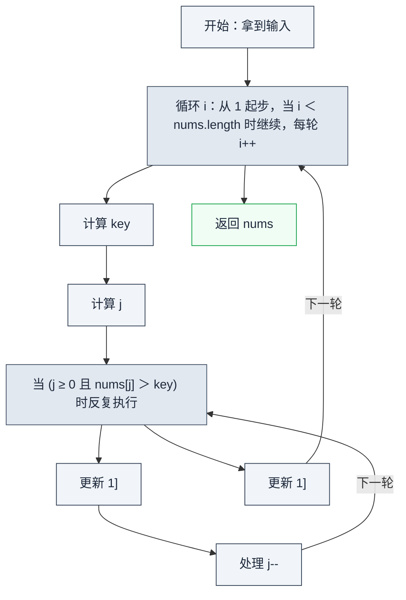

## TypeScript 解题方案（3 个方案逐个讲）

> **运行与提交**：每个方案都是自包含文件（内嵌用例自测，输出 PASS），整块复制到 `.ts` 文件后 `node 文件名` 即可运行。提交 LeetCode 时，把 `demo` 内的算法函数与辅助类型/函数整体取出、置于文件顶层即可。概念演示（非 LeetCode 编号题），在本地运行即可。

### 方案 1：方案1（直接插入排序）

**分析与思路**：核心做法是「方案1（直接插入排序）」。代码里依次做这些事：单循环线性扫描。

**运行方式**：`node 本文件`，内嵌用例全部通过会输出 PASS。

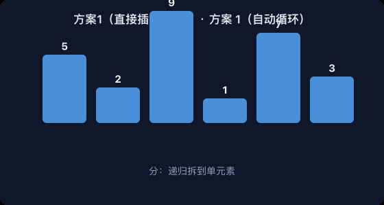

**方案专属流程图**（真实控制流）：

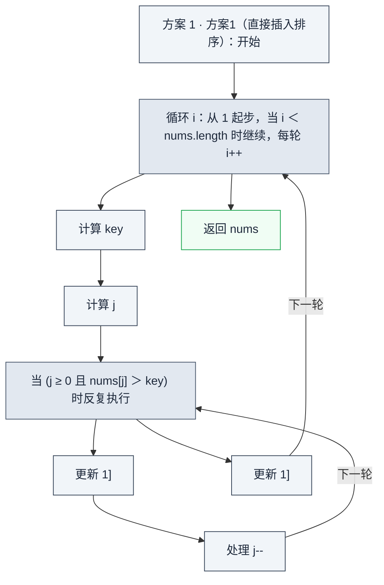

```typescript
/**
 ** 笔记：插入排序
 ** 方案：方案1（直接插入排序）
 ** 来源：python 参考忠实移植
 */

function insertionSort(nums: number[]): number[] {
  // 定义函数/方法 insertionSort
  for (let i = 1; i < nums.length; i++) {
    // 让 下标 i 从 1 开始计数，下标 i 小于 数组.长度 就继续
    const key = nums[i]; // 把 数组[下标 i] 存入 key
    let j = i - 1; // 把 下标 i 减 1 存入 下标 j
    while (j >= 0 && nums[j] > key) {
      // 循环，直到不满足「下标 j 不低于 0 且 数组[下标 j] 超过 key」
      nums[j + 1] = nums[j]; // 把 数组[下标 j]; 写入 nums[j + 1]
      j--; // 下标 j 减一
    }
    nums[j + 1] = key; // 把 key; 写入 nums[j + 1]
  }
  return nums; // 返回 数组
}

export function demo(): void {
  // 程序入口：跑内嵌自测用例
  function eqArr(a: number[], b: number[]): boolean {
    // 定义函数/方法 eqArr
    if (a.length !== b.length) return false; // 若 数组.长度 不等于 b.长度，直接返回 false
    for (let i = 0; i < a.length; i++) if (a[i] !== b[i]) return false; // 让 下标 i 从 0 开始计数，下标 i 小于 数组.长度 就继续
    return true; // 返回 true
  }
  const cases: { in: number[]; want: number[] }[] = [
    { in: [1, 2, 3], want: [1, 2, 3] },
    { in: [3, 2, 1], want: [1, 2, 3] },
    { in: [5, 1, 4, 2, 8], want: [1, 2, 4, 5, 8] },
  ];
  let fail = false; // 把 false 存入 fail
  for (const c of cases) {
    // for (const 字符 of cases) {
    const got = insertionSort(c.in.slice()); // 把 insertionSort(字符.in 截取 )) 存入 got
    if (!eqArr(got, c.want)) {
      // 若 取反 eqArr(got, 字符.want
      fail = true; // 把 true 存入 fail
      console.log(
        'FAIL',
        JSON.stringify(c.in),
        'want',
        JSON.stringify(c.want),
        'got',
        JSON.stringify(got),
      ); // 打印输出
    }
  }
  if (fail) throw new Error('FAILED'); // 若 fail) throw new Error(「FAILED」);
  console.log('PASS'); // 全部用例通过，输出 PASS
}
demo(); // demo();
```

### 方案 2：直接实现

**分析与思路**：核心做法是「直接实现」。

**运行方式**：`node 本文件`，内嵌用例全部通过会输出 PASS。

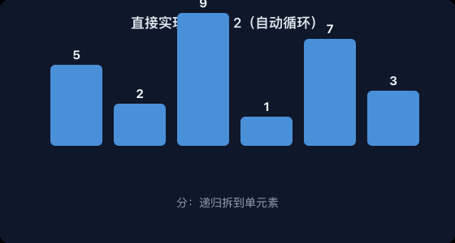

**方案专属流程图**（真实控制流）：

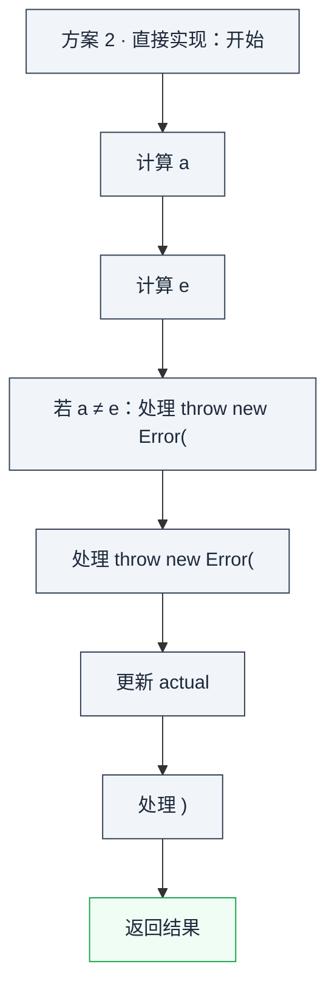

```typescript
function assertEq(actual: any, expected: any, msg: string = ''): void {
  // 定义函数/方法 assertEq
  const a = JSON.stringify(actual);
  const e = JSON.stringify(expected);
  if (a !== e)
    throw new Error(
      'ASSERT FAILED ' + msg + ' :: actual=' + a + ' expected=' + e,
    );
}

function insertion_sort(nums: number[]): number[] {
  // 定义函数/方法 insertion_sort
  const a = nums.slice();
  const length = a.length; // 把 数组 截取 ); const 长度 赋值为 数组.长度 存入 数组
  for (let i = 1; i < length; i++) {
    // 让 下标 i 从 1 开始计数，下标 i 小于 长度 就继续
    const tmp = a[i];
    let j = i; // 把 数组[下标 i]; let 下标 j 赋值为 下标 i 存入 临时变量
    while (j > 0) {
      if (a[j - 1] > tmp) a[j] = a[j - 1];
      else break;
      j--;
    }
    if (i !== j) a[j] = tmp; // 若 下标 i 不等于 下标 j) 数组[下标 j] 赋值为 临时变量;
  }
  return a; // 返回 数组
}
export function demo(): void {
  // 程序入口：跑内嵌自测用例
  assertEq(insertion_sort([5, 4, 3, 2, 1]), [1, 2, 3, 4, 5], 'rev'); // 断言校验
  assertEq(insertion_sort([1, 2, 3]), [1, 2, 3], 'sorted'); // 断言校验
  console.log('PASS'); // 全部用例通过，输出 PASS
}
demo(); // demo();
```

### 方案 3：迭代指针处理

**分析与思路**：核心做法是「迭代指针处理」。代码里依次做这些事：队列或堆的调度。

**运行方式**：`node 本文件`，内嵌用例全部通过会输出 PASS。


**方案专属流程图**（真实控制流）：

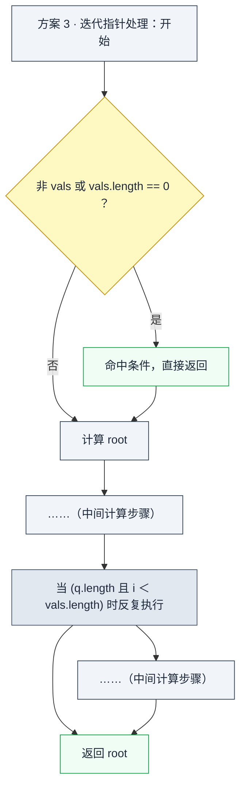

```typescript
class TreeNode {
  // 定义类型
  val: any;
  left: any;
  right: any; // 值: any; 左边界: any; 右边界: any;
  constructor(val?: any, left?: any, right?: any) {
    // constructor(值?: any, 左边界?: any, 右边界?: any) {
    this.val = val === undefined ? 0 : val; // 把 (值 全等于 undefined ? 0 : 值); 写入 值
    this.left = left === undefined ? null : left; // 把 (左边界 全等于 undefined ? null : 左边界); 写入 左边界
    this.right = right === undefined ? null : right; // 把 (右边界 全等于 undefined ? null : 右边界); 写入 右边界
  }
}
function buildTree(vals: any): any {
  // 定义函数/方法 buildTree
  if (!vals || vals.length === 0) return null; // 若 取反 vals 或 vals.长度 全等于 0，直接返回 null
  const root = new TreeNode(vals[0]);
  const q: any[] = [root];
  let i = 1;
  while (q.length && i < vals.length) {
    // 循环，直到不满足「节点.长度 且 下标 i 小于 vals.长度」
    const node = q.shift(); // 把 节点.shift() 存入 节点
    if (vals[i] !== null && vals[i] !== undefined) {
      node.left = new TreeNode(vals[i]);
      q.push(node.left);
    }
    i++; // 下标 i 加一
    if (i < vals.length && vals[i] !== null && vals[i] !== undefined) {
      node.right = new TreeNode(vals[i]);
      q.push(node.right);
    }
    i++; // 下标 i 加一
  }
  return root; // 返回 根节点
}
function treeToLevel(root: any): any[] {
  // 定义函数/方法 treeToLevel
  if (!root) return []; // 若 取反 根节点，直接返回 []
  const out: any[] = [];
  const q: any[] = [root]; // 把 []; const 节点: any[] 赋值为 [根节点]; 写入 const out: any[]
  while (q.length) {
    // 循环，直到不满足「节点.长度」
    const n = q.shift(); // 把 节点.shift() 存入 元素个数
    if (n === null || n === undefined) {
      out.push(null);
      continue;
    }
    out.push(n.val);
    q.push(n.left);
    q.push(n.right); // 把 元素个数.值 压入栈/数组尾部
  }
  while (out.length && out[out.length - 1] === null) out.pop(); // 循环，直到不满足「out.长度 且 out[out.长度 减 1] 全等于 null) out 弹出 );」
  return out; // 返回 out
}
class ListNode {
  // 定义类型
  val: any;
  next: any; // 值: any; 下一个: any;
  constructor(val?: any, next?: any) {
    this.val = val === undefined ? 0 : val;
    this.next = next === undefined ? null : next;
  }
}
function buildList(vals: any): any {
  // 定义函数/方法 buildList
  const dummy = new ListNode(0);
  let cur = dummy; // 把 new ListNode(0); let 当前值 赋值为 哨兵节点 存入 哨兵节点
  for (const v of vals) {
    cur.next = new ListNode(v);
    cur = cur.next;
  } // 把 new ListNode(值); 当前值 赋值为 当前值.下一个; } 写入 下一个
  return dummy.next; // 返回 哨兵节点.下一个
}
function listToArray(head: any): any[] {
  // 定义函数/方法 listToArray
  const out: any[] = [];
  let p = head; // 把 []; let 节点 赋值为 头节点; 写入 const out: any[]
  while (p) {
    out.push(p.val);
    p = p.next;
  } // 循环，直到不满足「节点) { out 追加 节点.值); 节点 赋值为 节点.下一个; }」
  return out; // 返回 out
}
// python-runtime shims
function pyLen(a: any): number {
  // 定义函数/方法 pyLen
  if (a === null || a === undefined) return 0; // 若 数组 全等于 null 或 数组 全等于 undefined，直接返回 0
  if (
    typeof a === 'string' ||
    Array.isArray(a) ||
    a instanceof Set ||
    a instanceof Map
  )
    return a.length ?? a.size;
  if (typeof a === 'object') return Object.keys(a).length; // 若 typeof 数组 全等于 'object'，直接返回 Object.keys(数组).长度
  return 0; // 返回 0
}
function pySlice(a: any, i: any, j: any, step?: any): any {
  // 定义函数/方法 pySlice
  if (typeof a === 'string') {
    const r = [...a].slice(i ?? 0, j ?? a.length);
    return step ? r.reverse().join('') : r.join('');
  }
  const arr = Array.isArray(a) ? a : [...a]; // 把 Array.isArray(数组) ? 数组 : 复制的 数组 存入 数组
  return arr.slice(i ?? 0, j ?? arr.length); // 返回 数组 截取 下标 i ?? 0, 下标 j ?? 数组.长度)
}
function pyRange(a: any, b?: any, step?: any): any[] {
  // 定义函数/方法 pyRange
  let s = 0,
    e = a,
    st = 1; // 把 0, e 赋值为 数组, st 赋值为 1 存入 字符串
  if (b !== undefined) {
    s = a;
    e = b;
  } // 若 b 不等于 undefined) { 字符串 赋值为 数组; e 赋值为 b; }
  if (step !== undefined) st = step; // 若 步数 不等于 undefined) st 赋值为 步数;
  const out: any[] = []; // 把 []; 写入 const out: any[]
  if (st > 0) for (let i = s; i < e; i += st) out.push(i);
  else for (let i = s; i > e; i += st) out.push(i); // 否则
  return out; // 返回 out
}
function pyIn(x: any, coll: any): boolean {
  // 定义函数/方法 pyIn
  if (coll === null || coll === undefined) return false; // 若 coll 全等于 null 或 coll 全等于 undefined，直接返回 false
  if (Array.isArray(coll)) return coll.includes(x); // 若 Array.isArray(coll)，直接返回 coll 是否包含 x)
  if (coll instanceof Set || coll instanceof Map) return coll.has(x); // 若 coll instanceof Set 或 coll instanceof Map，直接返回 coll.has(x)
  if (typeof coll === 'object') return x in coll; // 若 typeof coll 全等于 'object'，直接返回 x in coll
  if (typeof coll === 'string') return coll.indexOf(x) >= 0; // 若 typeof coll 全等于 'string'，直接返回 coll 查找 x) 不低于 0
  return false; // 返回 false
}
function pySorted(a: any): any[] {
  // 定义函数/方法 pySorted
  const arr = typeof a === 'string' ? [...a] : [...a]; // 把 (typeof 数组 全等于 'string') ? 复制的 数组 : 复制的 数组 存入 数组
  return arr.sort((x: any, y: any) => (x < y ? -1 : x > y ? 1 : 0));
}
function pyMin(a: any, b?: any): any {
  if (b !== undefined) return Math.min(a, b);
  if (Array.isArray(a) || a instanceof Set) return Math.min(...a);
  return Math.min(a);
} // 定义函数/方法 pyMin
function pyMax(a: any, b?: any): any {
  if (b !== undefined) return Math.max(a, b);
  if (Array.isArray(a) || a instanceof Set) return Math.max(...a);
  return Math.max(a);
} // 定义函数/方法 pyMax
function pySum(a: any): number {
  let s = 0;
  for (const v of a) s += v;
  return s;
} // 定义函数/方法 pySum
function pyAbs(x: any): number {
  return Math.abs(x);
} // 定义函数/方法 pyAbs
function pyEnumerate(a: any): any[] {
  const out: any[] = [];
  let i = 0;
  for (const v of a) {
    out.push([i, v]);
    i++;
  }
  return out;
} // 定义函数/方法 pyEnumerate
function pyZip(a: any, b: any): any[] {
  const n = Math.min(a.length, b.length);
  const out: any[] = [];
  for (let i = 0; i < n; i++) out.push([a[i], b[i]]);
  return out;
} // 定义函数/方法 pyZip
function pyDictGet(d: any, k: any, def?: any): any {
  return k in d ? d[k] : def === undefined ? null : def;
} // 定义函数/方法 pyDictGet
function pyPrint(...args: any[]): void {
  console.log(
    args
      .map((a) => (typeof a === 'object' && a !== null ? JSON.stringify(a) : a))
      .join(' '),
  );
} // 定义函数/方法 pyPrint
// collections / heapq
function heapPush(h: any[], x: any): void {
  h.push(x);
  let i = h.length - 1;
  while (i > 0) {
    const p = (i - 1) >> 1;
    if (h[p] <= h[i]) break;
    [h[p], h[i]] = [h[i], h[p]];
    i = p;
  }
} // 定义函数/方法 heapPush
function heapPop(h: any[]): any {
  const top = h[0];
  const last = h.pop();
  if (h.length) {
    h[0] = last;
    let i = 0;
    const n = h.length;
    while (true) {
      let l = 2 * i + 1,
        r = 2 * i + 2,
        s = i;
      if (l < n && h[l] < h[s]) s = l;
      if (r < n && h[r] < h[s]) s = r;
      if (s === i) break;
      [h[s], h[i]] = [h[i], h[s]];
      i = s;
    }
  }
  return top;
} // 定义函数/方法 heapPop
class Deque {
  private a: any[] = [];
  push(x: any) {
    this.a.push(x);
  }
  pushLeft(x: any) {
    this.a.unshift(x);
  }
  pop() {
    return this.a.pop();
  }
  popLeft() {
    return this.a.shift();
  }
  get length() {
    return this.a.length;
  }
  toArray() {
    return this.a.slice();
  }
} // 定义类型
function Counter(iter: any): any {
  const m: any = {};
  for (const v of iter) m[v] = (m[v] || 0) + 1;
  return m;
} // 定义函数/方法 Counter
function gcd(a: any, b: any): any {
  while (b) {
    [a, b] = [b, a % b];
  }
  return a;
} // 定义函数/方法 gcd
function pyInf(): number {
  return Infinity;
} // 定义函数/方法 pyInf

function norm(x: any): any {
  // 定义函数/方法 norm
  if (x === null || x === undefined) return null; // 若 x 全等于 null 或 x 全等于 undefined，直接返回 null
  if (typeof x === 'object') {
    // 若 typeof x 全等于 'object'
    if (x instanceof Deque) return x.toArray(); // 若 x instanceof Deque，直接返回 x.toArray()
    if (Array.isArray(x)) return x.map(norm); // 若 Array.isArray(x)，直接返回 x.映射表(norm)
    if (
      typeof x.val === 'number' &&
      (typeof x.left !== 'undefined' || typeof x.right !== 'undefined')
    )
      return treeToLevel(x);
    if (typeof x.next !== 'undefined' && typeof x.val === 'number')
      return listToArray(x);
    if (x instanceof Set) return [...x].sort(); // 若 x instanceof Set，直接返回 复制的 x 排序 )
    if (x instanceof Map) return Object.fromEntries(x); // 若 x instanceof Map，直接返回 Object.fromEntries(x)
    const o: any = {};
    for (const k of Object.keys(x)) o[k] = norm(x[k]);
    return o;
  }
  return x; // 返回 x
}
function eq(a: any, b: any): boolean {
  // 定义函数/方法 eq
  const x = norm(a),
    y = norm(b); // 把 norm(数组), y 赋值为 norm(b) 存入 x
  if (x === y) return true; // 若 x 全等于 y，直接返回 true
  if (x === null || y === null) return x === y; // 若 x 全等于 null 或 y 全等于 null，直接返回 x 全等于 y
  if (Array.isArray(x) && Array.isArray(y)) {
    // 若 Array.isArray(x) 且 Array.isArray(y
    if (x.length !== y.length) return false; // 若 x.长度 不等于 y.长度，直接返回 false
    for (let i = 0; i < x.length; i++) if (!eq(x[i], y[i])) return false; // 让 下标 i 从 0 开始计数，下标 i 小于 x.长度 就继续
    return true; // 返回 true
  }
  if (typeof x === 'object' && typeof y === 'object') {
    // 若 typeof x 全等于 'object' 且 typeof y 全等于 'object'
    const kx = Object.keys(x),
      ky = Object.keys(y); // 把 Object.keys(x), ky 赋值为 Object.keys(y) 存入 kx
    if (kx.length !== ky.length) return false; // 若 kx.长度 不等于 ky.长度，直接返回 false
    for (const k of kx) if (!eq(x[k], y[k])) return false;
    return true; // 返回 true
  }
  return x === y; // 返回 x 全等于 y
}

function insertionSort(nums) {
  // 定义函数/方法 insertionSort
  const a = nums.slice(); // 把 数组 截取 ) 存入 数组
  for (let i = 1; i < a.length; i++) {
    // 让 下标 i 从 1 开始计数，下标 i 小于 数组.长度 就继续
    const x = a[i];
    let j = i - 1; // 把 数组[下标 i]; let 下标 j 赋值为 下标 i 减 1 存入 x
    while (j >= 0 && a[j] > x) {
      a[j + 1] = a[j];
      j--;
    }
    a[j + 1] = x; // 把 x; 写入 a[j + 1]
  }
  return a; // 返回 数组
}
export function demo(): void {
  // 程序入口：跑内嵌自测用例
  const cases = [
    { in: [[5, 2, 4, 6, 1, 3]], want: [1, 2, 3, 4, 5, 6] },
    { in: [[1, 2, 3]], want: [1, 2, 3] },
    { in: [[3, 2, 1]], want: [1, 2, 3] },
    { in: [[]], want: [] },
  ];
  let fail = false; // 把 false 存入 fail
  for (const c of cases) {
    // for (const 字符 of cases) {
    const got = insertionSort(...c.in); // 把 insertionSort(...字符.in) 存入 got
    if (!eq(got, c.want)) {
      fail = true;
      console.log(
        'FAIL',
        JSON.stringify(c.in),
        '=>',
        JSON.stringify(got),
        'want',
        JSON.stringify(c.want),
      );
    }
  }
  if (fail) throw new Error('FAILED'); // 若 fail) throw new Error('FAILED');
  console.log('PASS'); // 全部用例通过，输出 PASS
}
demo(); // demo();
```

## 逐步拆解与面试追问

**复杂度**：时间 O(n²)（两层嵌套扫描），空间 O(1) 到 O(n)

**为什么是这个量级**：外层定起点、内层扫终点，n 个起点各扫 n 次

**面试官可能会追问**：

- 这个策略能推广到什么场景？
- 与暴力做法差在哪一步？
- 有没有更简单的等价写法？

## 关键 API 速查（TS 主解法实际用到，附官方链接）

| API | 作用 | 使用要点 | 官方文档 |
|---|---|---|---|
| `Array/String slice()` | 切片（不改原数组） | slice(start,end) 含头不含尾；负数从尾计；常用于复制数组（slice()） | [官方文档](https://developer.mozilla.org/zh-CN/docs/Web/JavaScript/Reference/Global_Objects/Array/slice) |
| `JSON.stringify()` | 序列化为 JSON 字符串 | 常用于结构化比较（深度相等判定）；undefined/函数/循环引用会被丢弃或抛错 | [官方文档](https://developer.mozilla.org/zh-CN/docs/Web/JavaScript/Reference/Global_Objects/JSON/stringify) |

### 各语言官方文档导航

- **TypeScript / JS**：[MDN 中文参考](https://developer.mozilla.org/zh-CN/)
- **Python**：[Python 官方文档](https://docs.python.org/zh-cn/3/)
- **Go**：[Go 标准库](https://pkg.go.dev/std)
- **Java**：[JDK 17 API](https://docs.oracle.com/en/java/javase/17/docs/api/)
- **Rust**：[Rust 标准库](https://doc.rust-lang.org/std/)
- **Lua**：[Lua 5.4 手册](https://www.lua.org/manual/5.4/)
- **C**：[Cppreference C](https://zh.cppreference.com/w/c)
- **C++**：[Cppreference C++](https://zh.cppreference.com/w/cpp)
- **R**：[R 官方手册](https://stat.ethz.ch/R-manual/)
- **Zig**：[Zig 语言文档](https://ziglang.org/documentation/master/)
- **Dart**：[Dart API](https://api.dart.dev/)

## 附录：其他 10 种语言全部实现（每种语言列举其全部方案）

> TypeScript 的全部方案见「TypeScript 解题方案」一节；下面是其余 10 种语言的对应实现，每种语言的每个方案都带思路分析、代码走读与专属运行架构图。
> 每个方案都内嵌用例自测，可独立运行（老仓库 python/go 文件遵循「打印结果」约定）。
> 完整解法文件见 `dsa/<语言>/notes/lc_134082074_插入排序/`。

### Python 实现（3 种方案）

Python 的全部方案如下，每个方案都内嵌用例自测，可独立运行（老仓库 python/go 文件遵循「打印结果」约定）：

#### 方案 1：方案1（直接插入排序）

**思路与代码分析**：核心是「方案1（直接插入排序）」。Python 版用切片与字典推导式简化操作，突出可读性。**走读**：方案 1 · 方案1（直接插入排序）：开始 → 循环 i：从 1 到 len(nums 前 → 更新 key → 更新 j → 当 j ≥ 0 and nums[j] ＞ key: 时反复执行 → 更新 1] → 更新 - → 更新 1] → 返回 nums。

**运行架构**（真实控制流）：

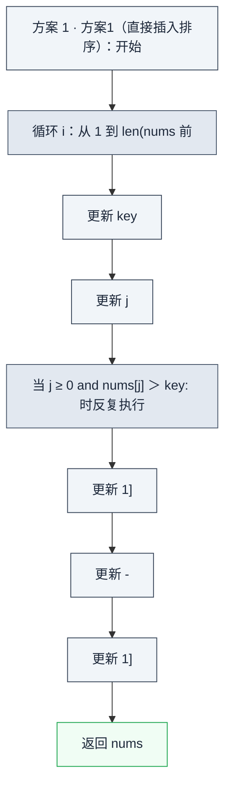

```python
import sys  # 提高递归深度上限（深输入防 RecursionError）

sys.setrecursionlimit(200000)  # 树/链表类题目节点数可达 1e4 量级

def insertionSort(nums):  # 定义函数 insertionSort（参数：数组）
    for i in range(1, len(nums)):  # 让 下标 i 从 1 到 长度(数组 遍历
        key = nums[i]  # 把 数组[下标 i] 存入 key
        j = i - 1  # 把 下标 i 减 1 存入 下标 j
        while j >= 0 and nums[j] > key:  # 循环，直到不满足「下标 j 不低于 0 and 数组[下标 j] 超过 key」
            nums[j + 1] = nums[j]  # 把 数组[下标 j] 写入 nums[j + 1]
            j -= 1  # 下标 j累减 1
        nums[j + 1] = key  # 把 key 写入 nums[j + 1]
    return nums  # 返回 数组

if __name__ == "__main__":  # 若 __name__ 等于 '__main__'
    print(insertionSort([1, 2, 3]))  # 打印输出
```

#### 方案 2：直接实现

**思路与代码分析**：核心是「直接实现」。Python 版用切片与字典推导式简化操作，突出可读性。**走读**：方案 2 · 直接实现：开始 → 更新 length → 循环 i：从 1 到 length 前 → 更新 tmp → 更新 j → 当 j ＞ 0: 时反复执行 → 若 nums[j - 1] ＞ tmp：更新 nums[j] → 更新 nums[j] → 跳出循环（break） → 更新 - → 若 i ≠ j：更新 nums[j] → 更新 nums[j] → 返回结果。

**运行架构**（真实控制流）：

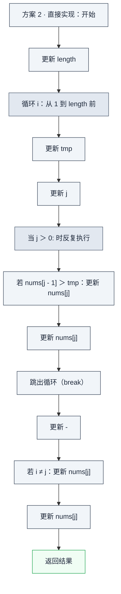

```python
import sys  # 提高递归深度上限（深输入防 RecursionError）

sys.setrecursionlimit(200000)  # 树/链表类题目节点数可达 1e4 量级

def insertion_sort(nums):  # 定义函数 insertion_sort（参数：数组）
    """插入排序：从第二个数开始向前比较，比它大就后移，最终插入合适位置。"""
    length = len(nums)  # 把 长度(数组) 存入 长度
    for i in range(1, length):  # 让 下标 i 从 1 到 长度 遍历
        tmp = nums[i]  # 当前要插入的“牌”
        j = i  # 把 下标 i 存入 下标 j
        while j > 0:  # 循环，直到不满足「下标 j 超过 0」
            if nums[j - 1] > tmp:  # 若 数组[下标 j 减 1] 超过 临时变量
                nums[j] = nums[j - 1]  # 后移
            else:  # 否则
                break  # 跳出循环
            j -= 1  # 下标 j累减 1
        if i != j:  # 若 下标 i 不等于 下标 j
            nums[j] = tmp  # 把 临时变量 写入 nums[j]

if __name__ == "__main__":  # 若 __name__ 等于 '__main__'
    list_ = [5, 4, 3, 2, 1]  # 把 [5, 4, 3, 2, 1] 存入 list_
    insertion_sort(list_)  # insertion_sort(list_)
    print(list_)  # [1, 2, 3, 4, 5]
```

#### 方案 3：迭代指针处理

**思路与代码分析**：核心是「迭代指针处理」。Python 版用切片与字典推导式简化操作，突出可读性。**走读**：方案 3 · 迭代指针处理：开始 → 更新 length → 循环 i：从 1 到 length 前 → 更新 tmp → 更新 j → 当 j ＞ 0: 时反复执行 → 若 nums[j - 1] ＞ tmp：更新 nums[j] → 更新 nums[j] → 跳出循环（break） → 更新 - → 若 i ≠ j：更新 nums[j] → 更新 nums[j] → 返回 nums。

**运行架构**（真实控制流）：

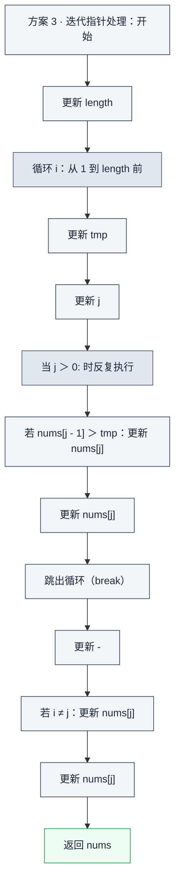

```python
import sys  # 提高递归深度上限（深输入防 RecursionError）

sys.setrecursionlimit(200000)  # 树/链表类题目节点数可达 1e4 量级

def insertion_sort(nums):  # 定义函数 insertion_sort（参数：数组）
    length = len(nums)  # 把 长度(数组) 存入 长度
    for i in range(1, length):  # 让 下标 i 从 1 到 长度 遍历
        tmp = nums[i]  # 把 数组[下标 i] 存入 临时变量
        j = i  # 把 下标 i 存入 下标 j
        while j > 0:  # 循环，直到不满足「下标 j 超过 0」
            if nums[j - 1] > tmp:  # 若 数组[下标 j 减 1] 超过 临时变量
                nums[j] = nums[j - 1]  # 把 数组[下标 j 减 1] 写入 nums[j]
            else:  # 否则
                break  # 跳出循环
            j -= 1  # 下标 j累减 1
        if i != j:  # 若 下标 i 不等于 下标 j
            nums[j] = tmp  # 把 临时变量 写入 nums[j]
    return nums  # 返回 数组

if __name__ == "__main__":  # 若 __name__ 等于 '__main__'
    list_ = [5, 4, 3, 2, 1]  # 把 [5, 4, 3, 2, 1] 存入 list_
    insertion_sort(list_)  # insertion_sort(list_)
    print(list_)  # [1, 2, 3, 4, 5]
```

### Go 实现（3 种方案）

Go 的全部方案如下，每个方案都内嵌用例自测，可独立运行（老仓库 python/go 文件遵循「打印结果」约定）：

#### 方案 1：方案1（直接插入排序）

**思路与代码分析**：核心是「方案1（直接插入排序）」。Go 版用切片与多返回值惯用法，显式处理索引边界。**走读**：方案 1 · 方案1（直接插入排序）：开始 → 更新 : → 遍历循环 → 更新 : → 更新 : → 遍历循环 → 更新 nums[j+1] → 处理 j-- → 更新 nums[j+1] → 返回 nums。

**运行架构**（真实控制流）：

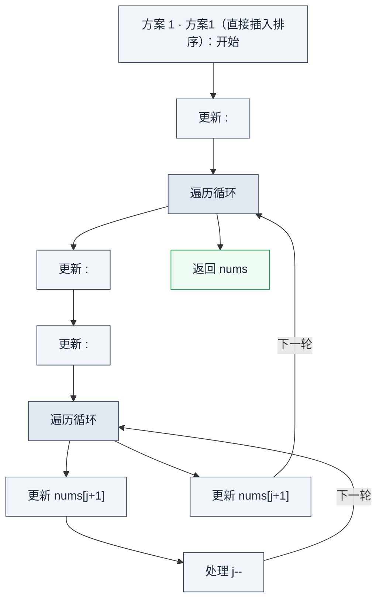

```go
package main // 引入依赖

import (
	"fmt"
	"os"
) // 引入依赖

func insertionSort(nums []int) []int { // 定义函数/方法 insertionSort
	n := len(nums)           // 把 长度(数组) 写入 n :
	for i := 1; i < n; i++ { // 让 下标 i 从 1 开始计数
		key := nums[i]                // 把 数组[下标 i] 写入 key :
		j := i - 1                    // 把 下标 i 减 1 写入 j :
		for j >= 0 && nums[j] > key { // 把 0 且 数组[下标 j] 超过 key { 写入 for j >
			nums[j+1] = nums[j] // 把 数组[下标 j] 写入 nums[j+1]
			j--                 // 下标 j 减一
		}
		nums[j+1] = key // 把 key 写入 nums[j+1]
	}
	return nums // 返回 数组
}

func main() { // 程序入口：跑内嵌自测用例
	cases := []struct { // 把 []struct { 写入 cases :
		in   []int // in []int
		want []int // want []int
	}{ // }{
		{[]int{1, 2, 3}, []int{1, 2, 3}},
		{[]int{5, 4, 3, 2, 1}, []int{1, 2, 3, 4, 5}},
		{[]int{3, 1, 4, 1, 5, 9, 2, 6}, []int{1, 1, 2, 3, 4, 5, 6, 9}},
	}
	ok := true                // 把 true 写入 ok :
	for _, c := range cases { // 同时取 _ 与 字符 遍历
		got := insertionSort(append([]int{}, c.in...)) // 把 insertionSort(append([]int{}, 字符.in...)) 写入 got :
		if len(got) != len(c.want) {
			ok = false
			fmt.Printf("FAIL len %v\n", c.in)
			continue
		}
		for i := range got {
			if got[i] != c.want[i] {
				ok = false
				fmt.Printf("FAIL %v got %v\n", c.in, got)
				break
			}
		} // 打印输出
	}
	if !ok {
		os.Exit(1)
	} // 若 取反 ok { os.Exit(1) }
	fmt.Println("PASS") // 全部用例通过，输出 PASS
}
```

#### 方案 2：直接实现

**思路与代码分析**：核心是「直接实现」。Go 版用切片与多返回值惯用法，显式处理索引边界。**走读**：方案 2 · 直接实现：开始 → 更新 : → 遍历循环 → 更新 : → 更新 : → 遍历循环 → 更新 nums[j+1] → 处理 j-- → 更新 nums[j+1] → 返回 nums。

**运行架构**（真实控制流）：

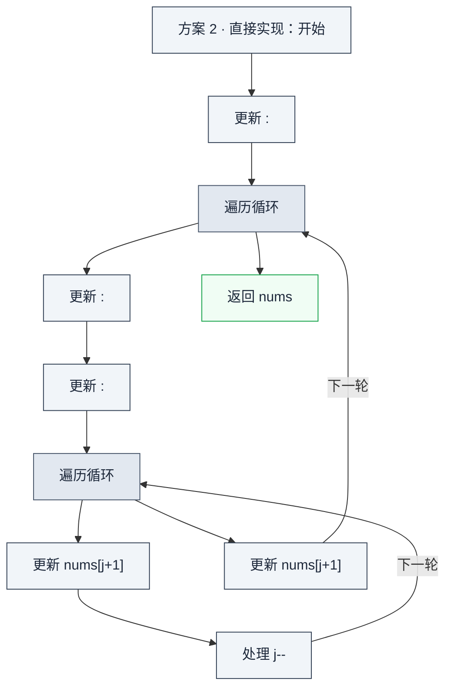

```go
package main // 引入依赖

import (
	"fmt"
	"os"
) // 引入依赖

func insertionSort(nums []int) []int { // 定义函数/方法 insertionSort
	n := len(nums)           // 把 长度(数组) 写入 n :
	for i := 1; i < n; i++ { // 让 下标 i 从 1 开始计数
		key := nums[i]                // 把 数组[下标 i] 写入 key :
		j := i - 1                    // 把 下标 i 减 1 写入 j :
		for j >= 0 && nums[j] > key { // 把 0 且 数组[下标 j] 超过 key { 写入 for j >
			nums[j+1] = nums[j] // 把 数组[下标 j] 写入 nums[j+1]
			j--                 // 下标 j 减一
		}
		nums[j+1] = key // 把 key 写入 nums[j+1]
	}
	return nums // 返回 数组
}

func main() { // 程序入口：跑内嵌自测用例
	cases := []struct { // 把 []struct { 写入 cases :
		in   []int // in []int
		want []int // want []int
	}{ // }{
		{[]int{1, 2, 3}, []int{1, 2, 3}},
		{[]int{5, 4, 3, 2, 1}, []int{1, 2, 3, 4, 5}},
		{[]int{3, 1, 4, 1, 5, 9, 2, 6}, []int{1, 1, 2, 3, 4, 5, 6, 9}},
	}
	ok := true                // 把 true 写入 ok :
	for _, c := range cases { // 同时取 _ 与 字符 遍历
		got := insertionSort(append([]int{}, c.in...)) // 把 insertionSort(append([]int{}, 字符.in...)) 写入 got :
		if len(got) != len(c.want) {
			ok = false
			fmt.Printf("FAIL len %v\n", c.in)
			continue
		}
		for i := range got {
			if got[i] != c.want[i] {
				ok = false
				fmt.Printf("FAIL %v got %v\n", c.in, got)
				break
			}
		} // 打印输出
	}
	if !ok {
		os.Exit(1)
	} // 若 取反 ok { os.Exit(1) }
	fmt.Println("PASS") // 全部用例通过，输出 PASS
}
```

#### 方案 3：迭代指针处理

**思路与代码分析**：核心是「迭代指针处理」。Go 版用切片与多返回值惯用法，显式处理索引边界。**走读**：方案 3 · 迭代指针处理：开始 → 更新 : → 遍历循环 → 更新 : → 更新 : → 遍历循环 → 更新 nums[j+1] → 处理 j-- → 更新 nums[j+1] → 返回 nums。

**运行架构**（真实控制流）：

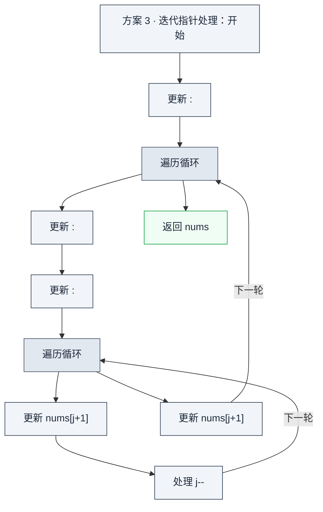

```go
package main // 引入依赖

import (
	"fmt"
	"os"
) // 引入依赖

func insertionSort(nums []int) []int { // 定义函数/方法 insertionSort
	n := len(nums)           // 把 长度(数组) 写入 n :
	for i := 1; i < n; i++ { // 让 下标 i 从 1 开始计数
		key := nums[i]                // 把 数组[下标 i] 写入 key :
		j := i - 1                    // 把 下标 i 减 1 写入 j :
		for j >= 0 && nums[j] > key { // 把 0 且 数组[下标 j] 超过 key { 写入 for j >
			nums[j+1] = nums[j] // 把 数组[下标 j] 写入 nums[j+1]
			j--                 // 下标 j 减一
		}
		nums[j+1] = key // 把 key 写入 nums[j+1]
	}
	return nums // 返回 数组
}

func main() { // 程序入口：跑内嵌自测用例
	cases := []struct { // 把 []struct { 写入 cases :
		in   []int // in []int
		want []int // want []int
	}{ // }{
		{[]int{1, 2, 3}, []int{1, 2, 3}},
		{[]int{5, 4, 3, 2, 1}, []int{1, 2, 3, 4, 5}},
		{[]int{3, 1, 4, 1, 5, 9, 2, 6}, []int{1, 1, 2, 3, 4, 5, 6, 9}},
	}
	ok := true                // 把 true 写入 ok :
	for _, c := range cases { // 同时取 _ 与 字符 遍历
		got := insertionSort(append([]int{}, c.in...)) // 把 insertionSort(append([]int{}, 字符.in...)) 写入 got :
		if len(got) != len(c.want) {
			ok = false
			fmt.Printf("FAIL len %v\n", c.in)
			continue
		}
		for i := range got {
			if got[i] != c.want[i] {
				ok = false
				fmt.Printf("FAIL %v got %v\n", c.in, got)
				break
			}
		} // 打印输出
	}
	if !ok {
		os.Exit(1)
	} // 若 取反 ok { os.Exit(1) }
	fmt.Println("PASS") // 全部用例通过，输出 PASS
}
```

### Java 实现（3 种方案）

Java 的全部方案如下，每个方案都内嵌用例自测，可独立运行（老仓库 python/go 文件遵循「打印结果」约定）：

#### 方案 1：方案1（直接插入排序）

**思路与代码分析**：核心是「方案1（直接插入排序）」。Java 版用类与静态方法组织，集合操作显式明了。代码里依次做这些事：单循环线性扫描。**走读**：方案 1 · 方案1（直接插入排序）：开始 → 遍历循环 → 更新 key → 更新 j → 当 (j ≥ 0 且 nums[j] ＞ key) 时反复执行 → 更新 1] → 处理 j-- → 更新 1] → 返回 nums。

**运行架构**（真实控制流）：

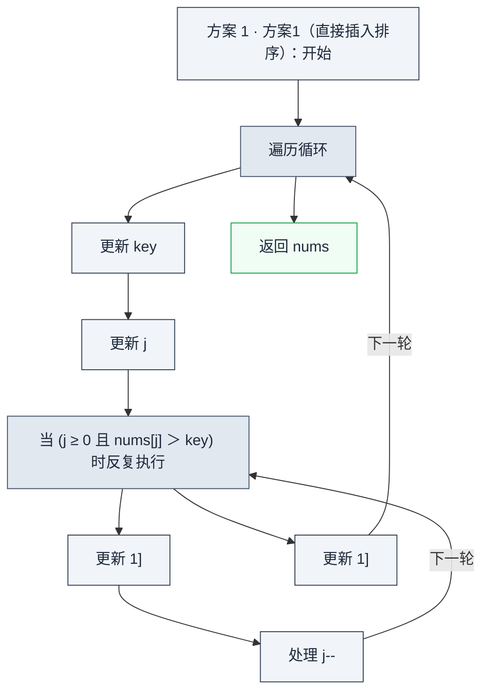

```java
package com.webfault.dsa; // 引入依赖

import java.util.Arrays; // 引入依赖

class lc134082074_solution11 { // 定义类型
  // insertionSort 忠实翻译 python ref solution_1___1.py（key 风格，就地排序并返回 nums）
  static int[] insertionSort(int[] nums) { // 定义函数/方法 insertionSort
    for (int i = 1; i < nums.length; i++) { // 让 下标 i 从 1 开始计数，下标 i 小于 数组.长度 就继续
      int key = nums[i]; // 把 数组[下标 i] 存入 key
      int j = i - 1; // 把 下标 i 减 1 存入 下标 j
      while (j >= 0 && nums[j] > key) { // 循环，直到不满足「下标 j 不低于 0 且 数组[下标 j] 超过 key」
        nums[j + 1] = nums[j]; // 把 数组[下标 j]; 写入 nums[j + 1]
        j--; // 下标 j 减一
      }
      nums[j + 1] = key; // 把 key; 写入 nums[j + 1]
    }
    return nums; // 返回 数组
  }

  public static void main(String[] args) { // public static void main(String[] args) {
    Object[][] cases = { // 把 { 写入 Object[][] cases
      {new int[] {1, 2, 3}, new int[] {1, 2, 3}},
      {new int[] {5, 4, 3, 2, 1}, new int[] {1, 2, 3, 4, 5}},
      {new int[] {}, new int[] {}},
      {new int[] {1}, new int[] {1}},
      {new int[] {3, 1, 2, 1, 3}, new int[] {1, 1, 2, 3, 3}},
      {new int[] {2, -1, 0}, new int[] {-1, 0, 2}},
    };
    boolean ok = true; // 把 true; 写入 boolean ok
    for (Object[] c : cases) { // for (Object[] 字符 : cases) {
      int[] in = (int[]) c[0]; // 把 (int[]) 字符[0]; 写入 int[] in
      int[] want = (int[]) c[1]; // 把 (int[]) 字符[1]; 写入 int[] want
      int[] got = insertionSort(in); // 把 insertionSort(in); 写入 int[] got
      // 就地修改类：返回值与入参变异结果都应等于 want
      if (!Arrays.equals(got, want)
          || !Arrays.equals(
              in, want)) { // 若 取反 Arrays.equals(got, want) 或 取反 Arrays.equals(in, want
        ok = false; // 把 false; 写入 ok
        System.out.println(
            "FAIL got " + Arrays.toString(got) + " want " + Arrays.toString(want)); // 打印输出
      }
    }
    if (!ok) { // 若 取反 ok
      throw new RuntimeException("FAILED"); // throw new RuntimeException(「FAILED」);
    }
    System.out.println("PASS"); // 全部用例通过，输出 PASS
  }
}
```

#### 方案 2：直接实现

**思路与代码分析**：核心是「直接实现」。Java 版用类与静态方法组织，集合操作显式明了。代码里依次做这些事：单循环线性扫描。**走读**：方案 2 · 直接实现：开始 → 更新 length → 遍历循环 → 更新 tmp → 更新 j → 当 (j ＞ 0) 时反复执行 → 若 nums[j - 1] ＞ tmp 则： → 更新 nums[j] → 跳出循环（break） → 处理 j-- → 若 i ≠ j 则： → 更新 nums[j] → 返回结果。

**运行架构**（真实控制流）：

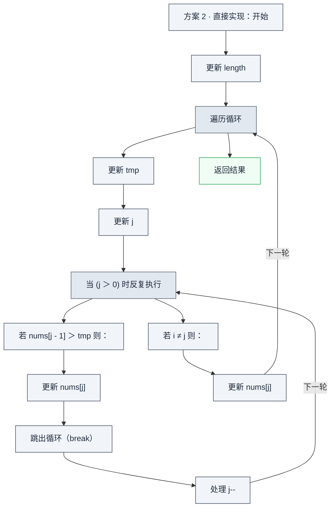

```java
package com.webfault.dsa; // 引入依赖

import java.util.Arrays; // 引入依赖

class lc134082074_solution22 { // 定义类型
  // insertionSort 忠实翻译 python ref solution_2___2.py（tmp 风格 + i != j 优化，就地排序，无返回值）
  public static void insertionSort(int[] nums) { // public static void insertionSort(int[] 数组) {
    int length = nums.length; // 把 数组.长度 存入 长度
    for (int i = 1; i < length; i++) { // 让 下标 i 从 1 开始计数，下标 i 小于 长度 就继续
      int tmp = nums[i]; // 当前要插入的“牌”
      int j = i; // 把 下标 i 存入 下标 j
      while (j > 0) { // 循环，直到不满足「下标 j 超过 0」
        if (nums[j - 1] > tmp) { // 若 数组[下标 j 减 1] 超过 临时变量
          nums[j] = nums[j - 1]; // 后移
        } else { // 否则
          break; // 跳出循环
        }
        j--; // 下标 j 减一
      }
      if (i != j) { // 若 下标 i 不等于 下标 j
        nums[j] = tmp; // 把 临时变量; 写入 nums[j]
      }
    }
  }

  public static void main(String[] args) { // public static void main(String[] args) {
    Object[][] cases = { // 把 { 写入 Object[][] cases
      {new int[] {1, 2, 3}, new int[] {1, 2, 3}},
      {new int[] {5, 4, 3, 2, 1}, new int[] {1, 2, 3, 4, 5}},
      {new int[] {}, new int[] {}},
      {new int[] {1}, new int[] {1}},
      {new int[] {3, 1, 2, 1, 3}, new int[] {1, 1, 2, 3, 3}},
      {new int[] {2, -1, 0}, new int[] {-1, 0, 2}},
    };
    boolean ok = true; // 把 true; 写入 boolean ok
    for (Object[] c : cases) { // for (Object[] 字符 : cases) {
      int[] in = (int[]) c[0]; // 把 (int[]) 字符[0]; 写入 int[] in
      int[] want = (int[]) c[1]; // 把 (int[]) 字符[1]; 写入 int[] want
      insertionSort(in); // insertionSort(in);
      // 就地修改类：比对入参变异结果
      if (!Arrays.equals(in, want)) { // 若 取反 Arrays.equals(in, want
        ok = false; // 把 false; 写入 ok
        System.out.println(
            "FAIL got " + Arrays.toString(in) + " want " + Arrays.toString(want)); // 打印输出
      }
    }
    if (!ok) { // 若 取反 ok
      throw new RuntimeException("FAILED"); // throw new RuntimeException(「FAILED」);
    }
    System.out.println("PASS"); // 全部用例通过，输出 PASS
  }
}
```

#### 方案 3：迭代指针处理

**思路与代码分析**：核心是「迭代指针处理」。Java 版用类与静态方法组织，集合操作显式明了。代码里依次做这些事：单循环线性扫描。**走读**：方案 3 · 迭代指针处理：开始 → 更新 length → 遍历循环 → 更新 tmp → 更新 j → 当 (j ＞ 0) 时反复执行 → 若 nums[j - 1] ＞ tmp 则： → 更新 nums[j] → 跳出循环（break） → 处理 j-- → 若 i ≠ j 则： → 更新 nums[j] → 返回 nums。

**运行架构**（真实控制流）：

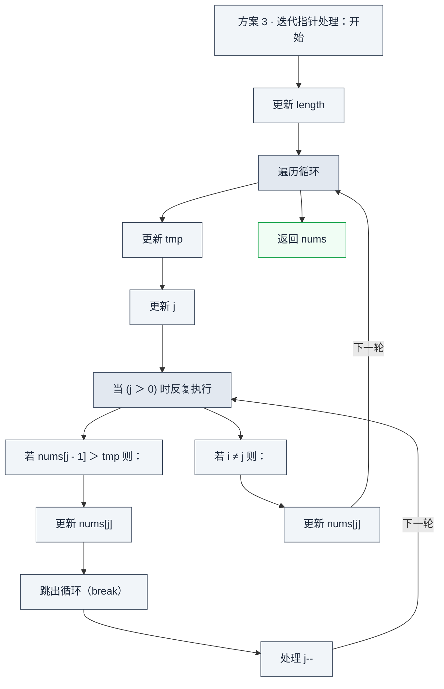

```java
package com.webfault.dsa; // 引入依赖

import java.util.Arrays; // 引入依赖

class lc134082074_solution33 { // 定义类型
  // insertionSort 忠实翻译 python ref solution_3___3.py（tmp 风格 + i != j 优化，就地排序并返回 nums）
  public static int[] insertionSort(int[] nums) { // public static int[] insertionSort(int[] 数组) {
    int length = nums.length; // 把 数组.长度 存入 长度
    for (int i = 1; i < length; i++) { // 让 下标 i 从 1 开始计数，下标 i 小于 长度 就继续
      int tmp = nums[i]; // 把 数组[下标 i] 存入 临时变量
      int j = i; // 把 下标 i 存入 下标 j
      while (j > 0) { // 循环，直到不满足「下标 j 超过 0」
        if (nums[j - 1] > tmp) { // 若 数组[下标 j 减 1] 超过 临时变量
          nums[j] = nums[j - 1]; // 把 数组[下标 j 减 1]; 写入 nums[j]
        } else { // 否则
          break; // 跳出循环
        }
        j--; // 下标 j 减一
      }
      if (i != j) { // 若 下标 i 不等于 下标 j
        nums[j] = tmp; // 把 临时变量; 写入 nums[j]
      }
    }
    return nums; // 返回 数组
  }

  public static void main(String[] args) { // public static void main(String[] args) {
    Object[][] cases = { // 把 { 写入 Object[][] cases
      {new int[] {1, 2, 3}, new int[] {1, 2, 3}},
      {new int[] {5, 4, 3, 2, 1}, new int[] {1, 2, 3, 4, 5}},
      {new int[] {}, new int[] {}},
      {new int[] {1}, new int[] {1}},
      {new int[] {3, 1, 2, 1, 3}, new int[] {1, 1, 2, 3, 3}},
      {new int[] {2, -1, 0}, new int[] {-1, 0, 2}},
    };
    boolean ok = true; // 把 true; 写入 boolean ok
    for (Object[] c : cases) { // for (Object[] 字符 : cases) {
      int[] in = (int[]) c[0]; // 把 (int[]) 字符[0]; 写入 int[] in
      int[] want = (int[]) c[1]; // 把 (int[]) 字符[1]; 写入 int[] want
      int[] got = insertionSort(in); // 把 insertionSort(in); 写入 int[] got
      if (!Arrays.equals(got, want)
          || !Arrays.equals(
              in, want)) { // 若 取反 Arrays.equals(got, want) 或 取反 Arrays.equals(in, want
        ok = false; // 把 false; 写入 ok
        System.out.println(
            "FAIL got " + Arrays.toString(got) + " want " + Arrays.toString(want)); // 打印输出
      }
    }
    if (!ok) { // 若 取反 ok
      throw new RuntimeException("FAILED"); // throw new RuntimeException(「FAILED」);
    }
    System.out.println("PASS"); // 全部用例通过，输出 PASS
  }
}
```

### Rust 实现（3 种方案）

Rust 的全部方案如下，每个方案都内嵌用例自测，可独立运行（老仓库 python/go 文件遵循「打印结果」约定）：

#### 方案 1：方案1（直接插入排序）

**思路与代码分析**：核心是「方案1（直接插入排序）」。Rust 版用所有权移动与切片借用改写同一逻辑，注意 Option 与引用边界。**走读**：方案 1 · 方案1（直接插入排序）：开始 → 计算 v → 遍历 1..v.len() 中的每个元素 i → 计算 key → 计算 j → 当 j ＞ 0 且 v[j - 1] ＞ key 时反复执行 → 更新 v[j] → 更新 - → 更新 v[j] → 处理 v → 返回结果。

**运行架构**（真实控制流）：

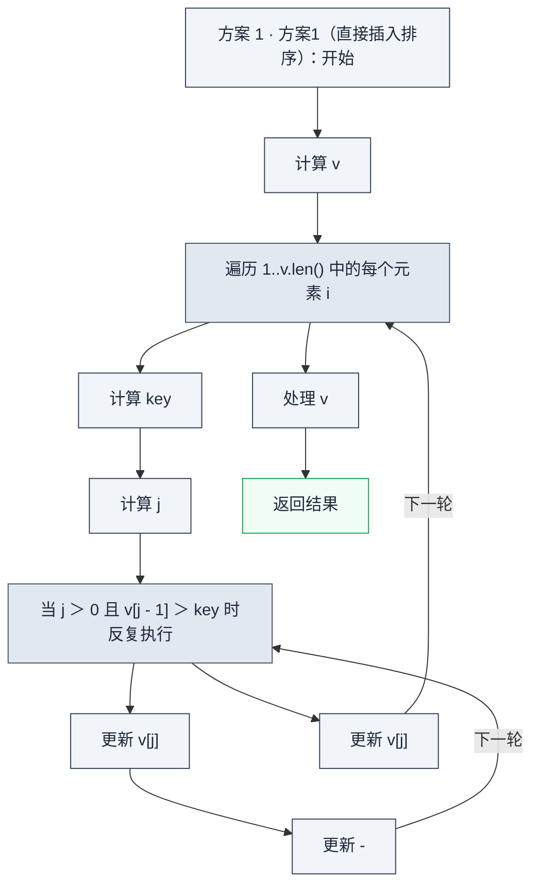

```rust
// 数据结构与算法之排序: 插入排序 — Rust 版（方案1）
fn insertion_sort(nums: Vec<i32>) -> Vec<i32> {
    // 定义函数/方法 insertion_sort
    let mut v = nums; // 把 数组; 写入 let mut v
    for i in 1..v.len() {
        // 逐个取出 1 的元素（下标 i）
        let key = v[i]; // 把 值[下标 i] 存入 key
        let mut j = i; // 把 下标 i; 写入 let mut j
        while j > 0 && v[j - 1] > key {
            v[j] = v[j - 1];
            j -= 1;
        }
        v[j] = key; // 把 key; 写入 v[j]
    }
    v
}
fn main() {
    // 程序入口：跑内嵌自测用例
    assert_eq!(insertion_sort(vec![5, 4, 3, 2, 1]), vec![1, 2, 3, 4, 5]); // 断言校验
    assert_eq!(insertion_sort(vec![3, 1, 2]), vec![1, 2, 3]); // 断言校验
    println!("PASS");
} // 全部用例通过，输出 PASS
```

#### 方案 2：直接实现

**思路与代码分析**：核心是「直接实现」。Rust 版用所有权移动与切片借用改写同一逻辑，注意 Option 与引用边界。**走读**：方案 2 · 直接实现：开始 → 计算 v → 遍历 1..v.len() 中的每个元素 i → 计算 key → 计算 j → 当 j ＞ 0 且 v[j - 1] ＞ key 时反复执行 → 更新 v[j] → 更新 - → 更新 v[j] → 处理 v → 返回结果。

**运行架构**（真实控制流）：

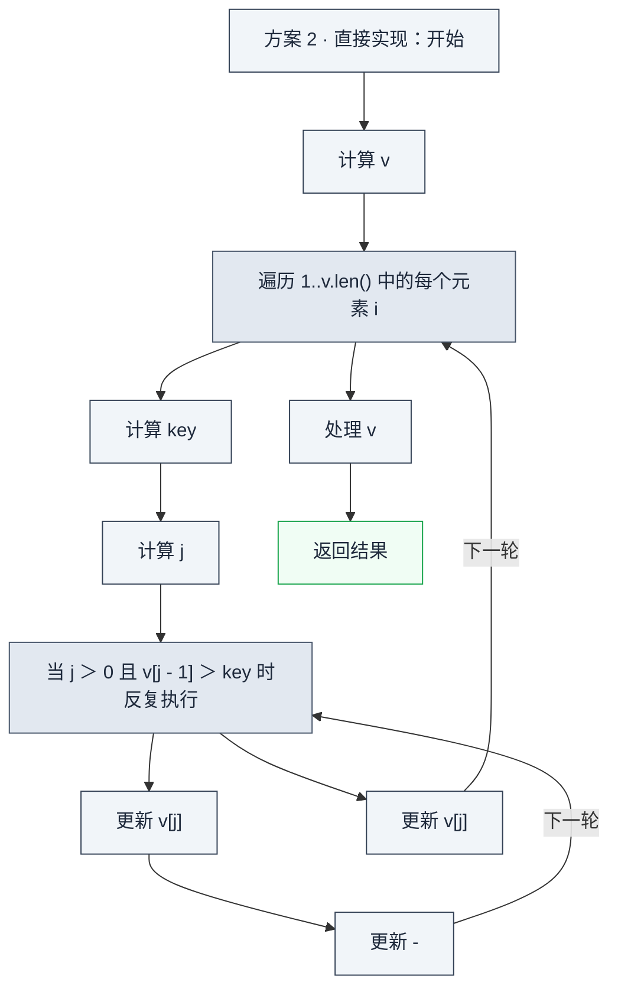

```rust
// 数据结构与算法之排序: 插入排序 — Rust 版（方案2）
fn insertion_sort(nums: Vec<i32>) -> Vec<i32> {
    // 定义函数/方法 insertion_sort
    let mut v = nums; // 把 数组; 写入 let mut v
    for i in 1..v.len() {
        // 逐个取出 1 的元素（下标 i）
        let key = v[i]; // 把 值[下标 i] 存入 key
        let mut j = i; // 把 下标 i; 写入 let mut j
        while j > 0 && v[j - 1] > key {
            v[j] = v[j - 1];
            j -= 1;
        }
        v[j] = key; // 把 key; 写入 v[j]
    }
    v
}
fn main() {
    // 程序入口：跑内嵌自测用例
    assert_eq!(insertion_sort(vec![5, 4, 3, 2, 1]), vec![1, 2, 3, 4, 5]); // 断言校验
    assert_eq!(insertion_sort(vec![3, 1, 2]), vec![1, 2, 3]); // 断言校验
    println!("PASS");
} // 全部用例通过，输出 PASS
```

#### 方案 3：迭代指针处理

**思路与代码分析**：核心是「迭代指针处理」。Rust 版用所有权移动与切片借用改写同一逻辑，注意 Option 与引用边界。**走读**：方案 3 · 迭代指针处理：开始 → 计算 v → 遍历 1..v.len() 中的每个元素 i → 计算 key → 计算 j → 当 j ＞ 0 且 v[j - 1] ＞ key 时反复执行 → 更新 v[j] → 更新 - → 更新 v[j] → 处理 v → 返回结果。

**运行架构**（真实控制流）：

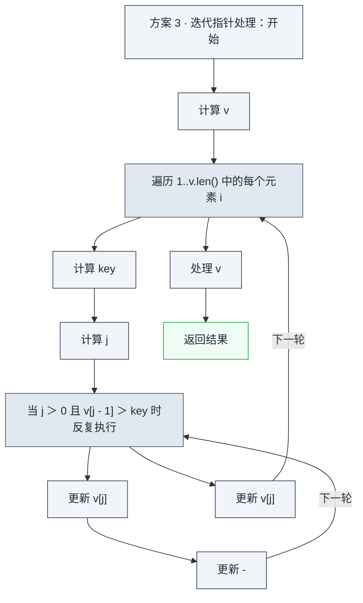

```rust
// 数据结构与算法之排序: 插入排序 — Rust 版（方案3）
fn insertion_sort(nums: Vec<i32>) -> Vec<i32> {
    // 定义函数/方法 insertion_sort
    let mut v = nums; // 把 数组; 写入 let mut v
    for i in 1..v.len() {
        // 逐个取出 1 的元素（下标 i）
        let key = v[i]; // 把 值[下标 i] 存入 key
        let mut j = i; // 把 下标 i; 写入 let mut j
        while j > 0 && v[j - 1] > key {
            v[j] = v[j - 1];
            j -= 1;
        }
        v[j] = key; // 把 key; 写入 v[j]
    }
    v
}
fn main() {
    // 程序入口：跑内嵌自测用例
    assert_eq!(insertion_sort(vec![5, 4, 3, 2, 1]), vec![1, 2, 3, 4, 5]); // 断言校验
    assert_eq!(insertion_sort(vec![3, 1, 2]), vec![1, 2, 3]); // 断言校验
    println!("PASS");
} // 全部用例通过，输出 PASS
```

### Lua 实现（3 种方案）

Lua 的全部方案如下，每个方案都内嵌用例自测，可独立运行（老仓库 python/go 文件遵循「打印结果」约定）：

#### 方案 1：方案1（直接插入排序）

**思路与代码分析**：核心是「方案1（直接插入排序）」。Lua 版用表与 ipairs 遍历，注意 ipairs 遇 nil 即停的语义。**走读**：方案 1 · 方案1（直接插入排序）：开始 → 更新 v → 循环 i：从 2 到 #v do → 更新 key → 更新 j → 当 j ≥ 1 and v[j] ＞ key do 时反复执行 → 更新 1] → 更新 j → 更新 1] → 返回 v。

**运行架构**（真实控制流）：

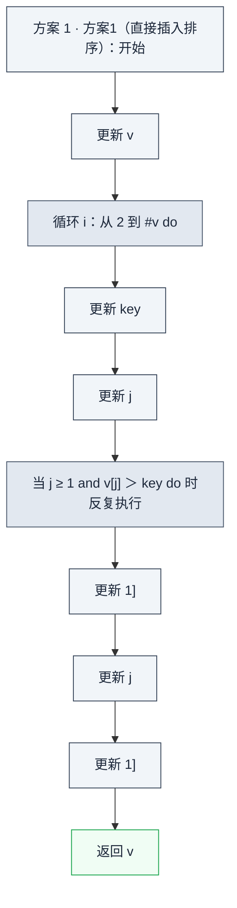

```lua
-- 数据结构与算法之排序: 插入排序 — Lua 版（方案1）
local function insertion_sort(nums) -- local function insertion_sort(数组)
	local v = { table.unpack(nums) } -- 把 {table.unpack(数组)} 写入 local v
	for i = 2, #v do -- 把 2, #值 do 写入 for i
		local key = v[i] -- 把 值[下标 i] 写入 local key
		local j = i - 1 -- 把 下标 i 减 1 写入 local j
		while j >= 1 and v[j] > key do
			v[j + 1] = v[j]
			j = j - 1
		end
		v[j + 1] = key -- 把 key 写入 v[j + 1]
	end -- 终点
	return v -- 返回 值
end -- 终点
assert(table.concat(insertion_sort({ 5, 4, 3, 2, 1 }), ",") == "1,2,3,4,5") -- 打印输出
assert(table.concat(insertion_sort({ 3, 1, 2 }), ",") == "1,2,3") -- 打印输出
print("PASS") -- 全部用例通过，输出 PASS
```

#### 方案 2：直接实现

**思路与代码分析**：核心是「直接实现」。Lua 版用表与 ipairs 遍历，注意 ipairs 遇 nil 即停的语义。**走读**：方案 2 · 直接实现：开始 → 更新 v → 循环 i：从 2 到 #v do → 更新 key → 更新 j → 当 j ≥ 1 and v[j] ＞ key do 时反复执行 → 更新 1] → 更新 j → 更新 1] → 返回 v。

**运行架构**（真实控制流）：

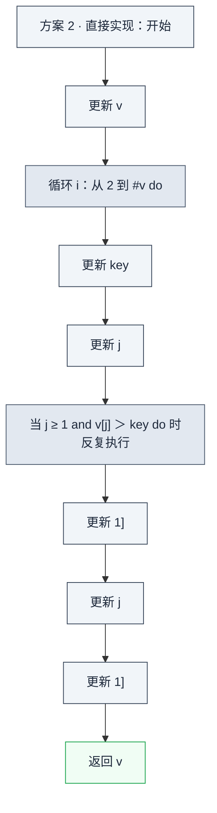

```lua
-- 数据结构与算法之排序: 插入排序 — Lua 版（方案2）
local function insertion_sort(nums) -- local function insertion_sort(数组)
	local v = { table.unpack(nums) } -- 把 {table.unpack(数组)} 写入 local v
	for i = 2, #v do -- 把 2, #值 do 写入 for i
		local key = v[i] -- 把 值[下标 i] 写入 local key
		local j = i - 1 -- 把 下标 i 减 1 写入 local j
		while j >= 1 and v[j] > key do
			v[j + 1] = v[j]
			j = j - 1
		end
		v[j + 1] = key -- 把 key 写入 v[j + 1]
	end -- 终点
	return v -- 返回 值
end -- 终点
assert(table.concat(insertion_sort({ 5, 4, 3, 2, 1 }), ",") == "1,2,3,4,5") -- 打印输出
assert(table.concat(insertion_sort({ 3, 1, 2 }), ",") == "1,2,3") -- 打印输出
print("PASS") -- 全部用例通过，输出 PASS
```

#### 方案 3：迭代指针处理

**思路与代码分析**：核心是「迭代指针处理」。Lua 版用表与 ipairs 遍历，注意 ipairs 遇 nil 即停的语义。**走读**：方案 3 · 迭代指针处理：开始 → 更新 v → 循环 i：从 2 到 #v do → 更新 key → 更新 j → 当 j ≥ 1 and v[j] ＞ key do 时反复执行 → 更新 1] → 更新 j → 更新 1] → 返回 v。

**运行架构**（真实控制流）：

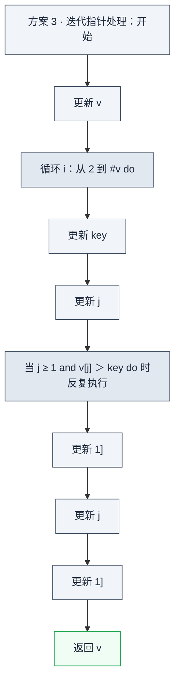

```lua
-- 数据结构与算法之排序: 插入排序 — Lua 版（方案3）
local function insertion_sort(nums) -- local function insertion_sort(数组)
	local v = { table.unpack(nums) } -- 把 {table.unpack(数组)} 写入 local v
	for i = 2, #v do -- 把 2, #值 do 写入 for i
		local key = v[i] -- 把 值[下标 i] 写入 local key
		local j = i - 1 -- 把 下标 i 减 1 写入 local j
		while j >= 1 and v[j] > key do
			v[j + 1] = v[j]
			j = j - 1
		end
		v[j + 1] = key -- 把 key 写入 v[j + 1]
	end -- 终点
	return v -- 返回 值
end -- 终点
assert(table.concat(insertion_sort({ 5, 4, 3, 2, 1 }), ",") == "1,2,3,4,5") -- 打印输出
assert(table.concat(insertion_sort({ 3, 1, 2 }), ",") == "1,2,3") -- 打印输出
print("PASS") -- 全部用例通过，输出 PASS
```

### C 实现（3 种方案）

C 的全部方案如下，每个方案都内嵌用例自测，可独立运行（老仓库 python/go 文件遵循「打印结果」约定）：

#### 方案 1：方案1（直接插入排序）

**思路与代码分析**：核心是「方案1（直接插入排序）」。C 版手动管理下标与内存，循环边界全部显式写出。代码里依次做这些事：单循环线性扫描。**走读**：方案 1 · 方案1（直接插入排序）：开始 → 遍历循环 → 更新 key → 更新 j → 当 (j ≥ 0 且 v[j] ＞ key) 时反复执行 → 更新 1] → 处理 j-- → 更新 1] → 返回结果。

**运行架构**（真实控制流）：

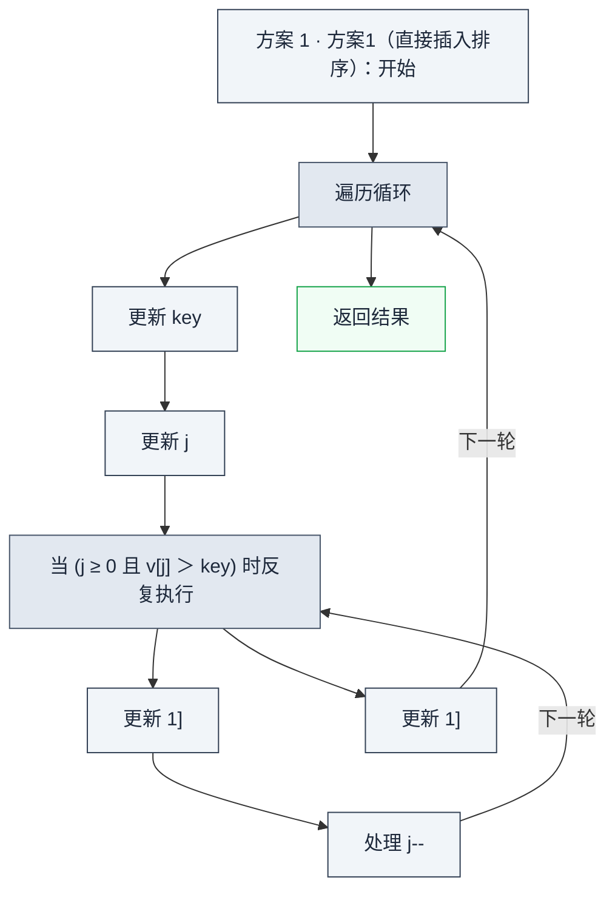

```c
/* 数据结构与算法之排序: 插入排序 — C 版（方案1） */
#include <stdio.h>                           // 引入头文件
static void insertion_sort(int v[], int n) { // 定义函数/方法 insertion_sort
    for (int i = 1; i < n; i++) { // 让 下标 i 从 1 开始计数，下标 i 小于 元素个数 就继续
        int key = v[i];           // 把 值[下标 i] 存入 key
        int j = i - 1;            // 把 下标 i 减 1 存入 下标 j
        while (j >= 0 && v[j] > key) {
            v[j + 1] = v[j];
            j--;
        }
        v[j + 1] = key; // 把 key; 写入 v[j + 1]
    }
}
int main(void) {                // 程序入口：跑内嵌自测用例
    int v1[] = {5, 4, 3, 2, 1}; // 把 {5,4,3,2,1}; 写入 int v1[]
    insertion_sort(v1, 5);      // insertion_sort(v1, 5);
    for (int i = 0; i < 5; i++)
        if (v1[i] != i + 1) {
            printf("FAIL\n");
            return 1;
        } // 让 下标 i 从 0 开始计数，下标 i 小于 5 就继续
    printf("PASS\n");
    return 0;
} // 全部用例通过，输出 PASS
```

#### 方案 2：直接实现

**思路与代码分析**：核心是「直接实现」。C 版手动管理下标与内存，循环边界全部显式写出。代码里依次做这些事：单循环线性扫描。**走读**：方案 2 · 直接实现：开始 → 遍历循环 → 更新 key → 更新 j → 当 (j ≥ 0 且 v[j] ＞ key) 时反复执行 → 更新 1] → 处理 j-- → 更新 1] → 返回结果。

**运行架构**（真实控制流）：

```mermaid
graph TD
    N0["方案 2 · 直接实现：开始"]
    N1["遍历循环"]
    N2["更新 key"]
    N3["更新 j"]
    N4["当 (j ≥ 0 且 v[j] ＞ key) 时反复执行"]
    N5["更新 1]"]
    N6["处理 j--"]
    N7["更新 1]"]
    N8["返回结果"]
    N0 --> N1
    N1 --> N2
    N2 --> N3
    N3 --> N4
    N4 --> N5
    N5 --> N6
    N6 -- 下一轮 --> N4
    N4 --> N7
    N7 -- 下一轮 --> N1
    N1 --> N8
    classDef n fill:#f1f5f9,stroke:#334155,color:#1e293b;
    classDef lp fill:#e2e8f0,stroke:#475569,color:#1e293b;
    classDef dc fill:#fef9c3,stroke:#ca8a04,color:#1e293b;
    classDef tm fill:#f0fdf4,stroke:#16a34a,color:#1e293b;
    class N0,N2,N3,N5,N6,N7 n;
    class N1,N4 lp;
    class N8 tm;
```

```c
/* 数据结构与算法之排序: 插入排序 — C 版（方案2） */
#include <stdio.h>                           // 引入头文件
static void insertion_sort(int v[], int n) { // 定义函数/方法 insertion_sort
    for (int i = 1; i < n; i++) { // 让 下标 i 从 1 开始计数，下标 i 小于 元素个数 就继续
        int key = v[i];           // 把 值[下标 i] 存入 key
        int j = i - 1;            // 把 下标 i 减 1 存入 下标 j
        while (j >= 0 && v[j] > key) {
            v[j + 1] = v[j];
            j--;
        }
        v[j + 1] = key; // 把 key; 写入 v[j + 1]
    }
}
int main(void) {                // 程序入口：跑内嵌自测用例
    int v1[] = {5, 4, 3, 2, 1}; // 把 {5,4,3,2,1}; 写入 int v1[]
    insertion_sort(v1, 5);      // insertion_sort(v1, 5);
    for (int i = 0; i < 5; i++)
        if (v1[i] != i + 1) {
            printf("FAIL\n");
            return 1;
        } // 让 下标 i 从 0 开始计数，下标 i 小于 5 就继续
    printf("PASS\n");
    return 0;
} // 全部用例通过，输出 PASS
```

#### 方案 3：迭代指针处理

**思路与代码分析**：核心是「迭代指针处理」。C 版手动管理下标与内存，循环边界全部显式写出。代码里依次做这些事：单循环线性扫描。**走读**：方案 3 · 迭代指针处理：开始 → 遍历循环 → 更新 key → 更新 j → 当 (j ≥ 0 且 v[j] ＞ key) 时反复执行 → 更新 1] → 处理 j-- → 更新 1] → 返回结果。

**运行架构**（真实控制流）：

```mermaid
graph TD
    N0["方案 3 · 迭代指针处理：开始"]
    N1["遍历循环"]
    N2["更新 key"]
    N3["更新 j"]
    N4["当 (j ≥ 0 且 v[j] ＞ key) 时反复执行"]
    N5["更新 1]"]
    N6["处理 j--"]
    N7["更新 1]"]
    N8["返回结果"]
    N0 --> N1
    N1 --> N2
    N2 --> N3
    N3 --> N4
    N4 --> N5
    N5 --> N6
    N6 -- 下一轮 --> N4
    N4 --> N7
    N7 -- 下一轮 --> N1
    N1 --> N8
    classDef n fill:#f1f5f9,stroke:#334155,color:#1e293b;
    classDef lp fill:#e2e8f0,stroke:#475569,color:#1e293b;
    classDef dc fill:#fef9c3,stroke:#ca8a04,color:#1e293b;
    classDef tm fill:#f0fdf4,stroke:#16a34a,color:#1e293b;
    class N0,N2,N3,N5,N6,N7 n;
    class N1,N4 lp;
    class N8 tm;
```

```c
/* 数据结构与算法之排序: 插入排序 — C 版（方案3） */
#include <stdio.h>                           // 引入头文件
static void insertion_sort(int v[], int n) { // 定义函数/方法 insertion_sort
    for (int i = 1; i < n; i++) { // 让 下标 i 从 1 开始计数，下标 i 小于 元素个数 就继续
        int key = v[i];           // 把 值[下标 i] 存入 key
        int j = i - 1;            // 把 下标 i 减 1 存入 下标 j
        while (j >= 0 && v[j] > key) {
            v[j + 1] = v[j];
            j--;
        }
        v[j + 1] = key; // 把 key; 写入 v[j + 1]
    }
}
int main(void) {                // 程序入口：跑内嵌自测用例
    int v1[] = {5, 4, 3, 2, 1}; // 把 {5,4,3,2,1}; 写入 int v1[]
    insertion_sort(v1, 5);      // insertion_sort(v1, 5);
    for (int i = 0; i < 5; i++)
        if (v1[i] != i + 1) {
            printf("FAIL\n");
            return 1;
        } // 让 下标 i 从 0 开始计数，下标 i 小于 5 就继续
    printf("PASS\n");
    return 0;
} // 全部用例通过，输出 PASS
```

### C++ 实现（3 种方案）

C++ 的全部方案如下，每个方案都内嵌用例自测，可独立运行（老仓库 python/go 文件遵循「打印结果」约定）：

#### 方案 1：方案1（直接插入排序）

**思路与代码分析**：核心是「方案1（直接插入排序）」。C++ 版用 STL 容器与迭代器，减少手写下标错误。代码里依次做这些事：单循环线性扫描。**走读**：方案 1 · 方案1（直接插入排序）：开始 → 遍历循环 → 更新 key → 更新 j → 当 (j ＞ 0 且 v[j - 1] ＞ key) 时反复执行 → 更新 v[j] → 处理 --j → 更新 v[j] → 返回 v。

**运行架构**（真实控制流）：

```mermaid
graph TD
    N0["方案 1 · 方案1（直接插入排序）：开始"]
    N1["遍历循环"]
    N2["更新 key"]
    N3["更新 j"]
    N4["当 (j ＞ 0 且 v[j - 1] ＞ key) 时反复执行"]
    N5["更新 v[j]"]
    N6["处理 --j"]
    N7["更新 v[j]"]
    N8["返回 v"]
    N0 --> N1
    N1 --> N2
    N2 --> N3
    N3 --> N4
    N4 --> N5
    N5 --> N6
    N6 -- 下一轮 --> N4
    N4 --> N7
    N7 -- 下一轮 --> N1
    N1 --> N8
    classDef n fill:#f1f5f9,stroke:#334155,color:#1e293b;
    classDef lp fill:#e2e8f0,stroke:#475569,color:#1e293b;
    classDef dc fill:#fef9c3,stroke:#ca8a04,color:#1e293b;
    classDef tm fill:#f0fdf4,stroke:#16a34a,color:#1e293b;
    class N0,N2,N3,N5,N6,N7 n;
    class N1,N4 lp;
    class N8 tm;
```

```cpp
// 数据结构与算法之排序: 插入排序 — C++ 版（方案1）
#include <cassert>  // 引入头文件
#include <iostream> // 引入头文件
#include <vector>   // 引入头文件
static std::vector<int> insertionSort(std::vector<int> v) {
    for (size_t i = 1; i < v.size(); ++i) { // 让 下标 i 从 1 开始计数，下标 i 小于 值.大小() 就继续
        int key = v[i];                     // 把 值[下标 i] 存入 key
        size_t j = i;                       // 把 下标 i; 写入 size_t j
        while (j > 0 && v[j - 1] > key) {
            v[j] = v[j - 1];
            --j;
        }
        v[j] = key; // 把 key; 写入 v[j]
    }
    return v; // 返回 值
}
int main() {
    assert((insertionSort({5, 4, 3, 2, 1}) == std::vector<int>{1, 2, 3, 4, 5}));
    std::cout << "PASS" << std::endl;
} // 全部用例通过，输出 PASS
```

#### 方案 2：直接实现

**思路与代码分析**：核心是「直接实现」。C++ 版用 STL 容器与迭代器，减少手写下标错误。代码里依次做这些事：单循环线性扫描。**走读**：方案 2 · 直接实现：开始 → 遍历循环 → 更新 key → 更新 j → 当 (j ＞ 0 且 v[j - 1] ＞ key) 时反复执行 → 更新 v[j] → 处理 --j → 更新 v[j] → 返回 v。

**运行架构**（真实控制流）：

```mermaid
graph TD
    N0["方案 2 · 直接实现：开始"]
    N1["遍历循环"]
    N2["更新 key"]
    N3["更新 j"]
    N4["当 (j ＞ 0 且 v[j - 1] ＞ key) 时反复执行"]
    N5["更新 v[j]"]
    N6["处理 --j"]
    N7["更新 v[j]"]
    N8["返回 v"]
    N0 --> N1
    N1 --> N2
    N2 --> N3
    N3 --> N4
    N4 --> N5
    N5 --> N6
    N6 -- 下一轮 --> N4
    N4 --> N7
    N7 -- 下一轮 --> N1
    N1 --> N8
    classDef n fill:#f1f5f9,stroke:#334155,color:#1e293b;
    classDef lp fill:#e2e8f0,stroke:#475569,color:#1e293b;
    classDef dc fill:#fef9c3,stroke:#ca8a04,color:#1e293b;
    classDef tm fill:#f0fdf4,stroke:#16a34a,color:#1e293b;
    class N0,N2,N3,N5,N6,N7 n;
    class N1,N4 lp;
    class N8 tm;
```

```cpp
// 数据结构与算法之排序: 插入排序 — C++ 版（方案2）
#include <cassert>  // 引入头文件
#include <iostream> // 引入头文件
#include <vector>   // 引入头文件
static std::vector<int> insertionSort(std::vector<int> v) {
    for (size_t i = 1; i < v.size(); ++i) { // 让 下标 i 从 1 开始计数，下标 i 小于 值.大小() 就继续
        int key = v[i];                     // 把 值[下标 i] 存入 key
        size_t j = i;                       // 把 下标 i; 写入 size_t j
        while (j > 0 && v[j - 1] > key) {
            v[j] = v[j - 1];
            --j;
        }
        v[j] = key; // 把 key; 写入 v[j]
    }
    return v; // 返回 值
}
int main() {
    assert((insertionSort({5, 4, 3, 2, 1}) == std::vector<int>{1, 2, 3, 4, 5}));
    std::cout << "PASS" << std::endl;
} // 全部用例通过，输出 PASS
```

#### 方案 3：迭代指针处理

**思路与代码分析**：核心是「迭代指针处理」。C++ 版用 STL 容器与迭代器，减少手写下标错误。代码里依次做这些事：单循环线性扫描。**走读**：方案 3 · 迭代指针处理：开始 → 遍历循环 → 更新 key → 更新 j → 当 (j ＞ 0 且 v[j - 1] ＞ key) 时反复执行 → 更新 v[j] → 处理 --j → 更新 v[j] → 返回 v。

**运行架构**（真实控制流）：

```mermaid
graph TD
    N0["方案 3 · 迭代指针处理：开始"]
    N1["遍历循环"]
    N2["更新 key"]
    N3["更新 j"]
    N4["当 (j ＞ 0 且 v[j - 1] ＞ key) 时反复执行"]
    N5["更新 v[j]"]
    N6["处理 --j"]
    N7["更新 v[j]"]
    N8["返回 v"]
    N0 --> N1
    N1 --> N2
    N2 --> N3
    N3 --> N4
    N4 --> N5
    N5 --> N6
    N6 -- 下一轮 --> N4
    N4 --> N7
    N7 -- 下一轮 --> N1
    N1 --> N8
    classDef n fill:#f1f5f9,stroke:#334155,color:#1e293b;
    classDef lp fill:#e2e8f0,stroke:#475569,color:#1e293b;
    classDef dc fill:#fef9c3,stroke:#ca8a04,color:#1e293b;
    classDef tm fill:#f0fdf4,stroke:#16a34a,color:#1e293b;
    class N0,N2,N3,N5,N6,N7 n;
    class N1,N4 lp;
    class N8 tm;
```

```cpp
// 数据结构与算法之排序: 插入排序 — C++ 版（方案3）
#include <cassert>  // 引入头文件
#include <iostream> // 引入头文件
#include <vector>   // 引入头文件
static std::vector<int> insertionSort(std::vector<int> v) {
    for (size_t i = 1; i < v.size(); ++i) { // 让 下标 i 从 1 开始计数，下标 i 小于 值.大小() 就继续
        int key = v[i];                     // 把 值[下标 i] 存入 key
        size_t j = i;                       // 把 下标 i; 写入 size_t j
        while (j > 0 && v[j - 1] > key) {
            v[j] = v[j - 1];
            --j;
        }
        v[j] = key; // 把 key; 写入 v[j]
    }
    return v; // 返回 值
}
int main() {
    assert((insertionSort({5, 4, 3, 2, 1}) == std::vector<int>{1, 2, 3, 4, 5}));
    std::cout << "PASS" << std::endl;
} // 全部用例通过，输出 PASS
```

### R 实现（3 种方案）

R 的全部方案如下，每个方案都内嵌用例自测，可独立运行（老仓库 python/go 文件遵循「打印结果」约定）：

#### 方案 1：方案1（直接插入排序）

**思路与代码分析**：核心是「方案1（直接插入排序）」。R 版用向量化思维与 1 起始下标，注意 1:n 的降序陷阱。代码里依次做这些事：单循环线性扫描。**走读**：方案 1 · 方案1（直接插入排序）：开始 → 处理 v ＜- nums → 循环 i：遍历 2:length(v) → 处理 key ＜- v[i] → 处理 j ＜- i - 1 → 当 (j ≥ 1 且 v[j] ＞ key) 时反复执行 → 处理 v[j + 1] ＜- v[j] → 处理 j ＜- j - 1 → 处理 v[j + 1] ＜- key → 处理 v → 返回结果。

**运行架构**（真实控制流）：

```mermaid
graph TD
    N0["方案 1 · 方案1（直接插入排序）：开始"]
    N1["处理 v ＜- nums"]
    N2["循环 i：遍历 2:length(v)"]
    N3["处理 key ＜- v[i]"]
    N4["处理 j ＜- i - 1"]
    N5["当 (j ≥ 1 且 v[j] ＞ key) 时反复执行"]
    N6["处理 v[j + 1] ＜- v[j]"]
    N7["处理 j ＜- j - 1"]
    N8["处理 v[j + 1] ＜- key"]
    N9["处理 v"]
    N10["返回结果"]
    N0 --> N1
    N1 --> N2
    N2 --> N3
    N3 --> N4
    N4 --> N5
    N5 --> N6
    N6 --> N7
    N7 -- 下一轮 --> N5
    N5 --> N8
    N8 -- 下一轮 --> N2
    N2 --> N9
    N9 --> N10
    classDef n fill:#f1f5f9,stroke:#334155,color:#1e293b;
    classDef lp fill:#e2e8f0,stroke:#475569,color:#1e293b;
    classDef dc fill:#fef9c3,stroke:#ca8a04,color:#1e293b;
    classDef tm fill:#f0fdf4,stroke:#16a34a,color:#1e293b;
    class N0,N1,N3,N4,N6,N7,N8,N9 n;
    class N2,N5 lp;
    class N10 tm;
```

```r
# 版（方案1） 定义函数 insertion_sort（参数：数组）
insertion_sort <- function(nums) {
    v <- nums  # 把 数组 存入 值
    for (i in 2:length(v)) {
        # for (下标 i in 2:长度(值)) {
        key <- v[i]  # 把 值[下标 i] 存入 key
        j <- i - 1  # 把 下标 i 减 1 存入 下标 j
        while (j >= 1 && v[j] > key) {
            v[j + 1] <- v[j]
            j <- j - 1
        }
        v[j + 1] <- key  # 值[下标 j 加 1] 小于 减 key
    }
    v
}
stopifnot(identical(as.integer(insertion_sort(c(5, 4, 3, 2, 1))), 1:5))  # 断言校验
stopifnot(identical(as.integer(insertion_sort(c(3, 1, 2))), c(1L, 2L, 3L)))  # 断言校验
cat("PASS\n")  # 全部用例通过，输出 PASS
```

#### 方案 2：直接实现

**思路与代码分析**：核心是「直接实现」。R 版用向量化思维与 1 起始下标，注意 1:n 的降序陷阱。代码里依次做这些事：单循环线性扫描。**走读**：方案 2 · 直接实现：开始 → 处理 v ＜- nums → 循环 i：遍历 2:length(v) → 处理 key ＜- v[i] → 处理 j ＜- i - 1 → 当 (j ≥ 1 且 v[j] ＞ key) 时反复执行 → 处理 v[j + 1] ＜- v[j] → 处理 j ＜- j - 1 → 处理 v[j + 1] ＜- key → 处理 v → 返回结果。

**运行架构**（真实控制流）：

```mermaid
graph TD
    N0["方案 2 · 直接实现：开始"]
    N1["处理 v ＜- nums"]
    N2["循环 i：遍历 2:length(v)"]
    N3["处理 key ＜- v[i]"]
    N4["处理 j ＜- i - 1"]
    N5["当 (j ≥ 1 且 v[j] ＞ key) 时反复执行"]
    N6["处理 v[j + 1] ＜- v[j]"]
    N7["处理 j ＜- j - 1"]
    N8["处理 v[j + 1] ＜- key"]
    N9["处理 v"]
    N10["返回结果"]
    N0 --> N1
    N1 --> N2
    N2 --> N3
    N3 --> N4
    N4 --> N5
    N5 --> N6
    N6 --> N7
    N7 -- 下一轮 --> N5
    N5 --> N8
    N8 -- 下一轮 --> N2
    N2 --> N9
    N9 --> N10
    classDef n fill:#f1f5f9,stroke:#334155,color:#1e293b;
    classDef lp fill:#e2e8f0,stroke:#475569,color:#1e293b;
    classDef dc fill:#fef9c3,stroke:#ca8a04,color:#1e293b;
    classDef tm fill:#f0fdf4,stroke:#16a34a,color:#1e293b;
    class N0,N1,N3,N4,N6,N7,N8,N9 n;
    class N2,N5 lp;
    class N10 tm;
```

```r
# 版（方案2） 定义函数 insertion_sort（参数：数组）
insertion_sort <- function(nums) {
    v <- nums  # 把 数组 存入 值
    for (i in 2:length(v)) {
        # for (下标 i in 2:长度(值)) {
        key <- v[i]  # 把 值[下标 i] 存入 key
        j <- i - 1  # 把 下标 i 减 1 存入 下标 j
        while (j >= 1 && v[j] > key) {
            v[j + 1] <- v[j]
            j <- j - 1
        }
        v[j + 1] <- key  # 值[下标 j 加 1] 小于 减 key
    }
    v
}
stopifnot(identical(as.integer(insertion_sort(c(5, 4, 3, 2, 1))), 1:5))  # 断言校验
stopifnot(identical(as.integer(insertion_sort(c(3, 1, 2))), c(1L, 2L, 3L)))  # 断言校验
cat("PASS\n")  # 全部用例通过，输出 PASS
```

#### 方案 3：迭代指针处理

**思路与代码分析**：核心是「迭代指针处理」。R 版用向量化思维与 1 起始下标，注意 1:n 的降序陷阱。代码里依次做这些事：单循环线性扫描。**走读**：方案 3 · 迭代指针处理：开始 → 处理 v ＜- nums → 循环 i：遍历 2:length(v) → 处理 key ＜- v[i] → 处理 j ＜- i - 1 → 当 (j ≥ 1 且 v[j] ＞ key) 时反复执行 → 处理 v[j + 1] ＜- v[j] → 处理 j ＜- j - 1 → 处理 v[j + 1] ＜- key → 处理 v → 返回结果。

**运行架构**（真实控制流）：

```mermaid
graph TD
    N0["方案 3 · 迭代指针处理：开始"]
    N1["处理 v ＜- nums"]
    N2["循环 i：遍历 2:length(v)"]
    N3["处理 key ＜- v[i]"]
    N4["处理 j ＜- i - 1"]
    N5["当 (j ≥ 1 且 v[j] ＞ key) 时反复执行"]
    N6["处理 v[j + 1] ＜- v[j]"]
    N7["处理 j ＜- j - 1"]
    N8["处理 v[j + 1] ＜- key"]
    N9["处理 v"]
    N10["返回结果"]
    N0 --> N1
    N1 --> N2
    N2 --> N3
    N3 --> N4
    N4 --> N5
    N5 --> N6
    N6 --> N7
    N7 -- 下一轮 --> N5
    N5 --> N8
    N8 -- 下一轮 --> N2
    N2 --> N9
    N9 --> N10
    classDef n fill:#f1f5f9,stroke:#334155,color:#1e293b;
    classDef lp fill:#e2e8f0,stroke:#475569,color:#1e293b;
    classDef dc fill:#fef9c3,stroke:#ca8a04,color:#1e293b;
    classDef tm fill:#f0fdf4,stroke:#16a34a,color:#1e293b;
    class N0,N1,N3,N4,N6,N7,N8,N9 n;
    class N2,N5 lp;
    class N10 tm;
```

```r
# 版（方案3） 定义函数 insertion_sort（参数：数组）
insertion_sort <- function(nums) {
    v <- nums  # 把 数组 存入 值
    for (i in 2:length(v)) {
        # for (下标 i in 2:长度(值)) {
        key <- v[i]  # 把 值[下标 i] 存入 key
        j <- i - 1  # 把 下标 i 减 1 存入 下标 j
        while (j >= 1 && v[j] > key) {
            v[j + 1] <- v[j]
            j <- j - 1
        }
        v[j + 1] <- key  # 值[下标 j 加 1] 小于 减 key
    }
    v
}
stopifnot(identical(as.integer(insertion_sort(c(5, 4, 3, 2, 1))), 1:5))  # 断言校验
stopifnot(identical(as.integer(insertion_sort(c(3, 1, 2))), c(1L, 2L, 3L)))  # 断言校验
cat("PASS\n")  # 全部用例通过，输出 PASS
```

### Zig 实现（3 种方案）

Zig 的全部方案如下，每个方案都内嵌用例自测，可独立运行（老仓库 python/go 文件遵循「打印结果」约定）：

#### 方案 1：方案1（直接插入排序）

**思路与代码分析**：核心是「方案1（直接插入排序）」。Zig 版显式分配与清零，整型边界处理严格。代码里依次做这些事：单循环线性扫描。**走读**：方案 1 · 方案1（直接插入排序）：开始 → 遍历集合元素 → 计算 key → 计算 j → 当 (j ＞ 0 and nums[j - 1] ＞ key) 时反复执行 → 更新 nums[j] → 更新 - → 更新 nums[j] → 返回结果。

**运行架构**（真实控制流）：

```mermaid
graph TD
    N0["方案 1 · 方案1（直接插入排序）：开始"]
    N1["遍历集合元素"]
    N2["计算 key"]
    N3["计算 j"]
    N4["当 (j ＞ 0 and nums[j - 1] ＞ key) 时反复执行"]
    N5["更新 nums[j]"]
    N6["更新 -"]
    N7["更新 nums[j]"]
    N8["返回结果"]
    N0 --> N1
    N1 --> N2
    N2 --> N3
    N3 --> N4
    N4 --> N5
    N5 --> N6
    N6 -- 下一轮 --> N4
    N4 --> N7
    N7 -- 下一轮 --> N1
    N1 --> N8
    classDef n fill:#f1f5f9,stroke:#334155,color:#1e293b;
    classDef lp fill:#e2e8f0,stroke:#475569,color:#1e293b;
    classDef dc fill:#fef9c3,stroke:#ca8a04,color:#1e293b;
    classDef tm fill:#f0fdf4,stroke:#16a34a,color:#1e293b;
    class N0,N2,N3,N5,N6,N7 n;
    class N1,N4 lp;
    class N8 tm;
```

```zig
// 数据结构与算法之排序: 插入排序 — Zig 版（方案1）
const std = @import("std"); // 把 @import(「std」) 存入 std
fn insertionSort(nums: []i32) void { // 定义函数/方法 insertionSort
    for (1..nums.len) |i| { // 逐个取出 1..数组.长度 的元素（下标 i）
        const key = nums[i]; // 把 数组[下标 i] 存入 key
        var j = i; // 把 下标 i 存入 下标 j
        while (j > 0 and nums[j - 1] > key) { // 循环，直到不满足「下标 j 超过 0 and 数组[下标 j 减 1] 超过 key」
            nums[j] = nums[j - 1]; // 把 数组[下标 j 减 1]; 写入 nums[j]
            j -= 1; // 下标 j累减 1
        }
        nums[j] = key; // 把 key; 写入 nums[j]
    }
}
pub fn main() !void { // 程序入口：跑内嵌自测用例
    var v1 = [_]i32{ 5, 4, 3, 2, 1 }; // 把 [_]i32{ 5, 4, 3, 2, 1 } 存入 v1
    insertionSort(&v1); // insertionSort( 按位与 v1);
    if (v1[0] != 1 or v1[4] != 5) return error.TestFailed; // 若 v1[0] 不等于 1 or v1[4] 不等于 5，直接返回 error.TestFailed
    std.debug.print("PASS\n", .{});
} // 全部用例通过，输出 PASS
```

#### 方案 2：直接实现

**思路与代码分析**：核心是「直接实现」。Zig 版显式分配与清零，整型边界处理严格。代码里依次做这些事：单循环线性扫描。**走读**：方案 2 · 直接实现：开始 → 遍历集合元素 → 计算 key → 计算 j → 当 (j ＞ 0 and nums[j - 1] ＞ key) 时反复执行 → 更新 nums[j] → 更新 - → 更新 nums[j] → 返回结果。

**运行架构**（真实控制流）：

```mermaid
graph TD
    N0["方案 2 · 直接实现：开始"]
    N1["遍历集合元素"]
    N2["计算 key"]
    N3["计算 j"]
    N4["当 (j ＞ 0 and nums[j - 1] ＞ key) 时反复执行"]
    N5["更新 nums[j]"]
    N6["更新 -"]
    N7["更新 nums[j]"]
    N8["返回结果"]
    N0 --> N1
    N1 --> N2
    N2 --> N3
    N3 --> N4
    N4 --> N5
    N5 --> N6
    N6 -- 下一轮 --> N4
    N4 --> N7
    N7 -- 下一轮 --> N1
    N1 --> N8
    classDef n fill:#f1f5f9,stroke:#334155,color:#1e293b;
    classDef lp fill:#e2e8f0,stroke:#475569,color:#1e293b;
    classDef dc fill:#fef9c3,stroke:#ca8a04,color:#1e293b;
    classDef tm fill:#f0fdf4,stroke:#16a34a,color:#1e293b;
    class N0,N2,N3,N5,N6,N7 n;
    class N1,N4 lp;
    class N8 tm;
```

```zig
// 数据结构与算法之排序: 插入排序 — Zig 版（方案2）
const std = @import("std"); // 把 @import(「std」) 存入 std
fn insertionSort(nums: []i32) void { // 定义函数/方法 insertionSort
    for (1..nums.len) |i| { // 逐个取出 1..数组.长度 的元素（下标 i）
        const key = nums[i]; // 把 数组[下标 i] 存入 key
        var j = i; // 把 下标 i 存入 下标 j
        while (j > 0 and nums[j - 1] > key) { // 循环，直到不满足「下标 j 超过 0 and 数组[下标 j 减 1] 超过 key」
            nums[j] = nums[j - 1]; // 把 数组[下标 j 减 1]; 写入 nums[j]
            j -= 1; // 下标 j累减 1
        }
        nums[j] = key; // 把 key; 写入 nums[j]
    }
}
pub fn main() !void { // 程序入口：跑内嵌自测用例
    var v1 = [_]i32{ 5, 4, 3, 2, 1 }; // 把 [_]i32{ 5, 4, 3, 2, 1 } 存入 v1
    insertionSort(&v1); // insertionSort( 按位与 v1);
    if (v1[0] != 1 or v1[4] != 5) return error.TestFailed; // 若 v1[0] 不等于 1 or v1[4] 不等于 5，直接返回 error.TestFailed
    std.debug.print("PASS\n", .{});
} // 全部用例通过，输出 PASS
```

#### 方案 3：迭代指针处理

**思路与代码分析**：核心是「迭代指针处理」。Zig 版显式分配与清零，整型边界处理严格。代码里依次做这些事：单循环线性扫描。**走读**：方案 3 · 迭代指针处理：开始 → 遍历集合元素 → 计算 key → 计算 j → 当 (j ＞ 0 and nums[j - 1] ＞ key) 时反复执行 → 更新 nums[j] → 更新 - → 更新 nums[j] → 返回结果。

**运行架构**（真实控制流）：

```mermaid
graph TD
    N0["方案 3 · 迭代指针处理：开始"]
    N1["遍历集合元素"]
    N2["计算 key"]
    N3["计算 j"]
    N4["当 (j ＞ 0 and nums[j - 1] ＞ key) 时反复执行"]
    N5["更新 nums[j]"]
    N6["更新 -"]
    N7["更新 nums[j]"]
    N8["返回结果"]
    N0 --> N1
    N1 --> N2
    N2 --> N3
    N3 --> N4
    N4 --> N5
    N5 --> N6
    N6 -- 下一轮 --> N4
    N4 --> N7
    N7 -- 下一轮 --> N1
    N1 --> N8
    classDef n fill:#f1f5f9,stroke:#334155,color:#1e293b;
    classDef lp fill:#e2e8f0,stroke:#475569,color:#1e293b;
    classDef dc fill:#fef9c3,stroke:#ca8a04,color:#1e293b;
    classDef tm fill:#f0fdf4,stroke:#16a34a,color:#1e293b;
    class N0,N2,N3,N5,N6,N7 n;
    class N1,N4 lp;
    class N8 tm;
```

```zig
// 数据结构与算法之排序: 插入排序 — Zig 版（方案3）
const std = @import("std"); // 把 @import(「std」) 存入 std
fn insertionSort(nums: []i32) void { // 定义函数/方法 insertionSort
    for (1..nums.len) |i| { // 逐个取出 1..数组.长度 的元素（下标 i）
        const key = nums[i]; // 把 数组[下标 i] 存入 key
        var j = i; // 把 下标 i 存入 下标 j
        while (j > 0 and nums[j - 1] > key) { // 循环，直到不满足「下标 j 超过 0 and 数组[下标 j 减 1] 超过 key」
            nums[j] = nums[j - 1]; // 把 数组[下标 j 减 1]; 写入 nums[j]
            j -= 1; // 下标 j累减 1
        }
        nums[j] = key; // 把 key; 写入 nums[j]
    }
}
pub fn main() !void { // 程序入口：跑内嵌自测用例
    var v1 = [_]i32{ 5, 4, 3, 2, 1 }; // 把 [_]i32{ 5, 4, 3, 2, 1 } 存入 v1
    insertionSort(&v1); // insertionSort( 按位与 v1);
    if (v1[0] != 1 or v1[4] != 5) return error.TestFailed; // 若 v1[0] 不等于 1 or v1[4] 不等于 5，直接返回 error.TestFailed
    std.debug.print("PASS\n", .{});
} // 全部用例通过，输出 PASS
```

### Dart 实现（3 种方案）

Dart 的全部方案如下，每个方案都内嵌用例自测，可独立运行（老仓库 python/go 文件遵循「打印结果」约定）：

#### 方案 1：方案1（直接插入排序）

**思路与代码分析**：核心是「方案1（直接插入排序）」。Dart 版用可空类型标注与集合方法，注意空安全。代码里依次做这些事：单循环线性扫描。**走读**：方案 1 · 方案1（直接插入排序）：开始 → 更新 v → 遍历循环 → 更新 key → 计算 j → 当 (j ≥ 0 且 v[j] ＞ key) 时反复执行 → 更新 1] → 处理 j-- → 更新 1] → 返回 v。

**运行架构**（真实控制流）：

```mermaid
graph TD
    N0["方案 1 · 方案1（直接插入排序）：开始"]
    N1["更新 v"]
    N2["遍历循环"]
    N3["更新 key"]
    N4["计算 j"]
    N5["当 (j ≥ 0 且 v[j] ＞ key) 时反复执行"]
    N6["更新 1]"]
    N7["处理 j--"]
    N8["更新 1]"]
    N9["返回 v"]
    N0 --> N1
    N1 --> N2
    N2 --> N3
    N3 --> N4
    N4 --> N5
    N5 --> N6
    N6 --> N7
    N7 -- 下一轮 --> N5
    N5 --> N8
    N8 -- 下一轮 --> N2
    N2 --> N9
    classDef n fill:#f1f5f9,stroke:#334155,color:#1e293b;
    classDef lp fill:#e2e8f0,stroke:#475569,color:#1e293b;
    classDef dc fill:#fef9c3,stroke:#ca8a04,color:#1e293b;
    classDef tm fill:#f0fdf4,stroke:#16a34a,color:#1e293b;
    class N0,N1,N3,N4,N6,N7,N8 n;
    class N2,N5 lp;
    class N9 tm;
```

```dart
// 数据结构与算法之排序: 插入排序 — Dart 版（方案1）
List<int> insertionSort(List<int> nums) {
  // 定义函数/方法 insertionSort
  final v = List<int>.from(nums); // 把 List 小于 int 超过 .from(数组) 存入 值
  for (var i = 1; i < v.length; i++) {
    // 让 下标 i 从 1 开始计数，下标 i 小于 值.长度 就继续
    final key = v[i]; // 把 值[下标 i] 存入 key
    var j = i - 1; // 把 下标 i 减 1 存入 下标 j
    while (j >= 0 && v[j] > key) {
      v[j + 1] = v[j];
      j--;
    }
    v[j + 1] = key; // 把 key; 写入 v[j + 1]
  }
  return v; // 返回 值
}

void main() {
  if (insertionSort([5, 4, 3, 2, 1]).toString() != '[1, 2, 3, 4, 5]')
    throw StateError('c1');
  print('PASS');
} // 全部用例通过，输出 PASS
```

#### 方案 2：直接实现

**思路与代码分析**：核心是「直接实现」。Dart 版用可空类型标注与集合方法，注意空安全。代码里依次做这些事：单循环线性扫描。**走读**：方案 2 · 直接实现：开始 → 更新 v → 遍历循环 → 更新 key → 计算 j → 当 (j ≥ 0 且 v[j] ＞ key) 时反复执行 → 更新 1] → 处理 j-- → 更新 1] → 返回 v。

**运行架构**（真实控制流）：

```mermaid
graph TD
    N0["方案 2 · 直接实现：开始"]
    N1["更新 v"]
    N2["遍历循环"]
    N3["更新 key"]
    N4["计算 j"]
    N5["当 (j ≥ 0 且 v[j] ＞ key) 时反复执行"]
    N6["更新 1]"]
    N7["处理 j--"]
    N8["更新 1]"]
    N9["返回 v"]
    N0 --> N1
    N1 --> N2
    N2 --> N3
    N3 --> N4
    N4 --> N5
    N5 --> N6
    N6 --> N7
    N7 -- 下一轮 --> N5
    N5 --> N8
    N8 -- 下一轮 --> N2
    N2 --> N9
    classDef n fill:#f1f5f9,stroke:#334155,color:#1e293b;
    classDef lp fill:#e2e8f0,stroke:#475569,color:#1e293b;
    classDef dc fill:#fef9c3,stroke:#ca8a04,color:#1e293b;
    classDef tm fill:#f0fdf4,stroke:#16a34a,color:#1e293b;
    class N0,N1,N3,N4,N6,N7,N8 n;
    class N2,N5 lp;
    class N9 tm;
```

```dart
// 数据结构与算法之排序: 插入排序 — Dart 版（方案2）
List<int> insertionSort(List<int> nums) {
  // 定义函数/方法 insertionSort
  final v = List<int>.from(nums); // 把 List 小于 int 超过 .from(数组) 存入 值
  for (var i = 1; i < v.length; i++) {
    // 让 下标 i 从 1 开始计数，下标 i 小于 值.长度 就继续
    final key = v[i]; // 把 值[下标 i] 存入 key
    var j = i - 1; // 把 下标 i 减 1 存入 下标 j
    while (j >= 0 && v[j] > key) {
      v[j + 1] = v[j];
      j--;
    }
    v[j + 1] = key; // 把 key; 写入 v[j + 1]
  }
  return v; // 返回 值
}

void main() {
  if (insertionSort([5, 4, 3, 2, 1]).toString() != '[1, 2, 3, 4, 5]')
    throw StateError('c1');
  print('PASS');
} // 全部用例通过，输出 PASS
```

#### 方案 3：迭代指针处理

**思路与代码分析**：核心是「迭代指针处理」。Dart 版用可空类型标注与集合方法，注意空安全。代码里依次做这些事：单循环线性扫描。**走读**：方案 3 · 迭代指针处理：开始 → 更新 v → 遍历循环 → 更新 key → 计算 j → 当 (j ≥ 0 且 v[j] ＞ key) 时反复执行 → 更新 1] → 处理 j-- → 更新 1] → 返回 v。

**运行架构**（真实控制流）：

```mermaid
graph TD
    N0["方案 3 · 迭代指针处理：开始"]
    N1["更新 v"]
    N2["遍历循环"]
    N3["更新 key"]
    N4["计算 j"]
    N5["当 (j ≥ 0 且 v[j] ＞ key) 时反复执行"]
    N6["更新 1]"]
    N7["处理 j--"]
    N8["更新 1]"]
    N9["返回 v"]
    N0 --> N1
    N1 --> N2
    N2 --> N3
    N3 --> N4
    N4 --> N5
    N5 --> N6
    N6 --> N7
    N7 -- 下一轮 --> N5
    N5 --> N8
    N8 -- 下一轮 --> N2
    N2 --> N9
    classDef n fill:#f1f5f9,stroke:#334155,color:#1e293b;
    classDef lp fill:#e2e8f0,stroke:#475569,color:#1e293b;
    classDef dc fill:#fef9c3,stroke:#ca8a04,color:#1e293b;
    classDef tm fill:#f0fdf4,stroke:#16a34a,color:#1e293b;
    class N0,N1,N3,N4,N6,N7,N8 n;
    class N2,N5 lp;
    class N9 tm;
```

```dart
// 数据结构与算法之排序: 插入排序 — Dart 版（方案3）
List<int> insertionSort(List<int> nums) {
  // 定义函数/方法 insertionSort
  final v = List<int>.from(nums); // 把 List 小于 int 超过 .from(数组) 存入 值
  for (var i = 1; i < v.length; i++) {
    // 让 下标 i 从 1 开始计数，下标 i 小于 值.长度 就继续
    final key = v[i]; // 把 值[下标 i] 存入 key
    var j = i - 1; // 把 下标 i 减 1 存入 下标 j
    while (j >= 0 && v[j] > key) {
      v[j + 1] = v[j];
      j--;
    }
    v[j + 1] = key; // 把 key; 写入 v[j + 1]
  }
  return v; // 返回 值
}

void main() {
  if (insertionSort([5, 4, 3, 2, 1]).toString() != '[1, 2, 3, 4, 5]')
    throw StateError('c1');
  print('PASS');
} // 全部用例通过，输出 PASS
```

---

## 内容总结

- **插入排序**（算法笔记 · Medium）：共 3 个方案，主线思路「方案1（直接插入排序）」；时间 O(n²)（两层嵌套扫描）；动画演示归并分治过程，附录给出 11 种语言 × 全部方案的可运行实现。
- 来源博客：[https://blog.csdn.net/tyro_java/article/details/134082074](https://blog.csdn.net/tyro_java/article/details/134082074)
- 导航：[📋 总目录](../) ｜ [← 230 快速排序](../230_快速排序/) ｜ [232 归并排序 →](../232_归并排序/)
