# 232 · 归并排序（第附阶段 · 专题补充 · Medium）

> **难度**：⭐⭐ Medium ｜ **专题**：算法笔记
> **学习定位**：第附阶段 · 专题补充第 232 篇 ｜ **解法数**：6
> **内容总结**：**归并排序**（算法笔记 · Medium）：共 6 个方案，主线思路「直接实现」；时间 O(n) 量级；动画演示归并分治过程，附录给出 11 种语言 × 全部方案的可运行实现。

---

## 题目描述

归并排序。具体输入输出约定见函数签名与用例。

- 主函数签名：`function assertEq(actual: any, expected: any, msg: string = ''): void`

**数据范围与注意事项**：

- **易错点**：先看小例子手推一遍再对照代码，比直接读代码快得多。

## 题目分析

**场景是什么**：综合练习：把数据结构与策略组合起来解决一个完整问题。本题就是该场景的 Medium 级练习，主线做法是「直接实现」。

**主线怎么解**：主解法结构简单：读入、处理、返回。

## 解题思路

**方案对比**（共 6 个方案，由浅入深）：

| 方案 | 时间复杂度 | 空间复杂度 |
|---|---|---|
| 方案 1 · 直接实现 | O(n) 量级 | O(n) |
| 方案 2 · 直接实现 | O(n) 量级 | O(n) |
| 方案 3 · 迭代指针处理 | O(n)（单趟线性扫描） | O(1) 到 O(n)（视辅助结构） |
| 方案 4 · 迭代指针处理 | O(n)（单趟线性扫描） | O(1) 到 O(n)（视辅助结构） |
| 方案 5 · 迭代指针处理 | O(n)（单趟线性扫描） | O(1) 到 O(n)（视辅助结构） |
| 方案 6 · 迭代指针处理 | O(n)（单趟线性扫描） | O(1) 到 O(n)（视辅助结构） |

**由浅入深的路径**：直接实现 → 迭代指针处理；每往右一步，都在补上一步的短板。

**方案间的取舍**：方案 1（直接实现）；方案 2（直接实现）；方案 3（迭代指针处理）；方案 4（迭代指针处理）；方案 5（迭代指针处理）；方案 6（迭代指针处理）。数据规模小、可读性优先时选靠前的方案；规模大、性能优先时选靠后的方案。

**怎么读这一篇**：

- 🐣 **新手路线**：把「题目描述」的示例 1 在纸上手推一遍 → 读方案 1（最直观的写法）与它的代码走读 → 按「运行方式」本地跑通看 PASS → 回头对比方案 2 之后的写法差在哪
- 🦅 **大佬路线**：直接锁定最优方案 1（直接实现，O(n) 量级）→ 跳读该方案代码与走读 → 用「逐步拆解与面试追问」补齐复杂度推导与边界追问

### 动态算法图（归并分治，GIF 自动循环）


动画演示算法笔记专题里归并分治的典型过程；每个方案在「TypeScript 解题方案」一节还配了专属动画与专属流程图。

### 主解法流程图（真实控制流）

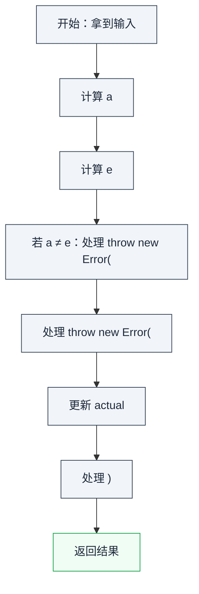

## TypeScript 解题方案（6 个方案逐个讲）

> **运行与提交**：每个方案都是自包含文件（内嵌用例自测，输出 PASS），整块复制到 `.ts` 文件后 `node 文件名` 即可运行。提交 LeetCode 时，把 `demo` 内的算法函数与辅助类型/函数整体取出、置于文件顶层即可。概念演示（非 LeetCode 编号题），在本地运行即可。

### 方案 1：直接实现

**分析与思路**：核心做法是「直接实现」。

**运行方式**：`node 本文件`，内嵌用例全部通过会输出 PASS。


**方案专属流程图**（真实控制流）：


```typescript
function assertEq(actual: any, expected: any, msg: string = ''): void {
  // 定义函数/方法 assertEq
  const a = JSON.stringify(actual);
  const e = JSON.stringify(expected);
  if (a !== e)
    throw new Error(
      'ASSERT FAILED ' + msg + ' :: actual=' + a + ' expected=' + e,
    );
}

function mergeSort(nums: number[]): number[] {
  // 定义函数/方法 mergeSort
  if (nums.length <= 1) return nums.slice(); // 若 数组.长度 不超过 1，直接返回 数组 截取 )
  const mid = Math.floor(nums.length / 2); // 把 向下取整(数组.长度 除以 2) 存入 中点
  const left = mergeSort(nums.slice(0, mid)); // 把 mergeSort(数组 截取 0, 中点)) 存入 左边界
  const right = mergeSort(nums.slice(mid)); // 把 mergeSort(数组 截取 中点)) 存入 右边界
  return merge(left, right); // 返回 merge(左边界, 右边界)
}
function merge(left: number[], right: number[]): number[] {
  // 定义函数/方法 merge
  const result: number[] = [];
  let i = 0,
    j = 0; // 把 []; let 下标 i 赋值为 0, 下标 j 赋值为 0; 写入 const result: number[]
  while (i < left.length && j < right.length) {
    // 循环，直到不满足「下标 i 小于 左边界.长度 且 下标 j 小于 右边界.长度」
    if (left[i] <= right[j]) result.push(left[i++]);
    else result.push(right[j++]);
  }
  while (i < left.length) result.push(left[i++]); // 循环，直到不满足「下标 i 小于 左边界.长度) 结果 追加 左边界[下标 i 加一 ]);」
  while (j < right.length) result.push(right[j++]); // 循环，直到不满足「下标 j 小于 右边界.长度) 结果 追加 右边界[下标 j 加一 ]);」
  return result; // 返回 结果
}
export function demo(): void {
  // 程序入口：跑内嵌自测用例
  assertEq(mergeSort([1, 2, 3]), [1, 2, 3], 'sorted'); // 断言校验
  assertEq(mergeSort([3, 1, 2]), [1, 2, 3], 'unsorted'); // 断言校验
  assertEq(mergeSort([]), [], 'empty'); // 断言校验
  console.log('PASS'); // 全部用例通过，输出 PASS
}
demo(); // demo();
```

### 方案 2：直接实现

**分析与思路**：核心做法是「直接实现」。

**运行方式**：`node 本文件`，内嵌用例全部通过会输出 PASS。


**方案专属流程图**（真实控制流）：

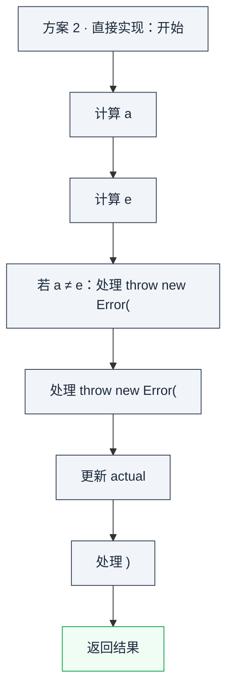

```typescript
function assertEq(actual: any, expected: any, msg: string = ''): void {
  // 定义函数/方法 assertEq
  const a = JSON.stringify(actual);
  const e = JSON.stringify(expected);
  if (a !== e)
    throw new Error(
      'ASSERT FAILED ' + msg + ' :: actual=' + a + ' expected=' + e,
    );
}

function mergeSort(nums: number[]): number[] {
  // 定义函数/方法 mergeSort
  if (nums.length <= 1) return nums.slice(); // 若 数组.长度 不超过 1，直接返回 数组 截取 )
  const mid = Math.floor(nums.length / 2); // 把 向下取整(数组.长度 除以 2) 存入 中点
  const left = mergeSort(nums.slice(0, mid)); // 把 mergeSort(数组 截取 0, 中点)) 存入 左边界
  const right = mergeSort(nums.slice(mid)); // 把 mergeSort(数组 截取 中点)) 存入 右边界
  return merge(left, right); // 返回 merge(左边界, 右边界)
}
function merge(left: number[], right: number[]): number[] {
  // 定义函数/方法 merge
  const result: number[] = [];
  let i = 0,
    j = 0; // 把 []; let 下标 i 赋值为 0, 下标 j 赋值为 0; 写入 const result: number[]
  while (i < left.length && j < right.length) {
    // 循环，直到不满足「下标 i 小于 左边界.长度 且 下标 j 小于 右边界.长度」
    if (left[i] <= right[j]) result.push(left[i++]);
    else result.push(right[j++]);
  }
  while (i < left.length) result.push(left[i++]); // 循环，直到不满足「下标 i 小于 左边界.长度) 结果 追加 左边界[下标 i 加一 ]);」
  while (j < right.length) result.push(right[j++]); // 循环，直到不满足「下标 j 小于 右边界.长度) 结果 追加 右边界[下标 j 加一 ]);」
  return result; // 返回 结果
}
export function demo(): void {
  // 程序入口：跑内嵌自测用例
  assertEq(mergeSort([1, 2, 3]), [1, 2, 3], 'sorted'); // 断言校验
  assertEq(mergeSort([3, 1, 2]), [1, 2, 3], 'unsorted'); // 断言校验
  assertEq(mergeSort([]), [], 'empty'); // 断言校验
  console.log('PASS'); // 全部用例通过，输出 PASS
}
demo(); // demo();
```

### 方案 3：迭代指针处理

**分析与思路**：核心做法是「迭代指针处理」。代码里依次做这些事：队列或堆的调度。

**运行方式**：`node 本文件`，内嵌用例全部通过会输出 PASS。


**方案专属流程图**（真实控制流）：


```typescript
class TreeNode {
  // 定义类型
  val: any;
  left: any;
  right: any; // 值: any; 左边界: any; 右边界: any;
  constructor(val?: any, left?: any, right?: any) {
    // constructor(值?: any, 左边界?: any, 右边界?: any) {
    this.val = val === undefined ? 0 : val; // 把 (值 全等于 undefined ? 0 : 值); 写入 值
    this.left = left === undefined ? null : left; // 把 (左边界 全等于 undefined ? null : 左边界); 写入 左边界
    this.right = right === undefined ? null : right; // 把 (右边界 全等于 undefined ? null : 右边界); 写入 右边界
  }
}
function buildTree(vals: any): any {
  // 定义函数/方法 buildTree
  if (!vals || vals.length === 0) return null; // 若 取反 vals 或 vals.长度 全等于 0，直接返回 null
  const root = new TreeNode(vals[0]);
  const q: any[] = [root];
  let i = 1;
  while (q.length && i < vals.length) {
    // 循环，直到不满足「节点.长度 且 下标 i 小于 vals.长度」
    const node = q.shift(); // 把 节点.shift() 存入 节点
    if (vals[i] !== null && vals[i] !== undefined) {
      node.left = new TreeNode(vals[i]);
      q.push(node.left);
    }
    i++; // 下标 i 加一
    if (i < vals.length && vals[i] !== null && vals[i] !== undefined) {
      node.right = new TreeNode(vals[i]);
      q.push(node.right);
    }
    i++; // 下标 i 加一
  }
  return root; // 返回 根节点
}
function treeToLevel(root: any): any[] {
  // 定义函数/方法 treeToLevel
  if (!root) return []; // 若 取反 根节点，直接返回 []
  const out: any[] = [];
  const q: any[] = [root]; // 把 []; const 节点: any[] 赋值为 [根节点]; 写入 const out: any[]
  while (q.length) {
    // 循环，直到不满足「节点.长度」
    const n = q.shift(); // 把 节点.shift() 存入 元素个数
    if (n === null || n === undefined) {
      out.push(null);
      continue;
    }
    out.push(n.val);
    q.push(n.left);
    q.push(n.right); // 把 元素个数.值 压入栈/数组尾部
  }
  while (out.length && out[out.length - 1] === null) out.pop(); // 循环，直到不满足「out.长度 且 out[out.长度 减 1] 全等于 null) out 弹出 );」
  return out; // 返回 out
}
class ListNode {
  // 定义类型
  val: any;
  next: any; // 值: any; 下一个: any;
  constructor(val?: any, next?: any) {
    this.val = val === undefined ? 0 : val;
    this.next = next === undefined ? null : next;
  }
}
function buildList(vals: any): any {
  // 定义函数/方法 buildList
  const dummy = new ListNode(0);
  let cur = dummy; // 把 new ListNode(0); let 当前值 赋值为 哨兵节点 存入 哨兵节点
  for (const v of vals) {
    cur.next = new ListNode(v);
    cur = cur.next;
  } // 把 new ListNode(值); 当前值 赋值为 当前值.下一个; } 写入 下一个
  return dummy.next; // 返回 哨兵节点.下一个
}
function listToArray(head: any): any[] {
  // 定义函数/方法 listToArray
  const out: any[] = [];
  let p = head; // 把 []; let 节点 赋值为 头节点; 写入 const out: any[]
  while (p) {
    out.push(p.val);
    p = p.next;
  } // 循环，直到不满足「节点) { out 追加 节点.值); 节点 赋值为 节点.下一个; }」
  return out; // 返回 out
}
// python-runtime shims
function pyLen(a: any): number {
  // 定义函数/方法 pyLen
  if (a === null || a === undefined) return 0; // 若 数组 全等于 null 或 数组 全等于 undefined，直接返回 0
  if (
    typeof a === 'string' ||
    Array.isArray(a) ||
    a instanceof Set ||
    a instanceof Map
  )
    return a.length ?? a.size;
  if (typeof a === 'object') return Object.keys(a).length; // 若 typeof 数组 全等于 'object'，直接返回 Object.keys(数组).长度
  return 0; // 返回 0
}
function pySlice(a: any, i: any, j: any, step?: any): any {
  // 定义函数/方法 pySlice
  if (typeof a === 'string') {
    const r = [...a].slice(i ?? 0, j ?? a.length);
    return step ? r.reverse().join('') : r.join('');
  }
  const arr = Array.isArray(a) ? a : [...a]; // 把 Array.isArray(数组) ? 数组 : 复制的 数组 存入 数组
  return arr.slice(i ?? 0, j ?? arr.length); // 返回 数组 截取 下标 i ?? 0, 下标 j ?? 数组.长度)
}
function pyRange(a: any, b?: any, step?: any): any[] {
  // 定义函数/方法 pyRange
  let s = 0,
    e = a,
    st = 1; // 把 0, e 赋值为 数组, st 赋值为 1 存入 字符串
  if (b !== undefined) {
    s = a;
    e = b;
  } // 若 b 不等于 undefined) { 字符串 赋值为 数组; e 赋值为 b; }
  if (step !== undefined) st = step; // 若 步数 不等于 undefined) st 赋值为 步数;
  const out: any[] = []; // 把 []; 写入 const out: any[]
  if (st > 0) for (let i = s; i < e; i += st) out.push(i);
  else for (let i = s; i > e; i += st) out.push(i); // 否则
  return out; // 返回 out
}
function pyIn(x: any, coll: any): boolean {
  // 定义函数/方法 pyIn
  if (coll === null || coll === undefined) return false; // 若 coll 全等于 null 或 coll 全等于 undefined，直接返回 false
  if (Array.isArray(coll)) return coll.includes(x); // 若 Array.isArray(coll)，直接返回 coll 是否包含 x)
  if (coll instanceof Set || coll instanceof Map) return coll.has(x); // 若 coll instanceof Set 或 coll instanceof Map，直接返回 coll.has(x)
  if (typeof coll === 'object') return x in coll; // 若 typeof coll 全等于 'object'，直接返回 x in coll
  if (typeof coll === 'string') return coll.indexOf(x) >= 0; // 若 typeof coll 全等于 'string'，直接返回 coll 查找 x) 不低于 0
  return false; // 返回 false
}
function pySorted(a: any): any[] {
  // 定义函数/方法 pySorted
  const arr = typeof a === 'string' ? [...a] : [...a]; // 把 (typeof 数组 全等于 'string') ? 复制的 数组 : 复制的 数组 存入 数组
  return arr.sort((x: any, y: any) => (x < y ? -1 : x > y ? 1 : 0));
}
function pyMin(a: any, b?: any): any {
  if (b !== undefined) return Math.min(a, b);
  if (Array.isArray(a) || a instanceof Set) return Math.min(...a);
  return Math.min(a);
} // 定义函数/方法 pyMin
function pyMax(a: any, b?: any): any {
  if (b !== undefined) return Math.max(a, b);
  if (Array.isArray(a) || a instanceof Set) return Math.max(...a);
  return Math.max(a);
} // 定义函数/方法 pyMax
function pySum(a: any): number {
  let s = 0;
  for (const v of a) s += v;
  return s;
} // 定义函数/方法 pySum
function pyAbs(x: any): number {
  return Math.abs(x);
} // 定义函数/方法 pyAbs
function pyEnumerate(a: any): any[] {
  const out: any[] = [];
  let i = 0;
  for (const v of a) {
    out.push([i, v]);
    i++;
  }
  return out;
} // 定义函数/方法 pyEnumerate
function pyZip(a: any, b: any): any[] {
  const n = Math.min(a.length, b.length);
  const out: any[] = [];
  for (let i = 0; i < n; i++) out.push([a[i], b[i]]);
  return out;
} // 定义函数/方法 pyZip
function pyDictGet(d: any, k: any, def?: any): any {
  return k in d ? d[k] : def === undefined ? null : def;
} // 定义函数/方法 pyDictGet
function pyPrint(...args: any[]): void {
  console.log(
    args
      .map((a) => (typeof a === 'object' && a !== null ? JSON.stringify(a) : a))
      .join(' '),
  );
} // 定义函数/方法 pyPrint
// collections / heapq
function heapPush(h: any[], x: any): void {
  h.push(x);
  let i = h.length - 1;
  while (i > 0) {
    const p = (i - 1) >> 1;
    if (h[p] <= h[i]) break;
    [h[p], h[i]] = [h[i], h[p]];
    i = p;
  }
} // 定义函数/方法 heapPush
function heapPop(h: any[]): any {
  const top = h[0];
  const last = h.pop();
  if (h.length) {
    h[0] = last;
    let i = 0;
    const n = h.length;
    while (true) {
      let l = 2 * i + 1,
        r = 2 * i + 2,
        s = i;
      if (l < n && h[l] < h[s]) s = l;
      if (r < n && h[r] < h[s]) s = r;
      if (s === i) break;
      [h[s], h[i]] = [h[i], h[s]];
      i = s;
    }
  }
  return top;
} // 定义函数/方法 heapPop
class Deque {
  private a: any[] = [];
  push(x: any) {
    this.a.push(x);
  }
  pushLeft(x: any) {
    this.a.unshift(x);
  }
  pop() {
    return this.a.pop();
  }
  popLeft() {
    return this.a.shift();
  }
  get length() {
    return this.a.length;
  }
  toArray() {
    return this.a.slice();
  }
} // 定义类型
function Counter(iter: any): any {
  const m: any = {};
  for (const v of iter) m[v] = (m[v] || 0) + 1;
  return m;
} // 定义函数/方法 Counter
function gcd(a: any, b: any): any {
  while (b) {
    [a, b] = [b, a % b];
  }
  return a;
} // 定义函数/方法 gcd
function pyInf(): number {
  return Infinity;
} // 定义函数/方法 pyInf

function norm(x: any): any {
  // 定义函数/方法 norm
  if (x === null || x === undefined) return null; // 若 x 全等于 null 或 x 全等于 undefined，直接返回 null
  if (typeof x === 'object') {
    // 若 typeof x 全等于 'object'
    if (x instanceof Deque) return x.toArray(); // 若 x instanceof Deque，直接返回 x.toArray()
    if (Array.isArray(x)) return x.map(norm); // 若 Array.isArray(x)，直接返回 x.映射表(norm)
    if (
      typeof x.val === 'number' &&
      (typeof x.left !== 'undefined' || typeof x.right !== 'undefined')
    )
      return treeToLevel(x);
    if (typeof x.next !== 'undefined' && typeof x.val === 'number')
      return listToArray(x);
    if (x instanceof Set) return [...x].sort(); // 若 x instanceof Set，直接返回 复制的 x 排序 )
    if (x instanceof Map) return Object.fromEntries(x); // 若 x instanceof Map，直接返回 Object.fromEntries(x)
    const o: any = {};
    for (const k of Object.keys(x)) o[k] = norm(x[k]);
    return o;
  }
  return x; // 返回 x
}
function eq(a: any, b: any): boolean {
  // 定义函数/方法 eq
  const x = norm(a),
    y = norm(b); // 把 norm(数组), y 赋值为 norm(b) 存入 x
  if (x === y) return true; // 若 x 全等于 y，直接返回 true
  if (x === null || y === null) return x === y; // 若 x 全等于 null 或 y 全等于 null，直接返回 x 全等于 y
  if (Array.isArray(x) && Array.isArray(y)) {
    // 若 Array.isArray(x) 且 Array.isArray(y
    if (x.length !== y.length) return false; // 若 x.长度 不等于 y.长度，直接返回 false
    for (let i = 0; i < x.length; i++) if (!eq(x[i], y[i])) return false; // 让 下标 i 从 0 开始计数，下标 i 小于 x.长度 就继续
    return true; // 返回 true
  }
  if (typeof x === 'object' && typeof y === 'object') {
    // 若 typeof x 全等于 'object' 且 typeof y 全等于 'object'
    const kx = Object.keys(x),
      ky = Object.keys(y); // 把 Object.keys(x), ky 赋值为 Object.keys(y) 存入 kx
    if (kx.length !== ky.length) return false; // 若 kx.长度 不等于 ky.长度，直接返回 false
    for (const k of kx) if (!eq(x[k], y[k])) return false;
    return true; // 返回 true
  }
  return x === y; // 返回 x 全等于 y
}

function mergeSort(nums) {
  // 定义函数/方法 mergeSort
  if (nums.length <= 1) return nums.slice(); // 若 数组.长度 不超过 1，直接返回 数组 截取 )
  const m = nums.length >> 1; // 把 数组.长度 超过 超过 1 存入 映射表
  const left = mergeSort(nums.slice(0, m)); // 把 mergeSort(数组 截取 0, 映射表)) 存入 左边界
  const right = mergeSort(nums.slice(m)); // 把 mergeSort(数组 截取 映射表)) 存入 右边界
  const out = [];
  let i = 0,
    j = 0; // 把 []; let 下标 i 赋值为 0, 下标 j 赋值为 0 存入 out
  while (i < left.length && j < right.length) {
    // 循环，直到不满足「下标 i 小于 左边界.长度 且 下标 j 小于 右边界.长度」
    if (left[i] <= right[j]) out.push(left[i++]);
    else out.push(right[j++]);
  }
  while (i < left.length) out.push(left[i++]); // 循环，直到不满足「下标 i 小于 左边界.长度) out 追加 左边界[下标 i 加一 ]);」
  while (j < right.length) out.push(right[j++]); // 循环，直到不满足「下标 j 小于 右边界.长度) out 追加 右边界[下标 j 加一 ]);」
  return out; // 返回 out
}
export function demo(): void {
  // 程序入口：跑内嵌自测用例
  const cases = [
    { in: [[5, 2, 4, 6, 1, 3]], want: [1, 2, 3, 4, 5, 6] },
    { in: [[9, 8, 7, 6, 5]], want: [5, 6, 7, 8, 9] },
    { in: [[1, 2, 3]], want: [1, 2, 3] },
    { in: [[]], want: [] },
  ];
  let fail = false; // 把 false 存入 fail
  for (const c of cases) {
    // for (const 字符 of cases) {
    const got = mergeSort(...c.in); // 把 mergeSort(...字符.in) 存入 got
    if (!eq(got, c.want)) {
      fail = true;
      console.log(
        'FAIL',
        JSON.stringify(c.in),
        '=>',
        JSON.stringify(got),
        'want',
        JSON.stringify(c.want),
      );
    }
  }
  if (fail) throw new Error('FAILED'); // 若 fail) throw new Error('FAILED');
  console.log('PASS'); // 全部用例通过，输出 PASS
}
demo(); // demo();
```

### 方案 4：迭代指针处理

**分析与思路**：核心做法是「迭代指针处理」。代码里依次做这些事：队列或堆的调度。

**运行方式**：`node 本文件`，内嵌用例全部通过会输出 PASS。


**方案专属流程图**（真实控制流）：

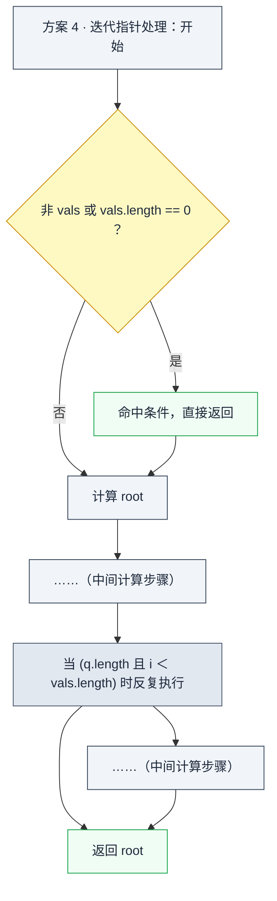

```typescript
class TreeNode {
  // 定义类型
  val: any;
  left: any;
  right: any; // 值: any; 左边界: any; 右边界: any;
  constructor(val?: any, left?: any, right?: any) {
    // constructor(值?: any, 左边界?: any, 右边界?: any) {
    this.val = val === undefined ? 0 : val; // 把 (值 全等于 undefined ? 0 : 值); 写入 值
    this.left = left === undefined ? null : left; // 把 (左边界 全等于 undefined ? null : 左边界); 写入 左边界
    this.right = right === undefined ? null : right; // 把 (右边界 全等于 undefined ? null : 右边界); 写入 右边界
  }
}
function buildTree(vals: any): any {
  // 定义函数/方法 buildTree
  if (!vals || vals.length === 0) return null; // 若 取反 vals 或 vals.长度 全等于 0，直接返回 null
  const root = new TreeNode(vals[0]);
  const q: any[] = [root];
  let i = 1;
  while (q.length && i < vals.length) {
    // 循环，直到不满足「节点.长度 且 下标 i 小于 vals.长度」
    const node = q.shift(); // 把 节点.shift() 存入 节点
    if (vals[i] !== null && vals[i] !== undefined) {
      node.left = new TreeNode(vals[i]);
      q.push(node.left);
    }
    i++; // 下标 i 加一
    if (i < vals.length && vals[i] !== null && vals[i] !== undefined) {
      node.right = new TreeNode(vals[i]);
      q.push(node.right);
    }
    i++; // 下标 i 加一
  }
  return root; // 返回 根节点
}
function treeToLevel(root: any): any[] {
  // 定义函数/方法 treeToLevel
  if (!root) return []; // 若 取反 根节点，直接返回 []
  const out: any[] = [];
  const q: any[] = [root]; // 把 []; const 节点: any[] 赋值为 [根节点]; 写入 const out: any[]
  while (q.length) {
    // 循环，直到不满足「节点.长度」
    const n = q.shift(); // 把 节点.shift() 存入 元素个数
    if (n === null || n === undefined) {
      out.push(null);
      continue;
    }
    out.push(n.val);
    q.push(n.left);
    q.push(n.right); // 把 元素个数.值 压入栈/数组尾部
  }
  while (out.length && out[out.length - 1] === null) out.pop(); // 循环，直到不满足「out.长度 且 out[out.长度 减 1] 全等于 null) out 弹出 );」
  return out; // 返回 out
}
class ListNode {
  // 定义类型
  val: any;
  next: any; // 值: any; 下一个: any;
  constructor(val?: any, next?: any) {
    this.val = val === undefined ? 0 : val;
    this.next = next === undefined ? null : next;
  }
}
function buildList(vals: any): any {
  // 定义函数/方法 buildList
  const dummy = new ListNode(0);
  let cur = dummy; // 把 new ListNode(0); let 当前值 赋值为 哨兵节点 存入 哨兵节点
  for (const v of vals) {
    cur.next = new ListNode(v);
    cur = cur.next;
  } // 把 new ListNode(值); 当前值 赋值为 当前值.下一个; } 写入 下一个
  return dummy.next; // 返回 哨兵节点.下一个
}
function listToArray(head: any): any[] {
  // 定义函数/方法 listToArray
  const out: any[] = [];
  let p = head; // 把 []; let 节点 赋值为 头节点; 写入 const out: any[]
  while (p) {
    out.push(p.val);
    p = p.next;
  } // 循环，直到不满足「节点) { out 追加 节点.值); 节点 赋值为 节点.下一个; }」
  return out; // 返回 out
}
// python-runtime shims
function pyLen(a: any): number {
  // 定义函数/方法 pyLen
  if (a === null || a === undefined) return 0; // 若 数组 全等于 null 或 数组 全等于 undefined，直接返回 0
  if (
    typeof a === 'string' ||
    Array.isArray(a) ||
    a instanceof Set ||
    a instanceof Map
  )
    return a.length ?? a.size;
  if (typeof a === 'object') return Object.keys(a).length; // 若 typeof 数组 全等于 'object'，直接返回 Object.keys(数组).长度
  return 0; // 返回 0
}
function pySlice(a: any, i: any, j: any, step?: any): any {
  // 定义函数/方法 pySlice
  if (typeof a === 'string') {
    const r = [...a].slice(i ?? 0, j ?? a.length);
    return step ? r.reverse().join('') : r.join('');
  }
  const arr = Array.isArray(a) ? a : [...a]; // 把 Array.isArray(数组) ? 数组 : 复制的 数组 存入 数组
  return arr.slice(i ?? 0, j ?? arr.length); // 返回 数组 截取 下标 i ?? 0, 下标 j ?? 数组.长度)
}
function pyRange(a: any, b?: any, step?: any): any[] {
  // 定义函数/方法 pyRange
  let s = 0,
    e = a,
    st = 1; // 把 0, e 赋值为 数组, st 赋值为 1 存入 字符串
  if (b !== undefined) {
    s = a;
    e = b;
  } // 若 b 不等于 undefined) { 字符串 赋值为 数组; e 赋值为 b; }
  if (step !== undefined) st = step; // 若 步数 不等于 undefined) st 赋值为 步数;
  const out: any[] = []; // 把 []; 写入 const out: any[]
  if (st > 0) for (let i = s; i < e; i += st) out.push(i);
  else for (let i = s; i > e; i += st) out.push(i); // 否则
  return out; // 返回 out
}
function pyIn(x: any, coll: any): boolean {
  // 定义函数/方法 pyIn
  if (coll === null || coll === undefined) return false; // 若 coll 全等于 null 或 coll 全等于 undefined，直接返回 false
  if (Array.isArray(coll)) return coll.includes(x); // 若 Array.isArray(coll)，直接返回 coll 是否包含 x)
  if (coll instanceof Set || coll instanceof Map) return coll.has(x); // 若 coll instanceof Set 或 coll instanceof Map，直接返回 coll.has(x)
  if (typeof coll === 'object') return x in coll; // 若 typeof coll 全等于 'object'，直接返回 x in coll
  if (typeof coll === 'string') return coll.indexOf(x) >= 0; // 若 typeof coll 全等于 'string'，直接返回 coll 查找 x) 不低于 0
  return false; // 返回 false
}
function pySorted(a: any): any[] {
  // 定义函数/方法 pySorted
  const arr = typeof a === 'string' ? [...a] : [...a]; // 把 (typeof 数组 全等于 'string') ? 复制的 数组 : 复制的 数组 存入 数组
  return arr.sort((x: any, y: any) => (x < y ? -1 : x > y ? 1 : 0));
}
function pyMin(a: any, b?: any): any {
  if (b !== undefined) return Math.min(a, b);
  if (Array.isArray(a) || a instanceof Set) return Math.min(...a);
  return Math.min(a);
} // 定义函数/方法 pyMin
function pyMax(a: any, b?: any): any {
  if (b !== undefined) return Math.max(a, b);
  if (Array.isArray(a) || a instanceof Set) return Math.max(...a);
  return Math.max(a);
} // 定义函数/方法 pyMax
function pySum(a: any): number {
  let s = 0;
  for (const v of a) s += v;
  return s;
} // 定义函数/方法 pySum
function pyAbs(x: any): number {
  return Math.abs(x);
} // 定义函数/方法 pyAbs
function pyEnumerate(a: any): any[] {
  const out: any[] = [];
  let i = 0;
  for (const v of a) {
    out.push([i, v]);
    i++;
  }
  return out;
} // 定义函数/方法 pyEnumerate
function pyZip(a: any, b: any): any[] {
  const n = Math.min(a.length, b.length);
  const out: any[] = [];
  for (let i = 0; i < n; i++) out.push([a[i], b[i]]);
  return out;
} // 定义函数/方法 pyZip
function pyDictGet(d: any, k: any, def?: any): any {
  return k in d ? d[k] : def === undefined ? null : def;
} // 定义函数/方法 pyDictGet
function pyPrint(...args: any[]): void {
  console.log(
    args
      .map((a) => (typeof a === 'object' && a !== null ? JSON.stringify(a) : a))
      .join(' '),
  );
} // 定义函数/方法 pyPrint
// collections / heapq
function heapPush(h: any[], x: any): void {
  h.push(x);
  let i = h.length - 1;
  while (i > 0) {
    const p = (i - 1) >> 1;
    if (h[p] <= h[i]) break;
    [h[p], h[i]] = [h[i], h[p]];
    i = p;
  }
} // 定义函数/方法 heapPush
function heapPop(h: any[]): any {
  const top = h[0];
  const last = h.pop();
  if (h.length) {
    h[0] = last;
    let i = 0;
    const n = h.length;
    while (true) {
      let l = 2 * i + 1,
        r = 2 * i + 2,
        s = i;
      if (l < n && h[l] < h[s]) s = l;
      if (r < n && h[r] < h[s]) s = r;
      if (s === i) break;
      [h[s], h[i]] = [h[i], h[s]];
      i = s;
    }
  }
  return top;
} // 定义函数/方法 heapPop
class Deque {
  private a: any[] = [];
  push(x: any) {
    this.a.push(x);
  }
  pushLeft(x: any) {
    this.a.unshift(x);
  }
  pop() {
    return this.a.pop();
  }
  popLeft() {
    return this.a.shift();
  }
  get length() {
    return this.a.length;
  }
  toArray() {
    return this.a.slice();
  }
} // 定义类型
function Counter(iter: any): any {
  const m: any = {};
  for (const v of iter) m[v] = (m[v] || 0) + 1;
  return m;
} // 定义函数/方法 Counter
function gcd(a: any, b: any): any {
  while (b) {
    [a, b] = [b, a % b];
  }
  return a;
} // 定义函数/方法 gcd
function pyInf(): number {
  return Infinity;
} // 定义函数/方法 pyInf

function norm(x: any): any {
  // 定义函数/方法 norm
  if (x === null || x === undefined) return null; // 若 x 全等于 null 或 x 全等于 undefined，直接返回 null
  if (typeof x === 'object') {
    // 若 typeof x 全等于 'object'
    if (x instanceof Deque) return x.toArray(); // 若 x instanceof Deque，直接返回 x.toArray()
    if (Array.isArray(x)) return x.map(norm); // 若 Array.isArray(x)，直接返回 x.映射表(norm)
    if (
      typeof x.val === 'number' &&
      (typeof x.left !== 'undefined' || typeof x.right !== 'undefined')
    )
      return treeToLevel(x);
    if (typeof x.next !== 'undefined' && typeof x.val === 'number')
      return listToArray(x);
    if (x instanceof Set) return [...x].sort(); // 若 x instanceof Set，直接返回 复制的 x 排序 )
    if (x instanceof Map) return Object.fromEntries(x); // 若 x instanceof Map，直接返回 Object.fromEntries(x)
    const o: any = {};
    for (const k of Object.keys(x)) o[k] = norm(x[k]);
    return o;
  }
  return x; // 返回 x
}
function eq(a: any, b: any): boolean {
  // 定义函数/方法 eq
  const x = norm(a),
    y = norm(b); // 把 norm(数组), y 赋值为 norm(b) 存入 x
  if (x === y) return true; // 若 x 全等于 y，直接返回 true
  if (x === null || y === null) return x === y; // 若 x 全等于 null 或 y 全等于 null，直接返回 x 全等于 y
  if (Array.isArray(x) && Array.isArray(y)) {
    // 若 Array.isArray(x) 且 Array.isArray(y
    if (x.length !== y.length) return false; // 若 x.长度 不等于 y.长度，直接返回 false
    for (let i = 0; i < x.length; i++) if (!eq(x[i], y[i])) return false; // 让 下标 i 从 0 开始计数，下标 i 小于 x.长度 就继续
    return true; // 返回 true
  }
  if (typeof x === 'object' && typeof y === 'object') {
    // 若 typeof x 全等于 'object' 且 typeof y 全等于 'object'
    const kx = Object.keys(x),
      ky = Object.keys(y); // 把 Object.keys(x), ky 赋值为 Object.keys(y) 存入 kx
    if (kx.length !== ky.length) return false; // 若 kx.长度 不等于 ky.长度，直接返回 false
    for (const k of kx) if (!eq(x[k], y[k])) return false;
    return true; // 返回 true
  }
  return x === y; // 返回 x 全等于 y
}

function mergeSort(nums) {
  // 定义函数/方法 mergeSort
  if (nums.length <= 1) return nums.slice(); // 若 数组.长度 不超过 1，直接返回 数组 截取 )
  const m = nums.length >> 1; // 把 数组.长度 超过 超过 1 存入 映射表
  const left = mergeSort(nums.slice(0, m)); // 把 mergeSort(数组 截取 0, 映射表)) 存入 左边界
  const right = mergeSort(nums.slice(m)); // 把 mergeSort(数组 截取 映射表)) 存入 右边界
  const out = [];
  let i = 0,
    j = 0; // 把 []; let 下标 i 赋值为 0, 下标 j 赋值为 0 存入 out
  while (i < left.length && j < right.length) {
    // 循环，直到不满足「下标 i 小于 左边界.长度 且 下标 j 小于 右边界.长度」
    if (left[i] <= right[j]) out.push(left[i++]);
    else out.push(right[j++]);
  }
  while (i < left.length) out.push(left[i++]); // 循环，直到不满足「下标 i 小于 左边界.长度) out 追加 左边界[下标 i 加一 ]);」
  while (j < right.length) out.push(right[j++]); // 循环，直到不满足「下标 j 小于 右边界.长度) out 追加 右边界[下标 j 加一 ]);」
  return out; // 返回 out
}
export function demo(): void {
  // 程序入口：跑内嵌自测用例
  const cases = [
    { in: [[5, 2, 4, 6, 1, 3]], want: [1, 2, 3, 4, 5, 6] },
    { in: [[9, 8, 7, 6, 5]], want: [5, 6, 7, 8, 9] },
    { in: [[1, 2, 3]], want: [1, 2, 3] },
    { in: [[]], want: [] },
  ];
  let fail = false; // 把 false 存入 fail
  for (const c of cases) {
    // for (const 字符 of cases) {
    const got = mergeSort(...c.in); // 把 mergeSort(...字符.in) 存入 got
    if (!eq(got, c.want)) {
      fail = true;
      console.log(
        'FAIL',
        JSON.stringify(c.in),
        '=>',
        JSON.stringify(got),
        'want',
        JSON.stringify(c.want),
      );
    }
  }
  if (fail) throw new Error('FAILED'); // 若 fail) throw new Error('FAILED');
  console.log('PASS'); // 全部用例通过，输出 PASS
}
demo(); // demo();
```

### 方案 5：迭代指针处理

**分析与思路**：核心做法是「迭代指针处理」。代码里依次做这些事：队列或堆的调度。

**运行方式**：`node 本文件`，内嵌用例全部通过会输出 PASS。


**方案专属流程图**（真实控制流）：


```typescript
class TreeNode {
  // 定义类型
  val: any;
  left: any;
  right: any; // 值: any; 左边界: any; 右边界: any;
  constructor(val?: any, left?: any, right?: any) {
    // constructor(值?: any, 左边界?: any, 右边界?: any) {
    this.val = val === undefined ? 0 : val; // 把 (值 全等于 undefined ? 0 : 值); 写入 值
    this.left = left === undefined ? null : left; // 把 (左边界 全等于 undefined ? null : 左边界); 写入 左边界
    this.right = right === undefined ? null : right; // 把 (右边界 全等于 undefined ? null : 右边界); 写入 右边界
  }
}
function buildTree(vals: any): any {
  // 定义函数/方法 buildTree
  if (!vals || vals.length === 0) return null; // 若 取反 vals 或 vals.长度 全等于 0，直接返回 null
  const root = new TreeNode(vals[0]);
  const q: any[] = [root];
  let i = 1;
  while (q.length && i < vals.length) {
    // 循环，直到不满足「节点.长度 且 下标 i 小于 vals.长度」
    const node = q.shift(); // 把 节点.shift() 存入 节点
    if (vals[i] !== null && vals[i] !== undefined) {
      node.left = new TreeNode(vals[i]);
      q.push(node.left);
    }
    i++; // 下标 i 加一
    if (i < vals.length && vals[i] !== null && vals[i] !== undefined) {
      node.right = new TreeNode(vals[i]);
      q.push(node.right);
    }
    i++; // 下标 i 加一
  }
  return root; // 返回 根节点
}
function treeToLevel(root: any): any[] {
  // 定义函数/方法 treeToLevel
  if (!root) return []; // 若 取反 根节点，直接返回 []
  const out: any[] = [];
  const q: any[] = [root]; // 把 []; const 节点: any[] 赋值为 [根节点]; 写入 const out: any[]
  while (q.length) {
    // 循环，直到不满足「节点.长度」
    const n = q.shift(); // 把 节点.shift() 存入 元素个数
    if (n === null || n === undefined) {
      out.push(null);
      continue;
    }
    out.push(n.val);
    q.push(n.left);
    q.push(n.right); // 把 元素个数.值 压入栈/数组尾部
  }
  while (out.length && out[out.length - 1] === null) out.pop(); // 循环，直到不满足「out.长度 且 out[out.长度 减 1] 全等于 null) out 弹出 );」
  return out; // 返回 out
}
class ListNode {
  // 定义类型
  val: any;
  next: any; // 值: any; 下一个: any;
  constructor(val?: any, next?: any) {
    this.val = val === undefined ? 0 : val;
    this.next = next === undefined ? null : next;
  }
}
function buildList(vals: any): any {
  // 定义函数/方法 buildList
  const dummy = new ListNode(0);
  let cur = dummy; // 把 new ListNode(0); let 当前值 赋值为 哨兵节点 存入 哨兵节点
  for (const v of vals) {
    cur.next = new ListNode(v);
    cur = cur.next;
  } // 把 new ListNode(值); 当前值 赋值为 当前值.下一个; } 写入 下一个
  return dummy.next; // 返回 哨兵节点.下一个
}
function listToArray(head: any): any[] {
  // 定义函数/方法 listToArray
  const out: any[] = [];
  let p = head; // 把 []; let 节点 赋值为 头节点; 写入 const out: any[]
  while (p) {
    out.push(p.val);
    p = p.next;
  } // 循环，直到不满足「节点) { out 追加 节点.值); 节点 赋值为 节点.下一个; }」
  return out; // 返回 out
}
// python-runtime shims
function pyLen(a: any): number {
  // 定义函数/方法 pyLen
  if (a === null || a === undefined) return 0; // 若 数组 全等于 null 或 数组 全等于 undefined，直接返回 0
  if (
    typeof a === 'string' ||
    Array.isArray(a) ||
    a instanceof Set ||
    a instanceof Map
  )
    return a.length ?? a.size;
  if (typeof a === 'object') return Object.keys(a).length; // 若 typeof 数组 全等于 'object'，直接返回 Object.keys(数组).长度
  return 0; // 返回 0
}
function pySlice(a: any, i: any, j: any, step?: any): any {
  // 定义函数/方法 pySlice
  if (typeof a === 'string') {
    const r = [...a].slice(i ?? 0, j ?? a.length);
    return step ? r.reverse().join('') : r.join('');
  }
  const arr = Array.isArray(a) ? a : [...a]; // 把 Array.isArray(数组) ? 数组 : 复制的 数组 存入 数组
  return arr.slice(i ?? 0, j ?? arr.length); // 返回 数组 截取 下标 i ?? 0, 下标 j ?? 数组.长度)
}
function pyRange(a: any, b?: any, step?: any): any[] {
  // 定义函数/方法 pyRange
  let s = 0,
    e = a,
    st = 1; // 把 0, e 赋值为 数组, st 赋值为 1 存入 字符串
  if (b !== undefined) {
    s = a;
    e = b;
  } // 若 b 不等于 undefined) { 字符串 赋值为 数组; e 赋值为 b; }
  if (step !== undefined) st = step; // 若 步数 不等于 undefined) st 赋值为 步数;
  const out: any[] = []; // 把 []; 写入 const out: any[]
  if (st > 0) for (let i = s; i < e; i += st) out.push(i);
  else for (let i = s; i > e; i += st) out.push(i); // 否则
  return out; // 返回 out
}
function pyIn(x: any, coll: any): boolean {
  // 定义函数/方法 pyIn
  if (coll === null || coll === undefined) return false; // 若 coll 全等于 null 或 coll 全等于 undefined，直接返回 false
  if (Array.isArray(coll)) return coll.includes(x); // 若 Array.isArray(coll)，直接返回 coll 是否包含 x)
  if (coll instanceof Set || coll instanceof Map) return coll.has(x); // 若 coll instanceof Set 或 coll instanceof Map，直接返回 coll.has(x)
  if (typeof coll === 'object') return x in coll; // 若 typeof coll 全等于 'object'，直接返回 x in coll
  if (typeof coll === 'string') return coll.indexOf(x) >= 0; // 若 typeof coll 全等于 'string'，直接返回 coll 查找 x) 不低于 0
  return false; // 返回 false
}
function pySorted(a: any): any[] {
  // 定义函数/方法 pySorted
  const arr = typeof a === 'string' ? [...a] : [...a]; // 把 (typeof 数组 全等于 'string') ? 复制的 数组 : 复制的 数组 存入 数组
  return arr.sort((x: any, y: any) => (x < y ? -1 : x > y ? 1 : 0));
}
function pyMin(a: any, b?: any): any {
  if (b !== undefined) return Math.min(a, b);
  if (Array.isArray(a) || a instanceof Set) return Math.min(...a);
  return Math.min(a);
} // 定义函数/方法 pyMin
function pyMax(a: any, b?: any): any {
  if (b !== undefined) return Math.max(a, b);
  if (Array.isArray(a) || a instanceof Set) return Math.max(...a);
  return Math.max(a);
} // 定义函数/方法 pyMax
function pySum(a: any): number {
  let s = 0;
  for (const v of a) s += v;
  return s;
} // 定义函数/方法 pySum
function pyAbs(x: any): number {
  return Math.abs(x);
} // 定义函数/方法 pyAbs
function pyEnumerate(a: any): any[] {
  const out: any[] = [];
  let i = 0;
  for (const v of a) {
    out.push([i, v]);
    i++;
  }
  return out;
} // 定义函数/方法 pyEnumerate
function pyZip(a: any, b: any): any[] {
  const n = Math.min(a.length, b.length);
  const out: any[] = [];
  for (let i = 0; i < n; i++) out.push([a[i], b[i]]);
  return out;
} // 定义函数/方法 pyZip
function pyDictGet(d: any, k: any, def?: any): any {
  return k in d ? d[k] : def === undefined ? null : def;
} // 定义函数/方法 pyDictGet
function pyPrint(...args: any[]): void {
  console.log(
    args
      .map((a) => (typeof a === 'object' && a !== null ? JSON.stringify(a) : a))
      .join(' '),
  );
} // 定义函数/方法 pyPrint
// collections / heapq
function heapPush(h: any[], x: any): void {
  h.push(x);
  let i = h.length - 1;
  while (i > 0) {
    const p = (i - 1) >> 1;
    if (h[p] <= h[i]) break;
    [h[p], h[i]] = [h[i], h[p]];
    i = p;
  }
} // 定义函数/方法 heapPush
function heapPop(h: any[]): any {
  const top = h[0];
  const last = h.pop();
  if (h.length) {
    h[0] = last;
    let i = 0;
    const n = h.length;
    while (true) {
      let l = 2 * i + 1,
        r = 2 * i + 2,
        s = i;
      if (l < n && h[l] < h[s]) s = l;
      if (r < n && h[r] < h[s]) s = r;
      if (s === i) break;
      [h[s], h[i]] = [h[i], h[s]];
      i = s;
    }
  }
  return top;
} // 定义函数/方法 heapPop
class Deque {
  private a: any[] = [];
  push(x: any) {
    this.a.push(x);
  }
  pushLeft(x: any) {
    this.a.unshift(x);
  }
  pop() {
    return this.a.pop();
  }
  popLeft() {
    return this.a.shift();
  }
  get length() {
    return this.a.length;
  }
  toArray() {
    return this.a.slice();
  }
} // 定义类型
function Counter(iter: any): any {
  const m: any = {};
  for (const v of iter) m[v] = (m[v] || 0) + 1;
  return m;
} // 定义函数/方法 Counter
function gcd(a: any, b: any): any {
  while (b) {
    [a, b] = [b, a % b];
  }
  return a;
} // 定义函数/方法 gcd
function pyInf(): number {
  return Infinity;
} // 定义函数/方法 pyInf

function norm(x: any): any {
  // 定义函数/方法 norm
  if (x === null || x === undefined) return null; // 若 x 全等于 null 或 x 全等于 undefined，直接返回 null
  if (typeof x === 'object') {
    // 若 typeof x 全等于 'object'
    if (x instanceof Deque) return x.toArray(); // 若 x instanceof Deque，直接返回 x.toArray()
    if (Array.isArray(x)) return x.map(norm); // 若 Array.isArray(x)，直接返回 x.映射表(norm)
    if (
      typeof x.val === 'number' &&
      (typeof x.left !== 'undefined' || typeof x.right !== 'undefined')
    )
      return treeToLevel(x);
    if (typeof x.next !== 'undefined' && typeof x.val === 'number')
      return listToArray(x);
    if (x instanceof Set) return [...x].sort(); // 若 x instanceof Set，直接返回 复制的 x 排序 )
    if (x instanceof Map) return Object.fromEntries(x); // 若 x instanceof Map，直接返回 Object.fromEntries(x)
    const o: any = {};
    for (const k of Object.keys(x)) o[k] = norm(x[k]);
    return o;
  }
  return x; // 返回 x
}
function eq(a: any, b: any): boolean {
  // 定义函数/方法 eq
  const x = norm(a),
    y = norm(b); // 把 norm(数组), y 赋值为 norm(b) 存入 x
  if (x === y) return true; // 若 x 全等于 y，直接返回 true
  if (x === null || y === null) return x === y; // 若 x 全等于 null 或 y 全等于 null，直接返回 x 全等于 y
  if (Array.isArray(x) && Array.isArray(y)) {
    // 若 Array.isArray(x) 且 Array.isArray(y
    if (x.length !== y.length) return false; // 若 x.长度 不等于 y.长度，直接返回 false
    for (let i = 0; i < x.length; i++) if (!eq(x[i], y[i])) return false; // 让 下标 i 从 0 开始计数，下标 i 小于 x.长度 就继续
    return true; // 返回 true
  }
  if (typeof x === 'object' && typeof y === 'object') {
    // 若 typeof x 全等于 'object' 且 typeof y 全等于 'object'
    const kx = Object.keys(x),
      ky = Object.keys(y); // 把 Object.keys(x), ky 赋值为 Object.keys(y) 存入 kx
    if (kx.length !== ky.length) return false; // 若 kx.长度 不等于 ky.长度，直接返回 false
    for (const k of kx) if (!eq(x[k], y[k])) return false;
    return true; // 返回 true
  }
  return x === y; // 返回 x 全等于 y
}

function mergeSort(nums) {
  // 定义函数/方法 mergeSort
  if (nums.length <= 1) return nums.slice(); // 若 数组.长度 不超过 1，直接返回 数组 截取 )
  const m = nums.length >> 1; // 把 数组.长度 超过 超过 1 存入 映射表
  const left = mergeSort(nums.slice(0, m)); // 把 mergeSort(数组 截取 0, 映射表)) 存入 左边界
  const right = mergeSort(nums.slice(m)); // 把 mergeSort(数组 截取 映射表)) 存入 右边界
  const out = [];
  let i = 0,
    j = 0; // 把 []; let 下标 i 赋值为 0, 下标 j 赋值为 0 存入 out
  while (i < left.length && j < right.length) {
    // 循环，直到不满足「下标 i 小于 左边界.长度 且 下标 j 小于 右边界.长度」
    if (left[i] <= right[j]) out.push(left[i++]);
    else out.push(right[j++]);
  }
  while (i < left.length) out.push(left[i++]); // 循环，直到不满足「下标 i 小于 左边界.长度) out 追加 左边界[下标 i 加一 ]);」
  while (j < right.length) out.push(right[j++]); // 循环，直到不满足「下标 j 小于 右边界.长度) out 追加 右边界[下标 j 加一 ]);」
  return out; // 返回 out
}
export function demo(): void {
  // 程序入口：跑内嵌自测用例
  const cases = [
    { in: [[5, 2, 4, 6, 1, 3]], want: [1, 2, 3, 4, 5, 6] },
    { in: [[9, 8, 7, 6, 5]], want: [5, 6, 7, 8, 9] },
    { in: [[1, 2, 3]], want: [1, 2, 3] },
    { in: [[]], want: [] },
  ];
  let fail = false; // 把 false 存入 fail
  for (const c of cases) {
    // for (const 字符 of cases) {
    const got = mergeSort(...c.in); // 把 mergeSort(...字符.in) 存入 got
    if (!eq(got, c.want)) {
      fail = true;
      console.log(
        'FAIL',
        JSON.stringify(c.in),
        '=>',
        JSON.stringify(got),
        'want',
        JSON.stringify(c.want),
      );
    }
  }
  if (fail) throw new Error('FAILED'); // 若 fail) throw new Error('FAILED');
  console.log('PASS'); // 全部用例通过，输出 PASS
}
demo(); // demo();
```

### 方案 6：迭代指针处理

**分析与思路**：核心做法是「迭代指针处理」。代码里依次做这些事：队列或堆的调度。

**运行方式**：`node 本文件`，内嵌用例全部通过会输出 PASS。


**方案专属流程图**（真实控制流）：


```typescript
class TreeNode {
  // 定义类型
  val: any;
  left: any;
  right: any; // 值: any; 左边界: any; 右边界: any;
  constructor(val?: any, left?: any, right?: any) {
    // constructor(值?: any, 左边界?: any, 右边界?: any) {
    this.val = val === undefined ? 0 : val; // 把 (值 全等于 undefined ? 0 : 值); 写入 值
    this.left = left === undefined ? null : left; // 把 (左边界 全等于 undefined ? null : 左边界); 写入 左边界
    this.right = right === undefined ? null : right; // 把 (右边界 全等于 undefined ? null : 右边界); 写入 右边界
  }
}
function buildTree(vals: any): any {
  // 定义函数/方法 buildTree
  if (!vals || vals.length === 0) return null; // 若 取反 vals 或 vals.长度 全等于 0，直接返回 null
  const root = new TreeNode(vals[0]);
  const q: any[] = [root];
  let i = 1;
  while (q.length && i < vals.length) {
    // 循环，直到不满足「节点.长度 且 下标 i 小于 vals.长度」
    const node = q.shift(); // 把 节点.shift() 存入 节点
    if (vals[i] !== null && vals[i] !== undefined) {
      node.left = new TreeNode(vals[i]);
      q.push(node.left);
    }
    i++; // 下标 i 加一
    if (i < vals.length && vals[i] !== null && vals[i] !== undefined) {
      node.right = new TreeNode(vals[i]);
      q.push(node.right);
    }
    i++; // 下标 i 加一
  }
  return root; // 返回 根节点
}
function treeToLevel(root: any): any[] {
  // 定义函数/方法 treeToLevel
  if (!root) return []; // 若 取反 根节点，直接返回 []
  const out: any[] = [];
  const q: any[] = [root]; // 把 []; const 节点: any[] 赋值为 [根节点]; 写入 const out: any[]
  while (q.length) {
    // 循环，直到不满足「节点.长度」
    const n = q.shift(); // 把 节点.shift() 存入 元素个数
    if (n === null || n === undefined) {
      out.push(null);
      continue;
    }
    out.push(n.val);
    q.push(n.left);
    q.push(n.right); // 把 元素个数.值 压入栈/数组尾部
  }
  while (out.length && out[out.length - 1] === null) out.pop(); // 循环，直到不满足「out.长度 且 out[out.长度 减 1] 全等于 null) out 弹出 );」
  return out; // 返回 out
}
class ListNode {
  // 定义类型
  val: any;
  next: any; // 值: any; 下一个: any;
  constructor(val?: any, next?: any) {
    this.val = val === undefined ? 0 : val;
    this.next = next === undefined ? null : next;
  }
}
function buildList(vals: any): any {
  // 定义函数/方法 buildList
  const dummy = new ListNode(0);
  let cur = dummy; // 把 new ListNode(0); let 当前值 赋值为 哨兵节点 存入 哨兵节点
  for (const v of vals) {
    cur.next = new ListNode(v);
    cur = cur.next;
  } // 把 new ListNode(值); 当前值 赋值为 当前值.下一个; } 写入 下一个
  return dummy.next; // 返回 哨兵节点.下一个
}
function listToArray(head: any): any[] {
  // 定义函数/方法 listToArray
  const out: any[] = [];
  let p = head; // 把 []; let 节点 赋值为 头节点; 写入 const out: any[]
  while (p) {
    out.push(p.val);
    p = p.next;
  } // 循环，直到不满足「节点) { out 追加 节点.值); 节点 赋值为 节点.下一个; }」
  return out; // 返回 out
}
// python-runtime shims
function pyLen(a: any): number {
  // 定义函数/方法 pyLen
  if (a === null || a === undefined) return 0; // 若 数组 全等于 null 或 数组 全等于 undefined，直接返回 0
  if (
    typeof a === 'string' ||
    Array.isArray(a) ||
    a instanceof Set ||
    a instanceof Map
  )
    return a.length ?? a.size;
  if (typeof a === 'object') return Object.keys(a).length; // 若 typeof 数组 全等于 'object'，直接返回 Object.keys(数组).长度
  return 0; // 返回 0
}
function pySlice(a: any, i: any, j: any, step?: any): any {
  // 定义函数/方法 pySlice
  if (typeof a === 'string') {
    const r = [...a].slice(i ?? 0, j ?? a.length);
    return step ? r.reverse().join('') : r.join('');
  }
  const arr = Array.isArray(a) ? a : [...a]; // 把 Array.isArray(数组) ? 数组 : 复制的 数组 存入 数组
  return arr.slice(i ?? 0, j ?? arr.length); // 返回 数组 截取 下标 i ?? 0, 下标 j ?? 数组.长度)
}
function pyRange(a: any, b?: any, step?: any): any[] {
  // 定义函数/方法 pyRange
  let s = 0,
    e = a,
    st = 1; // 把 0, e 赋值为 数组, st 赋值为 1 存入 字符串
  if (b !== undefined) {
    s = a;
    e = b;
  } // 若 b 不等于 undefined) { 字符串 赋值为 数组; e 赋值为 b; }
  if (step !== undefined) st = step; // 若 步数 不等于 undefined) st 赋值为 步数;
  const out: any[] = []; // 把 []; 写入 const out: any[]
  if (st > 0) for (let i = s; i < e; i += st) out.push(i);
  else for (let i = s; i > e; i += st) out.push(i); // 否则
  return out; // 返回 out
}
function pyIn(x: any, coll: any): boolean {
  // 定义函数/方法 pyIn
  if (coll === null || coll === undefined) return false; // 若 coll 全等于 null 或 coll 全等于 undefined，直接返回 false
  if (Array.isArray(coll)) return coll.includes(x); // 若 Array.isArray(coll)，直接返回 coll 是否包含 x)
  if (coll instanceof Set || coll instanceof Map) return coll.has(x); // 若 coll instanceof Set 或 coll instanceof Map，直接返回 coll.has(x)
  if (typeof coll === 'object') return x in coll; // 若 typeof coll 全等于 'object'，直接返回 x in coll
  if (typeof coll === 'string') return coll.indexOf(x) >= 0; // 若 typeof coll 全等于 'string'，直接返回 coll 查找 x) 不低于 0
  return false; // 返回 false
}
function pySorted(a: any): any[] {
  // 定义函数/方法 pySorted
  const arr = typeof a === 'string' ? [...a] : [...a]; // 把 (typeof 数组 全等于 'string') ? 复制的 数组 : 复制的 数组 存入 数组
  return arr.sort((x: any, y: any) => (x < y ? -1 : x > y ? 1 : 0));
}
function pyMin(a: any, b?: any): any {
  if (b !== undefined) return Math.min(a, b);
  if (Array.isArray(a) || a instanceof Set) return Math.min(...a);
  return Math.min(a);
} // 定义函数/方法 pyMin
function pyMax(a: any, b?: any): any {
  if (b !== undefined) return Math.max(a, b);
  if (Array.isArray(a) || a instanceof Set) return Math.max(...a);
  return Math.max(a);
} // 定义函数/方法 pyMax
function pySum(a: any): number {
  let s = 0;
  for (const v of a) s += v;
  return s;
} // 定义函数/方法 pySum
function pyAbs(x: any): number {
  return Math.abs(x);
} // 定义函数/方法 pyAbs
function pyEnumerate(a: any): any[] {
  const out: any[] = [];
  let i = 0;
  for (const v of a) {
    out.push([i, v]);
    i++;
  }
  return out;
} // 定义函数/方法 pyEnumerate
function pyZip(a: any, b: any): any[] {
  const n = Math.min(a.length, b.length);
  const out: any[] = [];
  for (let i = 0; i < n; i++) out.push([a[i], b[i]]);
  return out;
} // 定义函数/方法 pyZip
function pyDictGet(d: any, k: any, def?: any): any {
  return k in d ? d[k] : def === undefined ? null : def;
} // 定义函数/方法 pyDictGet
function pyPrint(...args: any[]): void {
  console.log(
    args
      .map((a) => (typeof a === 'object' && a !== null ? JSON.stringify(a) : a))
      .join(' '),
  );
} // 定义函数/方法 pyPrint
// collections / heapq
function heapPush(h: any[], x: any): void {
  h.push(x);
  let i = h.length - 1;
  while (i > 0) {
    const p = (i - 1) >> 1;
    if (h[p] <= h[i]) break;
    [h[p], h[i]] = [h[i], h[p]];
    i = p;
  }
} // 定义函数/方法 heapPush
function heapPop(h: any[]): any {
  const top = h[0];
  const last = h.pop();
  if (h.length) {
    h[0] = last;
    let i = 0;
    const n = h.length;
    while (true) {
      let l = 2 * i + 1,
        r = 2 * i + 2,
        s = i;
      if (l < n && h[l] < h[s]) s = l;
      if (r < n && h[r] < h[s]) s = r;
      if (s === i) break;
      [h[s], h[i]] = [h[i], h[s]];
      i = s;
    }
  }
  return top;
} // 定义函数/方法 heapPop
class Deque {
  private a: any[] = [];
  push(x: any) {
    this.a.push(x);
  }
  pushLeft(x: any) {
    this.a.unshift(x);
  }
  pop() {
    return this.a.pop();
  }
  popLeft() {
    return this.a.shift();
  }
  get length() {
    return this.a.length;
  }
  toArray() {
    return this.a.slice();
  }
} // 定义类型
function Counter(iter: any): any {
  const m: any = {};
  for (const v of iter) m[v] = (m[v] || 0) + 1;
  return m;
} // 定义函数/方法 Counter
function gcd(a: any, b: any): any {
  while (b) {
    [a, b] = [b, a % b];
  }
  return a;
} // 定义函数/方法 gcd
function pyInf(): number {
  return Infinity;
} // 定义函数/方法 pyInf

function norm(x: any): any {
  // 定义函数/方法 norm
  if (x === null || x === undefined) return null; // 若 x 全等于 null 或 x 全等于 undefined，直接返回 null
  if (typeof x === 'object') {
    // 若 typeof x 全等于 'object'
    if (x instanceof Deque) return x.toArray(); // 若 x instanceof Deque，直接返回 x.toArray()
    if (Array.isArray(x)) return x.map(norm); // 若 Array.isArray(x)，直接返回 x.映射表(norm)
    if (
      typeof x.val === 'number' &&
      (typeof x.left !== 'undefined' || typeof x.right !== 'undefined')
    )
      return treeToLevel(x);
    if (typeof x.next !== 'undefined' && typeof x.val === 'number')
      return listToArray(x);
    if (x instanceof Set) return [...x].sort(); // 若 x instanceof Set，直接返回 复制的 x 排序 )
    if (x instanceof Map) return Object.fromEntries(x); // 若 x instanceof Map，直接返回 Object.fromEntries(x)
    const o: any = {};
    for (const k of Object.keys(x)) o[k] = norm(x[k]);
    return o;
  }
  return x; // 返回 x
}
function eq(a: any, b: any): boolean {
  // 定义函数/方法 eq
  const x = norm(a),
    y = norm(b); // 把 norm(数组), y 赋值为 norm(b) 存入 x
  if (x === y) return true; // 若 x 全等于 y，直接返回 true
  if (x === null || y === null) return x === y; // 若 x 全等于 null 或 y 全等于 null，直接返回 x 全等于 y
  if (Array.isArray(x) && Array.isArray(y)) {
    // 若 Array.isArray(x) 且 Array.isArray(y
    if (x.length !== y.length) return false; // 若 x.长度 不等于 y.长度，直接返回 false
    for (let i = 0; i < x.length; i++) if (!eq(x[i], y[i])) return false; // 让 下标 i 从 0 开始计数，下标 i 小于 x.长度 就继续
    return true; // 返回 true
  }
  if (typeof x === 'object' && typeof y === 'object') {
    // 若 typeof x 全等于 'object' 且 typeof y 全等于 'object'
    const kx = Object.keys(x),
      ky = Object.keys(y); // 把 Object.keys(x), ky 赋值为 Object.keys(y) 存入 kx
    if (kx.length !== ky.length) return false; // 若 kx.长度 不等于 ky.长度，直接返回 false
    for (const k of kx) if (!eq(x[k], y[k])) return false;
    return true; // 返回 true
  }
  return x === y; // 返回 x 全等于 y
}

function mergeSort(nums) {
  // 定义函数/方法 mergeSort
  if (nums.length <= 1) return nums.slice(); // 若 数组.长度 不超过 1，直接返回 数组 截取 )
  const m = nums.length >> 1; // 把 数组.长度 超过 超过 1 存入 映射表
  const left = mergeSort(nums.slice(0, m)); // 把 mergeSort(数组 截取 0, 映射表)) 存入 左边界
  const right = mergeSort(nums.slice(m)); // 把 mergeSort(数组 截取 映射表)) 存入 右边界
  const out = [];
  let i = 0,
    j = 0; // 把 []; let 下标 i 赋值为 0, 下标 j 赋值为 0 存入 out
  while (i < left.length && j < right.length) {
    // 循环，直到不满足「下标 i 小于 左边界.长度 且 下标 j 小于 右边界.长度」
    if (left[i] <= right[j]) out.push(left[i++]);
    else out.push(right[j++]);
  }
  while (i < left.length) out.push(left[i++]); // 循环，直到不满足「下标 i 小于 左边界.长度) out 追加 左边界[下标 i 加一 ]);」
  while (j < right.length) out.push(right[j++]); // 循环，直到不满足「下标 j 小于 右边界.长度) out 追加 右边界[下标 j 加一 ]);」
  return out; // 返回 out
}
export function demo(): void {
  // 程序入口：跑内嵌自测用例
  const cases = [
    { in: [[5, 2, 4, 6, 1, 3]], want: [1, 2, 3, 4, 5, 6] },
    { in: [[9, 8, 7, 6, 5]], want: [5, 6, 7, 8, 9] },
    { in: [[1, 2, 3]], want: [1, 2, 3] },
    { in: [[]], want: [] },
  ];
  let fail = false; // 把 false 存入 fail
  for (const c of cases) {
    // for (const 字符 of cases) {
    const got = mergeSort(...c.in); // 把 mergeSort(...字符.in) 存入 got
    if (!eq(got, c.want)) {
      fail = true;
      console.log(
        'FAIL',
        JSON.stringify(c.in),
        '=>',
        JSON.stringify(got),
        'want',
        JSON.stringify(c.want),
      );
    }
  }
  if (fail) throw new Error('FAILED'); // 若 fail) throw new Error('FAILED');
  console.log('PASS'); // 全部用例通过，输出 PASS
}
demo(); // demo();
```

## 逐步拆解与面试追问

**复杂度**：时间 O(n) 量级，空间 O(n)

**为什么是这个量级**：整体只对数据做有限趟处理

**面试官可能会追问**：

- 这个策略能推广到什么场景？
- 与暴力做法差在哪一步？
- 有没有更简单的等价写法？

## 关键 API 速查（TS 主解法实际用到，附官方链接）

| API | 作用 | 使用要点 | 官方文档 |
|---|---|---|---|
| `Array.prototype.push()` | 尾部追加 | 返回新长度；可一次多个；均摊 O(1)；会改变原数组 | [官方文档](https://developer.mozilla.org/zh-CN/docs/Web/JavaScript/Reference/Global_Objects/Array/push) |
| `Array/String slice()` | 切片（不改原数组） | slice(start,end) 含头不含尾；负数从尾计；常用于复制数组（slice()） | [官方文档](https://developer.mozilla.org/zh-CN/docs/Web/JavaScript/Reference/Global_Objects/Array/slice) |
| `JSON.stringify()` | 序列化为 JSON 字符串 | 常用于结构化比较（深度相等判定）；undefined/函数/循环引用会被丢弃或抛错 | [官方文档](https://developer.mozilla.org/zh-CN/docs/Web/JavaScript/Reference/Global_Objects/JSON/stringify) |
| `Math.floor()` | 向下取整 | 负数向负无穷（-1.5 → -2）；大数用位运算前注意 2^31 界 | [官方文档](https://developer.mozilla.org/zh-CN/docs/Web/JavaScript/Reference/Global_Objects/Math/floor) |

### 各语言官方文档导航

- **TypeScript / JS**：[MDN 中文参考](https://developer.mozilla.org/zh-CN/)
- **Python**：[Python 官方文档](https://docs.python.org/zh-cn/3/)
- **Go**：[Go 标准库](https://pkg.go.dev/std)
- **Java**：[JDK 17 API](https://docs.oracle.com/en/java/javase/17/docs/api/)
- **Rust**：[Rust 标准库](https://doc.rust-lang.org/std/)
- **Lua**：[Lua 5.4 手册](https://www.lua.org/manual/5.4/)
- **C**：[Cppreference C](https://zh.cppreference.com/w/c)
- **C++**：[Cppreference C++](https://zh.cppreference.com/w/cpp)
- **R**：[R 官方手册](https://stat.ethz.ch/R-manual/)
- **Zig**：[Zig 语言文档](https://ziglang.org/documentation/master/)
- **Dart**：[Dart API](https://api.dart.dev/)

## 附录：其他 10 种语言全部实现（每种语言列举其全部方案）

> TypeScript 的全部方案见「TypeScript 解题方案」一节；下面是其余 10 种语言的对应实现，每种语言的每个方案都带思路分析、代码走读与专属运行架构图。
> 每个方案都内嵌用例自测，可独立运行（老仓库 python/go 文件遵循「打印结果」约定）。
> 完整解法文件见 `dsa/<语言>/notes/lc_134083295_归并排序/`。

### Python 实现（6 种方案）

Python 的全部方案如下，每个方案都内嵌用例自测，可独立运行（老仓库 python/go 文件遵循「打印结果」约定）：

#### 方案 1：直接实现

**思路与代码分析**：核心是「直接实现」。Python 版用切片与字典推导式简化操作，突出可读性。**走读**：方案 1 · 直接实现：开始 → 命中条件，直接返回 → 更新 mid → 更新 left → 更新 right → 返回 merge(left, right)。

**运行架构**（真实控制流）：

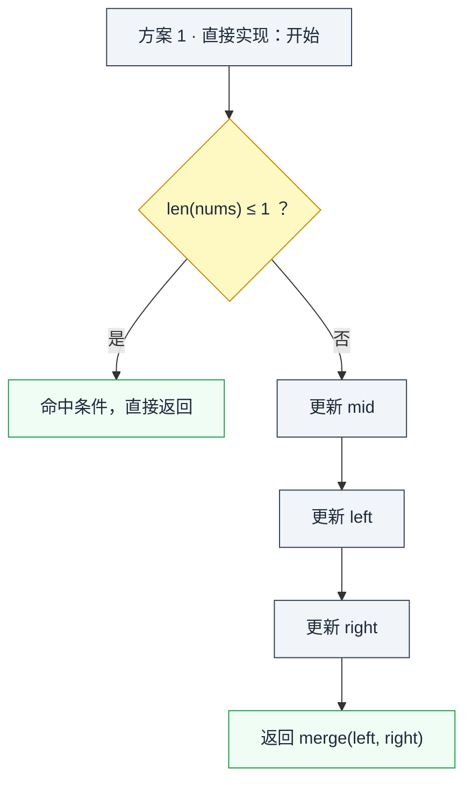

```python
import sys  # 提高递归深度上限（深输入防 RecursionError）

sys.setrecursionlimit(200000)  # 树/链表类题目节点数可达 1e4 量级

def mergeSort(nums):  # 定义函数 mergeSort（参数：数组）
    if len(nums) <= 1:  # 若 长度(数组) 不超过 1
        return nums  # 返回 数组
    mid = len(nums) // 2  # 把 长度(数组) 除以 除以 2 存入 中点
    left = mergeSort(nums[:mid])  # 把 mergeSort(数组[:中点]) 存入 左边界
    right = mergeSort(nums[mid:])  # 把 mergeSort(数组[中点:]) 存入 右边界
    return merge(left, right)  # 返回 merge(左边界, 右边界)

def merge(left, right):  # 定义函数 merge（参数：左边界, 右边界）
    result = []  # 把 [] 存入 结果
    i = j = 0  # 把 下标 j 赋值为 0 存入 下标 i
    while i < len(left) and j < len(
        right
    ):  # 循环，直到不满足「下标 i 小于 长度(左边界) and 下标 j 小于 长度(右边界」
        if left[i] <= right[j]:  # 若 左边界[下标 i] 不超过 右边界[下标 j]
            result.append(left[i])  # 把 左边界[下标 i] 追加到列表尾部
            i += 1  # 下标 i累加 1
        else:  # 否则
            result.append(right[j])  # 把 右边界[下标 j] 追加到列表尾部
            j += 1  # 下标 j累加 1
    result.extend(left[i:])  # 结果.extend(左边界[下标 i:])
    result.extend(right[j:])  # 结果.extend(右边界[下标 j:])
    return result  # 返回 结果

if __name__ == "__main__":  # 若 __name__ 等于 '__main__'
    print(mergeSort([1, 2, 3]))  # 打印输出
```

#### 方案 2：直接实现

**思路与代码分析**：核心是「直接实现」。Python 版用切片与字典推导式简化操作，突出可读性。**走读**：方案 2 · 直接实现：开始 → 命中条件，直接返回 → 更新 mid → 更新 left → 更新 right → 返回 merge(left, right)。

**运行架构**（真实控制流）：


```python
import sys  # 提高递归深度上限（深输入防 RecursionError）

sys.setrecursionlimit(200000)  # 树/链表类题目节点数可达 1e4 量级

def mergeSort(nums):  # 定义函数 mergeSort（参数：数组）
    if len(nums) <= 1:  # 若 长度(数组) 不超过 1
        return nums  # 返回 数组
    mid = len(nums) // 2  # 把 长度(数组) 除以 除以 2 存入 中点
    left = mergeSort(nums[:mid])  # 把 mergeSort(数组[:中点]) 存入 左边界
    right = mergeSort(nums[mid:])  # 把 mergeSort(数组[中点:]) 存入 右边界
    return merge(left, right)  # 返回 merge(左边界, 右边界)

def merge(left, right):  # 定义函数 merge（参数：左边界, 右边界）
    result = []  # 把 [] 存入 结果
    i = j = 0  # 把 下标 j 赋值为 0 存入 下标 i
    while i < len(left) and j < len(
        right
    ):  # 循环，直到不满足「下标 i 小于 长度(左边界) and 下标 j 小于 长度(右边界」
        if left[i] <= right[j]:  # 若 左边界[下标 i] 不超过 右边界[下标 j]
            result.append(left[i])  # 把 左边界[下标 i] 追加到列表尾部
            i += 1  # 下标 i累加 1
        else:  # 否则
            result.append(right[j])  # 把 右边界[下标 j] 追加到列表尾部
            j += 1  # 下标 j累加 1
    result.extend(left[i:])  # 结果.extend(左边界[下标 i:])
    result.extend(right[j:])  # 结果.extend(右边界[下标 j:])
    return result  # 返回 结果

if __name__ == "__main__":  # 若 __name__ 等于 '__main__'
    print(mergeSort([1, 2, 3]))  # 打印输出
```

#### 方案 3：迭代指针处理

**思路与代码分析**：核心是「迭代指针处理」。Python 版用切片与字典推导式简化操作，突出可读性。代码里依次做这些事：二分收缩区间。**走读**：方案 3 · 迭代指针处理：开始 → 更新 arr_len → 命中条件，直接返回 → 当 ordered_left and ordered_right: 时反复执行 → 返回 res。

**运行架构**（真实控制流）：

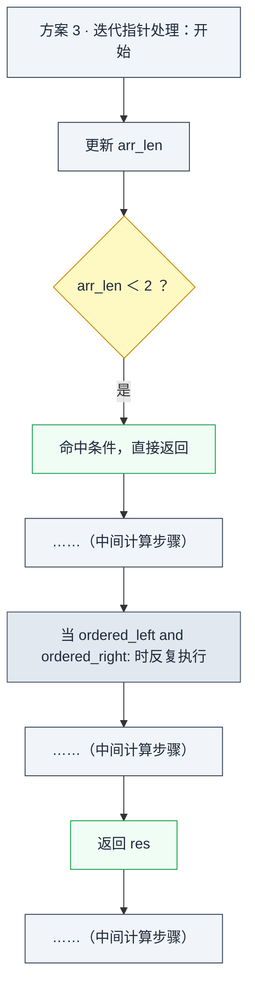

```python
import sys  # 提高递归深度上限（深输入防 RecursionError）

sys.setrecursionlimit(200000)  # 树/链表类题目节点数可达 1e4 量级

def merge_sort(nums):  # 定义函数 merge_sort（参数：数组）
    def ms_fn(arr):  # 定义函数 ms_fn（参数：数组）
        arr_len = len(arr)  # 把 长度(数组) 存入 arr_len
        if arr_len < 2:  # 若 arr_len 小于 2
            return arr  # 返回 数组
        mid = arr_len // 2  # 把 arr_len 除以 除以 2 存入 中点
        left = arr[:mid]  # 把 数组[:中点] 存入 左边界
        right = arr[mid:]  # 把 数组[中点:] 存入 右边界
        ordered_left = ms_fn(left)  # 把 ms_fn(左边界) 存入 ordered_left
        ordered_right = ms_fn(right)  # 把 ms_fn(右边界) 存入 ordered_right
        res = []  # 把 [] 存入 结果
        while ordered_left and ordered_right:  # 循环，直到不满足「ordered_left and ordered_right」
            if ordered_left[0] <= ordered_right[0]:  # 若 ordered_left[0] 不超过 ordered_right[0]
                res.append(ordered_left.pop(0))  # 把 ordered_left 弹出 0 追加到列表尾部
            else:  # 否则
                res.append(ordered_right.pop(0))  # 把 ordered_right 弹出 0 追加到列表尾部
        res.extend(ordered_left)  # 结果.extend(ordered_left)
        res.extend(ordered_right)  # 结果.extend(ordered_right)
        return res  # 返回 结果

    nums[:] = ms_fn(nums)  # 把 ms_fn(数组) 写入 nums[:]

if __name__ == "__main__":  # 若 __name__ 等于 '__main__'
    test_list = [5, 4, 3, 2, 1]  # 把 [5, 4, 3, 2, 1] 存入 test_list
    merge_sort(test_list)  # merge_sort(test_list)
    print(test_list)  # 输出: [1, 2, 3, 4, 5]
```

#### 方案 4：迭代指针处理

**思路与代码分析**：核心是「迭代指针处理」。Python 版用切片与字典推导式简化操作，突出可读性。**走读**：方案 4 · 迭代指针处理：开始 → 命中条件，直接返回 → 更新 mid → 当 i ≤ mid and j ≤ right: 时反复执行 → 循环 k：从 0 到 len(temp 前。

**运行架构**（真实控制流）：

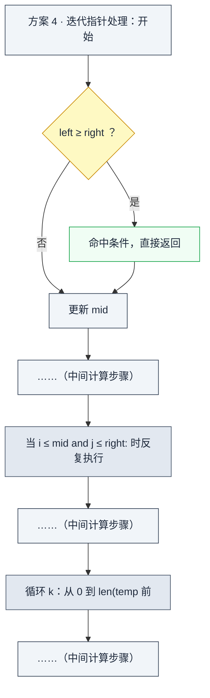

```python
import sys  # 提高递归深度上限（深输入防 RecursionError）

sys.setrecursionlimit(200000)  # 树/链表类题目节点数可达 1e4 量级

def merge_sort(nums):  # 定义函数 merge_sort（参数：数组）
    def ms_fn(arr, left, right):  # 定义函数 ms_fn（参数：数组, 左边界, 右边界）
        if left >= right:  # 若 左边界 不低于 右边界
            return  # return
        mid = (left + right) // 2  # 把 (左边界 加 右边界) 除以 除以 2 存入 中点
        ms_fn(arr, left, mid)  # ms_fn(数组, 左边界, 中点)
        ms_fn(arr, mid + 1, right)  # ms_fn(数组, 中点 加 1, 右边界)
        merge(arr, left, mid, right)  # merge(数组, 左边界, 中点, 右边界)

    def merge(arr, left, mid, right):  # 定义函数 merge（参数：数组, 左边界, 中点, 右边界）
        temp = []  # 把 [] 存入 临时变量
        i, j = left, mid + 1  # 把 左边界, 中点 加 1 写入 i, j
        while i <= mid and j <= right:  # 循环，直到不满足「下标 i 不超过 中点 and 下标 j 不超过 右边界」
            if arr[i] <= arr[j]:  # 若 数组[下标 i] 不超过 数组[下标 j]
                temp.append(arr[i])  # 把 数组[下标 i] 追加到列表尾部
                i += 1  # 下标 i累加 1
            else:  # 否则
                temp.append(arr[j])  # 把 数组[下标 j] 追加到列表尾部
                j += 1  # 下标 j累加 1
        temp.extend(arr[i : mid + 1])  # 临时变量.extend(数组[下标 i:中点 加 1])
        temp.extend(arr[j : right + 1])  # 临时变量.extend(数组[下标 j:右边界 加 1])
        for k in range(len(temp)):  # 让 下标 k 从 长度(临时变量 遍历
            arr[left + k] = temp[k]  # 把 临时变量[下标 k] 写入 arr[left + k]

    ms_fn(nums, 0, len(nums) - 1)  # ms_fn(数组, 0, 长度(数组) 减 1)

if __name__ == "__main__":  # 若 __name__ 等于 '__main__'
    list_ = [5, 4, 3, 2, 1]  # 把 [5, 4, 3, 2, 1] 存入 list_
    merge_sort(list_)  # merge_sort(list_)
    print(list_)  # 输出: [1, 2, 3, 4, 5]
```

#### 方案 5：迭代指针处理

**思路与代码分析**：核心是「迭代指针处理」。Python 版用切片与字典推导式简化操作，突出可读性。**走读**：方案 5 · 迭代指针处理：开始 → 更新 arr_len → 命中条件，直接返回 → 当 ( 时反复执行 → 返回 res → 返回 ms_fn(nums)。

**运行架构**（真实控制流）：

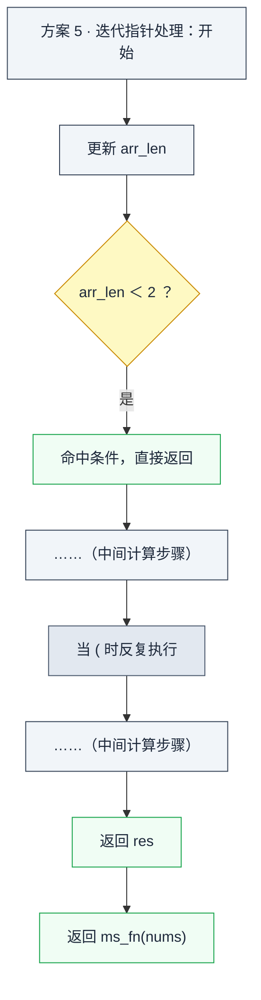

```python
import sys  # 提高递归深度上限（深输入防 RecursionError）

sys.setrecursionlimit(200000)  # 树/链表类题目节点数可达 1e4 量级

def merge_sort(nums):  # 定义函数 merge_sort（参数：数组）
    def ms_fn(arr):  # 定义函数 ms_fn（参数：数组）
        arr_len = len(arr)  # 把 长度(数组) 存入 arr_len
        if arr_len < 2:  # 若 arr_len 小于 2
            return arr  # 返回 数组
        mid = arr_len // 2  # 把 arr_len 除以 除以 2 存入 中点
        left = arr[:mid]  # 把 数组[:中点] 存入 左边界
        right = arr[mid:]  # 把 数组[中点:] 存入 右边界
        order_left = ms_fn(left)  # 把 ms_fn(左边界) 存入 order_left
        order_right = ms_fn(right)  # 把 ms_fn(右边界) 存入 order_right
        res = []  # 把 [] 存入 结果
        while (
            len(order_left) > 0 and len(order_right) > 0
        ):  # 循环，直到不满足「长度(order_left) 超过 0 and 长度(order_right) 超过 0」
            if order_left[0] <= order_right[0]:  # 若 order_left[0] 不超过 order_right[0]
                res.append(order_left.pop(0))  # 把 order_left 弹出 0 追加到列表尾部
            else:  # 否则
                res.append(order_right.pop(0))  # 把 order_right 弹出 0 追加到列表尾部
        res.extend(order_left)  # 结果.extend(order_left)
        res.extend(order_right)  # 结果.extend(order_right)
        return res  # 返回 结果

    return ms_fn(nums)  # 返回 ms_fn(数组)

if __name__ == "__main__":  # 若 __name__ 等于 '__main__'
    list_ = [5, 4, 3, 2, 1]  # 把 [5, 4, 3, 2, 1] 存入 list_
    print(merge_sort(list_))  # 输出: [1, 2, 3, 4, 5]
```

#### 方案 6：迭代指针处理

**思路与代码分析**：核心是「迭代指针处理」。Python 版用切片与字典推导式简化操作，突出可读性。**走读**：方案 6 · 迭代指针处理：开始 → 命中条件，直接返回 → 更新 mid → 当 i ≤ mid and j ≤ right: 时反复执行 → 当 i ≤ mid: 时反复执行 → 当 j ≤ right: 时反复执行 → 循环 idx：从 0 到 len(temp 前。

**运行架构**（真实控制流）：

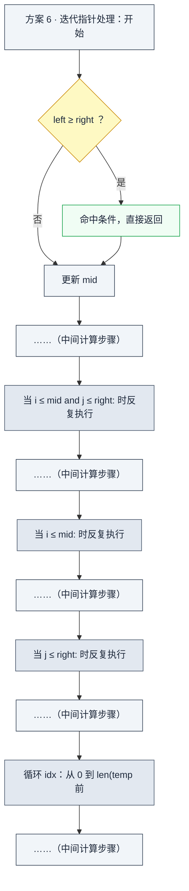

```python
import sys  # 提高递归深度上限（深输入防 RecursionError）

sys.setrecursionlimit(200000)  # 树/链表类题目节点数可达 1e4 量级

def merge_sort(nums):  # 定义函数 merge_sort（参数：数组）
    def ms_fn(arr, left, right):  # 定义函数 ms_fn（参数：数组, 左边界, 右边界）
        if left >= right:  # 若 左边界 不低于 右边界
            return  # return
        mid = (left + right) // 2  # 把 (左边界 加 右边界) 除以 除以 2 存入 中点
        ms_fn(arr, left, mid)  # ms_fn(数组, 左边界, 中点)
        ms_fn(arr, mid + 1, right)  # ms_fn(数组, 中点 加 1, 右边界)
        merge(arr, left, mid, right)  # merge(数组, 左边界, 中点, 右边界)

    def merge(arr, left, mid, right):  # 定义函数 merge（参数：数组, 左边界, 中点, 右边界）
        temp = [0] * (right - left + 1)  # 把 [0] 乘 (右边界 减 左边界 加 1) 存入 临时变量
        i, j, k = left, mid + 1, 0  # 把 左边界, 中点 加 1, 0 写入 i, j, k
        while i <= mid and j <= right:  # 循环，直到不满足「下标 i 不超过 中点 and 下标 j 不超过 右边界」
            if arr[i] <= arr[j]:  # 若 数组[下标 i] 不超过 数组[下标 j]
                temp[k] = arr[i]  # 把 数组[下标 i] 写入 temp[k]
                i += 1  # 下标 i累加 1
            else:  # 否则
                temp[k] = arr[j]  # 把 数组[下标 j] 写入 temp[k]
                j += 1  # 下标 j累加 1
            k += 1  # 下标 k累加 1
        while i <= mid:  # 循环，直到不满足「下标 i 不超过 中点」
            temp[k] = arr[i]  # 把 数组[下标 i] 写入 temp[k]
            i += 1  # 下标 i累加 1
            k += 1  # 下标 k累加 1
        while j <= right:  # 循环，直到不满足「下标 j 不超过 右边界」
            temp[k] = arr[j]  # 把 数组[下标 j] 写入 temp[k]
            j += 1  # 下标 j累加 1
            k += 1  # 下标 k累加 1
        for idx in range(len(temp)):  # 让 idx 从 长度(临时变量 遍历
            arr[left + idx] = temp[idx]  # 把 临时变量[idx] 写入 arr[left + idx]

    ms_fn(nums, 0, len(nums) - 1)  # ms_fn(数组, 0, 长度(数组) 减 1)

if __name__ == "__main__":  # 若 __name__ 等于 '__main__'
    list_ = [5, 4, 3, 2, 1]  # 把 [5, 4, 3, 2, 1] 存入 list_
    merge_sort(list_)  # merge_sort(list_)
    print(list_)  # 输出: [1, 2, 3, 4, 5]
```

### Go 实现（6 种方案）

Go 的全部方案如下，每个方案都内嵌用例自测，可独立运行（老仓库 python/go 文件遵循「打印结果」约定）：

#### 方案 1：直接实现

**思路与代码分析**：核心是「直接实现」。Go 版用切片与多返回值惯用法，显式处理索引边界。**走读**：方案 1 · 直接实现：开始 → 处理 if len(nums) ≤ 1 → 返回 nums → 更新 : → 更新 : → 更新 : → 返回 merge(left, right)。

**运行架构**（真实控制流）：

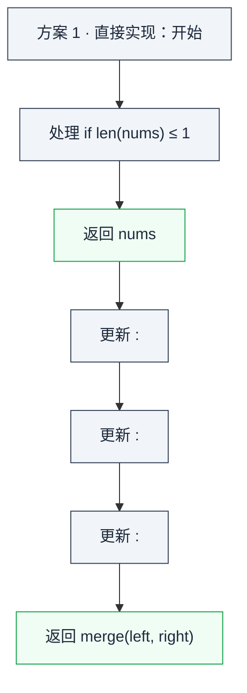

```go
package main // 引入依赖

import (
	"fmt"     // 「fmt」
	"os"      // 「os」
	"reflect" // 「reflect」
)

// mergeSort 递归归并排序（忠实翻译 Python 参考）
func mergeSort(nums []int) []int { // 定义函数/方法 mergeSort
	if len(nums) <= 1 { // 若 长度(数组) 不超过 1
		return nums // 返回 数组
	}
	mid := len(nums) / 2           // 把 长度(数组) 除以 2 写入 mid :
	left := mergeSort(nums[:mid])  // 把 mergeSort(数组[:中点]) 写入 left :
	right := mergeSort(nums[mid:]) // 把 mergeSort(数组[中点:]) 写入 right :
	return merge(left, right)      // 定义函数/方法 merge
}

func merge(left, right []int) []int { // 定义函数/方法 merge
	res := []int{}                        // 把 []int{} 写入 res :
	i, j := 0, 0                          // 把 0, 0 写入 i, j :
	for i < len(left) && j < len(right) { // for 下标 i 小于 长度(左边界) 且 下标 j 小于 长度(右边界) {
		if left[i] <= right[j] { // 若 左边界[下标 i] 不超过 右边界[下标 j]
			res = append(res, left[i]) // 把 append(结果, 左边界[下标 i]) 写入 结果
			i++                        // 下标 i 加一
		} else { // 否则
			res = append(res, right[j]) // 把 append(结果, 右边界[下标 j]) 写入 结果
			j++                         // 下标 j 加一
		}
	}
	res = append(res, left[i:]...)  // 把 append(结果, 左边界[下标 i:]...) 写入 结果
	res = append(res, right[j:]...) // 把 append(结果, 右边界[下标 j:]...) 写入 结果
	return res                      // 返回 结果
}

func main() { // 程序入口：跑内嵌自测用例
	// 忠实复刻参考：print(mergeSort([1, 2, 3]))
	ref := mergeSort([]int{1, 2, 3})             // 把 mergeSort([]int{1, 2, 3}) 写入 ref :
	if !reflect.DeepEqual(ref, []int{1, 2, 3}) { // 若 取反 reflect.DeepEqual(ref, []int{1, 2, 3}
		fmt.Printf("FAIL ref=%v\n", ref) // 打印输出
		os.Exit(1)                       // os.Exit(1)
	}
	// 正确性校验
	if !reflect.DeepEqual(mergeSort([]int{5, 4, 3, 2, 1}), []int{1, 2, 3, 4, 5}) {
		fmt.Println("FAIL correctness") // 打印输出
		os.Exit(1)                      // os.Exit(1)
	}
	fmt.Println("PASS") // 全部用例通过，输出 PASS
}
```

#### 方案 2：直接实现

**思路与代码分析**：核心是「直接实现」。Go 版用切片与多返回值惯用法，显式处理索引边界。**走读**：方案 2 · 直接实现：开始 → 处理 if len(nums) ≤ 1 → 返回 nums → 更新 : → 更新 : → 更新 : → 返回 merge(left, right)。

**运行架构**（真实控制流）：

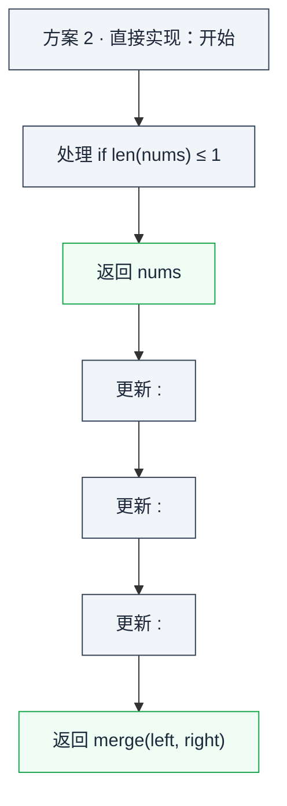

```go
package main // 引入依赖

import (
	"fmt"     // 「fmt」
	"os"      // 「os」
	"reflect" // 「reflect」
)

// mergeSort 递归归并排序（忠实翻译 Python 参考）
func mergeSort(nums []int) []int { // 定义函数/方法 mergeSort
	if len(nums) <= 1 { // 若 长度(数组) 不超过 1
		return nums // 返回 数组
	}
	mid := len(nums) / 2           // 把 长度(数组) 除以 2 写入 mid :
	left := mergeSort(nums[:mid])  // 把 mergeSort(数组[:中点]) 写入 left :
	right := mergeSort(nums[mid:]) // 把 mergeSort(数组[中点:]) 写入 right :
	return merge(left, right)      // 定义函数/方法 merge
}

func merge(left, right []int) []int { // 定义函数/方法 merge
	res := []int{}                        // 把 []int{} 写入 res :
	i, j := 0, 0                          // 把 0, 0 写入 i, j :
	for i < len(left) && j < len(right) { // for 下标 i 小于 长度(左边界) 且 下标 j 小于 长度(右边界) {
		if left[i] <= right[j] { // 若 左边界[下标 i] 不超过 右边界[下标 j]
			res = append(res, left[i]) // 把 append(结果, 左边界[下标 i]) 写入 结果
			i++                        // 下标 i 加一
		} else { // 否则
			res = append(res, right[j]) // 把 append(结果, 右边界[下标 j]) 写入 结果
			j++                         // 下标 j 加一
		}
	}
	res = append(res, left[i:]...)  // 把 append(结果, 左边界[下标 i:]...) 写入 结果
	res = append(res, right[j:]...) // 把 append(结果, 右边界[下标 j:]...) 写入 结果
	return res                      // 返回 结果
}

func main() { // 程序入口：跑内嵌自测用例
	// 忠实复刻参考：print(mergeSort([1, 2, 3]))
	ref := mergeSort([]int{1, 2, 3})             // 把 mergeSort([]int{1, 2, 3}) 写入 ref :
	if !reflect.DeepEqual(ref, []int{1, 2, 3}) { // 若 取反 reflect.DeepEqual(ref, []int{1, 2, 3}
		fmt.Printf("FAIL ref=%v\n", ref) // 打印输出
		os.Exit(1)                       // os.Exit(1)
	}
	// 正确性校验
	if !reflect.DeepEqual(mergeSort([]int{5, 4, 3, 2, 1}), []int{1, 2, 3, 4, 5}) {
		fmt.Println("FAIL correctness") // 打印输出
		os.Exit(1)                      // os.Exit(1)
	}
	fmt.Println("PASS") // 全部用例通过，输出 PASS
}
```

#### 方案 3：迭代指针处理

**思路与代码分析**：核心是「迭代指针处理」。Go 版用切片与多返回值惯用法，显式处理索引边界。**走读**：方案 3 · 迭代指针处理：开始 → 计算 msFn → 返回 arr → 遍历循环 → 返回 res。

**运行架构**（真实控制流）：

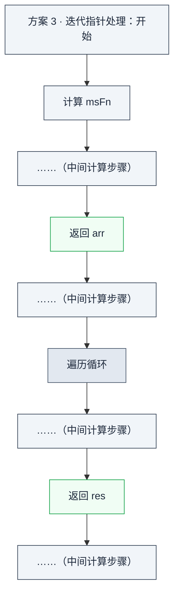

```go
package main // 引入依赖

import (
	"fmt"     // 「fmt」
	"os"      // 「os」
	"reflect" // 「reflect」
)

func mergeSort(nums []int) { // 定义函数/方法 mergeSort
	var msFn func([]int) []int     // var msFn func([]int) []int
	msFn = func(arr []int) []int { // 把 func(数组 []int) []int { 写入 msFn
		if len(arr) < 2 { // 若 长度(数组) 小于 2
			return arr // 返回 数组
		}
		mid := len(arr) / 2                   // 把 长度(数组) 除以 2 写入 mid :
		left := msFn(arr[:mid])               // 把 msFn(数组[:中点]) 写入 left :
		right := msFn(arr[mid:])              // 把 msFn(数组[中点:]) 写入 right :
		res := []int{}                        // 把 []int{} 写入 res :
		i, j := 0, 0                          // 把 0, 0 写入 i, j :
		for i < len(left) && j < len(right) { // for 下标 i 小于 长度(左边界) 且 下标 j 小于 长度(右边界) {
			if left[i] <= right[j] { // 若 左边界[下标 i] 不超过 右边界[下标 j]
				res = append(res, left[i]) // 把 append(结果, 左边界[下标 i]) 写入 结果
				i++                        // 下标 i 加一
			} else { // 否则
				res = append(res, right[j]) // 把 append(结果, 右边界[下标 j]) 写入 结果
				j++                         // 下标 j 加一
			}
		}
		res = append(res, left[i:]...)  // 把 append(结果, 左边界[下标 i:]...) 写入 结果
		res = append(res, right[j:]...) // 把 append(结果, 右边界[下标 j:]...) 写入 结果
		return res                      // 返回 结果
	}
	r := msFn(nums) // 把 msFn(数组) 写入 r :
	copy(nums, r)   // copy(数组, 右指针)
}

func main() { // 程序入口：跑内嵌自测用例
	testList := []int{5, 4, 3, 2, 1}                        // 把 []int{5, 4, 3, 2, 1} 写入 testList :
	mergeSort(testList)                                     // mergeSort(testList)
	if !reflect.DeepEqual(testList, []int{1, 2, 3, 4, 5}) { // 若 取反 reflect.DeepEqual(testList, []int{1, 2, 3, 4, 5}
		fmt.Printf("FAIL=%v\n", testList) // 打印输出
		os.Exit(1)                        // os.Exit(1)
	}
	fmt.Println("PASS") // 全部用例通过，输出 PASS
}
```

#### 方案 4：迭代指针处理

**思路与代码分析**：核心是「迭代指针处理」。Go 版用切片与多返回值惯用法，显式处理索引边界。**走读**：方案 4 · 迭代指针处理：开始 → 计算 msFn → 更新 msFn → 处理 if left ≥ right → 返回  → 更新 : → 调用 msFn(arr, left, mid) → 调用 msFn(arr, mid+1, right) → 调用 merge(arr, left, mid, right) → 调用 msFn(nums, 0, len(nums)-1)。

**运行架构**（真实控制流）：

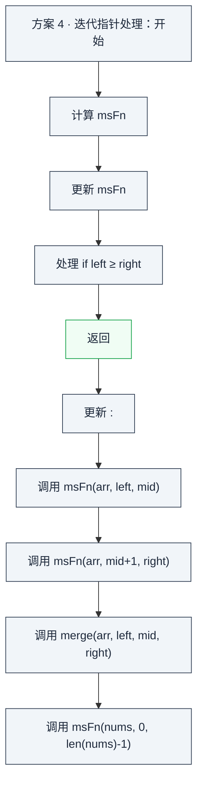

```go
package main // 引入依赖

import (
	"fmt"     // 「fmt」
	"os"      // 「os」
	"reflect" // 「reflect」
)

func mergeSort(nums []int) { // 定义函数/方法 mergeSort
	var msFn func([]int, int, int)            // var msFn func([]int, int, int)
	msFn = func(arr []int, left, right int) { // 把 func(数组 []int, 左边界, 右边界 int) { 写入 msFn
		if left >= right { // 若 左边界 不低于 右边界
			return // return
		}
		mid := (left + right) / 2    // 把 (左边界 加 右边界) 除以 2 写入 mid :
		msFn(arr, left, mid)         // msFn(数组, 左边界, 中点)
		msFn(arr, mid+1, right)      // msFn(数组, 中点 加 1, 右边界)
		merge(arr, left, mid, right) // merge(数组, 左边界, 中点, 右边界)
	}
	msFn(nums, 0, len(nums)-1) // msFn(数组, 0, 长度(数组) 减 1)
}

func merge(arr []int, left, mid, right int) { // 定义函数/方法 merge
	temp := []int{}              // 把 []int{} 写入 temp :
	i, j := left, mid+1          // 把 左边界, 中点 加 1 写入 i, j :
	for i <= mid && j <= right { // 把 中点 且 下标 j 不超过 右边界 { 写入 for i <
		if arr[i] <= arr[j] { // 若 数组[下标 i] 不超过 数组[下标 j]
			temp = append(temp, arr[i]) // 把 append(临时变量, 数组[下标 i]) 写入 临时变量
			i++                         // 下标 i 加一
		} else { // 否则
			temp = append(temp, arr[j]) // 把 append(临时变量, 数组[下标 j]) 写入 临时变量
			j++                         // 下标 j 加一
		}
	}
	temp = append(temp, arr[i:mid+1]...)   // 把 append(临时变量, 数组[下标 i:中点 加 1]...) 写入 临时变量
	temp = append(temp, arr[j:right+1]...) // 把 append(临时变量, 数组[下标 j:右边界 加 1]...) 写入 临时变量
	for k := 0; k < len(temp); k++ {       // 让 下标 k 从 0 开始计数
		arr[left+k] = temp[k] // 把 临时变量[下标 k] 写入 arr[left+k]
	}
}

func main() { // 程序入口：跑内嵌自测用例
	nums := []int{5, 4, 3, 2, 1}                        // 把 []int{5, 4, 3, 2, 1} 写入 nums :
	mergeSort(nums)                                     // mergeSort(数组)
	if !reflect.DeepEqual(nums, []int{1, 2, 3, 4, 5}) { // 若 取反 reflect.DeepEqual(数组, []int{1, 2, 3, 4, 5}
		fmt.Printf("FAIL=%v\n", nums) // 打印输出
		os.Exit(1)                    // os.Exit(1)
	}
	fmt.Println("PASS") // 全部用例通过，输出 PASS
}
```

#### 方案 5：迭代指针处理

**思路与代码分析**：核心是「迭代指针处理」。Go 版用切片与多返回值惯用法，显式处理索引边界。**走读**：方案 5 · 迭代指针处理：开始 → 计算 msFn → 返回 arr → 遍历循环 → 返回 res → 返回 msFn(nums)。

**运行架构**（真实控制流）：

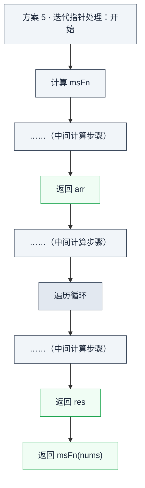

```go
package main // 引入依赖

import (
	"fmt"     // 「fmt」
	"os"      // 「os」
	"reflect" // 「reflect」
)

func mergeSort(nums []int) []int { // 定义函数/方法 mergeSort
	var msFn func(arr []int) []int // var msFn func(数组 []int) []int
	msFn = func(arr []int) []int { // 把 func(数组 []int) []int { 写入 msFn
		n := len(arr) // 把 长度(数组) 写入 n :
		if n < 2 {    // 若 元素个数 小于 2
			return arr // 返回 数组
		}
		mid := n / 2                                    // 把 元素个数 除以 2 写入 mid :
		left := append([]int{}, arr[:mid]...)           // 把 append([]int{}, 数组[:中点]...) 写入 left :
		right := append([]int{}, arr[mid:]...)          // 把 append([]int{}, 数组[中点:]...) 写入 right :
		orderLeft := msFn(left)                         // 把 msFn(左边界) 写入 orderLeft :
		orderRight := msFn(right)                       // 把 msFn(右边界) 写入 orderRight :
		res := []int{}                                  // 把 []int{} 写入 res :
		for len(orderLeft) > 0 && len(orderRight) > 0 { // for 长度(orderLeft) 超过 0 且 长度(orderRight) 超过 0 {
			if orderLeft[0] <= orderRight[0] { // 若 orderLeft[0] 不超过 orderRight[0]
				res = append(res, orderLeft[0]) // 把 append(结果, orderLeft[0]) 写入 结果
				orderLeft = orderLeft[1:]       // 把 orderLeft[1:] 写入 orderLeft
			} else { // 否则
				res = append(res, orderRight[0]) // 把 append(结果, orderRight[0]) 写入 结果
				orderRight = orderRight[1:]      // 把 orderRight[1:] 写入 orderRight
			}
		}
		res = append(res, orderLeft...)  // 把 append(结果, orderLeft...) 写入 结果
		res = append(res, orderRight...) // 把 append(结果, orderRight...) 写入 结果
		return res                       // 返回 结果
	}
	return msFn(nums) // 定义函数/方法 msFn
}

func main() { // 程序入口：跑内嵌自测用例
	type tc struct { // 定义类型
		in   []int // in []int
		want []int // want []int
	}
	cases := []tc{ // 把 []tc{ 写入 cases :
		{[]int{5, 4, 3, 2, 1}, []int{1, 2, 3, 4, 5}},
		{[]int{1, 2, 3}, []int{1, 2, 3}},
		{[]int{}, []int{}},
	}
	ok := true                // 把 true 写入 ok :
	for _, c := range cases { // 同时取 _ 与 字符 遍历
		if got := mergeSort(c.in); !reflect.DeepEqual(got, c.want) {
			ok = false                                                       // 把 false 写入 ok
			fmt.Printf("FAIL mergeSort(%v)=%v want %v\n", c.in, got, c.want) // 打印输出
		}
	}
	if !ok { // 若 取反 ok
		os.Exit(1) // os.Exit(1)
	}
	fmt.Println("PASS") // 全部用例通过，输出 PASS
}
```

#### 方案 6：迭代指针处理

**思路与代码分析**：核心是「迭代指针处理」。Go 版用切片与多返回值惯用法，显式处理索引边界。**走读**：方案 6 · 迭代指针处理：开始 → 计算 msFn → 遍历循环 → 遍历循环 → 遍历循环 → 遍历循环 → 返回 。

**运行架构**（真实控制流）：

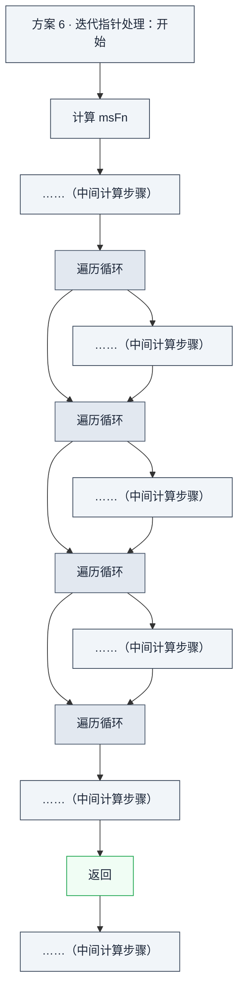

```go
package main // 引入依赖

import (
	"fmt"     // 「fmt」
	"os"      // 「os」
	"reflect" // 「reflect」
)

func mergeSortInPlace(nums []int) { // 定义函数/方法 mergeSortInPlace
	var msFn func(arr []int, left, right int)       // var msFn func(数组 []int, 左边界, 右边界 int)
	var merge func(arr []int, left, mid, right int) // var merge func(数组 []int, 左边界, 中点, 右边界 int)
	merge = func(arr []int, left, mid, right int) { // 把 func(数组 []int, 左边界, 中点, 右边界 int) { 写入 merge
		temp := make([]int, right-left+1) // 把 make([]int, 右边界 减 左边界 加 1) 写入 temp :
		i, j, k := left, mid+1, 0         // 把 左边界, 中点 加 1, 0 写入 i, j, k :
		for i <= mid && j <= right {      // 把 中点 且 下标 j 不超过 右边界 { 写入 for i <
			if arr[i] <= arr[j] { // 若 数组[下标 i] 不超过 数组[下标 j]
				temp[k] = arr[i] // 把 数组[下标 i] 写入 temp[k]
				i++              // 下标 i 加一
			} else { // 否则
				temp[k] = arr[j] // 把 数组[下标 j] 写入 temp[k]
				j++              // 下标 j 加一
			}
			k++ // 下标 k 加一
		}
		for i <= mid { // 把 中点 { 写入 for i <
			temp[k] = arr[i] // 把 数组[下标 i] 写入 temp[k]
			i++              // 下标 i 加一
			k++              // 下标 k 加一
		}
		for j <= right { // 把 右边界 { 写入 for j <
			temp[k] = arr[j] // 把 数组[下标 j] 写入 temp[k]
			j++              // 下标 j 加一
			k++              // 下标 k 加一
		}
		for idx := 0; idx < len(temp); idx++ { // 让 idx 从 0 开始计数
			arr[left+idx] = temp[idx] // 把 临时变量[idx] 写入 arr[left+idx]
		}
	}
	msFn = func(arr []int, left, right int) { // 把 func(数组 []int, 左边界, 右边界 int) { 写入 msFn
		if left >= right { // 若 左边界 不低于 右边界
			return // return
		}
		mid := (left + right) / 2    // 把 (左边界 加 右边界) 除以 2 写入 mid :
		msFn(arr, left, mid)         // msFn(数组, 左边界, 中点)
		msFn(arr, mid+1, right)      // msFn(数组, 中点 加 1, 右边界)
		merge(arr, left, mid, right) // merge(数组, 左边界, 中点, 右边界)
	}
	msFn(nums, 0, len(nums)-1) // msFn(数组, 0, 长度(数组) 减 1)
}

func main() { // 程序入口：跑内嵌自测用例
	type tc struct { // 定义类型
		in   []int // in []int
		want []int // want []int
	}
	cases := []tc{ // 把 []tc{ 写入 cases :
		{[]int{5, 4, 3, 2, 1}, []int{1, 2, 3, 4, 5}},
		{[]int{1, 2, 3}, []int{1, 2, 3}},
		{[]int{3}, []int{3}},
	}
	ok := true                // 把 true 写入 ok :
	for _, c := range cases { // 同时取 _ 与 字符 遍历
		in := append([]int{}, c.in...)      // 把 append([]int{}, 字符.in...) 写入 in :
		mergeSortInPlace(in)                // mergeSortInPlace(in)
		if !reflect.DeepEqual(in, c.want) { // 若 取反 reflect.DeepEqual(in, 字符.want
			ok = false                                                             // 把 false 写入 ok
			fmt.Printf("FAIL mergeSortInPlace(%v)=%v want %v\n", c.in, in, c.want) // 打印输出
		}
	}
	if !ok { // 若 取反 ok
		os.Exit(1) // os.Exit(1)
	}
	fmt.Println("PASS") // 全部用例通过，输出 PASS
}
```

### Java 实现（6 种方案）

Java 的全部方案如下，每个方案都内嵌用例自测，可独立运行（老仓库 python/go 文件遵循「打印结果」约定）：

#### 方案 1：直接实现

**思路与代码分析**：核心是「直接实现」。Java 版用类与静态方法组织，集合操作显式明了。**走读**：方案 1 · 直接实现：开始 → 命中条件，直接返回 → 更新 mid → 更新 left → 调用 mergeSort( → 调用 Arrays.copyOfRange( → 处理 nums, 0, mid)) → 更新 right → 返回 merge(left, right)。

**运行架构**（真实控制流）：

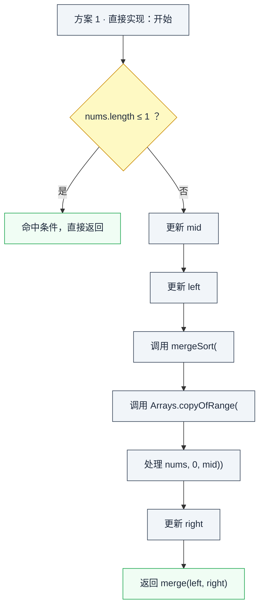

```java
package com.webfault.dsa; // 引入依赖

import java.util.Arrays; // 引入依赖

/**
 * 归并排序 忠实翻译自 python/notes/lc_134083295_归并排序/solution_1___1.py 运行即自检：失败抛 RuntimeException（非 0
 * 退出），通过打印 PASS
 */
class Main { // 定义类型

  static int[] mergeSort(int[] nums) { // 定义函数/方法 mergeSort
    if (nums.length <= 1) { // 若 数组.长度 不超过 1
      return nums; // 返回 数组
    }
    int mid = nums.length / 2; // 把 数组.长度 除以 2 存入 中点
    int[] left =
        mergeSort(
            Arrays.copyOfRange(
                nums, 0, mid)); // 把 mergeSort(Arrays.copyOfRange(数组, 0, 中点)); 写入 int[] left
    int[] right = mergeSort(Arrays.copyOfRange(nums, mid, nums.length));
    return merge(left, right); // 返回 merge(左边界, 右边界)
  }

  static int[] merge(int[] left, int[] right) { // 定义函数/方法 merge
    int[] result =
        new int[left.length + right.length]; // 把 new int[左边界.长度 加 右边界.长度]; 写入 int[] result
    int i = 0, j = 0, k = 0; // 把 0, 下标 j 赋值为 0, 下标 k 赋值为 0 存入 下标 i
    while (i < left.length && j < right.length) { // 循环，直到不满足「下标 i 小于 左边界.长度 且 下标 j 小于 右边界.长度」
      if (left[i] <= right[j]) { // 若 左边界[下标 i] 不超过 右边界[下标 j]
        result[k++] = left[i++]; // 把 左边界[下标 i 加一 ]; 写入 result[k++]
      } else { // 否则
        result[k++] = right[j++]; // 把 右边界[下标 j 加一 ]; 写入 result[k++]
      }
    }
    while (i < left.length) { // 循环，直到不满足「下标 i 小于 左边界.长度」
      result[k++] = left[i++]; // 把 左边界[下标 i 加一 ]; 写入 result[k++]
    }
    while (j < right.length) { // 循环，直到不满足「下标 j 小于 右边界.长度」
      result[k++] = right[j++]; // 把 右边界[下标 j 加一 ]; 写入 result[k++]
    }
    return result; // 返回 结果
  }

  public static void main(String[] args) { // public static void main(String[] args) {
    int[][] inputs = { // 把 { 写入 int[][] inputs
      {5, 4, 3, 2, 1},
      {},
      {1},
      {3, 1, 2, 1, 3},
      {-3, 0, 5, -10, 8},
      {2, 2, 2},
    };
    int[][] wants = { // 把 { 写入 int[][] wants
      {1, 2, 3, 4, 5},
      {},
      {1},
      {1, 1, 2, 3, 3},
      {-10, -3, 0, 5, 8},
      {2, 2, 2},
    };
    boolean ok = true; // 把 true; 写入 boolean ok
    for (int ci = 0; ci < inputs.length; ci++) { // 让 ci 从 0 开始计数，ci 小于 inputs.长度 就继续
      int[] got = mergeSort(inputs[ci]); // 把 mergeSort(inputs[ci]); 写入 int[] got
      if (!Arrays.equals(got, wants[ci])) { // 若 取反 Arrays.equals(got, wants[ci]
        ok = false; // 把 false; 写入 ok
        System.out.println(
            "FAIL mergeSort("
                + Arrays.toString(inputs[ci])
                + ")="
                + Arrays.toString(got) // 打印输出
                + " want "
                + Arrays.toString(wants[ci])); // 加 「 want 」 加 Arrays.toString(wants[ci]));
      }
    }
    if (!ok) { // 若 取反 ok
      throw new RuntimeException("FAILED"); // throw new RuntimeException(「FAILED」);
    }
    System.out.println("PASS"); // 全部用例通过，输出 PASS
  }
}
```

#### 方案 2：直接实现

**思路与代码分析**：核心是「直接实现」。Java 版用类与静态方法组织，集合操作显式明了。**走读**：方案 2 · 直接实现：开始 → 命中条件，直接返回 → 更新 mid → 更新 left → 调用 mergeSort( → 调用 Arrays.copyOfRange( → 处理 nums, 0, mid)) → 更新 right → 返回 merge(left, right)。

**运行架构**（真实控制流）：

```mermaid
graph TD
    N0["方案 2 · 直接实现：开始"]
    N1{"nums.length ≤ 1 ？"}
    N2["命中条件，直接返回"]
    N3["更新 mid"]
    N4["更新 left"]
    N5["调用 mergeSort("]
    N6["调用 Arrays.copyOfRange("]
    N7["处理 nums, 0, mid))"]
    N8["更新 right"]
    N9["返回 merge(left, right)"]
    N0 --> N1
    N1 -- 是 --> N2
    N1 -- 否 --> N3
    N3 --> N4
    N4 --> N5
    N5 --> N6
    N6 --> N7
    N7 --> N8
    N8 --> N9
    classDef n fill:#f1f5f9,stroke:#334155,color:#1e293b;
    classDef lp fill:#e2e8f0,stroke:#475569,color:#1e293b;
    classDef dc fill:#fef9c3,stroke:#ca8a04,color:#1e293b;
    classDef tm fill:#f0fdf4,stroke:#16a34a,color:#1e293b;
    class N0,N3,N4,N5,N6,N7,N8 n;
    class N1 dc;
    class N2,N9 tm;
```

```java
package com.webfault.dsa; // 引入依赖

import java.util.Arrays; // 引入依赖

/**
 * 归并排序 忠实翻译自 python/notes/lc_134083295_归并排序/solution_2___2.py 运行即自检：失败抛 RuntimeException（非 0
 * 退出），通过打印 PASS
 */
class Main { // 定义类型

  static int[] mergeSort(int[] nums) { // 定义函数/方法 mergeSort
    if (nums.length <= 1) { // 若 数组.长度 不超过 1
      return nums; // 返回 数组
    }
    int mid = nums.length / 2; // 把 数组.长度 除以 2 存入 中点
    int[] left =
        mergeSort(
            Arrays.copyOfRange(
                nums, 0, mid)); // 把 mergeSort(Arrays.copyOfRange(数组, 0, 中点)); 写入 int[] left
    int[] right = mergeSort(Arrays.copyOfRange(nums, mid, nums.length));
    return merge(left, right); // 返回 merge(左边界, 右边界)
  }

  static int[] merge(int[] left, int[] right) { // 定义函数/方法 merge
    int[] result =
        new int[left.length + right.length]; // 把 new int[左边界.长度 加 右边界.长度]; 写入 int[] result
    int i = 0, j = 0, k = 0; // 把 0, 下标 j 赋值为 0, 下标 k 赋值为 0 存入 下标 i
    while (i < left.length && j < right.length) { // 循环，直到不满足「下标 i 小于 左边界.长度 且 下标 j 小于 右边界.长度」
      if (left[i] <= right[j]) { // 若 左边界[下标 i] 不超过 右边界[下标 j]
        result[k++] = left[i++]; // 把 左边界[下标 i 加一 ]; 写入 result[k++]
      } else { // 否则
        result[k++] = right[j++]; // 把 右边界[下标 j 加一 ]; 写入 result[k++]
      }
    }
    while (i < left.length) { // 循环，直到不满足「下标 i 小于 左边界.长度」
      result[k++] = left[i++]; // 把 左边界[下标 i 加一 ]; 写入 result[k++]
    }
    while (j < right.length) { // 循环，直到不满足「下标 j 小于 右边界.长度」
      result[k++] = right[j++]; // 把 右边界[下标 j 加一 ]; 写入 result[k++]
    }
    return result; // 返回 结果
  }

  public static void main(String[] args) { // public static void main(String[] args) {
    int[][] inputs = { // 把 { 写入 int[][] inputs
      {5, 4, 3, 2, 1},
      {},
      {1},
      {3, 1, 2, 1, 3},
      {-3, 0, 5, -10, 8},
      {2, 2, 2},
    };
    int[][] wants = { // 把 { 写入 int[][] wants
      {1, 2, 3, 4, 5},
      {},
      {1},
      {1, 1, 2, 3, 3},
      {-10, -3, 0, 5, 8},
      {2, 2, 2},
    };
    boolean ok = true; // 把 true; 写入 boolean ok
    for (int ci = 0; ci < inputs.length; ci++) { // 让 ci 从 0 开始计数，ci 小于 inputs.长度 就继续
      int[] got = mergeSort(inputs[ci]); // 把 mergeSort(inputs[ci]); 写入 int[] got
      if (!Arrays.equals(got, wants[ci])) { // 若 取反 Arrays.equals(got, wants[ci]
        ok = false; // 把 false; 写入 ok
        System.out.println(
            "FAIL mergeSort("
                + Arrays.toString(inputs[ci])
                + ")="
                + Arrays.toString(got) // 打印输出
                + " want "
                + Arrays.toString(wants[ci])); // 加 「 want 」 加 Arrays.toString(wants[ci]));
      }
    }
    if (!ok) { // 若 取反 ok
      throw new RuntimeException("FAILED"); // throw new RuntimeException(「FAILED」);
    }
    System.out.println("PASS"); // 全部用例通过，输出 PASS
  }
}
```

#### 方案 3：迭代指针处理

**思路与代码分析**：核心是「迭代指针处理」。Java 版用类与静态方法组织，集合操作显式明了。**走读**：方案 3 · 迭代指针处理：开始 → 更新 ordered → 调用 System.arraycopy( → 处理 ordered, 0, nums, 0, nums.le → 返回结果。

**运行架构**（真实控制流）：

```mermaid
graph TD
    N0["方案 3 · 迭代指针处理：开始"]
    N1["更新 ordered"]
    N2["调用 System.arraycopy("]
    N3["处理 ordered, 0, nums, 0, nums.le"]
    N4["返回结果"]
    N0 --> N1
    N1 --> N2
    N2 --> N3
    N3 --> N4
    classDef n fill:#f1f5f9,stroke:#334155,color:#1e293b;
    classDef lp fill:#e2e8f0,stroke:#475569,color:#1e293b;
    classDef dc fill:#fef9c3,stroke:#ca8a04,color:#1e293b;
    classDef tm fill:#f0fdf4,stroke:#16a34a,color:#1e293b;
    class N0,N1,N2,N3 n;
    class N4 tm;
```

```java
package com.webfault.dsa; // 引入依赖

import java.util.Arrays; // 引入依赖

/**
 * 归并排序 忠实翻译自 python/notes/lc_134083295_归并排序/solution_3___3.py 运行即自检：失败抛 RuntimeException（非 0
 * 退出），通过打印 PASS
 */
class Main { // 定义类型

  static void mergeSort(int[] nums) { // 定义函数/方法 mergeSort
    int[] ordered = msFn(nums); // 把 msFn(数组); 写入 int[] ordered
    System.arraycopy(
        ordered, 0, nums, 0, nums.length); // System.arraycopy(ordered, 0, 数组, 0, 数组.长度);
  }

  static int[] msFn(int[] arr) { // 定义函数/方法 msFn
    if (arr.length < 2) { // 若 数组.长度 小于 2
      return arr; // 返回 数组
    }
    int mid = arr.length / 2; // 把 数组.长度 除以 2 存入 中点
    int[] left = Arrays.copyOfRange(arr, 0, mid); // 把 Arrays.copyOfRange(数组, 0, 中点); 写入 int[] left
    int[] right =
        Arrays.copyOfRange(
            arr, mid, arr.length); // 把 Arrays.copyOfRange(数组, 中点, 数组.长度); 写入 int[] right
    int[] orderedLeft = msFn(left); // 把 msFn(左边界); 写入 int[] orderedLeft
    int[] orderedRight = msFn(right); // 把 msFn(右边界); 写入 int[] orderedRight
    int[] res =
        new int
            [orderedLeft.length
                + orderedRight.length]; // 把 new int[orderedLeft.长度 加 orderedRight.长度]; 写入 int[] res
    int a = 0, b = 0, k = 0; // 把 0, b 赋值为 0, 下标 k 赋值为 0 存入 数组
    while (a < orderedLeft.length
        && b < orderedRight.length) { // 循环，直到不满足「数组 小于 orderedLeft.长度 且 b 小于 orderedRight.长度」
      if (orderedLeft[a] <= orderedRight[b]) { // 若 orderedLeft[数组] 不超过 orderedRight[b]
        res[k++] = orderedLeft[a++]; // 把 orderedLeft[数组 加一 ]; 写入 res[k++]
      } else { // 否则
        res[k++] = orderedRight[b++]; // 把 orderedRight[b 加一 ]; 写入 res[k++]
      }
    }
    while (a < orderedLeft.length) { // 循环，直到不满足「数组 小于 orderedLeft.长度」
      res[k++] = orderedLeft[a++]; // 把 orderedLeft[数组 加一 ]; 写入 res[k++]
    }
    while (b < orderedRight.length) { // 循环，直到不满足「b 小于 orderedRight.长度」
      res[k++] = orderedRight[b++]; // 把 orderedRight[b 加一 ]; 写入 res[k++]
    }
    return res; // 返回 结果
  }

  public static void main(String[] args) { // public static void main(String[] args) {
    int[][] inputs = { // 把 { 写入 int[][] inputs
      {5, 4, 3, 2, 1},
      {},
      {1},
      {3, 1, 2, 1, 3},
      {-3, 0, 5, -10, 8},
      {2, 2, 2},
    };
    int[][] wants = { // 把 { 写入 int[][] wants
      {1, 2, 3, 4, 5},
      {},
      {1},
      {1, 1, 2, 3, 3},
      {-10, -3, 0, 5, 8},
      {2, 2, 2},
    };
    boolean ok = true; // 把 true; 写入 boolean ok
    for (int ci = 0; ci < inputs.length; ci++) { // 让 ci 从 0 开始计数，ci 小于 inputs.长度 就继续
      int[] nums = inputs[ci].clone(); // 把 inputs[ci].clone(); 写入 int[] nums
      mergeSort(nums); // mergeSort(数组);
      if (!Arrays.equals(nums, wants[ci])) { // 若 取反 Arrays.equals(数组, wants[ci]
        ok = false; // 把 false; 写入 ok
        System.out.println(
            "FAIL mergeSort("
                + Arrays.toString(inputs[ci])
                + ")="
                + Arrays.toString(nums) // 打印输出
                + " want "
                + Arrays.toString(wants[ci])); // 加 「 want 」 加 Arrays.toString(wants[ci]));
      }
    }
    if (!ok) { // 若 取反 ok
      throw new RuntimeException("FAILED"); // throw new RuntimeException(「FAILED」);
    }
    System.out.println("PASS"); // 全部用例通过，输出 PASS
  }
}
```

#### 方案 4：迭代指针处理

**思路与代码分析**：核心是「迭代指针处理」。Java 版用类与静态方法组织，集合操作显式明了。**走读**：方案 4 · 迭代指针处理：开始 → 调用 msFn(nums, 0, nums.length - → 返回结果。

**运行架构**（真实控制流）：

```mermaid
graph TD
    N0["方案 4 · 迭代指针处理：开始"]
    N1["调用 msFn(nums, 0, nums.length -"]
    N2["返回结果"]
    N0 --> N1
    N1 --> N2
    classDef n fill:#f1f5f9,stroke:#334155,color:#1e293b;
    classDef lp fill:#e2e8f0,stroke:#475569,color:#1e293b;
    classDef dc fill:#fef9c3,stroke:#ca8a04,color:#1e293b;
    classDef tm fill:#f0fdf4,stroke:#16a34a,color:#1e293b;
    class N0,N1 n;
    class N2 tm;
```

```java
package com.webfault.dsa; // 引入依赖

import java.util.Arrays; // 引入依赖

/**
 * 归并排序 忠实翻译自 python/notes/lc_134083295_归并排序/solution_4___4.py 运行即自检：失败抛 RuntimeException（非 0
 * 退出），通过打印 PASS
 */
class Main { // 定义类型

  static void mergeSort(int[] nums) { // 定义函数/方法 mergeSort
    msFn(nums, 0, nums.length - 1); // msFn(数组, 0, 数组.长度 减 1);
  }

  static void msFn(int[] arr, int left, int right) { // 定义函数/方法 msFn
    if (left >= right) { // 若 左边界 不低于 右边界
      return; // return;
    }
    int mid = left + (right - left) / 2; // 把 (左边界 加 右边界) 除以 2 存入 中点
    msFn(arr, left, mid); // msFn(数组, 左边界, 中点);
    msFn(arr, mid + 1, right); // msFn(数组, 中点 加 1, 右边界);
    merge(arr, left, mid, right); // merge(数组, 左边界, 中点, 右边界);
  }

  static void merge(int[] arr, int left, int mid, int right) { // 定义函数/方法 merge
    int[] temp =
        new int
            [(mid - left + 1)
                + (right - mid)]; // 把 new int[(中点 减 左边界 加 1) 加 (右边界 减 中点)]; 写入 int[] temp
    int i = left, j = mid + 1, k = 0; // 把 左边界, 下标 j 赋值为 中点 加 1, 下标 k 赋值为 0 存入 下标 i
    while (i <= mid && j <= right) { // 循环，直到不满足「下标 i 不超过 中点 且 下标 j 不超过 右边界」
      if (arr[i] <= arr[j]) { // 若 数组[下标 i] 不超过 数组[下标 j]
        temp[k++] = arr[i++]; // 把 数组[下标 i 加一 ]; 写入 temp[k++]
      } else { // 否则
        temp[k++] = arr[j++]; // 把 数组[下标 j 加一 ]; 写入 temp[k++]
      }
    }
    while (i <= mid) { // 循环，直到不满足「下标 i 不超过 中点」
      temp[k++] = arr[i++]; // 把 数组[下标 i 加一 ]; 写入 temp[k++]
    }
    while (j <= right) { // 循环，直到不满足「下标 j 不超过 右边界」
      temp[k++] = arr[j++]; // 把 数组[下标 j 加一 ]; 写入 temp[k++]
    }
    for (int t = 0; t < temp.length; t++) { // 让 另一字符串 从 0 开始计数，另一字符串 小于 临时变量.长度 就继续
      arr[left + t] = temp[t]; // 把 临时变量[另一字符串]; 写入 arr[left + t]
    }
  }

  public static void main(String[] args) { // public static void main(String[] args) {
    int[][] inputs = { // 把 { 写入 int[][] inputs
      {5, 4, 3, 2, 1},
      {},
      {1},
      {3, 1, 2, 1, 3},
      {-3, 0, 5, -10, 8},
      {2, 2, 2},
    };
    int[][] wants = { // 把 { 写入 int[][] wants
      {1, 2, 3, 4, 5},
      {},
      {1},
      {1, 1, 2, 3, 3},
      {-10, -3, 0, 5, 8},
      {2, 2, 2},
    };
    boolean ok = true; // 把 true; 写入 boolean ok
    for (int ci = 0; ci < inputs.length; ci++) { // 让 ci 从 0 开始计数，ci 小于 inputs.长度 就继续
      int[] nums = inputs[ci].clone(); // 把 inputs[ci].clone(); 写入 int[] nums
      mergeSort(nums); // mergeSort(数组);
      if (!Arrays.equals(nums, wants[ci])) { // 若 取反 Arrays.equals(数组, wants[ci]
        ok = false; // 把 false; 写入 ok
        System.out.println(
            "FAIL mergeSort("
                + Arrays.toString(inputs[ci])
                + ")="
                + Arrays.toString(nums) // 打印输出
                + " want "
                + Arrays.toString(wants[ci])); // 加 「 want 」 加 Arrays.toString(wants[ci]));
      }
    }
    if (!ok) { // 若 取反 ok
      throw new RuntimeException("FAILED"); // throw new RuntimeException(「FAILED」);
    }
    System.out.println("PASS"); // 全部用例通过，输出 PASS
  }
}
```

#### 方案 5：迭代指针处理

**思路与代码分析**：核心是「迭代指针处理」。Java 版用类与静态方法组织，集合操作显式明了。**走读**：方案 5 · 迭代指针处理：开始 → 命中条件，直接返回 → 更新 mid → 更新 left → 调用 mergeSort( → 调用 Arrays.copyOfRange( → 处理 nums, 0, mid)) → 更新 right → 返回 merge(left, right)。

**运行架构**（真实控制流）：

```mermaid
graph TD
    N0["方案 5 · 迭代指针处理：开始"]
    N1{"nums.length ≤ 1 ？"}
    N2["命中条件，直接返回"]
    N3["更新 mid"]
    N4["更新 left"]
    N5["调用 mergeSort("]
    N6["调用 Arrays.copyOfRange("]
    N7["处理 nums, 0, mid))"]
    N8["更新 right"]
    N9["返回 merge(left, right)"]
    N0 --> N1
    N1 -- 是 --> N2
    N1 -- 否 --> N3
    N3 --> N4
    N4 --> N5
    N5 --> N6
    N6 --> N7
    N7 --> N8
    N8 --> N9
    classDef n fill:#f1f5f9,stroke:#334155,color:#1e293b;
    classDef lp fill:#e2e8f0,stroke:#475569,color:#1e293b;
    classDef dc fill:#fef9c3,stroke:#ca8a04,color:#1e293b;
    classDef tm fill:#f0fdf4,stroke:#16a34a,color:#1e293b;
    class N0,N3,N4,N5,N6,N7,N8 n;
    class N1 dc;
    class N2,N9 tm;
```

```java
package com.webfault.dsa; // 引入依赖

import java.util.Arrays; // 引入依赖

/**
 * 归并排序 忠实翻译自 python/notes/lc_134083295_归并排序/solution_5___5.py 运行即自检：失败抛 RuntimeException（非 0
 * 退出），通过打印 PASS
 */
class Main { // 定义类型

  static int[] mergeSort(int[] nums) { // 定义函数/方法 mergeSort
    if (nums.length <= 1) { // 若 数组.长度 不超过 1
      return nums; // 返回 数组
    }
    int mid = nums.length / 2; // 把 数组.长度 除以 2 存入 中点
    int[] left =
        mergeSort(
            Arrays.copyOfRange(
                nums, 0, mid)); // 把 mergeSort(Arrays.copyOfRange(数组, 0, 中点)); 写入 int[] left
    int[] right = mergeSort(Arrays.copyOfRange(nums, mid, nums.length));
    return merge(left, right); // 返回 merge(左边界, 右边界)
  }

  static int[] merge(int[] left, int[] right) { // 定义函数/方法 merge
    int[] result =
        new int[left.length + right.length]; // 把 new int[左边界.长度 加 右边界.长度]; 写入 int[] result
    int i = 0, j = 0, k = 0; // 把 0, 下标 j 赋值为 0, 下标 k 赋值为 0 存入 下标 i
    while (i < left.length && j < right.length) { // 循环，直到不满足「下标 i 小于 左边界.长度 且 下标 j 小于 右边界.长度」
      if (left[i] <= right[j]) { // 若 左边界[下标 i] 不超过 右边界[下标 j]
        result[k++] = left[i++]; // 把 左边界[下标 i 加一 ]; 写入 result[k++]
      } else { // 否则
        result[k++] = right[j++]; // 把 右边界[下标 j 加一 ]; 写入 result[k++]
      }
    }
    while (i < left.length) { // 循环，直到不满足「下标 i 小于 左边界.长度」
      result[k++] = left[i++]; // 把 左边界[下标 i 加一 ]; 写入 result[k++]
    }
    while (j < right.length) { // 循环，直到不满足「下标 j 小于 右边界.长度」
      result[k++] = right[j++]; // 把 右边界[下标 j 加一 ]; 写入 result[k++]
    }
    return result; // 返回 结果
  }

  public static void main(String[] args) { // public static void main(String[] args) {
    int[][] inputs = { // 把 { 写入 int[][] inputs
      {5, 4, 3, 2, 1},
      {},
      {1},
      {3, 1, 2, 1, 3},
      {-3, 0, 5, -10, 8},
      {2, 2, 2},
    };
    int[][] wants = { // 把 { 写入 int[][] wants
      {1, 2, 3, 4, 5},
      {},
      {1},
      {1, 1, 2, 3, 3},
      {-10, -3, 0, 5, 8},
      {2, 2, 2},
    };
    boolean ok = true; // 把 true; 写入 boolean ok
    for (int ci = 0; ci < inputs.length; ci++) { // 让 ci 从 0 开始计数，ci 小于 inputs.长度 就继续
      int[] got = mergeSort(inputs[ci]); // 把 mergeSort(inputs[ci]); 写入 int[] got
      if (!Arrays.equals(got, wants[ci])) { // 若 取反 Arrays.equals(got, wants[ci]
        ok = false; // 把 false; 写入 ok
        System.out.println(
            "FAIL mergeSort("
                + Arrays.toString(inputs[ci])
                + ")="
                + Arrays.toString(got) // 打印输出
                + " want "
                + Arrays.toString(wants[ci])); // 加 「 want 」 加 Arrays.toString(wants[ci]));
      }
    }
    if (!ok) { // 若 取反 ok
      throw new RuntimeException("FAILED"); // throw new RuntimeException(「FAILED」);
    }
    System.out.println("PASS"); // 全部用例通过，输出 PASS
  }
}
```

#### 方案 6：迭代指针处理

**思路与代码分析**：核心是「迭代指针处理」。Java 版用类与静态方法组织，集合操作显式明了。**走读**：方案 6 · 迭代指针处理：开始 → 调用 msFn(nums, 0, nums.length - → 返回结果。

**运行架构**（真实控制流）：

```mermaid
graph TD
    N0["方案 6 · 迭代指针处理：开始"]
    N1["调用 msFn(nums, 0, nums.length -"]
    N2["返回结果"]
    N0 --> N1
    N1 --> N2
    classDef n fill:#f1f5f9,stroke:#334155,color:#1e293b;
    classDef lp fill:#e2e8f0,stroke:#475569,color:#1e293b;
    classDef dc fill:#fef9c3,stroke:#ca8a04,color:#1e293b;
    classDef tm fill:#f0fdf4,stroke:#16a34a,color:#1e293b;
    class N0,N1 n;
    class N2 tm;
```

```java
package com.webfault.dsa; // 引入依赖

import java.util.Arrays; // 引入依赖

/**
 * 归并排序 忠实翻译自 python/notes/lc_134083295_归并排序/solution_6___6.py 运行即自检：失败抛 RuntimeException（非 0
 * 退出），通过打印 PASS
 */
class Main { // 定义类型

  static void mergeSort(int[] nums) { // 定义函数/方法 mergeSort
    msFn(nums, 0, nums.length - 1); // msFn(数组, 0, 数组.长度 减 1);
  }

  static void msFn(int[] arr, int left, int right) { // 定义函数/方法 msFn
    if (left >= right) { // 若 左边界 不低于 右边界
      return; // return;
    }
    int mid = left + (right - left) / 2; // 把 (左边界 加 右边界) 除以 2 存入 中点
    msFn(arr, left, mid); // msFn(数组, 左边界, 中点);
    msFn(arr, mid + 1, right); // msFn(数组, 中点 加 1, 右边界);
    merge(arr, left, mid, right); // merge(数组, 左边界, 中点, 右边界);
  }

  static void merge(int[] arr, int left, int mid, int right) { // 定义函数/方法 merge
    int[] temp = new int[right - left + 1]; // 把 new int[右边界 减 左边界 加 1]; 写入 int[] temp
    int i = left, j = mid + 1, k = 0; // 把 左边界, 下标 j 赋值为 中点 加 1, 下标 k 赋值为 0 存入 下标 i
    while (i <= mid && j <= right) { // 循环，直到不满足「下标 i 不超过 中点 且 下标 j 不超过 右边界」
      if (arr[i] <= arr[j]) { // 若 数组[下标 i] 不超过 数组[下标 j]
        temp[k] = arr[i]; // 把 数组[下标 i]; 写入 temp[k]
        i++; // 下标 i 加一
      } else { // 否则
        temp[k] = arr[j]; // 把 数组[下标 j]; 写入 temp[k]
        j++; // 下标 j 加一
      }
      k++; // 下标 k 加一
    }
    while (i <= mid) { // 循环，直到不满足「下标 i 不超过 中点」
      temp[k] = arr[i]; // 把 数组[下标 i]; 写入 temp[k]
      i++; // 下标 i 加一
      k++; // 下标 k 加一
    }
    while (j <= right) { // 循环，直到不满足「下标 j 不超过 右边界」
      temp[k] = arr[j]; // 把 数组[下标 j]; 写入 temp[k]
      j++; // 下标 j 加一
      k++; // 下标 k 加一
    }
    for (int idx = 0; idx < temp.length; idx++) { // 让 idx 从 0 开始计数，idx 小于 临时变量.长度 就继续
      arr[left + idx] = temp[idx]; // 把 临时变量[idx]; 写入 arr[left + idx]
    }
  }

  public static void main(String[] args) { // public static void main(String[] args) {
    int[][] inputs = { // 把 { 写入 int[][] inputs
      {5, 4, 3, 2, 1},
      {},
      {1},
      {3, 1, 2, 1, 3},
      {-3, 0, 5, -10, 8},
      {2, 2, 2},
    };
    int[][] wants = { // 把 { 写入 int[][] wants
      {1, 2, 3, 4, 5},
      {},
      {1},
      {1, 1, 2, 3, 3},
      {-10, -3, 0, 5, 8},
      {2, 2, 2},
    };
    boolean ok = true; // 把 true; 写入 boolean ok
    for (int ci = 0; ci < inputs.length; ci++) { // 让 ci 从 0 开始计数，ci 小于 inputs.长度 就继续
      int[] nums = inputs[ci].clone(); // 把 inputs[ci].clone(); 写入 int[] nums
      mergeSort(nums); // mergeSort(数组);
      if (!Arrays.equals(nums, wants[ci])) { // 若 取反 Arrays.equals(数组, wants[ci]
        ok = false; // 把 false; 写入 ok
        System.out.println(
            "FAIL mergeSort("
                + Arrays.toString(inputs[ci])
                + ")="
                + Arrays.toString(nums) // 打印输出
                + " want "
                + Arrays.toString(wants[ci])); // 加 「 want 」 加 Arrays.toString(wants[ci]));
      }
    }
    if (!ok) { // 若 取反 ok
      throw new RuntimeException("FAILED"); // throw new RuntimeException(「FAILED」);
    }
    System.out.println("PASS"); // 全部用例通过，输出 PASS
  }
}
```

### Rust 实现（6 种方案）

Rust 的全部方案如下，每个方案都内嵌用例自测，可独立运行（老仓库 python/go 文件遵循「打印结果」约定）：

#### 方案 1：直接实现

**思路与代码分析**：核心是「直接实现」。Rust 版用所有权移动与切片借用改写同一逻辑，注意 Option 与引用边界。代码里依次做这些事：二分收缩区间。**走读**：方案 1 · 直接实现：开始 → 处理 if nums.len() ≤ 1 → 返回 nums → 当 i ＜ left.len() 且 j ＜ right.len() 时反复执行。

**运行架构**（真实控制流）：

```mermaid
graph TD
    N0["方案 1 · 直接实现：开始"]
    N1["处理 if nums.len() ≤ 1"]
    N2["返回 nums"]
    D1["……（中间计算步骤）"]
    N8["当 i ＜ left.len() 且 j ＜ right.len() 时反复执行"]
    Dend["……（中间计算步骤）"]
    N0 --> N1
    N1 --> N2
    N2 --> D1
    D1 --> N8
    N8 --> Dend
    classDef n fill:#f1f5f9,stroke:#334155,color:#1e293b;
    classDef lp fill:#e2e8f0,stroke:#475569,color:#1e293b;
    classDef dc fill:#fef9c3,stroke:#ca8a04,color:#1e293b;
    classDef tm fill:#f0fdf4,stroke:#16a34a,color:#1e293b;
    class N0,N1,D1,Dend n;
    class N8 lp;
    class N2 tm;
```

```rust
// 数据结构与算法之排序: 归并排序 — Rust 版（方案1）
fn merge_sort(nums: Vec<i32>) -> Vec<i32> {
    // 定义函数/方法 merge_sort
    if nums.len() <= 1 {
        return nums;
    } // 若 数组.长度() 不超过 1 { return 数组; }
    let mid = nums.len() / 2; // 把 数组.长度() 除以 2 存入 中点
    let left = merge_sort(nums[..mid].to_vec()); // 把 merge_sort(数组[..中点].to_vec()) 存入 左边界
    let right = merge_sort(nums[mid..].to_vec()); // 把 merge_sort(数组[中点..].to_vec()) 存入 右边界
    let mut out = Vec::with_capacity(nums.len()); // 把 Vec::with_capacity(数组.长度()); 写入 let mut out
    let (mut i, mut j) = (0usize, 0usize); // 把 (0usize, 0usize); 写入 let (mut i, mut j)
    while i < left.len() && j < right.len() {
        // while 下标 i 小于 左边界.长度() 且 下标 j 小于 右边界.长度() {
        if left[i] <= right[j] {
            out.push(left[i]);
            i += 1;
        } else {
            out.push(right[j]);
            j += 1;
        }
    }
    out.extend_from_slice(&left[i..]); // out.extend_from_slice( 按位与 左边界[下标 i..]);
    out.extend_from_slice(&right[j..]); // out.extend_from_slice( 按位与 右边界[下标 j..]);
    out // out
}
fn main() {
    // 程序入口：跑内嵌自测用例
    assert_eq!(merge_sort(vec![5, 4, 3, 2, 1]), vec![1, 2, 3, 4, 5]); // 断言校验
    assert_eq!(merge_sort(vec![3, 1, 4, 1, 5]), vec![1, 1, 3, 4, 5]); // 断言校验
    println!("PASS");
} // 全部用例通过，输出 PASS
```

#### 方案 2：直接实现

**思路与代码分析**：核心是「直接实现」。Rust 版用所有权移动与切片借用改写同一逻辑，注意 Option 与引用边界。代码里依次做这些事：二分收缩区间。**走读**：方案 2 · 直接实现：开始 → 处理 if nums.len() ≤ 1 → 返回 nums → 当 i ＜ left.len() 且 j ＜ right.len() 时反复执行。

**运行架构**（真实控制流）：

```mermaid
graph TD
    N0["方案 2 · 直接实现：开始"]
    N1["处理 if nums.len() ≤ 1"]
    N2["返回 nums"]
    D1["……（中间计算步骤）"]
    N8["当 i ＜ left.len() 且 j ＜ right.len() 时反复执行"]
    Dend["……（中间计算步骤）"]
    N0 --> N1
    N1 --> N2
    N2 --> D1
    D1 --> N8
    N8 --> Dend
    classDef n fill:#f1f5f9,stroke:#334155,color:#1e293b;
    classDef lp fill:#e2e8f0,stroke:#475569,color:#1e293b;
    classDef dc fill:#fef9c3,stroke:#ca8a04,color:#1e293b;
    classDef tm fill:#f0fdf4,stroke:#16a34a,color:#1e293b;
    class N0,N1,D1,Dend n;
    class N8 lp;
    class N2 tm;
```

```rust
// 数据结构与算法之排序: 归并排序 — Rust 版（方案2）
fn merge_sort(nums: Vec<i32>) -> Vec<i32> {
    // 定义函数/方法 merge_sort
    if nums.len() <= 1 {
        return nums;
    } // 若 数组.长度() 不超过 1 { return 数组; }
    let mid = nums.len() / 2; // 把 数组.长度() 除以 2 存入 中点
    let left = merge_sort(nums[..mid].to_vec()); // 把 merge_sort(数组[..中点].to_vec()) 存入 左边界
    let right = merge_sort(nums[mid..].to_vec()); // 把 merge_sort(数组[中点..].to_vec()) 存入 右边界
    let mut out = Vec::with_capacity(nums.len()); // 把 Vec::with_capacity(数组.长度()); 写入 let mut out
    let (mut i, mut j) = (0usize, 0usize); // 把 (0usize, 0usize); 写入 let (mut i, mut j)
    while i < left.len() && j < right.len() {
        // while 下标 i 小于 左边界.长度() 且 下标 j 小于 右边界.长度() {
        if left[i] <= right[j] {
            out.push(left[i]);
            i += 1;
        } else {
            out.push(right[j]);
            j += 1;
        }
    }
    out.extend_from_slice(&left[i..]); // out.extend_from_slice( 按位与 左边界[下标 i..]);
    out.extend_from_slice(&right[j..]); // out.extend_from_slice( 按位与 右边界[下标 j..]);
    out // out
}
fn main() {
    // 程序入口：跑内嵌自测用例
    assert_eq!(merge_sort(vec![5, 4, 3, 2, 1]), vec![1, 2, 3, 4, 5]); // 断言校验
    assert_eq!(merge_sort(vec![3, 1, 4, 1, 5]), vec![1, 1, 3, 4, 5]); // 断言校验
    println!("PASS");
} // 全部用例通过，输出 PASS
```

#### 方案 3：迭代指针处理

**思路与代码分析**：核心是「迭代指针处理」。Rust 版用所有权移动与切片借用改写同一逻辑，注意 Option 与引用边界。代码里依次做这些事：二分收缩区间。**走读**：方案 3 · 迭代指针处理：开始 → 处理 if nums.len() ≤ 1 → 返回 nums → 当 i ＜ left.len() 且 j ＜ right.len() 时反复执行。

**运行架构**（真实控制流）：

```mermaid
graph TD
    N0["方案 3 · 迭代指针处理：开始"]
    N1["处理 if nums.len() ≤ 1"]
    N2["返回 nums"]
    D1["……（中间计算步骤）"]
    N8["当 i ＜ left.len() 且 j ＜ right.len() 时反复执行"]
    Dend["……（中间计算步骤）"]
    N0 --> N1
    N1 --> N2
    N2 --> D1
    D1 --> N8
    N8 --> Dend
    classDef n fill:#f1f5f9,stroke:#334155,color:#1e293b;
    classDef lp fill:#e2e8f0,stroke:#475569,color:#1e293b;
    classDef dc fill:#fef9c3,stroke:#ca8a04,color:#1e293b;
    classDef tm fill:#f0fdf4,stroke:#16a34a,color:#1e293b;
    class N0,N1,D1,Dend n;
    class N8 lp;
    class N2 tm;
```

```rust
// 数据结构与算法之排序: 归并排序 — Rust 版（方案3）
fn merge_sort(nums: Vec<i32>) -> Vec<i32> {
    // 定义函数/方法 merge_sort
    if nums.len() <= 1 {
        return nums;
    } // 若 数组.长度() 不超过 1 { return 数组; }
    let mid = nums.len() / 2; // 把 数组.长度() 除以 2 存入 中点
    let left = merge_sort(nums[..mid].to_vec()); // 把 merge_sort(数组[..中点].to_vec()) 存入 左边界
    let right = merge_sort(nums[mid..].to_vec()); // 把 merge_sort(数组[中点..].to_vec()) 存入 右边界
    let mut out = Vec::with_capacity(nums.len()); // 把 Vec::with_capacity(数组.长度()); 写入 let mut out
    let (mut i, mut j) = (0usize, 0usize); // 把 (0usize, 0usize); 写入 let (mut i, mut j)
    while i < left.len() && j < right.len() {
        // while 下标 i 小于 左边界.长度() 且 下标 j 小于 右边界.长度() {
        if left[i] <= right[j] {
            out.push(left[i]);
            i += 1;
        } else {
            out.push(right[j]);
            j += 1;
        }
    }
    out.extend_from_slice(&left[i..]); // out.extend_from_slice( 按位与 左边界[下标 i..]);
    out.extend_from_slice(&right[j..]); // out.extend_from_slice( 按位与 右边界[下标 j..]);
    out // out
}
fn main() {
    // 程序入口：跑内嵌自测用例
    assert_eq!(merge_sort(vec![5, 4, 3, 2, 1]), vec![1, 2, 3, 4, 5]); // 断言校验
    assert_eq!(merge_sort(vec![3, 1, 4, 1, 5]), vec![1, 1, 3, 4, 5]); // 断言校验
    println!("PASS");
} // 全部用例通过，输出 PASS
```

#### 方案 4：迭代指针处理

**思路与代码分析**：核心是「迭代指针处理」。Rust 版用所有权移动与切片借用改写同一逻辑，注意 Option 与引用边界。代码里依次做这些事：二分收缩区间。**走读**：方案 4 · 迭代指针处理：开始 → 处理 if nums.len() ≤ 1 → 返回 nums → 当 i ＜ left.len() 且 j ＜ right.len() 时反复执行。

**运行架构**（真实控制流）：

```mermaid
graph TD
    N0["方案 4 · 迭代指针处理：开始"]
    N1["处理 if nums.len() ≤ 1"]
    N2["返回 nums"]
    D1["……（中间计算步骤）"]
    N8["当 i ＜ left.len() 且 j ＜ right.len() 时反复执行"]
    Dend["……（中间计算步骤）"]
    N0 --> N1
    N1 --> N2
    N2 --> D1
    D1 --> N8
    N8 --> Dend
    classDef n fill:#f1f5f9,stroke:#334155,color:#1e293b;
    classDef lp fill:#e2e8f0,stroke:#475569,color:#1e293b;
    classDef dc fill:#fef9c3,stroke:#ca8a04,color:#1e293b;
    classDef tm fill:#f0fdf4,stroke:#16a34a,color:#1e293b;
    class N0,N1,D1,Dend n;
    class N8 lp;
    class N2 tm;
```

```rust
// 数据结构与算法之排序: 归并排序 — Rust 版（方案4）
fn merge_sort(nums: Vec<i32>) -> Vec<i32> {
    // 定义函数/方法 merge_sort
    if nums.len() <= 1 {
        return nums;
    } // 若 数组.长度() 不超过 1 { return 数组; }
    let mid = nums.len() / 2; // 把 数组.长度() 除以 2 存入 中点
    let left = merge_sort(nums[..mid].to_vec()); // 把 merge_sort(数组[..中点].to_vec()) 存入 左边界
    let right = merge_sort(nums[mid..].to_vec()); // 把 merge_sort(数组[中点..].to_vec()) 存入 右边界
    let mut out = Vec::with_capacity(nums.len()); // 把 Vec::with_capacity(数组.长度()); 写入 let mut out
    let (mut i, mut j) = (0usize, 0usize); // 把 (0usize, 0usize); 写入 let (mut i, mut j)
    while i < left.len() && j < right.len() {
        // while 下标 i 小于 左边界.长度() 且 下标 j 小于 右边界.长度() {
        if left[i] <= right[j] {
            out.push(left[i]);
            i += 1;
        } else {
            out.push(right[j]);
            j += 1;
        }
    }
    out.extend_from_slice(&left[i..]); // out.extend_from_slice( 按位与 左边界[下标 i..]);
    out.extend_from_slice(&right[j..]); // out.extend_from_slice( 按位与 右边界[下标 j..]);
    out // out
}
fn main() {
    // 程序入口：跑内嵌自测用例
    assert_eq!(merge_sort(vec![5, 4, 3, 2, 1]), vec![1, 2, 3, 4, 5]); // 断言校验
    assert_eq!(merge_sort(vec![3, 1, 4, 1, 5]), vec![1, 1, 3, 4, 5]); // 断言校验
    println!("PASS");
} // 全部用例通过，输出 PASS
```

#### 方案 5：迭代指针处理

**思路与代码分析**：核心是「迭代指针处理」。Rust 版用所有权移动与切片借用改写同一逻辑，注意 Option 与引用边界。代码里依次做这些事：二分收缩区间。**走读**：方案 5 · 迭代指针处理：开始 → 处理 if nums.len() ≤ 1 → 返回 nums → 当 i ＜ left.len() 且 j ＜ right.len() 时反复执行。

**运行架构**（真实控制流）：

```mermaid
graph TD
    N0["方案 5 · 迭代指针处理：开始"]
    N1["处理 if nums.len() ≤ 1"]
    N2["返回 nums"]
    D1["……（中间计算步骤）"]
    N8["当 i ＜ left.len() 且 j ＜ right.len() 时反复执行"]
    Dend["……（中间计算步骤）"]
    N0 --> N1
    N1 --> N2
    N2 --> D1
    D1 --> N8
    N8 --> Dend
    classDef n fill:#f1f5f9,stroke:#334155,color:#1e293b;
    classDef lp fill:#e2e8f0,stroke:#475569,color:#1e293b;
    classDef dc fill:#fef9c3,stroke:#ca8a04,color:#1e293b;
    classDef tm fill:#f0fdf4,stroke:#16a34a,color:#1e293b;
    class N0,N1,D1,Dend n;
    class N8 lp;
    class N2 tm;
```

```rust
// 数据结构与算法之排序: 归并排序 — Rust 版（方案5）
fn merge_sort(nums: Vec<i32>) -> Vec<i32> {
    // 定义函数/方法 merge_sort
    if nums.len() <= 1 {
        return nums;
    } // 若 数组.长度() 不超过 1 { return 数组; }
    let mid = nums.len() / 2; // 把 数组.长度() 除以 2 存入 中点
    let left = merge_sort(nums[..mid].to_vec()); // 把 merge_sort(数组[..中点].to_vec()) 存入 左边界
    let right = merge_sort(nums[mid..].to_vec()); // 把 merge_sort(数组[中点..].to_vec()) 存入 右边界
    let mut out = Vec::with_capacity(nums.len()); // 把 Vec::with_capacity(数组.长度()); 写入 let mut out
    let (mut i, mut j) = (0usize, 0usize); // 把 (0usize, 0usize); 写入 let (mut i, mut j)
    while i < left.len() && j < right.len() {
        // while 下标 i 小于 左边界.长度() 且 下标 j 小于 右边界.长度() {
        if left[i] <= right[j] {
            out.push(left[i]);
            i += 1;
        } else {
            out.push(right[j]);
            j += 1;
        }
    }
    out.extend_from_slice(&left[i..]); // out.extend_from_slice( 按位与 左边界[下标 i..]);
    out.extend_from_slice(&right[j..]); // out.extend_from_slice( 按位与 右边界[下标 j..]);
    out // out
}
fn main() {
    // 程序入口：跑内嵌自测用例
    assert_eq!(merge_sort(vec![5, 4, 3, 2, 1]), vec![1, 2, 3, 4, 5]); // 断言校验
    assert_eq!(merge_sort(vec![3, 1, 4, 1, 5]), vec![1, 1, 3, 4, 5]); // 断言校验
    println!("PASS");
} // 全部用例通过，输出 PASS
```

#### 方案 6：迭代指针处理

**思路与代码分析**：核心是「迭代指针处理」。Rust 版用所有权移动与切片借用改写同一逻辑，注意 Option 与引用边界。代码里依次做这些事：二分收缩区间。**走读**：方案 6 · 迭代指针处理：开始 → 处理 if nums.len() ≤ 1 → 返回 nums → 当 i ＜ left.len() 且 j ＜ right.len() 时反复执行。

**运行架构**（真实控制流）：

```mermaid
graph TD
    N0["方案 6 · 迭代指针处理：开始"]
    N1["处理 if nums.len() ≤ 1"]
    N2["返回 nums"]
    D1["……（中间计算步骤）"]
    N8["当 i ＜ left.len() 且 j ＜ right.len() 时反复执行"]
    Dend["……（中间计算步骤）"]
    N0 --> N1
    N1 --> N2
    N2 --> D1
    D1 --> N8
    N8 --> Dend
    classDef n fill:#f1f5f9,stroke:#334155,color:#1e293b;
    classDef lp fill:#e2e8f0,stroke:#475569,color:#1e293b;
    classDef dc fill:#fef9c3,stroke:#ca8a04,color:#1e293b;
    classDef tm fill:#f0fdf4,stroke:#16a34a,color:#1e293b;
    class N0,N1,D1,Dend n;
    class N8 lp;
    class N2 tm;
```

```rust
// 数据结构与算法之排序: 归并排序 — Rust 版（方案6）
fn merge_sort(nums: Vec<i32>) -> Vec<i32> {
    // 定义函数/方法 merge_sort
    if nums.len() <= 1 {
        return nums;
    } // 若 数组.长度() 不超过 1 { return 数组; }
    let mid = nums.len() / 2; // 把 数组.长度() 除以 2 存入 中点
    let left = merge_sort(nums[..mid].to_vec()); // 把 merge_sort(数组[..中点].to_vec()) 存入 左边界
    let right = merge_sort(nums[mid..].to_vec()); // 把 merge_sort(数组[中点..].to_vec()) 存入 右边界
    let mut out = Vec::with_capacity(nums.len()); // 把 Vec::with_capacity(数组.长度()); 写入 let mut out
    let (mut i, mut j) = (0usize, 0usize); // 把 (0usize, 0usize); 写入 let (mut i, mut j)
    while i < left.len() && j < right.len() {
        // while 下标 i 小于 左边界.长度() 且 下标 j 小于 右边界.长度() {
        if left[i] <= right[j] {
            out.push(left[i]);
            i += 1;
        } else {
            out.push(right[j]);
            j += 1;
        }
    }
    out.extend_from_slice(&left[i..]); // out.extend_from_slice( 按位与 左边界[下标 i..]);
    out.extend_from_slice(&right[j..]); // out.extend_from_slice( 按位与 右边界[下标 j..]);
    out // out
}
fn main() {
    // 程序入口：跑内嵌自测用例
    assert_eq!(merge_sort(vec![5, 4, 3, 2, 1]), vec![1, 2, 3, 4, 5]); // 断言校验
    assert_eq!(merge_sort(vec![3, 1, 4, 1, 5]), vec![1, 1, 3, 4, 5]); // 断言校验
    println!("PASS");
} // 全部用例通过，输出 PASS
```

### Lua 实现（6 种方案）

Lua 的全部方案如下，每个方案都内嵌用例自测，可独立运行（老仓库 python/go 文件遵循「打印结果」约定）：

#### 方案 1：直接实现

**思路与代码分析**：核心是「直接实现」。Lua 版用表与 ipairs 遍历，注意 ipairs 遇 nil 即停的语义。代码里依次做这些事：二分收缩区间。**走读**：方案 1 · 直接实现：开始 → 处理 if #nums ≤ 1 then → 返回 nums → 循环 i：从 1 到 mid do → 循环 i：从 mid + 1 到 #nums do → 当 i ≤ #left and j ≤ #right do 时反复执行 → 当 i ≤ #left do 时反复执行 → 当 j ≤ #right do 时反复执行 → 返回 out。

**运行架构**（真实控制流）：

```mermaid
graph TD
    N0["方案 1 · 直接实现：开始"]
    N1["处理 if #nums ≤ 1 then"]
    N2["返回 nums"]
    D1["……（中间计算步骤）"]
    N5["循环 i：从 1 到 mid do"]
    D2["……（中间计算步骤）"]
    N7["循环 i：从 mid + 1 到 #nums do"]
    D3["……（中间计算步骤）"]
    N12["当 i ≤ #left and j ≤ #right do 时反复执行"]
    D4["……（中间计算步骤）"]
    N18["当 i ≤ #left do 时反复执行"]
    D5["……（中间计算步骤）"]
    N21["当 j ≤ #right do 时反复执行"]
    D6["……（中间计算步骤）"]
    N24["返回 out"]
    N0 --> N1
    N1 --> N2
    N2 --> D1
    D1 --> N5
    N5 --> D2
    D2 --> N7
    N7 --> D3
    D3 --> N12
    N12 --> D4
    D4 --> N18
    N18 --> D5
    D5 --> N21
    N21 --> D6
    D6 --> N24
    classDef n fill:#f1f5f9,stroke:#334155,color:#1e293b;
    classDef lp fill:#e2e8f0,stroke:#475569,color:#1e293b;
    classDef dc fill:#fef9c3,stroke:#ca8a04,color:#1e293b;
    classDef tm fill:#f0fdf4,stroke:#16a34a,color:#1e293b;
    class N0,N1,D1,D2,D3,D4,D5,D6 n;
    class N5,N7,N12,N18,N21 lp;
    class N2,N24 tm;
```

```lua
-- 数据结构与算法之排序: 归并排序 — Lua 版（方案1）
local function merge_sort(nums) -- local function merge_sort(数组)
	if #nums <= 1 then
		return nums
	end -- 若 #数组 不超过 1 then return 数组 终点
	local mid = #nums // 2 -- 把 #数组 写入 local mid
	local left, right = {}, {} -- 把 {}, {} 写入 local left, right
	for i = 1, mid do
		left[i] = nums[i]
	end -- 让 下标 i 从 1 走到 中点（Lua 1 基）
	for i = mid + 1, #nums do
		right[i - mid] = nums[i]
	end -- 把 中点 加 1, #数组 do 右边界[下标 i 减 中点] 赋值为 数组[下标 i] 终点 写入 for i
	left = merge_sort(left) -- 把 merge_sort(左边界) 存入 左边界
	right = merge_sort(right) -- 把 merge_sort(右边界) 存入 右边界
	local out, i, j = {}, 1, 1 -- 把 {}, 1, 1 写入 local out, i, j
	while i <= #left and j <= #right do -- 把 #左边界 and 下标 j 不超过 #右边界 do 写入 while i <
		if left[i] <= right[j] then
			out[#out + 1] = left[i]
			i = i + 1
		else
			out[#out + 1] = right[j]
			j = j + 1
		end -- 否则
	end -- 终点
	while i <= #left do
		out[#out + 1] = left[i]
		i = i + 1
	end
	while j <= #right do
		out[#out + 1] = right[j]
		j = j + 1
	end
	return out -- 返回 out
end -- 终点
assert(table.concat(merge_sort({ 5, 4, 3, 2, 1 }), ",") == "1,2,3,4,5") -- 打印输出
assert(table.concat(merge_sort({ 3, 1, 4, 1, 5 }), ",") == "1,1,3,4,5") -- 打印输出
print("PASS") -- 全部用例通过，输出 PASS
```

#### 方案 2：直接实现

**思路与代码分析**：核心是「直接实现」。Lua 版用表与 ipairs 遍历，注意 ipairs 遇 nil 即停的语义。代码里依次做这些事：二分收缩区间。**走读**：方案 2 · 直接实现：开始 → 处理 if #nums ≤ 1 then → 返回 nums → 循环 i：从 1 到 mid do → 循环 i：从 mid + 1 到 #nums do → 当 i ≤ #left and j ≤ #right do 时反复执行 → 当 i ≤ #left do 时反复执行 → 当 j ≤ #right do 时反复执行 → 返回 out。

**运行架构**（真实控制流）：

```mermaid
graph TD
    N0["方案 2 · 直接实现：开始"]
    N1["处理 if #nums ≤ 1 then"]
    N2["返回 nums"]
    D1["……（中间计算步骤）"]
    N5["循环 i：从 1 到 mid do"]
    D2["……（中间计算步骤）"]
    N7["循环 i：从 mid + 1 到 #nums do"]
    D3["……（中间计算步骤）"]
    N12["当 i ≤ #left and j ≤ #right do 时反复执行"]
    D4["……（中间计算步骤）"]
    N18["当 i ≤ #left do 时反复执行"]
    D5["……（中间计算步骤）"]
    N21["当 j ≤ #right do 时反复执行"]
    D6["……（中间计算步骤）"]
    N24["返回 out"]
    N0 --> N1
    N1 --> N2
    N2 --> D1
    D1 --> N5
    N5 --> D2
    D2 --> N7
    N7 --> D3
    D3 --> N12
    N12 --> D4
    D4 --> N18
    N18 --> D5
    D5 --> N21
    N21 --> D6
    D6 --> N24
    classDef n fill:#f1f5f9,stroke:#334155,color:#1e293b;
    classDef lp fill:#e2e8f0,stroke:#475569,color:#1e293b;
    classDef dc fill:#fef9c3,stroke:#ca8a04,color:#1e293b;
    classDef tm fill:#f0fdf4,stroke:#16a34a,color:#1e293b;
    class N0,N1,D1,D2,D3,D4,D5,D6 n;
    class N5,N7,N12,N18,N21 lp;
    class N2,N24 tm;
```

```lua
-- 数据结构与算法之排序: 归并排序 — Lua 版（方案2）
local function merge_sort(nums) -- local function merge_sort(数组)
	if #nums <= 1 then
		return nums
	end -- 若 #数组 不超过 1 then return 数组 终点
	local mid = #nums // 2 -- 把 #数组 写入 local mid
	local left, right = {}, {} -- 把 {}, {} 写入 local left, right
	for i = 1, mid do
		left[i] = nums[i]
	end -- 让 下标 i 从 1 走到 中点（Lua 1 基）
	for i = mid + 1, #nums do
		right[i - mid] = nums[i]
	end -- 把 中点 加 1, #数组 do 右边界[下标 i 减 中点] 赋值为 数组[下标 i] 终点 写入 for i
	left = merge_sort(left) -- 把 merge_sort(左边界) 存入 左边界
	right = merge_sort(right) -- 把 merge_sort(右边界) 存入 右边界
	local out, i, j = {}, 1, 1 -- 把 {}, 1, 1 写入 local out, i, j
	while i <= #left and j <= #right do -- 把 #左边界 and 下标 j 不超过 #右边界 do 写入 while i <
		if left[i] <= right[j] then
			out[#out + 1] = left[i]
			i = i + 1
		else
			out[#out + 1] = right[j]
			j = j + 1
		end -- 否则
	end -- 终点
	while i <= #left do
		out[#out + 1] = left[i]
		i = i + 1
	end
	while j <= #right do
		out[#out + 1] = right[j]
		j = j + 1
	end
	return out -- 返回 out
end -- 终点
assert(table.concat(merge_sort({ 5, 4, 3, 2, 1 }), ",") == "1,2,3,4,5") -- 打印输出
assert(table.concat(merge_sort({ 3, 1, 4, 1, 5 }), ",") == "1,1,3,4,5") -- 打印输出
print("PASS") -- 全部用例通过，输出 PASS
```

#### 方案 3：迭代指针处理

**思路与代码分析**：核心是「迭代指针处理」。Lua 版用表与 ipairs 遍历，注意 ipairs 遇 nil 即停的语义。代码里依次做这些事：二分收缩区间。**走读**：方案 3 · 迭代指针处理：开始 → 处理 if #nums ≤ 1 then → 返回 nums → 循环 i：从 1 到 mid do → 循环 i：从 mid + 1 到 #nums do → 当 i ≤ #left and j ≤ #right do 时反复执行 → 当 i ≤ #left do 时反复执行 → 当 j ≤ #right do 时反复执行 → 返回 out。

**运行架构**（真实控制流）：

```mermaid
graph TD
    N0["方案 3 · 迭代指针处理：开始"]
    N1["处理 if #nums ≤ 1 then"]
    N2["返回 nums"]
    D1["……（中间计算步骤）"]
    N5["循环 i：从 1 到 mid do"]
    D2["……（中间计算步骤）"]
    N7["循环 i：从 mid + 1 到 #nums do"]
    D3["……（中间计算步骤）"]
    N12["当 i ≤ #left and j ≤ #right do 时反复执行"]
    D4["……（中间计算步骤）"]
    N18["当 i ≤ #left do 时反复执行"]
    D5["……（中间计算步骤）"]
    N21["当 j ≤ #right do 时反复执行"]
    D6["……（中间计算步骤）"]
    N24["返回 out"]
    N0 --> N1
    N1 --> N2
    N2 --> D1
    D1 --> N5
    N5 --> D2
    D2 --> N7
    N7 --> D3
    D3 --> N12
    N12 --> D4
    D4 --> N18
    N18 --> D5
    D5 --> N21
    N21 --> D6
    D6 --> N24
    classDef n fill:#f1f5f9,stroke:#334155,color:#1e293b;
    classDef lp fill:#e2e8f0,stroke:#475569,color:#1e293b;
    classDef dc fill:#fef9c3,stroke:#ca8a04,color:#1e293b;
    classDef tm fill:#f0fdf4,stroke:#16a34a,color:#1e293b;
    class N0,N1,D1,D2,D3,D4,D5,D6 n;
    class N5,N7,N12,N18,N21 lp;
    class N2,N24 tm;
```

```lua
-- 数据结构与算法之排序: 归并排序 — Lua 版（方案3）
local function merge_sort(nums) -- local function merge_sort(数组)
	if #nums <= 1 then
		return nums
	end -- 若 #数组 不超过 1 then return 数组 终点
	local mid = #nums // 2 -- 把 #数组 写入 local mid
	local left, right = {}, {} -- 把 {}, {} 写入 local left, right
	for i = 1, mid do
		left[i] = nums[i]
	end -- 让 下标 i 从 1 走到 中点（Lua 1 基）
	for i = mid + 1, #nums do
		right[i - mid] = nums[i]
	end -- 把 中点 加 1, #数组 do 右边界[下标 i 减 中点] 赋值为 数组[下标 i] 终点 写入 for i
	left = merge_sort(left) -- 把 merge_sort(左边界) 存入 左边界
	right = merge_sort(right) -- 把 merge_sort(右边界) 存入 右边界
	local out, i, j = {}, 1, 1 -- 把 {}, 1, 1 写入 local out, i, j
	while i <= #left and j <= #right do -- 把 #左边界 and 下标 j 不超过 #右边界 do 写入 while i <
		if left[i] <= right[j] then
			out[#out + 1] = left[i]
			i = i + 1
		else
			out[#out + 1] = right[j]
			j = j + 1
		end -- 否则
	end -- 终点
	while i <= #left do
		out[#out + 1] = left[i]
		i = i + 1
	end
	while j <= #right do
		out[#out + 1] = right[j]
		j = j + 1
	end
	return out -- 返回 out
end -- 终点
assert(table.concat(merge_sort({ 5, 4, 3, 2, 1 }), ",") == "1,2,3,4,5") -- 打印输出
assert(table.concat(merge_sort({ 3, 1, 4, 1, 5 }), ",") == "1,1,3,4,5") -- 打印输出
print("PASS") -- 全部用例通过，输出 PASS
```

#### 方案 4：迭代指针处理

**思路与代码分析**：核心是「迭代指针处理」。Lua 版用表与 ipairs 遍历，注意 ipairs 遇 nil 即停的语义。代码里依次做这些事：二分收缩区间。**走读**：方案 4 · 迭代指针处理：开始 → 处理 if #nums ≤ 1 then → 返回 nums → 循环 i：从 1 到 mid do → 循环 i：从 mid + 1 到 #nums do → 当 i ≤ #left and j ≤ #right do 时反复执行 → 当 i ≤ #left do 时反复执行 → 当 j ≤ #right do 时反复执行 → 返回 out。

**运行架构**（真实控制流）：

```mermaid
graph TD
    N0["方案 4 · 迭代指针处理：开始"]
    N1["处理 if #nums ≤ 1 then"]
    N2["返回 nums"]
    D1["……（中间计算步骤）"]
    N5["循环 i：从 1 到 mid do"]
    D2["……（中间计算步骤）"]
    N7["循环 i：从 mid + 1 到 #nums do"]
    D3["……（中间计算步骤）"]
    N12["当 i ≤ #left and j ≤ #right do 时反复执行"]
    D4["……（中间计算步骤）"]
    N18["当 i ≤ #left do 时反复执行"]
    D5["……（中间计算步骤）"]
    N21["当 j ≤ #right do 时反复执行"]
    D6["……（中间计算步骤）"]
    N24["返回 out"]
    N0 --> N1
    N1 --> N2
    N2 --> D1
    D1 --> N5
    N5 --> D2
    D2 --> N7
    N7 --> D3
    D3 --> N12
    N12 --> D4
    D4 --> N18
    N18 --> D5
    D5 --> N21
    N21 --> D6
    D6 --> N24
    classDef n fill:#f1f5f9,stroke:#334155,color:#1e293b;
    classDef lp fill:#e2e8f0,stroke:#475569,color:#1e293b;
    classDef dc fill:#fef9c3,stroke:#ca8a04,color:#1e293b;
    classDef tm fill:#f0fdf4,stroke:#16a34a,color:#1e293b;
    class N0,N1,D1,D2,D3,D4,D5,D6 n;
    class N5,N7,N12,N18,N21 lp;
    class N2,N24 tm;
```

```lua
-- 数据结构与算法之排序: 归并排序 — Lua 版（方案4）
local function merge_sort(nums) -- local function merge_sort(数组)
	if #nums <= 1 then
		return nums
	end -- 若 #数组 不超过 1 then return 数组 终点
	local mid = #nums // 2 -- 把 #数组 写入 local mid
	local left, right = {}, {} -- 把 {}, {} 写入 local left, right
	for i = 1, mid do
		left[i] = nums[i]
	end -- 让 下标 i 从 1 走到 中点（Lua 1 基）
	for i = mid + 1, #nums do
		right[i - mid] = nums[i]
	end -- 把 中点 加 1, #数组 do 右边界[下标 i 减 中点] 赋值为 数组[下标 i] 终点 写入 for i
	left = merge_sort(left) -- 把 merge_sort(左边界) 存入 左边界
	right = merge_sort(right) -- 把 merge_sort(右边界) 存入 右边界
	local out, i, j = {}, 1, 1 -- 把 {}, 1, 1 写入 local out, i, j
	while i <= #left and j <= #right do -- 把 #左边界 and 下标 j 不超过 #右边界 do 写入 while i <
		if left[i] <= right[j] then
			out[#out + 1] = left[i]
			i = i + 1
		else
			out[#out + 1] = right[j]
			j = j + 1
		end -- 否则
	end -- 终点
	while i <= #left do
		out[#out + 1] = left[i]
		i = i + 1
	end
	while j <= #right do
		out[#out + 1] = right[j]
		j = j + 1
	end
	return out -- 返回 out
end -- 终点
assert(table.concat(merge_sort({ 5, 4, 3, 2, 1 }), ",") == "1,2,3,4,5") -- 打印输出
assert(table.concat(merge_sort({ 3, 1, 4, 1, 5 }), ",") == "1,1,3,4,5") -- 打印输出
print("PASS") -- 全部用例通过，输出 PASS
```

#### 方案 5：迭代指针处理

**思路与代码分析**：核心是「迭代指针处理」。Lua 版用表与 ipairs 遍历，注意 ipairs 遇 nil 即停的语义。代码里依次做这些事：二分收缩区间。**走读**：方案 5 · 迭代指针处理：开始 → 处理 if #nums ≤ 1 then → 返回 nums → 循环 i：从 1 到 mid do → 循环 i：从 mid + 1 到 #nums do → 当 i ≤ #left and j ≤ #right do 时反复执行 → 当 i ≤ #left do 时反复执行 → 当 j ≤ #right do 时反复执行 → 返回 out。

**运行架构**（真实控制流）：

```mermaid
graph TD
    N0["方案 5 · 迭代指针处理：开始"]
    N1["处理 if #nums ≤ 1 then"]
    N2["返回 nums"]
    D1["……（中间计算步骤）"]
    N5["循环 i：从 1 到 mid do"]
    D2["……（中间计算步骤）"]
    N7["循环 i：从 mid + 1 到 #nums do"]
    D3["……（中间计算步骤）"]
    N12["当 i ≤ #left and j ≤ #right do 时反复执行"]
    D4["……（中间计算步骤）"]
    N18["当 i ≤ #left do 时反复执行"]
    D5["……（中间计算步骤）"]
    N21["当 j ≤ #right do 时反复执行"]
    D6["……（中间计算步骤）"]
    N24["返回 out"]
    N0 --> N1
    N1 --> N2
    N2 --> D1
    D1 --> N5
    N5 --> D2
    D2 --> N7
    N7 --> D3
    D3 --> N12
    N12 --> D4
    D4 --> N18
    N18 --> D5
    D5 --> N21
    N21 --> D6
    D6 --> N24
    classDef n fill:#f1f5f9,stroke:#334155,color:#1e293b;
    classDef lp fill:#e2e8f0,stroke:#475569,color:#1e293b;
    classDef dc fill:#fef9c3,stroke:#ca8a04,color:#1e293b;
    classDef tm fill:#f0fdf4,stroke:#16a34a,color:#1e293b;
    class N0,N1,D1,D2,D3,D4,D5,D6 n;
    class N5,N7,N12,N18,N21 lp;
    class N2,N24 tm;
```

```lua
-- 数据结构与算法之排序: 归并排序 — Lua 版（方案5）
local function merge_sort(nums) -- local function merge_sort(数组)
	if #nums <= 1 then
		return nums
	end -- 若 #数组 不超过 1 then return 数组 终点
	local mid = #nums // 2 -- 把 #数组 写入 local mid
	local left, right = {}, {} -- 把 {}, {} 写入 local left, right
	for i = 1, mid do
		left[i] = nums[i]
	end -- 让 下标 i 从 1 走到 中点（Lua 1 基）
	for i = mid + 1, #nums do
		right[i - mid] = nums[i]
	end -- 把 中点 加 1, #数组 do 右边界[下标 i 减 中点] 赋值为 数组[下标 i] 终点 写入 for i
	left = merge_sort(left) -- 把 merge_sort(左边界) 存入 左边界
	right = merge_sort(right) -- 把 merge_sort(右边界) 存入 右边界
	local out, i, j = {}, 1, 1 -- 把 {}, 1, 1 写入 local out, i, j
	while i <= #left and j <= #right do -- 把 #左边界 and 下标 j 不超过 #右边界 do 写入 while i <
		if left[i] <= right[j] then
			out[#out + 1] = left[i]
			i = i + 1
		else
			out[#out + 1] = right[j]
			j = j + 1
		end -- 否则
	end -- 终点
	while i <= #left do
		out[#out + 1] = left[i]
		i = i + 1
	end
	while j <= #right do
		out[#out + 1] = right[j]
		j = j + 1
	end
	return out -- 返回 out
end -- 终点
assert(table.concat(merge_sort({ 5, 4, 3, 2, 1 }), ",") == "1,2,3,4,5") -- 打印输出
assert(table.concat(merge_sort({ 3, 1, 4, 1, 5 }), ",") == "1,1,3,4,5") -- 打印输出
print("PASS") -- 全部用例通过，输出 PASS
```

#### 方案 6：迭代指针处理

**思路与代码分析**：核心是「迭代指针处理」。Lua 版用表与 ipairs 遍历，注意 ipairs 遇 nil 即停的语义。代码里依次做这些事：二分收缩区间。**走读**：方案 6 · 迭代指针处理：开始 → 处理 if #nums ≤ 1 then → 返回 nums → 循环 i：从 1 到 mid do → 循环 i：从 mid + 1 到 #nums do → 当 i ≤ #left and j ≤ #right do 时反复执行 → 当 i ≤ #left do 时反复执行 → 当 j ≤ #right do 时反复执行 → 返回 out。

**运行架构**（真实控制流）：

```mermaid
graph TD
    N0["方案 6 · 迭代指针处理：开始"]
    N1["处理 if #nums ≤ 1 then"]
    N2["返回 nums"]
    D1["……（中间计算步骤）"]
    N5["循环 i：从 1 到 mid do"]
    D2["……（中间计算步骤）"]
    N7["循环 i：从 mid + 1 到 #nums do"]
    D3["……（中间计算步骤）"]
    N12["当 i ≤ #left and j ≤ #right do 时反复执行"]
    D4["……（中间计算步骤）"]
    N18["当 i ≤ #left do 时反复执行"]
    D5["……（中间计算步骤）"]
    N21["当 j ≤ #right do 时反复执行"]
    D6["……（中间计算步骤）"]
    N24["返回 out"]
    N0 --> N1
    N1 --> N2
    N2 --> D1
    D1 --> N5
    N5 --> D2
    D2 --> N7
    N7 --> D3
    D3 --> N12
    N12 --> D4
    D4 --> N18
    N18 --> D5
    D5 --> N21
    N21 --> D6
    D6 --> N24
    classDef n fill:#f1f5f9,stroke:#334155,color:#1e293b;
    classDef lp fill:#e2e8f0,stroke:#475569,color:#1e293b;
    classDef dc fill:#fef9c3,stroke:#ca8a04,color:#1e293b;
    classDef tm fill:#f0fdf4,stroke:#16a34a,color:#1e293b;
    class N0,N1,D1,D2,D3,D4,D5,D6 n;
    class N5,N7,N12,N18,N21 lp;
    class N2,N24 tm;
```

```lua
-- 数据结构与算法之排序: 归并排序 — Lua 版（方案6）
local function merge_sort(nums) -- local function merge_sort(数组)
	if #nums <= 1 then
		return nums
	end -- 若 #数组 不超过 1 then return 数组 终点
	local mid = #nums // 2 -- 把 #数组 写入 local mid
	local left, right = {}, {} -- 把 {}, {} 写入 local left, right
	for i = 1, mid do
		left[i] = nums[i]
	end -- 让 下标 i 从 1 走到 中点（Lua 1 基）
	for i = mid + 1, #nums do
		right[i - mid] = nums[i]
	end -- 把 中点 加 1, #数组 do 右边界[下标 i 减 中点] 赋值为 数组[下标 i] 终点 写入 for i
	left = merge_sort(left) -- 把 merge_sort(左边界) 存入 左边界
	right = merge_sort(right) -- 把 merge_sort(右边界) 存入 右边界
	local out, i, j = {}, 1, 1 -- 把 {}, 1, 1 写入 local out, i, j
	while i <= #left and j <= #right do -- 把 #左边界 and 下标 j 不超过 #右边界 do 写入 while i <
		if left[i] <= right[j] then
			out[#out + 1] = left[i]
			i = i + 1
		else
			out[#out + 1] = right[j]
			j = j + 1
		end -- 否则
	end -- 终点
	while i <= #left do
		out[#out + 1] = left[i]
		i = i + 1
	end
	while j <= #right do
		out[#out + 1] = right[j]
		j = j + 1
	end
	return out -- 返回 out
end -- 终点
assert(table.concat(merge_sort({ 5, 4, 3, 2, 1 }), ",") == "1,2,3,4,5") -- 打印输出
assert(table.concat(merge_sort({ 3, 1, 4, 1, 5 }), ",") == "1,1,3,4,5") -- 打印输出
print("PASS") -- 全部用例通过，输出 PASS
```

### C 实现（6 种方案）

C 的全部方案如下，每个方案都内嵌用例自测，可独立运行（老仓库 python/go 文件遵循「打印结果」约定）：

#### 方案 1：直接实现

**思路与代码分析**：核心是「直接实现」。C 版手动管理下标与内存，循环边界全部显式写出。代码里依次做这些事：单循环线性扫描。**走读**：方案 1 · 直接实现：开始 → 命中条件，直接返回 → 更新 mid → 当 (i ≤ mid 且 j ≤ hi) 时反复执行 → 当 (i ≤ mid) 时反复执行 → 当 (j ≤ hi) 时反复执行 → 遍历循环。

**运行架构**（真实控制流）：

```mermaid
graph TD
    N0["方案 1 · 直接实现：开始"]
    N1{"lo ≥ hi ？"}
    N2["命中条件，直接返回"]
    N3["更新 mid"]
    D1["……（中间计算步骤）"]
    N8["当 (i ≤ mid 且 j ≤ hi) 时反复执行"]
    D2["……（中间计算步骤）"]
    N13["当 (i ≤ mid) 时反复执行"]
    D3["……（中间计算步骤）"]
    N16["当 (j ≤ hi) 时反复执行"]
    D4["……（中间计算步骤）"]
    N18["遍历循环"]
    Dend["……（中间计算步骤）"]
    N0 --> N1
    N1 -- 是 --> N2
    N1 -- 否 --> N3
    N8 --> N13
    N2 --> N3
    N3 --> D1
    D1 --> N8
    N8 --> D2
    D2 --> N13
    N13 --> D3
    D3 --> N16
    N16 --> D4
    D4 --> N18
    N18 --> Dend
    classDef n fill:#f1f5f9,stroke:#334155,color:#1e293b;
    classDef lp fill:#e2e8f0,stroke:#475569,color:#1e293b;
    classDef dc fill:#fef9c3,stroke:#ca8a04,color:#1e293b;
    classDef tm fill:#f0fdf4,stroke:#16a34a,color:#1e293b;
    class N0,N3,D1,D2,D3,D4,Dend n;
    class N8,N13,N16,N18 lp;
    class N1 dc;
    class N2 tm;
```

```c
/* 数据结构与算法之排序: 归并排序 — C 版（方案1） */
#include <stdio.h>                        // 引入头文件
#include <stdlib.h>                       // 引入头文件
static void ms(int v[], int lo, int hi) { // 定义函数/方法 ms
    if (lo >= hi)
        return;                   // 若 左边界 不低于 右边界) return;
    int mid = lo + (hi - lo) / 2; // 把 (左边界 加 右边界) 除以 2 存入 中点
    ms(v, lo, mid);               // ms(值, 左边界, 中点);
    ms(v, mid + 1, hi);           // ms(值, 中点 加 1, 右边界);
    int tmp[4096];                // int 临时变量[4096];
    int i = lo, j = mid + 1, k = 0; // 把 左边界, 下标 j 赋值为 中点 加 1, 下标 k 赋值为 0 存入 下标 i
    while (i <= mid && j <= hi) { // 循环，直到不满足「下标 i 不超过 中点 且 下标 j 不超过 右边界」
        if (v[i] <= v[j])
            tmp[k++] =
                v[i++]; // 若 值[下标 i] 不超过 值[下标 j]) 临时变量[下标 k 加一 ] 赋值为 值[下标 i 加一 ];
        else
            tmp[k++] = v[j++]; // 否则
    }
    while (i <= mid)
        tmp[k++] =
            v[i++]; // 循环，直到不满足「下标 i 不超过 中点) 临时变量[下标 k 加一 ] 赋值为 值[下标 i 加一 ];」
    while (j <= hi)
        tmp[k++] = v[j++]; // 循环，直到不满足「下标 j 不超过 右边界) 临时变量[下标 k 加一 ] 赋值为 值[下标 j
                           // 加一 ];」
    for (int x = 0; x < k; x++)
        v[lo + x] = tmp[x]; // 让 x 从 0 开始计数，x 小于 下标 k 就继续
}
int main(void) {                // 程序入口：跑内嵌自测用例
    int v1[] = {5, 4, 3, 2, 1}; // 把 {5,4,3,2,1}; 写入 int v1[]
    ms(v1, 0, 4);               // ms(v1, 0, 4);
    for (int i = 0; i < 5; i++)
        if (v1[i] != i + 1) {
            printf("FAIL\n");
            return 1;
        } // 让 下标 i 从 0 开始计数，下标 i 小于 5 就继续
    printf("PASS\n");
    return 0;
} // 全部用例通过，输出 PASS
```

#### 方案 2：直接实现

**思路与代码分析**：核心是「直接实现」。C 版手动管理下标与内存，循环边界全部显式写出。代码里依次做这些事：单循环线性扫描。**走读**：方案 2 · 直接实现：开始 → 命中条件，直接返回 → 更新 mid → 当 (i ≤ mid 且 j ≤ hi) 时反复执行 → 当 (i ≤ mid) 时反复执行 → 当 (j ≤ hi) 时反复执行 → 遍历循环。

**运行架构**（真实控制流）：

```mermaid
graph TD
    N0["方案 2 · 直接实现：开始"]
    N1{"lo ≥ hi ？"}
    N2["命中条件，直接返回"]
    N3["更新 mid"]
    D1["……（中间计算步骤）"]
    N8["当 (i ≤ mid 且 j ≤ hi) 时反复执行"]
    D2["……（中间计算步骤）"]
    N13["当 (i ≤ mid) 时反复执行"]
    D3["……（中间计算步骤）"]
    N16["当 (j ≤ hi) 时反复执行"]
    D4["……（中间计算步骤）"]
    N18["遍历循环"]
    Dend["……（中间计算步骤）"]
    N0 --> N1
    N1 -- 是 --> N2
    N1 -- 否 --> N3
    N8 --> N13
    N2 --> N3
    N3 --> D1
    D1 --> N8
    N8 --> D2
    D2 --> N13
    N13 --> D3
    D3 --> N16
    N16 --> D4
    D4 --> N18
    N18 --> Dend
    classDef n fill:#f1f5f9,stroke:#334155,color:#1e293b;
    classDef lp fill:#e2e8f0,stroke:#475569,color:#1e293b;
    classDef dc fill:#fef9c3,stroke:#ca8a04,color:#1e293b;
    classDef tm fill:#f0fdf4,stroke:#16a34a,color:#1e293b;
    class N0,N3,D1,D2,D3,D4,Dend n;
    class N8,N13,N16,N18 lp;
    class N1 dc;
    class N2 tm;
```

```c
/* 数据结构与算法之排序: 归并排序 — C 版（方案2） */
#include <stdio.h>                        // 引入头文件
#include <stdlib.h>                       // 引入头文件
static void ms(int v[], int lo, int hi) { // 定义函数/方法 ms
    if (lo >= hi)
        return;                   // 若 左边界 不低于 右边界) return;
    int mid = lo + (hi - lo) / 2; // 把 (左边界 加 右边界) 除以 2 存入 中点
    ms(v, lo, mid);               // ms(值, 左边界, 中点);
    ms(v, mid + 1, hi);           // ms(值, 中点 加 1, 右边界);
    int tmp[4096];                // int 临时变量[4096];
    int i = lo, j = mid + 1, k = 0; // 把 左边界, 下标 j 赋值为 中点 加 1, 下标 k 赋值为 0 存入 下标 i
    while (i <= mid && j <= hi) { // 循环，直到不满足「下标 i 不超过 中点 且 下标 j 不超过 右边界」
        if (v[i] <= v[j])
            tmp[k++] =
                v[i++]; // 若 值[下标 i] 不超过 值[下标 j]) 临时变量[下标 k 加一 ] 赋值为 值[下标 i 加一 ];
        else
            tmp[k++] = v[j++]; // 否则
    }
    while (i <= mid)
        tmp[k++] =
            v[i++]; // 循环，直到不满足「下标 i 不超过 中点) 临时变量[下标 k 加一 ] 赋值为 值[下标 i 加一 ];」
    while (j <= hi)
        tmp[k++] = v[j++]; // 循环，直到不满足「下标 j 不超过 右边界) 临时变量[下标 k 加一 ] 赋值为 值[下标 j
                           // 加一 ];」
    for (int x = 0; x < k; x++)
        v[lo + x] = tmp[x]; // 让 x 从 0 开始计数，x 小于 下标 k 就继续
}
int main(void) {                // 程序入口：跑内嵌自测用例
    int v1[] = {5, 4, 3, 2, 1}; // 把 {5,4,3,2,1}; 写入 int v1[]
    ms(v1, 0, 4);               // ms(v1, 0, 4);
    for (int i = 0; i < 5; i++)
        if (v1[i] != i + 1) {
            printf("FAIL\n");
            return 1;
        } // 让 下标 i 从 0 开始计数，下标 i 小于 5 就继续
    printf("PASS\n");
    return 0;
} // 全部用例通过，输出 PASS
```

#### 方案 3：迭代指针处理

**思路与代码分析**：核心是「迭代指针处理」。C 版手动管理下标与内存，循环边界全部显式写出。代码里依次做这些事：单循环线性扫描。**走读**：方案 3 · 迭代指针处理：开始 → 命中条件，直接返回 → 更新 mid → 当 (i ≤ mid 且 j ≤ hi) 时反复执行 → 当 (i ≤ mid) 时反复执行 → 当 (j ≤ hi) 时反复执行 → 遍历循环。

**运行架构**（真实控制流）：

```mermaid
graph TD
    N0["方案 3 · 迭代指针处理：开始"]
    N1{"lo ≥ hi ？"}
    N2["命中条件，直接返回"]
    N3["更新 mid"]
    D1["……（中间计算步骤）"]
    N8["当 (i ≤ mid 且 j ≤ hi) 时反复执行"]
    D2["……（中间计算步骤）"]
    N13["当 (i ≤ mid) 时反复执行"]
    D3["……（中间计算步骤）"]
    N16["当 (j ≤ hi) 时反复执行"]
    D4["……（中间计算步骤）"]
    N18["遍历循环"]
    Dend["……（中间计算步骤）"]
    N0 --> N1
    N1 -- 是 --> N2
    N1 -- 否 --> N3
    N8 --> N13
    N2 --> N3
    N3 --> D1
    D1 --> N8
    N8 --> D2
    D2 --> N13
    N13 --> D3
    D3 --> N16
    N16 --> D4
    D4 --> N18
    N18 --> Dend
    classDef n fill:#f1f5f9,stroke:#334155,color:#1e293b;
    classDef lp fill:#e2e8f0,stroke:#475569,color:#1e293b;
    classDef dc fill:#fef9c3,stroke:#ca8a04,color:#1e293b;
    classDef tm fill:#f0fdf4,stroke:#16a34a,color:#1e293b;
    class N0,N3,D1,D2,D3,D4,Dend n;
    class N8,N13,N16,N18 lp;
    class N1 dc;
    class N2 tm;
```

```c
/* 数据结构与算法之排序: 归并排序 — C 版（方案3） */
#include <stdio.h>                        // 引入头文件
#include <stdlib.h>                       // 引入头文件
static void ms(int v[], int lo, int hi) { // 定义函数/方法 ms
    if (lo >= hi)
        return;                   // 若 左边界 不低于 右边界) return;
    int mid = lo + (hi - lo) / 2; // 把 (左边界 加 右边界) 除以 2 存入 中点
    ms(v, lo, mid);               // ms(值, 左边界, 中点);
    ms(v, mid + 1, hi);           // ms(值, 中点 加 1, 右边界);
    int tmp[4096];                // int 临时变量[4096];
    int i = lo, j = mid + 1, k = 0; // 把 左边界, 下标 j 赋值为 中点 加 1, 下标 k 赋值为 0 存入 下标 i
    while (i <= mid && j <= hi) { // 循环，直到不满足「下标 i 不超过 中点 且 下标 j 不超过 右边界」
        if (v[i] <= v[j])
            tmp[k++] =
                v[i++]; // 若 值[下标 i] 不超过 值[下标 j]) 临时变量[下标 k 加一 ] 赋值为 值[下标 i 加一 ];
        else
            tmp[k++] = v[j++]; // 否则
    }
    while (i <= mid)
        tmp[k++] =
            v[i++]; // 循环，直到不满足「下标 i 不超过 中点) 临时变量[下标 k 加一 ] 赋值为 值[下标 i 加一 ];」
    while (j <= hi)
        tmp[k++] = v[j++]; // 循环，直到不满足「下标 j 不超过 右边界) 临时变量[下标 k 加一 ] 赋值为 值[下标 j
                           // 加一 ];」
    for (int x = 0; x < k; x++)
        v[lo + x] = tmp[x]; // 让 x 从 0 开始计数，x 小于 下标 k 就继续
}
int main(void) {                // 程序入口：跑内嵌自测用例
    int v1[] = {5, 4, 3, 2, 1}; // 把 {5,4,3,2,1}; 写入 int v1[]
    ms(v1, 0, 4);               // ms(v1, 0, 4);
    for (int i = 0; i < 5; i++)
        if (v1[i] != i + 1) {
            printf("FAIL\n");
            return 1;
        } // 让 下标 i 从 0 开始计数，下标 i 小于 5 就继续
    printf("PASS\n");
    return 0;
} // 全部用例通过，输出 PASS
```

#### 方案 4：迭代指针处理

**思路与代码分析**：核心是「迭代指针处理」。C 版手动管理下标与内存，循环边界全部显式写出。代码里依次做这些事：单循环线性扫描。**走读**：方案 4 · 迭代指针处理：开始 → 命中条件，直接返回 → 更新 mid → 当 (i ≤ mid 且 j ≤ hi) 时反复执行 → 当 (i ≤ mid) 时反复执行 → 当 (j ≤ hi) 时反复执行 → 遍历循环。

**运行架构**（真实控制流）：

```mermaid
graph TD
    N0["方案 4 · 迭代指针处理：开始"]
    N1{"lo ≥ hi ？"}
    N2["命中条件，直接返回"]
    N3["更新 mid"]
    D1["……（中间计算步骤）"]
    N8["当 (i ≤ mid 且 j ≤ hi) 时反复执行"]
    D2["……（中间计算步骤）"]
    N13["当 (i ≤ mid) 时反复执行"]
    D3["……（中间计算步骤）"]
    N16["当 (j ≤ hi) 时反复执行"]
    D4["……（中间计算步骤）"]
    N18["遍历循环"]
    Dend["……（中间计算步骤）"]
    N0 --> N1
    N1 -- 是 --> N2
    N1 -- 否 --> N3
    N8 --> N13
    N2 --> N3
    N3 --> D1
    D1 --> N8
    N8 --> D2
    D2 --> N13
    N13 --> D3
    D3 --> N16
    N16 --> D4
    D4 --> N18
    N18 --> Dend
    classDef n fill:#f1f5f9,stroke:#334155,color:#1e293b;
    classDef lp fill:#e2e8f0,stroke:#475569,color:#1e293b;
    classDef dc fill:#fef9c3,stroke:#ca8a04,color:#1e293b;
    classDef tm fill:#f0fdf4,stroke:#16a34a,color:#1e293b;
    class N0,N3,D1,D2,D3,D4,Dend n;
    class N8,N13,N16,N18 lp;
    class N1 dc;
    class N2 tm;
```

```c
/* 数据结构与算法之排序: 归并排序 — C 版（方案4） */
#include <stdio.h>                        // 引入头文件
#include <stdlib.h>                       // 引入头文件
static void ms(int v[], int lo, int hi) { // 定义函数/方法 ms
    if (lo >= hi)
        return;                   // 若 左边界 不低于 右边界) return;
    int mid = lo + (hi - lo) / 2; // 把 (左边界 加 右边界) 除以 2 存入 中点
    ms(v, lo, mid);               // ms(值, 左边界, 中点);
    ms(v, mid + 1, hi);           // ms(值, 中点 加 1, 右边界);
    int tmp[4096];                // int 临时变量[4096];
    int i = lo, j = mid + 1, k = 0; // 把 左边界, 下标 j 赋值为 中点 加 1, 下标 k 赋值为 0 存入 下标 i
    while (i <= mid && j <= hi) { // 循环，直到不满足「下标 i 不超过 中点 且 下标 j 不超过 右边界」
        if (v[i] <= v[j])
            tmp[k++] =
                v[i++]; // 若 值[下标 i] 不超过 值[下标 j]) 临时变量[下标 k 加一 ] 赋值为 值[下标 i 加一 ];
        else
            tmp[k++] = v[j++]; // 否则
    }
    while (i <= mid)
        tmp[k++] =
            v[i++]; // 循环，直到不满足「下标 i 不超过 中点) 临时变量[下标 k 加一 ] 赋值为 值[下标 i 加一 ];」
    while (j <= hi)
        tmp[k++] = v[j++]; // 循环，直到不满足「下标 j 不超过 右边界) 临时变量[下标 k 加一 ] 赋值为 值[下标 j
                           // 加一 ];」
    for (int x = 0; x < k; x++)
        v[lo + x] = tmp[x]; // 让 x 从 0 开始计数，x 小于 下标 k 就继续
}
int main(void) {                // 程序入口：跑内嵌自测用例
    int v1[] = {5, 4, 3, 2, 1}; // 把 {5,4,3,2,1}; 写入 int v1[]
    ms(v1, 0, 4);               // ms(v1, 0, 4);
    for (int i = 0; i < 5; i++)
        if (v1[i] != i + 1) {
            printf("FAIL\n");
            return 1;
        } // 让 下标 i 从 0 开始计数，下标 i 小于 5 就继续
    printf("PASS\n");
    return 0;
} // 全部用例通过，输出 PASS
```

#### 方案 5：迭代指针处理

**思路与代码分析**：核心是「迭代指针处理」。C 版手动管理下标与内存，循环边界全部显式写出。代码里依次做这些事：单循环线性扫描。**走读**：方案 5 · 迭代指针处理：开始 → 命中条件，直接返回 → 更新 mid → 当 (i ≤ mid 且 j ≤ hi) 时反复执行 → 当 (i ≤ mid) 时反复执行 → 当 (j ≤ hi) 时反复执行 → 遍历循环。

**运行架构**（真实控制流）：

```mermaid
graph TD
    N0["方案 5 · 迭代指针处理：开始"]
    N1{"lo ≥ hi ？"}
    N2["命中条件，直接返回"]
    N3["更新 mid"]
    D1["……（中间计算步骤）"]
    N8["当 (i ≤ mid 且 j ≤ hi) 时反复执行"]
    D2["……（中间计算步骤）"]
    N13["当 (i ≤ mid) 时反复执行"]
    D3["……（中间计算步骤）"]
    N16["当 (j ≤ hi) 时反复执行"]
    D4["……（中间计算步骤）"]
    N18["遍历循环"]
    Dend["……（中间计算步骤）"]
    N0 --> N1
    N1 -- 是 --> N2
    N1 -- 否 --> N3
    N8 --> N13
    N2 --> N3
    N3 --> D1
    D1 --> N8
    N8 --> D2
    D2 --> N13
    N13 --> D3
    D3 --> N16
    N16 --> D4
    D4 --> N18
    N18 --> Dend
    classDef n fill:#f1f5f9,stroke:#334155,color:#1e293b;
    classDef lp fill:#e2e8f0,stroke:#475569,color:#1e293b;
    classDef dc fill:#fef9c3,stroke:#ca8a04,color:#1e293b;
    classDef tm fill:#f0fdf4,stroke:#16a34a,color:#1e293b;
    class N0,N3,D1,D2,D3,D4,Dend n;
    class N8,N13,N16,N18 lp;
    class N1 dc;
    class N2 tm;
```

```c
/* 数据结构与算法之排序: 归并排序 — C 版（方案5） */
#include <stdio.h>                        // 引入头文件
#include <stdlib.h>                       // 引入头文件
static void ms(int v[], int lo, int hi) { // 定义函数/方法 ms
    if (lo >= hi)
        return;                   // 若 左边界 不低于 右边界) return;
    int mid = lo + (hi - lo) / 2; // 把 (左边界 加 右边界) 除以 2 存入 中点
    ms(v, lo, mid);               // ms(值, 左边界, 中点);
    ms(v, mid + 1, hi);           // ms(值, 中点 加 1, 右边界);
    int tmp[4096];                // int 临时变量[4096];
    int i = lo, j = mid + 1, k = 0; // 把 左边界, 下标 j 赋值为 中点 加 1, 下标 k 赋值为 0 存入 下标 i
    while (i <= mid && j <= hi) { // 循环，直到不满足「下标 i 不超过 中点 且 下标 j 不超过 右边界」
        if (v[i] <= v[j])
            tmp[k++] =
                v[i++]; // 若 值[下标 i] 不超过 值[下标 j]) 临时变量[下标 k 加一 ] 赋值为 值[下标 i 加一 ];
        else
            tmp[k++] = v[j++]; // 否则
    }
    while (i <= mid)
        tmp[k++] =
            v[i++]; // 循环，直到不满足「下标 i 不超过 中点) 临时变量[下标 k 加一 ] 赋值为 值[下标 i 加一 ];」
    while (j <= hi)
        tmp[k++] = v[j++]; // 循环，直到不满足「下标 j 不超过 右边界) 临时变量[下标 k 加一 ] 赋值为 值[下标 j
                           // 加一 ];」
    for (int x = 0; x < k; x++)
        v[lo + x] = tmp[x]; // 让 x 从 0 开始计数，x 小于 下标 k 就继续
}
int main(void) {                // 程序入口：跑内嵌自测用例
    int v1[] = {5, 4, 3, 2, 1}; // 把 {5,4,3,2,1}; 写入 int v1[]
    ms(v1, 0, 4);               // ms(v1, 0, 4);
    for (int i = 0; i < 5; i++)
        if (v1[i] != i + 1) {
            printf("FAIL\n");
            return 1;
        } // 让 下标 i 从 0 开始计数，下标 i 小于 5 就继续
    printf("PASS\n");
    return 0;
} // 全部用例通过，输出 PASS
```

#### 方案 6：迭代指针处理

**思路与代码分析**：核心是「迭代指针处理」。C 版手动管理下标与内存，循环边界全部显式写出。代码里依次做这些事：单循环线性扫描。**走读**：方案 6 · 迭代指针处理：开始 → 命中条件，直接返回 → 更新 mid → 当 (i ≤ mid 且 j ≤ hi) 时反复执行 → 当 (i ≤ mid) 时反复执行 → 当 (j ≤ hi) 时反复执行 → 遍历循环。

**运行架构**（真实控制流）：

```mermaid
graph TD
    N0["方案 6 · 迭代指针处理：开始"]
    N1{"lo ≥ hi ？"}
    N2["命中条件，直接返回"]
    N3["更新 mid"]
    D1["……（中间计算步骤）"]
    N8["当 (i ≤ mid 且 j ≤ hi) 时反复执行"]
    D2["……（中间计算步骤）"]
    N13["当 (i ≤ mid) 时反复执行"]
    D3["……（中间计算步骤）"]
    N16["当 (j ≤ hi) 时反复执行"]
    D4["……（中间计算步骤）"]
    N18["遍历循环"]
    Dend["……（中间计算步骤）"]
    N0 --> N1
    N1 -- 是 --> N2
    N1 -- 否 --> N3
    N8 --> N13
    N2 --> N3
    N3 --> D1
    D1 --> N8
    N8 --> D2
    D2 --> N13
    N13 --> D3
    D3 --> N16
    N16 --> D4
    D4 --> N18
    N18 --> Dend
    classDef n fill:#f1f5f9,stroke:#334155,color:#1e293b;
    classDef lp fill:#e2e8f0,stroke:#475569,color:#1e293b;
    classDef dc fill:#fef9c3,stroke:#ca8a04,color:#1e293b;
    classDef tm fill:#f0fdf4,stroke:#16a34a,color:#1e293b;
    class N0,N3,D1,D2,D3,D4,Dend n;
    class N8,N13,N16,N18 lp;
    class N1 dc;
    class N2 tm;
```

```c
/* 数据结构与算法之排序: 归并排序 — C 版（方案6） */
#include <stdio.h>                        // 引入头文件
#include <stdlib.h>                       // 引入头文件
static void ms(int v[], int lo, int hi) { // 定义函数/方法 ms
    if (lo >= hi)
        return;                   // 若 左边界 不低于 右边界) return;
    int mid = lo + (hi - lo) / 2; // 把 (左边界 加 右边界) 除以 2 存入 中点
    ms(v, lo, mid);               // ms(值, 左边界, 中点);
    ms(v, mid + 1, hi);           // ms(值, 中点 加 1, 右边界);
    int tmp[4096];                // int 临时变量[4096];
    int i = lo, j = mid + 1, k = 0; // 把 左边界, 下标 j 赋值为 中点 加 1, 下标 k 赋值为 0 存入 下标 i
    while (i <= mid && j <= hi) { // 循环，直到不满足「下标 i 不超过 中点 且 下标 j 不超过 右边界」
        if (v[i] <= v[j])
            tmp[k++] =
                v[i++]; // 若 值[下标 i] 不超过 值[下标 j]) 临时变量[下标 k 加一 ] 赋值为 值[下标 i 加一 ];
        else
            tmp[k++] = v[j++]; // 否则
    }
    while (i <= mid)
        tmp[k++] =
            v[i++]; // 循环，直到不满足「下标 i 不超过 中点) 临时变量[下标 k 加一 ] 赋值为 值[下标 i 加一 ];」
    while (j <= hi)
        tmp[k++] = v[j++]; // 循环，直到不满足「下标 j 不超过 右边界) 临时变量[下标 k 加一 ] 赋值为 值[下标 j
                           // 加一 ];」
    for (int x = 0; x < k; x++)
        v[lo + x] = tmp[x]; // 让 x 从 0 开始计数，x 小于 下标 k 就继续
}
int main(void) {                // 程序入口：跑内嵌自测用例
    int v1[] = {5, 4, 3, 2, 1}; // 把 {5,4,3,2,1}; 写入 int v1[]
    ms(v1, 0, 4);               // ms(v1, 0, 4);
    for (int i = 0; i < 5; i++)
        if (v1[i] != i + 1) {
            printf("FAIL\n");
            return 1;
        } // 让 下标 i 从 0 开始计数，下标 i 小于 5 就继续
    printf("PASS\n");
    return 0;
} // 全部用例通过，输出 PASS
```

### C++ 实现（6 种方案）

C++ 的全部方案如下，每个方案都内嵌用例自测，可独立运行（老仓库 python/go 文件遵循「打印结果」约定）：

#### 方案 1：直接实现

**思路与代码分析**：核心是「直接实现」。C++ 版用 STL 容器与迭代器，减少手写下标错误。代码里依次做这些事：二分收缩区间。**走读**：方案 1 · 直接实现：开始 → 命中条件，直接返回 → 更新 mid → 当 (i ＜ left.size() 且 时反复执行 → 当 (i ＜ left.size()) 时反复执行 → 当 (j ＜ right.size()) 时反复执行 → 返回 out。

**运行架构**（真实控制流）：

```mermaid
graph TD
    N0["方案 1 · 直接实现：开始"]
    N1{"nums.size() ≤ 1 ？"}
    N2["命中条件，直接返回"]
    N3["更新 mid"]
    D1["……（中间计算步骤）"]
    N8["当 (i ＜ left.size() 且 时反复执行"]
    D2["……（中间计算步骤）"]
    N14["当 (i ＜ left.size()) 时反复执行"]
    D3["……（中间计算步骤）"]
    N17["当 (j ＜ right.size()) 时反复执行"]
    D4["……（中间计算步骤）"]
    N20["返回 out"]
    N0 --> N1
    N1 -- 是 --> N2
    N1 -- 否 --> N3
    N2 --> N3
    N3 --> D1
    D1 --> N8
    N8 --> D2
    D2 --> N14
    N14 --> D3
    D3 --> N17
    N17 --> D4
    D4 --> N20
    classDef n fill:#f1f5f9,stroke:#334155,color:#1e293b;
    classDef lp fill:#e2e8f0,stroke:#475569,color:#1e293b;
    classDef dc fill:#fef9c3,stroke:#ca8a04,color:#1e293b;
    classDef tm fill:#f0fdf4,stroke:#16a34a,color:#1e293b;
    class N0,N3,D1,D2,D3,D4 n;
    class N8,N14,N17 lp;
    class N1 dc;
    class N2,N20 tm;
```

```cpp
// 数据结构与算法之排序: 归并排序 — C++ 版（方案1）
#include <cassert>  // 引入头文件
#include <iostream> // 引入头文件
#include <vector>   // 引入头文件
static std::vector<int> mergeSort(const std::vector<int> &nums) {
    if (nums.size() <= 1)
        return nums;              // 若 数组.大小() 不超过 1，直接返回 数组
    size_t mid = nums.size() / 2; // 把 数组.大小() 除以 2; 写入 size_t mid
    auto left = mergeSort(std::vector<int>(nums.begin(), nums.begin() + mid));
    auto right = mergeSort(std::vector<int>(nums.begin() + mid, nums.end()));
    std::vector<int> out; // std::vector 小于 int 超过 out;
    size_t i = 0, j = 0;  // 把 0, 下标 j 赋值为 0; 写入 size_t i
    while (i < left.size() &&
           j < right.size()) { // 循环，直到不满足「下标 i 小于 左边界.大小() 且 下标 j 小于 右边界.大小(」
        if (left[i] <= right[j])
            out.push_back(
                left[i++]); // 若 左边界[下标 i] 不超过 右边界[下标 j]) out 追加 左边界[下标 i 加一 ]);
        else
            out.push_back(right[j++]); // 否则
    }
    while (i < left.size())
        out.push_back(
            left[i++]); // 循环，直到不满足「下标 i 小于 左边界.大小()) out 追加 左边界[下标 i 加一 ]);」
    while (j < right.size())
        out.push_back(
            right[j++]); // 循环，直到不满足「下标 j 小于 右边界.大小()) out 追加 右边界[下标 j 加一 ]);」
    return out; // 返回 out
}
int main() { // 程序入口：跑内嵌自测用例
    assert((mergeSort({5, 4, 3, 2, 1}) == std::vector<int>{1, 2, 3, 4, 5})); // 断言校验
    assert((mergeSort({3, 1, 4, 1, 5}) == std::vector<int>{1, 1, 3, 4, 5})); // 断言校验
    std::cout << "PASS" << std::endl;
} // 全部用例通过，输出 PASS
```

#### 方案 2：直接实现

**思路与代码分析**：核心是「直接实现」。C++ 版用 STL 容器与迭代器，减少手写下标错误。代码里依次做这些事：二分收缩区间。**走读**：方案 2 · 直接实现：开始 → 命中条件，直接返回 → 更新 mid → 当 (i ＜ left.size() 且 时反复执行 → 当 (i ＜ left.size()) 时反复执行 → 当 (j ＜ right.size()) 时反复执行 → 返回 out。

**运行架构**（真实控制流）：

```mermaid
graph TD
    N0["方案 2 · 直接实现：开始"]
    N1{"nums.size() ≤ 1 ？"}
    N2["命中条件，直接返回"]
    N3["更新 mid"]
    D1["……（中间计算步骤）"]
    N8["当 (i ＜ left.size() 且 时反复执行"]
    D2["……（中间计算步骤）"]
    N14["当 (i ＜ left.size()) 时反复执行"]
    D3["……（中间计算步骤）"]
    N17["当 (j ＜ right.size()) 时反复执行"]
    D4["……（中间计算步骤）"]
    N20["返回 out"]
    N0 --> N1
    N1 -- 是 --> N2
    N1 -- 否 --> N3
    N2 --> N3
    N3 --> D1
    D1 --> N8
    N8 --> D2
    D2 --> N14
    N14 --> D3
    D3 --> N17
    N17 --> D4
    D4 --> N20
    classDef n fill:#f1f5f9,stroke:#334155,color:#1e293b;
    classDef lp fill:#e2e8f0,stroke:#475569,color:#1e293b;
    classDef dc fill:#fef9c3,stroke:#ca8a04,color:#1e293b;
    classDef tm fill:#f0fdf4,stroke:#16a34a,color:#1e293b;
    class N0,N3,D1,D2,D3,D4 n;
    class N8,N14,N17 lp;
    class N1 dc;
    class N2,N20 tm;
```

```cpp
// 数据结构与算法之排序: 归并排序 — C++ 版（方案2）
#include <cassert>  // 引入头文件
#include <iostream> // 引入头文件
#include <vector>   // 引入头文件
static std::vector<int> mergeSort(const std::vector<int> &nums) {
    if (nums.size() <= 1)
        return nums;              // 若 数组.大小() 不超过 1，直接返回 数组
    size_t mid = nums.size() / 2; // 把 数组.大小() 除以 2; 写入 size_t mid
    auto left = mergeSort(std::vector<int>(nums.begin(), nums.begin() + mid));
    auto right = mergeSort(std::vector<int>(nums.begin() + mid, nums.end()));
    std::vector<int> out; // std::vector 小于 int 超过 out;
    size_t i = 0, j = 0;  // 把 0, 下标 j 赋值为 0; 写入 size_t i
    while (i < left.size() &&
           j < right.size()) { // 循环，直到不满足「下标 i 小于 左边界.大小() 且 下标 j 小于 右边界.大小(」
        if (left[i] <= right[j])
            out.push_back(
                left[i++]); // 若 左边界[下标 i] 不超过 右边界[下标 j]) out 追加 左边界[下标 i 加一 ]);
        else
            out.push_back(right[j++]); // 否则
    }
    while (i < left.size())
        out.push_back(
            left[i++]); // 循环，直到不满足「下标 i 小于 左边界.大小()) out 追加 左边界[下标 i 加一 ]);」
    while (j < right.size())
        out.push_back(
            right[j++]); // 循环，直到不满足「下标 j 小于 右边界.大小()) out 追加 右边界[下标 j 加一 ]);」
    return out; // 返回 out
}
int main() { // 程序入口：跑内嵌自测用例
    assert((mergeSort({5, 4, 3, 2, 1}) == std::vector<int>{1, 2, 3, 4, 5})); // 断言校验
    assert((mergeSort({3, 1, 4, 1, 5}) == std::vector<int>{1, 1, 3, 4, 5})); // 断言校验
    std::cout << "PASS" << std::endl;
} // 全部用例通过，输出 PASS
```

#### 方案 3：迭代指针处理

**思路与代码分析**：核心是「迭代指针处理」。C++ 版用 STL 容器与迭代器，减少手写下标错误。代码里依次做这些事：二分收缩区间。**走读**：方案 3 · 迭代指针处理：开始 → 命中条件，直接返回 → 更新 mid → 当 (i ＜ left.size() 且 时反复执行 → 当 (i ＜ left.size()) 时反复执行 → 当 (j ＜ right.size()) 时反复执行 → 返回 out。

**运行架构**（真实控制流）：

```mermaid
graph TD
    N0["方案 3 · 迭代指针处理：开始"]
    N1{"nums.size() ≤ 1 ？"}
    N2["命中条件，直接返回"]
    N3["更新 mid"]
    D1["……（中间计算步骤）"]
    N8["当 (i ＜ left.size() 且 时反复执行"]
    D2["……（中间计算步骤）"]
    N14["当 (i ＜ left.size()) 时反复执行"]
    D3["……（中间计算步骤）"]
    N17["当 (j ＜ right.size()) 时反复执行"]
    D4["……（中间计算步骤）"]
    N20["返回 out"]
    N0 --> N1
    N1 -- 是 --> N2
    N1 -- 否 --> N3
    N2 --> N3
    N3 --> D1
    D1 --> N8
    N8 --> D2
    D2 --> N14
    N14 --> D3
    D3 --> N17
    N17 --> D4
    D4 --> N20
    classDef n fill:#f1f5f9,stroke:#334155,color:#1e293b;
    classDef lp fill:#e2e8f0,stroke:#475569,color:#1e293b;
    classDef dc fill:#fef9c3,stroke:#ca8a04,color:#1e293b;
    classDef tm fill:#f0fdf4,stroke:#16a34a,color:#1e293b;
    class N0,N3,D1,D2,D3,D4 n;
    class N8,N14,N17 lp;
    class N1 dc;
    class N2,N20 tm;
```

```cpp
// 数据结构与算法之排序: 归并排序 — C++ 版（方案3）
#include <cassert>  // 引入头文件
#include <iostream> // 引入头文件
#include <vector>   // 引入头文件
static std::vector<int> mergeSort(const std::vector<int> &nums) {
    if (nums.size() <= 1)
        return nums;              // 若 数组.大小() 不超过 1，直接返回 数组
    size_t mid = nums.size() / 2; // 把 数组.大小() 除以 2; 写入 size_t mid
    auto left = mergeSort(std::vector<int>(nums.begin(), nums.begin() + mid));
    auto right = mergeSort(std::vector<int>(nums.begin() + mid, nums.end()));
    std::vector<int> out; // std::vector 小于 int 超过 out;
    size_t i = 0, j = 0;  // 把 0, 下标 j 赋值为 0; 写入 size_t i
    while (i < left.size() &&
           j < right.size()) { // 循环，直到不满足「下标 i 小于 左边界.大小() 且 下标 j 小于 右边界.大小(」
        if (left[i] <= right[j])
            out.push_back(
                left[i++]); // 若 左边界[下标 i] 不超过 右边界[下标 j]) out 追加 左边界[下标 i 加一 ]);
        else
            out.push_back(right[j++]); // 否则
    }
    while (i < left.size())
        out.push_back(
            left[i++]); // 循环，直到不满足「下标 i 小于 左边界.大小()) out 追加 左边界[下标 i 加一 ]);」
    while (j < right.size())
        out.push_back(
            right[j++]); // 循环，直到不满足「下标 j 小于 右边界.大小()) out 追加 右边界[下标 j 加一 ]);」
    return out; // 返回 out
}
int main() { // 程序入口：跑内嵌自测用例
    assert((mergeSort({5, 4, 3, 2, 1}) == std::vector<int>{1, 2, 3, 4, 5})); // 断言校验
    assert((mergeSort({3, 1, 4, 1, 5}) == std::vector<int>{1, 1, 3, 4, 5})); // 断言校验
    std::cout << "PASS" << std::endl;
} // 全部用例通过，输出 PASS
```

#### 方案 4：迭代指针处理

**思路与代码分析**：核心是「迭代指针处理」。C++ 版用 STL 容器与迭代器，减少手写下标错误。代码里依次做这些事：二分收缩区间。**走读**：方案 4 · 迭代指针处理：开始 → 命中条件，直接返回 → 更新 mid → 当 (i ＜ left.size() 且 时反复执行 → 当 (i ＜ left.size()) 时反复执行 → 当 (j ＜ right.size()) 时反复执行 → 返回 out。

**运行架构**（真实控制流）：

```mermaid
graph TD
    N0["方案 4 · 迭代指针处理：开始"]
    N1{"nums.size() ≤ 1 ？"}
    N2["命中条件，直接返回"]
    N3["更新 mid"]
    D1["……（中间计算步骤）"]
    N8["当 (i ＜ left.size() 且 时反复执行"]
    D2["……（中间计算步骤）"]
    N14["当 (i ＜ left.size()) 时反复执行"]
    D3["……（中间计算步骤）"]
    N17["当 (j ＜ right.size()) 时反复执行"]
    D4["……（中间计算步骤）"]
    N20["返回 out"]
    N0 --> N1
    N1 -- 是 --> N2
    N1 -- 否 --> N3
    N2 --> N3
    N3 --> D1
    D1 --> N8
    N8 --> D2
    D2 --> N14
    N14 --> D3
    D3 --> N17
    N17 --> D4
    D4 --> N20
    classDef n fill:#f1f5f9,stroke:#334155,color:#1e293b;
    classDef lp fill:#e2e8f0,stroke:#475569,color:#1e293b;
    classDef dc fill:#fef9c3,stroke:#ca8a04,color:#1e293b;
    classDef tm fill:#f0fdf4,stroke:#16a34a,color:#1e293b;
    class N0,N3,D1,D2,D3,D4 n;
    class N8,N14,N17 lp;
    class N1 dc;
    class N2,N20 tm;
```

```cpp
// 数据结构与算法之排序: 归并排序 — C++ 版（方案4）
#include <cassert>  // 引入头文件
#include <iostream> // 引入头文件
#include <vector>   // 引入头文件
static std::vector<int> mergeSort(const std::vector<int> &nums) {
    if (nums.size() <= 1)
        return nums;              // 若 数组.大小() 不超过 1，直接返回 数组
    size_t mid = nums.size() / 2; // 把 数组.大小() 除以 2; 写入 size_t mid
    auto left = mergeSort(std::vector<int>(nums.begin(), nums.begin() + mid));
    auto right = mergeSort(std::vector<int>(nums.begin() + mid, nums.end()));
    std::vector<int> out; // std::vector 小于 int 超过 out;
    size_t i = 0, j = 0;  // 把 0, 下标 j 赋值为 0; 写入 size_t i
    while (i < left.size() &&
           j < right.size()) { // 循环，直到不满足「下标 i 小于 左边界.大小() 且 下标 j 小于 右边界.大小(」
        if (left[i] <= right[j])
            out.push_back(
                left[i++]); // 若 左边界[下标 i] 不超过 右边界[下标 j]) out 追加 左边界[下标 i 加一 ]);
        else
            out.push_back(right[j++]); // 否则
    }
    while (i < left.size())
        out.push_back(
            left[i++]); // 循环，直到不满足「下标 i 小于 左边界.大小()) out 追加 左边界[下标 i 加一 ]);」
    while (j < right.size())
        out.push_back(
            right[j++]); // 循环，直到不满足「下标 j 小于 右边界.大小()) out 追加 右边界[下标 j 加一 ]);」
    return out; // 返回 out
}
int main() { // 程序入口：跑内嵌自测用例
    assert((mergeSort({5, 4, 3, 2, 1}) == std::vector<int>{1, 2, 3, 4, 5})); // 断言校验
    assert((mergeSort({3, 1, 4, 1, 5}) == std::vector<int>{1, 1, 3, 4, 5})); // 断言校验
    std::cout << "PASS" << std::endl;
} // 全部用例通过，输出 PASS
```

#### 方案 5：迭代指针处理

**思路与代码分析**：核心是「迭代指针处理」。C++ 版用 STL 容器与迭代器，减少手写下标错误。代码里依次做这些事：二分收缩区间。**走读**：方案 5 · 迭代指针处理：开始 → 命中条件，直接返回 → 更新 mid → 当 (i ＜ left.size() 且 时反复执行 → 当 (i ＜ left.size()) 时反复执行 → 当 (j ＜ right.size()) 时反复执行 → 返回 out。

**运行架构**（真实控制流）：

```mermaid
graph TD
    N0["方案 5 · 迭代指针处理：开始"]
    N1{"nums.size() ≤ 1 ？"}
    N2["命中条件，直接返回"]
    N3["更新 mid"]
    D1["……（中间计算步骤）"]
    N8["当 (i ＜ left.size() 且 时反复执行"]
    D2["……（中间计算步骤）"]
    N14["当 (i ＜ left.size()) 时反复执行"]
    D3["……（中间计算步骤）"]
    N17["当 (j ＜ right.size()) 时反复执行"]
    D4["……（中间计算步骤）"]
    N20["返回 out"]
    N0 --> N1
    N1 -- 是 --> N2
    N1 -- 否 --> N3
    N2 --> N3
    N3 --> D1
    D1 --> N8
    N8 --> D2
    D2 --> N14
    N14 --> D3
    D3 --> N17
    N17 --> D4
    D4 --> N20
    classDef n fill:#f1f5f9,stroke:#334155,color:#1e293b;
    classDef lp fill:#e2e8f0,stroke:#475569,color:#1e293b;
    classDef dc fill:#fef9c3,stroke:#ca8a04,color:#1e293b;
    classDef tm fill:#f0fdf4,stroke:#16a34a,color:#1e293b;
    class N0,N3,D1,D2,D3,D4 n;
    class N8,N14,N17 lp;
    class N1 dc;
    class N2,N20 tm;
```

```cpp
// 数据结构与算法之排序: 归并排序 — C++ 版（方案5）
#include <cassert>  // 引入头文件
#include <iostream> // 引入头文件
#include <vector>   // 引入头文件
static std::vector<int> mergeSort(const std::vector<int> &nums) {
    if (nums.size() <= 1)
        return nums;              // 若 数组.大小() 不超过 1，直接返回 数组
    size_t mid = nums.size() / 2; // 把 数组.大小() 除以 2; 写入 size_t mid
    auto left = mergeSort(std::vector<int>(nums.begin(), nums.begin() + mid));
    auto right = mergeSort(std::vector<int>(nums.begin() + mid, nums.end()));
    std::vector<int> out; // std::vector 小于 int 超过 out;
    size_t i = 0, j = 0;  // 把 0, 下标 j 赋值为 0; 写入 size_t i
    while (i < left.size() &&
           j < right.size()) { // 循环，直到不满足「下标 i 小于 左边界.大小() 且 下标 j 小于 右边界.大小(」
        if (left[i] <= right[j])
            out.push_back(
                left[i++]); // 若 左边界[下标 i] 不超过 右边界[下标 j]) out 追加 左边界[下标 i 加一 ]);
        else
            out.push_back(right[j++]); // 否则
    }
    while (i < left.size())
        out.push_back(
            left[i++]); // 循环，直到不满足「下标 i 小于 左边界.大小()) out 追加 左边界[下标 i 加一 ]);」
    while (j < right.size())
        out.push_back(
            right[j++]); // 循环，直到不满足「下标 j 小于 右边界.大小()) out 追加 右边界[下标 j 加一 ]);」
    return out; // 返回 out
}
int main() { // 程序入口：跑内嵌自测用例
    assert((mergeSort({5, 4, 3, 2, 1}) == std::vector<int>{1, 2, 3, 4, 5})); // 断言校验
    assert((mergeSort({3, 1, 4, 1, 5}) == std::vector<int>{1, 1, 3, 4, 5})); // 断言校验
    std::cout << "PASS" << std::endl;
} // 全部用例通过，输出 PASS
```

#### 方案 6：迭代指针处理

**思路与代码分析**：核心是「迭代指针处理」。C++ 版用 STL 容器与迭代器，减少手写下标错误。代码里依次做这些事：二分收缩区间。**走读**：方案 6 · 迭代指针处理：开始 → 命中条件，直接返回 → 更新 mid → 当 (i ＜ left.size() 且 时反复执行 → 当 (i ＜ left.size()) 时反复执行 → 当 (j ＜ right.size()) 时反复执行 → 返回 out。

**运行架构**（真实控制流）：

```mermaid
graph TD
    N0["方案 6 · 迭代指针处理：开始"]
    N1{"nums.size() ≤ 1 ？"}
    N2["命中条件，直接返回"]
    N3["更新 mid"]
    D1["……（中间计算步骤）"]
    N8["当 (i ＜ left.size() 且 时反复执行"]
    D2["……（中间计算步骤）"]
    N14["当 (i ＜ left.size()) 时反复执行"]
    D3["……（中间计算步骤）"]
    N17["当 (j ＜ right.size()) 时反复执行"]
    D4["……（中间计算步骤）"]
    N20["返回 out"]
    N0 --> N1
    N1 -- 是 --> N2
    N1 -- 否 --> N3
    N2 --> N3
    N3 --> D1
    D1 --> N8
    N8 --> D2
    D2 --> N14
    N14 --> D3
    D3 --> N17
    N17 --> D4
    D4 --> N20
    classDef n fill:#f1f5f9,stroke:#334155,color:#1e293b;
    classDef lp fill:#e2e8f0,stroke:#475569,color:#1e293b;
    classDef dc fill:#fef9c3,stroke:#ca8a04,color:#1e293b;
    classDef tm fill:#f0fdf4,stroke:#16a34a,color:#1e293b;
    class N0,N3,D1,D2,D3,D4 n;
    class N8,N14,N17 lp;
    class N1 dc;
    class N2,N20 tm;
```

```cpp
// 数据结构与算法之排序: 归并排序 — C++ 版（方案6）
#include <cassert>  // 引入头文件
#include <iostream> // 引入头文件
#include <vector>   // 引入头文件
static std::vector<int> mergeSort(const std::vector<int> &nums) {
    if (nums.size() <= 1)
        return nums;              // 若 数组.大小() 不超过 1，直接返回 数组
    size_t mid = nums.size() / 2; // 把 数组.大小() 除以 2; 写入 size_t mid
    auto left = mergeSort(std::vector<int>(nums.begin(), nums.begin() + mid));
    auto right = mergeSort(std::vector<int>(nums.begin() + mid, nums.end()));
    std::vector<int> out; // std::vector 小于 int 超过 out;
    size_t i = 0, j = 0;  // 把 0, 下标 j 赋值为 0; 写入 size_t i
    while (i < left.size() &&
           j < right.size()) { // 循环，直到不满足「下标 i 小于 左边界.大小() 且 下标 j 小于 右边界.大小(」
        if (left[i] <= right[j])
            out.push_back(
                left[i++]); // 若 左边界[下标 i] 不超过 右边界[下标 j]) out 追加 左边界[下标 i 加一 ]);
        else
            out.push_back(right[j++]); // 否则
    }
    while (i < left.size())
        out.push_back(
            left[i++]); // 循环，直到不满足「下标 i 小于 左边界.大小()) out 追加 左边界[下标 i 加一 ]);」
    while (j < right.size())
        out.push_back(
            right[j++]); // 循环，直到不满足「下标 j 小于 右边界.大小()) out 追加 右边界[下标 j 加一 ]);」
    return out; // 返回 out
}
int main() { // 程序入口：跑内嵌自测用例
    assert((mergeSort({5, 4, 3, 2, 1}) == std::vector<int>{1, 2, 3, 4, 5})); // 断言校验
    assert((mergeSort({3, 1, 4, 1, 5}) == std::vector<int>{1, 1, 3, 4, 5})); // 断言校验
    std::cout << "PASS" << std::endl;
} // 全部用例通过，输出 PASS
```

### R 实现（6 种方案）

R 的全部方案如下，每个方案都内嵌用例自测，可独立运行（老仓库 python/go 文件遵循「打印结果」约定）：

#### 方案 1：直接实现

**思路与代码分析**：核心是「直接实现」。R 版用向量化思维与 1 起始下标，注意 1:n 的降序陷阱。代码里依次做这些事：二分收缩区间。**走读**：方案 1 · 直接实现：开始 → 命中条件，直接返回 → 处理 mid ＜- length(nums)%/%2 → 当 (i ≤ length(left) 且 j ≤ length(right)) 时反复执行 → 当 (i ≤ length(left)) 时反复执行 → 当 (j ≤ length(right)) 时反复执行。

**运行架构**（真实控制流）：

```mermaid
graph TD
    N0["方案 1 · 直接实现：开始"]
    N1{"length(nums) ≤ 1 ？"}
    N2["命中条件，直接返回"]
    N3["处理 mid ＜- length(nums)%/%2"]
    D1["……（中间计算步骤）"]
    N9["当 (i ≤ length(left) 且 j ≤ length(right)) 时反复执行"]
    D2["……（中间计算步骤）"]
    N15["当 (i ≤ length(left)) 时反复执行"]
    D3["……（中间计算步骤）"]
    N18["当 (j ≤ length(right)) 时反复执行"]
    Dend["……（中间计算步骤）"]
    N0 --> N1
    N1 -- 是 --> N2
    N1 -- 否 --> N3
    N9 --> N15
    N15 --> N18
    N2 --> N3
    N3 --> D1
    D1 --> N9
    N9 --> D2
    D2 --> N15
    N15 --> D3
    D3 --> N18
    N18 --> Dend
    classDef n fill:#f1f5f9,stroke:#334155,color:#1e293b;
    classDef lp fill:#e2e8f0,stroke:#475569,color:#1e293b;
    classDef dc fill:#fef9c3,stroke:#ca8a04,color:#1e293b;
    classDef tm fill:#f0fdf4,stroke:#16a34a,color:#1e293b;
    class N0,N3,D1,D2,D3,Dend n;
    class N9,N15,N18 lp;
    class N1 dc;
    class N2 tm;
```

```r
# 版（方案1） 定义函数 merge_sort（参数：数组）
merge_sort <- function(nums) {
    if (length(nums) <= 1)
        return(nums)  # 若 长度(数组) 不超过 1) return(数组
    mid <- length(nums)%/%2  # 把 长度(数组) 对…取模 除以 对…取模 2 存入 中点
    left <- merge_sort(nums[1:mid])  # 把 merge_sort(数组[1:中点]) 存入 左边界
    right <- merge_sort(nums[(mid + 1):length(nums)])  # 把 merge_sort(数组[(中点 加 1):长度(数组)]) 存入 右边界
    out <- integer(0)  # 把 integer(0) 存入 out
    i <- 1L
    j <- 1L  # 把 1L; 下标 j 小于 减 1L 存入 下标 i
    while (i <= length(left) && j <= length(right)) {
        # 循环，直到不满足「下标 i 不超过 长度(左边界) 且 下标 j 不超过 长度(右边界」
        if (left[i] <= right[j]) {
            out <- c(out, left[i])
            i <- i + 1
        } else {
            out <- c(out, right[j])
            j <- j + 1
        }  # 否则
    }
    while (i <= length(left)) {
        out <- c(out, left[i])
        i <- i + 1
    }
    while (j <= length(right)) {
        out <- c(out, right[j])
        j <- j + 1
    }
    out  # out
}
stopifnot(identical(as.integer(merge_sort(c(5, 4, 3, 2, 1))), 1:5))  # 断言校验
stopifnot(identical(as.integer(merge_sort(c(3, 1, 4, 1, 5))), c(1L, 1L, 3L, 4L, 5L)))  # 断言校验
cat("PASS\n")  # 全部用例通过，输出 PASS
```

#### 方案 2：直接实现

**思路与代码分析**：核心是「直接实现」。R 版用向量化思维与 1 起始下标，注意 1:n 的降序陷阱。代码里依次做这些事：二分收缩区间。**走读**：方案 2 · 直接实现：开始 → 命中条件，直接返回 → 处理 mid ＜- length(nums)%/%2 → 当 (i ≤ length(left) 且 j ≤ length(right)) 时反复执行 → 当 (i ≤ length(left)) 时反复执行 → 当 (j ≤ length(right)) 时反复执行。

**运行架构**（真实控制流）：

```mermaid
graph TD
    N0["方案 2 · 直接实现：开始"]
    N1{"length(nums) ≤ 1 ？"}
    N2["命中条件，直接返回"]
    N3["处理 mid ＜- length(nums)%/%2"]
    D1["……（中间计算步骤）"]
    N9["当 (i ≤ length(left) 且 j ≤ length(right)) 时反复执行"]
    D2["……（中间计算步骤）"]
    N15["当 (i ≤ length(left)) 时反复执行"]
    D3["……（中间计算步骤）"]
    N18["当 (j ≤ length(right)) 时反复执行"]
    Dend["……（中间计算步骤）"]
    N0 --> N1
    N1 -- 是 --> N2
    N1 -- 否 --> N3
    N9 --> N15
    N15 --> N18
    N2 --> N3
    N3 --> D1
    D1 --> N9
    N9 --> D2
    D2 --> N15
    N15 --> D3
    D3 --> N18
    N18 --> Dend
    classDef n fill:#f1f5f9,stroke:#334155,color:#1e293b;
    classDef lp fill:#e2e8f0,stroke:#475569,color:#1e293b;
    classDef dc fill:#fef9c3,stroke:#ca8a04,color:#1e293b;
    classDef tm fill:#f0fdf4,stroke:#16a34a,color:#1e293b;
    class N0,N3,D1,D2,D3,Dend n;
    class N9,N15,N18 lp;
    class N1 dc;
    class N2 tm;
```

```r
# 版（方案2） 定义函数 merge_sort（参数：数组）
merge_sort <- function(nums) {
    if (length(nums) <= 1)
        return(nums)  # 若 长度(数组) 不超过 1) return(数组
    mid <- length(nums)%/%2  # 把 长度(数组) 对…取模 除以 对…取模 2 存入 中点
    left <- merge_sort(nums[1:mid])  # 把 merge_sort(数组[1:中点]) 存入 左边界
    right <- merge_sort(nums[(mid + 1):length(nums)])  # 把 merge_sort(数组[(中点 加 1):长度(数组)]) 存入 右边界
    out <- integer(0)  # 把 integer(0) 存入 out
    i <- 1L
    j <- 1L  # 把 1L; 下标 j 小于 减 1L 存入 下标 i
    while (i <= length(left) && j <= length(right)) {
        # 循环，直到不满足「下标 i 不超过 长度(左边界) 且 下标 j 不超过 长度(右边界」
        if (left[i] <= right[j]) {
            out <- c(out, left[i])
            i <- i + 1
        } else {
            out <- c(out, right[j])
            j <- j + 1
        }  # 否则
    }
    while (i <= length(left)) {
        out <- c(out, left[i])
        i <- i + 1
    }
    while (j <= length(right)) {
        out <- c(out, right[j])
        j <- j + 1
    }
    out  # out
}
stopifnot(identical(as.integer(merge_sort(c(5, 4, 3, 2, 1))), 1:5))  # 断言校验
stopifnot(identical(as.integer(merge_sort(c(3, 1, 4, 1, 5))), c(1L, 1L, 3L, 4L, 5L)))  # 断言校验
cat("PASS\n")  # 全部用例通过，输出 PASS
```

#### 方案 3：迭代指针处理

**思路与代码分析**：核心是「迭代指针处理」。R 版用向量化思维与 1 起始下标，注意 1:n 的降序陷阱。代码里依次做这些事：二分收缩区间。**走读**：方案 3 · 迭代指针处理：开始 → 命中条件，直接返回 → 处理 mid ＜- length(nums)%/%2 → 当 (i ≤ length(left) 且 j ≤ length(right)) 时反复执行 → 当 (i ≤ length(left)) 时反复执行 → 当 (j ≤ length(right)) 时反复执行。

**运行架构**（真实控制流）：

```mermaid
graph TD
    N0["方案 3 · 迭代指针处理：开始"]
    N1{"length(nums) ≤ 1 ？"}
    N2["命中条件，直接返回"]
    N3["处理 mid ＜- length(nums)%/%2"]
    D1["……（中间计算步骤）"]
    N9["当 (i ≤ length(left) 且 j ≤ length(right)) 时反复执行"]
    D2["……（中间计算步骤）"]
    N15["当 (i ≤ length(left)) 时反复执行"]
    D3["……（中间计算步骤）"]
    N18["当 (j ≤ length(right)) 时反复执行"]
    Dend["……（中间计算步骤）"]
    N0 --> N1
    N1 -- 是 --> N2
    N1 -- 否 --> N3
    N9 --> N15
    N15 --> N18
    N2 --> N3
    N3 --> D1
    D1 --> N9
    N9 --> D2
    D2 --> N15
    N15 --> D3
    D3 --> N18
    N18 --> Dend
    classDef n fill:#f1f5f9,stroke:#334155,color:#1e293b;
    classDef lp fill:#e2e8f0,stroke:#475569,color:#1e293b;
    classDef dc fill:#fef9c3,stroke:#ca8a04,color:#1e293b;
    classDef tm fill:#f0fdf4,stroke:#16a34a,color:#1e293b;
    class N0,N3,D1,D2,D3,Dend n;
    class N9,N15,N18 lp;
    class N1 dc;
    class N2 tm;
```

```r
# 版（方案3） 定义函数 merge_sort（参数：数组）
merge_sort <- function(nums) {
    if (length(nums) <= 1)
        return(nums)  # 若 长度(数组) 不超过 1) return(数组
    mid <- length(nums)%/%2  # 把 长度(数组) 对…取模 除以 对…取模 2 存入 中点
    left <- merge_sort(nums[1:mid])  # 把 merge_sort(数组[1:中点]) 存入 左边界
    right <- merge_sort(nums[(mid + 1):length(nums)])  # 把 merge_sort(数组[(中点 加 1):长度(数组)]) 存入 右边界
    out <- integer(0)  # 把 integer(0) 存入 out
    i <- 1L
    j <- 1L  # 把 1L; 下标 j 小于 减 1L 存入 下标 i
    while (i <= length(left) && j <= length(right)) {
        # 循环，直到不满足「下标 i 不超过 长度(左边界) 且 下标 j 不超过 长度(右边界」
        if (left[i] <= right[j]) {
            out <- c(out, left[i])
            i <- i + 1
        } else {
            out <- c(out, right[j])
            j <- j + 1
        }  # 否则
    }
    while (i <= length(left)) {
        out <- c(out, left[i])
        i <- i + 1
    }
    while (j <= length(right)) {
        out <- c(out, right[j])
        j <- j + 1
    }
    out  # out
}
stopifnot(identical(as.integer(merge_sort(c(5, 4, 3, 2, 1))), 1:5))  # 断言校验
stopifnot(identical(as.integer(merge_sort(c(3, 1, 4, 1, 5))), c(1L, 1L, 3L, 4L, 5L)))  # 断言校验
cat("PASS\n")  # 全部用例通过，输出 PASS
```

#### 方案 4：迭代指针处理

**思路与代码分析**：核心是「迭代指针处理」。R 版用向量化思维与 1 起始下标，注意 1:n 的降序陷阱。代码里依次做这些事：二分收缩区间。**走读**：方案 4 · 迭代指针处理：开始 → 命中条件，直接返回 → 处理 mid ＜- length(nums)%/%2 → 当 (i ≤ length(left) 且 j ≤ length(right)) 时反复执行 → 当 (i ≤ length(left)) 时反复执行 → 当 (j ≤ length(right)) 时反复执行。

**运行架构**（真实控制流）：

```mermaid
graph TD
    N0["方案 4 · 迭代指针处理：开始"]
    N1{"length(nums) ≤ 1 ？"}
    N2["命中条件，直接返回"]
    N3["处理 mid ＜- length(nums)%/%2"]
    D1["……（中间计算步骤）"]
    N9["当 (i ≤ length(left) 且 j ≤ length(right)) 时反复执行"]
    D2["……（中间计算步骤）"]
    N15["当 (i ≤ length(left)) 时反复执行"]
    D3["……（中间计算步骤）"]
    N18["当 (j ≤ length(right)) 时反复执行"]
    Dend["……（中间计算步骤）"]
    N0 --> N1
    N1 -- 是 --> N2
    N1 -- 否 --> N3
    N9 --> N15
    N15 --> N18
    N2 --> N3
    N3 --> D1
    D1 --> N9
    N9 --> D2
    D2 --> N15
    N15 --> D3
    D3 --> N18
    N18 --> Dend
    classDef n fill:#f1f5f9,stroke:#334155,color:#1e293b;
    classDef lp fill:#e2e8f0,stroke:#475569,color:#1e293b;
    classDef dc fill:#fef9c3,stroke:#ca8a04,color:#1e293b;
    classDef tm fill:#f0fdf4,stroke:#16a34a,color:#1e293b;
    class N0,N3,D1,D2,D3,Dend n;
    class N9,N15,N18 lp;
    class N1 dc;
    class N2 tm;
```

```r
# 版（方案4） 定义函数 merge_sort（参数：数组）
merge_sort <- function(nums) {
    if (length(nums) <= 1)
        return(nums)  # 若 长度(数组) 不超过 1) return(数组
    mid <- length(nums)%/%2  # 把 长度(数组) 对…取模 除以 对…取模 2 存入 中点
    left <- merge_sort(nums[1:mid])  # 把 merge_sort(数组[1:中点]) 存入 左边界
    right <- merge_sort(nums[(mid + 1):length(nums)])  # 把 merge_sort(数组[(中点 加 1):长度(数组)]) 存入 右边界
    out <- integer(0)  # 把 integer(0) 存入 out
    i <- 1L
    j <- 1L  # 把 1L; 下标 j 小于 减 1L 存入 下标 i
    while (i <= length(left) && j <= length(right)) {
        # 循环，直到不满足「下标 i 不超过 长度(左边界) 且 下标 j 不超过 长度(右边界」
        if (left[i] <= right[j]) {
            out <- c(out, left[i])
            i <- i + 1
        } else {
            out <- c(out, right[j])
            j <- j + 1
        }  # 否则
    }
    while (i <= length(left)) {
        out <- c(out, left[i])
        i <- i + 1
    }
    while (j <= length(right)) {
        out <- c(out, right[j])
        j <- j + 1
    }
    out  # out
}
stopifnot(identical(as.integer(merge_sort(c(5, 4, 3, 2, 1))), 1:5))  # 断言校验
stopifnot(identical(as.integer(merge_sort(c(3, 1, 4, 1, 5))), c(1L, 1L, 3L, 4L, 5L)))  # 断言校验
cat("PASS\n")  # 全部用例通过，输出 PASS
```

#### 方案 5：迭代指针处理

**思路与代码分析**：核心是「迭代指针处理」。R 版用向量化思维与 1 起始下标，注意 1:n 的降序陷阱。代码里依次做这些事：二分收缩区间。**走读**：方案 5 · 迭代指针处理：开始 → 命中条件，直接返回 → 处理 mid ＜- length(nums)%/%2 → 当 (i ≤ length(left) 且 j ≤ length(right)) 时反复执行 → 当 (i ≤ length(left)) 时反复执行 → 当 (j ≤ length(right)) 时反复执行。

**运行架构**（真实控制流）：

```mermaid
graph TD
    N0["方案 5 · 迭代指针处理：开始"]
    N1{"length(nums) ≤ 1 ？"}
    N2["命中条件，直接返回"]
    N3["处理 mid ＜- length(nums)%/%2"]
    D1["……（中间计算步骤）"]
    N9["当 (i ≤ length(left) 且 j ≤ length(right)) 时反复执行"]
    D2["……（中间计算步骤）"]
    N15["当 (i ≤ length(left)) 时反复执行"]
    D3["……（中间计算步骤）"]
    N18["当 (j ≤ length(right)) 时反复执行"]
    Dend["……（中间计算步骤）"]
    N0 --> N1
    N1 -- 是 --> N2
    N1 -- 否 --> N3
    N9 --> N15
    N15 --> N18
    N2 --> N3
    N3 --> D1
    D1 --> N9
    N9 --> D2
    D2 --> N15
    N15 --> D3
    D3 --> N18
    N18 --> Dend
    classDef n fill:#f1f5f9,stroke:#334155,color:#1e293b;
    classDef lp fill:#e2e8f0,stroke:#475569,color:#1e293b;
    classDef dc fill:#fef9c3,stroke:#ca8a04,color:#1e293b;
    classDef tm fill:#f0fdf4,stroke:#16a34a,color:#1e293b;
    class N0,N3,D1,D2,D3,Dend n;
    class N9,N15,N18 lp;
    class N1 dc;
    class N2 tm;
```

```r
# 版（方案5） 定义函数 merge_sort（参数：数组）
merge_sort <- function(nums) {
    if (length(nums) <= 1)
        return(nums)  # 若 长度(数组) 不超过 1) return(数组
    mid <- length(nums)%/%2  # 把 长度(数组) 对…取模 除以 对…取模 2 存入 中点
    left <- merge_sort(nums[1:mid])  # 把 merge_sort(数组[1:中点]) 存入 左边界
    right <- merge_sort(nums[(mid + 1):length(nums)])  # 把 merge_sort(数组[(中点 加 1):长度(数组)]) 存入 右边界
    out <- integer(0)  # 把 integer(0) 存入 out
    i <- 1L
    j <- 1L  # 把 1L; 下标 j 小于 减 1L 存入 下标 i
    while (i <= length(left) && j <= length(right)) {
        # 循环，直到不满足「下标 i 不超过 长度(左边界) 且 下标 j 不超过 长度(右边界」
        if (left[i] <= right[j]) {
            out <- c(out, left[i])
            i <- i + 1
        } else {
            out <- c(out, right[j])
            j <- j + 1
        }  # 否则
    }
    while (i <= length(left)) {
        out <- c(out, left[i])
        i <- i + 1
    }
    while (j <= length(right)) {
        out <- c(out, right[j])
        j <- j + 1
    }
    out  # out
}
stopifnot(identical(as.integer(merge_sort(c(5, 4, 3, 2, 1))), 1:5))  # 断言校验
stopifnot(identical(as.integer(merge_sort(c(3, 1, 4, 1, 5))), c(1L, 1L, 3L, 4L, 5L)))  # 断言校验
cat("PASS\n")  # 全部用例通过，输出 PASS
```

#### 方案 6：迭代指针处理

**思路与代码分析**：核心是「迭代指针处理」。R 版用向量化思维与 1 起始下标，注意 1:n 的降序陷阱。代码里依次做这些事：二分收缩区间。**走读**：方案 6 · 迭代指针处理：开始 → 命中条件，直接返回 → 处理 mid ＜- length(nums)%/%2 → 当 (i ≤ length(left) 且 j ≤ length(right)) 时反复执行 → 当 (i ≤ length(left)) 时反复执行 → 当 (j ≤ length(right)) 时反复执行。

**运行架构**（真实控制流）：

```mermaid
graph TD
    N0["方案 6 · 迭代指针处理：开始"]
    N1{"length(nums) ≤ 1 ？"}
    N2["命中条件，直接返回"]
    N3["处理 mid ＜- length(nums)%/%2"]
    D1["……（中间计算步骤）"]
    N9["当 (i ≤ length(left) 且 j ≤ length(right)) 时反复执行"]
    D2["……（中间计算步骤）"]
    N15["当 (i ≤ length(left)) 时反复执行"]
    D3["……（中间计算步骤）"]
    N18["当 (j ≤ length(right)) 时反复执行"]
    Dend["……（中间计算步骤）"]
    N0 --> N1
    N1 -- 是 --> N2
    N1 -- 否 --> N3
    N9 --> N15
    N15 --> N18
    N2 --> N3
    N3 --> D1
    D1 --> N9
    N9 --> D2
    D2 --> N15
    N15 --> D3
    D3 --> N18
    N18 --> Dend
    classDef n fill:#f1f5f9,stroke:#334155,color:#1e293b;
    classDef lp fill:#e2e8f0,stroke:#475569,color:#1e293b;
    classDef dc fill:#fef9c3,stroke:#ca8a04,color:#1e293b;
    classDef tm fill:#f0fdf4,stroke:#16a34a,color:#1e293b;
    class N0,N3,D1,D2,D3,Dend n;
    class N9,N15,N18 lp;
    class N1 dc;
    class N2 tm;
```

```r
# 版（方案6） 定义函数 merge_sort（参数：数组）
merge_sort <- function(nums) {
    if (length(nums) <= 1)
        return(nums)  # 若 长度(数组) 不超过 1) return(数组
    mid <- length(nums)%/%2  # 把 长度(数组) 对…取模 除以 对…取模 2 存入 中点
    left <- merge_sort(nums[1:mid])  # 把 merge_sort(数组[1:中点]) 存入 左边界
    right <- merge_sort(nums[(mid + 1):length(nums)])  # 把 merge_sort(数组[(中点 加 1):长度(数组)]) 存入 右边界
    out <- integer(0)  # 把 integer(0) 存入 out
    i <- 1L
    j <- 1L  # 把 1L; 下标 j 小于 减 1L 存入 下标 i
    while (i <= length(left) && j <= length(right)) {
        # 循环，直到不满足「下标 i 不超过 长度(左边界) 且 下标 j 不超过 长度(右边界」
        if (left[i] <= right[j]) {
            out <- c(out, left[i])
            i <- i + 1
        } else {
            out <- c(out, right[j])
            j <- j + 1
        }  # 否则
    }
    while (i <= length(left)) {
        out <- c(out, left[i])
        i <- i + 1
    }
    while (j <= length(right)) {
        out <- c(out, right[j])
        j <- j + 1
    }
    out  # out
}
stopifnot(identical(as.integer(merge_sort(c(5, 4, 3, 2, 1))), 1:5))  # 断言校验
stopifnot(identical(as.integer(merge_sort(c(3, 1, 4, 1, 5))), c(1L, 1L, 3L, 4L, 5L)))  # 断言校验
cat("PASS\n")  # 全部用例通过，输出 PASS
```

### Zig 实现（6 种方案）

Zig 的全部方案如下，每个方案都内嵌用例自测，可独立运行（老仓库 python/go 文件遵循「打印结果」约定）：

#### 方案 1：直接实现

**思路与代码分析**：核心是「直接实现」。Zig 版显式分配与清零，整型边界处理严格。代码里依次做这些事：单循环线性扫描。**走读**：方案 1 · 直接实现：开始 → 命中条件，直接返回 → 计算 mid → 当 (i ≤ mid and j ≤ hi) 时反复执行 → 当 (i ≤ mid) 时反复执行 → 当 (j ≤ hi) 时反复执行 → 遍历集合元素。

**运行架构**（真实控制流）：

```mermaid
graph TD
    N0["方案 1 · 直接实现：开始"]
    N1{"lo ≥ hi ？"}
    N2["命中条件，直接返回"]
    N3["计算 mid"]
    D1["……（中间计算步骤）"]
    N9["当 (i ≤ mid and j ≤ hi) 时反复执行"]
    D2["……（中间计算步骤）"]
    N16["当 (i ≤ mid) 时反复执行"]
    D3["……（中间计算步骤）"]
    N20["当 (j ≤ hi) 时反复执行"]
    D4["……（中间计算步骤）"]
    N24["遍历集合元素"]
    N0 --> N1
    N1 -- 是 --> N2
    N1 -- 否 --> N3
    N9 --> N16
    N16 --> N20
    N20 --> N24
    N2 --> N3
    N3 --> D1
    D1 --> N9
    N9 --> D2
    D2 --> N16
    N16 --> D3
    D3 --> N20
    N20 --> D4
    D4 --> N24
    classDef n fill:#f1f5f9,stroke:#334155,color:#1e293b;
    classDef lp fill:#e2e8f0,stroke:#475569,color:#1e293b;
    classDef dc fill:#fef9c3,stroke:#ca8a04,color:#1e293b;
    classDef tm fill:#f0fdf4,stroke:#16a34a,color:#1e293b;
    class N0,N3,D1,D2,D3,D4 n;
    class N9,N16,N20,N24 lp;
    class N1 dc;
    class N2 tm;
```

```zig
// 数据结构与算法之排序: 归并排序 — Zig 版（方案1）
const std = @import("std"); // 把 @import(「std」) 存入 std
fn mergeSort(nums: []i32, tmp: []i32, lo: usize, hi: usize) void { // 定义函数/方法 mergeSort
    if (lo >= hi) return; // 若 左边界 不低于 右边界) return;
    const mid = (lo + hi) / 2; // 把 (左边界 加 右边界) 除以 2 存入 中点
    mergeSort(nums, tmp, lo, mid); // mergeSort(数组, 临时变量, 左边界, 中点);
    mergeSort(nums, tmp, mid + 1, hi); // mergeSort(数组, 临时变量, 中点 加 1, 右边界);
    var i = lo; // 把 左边界 存入 下标 i
    var j = mid + 1; // 把 中点 加 1 存入 下标 j
    var k: usize = 0; // 把 0; 写入 var k: usize
    while (i <= mid and j <= hi) { // 循环，直到不满足「下标 i 不超过 中点 and 下标 j 不超过 右边界」
        if (nums[i] <= nums[j]) { // 若 数组[下标 i] 不超过 数组[下标 j]
            tmp[k] = nums[i]; // 把 数组[下标 i]; 写入 tmp[k]
            i += 1; // 下标 i累加 1
        } else { // 否则
            tmp[k] = nums[j]; // 把 数组[下标 j]; 写入 tmp[k]
            j += 1; // 下标 j累加 1
        }
        k += 1; // 下标 k累加 1
    }
    while (i <= mid) { // 循环，直到不满足「下标 i 不超过 中点」
        tmp[k] = nums[i]; // 把 数组[下标 i]; 写入 tmp[k]
        i += 1; // 下标 i累加 1
        k += 1; // 下标 k累加 1
    }
    while (j <= hi) { // 循环，直到不满足「下标 j 不超过 右边界」
        tmp[k] = nums[j]; // 把 数组[下标 j]; 写入 tmp[k]
        j += 1; // 下标 j累加 1
        k += 1; // 下标 k累加 1
    }
    for (0..k) |x| nums[lo + x] = tmp[x]; // 让 x 从 0 走到 下标 k 减一
}
pub fn main() !void { // 程序入口：跑内嵌自测用例
    var v1 = [_]i32{ 5, 4, 3, 2, 1 }; // 把 [_]i32{ 5, 4, 3, 2, 1 } 存入 v1
    var tmp: [8]i32 = undefined; // 把 undefined; 写入 var tmp: [8]i32
    mergeSort(&v1, &tmp, 0, 4); // mergeSort( 按位与 v1, 按位与 临时变量, 0, 4);
    if (v1[0] != 1 or v1[4] != 5) return error.TestFailed; // 若 v1[0] 不等于 1 or v1[4] 不等于 5，直接返回 error.TestFailed
    std.debug.print("PASS\n", .{});
} // 全部用例通过，输出 PASS
```

#### 方案 2：直接实现

**思路与代码分析**：核心是「直接实现」。Zig 版显式分配与清零，整型边界处理严格。代码里依次做这些事：单循环线性扫描。**走读**：方案 2 · 直接实现：开始 → 命中条件，直接返回 → 计算 mid → 当 (i ≤ mid and j ≤ hi) 时反复执行 → 当 (i ≤ mid) 时反复执行 → 当 (j ≤ hi) 时反复执行 → 遍历集合元素。

**运行架构**（真实控制流）：

```mermaid
graph TD
    N0["方案 2 · 直接实现：开始"]
    N1{"lo ≥ hi ？"}
    N2["命中条件，直接返回"]
    N3["计算 mid"]
    D1["……（中间计算步骤）"]
    N9["当 (i ≤ mid and j ≤ hi) 时反复执行"]
    D2["……（中间计算步骤）"]
    N16["当 (i ≤ mid) 时反复执行"]
    D3["……（中间计算步骤）"]
    N20["当 (j ≤ hi) 时反复执行"]
    D4["……（中间计算步骤）"]
    N24["遍历集合元素"]
    N0 --> N1
    N1 -- 是 --> N2
    N1 -- 否 --> N3
    N9 --> N16
    N16 --> N20
    N20 --> N24
    N2 --> N3
    N3 --> D1
    D1 --> N9
    N9 --> D2
    D2 --> N16
    N16 --> D3
    D3 --> N20
    N20 --> D4
    D4 --> N24
    classDef n fill:#f1f5f9,stroke:#334155,color:#1e293b;
    classDef lp fill:#e2e8f0,stroke:#475569,color:#1e293b;
    classDef dc fill:#fef9c3,stroke:#ca8a04,color:#1e293b;
    classDef tm fill:#f0fdf4,stroke:#16a34a,color:#1e293b;
    class N0,N3,D1,D2,D3,D4 n;
    class N9,N16,N20,N24 lp;
    class N1 dc;
    class N2 tm;
```

```zig
// 数据结构与算法之排序: 归并排序 — Zig 版（方案2）
const std = @import("std"); // 把 @import(「std」) 存入 std
fn mergeSort(nums: []i32, tmp: []i32, lo: usize, hi: usize) void { // 定义函数/方法 mergeSort
    if (lo >= hi) return; // 若 左边界 不低于 右边界) return;
    const mid = (lo + hi) / 2; // 把 (左边界 加 右边界) 除以 2 存入 中点
    mergeSort(nums, tmp, lo, mid); // mergeSort(数组, 临时变量, 左边界, 中点);
    mergeSort(nums, tmp, mid + 1, hi); // mergeSort(数组, 临时变量, 中点 加 1, 右边界);
    var i = lo; // 把 左边界 存入 下标 i
    var j = mid + 1; // 把 中点 加 1 存入 下标 j
    var k: usize = 0; // 把 0; 写入 var k: usize
    while (i <= mid and j <= hi) { // 循环，直到不满足「下标 i 不超过 中点 and 下标 j 不超过 右边界」
        if (nums[i] <= nums[j]) { // 若 数组[下标 i] 不超过 数组[下标 j]
            tmp[k] = nums[i]; // 把 数组[下标 i]; 写入 tmp[k]
            i += 1; // 下标 i累加 1
        } else { // 否则
            tmp[k] = nums[j]; // 把 数组[下标 j]; 写入 tmp[k]
            j += 1; // 下标 j累加 1
        }
        k += 1; // 下标 k累加 1
    }
    while (i <= mid) { // 循环，直到不满足「下标 i 不超过 中点」
        tmp[k] = nums[i]; // 把 数组[下标 i]; 写入 tmp[k]
        i += 1; // 下标 i累加 1
        k += 1; // 下标 k累加 1
    }
    while (j <= hi) { // 循环，直到不满足「下标 j 不超过 右边界」
        tmp[k] = nums[j]; // 把 数组[下标 j]; 写入 tmp[k]
        j += 1; // 下标 j累加 1
        k += 1; // 下标 k累加 1
    }
    for (0..k) |x| nums[lo + x] = tmp[x]; // 让 x 从 0 走到 下标 k 减一
}
pub fn main() !void { // 程序入口：跑内嵌自测用例
    var v1 = [_]i32{ 5, 4, 3, 2, 1 }; // 把 [_]i32{ 5, 4, 3, 2, 1 } 存入 v1
    var tmp: [8]i32 = undefined; // 把 undefined; 写入 var tmp: [8]i32
    mergeSort(&v1, &tmp, 0, 4); // mergeSort( 按位与 v1, 按位与 临时变量, 0, 4);
    if (v1[0] != 1 or v1[4] != 5) return error.TestFailed; // 若 v1[0] 不等于 1 or v1[4] 不等于 5，直接返回 error.TestFailed
    std.debug.print("PASS\n", .{});
} // 全部用例通过，输出 PASS
```

#### 方案 3：迭代指针处理

**思路与代码分析**：核心是「迭代指针处理」。Zig 版显式分配与清零，整型边界处理严格。代码里依次做这些事：单循环线性扫描。**走读**：方案 3 · 迭代指针处理：开始 → 命中条件，直接返回 → 计算 mid → 当 (i ≤ mid and j ≤ hi) 时反复执行 → 当 (i ≤ mid) 时反复执行 → 当 (j ≤ hi) 时反复执行 → 遍历集合元素。

**运行架构**（真实控制流）：

```mermaid
graph TD
    N0["方案 3 · 迭代指针处理：开始"]
    N1{"lo ≥ hi ？"}
    N2["命中条件，直接返回"]
    N3["计算 mid"]
    D1["……（中间计算步骤）"]
    N9["当 (i ≤ mid and j ≤ hi) 时反复执行"]
    D2["……（中间计算步骤）"]
    N16["当 (i ≤ mid) 时反复执行"]
    D3["……（中间计算步骤）"]
    N20["当 (j ≤ hi) 时反复执行"]
    D4["……（中间计算步骤）"]
    N24["遍历集合元素"]
    N0 --> N1
    N1 -- 是 --> N2
    N1 -- 否 --> N3
    N9 --> N16
    N16 --> N20
    N20 --> N24
    N2 --> N3
    N3 --> D1
    D1 --> N9
    N9 --> D2
    D2 --> N16
    N16 --> D3
    D3 --> N20
    N20 --> D4
    D4 --> N24
    classDef n fill:#f1f5f9,stroke:#334155,color:#1e293b;
    classDef lp fill:#e2e8f0,stroke:#475569,color:#1e293b;
    classDef dc fill:#fef9c3,stroke:#ca8a04,color:#1e293b;
    classDef tm fill:#f0fdf4,stroke:#16a34a,color:#1e293b;
    class N0,N3,D1,D2,D3,D4 n;
    class N9,N16,N20,N24 lp;
    class N1 dc;
    class N2 tm;
```

```zig
// 数据结构与算法之排序: 归并排序 — Zig 版（方案3）
const std = @import("std"); // 把 @import(「std」) 存入 std
fn mergeSort(nums: []i32, tmp: []i32, lo: usize, hi: usize) void { // 定义函数/方法 mergeSort
    if (lo >= hi) return; // 若 左边界 不低于 右边界) return;
    const mid = (lo + hi) / 2; // 把 (左边界 加 右边界) 除以 2 存入 中点
    mergeSort(nums, tmp, lo, mid); // mergeSort(数组, 临时变量, 左边界, 中点);
    mergeSort(nums, tmp, mid + 1, hi); // mergeSort(数组, 临时变量, 中点 加 1, 右边界);
    var i = lo; // 把 左边界 存入 下标 i
    var j = mid + 1; // 把 中点 加 1 存入 下标 j
    var k: usize = 0; // 把 0; 写入 var k: usize
    while (i <= mid and j <= hi) { // 循环，直到不满足「下标 i 不超过 中点 and 下标 j 不超过 右边界」
        if (nums[i] <= nums[j]) { // 若 数组[下标 i] 不超过 数组[下标 j]
            tmp[k] = nums[i]; // 把 数组[下标 i]; 写入 tmp[k]
            i += 1; // 下标 i累加 1
        } else { // 否则
            tmp[k] = nums[j]; // 把 数组[下标 j]; 写入 tmp[k]
            j += 1; // 下标 j累加 1
        }
        k += 1; // 下标 k累加 1
    }
    while (i <= mid) { // 循环，直到不满足「下标 i 不超过 中点」
        tmp[k] = nums[i]; // 把 数组[下标 i]; 写入 tmp[k]
        i += 1; // 下标 i累加 1
        k += 1; // 下标 k累加 1
    }
    while (j <= hi) { // 循环，直到不满足「下标 j 不超过 右边界」
        tmp[k] = nums[j]; // 把 数组[下标 j]; 写入 tmp[k]
        j += 1; // 下标 j累加 1
        k += 1; // 下标 k累加 1
    }
    for (0..k) |x| nums[lo + x] = tmp[x]; // 让 x 从 0 走到 下标 k 减一
}
pub fn main() !void { // 程序入口：跑内嵌自测用例
    var v1 = [_]i32{ 5, 4, 3, 2, 1 }; // 把 [_]i32{ 5, 4, 3, 2, 1 } 存入 v1
    var tmp: [8]i32 = undefined; // 把 undefined; 写入 var tmp: [8]i32
    mergeSort(&v1, &tmp, 0, 4); // mergeSort( 按位与 v1, 按位与 临时变量, 0, 4);
    if (v1[0] != 1 or v1[4] != 5) return error.TestFailed; // 若 v1[0] 不等于 1 or v1[4] 不等于 5，直接返回 error.TestFailed
    std.debug.print("PASS\n", .{});
} // 全部用例通过，输出 PASS
```

#### 方案 4：迭代指针处理

**思路与代码分析**：核心是「迭代指针处理」。Zig 版显式分配与清零，整型边界处理严格。代码里依次做这些事：单循环线性扫描。**走读**：方案 4 · 迭代指针处理：开始 → 命中条件，直接返回 → 计算 mid → 当 (i ≤ mid and j ≤ hi) 时反复执行 → 当 (i ≤ mid) 时反复执行 → 当 (j ≤ hi) 时反复执行 → 遍历集合元素。

**运行架构**（真实控制流）：

```mermaid
graph TD
    N0["方案 4 · 迭代指针处理：开始"]
    N1{"lo ≥ hi ？"}
    N2["命中条件，直接返回"]
    N3["计算 mid"]
    D1["……（中间计算步骤）"]
    N9["当 (i ≤ mid and j ≤ hi) 时反复执行"]
    D2["……（中间计算步骤）"]
    N16["当 (i ≤ mid) 时反复执行"]
    D3["……（中间计算步骤）"]
    N20["当 (j ≤ hi) 时反复执行"]
    D4["……（中间计算步骤）"]
    N24["遍历集合元素"]
    N0 --> N1
    N1 -- 是 --> N2
    N1 -- 否 --> N3
    N9 --> N16
    N16 --> N20
    N20 --> N24
    N2 --> N3
    N3 --> D1
    D1 --> N9
    N9 --> D2
    D2 --> N16
    N16 --> D3
    D3 --> N20
    N20 --> D4
    D4 --> N24
    classDef n fill:#f1f5f9,stroke:#334155,color:#1e293b;
    classDef lp fill:#e2e8f0,stroke:#475569,color:#1e293b;
    classDef dc fill:#fef9c3,stroke:#ca8a04,color:#1e293b;
    classDef tm fill:#f0fdf4,stroke:#16a34a,color:#1e293b;
    class N0,N3,D1,D2,D3,D4 n;
    class N9,N16,N20,N24 lp;
    class N1 dc;
    class N2 tm;
```

```zig
// 数据结构与算法之排序: 归并排序 — Zig 版（方案4）
const std = @import("std"); // 把 @import(「std」) 存入 std
fn mergeSort(nums: []i32, tmp: []i32, lo: usize, hi: usize) void { // 定义函数/方法 mergeSort
    if (lo >= hi) return; // 若 左边界 不低于 右边界) return;
    const mid = (lo + hi) / 2; // 把 (左边界 加 右边界) 除以 2 存入 中点
    mergeSort(nums, tmp, lo, mid); // mergeSort(数组, 临时变量, 左边界, 中点);
    mergeSort(nums, tmp, mid + 1, hi); // mergeSort(数组, 临时变量, 中点 加 1, 右边界);
    var i = lo; // 把 左边界 存入 下标 i
    var j = mid + 1; // 把 中点 加 1 存入 下标 j
    var k: usize = 0; // 把 0; 写入 var k: usize
    while (i <= mid and j <= hi) { // 循环，直到不满足「下标 i 不超过 中点 and 下标 j 不超过 右边界」
        if (nums[i] <= nums[j]) { // 若 数组[下标 i] 不超过 数组[下标 j]
            tmp[k] = nums[i]; // 把 数组[下标 i]; 写入 tmp[k]
            i += 1; // 下标 i累加 1
        } else { // 否则
            tmp[k] = nums[j]; // 把 数组[下标 j]; 写入 tmp[k]
            j += 1; // 下标 j累加 1
        }
        k += 1; // 下标 k累加 1
    }
    while (i <= mid) { // 循环，直到不满足「下标 i 不超过 中点」
        tmp[k] = nums[i]; // 把 数组[下标 i]; 写入 tmp[k]
        i += 1; // 下标 i累加 1
        k += 1; // 下标 k累加 1
    }
    while (j <= hi) { // 循环，直到不满足「下标 j 不超过 右边界」
        tmp[k] = nums[j]; // 把 数组[下标 j]; 写入 tmp[k]
        j += 1; // 下标 j累加 1
        k += 1; // 下标 k累加 1
    }
    for (0..k) |x| nums[lo + x] = tmp[x]; // 让 x 从 0 走到 下标 k 减一
}
pub fn main() !void { // 程序入口：跑内嵌自测用例
    var v1 = [_]i32{ 5, 4, 3, 2, 1 }; // 把 [_]i32{ 5, 4, 3, 2, 1 } 存入 v1
    var tmp: [8]i32 = undefined; // 把 undefined; 写入 var tmp: [8]i32
    mergeSort(&v1, &tmp, 0, 4); // mergeSort( 按位与 v1, 按位与 临时变量, 0, 4);
    if (v1[0] != 1 or v1[4] != 5) return error.TestFailed; // 若 v1[0] 不等于 1 or v1[4] 不等于 5，直接返回 error.TestFailed
    std.debug.print("PASS\n", .{});
} // 全部用例通过，输出 PASS
```

#### 方案 5：迭代指针处理

**思路与代码分析**：核心是「迭代指针处理」。Zig 版显式分配与清零，整型边界处理严格。代码里依次做这些事：单循环线性扫描。**走读**：方案 5 · 迭代指针处理：开始 → 命中条件，直接返回 → 计算 mid → 当 (i ≤ mid and j ≤ hi) 时反复执行 → 当 (i ≤ mid) 时反复执行 → 当 (j ≤ hi) 时反复执行 → 遍历集合元素。

**运行架构**（真实控制流）：

```mermaid
graph TD
    N0["方案 5 · 迭代指针处理：开始"]
    N1{"lo ≥ hi ？"}
    N2["命中条件，直接返回"]
    N3["计算 mid"]
    D1["……（中间计算步骤）"]
    N9["当 (i ≤ mid and j ≤ hi) 时反复执行"]
    D2["……（中间计算步骤）"]
    N16["当 (i ≤ mid) 时反复执行"]
    D3["……（中间计算步骤）"]
    N20["当 (j ≤ hi) 时反复执行"]
    D4["……（中间计算步骤）"]
    N24["遍历集合元素"]
    N0 --> N1
    N1 -- 是 --> N2
    N1 -- 否 --> N3
    N9 --> N16
    N16 --> N20
    N20 --> N24
    N2 --> N3
    N3 --> D1
    D1 --> N9
    N9 --> D2
    D2 --> N16
    N16 --> D3
    D3 --> N20
    N20 --> D4
    D4 --> N24
    classDef n fill:#f1f5f9,stroke:#334155,color:#1e293b;
    classDef lp fill:#e2e8f0,stroke:#475569,color:#1e293b;
    classDef dc fill:#fef9c3,stroke:#ca8a04,color:#1e293b;
    classDef tm fill:#f0fdf4,stroke:#16a34a,color:#1e293b;
    class N0,N3,D1,D2,D3,D4 n;
    class N9,N16,N20,N24 lp;
    class N1 dc;
    class N2 tm;
```

```zig
// 数据结构与算法之排序: 归并排序 — Zig 版（方案5）
const std = @import("std"); // 把 @import(「std」) 存入 std
fn mergeSort(nums: []i32, tmp: []i32, lo: usize, hi: usize) void { // 定义函数/方法 mergeSort
    if (lo >= hi) return; // 若 左边界 不低于 右边界) return;
    const mid = (lo + hi) / 2; // 把 (左边界 加 右边界) 除以 2 存入 中点
    mergeSort(nums, tmp, lo, mid); // mergeSort(数组, 临时变量, 左边界, 中点);
    mergeSort(nums, tmp, mid + 1, hi); // mergeSort(数组, 临时变量, 中点 加 1, 右边界);
    var i = lo; // 把 左边界 存入 下标 i
    var j = mid + 1; // 把 中点 加 1 存入 下标 j
    var k: usize = 0; // 把 0; 写入 var k: usize
    while (i <= mid and j <= hi) { // 循环，直到不满足「下标 i 不超过 中点 and 下标 j 不超过 右边界」
        if (nums[i] <= nums[j]) { // 若 数组[下标 i] 不超过 数组[下标 j]
            tmp[k] = nums[i]; // 把 数组[下标 i]; 写入 tmp[k]
            i += 1; // 下标 i累加 1
        } else { // 否则
            tmp[k] = nums[j]; // 把 数组[下标 j]; 写入 tmp[k]
            j += 1; // 下标 j累加 1
        }
        k += 1; // 下标 k累加 1
    }
    while (i <= mid) { // 循环，直到不满足「下标 i 不超过 中点」
        tmp[k] = nums[i]; // 把 数组[下标 i]; 写入 tmp[k]
        i += 1; // 下标 i累加 1
        k += 1; // 下标 k累加 1
    }
    while (j <= hi) { // 循环，直到不满足「下标 j 不超过 右边界」
        tmp[k] = nums[j]; // 把 数组[下标 j]; 写入 tmp[k]
        j += 1; // 下标 j累加 1
        k += 1; // 下标 k累加 1
    }
    for (0..k) |x| nums[lo + x] = tmp[x]; // 让 x 从 0 走到 下标 k 减一
}
pub fn main() !void { // 程序入口：跑内嵌自测用例
    var v1 = [_]i32{ 5, 4, 3, 2, 1 }; // 把 [_]i32{ 5, 4, 3, 2, 1 } 存入 v1
    var tmp: [8]i32 = undefined; // 把 undefined; 写入 var tmp: [8]i32
    mergeSort(&v1, &tmp, 0, 4); // mergeSort( 按位与 v1, 按位与 临时变量, 0, 4);
    if (v1[0] != 1 or v1[4] != 5) return error.TestFailed; // 若 v1[0] 不等于 1 or v1[4] 不等于 5，直接返回 error.TestFailed
    std.debug.print("PASS\n", .{});
} // 全部用例通过，输出 PASS
```

#### 方案 6：迭代指针处理

**思路与代码分析**：核心是「迭代指针处理」。Zig 版显式分配与清零，整型边界处理严格。代码里依次做这些事：单循环线性扫描。**走读**：方案 6 · 迭代指针处理：开始 → 命中条件，直接返回 → 计算 mid → 当 (i ≤ mid and j ≤ hi) 时反复执行 → 当 (i ≤ mid) 时反复执行 → 当 (j ≤ hi) 时反复执行 → 遍历集合元素。

**运行架构**（真实控制流）：

```mermaid
graph TD
    N0["方案 6 · 迭代指针处理：开始"]
    N1{"lo ≥ hi ？"}
    N2["命中条件，直接返回"]
    N3["计算 mid"]
    D1["……（中间计算步骤）"]
    N9["当 (i ≤ mid and j ≤ hi) 时反复执行"]
    D2["……（中间计算步骤）"]
    N16["当 (i ≤ mid) 时反复执行"]
    D3["……（中间计算步骤）"]
    N20["当 (j ≤ hi) 时反复执行"]
    D4["……（中间计算步骤）"]
    N24["遍历集合元素"]
    N0 --> N1
    N1 -- 是 --> N2
    N1 -- 否 --> N3
    N9 --> N16
    N16 --> N20
    N20 --> N24
    N2 --> N3
    N3 --> D1
    D1 --> N9
    N9 --> D2
    D2 --> N16
    N16 --> D3
    D3 --> N20
    N20 --> D4
    D4 --> N24
    classDef n fill:#f1f5f9,stroke:#334155,color:#1e293b;
    classDef lp fill:#e2e8f0,stroke:#475569,color:#1e293b;
    classDef dc fill:#fef9c3,stroke:#ca8a04,color:#1e293b;
    classDef tm fill:#f0fdf4,stroke:#16a34a,color:#1e293b;
    class N0,N3,D1,D2,D3,D4 n;
    class N9,N16,N20,N24 lp;
    class N1 dc;
    class N2 tm;
```

```zig
// 数据结构与算法之排序: 归并排序 — Zig 版（方案6）
const std = @import("std"); // 把 @import(「std」) 存入 std
fn mergeSort(nums: []i32, tmp: []i32, lo: usize, hi: usize) void { // 定义函数/方法 mergeSort
    if (lo >= hi) return; // 若 左边界 不低于 右边界) return;
    const mid = (lo + hi) / 2; // 把 (左边界 加 右边界) 除以 2 存入 中点
    mergeSort(nums, tmp, lo, mid); // mergeSort(数组, 临时变量, 左边界, 中点);
    mergeSort(nums, tmp, mid + 1, hi); // mergeSort(数组, 临时变量, 中点 加 1, 右边界);
    var i = lo; // 把 左边界 存入 下标 i
    var j = mid + 1; // 把 中点 加 1 存入 下标 j
    var k: usize = 0; // 把 0; 写入 var k: usize
    while (i <= mid and j <= hi) { // 循环，直到不满足「下标 i 不超过 中点 and 下标 j 不超过 右边界」
        if (nums[i] <= nums[j]) { // 若 数组[下标 i] 不超过 数组[下标 j]
            tmp[k] = nums[i]; // 把 数组[下标 i]; 写入 tmp[k]
            i += 1; // 下标 i累加 1
        } else { // 否则
            tmp[k] = nums[j]; // 把 数组[下标 j]; 写入 tmp[k]
            j += 1; // 下标 j累加 1
        }
        k += 1; // 下标 k累加 1
    }
    while (i <= mid) { // 循环，直到不满足「下标 i 不超过 中点」
        tmp[k] = nums[i]; // 把 数组[下标 i]; 写入 tmp[k]
        i += 1; // 下标 i累加 1
        k += 1; // 下标 k累加 1
    }
    while (j <= hi) { // 循环，直到不满足「下标 j 不超过 右边界」
        tmp[k] = nums[j]; // 把 数组[下标 j]; 写入 tmp[k]
        j += 1; // 下标 j累加 1
        k += 1; // 下标 k累加 1
    }
    for (0..k) |x| nums[lo + x] = tmp[x]; // 让 x 从 0 走到 下标 k 减一
}
pub fn main() !void { // 程序入口：跑内嵌自测用例
    var v1 = [_]i32{ 5, 4, 3, 2, 1 }; // 把 [_]i32{ 5, 4, 3, 2, 1 } 存入 v1
    var tmp: [8]i32 = undefined; // 把 undefined; 写入 var tmp: [8]i32
    mergeSort(&v1, &tmp, 0, 4); // mergeSort( 按位与 v1, 按位与 临时变量, 0, 4);
    if (v1[0] != 1 or v1[4] != 5) return error.TestFailed; // 若 v1[0] 不等于 1 or v1[4] 不等于 5，直接返回 error.TestFailed
    std.debug.print("PASS\n", .{});
} // 全部用例通过，输出 PASS
```

### Dart 实现（6 种方案）

Dart 的全部方案如下，每个方案都内嵌用例自测，可独立运行（老仓库 python/go 文件遵循「打印结果」约定）：

#### 方案 1：直接实现

**思路与代码分析**：核心是「直接实现」。Dart 版用可空类型标注与集合方法，注意空安全。代码里依次做这些事：二分收缩区间。**走读**：方案 1 · 直接实现：开始 → 命中条件，直接返回 → 更新 mid → 当 (i ＜ left.length 且 j ＜ right.length) 时反复执行 → 当 (i ＜ left.length) 时反复执行 → 当 (j ＜ right.length) 时反复执行 → 返回 out。

**运行架构**（真实控制流）：

```mermaid
graph TD
    N0["方案 1 · 直接实现：开始"]
    N1{"nums.length ≤ 1 ？"}
    N2["命中条件，直接返回"]
    N3["更新 mid"]
    D1["……（中间计算步骤）"]
    N12["当 (i ＜ left.length 且 j ＜ right.length) 时反复执行"]
    D2["……（中间计算步骤）"]
    N16["当 (i ＜ left.length) 时反复执行"]
    D3["……（中间计算步骤）"]
    N18["当 (j ＜ right.length) 时反复执行"]
    D4["……（中间计算步骤）"]
    N20["返回 out"]
    N0 --> N1
    N1 -- 是 --> N2
    N1 -- 否 --> N3
    N12 --> N16
    N16 --> N18
    N18 --> N20
    N2 --> N3
    N3 --> D1
    D1 --> N12
    N12 --> D2
    D2 --> N16
    N16 --> D3
    D3 --> N18
    N18 --> D4
    D4 --> N20
    classDef n fill:#f1f5f9,stroke:#334155,color:#1e293b;
    classDef lp fill:#e2e8f0,stroke:#475569,color:#1e293b;
    classDef dc fill:#fef9c3,stroke:#ca8a04,color:#1e293b;
    classDef tm fill:#f0fdf4,stroke:#16a34a,color:#1e293b;
    class N0,N3,D1,D2,D3,D4 n;
    class N12,N16,N18 lp;
    class N1 dc;
    class N2,N20 tm;
```

```dart
// 数据结构与算法之排序: 归并排序 — Dart 版（方案1）
List<int> mergeSort(List<int> nums) {
  // 定义函数/方法 mergeSort
  if (nums.length <= 1) return nums; // 若 数组.长度 不超过 1，直接返回 数组
  final mid = nums.length ~/ 2; // 把 数组.长度 ~ 除以 2 存入 中点
  final left = mergeSort(
    nums.sublist(0, mid),
  ); // 把 mergeSort(数组.sublist(0, 中点)) 存入 左边界
  final right = mergeSort(
    nums.sublist(mid),
  ); // 把 mergeSort(数组.sublist(中点)) 存入 右边界
  final out = <int>[]; // 把 小于 int 超过 [] 存入 out
  var i = 0, j = 0; // 把 0, 下标 j 赋值为 0 存入 下标 i
  while (i < left.length && j < right.length) {
    // 循环，直到不满足「下标 i 小于 左边界.长度 且 下标 j 小于 右边界.长度」
    if (left[i] <= right[j]) {
      out.add(left[i++]);
    } else {
      out.add(right[j++]);
    }
  }
  while (i < left.length) {
    out.add(left[i++]);
  } // 循环，直到不满足「下标 i 小于 左边界.长度) { out 追加 左边界[下标 i 加一 ]); }」
  while (j < right.length) {
    out.add(right[j++]);
  } // 循环，直到不满足「下标 j 小于 右边界.长度) { out 追加 右边界[下标 j 加一 ]); }」
  return out; // 返回 out
}

void main() {
  if (mergeSort([5, 4, 3, 2, 1]).toString() != '[1, 2, 3, 4, 5]')
    throw StateError('c1');
  print('PASS');
} // 全部用例通过，输出 PASS
```

#### 方案 2：直接实现

**思路与代码分析**：核心是「直接实现」。Dart 版用可空类型标注与集合方法，注意空安全。代码里依次做这些事：二分收缩区间。**走读**：方案 2 · 直接实现：开始 → 命中条件，直接返回 → 更新 mid → 当 (i ＜ left.length 且 j ＜ right.length) 时反复执行 → 当 (i ＜ left.length) 时反复执行 → 当 (j ＜ right.length) 时反复执行 → 返回 out。

**运行架构**（真实控制流）：

```mermaid
graph TD
    N0["方案 2 · 直接实现：开始"]
    N1{"nums.length ≤ 1 ？"}
    N2["命中条件，直接返回"]
    N3["更新 mid"]
    D1["……（中间计算步骤）"]
    N12["当 (i ＜ left.length 且 j ＜ right.length) 时反复执行"]
    D2["……（中间计算步骤）"]
    N16["当 (i ＜ left.length) 时反复执行"]
    D3["……（中间计算步骤）"]
    N18["当 (j ＜ right.length) 时反复执行"]
    D4["……（中间计算步骤）"]
    N20["返回 out"]
    N0 --> N1
    N1 -- 是 --> N2
    N1 -- 否 --> N3
    N12 --> N16
    N16 --> N18
    N18 --> N20
    N2 --> N3
    N3 --> D1
    D1 --> N12
    N12 --> D2
    D2 --> N16
    N16 --> D3
    D3 --> N18
    N18 --> D4
    D4 --> N20
    classDef n fill:#f1f5f9,stroke:#334155,color:#1e293b;
    classDef lp fill:#e2e8f0,stroke:#475569,color:#1e293b;
    classDef dc fill:#fef9c3,stroke:#ca8a04,color:#1e293b;
    classDef tm fill:#f0fdf4,stroke:#16a34a,color:#1e293b;
    class N0,N3,D1,D2,D3,D4 n;
    class N12,N16,N18 lp;
    class N1 dc;
    class N2,N20 tm;
```

```dart
// 数据结构与算法之排序: 归并排序 — Dart 版（方案2）
List<int> mergeSort(List<int> nums) {
  // 定义函数/方法 mergeSort
  if (nums.length <= 1) return nums; // 若 数组.长度 不超过 1，直接返回 数组
  final mid = nums.length ~/ 2; // 把 数组.长度 ~ 除以 2 存入 中点
  final left = mergeSort(
    nums.sublist(0, mid),
  ); // 把 mergeSort(数组.sublist(0, 中点)) 存入 左边界
  final right = mergeSort(
    nums.sublist(mid),
  ); // 把 mergeSort(数组.sublist(中点)) 存入 右边界
  final out = <int>[]; // 把 小于 int 超过 [] 存入 out
  var i = 0, j = 0; // 把 0, 下标 j 赋值为 0 存入 下标 i
  while (i < left.length && j < right.length) {
    // 循环，直到不满足「下标 i 小于 左边界.长度 且 下标 j 小于 右边界.长度」
    if (left[i] <= right[j]) {
      out.add(left[i++]);
    } else {
      out.add(right[j++]);
    }
  }
  while (i < left.length) {
    out.add(left[i++]);
  } // 循环，直到不满足「下标 i 小于 左边界.长度) { out 追加 左边界[下标 i 加一 ]); }」
  while (j < right.length) {
    out.add(right[j++]);
  } // 循环，直到不满足「下标 j 小于 右边界.长度) { out 追加 右边界[下标 j 加一 ]); }」
  return out; // 返回 out
}

void main() {
  if (mergeSort([5, 4, 3, 2, 1]).toString() != '[1, 2, 3, 4, 5]')
    throw StateError('c1');
  print('PASS');
} // 全部用例通过，输出 PASS
```

#### 方案 3：迭代指针处理

**思路与代码分析**：核心是「迭代指针处理」。Dart 版用可空类型标注与集合方法，注意空安全。代码里依次做这些事：二分收缩区间。**走读**：方案 3 · 迭代指针处理：开始 → 命中条件，直接返回 → 更新 mid → 当 (i ＜ left.length 且 j ＜ right.length) 时反复执行 → 当 (i ＜ left.length) 时反复执行 → 当 (j ＜ right.length) 时反复执行 → 返回 out。

**运行架构**（真实控制流）：

```mermaid
graph TD
    N0["方案 3 · 迭代指针处理：开始"]
    N1{"nums.length ≤ 1 ？"}
    N2["命中条件，直接返回"]
    N3["更新 mid"]
    D1["……（中间计算步骤）"]
    N12["当 (i ＜ left.length 且 j ＜ right.length) 时反复执行"]
    D2["……（中间计算步骤）"]
    N16["当 (i ＜ left.length) 时反复执行"]
    D3["……（中间计算步骤）"]
    N18["当 (j ＜ right.length) 时反复执行"]
    D4["……（中间计算步骤）"]
    N20["返回 out"]
    N0 --> N1
    N1 -- 是 --> N2
    N1 -- 否 --> N3
    N12 --> N16
    N16 --> N18
    N18 --> N20
    N2 --> N3
    N3 --> D1
    D1 --> N12
    N12 --> D2
    D2 --> N16
    N16 --> D3
    D3 --> N18
    N18 --> D4
    D4 --> N20
    classDef n fill:#f1f5f9,stroke:#334155,color:#1e293b;
    classDef lp fill:#e2e8f0,stroke:#475569,color:#1e293b;
    classDef dc fill:#fef9c3,stroke:#ca8a04,color:#1e293b;
    classDef tm fill:#f0fdf4,stroke:#16a34a,color:#1e293b;
    class N0,N3,D1,D2,D3,D4 n;
    class N12,N16,N18 lp;
    class N1 dc;
    class N2,N20 tm;
```

```dart
// 数据结构与算法之排序: 归并排序 — Dart 版（方案3）
List<int> mergeSort(List<int> nums) {
  // 定义函数/方法 mergeSort
  if (nums.length <= 1) return nums; // 若 数组.长度 不超过 1，直接返回 数组
  final mid = nums.length ~/ 2; // 把 数组.长度 ~ 除以 2 存入 中点
  final left = mergeSort(
    nums.sublist(0, mid),
  ); // 把 mergeSort(数组.sublist(0, 中点)) 存入 左边界
  final right = mergeSort(
    nums.sublist(mid),
  ); // 把 mergeSort(数组.sublist(中点)) 存入 右边界
  final out = <int>[]; // 把 小于 int 超过 [] 存入 out
  var i = 0, j = 0; // 把 0, 下标 j 赋值为 0 存入 下标 i
  while (i < left.length && j < right.length) {
    // 循环，直到不满足「下标 i 小于 左边界.长度 且 下标 j 小于 右边界.长度」
    if (left[i] <= right[j]) {
      out.add(left[i++]);
    } else {
      out.add(right[j++]);
    }
  }
  while (i < left.length) {
    out.add(left[i++]);
  } // 循环，直到不满足「下标 i 小于 左边界.长度) { out 追加 左边界[下标 i 加一 ]); }」
  while (j < right.length) {
    out.add(right[j++]);
  } // 循环，直到不满足「下标 j 小于 右边界.长度) { out 追加 右边界[下标 j 加一 ]); }」
  return out; // 返回 out
}

void main() {
  if (mergeSort([5, 4, 3, 2, 1]).toString() != '[1, 2, 3, 4, 5]')
    throw StateError('c1');
  print('PASS');
} // 全部用例通过，输出 PASS
```

#### 方案 4：迭代指针处理

**思路与代码分析**：核心是「迭代指针处理」。Dart 版用可空类型标注与集合方法，注意空安全。代码里依次做这些事：二分收缩区间。**走读**：方案 4 · 迭代指针处理：开始 → 命中条件，直接返回 → 更新 mid → 当 (i ＜ left.length 且 j ＜ right.length) 时反复执行 → 当 (i ＜ left.length) 时反复执行 → 当 (j ＜ right.length) 时反复执行 → 返回 out。

**运行架构**（真实控制流）：

```mermaid
graph TD
    N0["方案 4 · 迭代指针处理：开始"]
    N1{"nums.length ≤ 1 ？"}
    N2["命中条件，直接返回"]
    N3["更新 mid"]
    D1["……（中间计算步骤）"]
    N12["当 (i ＜ left.length 且 j ＜ right.length) 时反复执行"]
    D2["……（中间计算步骤）"]
    N16["当 (i ＜ left.length) 时反复执行"]
    D3["……（中间计算步骤）"]
    N18["当 (j ＜ right.length) 时反复执行"]
    D4["……（中间计算步骤）"]
    N20["返回 out"]
    N0 --> N1
    N1 -- 是 --> N2
    N1 -- 否 --> N3
    N12 --> N16
    N16 --> N18
    N18 --> N20
    N2 --> N3
    N3 --> D1
    D1 --> N12
    N12 --> D2
    D2 --> N16
    N16 --> D3
    D3 --> N18
    N18 --> D4
    D4 --> N20
    classDef n fill:#f1f5f9,stroke:#334155,color:#1e293b;
    classDef lp fill:#e2e8f0,stroke:#475569,color:#1e293b;
    classDef dc fill:#fef9c3,stroke:#ca8a04,color:#1e293b;
    classDef tm fill:#f0fdf4,stroke:#16a34a,color:#1e293b;
    class N0,N3,D1,D2,D3,D4 n;
    class N12,N16,N18 lp;
    class N1 dc;
    class N2,N20 tm;
```

```dart
// 数据结构与算法之排序: 归并排序 — Dart 版（方案4）
List<int> mergeSort(List<int> nums) {
  // 定义函数/方法 mergeSort
  if (nums.length <= 1) return nums; // 若 数组.长度 不超过 1，直接返回 数组
  final mid = nums.length ~/ 2; // 把 数组.长度 ~ 除以 2 存入 中点
  final left = mergeSort(
    nums.sublist(0, mid),
  ); // 把 mergeSort(数组.sublist(0, 中点)) 存入 左边界
  final right = mergeSort(
    nums.sublist(mid),
  ); // 把 mergeSort(数组.sublist(中点)) 存入 右边界
  final out = <int>[]; // 把 小于 int 超过 [] 存入 out
  var i = 0, j = 0; // 把 0, 下标 j 赋值为 0 存入 下标 i
  while (i < left.length && j < right.length) {
    // 循环，直到不满足「下标 i 小于 左边界.长度 且 下标 j 小于 右边界.长度」
    if (left[i] <= right[j]) {
      out.add(left[i++]);
    } else {
      out.add(right[j++]);
    }
  }
  while (i < left.length) {
    out.add(left[i++]);
  } // 循环，直到不满足「下标 i 小于 左边界.长度) { out 追加 左边界[下标 i 加一 ]); }」
  while (j < right.length) {
    out.add(right[j++]);
  } // 循环，直到不满足「下标 j 小于 右边界.长度) { out 追加 右边界[下标 j 加一 ]); }」
  return out; // 返回 out
}

void main() {
  if (mergeSort([5, 4, 3, 2, 1]).toString() != '[1, 2, 3, 4, 5]')
    throw StateError('c1');
  print('PASS');
} // 全部用例通过，输出 PASS
```

#### 方案 5：迭代指针处理

**思路与代码分析**：核心是「迭代指针处理」。Dart 版用可空类型标注与集合方法，注意空安全。代码里依次做这些事：二分收缩区间。**走读**：方案 5 · 迭代指针处理：开始 → 命中条件，直接返回 → 更新 mid → 当 (i ＜ left.length 且 j ＜ right.length) 时反复执行 → 当 (i ＜ left.length) 时反复执行 → 当 (j ＜ right.length) 时反复执行 → 返回 out。

**运行架构**（真实控制流）：

```mermaid
graph TD
    N0["方案 5 · 迭代指针处理：开始"]
    N1{"nums.length ≤ 1 ？"}
    N2["命中条件，直接返回"]
    N3["更新 mid"]
    D1["……（中间计算步骤）"]
    N12["当 (i ＜ left.length 且 j ＜ right.length) 时反复执行"]
    D2["……（中间计算步骤）"]
    N16["当 (i ＜ left.length) 时反复执行"]
    D3["……（中间计算步骤）"]
    N18["当 (j ＜ right.length) 时反复执行"]
    D4["……（中间计算步骤）"]
    N20["返回 out"]
    N0 --> N1
    N1 -- 是 --> N2
    N1 -- 否 --> N3
    N12 --> N16
    N16 --> N18
    N18 --> N20
    N2 --> N3
    N3 --> D1
    D1 --> N12
    N12 --> D2
    D2 --> N16
    N16 --> D3
    D3 --> N18
    N18 --> D4
    D4 --> N20
    classDef n fill:#f1f5f9,stroke:#334155,color:#1e293b;
    classDef lp fill:#e2e8f0,stroke:#475569,color:#1e293b;
    classDef dc fill:#fef9c3,stroke:#ca8a04,color:#1e293b;
    classDef tm fill:#f0fdf4,stroke:#16a34a,color:#1e293b;
    class N0,N3,D1,D2,D3,D4 n;
    class N12,N16,N18 lp;
    class N1 dc;
    class N2,N20 tm;
```

```dart
// 数据结构与算法之排序: 归并排序 — Dart 版（方案5）
List<int> mergeSort(List<int> nums) {
  // 定义函数/方法 mergeSort
  if (nums.length <= 1) return nums; // 若 数组.长度 不超过 1，直接返回 数组
  final mid = nums.length ~/ 2; // 把 数组.长度 ~ 除以 2 存入 中点
  final left = mergeSort(
    nums.sublist(0, mid),
  ); // 把 mergeSort(数组.sublist(0, 中点)) 存入 左边界
  final right = mergeSort(
    nums.sublist(mid),
  ); // 把 mergeSort(数组.sublist(中点)) 存入 右边界
  final out = <int>[]; // 把 小于 int 超过 [] 存入 out
  var i = 0, j = 0; // 把 0, 下标 j 赋值为 0 存入 下标 i
  while (i < left.length && j < right.length) {
    // 循环，直到不满足「下标 i 小于 左边界.长度 且 下标 j 小于 右边界.长度」
    if (left[i] <= right[j]) {
      out.add(left[i++]);
    } else {
      out.add(right[j++]);
    }
  }
  while (i < left.length) {
    out.add(left[i++]);
  } // 循环，直到不满足「下标 i 小于 左边界.长度) { out 追加 左边界[下标 i 加一 ]); }」
  while (j < right.length) {
    out.add(right[j++]);
  } // 循环，直到不满足「下标 j 小于 右边界.长度) { out 追加 右边界[下标 j 加一 ]); }」
  return out; // 返回 out
}

void main() {
  if (mergeSort([5, 4, 3, 2, 1]).toString() != '[1, 2, 3, 4, 5]')
    throw StateError('c1');
  print('PASS');
} // 全部用例通过，输出 PASS
```

#### 方案 6：迭代指针处理

**思路与代码分析**：核心是「迭代指针处理」。Dart 版用可空类型标注与集合方法，注意空安全。代码里依次做这些事：二分收缩区间。**走读**：方案 6 · 迭代指针处理：开始 → 命中条件，直接返回 → 更新 mid → 当 (i ＜ left.length 且 j ＜ right.length) 时反复执行 → 当 (i ＜ left.length) 时反复执行 → 当 (j ＜ right.length) 时反复执行 → 返回 out。

**运行架构**（真实控制流）：

```mermaid
graph TD
    N0["方案 6 · 迭代指针处理：开始"]
    N1{"nums.length ≤ 1 ？"}
    N2["命中条件，直接返回"]
    N3["更新 mid"]
    D1["……（中间计算步骤）"]
    N12["当 (i ＜ left.length 且 j ＜ right.length) 时反复执行"]
    D2["……（中间计算步骤）"]
    N16["当 (i ＜ left.length) 时反复执行"]
    D3["……（中间计算步骤）"]
    N18["当 (j ＜ right.length) 时反复执行"]
    D4["……（中间计算步骤）"]
    N20["返回 out"]
    N0 --> N1
    N1 -- 是 --> N2
    N1 -- 否 --> N3
    N12 --> N16
    N16 --> N18
    N18 --> N20
    N2 --> N3
    N3 --> D1
    D1 --> N12
    N12 --> D2
    D2 --> N16
    N16 --> D3
    D3 --> N18
    N18 --> D4
    D4 --> N20
    classDef n fill:#f1f5f9,stroke:#334155,color:#1e293b;
    classDef lp fill:#e2e8f0,stroke:#475569,color:#1e293b;
    classDef dc fill:#fef9c3,stroke:#ca8a04,color:#1e293b;
    classDef tm fill:#f0fdf4,stroke:#16a34a,color:#1e293b;
    class N0,N3,D1,D2,D3,D4 n;
    class N12,N16,N18 lp;
    class N1 dc;
    class N2,N20 tm;
```

```dart
// 数据结构与算法之排序: 归并排序 — Dart 版（方案6）
List<int> mergeSort(List<int> nums) {
  // 定义函数/方法 mergeSort
  if (nums.length <= 1) return nums; // 若 数组.长度 不超过 1，直接返回 数组
  final mid = nums.length ~/ 2; // 把 数组.长度 ~ 除以 2 存入 中点
  final left = mergeSort(
    nums.sublist(0, mid),
  ); // 把 mergeSort(数组.sublist(0, 中点)) 存入 左边界
  final right = mergeSort(
    nums.sublist(mid),
  ); // 把 mergeSort(数组.sublist(中点)) 存入 右边界
  final out = <int>[]; // 把 小于 int 超过 [] 存入 out
  var i = 0, j = 0; // 把 0, 下标 j 赋值为 0 存入 下标 i
  while (i < left.length && j < right.length) {
    // 循环，直到不满足「下标 i 小于 左边界.长度 且 下标 j 小于 右边界.长度」
    if (left[i] <= right[j]) {
      out.add(left[i++]);
    } else {
      out.add(right[j++]);
    }
  }
  while (i < left.length) {
    out.add(left[i++]);
  } // 循环，直到不满足「下标 i 小于 左边界.长度) { out 追加 左边界[下标 i 加一 ]); }」
  while (j < right.length) {
    out.add(right[j++]);
  } // 循环，直到不满足「下标 j 小于 右边界.长度) { out 追加 右边界[下标 j 加一 ]); }」
  return out; // 返回 out
}

void main() {
  if (mergeSort([5, 4, 3, 2, 1]).toString() != '[1, 2, 3, 4, 5]')
    throw StateError('c1');
  print('PASS');
} // 全部用例通过，输出 PASS
```

---

## 内容总结

- **归并排序**（算法笔记 · Medium）：共 6 个方案，主线思路「直接实现」；时间 O(n) 量级；动画演示归并分治过程，附录给出 11 种语言 × 全部方案的可运行实现。
- 来源博客：[https://blog.csdn.net/tyro_java/article/details/134083295](https://blog.csdn.net/tyro_java/article/details/134083295)
- 导航：[📋 总目录](../) ｜ [← 231 插入排序](../231_插入排序/) ｜ [233 选择排序 →](../233_选择排序/)
