# 233 · 选择排序（第附阶段 · 专题补充 · Medium）

> **难度**：⭐⭐ Medium ｜ **专题**：算法笔记
> **学习定位**：第附阶段 · 专题补充第 233 篇 ｜ **解法数**：3
> **内容总结**：**选择排序**（算法笔记 · Medium）：共 3 个方案，主线思路「直接实现」；时间 O(n) 量级；动画演示归并分治过程，附录给出 11 种语言 × 全部方案的可运行实现。

---

## 题目描述

选择排序。具体输入输出约定见函数签名与用例。

- 主函数签名：`function assertEq(actual: any, expected: any, msg: string = ''): void`

**数据范围与注意事项**：

- **易错点**：先看小例子手推一遍再对照代码，比直接读代码快得多。

## 题目分析

**场景是什么**：综合练习：把数据结构与策略组合起来解决一个完整问题。本题就是该场景的 Medium 级练习，主线做法是「直接实现」。

**主线怎么解**：主解法结构简单：读入、处理、返回。

## 解题思路

**方案对比**（共 3 个方案，由浅入深）：

| 方案 | 时间复杂度 | 空间复杂度 |
|---|---|---|
| 方案 1 · 直接实现 | O(n) 量级 | O(n) |
| 方案 2 · 直接实现 | O(n) 量级 | O(n) |
| 方案 3 · 直接实现 | O(n) 量级 | O(n) |

**方案间的取舍**：方案 1（直接实现）；方案 2（直接实现）；方案 3（直接实现）。数据规模小、可读性优先时选靠前的方案；规模大、性能优先时选靠后的方案。

**怎么读这一篇**：

- 🐣 **新手路线**：把「题目描述」的示例 1 在纸上手推一遍 → 读方案 1（最直观的写法）与它的代码走读 → 按「运行方式」本地跑通看 PASS → 回头对比方案 2 之后的写法差在哪
- 🦅 **大佬路线**：直接锁定最优方案 1（直接实现，O(n) 量级）→ 跳读该方案代码与走读 → 用「逐步拆解与面试追问」补齐复杂度推导与边界追问

### 动态算法图（归并分治，GIF 自动循环）


动画演示算法笔记专题里归并分治的典型过程；每个方案在「TypeScript 解题方案」一节还配了专属动画与专属流程图。

### 主解法流程图（真实控制流）

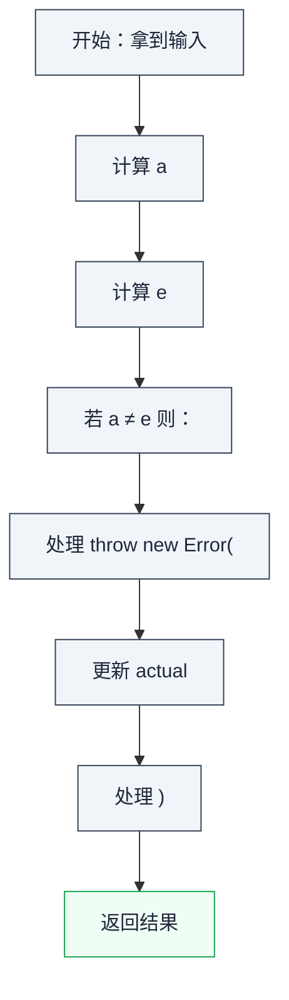

## TypeScript 解题方案（3 个方案逐个讲）

> **运行与提交**：每个方案都是自包含文件（内嵌用例自测，输出 PASS），整块复制到 `.ts` 文件后 `node 文件名` 即可运行。提交 LeetCode 时，把 `demo` 内的算法函数与辅助类型/函数整体取出、置于文件顶层即可。概念演示（非 LeetCode 编号题），在本地运行即可。

### 方案 1：直接实现

**分析与思路**：核心做法是「直接实现」。

**运行方式**：`node 本文件`，内嵌用例全部通过会输出 PASS。


**方案专属流程图**（真实控制流）：

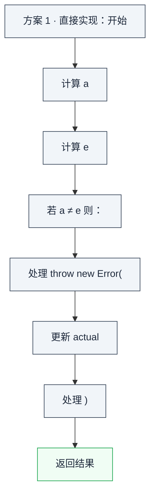

```typescript
function assertEq(actual: any, expected: any, msg: string = ''): void {
  // 定义函数/方法 assertEq
  const a = JSON.stringify(actual); // 把 JSON.stringify(actual) 存入 数组
  const e = JSON.stringify(expected); // 把 JSON.stringify(expected) 存入 e
  if (a !== e) {
    // 若 数组 不等于 e
    throw new Error(
      'ASSERT FAILED ' + msg + ' :: actual=' + a + ' expected=' + e,
    );
  }
}

function selectionSort(nums: number[]): number[] {
  // 定义函数/方法 selectionSort
  for (let i = 0; i < nums.length; i++) {
    // 让 下标 i 从 0 开始计数，下标 i 小于 数组.长度 就继续
    let minIdx = i; // 把 下标 i 存入 minIdx
    for (let j = i + 1; j < nums.length; j++) {
      // 让 下标 j 从 下标 i 加 1 开始计数，下标 j 小于 数组.长度 就继续
      if (nums[j] < nums[minIdx]) minIdx = j; // 若 数组[下标 j] 小于 数组[minIdx]) minIdx 赋值为 下标 j;
    }
    [nums[i], nums[minIdx]] = [nums[minIdx], nums[i]]; // 把 [数组[minIdx], 数组[下标 i]]; 写入 [nums[i], nums[minIdx]]
  }
  return nums; // 返回 数组
}

export function demo(): void {
  // 程序入口：跑内嵌自测用例
  assertEq(selectionSort([1, 2, 3].slice()), [1, 2, 3], 'sel [1,2,3]'); // 断言校验
  assertEq(selectionSort([3, 2, 1].slice()), [1, 2, 3], 'sel [3,2,1]'); // 断言校验
  assertEq(
    selectionSort([5, 2, 4, 1, 3].slice()),
    [1, 2, 3, 4, 5],
    'sel [5,2,4,1,3]',
  ); // 断言校验
  console.log('PASS'); // 全部用例通过，输出 PASS
}
demo(); // demo();
```

### 方案 2：直接实现

**分析与思路**：核心做法是「直接实现」。

**运行方式**：`node 本文件`，内嵌用例全部通过会输出 PASS。


**方案专属流程图**（真实控制流）：


```typescript
function assertEq(actual: any, expected: any, msg: string = ''): void {
  // 定义函数/方法 assertEq
  const a = JSON.stringify(actual);
  const e = JSON.stringify(expected);
  if (a !== e)
    throw new Error(
      'ASSERT FAILED ' + msg + ' :: actual=' + a + ' expected=' + e,
    );
}

function selection_sort(nums: number[]): void {
  // 定义函数/方法 selection_sort
  const length = nums.length; // 把 数组.长度 存入 长度
  for (let i = 0; i < length - 1; i++) {
    // 让 下标 i 从 0 开始计数，下标 i 小于 长度 减 1 就继续
    let min_index = i; // 把 下标 i 存入 min_index
    for (let j = i + 1; j < length; j++) {
      // 让 下标 j 从 下标 i 加 1 开始计数，下标 j 小于 长度 就继续
      if (nums[j] < nums[min_index]) min_index = j; // 若 数组[下标 j] 小于 数组[min_index]) min_index 赋值为 下标 j;
    }
    if (i !== min_index) {
      const t = nums[i];
      nums[i] = nums[min_index];
      nums[min_index] = t;
    }
  }
}
export function demo(): void {
  // 程序入口：跑内嵌自测用例
  const a = [5, 4, 3, 2, 1].slice();
  selection_sort(a); // 把 [5, 4, 3, 2, 1] 截取 ); selection_sort(数组) 存入 数组
  assertEq(a, [1, 2, 3, 4, 5], 'sel'); // 断言校验
  const b = [3, 1, 4, 2].slice();
  selection_sort(b); // 把 [3, 1, 4, 2] 截取 ); selection_sort(b) 存入 b
  assertEq(b, [1, 2, 3, 4], 'sel2'); // 断言校验
  console.log('PASS'); // 全部用例通过，输出 PASS
}
demo(); // demo();
```

### 方案 3：直接实现

**分析与思路**：核心做法是「直接实现」。

**运行方式**：`node 本文件`，内嵌用例全部通过会输出 PASS。


**方案专属流程图**（真实控制流）：

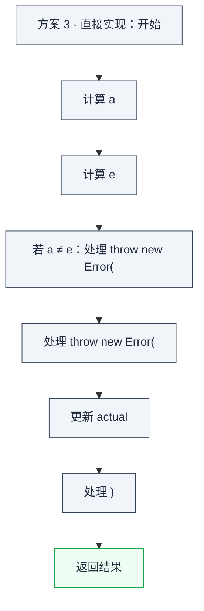

```typescript
function assertEq(actual: any, expected: any, msg: string = ''): void {
  // 定义函数/方法 assertEq
  const a = JSON.stringify(actual);
  const e = JSON.stringify(expected);
  if (a !== e)
    throw new Error(
      'ASSERT FAILED ' + msg + ' :: actual=' + a + ' expected=' + e,
    );
}

function selection_sort(nums: number[]): void {
  // 定义函数/方法 selection_sort
  const length = nums.length; // 把 数组.长度 存入 长度
  for (let i = 0; i < length - 1; i++) {
    // 让 下标 i 从 0 开始计数，下标 i 小于 长度 减 1 就继续
    let min_index = i; // 把 下标 i 存入 min_index
    for (let j = i + 1; j < length; j++)
      if (nums[j] < nums[min_index]) min_index = j; // 让 下标 j 从 下标 i 加 1 开始计数，下标 j 小于 长度 就继续
    if (i !== min_index) {
      const t = nums[i];
      nums[i] = nums[min_index];
      nums[min_index] = t;
    }
  }
}
export function demo(): void {
  // 程序入口：跑内嵌自测用例
  const a = [5, 4, 3, 2, 1].slice();
  selection_sort(a);
  assertEq(a, [1, 2, 3, 4, 5], 's1');
  const b = [3, 1, 4, 2].slice();
  selection_sort(b);
  assertEq(b, [1, 2, 3, 4], 's2');
  console.log('PASS'); // 全部用例通过，输出 PASS
}
demo(); // demo();
```

## 逐步拆解与面试追问

**复杂度**：时间 O(n) 量级，空间 O(n)

**为什么是这个量级**：整体只对数据做有限趟处理

**面试官可能会追问**：

- 这个策略能推广到什么场景？
- 与暴力做法差在哪一步？
- 有没有更简单的等价写法？

## 关键 API 速查（TS 主解法实际用到，附官方链接）

| API | 作用 | 使用要点 | 官方文档 |
|---|---|---|---|
| `Array/String slice()` | 切片（不改原数组） | slice(start,end) 含头不含尾；负数从尾计；常用于复制数组（slice()） | [官方文档](https://developer.mozilla.org/zh-CN/docs/Web/JavaScript/Reference/Global_Objects/Array/slice) |
| `JSON.stringify()` | 序列化为 JSON 字符串 | 常用于结构化比较（深度相等判定）；undefined/函数/循环引用会被丢弃或抛错 | [官方文档](https://developer.mozilla.org/zh-CN/docs/Web/JavaScript/Reference/Global_Objects/JSON/stringify) |

### 各语言官方文档导航

- **TypeScript / JS**：[MDN 中文参考](https://developer.mozilla.org/zh-CN/)
- **Python**：[Python 官方文档](https://docs.python.org/zh-cn/3/)
- **Go**：[Go 标准库](https://pkg.go.dev/std)
- **Java**：[JDK 17 API](https://docs.oracle.com/en/java/javase/17/docs/api/)
- **Rust**：[Rust 标准库](https://doc.rust-lang.org/std/)
- **Lua**：[Lua 5.4 手册](https://www.lua.org/manual/5.4/)
- **C**：[Cppreference C](https://zh.cppreference.com/w/c)
- **C++**：[Cppreference C++](https://zh.cppreference.com/w/cpp)
- **R**：[R 官方手册](https://stat.ethz.ch/R-manual/)
- **Zig**：[Zig 语言文档](https://ziglang.org/documentation/master/)
- **Dart**：[Dart API](https://api.dart.dev/)

## 附录：其他 10 种语言全部实现（每种语言列举其全部方案）

> TypeScript 的全部方案见「TypeScript 解题方案」一节；下面是其余 10 种语言的对应实现，每种语言的每个方案都带思路分析、代码走读与专属运行架构图。
> 每个方案都内嵌用例自测，可独立运行（老仓库 python/go 文件遵循「打印结果」约定）。
> 完整解法文件见 `dsa/<语言>/notes/lc_134085384_选择排序/`。

### Python 实现（3 种方案）

Python 的全部方案如下，每个方案都内嵌用例自测，可独立运行（老仓库 python/go 文件遵循「打印结果」约定）：

#### 方案 1：直接实现

**思路与代码分析**：核心是「直接实现」。Python 版用切片与字典推导式简化操作，突出可读性。**走读**：方案 1 · 直接实现：开始 → 循环 i：从 0 到 len(nums 前 → 更新 min_idx → 循环 j：从 i + 1 到 len(nums 前 → 若 nums[j] ＜ nums[min_idx]：更新 min_idx → 更新 min_idx → 更新 nums[min_idx] → 处理 nums[min_idx], → 处理 nums[i], → 处理 ) → 返回 nums。

**运行架构**（真实控制流）：

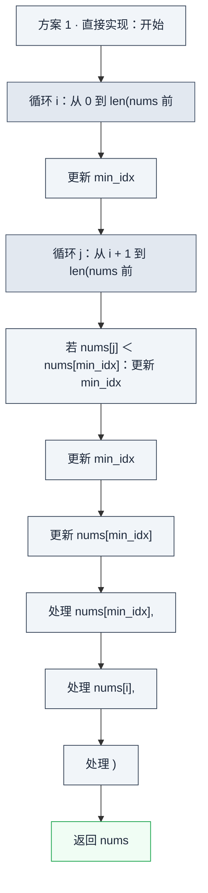

```python
import sys  # 提高递归深度上限（深输入防 RecursionError）

sys.setrecursionlimit(200000)  # 树/链表类题目节点数可达 1e4 量级

def selectionSort(nums):  # 定义函数 selectionSort（参数：数组）
    for i in range(len(nums)):  # 让 下标 i 从 长度(数组 遍历
        min_idx = i  # 把 下标 i 存入 min_idx
        for j in range(i + 1, len(nums)):  # 让 下标 j 从 下标 i 加 1 到 长度(数组 遍历
            if nums[j] < nums[min_idx]:  # 若 数组[下标 j] 小于 数组[min_idx]
                min_idx = j  # 把 下标 j 存入 min_idx
        nums[i], nums[min_idx] = (
            nums[min_idx],
            nums[i],
        )  # 把 数组[min_idx], 数组[下标 i] 写入 nums[i], nums[min_idx]
    return nums  # 返回 数组

if __name__ == "__main__":  # 若 __name__ 等于 '__main__'
    print(selectionSort([1, 2, 3]))  # 打印输出
```

#### 方案 2：直接实现

**思路与代码分析**：核心是「直接实现」。Python 版用切片与字典推导式简化操作，突出可读性。**走读**：方案 2 · 直接实现：开始 → 更新 length → 循环 i：从 0 到 length - 1 前 → 更新 min_index → 循环 j：从 i + 1 到 length 前 → 若 nums[j] ＜ nums[min_index]：更新 min_index → 更新 min_index → 若 i ≠ min_index：更新 nums[min_index] → 更新 nums[min_index] → 处理 nums[min_index], → 处理 nums[i], → 处理 ) → 返回结果。

**运行架构**（真实控制流）：

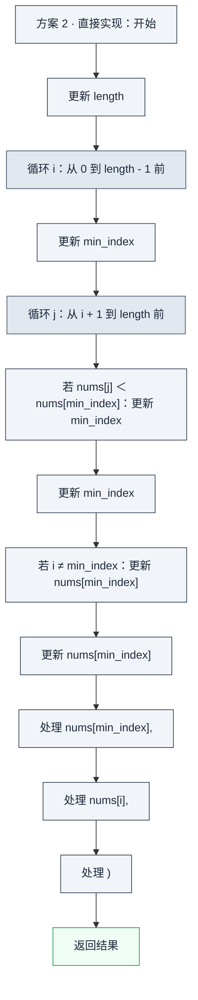

```python
import sys  # 提高递归深度上限（深输入防 RecursionError）

sys.setrecursionlimit(200000)  # 树/链表类题目节点数可达 1e4 量级

def selection_sort(nums):  # 定义函数 selection_sort（参数：数组）
    length = len(nums)  # 把 长度(数组) 存入 长度
    for i in range(length - 1):  # 让 下标 i 从 长度 减 1 遍历
        min_index = i  # 把 下标 i 存入 min_index
        for j in range(i + 1, length):  # 让 下标 j 从 下标 i 加 1 到 长度 遍历
            if nums[j] < nums[min_index]:  # 若 数组[下标 j] 小于 数组[min_index]
                min_index = j  # 把 下标 j 存入 min_index
        if i != min_index:  # 若 下标 i 不等于 min_index
            nums[i], nums[min_index] = (
                nums[min_index],
                nums[i],
            )  # 把 数组[min_index], 数组[下标 i] 写入 nums[i], nums[min_index]

if __name__ == "__main__":  # 若 __name__ 等于 '__main__'
    list_ = [5, 4, 3, 2, 1]  # 把 [5, 4, 3, 2, 1] 存入 list_
    selection_sort(list_)  # selection_sort(list_)
    print(list_)  # 打印输出
```

#### 方案 3：直接实现

**思路与代码分析**：核心是「直接实现」。Python 版用切片与字典推导式简化操作，突出可读性。**走读**：方案 3 · 直接实现：开始 → 更新 arr → 更新 length → 循环 i：从 0 到 length - 1 前 → 更新 min_index → 循环 j：从 i + 1 到 length 前 → 若 arr[j] ＜ arr[min_index]：更新 min_index → 更新 min_index → 若 i ≠ min_index：更新 arr[min_index] → 更新 arr[min_index] → 处理 arr[min_index], → 处理 arr[i], → 处理 ) → 返回 arr。

**运行架构**（真实控制流）：

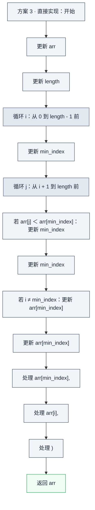

```python
import sys  # 提高递归深度上限（深输入防 RecursionError）

sys.setrecursionlimit(200000)  # 树/链表类题目节点数可达 1e4 量级

def selection_sort(nums):  # 定义函数 selection_sort（参数：数组）
    arr = list(nums)  # 把 列表(数组) 存入 数组
    length = len(arr)  # 把 长度(数组) 存入 长度
    for i in range(length - 1):  # 让 下标 i 从 长度 减 1 遍历
        min_index = i  # 把 下标 i 存入 min_index
        for j in range(i + 1, length):  # 让 下标 j 从 下标 i 加 1 到 长度 遍历
            if arr[j] < arr[min_index]:  # 若 数组[下标 j] 小于 数组[min_index]
                min_index = j  # 把 下标 j 存入 min_index
        if i != min_index:  # 若 下标 i 不等于 min_index
            arr[i], arr[min_index] = (
                arr[min_index],
                arr[i],
            )  # 把 数组[min_index], 数组[下标 i] 写入 arr[i], arr[min_index]
    return arr  # 返回 数组

if __name__ == "__main__":  # 若 __name__ 等于 '__main__'
    print(selection_sort([5, 4, 3, 2, 1]))  # 打印输出
```

### Go 实现（3 种方案）

Go 的全部方案如下，每个方案都内嵌用例自测，可独立运行（老仓库 python/go 文件遵循「打印结果」约定）：

#### 方案 1：直接实现

**思路与代码分析**：核心是「直接实现」。Go 版用切片与多返回值惯用法，显式处理索引边界。**走读**：方案 1 · 直接实现：开始 → 遍历循环 → 更新 : → 遍历循环 → 处理 if nums[j] ＜ nums[minIdx] → 更新 minIdx → 更新 nums[minIdx] → 返回 nums。

**运行架构**（真实控制流）：

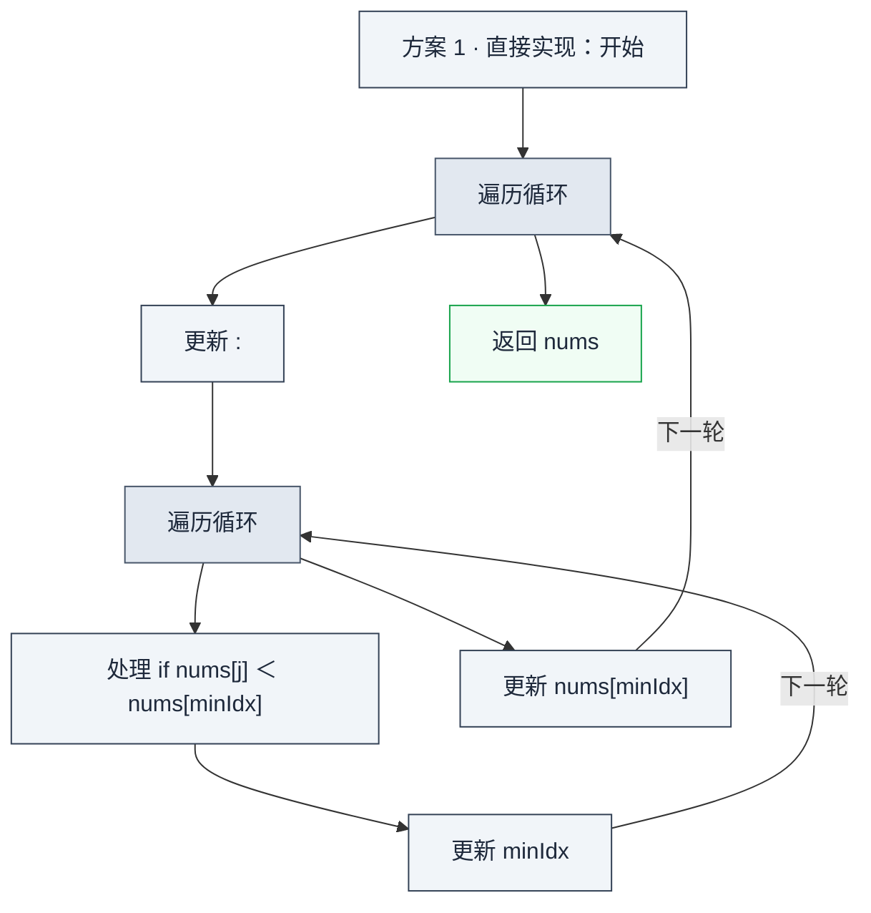

```go
package main // 引入依赖

import (
	"fmt"     // 「fmt」
	"os"      // 「os」
	"reflect" // 「reflect」
)

func selectionSort(nums []int) []int { // 定义函数/方法 selectionSort
	for i := 0; i < len(nums); i++ { // 让 下标 i 从 0 开始计数
		minIdx := i                          // 把 下标 i 写入 minIdx :
		for j := i + 1; j < len(nums); j++ { // 把 下标 i 加 1; 下标 j 小于 长度(数组); 下标 j 加一 { 写入 for j :
			if nums[j] < nums[minIdx] { // 若 数组[下标 j] 小于 数组[minIdx]
				minIdx = j // 把 下标 j 写入 minIdx
			}
		}
		nums[i], nums[minIdx] = nums[minIdx], nums[i] // 把 数组[minIdx], 数组[下标 i] 写入 nums[i], nums[minIdx]
	}
	return nums // 返回 数组
}

func main() { // 程序入口：跑内嵌自测用例
	type tc struct { // 定义类型
		in   []int // in []int
		want []int // want []int
	}
	cases := []tc{ // 把 []tc{ 写入 cases :
		{[]int{1, 2, 3}, []int{1, 2, 3}},
		{[]int{5, 4, 3, 2, 1}, []int{1, 2, 3, 4, 5}},
		{[]int{3, 1, 2}, []int{1, 2, 3}},
	}
	ok := true                // 把 true 写入 ok :
	for _, c := range cases { // 同时取 _ 与 字符 遍历
		in := append([]int{}, c.in...) // 把 append([]int{}, 字符.in...) 写入 in :
		if got := selectionSort(in); !reflect.DeepEqual(got, c.want) {
			ok = false                                                           // 把 false 写入 ok
			fmt.Printf("FAIL selectionSort(%v)=%v want %v\n", c.in, got, c.want) // 打印输出
		}
	}
	if !ok { // 若 取反 ok
		os.Exit(1) // os.Exit(1)
	}
	fmt.Println("PASS") // 全部用例通过，输出 PASS
}
```

#### 方案 2：直接实现

**思路与代码分析**：核心是「直接实现」。Go 版用切片与多返回值惯用法，显式处理索引边界。**走读**：方案 2 · 直接实现：开始 → 更新 : → 遍历循环 → 更新 : → 遍历循环 → 处理 if nums[j] ＜ nums[minIndex] → 更新 minIndex → 处理 if i ≠ minIndex → 更新 nums[minIndex] → 返回结果。

**运行架构**（真实控制流）：

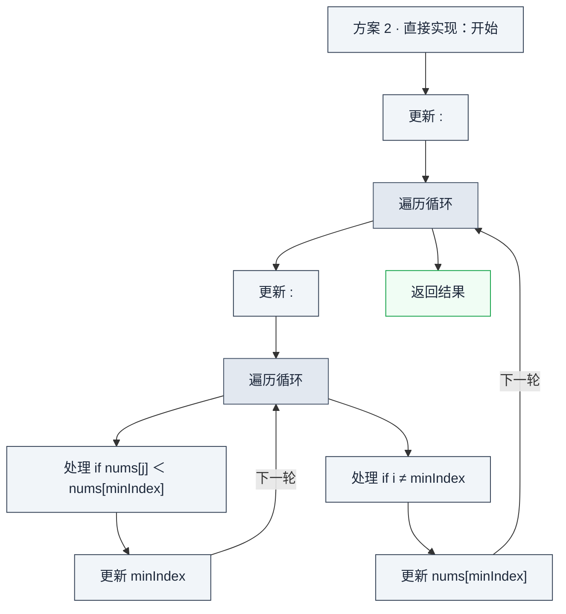

```go
package main // 引入依赖

import (
	"fmt"     // 「fmt」
	"os"      // 「os」
	"reflect" // 「reflect」
)

func selectionSort(nums []int) { // 定义函数/方法 selectionSort
	length := len(nums)             // 把 长度(数组) 写入 length :
	for i := 0; i < length-1; i++ { // 让 下标 i 从 0 开始计数
		minIndex := i                     // 把 下标 i 写入 minIndex :
		for j := i + 1; j < length; j++ { // 把 下标 i 加 1; 下标 j 小于 长度; 下标 j 加一 { 写入 for j :
			if nums[j] < nums[minIndex] { // 若 数组[下标 j] 小于 数组[minIndex]
				minIndex = j // 把 下标 j 写入 minIndex
			}
		}
		if i != minIndex { // 若 下标 i 不等于 minIndex
			nums[i], nums[minIndex] = nums[minIndex], nums[i] // 把 数组[minIndex], 数组[下标 i] 写入 nums[i], nums[minIndex]
		}
	}
}

func main() { // 程序入口：跑内嵌自测用例
	type tc struct { // 定义类型
		in   []int // in []int
		want []int // want []int
	}
	cases := []tc{ // 把 []tc{ 写入 cases :
		{[]int{5, 4, 3, 2, 1}, []int{1, 2, 3, 4, 5}},
		{[]int{1, 2, 3}, []int{1, 2, 3}},
		{[]int{2, 1}, []int{1, 2}},
	}
	ok := true                // 把 true 写入 ok :
	for _, c := range cases { // 同时取 _ 与 字符 遍历
		in := append([]int{}, c.in...)      // 把 append([]int{}, 字符.in...) 写入 in :
		selectionSort(in)                   // selectionSort(in)
		if !reflect.DeepEqual(in, c.want) { // 若 取反 reflect.DeepEqual(in, 字符.want
			ok = false                                                          // 把 false 写入 ok
			fmt.Printf("FAIL selectionSort(%v)=%v want %v\n", c.in, in, c.want) // 打印输出
		}
	}
	if !ok { // 若 取反 ok
		os.Exit(1) // os.Exit(1)
	}
	fmt.Println("PASS") // 全部用例通过，输出 PASS
}
```

#### 方案 3：直接实现

**思路与代码分析**：核心是「直接实现」。Go 版用切片与多返回值惯用法，显式处理索引边界。**走读**：方案 3 · 直接实现：开始 → 更新 : → 更新 : → 遍历循环 → 更新 : → 遍历循环 → 处理 if arr[j] ＜ arr[minIndex] → 更新 minIndex → 处理 if i ≠ minIndex → 更新 arr[minIndex] → 返回 arr。

**运行架构**（真实控制流）：

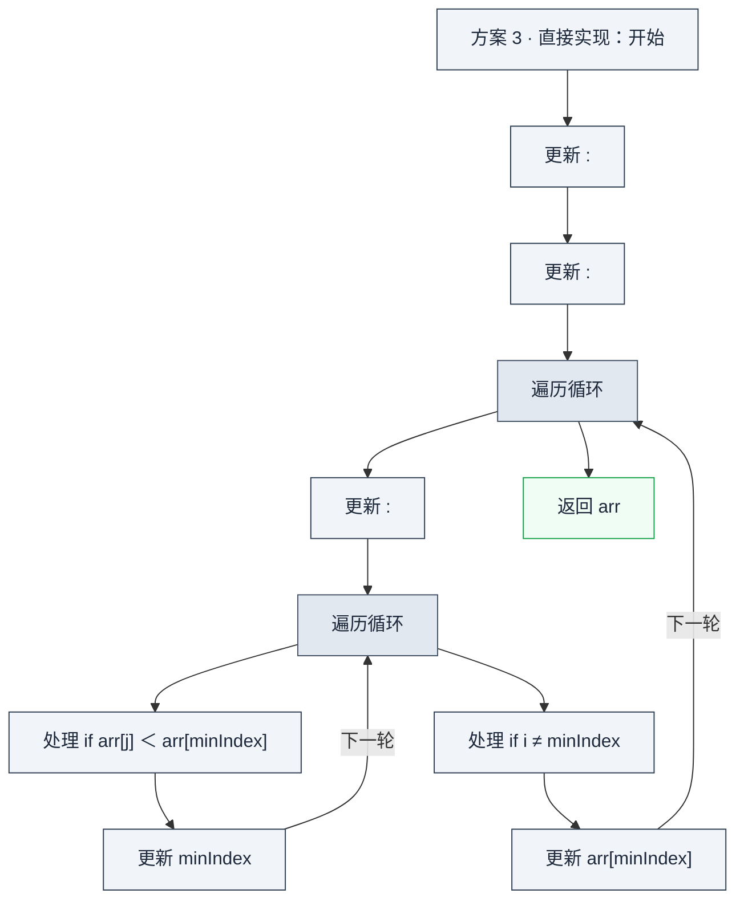

```go
package main // 引入依赖

import (
	"fmt"     // 「fmt」
	"os"      // 「os」
	"reflect" // 「reflect」
)

func selectionSort(nums []int) []int { // 定义函数/方法 selectionSort
	arr := append([]int{}, nums...) // 把 append([]int{}, 数组...) 写入 arr :
	length := len(arr)              // 把 长度(数组) 写入 length :
	for i := 0; i < length-1; i++ { // 让 下标 i 从 0 开始计数
		minIndex := i                     // 把 下标 i 写入 minIndex :
		for j := i + 1; j < length; j++ { // 把 下标 i 加 1; 下标 j 小于 长度; 下标 j 加一 { 写入 for j :
			if arr[j] < arr[minIndex] { // 若 数组[下标 j] 小于 数组[minIndex]
				minIndex = j // 把 下标 j 写入 minIndex
			}
		}
		if i != minIndex { // 若 下标 i 不等于 minIndex
			arr[i], arr[minIndex] = arr[minIndex], arr[i] // 把 数组[minIndex], 数组[下标 i] 写入 arr[i], arr[minIndex]
		}
	}
	return arr // 返回 数组
}

func main() { // 程序入口：跑内嵌自测用例
	type tc struct { // 定义类型
		in   []int // in []int
		want []int // want []int
	}
	cases := []tc{ // 把 []tc{ 写入 cases :
		{[]int{5, 4, 3, 2, 1}, []int{1, 2, 3, 4, 5}},
		{[]int{1, 2, 3}, []int{1, 2, 3}},
		{[]int{}, []int{}},
	}
	ok := true                // 把 true 写入 ok :
	for _, c := range cases { // 同时取 _ 与 字符 遍历
		if got := selectionSort(c.in); !reflect.DeepEqual(got, c.want) {
			ok = false                                                           // 把 false 写入 ok
			fmt.Printf("FAIL selectionSort(%v)=%v want %v\n", c.in, got, c.want) // 打印输出
		}
	}
	if !ok { // 若 取反 ok
		os.Exit(1) // os.Exit(1)
	}
	fmt.Println("PASS") // 全部用例通过，输出 PASS
}
```

### Java 实现（3 种方案）

Java 的全部方案如下，每个方案都内嵌用例自测，可独立运行（老仓库 python/go 文件遵循「打印结果」约定）：

#### 方案 1：直接实现

**思路与代码分析**：核心是「直接实现」。Java 版用类与静态方法组织，集合操作显式明了。代码里依次做这些事：双重循环遍历。**走读**：方案 1 · 直接实现：开始 → 遍历循环 → 更新 minIdx → 遍历循环 → 若 nums[j] ＜ nums[minIdx]：更新 minIdx → 更新 t → 更新 nums[i] → 更新 nums[minIdx] → 返回 nums。

**运行架构**（真实控制流）：

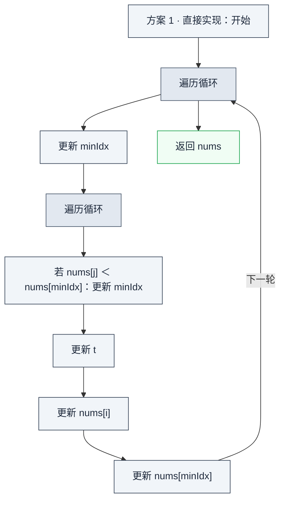

```java
package com.webfault.dsa; // 引入依赖

import java.util.*; // 引入依赖

class SelS1 { // 定义类型
  static int[] selectionSort(int[] nums) { // 定义函数/方法 selectionSort
    for (int i = 0; i < nums.length; i++) { // 让 下标 i 从 0 开始计数，下标 i 小于 数组.长度 就继续
      int minIdx = i; // 把 下标 i 存入 minIdx
      for (int j = i + 1; j < nums.length; j++)
        if (nums[j] < nums[minIdx]) minIdx = j; // 让 下标 j 从 下标 i 加 1 开始计数，下标 j 小于 数组.长度 就继续
      int t = nums[i];
      nums[i] = nums[minIdx];
      nums[minIdx] = t;
    }
    return nums; // 返回 数组
  }

  public static void main(String[] args) { // public static void main(String[] args) {
    int[][][] cases = { // 把 { 写入 int[][][] cases
      {{1, 2, 3}, {1, 2, 3}},
      {{3, 2, 1}, {1, 2, 3}},
      {{5, 4, 3, 2, 1}, {1, 2, 3, 4, 5}},
    };
    boolean ok = true; // 把 true; 写入 boolean ok
    for (int[][] c : cases) { // for (int[][] 字符 : cases) {
      int[] in = c[0].clone(); // 把 字符[0].clone(); 写入 int[] in
      SelS1.selectionSort(in); // SelS1.selectionSort(in);
      if (!Arrays.equals(in, c[1])) { // 若 取反 Arrays.equals(in, 字符[1]
        ok = false; // 把 false; 写入 ok
        System.out.println(
            "FAIL "
                + Arrays.toString(c[0])
                + " -> "
                + Arrays.toString(in)
                + " want "
                + Arrays.toString(c[1])); // 打印输出
      }
    }
    if (!ok) throw new RuntimeException("FAILED"); // 若 取反 ok) throw new RuntimeException(「FAILED」);
    System.out.println("PASS"); // 全部用例通过，输出 PASS
  }
}
```

#### 方案 2：直接实现

**思路与代码分析**：核心是「直接实现」。Java 版用类与静态方法组织，集合操作显式明了。代码里依次做这些事：双重循环遍历。**走读**：方案 2 · 直接实现：开始 → 更新 length → 遍历循环 → 更新 minIndex → 遍历循环 → 若 nums[j] ＜ nums[minIndex]：更新 minIndex → 若 i ≠ minIndex 则： → 更新 t → 更新 nums[i] → 更新 nums[minIndex] → 返回结果。

**运行架构**（真实控制流）：

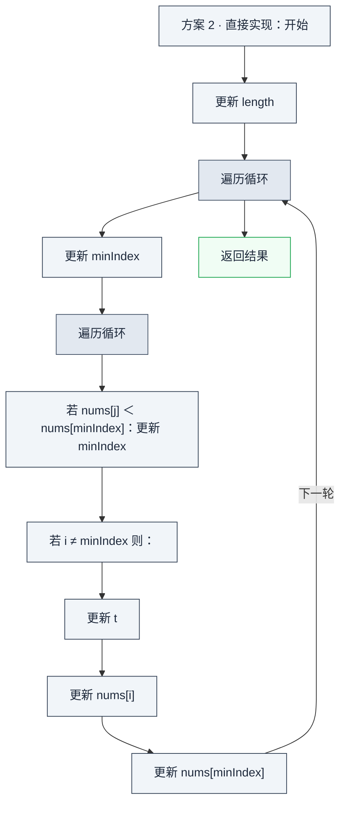

```java
package com.webfault.dsa; // 引入依赖

import java.util.*; // 引入依赖

class SelS2 { // 定义类型
  static void selectionSort(int[] nums) { // 定义函数/方法 selectionSort
    int length = nums.length; // 把 数组.长度 存入 长度
    for (int i = 0; i < length - 1; i++) { // 让 下标 i 从 0 开始计数，下标 i 小于 长度 减 1 就继续
      int minIndex = i; // 把 下标 i 存入 minIndex
      for (int j = i + 1; j < length; j++)
        if (nums[j] < nums[minIndex]) minIndex = j; // 让 下标 j 从 下标 i 加 1 开始计数，下标 j 小于 长度 就继续
      if (i != minIndex) {
        int t = nums[i];
        nums[i] = nums[minIndex];
        nums[minIndex] = t;
      }
    }
  }

  public static void main(String[] args) { // public static void main(String[] args) {
    int[][][] cases = { // 把 { 写入 int[][][] cases
      {{5, 4, 3, 2, 1}, {1, 2, 3, 4, 5}},
      {{1, 2, 3}, {1, 2, 3}},
      {{3, 1, 2}, {1, 2, 3}},
    };
    boolean ok = true; // 把 true; 写入 boolean ok
    for (int[][] c : cases) { // for (int[][] 字符 : cases) {
      int[] in = c[0].clone(); // 把 字符[0].clone(); 写入 int[] in
      SelS2.selectionSort(in); // SelS2.selectionSort(in);
      if (!Arrays.equals(in, c[1])) { // 若 取反 Arrays.equals(in, 字符[1]
        ok = false; // 把 false; 写入 ok
        System.out.println(
            "FAIL "
                + Arrays.toString(c[0])
                + " -> "
                + Arrays.toString(in)
                + " want "
                + Arrays.toString(c[1])); // 打印输出
      }
    }
    if (!ok) throw new RuntimeException("FAILED"); // 若 取反 ok) throw new RuntimeException(「FAILED」);
    System.out.println("PASS"); // 全部用例通过，输出 PASS
  }
}
```

#### 方案 3：直接实现

**思路与代码分析**：核心是「直接实现」。Java 版用类与静态方法组织，集合操作显式明了。代码里依次做这些事：双重循环遍历。**走读**：方案 3 · 直接实现：开始 → 更新 arr → 更新 length → 遍历循环 → 更新 minIndex → 遍历循环 → 若 arr[j] ＜ arr[minIndex]：更新 minIndex → 若 i ≠ minIndex 则： → 更新 t → 更新 arr[i] → 更新 arr[minIndex] → 返回 arr。

**运行架构**（真实控制流）：

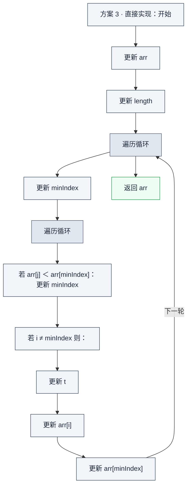

```java
package com.webfault.dsa; // 引入依赖

import java.util.*; // 引入依赖

class SelS3 { // 定义类型
  static int[] selectionSort(int[] nums) { // 定义函数/方法 selectionSort
    int[] arr = nums.clone(); // 把 数组.clone(); 写入 int[] arr
    int length = arr.length; // 把 数组.长度 存入 长度
    for (int i = 0; i < length - 1; i++) { // 让 下标 i 从 0 开始计数，下标 i 小于 长度 减 1 就继续
      int minIndex = i; // 把 下标 i 存入 minIndex
      for (int j = i + 1; j < length; j++)
        if (arr[j] < arr[minIndex]) minIndex = j; // 让 下标 j 从 下标 i 加 1 开始计数，下标 j 小于 长度 就继续
      if (i != minIndex) {
        int t = arr[i];
        arr[i] = arr[minIndex];
        arr[minIndex] = t;
      }
    }
    return arr; // 返回 数组
  }

  public static void main(String[] args) { // public static void main(String[] args) {
    int[][][] cases = { // 把 { 写入 int[][][] cases
      {{5, 4, 3, 2, 1}, {1, 2, 3, 4, 5}},
      {{1, 2, 3}, {1, 2, 3}},
      {{3, 1, 2}, {1, 2, 3}},
    };
    boolean ok = true; // 把 true; 写入 boolean ok
    for (int[][] c : cases) { // for (int[][] 字符 : cases) {
      int[] got =
          SelS3.selectionSort(c[0].clone()); // 把 SelS3.selectionSort(字符[0].clone()); 写入 int[] got
      if (!Arrays.equals(got, c[1])) { // 若 取反 Arrays.equals(got, 字符[1]
        ok = false; // 把 false; 写入 ok
        System.out.println(
            "FAIL "
                + Arrays.toString(c[0])
                + " -> "
                + Arrays.toString(got)
                + " want "
                + Arrays.toString(c[1])); // 打印输出
      }
    }
    if (!ok) throw new RuntimeException("FAILED"); // 若 取反 ok) throw new RuntimeException(「FAILED」);
    System.out.println("PASS"); // 全部用例通过，输出 PASS
  }
}
```

### Rust 实现（3 种方案）

Rust 的全部方案如下，每个方案都内嵌用例自测，可独立运行（老仓库 python/go 文件遵循「打印结果」约定）：

#### 方案 1：直接实现

**思路与代码分析**：核心是「直接实现」。Rust 版用所有权移动与切片借用改写同一逻辑，注意 Option 与引用边界。**走读**：方案 1 · 直接实现：开始 → 计算 v → 计算 n → 遍历 0..n 中的每个元素 i → 计算 m → 遍历 i + 1..n 中的每个元素 j → 处理 if v[j] ＜ v[m] → 更新 m → 调用 v.swap(i, m) → 处理 v → 返回结果。

**运行架构**（真实控制流）：

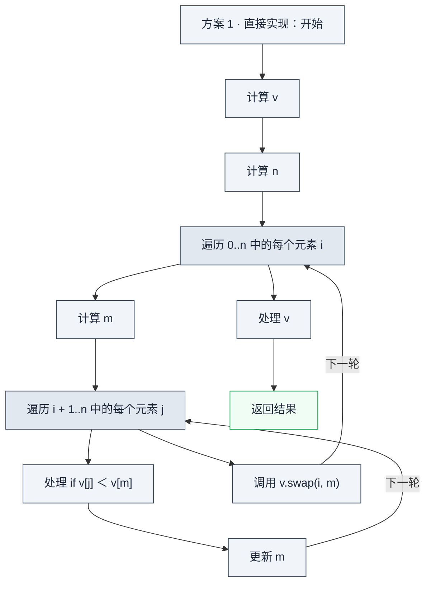

```rust
// 数据结构与算法之排序: 选择排序 — Rust 版（方案1）
fn selection_sort(nums: Vec<i32>) -> Vec<i32> {
    // 定义函数/方法 selection_sort
    let mut v = nums; // 把 数组; 写入 let mut v
    let n = v.len(); // 把 值.长度() 存入 元素个数
    for i in 0..n {
        // 逐个取出 0 的元素（下标 i）
        let mut m = i; // 把 下标 i; 写入 let mut m
        for j in i + 1..n {
            if v[j] < v[m] {
                m = j;
            }
        } // 逐个取出 下标 i 的元素（下标 j）
        v.swap(i, m); // 值.交换 下标 i, 映射表);
    }
    v
}
fn main() {
    // 程序入口：跑内嵌自测用例
    assert_eq!(selection_sort(vec![5, 4, 3, 2, 1]), vec![1, 2, 3, 4, 5]); // 断言校验
    assert_eq!(selection_sort(vec![3, 1, 2]), vec![1, 2, 3]); // 断言校验
    println!("PASS");
} // 全部用例通过，输出 PASS
```

#### 方案 2：直接实现

**思路与代码分析**：核心是「直接实现」。Rust 版用所有权移动与切片借用改写同一逻辑，注意 Option 与引用边界。**走读**：方案 2 · 直接实现：开始 → 计算 v → 计算 n → 遍历 0..n 中的每个元素 i → 计算 m → 遍历 i + 1..n 中的每个元素 j → 处理 if v[j] ＜ v[m] → 更新 m → 调用 v.swap(i, m) → 处理 v → 返回结果。

**运行架构**（真实控制流）：


```rust
// 数据结构与算法之排序: 选择排序 — Rust 版（方案2）
fn selection_sort(nums: Vec<i32>) -> Vec<i32> {
    // 定义函数/方法 selection_sort
    let mut v = nums; // 把 数组; 写入 let mut v
    let n = v.len(); // 把 值.长度() 存入 元素个数
    for i in 0..n {
        // 逐个取出 0 的元素（下标 i）
        let mut m = i; // 把 下标 i; 写入 let mut m
        for j in i + 1..n {
            if v[j] < v[m] {
                m = j;
            }
        } // 逐个取出 下标 i 的元素（下标 j）
        v.swap(i, m); // 值.交换 下标 i, 映射表);
    }
    v
}
fn main() {
    // 程序入口：跑内嵌自测用例
    assert_eq!(selection_sort(vec![5, 4, 3, 2, 1]), vec![1, 2, 3, 4, 5]); // 断言校验
    assert_eq!(selection_sort(vec![3, 1, 2]), vec![1, 2, 3]); // 断言校验
    println!("PASS");
} // 全部用例通过，输出 PASS
```

#### 方案 3：直接实现

**思路与代码分析**：核心是「直接实现」。Rust 版用所有权移动与切片借用改写同一逻辑，注意 Option 与引用边界。**走读**：方案 3 · 直接实现：开始 → 计算 v → 计算 n → 遍历 0..n 中的每个元素 i → 计算 m → 遍历 i + 1..n 中的每个元素 j → 处理 if v[j] ＜ v[m] → 更新 m → 调用 v.swap(i, m) → 处理 v → 返回结果。

**运行架构**（真实控制流）：


```rust
// 数据结构与算法之排序: 选择排序 — Rust 版（方案3）
fn selection_sort(nums: Vec<i32>) -> Vec<i32> {
    // 定义函数/方法 selection_sort
    let mut v = nums; // 把 数组; 写入 let mut v
    let n = v.len(); // 把 值.长度() 存入 元素个数
    for i in 0..n {
        // 逐个取出 0 的元素（下标 i）
        let mut m = i; // 把 下标 i; 写入 let mut m
        for j in i + 1..n {
            if v[j] < v[m] {
                m = j;
            }
        } // 逐个取出 下标 i 的元素（下标 j）
        v.swap(i, m); // 值.交换 下标 i, 映射表);
    }
    v
}
fn main() {
    // 程序入口：跑内嵌自测用例
    assert_eq!(selection_sort(vec![5, 4, 3, 2, 1]), vec![1, 2, 3, 4, 5]); // 断言校验
    assert_eq!(selection_sort(vec![3, 1, 2]), vec![1, 2, 3]); // 断言校验
    println!("PASS");
} // 全部用例通过，输出 PASS
```

### Lua 实现（3 种方案）

Lua 的全部方案如下，每个方案都内嵌用例自测，可独立运行（老仓库 python/go 文件遵循「打印结果」约定）：

#### 方案 1：直接实现

**思路与代码分析**：核心是「直接实现」。Lua 版用表与 ipairs 遍历，注意 ipairs 遇 nil 即停的语义。**走读**：方案 1 · 直接实现：开始 → 更新 v → 更新 n → 循环 i：从 1 到 n - 1 do → 更新 m → 循环 j：从 i + 1 到 n do → 处理 if v[j] ＜ v[m] then → 更新 m → 更新 v[m] → 返回 v。

**运行架构**（真实控制流）：

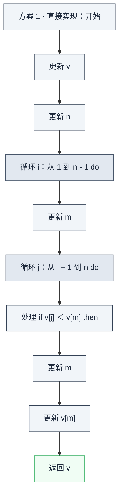

```lua
-- 数据结构与算法之排序: 选择排序 — Lua 版（方案1）
local function selection_sort(nums) -- local function selection_sort(数组)
	local v = { table.unpack(nums) } -- 把 {table.unpack(数组)} 写入 local v
	local n = #v -- 把 #值 写入 local n
	for i = 1, n - 1 do -- 让 下标 i 从 1 走到 元素个数（Lua 1 基）
		local m = i -- 把 下标 i 写入 local m
		for j = i + 1, n do
			if v[j] < v[m] then
				m = j
			end
		end
		v[i], v[m] = v[m], v[i] -- 把 值[映射表], 值[下标 i] 写入 v[i], v[m]
	end -- 终点
	return v -- 返回 值
end -- 终点
assert(table.concat(selection_sort({ 5, 4, 3, 2, 1 }), ",") == "1,2,3,4,5") -- 打印输出
assert(table.concat(selection_sort({ 3, 1, 2 }), ",") == "1,2,3") -- 打印输出
print("PASS") -- 全部用例通过，输出 PASS
```

#### 方案 2：直接实现

**思路与代码分析**：核心是「直接实现」。Lua 版用表与 ipairs 遍历，注意 ipairs 遇 nil 即停的语义。**走读**：方案 2 · 直接实现：开始 → 更新 v → 更新 n → 循环 i：从 1 到 n - 1 do → 更新 m → 循环 j：从 i + 1 到 n do → 处理 if v[j] ＜ v[m] then → 更新 m → 更新 v[m] → 返回 v。

**运行架构**（真实控制流）：


```lua
-- 数据结构与算法之排序: 选择排序 — Lua 版（方案2）
local function selection_sort(nums) -- local function selection_sort(数组)
	local v = { table.unpack(nums) } -- 把 {table.unpack(数组)} 写入 local v
	local n = #v -- 把 #值 写入 local n
	for i = 1, n - 1 do -- 让 下标 i 从 1 走到 元素个数（Lua 1 基）
		local m = i -- 把 下标 i 写入 local m
		for j = i + 1, n do
			if v[j] < v[m] then
				m = j
			end
		end
		v[i], v[m] = v[m], v[i] -- 把 值[映射表], 值[下标 i] 写入 v[i], v[m]
	end -- 终点
	return v -- 返回 值
end -- 终点
assert(table.concat(selection_sort({ 5, 4, 3, 2, 1 }), ",") == "1,2,3,4,5") -- 打印输出
assert(table.concat(selection_sort({ 3, 1, 2 }), ",") == "1,2,3") -- 打印输出
print("PASS") -- 全部用例通过，输出 PASS
```

#### 方案 3：直接实现

**思路与代码分析**：核心是「直接实现」。Lua 版用表与 ipairs 遍历，注意 ipairs 遇 nil 即停的语义。**走读**：方案 3 · 直接实现：开始 → 更新 v → 更新 n → 循环 i：从 1 到 n - 1 do → 更新 m → 循环 j：从 i + 1 到 n do → 处理 if v[j] ＜ v[m] then → 更新 m → 更新 v[m] → 返回 v。

**运行架构**（真实控制流）：


```lua
-- 数据结构与算法之排序: 选择排序 — Lua 版（方案3）
local function selection_sort(nums) -- local function selection_sort(数组)
	local v = { table.unpack(nums) } -- 把 {table.unpack(数组)} 写入 local v
	local n = #v -- 把 #值 写入 local n
	for i = 1, n - 1 do -- 让 下标 i 从 1 走到 元素个数（Lua 1 基）
		local m = i -- 把 下标 i 写入 local m
		for j = i + 1, n do
			if v[j] < v[m] then
				m = j
			end
		end
		v[i], v[m] = v[m], v[i] -- 把 值[映射表], 值[下标 i] 写入 v[i], v[m]
	end -- 终点
	return v -- 返回 值
end -- 终点
assert(table.concat(selection_sort({ 5, 4, 3, 2, 1 }), ",") == "1,2,3,4,5") -- 打印输出
assert(table.concat(selection_sort({ 3, 1, 2 }), ",") == "1,2,3") -- 打印输出
print("PASS") -- 全部用例通过，输出 PASS
```

### C 实现（3 种方案）

C 的全部方案如下，每个方案都内嵌用例自测，可独立运行（老仓库 python/go 文件遵循「打印结果」约定）：

#### 方案 1：直接实现

**思路与代码分析**：核心是「直接实现」。C 版手动管理下标与内存，循环边界全部显式写出。代码里依次做这些事：双重循环遍历。**走读**：方案 1 · 直接实现：开始 → 遍历循环 → 更新 m → 遍历循环 → 若 v[j] ＜ v[m]：更新 m → 更新 m → 更新 t → 更新 v[i] → 更新 v[m] → 返回结果。

**运行架构**（真实控制流）：

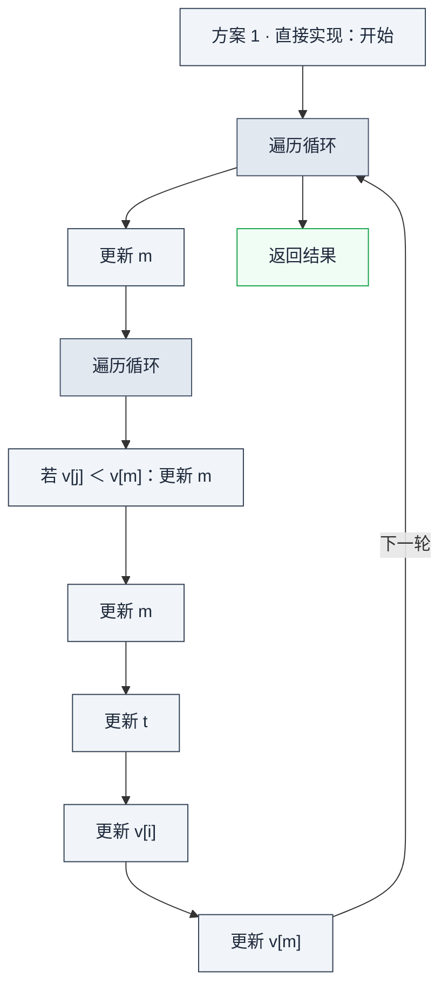

```c
/* 数据结构与算法之排序: 选择排序 — C 版（方案1） */
#include <stdio.h>                           // 引入头文件
static void selection_sort(int v[], int n) { // 定义函数/方法 selection_sort
    for (int i = 0; i < n - 1; i++) { // 让 下标 i 从 0 开始计数，下标 i 小于 元素个数 减 1 就继续
        int m = i;                    // 把 下标 i 存入 映射表
        for (int j = i + 1; j < n; j++)
            if (v[j] < v[m])
                m = j; // 让 下标 j 从 下标 i 加 1 开始计数，下标 j 小于 元素个数 就继续
        int t = v[i];
        v[i] = v[m];
        v[m] = t; // 把 值[下标 i]; 值[下标 i] 赋值为 值[映射表]; 值[映射表] 赋值为 另一字符串 存入 另一字符串
    }
}
int main(void) {                // 程序入口：跑内嵌自测用例
    int v1[] = {5, 4, 3, 2, 1}; // 把 {5,4,3,2,1}; 写入 int v1[]
    selection_sort(v1, 5);      // selection_sort(v1, 5);
    for (int i = 0; i < 5; i++)
        if (v1[i] != i + 1) {
            printf("FAIL\n");
            return 1;
        } // 让 下标 i 从 0 开始计数，下标 i 小于 5 就继续
    printf("PASS\n");
    return 0;
} // 全部用例通过，输出 PASS
```

#### 方案 2：直接实现

**思路与代码分析**：核心是「直接实现」。C 版手动管理下标与内存，循环边界全部显式写出。代码里依次做这些事：双重循环遍历。**走读**：方案 2 · 直接实现：开始 → 遍历循环 → 更新 m → 遍历循环 → 若 v[j] ＜ v[m]：更新 m → 更新 m → 更新 t → 更新 v[i] → 更新 v[m] → 返回结果。

**运行架构**（真实控制流）：

```mermaid
graph TD
    N0["方案 2 · 直接实现：开始"]
    N1["遍历循环"]
    N2["更新 m"]
    N3["遍历循环"]
    N4["若 v[j] ＜ v[m]：更新 m"]
    N5["更新 m"]
    N6["更新 t"]
    N7["更新 v[i]"]
    N8["更新 v[m]"]
    N9["返回结果"]
    N0 --> N1
    N1 --> N2
    N2 --> N3
    N3 --> N4
    N4 --> N5
    N5 --> N6
    N6 --> N7
    N7 --> N8
    N8 -- 下一轮 --> N1
    N1 --> N9
    classDef n fill:#f1f5f9,stroke:#334155,color:#1e293b;
    classDef lp fill:#e2e8f0,stroke:#475569,color:#1e293b;
    classDef dc fill:#fef9c3,stroke:#ca8a04,color:#1e293b;
    classDef tm fill:#f0fdf4,stroke:#16a34a,color:#1e293b;
    class N0,N2,N4,N5,N6,N7,N8 n;
    class N1,N3 lp;
    class N9 tm;
```

```c
/* 数据结构与算法之排序: 选择排序 — C 版（方案2） */
#include <stdio.h>                           // 引入头文件
static void selection_sort(int v[], int n) { // 定义函数/方法 selection_sort
    for (int i = 0; i < n - 1; i++) { // 让 下标 i 从 0 开始计数，下标 i 小于 元素个数 减 1 就继续
        int m = i;                    // 把 下标 i 存入 映射表
        for (int j = i + 1; j < n; j++)
            if (v[j] < v[m])
                m = j; // 让 下标 j 从 下标 i 加 1 开始计数，下标 j 小于 元素个数 就继续
        int t = v[i];
        v[i] = v[m];
        v[m] = t; // 把 值[下标 i]; 值[下标 i] 赋值为 值[映射表]; 值[映射表] 赋值为 另一字符串 存入 另一字符串
    }
}
int main(void) {                // 程序入口：跑内嵌自测用例
    int v1[] = {5, 4, 3, 2, 1}; // 把 {5,4,3,2,1}; 写入 int v1[]
    selection_sort(v1, 5);      // selection_sort(v1, 5);
    for (int i = 0; i < 5; i++)
        if (v1[i] != i + 1) {
            printf("FAIL\n");
            return 1;
        } // 让 下标 i 从 0 开始计数，下标 i 小于 5 就继续
    printf("PASS\n");
    return 0;
} // 全部用例通过，输出 PASS
```

#### 方案 3：直接实现

**思路与代码分析**：核心是「直接实现」。C 版手动管理下标与内存，循环边界全部显式写出。代码里依次做这些事：双重循环遍历。**走读**：方案 3 · 直接实现：开始 → 遍历循环 → 更新 m → 遍历循环 → 若 v[j] ＜ v[m]：更新 m → 更新 m → 更新 t → 更新 v[i] → 更新 v[m] → 返回结果。

**运行架构**（真实控制流）：

```mermaid
graph TD
    N0["方案 3 · 直接实现：开始"]
    N1["遍历循环"]
    N2["更新 m"]
    N3["遍历循环"]
    N4["若 v[j] ＜ v[m]：更新 m"]
    N5["更新 m"]
    N6["更新 t"]
    N7["更新 v[i]"]
    N8["更新 v[m]"]
    N9["返回结果"]
    N0 --> N1
    N1 --> N2
    N2 --> N3
    N3 --> N4
    N4 --> N5
    N5 --> N6
    N6 --> N7
    N7 --> N8
    N8 -- 下一轮 --> N1
    N1 --> N9
    classDef n fill:#f1f5f9,stroke:#334155,color:#1e293b;
    classDef lp fill:#e2e8f0,stroke:#475569,color:#1e293b;
    classDef dc fill:#fef9c3,stroke:#ca8a04,color:#1e293b;
    classDef tm fill:#f0fdf4,stroke:#16a34a,color:#1e293b;
    class N0,N2,N4,N5,N6,N7,N8 n;
    class N1,N3 lp;
    class N9 tm;
```

```c
/* 数据结构与算法之排序: 选择排序 — C 版（方案3） */
#include <stdio.h>                           // 引入头文件
static void selection_sort(int v[], int n) { // 定义函数/方法 selection_sort
    for (int i = 0; i < n - 1; i++) { // 让 下标 i 从 0 开始计数，下标 i 小于 元素个数 减 1 就继续
        int m = i;                    // 把 下标 i 存入 映射表
        for (int j = i + 1; j < n; j++)
            if (v[j] < v[m])
                m = j; // 让 下标 j 从 下标 i 加 1 开始计数，下标 j 小于 元素个数 就继续
        int t = v[i];
        v[i] = v[m];
        v[m] = t; // 把 值[下标 i]; 值[下标 i] 赋值为 值[映射表]; 值[映射表] 赋值为 另一字符串 存入 另一字符串
    }
}
int main(void) {                // 程序入口：跑内嵌自测用例
    int v1[] = {5, 4, 3, 2, 1}; // 把 {5,4,3,2,1}; 写入 int v1[]
    selection_sort(v1, 5);      // selection_sort(v1, 5);
    for (int i = 0; i < 5; i++)
        if (v1[i] != i + 1) {
            printf("FAIL\n");
            return 1;
        } // 让 下标 i 从 0 开始计数，下标 i 小于 5 就继续
    printf("PASS\n");
    return 0;
} // 全部用例通过，输出 PASS
```

### C++ 实现（3 种方案）

C++ 的全部方案如下，每个方案都内嵌用例自测，可独立运行（老仓库 python/go 文件遵循「打印结果」约定）：

#### 方案 1：直接实现

**思路与代码分析**：核心是「直接实现」。C++ 版用 STL 容器与迭代器，减少手写下标错误。代码里依次做这些事：双重循环遍历。**走读**：方案 1 · 直接实现：开始 → 遍历循环 → 更新 m → 遍历循环 → 若 v[j] ＜ v[m]：更新 m → 更新 m → 处理 std::swap(v[i], v[m]) → 返回 v。

**运行架构**（真实控制流）：

```mermaid
graph TD
    N0["方案 1 · 直接实现：开始"]
    N1["遍历循环"]
    N2["更新 m"]
    N3["遍历循环"]
    N4["若 v[j] ＜ v[m]：更新 m"]
    N5["更新 m"]
    N6["处理 std::swap(v[i], v[m])"]
    N7["返回 v"]
    N0 --> N1
    N1 --> N2
    N2 --> N3
    N3 --> N4
    N4 --> N5
    N5 --> N6
    N6 -- 下一轮 --> N1
    N1 --> N7
    classDef n fill:#f1f5f9,stroke:#334155,color:#1e293b;
    classDef lp fill:#e2e8f0,stroke:#475569,color:#1e293b;
    classDef dc fill:#fef9c3,stroke:#ca8a04,color:#1e293b;
    classDef tm fill:#f0fdf4,stroke:#16a34a,color:#1e293b;
    class N0,N2,N4,N5,N6 n;
    class N1,N3 lp;
    class N7 tm;
```

```cpp
// 数据结构与算法之排序: 选择排序 — C++ 版（方案1）
#include <cassert>  // 引入头文件
#include <iostream> // 引入头文件
#include <vector>   // 引入头文件
static std::vector<int> selectionSort(std::vector<int> v) {
    for (size_t i = 0; i + 1 < v.size(); ++i) { // 让 下标 i 从 0 开始计数，下标 i 加 1 小于 值.大小() 就继续
        size_t m = i;                           // 把 下标 i; 写入 size_t m
        for (size_t j = i + 1; j < v.size(); ++j)
            if (v[j] < v[m])
                m = j; // 让 下标 j 从 下标 i 加 1 开始计数，下标 j 小于 值.大小() 就继续
        std::swap(v[i], v[m]); // 交换 值[下标 i] 与 值[映射表]
    }
    return v; // 返回 值
}
int main() {
    assert((selectionSort({5, 4, 3, 2, 1}) == std::vector<int>{1, 2, 3, 4, 5}));
    std::cout << "PASS" << std::endl;
} // 全部用例通过，输出 PASS
```

#### 方案 2：直接实现

**思路与代码分析**：核心是「直接实现」。C++ 版用 STL 容器与迭代器，减少手写下标错误。代码里依次做这些事：双重循环遍历。**走读**：方案 2 · 直接实现：开始 → 遍历循环 → 更新 m → 遍历循环 → 若 v[j] ＜ v[m]：更新 m → 更新 m → 处理 std::swap(v[i], v[m]) → 返回 v。

**运行架构**（真实控制流）：

```mermaid
graph TD
    N0["方案 2 · 直接实现：开始"]
    N1["遍历循环"]
    N2["更新 m"]
    N3["遍历循环"]
    N4["若 v[j] ＜ v[m]：更新 m"]
    N5["更新 m"]
    N6["处理 std::swap(v[i], v[m])"]
    N7["返回 v"]
    N0 --> N1
    N1 --> N2
    N2 --> N3
    N3 --> N4
    N4 --> N5
    N5 --> N6
    N6 -- 下一轮 --> N1
    N1 --> N7
    classDef n fill:#f1f5f9,stroke:#334155,color:#1e293b;
    classDef lp fill:#e2e8f0,stroke:#475569,color:#1e293b;
    classDef dc fill:#fef9c3,stroke:#ca8a04,color:#1e293b;
    classDef tm fill:#f0fdf4,stroke:#16a34a,color:#1e293b;
    class N0,N2,N4,N5,N6 n;
    class N1,N3 lp;
    class N7 tm;
```

```cpp
// 数据结构与算法之排序: 选择排序 — C++ 版（方案2）
#include <cassert>  // 引入头文件
#include <iostream> // 引入头文件
#include <vector>   // 引入头文件
static std::vector<int> selectionSort(std::vector<int> v) {
    for (size_t i = 0; i + 1 < v.size(); ++i) { // 让 下标 i 从 0 开始计数，下标 i 加 1 小于 值.大小() 就继续
        size_t m = i;                           // 把 下标 i; 写入 size_t m
        for (size_t j = i + 1; j < v.size(); ++j)
            if (v[j] < v[m])
                m = j; // 让 下标 j 从 下标 i 加 1 开始计数，下标 j 小于 值.大小() 就继续
        std::swap(v[i], v[m]); // 交换 值[下标 i] 与 值[映射表]
    }
    return v; // 返回 值
}
int main() {
    assert((selectionSort({5, 4, 3, 2, 1}) == std::vector<int>{1, 2, 3, 4, 5}));
    std::cout << "PASS" << std::endl;
} // 全部用例通过，输出 PASS
```

#### 方案 3：直接实现

**思路与代码分析**：核心是「直接实现」。C++ 版用 STL 容器与迭代器，减少手写下标错误。代码里依次做这些事：双重循环遍历。**走读**：方案 3 · 直接实现：开始 → 遍历循环 → 更新 m → 遍历循环 → 若 v[j] ＜ v[m]：更新 m → 更新 m → 处理 std::swap(v[i], v[m]) → 返回 v。

**运行架构**（真实控制流）：

```mermaid
graph TD
    N0["方案 3 · 直接实现：开始"]
    N1["遍历循环"]
    N2["更新 m"]
    N3["遍历循环"]
    N4["若 v[j] ＜ v[m]：更新 m"]
    N5["更新 m"]
    N6["处理 std::swap(v[i], v[m])"]
    N7["返回 v"]
    N0 --> N1
    N1 --> N2
    N2 --> N3
    N3 --> N4
    N4 --> N5
    N5 --> N6
    N6 -- 下一轮 --> N1
    N1 --> N7
    classDef n fill:#f1f5f9,stroke:#334155,color:#1e293b;
    classDef lp fill:#e2e8f0,stroke:#475569,color:#1e293b;
    classDef dc fill:#fef9c3,stroke:#ca8a04,color:#1e293b;
    classDef tm fill:#f0fdf4,stroke:#16a34a,color:#1e293b;
    class N0,N2,N4,N5,N6 n;
    class N1,N3 lp;
    class N7 tm;
```

```cpp
// 数据结构与算法之排序: 选择排序 — C++ 版（方案3）
#include <cassert>  // 引入头文件
#include <iostream> // 引入头文件
#include <vector>   // 引入头文件
static std::vector<int> selectionSort(std::vector<int> v) {
    for (size_t i = 0; i + 1 < v.size(); ++i) { // 让 下标 i 从 0 开始计数，下标 i 加 1 小于 值.大小() 就继续
        size_t m = i;                           // 把 下标 i; 写入 size_t m
        for (size_t j = i + 1; j < v.size(); ++j)
            if (v[j] < v[m])
                m = j; // 让 下标 j 从 下标 i 加 1 开始计数，下标 j 小于 值.大小() 就继续
        std::swap(v[i], v[m]); // 交换 值[下标 i] 与 值[映射表]
    }
    return v; // 返回 值
}
int main() {
    assert((selectionSort({5, 4, 3, 2, 1}) == std::vector<int>{1, 2, 3, 4, 5}));
    std::cout << "PASS" << std::endl;
} // 全部用例通过，输出 PASS
```

### R 实现（3 种方案）

R 的全部方案如下，每个方案都内嵌用例自测，可独立运行（老仓库 python/go 文件遵循「打印结果」约定）：

#### 方案 1：直接实现

**思路与代码分析**：核心是「直接实现」。R 版用向量化思维与 1 起始下标，注意 1:n 的降序陷阱。代码里依次做这些事：双重循环遍历。**走读**：方案 1 · 直接实现：开始 → 处理 v ＜- nums → 处理 n ＜- length(v) → 循环 i：遍历 1:(n - 1) → 处理 m ＜- i → 循环 j：遍历 (i + 1):n) if (v[j] < v[m] → 处理 m ＜- j → 处理 t ＜- v[i] → 处理 v[i] ＜- v[m] → 处理 v[m] ＜- t → 处理 v → 返回结果。

**运行架构**（真实控制流）：

```mermaid
graph TD
    N0["方案 1 · 直接实现：开始"]
    N1["处理 v ＜- nums"]
    N2["处理 n ＜- length(v)"]
    N3["循环 i：遍历 1:(n - 1)"]
    N4["处理 m ＜- i"]
    N5["循环 j：遍历 (i + 1):n) if (v[j] < v[m]"]
    N6["处理 m ＜- j"]
    N7["处理 t ＜- v[i]"]
    N8["处理 v[i] ＜- v[m]"]
    N9["处理 v[m] ＜- t"]
    N10["处理 v"]
    N11["返回结果"]
    N0 --> N1
    N1 --> N2
    N2 --> N3
    N3 --> N4
    N4 --> N5
    N5 --> N6
    N6 --> N7
    N7 --> N8
    N8 --> N9
    N9 -- 下一轮 --> N3
    N3 --> N10
    N10 --> N11
    classDef n fill:#f1f5f9,stroke:#334155,color:#1e293b;
    classDef lp fill:#e2e8f0,stroke:#475569,color:#1e293b;
    classDef dc fill:#fef9c3,stroke:#ca8a04,color:#1e293b;
    classDef tm fill:#f0fdf4,stroke:#16a34a,color:#1e293b;
    class N0,N1,N2,N4,N6,N7,N8,N9,N10 n;
    class N3,N5 lp;
    class N11 tm;
```

```r
# 版（方案1） 定义函数 selection_sort（参数：数组）
selection_sort <- function(nums) {
    v <- nums  # 把 数组 存入 值
    n <- length(v)  # 把 长度(值) 存入 元素个数
    for (i in 1:(n - 1)) {
        # for (下标 i in 1:(元素个数 减 1)) {
        m <- i  # 把 下标 i 存入 映射表
        for (j in (i + 1):n) if (v[j] < v[m])
            m <- j
        t <- v[i]
        v[i] <- v[m]
        v[m] <- t  # 把 值[下标 i]; 值[下标 i] 小于 减 值[映射表]; 值[映射表] 小于 减 另一字符串 存入 另一字符串
    }
    v
}
stopifnot(identical(as.integer(selection_sort(c(5, 4, 3, 2, 1))), 1:5))  # 断言校验
stopifnot(identical(as.integer(selection_sort(c(3, 1, 2))), c(1L, 2L, 3L)))  # 断言校验
cat("PASS\n")  # 全部用例通过，输出 PASS
```

#### 方案 2：直接实现

**思路与代码分析**：核心是「直接实现」。R 版用向量化思维与 1 起始下标，注意 1:n 的降序陷阱。代码里依次做这些事：双重循环遍历。**走读**：方案 2 · 直接实现：开始 → 处理 v ＜- nums → 处理 n ＜- length(v) → 循环 i：遍历 1:(n - 1) → 处理 m ＜- i → 循环 j：遍历 (i + 1):n) if (v[j] < v[m] → 处理 m ＜- j → 处理 t ＜- v[i] → 处理 v[i] ＜- v[m] → 处理 v[m] ＜- t → 处理 v → 返回结果。

**运行架构**（真实控制流）：

```mermaid
graph TD
    N0["方案 2 · 直接实现：开始"]
    N1["处理 v ＜- nums"]
    N2["处理 n ＜- length(v)"]
    N3["循环 i：遍历 1:(n - 1)"]
    N4["处理 m ＜- i"]
    N5["循环 j：遍历 (i + 1):n) if (v[j] < v[m]"]
    N6["处理 m ＜- j"]
    N7["处理 t ＜- v[i]"]
    N8["处理 v[i] ＜- v[m]"]
    N9["处理 v[m] ＜- t"]
    N10["处理 v"]
    N11["返回结果"]
    N0 --> N1
    N1 --> N2
    N2 --> N3
    N3 --> N4
    N4 --> N5
    N5 --> N6
    N6 --> N7
    N7 --> N8
    N8 --> N9
    N9 -- 下一轮 --> N3
    N3 --> N10
    N10 --> N11
    classDef n fill:#f1f5f9,stroke:#334155,color:#1e293b;
    classDef lp fill:#e2e8f0,stroke:#475569,color:#1e293b;
    classDef dc fill:#fef9c3,stroke:#ca8a04,color:#1e293b;
    classDef tm fill:#f0fdf4,stroke:#16a34a,color:#1e293b;
    class N0,N1,N2,N4,N6,N7,N8,N9,N10 n;
    class N3,N5 lp;
    class N11 tm;
```

```r
# 版（方案2） 定义函数 selection_sort（参数：数组）
selection_sort <- function(nums) {
    v <- nums  # 把 数组 存入 值
    n <- length(v)  # 把 长度(值) 存入 元素个数
    for (i in 1:(n - 1)) {
        # for (下标 i in 1:(元素个数 减 1)) {
        m <- i  # 把 下标 i 存入 映射表
        for (j in (i + 1):n) if (v[j] < v[m])
            m <- j
        t <- v[i]
        v[i] <- v[m]
        v[m] <- t  # 把 值[下标 i]; 值[下标 i] 小于 减 值[映射表]; 值[映射表] 小于 减 另一字符串 存入 另一字符串
    }
    v
}
stopifnot(identical(as.integer(selection_sort(c(5, 4, 3, 2, 1))), 1:5))  # 断言校验
stopifnot(identical(as.integer(selection_sort(c(3, 1, 2))), c(1L, 2L, 3L)))  # 断言校验
cat("PASS\n")  # 全部用例通过，输出 PASS
```

#### 方案 3：直接实现

**思路与代码分析**：核心是「直接实现」。R 版用向量化思维与 1 起始下标，注意 1:n 的降序陷阱。代码里依次做这些事：双重循环遍历。**走读**：方案 3 · 直接实现：开始 → 处理 v ＜- nums → 处理 n ＜- length(v) → 循环 i：遍历 1:(n - 1) → 处理 m ＜- i → 循环 j：遍历 (i + 1):n) if (v[j] < v[m] → 处理 m ＜- j → 处理 t ＜- v[i] → 处理 v[i] ＜- v[m] → 处理 v[m] ＜- t → 处理 v → 返回结果。

**运行架构**（真实控制流）：

```mermaid
graph TD
    N0["方案 3 · 直接实现：开始"]
    N1["处理 v ＜- nums"]
    N2["处理 n ＜- length(v)"]
    N3["循环 i：遍历 1:(n - 1)"]
    N4["处理 m ＜- i"]
    N5["循环 j：遍历 (i + 1):n) if (v[j] < v[m]"]
    N6["处理 m ＜- j"]
    N7["处理 t ＜- v[i]"]
    N8["处理 v[i] ＜- v[m]"]
    N9["处理 v[m] ＜- t"]
    N10["处理 v"]
    N11["返回结果"]
    N0 --> N1
    N1 --> N2
    N2 --> N3
    N3 --> N4
    N4 --> N5
    N5 --> N6
    N6 --> N7
    N7 --> N8
    N8 --> N9
    N9 -- 下一轮 --> N3
    N3 --> N10
    N10 --> N11
    classDef n fill:#f1f5f9,stroke:#334155,color:#1e293b;
    classDef lp fill:#e2e8f0,stroke:#475569,color:#1e293b;
    classDef dc fill:#fef9c3,stroke:#ca8a04,color:#1e293b;
    classDef tm fill:#f0fdf4,stroke:#16a34a,color:#1e293b;
    class N0,N1,N2,N4,N6,N7,N8,N9,N10 n;
    class N3,N5 lp;
    class N11 tm;
```

```r
# 版（方案3） 定义函数 selection_sort（参数：数组）
selection_sort <- function(nums) {
    v <- nums  # 把 数组 存入 值
    n <- length(v)  # 把 长度(值) 存入 元素个数
    for (i in 1:(n - 1)) {
        # for (下标 i in 1:(元素个数 减 1)) {
        m <- i  # 把 下标 i 存入 映射表
        for (j in (i + 1):n) if (v[j] < v[m])
            m <- j
        t <- v[i]
        v[i] <- v[m]
        v[m] <- t  # 把 值[下标 i]; 值[下标 i] 小于 减 值[映射表]; 值[映射表] 小于 减 另一字符串 存入 另一字符串
    }
    v
}
stopifnot(identical(as.integer(selection_sort(c(5, 4, 3, 2, 1))), 1:5))  # 断言校验
stopifnot(identical(as.integer(selection_sort(c(3, 1, 2))), c(1L, 2L, 3L)))  # 断言校验
cat("PASS\n")  # 全部用例通过，输出 PASS
```

### Zig 实现（3 种方案）

Zig 的全部方案如下，每个方案都内嵌用例自测，可独立运行（老仓库 python/go 文件遵循「打印结果」约定）：

#### 方案 1：直接实现

**思路与代码分析**：核心是「直接实现」。Zig 版显式分配与清零，整型边界处理严格。代码里依次做这些事：双重循环遍历。**走读**：方案 1 · 直接实现：开始 → 计算 n → 遍历集合元素 → 计算 m → 遍历集合元素 → 若 nums[j] ＜ nums[m]：更新 m → 计算 t → 更新 nums[i] → 更新 nums[m] → 返回结果。

**运行架构**（真实控制流）：

```mermaid
graph TD
    N0["方案 1 · 直接实现：开始"]
    N1["计算 n"]
    N2["遍历集合元素"]
    N3["计算 m"]
    N4["遍历集合元素"]
    N5["若 nums[j] ＜ nums[m]：更新 m"]
    N6["计算 t"]
    N7["更新 nums[i]"]
    N8["更新 nums[m]"]
    N9["返回结果"]
    N0 --> N1
    N1 --> N2
    N2 --> N3
    N3 --> N4
    N4 --> N5
    N5 -- 下一轮 --> N4
    N4 --> N6
    N6 --> N7
    N7 --> N8
    N8 -- 下一轮 --> N2
    N2 --> N9
    classDef n fill:#f1f5f9,stroke:#334155,color:#1e293b;
    classDef lp fill:#e2e8f0,stroke:#475569,color:#1e293b;
    classDef dc fill:#fef9c3,stroke:#ca8a04,color:#1e293b;
    classDef tm fill:#f0fdf4,stroke:#16a34a,color:#1e293b;
    class N0,N1,N3,N5,N6,N7,N8 n;
    class N2,N4 lp;
    class N9 tm;
```

```zig
// 数据结构与算法之排序: 选择排序 — Zig 版（方案1）
const std = @import("std"); // 把 @import(「std」) 存入 std
fn selectionSort(nums: []i32) void { // 定义函数/方法 selectionSort
    const n = nums.len; // 把 数组.长度 存入 元素个数
    for (0..n - 1) |i| { // for (0..元素个数 减 1) 按位或 下标 i 按位或 {
        var m = i; // 把 下标 i 存入 映射表
        for (i + 1..n) |j| { // for (下标 i 加 1..元素个数) 按位或 下标 j 按位或 {
            if (nums[j] < nums[m]) m = j; // 若 数组[下标 j] 小于 数组[映射表]) 映射表 赋值为 下标 j;
        }
        const t = nums[i]; // 把 数组[下标 i] 存入 另一字符串
        nums[i] = nums[m]; // 把 数组[映射表]; 写入 nums[i]
        nums[m] = t; // 把 另一字符串; 写入 nums[m]
    }
}
pub fn main() !void { // 程序入口：跑内嵌自测用例
    var v1 = [_]i32{ 5, 4, 3, 2, 1 }; // 把 [_]i32{ 5, 4, 3, 2, 1 } 存入 v1
    selectionSort(&v1); // selectionSort( 按位与 v1);
    if (v1[0] != 1 or v1[4] != 5) return error.TestFailed; // 若 v1[0] 不等于 1 or v1[4] 不等于 5，直接返回 error.TestFailed
    std.debug.print("PASS\n", .{});
} // 全部用例通过，输出 PASS
```

#### 方案 2：直接实现

**思路与代码分析**：核心是「直接实现」。Zig 版显式分配与清零，整型边界处理严格。代码里依次做这些事：双重循环遍历。**走读**：方案 2 · 直接实现：开始 → 计算 n → 遍历集合元素 → 计算 m → 遍历集合元素 → 若 nums[j] ＜ nums[m]：更新 m → 计算 t → 更新 nums[i] → 更新 nums[m] → 返回结果。

**运行架构**（真实控制流）：

```mermaid
graph TD
    N0["方案 2 · 直接实现：开始"]
    N1["计算 n"]
    N2["遍历集合元素"]
    N3["计算 m"]
    N4["遍历集合元素"]
    N5["若 nums[j] ＜ nums[m]：更新 m"]
    N6["计算 t"]
    N7["更新 nums[i]"]
    N8["更新 nums[m]"]
    N9["返回结果"]
    N0 --> N1
    N1 --> N2
    N2 --> N3
    N3 --> N4
    N4 --> N5
    N5 -- 下一轮 --> N4
    N4 --> N6
    N6 --> N7
    N7 --> N8
    N8 -- 下一轮 --> N2
    N2 --> N9
    classDef n fill:#f1f5f9,stroke:#334155,color:#1e293b;
    classDef lp fill:#e2e8f0,stroke:#475569,color:#1e293b;
    classDef dc fill:#fef9c3,stroke:#ca8a04,color:#1e293b;
    classDef tm fill:#f0fdf4,stroke:#16a34a,color:#1e293b;
    class N0,N1,N3,N5,N6,N7,N8 n;
    class N2,N4 lp;
    class N9 tm;
```

```zig
// 数据结构与算法之排序: 选择排序 — Zig 版（方案2）
const std = @import("std"); // 把 @import(「std」) 存入 std
fn selectionSort(nums: []i32) void { // 定义函数/方法 selectionSort
    const n = nums.len; // 把 数组.长度 存入 元素个数
    for (0..n - 1) |i| { // for (0..元素个数 减 1) 按位或 下标 i 按位或 {
        var m = i; // 把 下标 i 存入 映射表
        for (i + 1..n) |j| { // for (下标 i 加 1..元素个数) 按位或 下标 j 按位或 {
            if (nums[j] < nums[m]) m = j; // 若 数组[下标 j] 小于 数组[映射表]) 映射表 赋值为 下标 j;
        }
        const t = nums[i]; // 把 数组[下标 i] 存入 另一字符串
        nums[i] = nums[m]; // 把 数组[映射表]; 写入 nums[i]
        nums[m] = t; // 把 另一字符串; 写入 nums[m]
    }
}
pub fn main() !void { // 程序入口：跑内嵌自测用例
    var v1 = [_]i32{ 5, 4, 3, 2, 1 }; // 把 [_]i32{ 5, 4, 3, 2, 1 } 存入 v1
    selectionSort(&v1); // selectionSort( 按位与 v1);
    if (v1[0] != 1 or v1[4] != 5) return error.TestFailed; // 若 v1[0] 不等于 1 or v1[4] 不等于 5，直接返回 error.TestFailed
    std.debug.print("PASS\n", .{});
} // 全部用例通过，输出 PASS
```

#### 方案 3：直接实现

**思路与代码分析**：核心是「直接实现」。Zig 版显式分配与清零，整型边界处理严格。代码里依次做这些事：双重循环遍历。**走读**：方案 3 · 直接实现：开始 → 计算 n → 遍历集合元素 → 计算 m → 遍历集合元素 → 若 nums[j] ＜ nums[m]：更新 m → 计算 t → 更新 nums[i] → 更新 nums[m] → 返回结果。

**运行架构**（真实控制流）：

```mermaid
graph TD
    N0["方案 3 · 直接实现：开始"]
    N1["计算 n"]
    N2["遍历集合元素"]
    N3["计算 m"]
    N4["遍历集合元素"]
    N5["若 nums[j] ＜ nums[m]：更新 m"]
    N6["计算 t"]
    N7["更新 nums[i]"]
    N8["更新 nums[m]"]
    N9["返回结果"]
    N0 --> N1
    N1 --> N2
    N2 --> N3
    N3 --> N4
    N4 --> N5
    N5 -- 下一轮 --> N4
    N4 --> N6
    N6 --> N7
    N7 --> N8
    N8 -- 下一轮 --> N2
    N2 --> N9
    classDef n fill:#f1f5f9,stroke:#334155,color:#1e293b;
    classDef lp fill:#e2e8f0,stroke:#475569,color:#1e293b;
    classDef dc fill:#fef9c3,stroke:#ca8a04,color:#1e293b;
    classDef tm fill:#f0fdf4,stroke:#16a34a,color:#1e293b;
    class N0,N1,N3,N5,N6,N7,N8 n;
    class N2,N4 lp;
    class N9 tm;
```

```zig
// 数据结构与算法之排序: 选择排序 — Zig 版（方案3）
const std = @import("std"); // 把 @import(「std」) 存入 std
fn selectionSort(nums: []i32) void { // 定义函数/方法 selectionSort
    const n = nums.len; // 把 数组.长度 存入 元素个数
    for (0..n - 1) |i| { // for (0..元素个数 减 1) 按位或 下标 i 按位或 {
        var m = i; // 把 下标 i 存入 映射表
        for (i + 1..n) |j| { // for (下标 i 加 1..元素个数) 按位或 下标 j 按位或 {
            if (nums[j] < nums[m]) m = j; // 若 数组[下标 j] 小于 数组[映射表]) 映射表 赋值为 下标 j;
        }
        const t = nums[i]; // 把 数组[下标 i] 存入 另一字符串
        nums[i] = nums[m]; // 把 数组[映射表]; 写入 nums[i]
        nums[m] = t; // 把 另一字符串; 写入 nums[m]
    }
}
pub fn main() !void { // 程序入口：跑内嵌自测用例
    var v1 = [_]i32{ 5, 4, 3, 2, 1 }; // 把 [_]i32{ 5, 4, 3, 2, 1 } 存入 v1
    selectionSort(&v1); // selectionSort( 按位与 v1);
    if (v1[0] != 1 or v1[4] != 5) return error.TestFailed; // 若 v1[0] 不等于 1 or v1[4] 不等于 5，直接返回 error.TestFailed
    std.debug.print("PASS\n", .{});
} // 全部用例通过，输出 PASS
```

### Dart 实现（3 种方案）

Dart 的全部方案如下，每个方案都内嵌用例自测，可独立运行（老仓库 python/go 文件遵循「打印结果」约定）：

#### 方案 1：直接实现

**思路与代码分析**：核心是「直接实现」。Dart 版用可空类型标注与集合方法，注意空安全。代码里依次做这些事：双重循环遍历。**走读**：方案 1 · 直接实现：开始 → 更新 v → 遍历循环 → 计算 m → 遍历循环 → 若 v[j] ＜ v[m]：更新 m → 更新 t → 更新 v[i] → 更新 v[m] → 返回 v。

**运行架构**（真实控制流）：

```mermaid
graph TD
    N0["方案 1 · 直接实现：开始"]
    N1["更新 v"]
    N2["遍历循环"]
    N3["计算 m"]
    N4["遍历循环"]
    N5["若 v[j] ＜ v[m]：更新 m"]
    N6["更新 t"]
    N7["更新 v[i]"]
    N8["更新 v[m]"]
    N9["返回 v"]
    N0 --> N1
    N1 --> N2
    N2 --> N3
    N3 --> N4
    N4 --> N5
    N5 -- 下一轮 --> N4
    N4 --> N6
    N6 --> N7
    N7 --> N8
    N8 -- 下一轮 --> N2
    N2 --> N9
    classDef n fill:#f1f5f9,stroke:#334155,color:#1e293b;
    classDef lp fill:#e2e8f0,stroke:#475569,color:#1e293b;
    classDef dc fill:#fef9c3,stroke:#ca8a04,color:#1e293b;
    classDef tm fill:#f0fdf4,stroke:#16a34a,color:#1e293b;
    class N0,N1,N3,N5,N6,N7,N8 n;
    class N2,N4 lp;
    class N9 tm;
```

```dart
// 数据结构与算法之排序: 选择排序 — Dart 版（方案1）
List<int> selectionSort(List<int> nums) {
  // 定义函数/方法 selectionSort
  final v = List<int>.from(nums); // 把 List 小于 int 超过 .from(数组) 存入 值
  for (var i = 0; i + 1 < v.length; i++) {
    // 让 下标 i 从 0 开始计数，下标 i 加 1 小于 值.长度 就继续
    var m = i; // 把 下标 i 存入 映射表
    for (var j = i + 1; j < v.length; j++) {
      if (v[j] < v[m]) m = j;
    } // 让 下标 j 从 下标 i 加 1 开始计数，下标 j 小于 值.长度 就继续
    final t = v[i]; // 把 值[下标 i] 存入 另一字符串
    v[i] = v[m]; // 把 值[映射表]; 写入 v[i]
    v[m] = t; // 把 另一字符串; 写入 v[m]
  }
  return v; // 返回 值
}

void main() {
  if (selectionSort([5, 4, 3, 2, 1]).toString() != '[1, 2, 3, 4, 5]')
    throw StateError('c1');
  print('PASS');
} // 全部用例通过，输出 PASS
```

#### 方案 2：直接实现

**思路与代码分析**：核心是「直接实现」。Dart 版用可空类型标注与集合方法，注意空安全。代码里依次做这些事：双重循环遍历。**走读**：方案 2 · 直接实现：开始 → 更新 v → 遍历循环 → 计算 m → 遍历循环 → 若 v[j] ＜ v[m]：更新 m → 更新 t → 更新 v[i] → 更新 v[m] → 返回 v。

**运行架构**（真实控制流）：

```mermaid
graph TD
    N0["方案 2 · 直接实现：开始"]
    N1["更新 v"]
    N2["遍历循环"]
    N3["计算 m"]
    N4["遍历循环"]
    N5["若 v[j] ＜ v[m]：更新 m"]
    N6["更新 t"]
    N7["更新 v[i]"]
    N8["更新 v[m]"]
    N9["返回 v"]
    N0 --> N1
    N1 --> N2
    N2 --> N3
    N3 --> N4
    N4 --> N5
    N5 -- 下一轮 --> N4
    N4 --> N6
    N6 --> N7
    N7 --> N8
    N8 -- 下一轮 --> N2
    N2 --> N9
    classDef n fill:#f1f5f9,stroke:#334155,color:#1e293b;
    classDef lp fill:#e2e8f0,stroke:#475569,color:#1e293b;
    classDef dc fill:#fef9c3,stroke:#ca8a04,color:#1e293b;
    classDef tm fill:#f0fdf4,stroke:#16a34a,color:#1e293b;
    class N0,N1,N3,N5,N6,N7,N8 n;
    class N2,N4 lp;
    class N9 tm;
```

```dart
// 数据结构与算法之排序: 选择排序 — Dart 版（方案2）
List<int> selectionSort(List<int> nums) {
  // 定义函数/方法 selectionSort
  final v = List<int>.from(nums); // 把 List 小于 int 超过 .from(数组) 存入 值
  for (var i = 0; i + 1 < v.length; i++) {
    // 让 下标 i 从 0 开始计数，下标 i 加 1 小于 值.长度 就继续
    var m = i; // 把 下标 i 存入 映射表
    for (var j = i + 1; j < v.length; j++) {
      if (v[j] < v[m]) m = j;
    } // 让 下标 j 从 下标 i 加 1 开始计数，下标 j 小于 值.长度 就继续
    final t = v[i]; // 把 值[下标 i] 存入 另一字符串
    v[i] = v[m]; // 把 值[映射表]; 写入 v[i]
    v[m] = t; // 把 另一字符串; 写入 v[m]
  }
  return v; // 返回 值
}

void main() {
  if (selectionSort([5, 4, 3, 2, 1]).toString() != '[1, 2, 3, 4, 5]')
    throw StateError('c1');
  print('PASS');
} // 全部用例通过，输出 PASS
```

#### 方案 3：直接实现

**思路与代码分析**：核心是「直接实现」。Dart 版用可空类型标注与集合方法，注意空安全。代码里依次做这些事：双重循环遍历。**走读**：方案 3 · 直接实现：开始 → 更新 v → 遍历循环 → 计算 m → 遍历循环 → 若 v[j] ＜ v[m]：更新 m → 更新 t → 更新 v[i] → 更新 v[m] → 返回 v。

**运行架构**（真实控制流）：

```mermaid
graph TD
    N0["方案 3 · 直接实现：开始"]
    N1["更新 v"]
    N2["遍历循环"]
    N3["计算 m"]
    N4["遍历循环"]
    N5["若 v[j] ＜ v[m]：更新 m"]
    N6["更新 t"]
    N7["更新 v[i]"]
    N8["更新 v[m]"]
    N9["返回 v"]
    N0 --> N1
    N1 --> N2
    N2 --> N3
    N3 --> N4
    N4 --> N5
    N5 -- 下一轮 --> N4
    N4 --> N6
    N6 --> N7
    N7 --> N8
    N8 -- 下一轮 --> N2
    N2 --> N9
    classDef n fill:#f1f5f9,stroke:#334155,color:#1e293b;
    classDef lp fill:#e2e8f0,stroke:#475569,color:#1e293b;
    classDef dc fill:#fef9c3,stroke:#ca8a04,color:#1e293b;
    classDef tm fill:#f0fdf4,stroke:#16a34a,color:#1e293b;
    class N0,N1,N3,N5,N6,N7,N8 n;
    class N2,N4 lp;
    class N9 tm;
```

```dart
// 数据结构与算法之排序: 选择排序 — Dart 版（方案3）
List<int> selectionSort(List<int> nums) {
  // 定义函数/方法 selectionSort
  final v = List<int>.from(nums); // 把 List 小于 int 超过 .from(数组) 存入 值
  for (var i = 0; i + 1 < v.length; i++) {
    // 让 下标 i 从 0 开始计数，下标 i 加 1 小于 值.长度 就继续
    var m = i; // 把 下标 i 存入 映射表
    for (var j = i + 1; j < v.length; j++) {
      if (v[j] < v[m]) m = j;
    } // 让 下标 j 从 下标 i 加 1 开始计数，下标 j 小于 值.长度 就继续
    final t = v[i]; // 把 值[下标 i] 存入 另一字符串
    v[i] = v[m]; // 把 值[映射表]; 写入 v[i]
    v[m] = t; // 把 另一字符串; 写入 v[m]
  }
  return v; // 返回 值
}

void main() {
  if (selectionSort([5, 4, 3, 2, 1]).toString() != '[1, 2, 3, 4, 5]')
    throw StateError('c1');
  print('PASS');
} // 全部用例通过，输出 PASS
```

---

## 内容总结

- **选择排序**（算法笔记 · Medium）：共 3 个方案，主线思路「直接实现」；时间 O(n) 量级；动画演示归并分治过程，附录给出 11 种语言 × 全部方案的可运行实现。
- 来源博客：[https://blog.csdn.net/tyro_java/article/details/134085384](https://blog.csdn.net/tyro_java/article/details/134085384)
- 导航：[📋 总目录](../) ｜ [← 232 归并排序](../232_归并排序/) ｜ [234 实现 lru 缓存算法功能 →](../234_实现_lru_缓存算法功能/)
