# 234 · 实现 lru 缓存算法功能（第附阶段 · 专题补充 · Medium）

> **难度**：⭐⭐ Medium ｜ **专题**：算法笔记
> **学习定位**：第附阶段 · 专题补充第 234 篇 ｜ **解法数**：3
> **内容总结**：**实现 lru 缓存算法功能**（算法笔记 · Medium）：共 3 个方案，主线思路「哈希辅助」；时间 O(n) 量级；动画演示归并分治过程，附录给出 11 种语言 × 全部方案的可运行实现。

---

## 题目描述

实现 lru 缓存算法功能。具体输入输出约定见函数签名与用例。

**数据范围与注意事项**：

- **易错点**：先看小例子手推一遍再对照代码，比直接读代码快得多。

## 题目分析

**场景是什么**：综合练习：把数据结构与策略组合起来解决一个完整问题。本题就是该场景的 Medium 级练习，主线做法是「哈希辅助」。

**主线怎么解**：把主解法从头到尾过一遍，它其实在依次做这几件事：哈希结构做计数或查重。

## 解题思路

**方案对比**（共 3 个方案，由浅入深）：

| 方案 | 时间复杂度 | 空间复杂度 |
|---|---|---|
| 方案 1 · 哈希辅助 | O(n) 量级 | O(n) |
| 方案 2 · 哈希辅助 | O(n) 量级 | O(n) |
| 方案 3 · 哈希辅助 | O(n) 量级 | O(n) |

**方案间的取舍**：方案 1（哈希辅助）；方案 2（哈希辅助）；方案 3（哈希辅助）。数据规模小、可读性优先时选靠前的方案；规模大、性能优先时选靠后的方案。

**怎么读这一篇**：

- 🐣 **新手路线**：把「题目描述」的示例 1 在纸上手推一遍 → 读方案 1（最直观的写法）与它的代码走读 → 按「运行方式」本地跑通看 PASS → 回头对比方案 2 之后的写法差在哪
- 🦅 **大佬路线**：直接锁定最优方案 1（哈希辅助，O(n) 量级）→ 跳读该方案代码与走读 → 用「逐步拆解与面试追问」补齐复杂度推导与边界追问

### 动态算法图（归并分治，GIF 自动循环）


动画演示算法笔记专题里归并分治的典型过程；每个方案在「TypeScript 解题方案」一节还配了专属动画与专属流程图。

### 主解法流程图（真实控制流）

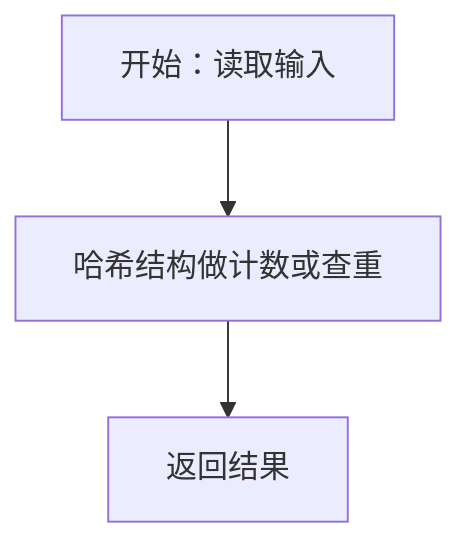

## TypeScript 解题方案（3 个方案逐个讲）

> **运行与提交**：每个方案都是自包含文件（内嵌用例自测，输出 PASS），整块复制到 `.ts` 文件后 `node 文件名` 即可运行。提交 LeetCode 时，把 `demo` 内的算法函数与辅助类型/函数整体取出、置于文件顶层即可。概念演示（非 LeetCode 编号题），在本地运行即可。

### 方案 1：哈希辅助

**分析与思路**：核心做法是「哈希辅助」。代码里依次做这些事：哈希结构做计数或查重。

**运行方式**：`node 本文件`，内嵌用例全部通过会输出 PASS。


**方案专属流程图**（真实控制流）：


```typescript
export function demo(): void {
  // 程序入口：跑内嵌自测用例
  class LRUCache {
    // 定义类型
    length: number;
    data: Map<number, number>; // 长度:number; data:Map 小于 number,number 超过 ;
    constructor(length: number) {
      this.length = length;
      this.data = new Map();
    } // 把 长度; this.data 赋值为 new Map(); } 写入 长度
    set(key: number, value: number) {
      // set(key:number,value:number){
      if (this.data.has(key)) this.data.delete(key); // 若 this.data.has(key)) this.data.delete(key);
      this.data.set(key, value); // this.data.set(key,value);
      if (this.data.size > this.length) {
        // 若 this.data.大小 超过 this.长度
        const k = this.data.keys().next().value; // 把 this.data.keys().下一个().value 存入 下标 k
        this.data.delete(k); // this.data.delete(下标 k);
      }
    }
    get(key: number): number | null {
      // get(key:number):number 按位或 null{
      if (!this.data.has(key)) return null; // 若 取反 this.data.has(key)，直接返回 null
      const v = this.data.get(key)!; // 把 this.data 查找 key)取反 存入 值
      this.data.delete(key);
      this.data.set(key, v); // this.data.delete(key); this.data.set(key,值);
      return v; // 返回 值
    }
  }
  const c = new LRUCache(2); // 把 new LRUCache(2) 存入 字符
  let fail = false; // 把 false 存入 fail
  c.set(1, 1);
  c.set(2, 2); // 字符.set(1,1); 字符.set(2,2);
  if (c.get(1) !== 1) {
    fail = true;
    console.log('FAIL1');
  } // 若 字符 查找 1) 不等于 1){fail 赋值为 true;输出(「FAIL1」);}
  c.set(3, 3); // 字符.set(3,3);
  if (c.get(2) !== null) {
    fail = true;
    console.log('FAIL2');
  } // 若 字符 查找 2) 不等于 null){fail 赋值为 true;输出(「FAIL2」);}
  c.set(4, 4); // 字符.set(4,4);
  if (c.get(1) !== null) {
    fail = true;
    console.log('FAIL3');
  } // 若 字符 查找 1) 不等于 null){fail 赋值为 true;输出(「FAIL3」);}
  if (c.get(3) !== 3) {
    fail = true;
    console.log('FAIL4');
  } // 若 字符 查找 3) 不等于 3){fail 赋值为 true;输出(「FAIL4」);}
  if (c.get(4) !== 4) {
    fail = true;
    console.log('FAIL5');
  } // 若 字符 查找 4) 不等于 4){fail 赋值为 true;输出(「FAIL5」);}
  if (fail) throw new Error('FAILED'); // 若 fail) throw new Error(「FAILED」);
  console.log('PASS'); // 全部用例通过，输出 PASS
}
demo(); // demo();
```

### 方案 2：哈希辅助

**分析与思路**：核心做法是「哈希辅助」。代码里依次做这些事：哈希结构做计数或查重。

**运行方式**：`node 本文件`，内嵌用例全部通过会输出 PASS。


**方案专属流程图**（真实控制流）：


```typescript
export function demo(): void {
  // 程序入口：跑内嵌自测用例
  class LRUCache {
    // 定义类型
    length: number;
    data: Map<number, number>; // 长度:number; data:Map 小于 number,number 超过 ;
    constructor(length: number) {
      this.length = length;
      this.data = new Map();
    } // 把 长度; this.data 赋值为 new Map(); } 写入 长度
    set(key: number, value: number) {
      // set(key:number,value:number){
      if (this.data.has(key)) this.data.delete(key); // 若 this.data.has(key)) this.data.delete(key);
      this.data.set(key, value); // this.data.set(key,value);
      if (this.data.size > this.length) {
        // 若 this.data.大小 超过 this.长度
        const k = this.data.keys().next().value; // 把 this.data.keys().下一个().value 存入 下标 k
        this.data.delete(k); // this.data.delete(下标 k);
      }
    }
    get(key: number): number | null {
      // get(key:number):number 按位或 null{
      if (!this.data.has(key)) return null; // 若 取反 this.data.has(key)，直接返回 null
      const v = this.data.get(key)!; // 把 this.data 查找 key)取反 存入 值
      this.data.delete(key);
      this.data.set(key, v); // this.data.delete(key); this.data.set(key,值);
      return v; // 返回 值
    }
  }
  const c = new LRUCache(2); // 把 new LRUCache(2) 存入 字符
  let fail = false; // 把 false 存入 fail
  c.set(1, 1);
  c.set(2, 2); // 字符.set(1,1); 字符.set(2,2);
  if (c.get(1) !== 1) {
    fail = true;
    console.log('FAIL1');
  } // 若 字符 查找 1) 不等于 1){fail 赋值为 true;输出(「FAIL1」);}
  c.set(3, 3); // 字符.set(3,3);
  if (c.get(2) !== null) {
    fail = true;
    console.log('FAIL2');
  } // 若 字符 查找 2) 不等于 null){fail 赋值为 true;输出(「FAIL2」);}
  c.set(4, 4); // 字符.set(4,4);
  if (c.get(1) !== null) {
    fail = true;
    console.log('FAIL3');
  } // 若 字符 查找 1) 不等于 null){fail 赋值为 true;输出(「FAIL3」);}
  if (c.get(3) !== 3) {
    fail = true;
    console.log('FAIL4');
  } // 若 字符 查找 3) 不等于 3){fail 赋值为 true;输出(「FAIL4」);}
  if (c.get(4) !== 4) {
    fail = true;
    console.log('FAIL5');
  } // 若 字符 查找 4) 不等于 4){fail 赋值为 true;输出(「FAIL5」);}
  if (fail) throw new Error('FAILED'); // 若 fail) throw new Error(「FAILED」);
  console.log('PASS'); // 全部用例通过，输出 PASS
}
demo(); // demo();
```

### 方案 3：哈希辅助

**分析与思路**：核心做法是「哈希辅助」。代码里依次做这些事：哈希结构做计数或查重。

**运行方式**：`node 本文件`，内嵌用例全部通过会输出 PASS。

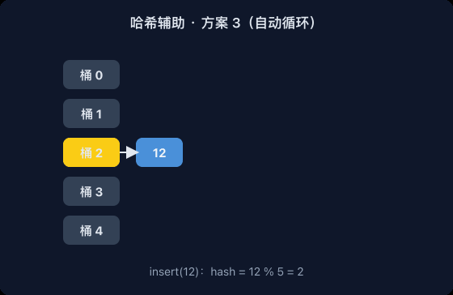

**方案专属流程图**（真实控制流）：


```typescript
export function demo(): void {
  // 程序入口：跑内嵌自测用例
  class LRUCache {
    // 定义类型
    length: number;
    data: Map<number, number>; // 长度:number; data:Map 小于 number,number 超过 ;
    constructor(length: number) {
      this.length = length;
      this.data = new Map();
    } // 把 长度; this.data 赋值为 new Map(); } 写入 长度
    set(key: number, value: number) {
      // set(key:number,value:number){
      if (this.data.has(key)) this.data.delete(key); // 若 this.data.has(key)) this.data.delete(key);
      this.data.set(key, value); // this.data.set(key,value);
      if (this.data.size > this.length) {
        // 若 this.data.大小 超过 this.长度
        const k = this.data.keys().next().value; // 把 this.data.keys().下一个().value 存入 下标 k
        this.data.delete(k); // this.data.delete(下标 k);
      }
    }
    get(key: number): number | null {
      // get(key:number):number 按位或 null{
      if (!this.data.has(key)) return null; // 若 取反 this.data.has(key)，直接返回 null
      const v = this.data.get(key)!; // 把 this.data 查找 key)取反 存入 值
      this.data.delete(key);
      this.data.set(key, v); // this.data.delete(key); this.data.set(key,值);
      return v; // 返回 值
    }
  }
  const c = new LRUCache(2); // 把 new LRUCache(2) 存入 字符
  let fail = false; // 把 false 存入 fail
  c.set(1, 1);
  c.set(2, 2); // 字符.set(1,1); 字符.set(2,2);
  if (c.get(1) !== 1) {
    fail = true;
    console.log('FAIL1');
  } // 若 字符 查找 1) 不等于 1){fail 赋值为 true;输出(「FAIL1」);}
  c.set(3, 3); // 字符.set(3,3);
  if (c.get(2) !== null) {
    fail = true;
    console.log('FAIL2');
  } // 若 字符 查找 2) 不等于 null){fail 赋值为 true;输出(「FAIL2」);}
  c.set(4, 4); // 字符.set(4,4);
  if (c.get(1) !== null) {
    fail = true;
    console.log('FAIL3');
  } // 若 字符 查找 1) 不等于 null){fail 赋值为 true;输出(「FAIL3」);}
  if (c.get(3) !== 3) {
    fail = true;
    console.log('FAIL4');
  } // 若 字符 查找 3) 不等于 3){fail 赋值为 true;输出(「FAIL4」);}
  if (c.get(4) !== 4) {
    fail = true;
    console.log('FAIL5');
  } // 若 字符 查找 4) 不等于 4){fail 赋值为 true;输出(「FAIL5」);}
  if (fail) throw new Error('FAILED'); // 若 fail) throw new Error(「FAILED」);
  console.log('PASS'); // 全部用例通过，输出 PASS
}
demo(); // demo();
```

## 逐步拆解与面试追问

**复杂度**：时间 O(n) 量级，空间 O(n)

**为什么是这个量级**：整体只对数据做有限趟处理

**面试官可能会追问**：

- 这个策略能推广到什么场景？
- 与暴力做法差在哪一步？
- 有没有更简单的等价写法？

## 关键 API 速查（TS 主解法实际用到，附官方链接）

| API | 作用 | 使用要点 | 官方文档 |
|---|---|---|---|
| `Map` | 哈希表：任意类型键值对 | set(k,v) 存、get(k) 取（不存在返回 undefined）、has(k) 判存在、delete(k) 删；增删查均摊 O(1)；键顺序为插入序；键必须用引用区分（对象键按身份） | [官方文档](https://developer.mozilla.org/zh-CN/docs/Web/JavaScript/Reference/Global_Objects/Map) |

### 各语言官方文档导航

- **TypeScript / JS**：[MDN 中文参考](https://developer.mozilla.org/zh-CN/)
- **Python**：[Python 官方文档](https://docs.python.org/zh-cn/3/)
- **Go**：[Go 标准库](https://pkg.go.dev/std)
- **Java**：[JDK 17 API](https://docs.oracle.com/en/java/javase/17/docs/api/)
- **Rust**：[Rust 标准库](https://doc.rust-lang.org/std/)
- **Lua**：[Lua 5.4 手册](https://www.lua.org/manual/5.4/)
- **C**：[Cppreference C](https://zh.cppreference.com/w/c)
- **C++**：[Cppreference C++](https://zh.cppreference.com/w/cpp)
- **R**：[R 官方手册](https://stat.ethz.ch/R-manual/)
- **Zig**：[Zig 语言文档](https://ziglang.org/documentation/master/)
- **Dart**：[Dart API](https://api.dart.dev/)

## 附录：其他 10 种语言全部实现（每种语言列举其全部方案）

> TypeScript 的全部方案见「TypeScript 解题方案」一节；下面是其余 10 种语言的对应实现，每种语言的每个方案都带思路分析、代码走读与专属运行架构图。
> 每个方案都内嵌用例自测，可独立运行（老仓库 python/go 文件遵循「打印结果」约定）。
> 完整解法文件见 `dsa/<语言>/notes/lc_134097112_实现_lru_缓存算法功能/`。

### Python 实现（3 种方案）

Python 的全部方案如下，每个方案都内嵌用例自测，可独立运行（老仓库 python/go 文件遵循「打印结果」约定）：

#### 方案 1：哈希辅助

**思路与代码分析**：核心是「哈希辅助」。Python 版用切片与字典推导式简化操作，突出可读性。

**运行架构**（真实控制流）：

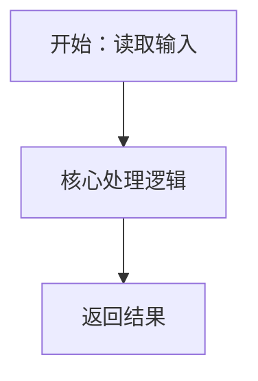

```python
# LRU 缓存 - 方案1: 基于 dict (Python3.7+ 保留插入顺序)
import sys  # 提高递归深度上限（深输入防 RecursionError）

sys.setrecursionlimit(200000)  # 树/链表类题目节点数可达 1e4 量级

class LRUCache:  # 定义类
    def __init__(self, length):  # 构造函数：初始化成员
        self.length = length  # 把 长度 写入 长度
        self.data = {}  # 把 {} 写入 self.data

    def set(self, key, value):  # 定义函数 set（参数：self, key, value）
        data = self.data  # 把 self.data 存入 data
        if key in data:  # 若 key in data
            del data[key]  # del data[key]
        data[key] = value  # 把 value 写入 data[key]
        if len(data) > self.length:  # 若 长度(data) 超过 self.长度
            del_key = next(iter(data))  # 把 下一个(iter(data)) 存入 del_key
            del data[del_key]  # del data[del_key]

    def get(self, key):  # 定义函数 get（参数：self, key）
        data = self.data  # 把 self.data 存入 data
        if key not in data:  # 若 key not in data
            return None  # 返回 None
        value = data[key]  # 把 data[key] 存入 value
        del data[key]  # del data[key]
        data[key] = value  # 保持最新
        return value  # 返回 value

if __name__ == "__main__":  # 若 __name__ 等于 '__main__'
    lru_cache = LRUCache(2)  # 把 LRUCache(2) 存入 lru_cache
    lru_cache.set(1, 1)  # lru_cache.set(1, 1)
    lru_cache.set(2, 2)  # lru_cache.set(2, 2)
    print(lru_cache.get(1))  # 1
    lru_cache.set(3, 3)  # lru_cache.set(3, 3)
    print(lru_cache.get(2))  # None
    lru_cache.set(4, 4)  # lru_cache.set(4, 4)
    print(lru_cache.get(1))  # None
    print(lru_cache.get(3))  # 3
    print(lru_cache.get(4))  # 4
```

#### 方案 2：哈希辅助

**思路与代码分析**：核心是「哈希辅助」。Python 版用切片与字典推导式简化操作，突出可读性。

**运行架构**：与方案 1 的控制流相同（同算法在该语言的等价实现），图见上。

```python
# LRU 缓存 - 方案2: 基于 OrderedDict
import sys  # 提高递归深度上限（深输入防 RecursionError）

sys.setrecursionlimit(200000)  # 树/链表类题目节点数可达 1e4 量级
from collections import OrderedDict  # from collections import OrderedDict

class LRUCache:  # 定义类
    def __init__(self, length):  # 构造函数：初始化成员
        self.length = length  # 把 长度 写入 长度
        self.data = OrderedDict()  # 把 OrderedDict() 写入 self.data

    def set(self, key, value):  # 定义函数 set（参数：self, key, value）
        if key in self.data:  # 若 key in self.data
            del self.data[key]  # del self.data[key]
        self.data[key] = value  # 把 value 写入 self.data[key]
        if len(self.data) > self.length:  # 若 长度(self.data) 超过 self.长度
            self.data.popitem(last=False)  # 把 False) 写入 self.data.popitem(last

    def get(self, key):  # 定义函数 get（参数：self, key）
        if key not in self.data:  # 若 key not in self.data
            return None  # 返回 None
        self.data.move_to_end(key)  # self.data.move_to_end(key)
        return self.data[key]  # 返回 self.data[key]

if __name__ == "__main__":  # 若 __name__ 等于 '__main__'
    lru_cache = LRUCache(2)  # 把 LRUCache(2) 存入 lru_cache
    lru_cache.set(1, 1)  # lru_cache.set(1, 1)
    lru_cache.set(2, 2)  # lru_cache.set(2, 2)
    print(lru_cache.get(1))  # 1
    lru_cache.set(3, 3)  # lru_cache.set(3, 3)
    print(lru_cache.get(2))  # None
    lru_cache.set(4, 4)  # lru_cache.set(4, 4)
    print(lru_cache.get(1))  # None
    print(lru_cache.get(3))  # 3
    print(lru_cache.get(4))  # 4
```

#### 方案 3：哈希辅助

**思路与代码分析**：核心是「哈希辅助」。Python 版用切片与字典推导式简化操作，突出可读性。

**运行架构**：与方案 1 的控制流相同（同算法在该语言的等价实现），图见上。

```python
# LRU 缓存 - 方案3: 手动双向链表 + dict

import sys  # 提高递归深度上限（深输入防 RecursionError）

sys.setrecursionlimit(200000)  # 树/链表类题目节点数可达 1e4 量级

class Node:  # 定义类
    __slots__ = ("key", "value", "prev", "next")  # 把 ('key', 'value', '前一个', '下一个') 存入 __slots__

    def __init__(self, key=None, value=None):  # 构造函数：初始化成员
        self.key = key  # 把 key 写入 self.key
        self.value = value  # 把 value 写入 self.value
        self.prev = None  # 把 None 写入 前一个
        self.next = None  # 把 None 写入 下一个

class LRUCache:  # 定义类
    def __init__(self, length):  # 构造函数：初始化成员
        self.length = length  # 把 长度 写入 长度
        self.data = {}  # 把 {} 写入 self.data
        self.head = Node()  # 把 Node() 写入 头节点
        self.tail = Node()  # 把 Node() 写入 尾节点
        self.head.next = self.tail  # 把 self.尾节点 写入 下一个
        self.tail.prev = self.head  # 把 self.头节点 写入 前一个

    def _remove(self, node):  # 定义函数 _remove（参数：self, 节点）
        node.prev.next = node.next  # 把 节点.下一个 写入 下一个
        node.next.prev = node.prev  # 把 节点.前一个 写入 前一个

    def _add_to_tail(self, node):  # 定义函数 _add_to_tail（参数：self, 节点）
        node.prev = self.tail.prev  # 把 self.尾节点.前一个 写入 前一个
        node.next = self.tail  # 把 self.尾节点 写入 下一个
        self.tail.prev.next = node  # 把 节点 写入 下一个
        self.tail.prev = node  # 把 节点 写入 前一个

    def set(self, key, value):  # 定义函数 set（参数：self, key, value）
        if key in self.data:  # 若 key in self.data
            self._remove(self.data[key])  # self._remove(self.data[key])
        node = Node(key, value)  # 把 Node(key, value) 存入 节点
        self.data[key] = node  # 把 节点 写入 self.data[key]
        self._add_to_tail(node)  # self._add_to_tail(节点)
        if len(self.data) > self.length:  # 若 长度(self.data) 超过 self.长度
            lru = self.head.next  # 把 self.头节点.下一个 存入 lru
            self._remove(lru)  # self._remove(lru)
            del self.data[lru.key]  # del self.data[lru.key]

    def get(self, key):  # 定义函数 get（参数：self, key）
        if key not in self.data:  # 若 key not in self.data
            return None  # 返回 None
        node = self.data[key]  # 把 self.data[key] 存入 节点
        self._remove(node)  # self._remove(节点)
        self._add_to_tail(node)  # self._add_to_tail(节点)
        return node.value  # 返回 节点.value

if __name__ == "__main__":  # 若 __name__ 等于 '__main__'
    lru_cache = LRUCache(2)  # 把 LRUCache(2) 存入 lru_cache
    lru_cache.set(1, 1)  # lru_cache.set(1, 1)
    lru_cache.set(2, 2)  # lru_cache.set(2, 2)
    print(lru_cache.get(1))  # 1
    lru_cache.set(3, 3)  # lru_cache.set(3, 3)
    print(lru_cache.get(2))  # None
    lru_cache.set(4, 4)  # lru_cache.set(4, 4)
    print(lru_cache.get(1))  # None
    print(lru_cache.get(3))  # 3
    print(lru_cache.get(4))  # 4
```

### Go 实现（3 种方案）

Go 的全部方案如下，每个方案都内嵌用例自测，可独立运行（老仓库 python/go 文件遵循「打印结果」约定）：

#### 方案 1：哈希辅助

**思路与代码分析**：核心是「哈希辅助」。Go 版用切片与多返回值惯用法，显式处理索引边界。代码里依次做这些事：哈希结构做计数或查重。**走读**：方案 1 · 哈希辅助：开始 → 返回 &LRUCache。

**运行架构**（真实控制流）：

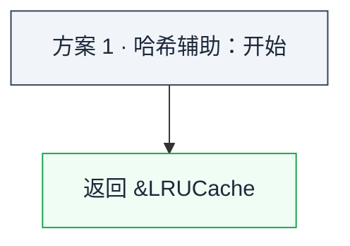

```go
package main // 引入依赖

import (
	"fmt" // 「fmt」
	"os"  // 「os」
)

type LRUCache struct { // 定义类型
	length int         // 长度 int
	data   map[int]int // data 映射表[int]int
	order  []int       // order []int
}

func NewLRU(length int) *LRUCache { // 定义函数/方法 NewLRU
	return &LRUCache{length: length, data: make(map[int]int)} // 返回 按位与 LRUCache{长度: 长度, data: make(映射表[int]int)}
}

func (c *LRUCache) set(key, value int) { // 定义函数/方法 set
	if _, ok := c.data[key]; ok { // 若 _, ok : 赋值为 字符.data[key]; ok
		for i, k := range c.order { // 同时取 下标 i 与 下标 k 遍历
			if k == key { // 若 下标 k 等于 key
				c.order = append(c.order[:i], c.order[i+1:]...) // 把 append(字符.order[:下标 i], 字符.order[下标 i 加 1:]...) 写入 c.order
				break                                           // 跳出循环
			}
		}
	}
	c.data[key] = value            // 把 value 写入 c.data[key]
	c.order = append(c.order, key) // 把 append(字符.order, key) 写入 c.order
	if len(c.data) > c.length {    // 若 长度(字符.data) 超过 字符.长度
		delKey := c.order[0]   // 把 字符.order[0] 写入 delKey :
		c.order = c.order[1:]  // 把 字符.order[1:] 写入 c.order
		delete(c.data, delKey) // delete(字符.data, delKey)
	}
}

func (c *LRUCache) get(key int) (int, bool) { // 定义函数/方法 get
	if _, ok := c.data[key]; !ok { // 若 _, ok : 赋值为 字符.data[key]; 取反 ok
		return 0, false // 返回 0, false
	}
	value := c.data[key]        // 把 字符.data[key] 写入 value :
	for i, k := range c.order { // 同时取 下标 i 与 下标 k 遍历
		if k == key { // 若 下标 k 等于 key
			c.order = append(c.order[:i], c.order[i+1:]...) // 把 append(字符.order[:下标 i], 字符.order[下标 i 加 1:]...) 写入 c.order
			break                                           // 跳出循环
		}
	}
	c.order = append(c.order, key) // 把 append(字符.order, key) 写入 c.order
	return value, true             // 返回 value, true
}

func main() { // 程序入口：跑内嵌自测用例
	c := NewLRU(2)      // 把 NewLRU(2) 写入 c :
	c.set(1, 1)         // 字符.set(1, 1)
	c.set(2, 2)         // 字符.set(2, 2)
	r1, _ := c.get(1)   // 把 字符 查找 1) 写入 r1, _ :
	c.set(3, 3)         // 字符.set(3, 3)
	_, r2ok := c.get(2) // 把 字符 查找 2) 写入 _, r2ok :
	c.set(4, 4)         // 字符.set(4, 4)
	_, r3ok := c.get(1) // 把 字符 查找 1) 写入 _, r3ok :
	r4, _ := c.get(3)   // 把 字符 查找 3) 写入 r4, _ :
	r5, _ := c.get(4)   // 把 字符 查找 4) 写入 r5, _ :
	ok := true          // 把 true 写入 ok :
	if r1 != 1 {        // 若 r1 不等于 1
		ok = false             // 把 false 写入 ok
		fmt.Println("FAIL r1") // 打印输出
	}
	if r2ok { // 若 r2ok
		ok = false                            // 把 false 写入 ok
		fmt.Println("FAIL r2 should be None") // 打印输出
	}
	if r3ok { // 若 r3ok
		ok = false                            // 把 false 写入 ok
		fmt.Println("FAIL r3 should be None") // 打印输出
	}
	if r4 != 3 { // 若 r4 不等于 3
		ok = false             // 把 false 写入 ok
		fmt.Println("FAIL r4") // 打印输出
	}
	if r5 != 4 { // 若 r5 不等于 4
		ok = false             // 把 false 写入 ok
		fmt.Println("FAIL r5") // 打印输出
	}
	if !ok { // 若 取反 ok
		os.Exit(1) // os.Exit(1)
	}
	fmt.Println("PASS") // 全部用例通过，输出 PASS
}
```

#### 方案 2：哈希辅助

**思路与代码分析**：核心是「哈希辅助」。Go 版用切片与多返回值惯用法，显式处理索引边界。代码里依次做这些事：哈希结构做计数或查重。**走读**：方案 2 · 哈希辅助：开始 → 返回 &LRUCache。

**运行架构**（真实控制流）：


```go
package main // 引入依赖

import (
	"container/list" // 「container 除以 列表」
	"fmt"            // 「fmt」
	"os"             // 「os」
)

type entry struct { // 定义类型
	key   int // key int
	value int // value int
}

type LRUCache struct { // 定义类型
	capacity int                   // capacity int
	ll       *list.List            // ll 乘 列表.List
	items    map[int]*list.Element // items 映射表[int] 乘 列表.Element
}

func NewLRU(capacity int) *LRUCache { // 定义函数/方法 NewLRU
	return &LRUCache{capacity: capacity, ll: list.New(), items: make(map[int]*list.Element)}
}

func (c *LRUCache) get(key int) (int, bool) { // 定义函数/方法 get
	if el, ok := c.items[key]; ok { // 若 el, ok : 赋值为 字符.items[key]; ok
		c.ll.MoveToFront(el)                 // 字符.ll.MoveToFront(el)
		return el.Value.(*entry).value, true // 返回 el.Value.( 乘 entry).value, true
	}
	return 0, false // 返回 0, false
}

func (c *LRUCache) set(key, value int) { // 定义函数/方法 set
	if el, ok := c.items[key]; ok { // 若 el, ok : 赋值为 字符.items[key]; ok
		c.ll.MoveToFront(el)            // 字符.ll.MoveToFront(el)
		el.Value.(*entry).value = value // 把 value 写入 el.Value.(*entry).value
		return                          // return
	}
	el := c.ll.PushFront(&entry{key, value}) // 把 字符.ll.PushFront( 按位与 entry{key, value}) 写入 el :
	c.items[key] = el                        // 把 el 写入 c.items[key]
	if c.ll.Len() > c.capacity {             // 若 字符.ll.Len() 超过 字符.capacity
		back := c.ll.Back() // 把 字符.ll.Back() 写入 back :
		if back != nil {    // 若 back 不等于 nil
			c.ll.Remove(back)                        // 字符.ll.Remove(back)
			delete(c.items, back.Value.(*entry).key) // delete(字符.items, back.Value.( 乘 entry).key)
		}
	}
}

func main() { // 程序入口：跑内嵌自测用例
	c := NewLRU(2)      // 把 NewLRU(2) 写入 c :
	c.set(1, 1)         // 字符.set(1, 1)
	c.set(2, 2)         // 字符.set(2, 2)
	r1, _ := c.get(1)   // 把 字符 查找 1) 写入 r1, _ :
	c.set(3, 3)         // 字符.set(3, 3)
	_, r2ok := c.get(2) // 把 字符 查找 2) 写入 _, r2ok :
	c.set(4, 4)         // 字符.set(4, 4)
	_, r3ok := c.get(1) // 把 字符 查找 1) 写入 _, r3ok :
	r4, _ := c.get(3)   // 把 字符 查找 3) 写入 r4, _ :
	r5, _ := c.get(4)   // 把 字符 查找 4) 写入 r5, _ :
	ok := true          // 把 true 写入 ok :
	if r1 != 1 {        // 若 r1 不等于 1
		ok = false             // 把 false 写入 ok
		fmt.Println("FAIL r1") // 打印输出
	}
	if r2ok { // 若 r2ok
		ok = false                            // 把 false 写入 ok
		fmt.Println("FAIL r2 should be None") // 打印输出
	}
	if r3ok { // 若 r3ok
		ok = false                            // 把 false 写入 ok
		fmt.Println("FAIL r3 should be None") // 打印输出
	}
	if r4 != 3 { // 若 r4 不等于 3
		ok = false             // 把 false 写入 ok
		fmt.Println("FAIL r4") // 打印输出
	}
	if r5 != 4 { // 若 r5 不等于 4
		ok = false             // 把 false 写入 ok
		fmt.Println("FAIL r5") // 打印输出
	}
	if !ok { // 若 取反 ok
		os.Exit(1) // os.Exit(1)
	}
	fmt.Println("PASS") // 全部用例通过，输出 PASS
}
```

#### 方案 3：哈希辅助

**思路与代码分析**：核心是「哈希辅助」。Go 版用切片与多返回值惯用法，显式处理索引边界。代码里依次做这些事：哈希结构做计数或查重。**走读**：方案 3 · 哈希辅助：开始 → 更新 : → 更新 : → 更新 head.next → 更新 tail.prev → 返回 &LRUCache。

**运行架构**（真实控制流）：

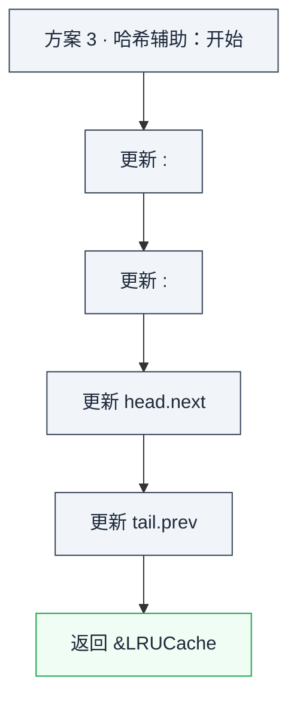

```go
package main // 引入依赖

import (
	"fmt" // 「fmt」
	"os"  // 「os」
)

type lruNode struct { // 定义类型
	key   int      // key int
	value int      // value int
	prev  *lruNode // 前一个 乘 lruNode
	next  *lruNode // 下一个 乘 lruNode
}

type LRUCache struct { // 定义类型
	length int              // 长度 int
	data   map[int]*lruNode // data 映射表[int] 乘 lruNode
	head   *lruNode         // 头节点 乘 lruNode
	tail   *lruNode         // 尾节点 乘 lruNode
}

func NewLRU(length int) *LRUCache { // 定义函数/方法 NewLRU
	head := &lruNode{} // 把 按位与 lruNode{} 写入 head :
	tail := &lruNode{} // 把 按位与 lruNode{} 写入 tail :
	head.next = tail   // 把 尾节点 写入 下一个
	tail.prev = head   // 把 头节点 写入 前一个
	return &LRUCache{length: length, data: make(map[int]*lruNode), head: head, tail: tail}
}

func (c *LRUCache) removeNode(n *lruNode) { // 定义函数/方法 removeNode
	n.prev.next = n.next // 把 元素个数.下一个 写入 下一个
	n.next.prev = n.prev // 把 元素个数.前一个 写入 前一个
}

func (c *LRUCache) addToTail(n *lruNode) { // 定义函数/方法 addToTail
	n.prev = c.tail.prev // 把 字符.尾节点.前一个 写入 前一个
	n.next = c.tail      // 把 字符.尾节点 写入 下一个
	c.tail.prev.next = n // 把 元素个数 写入 下一个
	c.tail.prev = n      // 把 元素个数 写入 前一个
}

func (c *LRUCache) set(key, value int) { // 定义函数/方法 set
	if n, ok := c.data[key]; ok { // 若 元素个数, ok : 赋值为 字符.data[key]; ok
		c.removeNode(n) // 字符.removeNode(元素个数)
	}
	n := &lruNode{key: key, value: value} // 把 按位与 lruNode{key: key, value: value} 写入 n :
	c.data[key] = n                       // 把 元素个数 写入 c.data[key]
	c.addToTail(n)                        // 字符.addToTail(元素个数)
	if len(c.data) > c.length {           // 若 长度(字符.data) 超过 字符.长度
		lru := c.head.next      // 把 字符.头节点.下一个 写入 lru :
		c.removeNode(lru)       // 字符.removeNode(lru)
		delete(c.data, lru.key) // delete(字符.data, lru.key)
	}
}

func (c *LRUCache) get(key int) (int, bool) { // 定义函数/方法 get
	n, ok := c.data[key] // 把 字符.data[key] 写入 n, ok :
	if !ok {             // 若 取反 ok
		return 0, false // 返回 0, false
	}
	c.removeNode(n)      // 字符.removeNode(元素个数)
	c.addToTail(n)       // 字符.addToTail(元素个数)
	return n.value, true // 返回 元素个数.value, true
}

func main() { // 程序入口：跑内嵌自测用例
	c := NewLRU(2)      // 把 NewLRU(2) 写入 c :
	c.set(1, 1)         // 字符.set(1, 1)
	c.set(2, 2)         // 字符.set(2, 2)
	r1, _ := c.get(1)   // 把 字符 查找 1) 写入 r1, _ :
	c.set(3, 3)         // 字符.set(3, 3)
	_, r2ok := c.get(2) // 把 字符 查找 2) 写入 _, r2ok :
	c.set(4, 4)         // 字符.set(4, 4)
	_, r3ok := c.get(1) // 把 字符 查找 1) 写入 _, r3ok :
	r4, _ := c.get(3)   // 把 字符 查找 3) 写入 r4, _ :
	r5, _ := c.get(4)   // 把 字符 查找 4) 写入 r5, _ :
	ok := true          // 把 true 写入 ok :
	if r1 != 1 {        // 若 r1 不等于 1
		ok = false             // 把 false 写入 ok
		fmt.Println("FAIL r1") // 打印输出
	}
	if r2ok { // 若 r2ok
		ok = false                            // 把 false 写入 ok
		fmt.Println("FAIL r2 should be None") // 打印输出
	}
	if r3ok { // 若 r3ok
		ok = false                            // 把 false 写入 ok
		fmt.Println("FAIL r3 should be None") // 打印输出
	}
	if r4 != 3 { // 若 r4 不等于 3
		ok = false             // 把 false 写入 ok
		fmt.Println("FAIL r4") // 打印输出
	}
	if r5 != 4 { // 若 r5 不等于 4
		ok = false             // 把 false 写入 ok
		fmt.Println("FAIL r5") // 打印输出
	}
	if !ok { // 若 取反 ok
		os.Exit(1) // os.Exit(1)
	}
	fmt.Println("PASS") // 全部用例通过，输出 PASS
}
```

### Java 实现（3 种方案）

Java 的全部方案如下，每个方案都内嵌用例自测，可独立运行（老仓库 python/go 文件遵循「打印结果」约定）：

#### 方案 1：哈希辅助

**思路与代码分析**：核心是「哈希辅助」。Java 版用类与静态方法组织，集合操作显式明了。**走读**：方案 1 · 哈希辅助：开始 → 更新 capacity → 返回结果。

**运行架构**（真实控制流）：


```java
package com.webfault.dsa; // 引入依赖

import java.util.*; // 引入依赖

class LruS1 { // 定义类型
  static class LRUCache { // static class LRUCache {
    int capacity; // int capacity;
    LinkedHashMap<Integer, Integer> data = new LinkedHashMap<>();

    LRUCache(int c) {
      capacity = c;
    } // 把 字符; } 写入 LRUCache(int c) { capacity

    void set(int key, int value) { // 定义函数/方法 set
      if (data.containsKey(key)) data.remove(key); // 若 data.containsKey(key)) data 弹出 key);
      data.put(key, value); // data.put(key, value);
      if (data.size() > capacity) data.remove(data.keySet().iterator().next());
    }

    Integer get(int key) { // 定义函数/方法 get
      if (!data.containsKey(key)) return null; // 若 取反 data.containsKey(key)，直接返回 null
      int value = data.get(key); // 把 data 查找 key) 存入 value
      data.remove(key); // data 弹出 key);
      data.put(key, value); // data.put(key, value);
      return value; // 返回 value
    }
  }

  public static void main(String[] args) { // public static void main(String[] args) {
    LRUCache c = new LRUCache(2); // 把 new LRUCache(2); 写入 LRUCache c
    c.set(1, 1);
    c.set(2, 2); // 字符.set(1, 1); 字符.set(2, 2);
    Integer[] got = new Integer[5]; // 把 new Integer[5]; 写入 Integer[] got
    got[0] = c.get(1); // 把 字符 查找 1); 写入 got[0]
    c.set(3, 3); // 字符.set(3, 3);
    got[1] = c.get(2); // 把 字符 查找 2); 写入 got[1]
    c.set(4, 4); // 字符.set(4, 4);
    got[2] = c.get(1); // 把 字符 查找 1); 写入 got[2]
    got[3] = c.get(3); // 把 字符 查找 3); 写入 got[3]
    got[4] = c.get(4); // 把 字符 查找 4); 写入 got[4]
    Integer[] want = {1, null, null, 3, 4}; // 把 { 1, null, null, 3, 4 }; 写入 Integer[] want
    boolean ok = true; // 把 true; 写入 boolean ok
    if (got.length != want.length) ok = false; // 若 got.长度 不等于 want.长度) ok 赋值为 false;
    else
      for (int i = 0; i < got.length; i++) { // 否则
        if (got[i] == null ? want[i] != null : !got[i].equals(want[i])) {
          ok = false; // 把 false; 写入 ok
          System.out.println("FAIL idx " + i + " got " + got[i] + " want " + want[i]); // 打印输出
        }
      }
    if (!ok) throw new RuntimeException("FAILED"); // 若 取反 ok) throw new RuntimeException(「FAILED」);
    System.out.println("PASS"); // 全部用例通过，输出 PASS
  }
}
```

#### 方案 2：哈希辅助

**思路与代码分析**：核心是「哈希辅助」。Java 版用类与静态方法组织，集合操作显式明了。**走读**：方案 2 · 哈希辅助：开始 → 更新 capacity → 返回结果。

**运行架构**（真实控制流）：

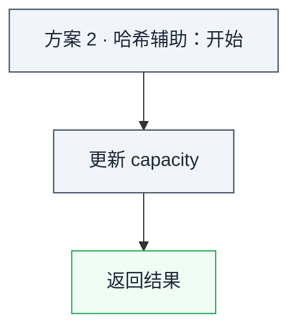

```java
package com.webfault.dsa; // 引入依赖

import java.util.*; // 引入依赖

class LruS2 { // 定义类型
  static class LRUCache { // static class LRUCache {
    int capacity; // int capacity;
    LinkedHashMap<Integer, Integer> data = new LinkedHashMap<>();

    LRUCache(int c) {
      capacity = c;
    } // 把 字符; } 写入 LRUCache(int c) { capacity

    void set(int key, int value) { // 定义函数/方法 set
      if (data.containsKey(key)) data.remove(key); // 若 data.containsKey(key)) data 弹出 key);
      data.put(key, value); // data.put(key, value);
      if (data.size() > capacity) data.remove(data.keySet().iterator().next());
    }

    Integer get(int key) { // 定义函数/方法 get
      if (!data.containsKey(key)) return null; // 若 取反 data.containsKey(key)，直接返回 null
      int value = data.get(key); // 把 data 查找 key) 存入 value
      data.remove(key); // data 弹出 key);
      data.put(key, value); // data.put(key, value);
      return value; // 返回 value
    }
  }

  public static void main(String[] args) { // public static void main(String[] args) {
    LRUCache c = new LRUCache(2); // 把 new LRUCache(2); 写入 LRUCache c
    c.set(1, 1);
    c.set(2, 2); // 字符.set(1, 1); 字符.set(2, 2);
    Integer[] got = new Integer[5]; // 把 new Integer[5]; 写入 Integer[] got
    got[0] = c.get(1); // 把 字符 查找 1); 写入 got[0]
    c.set(3, 3); // 字符.set(3, 3);
    got[1] = c.get(2); // 把 字符 查找 2); 写入 got[1]
    c.set(4, 4); // 字符.set(4, 4);
    got[2] = c.get(1); // 把 字符 查找 1); 写入 got[2]
    got[3] = c.get(3); // 把 字符 查找 3); 写入 got[3]
    got[4] = c.get(4); // 把 字符 查找 4); 写入 got[4]
    Integer[] want = {1, null, null, 3, 4}; // 把 { 1, null, null, 3, 4 }; 写入 Integer[] want
    boolean ok = true; // 把 true; 写入 boolean ok
    if (got.length != want.length) ok = false; // 若 got.长度 不等于 want.长度) ok 赋值为 false;
    else
      for (int i = 0; i < got.length; i++) { // 否则
        if (got[i] == null ? want[i] != null : !got[i].equals(want[i])) {
          ok = false; // 把 false; 写入 ok
          System.out.println("FAIL idx " + i + " got " + got[i] + " want " + want[i]); // 打印输出
        }
      }
    if (!ok) throw new RuntimeException("FAILED"); // 若 取反 ok) throw new RuntimeException(「FAILED」);
    System.out.println("PASS"); // 全部用例通过，输出 PASS
  }
}
```

#### 方案 3：哈希辅助

**思路与代码分析**：核心是「哈希辅助」。Java 版用类与静态方法组织，集合操作显式明了。**走读**：方案 3 · 哈希辅助：开始 → 更新 capacity → 更新 head.next → 更新 tail.prev → 返回结果。

**运行架构**（真实控制流）：

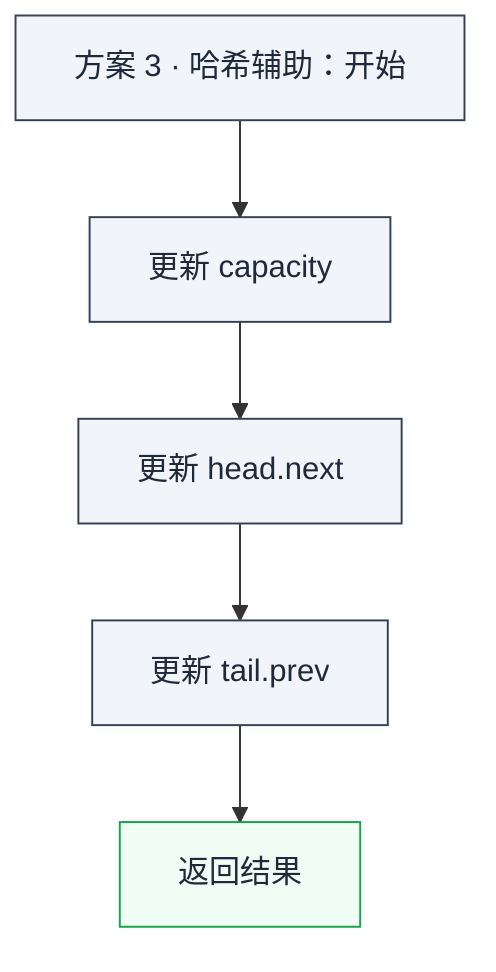

```java
package com.webfault.dsa; // 引入依赖

import java.util.*; // 引入依赖

class LruS3 { // 定义类型
  static class Node { // static class Node {
    int key, value; // int key, value;
    Node prev, next; // Node 前一个, 下一个;

    Node() {} // Node() {}

    Node(int k, int v) {
      key = k;
      value = v;
    } // 把 下标 k; value 赋值为 值; } 写入 Node(int k, int v) { key
  }

  static class LRUCache { // static class LRUCache {
    int capacity; // int capacity;
    Map<Integer, Node> data = new HashMap<>(); // 把 new HashMap 小于 超过 (); 写入 Map<Integer, Node> data
    Node head = new Node(), tail = new Node(); // 把 new Node(), 尾节点 赋值为 new Node(); 写入 Node head

    LRUCache(int c) { // LRUCache(int 字符) {
      capacity = c; // 把 字符; 写入 capacity
      head.next = tail;
      tail.prev = head; // 把 尾节点; 尾节点.前一个 赋值为 头节点; 写入 下一个
    }

    void remove(Node n) {
      n.prev.next = n.next;
      n.next.prev = n.prev;
    } // 把 元素个数.下一个; 元素个数.下一个.前一个 赋值为 元素个数.前一个; } 写入 下一个

    void addToTail(Node n) { // 定义函数/方法 addToTail
      n.prev = tail.prev;
      n.next = tail; // 把 尾节点.前一个; 元素个数.下一个 赋值为 尾节点; 写入 前一个
      tail.prev.next = n;
      tail.prev = n; // 把 元素个数; 尾节点.前一个 赋值为 元素个数; 写入 下一个
    }

    void set(int key, int value) { // 定义函数/方法 set
      if (data.containsKey(key))
        remove(data.get(key)); // 若 data.containsKey(key)) remove(data 查找 key));
      Node node = new Node(key, value); // 把 new Node(key, value); 写入 Node node
      data.put(key, node); // data.put(key, 节点);
      addToTail(node); // addToTail(节点);
      if (data.size() > capacity) { // 若 data.大小() 超过 capacity
        Node lru = head.next; // 把 头节点.下一个; 写入 Node lru
        remove(lru); // remove(lru);
        data.remove(lru.key); // data 弹出 lru.key);
      }
    }

    Integer get(int key) { // 定义函数/方法 get
      if (!data.containsKey(key)) return null; // 若 取反 data.containsKey(key)，直接返回 null
      Node node = data.get(key); // 把 data 查找 key); 写入 Node node
      remove(node); // remove(节点);
      addToTail(node); // addToTail(节点);
      return node.value; // 返回 节点.value
    }
  }

  public static void main(String[] args) { // public static void main(String[] args) {
    LRUCache c = new LRUCache(2); // 把 new LRUCache(2); 写入 LRUCache c
    c.set(1, 1);
    c.set(2, 2); // 字符.set(1, 1); 字符.set(2, 2);
    Integer[] got = new Integer[5]; // 把 new Integer[5]; 写入 Integer[] got
    got[0] = c.get(1); // 把 字符 查找 1); 写入 got[0]
    c.set(3, 3); // 字符.set(3, 3);
    got[1] = c.get(2); // 把 字符 查找 2); 写入 got[1]
    c.set(4, 4); // 字符.set(4, 4);
    got[2] = c.get(1); // 把 字符 查找 1); 写入 got[2]
    got[3] = c.get(3); // 把 字符 查找 3); 写入 got[3]
    got[4] = c.get(4); // 把 字符 查找 4); 写入 got[4]
    Integer[] want = {1, null, null, 3, 4}; // 把 { 1, null, null, 3, 4 }; 写入 Integer[] want
    boolean ok = true; // 把 true; 写入 boolean ok
    if (got.length != want.length) ok = false; // 若 got.长度 不等于 want.长度) ok 赋值为 false;
    else
      for (int i = 0; i < got.length; i++) { // 否则
        if (got[i] == null ? want[i] != null : !got[i].equals(want[i])) {
          ok = false; // 把 false; 写入 ok
          System.out.println("FAIL idx " + i + " got " + got[i] + " want " + want[i]); // 打印输出
        }
      }
    if (!ok) throw new RuntimeException("FAILED"); // 若 取反 ok) throw new RuntimeException(「FAILED」);
    System.out.println("PASS"); // 全部用例通过，输出 PASS
  }
}
```

### Rust 实现（3 种方案）

Rust 的全部方案如下，每个方案都内嵌用例自测，可独立运行（老仓库 python/go 文件遵循「打印结果」约定）：

#### 方案 1：哈希辅助

**思路与代码分析**：核心是「哈希辅助」。Rust 版用所有权移动与切片借用改写同一逻辑，注意 Option 与引用边界。**走读**：方案 1 · 哈希辅助：开始 → 处理 NoteLru → 处理 cap, → 处理 keys: Default::default(), → 处理 vals: Default::default(), → 返回结果。

**运行架构**（真实控制流）：

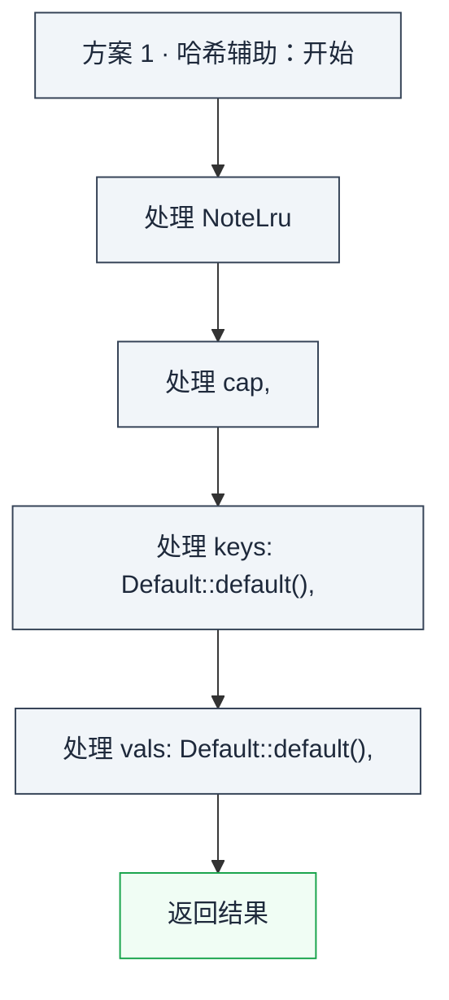

```rust
// 实现LRU缓存算法功能 — Rust 版（方案1）
struct NoteLru {
    cap: usize,
    keys: std::collections::VecDeque<i32>,
    vals: std::collections::HashMap<i32, i32>,
} // 定义类型
impl NoteLru {
    // 实现块
    fn new(cap: usize) -> Self {
        NoteLru {
            cap,
            keys: Default::default(),
            vals: Default::default(),
        }
    } // 定义函数/方法 new
    fn get(&mut self, k: i32) -> i32 {
        // 定义函数/方法 get
        if let Some(&v) = self.vals.get(&k) {
            // 若 let Some( 按位与 值) 赋值为 self.vals 查找 按位与 下标 k
            self.keys.retain(|&x| x != k); // 把 下标 k); 写入 self.keys.retain(|&x| x !
            self.keys.push_back(k); // self.keys 追加 下标 k);
            v
        } else {
            -1
        } // 否则
    }
    fn put(&mut self, k: i32, v: i32) {
        // 定义函数/方法 put
        if self.vals.contains_key(&k) {
            // 若 self.vals.contains_key( 按位与 下标 k
            self.keys.retain(|&x| x != k); // 把 下标 k); 写入 self.keys.retain(|&x| x !
        } else if self.keys.len() == self.cap {
            // 否则，若 self.keys.长度() 等于 self.cap
            let old = self.keys.pop_front().unwrap(); // 把 self.keys.pop_front().unwrap() 存入 old
            self.vals.remove(&old); // self.vals 弹出 按位与 old);
        }
        self.keys.push_back(k); // self.keys 追加 下标 k);
        self.vals.insert(k, v); // self.vals 插入 下标 k, 值);
    }
}
fn main() {
    // 程序入口：跑内嵌自测用例
    // TS 笔记语义: cap=2, put(1,1), put(2,2), get(1)=1, put(3,3)逐出1, get(1)=-1, get(3)=3
    let mut c = NoteLru::new(2); // 把 NoteLru::new(2); 写入 let mut c
    c.put(1, 1); // 字符.put(1, 1);
    c.put(2, 2); // 字符.put(2, 2);
    assert_eq!(c.get(1), 1); // 断言校验
    c.put(3, 3); // 字符.put(3, 3);
    assert_eq!(c.get(2), -1); // 断言校验
    c.put(4, 4); // 字符.put(4, 4);
    assert_eq!(c.get(1), -1); // 断言校验
    assert_eq!(c.get(3), 3); // 断言校验
    assert_eq!(c.get(4), 4); // 断言校验
    println!("PASS");
} // 全部用例通过，输出 PASS
```

#### 方案 2：哈希辅助

**思路与代码分析**：核心是「哈希辅助」。Rust 版用所有权移动与切片借用改写同一逻辑，注意 Option 与引用边界。**走读**：方案 2 · 哈希辅助：开始 → 处理 NoteLru → 处理 cap, → 处理 keys: Default::default(), → 处理 vals: Default::default(), → 返回结果。

**运行架构**（真实控制流）：


```rust
// 实现LRU缓存算法功能 — Rust 版（方案2）
struct NoteLru {
    cap: usize,
    keys: std::collections::VecDeque<i32>,
    vals: std::collections::HashMap<i32, i32>,
} // 定义类型
impl NoteLru {
    // 实现块
    fn new(cap: usize) -> Self {
        NoteLru {
            cap,
            keys: Default::default(),
            vals: Default::default(),
        }
    } // 定义函数/方法 new
    fn get(&mut self, k: i32) -> i32 {
        // 定义函数/方法 get
        if let Some(&v) = self.vals.get(&k) {
            // 若 let Some( 按位与 值) 赋值为 self.vals 查找 按位与 下标 k
            self.keys.retain(|&x| x != k); // 把 下标 k); 写入 self.keys.retain(|&x| x !
            self.keys.push_back(k); // self.keys 追加 下标 k);
            v
        } else {
            -1
        } // 否则
    }
    fn put(&mut self, k: i32, v: i32) {
        // 定义函数/方法 put
        if self.vals.contains_key(&k) {
            // 若 self.vals.contains_key( 按位与 下标 k
            self.keys.retain(|&x| x != k); // 把 下标 k); 写入 self.keys.retain(|&x| x !
        } else if self.keys.len() == self.cap {
            // 否则，若 self.keys.长度() 等于 self.cap
            let old = self.keys.pop_front().unwrap(); // 把 self.keys.pop_front().unwrap() 存入 old
            self.vals.remove(&old); // self.vals 弹出 按位与 old);
        }
        self.keys.push_back(k); // self.keys 追加 下标 k);
        self.vals.insert(k, v); // self.vals 插入 下标 k, 值);
    }
}
fn main() {
    // 程序入口：跑内嵌自测用例
    // TS 笔记语义: cap=2, put(1,1), put(2,2), get(1)=1, put(3,3)逐出1, get(1)=-1, get(3)=3
    let mut c = NoteLru::new(2); // 把 NoteLru::new(2); 写入 let mut c
    c.put(1, 1); // 字符.put(1, 1);
    c.put(2, 2); // 字符.put(2, 2);
    assert_eq!(c.get(1), 1); // 断言校验
    c.put(3, 3); // 字符.put(3, 3);
    assert_eq!(c.get(2), -1); // 断言校验
    c.put(4, 4); // 字符.put(4, 4);
    assert_eq!(c.get(1), -1); // 断言校验
    assert_eq!(c.get(3), 3); // 断言校验
    assert_eq!(c.get(4), 4); // 断言校验
    println!("PASS");
} // 全部用例通过，输出 PASS
```

#### 方案 3：哈希辅助

**思路与代码分析**：核心是「哈希辅助」。Rust 版用所有权移动与切片借用改写同一逻辑，注意 Option 与引用边界。**走读**：方案 3 · 哈希辅助：开始 → 处理 NoteLru → 处理 cap, → 处理 keys: Default::default(), → 处理 vals: Default::default(), → 返回结果。

**运行架构**（真实控制流）：


```rust
// 实现LRU缓存算法功能 — Rust 版（方案3）
struct NoteLru {
    cap: usize,
    keys: std::collections::VecDeque<i32>,
    vals: std::collections::HashMap<i32, i32>,
} // 定义类型
impl NoteLru {
    // 实现块
    fn new(cap: usize) -> Self {
        NoteLru {
            cap,
            keys: Default::default(),
            vals: Default::default(),
        }
    } // 定义函数/方法 new
    fn get(&mut self, k: i32) -> i32 {
        // 定义函数/方法 get
        if let Some(&v) = self.vals.get(&k) {
            // 若 let Some( 按位与 值) 赋值为 self.vals 查找 按位与 下标 k
            self.keys.retain(|&x| x != k); // 把 下标 k); 写入 self.keys.retain(|&x| x !
            self.keys.push_back(k); // self.keys 追加 下标 k);
            v
        } else {
            -1
        } // 否则
    }
    fn put(&mut self, k: i32, v: i32) {
        // 定义函数/方法 put
        if self.vals.contains_key(&k) {
            // 若 self.vals.contains_key( 按位与 下标 k
            self.keys.retain(|&x| x != k); // 把 下标 k); 写入 self.keys.retain(|&x| x !
        } else if self.keys.len() == self.cap {
            // 否则，若 self.keys.长度() 等于 self.cap
            let old = self.keys.pop_front().unwrap(); // 把 self.keys.pop_front().unwrap() 存入 old
            self.vals.remove(&old); // self.vals 弹出 按位与 old);
        }
        self.keys.push_back(k); // self.keys 追加 下标 k);
        self.vals.insert(k, v); // self.vals 插入 下标 k, 值);
    }
}
fn main() {
    // 程序入口：跑内嵌自测用例
    // TS 笔记语义: cap=2, put(1,1), put(2,2), get(1)=1, put(3,3)逐出1, get(1)=-1, get(3)=3
    let mut c = NoteLru::new(2); // 把 NoteLru::new(2); 写入 let mut c
    c.put(1, 1); // 字符.put(1, 1);
    c.put(2, 2); // 字符.put(2, 2);
    assert_eq!(c.get(1), 1); // 断言校验
    c.put(3, 3); // 字符.put(3, 3);
    assert_eq!(c.get(2), -1); // 断言校验
    c.put(4, 4); // 字符.put(4, 4);
    assert_eq!(c.get(1), -1); // 断言校验
    assert_eq!(c.get(3), 3); // 断言校验
    assert_eq!(c.get(4), 4); // 断言校验
    println!("PASS");
} // 全部用例通过，输出 PASS
```

### Lua 实现（3 种方案）

Lua 的全部方案如下，每个方案都内嵌用例自测，可独立运行（老仓库 python/go 文件遵循「打印结果」约定）：

#### 方案 1：哈希辅助

**思路与代码分析**：核心是「哈希辅助」。Lua 版用表与 ipairs 遍历，注意 ipairs 遇 nil 即停的语义。

**运行架构**（真实控制流）：


```lua
-- 实现LRU缓存算法功能 — Lua 版（方案1）
local NoteLru = {} -- 把 {} 写入 local NoteLru
NoteLru.__index = NoteLru -- 把 NoteLru 写入 NoteLru.__index
function NoteLru.new(cap)
	return setmetatable({ cap = cap, keys = {}, vals = {} }, NoteLru)
end
function NoteLru:get(k) -- function NoteLru:get(下标 k)
	if self.vals[k] ~= nil then -- 若 self.vals[下标 k] ~ 赋值为 nil then
		for i, key in ipairs(self.keys) do -- 遍历取 key
			if key == k then
				table.remove(self.keys, i)
				break
			end -- 若 key 等于 下标 k then table 弹出 self.keys, 下标 i) break 终点
		end -- 终点
		self.keys[#self.keys + 1] = k -- 把 下标 k 写入 self.keys[#self.keys + 1]
		return self.vals[k] -- 返回 self.vals[下标 k]
	end -- 终点
	return -1 -- 返回 减 1
end -- 终点
function NoteLru:put(k, v) -- function NoteLru:put(下标 k, 值)
	if self.vals[k] ~= nil then -- 若 self.vals[下标 k] ~ 赋值为 nil then
		for i, key in ipairs(self.keys) do -- 遍历取 key
			if key == k then
				table.remove(self.keys, i)
				break
			end -- 若 key 等于 下标 k then table 弹出 self.keys, 下标 i) break 终点
		end -- 终点
	elseif #self.keys == self.cap then -- 把 赋值为 self.cap then 写入 elseif #self.keys
		local old = table.remove(self.keys, 1) -- 把 table 弹出 self.keys, 1) 写入 local old
		self.vals[old] = nil -- 把 nil 写入 self.vals[old]
	end -- 终点
	self.keys[#self.keys + 1] = k -- 把 下标 k 写入 self.keys[#self.keys + 1]
	self.vals[k] = v -- 把 值 写入 self.vals[k]
end -- 终点
local c = NoteLru.new(2) -- 把 NoteLru.new(2) 写入 local c
c:put(1, 1)
c:put(2, 2) -- 字符:put(1, 1); 字符:put(2, 2)
assert(c:get(1) == 1) -- 断言校验
c:put(3, 3) -- 字符:put(3, 3)
assert(c:get(2) == -1) -- 断言校验
c:put(4, 4) -- 字符:put(4, 4)
assert(c:get(1) == -1) -- 断言校验
assert(c:get(3) == 3) -- 断言校验
assert(c:get(4) == 4) -- 断言校验
print("PASS") -- 全部用例通过，输出 PASS
```

#### 方案 2：哈希辅助

**思路与代码分析**：核心是「哈希辅助」。Lua 版用表与 ipairs 遍历，注意 ipairs 遇 nil 即停的语义。

**运行架构**：与方案 1 的控制流相同（同算法在该语言的等价实现），图见上。

```lua
-- 实现LRU缓存算法功能 — Lua 版（方案2）
local NoteLru = {} -- 把 {} 写入 local NoteLru
NoteLru.__index = NoteLru -- 把 NoteLru 写入 NoteLru.__index
function NoteLru.new(cap)
	return setmetatable({ cap = cap, keys = {}, vals = {} }, NoteLru)
end
function NoteLru:get(k) -- function NoteLru:get(下标 k)
	if self.vals[k] ~= nil then -- 若 self.vals[下标 k] ~ 赋值为 nil then
		for i, key in ipairs(self.keys) do -- 遍历取 key
			if key == k then
				table.remove(self.keys, i)
				break
			end -- 若 key 等于 下标 k then table 弹出 self.keys, 下标 i) break 终点
		end -- 终点
		self.keys[#self.keys + 1] = k -- 把 下标 k 写入 self.keys[#self.keys + 1]
		return self.vals[k] -- 返回 self.vals[下标 k]
	end -- 终点
	return -1 -- 返回 减 1
end -- 终点
function NoteLru:put(k, v) -- function NoteLru:put(下标 k, 值)
	if self.vals[k] ~= nil then -- 若 self.vals[下标 k] ~ 赋值为 nil then
		for i, key in ipairs(self.keys) do -- 遍历取 key
			if key == k then
				table.remove(self.keys, i)
				break
			end -- 若 key 等于 下标 k then table 弹出 self.keys, 下标 i) break 终点
		end -- 终点
	elseif #self.keys == self.cap then -- 把 赋值为 self.cap then 写入 elseif #self.keys
		local old = table.remove(self.keys, 1) -- 把 table 弹出 self.keys, 1) 写入 local old
		self.vals[old] = nil -- 把 nil 写入 self.vals[old]
	end -- 终点
	self.keys[#self.keys + 1] = k -- 把 下标 k 写入 self.keys[#self.keys + 1]
	self.vals[k] = v -- 把 值 写入 self.vals[k]
end -- 终点
local c = NoteLru.new(2) -- 把 NoteLru.new(2) 写入 local c
c:put(1, 1)
c:put(2, 2) -- 字符:put(1, 1); 字符:put(2, 2)
assert(c:get(1) == 1) -- 断言校验
c:put(3, 3) -- 字符:put(3, 3)
assert(c:get(2) == -1) -- 断言校验
c:put(4, 4) -- 字符:put(4, 4)
assert(c:get(1) == -1) -- 断言校验
assert(c:get(3) == 3) -- 断言校验
assert(c:get(4) == 4) -- 断言校验
print("PASS") -- 全部用例通过，输出 PASS
```

#### 方案 3：哈希辅助

**思路与代码分析**：核心是「哈希辅助」。Lua 版用表与 ipairs 遍历，注意 ipairs 遇 nil 即停的语义。

**运行架构**：与方案 1 的控制流相同（同算法在该语言的等价实现），图见上。

```lua
-- 实现LRU缓存算法功能 — Lua 版（方案3）
local NoteLru = {} -- 把 {} 写入 local NoteLru
NoteLru.__index = NoteLru -- 把 NoteLru 写入 NoteLru.__index
function NoteLru.new(cap)
	return setmetatable({ cap = cap, keys = {}, vals = {} }, NoteLru)
end
function NoteLru:get(k) -- function NoteLru:get(下标 k)
	if self.vals[k] ~= nil then -- 若 self.vals[下标 k] ~ 赋值为 nil then
		for i, key in ipairs(self.keys) do -- 遍历取 key
			if key == k then
				table.remove(self.keys, i)
				break
			end -- 若 key 等于 下标 k then table 弹出 self.keys, 下标 i) break 终点
		end -- 终点
		self.keys[#self.keys + 1] = k -- 把 下标 k 写入 self.keys[#self.keys + 1]
		return self.vals[k] -- 返回 self.vals[下标 k]
	end -- 终点
	return -1 -- 返回 减 1
end -- 终点
function NoteLru:put(k, v) -- function NoteLru:put(下标 k, 值)
	if self.vals[k] ~= nil then -- 若 self.vals[下标 k] ~ 赋值为 nil then
		for i, key in ipairs(self.keys) do -- 遍历取 key
			if key == k then
				table.remove(self.keys, i)
				break
			end -- 若 key 等于 下标 k then table 弹出 self.keys, 下标 i) break 终点
		end -- 终点
	elseif #self.keys == self.cap then -- 把 赋值为 self.cap then 写入 elseif #self.keys
		local old = table.remove(self.keys, 1) -- 把 table 弹出 self.keys, 1) 写入 local old
		self.vals[old] = nil -- 把 nil 写入 self.vals[old]
	end -- 终点
	self.keys[#self.keys + 1] = k -- 把 下标 k 写入 self.keys[#self.keys + 1]
	self.vals[k] = v -- 把 值 写入 self.vals[k]
end -- 终点
local c = NoteLru.new(2) -- 把 NoteLru.new(2) 写入 local c
c:put(1, 1)
c:put(2, 2) -- 字符:put(1, 1); 字符:put(2, 2)
assert(c:get(1) == 1) -- 断言校验
c:put(3, 3) -- 字符:put(3, 3)
assert(c:get(2) == -1) -- 断言校验
c:put(4, 4) -- 字符:put(4, 4)
assert(c:get(1) == -1) -- 断言校验
assert(c:get(3) == 3) -- 断言校验
assert(c:get(4) == 4) -- 断言校验
print("PASS") -- 全部用例通过，输出 PASS
```

### C 实现（3 种方案）

C 的全部方案如下，每个方案都内嵌用例自测，可独立运行（老仓库 python/go 文件遵循「打印结果」约定）：

#### 方案 1：哈希辅助

**思路与代码分析**：核心是「哈希辅助」。C 版手动管理下标与内存，循环边界全部显式写出。**走读**：方案 1 · 哈希辅助：开始 → 更新 c->cap → 更新 c->n → 返回结果。

**运行架构**（真实控制流）：


```c
/* 实现LRU缓存算法功能 — C 版（方案1） */
#include <stdio.h> // 引入头文件
typedef struct {
    int cap, n;
    int keys[256];
    int vals[256];
} NoteLru;
static void nl_init(NoteLru *c, int cap) {
    c->cap = cap;
    c->n = 0;
}
static int nl_find(NoteLru *c, int k) {
    for (int i = 0; i < c->n; i++)
        if (c->keys[i] == k)
            return i;
    return -1;
}
static void nl_remove_idx(NoteLru *c, int idx) { // 定义函数/方法 nl_remove_idx
    for (int i = idx; i + 1 < c->n; i++) {
        c->keys[i] = c->keys[i + 1];
        c->vals[i] = c->vals[i + 1];
    } // 让 下标 i 从 idx 开始计数，下标 i 加 1 小于 字符 减 超过 元素个数 就继续
    c->n--; // 字符 减 超过 元素个数 减一 ;
}
static int nl_get(NoteLru *c, int k) { // 定义函数/方法 nl_get
    int i = nl_find(c, k);             // 把 nl_find(字符, 下标 k) 存入 下标 i
    if (i < 0)
        return -1;       // 若 下标 i 小于 0，直接返回 减 1
    int v = c->vals[i];  // 把 字符 减 超过 vals[下标 i] 存入 值
    int kv = c->keys[i]; // 把 字符 减 超过 keys[下标 i] 存入 kv
    nl_remove_idx(c, i); // nl_remove_idx(字符, 下标 i);
    c->keys[c->n] = kv;
    c->vals[c->n] = v;
    c->n++;
    return v; // 返回 值
}
static void nl_put(NoteLru *c, int k, int v) { // 定义函数/方法 nl_put
    int i = nl_find(c, k);                     // 把 nl_find(字符, 下标 k) 存入 下标 i
    if (i >= 0) {                              // 若 下标 i 不低于 0
        nl_remove_idx(c, i);                   // nl_remove_idx(字符, 下标 i);
    } else if (c->n == c->cap) { // 否则，若 字符 减 超过 元素个数 等于 字符 减 超过 cap
        nl_remove_idx(c, 0);     // nl_remove_idx(字符, 0);
    }
    c->keys[c->n] = k;
    c->vals[c->n] = v;
    c->n++;
}
int main(void) {      // 程序入口：跑内嵌自测用例
    NoteLru c;        // NoteLru 字符;
    nl_init(&c, 2);   // nl_init( 按位与 字符, 2);
    nl_put(&c, 1, 1); // nl_put( 按位与 字符, 1, 1);
    nl_put(&c, 2, 2); // nl_put( 按位与 字符, 2, 2);
    if (nl_get(&c, 1) != 1) {
        printf("FAIL 1\n");
        return 1;
    }                 // 若 nl_get( 按位与 字符, 1) 不等于 1) { 输出「FAIL 1 」); return 1; }
    nl_put(&c, 3, 3); // nl_put( 按位与 字符, 3, 3);
    if (nl_get(&c, 2) != -1) {
        printf("FAIL 2\n");
        return 1;
    }                 // 若 nl_get( 按位与 字符, 2) 不等于 减 1) { 输出「FAIL 2 」); return 1; }
    nl_put(&c, 4, 4); // nl_put( 按位与 字符, 4, 4);
    if (nl_get(&c, 1) != -1) {
        printf("FAIL 3\n");
        return 1;
    } // 若 nl_get( 按位与 字符, 1) 不等于 减 1) { 输出「FAIL 3 」); return 1; }
    if (nl_get(&c, 3) != 3 || nl_get(&c, 4) != 4) {
        printf("FAIL 4\n");
        return 1;
    }
    printf("PASS\n");
    return 0;
} // 全部用例通过，输出 PASS
```

#### 方案 2：哈希辅助

**思路与代码分析**：核心是「哈希辅助」。C 版手动管理下标与内存，循环边界全部显式写出。**走读**：方案 2 · 哈希辅助：开始 → 更新 c->cap → 更新 c->n → 返回结果。

**运行架构**（真实控制流）：

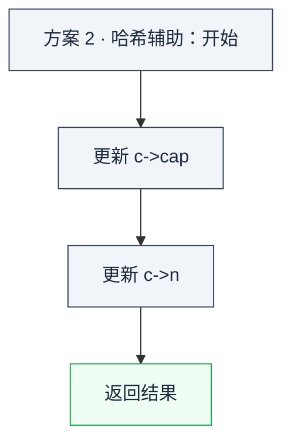

```c
/* 实现LRU缓存算法功能 — C 版（方案2） */
#include <stdio.h> // 引入头文件
typedef struct {
    int cap, n;
    int keys[256];
    int vals[256];
} NoteLru;
static void nl_init(NoteLru *c, int cap) {
    c->cap = cap;
    c->n = 0;
}
static int nl_find(NoteLru *c, int k) {
    for (int i = 0; i < c->n; i++)
        if (c->keys[i] == k)
            return i;
    return -1;
}
static void nl_remove_idx(NoteLru *c, int idx) { // 定义函数/方法 nl_remove_idx
    for (int i = idx; i + 1 < c->n; i++) {
        c->keys[i] = c->keys[i + 1];
        c->vals[i] = c->vals[i + 1];
    } // 让 下标 i 从 idx 开始计数，下标 i 加 1 小于 字符 减 超过 元素个数 就继续
    c->n--; // 字符 减 超过 元素个数 减一 ;
}
static int nl_get(NoteLru *c, int k) { // 定义函数/方法 nl_get
    int i = nl_find(c, k);             // 把 nl_find(字符, 下标 k) 存入 下标 i
    if (i < 0)
        return -1;       // 若 下标 i 小于 0，直接返回 减 1
    int v = c->vals[i];  // 把 字符 减 超过 vals[下标 i] 存入 值
    int kv = c->keys[i]; // 把 字符 减 超过 keys[下标 i] 存入 kv
    nl_remove_idx(c, i); // nl_remove_idx(字符, 下标 i);
    c->keys[c->n] = kv;
    c->vals[c->n] = v;
    c->n++;
    return v; // 返回 值
}
static void nl_put(NoteLru *c, int k, int v) { // 定义函数/方法 nl_put
    int i = nl_find(c, k);                     // 把 nl_find(字符, 下标 k) 存入 下标 i
    if (i >= 0) {                              // 若 下标 i 不低于 0
        nl_remove_idx(c, i);                   // nl_remove_idx(字符, 下标 i);
    } else if (c->n == c->cap) { // 否则，若 字符 减 超过 元素个数 等于 字符 减 超过 cap
        nl_remove_idx(c, 0);     // nl_remove_idx(字符, 0);
    }
    c->keys[c->n] = k;
    c->vals[c->n] = v;
    c->n++;
}
int main(void) {      // 程序入口：跑内嵌自测用例
    NoteLru c;        // NoteLru 字符;
    nl_init(&c, 2);   // nl_init( 按位与 字符, 2);
    nl_put(&c, 1, 1); // nl_put( 按位与 字符, 1, 1);
    nl_put(&c, 2, 2); // nl_put( 按位与 字符, 2, 2);
    if (nl_get(&c, 1) != 1) {
        printf("FAIL 1\n");
        return 1;
    }                 // 若 nl_get( 按位与 字符, 1) 不等于 1) { 输出「FAIL 1 」); return 1; }
    nl_put(&c, 3, 3); // nl_put( 按位与 字符, 3, 3);
    if (nl_get(&c, 2) != -1) {
        printf("FAIL 2\n");
        return 1;
    }                 // 若 nl_get( 按位与 字符, 2) 不等于 减 1) { 输出「FAIL 2 」); return 1; }
    nl_put(&c, 4, 4); // nl_put( 按位与 字符, 4, 4);
    if (nl_get(&c, 1) != -1) {
        printf("FAIL 3\n");
        return 1;
    } // 若 nl_get( 按位与 字符, 1) 不等于 减 1) { 输出「FAIL 3 」); return 1; }
    if (nl_get(&c, 3) != 3 || nl_get(&c, 4) != 4) {
        printf("FAIL 4\n");
        return 1;
    }
    printf("PASS\n");
    return 0;
} // 全部用例通过，输出 PASS
```

#### 方案 3：哈希辅助

**思路与代码分析**：核心是「哈希辅助」。C 版手动管理下标与内存，循环边界全部显式写出。**走读**：方案 3 · 哈希辅助：开始 → 更新 c->cap → 更新 c->n → 返回结果。

**运行架构**（真实控制流）：

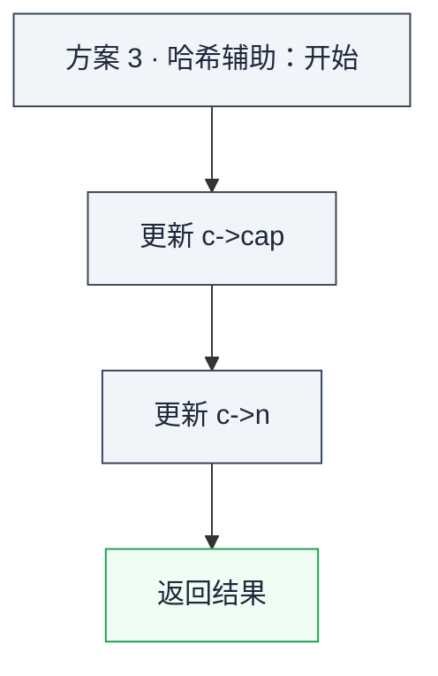

```c
/* 实现LRU缓存算法功能 — C 版（方案3） */
#include <stdio.h> // 引入头文件
typedef struct {
    int cap, n;
    int keys[256];
    int vals[256];
} NoteLru;
static void nl_init(NoteLru *c, int cap) {
    c->cap = cap;
    c->n = 0;
}
static int nl_find(NoteLru *c, int k) {
    for (int i = 0; i < c->n; i++)
        if (c->keys[i] == k)
            return i;
    return -1;
}
static void nl_remove_idx(NoteLru *c, int idx) { // 定义函数/方法 nl_remove_idx
    for (int i = idx; i + 1 < c->n; i++) {
        c->keys[i] = c->keys[i + 1];
        c->vals[i] = c->vals[i + 1];
    } // 让 下标 i 从 idx 开始计数，下标 i 加 1 小于 字符 减 超过 元素个数 就继续
    c->n--; // 字符 减 超过 元素个数 减一 ;
}
static int nl_get(NoteLru *c, int k) { // 定义函数/方法 nl_get
    int i = nl_find(c, k);             // 把 nl_find(字符, 下标 k) 存入 下标 i
    if (i < 0)
        return -1;       // 若 下标 i 小于 0，直接返回 减 1
    int v = c->vals[i];  // 把 字符 减 超过 vals[下标 i] 存入 值
    int kv = c->keys[i]; // 把 字符 减 超过 keys[下标 i] 存入 kv
    nl_remove_idx(c, i); // nl_remove_idx(字符, 下标 i);
    c->keys[c->n] = kv;
    c->vals[c->n] = v;
    c->n++;
    return v; // 返回 值
}
static void nl_put(NoteLru *c, int k, int v) { // 定义函数/方法 nl_put
    int i = nl_find(c, k);                     // 把 nl_find(字符, 下标 k) 存入 下标 i
    if (i >= 0) {                              // 若 下标 i 不低于 0
        nl_remove_idx(c, i);                   // nl_remove_idx(字符, 下标 i);
    } else if (c->n == c->cap) { // 否则，若 字符 减 超过 元素个数 等于 字符 减 超过 cap
        nl_remove_idx(c, 0);     // nl_remove_idx(字符, 0);
    }
    c->keys[c->n] = k;
    c->vals[c->n] = v;
    c->n++;
}
int main(void) {      // 程序入口：跑内嵌自测用例
    NoteLru c;        // NoteLru 字符;
    nl_init(&c, 2);   // nl_init( 按位与 字符, 2);
    nl_put(&c, 1, 1); // nl_put( 按位与 字符, 1, 1);
    nl_put(&c, 2, 2); // nl_put( 按位与 字符, 2, 2);
    if (nl_get(&c, 1) != 1) {
        printf("FAIL 1\n");
        return 1;
    }                 // 若 nl_get( 按位与 字符, 1) 不等于 1) { 输出「FAIL 1 」); return 1; }
    nl_put(&c, 3, 3); // nl_put( 按位与 字符, 3, 3);
    if (nl_get(&c, 2) != -1) {
        printf("FAIL 2\n");
        return 1;
    }                 // 若 nl_get( 按位与 字符, 2) 不等于 减 1) { 输出「FAIL 2 」); return 1; }
    nl_put(&c, 4, 4); // nl_put( 按位与 字符, 4, 4);
    if (nl_get(&c, 1) != -1) {
        printf("FAIL 3\n");
        return 1;
    } // 若 nl_get( 按位与 字符, 1) 不等于 减 1) { 输出「FAIL 3 」); return 1; }
    if (nl_get(&c, 3) != 3 || nl_get(&c, 4) != 4) {
        printf("FAIL 4\n");
        return 1;
    }
    printf("PASS\n");
    return 0;
} // 全部用例通过，输出 PASS
```

### C++ 实现（3 种方案）

C++ 的全部方案如下，每个方案都内嵌用例自测，可独立运行（老仓库 python/go 文件遵循「打印结果」约定）：

#### 方案 1：哈希辅助

**思路与代码分析**：核心是「哈希辅助」。C++ 版用 STL 容器与迭代器，减少手写下标错误。**走读**：方案 1 · 哈希辅助：开始 → 更新 it → 命中条件，直接返回 → 调用 items.splice(items.begin(), → 处理 it-＞second) → 返回 it-＞second-＞second。

**运行架构**（真实控制流）：


```cpp
// 实现LRU缓存算法功能 — C++ 版（方案1）
#include <cassert>                        // 引入头文件
#include <iostream>                       // 引入头文件
#include <list>                           // 引入头文件
#include <unordered_map>                  // 引入头文件
struct NoteLru {                          // 定义类型
    int cap;                              // int cap;
    std::list<std::pair<int, int>> items; // std::列表 小于 std::pair 小于 int, int 超过 超过 items;
    std::unordered_map<int, std::list<std::pair<int, int>>::iterator> pos;
    explicit NoteLru(int capacity) : cap(capacity) {} // explicit NoteLru(int capacity) : cap(capacity) {}
    int get(int key) {                                // 定义函数/方法 get
        auto it = pos.find(key);                      // 把 pos 查找 key) 存入 it
        if (it == pos.end())
            return -1; // 若 it 等于 pos.终点()，直接返回 减 1
        items.splice(items.begin(), items,
                     it->second);  // items.splice(items 迭代位置 , items, it 减 超过 second);
        return it->second->second; // 返回 it 减 超过 second 减 超过 second
    }
    void put(int key, int value) {      // 定义函数/方法 put
        auto it = pos.find(key);        // 把 pos 查找 key) 存入 it
        if (it != pos.end()) {          // 若 it 不等于 pos.终点(
            it->second->second = value; // 把 value; 写入 it->second->second
            items.splice(items.begin(), items,
                         it->second); // items.splice(items 迭代位置 , items, it 减 超过 second);
            return;                   // return;
        }
        if (static_cast<int>(items.size()) == cap) { // 若 static_cast 小于 int 超过 (items.大小()) 等于 cap
            pos.erase(items.back().first);           // pos 删除 items.back().first);
            items.pop_back();                        // 弹出栈顶元素
        }
        items.emplace_front(key, value); // items.emplace_front(key, value);
        pos[key] = items.begin();        // 把 items 迭代位置 ; 写入 pos[key]
    }
};
int main() {                // 程序入口：跑内嵌自测用例
    NoteLru c(2);           // NoteLru 字符(2);
    c.put(1, 1);            // 字符.put(1, 1);
    c.put(2, 2);            // 字符.put(2, 2);
    assert(c.get(1) == 1);  // 断言校验
    c.put(3, 3);            // 字符.put(3, 3);
    assert(c.get(2) == -1); // 断言校验
    c.put(4, 4);            // 字符.put(4, 4);
    assert(c.get(1) == -1); // 断言校验
    assert(c.get(3) == 3);  // 断言校验
    assert(c.get(4) == 4);  // 断言校验
    std::cout << "PASS" << std::endl;
} // 全部用例通过，输出 PASS
```

#### 方案 2：哈希辅助

**思路与代码分析**：核心是「哈希辅助」。C++ 版用 STL 容器与迭代器，减少手写下标错误。**走读**：方案 2 · 哈希辅助：开始 → 更新 it → 命中条件，直接返回 → 调用 items.splice(items.begin(), → 处理 it-＞second) → 返回 it-＞second-＞second。

**运行架构**（真实控制流）：

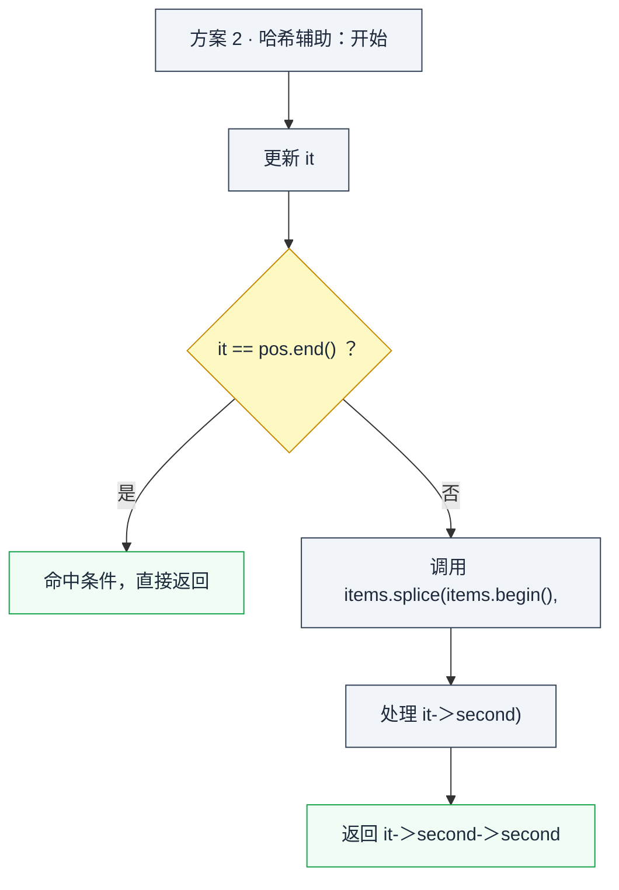

```cpp
// 实现LRU缓存算法功能 — C++ 版（方案2）
#include <cassert>                        // 引入头文件
#include <iostream>                       // 引入头文件
#include <list>                           // 引入头文件
#include <unordered_map>                  // 引入头文件
struct NoteLru {                          // 定义类型
    int cap;                              // int cap;
    std::list<std::pair<int, int>> items; // std::列表 小于 std::pair 小于 int, int 超过 超过 items;
    std::unordered_map<int, std::list<std::pair<int, int>>::iterator> pos;
    explicit NoteLru(int capacity) : cap(capacity) {} // explicit NoteLru(int capacity) : cap(capacity) {}
    int get(int key) {                                // 定义函数/方法 get
        auto it = pos.find(key);                      // 把 pos 查找 key) 存入 it
        if (it == pos.end())
            return -1; // 若 it 等于 pos.终点()，直接返回 减 1
        items.splice(items.begin(), items,
                     it->second);  // items.splice(items 迭代位置 , items, it 减 超过 second);
        return it->second->second; // 返回 it 减 超过 second 减 超过 second
    }
    void put(int key, int value) {      // 定义函数/方法 put
        auto it = pos.find(key);        // 把 pos 查找 key) 存入 it
        if (it != pos.end()) {          // 若 it 不等于 pos.终点(
            it->second->second = value; // 把 value; 写入 it->second->second
            items.splice(items.begin(), items,
                         it->second); // items.splice(items 迭代位置 , items, it 减 超过 second);
            return;                   // return;
        }
        if (static_cast<int>(items.size()) == cap) { // 若 static_cast 小于 int 超过 (items.大小()) 等于 cap
            pos.erase(items.back().first);           // pos 删除 items.back().first);
            items.pop_back();                        // 弹出栈顶元素
        }
        items.emplace_front(key, value); // items.emplace_front(key, value);
        pos[key] = items.begin();        // 把 items 迭代位置 ; 写入 pos[key]
    }
};
int main() {                // 程序入口：跑内嵌自测用例
    NoteLru c(2);           // NoteLru 字符(2);
    c.put(1, 1);            // 字符.put(1, 1);
    c.put(2, 2);            // 字符.put(2, 2);
    assert(c.get(1) == 1);  // 断言校验
    c.put(3, 3);            // 字符.put(3, 3);
    assert(c.get(2) == -1); // 断言校验
    c.put(4, 4);            // 字符.put(4, 4);
    assert(c.get(1) == -1); // 断言校验
    assert(c.get(3) == 3);  // 断言校验
    assert(c.get(4) == 4);  // 断言校验
    std::cout << "PASS" << std::endl;
} // 全部用例通过，输出 PASS
```

#### 方案 3：哈希辅助

**思路与代码分析**：核心是「哈希辅助」。C++ 版用 STL 容器与迭代器，减少手写下标错误。**走读**：方案 3 · 哈希辅助：开始 → 更新 it → 命中条件，直接返回 → 调用 items.splice(items.begin(), → 处理 it-＞second) → 返回 it-＞second-＞second。

**运行架构**（真实控制流）：

```mermaid
graph TD
    N0["方案 3 · 哈希辅助：开始"]
    N1["更新 it"]
    N2{"it == pos.end() ？"}
    N3["命中条件，直接返回"]
    N4["调用 items.splice(items.begin(),"]
    N5["处理 it-＞second)"]
    N6["返回 it-＞second-＞second"]
    N0 --> N1
    N1 --> N2
    N2 -- 是 --> N3
    N2 -- 否 --> N4
    N4 --> N5
    N5 --> N6
    classDef n fill:#f1f5f9,stroke:#334155,color:#1e293b;
    classDef lp fill:#e2e8f0,stroke:#475569,color:#1e293b;
    classDef dc fill:#fef9c3,stroke:#ca8a04,color:#1e293b;
    classDef tm fill:#f0fdf4,stroke:#16a34a,color:#1e293b;
    class N0,N1,N4,N5 n;
    class N2 dc;
    class N3,N6 tm;
```

```cpp
// 实现LRU缓存算法功能 — C++ 版（方案3）
#include <cassert>                        // 引入头文件
#include <iostream>                       // 引入头文件
#include <list>                           // 引入头文件
#include <unordered_map>                  // 引入头文件
struct NoteLru {                          // 定义类型
    int cap;                              // int cap;
    std::list<std::pair<int, int>> items; // std::列表 小于 std::pair 小于 int, int 超过 超过 items;
    std::unordered_map<int, std::list<std::pair<int, int>>::iterator> pos;
    explicit NoteLru(int capacity) : cap(capacity) {} // explicit NoteLru(int capacity) : cap(capacity) {}
    int get(int key) {                                // 定义函数/方法 get
        auto it = pos.find(key);                      // 把 pos 查找 key) 存入 it
        if (it == pos.end())
            return -1; // 若 it 等于 pos.终点()，直接返回 减 1
        items.splice(items.begin(), items,
                     it->second);  // items.splice(items 迭代位置 , items, it 减 超过 second);
        return it->second->second; // 返回 it 减 超过 second 减 超过 second
    }
    void put(int key, int value) {      // 定义函数/方法 put
        auto it = pos.find(key);        // 把 pos 查找 key) 存入 it
        if (it != pos.end()) {          // 若 it 不等于 pos.终点(
            it->second->second = value; // 把 value; 写入 it->second->second
            items.splice(items.begin(), items,
                         it->second); // items.splice(items 迭代位置 , items, it 减 超过 second);
            return;                   // return;
        }
        if (static_cast<int>(items.size()) == cap) { // 若 static_cast 小于 int 超过 (items.大小()) 等于 cap
            pos.erase(items.back().first);           // pos 删除 items.back().first);
            items.pop_back();                        // 弹出栈顶元素
        }
        items.emplace_front(key, value); // items.emplace_front(key, value);
        pos[key] = items.begin();        // 把 items 迭代位置 ; 写入 pos[key]
    }
};
int main() {                // 程序入口：跑内嵌自测用例
    NoteLru c(2);           // NoteLru 字符(2);
    c.put(1, 1);            // 字符.put(1, 1);
    c.put(2, 2);            // 字符.put(2, 2);
    assert(c.get(1) == 1);  // 断言校验
    c.put(3, 3);            // 字符.put(3, 3);
    assert(c.get(2) == -1); // 断言校验
    c.put(4, 4);            // 字符.put(4, 4);
    assert(c.get(1) == -1); // 断言校验
    assert(c.get(3) == 3);  // 断言校验
    assert(c.get(4) == 4);  // 断言校验
    std::cout << "PASS" << std::endl;
} // 全部用例通过，输出 PASS
```

### R 实现（3 种方案）

R 的全部方案如下，每个方案都内嵌用例自测，可独立运行（老仓库 python/go 文件遵循「打印结果」约定）：

#### 方案 1：哈希辅助

**思路与代码分析**：核心是「哈希辅助」。R 版用向量化思维与 1 起始下标，注意 1:n 的降序陷阱。**走读**：方案 1 · 哈希辅助：开始 → 更新 new.env(parent → 命中条件，直接返回。

**运行架构**（真实控制流）：

```mermaid
graph TD
    N0["方案 1 · 哈希辅助：开始"]
    N1["更新 new.env(parent"]
    D1["……（中间计算步骤）"]
    N7{"is.na(w) ？"}
    N8["命中条件，直接返回"]
    Dend["……（中间计算步骤）"]
    N0 --> N1
    N7 -- 是 --> N8
    N1 --> D1
    D1 --> N7
    N8 --> Dend
    classDef n fill:#f1f5f9,stroke:#334155,color:#1e293b;
    classDef lp fill:#e2e8f0,stroke:#475569,color:#1e293b;
    classDef dc fill:#fef9c3,stroke:#ca8a04,color:#1e293b;
    classDef tm fill:#f0fdf4,stroke:#16a34a,color:#1e293b;
    class N0,N1,D1,Dend n;
    class N7 dc;
    class N8 tm;
```

```r
# 定义函数 NoteLruNote（参数：cap）
NoteLruNote <- function(cap) {
    e <- new.env(parent = emptyenv())  # 把 new.env(parent 赋值为 emptyenv()) 存入 e
    e$cap <- cap
    e$keys <- integer(0)
    e$vals <- list()  # 把 cap; e$keys 小于 减 integer(0); e$vals 小于 减 列表() 存入 e$cap
    e$get <- function(k) {
        # 把 function(下标 k) { 存入 e$get
        w <- match(k, e$keys)  # 把 match(下标 k, e$keys) 存入 权重
        if (is.na(w))
            return(-1L)  # 若 is.na(权重)) return( 减 1L
        e$keys <- c(e$keys[-w], e$keys[w])  # 把 字符(e$keys[ 减 权重], e$keys[权重]) 存入 e$keys
        e$vals[[as.character(k)]]  # e$vals[[as.character(下标 k)]]
    }
    e$put <- function(k, v) {
        # 把 function(下标 k, 值) { 存入 e$put
        w <- match(k, e$keys)  # 把 match(下标 k, e$keys) 存入 权重
        if (!is.na(w)) {
            # 若 取反 is.na(权重
            e$keys <- e$keys[-w]  # 把 e$keys[ 减 权重] 存入 e$keys
        } else if (length(e$keys) == e$cap) {
            # 否则，若 长度(e$keys) 等于 e$cap
            old <- e$keys[1]  # 把 e$keys[1] 存入 old
            e$keys <- e$keys[-1]  # 把 e$keys[ 减 1] 存入 e$keys
            e$vals[[as.character(old)]] <- NULL  # 把 NULL 存入 e$vals[[as.character(old)]]
        }
        e$keys <- c(e$keys, k)  # 把 字符(e$keys, 下标 k) 存入 e$keys
        e$vals[[as.character(k)]] <- v  # 把 值 存入 e$vals[[as.character(k)]]
    }
    e
}
c1 <- NoteLruNote(2)  # 把 NoteLruNote(2) 存入 c1
c1$put(1, 1)
c1$put(2, 2)  # c1$put(1, 1); c1$put(2, 2)
stopifnot(c1$get(1) == 1)  # 断言校验
c1$put(3, 3)  # c1$put(3, 3)
stopifnot(c1$get(2) == -1)  # 断言校验
c1$put(4, 4)  # c1$put(4, 4)
stopifnot(c1$get(1) == -1, c1$get(3) == 3, c1$get(4) == 4)  # 断言校验
cat("PASS\n")  # 全部用例通过，输出 PASS
```

#### 方案 2：哈希辅助

**思路与代码分析**：核心是「哈希辅助」。R 版用向量化思维与 1 起始下标，注意 1:n 的降序陷阱。**走读**：方案 2 · 哈希辅助：开始 → 更新 new.env(parent → 命中条件，直接返回。

**运行架构**（真实控制流）：

```mermaid
graph TD
    N0["方案 2 · 哈希辅助：开始"]
    N1["更新 new.env(parent"]
    D1["……（中间计算步骤）"]
    N7{"is.na(w) ？"}
    N8["命中条件，直接返回"]
    Dend["……（中间计算步骤）"]
    N0 --> N1
    N7 -- 是 --> N8
    N1 --> D1
    D1 --> N7
    N8 --> Dend
    classDef n fill:#f1f5f9,stroke:#334155,color:#1e293b;
    classDef lp fill:#e2e8f0,stroke:#475569,color:#1e293b;
    classDef dc fill:#fef9c3,stroke:#ca8a04,color:#1e293b;
    classDef tm fill:#f0fdf4,stroke:#16a34a,color:#1e293b;
    class N0,N1,D1,Dend n;
    class N7 dc;
    class N8 tm;
```

```r
# 定义函数 NoteLruNote（参数：cap）
NoteLruNote <- function(cap) {
    e <- new.env(parent = emptyenv())  # 把 new.env(parent 赋值为 emptyenv()) 存入 e
    e$cap <- cap
    e$keys <- integer(0)
    e$vals <- list()  # 把 cap; e$keys 小于 减 integer(0); e$vals 小于 减 列表() 存入 e$cap
    e$get <- function(k) {
        # 把 function(下标 k) { 存入 e$get
        w <- match(k, e$keys)  # 把 match(下标 k, e$keys) 存入 权重
        if (is.na(w))
            return(-1L)  # 若 is.na(权重)) return( 减 1L
        e$keys <- c(e$keys[-w], e$keys[w])  # 把 字符(e$keys[ 减 权重], e$keys[权重]) 存入 e$keys
        e$vals[[as.character(k)]]  # e$vals[[as.character(下标 k)]]
    }
    e$put <- function(k, v) {
        # 把 function(下标 k, 值) { 存入 e$put
        w <- match(k, e$keys)  # 把 match(下标 k, e$keys) 存入 权重
        if (!is.na(w)) {
            # 若 取反 is.na(权重
            e$keys <- e$keys[-w]  # 把 e$keys[ 减 权重] 存入 e$keys
        } else if (length(e$keys) == e$cap) {
            # 否则，若 长度(e$keys) 等于 e$cap
            old <- e$keys[1]  # 把 e$keys[1] 存入 old
            e$keys <- e$keys[-1]  # 把 e$keys[ 减 1] 存入 e$keys
            e$vals[[as.character(old)]] <- NULL  # 把 NULL 存入 e$vals[[as.character(old)]]
        }
        e$keys <- c(e$keys, k)  # 把 字符(e$keys, 下标 k) 存入 e$keys
        e$vals[[as.character(k)]] <- v  # 把 值 存入 e$vals[[as.character(k)]]
    }
    e
}
c1 <- NoteLruNote(2)  # 把 NoteLruNote(2) 存入 c1
c1$put(1, 1)
c1$put(2, 2)  # c1$put(1, 1); c1$put(2, 2)
stopifnot(c1$get(1) == 1)  # 断言校验
c1$put(3, 3)  # c1$put(3, 3)
stopifnot(c1$get(2) == -1)  # 断言校验
c1$put(4, 4)  # c1$put(4, 4)
stopifnot(c1$get(1) == -1, c1$get(3) == 3, c1$get(4) == 4)  # 断言校验
cat("PASS\n")  # 全部用例通过，输出 PASS
```

#### 方案 3：哈希辅助

**思路与代码分析**：核心是「哈希辅助」。R 版用向量化思维与 1 起始下标，注意 1:n 的降序陷阱。**走读**：方案 3 · 哈希辅助：开始 → 更新 new.env(parent → 命中条件，直接返回。

**运行架构**（真实控制流）：

```mermaid
graph TD
    N0["方案 3 · 哈希辅助：开始"]
    N1["更新 new.env(parent"]
    D1["……（中间计算步骤）"]
    N7{"is.na(w) ？"}
    N8["命中条件，直接返回"]
    Dend["……（中间计算步骤）"]
    N0 --> N1
    N7 -- 是 --> N8
    N1 --> D1
    D1 --> N7
    N8 --> Dend
    classDef n fill:#f1f5f9,stroke:#334155,color:#1e293b;
    classDef lp fill:#e2e8f0,stroke:#475569,color:#1e293b;
    classDef dc fill:#fef9c3,stroke:#ca8a04,color:#1e293b;
    classDef tm fill:#f0fdf4,stroke:#16a34a,color:#1e293b;
    class N0,N1,D1,Dend n;
    class N7 dc;
    class N8 tm;
```

```r
# 定义函数 NoteLruNote（参数：cap）
NoteLruNote <- function(cap) {
    e <- new.env(parent = emptyenv())  # 把 new.env(parent 赋值为 emptyenv()) 存入 e
    e$cap <- cap
    e$keys <- integer(0)
    e$vals <- list()  # 把 cap; e$keys 小于 减 integer(0); e$vals 小于 减 列表() 存入 e$cap
    e$get <- function(k) {
        # 把 function(下标 k) { 存入 e$get
        w <- match(k, e$keys)  # 把 match(下标 k, e$keys) 存入 权重
        if (is.na(w))
            return(-1L)  # 若 is.na(权重)) return( 减 1L
        e$keys <- c(e$keys[-w], e$keys[w])  # 把 字符(e$keys[ 减 权重], e$keys[权重]) 存入 e$keys
        e$vals[[as.character(k)]]  # e$vals[[as.character(下标 k)]]
    }
    e$put <- function(k, v) {
        # 把 function(下标 k, 值) { 存入 e$put
        w <- match(k, e$keys)  # 把 match(下标 k, e$keys) 存入 权重
        if (!is.na(w)) {
            # 若 取反 is.na(权重
            e$keys <- e$keys[-w]  # 把 e$keys[ 减 权重] 存入 e$keys
        } else if (length(e$keys) == e$cap) {
            # 否则，若 长度(e$keys) 等于 e$cap
            old <- e$keys[1]  # 把 e$keys[1] 存入 old
            e$keys <- e$keys[-1]  # 把 e$keys[ 减 1] 存入 e$keys
            e$vals[[as.character(old)]] <- NULL  # 把 NULL 存入 e$vals[[as.character(old)]]
        }
        e$keys <- c(e$keys, k)  # 把 字符(e$keys, 下标 k) 存入 e$keys
        e$vals[[as.character(k)]] <- v  # 把 值 存入 e$vals[[as.character(k)]]
    }
    e
}
c1 <- NoteLruNote(2)  # 把 NoteLruNote(2) 存入 c1
c1$put(1, 1)
c1$put(2, 2)  # c1$put(1, 1); c1$put(2, 2)
stopifnot(c1$get(1) == 1)  # 断言校验
c1$put(3, 3)  # c1$put(3, 3)
stopifnot(c1$get(2) == -1)  # 断言校验
c1$put(4, 4)  # c1$put(4, 4)
stopifnot(c1$get(1) == -1, c1$get(3) == 3, c1$get(4) == 4)  # 断言校验
cat("PASS\n")  # 全部用例通过，输出 PASS
```

### Zig 实现（3 种方案）

Zig 的全部方案如下，每个方案都内嵌用例自测，可独立运行（老仓库 python/go 文件遵循「打印结果」约定）：

#### 方案 1：哈希辅助

**思路与代码分析**：核心是「哈希辅助」。Zig 版显式分配与清零，整型边界处理严格。**走读**：方案 1 · 哈希辅助：开始 → 返回 .。

**运行架构**（真实控制流）：

```mermaid
graph TD
    N0["方案 1 · 哈希辅助：开始"]
    N1["返回 ."]
    N0 --> N1
    classDef n fill:#f1f5f9,stroke:#334155,color:#1e293b;
    classDef lp fill:#e2e8f0,stroke:#475569,color:#1e293b;
    classDef dc fill:#fef9c3,stroke:#ca8a04,color:#1e293b;
    classDef tm fill:#f0fdf4,stroke:#16a34a,color:#1e293b;
    class N0 n;
    class N1 tm;
```

```zig
// 实现LRU缓存算法功能 — Zig 版（方案1）
const std = @import("std"); // 把 @import(「std」) 存入 std
const NoteLru = struct { // 把 struct { 存入 NoteLru
    cap: usize,
    keys: [256]i32,
    vals: [256]i32,
    n: usize,
    fn init(cap: usize) NoteLru { // 定义函数/方法 init
        return .{ .cap = cap, .keys = undefined, .vals = undefined, .n = 0 };
    }
    fn find(self: *NoteLru, k: i32) ?usize { // 定义函数/方法 find
        for (0..self.n) |i| if (self.keys[i] == k) return i; // 逐个取出 0..self.元素个数 的元素（下标 i）
        return null; // 返回 null
    }
    fn removeIdx(self: *NoteLru, idx: usize) void { // 定义函数/方法 removeIdx
        var i = idx; // 把 idx 存入 下标 i
        while (i + 1 < self.n) : (i += 1) { // 循环，直到不满足「下标 i 加 1 小于 self.元素个数) : (下标 i 累加 1」
            self.keys[i] = self.keys[i + 1]; // 把 self.keys[下标 i 加 1]; 写入 self.keys[i]
            self.vals[i] = self.vals[i + 1]; // 把 self.vals[下标 i 加 1]; 写入 self.vals[i]
        }
        self.n -= 1; // self.n累减 1
    }
    fn get(self: *NoteLru, k: i32) i32 { // 定义函数/方法 get
        const i = self.find(k) orelse return -1; // 把 self 查找 下标 k) orelse return 减 1 存入 下标 i
        const v = self.vals[i]; // 把 self.vals[下标 i] 存入 值
        const kv = self.keys[i]; // 把 self.keys[下标 i] 存入 kv
        self.removeIdx(i); // self.removeIdx(下标 i);
        self.keys[self.n] = kv; // 把 kv; 写入 self.keys[self.n]
        self.vals[self.n] = v; // 把 值; 写入 self.vals[self.n]
        self.n += 1; // self.n累加 1
        return v; // 返回 值
    }
    fn put(self: *NoteLru, k: i32, v: i32) void { // 定义函数/方法 put
        if (self.find(k)) |i| self.removeIdx(i) else if (self.n == self.cap) self.removeIdx(0);
        self.keys[self.n] = k; // 把 下标 k; 写入 self.keys[self.n]
        self.vals[self.n] = v; // 把 值; 写入 self.vals[self.n]
        self.n += 1; // self.n累加 1
    }
};
pub fn main() !void { // 程序入口：跑内嵌自测用例
    var c = NoteLru.init(2); // 把 NoteLru.init(2) 存入 字符
    c.put(1, 1); // 字符.put(1, 1);
    c.put(2, 2); // 字符.put(2, 2);
    if (c.get(1) != 1) return error.TestFailed; // 若 字符 查找 1) 不等于 1，直接返回 error.TestFailed
    c.put(3, 3); // 字符.put(3, 3);
    if (c.get(2) != -1) return error.TestFailed; // 若 字符 查找 2) 不等于 减 1，直接返回 error.TestFailed
    c.put(4, 4); // 字符.put(4, 4);
    if (c.get(1) != -1) return error.TestFailed; // 若 字符 查找 1) 不等于 减 1，直接返回 error.TestFailed
    if (c.get(3) != 3 or c.get(4) != 4) return error.TestFailed; // 若 字符 查找 3) 不等于 3 or 字符 查找 4) 不等于 4，直接返回 error.TestFailed
    std.debug.print("PASS\n", .{});
} // 全部用例通过，输出 PASS
```

#### 方案 2：哈希辅助

**思路与代码分析**：核心是「哈希辅助」。Zig 版显式分配与清零，整型边界处理严格。**走读**：方案 2 · 哈希辅助：开始 → 返回 .。

**运行架构**（真实控制流）：

```mermaid
graph TD
    N0["方案 2 · 哈希辅助：开始"]
    N1["返回 ."]
    N0 --> N1
    classDef n fill:#f1f5f9,stroke:#334155,color:#1e293b;
    classDef lp fill:#e2e8f0,stroke:#475569,color:#1e293b;
    classDef dc fill:#fef9c3,stroke:#ca8a04,color:#1e293b;
    classDef tm fill:#f0fdf4,stroke:#16a34a,color:#1e293b;
    class N0 n;
    class N1 tm;
```

```zig
// 实现LRU缓存算法功能 — Zig 版（方案2）
const std = @import("std"); // 把 @import(「std」) 存入 std
const NoteLru = struct { // 把 struct { 存入 NoteLru
    cap: usize,
    keys: [256]i32,
    vals: [256]i32,
    n: usize,
    fn init(cap: usize) NoteLru { // 定义函数/方法 init
        return .{ .cap = cap, .keys = undefined, .vals = undefined, .n = 0 };
    }
    fn find(self: *NoteLru, k: i32) ?usize { // 定义函数/方法 find
        for (0..self.n) |i| if (self.keys[i] == k) return i; // 逐个取出 0..self.元素个数 的元素（下标 i）
        return null; // 返回 null
    }
    fn removeIdx(self: *NoteLru, idx: usize) void { // 定义函数/方法 removeIdx
        var i = idx; // 把 idx 存入 下标 i
        while (i + 1 < self.n) : (i += 1) { // 循环，直到不满足「下标 i 加 1 小于 self.元素个数) : (下标 i 累加 1」
            self.keys[i] = self.keys[i + 1]; // 把 self.keys[下标 i 加 1]; 写入 self.keys[i]
            self.vals[i] = self.vals[i + 1]; // 把 self.vals[下标 i 加 1]; 写入 self.vals[i]
        }
        self.n -= 1; // self.n累减 1
    }
    fn get(self: *NoteLru, k: i32) i32 { // 定义函数/方法 get
        const i = self.find(k) orelse return -1; // 把 self 查找 下标 k) orelse return 减 1 存入 下标 i
        const v = self.vals[i]; // 把 self.vals[下标 i] 存入 值
        const kv = self.keys[i]; // 把 self.keys[下标 i] 存入 kv
        self.removeIdx(i); // self.removeIdx(下标 i);
        self.keys[self.n] = kv; // 把 kv; 写入 self.keys[self.n]
        self.vals[self.n] = v; // 把 值; 写入 self.vals[self.n]
        self.n += 1; // self.n累加 1
        return v; // 返回 值
    }
    fn put(self: *NoteLru, k: i32, v: i32) void { // 定义函数/方法 put
        if (self.find(k)) |i| self.removeIdx(i) else if (self.n == self.cap) self.removeIdx(0);
        self.keys[self.n] = k; // 把 下标 k; 写入 self.keys[self.n]
        self.vals[self.n] = v; // 把 值; 写入 self.vals[self.n]
        self.n += 1; // self.n累加 1
    }
};
pub fn main() !void { // 程序入口：跑内嵌自测用例
    var c = NoteLru.init(2); // 把 NoteLru.init(2) 存入 字符
    c.put(1, 1); // 字符.put(1, 1);
    c.put(2, 2); // 字符.put(2, 2);
    if (c.get(1) != 1) return error.TestFailed; // 若 字符 查找 1) 不等于 1，直接返回 error.TestFailed
    c.put(3, 3); // 字符.put(3, 3);
    if (c.get(2) != -1) return error.TestFailed; // 若 字符 查找 2) 不等于 减 1，直接返回 error.TestFailed
    c.put(4, 4); // 字符.put(4, 4);
    if (c.get(1) != -1) return error.TestFailed; // 若 字符 查找 1) 不等于 减 1，直接返回 error.TestFailed
    if (c.get(3) != 3 or c.get(4) != 4) return error.TestFailed; // 若 字符 查找 3) 不等于 3 or 字符 查找 4) 不等于 4，直接返回 error.TestFailed
    std.debug.print("PASS\n", .{});
} // 全部用例通过，输出 PASS
```

#### 方案 3：哈希辅助

**思路与代码分析**：核心是「哈希辅助」。Zig 版显式分配与清零，整型边界处理严格。**走读**：方案 3 · 哈希辅助：开始 → 返回 .。

**运行架构**（真实控制流）：

```mermaid
graph TD
    N0["方案 3 · 哈希辅助：开始"]
    N1["返回 ."]
    N0 --> N1
    classDef n fill:#f1f5f9,stroke:#334155,color:#1e293b;
    classDef lp fill:#e2e8f0,stroke:#475569,color:#1e293b;
    classDef dc fill:#fef9c3,stroke:#ca8a04,color:#1e293b;
    classDef tm fill:#f0fdf4,stroke:#16a34a,color:#1e293b;
    class N0 n;
    class N1 tm;
```

```zig
// 实现LRU缓存算法功能 — Zig 版（方案3）
const std = @import("std"); // 把 @import(「std」) 存入 std
const NoteLru = struct { // 把 struct { 存入 NoteLru
    cap: usize,
    keys: [256]i32,
    vals: [256]i32,
    n: usize,
    fn init(cap: usize) NoteLru { // 定义函数/方法 init
        return .{ .cap = cap, .keys = undefined, .vals = undefined, .n = 0 };
    }
    fn find(self: *NoteLru, k: i32) ?usize { // 定义函数/方法 find
        for (0..self.n) |i| if (self.keys[i] == k) return i; // 逐个取出 0..self.元素个数 的元素（下标 i）
        return null; // 返回 null
    }
    fn removeIdx(self: *NoteLru, idx: usize) void { // 定义函数/方法 removeIdx
        var i = idx; // 把 idx 存入 下标 i
        while (i + 1 < self.n) : (i += 1) { // 循环，直到不满足「下标 i 加 1 小于 self.元素个数) : (下标 i 累加 1」
            self.keys[i] = self.keys[i + 1]; // 把 self.keys[下标 i 加 1]; 写入 self.keys[i]
            self.vals[i] = self.vals[i + 1]; // 把 self.vals[下标 i 加 1]; 写入 self.vals[i]
        }
        self.n -= 1; // self.n累减 1
    }
    fn get(self: *NoteLru, k: i32) i32 { // 定义函数/方法 get
        const i = self.find(k) orelse return -1; // 把 self 查找 下标 k) orelse return 减 1 存入 下标 i
        const v = self.vals[i]; // 把 self.vals[下标 i] 存入 值
        const kv = self.keys[i]; // 把 self.keys[下标 i] 存入 kv
        self.removeIdx(i); // self.removeIdx(下标 i);
        self.keys[self.n] = kv; // 把 kv; 写入 self.keys[self.n]
        self.vals[self.n] = v; // 把 值; 写入 self.vals[self.n]
        self.n += 1; // self.n累加 1
        return v; // 返回 值
    }
    fn put(self: *NoteLru, k: i32, v: i32) void { // 定义函数/方法 put
        if (self.find(k)) |i| self.removeIdx(i) else if (self.n == self.cap) self.removeIdx(0);
        self.keys[self.n] = k; // 把 下标 k; 写入 self.keys[self.n]
        self.vals[self.n] = v; // 把 值; 写入 self.vals[self.n]
        self.n += 1; // self.n累加 1
    }
};
pub fn main() !void { // 程序入口：跑内嵌自测用例
    var c = NoteLru.init(2); // 把 NoteLru.init(2) 存入 字符
    c.put(1, 1); // 字符.put(1, 1);
    c.put(2, 2); // 字符.put(2, 2);
    if (c.get(1) != 1) return error.TestFailed; // 若 字符 查找 1) 不等于 1，直接返回 error.TestFailed
    c.put(3, 3); // 字符.put(3, 3);
    if (c.get(2) != -1) return error.TestFailed; // 若 字符 查找 2) 不等于 减 1，直接返回 error.TestFailed
    c.put(4, 4); // 字符.put(4, 4);
    if (c.get(1) != -1) return error.TestFailed; // 若 字符 查找 1) 不等于 减 1，直接返回 error.TestFailed
    if (c.get(3) != 3 or c.get(4) != 4) return error.TestFailed; // 若 字符 查找 3) 不等于 3 or 字符 查找 4) 不等于 4，直接返回 error.TestFailed
    std.debug.print("PASS\n", .{});
} // 全部用例通过，输出 PASS
```

### Dart 实现（3 种方案）

Dart 的全部方案如下，每个方案都内嵌用例自测，可独立运行（老仓库 python/go 文件遵循「打印结果」约定）：

#### 方案 1：哈希辅助

**思路与代码分析**：核心是「哈希辅助」。Dart 版用可空类型标注与集合方法，注意空安全。**走读**：方案 1 · 哈希辅助：开始 → 若 vals.containsKey(k) 则： → 调用 keys.remove(k) → 调用 keys.add(k) → 返回 vals[k]非 → 返回 -1。

**运行架构**（真实控制流）：

```mermaid
graph TD
    N0["方案 1 · 哈希辅助：开始"]
    N1["若 vals.containsKey(k) 则："]
    N2["调用 keys.remove(k)"]
    N3["调用 keys.add(k)"]
    N4["返回 vals[k]非"]
    N5["返回 -1"]
    N0 --> N1
    N1 --> N2
    N2 --> N3
    N3 --> N4
    N4 --> N5
    classDef n fill:#f1f5f9,stroke:#334155,color:#1e293b;
    classDef lp fill:#e2e8f0,stroke:#475569,color:#1e293b;
    classDef dc fill:#fef9c3,stroke:#ca8a04,color:#1e293b;
    classDef tm fill:#f0fdf4,stroke:#16a34a,color:#1e293b;
    class N0,N1,N2,N3 n;
    class N4,N5 tm;
```

```dart
// 实现LRU缓存算法功能 — Dart 版（方案1）
class NoteLru {
  // 定义类型
  final int cap; // final int cap;
  final List<int> keys = []; // 把 []; 写入 final List<int> keys
  final Map<int, int> vals = {}; // 把 {}; 写入 final Map<int, int> vals
  NoteLru(this.cap); // NoteLru(this.cap);
  int get(int k) {
    // 定义函数/方法 get
    if (vals.containsKey(k)) {
      // 若 vals.containsKey(下标 k
      keys.remove(k); // keys 弹出 下标 k);
      keys.add(k); // keys 追加 下标 k);
      return vals[k]!; // 返回 vals[下标 k]取反
    }
    return -1; // 返回 减 1
  }

  void put(int k, int v) {
    // 定义函数/方法 put
    if (vals.containsKey(k)) {
      // 若 vals.containsKey(下标 k
      keys.remove(k); // keys 弹出 下标 k);
    } else if (keys.length == cap) {
      // 否则，若 keys.长度 等于 cap
      vals.remove(keys.removeAt(0)); // vals 弹出 keys.removeAt(0));
    }
    keys.add(k); // keys 追加 下标 k);
    vals[k] = v; // 把 值; 写入 vals[k]
  }
}

void main() {
  // 程序入口：跑内嵌自测用例
  final c = NoteLru(2); // 把 NoteLru(2) 存入 字符
  c.put(1, 1); // 字符.put(1, 1);
  c.put(2, 2); // 字符.put(2, 2);
  if (c.get(1) != 1)
    throw StateError('c1'); // 若 字符 查找 1) 不等于 1) throw StateError('c1');
  c.put(3, 3); // 字符.put(3, 3);
  if (c.get(2) != -1)
    throw StateError('c2'); // 若 字符 查找 2) 不等于 减 1) throw StateError('c2');
  c.put(4, 4); // 字符.put(4, 4);
  if (c.get(1) != -1)
    throw StateError('c3'); // 若 字符 查找 1) 不等于 减 1) throw StateError('c3');
  if (c.get(3) != 3 || c.get(4) != 4)
    throw StateError(
      'c4',
    ); // 若 字符 查找 3) 不等于 3 或 字符 查找 4) 不等于 4) throw StateError('c4');
  print('PASS');
} // 全部用例通过，输出 PASS
```

#### 方案 2：哈希辅助

**思路与代码分析**：核心是「哈希辅助」。Dart 版用可空类型标注与集合方法，注意空安全。**走读**：方案 2 · 哈希辅助：开始 → 若 vals.containsKey(k) 则： → 调用 keys.remove(k) → 调用 keys.add(k) → 返回 vals[k]非 → 返回 -1。

**运行架构**（真实控制流）：

```mermaid
graph TD
    N0["方案 2 · 哈希辅助：开始"]
    N1["若 vals.containsKey(k) 则："]
    N2["调用 keys.remove(k)"]
    N3["调用 keys.add(k)"]
    N4["返回 vals[k]非"]
    N5["返回 -1"]
    N0 --> N1
    N1 --> N2
    N2 --> N3
    N3 --> N4
    N4 --> N5
    classDef n fill:#f1f5f9,stroke:#334155,color:#1e293b;
    classDef lp fill:#e2e8f0,stroke:#475569,color:#1e293b;
    classDef dc fill:#fef9c3,stroke:#ca8a04,color:#1e293b;
    classDef tm fill:#f0fdf4,stroke:#16a34a,color:#1e293b;
    class N0,N1,N2,N3 n;
    class N4,N5 tm;
```

```dart
// 实现LRU缓存算法功能 — Dart 版（方案2）
class NoteLru {
  // 定义类型
  final int cap; // final int cap;
  final List<int> keys = []; // 把 []; 写入 final List<int> keys
  final Map<int, int> vals = {}; // 把 {}; 写入 final Map<int, int> vals
  NoteLru(this.cap); // NoteLru(this.cap);
  int get(int k) {
    // 定义函数/方法 get
    if (vals.containsKey(k)) {
      // 若 vals.containsKey(下标 k
      keys.remove(k); // keys 弹出 下标 k);
      keys.add(k); // keys 追加 下标 k);
      return vals[k]!; // 返回 vals[下标 k]取反
    }
    return -1; // 返回 减 1
  }

  void put(int k, int v) {
    // 定义函数/方法 put
    if (vals.containsKey(k)) {
      // 若 vals.containsKey(下标 k
      keys.remove(k); // keys 弹出 下标 k);
    } else if (keys.length == cap) {
      // 否则，若 keys.长度 等于 cap
      vals.remove(keys.removeAt(0)); // vals 弹出 keys.removeAt(0));
    }
    keys.add(k); // keys 追加 下标 k);
    vals[k] = v; // 把 值; 写入 vals[k]
  }
}

void main() {
  // 程序入口：跑内嵌自测用例
  final c = NoteLru(2); // 把 NoteLru(2) 存入 字符
  c.put(1, 1); // 字符.put(1, 1);
  c.put(2, 2); // 字符.put(2, 2);
  if (c.get(1) != 1)
    throw StateError('c1'); // 若 字符 查找 1) 不等于 1) throw StateError('c1');
  c.put(3, 3); // 字符.put(3, 3);
  if (c.get(2) != -1)
    throw StateError('c2'); // 若 字符 查找 2) 不等于 减 1) throw StateError('c2');
  c.put(4, 4); // 字符.put(4, 4);
  if (c.get(1) != -1)
    throw StateError('c3'); // 若 字符 查找 1) 不等于 减 1) throw StateError('c3');
  if (c.get(3) != 3 || c.get(4) != 4)
    throw StateError(
      'c4',
    ); // 若 字符 查找 3) 不等于 3 或 字符 查找 4) 不等于 4) throw StateError('c4');
  print('PASS');
} // 全部用例通过，输出 PASS
```

#### 方案 3：哈希辅助

**思路与代码分析**：核心是「哈希辅助」。Dart 版用可空类型标注与集合方法，注意空安全。**走读**：方案 3 · 哈希辅助：开始 → 若 vals.containsKey(k) 则： → 调用 keys.remove(k) → 调用 keys.add(k) → 返回 vals[k]非 → 返回 -1。

**运行架构**（真实控制流）：

```mermaid
graph TD
    N0["方案 3 · 哈希辅助：开始"]
    N1["若 vals.containsKey(k) 则："]
    N2["调用 keys.remove(k)"]
    N3["调用 keys.add(k)"]
    N4["返回 vals[k]非"]
    N5["返回 -1"]
    N0 --> N1
    N1 --> N2
    N2 --> N3
    N3 --> N4
    N4 --> N5
    classDef n fill:#f1f5f9,stroke:#334155,color:#1e293b;
    classDef lp fill:#e2e8f0,stroke:#475569,color:#1e293b;
    classDef dc fill:#fef9c3,stroke:#ca8a04,color:#1e293b;
    classDef tm fill:#f0fdf4,stroke:#16a34a,color:#1e293b;
    class N0,N1,N2,N3 n;
    class N4,N5 tm;
```

```dart
// 实现LRU缓存算法功能 — Dart 版（方案3）
class NoteLru {
  // 定义类型
  final int cap; // final int cap;
  final List<int> keys = []; // 把 []; 写入 final List<int> keys
  final Map<int, int> vals = {}; // 把 {}; 写入 final Map<int, int> vals
  NoteLru(this.cap); // NoteLru(this.cap);
  int get(int k) {
    // 定义函数/方法 get
    if (vals.containsKey(k)) {
      // 若 vals.containsKey(下标 k
      keys.remove(k); // keys 弹出 下标 k);
      keys.add(k); // keys 追加 下标 k);
      return vals[k]!; // 返回 vals[下标 k]取反
    }
    return -1; // 返回 减 1
  }

  void put(int k, int v) {
    // 定义函数/方法 put
    if (vals.containsKey(k)) {
      // 若 vals.containsKey(下标 k
      keys.remove(k); // keys 弹出 下标 k);
    } else if (keys.length == cap) {
      // 否则，若 keys.长度 等于 cap
      vals.remove(keys.removeAt(0)); // vals 弹出 keys.removeAt(0));
    }
    keys.add(k); // keys 追加 下标 k);
    vals[k] = v; // 把 值; 写入 vals[k]
  }
}

void main() {
  // 程序入口：跑内嵌自测用例
  final c = NoteLru(2); // 把 NoteLru(2) 存入 字符
  c.put(1, 1); // 字符.put(1, 1);
  c.put(2, 2); // 字符.put(2, 2);
  if (c.get(1) != 1)
    throw StateError('c1'); // 若 字符 查找 1) 不等于 1) throw StateError('c1');
  c.put(3, 3); // 字符.put(3, 3);
  if (c.get(2) != -1)
    throw StateError('c2'); // 若 字符 查找 2) 不等于 减 1) throw StateError('c2');
  c.put(4, 4); // 字符.put(4, 4);
  if (c.get(1) != -1)
    throw StateError('c3'); // 若 字符 查找 1) 不等于 减 1) throw StateError('c3');
  if (c.get(3) != 3 || c.get(4) != 4)
    throw StateError(
      'c4',
    ); // 若 字符 查找 3) 不等于 3 或 字符 查找 4) 不等于 4) throw StateError('c4');
  print('PASS');
} // 全部用例通过，输出 PASS
```

---

## 内容总结

- **实现 lru 缓存算法功能**（算法笔记 · Medium）：共 3 个方案，主线思路「哈希辅助」；时间 O(n) 量级；动画演示归并分治过程，附录给出 11 种语言 × 全部方案的可运行实现。
- 来源博客：[https://blog.csdn.net/tyro_java/article/details/134097112](https://blog.csdn.net/tyro_java/article/details/134097112)
- 导航：[📋 总目录](../) ｜ [← 233 选择排序](../233_选择排序/) ｜ [235 希尔排序 →](../235_希尔排序/)
