# 235 · 希尔排序（第附阶段 · 专题补充 · Medium）

> **难度**：⭐⭐ Medium ｜ **专题**：算法笔记
> **学习定位**：第附阶段 · 专题补充第 235 篇 ｜ **解法数**：3
> **内容总结**：**希尔排序**（算法笔记 · Medium）：共 3 个方案，主线思路「迭代指针处理」；时间 O(n)（单趟线性扫描）；动画演示归并分治过程，附录给出 11 种语言 × 全部方案的可运行实现。

---

## 题目描述

希尔排序。具体输入输出约定见函数签名与用例。

- 主函数签名：`function treeToLevel(root: any): any[]`

**用例演示**（摘自主解法内嵌自测，输入到输出一目了然）：

```typescript
  const cases = [
    { in: [[5, 2, 4, 6, 1, 3]], want: [1, 2, 3, 4, 5, 6] },
    { in: [[9, 8, 7, 6, 5, 4, 3, 2, 1]], want: [1, 2, 3, 4, 5, 6, 7, 8, 9] },
    { in: [[1, 2, 3]], want: [1, 2, 3] },
    { in: [[]], want: [] },
  ];
```

**数据范围与注意事项**：

- **易错点**：先看小例子手推一遍再对照代码，比直接读代码快得多。

## 题目分析

**场景是什么**：综合练习：把数据结构与策略组合起来解决一个完整问题。本题就是该场景的 Medium 级练习，主线做法是「迭代指针处理」。

**主线怎么解**：把主解法从头到尾过一遍，它其实在依次做这几件事：队列或堆的调度。

## 解题思路

**方案对比**（共 3 个方案，由浅入深）：

| 方案 | 时间复杂度 | 空间复杂度 |
|---|---|---|
| 方案 1 · 迭代指针处理 | O(n)（单趟线性扫描） | O(1) 到 O(n)（视辅助结构） |
| 方案 2 · 直接实现 | O(n) 量级 | O(n) |
| 方案 3 · 迭代指针处理 | O(n)（单趟线性扫描） | O(1) 到 O(n)（视辅助结构） |

**由浅入深的路径**：迭代指针处理 → 直接实现；每往右一步，都在补上一步的短板。

**方案间的取舍**：方案 1（迭代指针处理）；方案 2（直接实现）；方案 3（迭代指针处理）。数据规模小、可读性优先时选靠前的方案；规模大、性能优先时选靠后的方案。

**怎么读这一篇**：

- 🐣 **新手路线**：把「题目描述」的示例 1 在纸上手推一遍 → 读方案 1（最直观的写法）与它的代码走读 → 按「运行方式」本地跑通看 PASS → 回头对比方案 2 之后的写法差在哪
- 🦅 **大佬路线**：直接锁定最优方案 1（迭代指针处理，O(n)（单趟线性扫描））→ 跳读该方案代码与走读 → 用「逐步拆解与面试追问」补齐复杂度推导与边界追问

### 动态算法图（归并分治，GIF 自动循环）


动画演示算法笔记专题里归并分治的典型过程；每个方案在「TypeScript 解题方案」一节还配了专属动画与专属流程图。

### 主解法流程图（真实控制流）

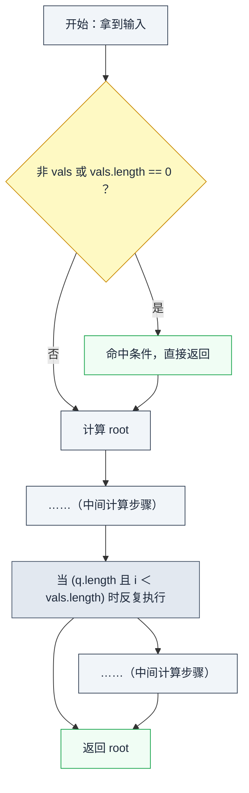

## TypeScript 解题方案（3 个方案逐个讲）

> **运行与提交**：每个方案都是自包含文件（内嵌用例自测，输出 PASS），整块复制到 `.ts` 文件后 `node 文件名` 即可运行。提交 LeetCode 时，把 `demo` 内的算法函数与辅助类型/函数整体取出、置于文件顶层即可。概念演示（非 LeetCode 编号题），在本地运行即可。

### 方案 1：迭代指针处理

**分析与思路**：核心做法是「迭代指针处理」。代码里依次做这些事：队列或堆的调度。

**运行方式**：`node 本文件`，内嵌用例全部通过会输出 PASS。


**方案专属流程图**（真实控制流）：

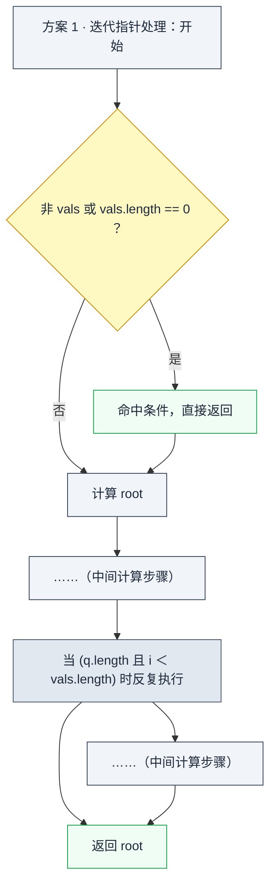

```typescript
class TreeNode {
  // 定义类型
  val: any;
  left: any;
  right: any; // 值: any; 左边界: any; 右边界: any;
  constructor(val?: any, left?: any, right?: any) {
    // constructor(值?: any, 左边界?: any, 右边界?: any) {
    this.val = val === undefined ? 0 : val; // 把 (值 全等于 undefined ? 0 : 值); 写入 值
    this.left = left === undefined ? null : left; // 把 (左边界 全等于 undefined ? null : 左边界); 写入 左边界
    this.right = right === undefined ? null : right; // 把 (右边界 全等于 undefined ? null : 右边界); 写入 右边界
  }
}
function buildTree(vals: any): any {
  // 定义函数/方法 buildTree
  if (!vals || vals.length === 0) return null; // 若 取反 vals 或 vals.长度 全等于 0，直接返回 null
  const root = new TreeNode(vals[0]);
  const q: any[] = [root];
  let i = 1;
  while (q.length && i < vals.length) {
    // 循环，直到不满足「节点.长度 且 下标 i 小于 vals.长度」
    const node = q.shift(); // 把 节点.shift() 存入 节点
    if (vals[i] !== null && vals[i] !== undefined) {
      node.left = new TreeNode(vals[i]);
      q.push(node.left);
    }
    i++; // 下标 i 加一
    if (i < vals.length && vals[i] !== null && vals[i] !== undefined) {
      node.right = new TreeNode(vals[i]);
      q.push(node.right);
    }
    i++; // 下标 i 加一
  }
  return root; // 返回 根节点
}
function treeToLevel(root: any): any[] {
  // 定义函数/方法 treeToLevel
  if (!root) return []; // 若 取反 根节点，直接返回 []
  const out: any[] = [];
  const q: any[] = [root]; // 把 []; const 节点: any[] 赋值为 [根节点]; 写入 const out: any[]
  while (q.length) {
    // 循环，直到不满足「节点.长度」
    const n = q.shift(); // 把 节点.shift() 存入 元素个数
    if (n === null || n === undefined) {
      out.push(null);
      continue;
    }
    out.push(n.val);
    q.push(n.left);
    q.push(n.right); // 把 元素个数.值 压入栈/数组尾部
  }
  while (out.length && out[out.length - 1] === null) out.pop(); // 循环，直到不满足「out.长度 且 out[out.长度 减 1] 全等于 null) out 弹出 );」
  return out; // 返回 out
}
class ListNode {
  // 定义类型
  val: any;
  next: any; // 值: any; 下一个: any;
  constructor(val?: any, next?: any) {
    this.val = val === undefined ? 0 : val;
    this.next = next === undefined ? null : next;
  }
}
function buildList(vals: any): any {
  // 定义函数/方法 buildList
  const dummy = new ListNode(0);
  let cur = dummy; // 把 new ListNode(0); let 当前值 赋值为 哨兵节点 存入 哨兵节点
  for (const v of vals) {
    cur.next = new ListNode(v);
    cur = cur.next;
  } // 把 new ListNode(值); 当前值 赋值为 当前值.下一个; } 写入 下一个
  return dummy.next; // 返回 哨兵节点.下一个
}
function listToArray(head: any): any[] {
  // 定义函数/方法 listToArray
  const out: any[] = [];
  let p = head; // 把 []; let 节点 赋值为 头节点; 写入 const out: any[]
  while (p) {
    out.push(p.val);
    p = p.next;
  } // 循环，直到不满足「节点) { out 追加 节点.值); 节点 赋值为 节点.下一个; }」
  return out; // 返回 out
}
// python-runtime shims
function pyLen(a: any): number {
  // 定义函数/方法 pyLen
  if (a === null || a === undefined) return 0; // 若 数组 全等于 null 或 数组 全等于 undefined，直接返回 0
  if (
    typeof a === 'string' ||
    Array.isArray(a) ||
    a instanceof Set ||
    a instanceof Map
  )
    return a.length ?? a.size;
  if (typeof a === 'object') return Object.keys(a).length; // 若 typeof 数组 全等于 'object'，直接返回 Object.keys(数组).长度
  return 0; // 返回 0
}
function pySlice(a: any, i: any, j: any, step?: any): any {
  // 定义函数/方法 pySlice
  if (typeof a === 'string') {
    const r = [...a].slice(i ?? 0, j ?? a.length);
    return step ? r.reverse().join('') : r.join('');
  }
  const arr = Array.isArray(a) ? a : [...a]; // 把 Array.isArray(数组) ? 数组 : 复制的 数组 存入 数组
  return arr.slice(i ?? 0, j ?? arr.length); // 返回 数组 截取 下标 i ?? 0, 下标 j ?? 数组.长度)
}
function pyRange(a: any, b?: any, step?: any): any[] {
  // 定义函数/方法 pyRange
  let s = 0,
    e = a,
    st = 1; // 把 0, e 赋值为 数组, st 赋值为 1 存入 字符串
  if (b !== undefined) {
    s = a;
    e = b;
  } // 若 b 不等于 undefined) { 字符串 赋值为 数组; e 赋值为 b; }
  if (step !== undefined) st = step; // 若 步数 不等于 undefined) st 赋值为 步数;
  const out: any[] = []; // 把 []; 写入 const out: any[]
  if (st > 0) for (let i = s; i < e; i += st) out.push(i);
  else for (let i = s; i > e; i += st) out.push(i); // 否则
  return out; // 返回 out
}
function pyIn(x: any, coll: any): boolean {
  // 定义函数/方法 pyIn
  if (coll === null || coll === undefined) return false; // 若 coll 全等于 null 或 coll 全等于 undefined，直接返回 false
  if (Array.isArray(coll)) return coll.includes(x); // 若 Array.isArray(coll)，直接返回 coll 是否包含 x)
  if (coll instanceof Set || coll instanceof Map) return coll.has(x); // 若 coll instanceof Set 或 coll instanceof Map，直接返回 coll.has(x)
  if (typeof coll === 'object') return x in coll; // 若 typeof coll 全等于 'object'，直接返回 x in coll
  if (typeof coll === 'string') return coll.indexOf(x) >= 0; // 若 typeof coll 全等于 'string'，直接返回 coll 查找 x) 不低于 0
  return false; // 返回 false
}
function pySorted(a: any): any[] {
  // 定义函数/方法 pySorted
  const arr = typeof a === 'string' ? [...a] : [...a]; // 把 (typeof 数组 全等于 'string') ? 复制的 数组 : 复制的 数组 存入 数组
  return arr.sort((x: any, y: any) => (x < y ? -1 : x > y ? 1 : 0));
}
function pyMin(a: any, b?: any): any {
  if (b !== undefined) return Math.min(a, b);
  if (Array.isArray(a) || a instanceof Set) return Math.min(...a);
  return Math.min(a);
} // 定义函数/方法 pyMin
function pyMax(a: any, b?: any): any {
  if (b !== undefined) return Math.max(a, b);
  if (Array.isArray(a) || a instanceof Set) return Math.max(...a);
  return Math.max(a);
} // 定义函数/方法 pyMax
function pySum(a: any): number {
  let s = 0;
  for (const v of a) s += v;
  return s;
} // 定义函数/方法 pySum
function pyAbs(x: any): number {
  return Math.abs(x);
} // 定义函数/方法 pyAbs
function pyEnumerate(a: any): any[] {
  const out: any[] = [];
  let i = 0;
  for (const v of a) {
    out.push([i, v]);
    i++;
  }
  return out;
} // 定义函数/方法 pyEnumerate
function pyZip(a: any, b: any): any[] {
  const n = Math.min(a.length, b.length);
  const out: any[] = [];
  for (let i = 0; i < n; i++) out.push([a[i], b[i]]);
  return out;
} // 定义函数/方法 pyZip
function pyDictGet(d: any, k: any, def?: any): any {
  return k in d ? d[k] : def === undefined ? null : def;
} // 定义函数/方法 pyDictGet
function pyPrint(...args: any[]): void {
  console.log(
    args
      .map((a) => (typeof a === 'object' && a !== null ? JSON.stringify(a) : a))
      .join(' '),
  );
} // 定义函数/方法 pyPrint
// collections / heapq
function heapPush(h: any[], x: any): void {
  h.push(x);
  let i = h.length - 1;
  while (i > 0) {
    const p = (i - 1) >> 1;
    if (h[p] <= h[i]) break;
    [h[p], h[i]] = [h[i], h[p]];
    i = p;
  }
} // 定义函数/方法 heapPush
function heapPop(h: any[]): any {
  const top = h[0];
  const last = h.pop();
  if (h.length) {
    h[0] = last;
    let i = 0;
    const n = h.length;
    while (true) {
      let l = 2 * i + 1,
        r = 2 * i + 2,
        s = i;
      if (l < n && h[l] < h[s]) s = l;
      if (r < n && h[r] < h[s]) s = r;
      if (s === i) break;
      [h[s], h[i]] = [h[i], h[s]];
      i = s;
    }
  }
  return top;
} // 定义函数/方法 heapPop
class Deque {
  private a: any[] = [];
  push(x: any) {
    this.a.push(x);
  }
  pushLeft(x: any) {
    this.a.unshift(x);
  }
  pop() {
    return this.a.pop();
  }
  popLeft() {
    return this.a.shift();
  }
  get length() {
    return this.a.length;
  }
  toArray() {
    return this.a.slice();
  }
} // 定义类型
function Counter(iter: any): any {
  const m: any = {};
  for (const v of iter) m[v] = (m[v] || 0) + 1;
  return m;
} // 定义函数/方法 Counter
function gcd(a: any, b: any): any {
  while (b) {
    [a, b] = [b, a % b];
  }
  return a;
} // 定义函数/方法 gcd
function pyInf(): number {
  return Infinity;
} // 定义函数/方法 pyInf

function norm(x: any): any {
  // 定义函数/方法 norm
  if (x === null || x === undefined) return null; // 若 x 全等于 null 或 x 全等于 undefined，直接返回 null
  if (typeof x === 'object') {
    // 若 typeof x 全等于 'object'
    if (x instanceof Deque) return x.toArray(); // 若 x instanceof Deque，直接返回 x.toArray()
    if (Array.isArray(x)) return x.map(norm); // 若 Array.isArray(x)，直接返回 x.映射表(norm)
    if (
      typeof x.val === 'number' &&
      (typeof x.left !== 'undefined' || typeof x.right !== 'undefined')
    )
      return treeToLevel(x);
    if (typeof x.next !== 'undefined' && typeof x.val === 'number')
      return listToArray(x);
    if (x instanceof Set) return [...x].sort(); // 若 x instanceof Set，直接返回 复制的 x 排序 )
    if (x instanceof Map) return Object.fromEntries(x); // 若 x instanceof Map，直接返回 Object.fromEntries(x)
    const o: any = {};
    for (const k of Object.keys(x)) o[k] = norm(x[k]);
    return o;
  }
  return x; // 返回 x
}
function eq(a: any, b: any): boolean {
  // 定义函数/方法 eq
  const x = norm(a),
    y = norm(b); // 把 norm(数组), y 赋值为 norm(b) 存入 x
  if (x === y) return true; // 若 x 全等于 y，直接返回 true
  if (x === null || y === null) return x === y; // 若 x 全等于 null 或 y 全等于 null，直接返回 x 全等于 y
  if (Array.isArray(x) && Array.isArray(y)) {
    // 若 Array.isArray(x) 且 Array.isArray(y
    if (x.length !== y.length) return false; // 若 x.长度 不等于 y.长度，直接返回 false
    for (let i = 0; i < x.length; i++) if (!eq(x[i], y[i])) return false; // 让 下标 i 从 0 开始计数，下标 i 小于 x.长度 就继续
    return true; // 返回 true
  }
  if (typeof x === 'object' && typeof y === 'object') {
    // 若 typeof x 全等于 'object' 且 typeof y 全等于 'object'
    const kx = Object.keys(x),
      ky = Object.keys(y); // 把 Object.keys(x), ky 赋值为 Object.keys(y) 存入 kx
    if (kx.length !== ky.length) return false; // 若 kx.长度 不等于 ky.长度，直接返回 false
    for (const k of kx) if (!eq(x[k], y[k])) return false;
    return true; // 返回 true
  }
  return x === y; // 返回 x 全等于 y
}

function shellSort(nums) {
  // 定义函数/方法 shellSort
  const a = nums.slice(); // 把 数组 截取 ) 存入 数组
  const n = a.length; // 把 数组.长度 存入 元素个数
  for (let gap = Math.floor(n / 2); gap > 0; gap = Math.floor(gap / 2)) {
    // 让 gap 从 向下取整(元素个数 除以 2) 开始计数，gap 超过 0 就继续
    for (let i = gap; i < n; i++) {
      // 让 下标 i 从 gap 开始计数，下标 i 小于 元素个数 就继续
      const x = a[i];
      let j = i; // 把 数组[下标 i]; let 下标 j 赋值为 下标 i 存入 x
      while (j >= gap && a[j - gap] > x) {
        a[j] = a[j - gap];
        j -= gap;
      }
      a[j] = x; // 把 x; 写入 a[j]
    }
  }
  return a; // 返回 数组
}
export function demo(): void {
  // 程序入口：跑内嵌自测用例
  const cases = [
    { in: [[5, 2, 4, 6, 1, 3]], want: [1, 2, 3, 4, 5, 6] },
    { in: [[9, 8, 7, 6, 5, 4, 3, 2, 1]], want: [1, 2, 3, 4, 5, 6, 7, 8, 9] },
    { in: [[1, 2, 3]], want: [1, 2, 3] },
    { in: [[]], want: [] },
  ];
  let fail = false; // 把 false 存入 fail
  for (const c of cases) {
    // for (const 字符 of cases) {
    const got = shellSort(...c.in); // 把 shellSort(...字符.in) 存入 got
    if (!eq(got, c.want)) {
      fail = true;
      console.log(
        'FAIL',
        JSON.stringify(c.in),
        '=>',
        JSON.stringify(got),
        'want',
        JSON.stringify(c.want),
      );
    }
  }
  if (fail) throw new Error('FAILED'); // 若 fail) throw new Error('FAILED');
  console.log('PASS'); // 全部用例通过，输出 PASS
}
demo(); // demo();
```

### 方案 2：直接实现

**分析与思路**：核心做法是「直接实现」。

**运行方式**：`node 本文件`，内嵌用例全部通过会输出 PASS。


**方案专属流程图**（真实控制流）：

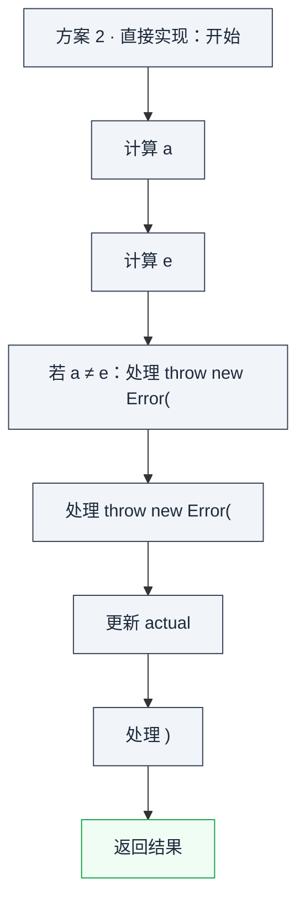

```typescript
function assertEq(actual: any, expected: any, msg: string = ''): void {
  // 定义函数/方法 assertEq
  const a = JSON.stringify(actual);
  const e = JSON.stringify(expected);
  if (a !== e)
    throw new Error(
      'ASSERT FAILED ' + msg + ' :: actual=' + a + ' expected=' + e,
    );
}

function shellSort(lst: number[]): number[] {
  // 定义函数/方法 shellSort
  const a = lst.slice();
  const length = a.length;
  let gap = Math.floor(length / 2);
  while (gap > 0) {
    // 循环，直到不满足「gap 超过 0」
    for (let i = gap; i < length; i++) {
      // 让 下标 i 从 gap 开始计数，下标 i 小于 长度 就继续
      const tmp = a[i];
      let p = i; // 把 数组[下标 i]; let 节点 赋值为 下标 i 存入 临时变量
      while (p - gap >= 0 && a[p - gap] > tmp) {
        a[p] = a[p - gap];
        p -= gap;
      }
      a[p] = tmp; // 把 临时变量; 写入 a[p]
    }
    gap = Math.floor(gap / 2); // 把 向下取整(gap 除以 2) 存入 gap
  }
  return a; // 返回 数组
}
export function demo(): void {
  // 程序入口：跑内嵌自测用例
  assertEq(
    shellSort([9, 12, 1, 3, -1, 22, 22, 31, 1, 0]),
    [-1, 0, 1, 1, 3, 9, 12, 22, 22, 31],
    'shell',
  ); // 断言校验
  assertEq(shellSort([5, 4, 3, 2, 1]), [1, 2, 3, 4, 5], 'rev'); // 断言校验
  console.log('PASS'); // 全部用例通过，输出 PASS
}
demo(); // demo();
```

### 方案 3：迭代指针处理

**分析与思路**：核心做法是「迭代指针处理」。代码里依次做这些事：队列或堆的调度。

**运行方式**：`node 本文件`，内嵌用例全部通过会输出 PASS。


**方案专属流程图**（真实控制流）：


```typescript
class TreeNode {
  // 定义类型
  val: any;
  left: any;
  right: any; // 值: any; 左边界: any; 右边界: any;
  constructor(val?: any, left?: any, right?: any) {
    // constructor(值?: any, 左边界?: any, 右边界?: any) {
    this.val = val === undefined ? 0 : val; // 把 (值 全等于 undefined ? 0 : 值); 写入 值
    this.left = left === undefined ? null : left; // 把 (左边界 全等于 undefined ? null : 左边界); 写入 左边界
    this.right = right === undefined ? null : right; // 把 (右边界 全等于 undefined ? null : 右边界); 写入 右边界
  }
}
function buildTree(vals: any): any {
  // 定义函数/方法 buildTree
  if (!vals || vals.length === 0) return null; // 若 取反 vals 或 vals.长度 全等于 0，直接返回 null
  const root = new TreeNode(vals[0]);
  const q: any[] = [root];
  let i = 1;
  while (q.length && i < vals.length) {
    // 循环，直到不满足「节点.长度 且 下标 i 小于 vals.长度」
    const node = q.shift(); // 把 节点.shift() 存入 节点
    if (vals[i] !== null && vals[i] !== undefined) {
      node.left = new TreeNode(vals[i]);
      q.push(node.left);
    }
    i++; // 下标 i 加一
    if (i < vals.length && vals[i] !== null && vals[i] !== undefined) {
      node.right = new TreeNode(vals[i]);
      q.push(node.right);
    }
    i++; // 下标 i 加一
  }
  return root; // 返回 根节点
}
function treeToLevel(root: any): any[] {
  // 定义函数/方法 treeToLevel
  if (!root) return []; // 若 取反 根节点，直接返回 []
  const out: any[] = [];
  const q: any[] = [root]; // 把 []; const 节点: any[] 赋值为 [根节点]; 写入 const out: any[]
  while (q.length) {
    // 循环，直到不满足「节点.长度」
    const n = q.shift(); // 把 节点.shift() 存入 元素个数
    if (n === null || n === undefined) {
      out.push(null);
      continue;
    }
    out.push(n.val);
    q.push(n.left);
    q.push(n.right); // 把 元素个数.值 压入栈/数组尾部
  }
  while (out.length && out[out.length - 1] === null) out.pop(); // 循环，直到不满足「out.长度 且 out[out.长度 减 1] 全等于 null) out 弹出 );」
  return out; // 返回 out
}
class ListNode {
  // 定义类型
  val: any;
  next: any; // 值: any; 下一个: any;
  constructor(val?: any, next?: any) {
    this.val = val === undefined ? 0 : val;
    this.next = next === undefined ? null : next;
  }
}
function buildList(vals: any): any {
  // 定义函数/方法 buildList
  const dummy = new ListNode(0);
  let cur = dummy; // 把 new ListNode(0); let 当前值 赋值为 哨兵节点 存入 哨兵节点
  for (const v of vals) {
    cur.next = new ListNode(v);
    cur = cur.next;
  } // 把 new ListNode(值); 当前值 赋值为 当前值.下一个; } 写入 下一个
  return dummy.next; // 返回 哨兵节点.下一个
}
function listToArray(head: any): any[] {
  // 定义函数/方法 listToArray
  const out: any[] = [];
  let p = head; // 把 []; let 节点 赋值为 头节点; 写入 const out: any[]
  while (p) {
    out.push(p.val);
    p = p.next;
  } // 循环，直到不满足「节点) { out 追加 节点.值); 节点 赋值为 节点.下一个; }」
  return out; // 返回 out
}
// python-runtime shims
function pyLen(a: any): number {
  // 定义函数/方法 pyLen
  if (a === null || a === undefined) return 0; // 若 数组 全等于 null 或 数组 全等于 undefined，直接返回 0
  if (
    typeof a === 'string' ||
    Array.isArray(a) ||
    a instanceof Set ||
    a instanceof Map
  )
    return a.length ?? a.size;
  if (typeof a === 'object') return Object.keys(a).length; // 若 typeof 数组 全等于 'object'，直接返回 Object.keys(数组).长度
  return 0; // 返回 0
}
function pySlice(a: any, i: any, j: any, step?: any): any {
  // 定义函数/方法 pySlice
  if (typeof a === 'string') {
    const r = [...a].slice(i ?? 0, j ?? a.length);
    return step ? r.reverse().join('') : r.join('');
  }
  const arr = Array.isArray(a) ? a : [...a]; // 把 Array.isArray(数组) ? 数组 : 复制的 数组 存入 数组
  return arr.slice(i ?? 0, j ?? arr.length); // 返回 数组 截取 下标 i ?? 0, 下标 j ?? 数组.长度)
}
function pyRange(a: any, b?: any, step?: any): any[] {
  // 定义函数/方法 pyRange
  let s = 0,
    e = a,
    st = 1; // 把 0, e 赋值为 数组, st 赋值为 1 存入 字符串
  if (b !== undefined) {
    s = a;
    e = b;
  } // 若 b 不等于 undefined) { 字符串 赋值为 数组; e 赋值为 b; }
  if (step !== undefined) st = step; // 若 步数 不等于 undefined) st 赋值为 步数;
  const out: any[] = []; // 把 []; 写入 const out: any[]
  if (st > 0) for (let i = s; i < e; i += st) out.push(i);
  else for (let i = s; i > e; i += st) out.push(i); // 否则
  return out; // 返回 out
}
function pyIn(x: any, coll: any): boolean {
  // 定义函数/方法 pyIn
  if (coll === null || coll === undefined) return false; // 若 coll 全等于 null 或 coll 全等于 undefined，直接返回 false
  if (Array.isArray(coll)) return coll.includes(x); // 若 Array.isArray(coll)，直接返回 coll 是否包含 x)
  if (coll instanceof Set || coll instanceof Map) return coll.has(x); // 若 coll instanceof Set 或 coll instanceof Map，直接返回 coll.has(x)
  if (typeof coll === 'object') return x in coll; // 若 typeof coll 全等于 'object'，直接返回 x in coll
  if (typeof coll === 'string') return coll.indexOf(x) >= 0; // 若 typeof coll 全等于 'string'，直接返回 coll 查找 x) 不低于 0
  return false; // 返回 false
}
function pySorted(a: any): any[] {
  // 定义函数/方法 pySorted
  const arr = typeof a === 'string' ? [...a] : [...a]; // 把 (typeof 数组 全等于 'string') ? 复制的 数组 : 复制的 数组 存入 数组
  return arr.sort((x: any, y: any) => (x < y ? -1 : x > y ? 1 : 0));
}
function pyMin(a: any, b?: any): any {
  if (b !== undefined) return Math.min(a, b);
  if (Array.isArray(a) || a instanceof Set) return Math.min(...a);
  return Math.min(a);
} // 定义函数/方法 pyMin
function pyMax(a: any, b?: any): any {
  if (b !== undefined) return Math.max(a, b);
  if (Array.isArray(a) || a instanceof Set) return Math.max(...a);
  return Math.max(a);
} // 定义函数/方法 pyMax
function pySum(a: any): number {
  let s = 0;
  for (const v of a) s += v;
  return s;
} // 定义函数/方法 pySum
function pyAbs(x: any): number {
  return Math.abs(x);
} // 定义函数/方法 pyAbs
function pyEnumerate(a: any): any[] {
  const out: any[] = [];
  let i = 0;
  for (const v of a) {
    out.push([i, v]);
    i++;
  }
  return out;
} // 定义函数/方法 pyEnumerate
function pyZip(a: any, b: any): any[] {
  const n = Math.min(a.length, b.length);
  const out: any[] = [];
  for (let i = 0; i < n; i++) out.push([a[i], b[i]]);
  return out;
} // 定义函数/方法 pyZip
function pyDictGet(d: any, k: any, def?: any): any {
  return k in d ? d[k] : def === undefined ? null : def;
} // 定义函数/方法 pyDictGet
function pyPrint(...args: any[]): void {
  console.log(
    args
      .map((a) => (typeof a === 'object' && a !== null ? JSON.stringify(a) : a))
      .join(' '),
  );
} // 定义函数/方法 pyPrint
// collections / heapq
function heapPush(h: any[], x: any): void {
  h.push(x);
  let i = h.length - 1;
  while (i > 0) {
    const p = (i - 1) >> 1;
    if (h[p] <= h[i]) break;
    [h[p], h[i]] = [h[i], h[p]];
    i = p;
  }
} // 定义函数/方法 heapPush
function heapPop(h: any[]): any {
  const top = h[0];
  const last = h.pop();
  if (h.length) {
    h[0] = last;
    let i = 0;
    const n = h.length;
    while (true) {
      let l = 2 * i + 1,
        r = 2 * i + 2,
        s = i;
      if (l < n && h[l] < h[s]) s = l;
      if (r < n && h[r] < h[s]) s = r;
      if (s === i) break;
      [h[s], h[i]] = [h[i], h[s]];
      i = s;
    }
  }
  return top;
} // 定义函数/方法 heapPop
class Deque {
  private a: any[] = [];
  push(x: any) {
    this.a.push(x);
  }
  pushLeft(x: any) {
    this.a.unshift(x);
  }
  pop() {
    return this.a.pop();
  }
  popLeft() {
    return this.a.shift();
  }
  get length() {
    return this.a.length;
  }
  toArray() {
    return this.a.slice();
  }
} // 定义类型
function Counter(iter: any): any {
  const m: any = {};
  for (const v of iter) m[v] = (m[v] || 0) + 1;
  return m;
} // 定义函数/方法 Counter
function gcd(a: any, b: any): any {
  while (b) {
    [a, b] = [b, a % b];
  }
  return a;
} // 定义函数/方法 gcd
function pyInf(): number {
  return Infinity;
} // 定义函数/方法 pyInf

function norm(x: any): any {
  // 定义函数/方法 norm
  if (x === null || x === undefined) return null; // 若 x 全等于 null 或 x 全等于 undefined，直接返回 null
  if (typeof x === 'object') {
    // 若 typeof x 全等于 'object'
    if (x instanceof Deque) return x.toArray(); // 若 x instanceof Deque，直接返回 x.toArray()
    if (Array.isArray(x)) return x.map(norm); // 若 Array.isArray(x)，直接返回 x.映射表(norm)
    if (
      typeof x.val === 'number' &&
      (typeof x.left !== 'undefined' || typeof x.right !== 'undefined')
    )
      return treeToLevel(x);
    if (typeof x.next !== 'undefined' && typeof x.val === 'number')
      return listToArray(x);
    if (x instanceof Set) return [...x].sort(); // 若 x instanceof Set，直接返回 复制的 x 排序 )
    if (x instanceof Map) return Object.fromEntries(x); // 若 x instanceof Map，直接返回 Object.fromEntries(x)
    const o: any = {};
    for (const k of Object.keys(x)) o[k] = norm(x[k]);
    return o;
  }
  return x; // 返回 x
}
function eq(a: any, b: any): boolean {
  // 定义函数/方法 eq
  const x = norm(a),
    y = norm(b); // 把 norm(数组), y 赋值为 norm(b) 存入 x
  if (x === y) return true; // 若 x 全等于 y，直接返回 true
  if (x === null || y === null) return x === y; // 若 x 全等于 null 或 y 全等于 null，直接返回 x 全等于 y
  if (Array.isArray(x) && Array.isArray(y)) {
    // 若 Array.isArray(x) 且 Array.isArray(y
    if (x.length !== y.length) return false; // 若 x.长度 不等于 y.长度，直接返回 false
    for (let i = 0; i < x.length; i++) if (!eq(x[i], y[i])) return false; // 让 下标 i 从 0 开始计数，下标 i 小于 x.长度 就继续
    return true; // 返回 true
  }
  if (typeof x === 'object' && typeof y === 'object') {
    // 若 typeof x 全等于 'object' 且 typeof y 全等于 'object'
    const kx = Object.keys(x),
      ky = Object.keys(y); // 把 Object.keys(x), ky 赋值为 Object.keys(y) 存入 kx
    if (kx.length !== ky.length) return false; // 若 kx.长度 不等于 ky.长度，直接返回 false
    for (const k of kx) if (!eq(x[k], y[k])) return false;
    return true; // 返回 true
  }
  return x === y; // 返回 x 全等于 y
}

function shellSort(nums) {
  // 定义函数/方法 shellSort
  const a = nums.slice(); // 把 数组 截取 ) 存入 数组
  const n = a.length; // 把 数组.长度 存入 元素个数
  for (let gap = Math.floor(n / 2); gap > 0; gap = Math.floor(gap / 2)) {
    // 让 gap 从 向下取整(元素个数 除以 2) 开始计数，gap 超过 0 就继续
    for (let i = gap; i < n; i++) {
      // 让 下标 i 从 gap 开始计数，下标 i 小于 元素个数 就继续
      const x = a[i];
      let j = i; // 把 数组[下标 i]; let 下标 j 赋值为 下标 i 存入 x
      while (j >= gap && a[j - gap] > x) {
        a[j] = a[j - gap];
        j -= gap;
      }
      a[j] = x; // 把 x; 写入 a[j]
    }
  }
  return a; // 返回 数组
}
export function demo(): void {
  // 程序入口：跑内嵌自测用例
  const cases = [
    { in: [[5, 2, 4, 6, 1, 3]], want: [1, 2, 3, 4, 5, 6] },
    { in: [[9, 8, 7, 6, 5, 4, 3, 2, 1]], want: [1, 2, 3, 4, 5, 6, 7, 8, 9] },
    { in: [[1, 2, 3]], want: [1, 2, 3] },
    { in: [[]], want: [] },
  ];
  let fail = false; // 把 false 存入 fail
  for (const c of cases) {
    // for (const 字符 of cases) {
    const got = shellSort(...c.in); // 把 shellSort(...字符.in) 存入 got
    if (!eq(got, c.want)) {
      fail = true;
      console.log(
        'FAIL',
        JSON.stringify(c.in),
        '=>',
        JSON.stringify(got),
        'want',
        JSON.stringify(c.want),
      );
    }
  }
  if (fail) throw new Error('FAILED'); // 若 fail) throw new Error('FAILED');
  console.log('PASS'); // 全部用例通过，输出 PASS
}
demo(); // demo();
```

## 逐步拆解与面试追问

**复杂度**：时间 O(n)（单趟线性扫描），空间 O(1) 到 O(n)（视辅助结构）

**为什么是这个量级**：每个元素被常数次访问，辅助哈希或栈的开销与 n 同阶

**面试官可能会追问**：

- 这个策略能推广到什么场景？
- 与暴力做法差在哪一步？
- 有没有更简单的等价写法？

## 关键 API 速查（TS 主解法实际用到，附官方链接）

| API | 作用 | 使用要点 | 官方文档 |
|---|---|---|---|
| `Array.prototype.sort()` | 原地排序 | 默认按字符串 Unicode 序（10 会排在 2 前），数字必须传 (a,b)=>a-b；V8 用 TimSort，稳定，O(n log n)；返回原数组引用 | [官方文档](https://developer.mozilla.org/zh-CN/docs/Web/JavaScript/Reference/Global_Objects/Array/sort) |
| `Array.prototype.map()` | 逐元素映射为新数组 | 回调 (v,i,arr)；返回等长新数组，不改变原数组；稀疏位跳过；链式调用注意中间数组开销 | [官方文档](https://developer.mozilla.org/zh-CN/docs/Web/JavaScript/Reference/Global_Objects/Array/map) |
| `Array.prototype.push()` | 尾部追加 | 返回新长度；可一次多个；均摊 O(1)；会改变原数组 | [官方文档](https://developer.mozilla.org/zh-CN/docs/Web/JavaScript/Reference/Global_Objects/Array/push) |
| `Array.prototype.pop()` | 尾部弹出 | 返回被删元素（空数组返回 undefined）；O(1) | [官方文档](https://developer.mozilla.org/zh-CN/docs/Web/JavaScript/Reference/Global_Objects/Array/pop) |
| `Array.prototype.shift()` | 头部取出 | O(n)（后续元素整体前移）；大量头部操作请用链表或双端结构 | [官方文档](https://developer.mozilla.org/zh-CN/docs/Web/JavaScript/Reference/Global_Objects/Array/shift) |
| `Array.prototype.unshift()` | 头部插入 | O(n)；与 shift 组合可当双端队列 | [官方文档](https://developer.mozilla.org/zh-CN/docs/Web/JavaScript/Reference/Global_Objects/Array/unshift) |
| `Array/String includes()` | 是否包含 | 数组用 SameValueZero（NaN 可判）；字符串按子串；第二个参数为起始下标 | [官方文档](https://developer.mozilla.org/zh-CN/docs/Web/JavaScript/Reference/Global_Objects/Array/includes) |
| `Array/String indexOf()` | 首次出现的下标 | 找不到返回 -1；无法判 NaN（用 includes）；字符串可传起始位 | [官方文档](https://developer.mozilla.org/zh-CN/docs/Web/JavaScript/Reference/Global_Objects/Array/indexOf) |
| `Array/String slice()` | 切片（不改原数组） | slice(start,end) 含头不含尾；负数从尾计；常用于复制数组（slice()） | [官方文档](https://developer.mozilla.org/zh-CN/docs/Web/JavaScript/Reference/Global_Objects/Array/slice) |
| `Array.prototype.join()` | 数组拼接为字符串 | undefined/null 转空串；嵌套数组会展平一层；join('') 用于字符数组还原 | [官方文档](https://developer.mozilla.org/zh-CN/docs/Web/JavaScript/Reference/Global_Objects/Array/join) |
| `Object.keys()` | 对象键名数组 | 仅自身可枚举字符串键（不含 symbol）；配 length 可当计数器 | [官方文档](https://developer.mozilla.org/zh-CN/docs/Web/JavaScript/Reference/Global_Objects/Object/keys) |
| `Object.fromEntries()` | 键值对数组转对象 | 参数为 [k,v] 可迭代；map 出来的键值对可直接转对象 | [官方文档](https://developer.mozilla.org/zh-CN/docs/Web/JavaScript/Reference/Global_Objects/Object/fromEntries) |
| `JSON.stringify()` | 序列化为 JSON 字符串 | 常用于结构化比较（深度相等判定）；undefined/函数/循环引用会被丢弃或抛错 | [官方文档](https://developer.mozilla.org/zh-CN/docs/Web/JavaScript/Reference/Global_Objects/JSON/stringify) |
| `Math.max()` | 最大值 | 配展开 Math.max(...arr)；空参返回 -Infinity；超大数组注意展开参数上限 | [官方文档](https://developer.mozilla.org/zh-CN/docs/Web/JavaScript/Reference/Global_Objects/Math/max) |
| `Math.min()` | 最小值 | 同 max；空参返回 Infinity | [官方文档](https://developer.mozilla.org/zh-CN/docs/Web/JavaScript/Reference/Global_Objects/Math/min) |
| `Math.abs()` | 绝对值 | 入参会被隐式转数字；-0 返回 +0 | [官方文档](https://developer.mozilla.org/zh-CN/docs/Web/JavaScript/Reference/Global_Objects/Math/abs) |
| `Math.floor()` | 向下取整 | 负数向负无穷（-1.5 → -2）；大数用位运算前注意 2^31 界 | [官方文档](https://developer.mozilla.org/zh-CN/docs/Web/JavaScript/Reference/Global_Objects/Math/floor) |

### 各语言官方文档导航

- **TypeScript / JS**：[MDN 中文参考](https://developer.mozilla.org/zh-CN/)
- **Python**：[Python 官方文档](https://docs.python.org/zh-cn/3/)
- **Go**：[Go 标准库](https://pkg.go.dev/std)
- **Java**：[JDK 17 API](https://docs.oracle.com/en/java/javase/17/docs/api/)
- **Rust**：[Rust 标准库](https://doc.rust-lang.org/std/)
- **Lua**：[Lua 5.4 手册](https://www.lua.org/manual/5.4/)
- **C**：[Cppreference C](https://zh.cppreference.com/w/c)
- **C++**：[Cppreference C++](https://zh.cppreference.com/w/cpp)
- **R**：[R 官方手册](https://stat.ethz.ch/R-manual/)
- **Zig**：[Zig 语言文档](https://ziglang.org/documentation/master/)
- **Dart**：[Dart API](https://api.dart.dev/)

## 附录：其他 10 种语言全部实现（每种语言列举其全部方案）

> TypeScript 的全部方案见「TypeScript 解题方案」一节；下面是其余 10 种语言的对应实现，每种语言的每个方案都带思路分析、代码走读与专属运行架构图。
> 每个方案都内嵌用例自测，可独立运行（老仓库 python/go 文件遵循「打印结果」约定）。
> 完整解法文件见 `dsa/<语言>/notes/lc_134150438_希尔排序/`。

### Python 实现（3 种方案）

Python 的全部方案如下，每个方案都内嵌用例自测，可独立运行（老仓库 python/go 文件遵循「打印结果」约定）：

#### 方案 1：迭代指针处理

**思路与代码分析**：核心是「迭代指针处理」。Python 版用切片与字典推导式简化操作，突出可读性。**走读**：方案 1 · 迭代指针处理：开始 → 更新 n → 更新 gap → 当 gap ＞ 0: 时反复执行 → 循环 i：从 gap 到 n 前 → 更新 temp → 更新 j → 当 ( 时反复执行 → 更新 > → 处理 ): → 更新 nums[j] → 更新 - → 更新 nums[j] → 更新 // → 返回 nums。

**运行架构**（真实控制流）：

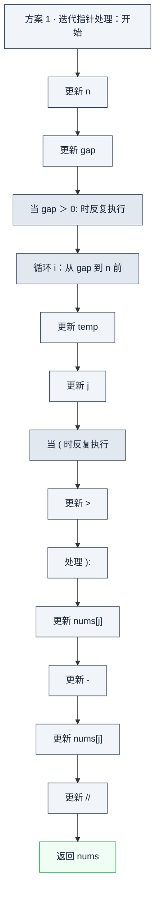

```python
import sys  # 提高递归深度上限（深输入防 RecursionError）

sys.setrecursionlimit(200000)  # 树/链表类题目节点数可达 1e4 量级

def shellSort(nums):  # 定义函数 shellSort（参数：数组）
    n = len(nums)  # 把 长度(数组) 存入 元素个数
    gap = n // 2  # 把 元素个数 除以 除以 2 存入 gap
    while gap > 0:  # 循环，直到不满足「gap 超过 0」
        for i in range(gap, n):  # 让 下标 i 从 gap 到 元素个数 遍历
            temp = nums[i]  # 把 数组[下标 i] 存入 临时变量
            j = i  # 把 下标 i 存入 下标 j
            while (
                j >= gap and nums[j - gap] > temp
            ):  # 循环，直到不满足「下标 j 不低于 gap and 数组[下标 j 减 gap] 超过 临时变量」
                nums[j] = nums[j - gap]  # 把 数组[下标 j 减 gap] 写入 nums[j]
                j -= gap  # 下标 j累减 gap
            nums[j] = temp  # 把 临时变量 写入 nums[j]
        gap //= 2  # 把 2 写入 gap //
    return nums  # 返回 数组

if __name__ == "__main__":  # 若 __name__ 等于 '__main__'
    print(shellSort([1, 2, 3]))  # 打印输出
```

#### 方案 2：直接实现

**思路与代码分析**：核心是「直接实现」。Python 版用切片与字典推导式简化操作，突出可读性。**走读**：方案 2 · 直接实现：开始 → 更新 length → 更新 gap → 当 gap ＞ 0: 时反复执行 → 循环 i：从 gap 到 length 前 → 更新 tmp → 更新 p → 当 ( 时反复执行 → 更新 > → 处理 ): → 更新 lst[p] → 更新 - → 更新 lst[p] → 更新 // → 返回 lst。

**运行架构**（真实控制流）：

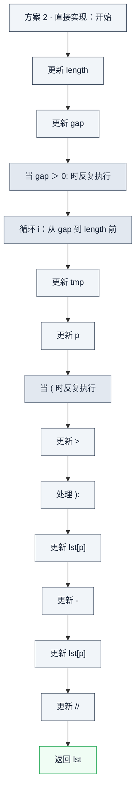

```python
import sys  # 提高递归深度上限（深输入防 RecursionError）

sys.setrecursionlimit(200000)  # 树/链表类题目节点数可达 1e4 量级

def shellSort(lst):  # 定义函数 shellSort（参数：lst）
    length = len(lst)  # 把 长度(lst) 存入 长度
    gap = length // 2  # 把 长度 除以 除以 2 存入 gap
    while gap > 0:  # 循环，直到不满足「gap 超过 0」
        for i in range(gap, length):  # 让 下标 i 从 gap 到 长度 遍历
            tmp = lst[i]  # 把 lst[下标 i] 存入 临时变量
            p = i  # 把 下标 i 存入 节点
            while (
                p - gap >= 0 and lst[p - gap] > tmp
            ):  # 循环，直到不满足「节点 减 gap 不低于 0 and lst[节点 减 gap] 超过 临时变量」
                lst[p] = lst[p - gap]  # 把 lst[节点 减 gap] 写入 lst[p]
                p -= gap  # 节点累减 gap
            lst[p] = tmp  # 把 临时变量 写入 lst[p]
        gap //= 2  # 把 2 写入 gap //
    return lst  # 返回 lst

if __name__ == "__main__":  # 若 __name__ 等于 '__main__'
    data = [9, 12, 1, 3, -1, 22, 22, 31, 1, 0]  # 把 [9, 12, 1, 3, 减 1, 22, 22, 31, 1, 0] 存入 data
    print(shellSort(data))  # 打印输出
```

#### 方案 3：迭代指针处理

**思路与代码分析**：核心是「迭代指针处理」。Python 版用切片与字典推导式简化操作，突出可读性。**走读**：方案 3 · 迭代指针处理：开始 → 更新 length → 更新 gap → 当 gap ＞ 0: 时反复执行 → 循环 i：从 gap 到 length 前 → 更新 temp → 更新 p → 当 ( 时反复执行 → 更新 > → 处理 ): → 更新 lst[p] → 更新 - → 更新 lst[p] → 更新 // → 返回 lst。

**运行架构**（真实控制流）：

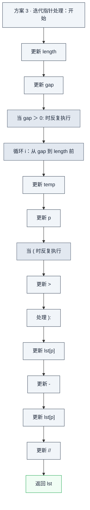

```python
import sys  # 提高递归深度上限（深输入防 RecursionError）

sys.setrecursionlimit(200000)  # 树/链表类题目节点数可达 1e4 量级

def shell_sort(lst):  # 定义函数 shell_sort（参数：lst）
    length = len(lst)  # 把 长度(lst) 存入 长度
    gap = length // 2  # 把 长度 除以 除以 2 存入 gap
    while gap > 0:  # 循环，直到不满足「gap 超过 0」
        for i in range(gap, length):  # 让 下标 i 从 gap 到 长度 遍历
            temp = lst[i]  # 把 lst[下标 i] 存入 临时变量
            p = i  # 把 下标 i 存入 节点
            while (
                p >= gap and lst[p - gap] > temp
            ):  # 循环，直到不满足「节点 不低于 gap and lst[节点 减 gap] 超过 临时变量」
                lst[p] = lst[p - gap]  # 把 lst[节点 减 gap] 写入 lst[p]
                p -= gap  # 节点累减 gap
            lst[p] = temp  # 把 临时变量 写入 lst[p]
        gap //= 2  # 把 2 写入 gap //
    return lst  # 返回 lst

if __name__ == "__main__":  # 若 __name__ 等于 「__main__」
    list_ = [9, 12, 1, 3, -1, 22, 22, 31, 1, 0]  # 把 [9, 12, 1, 3, 减 1, 22, 22, 31, 1, 0] 存入 list_
    shell_sort(list_)  # shell_sort(list_)
    print("list: ", list_)  # 打印输出
```

### Go 实现（3 种方案）

Go 的全部方案如下，每个方案都内嵌用例自测，可独立运行（老仓库 python/go 文件遵循「打印结果」约定）：

#### 方案 1：迭代指针处理

**思路与代码分析**：核心是「迭代指针处理」。Go 版用切片与多返回值惯用法，显式处理索引边界。**走读**：方案 1 · 迭代指针处理：开始 → 更新 : → 更新 : → 遍历循环 → 遍历循环 → 更新 : → 更新 : → 遍历循环 → 更新 nums[j] → 更新 - → 更新 nums[j] → 更新 / → 返回 nums。

**运行架构**（真实控制流）：

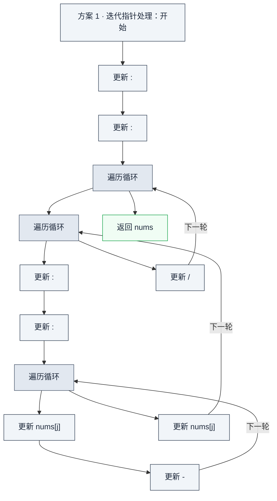

```go
package main // 引入依赖

import (
	"fmt"     // 「fmt」
	"os"      // 「os」
	"reflect" // 「reflect」
)

func shellSort(nums []int) []int { // 定义函数/方法 shellSort
	n := len(nums) // 把 长度(数组) 写入 n :
	gap := n / 2   // 把 元素个数 除以 2 写入 gap :
	for gap > 0 {  // for gap 超过 0 {
		for i := gap; i < n; i++ { // 把 gap; 下标 i 小于 元素个数; 下标 i 加一 { 写入 for i :
			temp := nums[i]                      // 把 数组[下标 i] 写入 temp :
			j := i                               // 把 下标 i 写入 j :
			for j >= gap && nums[j-gap] > temp { // 把 gap 且 数组[下标 j 减 gap] 超过 临时变量 { 写入 for j >
				nums[j] = nums[j-gap] // 把 数组[下标 j 减 gap] 写入 nums[j]
				j -= gap              // 下标 j累减 gap
			}
			nums[j] = temp // 把 临时变量 写入 nums[j]
		}
		gap /= 2 // 把 2 写入 gap /
	}
	return nums // 返回 数组
}

func main() { // 程序入口：跑内嵌自测用例
	type tc struct { // 定义类型
		in   []int // in []int
		want []int // want []int
	}
	cases := []tc{ // 把 []tc{ 写入 cases :
		{[]int{1, 2, 3}, []int{1, 2, 3}},
		{[]int{5, 4, 3, 2, 1}, []int{1, 2, 3, 4, 5}},
		{[]int{3, 1, 2}, []int{1, 2, 3}},
	}
	ok := true                // 把 true 写入 ok :
	for _, c := range cases { // 同时取 _ 与 字符 遍历
		in := append([]int{}, c.in...)                             // 把 append([]int{}, 字符.in...) 写入 in :
		if got := shellSort(in); !reflect.DeepEqual(got, c.want) { // 若 got : 赋值为 shellSort(in); 取反 reflect.DeepEqual(got, 字符.want
			ok = false                                                       // 把 false 写入 ok
			fmt.Printf("FAIL shellSort(%v)=%v want %v\n", c.in, got, c.want) // 打印输出
		}
	}
	if !ok { // 若 取反 ok
		os.Exit(1) // os.Exit(1)
	}
	fmt.Println("PASS") // 全部用例通过，输出 PASS
}
```

#### 方案 2：直接实现

**思路与代码分析**：核心是「直接实现」。Go 版用切片与多返回值惯用法，显式处理索引边界。**走读**：方案 2 · 直接实现：开始 → 更新 : → 更新 : → 遍历循环 → 遍历循环 → 更新 : → 更新 : → 遍历循环 → 更新 lst[p] → 更新 - → 更新 lst[p] → 更新 / → 返回 lst。

**运行架构**（真实控制流）：

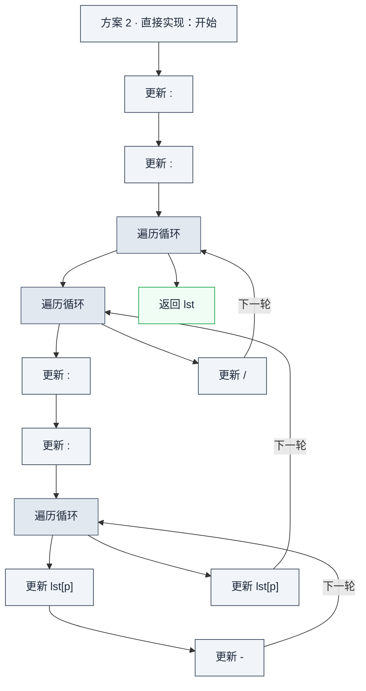

```go
package main // 引入依赖

import (
	"fmt"     // 「fmt」
	"os"      // 「os」
	"reflect" // 「reflect」
)

func shellSort(lst []int) []int { // 定义函数/方法 shellSort
	length := len(lst) // 把 长度(lst) 写入 length :
	gap := length / 2  // 把 长度 除以 2 写入 gap :
	for gap > 0 {      // for gap 超过 0 {
		for i := gap; i < length; i++ { // 把 gap; 下标 i 小于 长度; 下标 i 加一 { 写入 for i :
			tmp := lst[i]                        // 把 lst[下标 i] 写入 tmp :
			p := i                               // 把 下标 i 写入 p :
			for p-gap >= 0 && lst[p-gap] > tmp { // 把 0 且 lst[节点 减 gap] 超过 临时变量 { 写入 for p-gap >
				lst[p] = lst[p-gap] // 把 lst[节点 减 gap] 写入 lst[p]
				p -= gap            // 节点累减 gap
			}
			lst[p] = tmp // 把 临时变量 写入 lst[p]
		}
		gap /= 2 // 把 2 写入 gap /
	}
	return lst // 返回 lst
}

func main() { // 程序入口：跑内嵌自测用例
	type tc struct { // 定义类型
		in   []int // in []int
		want []int // want []int
	}
	cases := []tc{ // 把 []tc{ 写入 cases :
		{[]int{9, 12, 1, 3, -1, 22, 22, 31, 1, 0}, []int{-1, 0, 1, 1, 3, 9, 12, 22, 22, 31}},
		{[]int{1, 2, 3}, []int{1, 2, 3}},
	}
	ok := true                // 把 true 写入 ok :
	for _, c := range cases { // 同时取 _ 与 字符 遍历
		in := append([]int{}, c.in...)                             // 把 append([]int{}, 字符.in...) 写入 in :
		if got := shellSort(in); !reflect.DeepEqual(got, c.want) { // 若 got : 赋值为 shellSort(in); 取反 reflect.DeepEqual(got, 字符.want
			ok = false                                                       // 把 false 写入 ok
			fmt.Printf("FAIL shellSort(%v)=%v want %v\n", c.in, got, c.want) // 打印输出
		}
	}
	if !ok { // 若 取反 ok
		os.Exit(1) // os.Exit(1)
	}
	fmt.Println("PASS") // 全部用例通过，输出 PASS
}
```

#### 方案 3：迭代指针处理

**思路与代码分析**：核心是「迭代指针处理」。Go 版用切片与多返回值惯用法，显式处理索引边界。**走读**：方案 3 · 迭代指针处理：开始 → 更新 : → 更新 : → 遍历循环 → 遍历循环 → 更新 : → 更新 : → 遍历循环 → 更新 lst[p] → 更新 - → 更新 lst[p] → 更新 / → 返回结果。

**运行架构**（真实控制流）：

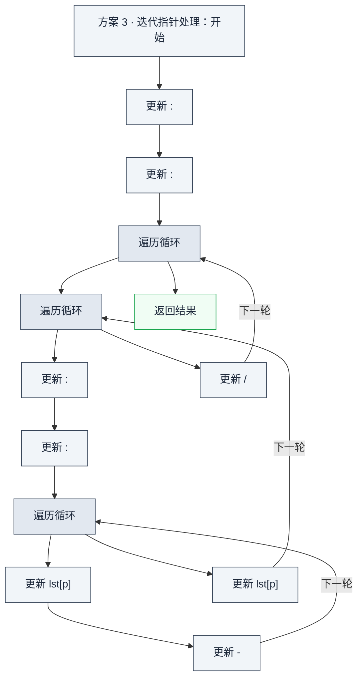

```go
package main // 引入依赖

import (
	"fmt"     // 「fmt」
	"os"      // 「os」
	"reflect" // 「reflect」
)

func shellSort(lst []int) { // 定义函数/方法 shellSort
	length := len(lst) // 把 长度(lst) 写入 length :
	gap := length / 2  // 把 长度 除以 2 写入 gap :
	for gap > 0 {      // for gap 超过 0 {
		for i := gap; i < length; i++ { // 把 gap; 下标 i 小于 长度; 下标 i 加一 { 写入 for i :
			temp := lst[i]                      // 把 lst[下标 i] 写入 temp :
			p := i                              // 把 下标 i 写入 p :
			for p >= gap && lst[p-gap] > temp { // 把 gap 且 lst[节点 减 gap] 超过 临时变量 { 写入 for p >
				lst[p] = lst[p-gap] // 把 lst[节点 减 gap] 写入 lst[p]
				p -= gap            // 节点累减 gap
			}
			lst[p] = temp // 把 临时变量 写入 lst[p]
		}
		gap /= 2 // 把 2 写入 gap /
	}
}

func main() { // 程序入口：跑内嵌自测用例
	type tc struct { // 定义类型
		in   []int // in []int
		want []int // want []int
	}
	cases := []tc{ // 把 []tc{ 写入 cases :
		{[]int{9, 12, 1, 3, -1, 22, 22, 31, 1, 0}, []int{-1, 0, 1, 1, 3, 9, 12, 22, 22, 31}},
		{[]int{5, 4, 3, 2, 1}, []int{1, 2, 3, 4, 5}},
	}
	ok := true                // 把 true 写入 ok :
	for _, c := range cases { // 同时取 _ 与 字符 遍历
		in := append([]int{}, c.in...)      // 把 append([]int{}, 字符.in...) 写入 in :
		shellSort(in)                       // shellSort(in)
		if !reflect.DeepEqual(in, c.want) { // 若 取反 reflect.DeepEqual(in, 字符.want
			ok = false                                                      // 把 false 写入 ok
			fmt.Printf("FAIL shellSort(%v)=%v want %v\n", c.in, in, c.want) // 打印输出
		}
	}
	if !ok { // 若 取反 ok
		os.Exit(1) // os.Exit(1)
	}
	fmt.Println("PASS") // 全部用例通过，输出 PASS
}
```

### Java 实现（3 种方案）

Java 的全部方案如下，每个方案都内嵌用例自测，可独立运行（老仓库 python/go 文件遵循「打印结果」约定）：

#### 方案 1：迭代指针处理

**思路与代码分析**：核心是「迭代指针处理」。Java 版用类与静态方法组织，集合操作显式明了。代码里依次做这些事：单循环线性扫描。**走读**：方案 1 · 迭代指针处理：开始 → 更新 n → 更新 gap → 当 (gap ＞ 0) 时反复执行 → 遍历循环 → 更新 temp → 更新 j → 当 (j ≥ gap 时反复执行 → 处理 且 nums[j - gap] ＞ temp) → 更新 nums[j] → 更新 - → 更新 nums[j] → 更新 / → 返回 nums。

**运行架构**（真实控制流）：

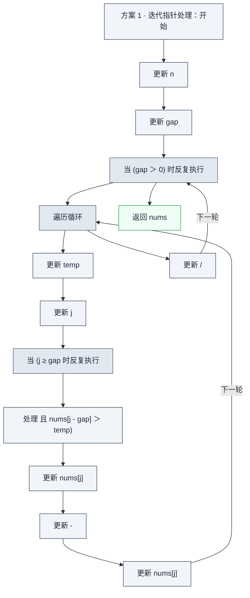

```java
package com.webfault.dsa; // 引入依赖

import java.util.*; // 引入依赖

class ShellS1 { // 定义类型
  static int[] shellSort(int[] nums) { // 定义函数/方法 shellSort
    int n = nums.length; // 把 数组.长度 存入 元素个数
    int gap = n / 2; // 把 元素个数 除以 2 存入 gap
    while (gap > 0) { // 循环，直到不满足「gap 超过 0」
      for (int i = gap; i < n; i++) { // 让 下标 i 从 gap 开始计数，下标 i 小于 元素个数 就继续
        int temp = nums[i]; // 把 数组[下标 i] 存入 临时变量
        int j = i; // 把 下标 i 存入 下标 j
        while (j >= gap
            && nums[j - gap] > temp) { // 循环，直到不满足「下标 j 不低于 gap 且 数组[下标 j 减 gap] 超过 临时变量」
          nums[j] = nums[j - gap]; // 把 数组[下标 j 减 gap]; 写入 nums[j]
          j -= gap; // 下标 j累减 gap
        }
        nums[j] = temp; // 把 临时变量; 写入 nums[j]
      }
      gap /= 2; // 把 2; 写入 gap /
    }
    return nums; // 返回 数组
  }

  public static void main(String[] args) { // public static void main(String[] args) {
    int[][][] cases = { // 把 { 写入 int[][][] cases
      {{1, 2, 3}, {1, 2, 3}},
      {{5, 4, 3, 2, 1}, {1, 2, 3, 4, 5}},
      {{9, 12, 1, 3, -1, 22, 22, 31, 1, 0}, {-1, 0, 1, 1, 3, 9, 12, 22, 22, 31}},
    };
    boolean ok = true; // 把 true; 写入 boolean ok
    for (int[][] c : cases) { // for (int[][] 字符 : cases) {
      int[] got =
          ShellS1.shellSort(c[0].clone()); // 把 ShellS1.shellSort(字符[0].clone()); 写入 int[] got
      if (!Arrays.equals(got, c[1])) { // 若 取反 Arrays.equals(got, 字符[1]
        ok = false; // 把 false; 写入 ok
        System.out.println(
            "FAIL "
                + Arrays.toString(c[0])
                + " -> "
                + Arrays.toString(got)
                + " want "
                + Arrays.toString(c[1])); // 打印输出
      }
    }
    if (!ok) throw new RuntimeException("FAILED"); // 若 取反 ok) throw new RuntimeException(「FAILED」);
    System.out.println("PASS"); // 全部用例通过，输出 PASS
  }
}
```

#### 方案 2：直接实现

**思路与代码分析**：核心是「直接实现」。Java 版用类与静态方法组织，集合操作显式明了。代码里依次做这些事：单循环线性扫描。**走读**：方案 2 · 直接实现：开始 → 更新 length → 更新 gap → 当 (gap ＞ 0) 时反复执行 → 遍历循环 → 更新 tmp → 更新 p → 当 (p - gap ≥ 0 时反复执行 → 处理 且 lst[p - gap] ＞ tmp) → 更新 lst[p] → 更新 - → 更新 lst[p] → 更新 / → 返回 lst。

**运行架构**（真实控制流）：

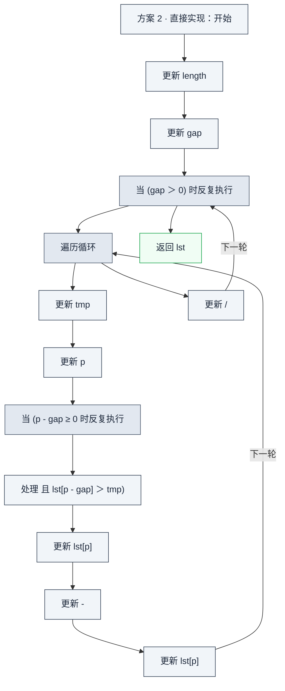

```java
package com.webfault.dsa; // 引入依赖

import java.util.*; // 引入依赖

class ShellS2 { // 定义类型
  static int[] shellSort(int[] lst) { // 定义函数/方法 shellSort
    int length = lst.length; // 把 lst.长度 存入 长度
    int gap = length / 2; // 把 长度 除以 2 存入 gap
    while (gap > 0) { // 循环，直到不满足「gap 超过 0」
      for (int i = gap; i < length; i++) { // 让 下标 i 从 gap 开始计数，下标 i 小于 长度 就继续
        int tmp = lst[i]; // 把 lst[下标 i] 存入 临时变量
        int p = i; // 把 下标 i 存入 节点
        while (p - gap >= 0
            && lst[p - gap] > tmp) { // 循环，直到不满足「节点 减 gap 不低于 0 且 lst[节点 减 gap] 超过 临时变量」
          lst[p] = lst[p - gap]; // 把 lst[节点 减 gap]; 写入 lst[p]
          p -= gap; // 节点累减 gap
        }
        lst[p] = tmp; // 把 临时变量; 写入 lst[p]
      }
      gap /= 2; // 把 2; 写入 gap /
    }
    return lst; // 返回 lst
  }

  public static void main(String[] args) { // public static void main(String[] args) {
    int[][][] cases = { // 把 { 写入 int[][][] cases
      {{9, 12, 1, 3, -1, 22, 22, 31, 1, 0}, {-1, 0, 1, 1, 3, 9, 12, 22, 22, 31}},
      {{5, 4, 3, 2, 1}, {1, 2, 3, 4, 5}},
      {{1}, {1}},
    };
    boolean ok = true; // 把 true; 写入 boolean ok
    for (int[][] c : cases) { // for (int[][] 字符 : cases) {
      int[] got =
          ShellS2.shellSort(c[0].clone()); // 把 ShellS2.shellSort(字符[0].clone()); 写入 int[] got
      if (!Arrays.equals(got, c[1])) { // 若 取反 Arrays.equals(got, 字符[1]
        ok = false; // 把 false; 写入 ok
        System.out.println(
            "FAIL "
                + Arrays.toString(c[0])
                + " -> "
                + Arrays.toString(got)
                + " want "
                + Arrays.toString(c[1])); // 打印输出
      }
    }
    if (!ok) throw new RuntimeException("FAILED"); // 若 取反 ok) throw new RuntimeException(「FAILED」);
    System.out.println("PASS"); // 全部用例通过，输出 PASS
  }
}
```

#### 方案 3：迭代指针处理

**思路与代码分析**：核心是「迭代指针处理」。Java 版用类与静态方法组织，集合操作显式明了。代码里依次做这些事：单循环线性扫描。**走读**：方案 3 · 迭代指针处理：开始 → 更新 length → 更新 gap → 当 (gap ＞ 0) 时反复执行 → 遍历循环 → 更新 temp → 更新 p → 当 (p ≥ gap 且 lst[p - gap] ＞ temp) 时反复执行 → 更新 lst[p] → 更新 - → 更新 lst[p] → 更新 / → 返回 lst。

**运行架构**（真实控制流）：

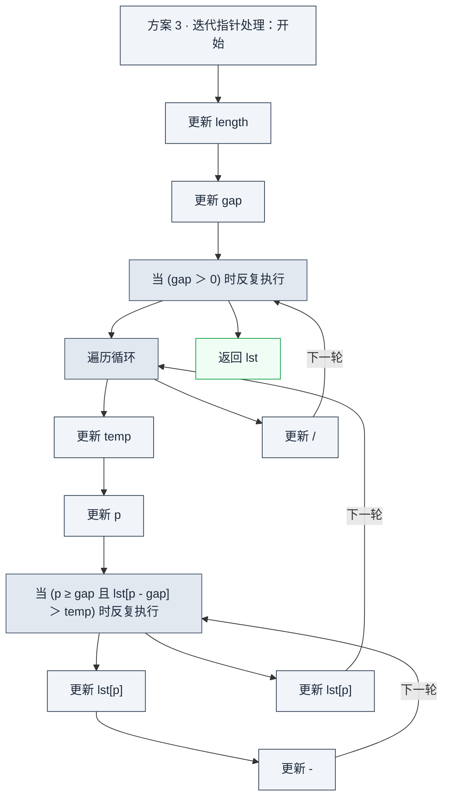

```java
package com.webfault.dsa; // 引入依赖

import java.util.*; // 引入依赖

class ShellS3 { // 定义类型
  static int[] shellSort(int[] lst) { // 定义函数/方法 shellSort
    int length = lst.length; // 把 lst.长度 存入 长度
    int gap = length / 2; // 把 长度 除以 2 存入 gap
    while (gap > 0) { // 循环，直到不满足「gap 超过 0」
      for (int i = gap; i < length; i++) { // 让 下标 i 从 gap 开始计数，下标 i 小于 长度 就继续
        int temp = lst[i]; // 把 lst[下标 i] 存入 临时变量
        int p = i; // 把 下标 i 存入 节点
        while (p >= gap && lst[p - gap] > temp) { // 循环，直到不满足「节点 不低于 gap 且 lst[节点 减 gap] 超过 临时变量」
          lst[p] = lst[p - gap]; // 把 lst[节点 减 gap]; 写入 lst[p]
          p -= gap; // 节点累减 gap
        }
        lst[p] = temp; // 把 临时变量; 写入 lst[p]
      }
      gap /= 2; // 把 2; 写入 gap /
    }
    return lst; // 返回 lst
  }

  public static void main(String[] args) { // public static void main(String[] args) {
    int[][][] cases = { // 把 { 写入 int[][][] cases
      {{9, 12, 1, 3, -1, 22, 22, 31, 1, 0}, {-1, 0, 1, 1, 3, 9, 12, 22, 22, 31}},
      {{5, 4, 3, 2, 1}, {1, 2, 3, 4, 5}},
      {{1}, {1}},
    };
    boolean ok = true; // 把 true; 写入 boolean ok
    for (int[][] c : cases) { // for (int[][] 字符 : cases) {
      int[] got =
          ShellS3.shellSort(c[0].clone()); // 把 ShellS3.shellSort(字符[0].clone()); 写入 int[] got
      if (!Arrays.equals(got, c[1])) { // 若 取反 Arrays.equals(got, 字符[1]
        ok = false; // 把 false; 写入 ok
        System.out.println(
            "FAIL "
                + Arrays.toString(c[0])
                + " -> "
                + Arrays.toString(got)
                + " want "
                + Arrays.toString(c[1])); // 打印输出
      }
    }
    if (!ok) throw new RuntimeException("FAILED"); // 若 取反 ok) throw new RuntimeException(「FAILED」);
    System.out.println("PASS"); // 全部用例通过，输出 PASS
  }
}
```

### Rust 实现（3 种方案）

Rust 的全部方案如下，每个方案都内嵌用例自测，可独立运行（老仓库 python/go 文件遵循「打印结果」约定）：

#### 方案 1：迭代指针处理

**思路与代码分析**：核心是「迭代指针处理」。Rust 版用所有权移动与切片借用改写同一逻辑，注意 Option 与引用边界。**走读**：方案 1 · 迭代指针处理：开始 → 计算 v → 计算 n → 计算 gap → 当 gap ＞ 0 时反复执行 → 遍历 gap..n 中的每个元素 i → 计算 key → 计算 j → 当 j ≥ gap 且 v[j - gap] ＞ key 时反复执行 → 更新 v[j] → 更新 - → 更新 v[j] → 更新 / → 处理 v → 返回结果。

**运行架构**（真实控制流）：

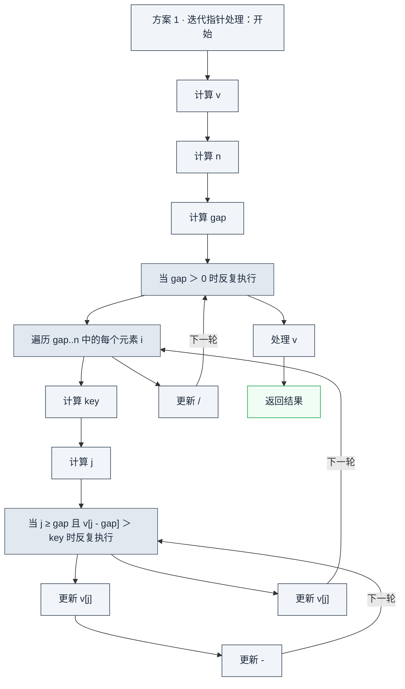

```rust
// 数据结构与算法之排序: 希尔排序 — Rust 版（方案1）
fn shell_sort(nums: Vec<i32>) -> Vec<i32> {
    // 定义函数/方法 shell_sort
    let mut v = nums; // 把 数组; 写入 let mut v
    let n = v.len(); // 把 值.长度() 存入 元素个数
    let mut gap = n / 2; // 把 元素个数 除以 2; 写入 let mut gap
    while gap > 0 {
        // while gap 超过 0 {
        for i in gap..n {
            // 逐个取出 gap 的元素（下标 i）
            let key = v[i]; // 把 值[下标 i] 存入 key
            let mut j = i; // 把 下标 i; 写入 let mut j
            while j >= gap && v[j - gap] > key {
                v[j] = v[j - gap];
                j -= gap;
            }
            v[j] = key; // 把 key; 写入 v[j]
        }
        gap /= 2; // 把 2; 写入 gap /
    }
    v
}
fn main() {
    // 程序入口：跑内嵌自测用例
    assert_eq!(shell_sort(vec![5, 2, 4, 6, 1, 3]), vec![1, 2, 3, 4, 5, 6]); // 断言校验
    assert_eq!(
        shell_sort(vec![9, 8, 7, 6, 5, 4, 3, 2, 1]),
        vec![1, 2, 3, 4, 5, 6, 7, 8, 9]
    ); // 断言校验
    println!("PASS");
} // 全部用例通过，输出 PASS
```

#### 方案 2：直接实现

**思路与代码分析**：核心是「直接实现」。Rust 版用所有权移动与切片借用改写同一逻辑，注意 Option 与引用边界。**走读**：方案 2 · 直接实现：开始 → 计算 v → 计算 n → 计算 gap → 当 gap ＞ 0 时反复执行 → 遍历 gap..n 中的每个元素 i → 计算 key → 计算 j → 当 j ≥ gap 且 v[j - gap] ＞ key 时反复执行 → 更新 v[j] → 更新 - → 更新 v[j] → 更新 / → 处理 v → 返回结果。

**运行架构**（真实控制流）：

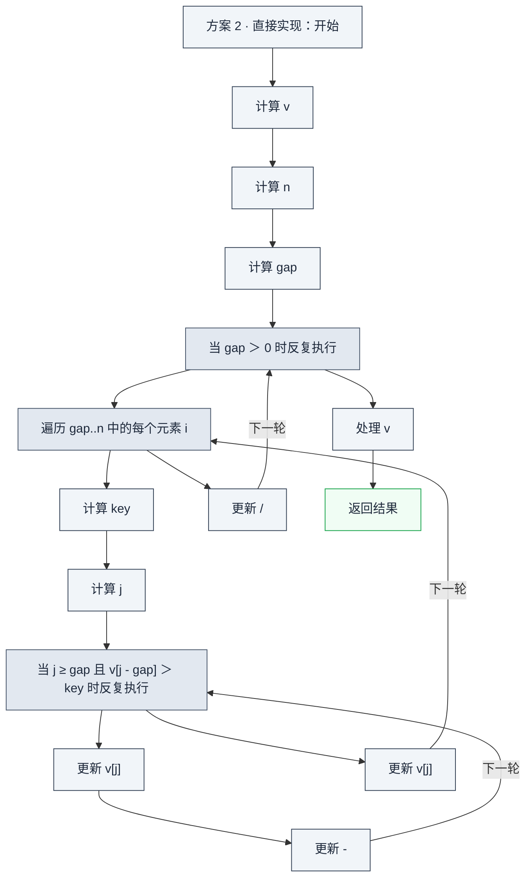

```rust
// 数据结构与算法之排序: 希尔排序 — Rust 版（方案2）
fn shell_sort(nums: Vec<i32>) -> Vec<i32> {
    // 定义函数/方法 shell_sort
    let mut v = nums; // 把 数组; 写入 let mut v
    let n = v.len(); // 把 值.长度() 存入 元素个数
    let mut gap = n / 2; // 把 元素个数 除以 2; 写入 let mut gap
    while gap > 0 {
        // while gap 超过 0 {
        for i in gap..n {
            // 逐个取出 gap 的元素（下标 i）
            let key = v[i]; // 把 值[下标 i] 存入 key
            let mut j = i; // 把 下标 i; 写入 let mut j
            while j >= gap && v[j - gap] > key {
                v[j] = v[j - gap];
                j -= gap;
            }
            v[j] = key; // 把 key; 写入 v[j]
        }
        gap /= 2; // 把 2; 写入 gap /
    }
    v
}
fn main() {
    // 程序入口：跑内嵌自测用例
    assert_eq!(shell_sort(vec![5, 2, 4, 6, 1, 3]), vec![1, 2, 3, 4, 5, 6]); // 断言校验
    assert_eq!(
        shell_sort(vec![9, 8, 7, 6, 5, 4, 3, 2, 1]),
        vec![1, 2, 3, 4, 5, 6, 7, 8, 9]
    ); // 断言校验
    println!("PASS");
} // 全部用例通过，输出 PASS
```

#### 方案 3：迭代指针处理

**思路与代码分析**：核心是「迭代指针处理」。Rust 版用所有权移动与切片借用改写同一逻辑，注意 Option 与引用边界。**走读**：方案 3 · 迭代指针处理：开始 → 计算 v → 计算 n → 计算 gap → 当 gap ＞ 0 时反复执行 → 遍历 gap..n 中的每个元素 i → 计算 key → 计算 j → 当 j ≥ gap 且 v[j - gap] ＞ key 时反复执行 → 更新 v[j] → 更新 - → 更新 v[j] → 更新 / → 处理 v → 返回结果。

**运行架构**（真实控制流）：


```rust
// 数据结构与算法之排序: 希尔排序 — Rust 版（方案3）
fn shell_sort(nums: Vec<i32>) -> Vec<i32> {
    // 定义函数/方法 shell_sort
    let mut v = nums; // 把 数组; 写入 let mut v
    let n = v.len(); // 把 值.长度() 存入 元素个数
    let mut gap = n / 2; // 把 元素个数 除以 2; 写入 let mut gap
    while gap > 0 {
        // while gap 超过 0 {
        for i in gap..n {
            // 逐个取出 gap 的元素（下标 i）
            let key = v[i]; // 把 值[下标 i] 存入 key
            let mut j = i; // 把 下标 i; 写入 let mut j
            while j >= gap && v[j - gap] > key {
                v[j] = v[j - gap];
                j -= gap;
            }
            v[j] = key; // 把 key; 写入 v[j]
        }
        gap /= 2; // 把 2; 写入 gap /
    }
    v
}
fn main() {
    // 程序入口：跑内嵌自测用例
    assert_eq!(shell_sort(vec![5, 2, 4, 6, 1, 3]), vec![1, 2, 3, 4, 5, 6]); // 断言校验
    assert_eq!(
        shell_sort(vec![9, 8, 7, 6, 5, 4, 3, 2, 1]),
        vec![1, 2, 3, 4, 5, 6, 7, 8, 9]
    ); // 断言校验
    println!("PASS");
} // 全部用例通过，输出 PASS
```

### Lua 实现（3 种方案）

Lua 的全部方案如下，每个方案都内嵌用例自测，可独立运行（老仓库 python/go 文件遵循「打印结果」约定）：

#### 方案 1：迭代指针处理

**思路与代码分析**：核心是「迭代指针处理」。Lua 版用表与 ipairs 遍历，注意 ipairs 遇 nil 即停的语义。**走读**：方案 1 · 迭代指针处理：开始 → 更新 v → 更新 n → 更新 gap → 当 gap ＞ 0 do 时反复执行 → 循环 i：从 gap + 1 到 n do → 更新 key → 更新 j → 当 j ≥ 1 and v[j] ＞ key do 时反复执行 → 更新 gap] → 更新 j → 更新 gap] → 更新 gap → 返回 v。

**运行架构**（真实控制流）：

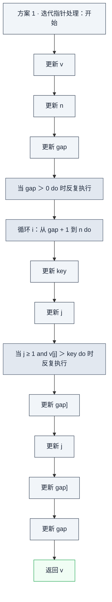

```lua
-- 数据结构与算法之排序: 希尔排序 — Lua 版（方案1）
local function shell_sort(nums) -- local function shell_sort(数组)
	local v = { table.unpack(nums) } -- 把 {table.unpack(数组)} 写入 local v
	local n = #v -- 把 #值 写入 local n
	local gap = n // 2 -- 把 元素个数 写入 local gap
	while gap > 0 do -- while gap 超过 0 do
		for i = gap + 1, n do -- 把 gap 加 1, 元素个数 do 写入 for i
			local key = v[i] -- 把 值[下标 i] 写入 local key
			local j = i - gap -- 把 下标 i 减 gap 写入 local j
			while j >= 1 and v[j] > key do
				v[j + gap] = v[j]
				j = j - gap
			end
			v[j + gap] = key -- 把 key 写入 v[j + gap]
		end -- 终点
		gap = gap // 2 -- 把 gap 存入 gap
	end -- 终点
	return v -- 返回 值
end -- 终点
assert(table.concat(shell_sort({ 5, 2, 4, 6, 1, 3 }), ",") == "1,2,3,4,5,6") -- 打印输出
assert(table.concat(shell_sort({ 9, 8, 7, 6, 5, 4, 3, 2, 1 }), ",") == "1,2,3,4,5,6,7,8,9") -- 打印输出
print("PASS") -- 全部用例通过，输出 PASS
```

#### 方案 2：直接实现

**思路与代码分析**：核心是「直接实现」。Lua 版用表与 ipairs 遍历，注意 ipairs 遇 nil 即停的语义。**走读**：方案 2 · 直接实现：开始 → 更新 v → 更新 n → 更新 gap → 当 gap ＞ 0 do 时反复执行 → 循环 i：从 gap + 1 到 n do → 更新 key → 更新 j → 当 j ≥ 1 and v[j] ＞ key do 时反复执行 → 更新 gap] → 更新 j → 更新 gap] → 更新 gap → 返回 v。

**运行架构**（真实控制流）：

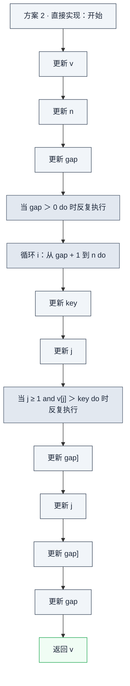

```lua
-- 数据结构与算法之排序: 希尔排序 — Lua 版（方案2）
local function shell_sort(nums) -- local function shell_sort(数组)
	local v = { table.unpack(nums) } -- 把 {table.unpack(数组)} 写入 local v
	local n = #v -- 把 #值 写入 local n
	local gap = n // 2 -- 把 元素个数 写入 local gap
	while gap > 0 do -- while gap 超过 0 do
		for i = gap + 1, n do -- 把 gap 加 1, 元素个数 do 写入 for i
			local key = v[i] -- 把 值[下标 i] 写入 local key
			local j = i - gap -- 把 下标 i 减 gap 写入 local j
			while j >= 1 and v[j] > key do
				v[j + gap] = v[j]
				j = j - gap
			end
			v[j + gap] = key -- 把 key 写入 v[j + gap]
		end -- 终点
		gap = gap // 2 -- 把 gap 存入 gap
	end -- 终点
	return v -- 返回 值
end -- 终点
assert(table.concat(shell_sort({ 5, 2, 4, 6, 1, 3 }), ",") == "1,2,3,4,5,6") -- 打印输出
assert(table.concat(shell_sort({ 9, 8, 7, 6, 5, 4, 3, 2, 1 }), ",") == "1,2,3,4,5,6,7,8,9") -- 打印输出
print("PASS") -- 全部用例通过，输出 PASS
```

#### 方案 3：迭代指针处理

**思路与代码分析**：核心是「迭代指针处理」。Lua 版用表与 ipairs 遍历，注意 ipairs 遇 nil 即停的语义。**走读**：方案 3 · 迭代指针处理：开始 → 更新 v → 更新 n → 更新 gap → 当 gap ＞ 0 do 时反复执行 → 循环 i：从 gap + 1 到 n do → 更新 key → 更新 j → 当 j ≥ 1 and v[j] ＞ key do 时反复执行 → 更新 gap] → 更新 j → 更新 gap] → 更新 gap → 返回 v。

**运行架构**（真实控制流）：


```lua
-- 数据结构与算法之排序: 希尔排序 — Lua 版（方案3）
local function shell_sort(nums) -- local function shell_sort(数组)
	local v = { table.unpack(nums) } -- 把 {table.unpack(数组)} 写入 local v
	local n = #v -- 把 #值 写入 local n
	local gap = n // 2 -- 把 元素个数 写入 local gap
	while gap > 0 do -- while gap 超过 0 do
		for i = gap + 1, n do -- 把 gap 加 1, 元素个数 do 写入 for i
			local key = v[i] -- 把 值[下标 i] 写入 local key
			local j = i - gap -- 把 下标 i 减 gap 写入 local j
			while j >= 1 and v[j] > key do
				v[j + gap] = v[j]
				j = j - gap
			end
			v[j + gap] = key -- 把 key 写入 v[j + gap]
		end -- 终点
		gap = gap // 2 -- 把 gap 存入 gap
	end -- 终点
	return v -- 返回 值
end -- 终点
assert(table.concat(shell_sort({ 5, 2, 4, 6, 1, 3 }), ",") == "1,2,3,4,5,6") -- 打印输出
assert(table.concat(shell_sort({ 9, 8, 7, 6, 5, 4, 3, 2, 1 }), ",") == "1,2,3,4,5,6,7,8,9") -- 打印输出
print("PASS") -- 全部用例通过，输出 PASS
```

### C 实现（3 种方案）

C 的全部方案如下，每个方案都内嵌用例自测，可独立运行（老仓库 python/go 文件遵循「打印结果」约定）：

#### 方案 1：迭代指针处理

**思路与代码分析**：核心是「迭代指针处理」。C 版手动管理下标与内存，循环边界全部显式写出。代码里依次做这些事：双重循环遍历。**走读**：方案 1 · 迭代指针处理：开始 → 遍历循环 → 遍历循环 → 更新 key → 更新 j → 当 (j ≥ 0 且 v[j] ＞ key) 时反复执行 → 更新 gap] → 更新 - → 更新 gap] → 返回结果。

**运行架构**（真实控制流）：

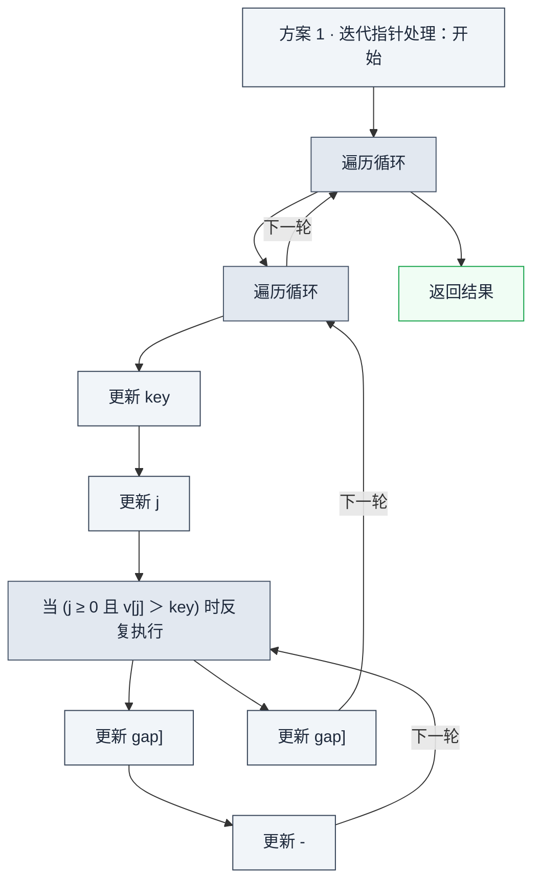

```c
/* 数据结构与算法之排序: 希尔排序 — C 版（方案1） */
#include <stdio.h>                       // 引入头文件
static void shell_sort(int v[], int n) { // 定义函数/方法 shell_sort
    for (int gap = n / 2; gap > 0; gap /= 2) { // 让 gap 从 元素个数 除以 2 开始计数，gap 超过 0 就继续
        for (int i = gap; i < n; i++) { // 让 下标 i 从 gap 开始计数，下标 i 小于 元素个数 就继续
            int key = v[i];             // 把 值[下标 i] 存入 key
            int j = i - gap;            // 把 下标 i 减 gap 存入 下标 j
            while (j >= 0 && v[j] > key) {
                v[j + gap] = v[j];
                j -= gap;
            }
            v[j + gap] = key; // 把 key; 写入 v[j + gap]
        }
    }
}
int main(void) {                   // 程序入口：跑内嵌自测用例
    int v1[] = {5, 2, 4, 6, 1, 3}; // 把 {5,2,4,6,1,3}; 写入 int v1[]
    shell_sort(v1, 6);             // shell_sort(v1, 6);
    for (int i = 0; i < 6; i++)
        if (v1[i] != i + 1) {
            printf("FAIL\n");
            return 1;
        } // 让 下标 i 从 0 开始计数，下标 i 小于 6 就继续
    printf("PASS\n");
    return 0;
} // 全部用例通过，输出 PASS
```

#### 方案 2：直接实现

**思路与代码分析**：核心是「直接实现」。C 版手动管理下标与内存，循环边界全部显式写出。代码里依次做这些事：双重循环遍历。**走读**：方案 2 · 直接实现：开始 → 遍历循环 → 遍历循环 → 更新 key → 更新 j → 当 (j ≥ 0 且 v[j] ＞ key) 时反复执行 → 更新 gap] → 更新 - → 更新 gap] → 返回结果。

**运行架构**（真实控制流）：

```mermaid
graph TD
    N0["方案 2 · 直接实现：开始"]
    N1["遍历循环"]
    N2["遍历循环"]
    N3["更新 key"]
    N4["更新 j"]
    N5["当 (j ≥ 0 且 v[j] ＞ key) 时反复执行"]
    N6["更新 gap]"]
    N7["更新 -"]
    N8["更新 gap]"]
    N9["返回结果"]
    N0 --> N1
    N1 --> N2
    N2 --> N3
    N3 --> N4
    N4 --> N5
    N5 --> N6
    N6 --> N7
    N7 -- 下一轮 --> N5
    N5 --> N8
    N8 -- 下一轮 --> N2
    N2 -- 下一轮 --> N1
    N1 --> N9
    classDef n fill:#f1f5f9,stroke:#334155,color:#1e293b;
    classDef lp fill:#e2e8f0,stroke:#475569,color:#1e293b;
    classDef dc fill:#fef9c3,stroke:#ca8a04,color:#1e293b;
    classDef tm fill:#f0fdf4,stroke:#16a34a,color:#1e293b;
    class N0,N3,N4,N6,N7,N8 n;
    class N1,N2,N5 lp;
    class N9 tm;
```

```c
/* 数据结构与算法之排序: 希尔排序 — C 版（方案2） */
#include <stdio.h>                       // 引入头文件
static void shell_sort(int v[], int n) { // 定义函数/方法 shell_sort
    for (int gap = n / 2; gap > 0; gap /= 2) { // 让 gap 从 元素个数 除以 2 开始计数，gap 超过 0 就继续
        for (int i = gap; i < n; i++) { // 让 下标 i 从 gap 开始计数，下标 i 小于 元素个数 就继续
            int key = v[i];             // 把 值[下标 i] 存入 key
            int j = i - gap;            // 把 下标 i 减 gap 存入 下标 j
            while (j >= 0 && v[j] > key) {
                v[j + gap] = v[j];
                j -= gap;
            }
            v[j + gap] = key; // 把 key; 写入 v[j + gap]
        }
    }
}
int main(void) {                   // 程序入口：跑内嵌自测用例
    int v1[] = {5, 2, 4, 6, 1, 3}; // 把 {5,2,4,6,1,3}; 写入 int v1[]
    shell_sort(v1, 6);             // shell_sort(v1, 6);
    for (int i = 0; i < 6; i++)
        if (v1[i] != i + 1) {
            printf("FAIL\n");
            return 1;
        } // 让 下标 i 从 0 开始计数，下标 i 小于 6 就继续
    printf("PASS\n");
    return 0;
} // 全部用例通过，输出 PASS
```

#### 方案 3：迭代指针处理

**思路与代码分析**：核心是「迭代指针处理」。C 版手动管理下标与内存，循环边界全部显式写出。代码里依次做这些事：双重循环遍历。**走读**：方案 3 · 迭代指针处理：开始 → 遍历循环 → 遍历循环 → 更新 key → 更新 j → 当 (j ≥ 0 且 v[j] ＞ key) 时反复执行 → 更新 gap] → 更新 - → 更新 gap] → 返回结果。

**运行架构**（真实控制流）：

```mermaid
graph TD
    N0["方案 3 · 迭代指针处理：开始"]
    N1["遍历循环"]
    N2["遍历循环"]
    N3["更新 key"]
    N4["更新 j"]
    N5["当 (j ≥ 0 且 v[j] ＞ key) 时反复执行"]
    N6["更新 gap]"]
    N7["更新 -"]
    N8["更新 gap]"]
    N9["返回结果"]
    N0 --> N1
    N1 --> N2
    N2 --> N3
    N3 --> N4
    N4 --> N5
    N5 --> N6
    N6 --> N7
    N7 -- 下一轮 --> N5
    N5 --> N8
    N8 -- 下一轮 --> N2
    N2 -- 下一轮 --> N1
    N1 --> N9
    classDef n fill:#f1f5f9,stroke:#334155,color:#1e293b;
    classDef lp fill:#e2e8f0,stroke:#475569,color:#1e293b;
    classDef dc fill:#fef9c3,stroke:#ca8a04,color:#1e293b;
    classDef tm fill:#f0fdf4,stroke:#16a34a,color:#1e293b;
    class N0,N3,N4,N6,N7,N8 n;
    class N1,N2,N5 lp;
    class N9 tm;
```

```c
/* 数据结构与算法之排序: 希尔排序 — C 版（方案3） */
#include <stdio.h>                       // 引入头文件
static void shell_sort(int v[], int n) { // 定义函数/方法 shell_sort
    for (int gap = n / 2; gap > 0; gap /= 2) { // 让 gap 从 元素个数 除以 2 开始计数，gap 超过 0 就继续
        for (int i = gap; i < n; i++) { // 让 下标 i 从 gap 开始计数，下标 i 小于 元素个数 就继续
            int key = v[i];             // 把 值[下标 i] 存入 key
            int j = i - gap;            // 把 下标 i 减 gap 存入 下标 j
            while (j >= 0 && v[j] > key) {
                v[j + gap] = v[j];
                j -= gap;
            }
            v[j + gap] = key; // 把 key; 写入 v[j + gap]
        }
    }
}
int main(void) {                   // 程序入口：跑内嵌自测用例
    int v1[] = {5, 2, 4, 6, 1, 3}; // 把 {5,2,4,6,1,3}; 写入 int v1[]
    shell_sort(v1, 6);             // shell_sort(v1, 6);
    for (int i = 0; i < 6; i++)
        if (v1[i] != i + 1) {
            printf("FAIL\n");
            return 1;
        } // 让 下标 i 从 0 开始计数，下标 i 小于 6 就继续
    printf("PASS\n");
    return 0;
} // 全部用例通过，输出 PASS
```

### C++ 实现（3 种方案）

C++ 的全部方案如下，每个方案都内嵌用例自测，可独立运行（老仓库 python/go 文件遵循「打印结果」约定）：

#### 方案 1：迭代指针处理

**思路与代码分析**：核心是「迭代指针处理」。C++ 版用 STL 容器与迭代器，减少手写下标错误。代码里依次做这些事：双重循环遍历。**走读**：方案 1 · 迭代指针处理：开始 → 更新 n → 遍历循环 → 遍历循环 → 更新 key → 更新 j → 当 (j ≥ gap 且 v[j - gap] ＞ key) 时反复执行 → 更新 v[j] → 更新 - → 更新 v[j] → 返回 v。

**运行架构**（真实控制流）：

```mermaid
graph TD
    N0["方案 1 · 迭代指针处理：开始"]
    N1["更新 n"]
    N2["遍历循环"]
    N3["遍历循环"]
    N4["更新 key"]
    N5["更新 j"]
    N6["当 (j ≥ gap 且 v[j - gap] ＞ key) 时反复执行"]
    N7["更新 v[j]"]
    N8["更新 -"]
    N9["更新 v[j]"]
    N10["返回 v"]
    N0 --> N1
    N1 --> N2
    N2 --> N3
    N3 --> N4
    N4 --> N5
    N5 --> N6
    N6 --> N7
    N7 --> N8
    N8 -- 下一轮 --> N6
    N6 --> N9
    N9 -- 下一轮 --> N3
    N3 -- 下一轮 --> N2
    N2 --> N10
    classDef n fill:#f1f5f9,stroke:#334155,color:#1e293b;
    classDef lp fill:#e2e8f0,stroke:#475569,color:#1e293b;
    classDef dc fill:#fef9c3,stroke:#ca8a04,color:#1e293b;
    classDef tm fill:#f0fdf4,stroke:#16a34a,color:#1e293b;
    class N0,N1,N4,N5,N7,N8,N9 n;
    class N2,N3,N6 lp;
    class N10 tm;
```

```cpp
// 数据结构与算法之排序: 希尔排序 — C++ 版（方案1）
#include <cassert>  // 引入头文件
#include <iostream> // 引入头文件
#include <vector>   // 引入头文件
static std::vector<int> shellSort(std::vector<int> v) {
    size_t n = v.size();                          // 把 值.大小(); 写入 size_t n
    for (size_t gap = n / 2; gap > 0; gap /= 2) { // 让 gap 从 元素个数 除以 2 开始计数，gap 超过 0 就继续
        for (size_t i = gap; i < n; ++i) { // 让 下标 i 从 gap 开始计数，下标 i 小于 元素个数 就继续
            int key = v[i];                // 把 值[下标 i] 存入 key
            size_t j = i;                  // 把 下标 i; 写入 size_t j
            while (j >= gap && v[j - gap] > key) {
                v[j] = v[j - gap];
                j -= gap;
            }
            v[j] = key; // 把 key; 写入 v[j]
        }
    }
    return v; // 返回 值
}
int main() {
    assert((shellSort({5, 2, 4, 6, 1, 3}) == std::vector<int>{1, 2, 3, 4, 5, 6}));
    std::cout << "PASS" << std::endl;
} // 全部用例通过，输出 PASS
```

#### 方案 2：直接实现

**思路与代码分析**：核心是「直接实现」。C++ 版用 STL 容器与迭代器，减少手写下标错误。代码里依次做这些事：双重循环遍历。**走读**：方案 2 · 直接实现：开始 → 更新 n → 遍历循环 → 遍历循环 → 更新 key → 更新 j → 当 (j ≥ gap 且 v[j - gap] ＞ key) 时反复执行 → 更新 v[j] → 更新 - → 更新 v[j] → 返回 v。

**运行架构**（真实控制流）：

```mermaid
graph TD
    N0["方案 2 · 直接实现：开始"]
    N1["更新 n"]
    N2["遍历循环"]
    N3["遍历循环"]
    N4["更新 key"]
    N5["更新 j"]
    N6["当 (j ≥ gap 且 v[j - gap] ＞ key) 时反复执行"]
    N7["更新 v[j]"]
    N8["更新 -"]
    N9["更新 v[j]"]
    N10["返回 v"]
    N0 --> N1
    N1 --> N2
    N2 --> N3
    N3 --> N4
    N4 --> N5
    N5 --> N6
    N6 --> N7
    N7 --> N8
    N8 -- 下一轮 --> N6
    N6 --> N9
    N9 -- 下一轮 --> N3
    N3 -- 下一轮 --> N2
    N2 --> N10
    classDef n fill:#f1f5f9,stroke:#334155,color:#1e293b;
    classDef lp fill:#e2e8f0,stroke:#475569,color:#1e293b;
    classDef dc fill:#fef9c3,stroke:#ca8a04,color:#1e293b;
    classDef tm fill:#f0fdf4,stroke:#16a34a,color:#1e293b;
    class N0,N1,N4,N5,N7,N8,N9 n;
    class N2,N3,N6 lp;
    class N10 tm;
```

```cpp
// 数据结构与算法之排序: 希尔排序 — C++ 版（方案2）
#include <cassert>  // 引入头文件
#include <iostream> // 引入头文件
#include <vector>   // 引入头文件
static std::vector<int> shellSort(std::vector<int> v) {
    size_t n = v.size();                          // 把 值.大小(); 写入 size_t n
    for (size_t gap = n / 2; gap > 0; gap /= 2) { // 让 gap 从 元素个数 除以 2 开始计数，gap 超过 0 就继续
        for (size_t i = gap; i < n; ++i) { // 让 下标 i 从 gap 开始计数，下标 i 小于 元素个数 就继续
            int key = v[i];                // 把 值[下标 i] 存入 key
            size_t j = i;                  // 把 下标 i; 写入 size_t j
            while (j >= gap && v[j - gap] > key) {
                v[j] = v[j - gap];
                j -= gap;
            }
            v[j] = key; // 把 key; 写入 v[j]
        }
    }
    return v; // 返回 值
}
int main() {
    assert((shellSort({5, 2, 4, 6, 1, 3}) == std::vector<int>{1, 2, 3, 4, 5, 6}));
    std::cout << "PASS" << std::endl;
} // 全部用例通过，输出 PASS
```

#### 方案 3：迭代指针处理

**思路与代码分析**：核心是「迭代指针处理」。C++ 版用 STL 容器与迭代器，减少手写下标错误。代码里依次做这些事：双重循环遍历。**走读**：方案 3 · 迭代指针处理：开始 → 更新 n → 遍历循环 → 遍历循环 → 更新 key → 更新 j → 当 (j ≥ gap 且 v[j - gap] ＞ key) 时反复执行 → 更新 v[j] → 更新 - → 更新 v[j] → 返回 v。

**运行架构**（真实控制流）：

```mermaid
graph TD
    N0["方案 3 · 迭代指针处理：开始"]
    N1["更新 n"]
    N2["遍历循环"]
    N3["遍历循环"]
    N4["更新 key"]
    N5["更新 j"]
    N6["当 (j ≥ gap 且 v[j - gap] ＞ key) 时反复执行"]
    N7["更新 v[j]"]
    N8["更新 -"]
    N9["更新 v[j]"]
    N10["返回 v"]
    N0 --> N1
    N1 --> N2
    N2 --> N3
    N3 --> N4
    N4 --> N5
    N5 --> N6
    N6 --> N7
    N7 --> N8
    N8 -- 下一轮 --> N6
    N6 --> N9
    N9 -- 下一轮 --> N3
    N3 -- 下一轮 --> N2
    N2 --> N10
    classDef n fill:#f1f5f9,stroke:#334155,color:#1e293b;
    classDef lp fill:#e2e8f0,stroke:#475569,color:#1e293b;
    classDef dc fill:#fef9c3,stroke:#ca8a04,color:#1e293b;
    classDef tm fill:#f0fdf4,stroke:#16a34a,color:#1e293b;
    class N0,N1,N4,N5,N7,N8,N9 n;
    class N2,N3,N6 lp;
    class N10 tm;
```

```cpp
// 数据结构与算法之排序: 希尔排序 — C++ 版（方案3）
#include <cassert>  // 引入头文件
#include <iostream> // 引入头文件
#include <vector>   // 引入头文件
static std::vector<int> shellSort(std::vector<int> v) {
    size_t n = v.size();                          // 把 值.大小(); 写入 size_t n
    for (size_t gap = n / 2; gap > 0; gap /= 2) { // 让 gap 从 元素个数 除以 2 开始计数，gap 超过 0 就继续
        for (size_t i = gap; i < n; ++i) { // 让 下标 i 从 gap 开始计数，下标 i 小于 元素个数 就继续
            int key = v[i];                // 把 值[下标 i] 存入 key
            size_t j = i;                  // 把 下标 i; 写入 size_t j
            while (j >= gap && v[j - gap] > key) {
                v[j] = v[j - gap];
                j -= gap;
            }
            v[j] = key; // 把 key; 写入 v[j]
        }
    }
    return v; // 返回 值
}
int main() {
    assert((shellSort({5, 2, 4, 6, 1, 3}) == std::vector<int>{1, 2, 3, 4, 5, 6}));
    std::cout << "PASS" << std::endl;
} // 全部用例通过，输出 PASS
```

### R 实现（3 种方案）

R 的全部方案如下，每个方案都内嵌用例自测，可独立运行（老仓库 python/go 文件遵循「打印结果」约定）：

#### 方案 1：迭代指针处理

**思路与代码分析**：核心是「迭代指针处理」。R 版用向量化思维与 1 起始下标，注意 1:n 的降序陷阱。代码里依次做这些事：单循环线性扫描。**走读**：方案 1 · 迭代指针处理：开始 → 处理 v ＜- nums → 处理 n ＜- length(v) → 处理 gap ＜- n%/%2 → 当 (gap ＞ 0) 时反复执行 → 循环 i：遍历 (gap + 1):n → 处理 key ＜- v[i] → 处理 j ＜- i - gap → 当 (j ≥ 1 且 v[j] ＞ key) 时反复执行 → 处理 v[j + gap] ＜- v[j] → 处理 j ＜- j - gap → 处理 v[j + gap] ＜- key → 处理 gap ＜- gap%/%2 → 处理 v → 返回结果。

**运行架构**（真实控制流）：

```mermaid
graph TD
    N0["方案 1 · 迭代指针处理：开始"]
    N1["处理 v ＜- nums"]
    N2["处理 n ＜- length(v)"]
    N3["处理 gap ＜- n%/%2"]
    N4["当 (gap ＞ 0) 时反复执行"]
    N5["循环 i：遍历 (gap + 1):n"]
    N6["处理 key ＜- v[i]"]
    N7["处理 j ＜- i - gap"]
    N8["当 (j ≥ 1 且 v[j] ＞ key) 时反复执行"]
    N9["处理 v[j + gap] ＜- v[j]"]
    N10["处理 j ＜- j - gap"]
    N11["处理 v[j + gap] ＜- key"]
    N12["处理 gap ＜- gap%/%2"]
    N13["处理 v"]
    N14["返回结果"]
    N0 --> N1
    N1 --> N2
    N2 --> N3
    N3 --> N4
    N4 --> N5
    N5 --> N6
    N6 --> N7
    N7 --> N8
    N8 --> N9
    N9 --> N10
    N10 -- 下一轮 --> N8
    N8 --> N11
    N11 -- 下一轮 --> N5
    N5 --> N12
    N12 -- 下一轮 --> N4
    N4 --> N13
    N13 --> N14
    classDef n fill:#f1f5f9,stroke:#334155,color:#1e293b;
    classDef lp fill:#e2e8f0,stroke:#475569,color:#1e293b;
    classDef dc fill:#fef9c3,stroke:#ca8a04,color:#1e293b;
    classDef tm fill:#f0fdf4,stroke:#16a34a,color:#1e293b;
    class N0,N1,N2,N3,N6,N7,N9,N10,N11,N12,N13 n;
    class N4,N5,N8 lp;
    class N14 tm;
```

```r
# 版（方案1） 定义函数 shell_sort（参数：数组）
shell_sort <- function(nums) {
    v <- nums  # 把 数组 存入 值
    n <- length(v)  # 把 长度(值) 存入 元素个数
    gap <- n%/%2  # 把 元素个数 对…取模 除以 对…取模 2 存入 gap
    while (gap > 0) {
        # 循环，直到不满足「gap 超过 0」 for (下标 i in (gap 加 1):元素个数) {
        for (i in (gap + 1):n) {
            key <- v[i]  # 把 值[下标 i] 存入 key
            j <- i - gap  # 把 下标 i 减 gap 存入 下标 j
            while (j >= 1 && v[j] > key) {
                v[j + gap] <- v[j]
                j <- j - gap
            }
            v[j + gap] <- key  # 值[下标 j 加 gap] 小于 减 key
        }
        gap <- gap%/%2  # 把 gap 对…取模 除以 对…取模 2 存入 gap
    }
    v
}
stopifnot(identical(as.integer(shell_sort(c(5, 2, 4, 6, 1, 3))), 1:6))  # 断言校验
stopifnot(identical(as.integer(shell_sort(c(9, 8, 7, 6, 5, 4, 3, 2, 1))), 1:9))  # 断言校验
cat("PASS\n")  # 全部用例通过，输出 PASS
```

#### 方案 2：直接实现

**思路与代码分析**：核心是「直接实现」。R 版用向量化思维与 1 起始下标，注意 1:n 的降序陷阱。代码里依次做这些事：单循环线性扫描。**走读**：方案 2 · 直接实现：开始 → 处理 v ＜- nums → 处理 n ＜- length(v) → 处理 gap ＜- n%/%2 → 当 (gap ＞ 0) 时反复执行 → 循环 i：遍历 (gap + 1):n → 处理 key ＜- v[i] → 处理 j ＜- i - gap → 当 (j ≥ 1 且 v[j] ＞ key) 时反复执行 → 处理 v[j + gap] ＜- v[j] → 处理 j ＜- j - gap → 处理 v[j + gap] ＜- key → 处理 gap ＜- gap%/%2 → 处理 v → 返回结果。

**运行架构**（真实控制流）：

```mermaid
graph TD
    N0["方案 2 · 直接实现：开始"]
    N1["处理 v ＜- nums"]
    N2["处理 n ＜- length(v)"]
    N3["处理 gap ＜- n%/%2"]
    N4["当 (gap ＞ 0) 时反复执行"]
    N5["循环 i：遍历 (gap + 1):n"]
    N6["处理 key ＜- v[i]"]
    N7["处理 j ＜- i - gap"]
    N8["当 (j ≥ 1 且 v[j] ＞ key) 时反复执行"]
    N9["处理 v[j + gap] ＜- v[j]"]
    N10["处理 j ＜- j - gap"]
    N11["处理 v[j + gap] ＜- key"]
    N12["处理 gap ＜- gap%/%2"]
    N13["处理 v"]
    N14["返回结果"]
    N0 --> N1
    N1 --> N2
    N2 --> N3
    N3 --> N4
    N4 --> N5
    N5 --> N6
    N6 --> N7
    N7 --> N8
    N8 --> N9
    N9 --> N10
    N10 -- 下一轮 --> N8
    N8 --> N11
    N11 -- 下一轮 --> N5
    N5 --> N12
    N12 -- 下一轮 --> N4
    N4 --> N13
    N13 --> N14
    classDef n fill:#f1f5f9,stroke:#334155,color:#1e293b;
    classDef lp fill:#e2e8f0,stroke:#475569,color:#1e293b;
    classDef dc fill:#fef9c3,stroke:#ca8a04,color:#1e293b;
    classDef tm fill:#f0fdf4,stroke:#16a34a,color:#1e293b;
    class N0,N1,N2,N3,N6,N7,N9,N10,N11,N12,N13 n;
    class N4,N5,N8 lp;
    class N14 tm;
```

```r
# 版（方案2） 定义函数 shell_sort（参数：数组）
shell_sort <- function(nums) {
    v <- nums  # 把 数组 存入 值
    n <- length(v)  # 把 长度(值) 存入 元素个数
    gap <- n%/%2  # 把 元素个数 对…取模 除以 对…取模 2 存入 gap
    while (gap > 0) {
        # 循环，直到不满足「gap 超过 0」 for (下标 i in (gap 加 1):元素个数) {
        for (i in (gap + 1):n) {
            key <- v[i]  # 把 值[下标 i] 存入 key
            j <- i - gap  # 把 下标 i 减 gap 存入 下标 j
            while (j >= 1 && v[j] > key) {
                v[j + gap] <- v[j]
                j <- j - gap
            }
            v[j + gap] <- key  # 值[下标 j 加 gap] 小于 减 key
        }
        gap <- gap%/%2  # 把 gap 对…取模 除以 对…取模 2 存入 gap
    }
    v
}
stopifnot(identical(as.integer(shell_sort(c(5, 2, 4, 6, 1, 3))), 1:6))  # 断言校验
stopifnot(identical(as.integer(shell_sort(c(9, 8, 7, 6, 5, 4, 3, 2, 1))), 1:9))  # 断言校验
cat("PASS\n")  # 全部用例通过，输出 PASS
```

#### 方案 3：迭代指针处理

**思路与代码分析**：核心是「迭代指针处理」。R 版用向量化思维与 1 起始下标，注意 1:n 的降序陷阱。代码里依次做这些事：单循环线性扫描。**走读**：方案 3 · 迭代指针处理：开始 → 处理 v ＜- nums → 处理 n ＜- length(v) → 处理 gap ＜- n%/%2 → 当 (gap ＞ 0) 时反复执行 → 循环 i：遍历 (gap + 1):n → 处理 key ＜- v[i] → 处理 j ＜- i - gap → 当 (j ≥ 1 且 v[j] ＞ key) 时反复执行 → 处理 v[j + gap] ＜- v[j] → 处理 j ＜- j - gap → 处理 v[j + gap] ＜- key → 处理 gap ＜- gap%/%2 → 处理 v → 返回结果。

**运行架构**（真实控制流）：

```mermaid
graph TD
    N0["方案 3 · 迭代指针处理：开始"]
    N1["处理 v ＜- nums"]
    N2["处理 n ＜- length(v)"]
    N3["处理 gap ＜- n%/%2"]
    N4["当 (gap ＞ 0) 时反复执行"]
    N5["循环 i：遍历 (gap + 1):n"]
    N6["处理 key ＜- v[i]"]
    N7["处理 j ＜- i - gap"]
    N8["当 (j ≥ 1 且 v[j] ＞ key) 时反复执行"]
    N9["处理 v[j + gap] ＜- v[j]"]
    N10["处理 j ＜- j - gap"]
    N11["处理 v[j + gap] ＜- key"]
    N12["处理 gap ＜- gap%/%2"]
    N13["处理 v"]
    N14["返回结果"]
    N0 --> N1
    N1 --> N2
    N2 --> N3
    N3 --> N4
    N4 --> N5
    N5 --> N6
    N6 --> N7
    N7 --> N8
    N8 --> N9
    N9 --> N10
    N10 -- 下一轮 --> N8
    N8 --> N11
    N11 -- 下一轮 --> N5
    N5 --> N12
    N12 -- 下一轮 --> N4
    N4 --> N13
    N13 --> N14
    classDef n fill:#f1f5f9,stroke:#334155,color:#1e293b;
    classDef lp fill:#e2e8f0,stroke:#475569,color:#1e293b;
    classDef dc fill:#fef9c3,stroke:#ca8a04,color:#1e293b;
    classDef tm fill:#f0fdf4,stroke:#16a34a,color:#1e293b;
    class N0,N1,N2,N3,N6,N7,N9,N10,N11,N12,N13 n;
    class N4,N5,N8 lp;
    class N14 tm;
```

```r
# 版（方案3） 定义函数 shell_sort（参数：数组）
shell_sort <- function(nums) {
    v <- nums  # 把 数组 存入 值
    n <- length(v)  # 把 长度(值) 存入 元素个数
    gap <- n%/%2  # 把 元素个数 对…取模 除以 对…取模 2 存入 gap
    while (gap > 0) {
        # 循环，直到不满足「gap 超过 0」 for (下标 i in (gap 加 1):元素个数) {
        for (i in (gap + 1):n) {
            key <- v[i]  # 把 值[下标 i] 存入 key
            j <- i - gap  # 把 下标 i 减 gap 存入 下标 j
            while (j >= 1 && v[j] > key) {
                v[j + gap] <- v[j]
                j <- j - gap
            }
            v[j + gap] <- key  # 值[下标 j 加 gap] 小于 减 key
        }
        gap <- gap%/%2  # 把 gap 对…取模 除以 对…取模 2 存入 gap
    }
    v
}
stopifnot(identical(as.integer(shell_sort(c(5, 2, 4, 6, 1, 3))), 1:6))  # 断言校验
stopifnot(identical(as.integer(shell_sort(c(9, 8, 7, 6, 5, 4, 3, 2, 1))), 1:9))  # 断言校验
cat("PASS\n")  # 全部用例通过，输出 PASS
```

### Zig 实现（3 种方案）

Zig 的全部方案如下，每个方案都内嵌用例自测，可独立运行（老仓库 python/go 文件遵循「打印结果」约定）：

#### 方案 1：迭代指针处理

**思路与代码分析**：核心是「迭代指针处理」。Zig 版显式分配与清零，整型边界处理严格。代码里依次做这些事：单循环线性扫描。**走读**：方案 1 · 迭代指针处理：开始 → 计算 n → 计算 gap → 当 (gap ＞ 0) : (gap /= 2) 时反复执行 → 遍历集合元素 → 计算 key → 计算 j → 当 (j ≥ gap and nums[j - gap] ＞ key) 时反复执行 → 更新 nums[j] → 更新 - → 更新 nums[j] → 返回结果。

**运行架构**（真实控制流）：

```mermaid
graph TD
    N0["方案 1 · 迭代指针处理：开始"]
    N1["计算 n"]
    N2["计算 gap"]
    N3["当 (gap ＞ 0) : (gap /= 2) 时反复执行"]
    N4["遍历集合元素"]
    N5["计算 key"]
    N6["计算 j"]
    N7["当 (j ≥ gap and nums[j - gap] ＞ key) 时反复执行"]
    N8["更新 nums[j]"]
    N9["更新 -"]
    N10["更新 nums[j]"]
    N11["返回结果"]
    N0 --> N1
    N1 --> N2
    N2 --> N3
    N3 --> N4
    N4 --> N5
    N5 --> N6
    N6 --> N7
    N7 --> N8
    N8 --> N9
    N9 -- 下一轮 --> N7
    N7 --> N10
    N10 -- 下一轮 --> N4
    N4 -- 下一轮 --> N3
    N3 --> N11
    classDef n fill:#f1f5f9,stroke:#334155,color:#1e293b;
    classDef lp fill:#e2e8f0,stroke:#475569,color:#1e293b;
    classDef dc fill:#fef9c3,stroke:#ca8a04,color:#1e293b;
    classDef tm fill:#f0fdf4,stroke:#16a34a,color:#1e293b;
    class N0,N1,N2,N5,N6,N8,N9,N10 n;
    class N3,N4,N7 lp;
    class N11 tm;
```

```zig
// 数据结构与算法之排序: 希尔排序 — Zig 版（方案1）
const std = @import("std"); // 把 @import(「std」) 存入 std
fn shellSort(nums: []i32) void { // 定义函数/方法 shellSort
    const n = nums.len; // 把 数组.长度 存入 元素个数
    var gap = n / 2; // 把 元素个数 除以 2 存入 gap
    while (gap > 0) : (gap /= 2) { // 循环，直到不满足「gap 超过 0) : (gap 除以 2」
        for (gap..n) |i| { // 逐个取出 gap..元素个数 的元素（下标 i）
            const key = nums[i]; // 把 数组[下标 i] 存入 key
            var j = i; // 把 下标 i 存入 下标 j
            while (j >= gap and nums[j - gap] > key) { // 循环，直到不满足「下标 j 不低于 gap and 数组[下标 j 减 gap] 超过 key」
                nums[j] = nums[j - gap]; // 把 数组[下标 j 减 gap]; 写入 nums[j]
                j -= gap; // 下标 j累减 gap
            }
            nums[j] = key; // 把 key; 写入 nums[j]
        }
    }
}
pub fn main() !void { // 程序入口：跑内嵌自测用例
    var v1 = [_]i32{ 5, 2, 4, 6, 1, 3 }; // 把 [_]i32{ 5, 2, 4, 6, 1, 3 } 存入 v1
    shellSort(&v1); // shellSort( 按位与 v1);
    for (v1, 0..) |v, i| if (v != @as(i32, @intCast(i + 1))) return error.TestFailed;
    std.debug.print("PASS\n", .{});
} // 全部用例通过，输出 PASS
```

#### 方案 2：直接实现

**思路与代码分析**：核心是「直接实现」。Zig 版显式分配与清零，整型边界处理严格。代码里依次做这些事：单循环线性扫描。**走读**：方案 2 · 直接实现：开始 → 计算 n → 计算 gap → 当 (gap ＞ 0) : (gap /= 2) 时反复执行 → 遍历集合元素 → 计算 key → 计算 j → 当 (j ≥ gap and nums[j - gap] ＞ key) 时反复执行 → 更新 nums[j] → 更新 - → 更新 nums[j] → 返回结果。

**运行架构**（真实控制流）：

```mermaid
graph TD
    N0["方案 2 · 直接实现：开始"]
    N1["计算 n"]
    N2["计算 gap"]
    N3["当 (gap ＞ 0) : (gap /= 2) 时反复执行"]
    N4["遍历集合元素"]
    N5["计算 key"]
    N6["计算 j"]
    N7["当 (j ≥ gap and nums[j - gap] ＞ key) 时反复执行"]
    N8["更新 nums[j]"]
    N9["更新 -"]
    N10["更新 nums[j]"]
    N11["返回结果"]
    N0 --> N1
    N1 --> N2
    N2 --> N3
    N3 --> N4
    N4 --> N5
    N5 --> N6
    N6 --> N7
    N7 --> N8
    N8 --> N9
    N9 -- 下一轮 --> N7
    N7 --> N10
    N10 -- 下一轮 --> N4
    N4 -- 下一轮 --> N3
    N3 --> N11
    classDef n fill:#f1f5f9,stroke:#334155,color:#1e293b;
    classDef lp fill:#e2e8f0,stroke:#475569,color:#1e293b;
    classDef dc fill:#fef9c3,stroke:#ca8a04,color:#1e293b;
    classDef tm fill:#f0fdf4,stroke:#16a34a,color:#1e293b;
    class N0,N1,N2,N5,N6,N8,N9,N10 n;
    class N3,N4,N7 lp;
    class N11 tm;
```

```zig
// 数据结构与算法之排序: 希尔排序 — Zig 版（方案2）
const std = @import("std"); // 把 @import(「std」) 存入 std
fn shellSort(nums: []i32) void { // 定义函数/方法 shellSort
    const n = nums.len; // 把 数组.长度 存入 元素个数
    var gap = n / 2; // 把 元素个数 除以 2 存入 gap
    while (gap > 0) : (gap /= 2) { // 循环，直到不满足「gap 超过 0) : (gap 除以 2」
        for (gap..n) |i| { // 逐个取出 gap..元素个数 的元素（下标 i）
            const key = nums[i]; // 把 数组[下标 i] 存入 key
            var j = i; // 把 下标 i 存入 下标 j
            while (j >= gap and nums[j - gap] > key) { // 循环，直到不满足「下标 j 不低于 gap and 数组[下标 j 减 gap] 超过 key」
                nums[j] = nums[j - gap]; // 把 数组[下标 j 减 gap]; 写入 nums[j]
                j -= gap; // 下标 j累减 gap
            }
            nums[j] = key; // 把 key; 写入 nums[j]
        }
    }
}
pub fn main() !void { // 程序入口：跑内嵌自测用例
    var v1 = [_]i32{ 5, 2, 4, 6, 1, 3 }; // 把 [_]i32{ 5, 2, 4, 6, 1, 3 } 存入 v1
    shellSort(&v1); // shellSort( 按位与 v1);
    for (v1, 0..) |v, i| if (v != @as(i32, @intCast(i + 1))) return error.TestFailed;
    std.debug.print("PASS\n", .{});
} // 全部用例通过，输出 PASS
```

#### 方案 3：迭代指针处理

**思路与代码分析**：核心是「迭代指针处理」。Zig 版显式分配与清零，整型边界处理严格。代码里依次做这些事：单循环线性扫描。**走读**：方案 3 · 迭代指针处理：开始 → 计算 n → 计算 gap → 当 (gap ＞ 0) : (gap /= 2) 时反复执行 → 遍历集合元素 → 计算 key → 计算 j → 当 (j ≥ gap and nums[j - gap] ＞ key) 时反复执行 → 更新 nums[j] → 更新 - → 更新 nums[j] → 返回结果。

**运行架构**（真实控制流）：

```mermaid
graph TD
    N0["方案 3 · 迭代指针处理：开始"]
    N1["计算 n"]
    N2["计算 gap"]
    N3["当 (gap ＞ 0) : (gap /= 2) 时反复执行"]
    N4["遍历集合元素"]
    N5["计算 key"]
    N6["计算 j"]
    N7["当 (j ≥ gap and nums[j - gap] ＞ key) 时反复执行"]
    N8["更新 nums[j]"]
    N9["更新 -"]
    N10["更新 nums[j]"]
    N11["返回结果"]
    N0 --> N1
    N1 --> N2
    N2 --> N3
    N3 --> N4
    N4 --> N5
    N5 --> N6
    N6 --> N7
    N7 --> N8
    N8 --> N9
    N9 -- 下一轮 --> N7
    N7 --> N10
    N10 -- 下一轮 --> N4
    N4 -- 下一轮 --> N3
    N3 --> N11
    classDef n fill:#f1f5f9,stroke:#334155,color:#1e293b;
    classDef lp fill:#e2e8f0,stroke:#475569,color:#1e293b;
    classDef dc fill:#fef9c3,stroke:#ca8a04,color:#1e293b;
    classDef tm fill:#f0fdf4,stroke:#16a34a,color:#1e293b;
    class N0,N1,N2,N5,N6,N8,N9,N10 n;
    class N3,N4,N7 lp;
    class N11 tm;
```

```zig
// 数据结构与算法之排序: 希尔排序 — Zig 版（方案3）
const std = @import("std"); // 把 @import(「std」) 存入 std
fn shellSort(nums: []i32) void { // 定义函数/方法 shellSort
    const n = nums.len; // 把 数组.长度 存入 元素个数
    var gap = n / 2; // 把 元素个数 除以 2 存入 gap
    while (gap > 0) : (gap /= 2) { // 循环，直到不满足「gap 超过 0) : (gap 除以 2」
        for (gap..n) |i| { // 逐个取出 gap..元素个数 的元素（下标 i）
            const key = nums[i]; // 把 数组[下标 i] 存入 key
            var j = i; // 把 下标 i 存入 下标 j
            while (j >= gap and nums[j - gap] > key) { // 循环，直到不满足「下标 j 不低于 gap and 数组[下标 j 减 gap] 超过 key」
                nums[j] = nums[j - gap]; // 把 数组[下标 j 减 gap]; 写入 nums[j]
                j -= gap; // 下标 j累减 gap
            }
            nums[j] = key; // 把 key; 写入 nums[j]
        }
    }
}
pub fn main() !void { // 程序入口：跑内嵌自测用例
    var v1 = [_]i32{ 5, 2, 4, 6, 1, 3 }; // 把 [_]i32{ 5, 2, 4, 6, 1, 3 } 存入 v1
    shellSort(&v1); // shellSort( 按位与 v1);
    for (v1, 0..) |v, i| if (v != @as(i32, @intCast(i + 1))) return error.TestFailed;
    std.debug.print("PASS\n", .{});
} // 全部用例通过，输出 PASS
```

### Dart 实现（3 种方案）

Dart 的全部方案如下，每个方案都内嵌用例自测，可独立运行（老仓库 python/go 文件遵循「打印结果」约定）：

#### 方案 1：迭代指针处理

**思路与代码分析**：核心是「迭代指针处理」。Dart 版用可空类型标注与集合方法，注意空安全。代码里依次做这些事：单循环线性扫描。**走读**：方案 1 · 迭代指针处理：开始 → 更新 v → 计算 gap → 当 (gap ＞ 0) 时反复执行 → 遍历循环 → 更新 key → 计算 j → 当 (j ≥ 0 且 v[j] ＞ key) 时反复执行 → 更新 gap] → 更新 - → 更新 gap] → 更新 ~/ → 返回 v。

**运行架构**（真实控制流）：

```mermaid
graph TD
    N0["方案 1 · 迭代指针处理：开始"]
    N1["更新 v"]
    N2["计算 gap"]
    N3["当 (gap ＞ 0) 时反复执行"]
    N4["遍历循环"]
    N5["更新 key"]
    N6["计算 j"]
    N7["当 (j ≥ 0 且 v[j] ＞ key) 时反复执行"]
    N8["更新 gap]"]
    N9["更新 -"]
    N10["更新 gap]"]
    N11["更新 ~/"]
    N12["返回 v"]
    N0 --> N1
    N1 --> N2
    N2 --> N3
    N3 --> N4
    N4 --> N5
    N5 --> N6
    N6 --> N7
    N7 --> N8
    N8 --> N9
    N9 -- 下一轮 --> N7
    N7 --> N10
    N10 -- 下一轮 --> N4
    N4 --> N11
    N11 -- 下一轮 --> N3
    N3 --> N12
    classDef n fill:#f1f5f9,stroke:#334155,color:#1e293b;
    classDef lp fill:#e2e8f0,stroke:#475569,color:#1e293b;
    classDef dc fill:#fef9c3,stroke:#ca8a04,color:#1e293b;
    classDef tm fill:#f0fdf4,stroke:#16a34a,color:#1e293b;
    class N0,N1,N2,N5,N6,N8,N9,N10,N11 n;
    class N3,N4,N7 lp;
    class N12 tm;
```

```dart
// 数据结构与算法之排序: 希尔排序 — Dart 版（方案1）
List<int> shellSort(List<int> nums) {
  // 定义函数/方法 shellSort
  final v = List<int>.from(nums); // 把 List 小于 int 超过 .from(数组) 存入 值
  var gap = v.length ~/ 2; // 把 值.长度 ~ 除以 2 存入 gap
  while (gap > 0) {
    // 循环，直到不满足「gap 超过 0」
    for (var i = gap; i < v.length; i++) {
      // 让 下标 i 从 gap 开始计数，下标 i 小于 值.长度 就继续
      final key = v[i]; // 把 值[下标 i] 存入 key
      var j = i - gap; // 把 下标 i 减 gap 存入 下标 j
      while (j >= 0 && v[j] > key) {
        v[j + gap] = v[j];
        j -= gap;
      }
      v[j + gap] = key; // 把 key; 写入 v[j + gap]
    }
    gap ~/= 2; // 把 2; 写入 gap ~/
  }
  return v; // 返回 值
}

void main() {
  if (shellSort([5, 2, 4, 6, 1, 3]).toString() != '[1, 2, 3, 4, 5, 6]')
    throw StateError('c1');
  print('PASS');
} // 全部用例通过，输出 PASS
```

#### 方案 2：直接实现

**思路与代码分析**：核心是「直接实现」。Dart 版用可空类型标注与集合方法，注意空安全。代码里依次做这些事：单循环线性扫描。**走读**：方案 2 · 直接实现：开始 → 更新 v → 计算 gap → 当 (gap ＞ 0) 时反复执行 → 遍历循环 → 更新 key → 计算 j → 当 (j ≥ 0 且 v[j] ＞ key) 时反复执行 → 更新 gap] → 更新 - → 更新 gap] → 更新 ~/ → 返回 v。

**运行架构**（真实控制流）：

```mermaid
graph TD
    N0["方案 2 · 直接实现：开始"]
    N1["更新 v"]
    N2["计算 gap"]
    N3["当 (gap ＞ 0) 时反复执行"]
    N4["遍历循环"]
    N5["更新 key"]
    N6["计算 j"]
    N7["当 (j ≥ 0 且 v[j] ＞ key) 时反复执行"]
    N8["更新 gap]"]
    N9["更新 -"]
    N10["更新 gap]"]
    N11["更新 ~/"]
    N12["返回 v"]
    N0 --> N1
    N1 --> N2
    N2 --> N3
    N3 --> N4
    N4 --> N5
    N5 --> N6
    N6 --> N7
    N7 --> N8
    N8 --> N9
    N9 -- 下一轮 --> N7
    N7 --> N10
    N10 -- 下一轮 --> N4
    N4 --> N11
    N11 -- 下一轮 --> N3
    N3 --> N12
    classDef n fill:#f1f5f9,stroke:#334155,color:#1e293b;
    classDef lp fill:#e2e8f0,stroke:#475569,color:#1e293b;
    classDef dc fill:#fef9c3,stroke:#ca8a04,color:#1e293b;
    classDef tm fill:#f0fdf4,stroke:#16a34a,color:#1e293b;
    class N0,N1,N2,N5,N6,N8,N9,N10,N11 n;
    class N3,N4,N7 lp;
    class N12 tm;
```

```dart
// 数据结构与算法之排序: 希尔排序 — Dart 版（方案2）
List<int> shellSort(List<int> nums) {
  // 定义函数/方法 shellSort
  final v = List<int>.from(nums); // 把 List 小于 int 超过 .from(数组) 存入 值
  var gap = v.length ~/ 2; // 把 值.长度 ~ 除以 2 存入 gap
  while (gap > 0) {
    // 循环，直到不满足「gap 超过 0」
    for (var i = gap; i < v.length; i++) {
      // 让 下标 i 从 gap 开始计数，下标 i 小于 值.长度 就继续
      final key = v[i]; // 把 值[下标 i] 存入 key
      var j = i - gap; // 把 下标 i 减 gap 存入 下标 j
      while (j >= 0 && v[j] > key) {
        v[j + gap] = v[j];
        j -= gap;
      }
      v[j + gap] = key; // 把 key; 写入 v[j + gap]
    }
    gap ~/= 2; // 把 2; 写入 gap ~/
  }
  return v; // 返回 值
}

void main() {
  if (shellSort([5, 2, 4, 6, 1, 3]).toString() != '[1, 2, 3, 4, 5, 6]')
    throw StateError('c1');
  print('PASS');
} // 全部用例通过，输出 PASS
```

#### 方案 3：迭代指针处理

**思路与代码分析**：核心是「迭代指针处理」。Dart 版用可空类型标注与集合方法，注意空安全。代码里依次做这些事：单循环线性扫描。**走读**：方案 3 · 迭代指针处理：开始 → 更新 v → 计算 gap → 当 (gap ＞ 0) 时反复执行 → 遍历循环 → 更新 key → 计算 j → 当 (j ≥ 0 且 v[j] ＞ key) 时反复执行 → 更新 gap] → 更新 - → 更新 gap] → 更新 ~/ → 返回 v。

**运行架构**（真实控制流）：

```mermaid
graph TD
    N0["方案 3 · 迭代指针处理：开始"]
    N1["更新 v"]
    N2["计算 gap"]
    N3["当 (gap ＞ 0) 时反复执行"]
    N4["遍历循环"]
    N5["更新 key"]
    N6["计算 j"]
    N7["当 (j ≥ 0 且 v[j] ＞ key) 时反复执行"]
    N8["更新 gap]"]
    N9["更新 -"]
    N10["更新 gap]"]
    N11["更新 ~/"]
    N12["返回 v"]
    N0 --> N1
    N1 --> N2
    N2 --> N3
    N3 --> N4
    N4 --> N5
    N5 --> N6
    N6 --> N7
    N7 --> N8
    N8 --> N9
    N9 -- 下一轮 --> N7
    N7 --> N10
    N10 -- 下一轮 --> N4
    N4 --> N11
    N11 -- 下一轮 --> N3
    N3 --> N12
    classDef n fill:#f1f5f9,stroke:#334155,color:#1e293b;
    classDef lp fill:#e2e8f0,stroke:#475569,color:#1e293b;
    classDef dc fill:#fef9c3,stroke:#ca8a04,color:#1e293b;
    classDef tm fill:#f0fdf4,stroke:#16a34a,color:#1e293b;
    class N0,N1,N2,N5,N6,N8,N9,N10,N11 n;
    class N3,N4,N7 lp;
    class N12 tm;
```

```dart
// 数据结构与算法之排序: 希尔排序 — Dart 版（方案3）
List<int> shellSort(List<int> nums) {
  // 定义函数/方法 shellSort
  final v = List<int>.from(nums); // 把 List 小于 int 超过 .from(数组) 存入 值
  var gap = v.length ~/ 2; // 把 值.长度 ~ 除以 2 存入 gap
  while (gap > 0) {
    // 循环，直到不满足「gap 超过 0」
    for (var i = gap; i < v.length; i++) {
      // 让 下标 i 从 gap 开始计数，下标 i 小于 值.长度 就继续
      final key = v[i]; // 把 值[下标 i] 存入 key
      var j = i - gap; // 把 下标 i 减 gap 存入 下标 j
      while (j >= 0 && v[j] > key) {
        v[j + gap] = v[j];
        j -= gap;
      }
      v[j + gap] = key; // 把 key; 写入 v[j + gap]
    }
    gap ~/= 2; // 把 2; 写入 gap ~/
  }
  return v; // 返回 值
}

void main() {
  if (shellSort([5, 2, 4, 6, 1, 3]).toString() != '[1, 2, 3, 4, 5, 6]')
    throw StateError('c1');
  print('PASS');
} // 全部用例通过，输出 PASS
```

---

## 内容总结

- **希尔排序**（算法笔记 · Medium）：共 3 个方案，主线思路「迭代指针处理」；时间 O(n)（单趟线性扫描）；动画演示归并分治过程，附录给出 11 种语言 × 全部方案的可运行实现。
- 来源博客：[https://blog.csdn.net/tyro_java/article/details/134150438](https://blog.csdn.net/tyro_java/article/details/134150438)
- 导航：[📋 总目录](../) ｜ [← 234 实现 lru 缓存算法功能](../234_实现_lru_缓存算法功能/) ｜ [236 计数排序 →](../236_计数排序/)
