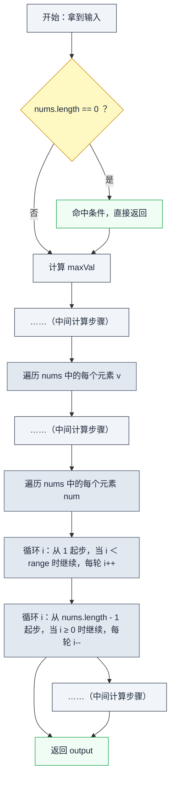
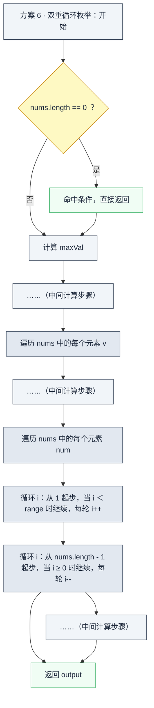
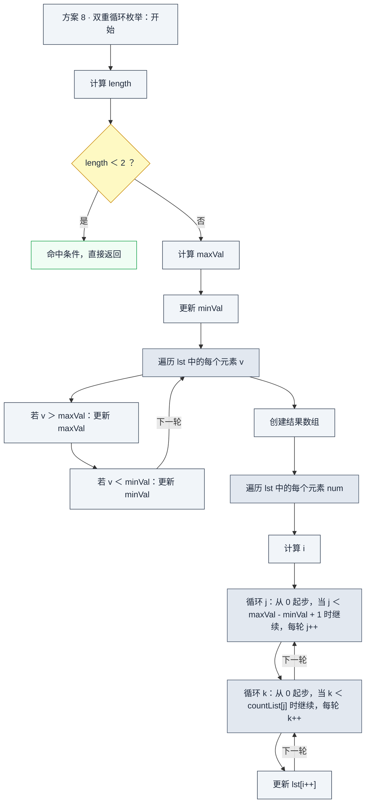
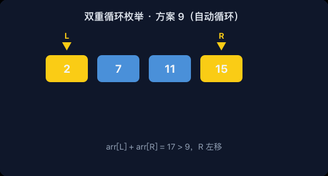
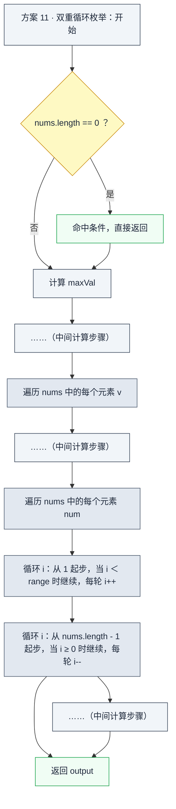
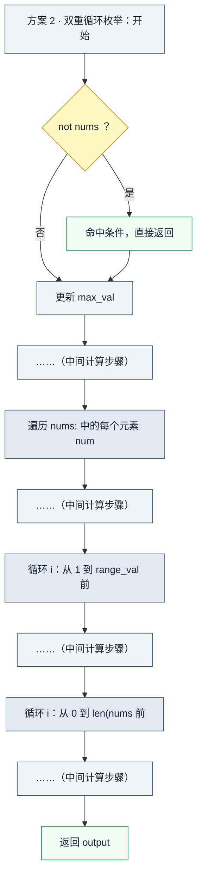
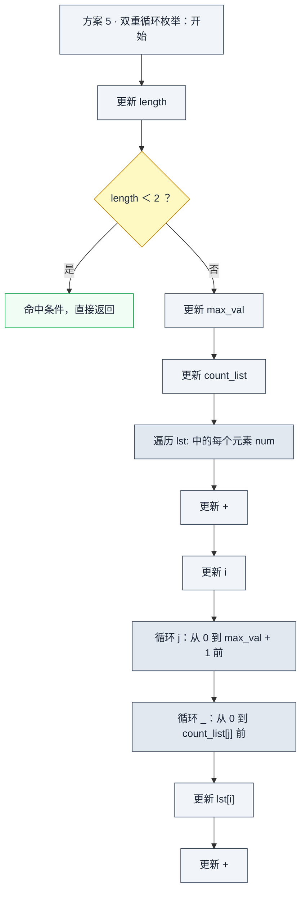
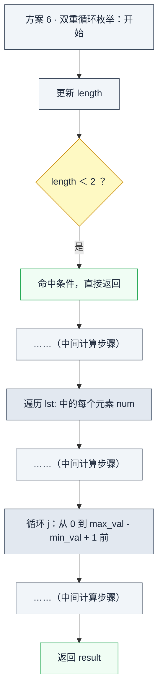

# 236 · 计数排序（第附阶段 · 专题补充 · Medium）

> **难度**：⭐⭐ Medium ｜ **专题**：算法笔记
> **学习定位**：第附阶段 · 专题补充第 236 篇 ｜ **解法数**：12
> **内容总结**：**计数排序**（算法笔记 · Medium）：共 12 个方案，主线思路「双重循环枚举」；时间 O(n²)（两层嵌套扫描）；动画演示归并分治过程，附录给出 11 种语言 × 全部方案的可运行实现。

---

## 题目描述

计数排序。具体输入输出约定见函数签名与用例。

- 主函数签名：`function countSort(nums: number[]): number[]`

**数据范围与注意事项**：

- **易错点**：先看小例子手推一遍再对照代码，比直接读代码快得多。

## 题目分析

**场景是什么**：综合练习：把数据结构与策略组合起来解决一个完整问题。本题就是该场景的 Medium 级练习，主线做法是「双重循环枚举」。

**主线怎么解**：把主解法从头到尾过一遍，它其实在依次做这几件事：双重循环遍历。

## 解题思路

**方案对比**（共 12 个方案，由浅入深）：

| 方案 | 时间复杂度 | 空间复杂度 |
|---|---|---|
| 方案 1 · 双重循环枚举 | O(n²)（两层嵌套扫描） | O(1) 到 O(n) |
| 方案 2 · 双重循环枚举 | O(n²)（两层嵌套扫描） | O(1) 到 O(n) |
| 方案 3 · 双重循环枚举 | O(n²)（两层嵌套扫描） | O(1) 到 O(n) |
| 方案 4 · 双重循环枚举 | O(n²)（两层嵌套扫描） | O(1) 到 O(n) |
| 方案 5 · 双重循环枚举 | O(n²)（两层嵌套扫描） | O(1) 到 O(n) |
| 方案 6 · 双重循环枚举 | O(n²)（两层嵌套扫描） | O(1) 到 O(n) |
| 方案 7 · 双重循环枚举 | O(n²)（两层嵌套扫描） | O(1) 到 O(n) |
| 方案 8 · 双重循环枚举 | O(n²)（两层嵌套扫描） | O(1) 到 O(n) |
| 方案 9 · 双重循环枚举 | O(n²)（两层嵌套扫描） | O(1) 到 O(n) |
| 方案 10 · 双重循环枚举 | O(n²)（两层嵌套扫描） | O(1) 到 O(n) |
| 方案 11 · 双重循环枚举 | O(n²)（两层嵌套扫描） | O(1) 到 O(n) |
| 方案 12 · 双重循环枚举 | O(n²)（两层嵌套扫描） | O(1) 到 O(n) |

**方案间的取舍**：方案 1（双重循环枚举）；方案 2（双重循环枚举）；方案 3（双重循环枚举）；方案 4（双重循环枚举）；方案 5（双重循环枚举）；方案 6（双重循环枚举）；方案 7（双重循环枚举）；方案 8（双重循环枚举）；方案 9（双重循环枚举）；方案 10（双重循环枚举）；方案 11（双重循环枚举）；方案 12（双重循环枚举）。数据规模小、可读性优先时选靠前的方案；规模大、性能优先时选靠后的方案。

**怎么读这一篇**：

- 🐣 **新手路线**：把「题目描述」的示例 1 在纸上手推一遍 → 读方案 1（最直观的写法）与它的代码走读 → 按「运行方式」本地跑通看 PASS → 回头对比方案 2 之后的写法差在哪
- 🦅 **大佬路线**：直接锁定最优方案 1（双重循环枚举，O(n²)（两层嵌套扫描））→ 跳读该方案代码与走读 → 用「逐步拆解与面试追问」补齐复杂度推导与边界追问

### 动态算法图（归并分治，GIF 自动循环）


动画演示算法笔记专题里归并分治的典型过程；每个方案在「TypeScript 解题方案」一节还配了专属动画与专属流程图。

### 主解法流程图（真实控制流）



## TypeScript 解题方案（12 个方案逐个讲）

> **运行与提交**：每个方案都是自包含文件（内嵌用例自测，输出 PASS），整块复制到 `.ts` 文件后 `node 文件名` 即可运行。提交 LeetCode 时，把 `demo` 内的算法函数与辅助类型/函数整体取出、置于文件顶层即可。概念演示（非 LeetCode 编号题），在本地运行即可。

### 方案 1：双重循环枚举

**分析与思路**：核心做法是「双重循环枚举」。代码里依次做这些事：双重循环遍历。

**运行方式**：`node 本文件`，内嵌用例全部通过会输出 PASS。


**方案专属流程图**（真实控制流）：


```typescript
export function demo(): void {
  // 程序入口：跑内嵌自测用例
  function countSort(nums: number[]): number[] {
    // 定义函数/方法 countSort
    if (nums.length === 0) return nums; // 若 数组.长度 全等于 0，直接返回 数组
    let maxVal = nums[0],
      minVal = nums[0]; // 把 数组[0], minVal 赋值为 数组[0] 存入 maxVal
    for (const v of nums) {
      if (v > maxVal) maxVal = v;
      if (v < minVal) minVal = v;
    }
    const range = maxVal - minVal + 1; // 把 maxVal 减 minVal 加 1 存入 range
    const count = new Array(range).fill(0); // 把 new Array(range).fill(0) 存入 计数
    const output = new Array(nums.length).fill(0); // 把 new Array(数组.长度).fill(0) 存入 输出
    for (const num of nums) count[num - minVal]++; // for (const num of 数组) 计数[num 减 minVal] 加一 ;
    for (let i = 1; i < range; i++) count[i] += count[i - 1]; // 让 下标 i 从 1 开始计数，下标 i 小于 range 就继续
    for (let i = nums.length - 1; i >= 0; i--) {
      output[count[nums[i] - minVal] - 1] = nums[i];
      count[nums[i] - minVal]--;
    } // 让 下标 i 从 数组.长度 减 1 开始计数，下标 i 不低于 0 就继续
    return output; // 返回 输出
  }
  let fail = false; // 把 false 存入 fail
  const c1 = countSort([1, 2, 3].slice()); // 把 countSort([1,2,3] 截取 )) 存入 c1
  if (JSON.stringify(c1) !== JSON.stringify([1, 2, 3])) {
    fail = true;
    console.log('FAIL countSort([1,2,3])=' + JSON.stringify(c1));
  }
  const c2 = countSort([3, 1, 2].slice()); // 把 countSort([3,1,2] 截取 )) 存入 c2
  if (JSON.stringify(c2) !== JSON.stringify([1, 2, 3])) {
    fail = true;
    console.log('FAIL countSort([3,1,2])=' + JSON.stringify(c2));
  }
  if (fail) throw new Error('FAILED'); // 若 fail) throw new Error(「FAILED」);
  console.log('PASS'); // 全部用例通过，输出 PASS
}
demo(); // demo();
```

### 方案 2：双重循环枚举

**分析与思路**：核心做法是「双重循环枚举」。代码里依次做这些事：双重循环遍历。

**运行方式**：`node 本文件`，内嵌用例全部通过会输出 PASS。


**方案专属流程图**（真实控制流）：


```typescript
export function demo(): void {
  // 程序入口：跑内嵌自测用例
  function countSort(nums: number[]): number[] {
    // 定义函数/方法 countSort
    if (nums.length === 0) return nums; // 若 数组.长度 全等于 0，直接返回 数组
    let maxVal = nums[0],
      minVal = nums[0]; // 把 数组[0], minVal 赋值为 数组[0] 存入 maxVal
    for (const v of nums) {
      if (v > maxVal) maxVal = v;
      if (v < minVal) minVal = v;
    }
    const range = maxVal - minVal + 1; // 把 maxVal 减 minVal 加 1 存入 range
    const count = new Array(range).fill(0); // 把 new Array(range).fill(0) 存入 计数
    const output = new Array(nums.length).fill(0); // 把 new Array(数组.长度).fill(0) 存入 输出
    for (const num of nums) count[num - minVal]++; // for (const num of 数组) 计数[num 减 minVal] 加一 ;
    for (let i = 1; i < range; i++) count[i] += count[i - 1]; // 让 下标 i 从 1 开始计数，下标 i 小于 range 就继续
    for (let i = nums.length - 1; i >= 0; i--) {
      output[count[nums[i] - minVal] - 1] = nums[i];
      count[nums[i] - minVal]--;
    } // 让 下标 i 从 数组.长度 减 1 开始计数，下标 i 不低于 0 就继续
    return output; // 返回 输出
  }
  let fail = false; // 把 false 存入 fail
  const c1 = countSort([1, 2, 3].slice()); // 把 countSort([1,2,3] 截取 )) 存入 c1
  if (JSON.stringify(c1) !== JSON.stringify([1, 2, 3])) {
    fail = true;
    console.log('FAIL countSort([1,2,3])=' + JSON.stringify(c1));
  }
  const c2 = countSort([3, 1, 2].slice()); // 把 countSort([3,1,2] 截取 )) 存入 c2
  if (JSON.stringify(c2) !== JSON.stringify([1, 2, 3])) {
    fail = true;
    console.log('FAIL countSort([3,1,2])=' + JSON.stringify(c2));
  }
  if (fail) throw new Error('FAILED'); // 若 fail) throw new Error(「FAILED」);
  console.log('PASS'); // 全部用例通过，输出 PASS
}
demo(); // demo();
```

### 方案 3：双重循环枚举

**分析与思路**：核心做法是「双重循环枚举」。代码里依次做这些事：双重循环遍历。

**运行方式**：`node 本文件`，内嵌用例全部通过会输出 PASS。


**方案专属流程图**（真实控制流）：


```typescript
export function demo(): void {
  // 程序入口：跑内嵌自测用例
  function countSort(nums: number[]): number[] {
    // 定义函数/方法 countSort
    if (nums.length === 0) return nums; // 若 数组.长度 全等于 0，直接返回 数组
    let maxVal = nums[0],
      minVal = nums[0]; // 把 数组[0], minVal 赋值为 数组[0] 存入 maxVal
    for (const v of nums) {
      if (v > maxVal) maxVal = v;
      if (v < minVal) minVal = v;
    }
    const range = maxVal - minVal + 1; // 把 maxVal 减 minVal 加 1 存入 range
    const count = new Array(range).fill(0); // 把 new Array(range).fill(0) 存入 计数
    const output = new Array(nums.length).fill(0); // 把 new Array(数组.长度).fill(0) 存入 输出
    for (const num of nums) count[num - minVal]++; // for (const num of 数组) 计数[num 减 minVal] 加一 ;
    for (let i = 1; i < range; i++) count[i] += count[i - 1]; // 让 下标 i 从 1 开始计数，下标 i 小于 range 就继续
    for (let i = nums.length - 1; i >= 0; i--) {
      output[count[nums[i] - minVal] - 1] = nums[i];
      count[nums[i] - minVal]--;
    } // 让 下标 i 从 数组.长度 减 1 开始计数，下标 i 不低于 0 就继续
    return output; // 返回 输出
  }
  let fail = false; // 把 false 存入 fail
  const c1 = countSort([1, 2, 3].slice()); // 把 countSort([1,2,3] 截取 )) 存入 c1
  if (JSON.stringify(c1) !== JSON.stringify([1, 2, 3])) {
    fail = true;
    console.log('FAIL countSort([1,2,3])=' + JSON.stringify(c1));
  }
  const c2 = countSort([3, 1, 2].slice()); // 把 countSort([3,1,2] 截取 )) 存入 c2
  if (JSON.stringify(c2) !== JSON.stringify([1, 2, 3])) {
    fail = true;
    console.log('FAIL countSort([3,1,2])=' + JSON.stringify(c2));
  }
  if (fail) throw new Error('FAILED'); // 若 fail) throw new Error(「FAILED」);
  console.log('PASS'); // 全部用例通过，输出 PASS
}
demo(); // demo();
```

### 方案 4：双重循环枚举

**分析与思路**：核心做法是「双重循环枚举」。代码里依次做这些事：双重循环遍历。

**运行方式**：`node 本文件`，内嵌用例全部通过会输出 PASS。


**方案专属流程图**（真实控制流）：


```typescript
export function demo(): void {
  // 程序入口：跑内嵌自测用例
  function countSort(nums: number[]): number[] {
    // 定义函数/方法 countSort
    if (nums.length === 0) return nums; // 若 数组.长度 全等于 0，直接返回 数组
    let maxVal = nums[0],
      minVal = nums[0]; // 把 数组[0], minVal 赋值为 数组[0] 存入 maxVal
    for (const v of nums) {
      if (v > maxVal) maxVal = v;
      if (v < minVal) minVal = v;
    }
    const range = maxVal - minVal + 1; // 把 maxVal 减 minVal 加 1 存入 range
    const count = new Array(range).fill(0); // 把 new Array(range).fill(0) 存入 计数
    const output = new Array(nums.length).fill(0); // 把 new Array(数组.长度).fill(0) 存入 输出
    for (const num of nums) count[num - minVal]++; // for (const num of 数组) 计数[num 减 minVal] 加一 ;
    for (let i = 1; i < range; i++) count[i] += count[i - 1]; // 让 下标 i 从 1 开始计数，下标 i 小于 range 就继续
    for (let i = nums.length - 1; i >= 0; i--) {
      output[count[nums[i] - minVal] - 1] = nums[i];
      count[nums[i] - minVal]--;
    } // 让 下标 i 从 数组.长度 减 1 开始计数，下标 i 不低于 0 就继续
    return output; // 返回 输出
  }
  let fail = false; // 把 false 存入 fail
  const c1 = countSort([1, 2, 3].slice()); // 把 countSort([1,2,3] 截取 )) 存入 c1
  if (JSON.stringify(c1) !== JSON.stringify([1, 2, 3])) {
    fail = true;
    console.log('FAIL countSort([1,2,3])=' + JSON.stringify(c1));
  }
  const c2 = countSort([3, 1, 2].slice()); // 把 countSort([3,1,2] 截取 )) 存入 c2
  if (JSON.stringify(c2) !== JSON.stringify([1, 2, 3])) {
    fail = true;
    console.log('FAIL countSort([3,1,2])=' + JSON.stringify(c2));
  }
  if (fail) throw new Error('FAILED'); // 若 fail) throw new Error(「FAILED」);
  console.log('PASS'); // 全部用例通过，输出 PASS
}
demo(); // demo();
```

### 方案 5：双重循环枚举

**分析与思路**：核心做法是「双重循环枚举」。代码里依次做这些事：双重循环遍历。

**运行方式**：`node 本文件`，内嵌用例全部通过会输出 PASS。


**方案专属流程图**（真实控制流）：


```typescript
export function demo(): void {
  // 程序入口：跑内嵌自测用例
  function countSort(lst: number[]): void {
    // 定义函数/方法 countSort
    const length = lst.length; // 把 lst.长度 存入 长度
    if (length < 2) return; // 若 长度 小于 2) return;
    let maxVal = lst[0],
      minVal = lst[0]; // 把 lst[0], minVal 赋值为 lst[0] 存入 maxVal
    for (const v of lst) {
      if (v > maxVal) maxVal = v;
      if (v < minVal) minVal = v;
    }
    const countList = new Array(maxVal - minVal + 1).fill(0); // 把 new Array(maxVal 减 minVal 加 1).fill(0) 存入 countList
    for (const num of lst) countList[num - minVal]++; // for (const num of lst) countList[num 减 minVal] 加一 ;
    let i = 0; // 把 0 存入 下标 i
    for (let j = 0; j < maxVal - minVal + 1; j++) {
      for (let k = 0; k < countList[j]; k++) {
        lst[i++] = j + minVal;
      }
    } // 让 下标 j 从 0 开始计数，下标 j 小于 maxVal 减 minVal 加 1 就继续
  }
  let fail = false; // 把 false 存入 fail
  const c1 = [
    2, 3, 8, 7, 1, 2, 2, 2, 7, 3, 9, 8, 2, 1, 4, 2, 4, 6, 9, 2,
  ].slice();
  countSort(c1); // countSort(c1);
  if (
    JSON.stringify(c1) !==
    JSON.stringify([1, 1, 2, 2, 2, 2, 2, 2, 2, 3, 3, 4, 4, 6, 7, 7, 8, 8, 9, 9])
  ) {
    fail = true;
    console.log('FAIL countSort in-place A=' + JSON.stringify(c1));
  }
  const c2 = [4, 2, 4, 3].slice(); // 把 [4,2,4,3] 截取 ) 存入 c2
  countSort(c2); // countSort(c2);
  if (JSON.stringify(c2) !== JSON.stringify([2, 3, 4, 4])) {
    fail = true;
    console.log('FAIL countSort in-place [4,2,4,3]=' + JSON.stringify(c2));
  }
  if (fail) throw new Error('FAILED'); // 若 fail) throw new Error(「FAILED」);
  console.log('PASS'); // 全部用例通过，输出 PASS
}
demo(); // demo();
```

### 方案 6：双重循环枚举

**分析与思路**：核心做法是「双重循环枚举」。代码里依次做这些事：双重循环遍历。

**运行方式**：`node 本文件`，内嵌用例全部通过会输出 PASS。


**方案专属流程图**（真实控制流）：



```typescript
export function demo(): void {
  // 程序入口：跑内嵌自测用例
  function countSort(nums: number[]): number[] {
    // 定义函数/方法 countSort
    if (nums.length === 0) return nums; // 若 数组.长度 全等于 0，直接返回 数组
    let maxVal = nums[0],
      minVal = nums[0]; // 把 数组[0], minVal 赋值为 数组[0] 存入 maxVal
    for (const v of nums) {
      if (v > maxVal) maxVal = v;
      if (v < minVal) minVal = v;
    }
    const range = maxVal - minVal + 1; // 把 maxVal 减 minVal 加 1 存入 range
    const count = new Array(range).fill(0); // 把 new Array(range).fill(0) 存入 计数
    const output = new Array(nums.length).fill(0); // 把 new Array(数组.长度).fill(0) 存入 输出
    for (const num of nums) count[num - minVal]++; // for (const num of 数组) 计数[num 减 minVal] 加一 ;
    for (let i = 1; i < range; i++) count[i] += count[i - 1]; // 让 下标 i 从 1 开始计数，下标 i 小于 range 就继续
    for (let i = nums.length - 1; i >= 0; i--) {
      output[count[nums[i] - minVal] - 1] = nums[i];
      count[nums[i] - minVal]--;
    } // 让 下标 i 从 数组.长度 减 1 开始计数，下标 i 不低于 0 就继续
    return output; // 返回 输出
  }
  let fail = false; // 把 false 存入 fail
  const c1 = countSort(
    [
      102, 103, 108, 107, 101, 102, 102, 102, 107, 103, 109, 108, 102, 101, 104,
      102, 104, 106, 109, 102,
    ].slice(),
  );
  if (
    JSON.stringify(c1) !==
    JSON.stringify([
      101, 101, 102, 102, 102, 102, 102, 102, 102, 103, 103, 104, 104, 106, 107,
      107, 108, 108, 109, 109,
    ])
  ) {
    fail = true;
    console.log('FAIL countSort(B)=' + JSON.stringify(c1));
  }
  const c2 = countSort([5, 3, 8, 3, 1].slice()); // 把 countSort([5,3,8,3,1] 截取 )) 存入 c2
  if (JSON.stringify(c2) !== JSON.stringify([1, 3, 3, 5, 8])) {
    fail = true;
    console.log('FAIL countSort([5,3,8,3,1])=' + JSON.stringify(c2));
  }
  if (fail) throw new Error('FAILED'); // 若 fail) throw new Error(「FAILED」);
  console.log('PASS'); // 全部用例通过，输出 PASS
}
demo(); // demo();
```

### 方案 7：双重循环枚举

**分析与思路**：核心做法是「双重循环枚举」。代码里依次做这些事：双重循环遍历。

**运行方式**：`node 本文件`，内嵌用例全部通过会输出 PASS。


**方案专属流程图**（真实控制流）：


```typescript
export function demo(): void {
  // 程序入口：跑内嵌自测用例
  function countSort(nums: number[]): number[] {
    // 定义函数/方法 countSort
    if (nums.length === 0) return nums; // 若 数组.长度 全等于 0，直接返回 数组
    let maxVal = nums[0],
      minVal = nums[0]; // 把 数组[0], minVal 赋值为 数组[0] 存入 maxVal
    for (const v of nums) {
      if (v > maxVal) maxVal = v;
      if (v < minVal) minVal = v;
    }
    const range = maxVal - minVal + 1; // 把 maxVal 减 minVal 加 1 存入 range
    const count = new Array(range).fill(0); // 把 new Array(range).fill(0) 存入 计数
    const output = new Array(nums.length).fill(0); // 把 new Array(数组.长度).fill(0) 存入 输出
    for (const num of nums) count[num - minVal]++; // for (const num of 数组) 计数[num 减 minVal] 加一 ;
    for (let i = 1; i < range; i++) count[i] += count[i - 1]; // 让 下标 i 从 1 开始计数，下标 i 小于 range 就继续
    for (let i = nums.length - 1; i >= 0; i--) {
      output[count[nums[i] - minVal] - 1] = nums[i];
      count[nums[i] - minVal]--;
    } // 让 下标 i 从 数组.长度 减 1 开始计数，下标 i 不低于 0 就继续
    return output; // 返回 输出
  }
  let fail = false; // 把 false 存入 fail
  const c1 = countSort(
    [
      102, 103, 108, 107, 101, 102, 102, 102, 107, 103, 109, 108, 102, 101, 104,
      102, 104, 106, 109, 102,
    ].slice(),
  );
  if (
    JSON.stringify(c1) !==
    JSON.stringify([
      101, 101, 102, 102, 102, 102, 102, 102, 102, 103, 103, 104, 104, 106, 107,
      107, 108, 108, 109, 109,
    ])
  ) {
    fail = true;
    console.log('FAIL countSort(B)=' + JSON.stringify(c1));
  }
  const c2 = countSort([5, 3, 8, 3, 1].slice()); // 把 countSort([5,3,8,3,1] 截取 )) 存入 c2
  if (JSON.stringify(c2) !== JSON.stringify([1, 3, 3, 5, 8])) {
    fail = true;
    console.log('FAIL countSort([5,3,8,3,1])=' + JSON.stringify(c2));
  }
  if (fail) throw new Error('FAILED'); // 若 fail) throw new Error(「FAILED」);
  console.log('PASS'); // 全部用例通过，输出 PASS
}
demo(); // demo();
```

### 方案 8：双重循环枚举

**分析与思路**：核心做法是「双重循环枚举」。代码里依次做这些事：双重循环遍历。

**运行方式**：`node 本文件`，内嵌用例全部通过会输出 PASS。


**方案专属流程图**（真实控制流）：



```typescript
export function demo(): void {
  // 程序入口：跑内嵌自测用例
  function countSort(lst: number[]): void {
    // 定义函数/方法 countSort
    const length = lst.length; // 把 lst.长度 存入 长度
    if (length < 2) return; // 若 长度 小于 2) return;
    let maxVal = lst[0],
      minVal = lst[0]; // 把 lst[0], minVal 赋值为 lst[0] 存入 maxVal
    for (const v of lst) {
      if (v > maxVal) maxVal = v;
      if (v < minVal) minVal = v;
    }
    const countList = new Array(maxVal - minVal + 1).fill(0); // 把 new Array(maxVal 减 minVal 加 1).fill(0) 存入 countList
    for (const num of lst) countList[num - minVal]++; // for (const num of lst) countList[num 减 minVal] 加一 ;
    let i = 0; // 把 0 存入 下标 i
    for (let j = 0; j < maxVal - minVal + 1; j++) {
      for (let k = 0; k < countList[j]; k++) {
        lst[i++] = j + minVal;
      }
    } // 让 下标 j 从 0 开始计数，下标 j 小于 maxVal 减 minVal 加 1 就继续
  }
  let fail = false; // 把 false 存入 fail
  const c1 = [
    102, 103, 108, 107, 101, 102, 102, 102, 107, 103, 109, 108, 102, 101, 104,
    102, 104, 106, 109, 102,
  ].slice();
  countSort(c1); // countSort(c1);
  if (
    JSON.stringify(c1) !==
    JSON.stringify([
      101, 101, 102, 102, 102, 102, 102, 102, 102, 103, 103, 104, 104, 106, 107,
      107, 108, 108, 109, 109,
    ])
  ) {
    fail = true;
    console.log('FAIL countSort in-place B=' + JSON.stringify(c1));
  }
  const c2 = [5, 3, 8, 3, 1].slice(); // 把 [5,3,8,3,1] 截取 ) 存入 c2
  countSort(c2); // countSort(c2);
  if (JSON.stringify(c2) !== JSON.stringify([1, 3, 3, 5, 8])) {
    fail = true;
    console.log('FAIL countSort in-place [5,3,8,3,1]=' + JSON.stringify(c2));
  }
  if (fail) throw new Error('FAILED'); // 若 fail) throw new Error(「FAILED」);
  console.log('PASS'); // 全部用例通过，输出 PASS
}
demo(); // demo();
```

### 方案 9：双重循环枚举

**分析与思路**：核心做法是「双重循环枚举」。代码里依次做这些事：双重循环遍历。

**运行方式**：`node 本文件`，内嵌用例全部通过会输出 PASS。



**方案专属流程图**（真实控制流）：


```typescript
export function demo(): void {
  // 程序入口：跑内嵌自测用例
  function countSort(lst: number[]): void {
    // 定义函数/方法 countSort
    const length = lst.length; // 把 lst.长度 存入 长度
    if (length < 2) return; // 若 长度 小于 2) return;
    let maxVal = lst[0],
      minVal = lst[0]; // 把 lst[0], minVal 赋值为 lst[0] 存入 maxVal
    for (const v of lst) {
      if (v > maxVal) maxVal = v;
      if (v < minVal) minVal = v;
    }
    const countList = new Array(maxVal - minVal + 1).fill(0); // 把 new Array(maxVal 减 minVal 加 1).fill(0) 存入 countList
    for (const num of lst) countList[num - minVal]++; // for (const num of lst) countList[num 减 minVal] 加一 ;
    let i = 0; // 把 0 存入 下标 i
    for (let j = 0; j < maxVal - minVal + 1; j++) {
      for (let k = 0; k < countList[j]; k++) {
        lst[i++] = j + minVal;
      }
    } // 让 下标 j 从 0 开始计数，下标 j 小于 maxVal 减 minVal 加 1 就继续
  }
  let fail = false; // 把 false 存入 fail
  const c1 = [
    2, 3, 8, 7, 1, 2, 2, 2, 7, 3, 9, 8, 2, 1, 4, 2, 4, 6, 9, 2,
  ].slice();
  countSort(c1); // countSort(c1);
  if (
    JSON.stringify(c1) !==
    JSON.stringify([1, 1, 2, 2, 2, 2, 2, 2, 2, 3, 3, 4, 4, 6, 7, 7, 8, 8, 9, 9])
  ) {
    fail = true;
    console.log('FAIL countSort in-place A=' + JSON.stringify(c1));
  }
  const c2 = [4, 2, 4, 3].slice(); // 把 [4,2,4,3] 截取 ) 存入 c2
  countSort(c2); // countSort(c2);
  if (JSON.stringify(c2) !== JSON.stringify([2, 3, 4, 4])) {
    fail = true;
    console.log('FAIL countSort in-place [4,2,4,3]=' + JSON.stringify(c2));
  }
  if (fail) throw new Error('FAILED'); // 若 fail) throw new Error(「FAILED」);
  console.log('PASS'); // 全部用例通过，输出 PASS
}
demo(); // demo();
```

### 方案 10：双重循环枚举

**分析与思路**：核心做法是「双重循环枚举」。代码里依次做这些事：双重循环遍历。

**运行方式**：`node 本文件`，内嵌用例全部通过会输出 PASS。


**方案专属流程图**（真实控制流）：


```typescript
export function demo(): void {
  // 程序入口：跑内嵌自测用例
  function countSort(nums: number[]): number[] {
    // 定义函数/方法 countSort
    if (nums.length === 0) return nums; // 若 数组.长度 全等于 0，直接返回 数组
    let maxVal = nums[0],
      minVal = nums[0]; // 把 数组[0], minVal 赋值为 数组[0] 存入 maxVal
    for (const v of nums) {
      if (v > maxVal) maxVal = v;
      if (v < minVal) minVal = v;
    }
    const range = maxVal - minVal + 1; // 把 maxVal 减 minVal 加 1 存入 range
    const count = new Array(range).fill(0); // 把 new Array(range).fill(0) 存入 计数
    const output = new Array(nums.length).fill(0); // 把 new Array(数组.长度).fill(0) 存入 输出
    for (const num of nums) count[num - minVal]++; // for (const num of 数组) 计数[num 减 minVal] 加一 ;
    for (let i = 1; i < range; i++) count[i] += count[i - 1]; // 让 下标 i 从 1 开始计数，下标 i 小于 range 就继续
    for (let i = nums.length - 1; i >= 0; i--) {
      output[count[nums[i] - minVal] - 1] = nums[i];
      count[nums[i] - minVal]--;
    } // 让 下标 i 从 数组.长度 减 1 开始计数，下标 i 不低于 0 就继续
    return output; // 返回 输出
  }
  let fail = false; // 把 false 存入 fail
  const c1 = countSort(
    [
      102, 103, 108, 107, 101, 102, 102, 102, 107, 103, 109, 108, 102, 101, 104,
      102, 104, 106, 109, 102,
    ].slice(),
  );
  if (
    JSON.stringify(c1) !==
    JSON.stringify([
      101, 101, 102, 102, 102, 102, 102, 102, 102, 103, 103, 104, 104, 106, 107,
      107, 108, 108, 109, 109,
    ])
  ) {
    fail = true;
    console.log('FAIL countSort(B)=' + JSON.stringify(c1));
  }
  const c2 = countSort([5, 3, 8, 3, 1].slice()); // 把 countSort([5,3,8,3,1] 截取 )) 存入 c2
  if (JSON.stringify(c2) !== JSON.stringify([1, 3, 3, 5, 8])) {
    fail = true;
    console.log('FAIL countSort([5,3,8,3,1])=' + JSON.stringify(c2));
  }
  if (fail) throw new Error('FAILED'); // 若 fail) throw new Error(「FAILED」);
  console.log('PASS'); // 全部用例通过，输出 PASS
}
demo(); // demo();
```

### 方案 11：双重循环枚举

**分析与思路**：核心做法是「双重循环枚举」。代码里依次做这些事：双重循环遍历。

**运行方式**：`node 本文件`，内嵌用例全部通过会输出 PASS。


**方案专属流程图**（真实控制流）：



```typescript
export function demo(): void {
  // 程序入口：跑内嵌自测用例
  function countSort(nums: number[]): number[] {
    // 定义函数/方法 countSort
    if (nums.length === 0) return nums; // 若 数组.长度 全等于 0，直接返回 数组
    let maxVal = nums[0],
      minVal = nums[0]; // 把 数组[0], minVal 赋值为 数组[0] 存入 maxVal
    for (const v of nums) {
      if (v > maxVal) maxVal = v;
      if (v < minVal) minVal = v;
    }
    const range = maxVal - minVal + 1; // 把 maxVal 减 minVal 加 1 存入 range
    const count = new Array(range).fill(0); // 把 new Array(range).fill(0) 存入 计数
    const output = new Array(nums.length).fill(0); // 把 new Array(数组.长度).fill(0) 存入 输出
    for (const num of nums) count[num - minVal]++; // for (const num of 数组) 计数[num 减 minVal] 加一 ;
    for (let i = 1; i < range; i++) count[i] += count[i - 1]; // 让 下标 i 从 1 开始计数，下标 i 小于 range 就继续
    for (let i = nums.length - 1; i >= 0; i--) {
      output[count[nums[i] - minVal] - 1] = nums[i];
      count[nums[i] - minVal]--;
    } // 让 下标 i 从 数组.长度 减 1 开始计数，下标 i 不低于 0 就继续
    return output; // 返回 输出
  }
  let fail = false; // 把 false 存入 fail
  const c1 = countSort(
    [
      102, 103, 108, 107, 101, 102, 102, 102, 107, 103, 109, 108, 102, 101, 104,
      102, 104, 106, 109, 102,
    ].slice(),
  );
  if (
    JSON.stringify(c1) !==
    JSON.stringify([
      101, 101, 102, 102, 102, 102, 102, 102, 102, 103, 103, 104, 104, 106, 107,
      107, 108, 108, 109, 109,
    ])
  ) {
    fail = true;
    console.log('FAIL countSort(B)=' + JSON.stringify(c1));
  }
  const c2 = countSort([5, 3, 8, 3, 1].slice()); // 把 countSort([5,3,8,3,1] 截取 )) 存入 c2
  if (JSON.stringify(c2) !== JSON.stringify([1, 3, 3, 5, 8])) {
    fail = true;
    console.log('FAIL countSort([5,3,8,3,1])=' + JSON.stringify(c2));
  }
  if (fail) throw new Error('FAILED'); // 若 fail) throw new Error(「FAILED」);
  console.log('PASS'); // 全部用例通过，输出 PASS
}
demo(); // demo();
```

### 方案 12：双重循环枚举

**分析与思路**：核心做法是「双重循环枚举」。代码里依次做这些事：双重循环遍历。

**运行方式**：`node 本文件`，内嵌用例全部通过会输出 PASS。


**方案专属流程图**（真实控制流）：


```typescript
export function demo(): void {
  // 程序入口：跑内嵌自测用例
  function countSort(lst: number[]): void {
    // 定义函数/方法 countSort
    const length = lst.length; // 把 lst.长度 存入 长度
    if (length < 2) return; // 若 长度 小于 2) return;
    let maxVal = lst[0],
      minVal = lst[0]; // 把 lst[0], minVal 赋值为 lst[0] 存入 maxVal
    for (const v of lst) {
      if (v > maxVal) maxVal = v;
      if (v < minVal) minVal = v;
    }
    const countList = new Array(maxVal - minVal + 1).fill(0); // 把 new Array(maxVal 减 minVal 加 1).fill(0) 存入 countList
    for (const num of lst) countList[num - minVal]++; // for (const num of lst) countList[num 减 minVal] 加一 ;
    let i = 0; // 把 0 存入 下标 i
    for (let j = 0; j < maxVal - minVal + 1; j++) {
      for (let k = 0; k < countList[j]; k++) {
        lst[i++] = j + minVal;
      }
    } // 让 下标 j 从 0 开始计数，下标 j 小于 maxVal 减 minVal 加 1 就继续
  }
  let fail = false; // 把 false 存入 fail
  const c1 = [
    102, 103, 108, 107, 101, 102, 102, 102, 107, 103, 109, 108, 102, 101, 104,
    102, 104, 106, 109, 102,
  ].slice();
  countSort(c1); // countSort(c1);
  if (
    JSON.stringify(c1) !==
    JSON.stringify([
      101, 101, 102, 102, 102, 102, 102, 102, 102, 103, 103, 104, 104, 106, 107,
      107, 108, 108, 109, 109,
    ])
  ) {
    fail = true;
    console.log('FAIL countSort in-place B=' + JSON.stringify(c1));
  }
  const c2 = [5, 3, 8, 3, 1].slice(); // 把 [5,3,8,3,1] 截取 ) 存入 c2
  countSort(c2); // countSort(c2);
  if (JSON.stringify(c2) !== JSON.stringify([1, 3, 3, 5, 8])) {
    fail = true;
    console.log('FAIL countSort in-place [5,3,8,3,1]=' + JSON.stringify(c2));
  }
  if (fail) throw new Error('FAILED'); // 若 fail) throw new Error(「FAILED」);
  console.log('PASS'); // 全部用例通过，输出 PASS
}
demo(); // demo();
```

## 逐步拆解与面试追问

**复杂度**：时间 O(n²)（两层嵌套扫描），空间 O(1) 到 O(n)

**为什么是这个量级**：外层定起点、内层扫终点，n 个起点各扫 n 次

**面试官可能会追问**：

- 这个策略能推广到什么场景？
- 与暴力做法差在哪一步？
- 有没有更简单的等价写法？

## 关键 API 速查（TS 主解法实际用到，附官方链接）

| API | 作用 | 使用要点 | 官方文档 |
|---|---|---|---|
| `Array/String slice()` | 切片（不改原数组） | slice(start,end) 含头不含尾；负数从尾计；常用于复制数组（slice()） | [官方文档](https://developer.mozilla.org/zh-CN/docs/Web/JavaScript/Reference/Global_Objects/Array/slice) |
| `JSON.stringify()` | 序列化为 JSON 字符串 | 常用于结构化比较（深度相等判定）；undefined/函数/循环引用会被丢弃或抛错 | [官方文档](https://developer.mozilla.org/zh-CN/docs/Web/JavaScript/Reference/Global_Objects/JSON/stringify) |

### 各语言官方文档导航

- **TypeScript / JS**：[MDN 中文参考](https://developer.mozilla.org/zh-CN/)
- **Python**：[Python 官方文档](https://docs.python.org/zh-cn/3/)
- **Go**：[Go 标准库](https://pkg.go.dev/std)
- **Java**：[JDK 17 API](https://docs.oracle.com/en/java/javase/17/docs/api/)
- **Rust**：[Rust 标准库](https://doc.rust-lang.org/std/)
- **Lua**：[Lua 5.4 手册](https://www.lua.org/manual/5.4/)
- **C**：[Cppreference C](https://zh.cppreference.com/w/c)
- **C++**：[Cppreference C++](https://zh.cppreference.com/w/cpp)
- **R**：[R 官方手册](https://stat.ethz.ch/R-manual/)
- **Zig**：[Zig 语言文档](https://ziglang.org/documentation/master/)
- **Dart**：[Dart API](https://api.dart.dev/)

## 附录：其他 10 种语言全部实现（每种语言列举其全部方案）

> TypeScript 的全部方案见「TypeScript 解题方案」一节；下面是其余 10 种语言的对应实现，每种语言的每个方案都带思路分析、代码走读与专属运行架构图。
> 每个方案都内嵌用例自测，可独立运行（老仓库 python/go 文件遵循「打印结果」约定）。
> 完整解法文件见 `dsa/<语言>/notes/lc_134172583_计数排序/`。

### Python 实现（12 种方案）

Python 的全部方案如下，每个方案都内嵌用例自测，可独立运行（老仓库 python/go 文件遵循「打印结果」约定）：

#### 方案 1：双重循环枚举

**思路与代码分析**：核心是「双重循环枚举」。Python 版用切片与字典推导式简化操作，突出可读性。**走读**：方案 1 · 双重循环枚举：开始 → 命中条件，直接返回 → 更新 max_val → 遍历 nums: 中的每个元素 num → 循环 i：从 1 到 range_val 前 → 循环 i：从 0 到 len(nums 前 → 返回 output。

**运行架构**（真实控制流）：


```python
import sys  # 提高递归深度上限（深输入防 RecursionError）

sys.setrecursionlimit(200000)  # 树/链表类题目节点数可达 1e4 量级

def countSort(nums):  # 定义函数 countSort（参数：数组）
    if not nums:  # 若 not 数组
        return nums  # 返回 数组
    max_val = max(nums)  # 把 取较大值 数组) 存入 max_val
    min_val = min(nums)  # 把 取较小值 数组) 存入 min_val
    range_val = max_val - min_val + 1  # 把 max_val 减 min_val 加 1 存入 range_val
    count = [0] * range_val  # 把 [0] 乘 range_val 存入 计数
    output = [0] * len(nums)  # 把 [0] 乘 长度(数组) 存入 输出
    for num in nums:  # 逐个取出 数组 的元素（num）
        count[num - min_val] += 1  # 把 1 写入 count[num - min_val] +
    for i in range(1, range_val):  # 让 下标 i 从 1 到 range_val 遍历
        count[i] += count[i - 1]  # count[i]累加 计数[下标 i 减 1]
    for i in range(len(nums) - 1, -1, -1):  # 让 下标 i 从 长度(数组) 减 1 倒数回去（每步减 1）
        output[count[nums[i] - min_val] - 1] = nums[
            i
        ]  # 把 数组[下标 i] 写入 output[count[nums[i] - min_val] - 1]
        count[nums[i] - min_val] -= 1  # 把 1 写入 count[nums[i] - min_val] -
    return output  # 返回 输出

if __name__ == "__main__":  # 若 __name__ 等于 '__main__'
    print(countSort([1, 2, 3]))  # 打印输出
```

#### 方案 2：双重循环枚举

**思路与代码分析**：核心是「双重循环枚举」。Python 版用切片与字典推导式简化操作，突出可读性。**走读**：方案 2 · 双重循环枚举：开始 → 命中条件，直接返回 → 更新 max_val → 遍历 nums: 中的每个元素 num → 循环 i：从 1 到 range_val 前 → 循环 i：从 0 到 len(nums 前 → 返回 output。

**运行架构**（真实控制流）：



```python
import sys  # 提高递归深度上限（深输入防 RecursionError）

sys.setrecursionlimit(200000)  # 树/链表类题目节点数可达 1e4 量级

def countSort(nums):  # 定义函数 countSort（参数：数组）
    if not nums:  # 若 not 数组
        return nums  # 返回 数组
    max_val = max(nums)  # 把 取较大值 数组) 存入 max_val
    min_val = min(nums)  # 把 取较小值 数组) 存入 min_val
    range_val = max_val - min_val + 1  # 把 max_val 减 min_val 加 1 存入 range_val
    count = [0] * range_val  # 把 [0] 乘 range_val 存入 计数
    output = [0] * len(nums)  # 把 [0] 乘 长度(数组) 存入 输出
    for num in nums:  # 逐个取出 数组 的元素（num）
        count[num - min_val] += 1  # 把 1 写入 count[num - min_val] +
    for i in range(1, range_val):  # 让 下标 i 从 1 到 range_val 遍历
        count[i] += count[i - 1]  # count[i]累加 计数[下标 i 减 1]
    for i in range(len(nums) - 1, -1, -1):  # 让 下标 i 从 长度(数组) 减 1 倒数回去（每步减 1）
        output[count[nums[i] - min_val] - 1] = nums[
            i
        ]  # 把 数组[下标 i] 写入 output[count[nums[i] - min_val] - 1]
        count[nums[i] - min_val] -= 1  # 把 1 写入 count[nums[i] - min_val] -
    return output  # 返回 输出

if __name__ == "__main__":  # 若 __name__ 等于 '__main__'
    print(countSort([1, 2, 3]))  # 打印输出
```

#### 方案 3：双重循环枚举

**思路与代码分析**：核心是「双重循环枚举」。Python 版用切片与字典推导式简化操作，突出可读性。**走读**：方案 3 · 双重循环枚举：开始 → 命中条件，直接返回 → 更新 max_val → 遍历 nums: 中的每个元素 num → 循环 i：从 1 到 range_val 前 → 循环 i：从 0 到 len(nums 前 → 返回 output。

**运行架构**（真实控制流）：


```python
import sys  # 提高递归深度上限（深输入防 RecursionError）

sys.setrecursionlimit(200000)  # 树/链表类题目节点数可达 1e4 量级

def countSort(nums):  # 定义函数 countSort（参数：数组）
    if not nums:  # 若 not 数组
        return nums  # 返回 数组
    max_val = max(nums)  # 把 取较大值 数组) 存入 max_val
    min_val = min(nums)  # 把 取较小值 数组) 存入 min_val
    range_val = max_val - min_val + 1  # 把 max_val 减 min_val 加 1 存入 range_val
    count = [0] * range_val  # 把 [0] 乘 range_val 存入 计数
    output = [0] * len(nums)  # 把 [0] 乘 长度(数组) 存入 输出
    for num in nums:  # 逐个取出 数组 的元素（num）
        count[num - min_val] += 1  # 把 1 写入 count[num - min_val] +
    for i in range(1, range_val):  # 让 下标 i 从 1 到 range_val 遍历
        count[i] += count[i - 1]  # count[i]累加 计数[下标 i 减 1]
    for i in range(len(nums) - 1, -1, -1):  # 让 下标 i 从 长度(数组) 减 1 倒数回去（每步减 1）
        output[count[nums[i] - min_val] - 1] = nums[
            i
        ]  # 把 数组[下标 i] 写入 output[count[nums[i] - min_val] - 1]
        count[nums[i] - min_val] -= 1  # 把 1 写入 count[nums[i] - min_val] -
    return output  # 返回 输出

if __name__ == "__main__":  # 若 __name__ 等于 '__main__'
    print(countSort([1, 2, 3]))  # 打印输出
```

#### 方案 4：双重循环枚举

**思路与代码分析**：核心是「双重循环枚举」。Python 版用切片与字典推导式简化操作，突出可读性。**走读**：方案 4 · 双重循环枚举：开始 → 命中条件，直接返回 → 更新 max_val → 遍历 nums: 中的每个元素 num → 循环 i：从 1 到 range_val 前 → 循环 i：从 0 到 len(nums 前 → 返回 output。

**运行架构**（真实控制流）：


```python
import sys  # 提高递归深度上限（深输入防 RecursionError）

sys.setrecursionlimit(200000)  # 树/链表类题目节点数可达 1e4 量级

def countSort(nums):  # 定义函数 countSort（参数：数组）
    if not nums:  # 若 not 数组
        return nums  # 返回 数组
    max_val = max(nums)  # 把 取较大值 数组) 存入 max_val
    min_val = min(nums)  # 把 取较小值 数组) 存入 min_val
    range_val = max_val - min_val + 1  # 把 max_val 减 min_val 加 1 存入 range_val
    count = [0] * range_val  # 把 [0] 乘 range_val 存入 计数
    output = [0] * len(nums)  # 把 [0] 乘 长度(数组) 存入 输出
    for num in nums:  # 逐个取出 数组 的元素（num）
        count[num - min_val] += 1  # 把 1 写入 count[num - min_val] +
    for i in range(1, range_val):  # 让 下标 i 从 1 到 range_val 遍历
        count[i] += count[i - 1]  # count[i]累加 计数[下标 i 减 1]
    for i in range(len(nums) - 1, -1, -1):  # 让 下标 i 从 长度(数组) 减 1 倒数回去（每步减 1）
        output[count[nums[i] - min_val] - 1] = nums[
            i
        ]  # 把 数组[下标 i] 写入 output[count[nums[i] - min_val] - 1]
        count[nums[i] - min_val] -= 1  # 把 1 写入 count[nums[i] - min_val] -
    return output  # 返回 输出

if __name__ == "__main__":  # 若 __name__ 等于 '__main__'
    print(countSort([1, 2, 3]))  # 打印输出
```

#### 方案 5：双重循环枚举

**思路与代码分析**：核心是「双重循环枚举」。Python 版用切片与字典推导式简化操作，突出可读性。**走读**：方案 5 · 双重循环枚举：开始 → 更新 length → 命中条件，直接返回 → 更新 max_val → 更新 count_list → 遍历 lst: 中的每个元素 num → 更新 + → 更新 i → 循环 j：从 0 到 max_val + 1 前 → 循环 _：从 0 到 count_list[j] 前 → 更新 lst[i] → 更新 +。

**运行架构**（真实控制流）：



```python
import sys  # 提高递归深度上限（深输入防 RecursionError）

sys.setrecursionlimit(200000)  # 树/链表类题目节点数可达 1e4 量级

def count_sort(lst):  # 定义函数 count_sort（参数：lst）
    # 计数排序 - 基础版（要求非负整数，原地排序）
    length = len(lst)  # 把 长度(lst) 存入 长度
    if length < 2:  # 若 长度 小于 2
        return  # return
    max_val = max(lst)  # 把 取较大值 lst) 存入 max_val
    count_list = [0] * (max_val + 1)  # 把 [0] 乘 (max_val 加 1) 存入 count_list
    for num in lst:  # 逐个取出 lst 的元素（num）
        count_list[num] += 1  # count_list[num]累加 1
    i = 0  # 把 0 存入 下标 i
    for j in range(max_val + 1):  # 让 下标 j 从 max_val 加 1 遍历
        for _ in range(count_list[j]):  # 让 _ 从 count_list[下标 j] 遍历
            lst[i] = j  # 把 下标 j 写入 lst[i]
            i += 1  # 下标 i累加 1

if __name__ == "__main__":  # 若 __name__ 等于 '__main__'
    lst = [2, 3, 8, 7, 1, 2, 2, 2, 7, 3, 9, 8, 2, 1, 4, 2, 4, 6, 9, 2]
    count_sort(lst)  # count_sort(lst)
    print(lst)  # [1, 1, 2, 2, 2, 2, 2, 2, 2, 3, 3, 4, 4, 6, 7, 7, 8, 8, 9, 9]
```

#### 方案 6：双重循环枚举

**思路与代码分析**：核心是「双重循环枚举」。Python 版用切片与字典推导式简化操作，突出可读性。**走读**：方案 6 · 双重循环枚举：开始 → 更新 length → 命中条件，直接返回 → 遍历 lst: 中的每个元素 num → 循环 j：从 0 到 max_val - min_val + 1 前 → 返回 result。

**运行架构**（真实控制流）：



```python
import sys  # 提高递归深度上限（深输入防 RecursionError）

sys.setrecursionlimit(200000)  # 树/链表类题目节点数可达 1e4 量级

def count_sort(lst):  # 定义函数 count_sort（参数：lst）
    # 计数排序 - 优化版（按 max-min+1 缩小计数数组，返回新数组）
    length = len(lst)  # 把 长度(lst) 存入 长度
    if length < 2:  # 若 长度 小于 2
        return lst  # 返回 lst
    max_val = max(lst)  # 把 取较大值 lst) 存入 max_val
    min_val = min(lst)  # 把 取较小值 lst) 存入 min_val
    count_list = [0] * (max_val - min_val + 1)  # 把 [0] 乘 (max_val 减 min_val 加 1) 存入 count_list
    for num in lst:  # 逐个取出 lst 的元素（num）
        count_list[num - min_val] += 1  # 把 1 写入 count_list[num - min_val] +
    result = []  # 把 [] 存入 结果
    for j in range(max_val - min_val + 1):  # 让 下标 j 从 max_val 减 min_val 加 1 遍历
        if count_list[j] == 0:  # 若 count_list[下标 j] 等于 0
            continue  # 跳过本轮，进入下一次
        if count_list[j] > 1:  # 若 count_list[下标 j] 超过 1
            result.extend(
                [j + min_val] * count_list[j]
            )  # 结果.extend([下标 j 加 min_val] 乘 count_list[下标 j])
        else:  # 否则
            result.append(j + min_val)  # 把 下标 j 加 min_val 追加到列表尾部
    return result  # 返回 结果

if __name__ == "__main__":  # 若 __name__ 等于 '__main__'
    lst = [102, 103, 108, 107, 101, 102, 102, 102, 107, 103, 109, 108, 102, 101, 104, 102, 104, 106, 109, 102]
    print(count_sort(lst))  # [101, 101, 102, ... , 109, 109]
```

#### 方案 7：双重循环枚举

**思路与代码分析**：核心是「双重循环枚举」。Python 版用切片与字典推导式简化操作，突出可读性。**走读**：方案 7 · 双重循环枚举：开始 → 更新 length → 命中条件，直接返回 → 遍历 lst: 中的每个元素 num → 循环 j：从 0 到 max_val - min_val + 1 前 → 返回 result。

**运行架构**（真实控制流）：


```python
import sys  # 提高递归深度上限（深输入防 RecursionError）

sys.setrecursionlimit(200000)  # 树/链表类题目节点数可达 1e4 量级

def count_sort(lst):  # 定义函数 count_sort（参数：lst）
    # 计数排序 - 优化版（用字符串拼接构造结果，再转回整数数组）
    length = len(lst)  # 把 长度(lst) 存入 长度
    if length < 2:  # 若 长度 小于 2
        return lst  # 返回 lst
    max_val = max(lst)  # 把 取较大值 lst) 存入 max_val
    min_val = min(lst)  # 把 取较小值 lst) 存入 min_val
    count_list = [0] * (max_val - min_val + 1)  # 把 [0] 乘 (max_val 减 min_val 加 1) 存入 count_list
    for num in lst:  # 逐个取出 lst 的元素（num）
        count_list[num - min_val] += 1  # 把 1 写入 count_list[num - min_val] +
    str_result = ""  # 把 '' 存入 str_result
    for j in range(max_val - min_val + 1):  # 让 下标 j 从 max_val 减 min_val 加 1 遍历
        if count_list[j] == 0:  # 若 count_list[下标 j] 等于 0
            continue  # 跳过本轮，进入下一次
        if count_list[j] > 1:  # 若 count_list[下标 j] 超过 1
            str_result += (str(j + min_val) + ",") * count_list[
                j
            ]  # str_result累加 (str(下标 j 加 min_val) 加 ',') 乘 count_list[下标 j]
        else:  # 否则
            str_result += str(j + min_val) + ","  # str_result累加 str(下标 j 加 min_val) 加 ','
    str_result = str_result.rstrip(",")  # 把 str_result.rstrip(',') 存入 str_result
    result = [
        int(item) for item in str_result.split(",")
    ]  # 把 [int(item) for item in str_result.split(',')] 存入 结果
    return result  # 返回 结果

if __name__ == "__main__":  # 若 __name__ 等于 '__main__'
    lst = [102, 103, 108, 107, 101, 102, 102, 102, 107, 103, 109, 108, 102, 101, 104, 102, 104, 106, 109, 102]
    print(count_sort(lst))  # [101, 101, 102, ... , 109, 109]
```

#### 方案 8：双重循环枚举

**思路与代码分析**：核心是「双重循环枚举」。Python 版用切片与字典推导式简化操作，突出可读性。**走读**：方案 8 · 双重循环枚举：开始 → 更新 length → 命中条件，直接返回 → 遍历 lst: 中的每个元素 num → 循环 j：从 1 到 len(count_list 前 → 循环 k：从 length - 1 到 -1 前，步长 -1。

**运行架构**（真实控制流）：

```mermaid
graph TD
    N0["方案 8 · 双重循环枚举：开始"]
    N1["更新 length"]
    N2{"length ＜ 2 ？"}
    N3["命中条件，直接返回"]
    D1["……（中间计算步骤）"]
    N8["遍历 lst: 中的每个元素 num"]
    D2["……（中间计算步骤）"]
    N10["循环 j：从 1 到 len(count_list 前"]
    D3["……（中间计算步骤）"]
    N12["循环 k：从 length - 1 到 -1 前，步长 -1"]
    Dend["……（中间计算步骤）"]
    N0 --> N1
    N1 --> N2
    N2 -- 是 --> N3
    N3 --> D1
    D1 --> N8
    N8 --> D2
    D2 --> N10
    N10 --> D3
    D3 --> N12
    N12 --> Dend
    classDef n fill:#f1f5f9,stroke:#334155,color:#1e293b;
    classDef lp fill:#e2e8f0,stroke:#475569,color:#1e293b;
    classDef dc fill:#fef9c3,stroke:#ca8a04,color:#1e293b;
    classDef tm fill:#f0fdf4,stroke:#16a34a,color:#1e293b;
    class N0,N1,D1,D2,D3,Dend n;
    class N8,N10,N12 lp;
    class N2 dc;
    class N3 tm;
```

```python
import sys  # 提高递归深度上限（深输入防 RecursionError）

sys.setrecursionlimit(200000)  # 树/链表类题目节点数可达 1e4 量级

def count_sort(lst):  # 定义函数 count_sort（参数：lst）
    # 计数排序 - 稳定版（计数数组转累加数组，从后向前回填，原地替换）
    length = len(lst)  # 把 长度(lst) 存入 长度
    if length < 2:  # 若 长度 小于 2
        return  # return
    max_val = max(lst)  # 把 取较大值 lst) 存入 max_val
    min_val = min(lst)  # 把 取较小值 lst) 存入 min_val
    count_list = [0] * (max_val - min_val + 1)  # 把 [0] 乘 (max_val 减 min_val 加 1) 存入 count_list
    result = [0] * length  # 把 [0] 乘 长度 存入 结果
    for num in lst:  # 逐个取出 lst 的元素（num）
        count_list[num - min_val] += 1  # 把 1 写入 count_list[num - min_val] +
    for j in range(1, len(count_list)):  # 让 下标 j 从 1 到 长度(count_list 遍历
        count_list[j] += count_list[j - 1]  # count_list[j]累加 count_list[下标 j 减 1]
    for k in range(length - 1, -1, -1):  # 让 下标 k 从 长度 减 1 倒数回去（每步减 1）
        current_index = (
            count_list[lst[k] - min_val] - 1
        )  # 把 count_list[lst[下标 k] 减 min_val] 减 1 存入 current_index
        result[current_index] = lst[k]  # 把 lst[下标 k] 写入 result[current_index]
        count_list[lst[k] - min_val] -= 1  # 把 1 写入 count_list[lst[k] - min_val] -
    lst[:] = result  # 把 结果 写入 lst[:]

if __name__ == "__main__":  # 若 __name__ 等于 '__main__'
    lst = [102, 103, 108, 107, 101, 102, 102, 102, 107, 103, 109, 108, 102, 101, 104, 102, 104, 106, 109, 102]
    count_sort(lst)  # count_sort(lst)
    print(lst)  # [101, 101, 102, ... , 109, 109]
```

#### 方案 9：双重循环枚举

**思路与代码分析**：核心是「双重循环枚举」。Python 版用切片与字典推导式简化操作，突出可读性。**走读**：方案 9 · 双重循环枚举：开始 → 更新 length → 命中条件，直接返回 → 更新 max_val → 更新 count_list → 遍历 lst: 中的每个元素 num → 更新 + → 更新 i → 循环 j：从 0 到 max_val + 1 前 → 循环 _：从 0 到 count_list[j] 前 → 更新 lst[i] → 更新 +。

**运行架构**（真实控制流）：

```mermaid
graph TD
    N0["方案 9 · 双重循环枚举：开始"]
    N1["更新 length"]
    N2{"length ＜ 2 ？"}
    N3["命中条件，直接返回"]
    N4["更新 max_val"]
    N5["更新 count_list"]
    N6["遍历 lst: 中的每个元素 num"]
    N7["更新 +"]
    N8["更新 i"]
    N9["循环 j：从 0 到 max_val + 1 前"]
    N10["循环 _：从 0 到 count_list[j] 前"]
    N11["更新 lst[i]"]
    N12["更新 +"]
    N0 --> N1
    N1 --> N2
    N2 -- 是 --> N3
    N2 -- 否 --> N4
    N4 --> N5
    N5 --> N6
    N6 --> N7
    N7 --> N8
    N8 --> N9
    N9 --> N10
    N10 --> N11
    N11 --> N12
    classDef n fill:#f1f5f9,stroke:#334155,color:#1e293b;
    classDef lp fill:#e2e8f0,stroke:#475569,color:#1e293b;
    classDef dc fill:#fef9c3,stroke:#ca8a04,color:#1e293b;
    classDef tm fill:#f0fdf4,stroke:#16a34a,color:#1e293b;
    class N0,N1,N4,N5,N7,N8,N11,N12 n;
    class N6,N9,N10 lp;
    class N2 dc;
    class N3 tm;
```

```python
import sys  # 提高递归深度上限（深输入防 RecursionError）

sys.setrecursionlimit(200000)  # 树/链表类题目节点数可达 1e4 量级

def count_sort(lst):  # 定义函数 count_sort（参数：lst）
    # 计数排序 - 基础版（要求非负整数，原地排序）
    length = len(lst)  # 把 长度(lst) 存入 长度
    if length < 2:  # 若 长度 小于 2
        return  # return
    max_val = max(lst)  # 把 取较大值 lst) 存入 max_val
    count_list = [0] * (max_val + 1)  # 把 [0] 乘 (max_val 加 1) 存入 count_list
    for num in lst:  # 逐个取出 lst 的元素（num）
        count_list[num] += 1  # count_list[num]累加 1
    i = 0  # 把 0 存入 下标 i
    for j in range(max_val + 1):  # 让 下标 j 从 max_val 加 1 遍历
        for _ in range(count_list[j]):  # 让 _ 从 count_list[下标 j] 遍历
            lst[i] = j  # 把 下标 j 写入 lst[i]
            i += 1  # 下标 i累加 1

if __name__ == "__main__":  # 若 __name__ 等于 '__main__'
    lst = [2, 3, 8, 7, 1, 2, 2, 2, 7, 3, 9, 8, 2, 1, 4, 2, 4, 6, 9, 2]
    count_sort(lst)  # count_sort(lst)
    print(lst)  # [1, 1, 2, 2, 2, 2, 2, 2, 2, 3, 3, 4, 4, 6, 7, 7, 8, 8, 9, 9]
```

#### 方案 10：双重循环枚举

**思路与代码分析**：核心是「双重循环枚举」。Python 版用切片与字典推导式简化操作，突出可读性。**走读**：方案 10 · 双重循环枚举：开始 → 更新 length → 命中条件，直接返回 → 遍历 lst: 中的每个元素 num → 循环 j：从 0 到 max_val - min_val + 1 前 → 返回 result。

**运行架构**（真实控制流）：

```mermaid
graph TD
    N0["方案 10 · 双重循环枚举：开始"]
    N1["更新 length"]
    N2{"length ＜ 2 ？"}
    N3["命中条件，直接返回"]
    D1["……（中间计算步骤）"]
    N7["遍历 lst: 中的每个元素 num"]
    D2["……（中间计算步骤）"]
    N10["循环 j：从 0 到 max_val - min_val + 1 前"]
    D3["……（中间计算步骤）"]
    N17["返回 result"]
    N0 --> N1
    N1 --> N2
    N2 -- 是 --> N3
    N3 --> D1
    D1 --> N7
    N7 --> D2
    D2 --> N10
    N10 --> D3
    D3 --> N17
    classDef n fill:#f1f5f9,stroke:#334155,color:#1e293b;
    classDef lp fill:#e2e8f0,stroke:#475569,color:#1e293b;
    classDef dc fill:#fef9c3,stroke:#ca8a04,color:#1e293b;
    classDef tm fill:#f0fdf4,stroke:#16a34a,color:#1e293b;
    class N0,N1,D1,D2,D3 n;
    class N7,N10 lp;
    class N2 dc;
    class N3,N17 tm;
```

```python
import sys  # 提高递归深度上限（深输入防 RecursionError）

sys.setrecursionlimit(200000)  # 树/链表类题目节点数可达 1e4 量级

def count_sort(lst):  # 定义函数 count_sort（参数：lst）
    # 计数排序 - 优化版（按 max-min+1 缩小计数数组，返回新数组）
    length = len(lst)  # 把 长度(lst) 存入 长度
    if length < 2:  # 若 长度 小于 2
        return lst  # 返回 lst
    max_val = max(lst)  # 把 取较大值 lst) 存入 max_val
    min_val = min(lst)  # 把 取较小值 lst) 存入 min_val
    count_list = [0] * (max_val - min_val + 1)  # 把 [0] 乘 (max_val 减 min_val 加 1) 存入 count_list
    for num in lst:  # 逐个取出 lst 的元素（num）
        count_list[num - min_val] += 1  # 把 1 写入 count_list[num - min_val] +
    result = []  # 把 [] 存入 结果
    for j in range(max_val - min_val + 1):  # 让 下标 j 从 max_val 减 min_val 加 1 遍历
        if count_list[j] == 0:  # 若 count_list[下标 j] 等于 0
            continue  # 跳过本轮，进入下一次
        if count_list[j] > 1:  # 若 count_list[下标 j] 超过 1
            result.extend(
                [j + min_val] * count_list[j]
            )  # 结果.extend([下标 j 加 min_val] 乘 count_list[下标 j])
        else:  # 否则
            result.append(j + min_val)  # 把 下标 j 加 min_val 追加到列表尾部
    return result  # 返回 结果

if __name__ == "__main__":  # 若 __name__ 等于 '__main__'
    lst = [102, 103, 108, 107, 101, 102, 102, 102, 107, 103, 109, 108, 102, 101, 104, 102, 104, 106, 109, 102]
    print(count_sort(lst))  # [101, 101, 102, ... , 109, 109]
```

#### 方案 11：双重循环枚举

**思路与代码分析**：核心是「双重循环枚举」。Python 版用切片与字典推导式简化操作，突出可读性。**走读**：方案 11 · 双重循环枚举：开始 → 更新 length → 命中条件，直接返回 → 遍历 lst: 中的每个元素 num → 循环 j：从 0 到 max_val - min_val + 1 前 → 返回 result。

**运行架构**（真实控制流）：

```mermaid
graph TD
    N0["方案 11 · 双重循环枚举：开始"]
    N1["更新 length"]
    N2{"length ＜ 2 ？"}
    N3["命中条件，直接返回"]
    D1["……（中间计算步骤）"]
    N7["遍历 lst: 中的每个元素 num"]
    D2["……（中间计算步骤）"]
    N10["循环 j：从 0 到 max_val - min_val + 1 前"]
    D3["……（中间计算步骤）"]
    N21["返回 result"]
    N0 --> N1
    N1 --> N2
    N2 -- 是 --> N3
    N3 --> D1
    D1 --> N7
    N7 --> D2
    D2 --> N10
    N10 --> D3
    D3 --> N21
    classDef n fill:#f1f5f9,stroke:#334155,color:#1e293b;
    classDef lp fill:#e2e8f0,stroke:#475569,color:#1e293b;
    classDef dc fill:#fef9c3,stroke:#ca8a04,color:#1e293b;
    classDef tm fill:#f0fdf4,stroke:#16a34a,color:#1e293b;
    class N0,N1,D1,D2,D3 n;
    class N7,N10 lp;
    class N2 dc;
    class N3,N21 tm;
```

```python
import sys  # 提高递归深度上限（深输入防 RecursionError）

sys.setrecursionlimit(200000)  # 树/链表类题目节点数可达 1e4 量级

def count_sort(lst):  # 定义函数 count_sort（参数：lst）
    # 计数排序 - 优化版（用字符串拼接构造结果，再转回整数数组）
    length = len(lst)  # 把 长度(lst) 存入 长度
    if length < 2:  # 若 长度 小于 2
        return lst  # 返回 lst
    max_val = max(lst)  # 把 取较大值 lst) 存入 max_val
    min_val = min(lst)  # 把 取较小值 lst) 存入 min_val
    count_list = [0] * (max_val - min_val + 1)  # 把 [0] 乘 (max_val 减 min_val 加 1) 存入 count_list
    for num in lst:  # 逐个取出 lst 的元素（num）
        count_list[num - min_val] += 1  # 把 1 写入 count_list[num - min_val] +
    str_result = ""  # 把 '' 存入 str_result
    for j in range(max_val - min_val + 1):  # 让 下标 j 从 max_val 减 min_val 加 1 遍历
        if count_list[j] == 0:  # 若 count_list[下标 j] 等于 0
            continue  # 跳过本轮，进入下一次
        if count_list[j] > 1:  # 若 count_list[下标 j] 超过 1
            str_result += (str(j + min_val) + ",") * count_list[
                j
            ]  # str_result累加 (str(下标 j 加 min_val) 加 ',') 乘 count_list[下标 j]
        else:  # 否则
            str_result += str(j + min_val) + ","  # str_result累加 str(下标 j 加 min_val) 加 ','
    str_result = str_result.rstrip(",")  # 把 str_result.rstrip(',') 存入 str_result
    result = [
        int(item) for item in str_result.split(",")
    ]  # 把 [int(item) for item in str_result.split(',')] 存入 结果
    return result  # 返回 结果

if __name__ == "__main__":  # 若 __name__ 等于 '__main__'
    lst = [102, 103, 108, 107, 101, 102, 102, 102, 107, 103, 109, 108, 102, 101, 104, 102, 104, 106, 109, 102]
    print(count_sort(lst))  # [101, 101, 102, ... , 109, 109]
```

#### 方案 12：双重循环枚举

**思路与代码分析**：核心是「双重循环枚举」。Python 版用切片与字典推导式简化操作，突出可读性。**走读**：方案 12 · 双重循环枚举：开始 → 更新 length → 命中条件，直接返回 → 遍历 lst: 中的每个元素 num → 循环 j：从 1 到 len(count_list 前 → 循环 k：从 length - 1 到 -1 前，步长 -1。

**运行架构**（真实控制流）：

```mermaid
graph TD
    N0["方案 12 · 双重循环枚举：开始"]
    N1["更新 length"]
    N2{"length ＜ 2 ？"}
    N3["命中条件，直接返回"]
    D1["……（中间计算步骤）"]
    N8["遍历 lst: 中的每个元素 num"]
    D2["……（中间计算步骤）"]
    N10["循环 j：从 1 到 len(count_list 前"]
    D3["……（中间计算步骤）"]
    N12["循环 k：从 length - 1 到 -1 前，步长 -1"]
    Dend["……（中间计算步骤）"]
    N0 --> N1
    N1 --> N2
    N2 -- 是 --> N3
    N3 --> D1
    D1 --> N8
    N8 --> D2
    D2 --> N10
    N10 --> D3
    D3 --> N12
    N12 --> Dend
    classDef n fill:#f1f5f9,stroke:#334155,color:#1e293b;
    classDef lp fill:#e2e8f0,stroke:#475569,color:#1e293b;
    classDef dc fill:#fef9c3,stroke:#ca8a04,color:#1e293b;
    classDef tm fill:#f0fdf4,stroke:#16a34a,color:#1e293b;
    class N0,N1,D1,D2,D3,Dend n;
    class N8,N10,N12 lp;
    class N2 dc;
    class N3 tm;
```

```python
import sys  # 提高递归深度上限（深输入防 RecursionError）

sys.setrecursionlimit(200000)  # 树/链表类题目节点数可达 1e4 量级

def count_sort(lst):  # 定义函数 count_sort（参数：lst）
    # 计数排序 - 稳定版（计数数组转累加数组，从后向前回填，原地替换）
    length = len(lst)  # 把 长度(lst) 存入 长度
    if length < 2:  # 若 长度 小于 2
        return  # return
    max_val = max(lst)  # 把 取较大值 lst) 存入 max_val
    min_val = min(lst)  # 把 取较小值 lst) 存入 min_val
    count_list = [0] * (max_val - min_val + 1)  # 把 [0] 乘 (max_val 减 min_val 加 1) 存入 count_list
    result = [0] * length  # 把 [0] 乘 长度 存入 结果
    for num in lst:  # 逐个取出 lst 的元素（num）
        count_list[num - min_val] += 1  # 把 1 写入 count_list[num - min_val] +
    for j in range(1, len(count_list)):  # 让 下标 j 从 1 到 长度(count_list 遍历
        count_list[j] += count_list[j - 1]  # count_list[j]累加 count_list[下标 j 减 1]
    for k in range(length - 1, -1, -1):  # 让 下标 k 从 长度 减 1 倒数回去（每步减 1）
        current_index = (
            count_list[lst[k] - min_val] - 1
        )  # 把 count_list[lst[下标 k] 减 min_val] 减 1 存入 current_index
        result[current_index] = lst[k]  # 把 lst[下标 k] 写入 result[current_index]
        count_list[lst[k] - min_val] -= 1  # 把 1 写入 count_list[lst[k] - min_val] -
    lst[:] = result  # 把 结果 写入 lst[:]

if __name__ == "__main__":  # 若 __name__ 等于 '__main__'
    lst = [102, 103, 108, 107, 101, 102, 102, 102, 107, 103, 109, 108, 102, 101, 104, 102, 104, 106, 109, 102]
    count_sort(lst)  # count_sort(lst)
    print(lst)  # [101, 101, 102, ... , 109, 109]
```

### Go 实现（12 种方案）

Go 的全部方案如下，每个方案都内嵌用例自测，可独立运行（老仓库 python/go 文件遵循「打印结果」约定）：

#### 方案 1：双重循环枚举

**思路与代码分析**：核心是「双重循环枚举」。Go 版用切片与多返回值惯用法，显式处理索引边界。**走读**：方案 1 · 双重循环枚举：开始 → 处理 if len(nums) == 0 → 返回 []int → 遍历 nums 的下标与元素 v → 遍历 nums 的下标与元素 v → 遍历循环 → 遍历循环 → 返回 res。

**运行架构**（真实控制流）：

```mermaid
graph TD
    N0["方案 1 · 双重循环枚举：开始"]
    N1["处理 if len(nums) == 0"]
    N2["返回 []int"]
    D1["……（中间计算步骤）"]
    N4["遍历 nums 的下标与元素 v"]
    D2["……（中间计算步骤）"]
    N10["遍历 nums 的下标与元素 v"]
    D3["……（中间计算步骤）"]
    N13["遍历循环"]
    N14["遍历循环"]
    D4["……（中间计算步骤）"]
    N16["返回 res"]
    N0 --> N1
    N1 --> N2
    N13 --> N14
    N14 -- 下一轮 --> N13
    N13 --> N16
    N2 --> D1
    D1 --> N4
    N4 --> D2
    D2 --> N10
    N10 --> D3
    D3 --> N13
    N14 --> D4
    D4 --> N16
    classDef n fill:#f1f5f9,stroke:#334155,color:#1e293b;
    classDef lp fill:#e2e8f0,stroke:#475569,color:#1e293b;
    classDef dc fill:#fef9c3,stroke:#ca8a04,color:#1e293b;
    classDef tm fill:#f0fdf4,stroke:#16a34a,color:#1e293b;
    class N0,N1,D1,D2,D3,D4 n;
    class N4,N10,N13,N14 lp;
    class N2,N16 tm;
```

```go
package main // 引入依赖

import (
	"fmt"
	"os"
	"reflect"
) // 引入依赖

func countSort(nums []int) []int { // 定义函数/方法 countSort
	if len(nums) == 0 { // 若 长度(数组) 等于 0
		return []int{} // 返回 []int{}
	}
	mn, mx := nums[0], nums[0] // 把 数组[0], 数组[0] 写入 mn, mx :
	for _, v := range nums {   // 同时取 _ 与 值 遍历
		if v < mn { // 若 值 小于 mn
			mn = v // 把 值 写入 mn
		}
		if v > mx { // 若 值 超过 mx
			mx = v // 把 值 写入 mx
		}
	}
	cnt := make([]int, mx-mn+1) // 把 make([]int, mx 减 mn 加 1) 写入 cnt :
	for _, v := range nums {    // 同时取 _ 与 值 遍历
		cnt[v-mn]++ // 计数[值 减 mn] 加一
	}
	res := make([]int, 0, len(nums)) // 把 make([]int, 0, 长度(数组)) 写入 res :
	for j := 0; j < len(cnt); j++ {  // 让 下标 j 从 0 开始计数
		for k := 0; k < cnt[j]; k++ { // 让 下标 k 从 0 开始计数
			res = append(res, j+mn) // 把 append(结果, 下标 j 加 mn) 写入 结果
		}
	}
	return res // 返回 结果
}

func main() { // 程序入口：跑内嵌自测用例
	cases := []struct { // 把 []struct { 写入 cases :
		in   []int // in []int
		want []int // want []int
	}{ // }{
		{[]int{1, 2, 3}, []int{1, 2, 3}},
		{[]int{1, 2, 3}, []int{1, 2, 3}},
	}
	ok := true                // 把 true 写入 ok :
	for _, c := range cases { // 同时取 _ 与 字符 遍历
		if got := countSort(c.in); !reflect.DeepEqual(got, c.want) {
			ok = false                                                       // 把 false 写入 ok
			fmt.Printf("FAIL countSort(%v)=%v want %v\n", c.in, got, c.want) // 打印输出
		}
	}
	if !ok { // 若 取反 ok
		os.Exit(1) // os.Exit(1)
	}
	fmt.Println("PASS") // 全部用例通过，输出 PASS
}
```

#### 方案 2：双重循环枚举

**思路与代码分析**：核心是「双重循环枚举」。Go 版用切片与多返回值惯用法，显式处理索引边界。**走读**：方案 2 · 双重循环枚举：开始 → 处理 if len(nums) == 0 → 返回 []int → 遍历 nums 的下标与元素 v → 遍历 nums 的下标与元素 v → 遍历循环 → 遍历循环 → 返回 res。

**运行架构**（真实控制流）：

```mermaid
graph TD
    N0["方案 2 · 双重循环枚举：开始"]
    N1["处理 if len(nums) == 0"]
    N2["返回 []int"]
    D1["……（中间计算步骤）"]
    N4["遍历 nums 的下标与元素 v"]
    D2["……（中间计算步骤）"]
    N10["遍历 nums 的下标与元素 v"]
    D3["……（中间计算步骤）"]
    N13["遍历循环"]
    N14["遍历循环"]
    D4["……（中间计算步骤）"]
    N16["返回 res"]
    N0 --> N1
    N1 --> N2
    N13 --> N14
    N14 -- 下一轮 --> N13
    N13 --> N16
    N2 --> D1
    D1 --> N4
    N4 --> D2
    D2 --> N10
    N10 --> D3
    D3 --> N13
    N14 --> D4
    D4 --> N16
    classDef n fill:#f1f5f9,stroke:#334155,color:#1e293b;
    classDef lp fill:#e2e8f0,stroke:#475569,color:#1e293b;
    classDef dc fill:#fef9c3,stroke:#ca8a04,color:#1e293b;
    classDef tm fill:#f0fdf4,stroke:#16a34a,color:#1e293b;
    class N0,N1,D1,D2,D3,D4 n;
    class N4,N10,N13,N14 lp;
    class N2,N16 tm;
```

```go
package main // 引入依赖

import (
	"fmt"
	"os"
	"reflect"
) // 引入依赖

func countSort(nums []int) []int { // 定义函数/方法 countSort
	if len(nums) == 0 { // 若 长度(数组) 等于 0
		return []int{} // 返回 []int{}
	}
	mn, mx := nums[0], nums[0] // 把 数组[0], 数组[0] 写入 mn, mx :
	for _, v := range nums {   // 同时取 _ 与 值 遍历
		if v < mn { // 若 值 小于 mn
			mn = v // 把 值 写入 mn
		}
		if v > mx { // 若 值 超过 mx
			mx = v // 把 值 写入 mx
		}
	}
	cnt := make([]int, mx-mn+1) // 把 make([]int, mx 减 mn 加 1) 写入 cnt :
	for _, v := range nums {    // 同时取 _ 与 值 遍历
		cnt[v-mn]++ // 计数[值 减 mn] 加一
	}
	res := make([]int, 0, len(nums)) // 把 make([]int, 0, 长度(数组)) 写入 res :
	for j := 0; j < len(cnt); j++ {  // 让 下标 j 从 0 开始计数
		for k := 0; k < cnt[j]; k++ { // 让 下标 k 从 0 开始计数
			res = append(res, j+mn) // 把 append(结果, 下标 j 加 mn) 写入 结果
		}
	}
	return res // 返回 结果
}

func main() { // 程序入口：跑内嵌自测用例
	cases := []struct { // 把 []struct { 写入 cases :
		in   []int // in []int
		want []int // want []int
	}{ // }{
		{[]int{1, 2, 3}, []int{1, 2, 3}},
		{[]int{1, 2, 3}, []int{1, 2, 3}},
	}
	ok := true                // 把 true 写入 ok :
	for _, c := range cases { // 同时取 _ 与 字符 遍历
		if got := countSort(c.in); !reflect.DeepEqual(got, c.want) {
			ok = false                                                       // 把 false 写入 ok
			fmt.Printf("FAIL countSort(%v)=%v want %v\n", c.in, got, c.want) // 打印输出
		}
	}
	if !ok { // 若 取反 ok
		os.Exit(1) // os.Exit(1)
	}
	fmt.Println("PASS") // 全部用例通过，输出 PASS
}
```

#### 方案 3：双重循环枚举

**思路与代码分析**：核心是「双重循环枚举」。Go 版用切片与多返回值惯用法，显式处理索引边界。**走读**：方案 3 · 双重循环枚举：开始 → 处理 if len(nums) == 0 → 返回 []int → 遍历 nums 的下标与元素 v → 遍历 nums 的下标与元素 v → 遍历循环 → 遍历循环 → 返回 res。

**运行架构**（真实控制流）：

```mermaid
graph TD
    N0["方案 3 · 双重循环枚举：开始"]
    N1["处理 if len(nums) == 0"]
    N2["返回 []int"]
    D1["……（中间计算步骤）"]
    N4["遍历 nums 的下标与元素 v"]
    D2["……（中间计算步骤）"]
    N10["遍历 nums 的下标与元素 v"]
    D3["……（中间计算步骤）"]
    N13["遍历循环"]
    N14["遍历循环"]
    D4["……（中间计算步骤）"]
    N16["返回 res"]
    N0 --> N1
    N1 --> N2
    N13 --> N14
    N14 -- 下一轮 --> N13
    N13 --> N16
    N2 --> D1
    D1 --> N4
    N4 --> D2
    D2 --> N10
    N10 --> D3
    D3 --> N13
    N14 --> D4
    D4 --> N16
    classDef n fill:#f1f5f9,stroke:#334155,color:#1e293b;
    classDef lp fill:#e2e8f0,stroke:#475569,color:#1e293b;
    classDef dc fill:#fef9c3,stroke:#ca8a04,color:#1e293b;
    classDef tm fill:#f0fdf4,stroke:#16a34a,color:#1e293b;
    class N0,N1,D1,D2,D3,D4 n;
    class N4,N10,N13,N14 lp;
    class N2,N16 tm;
```

```go
package main // 引入依赖

import (
	"fmt"
	"os"
	"reflect"
) // 引入依赖

func countSort(nums []int) []int { // 定义函数/方法 countSort
	if len(nums) == 0 { // 若 长度(数组) 等于 0
		return []int{} // 返回 []int{}
	}
	mn, mx := nums[0], nums[0] // 把 数组[0], 数组[0] 写入 mn, mx :
	for _, v := range nums {   // 同时取 _ 与 值 遍历
		if v < mn { // 若 值 小于 mn
			mn = v // 把 值 写入 mn
		}
		if v > mx { // 若 值 超过 mx
			mx = v // 把 值 写入 mx
		}
	}
	cnt := make([]int, mx-mn+1) // 把 make([]int, mx 减 mn 加 1) 写入 cnt :
	for _, v := range nums {    // 同时取 _ 与 值 遍历
		cnt[v-mn]++ // 计数[值 减 mn] 加一
	}
	res := make([]int, 0, len(nums)) // 把 make([]int, 0, 长度(数组)) 写入 res :
	for j := 0; j < len(cnt); j++ {  // 让 下标 j 从 0 开始计数
		for k := 0; k < cnt[j]; k++ { // 让 下标 k 从 0 开始计数
			res = append(res, j+mn) // 把 append(结果, 下标 j 加 mn) 写入 结果
		}
	}
	return res // 返回 结果
}

func main() { // 程序入口：跑内嵌自测用例
	cases := []struct { // 把 []struct { 写入 cases :
		in   []int // in []int
		want []int // want []int
	}{ // }{
		{[]int{1, 2, 3}, []int{1, 2, 3}},
		{[]int{1, 2, 3}, []int{1, 2, 3}},
	}
	ok := true                // 把 true 写入 ok :
	for _, c := range cases { // 同时取 _ 与 字符 遍历
		if got := countSort(c.in); !reflect.DeepEqual(got, c.want) {
			ok = false                                                       // 把 false 写入 ok
			fmt.Printf("FAIL countSort(%v)=%v want %v\n", c.in, got, c.want) // 打印输出
		}
	}
	if !ok { // 若 取反 ok
		os.Exit(1) // os.Exit(1)
	}
	fmt.Println("PASS") // 全部用例通过，输出 PASS
}
```

#### 方案 4：双重循环枚举

**思路与代码分析**：核心是「双重循环枚举」。Go 版用切片与多返回值惯用法，显式处理索引边界。**走读**：方案 4 · 双重循环枚举：开始 → 处理 if len(nums) == 0 → 返回 []int → 遍历 nums 的下标与元素 v → 遍历 nums 的下标与元素 v → 遍历循环 → 遍历循环 → 返回 res。

**运行架构**（真实控制流）：

```mermaid
graph TD
    N0["方案 4 · 双重循环枚举：开始"]
    N1["处理 if len(nums) == 0"]
    N2["返回 []int"]
    D1["……（中间计算步骤）"]
    N4["遍历 nums 的下标与元素 v"]
    D2["……（中间计算步骤）"]
    N10["遍历 nums 的下标与元素 v"]
    D3["……（中间计算步骤）"]
    N13["遍历循环"]
    N14["遍历循环"]
    D4["……（中间计算步骤）"]
    N16["返回 res"]
    N0 --> N1
    N1 --> N2
    N13 --> N14
    N14 -- 下一轮 --> N13
    N13 --> N16
    N2 --> D1
    D1 --> N4
    N4 --> D2
    D2 --> N10
    N10 --> D3
    D3 --> N13
    N14 --> D4
    D4 --> N16
    classDef n fill:#f1f5f9,stroke:#334155,color:#1e293b;
    classDef lp fill:#e2e8f0,stroke:#475569,color:#1e293b;
    classDef dc fill:#fef9c3,stroke:#ca8a04,color:#1e293b;
    classDef tm fill:#f0fdf4,stroke:#16a34a,color:#1e293b;
    class N0,N1,D1,D2,D3,D4 n;
    class N4,N10,N13,N14 lp;
    class N2,N16 tm;
```

```go
package main // 引入依赖

import (
	"fmt"
	"os"
	"reflect"
) // 引入依赖

func countSort(nums []int) []int { // 定义函数/方法 countSort
	if len(nums) == 0 { // 若 长度(数组) 等于 0
		return []int{} // 返回 []int{}
	}
	mn, mx := nums[0], nums[0] // 把 数组[0], 数组[0] 写入 mn, mx :
	for _, v := range nums {   // 同时取 _ 与 值 遍历
		if v < mn { // 若 值 小于 mn
			mn = v // 把 值 写入 mn
		}
		if v > mx { // 若 值 超过 mx
			mx = v // 把 值 写入 mx
		}
	}
	cnt := make([]int, mx-mn+1) // 把 make([]int, mx 减 mn 加 1) 写入 cnt :
	for _, v := range nums {    // 同时取 _ 与 值 遍历
		cnt[v-mn]++ // 计数[值 减 mn] 加一
	}
	res := make([]int, 0, len(nums)) // 把 make([]int, 0, 长度(数组)) 写入 res :
	for j := 0; j < len(cnt); j++ {  // 让 下标 j 从 0 开始计数
		for k := 0; k < cnt[j]; k++ { // 让 下标 k 从 0 开始计数
			res = append(res, j+mn) // 把 append(结果, 下标 j 加 mn) 写入 结果
		}
	}
	return res // 返回 结果
}

func main() { // 程序入口：跑内嵌自测用例
	cases := []struct { // 把 []struct { 写入 cases :
		in   []int // in []int
		want []int // want []int
	}{ // }{
		{[]int{1, 2, 3}, []int{1, 2, 3}},
		{[]int{1, 2, 3}, []int{1, 2, 3}},
	}
	ok := true                // 把 true 写入 ok :
	for _, c := range cases { // 同时取 _ 与 字符 遍历
		if got := countSort(c.in); !reflect.DeepEqual(got, c.want) {
			ok = false                                                       // 把 false 写入 ok
			fmt.Printf("FAIL countSort(%v)=%v want %v\n", c.in, got, c.want) // 打印输出
		}
	}
	if !ok { // 若 取反 ok
		os.Exit(1) // os.Exit(1)
	}
	fmt.Println("PASS") // 全部用例通过，输出 PASS
}
```

#### 方案 5：双重循环枚举

**思路与代码分析**：核心是「双重循环枚举」。Go 版用切片与多返回值惯用法，显式处理索引边界。**走读**：方案 5 · 双重循环枚举：开始 → 处理 if len(nums) == 0 → 返回 []int → 遍历 nums 的下标与元素 v → 遍历 nums 的下标与元素 v → 遍历循环 → 遍历循环 → 返回 res。

**运行架构**（真实控制流）：

```mermaid
graph TD
    N0["方案 5 · 双重循环枚举：开始"]
    N1["处理 if len(nums) == 0"]
    N2["返回 []int"]
    D1["……（中间计算步骤）"]
    N4["遍历 nums 的下标与元素 v"]
    D2["……（中间计算步骤）"]
    N10["遍历 nums 的下标与元素 v"]
    D3["……（中间计算步骤）"]
    N13["遍历循环"]
    N14["遍历循环"]
    D4["……（中间计算步骤）"]
    N16["返回 res"]
    N0 --> N1
    N1 --> N2
    N13 --> N14
    N14 -- 下一轮 --> N13
    N13 --> N16
    N2 --> D1
    D1 --> N4
    N4 --> D2
    D2 --> N10
    N10 --> D3
    D3 --> N13
    N14 --> D4
    D4 --> N16
    classDef n fill:#f1f5f9,stroke:#334155,color:#1e293b;
    classDef lp fill:#e2e8f0,stroke:#475569,color:#1e293b;
    classDef dc fill:#fef9c3,stroke:#ca8a04,color:#1e293b;
    classDef tm fill:#f0fdf4,stroke:#16a34a,color:#1e293b;
    class N0,N1,D1,D2,D3,D4 n;
    class N4,N10,N13,N14 lp;
    class N2,N16 tm;
```

```go
package main // 引入依赖

import (
	"fmt"
	"os"
	"reflect"
) // 引入依赖

func countSort(nums []int) []int { // 定义函数/方法 countSort
	if len(nums) == 0 { // 若 长度(数组) 等于 0
		return []int{} // 返回 []int{}
	}
	mn, mx := nums[0], nums[0] // 把 数组[0], 数组[0] 写入 mn, mx :
	for _, v := range nums {   // 同时取 _ 与 值 遍历
		if v < mn { // 若 值 小于 mn
			mn = v // 把 值 写入 mn
		}
		if v > mx { // 若 值 超过 mx
			mx = v // 把 值 写入 mx
		}
	}
	cnt := make([]int, mx-mn+1) // 把 make([]int, mx 减 mn 加 1) 写入 cnt :
	for _, v := range nums {    // 同时取 _ 与 值 遍历
		cnt[v-mn]++ // 计数[值 减 mn] 加一
	}
	res := make([]int, 0, len(nums)) // 把 make([]int, 0, 长度(数组)) 写入 res :
	for j := 0; j < len(cnt); j++ {  // 让 下标 j 从 0 开始计数
		for k := 0; k < cnt[j]; k++ { // 让 下标 k 从 0 开始计数
			res = append(res, j+mn) // 把 append(结果, 下标 j 加 mn) 写入 结果
		}
	}
	return res // 返回 结果
}

func main() { // 程序入口：跑内嵌自测用例
	cases := []struct { // 把 []struct { 写入 cases :
		in   []int // in []int
		want []int // want []int
	}{ // }{
		{[]int{1, 2, 3}, []int{1, 2, 3}},
		{[]int{2, 3, 8, 7, 1, 2, 2, 2, 7, 3, 9, 8, 2, 1, 4, 2, 4, 6, 9, 2}, []int{1, 1, 2, 2, 2, 2, 2, 2, 2, 3, 3, 4, 4, 6, 7, 7, 8, 8, 9, 9}},
	}
	ok := true                // 把 true 写入 ok :
	for _, c := range cases { // 同时取 _ 与 字符 遍历
		if got := countSort(c.in); !reflect.DeepEqual(got, c.want) {
			ok = false                                                       // 把 false 写入 ok
			fmt.Printf("FAIL countSort(%v)=%v want %v\n", c.in, got, c.want) // 打印输出
		}
	}
	if !ok { // 若 取反 ok
		os.Exit(1) // os.Exit(1)
	}
	fmt.Println("PASS") // 全部用例通过，输出 PASS
}
```

#### 方案 6：双重循环枚举

**思路与代码分析**：核心是「双重循环枚举」。Go 版用切片与多返回值惯用法，显式处理索引边界。**走读**：方案 6 · 双重循环枚举：开始 → 处理 if len(nums) == 0 → 返回 []int → 遍历 nums 的下标与元素 v → 遍历 nums 的下标与元素 v → 遍历循环 → 遍历循环 → 返回 res。

**运行架构**（真实控制流）：

```mermaid
graph TD
    N0["方案 6 · 双重循环枚举：开始"]
    N1["处理 if len(nums) == 0"]
    N2["返回 []int"]
    D1["……（中间计算步骤）"]
    N4["遍历 nums 的下标与元素 v"]
    D2["……（中间计算步骤）"]
    N10["遍历 nums 的下标与元素 v"]
    D3["……（中间计算步骤）"]
    N13["遍历循环"]
    N14["遍历循环"]
    D4["……（中间计算步骤）"]
    N16["返回 res"]
    N0 --> N1
    N1 --> N2
    N13 --> N14
    N14 -- 下一轮 --> N13
    N13 --> N16
    N2 --> D1
    D1 --> N4
    N4 --> D2
    D2 --> N10
    N10 --> D3
    D3 --> N13
    N14 --> D4
    D4 --> N16
    classDef n fill:#f1f5f9,stroke:#334155,color:#1e293b;
    classDef lp fill:#e2e8f0,stroke:#475569,color:#1e293b;
    classDef dc fill:#fef9c3,stroke:#ca8a04,color:#1e293b;
    classDef tm fill:#f0fdf4,stroke:#16a34a,color:#1e293b;
    class N0,N1,D1,D2,D3,D4 n;
    class N4,N10,N13,N14 lp;
    class N2,N16 tm;
```

```go
package main // 引入依赖

import (
	"fmt"
	"os"
	"reflect"
) // 引入依赖

func countSort(nums []int) []int { // 定义函数/方法 countSort
	if len(nums) == 0 { // 若 长度(数组) 等于 0
		return []int{} // 返回 []int{}
	}
	mn, mx := nums[0], nums[0] // 把 数组[0], 数组[0] 写入 mn, mx :
	for _, v := range nums {   // 同时取 _ 与 值 遍历
		if v < mn { // 若 值 小于 mn
			mn = v // 把 值 写入 mn
		}
		if v > mx { // 若 值 超过 mx
			mx = v // 把 值 写入 mx
		}
	}
	cnt := make([]int, mx-mn+1) // 把 make([]int, mx 减 mn 加 1) 写入 cnt :
	for _, v := range nums {    // 同时取 _ 与 值 遍历
		cnt[v-mn]++ // 计数[值 减 mn] 加一
	}
	res := make([]int, 0, len(nums)) // 把 make([]int, 0, 长度(数组)) 写入 res :
	for j := 0; j < len(cnt); j++ {  // 让 下标 j 从 0 开始计数
		for k := 0; k < cnt[j]; k++ { // 让 下标 k 从 0 开始计数
			res = append(res, j+mn) // 把 append(结果, 下标 j 加 mn) 写入 结果
		}
	}
	return res // 返回 结果
}

func main() { // 程序入口：跑内嵌自测用例
	cases := []struct { // 把 []struct { 写入 cases :
		in   []int // in []int
		want []int // want []int
	}{ // }{
		{[]int{1, 2, 3}, []int{1, 2, 3}},
		{[]int{102, 103, 108, 107, 101, 102, 102, 102, 107, 103, 109, 108, 102, 101, 104, 102, 104, 106, 109, 102}, []int{101, 101, 102, 102, 102, 102, 102, 102, 102, 103, 103, 104, 104, 106, 107, 107, 108, 108, 109, 109}},
	}
	ok := true                // 把 true 写入 ok :
	for _, c := range cases { // 同时取 _ 与 字符 遍历
		if got := countSort(c.in); !reflect.DeepEqual(got, c.want) {
			ok = false                                                       // 把 false 写入 ok
			fmt.Printf("FAIL countSort(%v)=%v want %v\n", c.in, got, c.want) // 打印输出
		}
	}
	if !ok { // 若 取反 ok
		os.Exit(1) // os.Exit(1)
	}
	fmt.Println("PASS") // 全部用例通过，输出 PASS
}
```

#### 方案 7：双重循环枚举

**思路与代码分析**：核心是「双重循环枚举」。Go 版用切片与多返回值惯用法，显式处理索引边界。**走读**：方案 7 · 双重循环枚举：开始 → 处理 if len(nums) == 0 → 返回 []int → 遍历 nums 的下标与元素 v → 遍历 nums 的下标与元素 v → 遍历循环 → 遍历循环 → 返回 res。

**运行架构**（真实控制流）：

```mermaid
graph TD
    N0["方案 7 · 双重循环枚举：开始"]
    N1["处理 if len(nums) == 0"]
    N2["返回 []int"]
    D1["……（中间计算步骤）"]
    N4["遍历 nums 的下标与元素 v"]
    D2["……（中间计算步骤）"]
    N10["遍历 nums 的下标与元素 v"]
    D3["……（中间计算步骤）"]
    N13["遍历循环"]
    N14["遍历循环"]
    D4["……（中间计算步骤）"]
    N16["返回 res"]
    N0 --> N1
    N1 --> N2
    N13 --> N14
    N14 -- 下一轮 --> N13
    N13 --> N16
    N2 --> D1
    D1 --> N4
    N4 --> D2
    D2 --> N10
    N10 --> D3
    D3 --> N13
    N14 --> D4
    D4 --> N16
    classDef n fill:#f1f5f9,stroke:#334155,color:#1e293b;
    classDef lp fill:#e2e8f0,stroke:#475569,color:#1e293b;
    classDef dc fill:#fef9c3,stroke:#ca8a04,color:#1e293b;
    classDef tm fill:#f0fdf4,stroke:#16a34a,color:#1e293b;
    class N0,N1,D1,D2,D3,D4 n;
    class N4,N10,N13,N14 lp;
    class N2,N16 tm;
```

```go
package main // 引入依赖

import (
	"fmt"
	"os"
	"reflect"
) // 引入依赖

func countSort(nums []int) []int { // 定义函数/方法 countSort
	if len(nums) == 0 { // 若 长度(数组) 等于 0
		return []int{} // 返回 []int{}
	}
	mn, mx := nums[0], nums[0] // 把 数组[0], 数组[0] 写入 mn, mx :
	for _, v := range nums {   // 同时取 _ 与 值 遍历
		if v < mn { // 若 值 小于 mn
			mn = v // 把 值 写入 mn
		}
		if v > mx { // 若 值 超过 mx
			mx = v // 把 值 写入 mx
		}
	}
	cnt := make([]int, mx-mn+1) // 把 make([]int, mx 减 mn 加 1) 写入 cnt :
	for _, v := range nums {    // 同时取 _ 与 值 遍历
		cnt[v-mn]++ // 计数[值 减 mn] 加一
	}
	res := make([]int, 0, len(nums)) // 把 make([]int, 0, 长度(数组)) 写入 res :
	for j := 0; j < len(cnt); j++ {  // 让 下标 j 从 0 开始计数
		for k := 0; k < cnt[j]; k++ { // 让 下标 k 从 0 开始计数
			res = append(res, j+mn) // 把 append(结果, 下标 j 加 mn) 写入 结果
		}
	}
	return res // 返回 结果
}

func main() { // 程序入口：跑内嵌自测用例
	cases := []struct { // 把 []struct { 写入 cases :
		in   []int // in []int
		want []int // want []int
	}{ // }{
		{[]int{1, 2, 3}, []int{1, 2, 3}},
		{[]int{102, 103, 108, 107, 101, 102, 102, 102, 107, 103, 109, 108, 102, 101, 104, 102, 104, 106, 109, 102}, []int{101, 101, 102, 102, 102, 102, 102, 102, 102, 103, 103, 104, 104, 106, 107, 107, 108, 108, 109, 109}},
	}
	ok := true                // 把 true 写入 ok :
	for _, c := range cases { // 同时取 _ 与 字符 遍历
		if got := countSort(c.in); !reflect.DeepEqual(got, c.want) {
			ok = false                                                       // 把 false 写入 ok
			fmt.Printf("FAIL countSort(%v)=%v want %v\n", c.in, got, c.want) // 打印输出
		}
	}
	if !ok { // 若 取反 ok
		os.Exit(1) // os.Exit(1)
	}
	fmt.Println("PASS") // 全部用例通过，输出 PASS
}
```

#### 方案 8：双重循环枚举

**思路与代码分析**：核心是「双重循环枚举」。Go 版用切片与多返回值惯用法，显式处理索引边界。**走读**：方案 8 · 双重循环枚举：开始 → 处理 if len(nums) == 0 → 返回 []int → 遍历 nums 的下标与元素 v → 遍历 nums 的下标与元素 v → 遍历循环 → 遍历循环 → 返回 res。

**运行架构**（真实控制流）：

```mermaid
graph TD
    N0["方案 8 · 双重循环枚举：开始"]
    N1["处理 if len(nums) == 0"]
    N2["返回 []int"]
    D1["……（中间计算步骤）"]
    N4["遍历 nums 的下标与元素 v"]
    D2["……（中间计算步骤）"]
    N10["遍历 nums 的下标与元素 v"]
    D3["……（中间计算步骤）"]
    N13["遍历循环"]
    N14["遍历循环"]
    D4["……（中间计算步骤）"]
    N16["返回 res"]
    N0 --> N1
    N1 --> N2
    N13 --> N14
    N14 -- 下一轮 --> N13
    N13 --> N16
    N2 --> D1
    D1 --> N4
    N4 --> D2
    D2 --> N10
    N10 --> D3
    D3 --> N13
    N14 --> D4
    D4 --> N16
    classDef n fill:#f1f5f9,stroke:#334155,color:#1e293b;
    classDef lp fill:#e2e8f0,stroke:#475569,color:#1e293b;
    classDef dc fill:#fef9c3,stroke:#ca8a04,color:#1e293b;
    classDef tm fill:#f0fdf4,stroke:#16a34a,color:#1e293b;
    class N0,N1,D1,D2,D3,D4 n;
    class N4,N10,N13,N14 lp;
    class N2,N16 tm;
```

```go
package main // 引入依赖

import (
	"fmt"
	"os"
	"reflect"
) // 引入依赖

func countSort(nums []int) []int { // 定义函数/方法 countSort
	if len(nums) == 0 { // 若 长度(数组) 等于 0
		return []int{} // 返回 []int{}
	}
	mn, mx := nums[0], nums[0] // 把 数组[0], 数组[0] 写入 mn, mx :
	for _, v := range nums {   // 同时取 _ 与 值 遍历
		if v < mn { // 若 值 小于 mn
			mn = v // 把 值 写入 mn
		}
		if v > mx { // 若 值 超过 mx
			mx = v // 把 值 写入 mx
		}
	}
	cnt := make([]int, mx-mn+1) // 把 make([]int, mx 减 mn 加 1) 写入 cnt :
	for _, v := range nums {    // 同时取 _ 与 值 遍历
		cnt[v-mn]++ // 计数[值 减 mn] 加一
	}
	res := make([]int, 0, len(nums)) // 把 make([]int, 0, 长度(数组)) 写入 res :
	for j := 0; j < len(cnt); j++ {  // 让 下标 j 从 0 开始计数
		for k := 0; k < cnt[j]; k++ { // 让 下标 k 从 0 开始计数
			res = append(res, j+mn) // 把 append(结果, 下标 j 加 mn) 写入 结果
		}
	}
	return res // 返回 结果
}

func main() { // 程序入口：跑内嵌自测用例
	cases := []struct { // 把 []struct { 写入 cases :
		in   []int // in []int
		want []int // want []int
	}{ // }{
		{[]int{1, 2, 3}, []int{1, 2, 3}},
		{[]int{102, 103, 108, 107, 101, 102, 102, 102, 107, 103, 109, 108, 102, 101, 104, 102, 104, 106, 109, 102}, []int{101, 101, 102, 102, 102, 102, 102, 102, 102, 103, 103, 104, 104, 106, 107, 107, 108, 108, 109, 109}},
	}
	ok := true                // 把 true 写入 ok :
	for _, c := range cases { // 同时取 _ 与 字符 遍历
		if got := countSort(c.in); !reflect.DeepEqual(got, c.want) {
			ok = false                                                       // 把 false 写入 ok
			fmt.Printf("FAIL countSort(%v)=%v want %v\n", c.in, got, c.want) // 打印输出
		}
	}
	if !ok { // 若 取反 ok
		os.Exit(1) // os.Exit(1)
	}
	fmt.Println("PASS") // 全部用例通过，输出 PASS
}
```

#### 方案 9：双重循环枚举

**思路与代码分析**：核心是「双重循环枚举」。Go 版用切片与多返回值惯用法，显式处理索引边界。**走读**：方案 9 · 双重循环枚举：开始 → 处理 if len(nums) == 0 → 返回 []int → 遍历 nums 的下标与元素 v → 遍历 nums 的下标与元素 v → 遍历循环 → 遍历循环 → 返回 res。

**运行架构**（真实控制流）：

```mermaid
graph TD
    N0["方案 9 · 双重循环枚举：开始"]
    N1["处理 if len(nums) == 0"]
    N2["返回 []int"]
    D1["……（中间计算步骤）"]
    N4["遍历 nums 的下标与元素 v"]
    D2["……（中间计算步骤）"]
    N10["遍历 nums 的下标与元素 v"]
    D3["……（中间计算步骤）"]
    N13["遍历循环"]
    N14["遍历循环"]
    D4["……（中间计算步骤）"]
    N16["返回 res"]
    N0 --> N1
    N1 --> N2
    N13 --> N14
    N14 -- 下一轮 --> N13
    N13 --> N16
    N2 --> D1
    D1 --> N4
    N4 --> D2
    D2 --> N10
    N10 --> D3
    D3 --> N13
    N14 --> D4
    D4 --> N16
    classDef n fill:#f1f5f9,stroke:#334155,color:#1e293b;
    classDef lp fill:#e2e8f0,stroke:#475569,color:#1e293b;
    classDef dc fill:#fef9c3,stroke:#ca8a04,color:#1e293b;
    classDef tm fill:#f0fdf4,stroke:#16a34a,color:#1e293b;
    class N0,N1,D1,D2,D3,D4 n;
    class N4,N10,N13,N14 lp;
    class N2,N16 tm;
```

```go
package main // 引入依赖

import (
	"fmt"
	"os"
	"reflect"
) // 引入依赖

func countSort(nums []int) []int { // 定义函数/方法 countSort
	if len(nums) == 0 { // 若 长度(数组) 等于 0
		return []int{} // 返回 []int{}
	}
	mn, mx := nums[0], nums[0] // 把 数组[0], 数组[0] 写入 mn, mx :
	for _, v := range nums {   // 同时取 _ 与 值 遍历
		if v < mn { // 若 值 小于 mn
			mn = v // 把 值 写入 mn
		}
		if v > mx { // 若 值 超过 mx
			mx = v // 把 值 写入 mx
		}
	}
	cnt := make([]int, mx-mn+1) // 把 make([]int, mx 减 mn 加 1) 写入 cnt :
	for _, v := range nums {    // 同时取 _ 与 值 遍历
		cnt[v-mn]++ // 计数[值 减 mn] 加一
	}
	res := make([]int, 0, len(nums)) // 把 make([]int, 0, 长度(数组)) 写入 res :
	for j := 0; j < len(cnt); j++ {  // 让 下标 j 从 0 开始计数
		for k := 0; k < cnt[j]; k++ { // 让 下标 k 从 0 开始计数
			res = append(res, j+mn) // 把 append(结果, 下标 j 加 mn) 写入 结果
		}
	}
	return res // 返回 结果
}

func main() { // 程序入口：跑内嵌自测用例
	cases := []struct { // 把 []struct { 写入 cases :
		in   []int // in []int
		want []int // want []int
	}{ // }{
		{[]int{1, 2, 3}, []int{1, 2, 3}},
		{[]int{2, 3, 8, 7, 1, 2, 2, 2, 7, 3, 9, 8, 2, 1, 4, 2, 4, 6, 9, 2}, []int{1, 1, 2, 2, 2, 2, 2, 2, 2, 3, 3, 4, 4, 6, 7, 7, 8, 8, 9, 9}},
	}
	ok := true                // 把 true 写入 ok :
	for _, c := range cases { // 同时取 _ 与 字符 遍历
		if got := countSort(c.in); !reflect.DeepEqual(got, c.want) {
			ok = false                                                       // 把 false 写入 ok
			fmt.Printf("FAIL countSort(%v)=%v want %v\n", c.in, got, c.want) // 打印输出
		}
	}
	if !ok { // 若 取反 ok
		os.Exit(1) // os.Exit(1)
	}
	fmt.Println("PASS") // 全部用例通过，输出 PASS
}
```

#### 方案 10：双重循环枚举

**思路与代码分析**：核心是「双重循环枚举」。Go 版用切片与多返回值惯用法，显式处理索引边界。**走读**：方案 10 · 双重循环枚举：开始 → 处理 if len(nums) == 0 → 返回 []int → 遍历 nums 的下标与元素 v → 遍历 nums 的下标与元素 v → 遍历循环 → 遍历循环 → 返回 res。

**运行架构**（真实控制流）：

```mermaid
graph TD
    N0["方案 10 · 双重循环枚举：开始"]
    N1["处理 if len(nums) == 0"]
    N2["返回 []int"]
    D1["……（中间计算步骤）"]
    N4["遍历 nums 的下标与元素 v"]
    D2["……（中间计算步骤）"]
    N10["遍历 nums 的下标与元素 v"]
    D3["……（中间计算步骤）"]
    N13["遍历循环"]
    N14["遍历循环"]
    D4["……（中间计算步骤）"]
    N16["返回 res"]
    N0 --> N1
    N1 --> N2
    N13 --> N14
    N14 -- 下一轮 --> N13
    N13 --> N16
    N2 --> D1
    D1 --> N4
    N4 --> D2
    D2 --> N10
    N10 --> D3
    D3 --> N13
    N14 --> D4
    D4 --> N16
    classDef n fill:#f1f5f9,stroke:#334155,color:#1e293b;
    classDef lp fill:#e2e8f0,stroke:#475569,color:#1e293b;
    classDef dc fill:#fef9c3,stroke:#ca8a04,color:#1e293b;
    classDef tm fill:#f0fdf4,stroke:#16a34a,color:#1e293b;
    class N0,N1,D1,D2,D3,D4 n;
    class N4,N10,N13,N14 lp;
    class N2,N16 tm;
```

```go
package main // 引入依赖

import (
	"fmt"
	"os"
	"reflect"
) // 引入依赖

func countSort(nums []int) []int { // 定义函数/方法 countSort
	if len(nums) == 0 { // 若 长度(数组) 等于 0
		return []int{} // 返回 []int{}
	}
	mn, mx := nums[0], nums[0] // 把 数组[0], 数组[0] 写入 mn, mx :
	for _, v := range nums {   // 同时取 _ 与 值 遍历
		if v < mn { // 若 值 小于 mn
			mn = v // 把 值 写入 mn
		}
		if v > mx { // 若 值 超过 mx
			mx = v // 把 值 写入 mx
		}
	}
	cnt := make([]int, mx-mn+1) // 把 make([]int, mx 减 mn 加 1) 写入 cnt :
	for _, v := range nums {    // 同时取 _ 与 值 遍历
		cnt[v-mn]++ // 计数[值 减 mn] 加一
	}
	res := make([]int, 0, len(nums)) // 把 make([]int, 0, 长度(数组)) 写入 res :
	for j := 0; j < len(cnt); j++ {  // 让 下标 j 从 0 开始计数
		for k := 0; k < cnt[j]; k++ { // 让 下标 k 从 0 开始计数
			res = append(res, j+mn) // 把 append(结果, 下标 j 加 mn) 写入 结果
		}
	}
	return res // 返回 结果
}

func main() { // 程序入口：跑内嵌自测用例
	cases := []struct { // 把 []struct { 写入 cases :
		in   []int // in []int
		want []int // want []int
	}{ // }{
		{[]int{1, 2, 3}, []int{1, 2, 3}},
		{[]int{102, 103, 108, 107, 101, 102, 102, 102, 107, 103, 109, 108, 102, 101, 104, 102, 104, 106, 109, 102}, []int{101, 101, 102, 102, 102, 102, 102, 102, 102, 103, 103, 104, 104, 106, 107, 107, 108, 108, 109, 109}},
	}
	ok := true                // 把 true 写入 ok :
	for _, c := range cases { // 同时取 _ 与 字符 遍历
		if got := countSort(c.in); !reflect.DeepEqual(got, c.want) {
			ok = false                                                       // 把 false 写入 ok
			fmt.Printf("FAIL countSort(%v)=%v want %v\n", c.in, got, c.want) // 打印输出
		}
	}
	if !ok { // 若 取反 ok
		os.Exit(1) // os.Exit(1)
	}
	fmt.Println("PASS") // 全部用例通过，输出 PASS
}
```

#### 方案 11：双重循环枚举

**思路与代码分析**：核心是「双重循环枚举」。Go 版用切片与多返回值惯用法，显式处理索引边界。**走读**：方案 11 · 双重循环枚举：开始 → 处理 if len(nums) == 0 → 返回 []int → 遍历 nums 的下标与元素 v → 遍历 nums 的下标与元素 v → 遍历循环 → 遍历循环 → 返回 res。

**运行架构**（真实控制流）：

```mermaid
graph TD
    N0["方案 11 · 双重循环枚举：开始"]
    N1["处理 if len(nums) == 0"]
    N2["返回 []int"]
    D1["……（中间计算步骤）"]
    N4["遍历 nums 的下标与元素 v"]
    D2["……（中间计算步骤）"]
    N10["遍历 nums 的下标与元素 v"]
    D3["……（中间计算步骤）"]
    N13["遍历循环"]
    N14["遍历循环"]
    D4["……（中间计算步骤）"]
    N16["返回 res"]
    N0 --> N1
    N1 --> N2
    N13 --> N14
    N14 -- 下一轮 --> N13
    N13 --> N16
    N2 --> D1
    D1 --> N4
    N4 --> D2
    D2 --> N10
    N10 --> D3
    D3 --> N13
    N14 --> D4
    D4 --> N16
    classDef n fill:#f1f5f9,stroke:#334155,color:#1e293b;
    classDef lp fill:#e2e8f0,stroke:#475569,color:#1e293b;
    classDef dc fill:#fef9c3,stroke:#ca8a04,color:#1e293b;
    classDef tm fill:#f0fdf4,stroke:#16a34a,color:#1e293b;
    class N0,N1,D1,D2,D3,D4 n;
    class N4,N10,N13,N14 lp;
    class N2,N16 tm;
```

```go
package main // 引入依赖

import (
	"fmt"
	"os"
	"reflect"
) // 引入依赖

func countSort(nums []int) []int { // 定义函数/方法 countSort
	if len(nums) == 0 { // 若 长度(数组) 等于 0
		return []int{} // 返回 []int{}
	}
	mn, mx := nums[0], nums[0] // 把 数组[0], 数组[0] 写入 mn, mx :
	for _, v := range nums {   // 同时取 _ 与 值 遍历
		if v < mn { // 若 值 小于 mn
			mn = v // 把 值 写入 mn
		}
		if v > mx { // 若 值 超过 mx
			mx = v // 把 值 写入 mx
		}
	}
	cnt := make([]int, mx-mn+1) // 把 make([]int, mx 减 mn 加 1) 写入 cnt :
	for _, v := range nums {    // 同时取 _ 与 值 遍历
		cnt[v-mn]++ // 计数[值 减 mn] 加一
	}
	res := make([]int, 0, len(nums)) // 把 make([]int, 0, 长度(数组)) 写入 res :
	for j := 0; j < len(cnt); j++ {  // 让 下标 j 从 0 开始计数
		for k := 0; k < cnt[j]; k++ { // 让 下标 k 从 0 开始计数
			res = append(res, j+mn) // 把 append(结果, 下标 j 加 mn) 写入 结果
		}
	}
	return res // 返回 结果
}

func main() { // 程序入口：跑内嵌自测用例
	cases := []struct { // 把 []struct { 写入 cases :
		in   []int // in []int
		want []int // want []int
	}{ // }{
		{[]int{1, 2, 3}, []int{1, 2, 3}},
		{[]int{102, 103, 108, 107, 101, 102, 102, 102, 107, 103, 109, 108, 102, 101, 104, 102, 104, 106, 109, 102}, []int{101, 101, 102, 102, 102, 102, 102, 102, 102, 103, 103, 104, 104, 106, 107, 107, 108, 108, 109, 109}},
	}
	ok := true                // 把 true 写入 ok :
	for _, c := range cases { // 同时取 _ 与 字符 遍历
		if got := countSort(c.in); !reflect.DeepEqual(got, c.want) {
			ok = false                                                       // 把 false 写入 ok
			fmt.Printf("FAIL countSort(%v)=%v want %v\n", c.in, got, c.want) // 打印输出
		}
	}
	if !ok { // 若 取反 ok
		os.Exit(1) // os.Exit(1)
	}
	fmt.Println("PASS") // 全部用例通过，输出 PASS
}
```

#### 方案 12：双重循环枚举

**思路与代码分析**：核心是「双重循环枚举」。Go 版用切片与多返回值惯用法，显式处理索引边界。**走读**：方案 12 · 双重循环枚举：开始 → 处理 if len(nums) == 0 → 返回 []int → 遍历 nums 的下标与元素 v → 遍历 nums 的下标与元素 v → 遍历循环 → 遍历循环 → 返回 res。

**运行架构**（真实控制流）：

```mermaid
graph TD
    N0["方案 12 · 双重循环枚举：开始"]
    N1["处理 if len(nums) == 0"]
    N2["返回 []int"]
    D1["……（中间计算步骤）"]
    N4["遍历 nums 的下标与元素 v"]
    D2["……（中间计算步骤）"]
    N10["遍历 nums 的下标与元素 v"]
    D3["……（中间计算步骤）"]
    N13["遍历循环"]
    N14["遍历循环"]
    D4["……（中间计算步骤）"]
    N16["返回 res"]
    N0 --> N1
    N1 --> N2
    N13 --> N14
    N14 -- 下一轮 --> N13
    N13 --> N16
    N2 --> D1
    D1 --> N4
    N4 --> D2
    D2 --> N10
    N10 --> D3
    D3 --> N13
    N14 --> D4
    D4 --> N16
    classDef n fill:#f1f5f9,stroke:#334155,color:#1e293b;
    classDef lp fill:#e2e8f0,stroke:#475569,color:#1e293b;
    classDef dc fill:#fef9c3,stroke:#ca8a04,color:#1e293b;
    classDef tm fill:#f0fdf4,stroke:#16a34a,color:#1e293b;
    class N0,N1,D1,D2,D3,D4 n;
    class N4,N10,N13,N14 lp;
    class N2,N16 tm;
```

```go
package main // 引入依赖

import (
	"fmt"
	"os"
	"reflect"
) // 引入依赖

func countSort(nums []int) []int { // 定义函数/方法 countSort
	if len(nums) == 0 { // 若 长度(数组) 等于 0
		return []int{} // 返回 []int{}
	}
	mn, mx := nums[0], nums[0] // 把 数组[0], 数组[0] 写入 mn, mx :
	for _, v := range nums {   // 同时取 _ 与 值 遍历
		if v < mn { // 若 值 小于 mn
			mn = v // 把 值 写入 mn
		}
		if v > mx { // 若 值 超过 mx
			mx = v // 把 值 写入 mx
		}
	}
	cnt := make([]int, mx-mn+1) // 把 make([]int, mx 减 mn 加 1) 写入 cnt :
	for _, v := range nums {    // 同时取 _ 与 值 遍历
		cnt[v-mn]++ // 计数[值 减 mn] 加一
	}
	res := make([]int, 0, len(nums)) // 把 make([]int, 0, 长度(数组)) 写入 res :
	for j := 0; j < len(cnt); j++ {  // 让 下标 j 从 0 开始计数
		for k := 0; k < cnt[j]; k++ { // 让 下标 k 从 0 开始计数
			res = append(res, j+mn) // 把 append(结果, 下标 j 加 mn) 写入 结果
		}
	}
	return res // 返回 结果
}

func main() { // 程序入口：跑内嵌自测用例
	cases := []struct { // 把 []struct { 写入 cases :
		in   []int // in []int
		want []int // want []int
	}{ // }{
		{[]int{1, 2, 3}, []int{1, 2, 3}},
		{[]int{102, 103, 108, 107, 101, 102, 102, 102, 107, 103, 109, 108, 102, 101, 104, 102, 104, 106, 109, 102}, []int{101, 101, 102, 102, 102, 102, 102, 102, 102, 103, 103, 104, 104, 106, 107, 107, 108, 108, 109, 109}},
	}
	ok := true                // 把 true 写入 ok :
	for _, c := range cases { // 同时取 _ 与 字符 遍历
		if got := countSort(c.in); !reflect.DeepEqual(got, c.want) {
			ok = false                                                       // 把 false 写入 ok
			fmt.Printf("FAIL countSort(%v)=%v want %v\n", c.in, got, c.want) // 打印输出
		}
	}
	if !ok { // 若 取反 ok
		os.Exit(1) // os.Exit(1)
	}
	fmt.Println("PASS") // 全部用例通过，输出 PASS
}
```

### Java 实现（12 种方案）

Java 的全部方案如下，每个方案都内嵌用例自测，可独立运行（老仓库 python/go 文件遵循「打印结果」约定）：

#### 方案 1：双重循环枚举

**思路与代码分析**：核心是「双重循环枚举」。Java 版用类与静态方法组织，集合操作显式明了。代码里依次做这些事：双重循环遍历。**走读**：方案 1 · 双重循环枚举：开始 → 命中条件，直接返回 → 更新 maxVal → 遍历循环 → 遍历循环 → 遍历循环 → 遍历循环 → 返回 output。

**运行架构**（真实控制流）：

```mermaid
graph TD
    N0["方案 1 · 双重循环枚举：开始"]
    N1{"nums.length == 0 ？"}
    N2["命中条件，直接返回"]
    N3["更新 maxVal"]
    N4["遍历循环"]
    D1["……（中间计算步骤）"]
    N10["遍历循环"]
    D2["……（中间计算步骤）"]
    N12["遍历循环"]
    D3["……（中间计算步骤）"]
    N14["遍历循环"]
    D4["……（中间计算步骤）"]
    N18["返回 output"]
    N0 --> N1
    N1 -- 是 --> N2
    N1 -- 否 --> N3
    N3 --> N4
    N14 --> N18
    N2 --> N3
    N4 --> D1
    D1 --> N10
    N10 --> D2
    D2 --> N12
    N12 --> D3
    D3 --> N14
    N14 --> D4
    D4 --> N18
    classDef n fill:#f1f5f9,stroke:#334155,color:#1e293b;
    classDef lp fill:#e2e8f0,stroke:#475569,color:#1e293b;
    classDef dc fill:#fef9c3,stroke:#ca8a04,color:#1e293b;
    classDef tm fill:#f0fdf4,stroke:#16a34a,color:#1e293b;
    class N0,N3,D1,D2,D3,D4 n;
    class N4,N10,N12,N14 lp;
    class N1 dc;
    class N2,N18 tm;
```

```java
package com.webfault.dsa; // 引入依赖

import java.util.*; // 引入依赖

class Main { // 定义类型
  // faithful translation of python solution_1___1.py (stable count sort: prefix sums + backfill)
  static int[] countSort(int[] nums) { // 定义函数/方法 countSort
    if (nums.length == 0) return nums; // 若 数组.长度 等于 0，直接返回 数组
    int maxVal = nums[0], minVal = nums[0]; // 把 数组[0], minVal 赋值为 数组[0] 存入 maxVal
    for (int v : nums) {
      if (v > maxVal) maxVal = v;
      if (v < minVal) minVal = v;
    }
    int rangeVal = maxVal - minVal + 1; // 把 maxVal 减 minVal 加 1 存入 rangeVal
    int[] count = new int[rangeVal]; // 把 new int[rangeVal]; 写入 int[] count
    int[] output = new int[nums.length]; // 把 new int[数组.长度]; 写入 int[] output
    for (int num : nums)
      count[num - minVal] += 1; // 把 1; 写入 for (int num : nums) count[num - minVal] +
    for (int i = 1; i < rangeVal; i++)
      count[i] += count[i - 1]; // 让 下标 i 从 1 开始计数，下标 i 小于 rangeVal 就继续
    for (int i = nums.length - 1; i >= 0; i--) { // 让 下标 i 从 数组.长度 减 1 开始计数，下标 i 不低于 0 就继续
      output[count[nums[i] - minVal] - 1] =
          nums[i]; // 把 数组[下标 i]; 写入 output[count[nums[i] - minVal] - 1]
      count[nums[i] - minVal] -= 1; // 把 1; 写入 count[nums[i] - minVal] -
    }
    return output; // 返回 输出
  }

  public static void main(String[] args) { // public static void main(String[] args) {
    int[][] cases = { // 把 { 写入 int[][] cases
      {3, 1, 2},
      {5, -3, 0, 5, -1},
      {1, 2, 3},
      {},
      {7},
      {1},
    };
    int[][] wants = { // 把 { 写入 int[][] wants
      {1, 2, 3},
      {-3, -1, 0, 5, 5},
      {1, 2, 3},
      {},
      {7},
      {1},
    };
    boolean ok = true; // 把 true; 写入 boolean ok
    for (int ci = 0; ci < cases.length; ci++) { // 让 ci 从 0 开始计数，ci 小于 cases.长度 就继续
      int[] got = countSort(cases[ci]); // 把 countSort(cases[ci]); 写入 int[] got
      if (!Arrays.equals(got, wants[ci])) { // 若 取反 Arrays.equals(got, wants[ci]
        ok = false; // 把 false; 写入 ok
        System.out.println(
            "FAIL countSort("
                + Arrays.toString(cases[ci])
                + ")="
                + Arrays.toString(got)
                + " want="
                + Arrays.toString(wants[ci])); // 打印输出
      }
    }
    if (!ok) throw new RuntimeException("FAILED"); // 若 取反 ok) throw new RuntimeException(「FAILED」);
    System.out.println("PASS"); // 全部用例通过，输出 PASS
  }
}
```

#### 方案 2：双重循环枚举

**思路与代码分析**：核心是「双重循环枚举」。Java 版用类与静态方法组织，集合操作显式明了。代码里依次做这些事：双重循环遍历。**走读**：方案 2 · 双重循环枚举：开始 → 命中条件，直接返回 → 更新 maxVal → 遍历循环 → 遍历循环 → 遍历循环 → 遍历循环 → 返回 output。

**运行架构**（真实控制流）：

```mermaid
graph TD
    N0["方案 2 · 双重循环枚举：开始"]
    N1{"nums.length == 0 ？"}
    N2["命中条件，直接返回"]
    N3["更新 maxVal"]
    N4["遍历循环"]
    D1["……（中间计算步骤）"]
    N10["遍历循环"]
    D2["……（中间计算步骤）"]
    N12["遍历循环"]
    D3["……（中间计算步骤）"]
    N14["遍历循环"]
    D4["……（中间计算步骤）"]
    N18["返回 output"]
    N0 --> N1
    N1 -- 是 --> N2
    N1 -- 否 --> N3
    N3 --> N4
    N14 --> N18
    N2 --> N3
    N4 --> D1
    D1 --> N10
    N10 --> D2
    D2 --> N12
    N12 --> D3
    D3 --> N14
    N14 --> D4
    D4 --> N18
    classDef n fill:#f1f5f9,stroke:#334155,color:#1e293b;
    classDef lp fill:#e2e8f0,stroke:#475569,color:#1e293b;
    classDef dc fill:#fef9c3,stroke:#ca8a04,color:#1e293b;
    classDef tm fill:#f0fdf4,stroke:#16a34a,color:#1e293b;
    class N0,N3,D1,D2,D3,D4 n;
    class N4,N10,N12,N14 lp;
    class N1 dc;
    class N2,N18 tm;
```

```java
package com.webfault.dsa; // 引入依赖

import java.util.*; // 引入依赖

class Main { // 定义类型
  // faithful translation of python solution_2___2.py (stable count sort: prefix sums + backfill)
  static int[] countSort(int[] nums) { // 定义函数/方法 countSort
    if (nums.length == 0) return nums; // 若 数组.长度 等于 0，直接返回 数组
    int maxVal = nums[0], minVal = nums[0]; // 把 数组[0], minVal 赋值为 数组[0] 存入 maxVal
    for (int v : nums) {
      if (v > maxVal) maxVal = v;
      if (v < minVal) minVal = v;
    }
    int rangeVal = maxVal - minVal + 1; // 把 maxVal 减 minVal 加 1 存入 rangeVal
    int[] count = new int[rangeVal]; // 把 new int[rangeVal]; 写入 int[] count
    int[] output = new int[nums.length]; // 把 new int[数组.长度]; 写入 int[] output
    for (int num : nums)
      count[num - minVal] += 1; // 把 1; 写入 for (int num : nums) count[num - minVal] +
    for (int i = 1; i < rangeVal; i++)
      count[i] += count[i - 1]; // 让 下标 i 从 1 开始计数，下标 i 小于 rangeVal 就继续
    for (int i = nums.length - 1; i >= 0; i--) { // 让 下标 i 从 数组.长度 减 1 开始计数，下标 i 不低于 0 就继续
      output[count[nums[i] - minVal] - 1] =
          nums[i]; // 把 数组[下标 i]; 写入 output[count[nums[i] - minVal] - 1]
      count[nums[i] - minVal] -= 1; // 把 1; 写入 count[nums[i] - minVal] -
    }
    return output; // 返回 输出
  }

  public static void main(String[] args) { // public static void main(String[] args) {
    int[][] cases = { // 把 { 写入 int[][] cases
      {3, 1, 2},
      {5, -3, 0, 5, -1},
      {1, 2, 3},
      {},
      {7},
      {1},
    };
    int[][] wants = { // 把 { 写入 int[][] wants
      {1, 2, 3},
      {-3, -1, 0, 5, 5},
      {1, 2, 3},
      {},
      {7},
      {1},
    };
    boolean ok = true; // 把 true; 写入 boolean ok
    for (int ci = 0; ci < cases.length; ci++) { // 让 ci 从 0 开始计数，ci 小于 cases.长度 就继续
      int[] got = countSort(cases[ci]); // 把 countSort(cases[ci]); 写入 int[] got
      if (!Arrays.equals(got, wants[ci])) { // 若 取反 Arrays.equals(got, wants[ci]
        ok = false; // 把 false; 写入 ok
        System.out.println(
            "FAIL countSort("
                + Arrays.toString(cases[ci])
                + ")="
                + Arrays.toString(got)
                + " want="
                + Arrays.toString(wants[ci])); // 打印输出
      }
    }
    if (!ok) throw new RuntimeException("FAILED"); // 若 取反 ok) throw new RuntimeException(「FAILED」);
    System.out.println("PASS"); // 全部用例通过，输出 PASS
  }
}
```

#### 方案 3：双重循环枚举

**思路与代码分析**：核心是「双重循环枚举」。Java 版用类与静态方法组织，集合操作显式明了。代码里依次做这些事：双重循环遍历。**走读**：方案 3 · 双重循环枚举：开始 → 命中条件，直接返回 → 更新 maxVal → 遍历循环 → 遍历循环 → 遍历循环 → 遍历循环 → 返回 output。

**运行架构**（真实控制流）：

```mermaid
graph TD
    N0["方案 3 · 双重循环枚举：开始"]
    N1{"nums.length == 0 ？"}
    N2["命中条件，直接返回"]
    N3["更新 maxVal"]
    N4["遍历循环"]
    D1["……（中间计算步骤）"]
    N10["遍历循环"]
    D2["……（中间计算步骤）"]
    N12["遍历循环"]
    D3["……（中间计算步骤）"]
    N14["遍历循环"]
    D4["……（中间计算步骤）"]
    N18["返回 output"]
    N0 --> N1
    N1 -- 是 --> N2
    N1 -- 否 --> N3
    N3 --> N4
    N14 --> N18
    N2 --> N3
    N4 --> D1
    D1 --> N10
    N10 --> D2
    D2 --> N12
    N12 --> D3
    D3 --> N14
    N14 --> D4
    D4 --> N18
    classDef n fill:#f1f5f9,stroke:#334155,color:#1e293b;
    classDef lp fill:#e2e8f0,stroke:#475569,color:#1e293b;
    classDef dc fill:#fef9c3,stroke:#ca8a04,color:#1e293b;
    classDef tm fill:#f0fdf4,stroke:#16a34a,color:#1e293b;
    class N0,N3,D1,D2,D3,D4 n;
    class N4,N10,N12,N14 lp;
    class N1 dc;
    class N2,N18 tm;
```

```java
package com.webfault.dsa; // 引入依赖

import java.util.*; // 引入依赖

class Main { // 定义类型
  // faithful translation of python solution_3___3.py (stable count sort: prefix sums + backfill)
  static int[] countSort(int[] nums) { // 定义函数/方法 countSort
    if (nums.length == 0) return nums; // 若 数组.长度 等于 0，直接返回 数组
    int maxVal = nums[0], minVal = nums[0]; // 把 数组[0], minVal 赋值为 数组[0] 存入 maxVal
    for (int v : nums) {
      if (v > maxVal) maxVal = v;
      if (v < minVal) minVal = v;
    }
    int rangeVal = maxVal - minVal + 1; // 把 maxVal 减 minVal 加 1 存入 rangeVal
    int[] count = new int[rangeVal]; // 把 new int[rangeVal]; 写入 int[] count
    int[] output = new int[nums.length]; // 把 new int[数组.长度]; 写入 int[] output
    for (int num : nums)
      count[num - minVal] += 1; // 把 1; 写入 for (int num : nums) count[num - minVal] +
    for (int i = 1; i < rangeVal; i++)
      count[i] += count[i - 1]; // 让 下标 i 从 1 开始计数，下标 i 小于 rangeVal 就继续
    for (int i = nums.length - 1; i >= 0; i--) { // 让 下标 i 从 数组.长度 减 1 开始计数，下标 i 不低于 0 就继续
      output[count[nums[i] - minVal] - 1] =
          nums[i]; // 把 数组[下标 i]; 写入 output[count[nums[i] - minVal] - 1]
      count[nums[i] - minVal] -= 1; // 把 1; 写入 count[nums[i] - minVal] -
    }
    return output; // 返回 输出
  }

  public static void main(String[] args) { // public static void main(String[] args) {
    int[][] cases = { // 把 { 写入 int[][] cases
      {3, 1, 2},
      {5, -3, 0, 5, -1},
      {1, 2, 3},
      {},
      {7},
      {1},
    };
    int[][] wants = { // 把 { 写入 int[][] wants
      {1, 2, 3},
      {-3, -1, 0, 5, 5},
      {1, 2, 3},
      {},
      {7},
      {1},
    };
    boolean ok = true; // 把 true; 写入 boolean ok
    for (int ci = 0; ci < cases.length; ci++) { // 让 ci 从 0 开始计数，ci 小于 cases.长度 就继续
      int[] got = countSort(cases[ci]); // 把 countSort(cases[ci]); 写入 int[] got
      if (!Arrays.equals(got, wants[ci])) { // 若 取反 Arrays.equals(got, wants[ci]
        ok = false; // 把 false; 写入 ok
        System.out.println(
            "FAIL countSort("
                + Arrays.toString(cases[ci])
                + ")="
                + Arrays.toString(got)
                + " want="
                + Arrays.toString(wants[ci])); // 打印输出
      }
    }
    if (!ok) throw new RuntimeException("FAILED"); // 若 取反 ok) throw new RuntimeException(「FAILED」);
    System.out.println("PASS"); // 全部用例通过，输出 PASS
  }
}
```

#### 方案 4：双重循环枚举

**思路与代码分析**：核心是「双重循环枚举」。Java 版用类与静态方法组织，集合操作显式明了。代码里依次做这些事：双重循环遍历。**走读**：方案 4 · 双重循环枚举：开始 → 命中条件，直接返回 → 更新 maxVal → 遍历循环 → 遍历循环 → 遍历循环 → 遍历循环 → 返回 output。

**运行架构**（真实控制流）：

```mermaid
graph TD
    N0["方案 4 · 双重循环枚举：开始"]
    N1{"nums.length == 0 ？"}
    N2["命中条件，直接返回"]
    N3["更新 maxVal"]
    N4["遍历循环"]
    D1["……（中间计算步骤）"]
    N10["遍历循环"]
    D2["……（中间计算步骤）"]
    N12["遍历循环"]
    D3["……（中间计算步骤）"]
    N14["遍历循环"]
    D4["……（中间计算步骤）"]
    N18["返回 output"]
    N0 --> N1
    N1 -- 是 --> N2
    N1 -- 否 --> N3
    N3 --> N4
    N14 --> N18
    N2 --> N3
    N4 --> D1
    D1 --> N10
    N10 --> D2
    D2 --> N12
    N12 --> D3
    D3 --> N14
    N14 --> D4
    D4 --> N18
    classDef n fill:#f1f5f9,stroke:#334155,color:#1e293b;
    classDef lp fill:#e2e8f0,stroke:#475569,color:#1e293b;
    classDef dc fill:#fef9c3,stroke:#ca8a04,color:#1e293b;
    classDef tm fill:#f0fdf4,stroke:#16a34a,color:#1e293b;
    class N0,N3,D1,D2,D3,D4 n;
    class N4,N10,N12,N14 lp;
    class N1 dc;
    class N2,N18 tm;
```

```java
package com.webfault.dsa; // 引入依赖

import java.util.*; // 引入依赖

class Main { // 定义类型
  // faithful translation of python solution_4___4.py (stable count sort: prefix sums + backfill)
  static int[] countSort(int[] nums) { // 定义函数/方法 countSort
    if (nums.length == 0) return nums; // 若 数组.长度 等于 0，直接返回 数组
    int maxVal = nums[0], minVal = nums[0]; // 把 数组[0], minVal 赋值为 数组[0] 存入 maxVal
    for (int v : nums) {
      if (v > maxVal) maxVal = v;
      if (v < minVal) minVal = v;
    }
    int rangeVal = maxVal - minVal + 1; // 把 maxVal 减 minVal 加 1 存入 rangeVal
    int[] count = new int[rangeVal]; // 把 new int[rangeVal]; 写入 int[] count
    int[] output = new int[nums.length]; // 把 new int[数组.长度]; 写入 int[] output
    for (int num : nums)
      count[num - minVal] += 1; // 把 1; 写入 for (int num : nums) count[num - minVal] +
    for (int i = 1; i < rangeVal; i++)
      count[i] += count[i - 1]; // 让 下标 i 从 1 开始计数，下标 i 小于 rangeVal 就继续
    for (int i = nums.length - 1; i >= 0; i--) { // 让 下标 i 从 数组.长度 减 1 开始计数，下标 i 不低于 0 就继续
      output[count[nums[i] - minVal] - 1] =
          nums[i]; // 把 数组[下标 i]; 写入 output[count[nums[i] - minVal] - 1]
      count[nums[i] - minVal] -= 1; // 把 1; 写入 count[nums[i] - minVal] -
    }
    return output; // 返回 输出
  }

  public static void main(String[] args) { // public static void main(String[] args) {
    int[][] cases = { // 把 { 写入 int[][] cases
      {3, 1, 2},
      {5, -3, 0, 5, -1},
      {1, 2, 3},
      {},
      {7},
      {1},
    };
    int[][] wants = { // 把 { 写入 int[][] wants
      {1, 2, 3},
      {-3, -1, 0, 5, 5},
      {1, 2, 3},
      {},
      {7},
      {1},
    };
    boolean ok = true; // 把 true; 写入 boolean ok
    for (int ci = 0; ci < cases.length; ci++) { // 让 ci 从 0 开始计数，ci 小于 cases.长度 就继续
      int[] got = countSort(cases[ci]); // 把 countSort(cases[ci]); 写入 int[] got
      if (!Arrays.equals(got, wants[ci])) { // 若 取反 Arrays.equals(got, wants[ci]
        ok = false; // 把 false; 写入 ok
        System.out.println(
            "FAIL countSort("
                + Arrays.toString(cases[ci])
                + ")="
                + Arrays.toString(got)
                + " want="
                + Arrays.toString(wants[ci])); // 打印输出
      }
    }
    if (!ok) throw new RuntimeException("FAILED"); // 若 取反 ok) throw new RuntimeException(「FAILED」);
    System.out.println("PASS"); // 全部用例通过，输出 PASS
  }
}
```

#### 方案 5：双重循环枚举

**思路与代码分析**：核心是「双重循环枚举」。Java 版用类与静态方法组织，集合操作显式明了。代码里依次做这些事：双重循环遍历。**走读**：方案 5 · 双重循环枚举：开始 → 更新 length → 命中条件，直接返回 → 更新 maxVal → 遍历循环 → 若 v ＞ maxVal：更新 maxVal → 更新 countList → 遍历循环 → 更新 i → 遍历循环 → 遍历循环 → 更新 lst[i] → 更新 +。

**运行架构**（真实控制流）：

```mermaid
graph TD
    N0["方案 5 · 双重循环枚举：开始"]
    N1["更新 length"]
    N2{"length ＜ 2 ？"}
    N3["命中条件，直接返回"]
    N4["更新 maxVal"]
    N5["遍历循环"]
    N6["若 v ＞ maxVal：更新 maxVal"]
    N7["更新 countList"]
    N8["遍历循环"]
    N9["更新 i"]
    N10["遍历循环"]
    N11["遍历循环"]
    N12["更新 lst[i]"]
    N13["更新 +"]
    N0 --> N1
    N1 --> N2
    N2 -- 是 --> N3
    N2 -- 否 --> N4
    N4 --> N5
    N5 --> N6
    N6 --> N7
    N7 --> N8
    N8 --> N9
    N9 --> N10
    N10 --> N11
    N11 --> N12
    N12 --> N13
    N13 -- 下一轮 --> N11
    N11 -- 下一轮 --> N10
    classDef n fill:#f1f5f9,stroke:#334155,color:#1e293b;
    classDef lp fill:#e2e8f0,stroke:#475569,color:#1e293b;
    classDef dc fill:#fef9c3,stroke:#ca8a04,color:#1e293b;
    classDef tm fill:#f0fdf4,stroke:#16a34a,color:#1e293b;
    class N0,N1,N4,N6,N7,N9,N12,N13 n;
    class N5,N8,N10,N11 lp;
    class N2 dc;
    class N3 tm;
```

```java
package com.webfault.dsa; // 引入依赖

import java.util.*; // 引入依赖

class Main { // 定义类型
  // faithful translation of python solution_5___5.py (count_sort basic in-place, non-negative)
  static void countSort(int[] lst) { // 定义函数/方法 countSort
    int length = lst.length; // 把 lst.长度 存入 长度
    if (length < 2) return; // 若 长度 小于 2) return;
    int maxVal = lst[0]; // 把 lst[0] 存入 maxVal
    for (int v : lst)
      if (v > maxVal) maxVal = v; // 把 值; 写入 for (int v : lst) if (v > maxVal) maxVal
    int[] countList = new int[maxVal + 1]; // 把 new int[maxVal 加 1]; 写入 int[] countList
    for (int num : lst) countList[num] += 1; // 把 1; 写入 for (int num : lst) countList[num] +
    int i = 0; // 把 0 存入 下标 i
    for (int j = 0; j <= maxVal; j++) { // 让 下标 j 从 0 开始计数，下标 j 不超过 maxVal 就继续
      for (int c = 0; c < countList[j]; c++) { // 让 字符 从 0 开始计数，字符 小于 countList[下标 j] 就继续
        lst[i] = j; // 把 下标 j; 写入 lst[i]
        i += 1; // 下标 i累加 1
      }
    }
  }

  public static void main(String[] args) { // public static void main(String[] args) {
    int[][] cases = { // 把 { 写入 int[][] cases
      {3, 1, 2},
      {1, 2, 3},
      {},
      {1},
      {2, 3, 8, 7, 1, 2, 2, 2, 7, 3, 9, 8, 2, 1, 4, 2, 4, 6, 9, 2},
    };
    int[][] wants = { // 把 { 写入 int[][] wants
      {1, 2, 3},
      {1, 2, 3},
      {},
      {1},
      {1, 1, 2, 2, 2, 2, 2, 2, 2, 3, 3, 4, 4, 6, 7, 7, 8, 8, 9, 9},
    };
    boolean ok = true; // 把 true; 写入 boolean ok
    for (int ci = 0; ci < cases.length; ci++) { // 让 ci 从 0 开始计数，ci 小于 cases.长度 就继续
      int[] arr = cases[ci].clone(); // 把 cases[ci].clone(); 写入 int[] arr
      countSort(arr); // countSort(数组);
      if (!Arrays.equals(arr, wants[ci])) { // 若 取反 Arrays.equals(数组, wants[ci]
        ok = false; // 把 false; 写入 ok
        System.out.println(
            "FAIL countSort("
                + Arrays.toString(cases[ci])
                + ")="
                + Arrays.toString(arr)
                + " want="
                + Arrays.toString(wants[ci])); // 打印输出
      }
    }
    if (!ok) throw new RuntimeException("FAILED"); // 若 取反 ok) throw new RuntimeException(「FAILED」);
    System.out.println("PASS"); // 全部用例通过，输出 PASS
  }
}
```

#### 方案 6：双重循环枚举

**思路与代码分析**：核心是「双重循环枚举」。Java 版用类与静态方法组织，集合操作显式明了。代码里依次做这些事：双重循环遍历。**走读**：方案 6 · 双重循环枚举：开始 → 更新 length → 命中条件，直接返回 → 遍历循环 → 遍历循环 → 遍历循环 → 遍历循环 → 返回 result。

**运行架构**（真实控制流）：

```mermaid
graph TD
    N0["方案 6 · 双重循环枚举：开始"]
    N1["更新 length"]
    N2{"length ＜ 2 ？"}
    N3["命中条件，直接返回"]
    D1["……（中间计算步骤）"]
    N5["遍历循环"]
    D2["……（中间计算步骤）"]
    N10["遍历循环"]
    D3["……（中间计算步骤）"]
    N14["遍历循环"]
    D4["……（中间计算步骤）"]
    N18["遍历循环"]
    D5["……（中间计算步骤）"]
    N21["返回 result"]
    N0 --> N1
    N1 --> N2
    N2 -- 是 --> N3
    N18 --> N21
    N3 --> D1
    D1 --> N5
    N5 --> D2
    D2 --> N10
    N10 --> D3
    D3 --> N14
    N14 --> D4
    D4 --> N18
    N18 --> D5
    D5 --> N21
    classDef n fill:#f1f5f9,stroke:#334155,color:#1e293b;
    classDef lp fill:#e2e8f0,stroke:#475569,color:#1e293b;
    classDef dc fill:#fef9c3,stroke:#ca8a04,color:#1e293b;
    classDef tm fill:#f0fdf4,stroke:#16a34a,color:#1e293b;
    class N0,N1,D1,D2,D3,D4,D5 n;
    class N5,N10,N14,N18 lp;
    class N2 dc;
    class N3,N21 tm;
```

```java
package com.webfault.dsa; // 引入依赖

import java.util.*; // 引入依赖

class Main { // 定义类型
  // faithful translation of python solution_6___6.py (count_sort optimized: max-min+1, new array)
  static int[] countSort(int[] lst) { // 定义函数/方法 countSort
    int length = lst.length; // 把 lst.长度 存入 长度
    if (length < 2) return lst; // 若 长度 小于 2，直接返回 lst
    int maxVal = lst[0], minVal = lst[0]; // 把 lst[0], minVal 赋值为 lst[0] 存入 maxVal
    for (int v : lst) {
      if (v > maxVal) maxVal = v;
      if (v < minVal) minVal = v;
    }
    int[] countList =
        new int[maxVal - minVal + 1]; // 把 new int[maxVal 减 minVal 加 1]; 写入 int[] countList
    for (int num : lst)
      countList[num - minVal] += 1; // 把 1; 写入 for (int num : lst) countList[num - minVal] +
    int[] result = new int[length]; // 把 new int[长度]; 写入 int[] result
    int idx = 0; // 把 0 存入 idx
    for (int j = 0;
        j < maxVal - minVal + 1;
        j++) { // 让 下标 j 从 0 开始计数，下标 j 小于 maxVal 减 minVal 加 1 就继续
      if (countList[j] == 0) continue; // 若 countList[下标 j] 等于 0) continue;
      for (int c = 0; c < countList[j]; c++) { // 让 字符 从 0 开始计数，字符 小于 countList[下标 j] 就继续
        result[idx] = j + minVal; // 把 下标 j 加 minVal; 写入 result[idx]
        idx += 1; // idx累加 1
      }
    }
    return result; // 返回 结果
  }

  public static void main(String[] args) { // public static void main(String[] args) {
    int[][] cases = { // 把 { 写入 int[][] cases
      {3, 1, 2},
      {5, -3, 0, 5, -1},
      {1, 2, 3},
      {},
      {7},
      {1},
      {
        102, 103, 108, 107, 101, 102, 102, 102, 107, 103, 109, 108, 102, 101, 104, 102, 104, 106,
        109, 102
      },
    };
    int[][] wants = { // 把 { 写入 int[][] wants
      {1, 2, 3},
      {-3, -1, 0, 5, 5},
      {1, 2, 3},
      {},
      {7},
      {1},
      {
        101, 101, 102, 102, 102, 102, 102, 102, 102, 103, 103, 104, 104, 106, 107, 107, 108, 108,
        109, 109
      },
    };
    boolean ok = true; // 把 true; 写入 boolean ok
    for (int ci = 0; ci < cases.length; ci++) { // 让 ci 从 0 开始计数，ci 小于 cases.长度 就继续
      int[] got = countSort(cases[ci]); // 把 countSort(cases[ci]); 写入 int[] got
      if (!Arrays.equals(got, wants[ci])) { // 若 取反 Arrays.equals(got, wants[ci]
        ok = false; // 把 false; 写入 ok
        System.out.println(
            "FAIL countSort("
                + Arrays.toString(cases[ci])
                + ")="
                + Arrays.toString(got)
                + " want="
                + Arrays.toString(wants[ci])); // 打印输出
      }
    }
    if (!ok) throw new RuntimeException("FAILED"); // 若 取反 ok) throw new RuntimeException(「FAILED」);
    System.out.println("PASS"); // 全部用例通过，输出 PASS
  }
}
```

#### 方案 7：双重循环枚举

**思路与代码分析**：核心是「双重循环枚举」。Java 版用类与静态方法组织，集合操作显式明了。代码里依次做这些事：双重循环遍历。

**运行架构**（真实控制流）：

```mermaid
graph TD
    A["开始：读取输入"]
    F0["双重循环遍历"]
    A --> F0
    Z["返回结果"]
    F0 --> Z
```

```java
package com.webfault.dsa; // 引入依赖

import java.util.*; // 引入依赖

class Main { // 定义类型
  // faithful translation of python solution_7___7.py (count_sort optimized: string-join build)
  static int[] countSort(int[] lst) { // 定义函数/方法 countSort
    int length = lst.length; // 把 lst.长度 存入 长度
    if (length < 2) return lst; // 若 长度 小于 2，直接返回 lst
    int maxVal = lst[0], minVal = lst[0]; // 把 lst[0], minVal 赋值为 lst[0] 存入 maxVal
    for (int v : lst) {
      if (v > maxVal) maxVal = v;
      if (v < minVal) minVal = v;
    }
    int[] countList =
        new int[maxVal - minVal + 1]; // 把 new int[maxVal 减 minVal 加 1]; 写入 int[] countList
    for (int num : lst)
      countList[num - minVal] += 1; // 把 1; 写入 for (int num : lst) countList[num - minVal] +
    StringBuilder strResult =
        new StringBuilder(); // 把 new StringBuilder(); 写入 StringBuilder strResult
    for (int j = 0;
        j < maxVal - minVal + 1;
        j++) { // 让 下标 j 从 0 开始计数，下标 j 小于 maxVal 减 minVal 加 1 就继续
      if (countList[j] == 0) continue; // 若 countList[下标 j] 等于 0) continue;
      for (int c = 0; c < countList[j]; c++) { // 让 字符 从 0 开始计数，字符 小于 countList[下标 j] 就继续
        strResult.append(j + minVal).append(','); // 把 下标 j 加 minVal 追加到列表尾部
      }
    }
    String s = strResult.toString(); // 把 strResult.toString() 存入 字符串
    if (s.endsWith(","))
      s = s.substring(0, s.length() - 1); // 若 字符串.endsWith(「,」)) 字符串 赋值为 字符串 截取 0, 字符串.长度() 减 1);
    if (s.isEmpty()) return new int[0]; // 若 字符串.isEmpty()，直接返回 new int[0]
    String[] parts = s.split(","); // 把 字符串.split(「,」); 写入 String[] parts
    int[] result = new int[parts.length]; // 把 new int[parts.长度]; 写入 int[] result
    for (int i = 0; i < parts.length; i++)
      result[i] = Integer.parseInt(parts[i]); // 让 下标 i 从 0 开始计数，下标 i 小于 parts.长度 就继续
    return result; // 返回 结果
  }

  public static void main(String[] args) { // public static void main(String[] args) {
    int[][] cases = { // 把 { 写入 int[][] cases
      {3, 1, 2},
      {5, -3, 0, 5, -1},
      {1, 2, 3},
      {},
      {7},
      {1},
      {
        102, 103, 108, 107, 101, 102, 102, 102, 107, 103, 109, 108, 102, 101, 104, 102, 104, 106,
        109, 102
      },
    };
    int[][] wants = { // 把 { 写入 int[][] wants
      {1, 2, 3},
      {-3, -1, 0, 5, 5},
      {1, 2, 3},
      {},
      {7},
      {1},
      {
        101, 101, 102, 102, 102, 102, 102, 102, 102, 103, 103, 104, 104, 106, 107, 107, 108, 108,
        109, 109
      },
    };
    boolean ok = true; // 把 true; 写入 boolean ok
    for (int ci = 0; ci < cases.length; ci++) { // 让 ci 从 0 开始计数，ci 小于 cases.长度 就继续
      int[] got = countSort(cases[ci]); // 把 countSort(cases[ci]); 写入 int[] got
      if (!Arrays.equals(got, wants[ci])) { // 若 取反 Arrays.equals(got, wants[ci]
        ok = false; // 把 false; 写入 ok
        System.out.println(
            "FAIL countSort("
                + Arrays.toString(cases[ci])
                + ")="
                + Arrays.toString(got)
                + " want="
                + Arrays.toString(wants[ci])); // 打印输出
      }
    }
    if (!ok) throw new RuntimeException("FAILED"); // 若 取反 ok) throw new RuntimeException(「FAILED」);
    System.out.println("PASS"); // 全部用例通过，输出 PASS
  }
}
```

#### 方案 8：双重循环枚举

**思路与代码分析**：核心是「双重循环枚举」。Java 版用类与静态方法组织，集合操作显式明了。代码里依次做这些事：双重循环遍历。**走读**：方案 8 · 双重循环枚举：开始 → 更新 length → 命中条件，直接返回 → 遍历循环 → 遍历循环 → 遍历循环 → 遍历循环 → 遍历循环。

**运行架构**（真实控制流）：

```mermaid
graph TD
    N0["方案 8 · 双重循环枚举：开始"]
    N1["更新 length"]
    N2{"length ＜ 2 ？"}
    N3["命中条件，直接返回"]
    D1["……（中间计算步骤）"]
    N5["遍历循环"]
    D2["……（中间计算步骤）"]
    N11["遍历循环"]
    D3["……（中间计算步骤）"]
    N13["遍历循环"]
    D4["……（中间计算步骤）"]
    N15["遍历循环"]
    D5["……（中间计算步骤）"]
    N20["遍历循环"]
    N0 --> N1
    N1 --> N2
    N2 -- 是 --> N3
    N15 --> N20
    N3 --> D1
    D1 --> N5
    N5 --> D2
    D2 --> N11
    N11 --> D3
    D3 --> N13
    N13 --> D4
    D4 --> N15
    N15 --> D5
    D5 --> N20
    classDef n fill:#f1f5f9,stroke:#334155,color:#1e293b;
    classDef lp fill:#e2e8f0,stroke:#475569,color:#1e293b;
    classDef dc fill:#fef9c3,stroke:#ca8a04,color:#1e293b;
    classDef tm fill:#f0fdf4,stroke:#16a34a,color:#1e293b;
    class N0,N1,D1,D2,D3,D4,D5 n;
    class N5,N11,N13,N15,N20 lp;
    class N2 dc;
    class N3 tm;
```

```java
package com.webfault.dsa; // 引入依赖

import java.util.*; // 引入依赖

class Main { // 定义类型
  // faithful translation of python solution_8___8.py (count_sort stable: prefix sums + backfill in
  // place)
  static void countSort(int[] lst) { // 定义函数/方法 countSort
    int length = lst.length; // 把 lst.长度 存入 长度
    if (length < 2) return; // 若 长度 小于 2) return;
    int maxVal = lst[0], minVal = lst[0]; // 把 lst[0], minVal 赋值为 lst[0] 存入 maxVal
    for (int num : lst) {
      if (num > maxVal) maxVal = num;
      if (num < minVal) minVal = num;
    }
    int[] countList =
        new int[maxVal - minVal + 1]; // 把 new int[maxVal 减 minVal 加 1]; 写入 int[] countList
    int[] result = new int[length]; // 把 new int[长度]; 写入 int[] result
    for (int num : lst)
      countList[num - minVal] += 1; // 把 1; 写入 for (int num : lst) countList[num - minVal] +
    for (int j = 1; j < countList.length; j++)
      countList[j] += countList[j - 1]; // 让 下标 j 从 1 开始计数，下标 j 小于 countList.长度 就继续
    for (int k = length - 1; k >= 0; k--) { // 让 下标 k 从 长度 减 1 开始计数，下标 k 不低于 0 就继续
      int currentIndex =
          countList[lst[k] - minVal] - 1; // 把 countList[lst[下标 k] 减 minVal] 减 1 存入 currentIndex
      result[currentIndex] = lst[k]; // 把 lst[下标 k]; 写入 result[currentIndex]
      countList[lst[k] - minVal] -= 1; // 把 1; 写入 countList[lst[k] - minVal] -
    }
    for (int i = 0; i < length; i++) lst[i] = result[i]; // 让 下标 i 从 0 开始计数，下标 i 小于 长度 就继续
  }

  public static void main(String[] args) { // public static void main(String[] args) {
    int[][] cases = { // 把 { 写入 int[][] cases
      {3, 1, 2},
      {5, -3, 0, 5, -1},
      {1, 2, 3},
      {},
      {7},
      {1},
      {2, 3, 8, 7, 1, 2, 2, 2, 7, 3, 9, 8, 2, 1, 4, 2, 4, 6, 9, 2},
    };
    int[][] wants = { // 把 { 写入 int[][] wants
      {1, 2, 3},
      {-3, -1, 0, 5, 5},
      {1, 2, 3},
      {},
      {7},
      {1},
      {1, 1, 2, 2, 2, 2, 2, 2, 2, 3, 3, 4, 4, 6, 7, 7, 8, 8, 9, 9},
    };
    boolean ok = true; // 把 true; 写入 boolean ok
    for (int ci = 0; ci < cases.length; ci++) { // 让 ci 从 0 开始计数，ci 小于 cases.长度 就继续
      int[] arr = cases[ci].clone(); // 把 cases[ci].clone(); 写入 int[] arr
      countSort(arr); // countSort(数组);
      if (!Arrays.equals(arr, wants[ci])) { // 若 取反 Arrays.equals(数组, wants[ci]
        ok = false; // 把 false; 写入 ok
        System.out.println(
            "FAIL countSort("
                + Arrays.toString(cases[ci])
                + ")="
                + Arrays.toString(arr)
                + " want="
                + Arrays.toString(wants[ci])); // 打印输出
      }
    }
    if (!ok) throw new RuntimeException("FAILED"); // 若 取反 ok) throw new RuntimeException(「FAILED」);
    System.out.println("PASS"); // 全部用例通过，输出 PASS
  }
}
```

#### 方案 9：双重循环枚举

**思路与代码分析**：核心是「双重循环枚举」。Java 版用类与静态方法组织，集合操作显式明了。代码里依次做这些事：双重循环遍历。**走读**：方案 9 · 双重循环枚举：开始 → 更新 length → 命中条件，直接返回 → 更新 maxVal → 遍历循环 → 若 v ＞ maxVal：更新 maxVal → 更新 countList → 遍历循环 → 更新 i → 遍历循环 → 遍历循环 → 更新 lst[i] → 更新 +。

**运行架构**（真实控制流）：

```mermaid
graph TD
    N0["方案 9 · 双重循环枚举：开始"]
    N1["更新 length"]
    N2{"length ＜ 2 ？"}
    N3["命中条件，直接返回"]
    N4["更新 maxVal"]
    N5["遍历循环"]
    N6["若 v ＞ maxVal：更新 maxVal"]
    N7["更新 countList"]
    N8["遍历循环"]
    N9["更新 i"]
    N10["遍历循环"]
    N11["遍历循环"]
    N12["更新 lst[i]"]
    N13["更新 +"]
    N0 --> N1
    N1 --> N2
    N2 -- 是 --> N3
    N2 -- 否 --> N4
    N4 --> N5
    N5 --> N6
    N6 --> N7
    N7 --> N8
    N8 --> N9
    N9 --> N10
    N10 --> N11
    N11 --> N12
    N12 --> N13
    N13 -- 下一轮 --> N11
    N11 -- 下一轮 --> N10
    classDef n fill:#f1f5f9,stroke:#334155,color:#1e293b;
    classDef lp fill:#e2e8f0,stroke:#475569,color:#1e293b;
    classDef dc fill:#fef9c3,stroke:#ca8a04,color:#1e293b;
    classDef tm fill:#f0fdf4,stroke:#16a34a,color:#1e293b;
    class N0,N1,N4,N6,N7,N9,N12,N13 n;
    class N5,N8,N10,N11 lp;
    class N2 dc;
    class N3 tm;
```

```java
package com.webfault.dsa; // 引入依赖

import java.util.*; // 引入依赖

class Main { // 定义类型
  // faithful translation of python solution_9___9.py (count_sort basic in-place, non-negative)
  static void countSort(int[] lst) { // 定义函数/方法 countSort
    int length = lst.length; // 把 lst.长度 存入 长度
    if (length < 2) return; // 若 长度 小于 2) return;
    int maxVal = lst[0]; // 把 lst[0] 存入 maxVal
    for (int v : lst)
      if (v > maxVal) maxVal = v; // 把 值; 写入 for (int v : lst) if (v > maxVal) maxVal
    int[] countList = new int[maxVal + 1]; // 把 new int[maxVal 加 1]; 写入 int[] countList
    for (int num : lst) countList[num] += 1; // 把 1; 写入 for (int num : lst) countList[num] +
    int i = 0; // 把 0 存入 下标 i
    for (int j = 0; j <= maxVal; j++) { // 让 下标 j 从 0 开始计数，下标 j 不超过 maxVal 就继续
      for (int c = 0; c < countList[j]; c++) { // 让 字符 从 0 开始计数，字符 小于 countList[下标 j] 就继续
        lst[i] = j; // 把 下标 j; 写入 lst[i]
        i += 1; // 下标 i累加 1
      }
    }
  }

  public static void main(String[] args) { // public static void main(String[] args) {
    int[][] cases = { // 把 { 写入 int[][] cases
      {3, 1, 2},
      {1, 2, 3},
      {},
      {1},
      {2, 3, 8, 7, 1, 2, 2, 2, 7, 3, 9, 8, 2, 1, 4, 2, 4, 6, 9, 2},
    };
    int[][] wants = { // 把 { 写入 int[][] wants
      {1, 2, 3},
      {1, 2, 3},
      {},
      {1},
      {1, 1, 2, 2, 2, 2, 2, 2, 2, 3, 3, 4, 4, 6, 7, 7, 8, 8, 9, 9},
    };
    boolean ok = true; // 把 true; 写入 boolean ok
    for (int ci = 0; ci < cases.length; ci++) { // 让 ci 从 0 开始计数，ci 小于 cases.长度 就继续
      int[] arr = cases[ci].clone(); // 把 cases[ci].clone(); 写入 int[] arr
      countSort(arr); // countSort(数组);
      if (!Arrays.equals(arr, wants[ci])) { // 若 取反 Arrays.equals(数组, wants[ci]
        ok = false; // 把 false; 写入 ok
        System.out.println(
            "FAIL countSort("
                + Arrays.toString(cases[ci])
                + ")="
                + Arrays.toString(arr)
                + " want="
                + Arrays.toString(wants[ci])); // 打印输出
      }
    }
    if (!ok) throw new RuntimeException("FAILED"); // 若 取反 ok) throw new RuntimeException(「FAILED」);
    System.out.println("PASS"); // 全部用例通过，输出 PASS
  }
}
```

#### 方案 10：双重循环枚举

**思路与代码分析**：核心是「双重循环枚举」。Java 版用类与静态方法组织，集合操作显式明了。代码里依次做这些事：双重循环遍历。**走读**：方案 10 · 双重循环枚举：开始 → 更新 length → 命中条件，直接返回 → 遍历循环 → 遍历循环 → 遍历循环 → 遍历循环 → 返回 result。

**运行架构**（真实控制流）：

```mermaid
graph TD
    N0["方案 10 · 双重循环枚举：开始"]
    N1["更新 length"]
    N2{"length ＜ 2 ？"}
    N3["命中条件，直接返回"]
    D1["……（中间计算步骤）"]
    N5["遍历循环"]
    D2["……（中间计算步骤）"]
    N10["遍历循环"]
    D3["……（中间计算步骤）"]
    N14["遍历循环"]
    D4["……（中间计算步骤）"]
    N18["遍历循环"]
    D5["……（中间计算步骤）"]
    N21["返回 result"]
    N0 --> N1
    N1 --> N2
    N2 -- 是 --> N3
    N18 --> N21
    N3 --> D1
    D1 --> N5
    N5 --> D2
    D2 --> N10
    N10 --> D3
    D3 --> N14
    N14 --> D4
    D4 --> N18
    N18 --> D5
    D5 --> N21
    classDef n fill:#f1f5f9,stroke:#334155,color:#1e293b;
    classDef lp fill:#e2e8f0,stroke:#475569,color:#1e293b;
    classDef dc fill:#fef9c3,stroke:#ca8a04,color:#1e293b;
    classDef tm fill:#f0fdf4,stroke:#16a34a,color:#1e293b;
    class N0,N1,D1,D2,D3,D4,D5 n;
    class N5,N10,N14,N18 lp;
    class N2 dc;
    class N3,N21 tm;
```

```java
package com.webfault.dsa; // 引入依赖

import java.util.*; // 引入依赖

class Main { // 定义类型
  // faithful translation of python solution_10___10.py (count_sort optimized: max-min+1, new array)
  static int[] countSort(int[] lst) { // 定义函数/方法 countSort
    int length = lst.length; // 把 lst.长度 存入 长度
    if (length < 2) return lst; // 若 长度 小于 2，直接返回 lst
    int maxVal = lst[0], minVal = lst[0]; // 把 lst[0], minVal 赋值为 lst[0] 存入 maxVal
    for (int v : lst) {
      if (v > maxVal) maxVal = v;
      if (v < minVal) minVal = v;
    }
    int[] countList =
        new int[maxVal - minVal + 1]; // 把 new int[maxVal 减 minVal 加 1]; 写入 int[] countList
    for (int num : lst)
      countList[num - minVal] += 1; // 把 1; 写入 for (int num : lst) countList[num - minVal] +
    int[] result = new int[length]; // 把 new int[长度]; 写入 int[] result
    int idx = 0; // 把 0 存入 idx
    for (int j = 0;
        j < maxVal - minVal + 1;
        j++) { // 让 下标 j 从 0 开始计数，下标 j 小于 maxVal 减 minVal 加 1 就继续
      if (countList[j] == 0) continue; // 若 countList[下标 j] 等于 0) continue;
      for (int c = 0; c < countList[j]; c++) { // 让 字符 从 0 开始计数，字符 小于 countList[下标 j] 就继续
        result[idx] = j + minVal; // 把 下标 j 加 minVal; 写入 result[idx]
        idx += 1; // idx累加 1
      }
    }
    return result; // 返回 结果
  }

  public static void main(String[] args) { // public static void main(String[] args) {
    int[][] cases = { // 把 { 写入 int[][] cases
      {3, 1, 2},
      {5, -3, 0, 5, -1},
      {1, 2, 3},
      {},
      {7},
      {1},
      {
        102, 103, 108, 107, 101, 102, 102, 102, 107, 103, 109, 108, 102, 101, 104, 102, 104, 106,
        109, 102
      },
    };
    int[][] wants = { // 把 { 写入 int[][] wants
      {1, 2, 3},
      {-3, -1, 0, 5, 5},
      {1, 2, 3},
      {},
      {7},
      {1},
      {
        101, 101, 102, 102, 102, 102, 102, 102, 102, 103, 103, 104, 104, 106, 107, 107, 108, 108,
        109, 109
      },
    };
    boolean ok = true; // 把 true; 写入 boolean ok
    for (int ci = 0; ci < cases.length; ci++) { // 让 ci 从 0 开始计数，ci 小于 cases.长度 就继续
      int[] got = countSort(cases[ci]); // 把 countSort(cases[ci]); 写入 int[] got
      if (!Arrays.equals(got, wants[ci])) { // 若 取反 Arrays.equals(got, wants[ci]
        ok = false; // 把 false; 写入 ok
        System.out.println(
            "FAIL countSort("
                + Arrays.toString(cases[ci])
                + ")="
                + Arrays.toString(got)
                + " want="
                + Arrays.toString(wants[ci])); // 打印输出
      }
    }
    if (!ok) throw new RuntimeException("FAILED"); // 若 取反 ok) throw new RuntimeException(「FAILED」);
    System.out.println("PASS"); // 全部用例通过，输出 PASS
  }
}
```

#### 方案 11：双重循环枚举

**思路与代码分析**：核心是「双重循环枚举」。Java 版用类与静态方法组织，集合操作显式明了。代码里依次做这些事：双重循环遍历。

**运行架构**：与方案 7 的控制流相同（同算法在该语言的等价实现），图见上。

```java
package com.webfault.dsa; // 引入依赖

import java.util.*; // 引入依赖

class Main { // 定义类型
  // faithful translation of python solution_11___11.py (count_sort optimized: string-join build)
  static int[] countSort(int[] lst) { // 定义函数/方法 countSort
    int length = lst.length; // 把 lst.长度 存入 长度
    if (length < 2) return lst; // 若 长度 小于 2，直接返回 lst
    int maxVal = lst[0], minVal = lst[0]; // 把 lst[0], minVal 赋值为 lst[0] 存入 maxVal
    for (int v : lst) {
      if (v > maxVal) maxVal = v;
      if (v < minVal) minVal = v;
    }
    int[] countList =
        new int[maxVal - minVal + 1]; // 把 new int[maxVal 减 minVal 加 1]; 写入 int[] countList
    for (int num : lst)
      countList[num - minVal] += 1; // 把 1; 写入 for (int num : lst) countList[num - minVal] +
    StringBuilder strResult =
        new StringBuilder(); // 把 new StringBuilder(); 写入 StringBuilder strResult
    for (int j = 0;
        j < maxVal - minVal + 1;
        j++) { // 让 下标 j 从 0 开始计数，下标 j 小于 maxVal 减 minVal 加 1 就继续
      if (countList[j] == 0) continue; // 若 countList[下标 j] 等于 0) continue;
      for (int c = 0; c < countList[j]; c++) { // 让 字符 从 0 开始计数，字符 小于 countList[下标 j] 就继续
        strResult.append(j + minVal).append(','); // 把 下标 j 加 minVal 追加到列表尾部
      }
    }
    String s = strResult.toString(); // 把 strResult.toString() 存入 字符串
    if (s.endsWith(","))
      s = s.substring(0, s.length() - 1); // 若 字符串.endsWith(「,」)) 字符串 赋值为 字符串 截取 0, 字符串.长度() 减 1);
    if (s.isEmpty()) return new int[0]; // 若 字符串.isEmpty()，直接返回 new int[0]
    String[] parts = s.split(","); // 把 字符串.split(「,」); 写入 String[] parts
    int[] result = new int[parts.length]; // 把 new int[parts.长度]; 写入 int[] result
    for (int i = 0; i < parts.length; i++)
      result[i] = Integer.parseInt(parts[i]); // 让 下标 i 从 0 开始计数，下标 i 小于 parts.长度 就继续
    return result; // 返回 结果
  }

  public static void main(String[] args) { // public static void main(String[] args) {
    int[][] cases = { // 把 { 写入 int[][] cases
      {3, 1, 2},
      {5, -3, 0, 5, -1},
      {1, 2, 3},
      {},
      {7},
      {1},
      {
        102, 103, 108, 107, 101, 102, 102, 102, 107, 103, 109, 108, 102, 101, 104, 102, 104, 106,
        109, 102
      },
    };
    int[][] wants = { // 把 { 写入 int[][] wants
      {1, 2, 3},
      {-3, -1, 0, 5, 5},
      {1, 2, 3},
      {},
      {7},
      {1},
      {
        101, 101, 102, 102, 102, 102, 102, 102, 102, 103, 103, 104, 104, 106, 107, 107, 108, 108,
        109, 109
      },
    };
    boolean ok = true; // 把 true; 写入 boolean ok
    for (int ci = 0; ci < cases.length; ci++) { // 让 ci 从 0 开始计数，ci 小于 cases.长度 就继续
      int[] got = countSort(cases[ci]); // 把 countSort(cases[ci]); 写入 int[] got
      if (!Arrays.equals(got, wants[ci])) { // 若 取反 Arrays.equals(got, wants[ci]
        ok = false; // 把 false; 写入 ok
        System.out.println(
            "FAIL countSort("
                + Arrays.toString(cases[ci])
                + ")="
                + Arrays.toString(got)
                + " want="
                + Arrays.toString(wants[ci])); // 打印输出
      }
    }
    if (!ok) throw new RuntimeException("FAILED"); // 若 取反 ok) throw new RuntimeException(「FAILED」);
    System.out.println("PASS"); // 全部用例通过，输出 PASS
  }
}
```

#### 方案 12：双重循环枚举

**思路与代码分析**：核心是「双重循环枚举」。Java 版用类与静态方法组织，集合操作显式明了。代码里依次做这些事：双重循环遍历。**走读**：方案 12 · 双重循环枚举：开始 → 更新 length → 命中条件，直接返回 → 遍历循环 → 遍历循环 → 遍历循环 → 遍历循环 → 遍历循环。

**运行架构**（真实控制流）：

```mermaid
graph TD
    N0["方案 12 · 双重循环枚举：开始"]
    N1["更新 length"]
    N2{"length ＜ 2 ？"}
    N3["命中条件，直接返回"]
    D1["……（中间计算步骤）"]
    N5["遍历循环"]
    D2["……（中间计算步骤）"]
    N11["遍历循环"]
    D3["……（中间计算步骤）"]
    N13["遍历循环"]
    D4["……（中间计算步骤）"]
    N15["遍历循环"]
    D5["……（中间计算步骤）"]
    N20["遍历循环"]
    N0 --> N1
    N1 --> N2
    N2 -- 是 --> N3
    N15 --> N20
    N3 --> D1
    D1 --> N5
    N5 --> D2
    D2 --> N11
    N11 --> D3
    D3 --> N13
    N13 --> D4
    D4 --> N15
    N15 --> D5
    D5 --> N20
    classDef n fill:#f1f5f9,stroke:#334155,color:#1e293b;
    classDef lp fill:#e2e8f0,stroke:#475569,color:#1e293b;
    classDef dc fill:#fef9c3,stroke:#ca8a04,color:#1e293b;
    classDef tm fill:#f0fdf4,stroke:#16a34a,color:#1e293b;
    class N0,N1,D1,D2,D3,D4,D5 n;
    class N5,N11,N13,N15,N20 lp;
    class N2 dc;
    class N3 tm;
```

```java
package com.webfault.dsa; // 引入依赖

import java.util.*; // 引入依赖

class Main { // 定义类型
  // faithful translation of python solution_12___12.py (count_sort stable: prefix sums + backfill
  // in place)
  static void countSort(int[] lst) { // 定义函数/方法 countSort
    int length = lst.length; // 把 lst.长度 存入 长度
    if (length < 2) return; // 若 长度 小于 2) return;
    int maxVal = lst[0], minVal = lst[0]; // 把 lst[0], minVal 赋值为 lst[0] 存入 maxVal
    for (int num : lst) {
      if (num > maxVal) maxVal = num;
      if (num < minVal) minVal = num;
    }
    int[] countList =
        new int[maxVal - minVal + 1]; // 把 new int[maxVal 减 minVal 加 1]; 写入 int[] countList
    int[] result = new int[length]; // 把 new int[长度]; 写入 int[] result
    for (int num : lst)
      countList[num - minVal] += 1; // 把 1; 写入 for (int num : lst) countList[num - minVal] +
    for (int j = 1; j < countList.length; j++)
      countList[j] += countList[j - 1]; // 让 下标 j 从 1 开始计数，下标 j 小于 countList.长度 就继续
    for (int k = length - 1; k >= 0; k--) { // 让 下标 k 从 长度 减 1 开始计数，下标 k 不低于 0 就继续
      int currentIndex =
          countList[lst[k] - minVal] - 1; // 把 countList[lst[下标 k] 减 minVal] 减 1 存入 currentIndex
      result[currentIndex] = lst[k]; // 把 lst[下标 k]; 写入 result[currentIndex]
      countList[lst[k] - minVal] -= 1; // 把 1; 写入 countList[lst[k] - minVal] -
    }
    for (int i = 0; i < length; i++) lst[i] = result[i]; // 让 下标 i 从 0 开始计数，下标 i 小于 长度 就继续
  }

  public static void main(String[] args) { // public static void main(String[] args) {
    int[][] cases = { // 把 { 写入 int[][] cases
      {3, 1, 2},
      {5, -3, 0, 5, -1},
      {1, 2, 3},
      {},
      {7},
      {1},
      {2, 3, 8, 7, 1, 2, 2, 2, 7, 3, 9, 8, 2, 1, 4, 2, 4, 6, 9, 2},
    };
    int[][] wants = { // 把 { 写入 int[][] wants
      {1, 2, 3},
      {-3, -1, 0, 5, 5},
      {1, 2, 3},
      {},
      {7},
      {1},
      {1, 1, 2, 2, 2, 2, 2, 2, 2, 3, 3, 4, 4, 6, 7, 7, 8, 8, 9, 9},
    };
    boolean ok = true; // 把 true; 写入 boolean ok
    for (int ci = 0; ci < cases.length; ci++) { // 让 ci 从 0 开始计数，ci 小于 cases.长度 就继续
      int[] arr = cases[ci].clone(); // 把 cases[ci].clone(); 写入 int[] arr
      countSort(arr); // countSort(数组);
      if (!Arrays.equals(arr, wants[ci])) { // 若 取反 Arrays.equals(数组, wants[ci]
        ok = false; // 把 false; 写入 ok
        System.out.println(
            "FAIL countSort("
                + Arrays.toString(cases[ci])
                + ")="
                + Arrays.toString(arr)
                + " want="
                + Arrays.toString(wants[ci])); // 打印输出
      }
    }
    if (!ok) throw new RuntimeException("FAILED"); // 若 取反 ok) throw new RuntimeException(「FAILED」);
    System.out.println("PASS"); // 全部用例通过，输出 PASS
  }
}
```

### Rust 实现（12 种方案）

Rust 的全部方案如下，每个方案都内嵌用例自测，可独立运行（老仓库 python/go 文件遵循「打印结果」约定）：

#### 方案 1：双重循环枚举

**思路与代码分析**：核心是「双重循环枚举」。Rust 版用所有权移动与切片借用改写同一逻辑，注意 Option 与引用边界。**走读**：方案 1 · 双重循环枚举：开始 → 处理 if nums.is_empty() → 返回 nums → 遍历 &nums 中的每个元素 v → 遍历 &nums 中的每个元素 v → 遍历 1..range 中的每个元素 i → 遍历 (0..nums.len()).rev() 中的每个元素 i。

**运行架构**（真实控制流）：

```mermaid
graph TD
    N0["方案 1 · 双重循环枚举：开始"]
    N1["处理 if nums.is_empty()"]
    N2["返回 nums"]
    D1["……（中间计算步骤）"]
    N4["遍历 &nums 中的每个元素 v"]
    D2["……（中间计算步骤）"]
    N12["遍历 &nums 中的每个元素 v"]
    D3["……（中间计算步骤）"]
    N14["遍历 1..range 中的每个元素 i"]
    D4["……（中间计算步骤）"]
    N16["遍历 (0..nums.len()).rev() 中的每个元素 i"]
    Dend["……（中间计算步骤）"]
    N0 --> N1
    N1 --> N2
    N12 --> N14
    N14 --> N16
    N2 --> D1
    D1 --> N4
    N4 --> D2
    D2 --> N12
    N12 --> D3
    D3 --> N14
    N14 --> D4
    D4 --> N16
    N16 --> Dend
    classDef n fill:#f1f5f9,stroke:#334155,color:#1e293b;
    classDef lp fill:#e2e8f0,stroke:#475569,color:#1e293b;
    classDef dc fill:#fef9c3,stroke:#ca8a04,color:#1e293b;
    classDef tm fill:#f0fdf4,stroke:#16a34a,color:#1e293b;
    class N0,N1,D1,D2,D3,D4,Dend n;
    class N4,N12,N14,N16 lp;
    class N2 tm;
```

```rust
// 数据结构与算法之排序: 计数排序 — Rust 版（方案1）
fn count_sort(nums: Vec<i32>) -> Vec<i32> {
    // 定义函数/方法 count_sort
    if nums.is_empty() {
        return nums;
    } // 若 数组 是否为空 { return 数组; }
    let (mut mx, mut mn) = (nums[0], nums[0]); // 把 (数组[0], 数组[0]); 写入 let (mut mx, mut mn)
    for &v in &nums {
        if v > mx {
            mx = v;
        }
        if v < mn {
            mn = v;
        }
    }
    let range = (mx - mn + 1) as usize; // 把 (mx 减 mn 加 1) as usize 存入 range
    let mut count = vec![0i32; range]; // 把 vec取反 [0i32; range]; 写入 let mut count
    let mut output = vec![0i32; nums.len()]; // 把 vec取反 [0i32; 数组.长度()]; 写入 let mut output
    for &v in &nums {
        count[(v - mn) as usize] += 1;
    } // 把 1; } 写入 for &v in &nums { count[(v - mn) as usize] +
    for i in 1..range {
        count[i] += count[i - 1];
    } // 逐个取出 1 的元素（下标 i）
    for i in (0..nums.len()).rev() {
        // for 下标 i in (0..数组.长度()).rev() {
        let idx = (nums[i] - mn) as usize; // 把 (数组[下标 i] 减 mn) as usize 存入 idx
        output[(count[idx] - 1) as usize] = nums[i]; // 把 数组[下标 i]; 写入 output[(count[idx] - 1) as usize]
        count[idx] -= 1; // count[idx]累减 1
    }
    output // 输出
}
fn main() {
    // 程序入口：跑内嵌自测用例
    assert_eq!(count_sort(vec![5, 3, 8, 3, 1]), vec![1, 3, 3, 5, 8]); // 断言校验
    let big = vec![
        102, 103, 108, 107, 101, 102, 102, 102, 107, 103, 109, 108, 102, 101, 104, 102, 104, 106,
        109, 102,
    ];
    let got = count_sort(big); // 把 count_sort(big) 存入 got
    for i in 1..got.len() {
        assert!(got[i - 1] <= got[i]);
    } // 逐个取出 1 的元素（下标 i）
    assert_eq!(got.len(), 20); // 断言校验
    println!("PASS");
} // 全部用例通过，输出 PASS
```

#### 方案 2：双重循环枚举

**思路与代码分析**：核心是「双重循环枚举」。Rust 版用所有权移动与切片借用改写同一逻辑，注意 Option 与引用边界。**走读**：方案 2 · 双重循环枚举：开始 → 处理 if nums.is_empty() → 返回 nums → 遍历 &nums 中的每个元素 v → 遍历 &nums 中的每个元素 v → 遍历 1..range 中的每个元素 i → 遍历 (0..nums.len()).rev() 中的每个元素 i。

**运行架构**（真实控制流）：

```mermaid
graph TD
    N0["方案 2 · 双重循环枚举：开始"]
    N1["处理 if nums.is_empty()"]
    N2["返回 nums"]
    D1["……（中间计算步骤）"]
    N4["遍历 &nums 中的每个元素 v"]
    D2["……（中间计算步骤）"]
    N12["遍历 &nums 中的每个元素 v"]
    D3["……（中间计算步骤）"]
    N14["遍历 1..range 中的每个元素 i"]
    D4["……（中间计算步骤）"]
    N16["遍历 (0..nums.len()).rev() 中的每个元素 i"]
    Dend["……（中间计算步骤）"]
    N0 --> N1
    N1 --> N2
    N12 --> N14
    N14 --> N16
    N2 --> D1
    D1 --> N4
    N4 --> D2
    D2 --> N12
    N12 --> D3
    D3 --> N14
    N14 --> D4
    D4 --> N16
    N16 --> Dend
    classDef n fill:#f1f5f9,stroke:#334155,color:#1e293b;
    classDef lp fill:#e2e8f0,stroke:#475569,color:#1e293b;
    classDef dc fill:#fef9c3,stroke:#ca8a04,color:#1e293b;
    classDef tm fill:#f0fdf4,stroke:#16a34a,color:#1e293b;
    class N0,N1,D1,D2,D3,D4,Dend n;
    class N4,N12,N14,N16 lp;
    class N2 tm;
```

```rust
// 数据结构与算法之排序: 计数排序 — Rust 版（方案2）
fn count_sort(nums: Vec<i32>) -> Vec<i32> {
    // 定义函数/方法 count_sort
    if nums.is_empty() {
        return nums;
    } // 若 数组 是否为空 { return 数组; }
    let (mut mx, mut mn) = (nums[0], nums[0]); // 把 (数组[0], 数组[0]); 写入 let (mut mx, mut mn)
    for &v in &nums {
        if v > mx {
            mx = v;
        }
        if v < mn {
            mn = v;
        }
    }
    let range = (mx - mn + 1) as usize; // 把 (mx 减 mn 加 1) as usize 存入 range
    let mut count = vec![0i32; range]; // 把 vec取反 [0i32; range]; 写入 let mut count
    let mut output = vec![0i32; nums.len()]; // 把 vec取反 [0i32; 数组.长度()]; 写入 let mut output
    for &v in &nums {
        count[(v - mn) as usize] += 1;
    } // 把 1; } 写入 for &v in &nums { count[(v - mn) as usize] +
    for i in 1..range {
        count[i] += count[i - 1];
    } // 逐个取出 1 的元素（下标 i）
    for i in (0..nums.len()).rev() {
        // for 下标 i in (0..数组.长度()).rev() {
        let idx = (nums[i] - mn) as usize; // 把 (数组[下标 i] 减 mn) as usize 存入 idx
        output[(count[idx] - 1) as usize] = nums[i]; // 把 数组[下标 i]; 写入 output[(count[idx] - 1) as usize]
        count[idx] -= 1; // count[idx]累减 1
    }
    output // 输出
}
fn main() {
    // 程序入口：跑内嵌自测用例
    assert_eq!(count_sort(vec![5, 3, 8, 3, 1]), vec![1, 3, 3, 5, 8]); // 断言校验
    let big = vec![
        102, 103, 108, 107, 101, 102, 102, 102, 107, 103, 109, 108, 102, 101, 104, 102, 104, 106,
        109, 102,
    ];
    let got = count_sort(big); // 把 count_sort(big) 存入 got
    for i in 1..got.len() {
        assert!(got[i - 1] <= got[i]);
    } // 逐个取出 1 的元素（下标 i）
    assert_eq!(got.len(), 20); // 断言校验
    println!("PASS");
} // 全部用例通过，输出 PASS
```

#### 方案 3：双重循环枚举

**思路与代码分析**：核心是「双重循环枚举」。Rust 版用所有权移动与切片借用改写同一逻辑，注意 Option 与引用边界。**走读**：方案 3 · 双重循环枚举：开始 → 处理 if nums.is_empty() → 返回 nums → 遍历 &nums 中的每个元素 v → 遍历 &nums 中的每个元素 v → 遍历 1..range 中的每个元素 i → 遍历 (0..nums.len()).rev() 中的每个元素 i。

**运行架构**（真实控制流）：

```mermaid
graph TD
    N0["方案 3 · 双重循环枚举：开始"]
    N1["处理 if nums.is_empty()"]
    N2["返回 nums"]
    D1["……（中间计算步骤）"]
    N4["遍历 &nums 中的每个元素 v"]
    D2["……（中间计算步骤）"]
    N12["遍历 &nums 中的每个元素 v"]
    D3["……（中间计算步骤）"]
    N14["遍历 1..range 中的每个元素 i"]
    D4["……（中间计算步骤）"]
    N16["遍历 (0..nums.len()).rev() 中的每个元素 i"]
    Dend["……（中间计算步骤）"]
    N0 --> N1
    N1 --> N2
    N12 --> N14
    N14 --> N16
    N2 --> D1
    D1 --> N4
    N4 --> D2
    D2 --> N12
    N12 --> D3
    D3 --> N14
    N14 --> D4
    D4 --> N16
    N16 --> Dend
    classDef n fill:#f1f5f9,stroke:#334155,color:#1e293b;
    classDef lp fill:#e2e8f0,stroke:#475569,color:#1e293b;
    classDef dc fill:#fef9c3,stroke:#ca8a04,color:#1e293b;
    classDef tm fill:#f0fdf4,stroke:#16a34a,color:#1e293b;
    class N0,N1,D1,D2,D3,D4,Dend n;
    class N4,N12,N14,N16 lp;
    class N2 tm;
```

```rust
// 数据结构与算法之排序: 计数排序 — Rust 版（方案3）
fn count_sort(nums: Vec<i32>) -> Vec<i32> {
    // 定义函数/方法 count_sort
    if nums.is_empty() {
        return nums;
    } // 若 数组 是否为空 { return 数组; }
    let (mut mx, mut mn) = (nums[0], nums[0]); // 把 (数组[0], 数组[0]); 写入 let (mut mx, mut mn)
    for &v in &nums {
        if v > mx {
            mx = v;
        }
        if v < mn {
            mn = v;
        }
    }
    let range = (mx - mn + 1) as usize; // 把 (mx 减 mn 加 1) as usize 存入 range
    let mut count = vec![0i32; range]; // 把 vec取反 [0i32; range]; 写入 let mut count
    let mut output = vec![0i32; nums.len()]; // 把 vec取反 [0i32; 数组.长度()]; 写入 let mut output
    for &v in &nums {
        count[(v - mn) as usize] += 1;
    } // 把 1; } 写入 for &v in &nums { count[(v - mn) as usize] +
    for i in 1..range {
        count[i] += count[i - 1];
    } // 逐个取出 1 的元素（下标 i）
    for i in (0..nums.len()).rev() {
        // for 下标 i in (0..数组.长度()).rev() {
        let idx = (nums[i] - mn) as usize; // 把 (数组[下标 i] 减 mn) as usize 存入 idx
        output[(count[idx] - 1) as usize] = nums[i]; // 把 数组[下标 i]; 写入 output[(count[idx] - 1) as usize]
        count[idx] -= 1; // count[idx]累减 1
    }
    output // 输出
}
fn main() {
    // 程序入口：跑内嵌自测用例
    assert_eq!(count_sort(vec![5, 3, 8, 3, 1]), vec![1, 3, 3, 5, 8]); // 断言校验
    let big = vec![
        102, 103, 108, 107, 101, 102, 102, 102, 107, 103, 109, 108, 102, 101, 104, 102, 104, 106,
        109, 102,
    ];
    let got = count_sort(big); // 把 count_sort(big) 存入 got
    for i in 1..got.len() {
        assert!(got[i - 1] <= got[i]);
    } // 逐个取出 1 的元素（下标 i）
    assert_eq!(got.len(), 20); // 断言校验
    println!("PASS");
} // 全部用例通过，输出 PASS
```

#### 方案 4：双重循环枚举

**思路与代码分析**：核心是「双重循环枚举」。Rust 版用所有权移动与切片借用改写同一逻辑，注意 Option 与引用边界。**走读**：方案 4 · 双重循环枚举：开始 → 处理 if nums.is_empty() → 返回 nums → 遍历 &nums 中的每个元素 v → 遍历 &nums 中的每个元素 v → 遍历 1..range 中的每个元素 i → 遍历 (0..nums.len()).rev() 中的每个元素 i。

**运行架构**（真实控制流）：

```mermaid
graph TD
    N0["方案 4 · 双重循环枚举：开始"]
    N1["处理 if nums.is_empty()"]
    N2["返回 nums"]
    D1["……（中间计算步骤）"]
    N4["遍历 &nums 中的每个元素 v"]
    D2["……（中间计算步骤）"]
    N12["遍历 &nums 中的每个元素 v"]
    D3["……（中间计算步骤）"]
    N14["遍历 1..range 中的每个元素 i"]
    D4["……（中间计算步骤）"]
    N16["遍历 (0..nums.len()).rev() 中的每个元素 i"]
    Dend["……（中间计算步骤）"]
    N0 --> N1
    N1 --> N2
    N12 --> N14
    N14 --> N16
    N2 --> D1
    D1 --> N4
    N4 --> D2
    D2 --> N12
    N12 --> D3
    D3 --> N14
    N14 --> D4
    D4 --> N16
    N16 --> Dend
    classDef n fill:#f1f5f9,stroke:#334155,color:#1e293b;
    classDef lp fill:#e2e8f0,stroke:#475569,color:#1e293b;
    classDef dc fill:#fef9c3,stroke:#ca8a04,color:#1e293b;
    classDef tm fill:#f0fdf4,stroke:#16a34a,color:#1e293b;
    class N0,N1,D1,D2,D3,D4,Dend n;
    class N4,N12,N14,N16 lp;
    class N2 tm;
```

```rust
// 数据结构与算法之排序: 计数排序 — Rust 版（方案4）
fn count_sort(nums: Vec<i32>) -> Vec<i32> {
    // 定义函数/方法 count_sort
    if nums.is_empty() {
        return nums;
    } // 若 数组 是否为空 { return 数组; }
    let (mut mx, mut mn) = (nums[0], nums[0]); // 把 (数组[0], 数组[0]); 写入 let (mut mx, mut mn)
    for &v in &nums {
        if v > mx {
            mx = v;
        }
        if v < mn {
            mn = v;
        }
    }
    let range = (mx - mn + 1) as usize; // 把 (mx 减 mn 加 1) as usize 存入 range
    let mut count = vec![0i32; range]; // 把 vec取反 [0i32; range]; 写入 let mut count
    let mut output = vec![0i32; nums.len()]; // 把 vec取反 [0i32; 数组.长度()]; 写入 let mut output
    for &v in &nums {
        count[(v - mn) as usize] += 1;
    } // 把 1; } 写入 for &v in &nums { count[(v - mn) as usize] +
    for i in 1..range {
        count[i] += count[i - 1];
    } // 逐个取出 1 的元素（下标 i）
    for i in (0..nums.len()).rev() {
        // for 下标 i in (0..数组.长度()).rev() {
        let idx = (nums[i] - mn) as usize; // 把 (数组[下标 i] 减 mn) as usize 存入 idx
        output[(count[idx] - 1) as usize] = nums[i]; // 把 数组[下标 i]; 写入 output[(count[idx] - 1) as usize]
        count[idx] -= 1; // count[idx]累减 1
    }
    output // 输出
}
fn main() {
    // 程序入口：跑内嵌自测用例
    assert_eq!(count_sort(vec![5, 3, 8, 3, 1]), vec![1, 3, 3, 5, 8]); // 断言校验
    let big = vec![
        102, 103, 108, 107, 101, 102, 102, 102, 107, 103, 109, 108, 102, 101, 104, 102, 104, 106,
        109, 102,
    ];
    let got = count_sort(big); // 把 count_sort(big) 存入 got
    for i in 1..got.len() {
        assert!(got[i - 1] <= got[i]);
    } // 逐个取出 1 的元素（下标 i）
    assert_eq!(got.len(), 20); // 断言校验
    println!("PASS");
} // 全部用例通过，输出 PASS
```

#### 方案 5：双重循环枚举

**思路与代码分析**：核心是「双重循环枚举」。Rust 版用所有权移动与切片借用改写同一逻辑，注意 Option 与引用边界。**走读**：方案 5 · 双重循环枚举：开始 → 处理 if nums.is_empty() → 返回 nums → 遍历 &nums 中的每个元素 v → 遍历 &nums 中的每个元素 v → 遍历 1..range 中的每个元素 i → 遍历 (0..nums.len()).rev() 中的每个元素 i。

**运行架构**（真实控制流）：

```mermaid
graph TD
    N0["方案 5 · 双重循环枚举：开始"]
    N1["处理 if nums.is_empty()"]
    N2["返回 nums"]
    D1["……（中间计算步骤）"]
    N4["遍历 &nums 中的每个元素 v"]
    D2["……（中间计算步骤）"]
    N12["遍历 &nums 中的每个元素 v"]
    D3["……（中间计算步骤）"]
    N14["遍历 1..range 中的每个元素 i"]
    D4["……（中间计算步骤）"]
    N16["遍历 (0..nums.len()).rev() 中的每个元素 i"]
    Dend["……（中间计算步骤）"]
    N0 --> N1
    N1 --> N2
    N12 --> N14
    N14 --> N16
    N2 --> D1
    D1 --> N4
    N4 --> D2
    D2 --> N12
    N12 --> D3
    D3 --> N14
    N14 --> D4
    D4 --> N16
    N16 --> Dend
    classDef n fill:#f1f5f9,stroke:#334155,color:#1e293b;
    classDef lp fill:#e2e8f0,stroke:#475569,color:#1e293b;
    classDef dc fill:#fef9c3,stroke:#ca8a04,color:#1e293b;
    classDef tm fill:#f0fdf4,stroke:#16a34a,color:#1e293b;
    class N0,N1,D1,D2,D3,D4,Dend n;
    class N4,N12,N14,N16 lp;
    class N2 tm;
```

```rust
// 数据结构与算法之排序: 计数排序 — Rust 版（方案5）
fn count_sort(nums: Vec<i32>) -> Vec<i32> {
    // 定义函数/方法 count_sort
    if nums.is_empty() {
        return nums;
    } // 若 数组 是否为空 { return 数组; }
    let (mut mx, mut mn) = (nums[0], nums[0]); // 把 (数组[0], 数组[0]); 写入 let (mut mx, mut mn)
    for &v in &nums {
        if v > mx {
            mx = v;
        }
        if v < mn {
            mn = v;
        }
    }
    let range = (mx - mn + 1) as usize; // 把 (mx 减 mn 加 1) as usize 存入 range
    let mut count = vec![0i32; range]; // 把 vec取反 [0i32; range]; 写入 let mut count
    let mut output = vec![0i32; nums.len()]; // 把 vec取反 [0i32; 数组.长度()]; 写入 let mut output
    for &v in &nums {
        count[(v - mn) as usize] += 1;
    } // 把 1; } 写入 for &v in &nums { count[(v - mn) as usize] +
    for i in 1..range {
        count[i] += count[i - 1];
    } // 逐个取出 1 的元素（下标 i）
    for i in (0..nums.len()).rev() {
        // for 下标 i in (0..数组.长度()).rev() {
        let idx = (nums[i] - mn) as usize; // 把 (数组[下标 i] 减 mn) as usize 存入 idx
        output[(count[idx] - 1) as usize] = nums[i]; // 把 数组[下标 i]; 写入 output[(count[idx] - 1) as usize]
        count[idx] -= 1; // count[idx]累减 1
    }
    output // 输出
}
fn main() {
    // 程序入口：跑内嵌自测用例
    assert_eq!(count_sort(vec![5, 3, 8, 3, 1]), vec![1, 3, 3, 5, 8]); // 断言校验
    let big = vec![
        102, 103, 108, 107, 101, 102, 102, 102, 107, 103, 109, 108, 102, 101, 104, 102, 104, 106,
        109, 102,
    ];
    let got = count_sort(big); // 把 count_sort(big) 存入 got
    for i in 1..got.len() {
        assert!(got[i - 1] <= got[i]);
    } // 逐个取出 1 的元素（下标 i）
    assert_eq!(got.len(), 20); // 断言校验
    println!("PASS");
} // 全部用例通过，输出 PASS
```

#### 方案 6：双重循环枚举

**思路与代码分析**：核心是「双重循环枚举」。Rust 版用所有权移动与切片借用改写同一逻辑，注意 Option 与引用边界。**走读**：方案 6 · 双重循环枚举：开始 → 处理 if nums.is_empty() → 返回 nums → 遍历 &nums 中的每个元素 v → 遍历 &nums 中的每个元素 v → 遍历 1..range 中的每个元素 i → 遍历 (0..nums.len()).rev() 中的每个元素 i。

**运行架构**（真实控制流）：

```mermaid
graph TD
    N0["方案 6 · 双重循环枚举：开始"]
    N1["处理 if nums.is_empty()"]
    N2["返回 nums"]
    D1["……（中间计算步骤）"]
    N4["遍历 &nums 中的每个元素 v"]
    D2["……（中间计算步骤）"]
    N12["遍历 &nums 中的每个元素 v"]
    D3["……（中间计算步骤）"]
    N14["遍历 1..range 中的每个元素 i"]
    D4["……（中间计算步骤）"]
    N16["遍历 (0..nums.len()).rev() 中的每个元素 i"]
    Dend["……（中间计算步骤）"]
    N0 --> N1
    N1 --> N2
    N12 --> N14
    N14 --> N16
    N2 --> D1
    D1 --> N4
    N4 --> D2
    D2 --> N12
    N12 --> D3
    D3 --> N14
    N14 --> D4
    D4 --> N16
    N16 --> Dend
    classDef n fill:#f1f5f9,stroke:#334155,color:#1e293b;
    classDef lp fill:#e2e8f0,stroke:#475569,color:#1e293b;
    classDef dc fill:#fef9c3,stroke:#ca8a04,color:#1e293b;
    classDef tm fill:#f0fdf4,stroke:#16a34a,color:#1e293b;
    class N0,N1,D1,D2,D3,D4,Dend n;
    class N4,N12,N14,N16 lp;
    class N2 tm;
```

```rust
// 数据结构与算法之排序: 计数排序 — Rust 版（方案6）
fn count_sort(nums: Vec<i32>) -> Vec<i32> {
    // 定义函数/方法 count_sort
    if nums.is_empty() {
        return nums;
    } // 若 数组 是否为空 { return 数组; }
    let (mut mx, mut mn) = (nums[0], nums[0]); // 把 (数组[0], 数组[0]); 写入 let (mut mx, mut mn)
    for &v in &nums {
        if v > mx {
            mx = v;
        }
        if v < mn {
            mn = v;
        }
    }
    let range = (mx - mn + 1) as usize; // 把 (mx 减 mn 加 1) as usize 存入 range
    let mut count = vec![0i32; range]; // 把 vec取反 [0i32; range]; 写入 let mut count
    let mut output = vec![0i32; nums.len()]; // 把 vec取反 [0i32; 数组.长度()]; 写入 let mut output
    for &v in &nums {
        count[(v - mn) as usize] += 1;
    } // 把 1; } 写入 for &v in &nums { count[(v - mn) as usize] +
    for i in 1..range {
        count[i] += count[i - 1];
    } // 逐个取出 1 的元素（下标 i）
    for i in (0..nums.len()).rev() {
        // for 下标 i in (0..数组.长度()).rev() {
        let idx = (nums[i] - mn) as usize; // 把 (数组[下标 i] 减 mn) as usize 存入 idx
        output[(count[idx] - 1) as usize] = nums[i]; // 把 数组[下标 i]; 写入 output[(count[idx] - 1) as usize]
        count[idx] -= 1; // count[idx]累减 1
    }
    output // 输出
}
fn main() {
    // 程序入口：跑内嵌自测用例
    assert_eq!(count_sort(vec![5, 3, 8, 3, 1]), vec![1, 3, 3, 5, 8]); // 断言校验
    let big = vec![
        102, 103, 108, 107, 101, 102, 102, 102, 107, 103, 109, 108, 102, 101, 104, 102, 104, 106,
        109, 102,
    ];
    let got = count_sort(big); // 把 count_sort(big) 存入 got
    for i in 1..got.len() {
        assert!(got[i - 1] <= got[i]);
    } // 逐个取出 1 的元素（下标 i）
    assert_eq!(got.len(), 20); // 断言校验
    println!("PASS");
} // 全部用例通过，输出 PASS
```

#### 方案 7：双重循环枚举

**思路与代码分析**：核心是「双重循环枚举」。Rust 版用所有权移动与切片借用改写同一逻辑，注意 Option 与引用边界。**走读**：方案 7 · 双重循环枚举：开始 → 处理 if nums.is_empty() → 返回 nums → 遍历 &nums 中的每个元素 v → 遍历 &nums 中的每个元素 v → 遍历 1..range 中的每个元素 i → 遍历 (0..nums.len()).rev() 中的每个元素 i。

**运行架构**（真实控制流）：

```mermaid
graph TD
    N0["方案 7 · 双重循环枚举：开始"]
    N1["处理 if nums.is_empty()"]
    N2["返回 nums"]
    D1["……（中间计算步骤）"]
    N4["遍历 &nums 中的每个元素 v"]
    D2["……（中间计算步骤）"]
    N12["遍历 &nums 中的每个元素 v"]
    D3["……（中间计算步骤）"]
    N14["遍历 1..range 中的每个元素 i"]
    D4["……（中间计算步骤）"]
    N16["遍历 (0..nums.len()).rev() 中的每个元素 i"]
    Dend["……（中间计算步骤）"]
    N0 --> N1
    N1 --> N2
    N12 --> N14
    N14 --> N16
    N2 --> D1
    D1 --> N4
    N4 --> D2
    D2 --> N12
    N12 --> D3
    D3 --> N14
    N14 --> D4
    D4 --> N16
    N16 --> Dend
    classDef n fill:#f1f5f9,stroke:#334155,color:#1e293b;
    classDef lp fill:#e2e8f0,stroke:#475569,color:#1e293b;
    classDef dc fill:#fef9c3,stroke:#ca8a04,color:#1e293b;
    classDef tm fill:#f0fdf4,stroke:#16a34a,color:#1e293b;
    class N0,N1,D1,D2,D3,D4,Dend n;
    class N4,N12,N14,N16 lp;
    class N2 tm;
```

```rust
// 数据结构与算法之排序: 计数排序 — Rust 版（方案7）
fn count_sort(nums: Vec<i32>) -> Vec<i32> {
    // 定义函数/方法 count_sort
    if nums.is_empty() {
        return nums;
    } // 若 数组 是否为空 { return 数组; }
    let (mut mx, mut mn) = (nums[0], nums[0]); // 把 (数组[0], 数组[0]); 写入 let (mut mx, mut mn)
    for &v in &nums {
        if v > mx {
            mx = v;
        }
        if v < mn {
            mn = v;
        }
    }
    let range = (mx - mn + 1) as usize; // 把 (mx 减 mn 加 1) as usize 存入 range
    let mut count = vec![0i32; range]; // 把 vec取反 [0i32; range]; 写入 let mut count
    let mut output = vec![0i32; nums.len()]; // 把 vec取反 [0i32; 数组.长度()]; 写入 let mut output
    for &v in &nums {
        count[(v - mn) as usize] += 1;
    } // 把 1; } 写入 for &v in &nums { count[(v - mn) as usize] +
    for i in 1..range {
        count[i] += count[i - 1];
    } // 逐个取出 1 的元素（下标 i）
    for i in (0..nums.len()).rev() {
        // for 下标 i in (0..数组.长度()).rev() {
        let idx = (nums[i] - mn) as usize; // 把 (数组[下标 i] 减 mn) as usize 存入 idx
        output[(count[idx] - 1) as usize] = nums[i]; // 把 数组[下标 i]; 写入 output[(count[idx] - 1) as usize]
        count[idx] -= 1; // count[idx]累减 1
    }
    output // 输出
}
fn main() {
    // 程序入口：跑内嵌自测用例
    assert_eq!(count_sort(vec![5, 3, 8, 3, 1]), vec![1, 3, 3, 5, 8]); // 断言校验
    let big = vec![
        102, 103, 108, 107, 101, 102, 102, 102, 107, 103, 109, 108, 102, 101, 104, 102, 104, 106,
        109, 102,
    ];
    let got = count_sort(big); // 把 count_sort(big) 存入 got
    for i in 1..got.len() {
        assert!(got[i - 1] <= got[i]);
    } // 逐个取出 1 的元素（下标 i）
    assert_eq!(got.len(), 20); // 断言校验
    println!("PASS");
} // 全部用例通过，输出 PASS
```

#### 方案 8：双重循环枚举

**思路与代码分析**：核心是「双重循环枚举」。Rust 版用所有权移动与切片借用改写同一逻辑，注意 Option 与引用边界。**走读**：方案 8 · 双重循环枚举：开始 → 处理 if nums.is_empty() → 返回 nums → 遍历 &nums 中的每个元素 v → 遍历 &nums 中的每个元素 v → 遍历 1..range 中的每个元素 i → 遍历 (0..nums.len()).rev() 中的每个元素 i。

**运行架构**（真实控制流）：

```mermaid
graph TD
    N0["方案 8 · 双重循环枚举：开始"]
    N1["处理 if nums.is_empty()"]
    N2["返回 nums"]
    D1["……（中间计算步骤）"]
    N4["遍历 &nums 中的每个元素 v"]
    D2["……（中间计算步骤）"]
    N12["遍历 &nums 中的每个元素 v"]
    D3["……（中间计算步骤）"]
    N14["遍历 1..range 中的每个元素 i"]
    D4["……（中间计算步骤）"]
    N16["遍历 (0..nums.len()).rev() 中的每个元素 i"]
    Dend["……（中间计算步骤）"]
    N0 --> N1
    N1 --> N2
    N12 --> N14
    N14 --> N16
    N2 --> D1
    D1 --> N4
    N4 --> D2
    D2 --> N12
    N12 --> D3
    D3 --> N14
    N14 --> D4
    D4 --> N16
    N16 --> Dend
    classDef n fill:#f1f5f9,stroke:#334155,color:#1e293b;
    classDef lp fill:#e2e8f0,stroke:#475569,color:#1e293b;
    classDef dc fill:#fef9c3,stroke:#ca8a04,color:#1e293b;
    classDef tm fill:#f0fdf4,stroke:#16a34a,color:#1e293b;
    class N0,N1,D1,D2,D3,D4,Dend n;
    class N4,N12,N14,N16 lp;
    class N2 tm;
```

```rust
// 数据结构与算法之排序: 计数排序 — Rust 版（方案8）
fn count_sort(nums: Vec<i32>) -> Vec<i32> {
    // 定义函数/方法 count_sort
    if nums.is_empty() {
        return nums;
    } // 若 数组 是否为空 { return 数组; }
    let (mut mx, mut mn) = (nums[0], nums[0]); // 把 (数组[0], 数组[0]); 写入 let (mut mx, mut mn)
    for &v in &nums {
        if v > mx {
            mx = v;
        }
        if v < mn {
            mn = v;
        }
    }
    let range = (mx - mn + 1) as usize; // 把 (mx 减 mn 加 1) as usize 存入 range
    let mut count = vec![0i32; range]; // 把 vec取反 [0i32; range]; 写入 let mut count
    let mut output = vec![0i32; nums.len()]; // 把 vec取反 [0i32; 数组.长度()]; 写入 let mut output
    for &v in &nums {
        count[(v - mn) as usize] += 1;
    } // 把 1; } 写入 for &v in &nums { count[(v - mn) as usize] +
    for i in 1..range {
        count[i] += count[i - 1];
    } // 逐个取出 1 的元素（下标 i）
    for i in (0..nums.len()).rev() {
        // for 下标 i in (0..数组.长度()).rev() {
        let idx = (nums[i] - mn) as usize; // 把 (数组[下标 i] 减 mn) as usize 存入 idx
        output[(count[idx] - 1) as usize] = nums[i]; // 把 数组[下标 i]; 写入 output[(count[idx] - 1) as usize]
        count[idx] -= 1; // count[idx]累减 1
    }
    output // 输出
}
fn main() {
    // 程序入口：跑内嵌自测用例
    assert_eq!(count_sort(vec![5, 3, 8, 3, 1]), vec![1, 3, 3, 5, 8]); // 断言校验
    let big = vec![
        102, 103, 108, 107, 101, 102, 102, 102, 107, 103, 109, 108, 102, 101, 104, 102, 104, 106,
        109, 102,
    ];
    let got = count_sort(big); // 把 count_sort(big) 存入 got
    for i in 1..got.len() {
        assert!(got[i - 1] <= got[i]);
    } // 逐个取出 1 的元素（下标 i）
    assert_eq!(got.len(), 20); // 断言校验
    println!("PASS");
} // 全部用例通过，输出 PASS
```

#### 方案 9：双重循环枚举

**思路与代码分析**：核心是「双重循环枚举」。Rust 版用所有权移动与切片借用改写同一逻辑，注意 Option 与引用边界。**走读**：方案 9 · 双重循环枚举：开始 → 处理 if nums.is_empty() → 返回 nums → 遍历 &nums 中的每个元素 v → 遍历 &nums 中的每个元素 v → 遍历 1..range 中的每个元素 i → 遍历 (0..nums.len()).rev() 中的每个元素 i。

**运行架构**（真实控制流）：

```mermaid
graph TD
    N0["方案 9 · 双重循环枚举：开始"]
    N1["处理 if nums.is_empty()"]
    N2["返回 nums"]
    D1["……（中间计算步骤）"]
    N4["遍历 &nums 中的每个元素 v"]
    D2["……（中间计算步骤）"]
    N12["遍历 &nums 中的每个元素 v"]
    D3["……（中间计算步骤）"]
    N14["遍历 1..range 中的每个元素 i"]
    D4["……（中间计算步骤）"]
    N16["遍历 (0..nums.len()).rev() 中的每个元素 i"]
    Dend["……（中间计算步骤）"]
    N0 --> N1
    N1 --> N2
    N12 --> N14
    N14 --> N16
    N2 --> D1
    D1 --> N4
    N4 --> D2
    D2 --> N12
    N12 --> D3
    D3 --> N14
    N14 --> D4
    D4 --> N16
    N16 --> Dend
    classDef n fill:#f1f5f9,stroke:#334155,color:#1e293b;
    classDef lp fill:#e2e8f0,stroke:#475569,color:#1e293b;
    classDef dc fill:#fef9c3,stroke:#ca8a04,color:#1e293b;
    classDef tm fill:#f0fdf4,stroke:#16a34a,color:#1e293b;
    class N0,N1,D1,D2,D3,D4,Dend n;
    class N4,N12,N14,N16 lp;
    class N2 tm;
```

```rust
// 数据结构与算法之排序: 计数排序 — Rust 版（方案9）
fn count_sort(nums: Vec<i32>) -> Vec<i32> {
    // 定义函数/方法 count_sort
    if nums.is_empty() {
        return nums;
    } // 若 数组 是否为空 { return 数组; }
    let (mut mx, mut mn) = (nums[0], nums[0]); // 把 (数组[0], 数组[0]); 写入 let (mut mx, mut mn)
    for &v in &nums {
        if v > mx {
            mx = v;
        }
        if v < mn {
            mn = v;
        }
    }
    let range = (mx - mn + 1) as usize; // 把 (mx 减 mn 加 1) as usize 存入 range
    let mut count = vec![0i32; range]; // 把 vec取反 [0i32; range]; 写入 let mut count
    let mut output = vec![0i32; nums.len()]; // 把 vec取反 [0i32; 数组.长度()]; 写入 let mut output
    for &v in &nums {
        count[(v - mn) as usize] += 1;
    } // 把 1; } 写入 for &v in &nums { count[(v - mn) as usize] +
    for i in 1..range {
        count[i] += count[i - 1];
    } // 逐个取出 1 的元素（下标 i）
    for i in (0..nums.len()).rev() {
        // for 下标 i in (0..数组.长度()).rev() {
        let idx = (nums[i] - mn) as usize; // 把 (数组[下标 i] 减 mn) as usize 存入 idx
        output[(count[idx] - 1) as usize] = nums[i]; // 把 数组[下标 i]; 写入 output[(count[idx] - 1) as usize]
        count[idx] -= 1; // count[idx]累减 1
    }
    output // 输出
}
fn main() {
    // 程序入口：跑内嵌自测用例
    assert_eq!(count_sort(vec![5, 3, 8, 3, 1]), vec![1, 3, 3, 5, 8]); // 断言校验
    let big = vec![
        102, 103, 108, 107, 101, 102, 102, 102, 107, 103, 109, 108, 102, 101, 104, 102, 104, 106,
        109, 102,
    ];
    let got = count_sort(big); // 把 count_sort(big) 存入 got
    for i in 1..got.len() {
        assert!(got[i - 1] <= got[i]);
    } // 逐个取出 1 的元素（下标 i）
    assert_eq!(got.len(), 20); // 断言校验
    println!("PASS");
} // 全部用例通过，输出 PASS
```

#### 方案 10：双重循环枚举

**思路与代码分析**：核心是「双重循环枚举」。Rust 版用所有权移动与切片借用改写同一逻辑，注意 Option 与引用边界。**走读**：方案 10 · 双重循环枚举：开始 → 处理 if nums.is_empty() → 返回 nums → 遍历 &nums 中的每个元素 v → 遍历 &nums 中的每个元素 v → 遍历 1..range 中的每个元素 i → 遍历 (0..nums.len()).rev() 中的每个元素 i。

**运行架构**（真实控制流）：

```mermaid
graph TD
    N0["方案 10 · 双重循环枚举：开始"]
    N1["处理 if nums.is_empty()"]
    N2["返回 nums"]
    D1["……（中间计算步骤）"]
    N4["遍历 &nums 中的每个元素 v"]
    D2["……（中间计算步骤）"]
    N12["遍历 &nums 中的每个元素 v"]
    D3["……（中间计算步骤）"]
    N14["遍历 1..range 中的每个元素 i"]
    D4["……（中间计算步骤）"]
    N16["遍历 (0..nums.len()).rev() 中的每个元素 i"]
    Dend["……（中间计算步骤）"]
    N0 --> N1
    N1 --> N2
    N12 --> N14
    N14 --> N16
    N2 --> D1
    D1 --> N4
    N4 --> D2
    D2 --> N12
    N12 --> D3
    D3 --> N14
    N14 --> D4
    D4 --> N16
    N16 --> Dend
    classDef n fill:#f1f5f9,stroke:#334155,color:#1e293b;
    classDef lp fill:#e2e8f0,stroke:#475569,color:#1e293b;
    classDef dc fill:#fef9c3,stroke:#ca8a04,color:#1e293b;
    classDef tm fill:#f0fdf4,stroke:#16a34a,color:#1e293b;
    class N0,N1,D1,D2,D3,D4,Dend n;
    class N4,N12,N14,N16 lp;
    class N2 tm;
```

```rust
// 数据结构与算法之排序: 计数排序 — Rust 版（方案10）
fn count_sort(nums: Vec<i32>) -> Vec<i32> {
    // 定义函数/方法 count_sort
    if nums.is_empty() {
        return nums;
    } // 若 数组 是否为空 { return 数组; }
    let (mut mx, mut mn) = (nums[0], nums[0]); // 把 (数组[0], 数组[0]); 写入 let (mut mx, mut mn)
    for &v in &nums {
        if v > mx {
            mx = v;
        }
        if v < mn {
            mn = v;
        }
    }
    let range = (mx - mn + 1) as usize; // 把 (mx 减 mn 加 1) as usize 存入 range
    let mut count = vec![0i32; range]; // 把 vec取反 [0i32; range]; 写入 let mut count
    let mut output = vec![0i32; nums.len()]; // 把 vec取反 [0i32; 数组.长度()]; 写入 let mut output
    for &v in &nums {
        count[(v - mn) as usize] += 1;
    } // 把 1; } 写入 for &v in &nums { count[(v - mn) as usize] +
    for i in 1..range {
        count[i] += count[i - 1];
    } // 逐个取出 1 的元素（下标 i）
    for i in (0..nums.len()).rev() {
        // for 下标 i in (0..数组.长度()).rev() {
        let idx = (nums[i] - mn) as usize; // 把 (数组[下标 i] 减 mn) as usize 存入 idx
        output[(count[idx] - 1) as usize] = nums[i]; // 把 数组[下标 i]; 写入 output[(count[idx] - 1) as usize]
        count[idx] -= 1; // count[idx]累减 1
    }
    output // 输出
}
fn main() {
    // 程序入口：跑内嵌自测用例
    assert_eq!(count_sort(vec![5, 3, 8, 3, 1]), vec![1, 3, 3, 5, 8]); // 断言校验
    let big = vec![
        102, 103, 108, 107, 101, 102, 102, 102, 107, 103, 109, 108, 102, 101, 104, 102, 104, 106,
        109, 102,
    ];
    let got = count_sort(big); // 把 count_sort(big) 存入 got
    for i in 1..got.len() {
        assert!(got[i - 1] <= got[i]);
    } // 逐个取出 1 的元素（下标 i）
    assert_eq!(got.len(), 20); // 断言校验
    println!("PASS");
} // 全部用例通过，输出 PASS
```

#### 方案 11：双重循环枚举

**思路与代码分析**：核心是「双重循环枚举」。Rust 版用所有权移动与切片借用改写同一逻辑，注意 Option 与引用边界。**走读**：方案 11 · 双重循环枚举：开始 → 处理 if nums.is_empty() → 返回 nums → 遍历 &nums 中的每个元素 v → 遍历 &nums 中的每个元素 v → 遍历 1..range 中的每个元素 i → 遍历 (0..nums.len()).rev() 中的每个元素 i。

**运行架构**（真实控制流）：

```mermaid
graph TD
    N0["方案 11 · 双重循环枚举：开始"]
    N1["处理 if nums.is_empty()"]
    N2["返回 nums"]
    D1["……（中间计算步骤）"]
    N4["遍历 &nums 中的每个元素 v"]
    D2["……（中间计算步骤）"]
    N12["遍历 &nums 中的每个元素 v"]
    D3["……（中间计算步骤）"]
    N14["遍历 1..range 中的每个元素 i"]
    D4["……（中间计算步骤）"]
    N16["遍历 (0..nums.len()).rev() 中的每个元素 i"]
    Dend["……（中间计算步骤）"]
    N0 --> N1
    N1 --> N2
    N12 --> N14
    N14 --> N16
    N2 --> D1
    D1 --> N4
    N4 --> D2
    D2 --> N12
    N12 --> D3
    D3 --> N14
    N14 --> D4
    D4 --> N16
    N16 --> Dend
    classDef n fill:#f1f5f9,stroke:#334155,color:#1e293b;
    classDef lp fill:#e2e8f0,stroke:#475569,color:#1e293b;
    classDef dc fill:#fef9c3,stroke:#ca8a04,color:#1e293b;
    classDef tm fill:#f0fdf4,stroke:#16a34a,color:#1e293b;
    class N0,N1,D1,D2,D3,D4,Dend n;
    class N4,N12,N14,N16 lp;
    class N2 tm;
```

```rust
// 数据结构与算法之排序: 计数排序 — Rust 版（方案11）
fn count_sort(nums: Vec<i32>) -> Vec<i32> {
    // 定义函数/方法 count_sort
    if nums.is_empty() {
        return nums;
    } // 若 数组 是否为空 { return 数组; }
    let (mut mx, mut mn) = (nums[0], nums[0]); // 把 (数组[0], 数组[0]); 写入 let (mut mx, mut mn)
    for &v in &nums {
        if v > mx {
            mx = v;
        }
        if v < mn {
            mn = v;
        }
    }
    let range = (mx - mn + 1) as usize; // 把 (mx 减 mn 加 1) as usize 存入 range
    let mut count = vec![0i32; range]; // 把 vec取反 [0i32; range]; 写入 let mut count
    let mut output = vec![0i32; nums.len()]; // 把 vec取反 [0i32; 数组.长度()]; 写入 let mut output
    for &v in &nums {
        count[(v - mn) as usize] += 1;
    } // 把 1; } 写入 for &v in &nums { count[(v - mn) as usize] +
    for i in 1..range {
        count[i] += count[i - 1];
    } // 逐个取出 1 的元素（下标 i）
    for i in (0..nums.len()).rev() {
        // for 下标 i in (0..数组.长度()).rev() {
        let idx = (nums[i] - mn) as usize; // 把 (数组[下标 i] 减 mn) as usize 存入 idx
        output[(count[idx] - 1) as usize] = nums[i]; // 把 数组[下标 i]; 写入 output[(count[idx] - 1) as usize]
        count[idx] -= 1; // count[idx]累减 1
    }
    output // 输出
}
fn main() {
    // 程序入口：跑内嵌自测用例
    assert_eq!(count_sort(vec![5, 3, 8, 3, 1]), vec![1, 3, 3, 5, 8]); // 断言校验
    let big = vec![
        102, 103, 108, 107, 101, 102, 102, 102, 107, 103, 109, 108, 102, 101, 104, 102, 104, 106,
        109, 102,
    ];
    let got = count_sort(big); // 把 count_sort(big) 存入 got
    for i in 1..got.len() {
        assert!(got[i - 1] <= got[i]);
    } // 逐个取出 1 的元素（下标 i）
    assert_eq!(got.len(), 20); // 断言校验
    println!("PASS");
} // 全部用例通过，输出 PASS
```

#### 方案 12：双重循环枚举

**思路与代码分析**：核心是「双重循环枚举」。Rust 版用所有权移动与切片借用改写同一逻辑，注意 Option 与引用边界。**走读**：方案 12 · 双重循环枚举：开始 → 处理 if nums.is_empty() → 返回 nums → 遍历 &nums 中的每个元素 v → 遍历 &nums 中的每个元素 v → 遍历 1..range 中的每个元素 i → 遍历 (0..nums.len()).rev() 中的每个元素 i。

**运行架构**（真实控制流）：

```mermaid
graph TD
    N0["方案 12 · 双重循环枚举：开始"]
    N1["处理 if nums.is_empty()"]
    N2["返回 nums"]
    D1["……（中间计算步骤）"]
    N4["遍历 &nums 中的每个元素 v"]
    D2["……（中间计算步骤）"]
    N12["遍历 &nums 中的每个元素 v"]
    D3["……（中间计算步骤）"]
    N14["遍历 1..range 中的每个元素 i"]
    D4["……（中间计算步骤）"]
    N16["遍历 (0..nums.len()).rev() 中的每个元素 i"]
    Dend["……（中间计算步骤）"]
    N0 --> N1
    N1 --> N2
    N12 --> N14
    N14 --> N16
    N2 --> D1
    D1 --> N4
    N4 --> D2
    D2 --> N12
    N12 --> D3
    D3 --> N14
    N14 --> D4
    D4 --> N16
    N16 --> Dend
    classDef n fill:#f1f5f9,stroke:#334155,color:#1e293b;
    classDef lp fill:#e2e8f0,stroke:#475569,color:#1e293b;
    classDef dc fill:#fef9c3,stroke:#ca8a04,color:#1e293b;
    classDef tm fill:#f0fdf4,stroke:#16a34a,color:#1e293b;
    class N0,N1,D1,D2,D3,D4,Dend n;
    class N4,N12,N14,N16 lp;
    class N2 tm;
```

```rust
// 数据结构与算法之排序: 计数排序 — Rust 版（方案12）
fn count_sort(nums: Vec<i32>) -> Vec<i32> {
    // 定义函数/方法 count_sort
    if nums.is_empty() {
        return nums;
    } // 若 数组 是否为空 { return 数组; }
    let (mut mx, mut mn) = (nums[0], nums[0]); // 把 (数组[0], 数组[0]); 写入 let (mut mx, mut mn)
    for &v in &nums {
        if v > mx {
            mx = v;
        }
        if v < mn {
            mn = v;
        }
    }
    let range = (mx - mn + 1) as usize; // 把 (mx 减 mn 加 1) as usize 存入 range
    let mut count = vec![0i32; range]; // 把 vec取反 [0i32; range]; 写入 let mut count
    let mut output = vec![0i32; nums.len()]; // 把 vec取反 [0i32; 数组.长度()]; 写入 let mut output
    for &v in &nums {
        count[(v - mn) as usize] += 1;
    } // 把 1; } 写入 for &v in &nums { count[(v - mn) as usize] +
    for i in 1..range {
        count[i] += count[i - 1];
    } // 逐个取出 1 的元素（下标 i）
    for i in (0..nums.len()).rev() {
        // for 下标 i in (0..数组.长度()).rev() {
        let idx = (nums[i] - mn) as usize; // 把 (数组[下标 i] 减 mn) as usize 存入 idx
        output[(count[idx] - 1) as usize] = nums[i]; // 把 数组[下标 i]; 写入 output[(count[idx] - 1) as usize]
        count[idx] -= 1; // count[idx]累减 1
    }
    output // 输出
}
fn main() {
    // 程序入口：跑内嵌自测用例
    assert_eq!(count_sort(vec![5, 3, 8, 3, 1]), vec![1, 3, 3, 5, 8]); // 断言校验
    let big = vec![
        102, 103, 108, 107, 101, 102, 102, 102, 107, 103, 109, 108, 102, 101, 104, 102, 104, 106,
        109, 102,
    ];
    let got = count_sort(big); // 把 count_sort(big) 存入 got
    for i in 1..got.len() {
        assert!(got[i - 1] <= got[i]);
    } // 逐个取出 1 的元素（下标 i）
    assert_eq!(got.len(), 20); // 断言校验
    println!("PASS");
} // 全部用例通过，输出 PASS
```

### Lua 实现（12 种方案）

Lua 的全部方案如下，每个方案都内嵌用例自测，可独立运行（老仓库 python/go 文件遵循「打印结果」约定）：

#### 方案 1：双重循环枚举

**思路与代码分析**：核心是「双重循环枚举」。Lua 版用表与 ipairs 遍历，注意 ipairs 遇 nil 即停的语义。**走读**：方案 1 · 双重循环枚举：开始 → 处理 if #nums == 0 then → 返回 nums → 遍历 ipairs(nums) do 中的每个元素 v → 循环 i：从 1 到 range do → 遍历 ipairs(nums) do 中的每个元素 v → 循环 i：从 2 到 range do → 循环 i：从 #nums 到 1, -1 do → 返回 output。

**运行架构**（真实控制流）：

```mermaid
graph TD
    N0["方案 1 · 双重循环枚举：开始"]
    N1["处理 if #nums == 0 then"]
    N2["返回 nums"]
    D1["……（中间计算步骤）"]
    N4["遍历 ipairs(nums) do 中的每个元素 v"]
    D2["……（中间计算步骤）"]
    N11["循环 i：从 1 到 range do"]
    D3["……（中间计算步骤）"]
    N13["遍历 ipairs(nums) do 中的每个元素 v"]
    D4["……（中间计算步骤）"]
    N15["循环 i：从 2 到 range do"]
    D5["……（中间计算步骤）"]
    N18["循环 i：从 #nums 到 1, -1 do"]
    D6["……（中间计算步骤）"]
    N22["返回 output"]
    N0 --> N1
    N1 --> N2
    N2 --> D1
    D1 --> N4
    N4 --> D2
    D2 --> N11
    N11 --> D3
    D3 --> N13
    N13 --> D4
    D4 --> N15
    N15 --> D5
    D5 --> N18
    N18 --> D6
    D6 --> N22
    classDef n fill:#f1f5f9,stroke:#334155,color:#1e293b;
    classDef lp fill:#e2e8f0,stroke:#475569,color:#1e293b;
    classDef dc fill:#fef9c3,stroke:#ca8a04,color:#1e293b;
    classDef tm fill:#f0fdf4,stroke:#16a34a,color:#1e293b;
    class N0,N1,D1,D2,D3,D4,D5,D6 n;
    class N4,N11,N13,N15,N18 lp;
    class N2,N22 tm;
```

```lua
-- 数据结构与算法之排序: 计数排序 — Lua 版（方案1）
local function count_sort(nums) -- local function count_sort(数组)
	if #nums == 0 then
		return nums
	end -- 若 #数组 等于 0 then return 数组 终点
	local mx, mn = nums[1], nums[1] -- 把 数组[1], 数组[1] 写入 local mx, mn
	for _, v in ipairs(nums) do -- 遍历取 值
		if v > mx then
			mx = v
		end -- 若 值 超过 mx then mx 赋值为 值 终点
		if v < mn then
			mn = v
		end -- 若 值 小于 mn then mn 赋值为 值 终点
	end -- 终点
	local range = mx - mn + 1 -- 把 mx 减 mn 加 1 写入 local range
	local count = {} -- 把 {} 写入 local count
	for i = 1, range do
		count[i] = 0
	end -- 让 下标 i 从 1 走到 range（Lua 1 基）
	for _, v in ipairs(nums) do
		count[v - mn + 1] = count[v - mn + 1] + 1
	end -- 遍历取 值
	for i = 2, range do
		count[i] = count[i] + count[i - 1]
	end -- 让 下标 i 从 2 走到 range（Lua 1 基）
	local output = {} -- 把 {} 写入 local output
	for i = #nums, 1, -1 do -- 把 #数组, 1, 减 1 do 写入 for i
		local idx = nums[i] - mn + 1 -- 把 数组[下标 i] 减 mn 加 1 写入 local idx
		output[count[idx]] = nums[i] -- 把 数组[下标 i] 写入 output[count[idx]]
		count[idx] = count[idx] - 1 -- 把 计数[idx] 减 1 写入 count[idx]
	end -- 终点
	return output -- 返回 输出
end -- 终点
assert(table.concat(count_sort({ 5, 3, 8, 3, 1 }), ",") == "1,3,3,5,8") -- 打印输出
local big =
	count_sort({ 102, 103, 108, 107, 101, 102, 102, 102, 107, 103, 109, 108, 102, 101, 104, 102, 104, 106, 109, 102 })
assert(#big == 20 and big[1] == 101 and big[20] == 109) -- 断言校验
print("PASS") -- 全部用例通过，输出 PASS
```

#### 方案 2：双重循环枚举

**思路与代码分析**：核心是「双重循环枚举」。Lua 版用表与 ipairs 遍历，注意 ipairs 遇 nil 即停的语义。**走读**：方案 2 · 双重循环枚举：开始 → 处理 if #nums == 0 then → 返回 nums → 遍历 ipairs(nums) do 中的每个元素 v → 循环 i：从 1 到 range do → 遍历 ipairs(nums) do 中的每个元素 v → 循环 i：从 2 到 range do → 循环 i：从 #nums 到 1, -1 do → 返回 output。

**运行架构**（真实控制流）：

```mermaid
graph TD
    N0["方案 2 · 双重循环枚举：开始"]
    N1["处理 if #nums == 0 then"]
    N2["返回 nums"]
    D1["……（中间计算步骤）"]
    N4["遍历 ipairs(nums) do 中的每个元素 v"]
    D2["……（中间计算步骤）"]
    N11["循环 i：从 1 到 range do"]
    D3["……（中间计算步骤）"]
    N13["遍历 ipairs(nums) do 中的每个元素 v"]
    D4["……（中间计算步骤）"]
    N15["循环 i：从 2 到 range do"]
    D5["……（中间计算步骤）"]
    N18["循环 i：从 #nums 到 1, -1 do"]
    D6["……（中间计算步骤）"]
    N22["返回 output"]
    N0 --> N1
    N1 --> N2
    N2 --> D1
    D1 --> N4
    N4 --> D2
    D2 --> N11
    N11 --> D3
    D3 --> N13
    N13 --> D4
    D4 --> N15
    N15 --> D5
    D5 --> N18
    N18 --> D6
    D6 --> N22
    classDef n fill:#f1f5f9,stroke:#334155,color:#1e293b;
    classDef lp fill:#e2e8f0,stroke:#475569,color:#1e293b;
    classDef dc fill:#fef9c3,stroke:#ca8a04,color:#1e293b;
    classDef tm fill:#f0fdf4,stroke:#16a34a,color:#1e293b;
    class N0,N1,D1,D2,D3,D4,D5,D6 n;
    class N4,N11,N13,N15,N18 lp;
    class N2,N22 tm;
```

```lua
-- 数据结构与算法之排序: 计数排序 — Lua 版（方案2）
local function count_sort(nums) -- local function count_sort(数组)
	if #nums == 0 then
		return nums
	end -- 若 #数组 等于 0 then return 数组 终点
	local mx, mn = nums[1], nums[1] -- 把 数组[1], 数组[1] 写入 local mx, mn
	for _, v in ipairs(nums) do -- 遍历取 值
		if v > mx then
			mx = v
		end -- 若 值 超过 mx then mx 赋值为 值 终点
		if v < mn then
			mn = v
		end -- 若 值 小于 mn then mn 赋值为 值 终点
	end -- 终点
	local range = mx - mn + 1 -- 把 mx 减 mn 加 1 写入 local range
	local count = {} -- 把 {} 写入 local count
	for i = 1, range do
		count[i] = 0
	end -- 让 下标 i 从 1 走到 range（Lua 1 基）
	for _, v in ipairs(nums) do
		count[v - mn + 1] = count[v - mn + 1] + 1
	end -- 遍历取 值
	for i = 2, range do
		count[i] = count[i] + count[i - 1]
	end -- 让 下标 i 从 2 走到 range（Lua 1 基）
	local output = {} -- 把 {} 写入 local output
	for i = #nums, 1, -1 do -- 把 #数组, 1, 减 1 do 写入 for i
		local idx = nums[i] - mn + 1 -- 把 数组[下标 i] 减 mn 加 1 写入 local idx
		output[count[idx]] = nums[i] -- 把 数组[下标 i] 写入 output[count[idx]]
		count[idx] = count[idx] - 1 -- 把 计数[idx] 减 1 写入 count[idx]
	end -- 终点
	return output -- 返回 输出
end -- 终点
assert(table.concat(count_sort({ 5, 3, 8, 3, 1 }), ",") == "1,3,3,5,8") -- 打印输出
local big =
	count_sort({ 102, 103, 108, 107, 101, 102, 102, 102, 107, 103, 109, 108, 102, 101, 104, 102, 104, 106, 109, 102 })
assert(#big == 20 and big[1] == 101 and big[20] == 109) -- 断言校验
print("PASS") -- 全部用例通过，输出 PASS
```

#### 方案 3：双重循环枚举

**思路与代码分析**：核心是「双重循环枚举」。Lua 版用表与 ipairs 遍历，注意 ipairs 遇 nil 即停的语义。**走读**：方案 3 · 双重循环枚举：开始 → 处理 if #nums == 0 then → 返回 nums → 遍历 ipairs(nums) do 中的每个元素 v → 循环 i：从 1 到 range do → 遍历 ipairs(nums) do 中的每个元素 v → 循环 i：从 2 到 range do → 循环 i：从 #nums 到 1, -1 do → 返回 output。

**运行架构**（真实控制流）：

```mermaid
graph TD
    N0["方案 3 · 双重循环枚举：开始"]
    N1["处理 if #nums == 0 then"]
    N2["返回 nums"]
    D1["……（中间计算步骤）"]
    N4["遍历 ipairs(nums) do 中的每个元素 v"]
    D2["……（中间计算步骤）"]
    N11["循环 i：从 1 到 range do"]
    D3["……（中间计算步骤）"]
    N13["遍历 ipairs(nums) do 中的每个元素 v"]
    D4["……（中间计算步骤）"]
    N15["循环 i：从 2 到 range do"]
    D5["……（中间计算步骤）"]
    N18["循环 i：从 #nums 到 1, -1 do"]
    D6["……（中间计算步骤）"]
    N22["返回 output"]
    N0 --> N1
    N1 --> N2
    N2 --> D1
    D1 --> N4
    N4 --> D2
    D2 --> N11
    N11 --> D3
    D3 --> N13
    N13 --> D4
    D4 --> N15
    N15 --> D5
    D5 --> N18
    N18 --> D6
    D6 --> N22
    classDef n fill:#f1f5f9,stroke:#334155,color:#1e293b;
    classDef lp fill:#e2e8f0,stroke:#475569,color:#1e293b;
    classDef dc fill:#fef9c3,stroke:#ca8a04,color:#1e293b;
    classDef tm fill:#f0fdf4,stroke:#16a34a,color:#1e293b;
    class N0,N1,D1,D2,D3,D4,D5,D6 n;
    class N4,N11,N13,N15,N18 lp;
    class N2,N22 tm;
```

```lua
-- 数据结构与算法之排序: 计数排序 — Lua 版（方案3）
local function count_sort(nums) -- local function count_sort(数组)
	if #nums == 0 then
		return nums
	end -- 若 #数组 等于 0 then return 数组 终点
	local mx, mn = nums[1], nums[1] -- 把 数组[1], 数组[1] 写入 local mx, mn
	for _, v in ipairs(nums) do -- 遍历取 值
		if v > mx then
			mx = v
		end -- 若 值 超过 mx then mx 赋值为 值 终点
		if v < mn then
			mn = v
		end -- 若 值 小于 mn then mn 赋值为 值 终点
	end -- 终点
	local range = mx - mn + 1 -- 把 mx 减 mn 加 1 写入 local range
	local count = {} -- 把 {} 写入 local count
	for i = 1, range do
		count[i] = 0
	end -- 让 下标 i 从 1 走到 range（Lua 1 基）
	for _, v in ipairs(nums) do
		count[v - mn + 1] = count[v - mn + 1] + 1
	end -- 遍历取 值
	for i = 2, range do
		count[i] = count[i] + count[i - 1]
	end -- 让 下标 i 从 2 走到 range（Lua 1 基）
	local output = {} -- 把 {} 写入 local output
	for i = #nums, 1, -1 do -- 把 #数组, 1, 减 1 do 写入 for i
		local idx = nums[i] - mn + 1 -- 把 数组[下标 i] 减 mn 加 1 写入 local idx
		output[count[idx]] = nums[i] -- 把 数组[下标 i] 写入 output[count[idx]]
		count[idx] = count[idx] - 1 -- 把 计数[idx] 减 1 写入 count[idx]
	end -- 终点
	return output -- 返回 输出
end -- 终点
assert(table.concat(count_sort({ 5, 3, 8, 3, 1 }), ",") == "1,3,3,5,8") -- 打印输出
local big =
	count_sort({ 102, 103, 108, 107, 101, 102, 102, 102, 107, 103, 109, 108, 102, 101, 104, 102, 104, 106, 109, 102 })
assert(#big == 20 and big[1] == 101 and big[20] == 109) -- 断言校验
print("PASS") -- 全部用例通过，输出 PASS
```

#### 方案 4：双重循环枚举

**思路与代码分析**：核心是「双重循环枚举」。Lua 版用表与 ipairs 遍历，注意 ipairs 遇 nil 即停的语义。**走读**：方案 4 · 双重循环枚举：开始 → 处理 if #nums == 0 then → 返回 nums → 遍历 ipairs(nums) do 中的每个元素 v → 循环 i：从 1 到 range do → 遍历 ipairs(nums) do 中的每个元素 v → 循环 i：从 2 到 range do → 循环 i：从 #nums 到 1, -1 do → 返回 output。

**运行架构**（真实控制流）：

```mermaid
graph TD
    N0["方案 4 · 双重循环枚举：开始"]
    N1["处理 if #nums == 0 then"]
    N2["返回 nums"]
    D1["……（中间计算步骤）"]
    N4["遍历 ipairs(nums) do 中的每个元素 v"]
    D2["……（中间计算步骤）"]
    N11["循环 i：从 1 到 range do"]
    D3["……（中间计算步骤）"]
    N13["遍历 ipairs(nums) do 中的每个元素 v"]
    D4["……（中间计算步骤）"]
    N15["循环 i：从 2 到 range do"]
    D5["……（中间计算步骤）"]
    N18["循环 i：从 #nums 到 1, -1 do"]
    D6["……（中间计算步骤）"]
    N22["返回 output"]
    N0 --> N1
    N1 --> N2
    N2 --> D1
    D1 --> N4
    N4 --> D2
    D2 --> N11
    N11 --> D3
    D3 --> N13
    N13 --> D4
    D4 --> N15
    N15 --> D5
    D5 --> N18
    N18 --> D6
    D6 --> N22
    classDef n fill:#f1f5f9,stroke:#334155,color:#1e293b;
    classDef lp fill:#e2e8f0,stroke:#475569,color:#1e293b;
    classDef dc fill:#fef9c3,stroke:#ca8a04,color:#1e293b;
    classDef tm fill:#f0fdf4,stroke:#16a34a,color:#1e293b;
    class N0,N1,D1,D2,D3,D4,D5,D6 n;
    class N4,N11,N13,N15,N18 lp;
    class N2,N22 tm;
```

```lua
-- 数据结构与算法之排序: 计数排序 — Lua 版（方案4）
local function count_sort(nums) -- local function count_sort(数组)
	if #nums == 0 then
		return nums
	end -- 若 #数组 等于 0 then return 数组 终点
	local mx, mn = nums[1], nums[1] -- 把 数组[1], 数组[1] 写入 local mx, mn
	for _, v in ipairs(nums) do -- 遍历取 值
		if v > mx then
			mx = v
		end -- 若 值 超过 mx then mx 赋值为 值 终点
		if v < mn then
			mn = v
		end -- 若 值 小于 mn then mn 赋值为 值 终点
	end -- 终点
	local range = mx - mn + 1 -- 把 mx 减 mn 加 1 写入 local range
	local count = {} -- 把 {} 写入 local count
	for i = 1, range do
		count[i] = 0
	end -- 让 下标 i 从 1 走到 range（Lua 1 基）
	for _, v in ipairs(nums) do
		count[v - mn + 1] = count[v - mn + 1] + 1
	end -- 遍历取 值
	for i = 2, range do
		count[i] = count[i] + count[i - 1]
	end -- 让 下标 i 从 2 走到 range（Lua 1 基）
	local output = {} -- 把 {} 写入 local output
	for i = #nums, 1, -1 do -- 把 #数组, 1, 减 1 do 写入 for i
		local idx = nums[i] - mn + 1 -- 把 数组[下标 i] 减 mn 加 1 写入 local idx
		output[count[idx]] = nums[i] -- 把 数组[下标 i] 写入 output[count[idx]]
		count[idx] = count[idx] - 1 -- 把 计数[idx] 减 1 写入 count[idx]
	end -- 终点
	return output -- 返回 输出
end -- 终点
assert(table.concat(count_sort({ 5, 3, 8, 3, 1 }), ",") == "1,3,3,5,8") -- 打印输出
local big =
	count_sort({ 102, 103, 108, 107, 101, 102, 102, 102, 107, 103, 109, 108, 102, 101, 104, 102, 104, 106, 109, 102 })
assert(#big == 20 and big[1] == 101 and big[20] == 109) -- 断言校验
print("PASS") -- 全部用例通过，输出 PASS
```

#### 方案 5：双重循环枚举

**思路与代码分析**：核心是「双重循环枚举」。Lua 版用表与 ipairs 遍历，注意 ipairs 遇 nil 即停的语义。**走读**：方案 5 · 双重循环枚举：开始 → 处理 if #nums == 0 then → 返回 nums → 遍历 ipairs(nums) do 中的每个元素 v → 循环 i：从 1 到 range do → 遍历 ipairs(nums) do 中的每个元素 v → 循环 i：从 2 到 range do → 循环 i：从 #nums 到 1, -1 do → 返回 output。

**运行架构**（真实控制流）：

```mermaid
graph TD
    N0["方案 5 · 双重循环枚举：开始"]
    N1["处理 if #nums == 0 then"]
    N2["返回 nums"]
    D1["……（中间计算步骤）"]
    N4["遍历 ipairs(nums) do 中的每个元素 v"]
    D2["……（中间计算步骤）"]
    N11["循环 i：从 1 到 range do"]
    D3["……（中间计算步骤）"]
    N13["遍历 ipairs(nums) do 中的每个元素 v"]
    D4["……（中间计算步骤）"]
    N15["循环 i：从 2 到 range do"]
    D5["……（中间计算步骤）"]
    N18["循环 i：从 #nums 到 1, -1 do"]
    D6["……（中间计算步骤）"]
    N22["返回 output"]
    N0 --> N1
    N1 --> N2
    N2 --> D1
    D1 --> N4
    N4 --> D2
    D2 --> N11
    N11 --> D3
    D3 --> N13
    N13 --> D4
    D4 --> N15
    N15 --> D5
    D5 --> N18
    N18 --> D6
    D6 --> N22
    classDef n fill:#f1f5f9,stroke:#334155,color:#1e293b;
    classDef lp fill:#e2e8f0,stroke:#475569,color:#1e293b;
    classDef dc fill:#fef9c3,stroke:#ca8a04,color:#1e293b;
    classDef tm fill:#f0fdf4,stroke:#16a34a,color:#1e293b;
    class N0,N1,D1,D2,D3,D4,D5,D6 n;
    class N4,N11,N13,N15,N18 lp;
    class N2,N22 tm;
```

```lua
-- 数据结构与算法之排序: 计数排序 — Lua 版（方案5）
local function count_sort(nums) -- local function count_sort(数组)
	if #nums == 0 then
		return nums
	end -- 若 #数组 等于 0 then return 数组 终点
	local mx, mn = nums[1], nums[1] -- 把 数组[1], 数组[1] 写入 local mx, mn
	for _, v in ipairs(nums) do -- 遍历取 值
		if v > mx then
			mx = v
		end -- 若 值 超过 mx then mx 赋值为 值 终点
		if v < mn then
			mn = v
		end -- 若 值 小于 mn then mn 赋值为 值 终点
	end -- 终点
	local range = mx - mn + 1 -- 把 mx 减 mn 加 1 写入 local range
	local count = {} -- 把 {} 写入 local count
	for i = 1, range do
		count[i] = 0
	end -- 让 下标 i 从 1 走到 range（Lua 1 基）
	for _, v in ipairs(nums) do
		count[v - mn + 1] = count[v - mn + 1] + 1
	end -- 遍历取 值
	for i = 2, range do
		count[i] = count[i] + count[i - 1]
	end -- 让 下标 i 从 2 走到 range（Lua 1 基）
	local output = {} -- 把 {} 写入 local output
	for i = #nums, 1, -1 do -- 把 #数组, 1, 减 1 do 写入 for i
		local idx = nums[i] - mn + 1 -- 把 数组[下标 i] 减 mn 加 1 写入 local idx
		output[count[idx]] = nums[i] -- 把 数组[下标 i] 写入 output[count[idx]]
		count[idx] = count[idx] - 1 -- 把 计数[idx] 减 1 写入 count[idx]
	end -- 终点
	return output -- 返回 输出
end -- 终点
assert(table.concat(count_sort({ 5, 3, 8, 3, 1 }), ",") == "1,3,3,5,8") -- 打印输出
local big =
	count_sort({ 102, 103, 108, 107, 101, 102, 102, 102, 107, 103, 109, 108, 102, 101, 104, 102, 104, 106, 109, 102 })
assert(#big == 20 and big[1] == 101 and big[20] == 109) -- 断言校验
print("PASS") -- 全部用例通过，输出 PASS
```

#### 方案 6：双重循环枚举

**思路与代码分析**：核心是「双重循环枚举」。Lua 版用表与 ipairs 遍历，注意 ipairs 遇 nil 即停的语义。**走读**：方案 6 · 双重循环枚举：开始 → 处理 if #nums == 0 then → 返回 nums → 遍历 ipairs(nums) do 中的每个元素 v → 循环 i：从 1 到 range do → 遍历 ipairs(nums) do 中的每个元素 v → 循环 i：从 2 到 range do → 循环 i：从 #nums 到 1, -1 do → 返回 output。

**运行架构**（真实控制流）：

```mermaid
graph TD
    N0["方案 6 · 双重循环枚举：开始"]
    N1["处理 if #nums == 0 then"]
    N2["返回 nums"]
    D1["……（中间计算步骤）"]
    N4["遍历 ipairs(nums) do 中的每个元素 v"]
    D2["……（中间计算步骤）"]
    N11["循环 i：从 1 到 range do"]
    D3["……（中间计算步骤）"]
    N13["遍历 ipairs(nums) do 中的每个元素 v"]
    D4["……（中间计算步骤）"]
    N15["循环 i：从 2 到 range do"]
    D5["……（中间计算步骤）"]
    N18["循环 i：从 #nums 到 1, -1 do"]
    D6["……（中间计算步骤）"]
    N22["返回 output"]
    N0 --> N1
    N1 --> N2
    N2 --> D1
    D1 --> N4
    N4 --> D2
    D2 --> N11
    N11 --> D3
    D3 --> N13
    N13 --> D4
    D4 --> N15
    N15 --> D5
    D5 --> N18
    N18 --> D6
    D6 --> N22
    classDef n fill:#f1f5f9,stroke:#334155,color:#1e293b;
    classDef lp fill:#e2e8f0,stroke:#475569,color:#1e293b;
    classDef dc fill:#fef9c3,stroke:#ca8a04,color:#1e293b;
    classDef tm fill:#f0fdf4,stroke:#16a34a,color:#1e293b;
    class N0,N1,D1,D2,D3,D4,D5,D6 n;
    class N4,N11,N13,N15,N18 lp;
    class N2,N22 tm;
```

```lua
-- 数据结构与算法之排序: 计数排序 — Lua 版（方案6）
local function count_sort(nums) -- local function count_sort(数组)
	if #nums == 0 then
		return nums
	end -- 若 #数组 等于 0 then return 数组 终点
	local mx, mn = nums[1], nums[1] -- 把 数组[1], 数组[1] 写入 local mx, mn
	for _, v in ipairs(nums) do -- 遍历取 值
		if v > mx then
			mx = v
		end -- 若 值 超过 mx then mx 赋值为 值 终点
		if v < mn then
			mn = v
		end -- 若 值 小于 mn then mn 赋值为 值 终点
	end -- 终点
	local range = mx - mn + 1 -- 把 mx 减 mn 加 1 写入 local range
	local count = {} -- 把 {} 写入 local count
	for i = 1, range do
		count[i] = 0
	end -- 让 下标 i 从 1 走到 range（Lua 1 基）
	for _, v in ipairs(nums) do
		count[v - mn + 1] = count[v - mn + 1] + 1
	end -- 遍历取 值
	for i = 2, range do
		count[i] = count[i] + count[i - 1]
	end -- 让 下标 i 从 2 走到 range（Lua 1 基）
	local output = {} -- 把 {} 写入 local output
	for i = #nums, 1, -1 do -- 把 #数组, 1, 减 1 do 写入 for i
		local idx = nums[i] - mn + 1 -- 把 数组[下标 i] 减 mn 加 1 写入 local idx
		output[count[idx]] = nums[i] -- 把 数组[下标 i] 写入 output[count[idx]]
		count[idx] = count[idx] - 1 -- 把 计数[idx] 减 1 写入 count[idx]
	end -- 终点
	return output -- 返回 输出
end -- 终点
assert(table.concat(count_sort({ 5, 3, 8, 3, 1 }), ",") == "1,3,3,5,8") -- 打印输出
local big =
	count_sort({ 102, 103, 108, 107, 101, 102, 102, 102, 107, 103, 109, 108, 102, 101, 104, 102, 104, 106, 109, 102 })
assert(#big == 20 and big[1] == 101 and big[20] == 109) -- 断言校验
print("PASS") -- 全部用例通过，输出 PASS
```

#### 方案 7：双重循环枚举

**思路与代码分析**：核心是「双重循环枚举」。Lua 版用表与 ipairs 遍历，注意 ipairs 遇 nil 即停的语义。**走读**：方案 7 · 双重循环枚举：开始 → 处理 if #nums == 0 then → 返回 nums → 遍历 ipairs(nums) do 中的每个元素 v → 循环 i：从 1 到 range do → 遍历 ipairs(nums) do 中的每个元素 v → 循环 i：从 2 到 range do → 循环 i：从 #nums 到 1, -1 do → 返回 output。

**运行架构**（真实控制流）：

```mermaid
graph TD
    N0["方案 7 · 双重循环枚举：开始"]
    N1["处理 if #nums == 0 then"]
    N2["返回 nums"]
    D1["……（中间计算步骤）"]
    N4["遍历 ipairs(nums) do 中的每个元素 v"]
    D2["……（中间计算步骤）"]
    N11["循环 i：从 1 到 range do"]
    D3["……（中间计算步骤）"]
    N13["遍历 ipairs(nums) do 中的每个元素 v"]
    D4["……（中间计算步骤）"]
    N15["循环 i：从 2 到 range do"]
    D5["……（中间计算步骤）"]
    N18["循环 i：从 #nums 到 1, -1 do"]
    D6["……（中间计算步骤）"]
    N22["返回 output"]
    N0 --> N1
    N1 --> N2
    N2 --> D1
    D1 --> N4
    N4 --> D2
    D2 --> N11
    N11 --> D3
    D3 --> N13
    N13 --> D4
    D4 --> N15
    N15 --> D5
    D5 --> N18
    N18 --> D6
    D6 --> N22
    classDef n fill:#f1f5f9,stroke:#334155,color:#1e293b;
    classDef lp fill:#e2e8f0,stroke:#475569,color:#1e293b;
    classDef dc fill:#fef9c3,stroke:#ca8a04,color:#1e293b;
    classDef tm fill:#f0fdf4,stroke:#16a34a,color:#1e293b;
    class N0,N1,D1,D2,D3,D4,D5,D6 n;
    class N4,N11,N13,N15,N18 lp;
    class N2,N22 tm;
```

```lua
-- 数据结构与算法之排序: 计数排序 — Lua 版（方案7）
local function count_sort(nums) -- local function count_sort(数组)
	if #nums == 0 then
		return nums
	end -- 若 #数组 等于 0 then return 数组 终点
	local mx, mn = nums[1], nums[1] -- 把 数组[1], 数组[1] 写入 local mx, mn
	for _, v in ipairs(nums) do -- 遍历取 值
		if v > mx then
			mx = v
		end -- 若 值 超过 mx then mx 赋值为 值 终点
		if v < mn then
			mn = v
		end -- 若 值 小于 mn then mn 赋值为 值 终点
	end -- 终点
	local range = mx - mn + 1 -- 把 mx 减 mn 加 1 写入 local range
	local count = {} -- 把 {} 写入 local count
	for i = 1, range do
		count[i] = 0
	end -- 让 下标 i 从 1 走到 range（Lua 1 基）
	for _, v in ipairs(nums) do
		count[v - mn + 1] = count[v - mn + 1] + 1
	end -- 遍历取 值
	for i = 2, range do
		count[i] = count[i] + count[i - 1]
	end -- 让 下标 i 从 2 走到 range（Lua 1 基）
	local output = {} -- 把 {} 写入 local output
	for i = #nums, 1, -1 do -- 把 #数组, 1, 减 1 do 写入 for i
		local idx = nums[i] - mn + 1 -- 把 数组[下标 i] 减 mn 加 1 写入 local idx
		output[count[idx]] = nums[i] -- 把 数组[下标 i] 写入 output[count[idx]]
		count[idx] = count[idx] - 1 -- 把 计数[idx] 减 1 写入 count[idx]
	end -- 终点
	return output -- 返回 输出
end -- 终点
assert(table.concat(count_sort({ 5, 3, 8, 3, 1 }), ",") == "1,3,3,5,8") -- 打印输出
local big =
	count_sort({ 102, 103, 108, 107, 101, 102, 102, 102, 107, 103, 109, 108, 102, 101, 104, 102, 104, 106, 109, 102 })
assert(#big == 20 and big[1] == 101 and big[20] == 109) -- 断言校验
print("PASS") -- 全部用例通过，输出 PASS
```

#### 方案 8：双重循环枚举

**思路与代码分析**：核心是「双重循环枚举」。Lua 版用表与 ipairs 遍历，注意 ipairs 遇 nil 即停的语义。**走读**：方案 8 · 双重循环枚举：开始 → 处理 if #nums == 0 then → 返回 nums → 遍历 ipairs(nums) do 中的每个元素 v → 循环 i：从 1 到 range do → 遍历 ipairs(nums) do 中的每个元素 v → 循环 i：从 2 到 range do → 循环 i：从 #nums 到 1, -1 do → 返回 output。

**运行架构**（真实控制流）：

```mermaid
graph TD
    N0["方案 8 · 双重循环枚举：开始"]
    N1["处理 if #nums == 0 then"]
    N2["返回 nums"]
    D1["……（中间计算步骤）"]
    N4["遍历 ipairs(nums) do 中的每个元素 v"]
    D2["……（中间计算步骤）"]
    N11["循环 i：从 1 到 range do"]
    D3["……（中间计算步骤）"]
    N13["遍历 ipairs(nums) do 中的每个元素 v"]
    D4["……（中间计算步骤）"]
    N15["循环 i：从 2 到 range do"]
    D5["……（中间计算步骤）"]
    N18["循环 i：从 #nums 到 1, -1 do"]
    D6["……（中间计算步骤）"]
    N22["返回 output"]
    N0 --> N1
    N1 --> N2
    N2 --> D1
    D1 --> N4
    N4 --> D2
    D2 --> N11
    N11 --> D3
    D3 --> N13
    N13 --> D4
    D4 --> N15
    N15 --> D5
    D5 --> N18
    N18 --> D6
    D6 --> N22
    classDef n fill:#f1f5f9,stroke:#334155,color:#1e293b;
    classDef lp fill:#e2e8f0,stroke:#475569,color:#1e293b;
    classDef dc fill:#fef9c3,stroke:#ca8a04,color:#1e293b;
    classDef tm fill:#f0fdf4,stroke:#16a34a,color:#1e293b;
    class N0,N1,D1,D2,D3,D4,D5,D6 n;
    class N4,N11,N13,N15,N18 lp;
    class N2,N22 tm;
```

```lua
-- 数据结构与算法之排序: 计数排序 — Lua 版（方案8）
local function count_sort(nums) -- local function count_sort(数组)
	if #nums == 0 then
		return nums
	end -- 若 #数组 等于 0 then return 数组 终点
	local mx, mn = nums[1], nums[1] -- 把 数组[1], 数组[1] 写入 local mx, mn
	for _, v in ipairs(nums) do -- 遍历取 值
		if v > mx then
			mx = v
		end -- 若 值 超过 mx then mx 赋值为 值 终点
		if v < mn then
			mn = v
		end -- 若 值 小于 mn then mn 赋值为 值 终点
	end -- 终点
	local range = mx - mn + 1 -- 把 mx 减 mn 加 1 写入 local range
	local count = {} -- 把 {} 写入 local count
	for i = 1, range do
		count[i] = 0
	end -- 让 下标 i 从 1 走到 range（Lua 1 基）
	for _, v in ipairs(nums) do
		count[v - mn + 1] = count[v - mn + 1] + 1
	end -- 遍历取 值
	for i = 2, range do
		count[i] = count[i] + count[i - 1]
	end -- 让 下标 i 从 2 走到 range（Lua 1 基）
	local output = {} -- 把 {} 写入 local output
	for i = #nums, 1, -1 do -- 把 #数组, 1, 减 1 do 写入 for i
		local idx = nums[i] - mn + 1 -- 把 数组[下标 i] 减 mn 加 1 写入 local idx
		output[count[idx]] = nums[i] -- 把 数组[下标 i] 写入 output[count[idx]]
		count[idx] = count[idx] - 1 -- 把 计数[idx] 减 1 写入 count[idx]
	end -- 终点
	return output -- 返回 输出
end -- 终点
assert(table.concat(count_sort({ 5, 3, 8, 3, 1 }), ",") == "1,3,3,5,8") -- 打印输出
local big =
	count_sort({ 102, 103, 108, 107, 101, 102, 102, 102, 107, 103, 109, 108, 102, 101, 104, 102, 104, 106, 109, 102 })
assert(#big == 20 and big[1] == 101 and big[20] == 109) -- 断言校验
print("PASS") -- 全部用例通过，输出 PASS
```

#### 方案 9：双重循环枚举

**思路与代码分析**：核心是「双重循环枚举」。Lua 版用表与 ipairs 遍历，注意 ipairs 遇 nil 即停的语义。**走读**：方案 9 · 双重循环枚举：开始 → 处理 if #nums == 0 then → 返回 nums → 遍历 ipairs(nums) do 中的每个元素 v → 循环 i：从 1 到 range do → 遍历 ipairs(nums) do 中的每个元素 v → 循环 i：从 2 到 range do → 循环 i：从 #nums 到 1, -1 do → 返回 output。

**运行架构**（真实控制流）：

```mermaid
graph TD
    N0["方案 9 · 双重循环枚举：开始"]
    N1["处理 if #nums == 0 then"]
    N2["返回 nums"]
    D1["……（中间计算步骤）"]
    N4["遍历 ipairs(nums) do 中的每个元素 v"]
    D2["……（中间计算步骤）"]
    N11["循环 i：从 1 到 range do"]
    D3["……（中间计算步骤）"]
    N13["遍历 ipairs(nums) do 中的每个元素 v"]
    D4["……（中间计算步骤）"]
    N15["循环 i：从 2 到 range do"]
    D5["……（中间计算步骤）"]
    N18["循环 i：从 #nums 到 1, -1 do"]
    D6["……（中间计算步骤）"]
    N22["返回 output"]
    N0 --> N1
    N1 --> N2
    N2 --> D1
    D1 --> N4
    N4 --> D2
    D2 --> N11
    N11 --> D3
    D3 --> N13
    N13 --> D4
    D4 --> N15
    N15 --> D5
    D5 --> N18
    N18 --> D6
    D6 --> N22
    classDef n fill:#f1f5f9,stroke:#334155,color:#1e293b;
    classDef lp fill:#e2e8f0,stroke:#475569,color:#1e293b;
    classDef dc fill:#fef9c3,stroke:#ca8a04,color:#1e293b;
    classDef tm fill:#f0fdf4,stroke:#16a34a,color:#1e293b;
    class N0,N1,D1,D2,D3,D4,D5,D6 n;
    class N4,N11,N13,N15,N18 lp;
    class N2,N22 tm;
```

```lua
-- 数据结构与算法之排序: 计数排序 — Lua 版（方案9）
local function count_sort(nums) -- local function count_sort(数组)
	if #nums == 0 then
		return nums
	end -- 若 #数组 等于 0 then return 数组 终点
	local mx, mn = nums[1], nums[1] -- 把 数组[1], 数组[1] 写入 local mx, mn
	for _, v in ipairs(nums) do -- 遍历取 值
		if v > mx then
			mx = v
		end -- 若 值 超过 mx then mx 赋值为 值 终点
		if v < mn then
			mn = v
		end -- 若 值 小于 mn then mn 赋值为 值 终点
	end -- 终点
	local range = mx - mn + 1 -- 把 mx 减 mn 加 1 写入 local range
	local count = {} -- 把 {} 写入 local count
	for i = 1, range do
		count[i] = 0
	end -- 让 下标 i 从 1 走到 range（Lua 1 基）
	for _, v in ipairs(nums) do
		count[v - mn + 1] = count[v - mn + 1] + 1
	end -- 遍历取 值
	for i = 2, range do
		count[i] = count[i] + count[i - 1]
	end -- 让 下标 i 从 2 走到 range（Lua 1 基）
	local output = {} -- 把 {} 写入 local output
	for i = #nums, 1, -1 do -- 把 #数组, 1, 减 1 do 写入 for i
		local idx = nums[i] - mn + 1 -- 把 数组[下标 i] 减 mn 加 1 写入 local idx
		output[count[idx]] = nums[i] -- 把 数组[下标 i] 写入 output[count[idx]]
		count[idx] = count[idx] - 1 -- 把 计数[idx] 减 1 写入 count[idx]
	end -- 终点
	return output -- 返回 输出
end -- 终点
assert(table.concat(count_sort({ 5, 3, 8, 3, 1 }), ",") == "1,3,3,5,8") -- 打印输出
local big =
	count_sort({ 102, 103, 108, 107, 101, 102, 102, 102, 107, 103, 109, 108, 102, 101, 104, 102, 104, 106, 109, 102 })
assert(#big == 20 and big[1] == 101 and big[20] == 109) -- 断言校验
print("PASS") -- 全部用例通过，输出 PASS
```

#### 方案 10：双重循环枚举

**思路与代码分析**：核心是「双重循环枚举」。Lua 版用表与 ipairs 遍历，注意 ipairs 遇 nil 即停的语义。**走读**：方案 10 · 双重循环枚举：开始 → 处理 if #nums == 0 then → 返回 nums → 遍历 ipairs(nums) do 中的每个元素 v → 循环 i：从 1 到 range do → 遍历 ipairs(nums) do 中的每个元素 v → 循环 i：从 2 到 range do → 循环 i：从 #nums 到 1, -1 do → 返回 output。

**运行架构**（真实控制流）：

```mermaid
graph TD
    N0["方案 10 · 双重循环枚举：开始"]
    N1["处理 if #nums == 0 then"]
    N2["返回 nums"]
    D1["……（中间计算步骤）"]
    N4["遍历 ipairs(nums) do 中的每个元素 v"]
    D2["……（中间计算步骤）"]
    N11["循环 i：从 1 到 range do"]
    D3["……（中间计算步骤）"]
    N13["遍历 ipairs(nums) do 中的每个元素 v"]
    D4["……（中间计算步骤）"]
    N15["循环 i：从 2 到 range do"]
    D5["……（中间计算步骤）"]
    N18["循环 i：从 #nums 到 1, -1 do"]
    D6["……（中间计算步骤）"]
    N22["返回 output"]
    N0 --> N1
    N1 --> N2
    N2 --> D1
    D1 --> N4
    N4 --> D2
    D2 --> N11
    N11 --> D3
    D3 --> N13
    N13 --> D4
    D4 --> N15
    N15 --> D5
    D5 --> N18
    N18 --> D6
    D6 --> N22
    classDef n fill:#f1f5f9,stroke:#334155,color:#1e293b;
    classDef lp fill:#e2e8f0,stroke:#475569,color:#1e293b;
    classDef dc fill:#fef9c3,stroke:#ca8a04,color:#1e293b;
    classDef tm fill:#f0fdf4,stroke:#16a34a,color:#1e293b;
    class N0,N1,D1,D2,D3,D4,D5,D6 n;
    class N4,N11,N13,N15,N18 lp;
    class N2,N22 tm;
```

```lua
-- 数据结构与算法之排序: 计数排序 — Lua 版（方案10）
local function count_sort(nums) -- local function count_sort(数组)
	if #nums == 0 then
		return nums
	end -- 若 #数组 等于 0 then return 数组 终点
	local mx, mn = nums[1], nums[1] -- 把 数组[1], 数组[1] 写入 local mx, mn
	for _, v in ipairs(nums) do -- 遍历取 值
		if v > mx then
			mx = v
		end -- 若 值 超过 mx then mx 赋值为 值 终点
		if v < mn then
			mn = v
		end -- 若 值 小于 mn then mn 赋值为 值 终点
	end -- 终点
	local range = mx - mn + 1 -- 把 mx 减 mn 加 1 写入 local range
	local count = {} -- 把 {} 写入 local count
	for i = 1, range do
		count[i] = 0
	end -- 让 下标 i 从 1 走到 range（Lua 1 基）
	for _, v in ipairs(nums) do
		count[v - mn + 1] = count[v - mn + 1] + 1
	end -- 遍历取 值
	for i = 2, range do
		count[i] = count[i] + count[i - 1]
	end -- 让 下标 i 从 2 走到 range（Lua 1 基）
	local output = {} -- 把 {} 写入 local output
	for i = #nums, 1, -1 do -- 把 #数组, 1, 减 1 do 写入 for i
		local idx = nums[i] - mn + 1 -- 把 数组[下标 i] 减 mn 加 1 写入 local idx
		output[count[idx]] = nums[i] -- 把 数组[下标 i] 写入 output[count[idx]]
		count[idx] = count[idx] - 1 -- 把 计数[idx] 减 1 写入 count[idx]
	end -- 终点
	return output -- 返回 输出
end -- 终点
assert(table.concat(count_sort({ 5, 3, 8, 3, 1 }), ",") == "1,3,3,5,8") -- 打印输出
local big =
	count_sort({ 102, 103, 108, 107, 101, 102, 102, 102, 107, 103, 109, 108, 102, 101, 104, 102, 104, 106, 109, 102 })
assert(#big == 20 and big[1] == 101 and big[20] == 109) -- 断言校验
print("PASS") -- 全部用例通过，输出 PASS
```

#### 方案 11：双重循环枚举

**思路与代码分析**：核心是「双重循环枚举」。Lua 版用表与 ipairs 遍历，注意 ipairs 遇 nil 即停的语义。**走读**：方案 11 · 双重循环枚举：开始 → 处理 if #nums == 0 then → 返回 nums → 遍历 ipairs(nums) do 中的每个元素 v → 循环 i：从 1 到 range do → 遍历 ipairs(nums) do 中的每个元素 v → 循环 i：从 2 到 range do → 循环 i：从 #nums 到 1, -1 do → 返回 output。

**运行架构**（真实控制流）：

```mermaid
graph TD
    N0["方案 11 · 双重循环枚举：开始"]
    N1["处理 if #nums == 0 then"]
    N2["返回 nums"]
    D1["……（中间计算步骤）"]
    N4["遍历 ipairs(nums) do 中的每个元素 v"]
    D2["……（中间计算步骤）"]
    N11["循环 i：从 1 到 range do"]
    D3["……（中间计算步骤）"]
    N13["遍历 ipairs(nums) do 中的每个元素 v"]
    D4["……（中间计算步骤）"]
    N15["循环 i：从 2 到 range do"]
    D5["……（中间计算步骤）"]
    N18["循环 i：从 #nums 到 1, -1 do"]
    D6["……（中间计算步骤）"]
    N22["返回 output"]
    N0 --> N1
    N1 --> N2
    N2 --> D1
    D1 --> N4
    N4 --> D2
    D2 --> N11
    N11 --> D3
    D3 --> N13
    N13 --> D4
    D4 --> N15
    N15 --> D5
    D5 --> N18
    N18 --> D6
    D6 --> N22
    classDef n fill:#f1f5f9,stroke:#334155,color:#1e293b;
    classDef lp fill:#e2e8f0,stroke:#475569,color:#1e293b;
    classDef dc fill:#fef9c3,stroke:#ca8a04,color:#1e293b;
    classDef tm fill:#f0fdf4,stroke:#16a34a,color:#1e293b;
    class N0,N1,D1,D2,D3,D4,D5,D6 n;
    class N4,N11,N13,N15,N18 lp;
    class N2,N22 tm;
```

```lua
-- 数据结构与算法之排序: 计数排序 — Lua 版（方案11）
local function count_sort(nums) -- local function count_sort(数组)
	if #nums == 0 then
		return nums
	end -- 若 #数组 等于 0 then return 数组 终点
	local mx, mn = nums[1], nums[1] -- 把 数组[1], 数组[1] 写入 local mx, mn
	for _, v in ipairs(nums) do -- 遍历取 值
		if v > mx then
			mx = v
		end -- 若 值 超过 mx then mx 赋值为 值 终点
		if v < mn then
			mn = v
		end -- 若 值 小于 mn then mn 赋值为 值 终点
	end -- 终点
	local range = mx - mn + 1 -- 把 mx 减 mn 加 1 写入 local range
	local count = {} -- 把 {} 写入 local count
	for i = 1, range do
		count[i] = 0
	end -- 让 下标 i 从 1 走到 range（Lua 1 基）
	for _, v in ipairs(nums) do
		count[v - mn + 1] = count[v - mn + 1] + 1
	end -- 遍历取 值
	for i = 2, range do
		count[i] = count[i] + count[i - 1]
	end -- 让 下标 i 从 2 走到 range（Lua 1 基）
	local output = {} -- 把 {} 写入 local output
	for i = #nums, 1, -1 do -- 把 #数组, 1, 减 1 do 写入 for i
		local idx = nums[i] - mn + 1 -- 把 数组[下标 i] 减 mn 加 1 写入 local idx
		output[count[idx]] = nums[i] -- 把 数组[下标 i] 写入 output[count[idx]]
		count[idx] = count[idx] - 1 -- 把 计数[idx] 减 1 写入 count[idx]
	end -- 终点
	return output -- 返回 输出
end -- 终点
assert(table.concat(count_sort({ 5, 3, 8, 3, 1 }), ",") == "1,3,3,5,8") -- 打印输出
local big =
	count_sort({ 102, 103, 108, 107, 101, 102, 102, 102, 107, 103, 109, 108, 102, 101, 104, 102, 104, 106, 109, 102 })
assert(#big == 20 and big[1] == 101 and big[20] == 109) -- 断言校验
print("PASS") -- 全部用例通过，输出 PASS
```

#### 方案 12：双重循环枚举

**思路与代码分析**：核心是「双重循环枚举」。Lua 版用表与 ipairs 遍历，注意 ipairs 遇 nil 即停的语义。**走读**：方案 12 · 双重循环枚举：开始 → 处理 if #nums == 0 then → 返回 nums → 遍历 ipairs(nums) do 中的每个元素 v → 循环 i：从 1 到 range do → 遍历 ipairs(nums) do 中的每个元素 v → 循环 i：从 2 到 range do → 循环 i：从 #nums 到 1, -1 do → 返回 output。

**运行架构**（真实控制流）：

```mermaid
graph TD
    N0["方案 12 · 双重循环枚举：开始"]
    N1["处理 if #nums == 0 then"]
    N2["返回 nums"]
    D1["……（中间计算步骤）"]
    N4["遍历 ipairs(nums) do 中的每个元素 v"]
    D2["……（中间计算步骤）"]
    N11["循环 i：从 1 到 range do"]
    D3["……（中间计算步骤）"]
    N13["遍历 ipairs(nums) do 中的每个元素 v"]
    D4["……（中间计算步骤）"]
    N15["循环 i：从 2 到 range do"]
    D5["……（中间计算步骤）"]
    N18["循环 i：从 #nums 到 1, -1 do"]
    D6["……（中间计算步骤）"]
    N22["返回 output"]
    N0 --> N1
    N1 --> N2
    N2 --> D1
    D1 --> N4
    N4 --> D2
    D2 --> N11
    N11 --> D3
    D3 --> N13
    N13 --> D4
    D4 --> N15
    N15 --> D5
    D5 --> N18
    N18 --> D6
    D6 --> N22
    classDef n fill:#f1f5f9,stroke:#334155,color:#1e293b;
    classDef lp fill:#e2e8f0,stroke:#475569,color:#1e293b;
    classDef dc fill:#fef9c3,stroke:#ca8a04,color:#1e293b;
    classDef tm fill:#f0fdf4,stroke:#16a34a,color:#1e293b;
    class N0,N1,D1,D2,D3,D4,D5,D6 n;
    class N4,N11,N13,N15,N18 lp;
    class N2,N22 tm;
```

```lua
-- 数据结构与算法之排序: 计数排序 — Lua 版（方案12）
local function count_sort(nums) -- local function count_sort(数组)
	if #nums == 0 then
		return nums
	end -- 若 #数组 等于 0 then return 数组 终点
	local mx, mn = nums[1], nums[1] -- 把 数组[1], 数组[1] 写入 local mx, mn
	for _, v in ipairs(nums) do -- 遍历取 值
		if v > mx then
			mx = v
		end -- 若 值 超过 mx then mx 赋值为 值 终点
		if v < mn then
			mn = v
		end -- 若 值 小于 mn then mn 赋值为 值 终点
	end -- 终点
	local range = mx - mn + 1 -- 把 mx 减 mn 加 1 写入 local range
	local count = {} -- 把 {} 写入 local count
	for i = 1, range do
		count[i] = 0
	end -- 让 下标 i 从 1 走到 range（Lua 1 基）
	for _, v in ipairs(nums) do
		count[v - mn + 1] = count[v - mn + 1] + 1
	end -- 遍历取 值
	for i = 2, range do
		count[i] = count[i] + count[i - 1]
	end -- 让 下标 i 从 2 走到 range（Lua 1 基）
	local output = {} -- 把 {} 写入 local output
	for i = #nums, 1, -1 do -- 把 #数组, 1, 减 1 do 写入 for i
		local idx = nums[i] - mn + 1 -- 把 数组[下标 i] 减 mn 加 1 写入 local idx
		output[count[idx]] = nums[i] -- 把 数组[下标 i] 写入 output[count[idx]]
		count[idx] = count[idx] - 1 -- 把 计数[idx] 减 1 写入 count[idx]
	end -- 终点
	return output -- 返回 输出
end -- 终点
assert(table.concat(count_sort({ 5, 3, 8, 3, 1 }), ",") == "1,3,3,5,8") -- 打印输出
local big =
	count_sort({ 102, 103, 108, 107, 101, 102, 102, 102, 107, 103, 109, 108, 102, 101, 104, 102, 104, 106, 109, 102 })
assert(#big == 20 and big[1] == 101 and big[20] == 109) -- 断言校验
print("PASS") -- 全部用例通过，输出 PASS
```

### C 实现（12 种方案）

C 的全部方案如下，每个方案都内嵌用例自测，可独立运行（老仓库 python/go 文件遵循「打印结果」约定）：

#### 方案 1：双重循环枚举

**思路与代码分析**：核心是「双重循环枚举」。C 版手动管理下标与内存，循环边界全部显式写出。代码里依次做这些事：双重循环遍历。**走读**：方案 1 · 双重循环枚举：开始 → 命中条件，直接返回 → 更新 mx → 遍历循环 → 遍历循环 → 遍历循环 → 遍历循环 → 遍历循环。

**运行架构**（真实控制流）：

```mermaid
graph TD
    N0["方案 1 · 双重循环枚举：开始"]
    N1{"n == 0 ？"}
    N2["命中条件，直接返回"]
    N3["更新 mx"]
    N4["遍历循环"]
    D1["……（中间计算步骤）"]
    N11["遍历循环"]
    D2["……（中间计算步骤）"]
    N13["遍历循环"]
    D3["……（中间计算步骤）"]
    N16["遍历循环"]
    D4["……（中间计算步骤）"]
    N19["遍历循环"]
    Dend["……（中间计算步骤）"]
    N0 --> N1
    N1 -- 是 --> N2
    N1 -- 否 --> N3
    N3 --> N4
    N16 --> N19
    N2 --> N3
    N4 --> D1
    D1 --> N11
    N11 --> D2
    D2 --> N13
    N13 --> D3
    D3 --> N16
    N16 --> D4
    D4 --> N19
    N19 --> Dend
    classDef n fill:#f1f5f9,stroke:#334155,color:#1e293b;
    classDef lp fill:#e2e8f0,stroke:#475569,color:#1e293b;
    classDef dc fill:#fef9c3,stroke:#ca8a04,color:#1e293b;
    classDef tm fill:#f0fdf4,stroke:#16a34a,color:#1e293b;
    class N0,N3,D1,D2,D3,D4,Dend n;
    class N4,N11,N13,N16,N19 lp;
    class N1 dc;
    class N2 tm;
```

```c
/* 数据结构与算法之排序: 计数排序 — C 版（方案1） */
#include <stdio.h>                       // 引入头文件
static void count_sort(int v[], int n) { // 定义函数/方法 count_sort
    if (n == 0)
        return;               // 若 元素个数 等于 0) return;
    int mx = v[0], mn = v[0]; // 把 值[0], mn 赋值为 值[0] 存入 mx
    for (int i = 1; i < n; i++) {
        if (v[i] > mx)
            mx = v[i];
        if (v[i] < mn)
            mn = v[i];
    }                        // 让 下标 i 从 1 开始计数，下标 i 小于 元素个数 就继续
    int range = mx - mn + 1; // 把 mx 减 mn 加 1 存入 range
    int count[65536] = {0};  // 把 {0}; 写入 int count[65536]
    for (int i = 0; i < n; i++)
        count[v[i] - mn]++; // 让 下标 i 从 0 开始计数，下标 i 小于 元素个数 就继续
    for (int i = 1; i < range; i++)
        count[i] += count[i - 1]; // 让 下标 i 从 1 开始计数，下标 i 小于 range 就继续
    int output[4096];             // int 输出[4096];
    for (int i = n - 1; i >= 0; i--) { // 让 下标 i 从 元素个数 减 1 开始计数，下标 i 不低于 0 就继续
        output[count[v[i] - mn] - 1] = v[i]; // 把 值[下标 i]; 写入 output[count[v[i] - mn] - 1]
        count[v[i] - mn]--;                  // 计数[值[下标 i] 减 mn] 减一 ;
    }
    for (int i = 0; i < n; i++)
        v[i] = output[i]; // 让 下标 i 从 0 开始计数，下标 i 小于 元素个数 就继续
}
int main(void) {                // 程序入口：跑内嵌自测用例
    int v1[] = {5, 3, 8, 3, 1}; // 把 {5,3,8,3,1}; 写入 int v1[]
    count_sort(v1, 5);          // count_sort(v1, 5);
    int w1[] = {1, 3, 3, 5, 8}; // 把 {1,3,3,5,8}; 写入 int w1[]
    for (int i = 0; i < 5; i++)
        if (v1[i] != w1[i]) {
            printf("FAIL 1\n");
            return 1;
        } // 让 下标 i 从 0 开始计数，下标 i 小于 5 就继续
    printf("PASS\n");
    return 0;
} // 全部用例通过，输出 PASS
```

#### 方案 2：双重循环枚举

**思路与代码分析**：核心是「双重循环枚举」。C 版手动管理下标与内存，循环边界全部显式写出。代码里依次做这些事：双重循环遍历。**走读**：方案 2 · 双重循环枚举：开始 → 命中条件，直接返回 → 更新 mx → 遍历循环 → 遍历循环 → 遍历循环 → 遍历循环 → 遍历循环。

**运行架构**（真实控制流）：

```mermaid
graph TD
    N0["方案 2 · 双重循环枚举：开始"]
    N1{"n == 0 ？"}
    N2["命中条件，直接返回"]
    N3["更新 mx"]
    N4["遍历循环"]
    D1["……（中间计算步骤）"]
    N11["遍历循环"]
    D2["……（中间计算步骤）"]
    N13["遍历循环"]
    D3["……（中间计算步骤）"]
    N16["遍历循环"]
    D4["……（中间计算步骤）"]
    N19["遍历循环"]
    Dend["……（中间计算步骤）"]
    N0 --> N1
    N1 -- 是 --> N2
    N1 -- 否 --> N3
    N3 --> N4
    N16 --> N19
    N2 --> N3
    N4 --> D1
    D1 --> N11
    N11 --> D2
    D2 --> N13
    N13 --> D3
    D3 --> N16
    N16 --> D4
    D4 --> N19
    N19 --> Dend
    classDef n fill:#f1f5f9,stroke:#334155,color:#1e293b;
    classDef lp fill:#e2e8f0,stroke:#475569,color:#1e293b;
    classDef dc fill:#fef9c3,stroke:#ca8a04,color:#1e293b;
    classDef tm fill:#f0fdf4,stroke:#16a34a,color:#1e293b;
    class N0,N3,D1,D2,D3,D4,Dend n;
    class N4,N11,N13,N16,N19 lp;
    class N1 dc;
    class N2 tm;
```

```c
/* 数据结构与算法之排序: 计数排序 — C 版（方案2） */
#include <stdio.h>                       // 引入头文件
static void count_sort(int v[], int n) { // 定义函数/方法 count_sort
    if (n == 0)
        return;               // 若 元素个数 等于 0) return;
    int mx = v[0], mn = v[0]; // 把 值[0], mn 赋值为 值[0] 存入 mx
    for (int i = 1; i < n; i++) {
        if (v[i] > mx)
            mx = v[i];
        if (v[i] < mn)
            mn = v[i];
    }                        // 让 下标 i 从 1 开始计数，下标 i 小于 元素个数 就继续
    int range = mx - mn + 1; // 把 mx 减 mn 加 1 存入 range
    int count[65536] = {0};  // 把 {0}; 写入 int count[65536]
    for (int i = 0; i < n; i++)
        count[v[i] - mn]++; // 让 下标 i 从 0 开始计数，下标 i 小于 元素个数 就继续
    for (int i = 1; i < range; i++)
        count[i] += count[i - 1]; // 让 下标 i 从 1 开始计数，下标 i 小于 range 就继续
    int output[4096];             // int 输出[4096];
    for (int i = n - 1; i >= 0; i--) { // 让 下标 i 从 元素个数 减 1 开始计数，下标 i 不低于 0 就继续
        output[count[v[i] - mn] - 1] = v[i]; // 把 值[下标 i]; 写入 output[count[v[i] - mn] - 1]
        count[v[i] - mn]--;                  // 计数[值[下标 i] 减 mn] 减一 ;
    }
    for (int i = 0; i < n; i++)
        v[i] = output[i]; // 让 下标 i 从 0 开始计数，下标 i 小于 元素个数 就继续
}
int main(void) {                // 程序入口：跑内嵌自测用例
    int v1[] = {5, 3, 8, 3, 1}; // 把 {5,3,8,3,1}; 写入 int v1[]
    count_sort(v1, 5);          // count_sort(v1, 5);
    int w1[] = {1, 3, 3, 5, 8}; // 把 {1,3,3,5,8}; 写入 int w1[]
    for (int i = 0; i < 5; i++)
        if (v1[i] != w1[i]) {
            printf("FAIL 1\n");
            return 1;
        } // 让 下标 i 从 0 开始计数，下标 i 小于 5 就继续
    printf("PASS\n");
    return 0;
} // 全部用例通过，输出 PASS
```

#### 方案 3：双重循环枚举

**思路与代码分析**：核心是「双重循环枚举」。C 版手动管理下标与内存，循环边界全部显式写出。代码里依次做这些事：双重循环遍历。**走读**：方案 3 · 双重循环枚举：开始 → 命中条件，直接返回 → 更新 mx → 遍历循环 → 遍历循环 → 遍历循环 → 遍历循环 → 遍历循环。

**运行架构**（真实控制流）：

```mermaid
graph TD
    N0["方案 3 · 双重循环枚举：开始"]
    N1{"n == 0 ？"}
    N2["命中条件，直接返回"]
    N3["更新 mx"]
    N4["遍历循环"]
    D1["……（中间计算步骤）"]
    N11["遍历循环"]
    D2["……（中间计算步骤）"]
    N13["遍历循环"]
    D3["……（中间计算步骤）"]
    N16["遍历循环"]
    D4["……（中间计算步骤）"]
    N19["遍历循环"]
    Dend["……（中间计算步骤）"]
    N0 --> N1
    N1 -- 是 --> N2
    N1 -- 否 --> N3
    N3 --> N4
    N16 --> N19
    N2 --> N3
    N4 --> D1
    D1 --> N11
    N11 --> D2
    D2 --> N13
    N13 --> D3
    D3 --> N16
    N16 --> D4
    D4 --> N19
    N19 --> Dend
    classDef n fill:#f1f5f9,stroke:#334155,color:#1e293b;
    classDef lp fill:#e2e8f0,stroke:#475569,color:#1e293b;
    classDef dc fill:#fef9c3,stroke:#ca8a04,color:#1e293b;
    classDef tm fill:#f0fdf4,stroke:#16a34a,color:#1e293b;
    class N0,N3,D1,D2,D3,D4,Dend n;
    class N4,N11,N13,N16,N19 lp;
    class N1 dc;
    class N2 tm;
```

```c
/* 数据结构与算法之排序: 计数排序 — C 版（方案3） */
#include <stdio.h>                       // 引入头文件
static void count_sort(int v[], int n) { // 定义函数/方法 count_sort
    if (n == 0)
        return;               // 若 元素个数 等于 0) return;
    int mx = v[0], mn = v[0]; // 把 值[0], mn 赋值为 值[0] 存入 mx
    for (int i = 1; i < n; i++) {
        if (v[i] > mx)
            mx = v[i];
        if (v[i] < mn)
            mn = v[i];
    }                        // 让 下标 i 从 1 开始计数，下标 i 小于 元素个数 就继续
    int range = mx - mn + 1; // 把 mx 减 mn 加 1 存入 range
    int count[65536] = {0};  // 把 {0}; 写入 int count[65536]
    for (int i = 0; i < n; i++)
        count[v[i] - mn]++; // 让 下标 i 从 0 开始计数，下标 i 小于 元素个数 就继续
    for (int i = 1; i < range; i++)
        count[i] += count[i - 1]; // 让 下标 i 从 1 开始计数，下标 i 小于 range 就继续
    int output[4096];             // int 输出[4096];
    for (int i = n - 1; i >= 0; i--) { // 让 下标 i 从 元素个数 减 1 开始计数，下标 i 不低于 0 就继续
        output[count[v[i] - mn] - 1] = v[i]; // 把 值[下标 i]; 写入 output[count[v[i] - mn] - 1]
        count[v[i] - mn]--;                  // 计数[值[下标 i] 减 mn] 减一 ;
    }
    for (int i = 0; i < n; i++)
        v[i] = output[i]; // 让 下标 i 从 0 开始计数，下标 i 小于 元素个数 就继续
}
int main(void) {                // 程序入口：跑内嵌自测用例
    int v1[] = {5, 3, 8, 3, 1}; // 把 {5,3,8,3,1}; 写入 int v1[]
    count_sort(v1, 5);          // count_sort(v1, 5);
    int w1[] = {1, 3, 3, 5, 8}; // 把 {1,3,3,5,8}; 写入 int w1[]
    for (int i = 0; i < 5; i++)
        if (v1[i] != w1[i]) {
            printf("FAIL 1\n");
            return 1;
        } // 让 下标 i 从 0 开始计数，下标 i 小于 5 就继续
    printf("PASS\n");
    return 0;
} // 全部用例通过，输出 PASS
```

#### 方案 4：双重循环枚举

**思路与代码分析**：核心是「双重循环枚举」。C 版手动管理下标与内存，循环边界全部显式写出。代码里依次做这些事：双重循环遍历。**走读**：方案 4 · 双重循环枚举：开始 → 命中条件，直接返回 → 更新 mx → 遍历循环 → 遍历循环 → 遍历循环 → 遍历循环 → 遍历循环。

**运行架构**（真实控制流）：

```mermaid
graph TD
    N0["方案 4 · 双重循环枚举：开始"]
    N1{"n == 0 ？"}
    N2["命中条件，直接返回"]
    N3["更新 mx"]
    N4["遍历循环"]
    D1["……（中间计算步骤）"]
    N11["遍历循环"]
    D2["……（中间计算步骤）"]
    N13["遍历循环"]
    D3["……（中间计算步骤）"]
    N16["遍历循环"]
    D4["……（中间计算步骤）"]
    N19["遍历循环"]
    Dend["……（中间计算步骤）"]
    N0 --> N1
    N1 -- 是 --> N2
    N1 -- 否 --> N3
    N3 --> N4
    N16 --> N19
    N2 --> N3
    N4 --> D1
    D1 --> N11
    N11 --> D2
    D2 --> N13
    N13 --> D3
    D3 --> N16
    N16 --> D4
    D4 --> N19
    N19 --> Dend
    classDef n fill:#f1f5f9,stroke:#334155,color:#1e293b;
    classDef lp fill:#e2e8f0,stroke:#475569,color:#1e293b;
    classDef dc fill:#fef9c3,stroke:#ca8a04,color:#1e293b;
    classDef tm fill:#f0fdf4,stroke:#16a34a,color:#1e293b;
    class N0,N3,D1,D2,D3,D4,Dend n;
    class N4,N11,N13,N16,N19 lp;
    class N1 dc;
    class N2 tm;
```

```c
/* 数据结构与算法之排序: 计数排序 — C 版（方案4） */
#include <stdio.h>                       // 引入头文件
static void count_sort(int v[], int n) { // 定义函数/方法 count_sort
    if (n == 0)
        return;               // 若 元素个数 等于 0) return;
    int mx = v[0], mn = v[0]; // 把 值[0], mn 赋值为 值[0] 存入 mx
    for (int i = 1; i < n; i++) {
        if (v[i] > mx)
            mx = v[i];
        if (v[i] < mn)
            mn = v[i];
    }                        // 让 下标 i 从 1 开始计数，下标 i 小于 元素个数 就继续
    int range = mx - mn + 1; // 把 mx 减 mn 加 1 存入 range
    int count[65536] = {0};  // 把 {0}; 写入 int count[65536]
    for (int i = 0; i < n; i++)
        count[v[i] - mn]++; // 让 下标 i 从 0 开始计数，下标 i 小于 元素个数 就继续
    for (int i = 1; i < range; i++)
        count[i] += count[i - 1]; // 让 下标 i 从 1 开始计数，下标 i 小于 range 就继续
    int output[4096];             // int 输出[4096];
    for (int i = n - 1; i >= 0; i--) { // 让 下标 i 从 元素个数 减 1 开始计数，下标 i 不低于 0 就继续
        output[count[v[i] - mn] - 1] = v[i]; // 把 值[下标 i]; 写入 output[count[v[i] - mn] - 1]
        count[v[i] - mn]--;                  // 计数[值[下标 i] 减 mn] 减一 ;
    }
    for (int i = 0; i < n; i++)
        v[i] = output[i]; // 让 下标 i 从 0 开始计数，下标 i 小于 元素个数 就继续
}
int main(void) {                // 程序入口：跑内嵌自测用例
    int v1[] = {5, 3, 8, 3, 1}; // 把 {5,3,8,3,1}; 写入 int v1[]
    count_sort(v1, 5);          // count_sort(v1, 5);
    int w1[] = {1, 3, 3, 5, 8}; // 把 {1,3,3,5,8}; 写入 int w1[]
    for (int i = 0; i < 5; i++)
        if (v1[i] != w1[i]) {
            printf("FAIL 1\n");
            return 1;
        } // 让 下标 i 从 0 开始计数，下标 i 小于 5 就继续
    printf("PASS\n");
    return 0;
} // 全部用例通过，输出 PASS
```

#### 方案 5：双重循环枚举

**思路与代码分析**：核心是「双重循环枚举」。C 版手动管理下标与内存，循环边界全部显式写出。代码里依次做这些事：双重循环遍历。**走读**：方案 5 · 双重循环枚举：开始 → 命中条件，直接返回 → 更新 mx → 遍历循环 → 遍历循环 → 遍历循环 → 遍历循环 → 遍历循环。

**运行架构**（真实控制流）：

```mermaid
graph TD
    N0["方案 5 · 双重循环枚举：开始"]
    N1{"n == 0 ？"}
    N2["命中条件，直接返回"]
    N3["更新 mx"]
    N4["遍历循环"]
    D1["……（中间计算步骤）"]
    N11["遍历循环"]
    D2["……（中间计算步骤）"]
    N13["遍历循环"]
    D3["……（中间计算步骤）"]
    N16["遍历循环"]
    D4["……（中间计算步骤）"]
    N19["遍历循环"]
    Dend["……（中间计算步骤）"]
    N0 --> N1
    N1 -- 是 --> N2
    N1 -- 否 --> N3
    N3 --> N4
    N16 --> N19
    N2 --> N3
    N4 --> D1
    D1 --> N11
    N11 --> D2
    D2 --> N13
    N13 --> D3
    D3 --> N16
    N16 --> D4
    D4 --> N19
    N19 --> Dend
    classDef n fill:#f1f5f9,stroke:#334155,color:#1e293b;
    classDef lp fill:#e2e8f0,stroke:#475569,color:#1e293b;
    classDef dc fill:#fef9c3,stroke:#ca8a04,color:#1e293b;
    classDef tm fill:#f0fdf4,stroke:#16a34a,color:#1e293b;
    class N0,N3,D1,D2,D3,D4,Dend n;
    class N4,N11,N13,N16,N19 lp;
    class N1 dc;
    class N2 tm;
```

```c
/* 数据结构与算法之排序: 计数排序 — C 版（方案5） */
#include <stdio.h>                       // 引入头文件
static void count_sort(int v[], int n) { // 定义函数/方法 count_sort
    if (n == 0)
        return;               // 若 元素个数 等于 0) return;
    int mx = v[0], mn = v[0]; // 把 值[0], mn 赋值为 值[0] 存入 mx
    for (int i = 1; i < n; i++) {
        if (v[i] > mx)
            mx = v[i];
        if (v[i] < mn)
            mn = v[i];
    }                        // 让 下标 i 从 1 开始计数，下标 i 小于 元素个数 就继续
    int range = mx - mn + 1; // 把 mx 减 mn 加 1 存入 range
    int count[65536] = {0};  // 把 {0}; 写入 int count[65536]
    for (int i = 0; i < n; i++)
        count[v[i] - mn]++; // 让 下标 i 从 0 开始计数，下标 i 小于 元素个数 就继续
    for (int i = 1; i < range; i++)
        count[i] += count[i - 1]; // 让 下标 i 从 1 开始计数，下标 i 小于 range 就继续
    int output[4096];             // int 输出[4096];
    for (int i = n - 1; i >= 0; i--) { // 让 下标 i 从 元素个数 减 1 开始计数，下标 i 不低于 0 就继续
        output[count[v[i] - mn] - 1] = v[i]; // 把 值[下标 i]; 写入 output[count[v[i] - mn] - 1]
        count[v[i] - mn]--;                  // 计数[值[下标 i] 减 mn] 减一 ;
    }
    for (int i = 0; i < n; i++)
        v[i] = output[i]; // 让 下标 i 从 0 开始计数，下标 i 小于 元素个数 就继续
}
int main(void) {                // 程序入口：跑内嵌自测用例
    int v1[] = {5, 3, 8, 3, 1}; // 把 {5,3,8,3,1}; 写入 int v1[]
    count_sort(v1, 5);          // count_sort(v1, 5);
    int w1[] = {1, 3, 3, 5, 8}; // 把 {1,3,3,5,8}; 写入 int w1[]
    for (int i = 0; i < 5; i++)
        if (v1[i] != w1[i]) {
            printf("FAIL 1\n");
            return 1;
        } // 让 下标 i 从 0 开始计数，下标 i 小于 5 就继续
    printf("PASS\n");
    return 0;
} // 全部用例通过，输出 PASS
```

#### 方案 6：双重循环枚举

**思路与代码分析**：核心是「双重循环枚举」。C 版手动管理下标与内存，循环边界全部显式写出。代码里依次做这些事：双重循环遍历。**走读**：方案 6 · 双重循环枚举：开始 → 命中条件，直接返回 → 更新 mx → 遍历循环 → 遍历循环 → 遍历循环 → 遍历循环 → 遍历循环。

**运行架构**（真实控制流）：

```mermaid
graph TD
    N0["方案 6 · 双重循环枚举：开始"]
    N1{"n == 0 ？"}
    N2["命中条件，直接返回"]
    N3["更新 mx"]
    N4["遍历循环"]
    D1["……（中间计算步骤）"]
    N11["遍历循环"]
    D2["……（中间计算步骤）"]
    N13["遍历循环"]
    D3["……（中间计算步骤）"]
    N16["遍历循环"]
    D4["……（中间计算步骤）"]
    N19["遍历循环"]
    Dend["……（中间计算步骤）"]
    N0 --> N1
    N1 -- 是 --> N2
    N1 -- 否 --> N3
    N3 --> N4
    N16 --> N19
    N2 --> N3
    N4 --> D1
    D1 --> N11
    N11 --> D2
    D2 --> N13
    N13 --> D3
    D3 --> N16
    N16 --> D4
    D4 --> N19
    N19 --> Dend
    classDef n fill:#f1f5f9,stroke:#334155,color:#1e293b;
    classDef lp fill:#e2e8f0,stroke:#475569,color:#1e293b;
    classDef dc fill:#fef9c3,stroke:#ca8a04,color:#1e293b;
    classDef tm fill:#f0fdf4,stroke:#16a34a,color:#1e293b;
    class N0,N3,D1,D2,D3,D4,Dend n;
    class N4,N11,N13,N16,N19 lp;
    class N1 dc;
    class N2 tm;
```

```c
/* 数据结构与算法之排序: 计数排序 — C 版（方案6） */
#include <stdio.h>                       // 引入头文件
static void count_sort(int v[], int n) { // 定义函数/方法 count_sort
    if (n == 0)
        return;               // 若 元素个数 等于 0) return;
    int mx = v[0], mn = v[0]; // 把 值[0], mn 赋值为 值[0] 存入 mx
    for (int i = 1; i < n; i++) {
        if (v[i] > mx)
            mx = v[i];
        if (v[i] < mn)
            mn = v[i];
    }                        // 让 下标 i 从 1 开始计数，下标 i 小于 元素个数 就继续
    int range = mx - mn + 1; // 把 mx 减 mn 加 1 存入 range
    int count[65536] = {0};  // 把 {0}; 写入 int count[65536]
    for (int i = 0; i < n; i++)
        count[v[i] - mn]++; // 让 下标 i 从 0 开始计数，下标 i 小于 元素个数 就继续
    for (int i = 1; i < range; i++)
        count[i] += count[i - 1]; // 让 下标 i 从 1 开始计数，下标 i 小于 range 就继续
    int output[4096];             // int 输出[4096];
    for (int i = n - 1; i >= 0; i--) { // 让 下标 i 从 元素个数 减 1 开始计数，下标 i 不低于 0 就继续
        output[count[v[i] - mn] - 1] = v[i]; // 把 值[下标 i]; 写入 output[count[v[i] - mn] - 1]
        count[v[i] - mn]--;                  // 计数[值[下标 i] 减 mn] 减一 ;
    }
    for (int i = 0; i < n; i++)
        v[i] = output[i]; // 让 下标 i 从 0 开始计数，下标 i 小于 元素个数 就继续
}
int main(void) {                // 程序入口：跑内嵌自测用例
    int v1[] = {5, 3, 8, 3, 1}; // 把 {5,3,8,3,1}; 写入 int v1[]
    count_sort(v1, 5);          // count_sort(v1, 5);
    int w1[] = {1, 3, 3, 5, 8}; // 把 {1,3,3,5,8}; 写入 int w1[]
    for (int i = 0; i < 5; i++)
        if (v1[i] != w1[i]) {
            printf("FAIL 1\n");
            return 1;
        } // 让 下标 i 从 0 开始计数，下标 i 小于 5 就继续
    printf("PASS\n");
    return 0;
} // 全部用例通过，输出 PASS
```

#### 方案 7：双重循环枚举

**思路与代码分析**：核心是「双重循环枚举」。C 版手动管理下标与内存，循环边界全部显式写出。代码里依次做这些事：双重循环遍历。**走读**：方案 7 · 双重循环枚举：开始 → 命中条件，直接返回 → 更新 mx → 遍历循环 → 遍历循环 → 遍历循环 → 遍历循环 → 遍历循环。

**运行架构**（真实控制流）：

```mermaid
graph TD
    N0["方案 7 · 双重循环枚举：开始"]
    N1{"n == 0 ？"}
    N2["命中条件，直接返回"]
    N3["更新 mx"]
    N4["遍历循环"]
    D1["……（中间计算步骤）"]
    N11["遍历循环"]
    D2["……（中间计算步骤）"]
    N13["遍历循环"]
    D3["……（中间计算步骤）"]
    N16["遍历循环"]
    D4["……（中间计算步骤）"]
    N19["遍历循环"]
    Dend["……（中间计算步骤）"]
    N0 --> N1
    N1 -- 是 --> N2
    N1 -- 否 --> N3
    N3 --> N4
    N16 --> N19
    N2 --> N3
    N4 --> D1
    D1 --> N11
    N11 --> D2
    D2 --> N13
    N13 --> D3
    D3 --> N16
    N16 --> D4
    D4 --> N19
    N19 --> Dend
    classDef n fill:#f1f5f9,stroke:#334155,color:#1e293b;
    classDef lp fill:#e2e8f0,stroke:#475569,color:#1e293b;
    classDef dc fill:#fef9c3,stroke:#ca8a04,color:#1e293b;
    classDef tm fill:#f0fdf4,stroke:#16a34a,color:#1e293b;
    class N0,N3,D1,D2,D3,D4,Dend n;
    class N4,N11,N13,N16,N19 lp;
    class N1 dc;
    class N2 tm;
```

```c
/* 数据结构与算法之排序: 计数排序 — C 版（方案7） */
#include <stdio.h>                       // 引入头文件
static void count_sort(int v[], int n) { // 定义函数/方法 count_sort
    if (n == 0)
        return;               // 若 元素个数 等于 0) return;
    int mx = v[0], mn = v[0]; // 把 值[0], mn 赋值为 值[0] 存入 mx
    for (int i = 1; i < n; i++) {
        if (v[i] > mx)
            mx = v[i];
        if (v[i] < mn)
            mn = v[i];
    }                        // 让 下标 i 从 1 开始计数，下标 i 小于 元素个数 就继续
    int range = mx - mn + 1; // 把 mx 减 mn 加 1 存入 range
    int count[65536] = {0};  // 把 {0}; 写入 int count[65536]
    for (int i = 0; i < n; i++)
        count[v[i] - mn]++; // 让 下标 i 从 0 开始计数，下标 i 小于 元素个数 就继续
    for (int i = 1; i < range; i++)
        count[i] += count[i - 1]; // 让 下标 i 从 1 开始计数，下标 i 小于 range 就继续
    int output[4096];             // int 输出[4096];
    for (int i = n - 1; i >= 0; i--) { // 让 下标 i 从 元素个数 减 1 开始计数，下标 i 不低于 0 就继续
        output[count[v[i] - mn] - 1] = v[i]; // 把 值[下标 i]; 写入 output[count[v[i] - mn] - 1]
        count[v[i] - mn]--;                  // 计数[值[下标 i] 减 mn] 减一 ;
    }
    for (int i = 0; i < n; i++)
        v[i] = output[i]; // 让 下标 i 从 0 开始计数，下标 i 小于 元素个数 就继续
}
int main(void) {                // 程序入口：跑内嵌自测用例
    int v1[] = {5, 3, 8, 3, 1}; // 把 {5,3,8,3,1}; 写入 int v1[]
    count_sort(v1, 5);          // count_sort(v1, 5);
    int w1[] = {1, 3, 3, 5, 8}; // 把 {1,3,3,5,8}; 写入 int w1[]
    for (int i = 0; i < 5; i++)
        if (v1[i] != w1[i]) {
            printf("FAIL 1\n");
            return 1;
        } // 让 下标 i 从 0 开始计数，下标 i 小于 5 就继续
    printf("PASS\n");
    return 0;
} // 全部用例通过，输出 PASS
```

#### 方案 8：双重循环枚举

**思路与代码分析**：核心是「双重循环枚举」。C 版手动管理下标与内存，循环边界全部显式写出。代码里依次做这些事：双重循环遍历。**走读**：方案 8 · 双重循环枚举：开始 → 命中条件，直接返回 → 更新 mx → 遍历循环 → 遍历循环 → 遍历循环 → 遍历循环 → 遍历循环。

**运行架构**（真实控制流）：

```mermaid
graph TD
    N0["方案 8 · 双重循环枚举：开始"]
    N1{"n == 0 ？"}
    N2["命中条件，直接返回"]
    N3["更新 mx"]
    N4["遍历循环"]
    D1["……（中间计算步骤）"]
    N11["遍历循环"]
    D2["……（中间计算步骤）"]
    N13["遍历循环"]
    D3["……（中间计算步骤）"]
    N16["遍历循环"]
    D4["……（中间计算步骤）"]
    N19["遍历循环"]
    Dend["……（中间计算步骤）"]
    N0 --> N1
    N1 -- 是 --> N2
    N1 -- 否 --> N3
    N3 --> N4
    N16 --> N19
    N2 --> N3
    N4 --> D1
    D1 --> N11
    N11 --> D2
    D2 --> N13
    N13 --> D3
    D3 --> N16
    N16 --> D4
    D4 --> N19
    N19 --> Dend
    classDef n fill:#f1f5f9,stroke:#334155,color:#1e293b;
    classDef lp fill:#e2e8f0,stroke:#475569,color:#1e293b;
    classDef dc fill:#fef9c3,stroke:#ca8a04,color:#1e293b;
    classDef tm fill:#f0fdf4,stroke:#16a34a,color:#1e293b;
    class N0,N3,D1,D2,D3,D4,Dend n;
    class N4,N11,N13,N16,N19 lp;
    class N1 dc;
    class N2 tm;
```

```c
/* 数据结构与算法之排序: 计数排序 — C 版（方案8） */
#include <stdio.h>                       // 引入头文件
static void count_sort(int v[], int n) { // 定义函数/方法 count_sort
    if (n == 0)
        return;               // 若 元素个数 等于 0) return;
    int mx = v[0], mn = v[0]; // 把 值[0], mn 赋值为 值[0] 存入 mx
    for (int i = 1; i < n; i++) {
        if (v[i] > mx)
            mx = v[i];
        if (v[i] < mn)
            mn = v[i];
    }                        // 让 下标 i 从 1 开始计数，下标 i 小于 元素个数 就继续
    int range = mx - mn + 1; // 把 mx 减 mn 加 1 存入 range
    int count[65536] = {0};  // 把 {0}; 写入 int count[65536]
    for (int i = 0; i < n; i++)
        count[v[i] - mn]++; // 让 下标 i 从 0 开始计数，下标 i 小于 元素个数 就继续
    for (int i = 1; i < range; i++)
        count[i] += count[i - 1]; // 让 下标 i 从 1 开始计数，下标 i 小于 range 就继续
    int output[4096];             // int 输出[4096];
    for (int i = n - 1; i >= 0; i--) { // 让 下标 i 从 元素个数 减 1 开始计数，下标 i 不低于 0 就继续
        output[count[v[i] - mn] - 1] = v[i]; // 把 值[下标 i]; 写入 output[count[v[i] - mn] - 1]
        count[v[i] - mn]--;                  // 计数[值[下标 i] 减 mn] 减一 ;
    }
    for (int i = 0; i < n; i++)
        v[i] = output[i]; // 让 下标 i 从 0 开始计数，下标 i 小于 元素个数 就继续
}
int main(void) {                // 程序入口：跑内嵌自测用例
    int v1[] = {5, 3, 8, 3, 1}; // 把 {5,3,8,3,1}; 写入 int v1[]
    count_sort(v1, 5);          // count_sort(v1, 5);
    int w1[] = {1, 3, 3, 5, 8}; // 把 {1,3,3,5,8}; 写入 int w1[]
    for (int i = 0; i < 5; i++)
        if (v1[i] != w1[i]) {
            printf("FAIL 1\n");
            return 1;
        } // 让 下标 i 从 0 开始计数，下标 i 小于 5 就继续
    printf("PASS\n");
    return 0;
} // 全部用例通过，输出 PASS
```

#### 方案 9：双重循环枚举

**思路与代码分析**：核心是「双重循环枚举」。C 版手动管理下标与内存，循环边界全部显式写出。代码里依次做这些事：双重循环遍历。**走读**：方案 9 · 双重循环枚举：开始 → 命中条件，直接返回 → 更新 mx → 遍历循环 → 遍历循环 → 遍历循环 → 遍历循环 → 遍历循环。

**运行架构**（真实控制流）：

```mermaid
graph TD
    N0["方案 9 · 双重循环枚举：开始"]
    N1{"n == 0 ？"}
    N2["命中条件，直接返回"]
    N3["更新 mx"]
    N4["遍历循环"]
    D1["……（中间计算步骤）"]
    N11["遍历循环"]
    D2["……（中间计算步骤）"]
    N13["遍历循环"]
    D3["……（中间计算步骤）"]
    N16["遍历循环"]
    D4["……（中间计算步骤）"]
    N19["遍历循环"]
    Dend["……（中间计算步骤）"]
    N0 --> N1
    N1 -- 是 --> N2
    N1 -- 否 --> N3
    N3 --> N4
    N16 --> N19
    N2 --> N3
    N4 --> D1
    D1 --> N11
    N11 --> D2
    D2 --> N13
    N13 --> D3
    D3 --> N16
    N16 --> D4
    D4 --> N19
    N19 --> Dend
    classDef n fill:#f1f5f9,stroke:#334155,color:#1e293b;
    classDef lp fill:#e2e8f0,stroke:#475569,color:#1e293b;
    classDef dc fill:#fef9c3,stroke:#ca8a04,color:#1e293b;
    classDef tm fill:#f0fdf4,stroke:#16a34a,color:#1e293b;
    class N0,N3,D1,D2,D3,D4,Dend n;
    class N4,N11,N13,N16,N19 lp;
    class N1 dc;
    class N2 tm;
```

```c
/* 数据结构与算法之排序: 计数排序 — C 版（方案9） */
#include <stdio.h>                       // 引入头文件
static void count_sort(int v[], int n) { // 定义函数/方法 count_sort
    if (n == 0)
        return;               // 若 元素个数 等于 0) return;
    int mx = v[0], mn = v[0]; // 把 值[0], mn 赋值为 值[0] 存入 mx
    for (int i = 1; i < n; i++) {
        if (v[i] > mx)
            mx = v[i];
        if (v[i] < mn)
            mn = v[i];
    }                        // 让 下标 i 从 1 开始计数，下标 i 小于 元素个数 就继续
    int range = mx - mn + 1; // 把 mx 减 mn 加 1 存入 range
    int count[65536] = {0};  // 把 {0}; 写入 int count[65536]
    for (int i = 0; i < n; i++)
        count[v[i] - mn]++; // 让 下标 i 从 0 开始计数，下标 i 小于 元素个数 就继续
    for (int i = 1; i < range; i++)
        count[i] += count[i - 1]; // 让 下标 i 从 1 开始计数，下标 i 小于 range 就继续
    int output[4096];             // int 输出[4096];
    for (int i = n - 1; i >= 0; i--) { // 让 下标 i 从 元素个数 减 1 开始计数，下标 i 不低于 0 就继续
        output[count[v[i] - mn] - 1] = v[i]; // 把 值[下标 i]; 写入 output[count[v[i] - mn] - 1]
        count[v[i] - mn]--;                  // 计数[值[下标 i] 减 mn] 减一 ;
    }
    for (int i = 0; i < n; i++)
        v[i] = output[i]; // 让 下标 i 从 0 开始计数，下标 i 小于 元素个数 就继续
}
int main(void) {                // 程序入口：跑内嵌自测用例
    int v1[] = {5, 3, 8, 3, 1}; // 把 {5,3,8,3,1}; 写入 int v1[]
    count_sort(v1, 5);          // count_sort(v1, 5);
    int w1[] = {1, 3, 3, 5, 8}; // 把 {1,3,3,5,8}; 写入 int w1[]
    for (int i = 0; i < 5; i++)
        if (v1[i] != w1[i]) {
            printf("FAIL 1\n");
            return 1;
        } // 让 下标 i 从 0 开始计数，下标 i 小于 5 就继续
    printf("PASS\n");
    return 0;
} // 全部用例通过，输出 PASS
```

#### 方案 10：双重循环枚举

**思路与代码分析**：核心是「双重循环枚举」。C 版手动管理下标与内存，循环边界全部显式写出。代码里依次做这些事：双重循环遍历。**走读**：方案 10 · 双重循环枚举：开始 → 命中条件，直接返回 → 更新 mx → 遍历循环 → 遍历循环 → 遍历循环 → 遍历循环 → 遍历循环。

**运行架构**（真实控制流）：

```mermaid
graph TD
    N0["方案 10 · 双重循环枚举：开始"]
    N1{"n == 0 ？"}
    N2["命中条件，直接返回"]
    N3["更新 mx"]
    N4["遍历循环"]
    D1["……（中间计算步骤）"]
    N11["遍历循环"]
    D2["……（中间计算步骤）"]
    N13["遍历循环"]
    D3["……（中间计算步骤）"]
    N16["遍历循环"]
    D4["……（中间计算步骤）"]
    N19["遍历循环"]
    Dend["……（中间计算步骤）"]
    N0 --> N1
    N1 -- 是 --> N2
    N1 -- 否 --> N3
    N3 --> N4
    N16 --> N19
    N2 --> N3
    N4 --> D1
    D1 --> N11
    N11 --> D2
    D2 --> N13
    N13 --> D3
    D3 --> N16
    N16 --> D4
    D4 --> N19
    N19 --> Dend
    classDef n fill:#f1f5f9,stroke:#334155,color:#1e293b;
    classDef lp fill:#e2e8f0,stroke:#475569,color:#1e293b;
    classDef dc fill:#fef9c3,stroke:#ca8a04,color:#1e293b;
    classDef tm fill:#f0fdf4,stroke:#16a34a,color:#1e293b;
    class N0,N3,D1,D2,D3,D4,Dend n;
    class N4,N11,N13,N16,N19 lp;
    class N1 dc;
    class N2 tm;
```

```c
/* 数据结构与算法之排序: 计数排序 — C 版（方案10） */
#include <stdio.h>                       // 引入头文件
static void count_sort(int v[], int n) { // 定义函数/方法 count_sort
    if (n == 0)
        return;               // 若 元素个数 等于 0) return;
    int mx = v[0], mn = v[0]; // 把 值[0], mn 赋值为 值[0] 存入 mx
    for (int i = 1; i < n; i++) {
        if (v[i] > mx)
            mx = v[i];
        if (v[i] < mn)
            mn = v[i];
    }                        // 让 下标 i 从 1 开始计数，下标 i 小于 元素个数 就继续
    int range = mx - mn + 1; // 把 mx 减 mn 加 1 存入 range
    int count[65536] = {0};  // 把 {0}; 写入 int count[65536]
    for (int i = 0; i < n; i++)
        count[v[i] - mn]++; // 让 下标 i 从 0 开始计数，下标 i 小于 元素个数 就继续
    for (int i = 1; i < range; i++)
        count[i] += count[i - 1]; // 让 下标 i 从 1 开始计数，下标 i 小于 range 就继续
    int output[4096];             // int 输出[4096];
    for (int i = n - 1; i >= 0; i--) { // 让 下标 i 从 元素个数 减 1 开始计数，下标 i 不低于 0 就继续
        output[count[v[i] - mn] - 1] = v[i]; // 把 值[下标 i]; 写入 output[count[v[i] - mn] - 1]
        count[v[i] - mn]--;                  // 计数[值[下标 i] 减 mn] 减一 ;
    }
    for (int i = 0; i < n; i++)
        v[i] = output[i]; // 让 下标 i 从 0 开始计数，下标 i 小于 元素个数 就继续
}
int main(void) {                // 程序入口：跑内嵌自测用例
    int v1[] = {5, 3, 8, 3, 1}; // 把 {5,3,8,3,1}; 写入 int v1[]
    count_sort(v1, 5);          // count_sort(v1, 5);
    int w1[] = {1, 3, 3, 5, 8}; // 把 {1,3,3,5,8}; 写入 int w1[]
    for (int i = 0; i < 5; i++)
        if (v1[i] != w1[i]) {
            printf("FAIL 1\n");
            return 1;
        } // 让 下标 i 从 0 开始计数，下标 i 小于 5 就继续
    printf("PASS\n");
    return 0;
} // 全部用例通过，输出 PASS
```

#### 方案 11：双重循环枚举

**思路与代码分析**：核心是「双重循环枚举」。C 版手动管理下标与内存，循环边界全部显式写出。代码里依次做这些事：双重循环遍历。**走读**：方案 11 · 双重循环枚举：开始 → 命中条件，直接返回 → 更新 mx → 遍历循环 → 遍历循环 → 遍历循环 → 遍历循环 → 遍历循环。

**运行架构**（真实控制流）：

```mermaid
graph TD
    N0["方案 11 · 双重循环枚举：开始"]
    N1{"n == 0 ？"}
    N2["命中条件，直接返回"]
    N3["更新 mx"]
    N4["遍历循环"]
    D1["……（中间计算步骤）"]
    N11["遍历循环"]
    D2["……（中间计算步骤）"]
    N13["遍历循环"]
    D3["……（中间计算步骤）"]
    N16["遍历循环"]
    D4["……（中间计算步骤）"]
    N19["遍历循环"]
    Dend["……（中间计算步骤）"]
    N0 --> N1
    N1 -- 是 --> N2
    N1 -- 否 --> N3
    N3 --> N4
    N16 --> N19
    N2 --> N3
    N4 --> D1
    D1 --> N11
    N11 --> D2
    D2 --> N13
    N13 --> D3
    D3 --> N16
    N16 --> D4
    D4 --> N19
    N19 --> Dend
    classDef n fill:#f1f5f9,stroke:#334155,color:#1e293b;
    classDef lp fill:#e2e8f0,stroke:#475569,color:#1e293b;
    classDef dc fill:#fef9c3,stroke:#ca8a04,color:#1e293b;
    classDef tm fill:#f0fdf4,stroke:#16a34a,color:#1e293b;
    class N0,N3,D1,D2,D3,D4,Dend n;
    class N4,N11,N13,N16,N19 lp;
    class N1 dc;
    class N2 tm;
```

```c
/* 数据结构与算法之排序: 计数排序 — C 版（方案11） */
#include <stdio.h>                       // 引入头文件
static void count_sort(int v[], int n) { // 定义函数/方法 count_sort
    if (n == 0)
        return;               // 若 元素个数 等于 0) return;
    int mx = v[0], mn = v[0]; // 把 值[0], mn 赋值为 值[0] 存入 mx
    for (int i = 1; i < n; i++) {
        if (v[i] > mx)
            mx = v[i];
        if (v[i] < mn)
            mn = v[i];
    }                        // 让 下标 i 从 1 开始计数，下标 i 小于 元素个数 就继续
    int range = mx - mn + 1; // 把 mx 减 mn 加 1 存入 range
    int count[65536] = {0};  // 把 {0}; 写入 int count[65536]
    for (int i = 0; i < n; i++)
        count[v[i] - mn]++; // 让 下标 i 从 0 开始计数，下标 i 小于 元素个数 就继续
    for (int i = 1; i < range; i++)
        count[i] += count[i - 1]; // 让 下标 i 从 1 开始计数，下标 i 小于 range 就继续
    int output[4096];             // int 输出[4096];
    for (int i = n - 1; i >= 0; i--) { // 让 下标 i 从 元素个数 减 1 开始计数，下标 i 不低于 0 就继续
        output[count[v[i] - mn] - 1] = v[i]; // 把 值[下标 i]; 写入 output[count[v[i] - mn] - 1]
        count[v[i] - mn]--;                  // 计数[值[下标 i] 减 mn] 减一 ;
    }
    for (int i = 0; i < n; i++)
        v[i] = output[i]; // 让 下标 i 从 0 开始计数，下标 i 小于 元素个数 就继续
}
int main(void) {                // 程序入口：跑内嵌自测用例
    int v1[] = {5, 3, 8, 3, 1}; // 把 {5,3,8,3,1}; 写入 int v1[]
    count_sort(v1, 5);          // count_sort(v1, 5);
    int w1[] = {1, 3, 3, 5, 8}; // 把 {1,3,3,5,8}; 写入 int w1[]
    for (int i = 0; i < 5; i++)
        if (v1[i] != w1[i]) {
            printf("FAIL 1\n");
            return 1;
        } // 让 下标 i 从 0 开始计数，下标 i 小于 5 就继续
    printf("PASS\n");
    return 0;
} // 全部用例通过，输出 PASS
```

#### 方案 12：双重循环枚举

**思路与代码分析**：核心是「双重循环枚举」。C 版手动管理下标与内存，循环边界全部显式写出。代码里依次做这些事：双重循环遍历。**走读**：方案 12 · 双重循环枚举：开始 → 命中条件，直接返回 → 更新 mx → 遍历循环 → 遍历循环 → 遍历循环 → 遍历循环 → 遍历循环。

**运行架构**（真实控制流）：

```mermaid
graph TD
    N0["方案 12 · 双重循环枚举：开始"]
    N1{"n == 0 ？"}
    N2["命中条件，直接返回"]
    N3["更新 mx"]
    N4["遍历循环"]
    D1["……（中间计算步骤）"]
    N11["遍历循环"]
    D2["……（中间计算步骤）"]
    N13["遍历循环"]
    D3["……（中间计算步骤）"]
    N16["遍历循环"]
    D4["……（中间计算步骤）"]
    N19["遍历循环"]
    Dend["……（中间计算步骤）"]
    N0 --> N1
    N1 -- 是 --> N2
    N1 -- 否 --> N3
    N3 --> N4
    N16 --> N19
    N2 --> N3
    N4 --> D1
    D1 --> N11
    N11 --> D2
    D2 --> N13
    N13 --> D3
    D3 --> N16
    N16 --> D4
    D4 --> N19
    N19 --> Dend
    classDef n fill:#f1f5f9,stroke:#334155,color:#1e293b;
    classDef lp fill:#e2e8f0,stroke:#475569,color:#1e293b;
    classDef dc fill:#fef9c3,stroke:#ca8a04,color:#1e293b;
    classDef tm fill:#f0fdf4,stroke:#16a34a,color:#1e293b;
    class N0,N3,D1,D2,D3,D4,Dend n;
    class N4,N11,N13,N16,N19 lp;
    class N1 dc;
    class N2 tm;
```

```c
/* 数据结构与算法之排序: 计数排序 — C 版（方案12） */
#include <stdio.h>                       // 引入头文件
static void count_sort(int v[], int n) { // 定义函数/方法 count_sort
    if (n == 0)
        return;               // 若 元素个数 等于 0) return;
    int mx = v[0], mn = v[0]; // 把 值[0], mn 赋值为 值[0] 存入 mx
    for (int i = 1; i < n; i++) {
        if (v[i] > mx)
            mx = v[i];
        if (v[i] < mn)
            mn = v[i];
    }                        // 让 下标 i 从 1 开始计数，下标 i 小于 元素个数 就继续
    int range = mx - mn + 1; // 把 mx 减 mn 加 1 存入 range
    int count[65536] = {0};  // 把 {0}; 写入 int count[65536]
    for (int i = 0; i < n; i++)
        count[v[i] - mn]++; // 让 下标 i 从 0 开始计数，下标 i 小于 元素个数 就继续
    for (int i = 1; i < range; i++)
        count[i] += count[i - 1]; // 让 下标 i 从 1 开始计数，下标 i 小于 range 就继续
    int output[4096];             // int 输出[4096];
    for (int i = n - 1; i >= 0; i--) { // 让 下标 i 从 元素个数 减 1 开始计数，下标 i 不低于 0 就继续
        output[count[v[i] - mn] - 1] = v[i]; // 把 值[下标 i]; 写入 output[count[v[i] - mn] - 1]
        count[v[i] - mn]--;                  // 计数[值[下标 i] 减 mn] 减一 ;
    }
    for (int i = 0; i < n; i++)
        v[i] = output[i]; // 让 下标 i 从 0 开始计数，下标 i 小于 元素个数 就继续
}
int main(void) {                // 程序入口：跑内嵌自测用例
    int v1[] = {5, 3, 8, 3, 1}; // 把 {5,3,8,3,1}; 写入 int v1[]
    count_sort(v1, 5);          // count_sort(v1, 5);
    int w1[] = {1, 3, 3, 5, 8}; // 把 {1,3,3,5,8}; 写入 int w1[]
    for (int i = 0; i < 5; i++)
        if (v1[i] != w1[i]) {
            printf("FAIL 1\n");
            return 1;
        } // 让 下标 i 从 0 开始计数，下标 i 小于 5 就继续
    printf("PASS\n");
    return 0;
} // 全部用例通过，输出 PASS
```

### C++ 实现（12 种方案）

C++ 的全部方案如下，每个方案都内嵌用例自测，可独立运行（老仓库 python/go 文件遵循「打印结果」约定）：

#### 方案 1：双重循环枚举

**思路与代码分析**：核心是「双重循环枚举」。C++ 版用 STL 容器与迭代器，减少手写下标错误。代码里依次做这些事：双重循环遍历。**走读**：方案 1 · 双重循环枚举：开始 → 命中条件，直接返回 → 更新 mx → 遍历循环 → 遍历循环 → 遍历循环 → 遍历循环 → 返回 output。

**运行架构**（真实控制流）：

```mermaid
graph TD
    N0["方案 1 · 双重循环枚举：开始"]
    N1{"nums.empty() ？"}
    N2["命中条件，直接返回"]
    N3["更新 mx"]
    N4["遍历循环"]
    D1["……（中间计算步骤）"]
    N10["遍历循环"]
    D2["……（中间计算步骤）"]
    N12["遍历循环"]
    D3["……（中间计算步骤）"]
    N14["遍历循环"]
    D4["……（中间计算步骤）"]
    N16["返回 output"]
    N0 --> N1
    N1 -- 是 --> N2
    N1 -- 否 --> N3
    N3 --> N4
    N14 --> N16
    N2 --> N3
    N4 --> D1
    D1 --> N10
    N10 --> D2
    D2 --> N12
    N12 --> D3
    D3 --> N14
    N14 --> D4
    D4 --> N16
    classDef n fill:#f1f5f9,stroke:#334155,color:#1e293b;
    classDef lp fill:#e2e8f0,stroke:#475569,color:#1e293b;
    classDef dc fill:#fef9c3,stroke:#ca8a04,color:#1e293b;
    classDef tm fill:#f0fdf4,stroke:#16a34a,color:#1e293b;
    class N0,N3,D1,D2,D3,D4 n;
    class N4,N10,N12,N14 lp;
    class N1 dc;
    class N2,N16 tm;
```

```cpp
// 数据结构与算法之排序: 计数排序 — C++ 版（方案1）
#include <cassert>  // 引入头文件
#include <iostream> // 引入头文件
#include <vector>   // 引入头文件
static std::vector<int> countSort(const std::vector<int> &nums) {
    if (nums.empty())
        return nums;                // 若 数组 是否为空，直接返回 数组
    int mx = nums[0], mn = nums[0]; // 把 数组[0], mn 赋值为 数组[0] 存入 mx
    for (int v : nums) {
        mx = std::max(mx, v);
        mn = std::min(mn, v);
    }
    int range = mx - mn + 1; // 把 mx 减 mn 加 1 存入 range
    std::vector<int> count(range, 0),
        output(nums.size()); // std::vector 小于 int 超过 计数(range, 0), 输出(数组.大小());
    for (int v : nums)
        count[v - mn]++; // for (int 值 : 数组) 计数[值 减 mn] 加一 ;
    for (int i = 1; i < range; ++i)
        count[i] += count[i - 1]; // 让 下标 i 从 1 开始计数，下标 i 小于 range 就继续
    for (int i = static_cast<int>(nums.size()) - 1; i >= 0; --i) {
        output[--count[nums[i] - mn]] = nums[i]; // 把 数组[下标 i]; 写入 output[--count[nums[i] - mn]]
    }
    return output; // 返回 输出
}
int main() { // 程序入口：跑内嵌自测用例
    assert((countSort({5, 3, 8, 3, 1}) == std::vector<int>{1, 3, 3, 5, 8})); // 断言校验
    auto big = countSort(
        {102, 103, 108, 107, 101, 102, 102, 102, 107, 103, 109, 108, 102, 101, 104, 102, 104, 106, 109, 102});
    assert(big.size() == 20 && big.front() == 101 && big.back() == 109); // 断言校验
    std::cout << "PASS" << std::endl;
} // 全部用例通过，输出 PASS
```

#### 方案 2：双重循环枚举

**思路与代码分析**：核心是「双重循环枚举」。C++ 版用 STL 容器与迭代器，减少手写下标错误。代码里依次做这些事：双重循环遍历。**走读**：方案 2 · 双重循环枚举：开始 → 命中条件，直接返回 → 更新 mx → 遍历循环 → 遍历循环 → 遍历循环 → 遍历循环 → 返回 output。

**运行架构**（真实控制流）：

```mermaid
graph TD
    N0["方案 2 · 双重循环枚举：开始"]
    N1{"nums.empty() ？"}
    N2["命中条件，直接返回"]
    N3["更新 mx"]
    N4["遍历循环"]
    D1["……（中间计算步骤）"]
    N10["遍历循环"]
    D2["……（中间计算步骤）"]
    N12["遍历循环"]
    D3["……（中间计算步骤）"]
    N14["遍历循环"]
    D4["……（中间计算步骤）"]
    N16["返回 output"]
    N0 --> N1
    N1 -- 是 --> N2
    N1 -- 否 --> N3
    N3 --> N4
    N14 --> N16
    N2 --> N3
    N4 --> D1
    D1 --> N10
    N10 --> D2
    D2 --> N12
    N12 --> D3
    D3 --> N14
    N14 --> D4
    D4 --> N16
    classDef n fill:#f1f5f9,stroke:#334155,color:#1e293b;
    classDef lp fill:#e2e8f0,stroke:#475569,color:#1e293b;
    classDef dc fill:#fef9c3,stroke:#ca8a04,color:#1e293b;
    classDef tm fill:#f0fdf4,stroke:#16a34a,color:#1e293b;
    class N0,N3,D1,D2,D3,D4 n;
    class N4,N10,N12,N14 lp;
    class N1 dc;
    class N2,N16 tm;
```

```cpp
// 数据结构与算法之排序: 计数排序 — C++ 版（方案2）
#include <cassert>  // 引入头文件
#include <iostream> // 引入头文件
#include <vector>   // 引入头文件
static std::vector<int> countSort(const std::vector<int> &nums) {
    if (nums.empty())
        return nums;                // 若 数组 是否为空，直接返回 数组
    int mx = nums[0], mn = nums[0]; // 把 数组[0], mn 赋值为 数组[0] 存入 mx
    for (int v : nums) {
        mx = std::max(mx, v);
        mn = std::min(mn, v);
    }
    int range = mx - mn + 1; // 把 mx 减 mn 加 1 存入 range
    std::vector<int> count(range, 0),
        output(nums.size()); // std::vector 小于 int 超过 计数(range, 0), 输出(数组.大小());
    for (int v : nums)
        count[v - mn]++; // for (int 值 : 数组) 计数[值 减 mn] 加一 ;
    for (int i = 1; i < range; ++i)
        count[i] += count[i - 1]; // 让 下标 i 从 1 开始计数，下标 i 小于 range 就继续
    for (int i = static_cast<int>(nums.size()) - 1; i >= 0; --i) {
        output[--count[nums[i] - mn]] = nums[i]; // 把 数组[下标 i]; 写入 output[--count[nums[i] - mn]]
    }
    return output; // 返回 输出
}
int main() { // 程序入口：跑内嵌自测用例
    assert((countSort({5, 3, 8, 3, 1}) == std::vector<int>{1, 3, 3, 5, 8})); // 断言校验
    auto big = countSort(
        {102, 103, 108, 107, 101, 102, 102, 102, 107, 103, 109, 108, 102, 101, 104, 102, 104, 106, 109, 102});
    assert(big.size() == 20 && big.front() == 101 && big.back() == 109); // 断言校验
    std::cout << "PASS" << std::endl;
} // 全部用例通过，输出 PASS
```

#### 方案 3：双重循环枚举

**思路与代码分析**：核心是「双重循环枚举」。C++ 版用 STL 容器与迭代器，减少手写下标错误。代码里依次做这些事：双重循环遍历。**走读**：方案 3 · 双重循环枚举：开始 → 命中条件，直接返回 → 更新 mx → 遍历循环 → 遍历循环 → 遍历循环 → 遍历循环 → 返回 output。

**运行架构**（真实控制流）：

```mermaid
graph TD
    N0["方案 3 · 双重循环枚举：开始"]
    N1{"nums.empty() ？"}
    N2["命中条件，直接返回"]
    N3["更新 mx"]
    N4["遍历循环"]
    D1["……（中间计算步骤）"]
    N10["遍历循环"]
    D2["……（中间计算步骤）"]
    N12["遍历循环"]
    D3["……（中间计算步骤）"]
    N14["遍历循环"]
    D4["……（中间计算步骤）"]
    N16["返回 output"]
    N0 --> N1
    N1 -- 是 --> N2
    N1 -- 否 --> N3
    N3 --> N4
    N14 --> N16
    N2 --> N3
    N4 --> D1
    D1 --> N10
    N10 --> D2
    D2 --> N12
    N12 --> D3
    D3 --> N14
    N14 --> D4
    D4 --> N16
    classDef n fill:#f1f5f9,stroke:#334155,color:#1e293b;
    classDef lp fill:#e2e8f0,stroke:#475569,color:#1e293b;
    classDef dc fill:#fef9c3,stroke:#ca8a04,color:#1e293b;
    classDef tm fill:#f0fdf4,stroke:#16a34a,color:#1e293b;
    class N0,N3,D1,D2,D3,D4 n;
    class N4,N10,N12,N14 lp;
    class N1 dc;
    class N2,N16 tm;
```

```cpp
// 数据结构与算法之排序: 计数排序 — C++ 版（方案3）
#include <cassert>  // 引入头文件
#include <iostream> // 引入头文件
#include <vector>   // 引入头文件
static std::vector<int> countSort(const std::vector<int> &nums) {
    if (nums.empty())
        return nums;                // 若 数组 是否为空，直接返回 数组
    int mx = nums[0], mn = nums[0]; // 把 数组[0], mn 赋值为 数组[0] 存入 mx
    for (int v : nums) {
        mx = std::max(mx, v);
        mn = std::min(mn, v);
    }
    int range = mx - mn + 1; // 把 mx 减 mn 加 1 存入 range
    std::vector<int> count(range, 0),
        output(nums.size()); // std::vector 小于 int 超过 计数(range, 0), 输出(数组.大小());
    for (int v : nums)
        count[v - mn]++; // for (int 值 : 数组) 计数[值 减 mn] 加一 ;
    for (int i = 1; i < range; ++i)
        count[i] += count[i - 1]; // 让 下标 i 从 1 开始计数，下标 i 小于 range 就继续
    for (int i = static_cast<int>(nums.size()) - 1; i >= 0; --i) {
        output[--count[nums[i] - mn]] = nums[i]; // 把 数组[下标 i]; 写入 output[--count[nums[i] - mn]]
    }
    return output; // 返回 输出
}
int main() { // 程序入口：跑内嵌自测用例
    assert((countSort({5, 3, 8, 3, 1}) == std::vector<int>{1, 3, 3, 5, 8})); // 断言校验
    auto big = countSort(
        {102, 103, 108, 107, 101, 102, 102, 102, 107, 103, 109, 108, 102, 101, 104, 102, 104, 106, 109, 102});
    assert(big.size() == 20 && big.front() == 101 && big.back() == 109); // 断言校验
    std::cout << "PASS" << std::endl;
} // 全部用例通过，输出 PASS
```

#### 方案 4：双重循环枚举

**思路与代码分析**：核心是「双重循环枚举」。C++ 版用 STL 容器与迭代器，减少手写下标错误。代码里依次做这些事：双重循环遍历。**走读**：方案 4 · 双重循环枚举：开始 → 命中条件，直接返回 → 更新 mx → 遍历循环 → 遍历循环 → 遍历循环 → 遍历循环 → 返回 output。

**运行架构**（真实控制流）：

```mermaid
graph TD
    N0["方案 4 · 双重循环枚举：开始"]
    N1{"nums.empty() ？"}
    N2["命中条件，直接返回"]
    N3["更新 mx"]
    N4["遍历循环"]
    D1["……（中间计算步骤）"]
    N10["遍历循环"]
    D2["……（中间计算步骤）"]
    N12["遍历循环"]
    D3["……（中间计算步骤）"]
    N14["遍历循环"]
    D4["……（中间计算步骤）"]
    N16["返回 output"]
    N0 --> N1
    N1 -- 是 --> N2
    N1 -- 否 --> N3
    N3 --> N4
    N14 --> N16
    N2 --> N3
    N4 --> D1
    D1 --> N10
    N10 --> D2
    D2 --> N12
    N12 --> D3
    D3 --> N14
    N14 --> D4
    D4 --> N16
    classDef n fill:#f1f5f9,stroke:#334155,color:#1e293b;
    classDef lp fill:#e2e8f0,stroke:#475569,color:#1e293b;
    classDef dc fill:#fef9c3,stroke:#ca8a04,color:#1e293b;
    classDef tm fill:#f0fdf4,stroke:#16a34a,color:#1e293b;
    class N0,N3,D1,D2,D3,D4 n;
    class N4,N10,N12,N14 lp;
    class N1 dc;
    class N2,N16 tm;
```

```cpp
// 数据结构与算法之排序: 计数排序 — C++ 版（方案4）
#include <cassert>  // 引入头文件
#include <iostream> // 引入头文件
#include <vector>   // 引入头文件
static std::vector<int> countSort(const std::vector<int> &nums) {
    if (nums.empty())
        return nums;                // 若 数组 是否为空，直接返回 数组
    int mx = nums[0], mn = nums[0]; // 把 数组[0], mn 赋值为 数组[0] 存入 mx
    for (int v : nums) {
        mx = std::max(mx, v);
        mn = std::min(mn, v);
    }
    int range = mx - mn + 1; // 把 mx 减 mn 加 1 存入 range
    std::vector<int> count(range, 0),
        output(nums.size()); // std::vector 小于 int 超过 计数(range, 0), 输出(数组.大小());
    for (int v : nums)
        count[v - mn]++; // for (int 值 : 数组) 计数[值 减 mn] 加一 ;
    for (int i = 1; i < range; ++i)
        count[i] += count[i - 1]; // 让 下标 i 从 1 开始计数，下标 i 小于 range 就继续
    for (int i = static_cast<int>(nums.size()) - 1; i >= 0; --i) {
        output[--count[nums[i] - mn]] = nums[i]; // 把 数组[下标 i]; 写入 output[--count[nums[i] - mn]]
    }
    return output; // 返回 输出
}
int main() { // 程序入口：跑内嵌自测用例
    assert((countSort({5, 3, 8, 3, 1}) == std::vector<int>{1, 3, 3, 5, 8})); // 断言校验
    auto big = countSort(
        {102, 103, 108, 107, 101, 102, 102, 102, 107, 103, 109, 108, 102, 101, 104, 102, 104, 106, 109, 102});
    assert(big.size() == 20 && big.front() == 101 && big.back() == 109); // 断言校验
    std::cout << "PASS" << std::endl;
} // 全部用例通过，输出 PASS
```

#### 方案 5：双重循环枚举

**思路与代码分析**：核心是「双重循环枚举」。C++ 版用 STL 容器与迭代器，减少手写下标错误。代码里依次做这些事：双重循环遍历。**走读**：方案 5 · 双重循环枚举：开始 → 命中条件，直接返回 → 更新 mx → 遍历循环 → 遍历循环 → 遍历循环 → 遍历循环 → 返回 output。

**运行架构**（真实控制流）：

```mermaid
graph TD
    N0["方案 5 · 双重循环枚举：开始"]
    N1{"nums.empty() ？"}
    N2["命中条件，直接返回"]
    N3["更新 mx"]
    N4["遍历循环"]
    D1["……（中间计算步骤）"]
    N10["遍历循环"]
    D2["……（中间计算步骤）"]
    N12["遍历循环"]
    D3["……（中间计算步骤）"]
    N14["遍历循环"]
    D4["……（中间计算步骤）"]
    N16["返回 output"]
    N0 --> N1
    N1 -- 是 --> N2
    N1 -- 否 --> N3
    N3 --> N4
    N14 --> N16
    N2 --> N3
    N4 --> D1
    D1 --> N10
    N10 --> D2
    D2 --> N12
    N12 --> D3
    D3 --> N14
    N14 --> D4
    D4 --> N16
    classDef n fill:#f1f5f9,stroke:#334155,color:#1e293b;
    classDef lp fill:#e2e8f0,stroke:#475569,color:#1e293b;
    classDef dc fill:#fef9c3,stroke:#ca8a04,color:#1e293b;
    classDef tm fill:#f0fdf4,stroke:#16a34a,color:#1e293b;
    class N0,N3,D1,D2,D3,D4 n;
    class N4,N10,N12,N14 lp;
    class N1 dc;
    class N2,N16 tm;
```

```cpp
// 数据结构与算法之排序: 计数排序 — C++ 版（方案5）
#include <cassert>  // 引入头文件
#include <iostream> // 引入头文件
#include <vector>   // 引入头文件
static std::vector<int> countSort(const std::vector<int> &nums) {
    if (nums.empty())
        return nums;                // 若 数组 是否为空，直接返回 数组
    int mx = nums[0], mn = nums[0]; // 把 数组[0], mn 赋值为 数组[0] 存入 mx
    for (int v : nums) {
        mx = std::max(mx, v);
        mn = std::min(mn, v);
    }
    int range = mx - mn + 1; // 把 mx 减 mn 加 1 存入 range
    std::vector<int> count(range, 0),
        output(nums.size()); // std::vector 小于 int 超过 计数(range, 0), 输出(数组.大小());
    for (int v : nums)
        count[v - mn]++; // for (int 值 : 数组) 计数[值 减 mn] 加一 ;
    for (int i = 1; i < range; ++i)
        count[i] += count[i - 1]; // 让 下标 i 从 1 开始计数，下标 i 小于 range 就继续
    for (int i = static_cast<int>(nums.size()) - 1; i >= 0; --i) {
        output[--count[nums[i] - mn]] = nums[i]; // 把 数组[下标 i]; 写入 output[--count[nums[i] - mn]]
    }
    return output; // 返回 输出
}
int main() { // 程序入口：跑内嵌自测用例
    assert((countSort({5, 3, 8, 3, 1}) == std::vector<int>{1, 3, 3, 5, 8})); // 断言校验
    auto big = countSort(
        {102, 103, 108, 107, 101, 102, 102, 102, 107, 103, 109, 108, 102, 101, 104, 102, 104, 106, 109, 102});
    assert(big.size() == 20 && big.front() == 101 && big.back() == 109); // 断言校验
    std::cout << "PASS" << std::endl;
} // 全部用例通过，输出 PASS
```

#### 方案 6：双重循环枚举

**思路与代码分析**：核心是「双重循环枚举」。C++ 版用 STL 容器与迭代器，减少手写下标错误。代码里依次做这些事：双重循环遍历。**走读**：方案 6 · 双重循环枚举：开始 → 命中条件，直接返回 → 更新 mx → 遍历循环 → 遍历循环 → 遍历循环 → 遍历循环 → 返回 output。

**运行架构**（真实控制流）：

```mermaid
graph TD
    N0["方案 6 · 双重循环枚举：开始"]
    N1{"nums.empty() ？"}
    N2["命中条件，直接返回"]
    N3["更新 mx"]
    N4["遍历循环"]
    D1["……（中间计算步骤）"]
    N10["遍历循环"]
    D2["……（中间计算步骤）"]
    N12["遍历循环"]
    D3["……（中间计算步骤）"]
    N14["遍历循环"]
    D4["……（中间计算步骤）"]
    N16["返回 output"]
    N0 --> N1
    N1 -- 是 --> N2
    N1 -- 否 --> N3
    N3 --> N4
    N14 --> N16
    N2 --> N3
    N4 --> D1
    D1 --> N10
    N10 --> D2
    D2 --> N12
    N12 --> D3
    D3 --> N14
    N14 --> D4
    D4 --> N16
    classDef n fill:#f1f5f9,stroke:#334155,color:#1e293b;
    classDef lp fill:#e2e8f0,stroke:#475569,color:#1e293b;
    classDef dc fill:#fef9c3,stroke:#ca8a04,color:#1e293b;
    classDef tm fill:#f0fdf4,stroke:#16a34a,color:#1e293b;
    class N0,N3,D1,D2,D3,D4 n;
    class N4,N10,N12,N14 lp;
    class N1 dc;
    class N2,N16 tm;
```

```cpp
// 数据结构与算法之排序: 计数排序 — C++ 版（方案6）
#include <cassert>  // 引入头文件
#include <iostream> // 引入头文件
#include <vector>   // 引入头文件
static std::vector<int> countSort(const std::vector<int> &nums) {
    if (nums.empty())
        return nums;                // 若 数组 是否为空，直接返回 数组
    int mx = nums[0], mn = nums[0]; // 把 数组[0], mn 赋值为 数组[0] 存入 mx
    for (int v : nums) {
        mx = std::max(mx, v);
        mn = std::min(mn, v);
    }
    int range = mx - mn + 1; // 把 mx 减 mn 加 1 存入 range
    std::vector<int> count(range, 0),
        output(nums.size()); // std::vector 小于 int 超过 计数(range, 0), 输出(数组.大小());
    for (int v : nums)
        count[v - mn]++; // for (int 值 : 数组) 计数[值 减 mn] 加一 ;
    for (int i = 1; i < range; ++i)
        count[i] += count[i - 1]; // 让 下标 i 从 1 开始计数，下标 i 小于 range 就继续
    for (int i = static_cast<int>(nums.size()) - 1; i >= 0; --i) {
        output[--count[nums[i] - mn]] = nums[i]; // 把 数组[下标 i]; 写入 output[--count[nums[i] - mn]]
    }
    return output; // 返回 输出
}
int main() { // 程序入口：跑内嵌自测用例
    assert((countSort({5, 3, 8, 3, 1}) == std::vector<int>{1, 3, 3, 5, 8})); // 断言校验
    auto big = countSort(
        {102, 103, 108, 107, 101, 102, 102, 102, 107, 103, 109, 108, 102, 101, 104, 102, 104, 106, 109, 102});
    assert(big.size() == 20 && big.front() == 101 && big.back() == 109); // 断言校验
    std::cout << "PASS" << std::endl;
} // 全部用例通过，输出 PASS
```

#### 方案 7：双重循环枚举

**思路与代码分析**：核心是「双重循环枚举」。C++ 版用 STL 容器与迭代器，减少手写下标错误。代码里依次做这些事：双重循环遍历。**走读**：方案 7 · 双重循环枚举：开始 → 命中条件，直接返回 → 更新 mx → 遍历循环 → 遍历循环 → 遍历循环 → 遍历循环 → 返回 output。

**运行架构**（真实控制流）：

```mermaid
graph TD
    N0["方案 7 · 双重循环枚举：开始"]
    N1{"nums.empty() ？"}
    N2["命中条件，直接返回"]
    N3["更新 mx"]
    N4["遍历循环"]
    D1["……（中间计算步骤）"]
    N10["遍历循环"]
    D2["……（中间计算步骤）"]
    N12["遍历循环"]
    D3["……（中间计算步骤）"]
    N14["遍历循环"]
    D4["……（中间计算步骤）"]
    N16["返回 output"]
    N0 --> N1
    N1 -- 是 --> N2
    N1 -- 否 --> N3
    N3 --> N4
    N14 --> N16
    N2 --> N3
    N4 --> D1
    D1 --> N10
    N10 --> D2
    D2 --> N12
    N12 --> D3
    D3 --> N14
    N14 --> D4
    D4 --> N16
    classDef n fill:#f1f5f9,stroke:#334155,color:#1e293b;
    classDef lp fill:#e2e8f0,stroke:#475569,color:#1e293b;
    classDef dc fill:#fef9c3,stroke:#ca8a04,color:#1e293b;
    classDef tm fill:#f0fdf4,stroke:#16a34a,color:#1e293b;
    class N0,N3,D1,D2,D3,D4 n;
    class N4,N10,N12,N14 lp;
    class N1 dc;
    class N2,N16 tm;
```

```cpp
// 数据结构与算法之排序: 计数排序 — C++ 版（方案7）
#include <cassert>  // 引入头文件
#include <iostream> // 引入头文件
#include <vector>   // 引入头文件
static std::vector<int> countSort(const std::vector<int> &nums) {
    if (nums.empty())
        return nums;                // 若 数组 是否为空，直接返回 数组
    int mx = nums[0], mn = nums[0]; // 把 数组[0], mn 赋值为 数组[0] 存入 mx
    for (int v : nums) {
        mx = std::max(mx, v);
        mn = std::min(mn, v);
    }
    int range = mx - mn + 1; // 把 mx 减 mn 加 1 存入 range
    std::vector<int> count(range, 0),
        output(nums.size()); // std::vector 小于 int 超过 计数(range, 0), 输出(数组.大小());
    for (int v : nums)
        count[v - mn]++; // for (int 值 : 数组) 计数[值 减 mn] 加一 ;
    for (int i = 1; i < range; ++i)
        count[i] += count[i - 1]; // 让 下标 i 从 1 开始计数，下标 i 小于 range 就继续
    for (int i = static_cast<int>(nums.size()) - 1; i >= 0; --i) {
        output[--count[nums[i] - mn]] = nums[i]; // 把 数组[下标 i]; 写入 output[--count[nums[i] - mn]]
    }
    return output; // 返回 输出
}
int main() { // 程序入口：跑内嵌自测用例
    assert((countSort({5, 3, 8, 3, 1}) == std::vector<int>{1, 3, 3, 5, 8})); // 断言校验
    auto big = countSort(
        {102, 103, 108, 107, 101, 102, 102, 102, 107, 103, 109, 108, 102, 101, 104, 102, 104, 106, 109, 102});
    assert(big.size() == 20 && big.front() == 101 && big.back() == 109); // 断言校验
    std::cout << "PASS" << std::endl;
} // 全部用例通过，输出 PASS
```

#### 方案 8：双重循环枚举

**思路与代码分析**：核心是「双重循环枚举」。C++ 版用 STL 容器与迭代器，减少手写下标错误。代码里依次做这些事：双重循环遍历。**走读**：方案 8 · 双重循环枚举：开始 → 命中条件，直接返回 → 更新 mx → 遍历循环 → 遍历循环 → 遍历循环 → 遍历循环 → 返回 output。

**运行架构**（真实控制流）：

```mermaid
graph TD
    N0["方案 8 · 双重循环枚举：开始"]
    N1{"nums.empty() ？"}
    N2["命中条件，直接返回"]
    N3["更新 mx"]
    N4["遍历循环"]
    D1["……（中间计算步骤）"]
    N10["遍历循环"]
    D2["……（中间计算步骤）"]
    N12["遍历循环"]
    D3["……（中间计算步骤）"]
    N14["遍历循环"]
    D4["……（中间计算步骤）"]
    N16["返回 output"]
    N0 --> N1
    N1 -- 是 --> N2
    N1 -- 否 --> N3
    N3 --> N4
    N14 --> N16
    N2 --> N3
    N4 --> D1
    D1 --> N10
    N10 --> D2
    D2 --> N12
    N12 --> D3
    D3 --> N14
    N14 --> D4
    D4 --> N16
    classDef n fill:#f1f5f9,stroke:#334155,color:#1e293b;
    classDef lp fill:#e2e8f0,stroke:#475569,color:#1e293b;
    classDef dc fill:#fef9c3,stroke:#ca8a04,color:#1e293b;
    classDef tm fill:#f0fdf4,stroke:#16a34a,color:#1e293b;
    class N0,N3,D1,D2,D3,D4 n;
    class N4,N10,N12,N14 lp;
    class N1 dc;
    class N2,N16 tm;
```

```cpp
// 数据结构与算法之排序: 计数排序 — C++ 版（方案8）
#include <cassert>  // 引入头文件
#include <iostream> // 引入头文件
#include <vector>   // 引入头文件
static std::vector<int> countSort(const std::vector<int> &nums) {
    if (nums.empty())
        return nums;                // 若 数组 是否为空，直接返回 数组
    int mx = nums[0], mn = nums[0]; // 把 数组[0], mn 赋值为 数组[0] 存入 mx
    for (int v : nums) {
        mx = std::max(mx, v);
        mn = std::min(mn, v);
    }
    int range = mx - mn + 1; // 把 mx 减 mn 加 1 存入 range
    std::vector<int> count(range, 0),
        output(nums.size()); // std::vector 小于 int 超过 计数(range, 0), 输出(数组.大小());
    for (int v : nums)
        count[v - mn]++; // for (int 值 : 数组) 计数[值 减 mn] 加一 ;
    for (int i = 1; i < range; ++i)
        count[i] += count[i - 1]; // 让 下标 i 从 1 开始计数，下标 i 小于 range 就继续
    for (int i = static_cast<int>(nums.size()) - 1; i >= 0; --i) {
        output[--count[nums[i] - mn]] = nums[i]; // 把 数组[下标 i]; 写入 output[--count[nums[i] - mn]]
    }
    return output; // 返回 输出
}
int main() { // 程序入口：跑内嵌自测用例
    assert((countSort({5, 3, 8, 3, 1}) == std::vector<int>{1, 3, 3, 5, 8})); // 断言校验
    auto big = countSort(
        {102, 103, 108, 107, 101, 102, 102, 102, 107, 103, 109, 108, 102, 101, 104, 102, 104, 106, 109, 102});
    assert(big.size() == 20 && big.front() == 101 && big.back() == 109); // 断言校验
    std::cout << "PASS" << std::endl;
} // 全部用例通过，输出 PASS
```

#### 方案 9：双重循环枚举

**思路与代码分析**：核心是「双重循环枚举」。C++ 版用 STL 容器与迭代器，减少手写下标错误。代码里依次做这些事：双重循环遍历。**走读**：方案 9 · 双重循环枚举：开始 → 命中条件，直接返回 → 更新 mx → 遍历循环 → 遍历循环 → 遍历循环 → 遍历循环 → 返回 output。

**运行架构**（真实控制流）：

```mermaid
graph TD
    N0["方案 9 · 双重循环枚举：开始"]
    N1{"nums.empty() ？"}
    N2["命中条件，直接返回"]
    N3["更新 mx"]
    N4["遍历循环"]
    D1["……（中间计算步骤）"]
    N10["遍历循环"]
    D2["……（中间计算步骤）"]
    N12["遍历循环"]
    D3["……（中间计算步骤）"]
    N14["遍历循环"]
    D4["……（中间计算步骤）"]
    N16["返回 output"]
    N0 --> N1
    N1 -- 是 --> N2
    N1 -- 否 --> N3
    N3 --> N4
    N14 --> N16
    N2 --> N3
    N4 --> D1
    D1 --> N10
    N10 --> D2
    D2 --> N12
    N12 --> D3
    D3 --> N14
    N14 --> D4
    D4 --> N16
    classDef n fill:#f1f5f9,stroke:#334155,color:#1e293b;
    classDef lp fill:#e2e8f0,stroke:#475569,color:#1e293b;
    classDef dc fill:#fef9c3,stroke:#ca8a04,color:#1e293b;
    classDef tm fill:#f0fdf4,stroke:#16a34a,color:#1e293b;
    class N0,N3,D1,D2,D3,D4 n;
    class N4,N10,N12,N14 lp;
    class N1 dc;
    class N2,N16 tm;
```

```cpp
// 数据结构与算法之排序: 计数排序 — C++ 版（方案9）
#include <cassert>  // 引入头文件
#include <iostream> // 引入头文件
#include <vector>   // 引入头文件
static std::vector<int> countSort(const std::vector<int> &nums) {
    if (nums.empty())
        return nums;                // 若 数组 是否为空，直接返回 数组
    int mx = nums[0], mn = nums[0]; // 把 数组[0], mn 赋值为 数组[0] 存入 mx
    for (int v : nums) {
        mx = std::max(mx, v);
        mn = std::min(mn, v);
    }
    int range = mx - mn + 1; // 把 mx 减 mn 加 1 存入 range
    std::vector<int> count(range, 0),
        output(nums.size()); // std::vector 小于 int 超过 计数(range, 0), 输出(数组.大小());
    for (int v : nums)
        count[v - mn]++; // for (int 值 : 数组) 计数[值 减 mn] 加一 ;
    for (int i = 1; i < range; ++i)
        count[i] += count[i - 1]; // 让 下标 i 从 1 开始计数，下标 i 小于 range 就继续
    for (int i = static_cast<int>(nums.size()) - 1; i >= 0; --i) {
        output[--count[nums[i] - mn]] = nums[i]; // 把 数组[下标 i]; 写入 output[--count[nums[i] - mn]]
    }
    return output; // 返回 输出
}
int main() { // 程序入口：跑内嵌自测用例
    assert((countSort({5, 3, 8, 3, 1}) == std::vector<int>{1, 3, 3, 5, 8})); // 断言校验
    auto big = countSort(
        {102, 103, 108, 107, 101, 102, 102, 102, 107, 103, 109, 108, 102, 101, 104, 102, 104, 106, 109, 102});
    assert(big.size() == 20 && big.front() == 101 && big.back() == 109); // 断言校验
    std::cout << "PASS" << std::endl;
} // 全部用例通过，输出 PASS
```

#### 方案 10：双重循环枚举

**思路与代码分析**：核心是「双重循环枚举」。C++ 版用 STL 容器与迭代器，减少手写下标错误。代码里依次做这些事：双重循环遍历。**走读**：方案 10 · 双重循环枚举：开始 → 命中条件，直接返回 → 更新 mx → 遍历循环 → 遍历循环 → 遍历循环 → 遍历循环 → 返回 output。

**运行架构**（真实控制流）：

```mermaid
graph TD
    N0["方案 10 · 双重循环枚举：开始"]
    N1{"nums.empty() ？"}
    N2["命中条件，直接返回"]
    N3["更新 mx"]
    N4["遍历循环"]
    D1["……（中间计算步骤）"]
    N10["遍历循环"]
    D2["……（中间计算步骤）"]
    N12["遍历循环"]
    D3["……（中间计算步骤）"]
    N14["遍历循环"]
    D4["……（中间计算步骤）"]
    N16["返回 output"]
    N0 --> N1
    N1 -- 是 --> N2
    N1 -- 否 --> N3
    N3 --> N4
    N14 --> N16
    N2 --> N3
    N4 --> D1
    D1 --> N10
    N10 --> D2
    D2 --> N12
    N12 --> D3
    D3 --> N14
    N14 --> D4
    D4 --> N16
    classDef n fill:#f1f5f9,stroke:#334155,color:#1e293b;
    classDef lp fill:#e2e8f0,stroke:#475569,color:#1e293b;
    classDef dc fill:#fef9c3,stroke:#ca8a04,color:#1e293b;
    classDef tm fill:#f0fdf4,stroke:#16a34a,color:#1e293b;
    class N0,N3,D1,D2,D3,D4 n;
    class N4,N10,N12,N14 lp;
    class N1 dc;
    class N2,N16 tm;
```

```cpp
// 数据结构与算法之排序: 计数排序 — C++ 版（方案10）
#include <cassert>  // 引入头文件
#include <iostream> // 引入头文件
#include <vector>   // 引入头文件
static std::vector<int> countSort(const std::vector<int> &nums) {
    if (nums.empty())
        return nums;                // 若 数组 是否为空，直接返回 数组
    int mx = nums[0], mn = nums[0]; // 把 数组[0], mn 赋值为 数组[0] 存入 mx
    for (int v : nums) {
        mx = std::max(mx, v);
        mn = std::min(mn, v);
    }
    int range = mx - mn + 1; // 把 mx 减 mn 加 1 存入 range
    std::vector<int> count(range, 0),
        output(nums.size()); // std::vector 小于 int 超过 计数(range, 0), 输出(数组.大小());
    for (int v : nums)
        count[v - mn]++; // for (int 值 : 数组) 计数[值 减 mn] 加一 ;
    for (int i = 1; i < range; ++i)
        count[i] += count[i - 1]; // 让 下标 i 从 1 开始计数，下标 i 小于 range 就继续
    for (int i = static_cast<int>(nums.size()) - 1; i >= 0; --i) {
        output[--count[nums[i] - mn]] = nums[i]; // 把 数组[下标 i]; 写入 output[--count[nums[i] - mn]]
    }
    return output; // 返回 输出
}
int main() { // 程序入口：跑内嵌自测用例
    assert((countSort({5, 3, 8, 3, 1}) == std::vector<int>{1, 3, 3, 5, 8})); // 断言校验
    auto big = countSort(
        {102, 103, 108, 107, 101, 102, 102, 102, 107, 103, 109, 108, 102, 101, 104, 102, 104, 106, 109, 102});
    assert(big.size() == 20 && big.front() == 101 && big.back() == 109); // 断言校验
    std::cout << "PASS" << std::endl;
} // 全部用例通过，输出 PASS
```

#### 方案 11：双重循环枚举

**思路与代码分析**：核心是「双重循环枚举」。C++ 版用 STL 容器与迭代器，减少手写下标错误。代码里依次做这些事：双重循环遍历。**走读**：方案 11 · 双重循环枚举：开始 → 命中条件，直接返回 → 更新 mx → 遍历循环 → 遍历循环 → 遍历循环 → 遍历循环 → 返回 output。

**运行架构**（真实控制流）：

```mermaid
graph TD
    N0["方案 11 · 双重循环枚举：开始"]
    N1{"nums.empty() ？"}
    N2["命中条件，直接返回"]
    N3["更新 mx"]
    N4["遍历循环"]
    D1["……（中间计算步骤）"]
    N10["遍历循环"]
    D2["……（中间计算步骤）"]
    N12["遍历循环"]
    D3["……（中间计算步骤）"]
    N14["遍历循环"]
    D4["……（中间计算步骤）"]
    N16["返回 output"]
    N0 --> N1
    N1 -- 是 --> N2
    N1 -- 否 --> N3
    N3 --> N4
    N14 --> N16
    N2 --> N3
    N4 --> D1
    D1 --> N10
    N10 --> D2
    D2 --> N12
    N12 --> D3
    D3 --> N14
    N14 --> D4
    D4 --> N16
    classDef n fill:#f1f5f9,stroke:#334155,color:#1e293b;
    classDef lp fill:#e2e8f0,stroke:#475569,color:#1e293b;
    classDef dc fill:#fef9c3,stroke:#ca8a04,color:#1e293b;
    classDef tm fill:#f0fdf4,stroke:#16a34a,color:#1e293b;
    class N0,N3,D1,D2,D3,D4 n;
    class N4,N10,N12,N14 lp;
    class N1 dc;
    class N2,N16 tm;
```

```cpp
// 数据结构与算法之排序: 计数排序 — C++ 版（方案11）
#include <cassert>  // 引入头文件
#include <iostream> // 引入头文件
#include <vector>   // 引入头文件
static std::vector<int> countSort(const std::vector<int> &nums) {
    if (nums.empty())
        return nums;                // 若 数组 是否为空，直接返回 数组
    int mx = nums[0], mn = nums[0]; // 把 数组[0], mn 赋值为 数组[0] 存入 mx
    for (int v : nums) {
        mx = std::max(mx, v);
        mn = std::min(mn, v);
    }
    int range = mx - mn + 1; // 把 mx 减 mn 加 1 存入 range
    std::vector<int> count(range, 0),
        output(nums.size()); // std::vector 小于 int 超过 计数(range, 0), 输出(数组.大小());
    for (int v : nums)
        count[v - mn]++; // for (int 值 : 数组) 计数[值 减 mn] 加一 ;
    for (int i = 1; i < range; ++i)
        count[i] += count[i - 1]; // 让 下标 i 从 1 开始计数，下标 i 小于 range 就继续
    for (int i = static_cast<int>(nums.size()) - 1; i >= 0; --i) {
        output[--count[nums[i] - mn]] = nums[i]; // 把 数组[下标 i]; 写入 output[--count[nums[i] - mn]]
    }
    return output; // 返回 输出
}
int main() { // 程序入口：跑内嵌自测用例
    assert((countSort({5, 3, 8, 3, 1}) == std::vector<int>{1, 3, 3, 5, 8})); // 断言校验
    auto big = countSort(
        {102, 103, 108, 107, 101, 102, 102, 102, 107, 103, 109, 108, 102, 101, 104, 102, 104, 106, 109, 102});
    assert(big.size() == 20 && big.front() == 101 && big.back() == 109); // 断言校验
    std::cout << "PASS" << std::endl;
} // 全部用例通过，输出 PASS
```

#### 方案 12：双重循环枚举

**思路与代码分析**：核心是「双重循环枚举」。C++ 版用 STL 容器与迭代器，减少手写下标错误。代码里依次做这些事：双重循环遍历。**走读**：方案 12 · 双重循环枚举：开始 → 命中条件，直接返回 → 更新 mx → 遍历循环 → 遍历循环 → 遍历循环 → 遍历循环 → 返回 output。

**运行架构**（真实控制流）：

```mermaid
graph TD
    N0["方案 12 · 双重循环枚举：开始"]
    N1{"nums.empty() ？"}
    N2["命中条件，直接返回"]
    N3["更新 mx"]
    N4["遍历循环"]
    D1["……（中间计算步骤）"]
    N10["遍历循环"]
    D2["……（中间计算步骤）"]
    N12["遍历循环"]
    D3["……（中间计算步骤）"]
    N14["遍历循环"]
    D4["……（中间计算步骤）"]
    N16["返回 output"]
    N0 --> N1
    N1 -- 是 --> N2
    N1 -- 否 --> N3
    N3 --> N4
    N14 --> N16
    N2 --> N3
    N4 --> D1
    D1 --> N10
    N10 --> D2
    D2 --> N12
    N12 --> D3
    D3 --> N14
    N14 --> D4
    D4 --> N16
    classDef n fill:#f1f5f9,stroke:#334155,color:#1e293b;
    classDef lp fill:#e2e8f0,stroke:#475569,color:#1e293b;
    classDef dc fill:#fef9c3,stroke:#ca8a04,color:#1e293b;
    classDef tm fill:#f0fdf4,stroke:#16a34a,color:#1e293b;
    class N0,N3,D1,D2,D3,D4 n;
    class N4,N10,N12,N14 lp;
    class N1 dc;
    class N2,N16 tm;
```

```cpp
// 数据结构与算法之排序: 计数排序 — C++ 版（方案12）
#include <cassert>  // 引入头文件
#include <iostream> // 引入头文件
#include <vector>   // 引入头文件
static std::vector<int> countSort(const std::vector<int> &nums) {
    if (nums.empty())
        return nums;                // 若 数组 是否为空，直接返回 数组
    int mx = nums[0], mn = nums[0]; // 把 数组[0], mn 赋值为 数组[0] 存入 mx
    for (int v : nums) {
        mx = std::max(mx, v);
        mn = std::min(mn, v);
    }
    int range = mx - mn + 1; // 把 mx 减 mn 加 1 存入 range
    std::vector<int> count(range, 0),
        output(nums.size()); // std::vector 小于 int 超过 计数(range, 0), 输出(数组.大小());
    for (int v : nums)
        count[v - mn]++; // for (int 值 : 数组) 计数[值 减 mn] 加一 ;
    for (int i = 1; i < range; ++i)
        count[i] += count[i - 1]; // 让 下标 i 从 1 开始计数，下标 i 小于 range 就继续
    for (int i = static_cast<int>(nums.size()) - 1; i >= 0; --i) {
        output[--count[nums[i] - mn]] = nums[i]; // 把 数组[下标 i]; 写入 output[--count[nums[i] - mn]]
    }
    return output; // 返回 输出
}
int main() { // 程序入口：跑内嵌自测用例
    assert((countSort({5, 3, 8, 3, 1}) == std::vector<int>{1, 3, 3, 5, 8})); // 断言校验
    auto big = countSort(
        {102, 103, 108, 107, 101, 102, 102, 102, 107, 103, 109, 108, 102, 101, 104, 102, 104, 106, 109, 102});
    assert(big.size() == 20 && big.front() == 101 && big.back() == 109); // 断言校验
    std::cout << "PASS" << std::endl;
} // 全部用例通过，输出 PASS
```

### R 实现（12 种方案）

R 的全部方案如下，每个方案都内嵌用例自测，可独立运行（老仓库 python/go 文件遵循「打印结果」约定）：

#### 方案 1：双重循环枚举

**思路与代码分析**：核心是「双重循环枚举」。R 版用向量化思维与 1 起始下标，注意 1:n 的降序陷阱。代码里依次做这些事：双重循环遍历。**走读**：方案 1 · 双重循环枚举：开始 → 命中条件，直接返回 → 处理 mx ＜- max(nums) → 处理 mn ＜- min(nums) → 处理 range_ ＜- mx - mn + 1L → 处理 count ＜- rep(0L, range_) → 循环 v：遍历 nums → 循环 i：遍历 2:range_ → 处理 output ＜- integer(length(num → 循环 i：遍历 length(nums):1 → 处理 idx ＜- nums[i] - mn + 1L → 处理 output[count[idx]] ＜- nums[i → 处理 count[idx] ＜- count[idx] - 1 → 处理 output。

**运行架构**（真实控制流）：

```mermaid
graph TD
    N0["方案 1 · 双重循环枚举：开始"]
    N1{"length(nums) == 0 ？"}
    N2["命中条件，直接返回"]
    N3["处理 mx ＜- max(nums)"]
    N4["处理 mn ＜- min(nums)"]
    N5["处理 range_ ＜- mx - mn + 1L"]
    N6["处理 count ＜- rep(0L, range_)"]
    N7["循环 v：遍历 nums"]
    N8["循环 i：遍历 2:range_"]
    N9["处理 output ＜- integer(length(num"]
    N10["循环 i：遍历 length(nums):1"]
    N11["处理 idx ＜- nums[i] - mn + 1L"]
    N12["处理 output[count[idx]] ＜- nums[i"]
    N13["处理 count[idx] ＜- count[idx] - 1"]
    N14["处理 output"]
    N0 --> N1
    N1 -- 是 --> N2
    N1 -- 否 --> N3
    N3 --> N4
    N4 --> N5
    N5 --> N6
    N6 --> N7
    N7 --> N8
    N8 --> N9
    N9 --> N10
    N10 --> N11
    N11 --> N12
    N12 --> N13
    N13 -- 下一轮 --> N10
    N10 --> N14
    classDef n fill:#f1f5f9,stroke:#334155,color:#1e293b;
    classDef lp fill:#e2e8f0,stroke:#475569,color:#1e293b;
    classDef dc fill:#fef9c3,stroke:#ca8a04,color:#1e293b;
    classDef tm fill:#f0fdf4,stroke:#16a34a,color:#1e293b;
    class N0,N3,N4,N5,N6,N9,N11,N12,N13,N14 n;
    class N7,N8,N10 lp;
    class N1 dc;
    class N2 tm;
```

```r
# 版（方案1） 定义函数 count_sort（参数：数组）
count_sort <- function(nums) {
    if (length(nums) == 0)
        return(nums)  # 若 长度(数组) 等于 0) return(数组
    mx <- max(nums)
    mn <- min(nums)  # 把 取较大值 数组); mn 小于 减 取较小值 数组) 存入 mx
    range_ <- mx - mn + 1L  # 把 mx 减 mn 加 1L 存入 range_
    count <- rep(0L, range_)  # 把 rep(0L, range_) 存入 计数
    for (v in nums) count[v - mn + 1L] <- count[v - mn + 1L] + 1L  # for (值 in 数组) 计数[值 减 mn 加 1L] 小于 减 计数[值 减 mn 加 1L] 加 1L
    for (i in 2:range_) count[i] <- count[i] + count[i - 1L]
    output <- integer(length(nums))  # 把 integer(长度(数组)) 存入 输出
    for (i in length(nums):1) {
        # for (下标 i in 长度(数组):1) {
        idx <- nums[i] - mn + 1L  # 把 数组[下标 i] 减 mn 加 1L 存入 idx
        output[count[idx]] <- nums[i]  # 把 数组[下标 i] 存入 output[count[idx]]
        count[idx] <- count[idx] - 1L  # 把 计数[idx] 减 1L 存入 count[idx]
    }
    output  # 输出
}
stopifnot(identical(as.integer(count_sort(c(5, 3, 8, 3, 1))), c(1L, 3L, 3L, 5L, 8L)))  # 断言校验
big <- count_sort(c(102, 103, 108, 107, 101, 102, 102, 102, 107, 103, 109, 108, 102, 101, 104, 102, 104, 106, 109,
    102))
stopifnot(length(big) == 20, as.integer(big[1]) == 101, as.integer(big[20]) == 109)  # 断言校验
cat("PASS\n")  # 全部用例通过，输出 PASS
```

#### 方案 2：双重循环枚举

**思路与代码分析**：核心是「双重循环枚举」。R 版用向量化思维与 1 起始下标，注意 1:n 的降序陷阱。代码里依次做这些事：双重循环遍历。**走读**：方案 2 · 双重循环枚举：开始 → 命中条件，直接返回 → 处理 mx ＜- max(nums) → 处理 mn ＜- min(nums) → 处理 range_ ＜- mx - mn + 1L → 处理 count ＜- rep(0L, range_) → 循环 v：遍历 nums → 循环 i：遍历 2:range_ → 处理 output ＜- integer(length(num → 循环 i：遍历 length(nums):1 → 处理 idx ＜- nums[i] - mn + 1L → 处理 output[count[idx]] ＜- nums[i → 处理 count[idx] ＜- count[idx] - 1 → 处理 output。

**运行架构**（真实控制流）：

```mermaid
graph TD
    N0["方案 2 · 双重循环枚举：开始"]
    N1{"length(nums) == 0 ？"}
    N2["命中条件，直接返回"]
    N3["处理 mx ＜- max(nums)"]
    N4["处理 mn ＜- min(nums)"]
    N5["处理 range_ ＜- mx - mn + 1L"]
    N6["处理 count ＜- rep(0L, range_)"]
    N7["循环 v：遍历 nums"]
    N8["循环 i：遍历 2:range_"]
    N9["处理 output ＜- integer(length(num"]
    N10["循环 i：遍历 length(nums):1"]
    N11["处理 idx ＜- nums[i] - mn + 1L"]
    N12["处理 output[count[idx]] ＜- nums[i"]
    N13["处理 count[idx] ＜- count[idx] - 1"]
    N14["处理 output"]
    N0 --> N1
    N1 -- 是 --> N2
    N1 -- 否 --> N3
    N3 --> N4
    N4 --> N5
    N5 --> N6
    N6 --> N7
    N7 --> N8
    N8 --> N9
    N9 --> N10
    N10 --> N11
    N11 --> N12
    N12 --> N13
    N13 -- 下一轮 --> N10
    N10 --> N14
    classDef n fill:#f1f5f9,stroke:#334155,color:#1e293b;
    classDef lp fill:#e2e8f0,stroke:#475569,color:#1e293b;
    classDef dc fill:#fef9c3,stroke:#ca8a04,color:#1e293b;
    classDef tm fill:#f0fdf4,stroke:#16a34a,color:#1e293b;
    class N0,N3,N4,N5,N6,N9,N11,N12,N13,N14 n;
    class N7,N8,N10 lp;
    class N1 dc;
    class N2 tm;
```

```r
# 版（方案2） 定义函数 count_sort（参数：数组）
count_sort <- function(nums) {
    if (length(nums) == 0)
        return(nums)  # 若 长度(数组) 等于 0) return(数组
    mx <- max(nums)
    mn <- min(nums)  # 把 取较大值 数组); mn 小于 减 取较小值 数组) 存入 mx
    range_ <- mx - mn + 1L  # 把 mx 减 mn 加 1L 存入 range_
    count <- rep(0L, range_)  # 把 rep(0L, range_) 存入 计数
    for (v in nums) count[v - mn + 1L] <- count[v - mn + 1L] + 1L  # for (值 in 数组) 计数[值 减 mn 加 1L] 小于 减 计数[值 减 mn 加 1L] 加 1L
    for (i in 2:range_) count[i] <- count[i] + count[i - 1L]
    output <- integer(length(nums))  # 把 integer(长度(数组)) 存入 输出
    for (i in length(nums):1) {
        # for (下标 i in 长度(数组):1) {
        idx <- nums[i] - mn + 1L  # 把 数组[下标 i] 减 mn 加 1L 存入 idx
        output[count[idx]] <- nums[i]  # 把 数组[下标 i] 存入 output[count[idx]]
        count[idx] <- count[idx] - 1L  # 把 计数[idx] 减 1L 存入 count[idx]
    }
    output  # 输出
}
stopifnot(identical(as.integer(count_sort(c(5, 3, 8, 3, 1))), c(1L, 3L, 3L, 5L, 8L)))  # 断言校验
big <- count_sort(c(102, 103, 108, 107, 101, 102, 102, 102, 107, 103, 109, 108, 102, 101, 104, 102, 104, 106, 109,
    102))
stopifnot(length(big) == 20, as.integer(big[1]) == 101, as.integer(big[20]) == 109)  # 断言校验
cat("PASS\n")  # 全部用例通过，输出 PASS
```

#### 方案 3：双重循环枚举

**思路与代码分析**：核心是「双重循环枚举」。R 版用向量化思维与 1 起始下标，注意 1:n 的降序陷阱。代码里依次做这些事：双重循环遍历。**走读**：方案 3 · 双重循环枚举：开始 → 命中条件，直接返回 → 处理 mx ＜- max(nums) → 处理 mn ＜- min(nums) → 处理 range_ ＜- mx - mn + 1L → 处理 count ＜- rep(0L, range_) → 循环 v：遍历 nums → 循环 i：遍历 2:range_ → 处理 output ＜- integer(length(num → 循环 i：遍历 length(nums):1 → 处理 idx ＜- nums[i] - mn + 1L → 处理 output[count[idx]] ＜- nums[i → 处理 count[idx] ＜- count[idx] - 1 → 处理 output。

**运行架构**（真实控制流）：

```mermaid
graph TD
    N0["方案 3 · 双重循环枚举：开始"]
    N1{"length(nums) == 0 ？"}
    N2["命中条件，直接返回"]
    N3["处理 mx ＜- max(nums)"]
    N4["处理 mn ＜- min(nums)"]
    N5["处理 range_ ＜- mx - mn + 1L"]
    N6["处理 count ＜- rep(0L, range_)"]
    N7["循环 v：遍历 nums"]
    N8["循环 i：遍历 2:range_"]
    N9["处理 output ＜- integer(length(num"]
    N10["循环 i：遍历 length(nums):1"]
    N11["处理 idx ＜- nums[i] - mn + 1L"]
    N12["处理 output[count[idx]] ＜- nums[i"]
    N13["处理 count[idx] ＜- count[idx] - 1"]
    N14["处理 output"]
    N0 --> N1
    N1 -- 是 --> N2
    N1 -- 否 --> N3
    N3 --> N4
    N4 --> N5
    N5 --> N6
    N6 --> N7
    N7 --> N8
    N8 --> N9
    N9 --> N10
    N10 --> N11
    N11 --> N12
    N12 --> N13
    N13 -- 下一轮 --> N10
    N10 --> N14
    classDef n fill:#f1f5f9,stroke:#334155,color:#1e293b;
    classDef lp fill:#e2e8f0,stroke:#475569,color:#1e293b;
    classDef dc fill:#fef9c3,stroke:#ca8a04,color:#1e293b;
    classDef tm fill:#f0fdf4,stroke:#16a34a,color:#1e293b;
    class N0,N3,N4,N5,N6,N9,N11,N12,N13,N14 n;
    class N7,N8,N10 lp;
    class N1 dc;
    class N2 tm;
```

```r
# 版（方案3） 定义函数 count_sort（参数：数组）
count_sort <- function(nums) {
    if (length(nums) == 0)
        return(nums)  # 若 长度(数组) 等于 0) return(数组
    mx <- max(nums)
    mn <- min(nums)  # 把 取较大值 数组); mn 小于 减 取较小值 数组) 存入 mx
    range_ <- mx - mn + 1L  # 把 mx 减 mn 加 1L 存入 range_
    count <- rep(0L, range_)  # 把 rep(0L, range_) 存入 计数
    for (v in nums) count[v - mn + 1L] <- count[v - mn + 1L] + 1L  # for (值 in 数组) 计数[值 减 mn 加 1L] 小于 减 计数[值 减 mn 加 1L] 加 1L
    for (i in 2:range_) count[i] <- count[i] + count[i - 1L]
    output <- integer(length(nums))  # 把 integer(长度(数组)) 存入 输出
    for (i in length(nums):1) {
        # for (下标 i in 长度(数组):1) {
        idx <- nums[i] - mn + 1L  # 把 数组[下标 i] 减 mn 加 1L 存入 idx
        output[count[idx]] <- nums[i]  # 把 数组[下标 i] 存入 output[count[idx]]
        count[idx] <- count[idx] - 1L  # 把 计数[idx] 减 1L 存入 count[idx]
    }
    output  # 输出
}
stopifnot(identical(as.integer(count_sort(c(5, 3, 8, 3, 1))), c(1L, 3L, 3L, 5L, 8L)))  # 断言校验
big <- count_sort(c(102, 103, 108, 107, 101, 102, 102, 102, 107, 103, 109, 108, 102, 101, 104, 102, 104, 106, 109,
    102))
stopifnot(length(big) == 20, as.integer(big[1]) == 101, as.integer(big[20]) == 109)  # 断言校验
cat("PASS\n")  # 全部用例通过，输出 PASS
```

#### 方案 4：双重循环枚举

**思路与代码分析**：核心是「双重循环枚举」。R 版用向量化思维与 1 起始下标，注意 1:n 的降序陷阱。代码里依次做这些事：双重循环遍历。**走读**：方案 4 · 双重循环枚举：开始 → 命中条件，直接返回 → 处理 mx ＜- max(nums) → 处理 mn ＜- min(nums) → 处理 range_ ＜- mx - mn + 1L → 处理 count ＜- rep(0L, range_) → 循环 v：遍历 nums → 循环 i：遍历 2:range_ → 处理 output ＜- integer(length(num → 循环 i：遍历 length(nums):1 → 处理 idx ＜- nums[i] - mn + 1L → 处理 output[count[idx]] ＜- nums[i → 处理 count[idx] ＜- count[idx] - 1 → 处理 output。

**运行架构**（真实控制流）：

```mermaid
graph TD
    N0["方案 4 · 双重循环枚举：开始"]
    N1{"length(nums) == 0 ？"}
    N2["命中条件，直接返回"]
    N3["处理 mx ＜- max(nums)"]
    N4["处理 mn ＜- min(nums)"]
    N5["处理 range_ ＜- mx - mn + 1L"]
    N6["处理 count ＜- rep(0L, range_)"]
    N7["循环 v：遍历 nums"]
    N8["循环 i：遍历 2:range_"]
    N9["处理 output ＜- integer(length(num"]
    N10["循环 i：遍历 length(nums):1"]
    N11["处理 idx ＜- nums[i] - mn + 1L"]
    N12["处理 output[count[idx]] ＜- nums[i"]
    N13["处理 count[idx] ＜- count[idx] - 1"]
    N14["处理 output"]
    N0 --> N1
    N1 -- 是 --> N2
    N1 -- 否 --> N3
    N3 --> N4
    N4 --> N5
    N5 --> N6
    N6 --> N7
    N7 --> N8
    N8 --> N9
    N9 --> N10
    N10 --> N11
    N11 --> N12
    N12 --> N13
    N13 -- 下一轮 --> N10
    N10 --> N14
    classDef n fill:#f1f5f9,stroke:#334155,color:#1e293b;
    classDef lp fill:#e2e8f0,stroke:#475569,color:#1e293b;
    classDef dc fill:#fef9c3,stroke:#ca8a04,color:#1e293b;
    classDef tm fill:#f0fdf4,stroke:#16a34a,color:#1e293b;
    class N0,N3,N4,N5,N6,N9,N11,N12,N13,N14 n;
    class N7,N8,N10 lp;
    class N1 dc;
    class N2 tm;
```

```r
# 版（方案4） 定义函数 count_sort（参数：数组）
count_sort <- function(nums) {
    if (length(nums) == 0)
        return(nums)  # 若 长度(数组) 等于 0) return(数组
    mx <- max(nums)
    mn <- min(nums)  # 把 取较大值 数组); mn 小于 减 取较小值 数组) 存入 mx
    range_ <- mx - mn + 1L  # 把 mx 减 mn 加 1L 存入 range_
    count <- rep(0L, range_)  # 把 rep(0L, range_) 存入 计数
    for (v in nums) count[v - mn + 1L] <- count[v - mn + 1L] + 1L  # for (值 in 数组) 计数[值 减 mn 加 1L] 小于 减 计数[值 减 mn 加 1L] 加 1L
    for (i in 2:range_) count[i] <- count[i] + count[i - 1L]
    output <- integer(length(nums))  # 把 integer(长度(数组)) 存入 输出
    for (i in length(nums):1) {
        # for (下标 i in 长度(数组):1) {
        idx <- nums[i] - mn + 1L  # 把 数组[下标 i] 减 mn 加 1L 存入 idx
        output[count[idx]] <- nums[i]  # 把 数组[下标 i] 存入 output[count[idx]]
        count[idx] <- count[idx] - 1L  # 把 计数[idx] 减 1L 存入 count[idx]
    }
    output  # 输出
}
stopifnot(identical(as.integer(count_sort(c(5, 3, 8, 3, 1))), c(1L, 3L, 3L, 5L, 8L)))  # 断言校验
big <- count_sort(c(102, 103, 108, 107, 101, 102, 102, 102, 107, 103, 109, 108, 102, 101, 104, 102, 104, 106, 109,
    102))
stopifnot(length(big) == 20, as.integer(big[1]) == 101, as.integer(big[20]) == 109)  # 断言校验
cat("PASS\n")  # 全部用例通过，输出 PASS
```

#### 方案 5：双重循环枚举

**思路与代码分析**：核心是「双重循环枚举」。R 版用向量化思维与 1 起始下标，注意 1:n 的降序陷阱。代码里依次做这些事：双重循环遍历。**走读**：方案 5 · 双重循环枚举：开始 → 命中条件，直接返回 → 处理 mx ＜- max(nums) → 处理 mn ＜- min(nums) → 处理 range_ ＜- mx - mn + 1L → 处理 count ＜- rep(0L, range_) → 循环 v：遍历 nums → 循环 i：遍历 2:range_ → 处理 output ＜- integer(length(num → 循环 i：遍历 length(nums):1 → 处理 idx ＜- nums[i] - mn + 1L → 处理 output[count[idx]] ＜- nums[i → 处理 count[idx] ＜- count[idx] - 1 → 处理 output。

**运行架构**（真实控制流）：

```mermaid
graph TD
    N0["方案 5 · 双重循环枚举：开始"]
    N1{"length(nums) == 0 ？"}
    N2["命中条件，直接返回"]
    N3["处理 mx ＜- max(nums)"]
    N4["处理 mn ＜- min(nums)"]
    N5["处理 range_ ＜- mx - mn + 1L"]
    N6["处理 count ＜- rep(0L, range_)"]
    N7["循环 v：遍历 nums"]
    N8["循环 i：遍历 2:range_"]
    N9["处理 output ＜- integer(length(num"]
    N10["循环 i：遍历 length(nums):1"]
    N11["处理 idx ＜- nums[i] - mn + 1L"]
    N12["处理 output[count[idx]] ＜- nums[i"]
    N13["处理 count[idx] ＜- count[idx] - 1"]
    N14["处理 output"]
    N0 --> N1
    N1 -- 是 --> N2
    N1 -- 否 --> N3
    N3 --> N4
    N4 --> N5
    N5 --> N6
    N6 --> N7
    N7 --> N8
    N8 --> N9
    N9 --> N10
    N10 --> N11
    N11 --> N12
    N12 --> N13
    N13 -- 下一轮 --> N10
    N10 --> N14
    classDef n fill:#f1f5f9,stroke:#334155,color:#1e293b;
    classDef lp fill:#e2e8f0,stroke:#475569,color:#1e293b;
    classDef dc fill:#fef9c3,stroke:#ca8a04,color:#1e293b;
    classDef tm fill:#f0fdf4,stroke:#16a34a,color:#1e293b;
    class N0,N3,N4,N5,N6,N9,N11,N12,N13,N14 n;
    class N7,N8,N10 lp;
    class N1 dc;
    class N2 tm;
```

```r
# 版（方案5） 定义函数 count_sort（参数：数组）
count_sort <- function(nums) {
    if (length(nums) == 0)
        return(nums)  # 若 长度(数组) 等于 0) return(数组
    mx <- max(nums)
    mn <- min(nums)  # 把 取较大值 数组); mn 小于 减 取较小值 数组) 存入 mx
    range_ <- mx - mn + 1L  # 把 mx 减 mn 加 1L 存入 range_
    count <- rep(0L, range_)  # 把 rep(0L, range_) 存入 计数
    for (v in nums) count[v - mn + 1L] <- count[v - mn + 1L] + 1L  # for (值 in 数组) 计数[值 减 mn 加 1L] 小于 减 计数[值 减 mn 加 1L] 加 1L
    for (i in 2:range_) count[i] <- count[i] + count[i - 1L]
    output <- integer(length(nums))  # 把 integer(长度(数组)) 存入 输出
    for (i in length(nums):1) {
        # for (下标 i in 长度(数组):1) {
        idx <- nums[i] - mn + 1L  # 把 数组[下标 i] 减 mn 加 1L 存入 idx
        output[count[idx]] <- nums[i]  # 把 数组[下标 i] 存入 output[count[idx]]
        count[idx] <- count[idx] - 1L  # 把 计数[idx] 减 1L 存入 count[idx]
    }
    output  # 输出
}
stopifnot(identical(as.integer(count_sort(c(5, 3, 8, 3, 1))), c(1L, 3L, 3L, 5L, 8L)))  # 断言校验
big <- count_sort(c(102, 103, 108, 107, 101, 102, 102, 102, 107, 103, 109, 108, 102, 101, 104, 102, 104, 106, 109,
    102))
stopifnot(length(big) == 20, as.integer(big[1]) == 101, as.integer(big[20]) == 109)  # 断言校验
cat("PASS\n")  # 全部用例通过，输出 PASS
```

#### 方案 6：双重循环枚举

**思路与代码分析**：核心是「双重循环枚举」。R 版用向量化思维与 1 起始下标，注意 1:n 的降序陷阱。代码里依次做这些事：双重循环遍历。**走读**：方案 6 · 双重循环枚举：开始 → 命中条件，直接返回 → 处理 mx ＜- max(nums) → 处理 mn ＜- min(nums) → 处理 range_ ＜- mx - mn + 1L → 处理 count ＜- rep(0L, range_) → 循环 v：遍历 nums → 循环 i：遍历 2:range_ → 处理 output ＜- integer(length(num → 循环 i：遍历 length(nums):1 → 处理 idx ＜- nums[i] - mn + 1L → 处理 output[count[idx]] ＜- nums[i → 处理 count[idx] ＜- count[idx] - 1 → 处理 output。

**运行架构**（真实控制流）：

```mermaid
graph TD
    N0["方案 6 · 双重循环枚举：开始"]
    N1{"length(nums) == 0 ？"}
    N2["命中条件，直接返回"]
    N3["处理 mx ＜- max(nums)"]
    N4["处理 mn ＜- min(nums)"]
    N5["处理 range_ ＜- mx - mn + 1L"]
    N6["处理 count ＜- rep(0L, range_)"]
    N7["循环 v：遍历 nums"]
    N8["循环 i：遍历 2:range_"]
    N9["处理 output ＜- integer(length(num"]
    N10["循环 i：遍历 length(nums):1"]
    N11["处理 idx ＜- nums[i] - mn + 1L"]
    N12["处理 output[count[idx]] ＜- nums[i"]
    N13["处理 count[idx] ＜- count[idx] - 1"]
    N14["处理 output"]
    N0 --> N1
    N1 -- 是 --> N2
    N1 -- 否 --> N3
    N3 --> N4
    N4 --> N5
    N5 --> N6
    N6 --> N7
    N7 --> N8
    N8 --> N9
    N9 --> N10
    N10 --> N11
    N11 --> N12
    N12 --> N13
    N13 -- 下一轮 --> N10
    N10 --> N14
    classDef n fill:#f1f5f9,stroke:#334155,color:#1e293b;
    classDef lp fill:#e2e8f0,stroke:#475569,color:#1e293b;
    classDef dc fill:#fef9c3,stroke:#ca8a04,color:#1e293b;
    classDef tm fill:#f0fdf4,stroke:#16a34a,color:#1e293b;
    class N0,N3,N4,N5,N6,N9,N11,N12,N13,N14 n;
    class N7,N8,N10 lp;
    class N1 dc;
    class N2 tm;
```

```r
# 版（方案6） 定义函数 count_sort（参数：数组）
count_sort <- function(nums) {
    if (length(nums) == 0)
        return(nums)  # 若 长度(数组) 等于 0) return(数组
    mx <- max(nums)
    mn <- min(nums)  # 把 取较大值 数组); mn 小于 减 取较小值 数组) 存入 mx
    range_ <- mx - mn + 1L  # 把 mx 减 mn 加 1L 存入 range_
    count <- rep(0L, range_)  # 把 rep(0L, range_) 存入 计数
    for (v in nums) count[v - mn + 1L] <- count[v - mn + 1L] + 1L  # for (值 in 数组) 计数[值 减 mn 加 1L] 小于 减 计数[值 减 mn 加 1L] 加 1L
    for (i in 2:range_) count[i] <- count[i] + count[i - 1L]
    output <- integer(length(nums))  # 把 integer(长度(数组)) 存入 输出
    for (i in length(nums):1) {
        # for (下标 i in 长度(数组):1) {
        idx <- nums[i] - mn + 1L  # 把 数组[下标 i] 减 mn 加 1L 存入 idx
        output[count[idx]] <- nums[i]  # 把 数组[下标 i] 存入 output[count[idx]]
        count[idx] <- count[idx] - 1L  # 把 计数[idx] 减 1L 存入 count[idx]
    }
    output  # 输出
}
stopifnot(identical(as.integer(count_sort(c(5, 3, 8, 3, 1))), c(1L, 3L, 3L, 5L, 8L)))  # 断言校验
big <- count_sort(c(102, 103, 108, 107, 101, 102, 102, 102, 107, 103, 109, 108, 102, 101, 104, 102, 104, 106, 109,
    102))
stopifnot(length(big) == 20, as.integer(big[1]) == 101, as.integer(big[20]) == 109)  # 断言校验
cat("PASS\n")  # 全部用例通过，输出 PASS
```

#### 方案 7：双重循环枚举

**思路与代码分析**：核心是「双重循环枚举」。R 版用向量化思维与 1 起始下标，注意 1:n 的降序陷阱。代码里依次做这些事：双重循环遍历。**走读**：方案 7 · 双重循环枚举：开始 → 命中条件，直接返回 → 处理 mx ＜- max(nums) → 处理 mn ＜- min(nums) → 处理 range_ ＜- mx - mn + 1L → 处理 count ＜- rep(0L, range_) → 循环 v：遍历 nums → 循环 i：遍历 2:range_ → 处理 output ＜- integer(length(num → 循环 i：遍历 length(nums):1 → 处理 idx ＜- nums[i] - mn + 1L → 处理 output[count[idx]] ＜- nums[i → 处理 count[idx] ＜- count[idx] - 1 → 处理 output。

**运行架构**（真实控制流）：

```mermaid
graph TD
    N0["方案 7 · 双重循环枚举：开始"]
    N1{"length(nums) == 0 ？"}
    N2["命中条件，直接返回"]
    N3["处理 mx ＜- max(nums)"]
    N4["处理 mn ＜- min(nums)"]
    N5["处理 range_ ＜- mx - mn + 1L"]
    N6["处理 count ＜- rep(0L, range_)"]
    N7["循环 v：遍历 nums"]
    N8["循环 i：遍历 2:range_"]
    N9["处理 output ＜- integer(length(num"]
    N10["循环 i：遍历 length(nums):1"]
    N11["处理 idx ＜- nums[i] - mn + 1L"]
    N12["处理 output[count[idx]] ＜- nums[i"]
    N13["处理 count[idx] ＜- count[idx] - 1"]
    N14["处理 output"]
    N0 --> N1
    N1 -- 是 --> N2
    N1 -- 否 --> N3
    N3 --> N4
    N4 --> N5
    N5 --> N6
    N6 --> N7
    N7 --> N8
    N8 --> N9
    N9 --> N10
    N10 --> N11
    N11 --> N12
    N12 --> N13
    N13 -- 下一轮 --> N10
    N10 --> N14
    classDef n fill:#f1f5f9,stroke:#334155,color:#1e293b;
    classDef lp fill:#e2e8f0,stroke:#475569,color:#1e293b;
    classDef dc fill:#fef9c3,stroke:#ca8a04,color:#1e293b;
    classDef tm fill:#f0fdf4,stroke:#16a34a,color:#1e293b;
    class N0,N3,N4,N5,N6,N9,N11,N12,N13,N14 n;
    class N7,N8,N10 lp;
    class N1 dc;
    class N2 tm;
```

```r
# 版（方案7） 定义函数 count_sort（参数：数组）
count_sort <- function(nums) {
    if (length(nums) == 0)
        return(nums)  # 若 长度(数组) 等于 0) return(数组
    mx <- max(nums)
    mn <- min(nums)  # 把 取较大值 数组); mn 小于 减 取较小值 数组) 存入 mx
    range_ <- mx - mn + 1L  # 把 mx 减 mn 加 1L 存入 range_
    count <- rep(0L, range_)  # 把 rep(0L, range_) 存入 计数
    for (v in nums) count[v - mn + 1L] <- count[v - mn + 1L] + 1L  # for (值 in 数组) 计数[值 减 mn 加 1L] 小于 减 计数[值 减 mn 加 1L] 加 1L
    for (i in 2:range_) count[i] <- count[i] + count[i - 1L]
    output <- integer(length(nums))  # 把 integer(长度(数组)) 存入 输出
    for (i in length(nums):1) {
        # for (下标 i in 长度(数组):1) {
        idx <- nums[i] - mn + 1L  # 把 数组[下标 i] 减 mn 加 1L 存入 idx
        output[count[idx]] <- nums[i]  # 把 数组[下标 i] 存入 output[count[idx]]
        count[idx] <- count[idx] - 1L  # 把 计数[idx] 减 1L 存入 count[idx]
    }
    output  # 输出
}
stopifnot(identical(as.integer(count_sort(c(5, 3, 8, 3, 1))), c(1L, 3L, 3L, 5L, 8L)))  # 断言校验
big <- count_sort(c(102, 103, 108, 107, 101, 102, 102, 102, 107, 103, 109, 108, 102, 101, 104, 102, 104, 106, 109,
    102))
stopifnot(length(big) == 20, as.integer(big[1]) == 101, as.integer(big[20]) == 109)  # 断言校验
cat("PASS\n")  # 全部用例通过，输出 PASS
```

#### 方案 8：双重循环枚举

**思路与代码分析**：核心是「双重循环枚举」。R 版用向量化思维与 1 起始下标，注意 1:n 的降序陷阱。代码里依次做这些事：双重循环遍历。**走读**：方案 8 · 双重循环枚举：开始 → 命中条件，直接返回 → 处理 mx ＜- max(nums) → 处理 mn ＜- min(nums) → 处理 range_ ＜- mx - mn + 1L → 处理 count ＜- rep(0L, range_) → 循环 v：遍历 nums → 循环 i：遍历 2:range_ → 处理 output ＜- integer(length(num → 循环 i：遍历 length(nums):1 → 处理 idx ＜- nums[i] - mn + 1L → 处理 output[count[idx]] ＜- nums[i → 处理 count[idx] ＜- count[idx] - 1 → 处理 output。

**运行架构**（真实控制流）：

```mermaid
graph TD
    N0["方案 8 · 双重循环枚举：开始"]
    N1{"length(nums) == 0 ？"}
    N2["命中条件，直接返回"]
    N3["处理 mx ＜- max(nums)"]
    N4["处理 mn ＜- min(nums)"]
    N5["处理 range_ ＜- mx - mn + 1L"]
    N6["处理 count ＜- rep(0L, range_)"]
    N7["循环 v：遍历 nums"]
    N8["循环 i：遍历 2:range_"]
    N9["处理 output ＜- integer(length(num"]
    N10["循环 i：遍历 length(nums):1"]
    N11["处理 idx ＜- nums[i] - mn + 1L"]
    N12["处理 output[count[idx]] ＜- nums[i"]
    N13["处理 count[idx] ＜- count[idx] - 1"]
    N14["处理 output"]
    N0 --> N1
    N1 -- 是 --> N2
    N1 -- 否 --> N3
    N3 --> N4
    N4 --> N5
    N5 --> N6
    N6 --> N7
    N7 --> N8
    N8 --> N9
    N9 --> N10
    N10 --> N11
    N11 --> N12
    N12 --> N13
    N13 -- 下一轮 --> N10
    N10 --> N14
    classDef n fill:#f1f5f9,stroke:#334155,color:#1e293b;
    classDef lp fill:#e2e8f0,stroke:#475569,color:#1e293b;
    classDef dc fill:#fef9c3,stroke:#ca8a04,color:#1e293b;
    classDef tm fill:#f0fdf4,stroke:#16a34a,color:#1e293b;
    class N0,N3,N4,N5,N6,N9,N11,N12,N13,N14 n;
    class N7,N8,N10 lp;
    class N1 dc;
    class N2 tm;
```

```r
# 版（方案8） 定义函数 count_sort（参数：数组）
count_sort <- function(nums) {
    if (length(nums) == 0)
        return(nums)  # 若 长度(数组) 等于 0) return(数组
    mx <- max(nums)
    mn <- min(nums)  # 把 取较大值 数组); mn 小于 减 取较小值 数组) 存入 mx
    range_ <- mx - mn + 1L  # 把 mx 减 mn 加 1L 存入 range_
    count <- rep(0L, range_)  # 把 rep(0L, range_) 存入 计数
    for (v in nums) count[v - mn + 1L] <- count[v - mn + 1L] + 1L  # for (值 in 数组) 计数[值 减 mn 加 1L] 小于 减 计数[值 减 mn 加 1L] 加 1L
    for (i in 2:range_) count[i] <- count[i] + count[i - 1L]
    output <- integer(length(nums))  # 把 integer(长度(数组)) 存入 输出
    for (i in length(nums):1) {
        # for (下标 i in 长度(数组):1) {
        idx <- nums[i] - mn + 1L  # 把 数组[下标 i] 减 mn 加 1L 存入 idx
        output[count[idx]] <- nums[i]  # 把 数组[下标 i] 存入 output[count[idx]]
        count[idx] <- count[idx] - 1L  # 把 计数[idx] 减 1L 存入 count[idx]
    }
    output  # 输出
}
stopifnot(identical(as.integer(count_sort(c(5, 3, 8, 3, 1))), c(1L, 3L, 3L, 5L, 8L)))  # 断言校验
big <- count_sort(c(102, 103, 108, 107, 101, 102, 102, 102, 107, 103, 109, 108, 102, 101, 104, 102, 104, 106, 109,
    102))
stopifnot(length(big) == 20, as.integer(big[1]) == 101, as.integer(big[20]) == 109)  # 断言校验
cat("PASS\n")  # 全部用例通过，输出 PASS
```

#### 方案 9：双重循环枚举

**思路与代码分析**：核心是「双重循环枚举」。R 版用向量化思维与 1 起始下标，注意 1:n 的降序陷阱。代码里依次做这些事：双重循环遍历。**走读**：方案 9 · 双重循环枚举：开始 → 命中条件，直接返回 → 处理 mx ＜- max(nums) → 处理 mn ＜- min(nums) → 处理 range_ ＜- mx - mn + 1L → 处理 count ＜- rep(0L, range_) → 循环 v：遍历 nums → 循环 i：遍历 2:range_ → 处理 output ＜- integer(length(num → 循环 i：遍历 length(nums):1 → 处理 idx ＜- nums[i] - mn + 1L → 处理 output[count[idx]] ＜- nums[i → 处理 count[idx] ＜- count[idx] - 1 → 处理 output。

**运行架构**（真实控制流）：

```mermaid
graph TD
    N0["方案 9 · 双重循环枚举：开始"]
    N1{"length(nums) == 0 ？"}
    N2["命中条件，直接返回"]
    N3["处理 mx ＜- max(nums)"]
    N4["处理 mn ＜- min(nums)"]
    N5["处理 range_ ＜- mx - mn + 1L"]
    N6["处理 count ＜- rep(0L, range_)"]
    N7["循环 v：遍历 nums"]
    N8["循环 i：遍历 2:range_"]
    N9["处理 output ＜- integer(length(num"]
    N10["循环 i：遍历 length(nums):1"]
    N11["处理 idx ＜- nums[i] - mn + 1L"]
    N12["处理 output[count[idx]] ＜- nums[i"]
    N13["处理 count[idx] ＜- count[idx] - 1"]
    N14["处理 output"]
    N0 --> N1
    N1 -- 是 --> N2
    N1 -- 否 --> N3
    N3 --> N4
    N4 --> N5
    N5 --> N6
    N6 --> N7
    N7 --> N8
    N8 --> N9
    N9 --> N10
    N10 --> N11
    N11 --> N12
    N12 --> N13
    N13 -- 下一轮 --> N10
    N10 --> N14
    classDef n fill:#f1f5f9,stroke:#334155,color:#1e293b;
    classDef lp fill:#e2e8f0,stroke:#475569,color:#1e293b;
    classDef dc fill:#fef9c3,stroke:#ca8a04,color:#1e293b;
    classDef tm fill:#f0fdf4,stroke:#16a34a,color:#1e293b;
    class N0,N3,N4,N5,N6,N9,N11,N12,N13,N14 n;
    class N7,N8,N10 lp;
    class N1 dc;
    class N2 tm;
```

```r
# 版（方案9） 定义函数 count_sort（参数：数组）
count_sort <- function(nums) {
    if (length(nums) == 0)
        return(nums)  # 若 长度(数组) 等于 0) return(数组
    mx <- max(nums)
    mn <- min(nums)  # 把 取较大值 数组); mn 小于 减 取较小值 数组) 存入 mx
    range_ <- mx - mn + 1L  # 把 mx 减 mn 加 1L 存入 range_
    count <- rep(0L, range_)  # 把 rep(0L, range_) 存入 计数
    for (v in nums) count[v - mn + 1L] <- count[v - mn + 1L] + 1L  # for (值 in 数组) 计数[值 减 mn 加 1L] 小于 减 计数[值 减 mn 加 1L] 加 1L
    for (i in 2:range_) count[i] <- count[i] + count[i - 1L]
    output <- integer(length(nums))  # 把 integer(长度(数组)) 存入 输出
    for (i in length(nums):1) {
        # for (下标 i in 长度(数组):1) {
        idx <- nums[i] - mn + 1L  # 把 数组[下标 i] 减 mn 加 1L 存入 idx
        output[count[idx]] <- nums[i]  # 把 数组[下标 i] 存入 output[count[idx]]
        count[idx] <- count[idx] - 1L  # 把 计数[idx] 减 1L 存入 count[idx]
    }
    output  # 输出
}
stopifnot(identical(as.integer(count_sort(c(5, 3, 8, 3, 1))), c(1L, 3L, 3L, 5L, 8L)))  # 断言校验
big <- count_sort(c(102, 103, 108, 107, 101, 102, 102, 102, 107, 103, 109, 108, 102, 101, 104, 102, 104, 106, 109,
    102))
stopifnot(length(big) == 20, as.integer(big[1]) == 101, as.integer(big[20]) == 109)  # 断言校验
cat("PASS\n")  # 全部用例通过，输出 PASS
```

#### 方案 10：双重循环枚举

**思路与代码分析**：核心是「双重循环枚举」。R 版用向量化思维与 1 起始下标，注意 1:n 的降序陷阱。代码里依次做这些事：双重循环遍历。**走读**：方案 10 · 双重循环枚举：开始 → 命中条件，直接返回 → 处理 mx ＜- max(nums) → 处理 mn ＜- min(nums) → 处理 range_ ＜- mx - mn + 1L → 处理 count ＜- rep(0L, range_) → 循环 v：遍历 nums → 循环 i：遍历 2:range_ → 处理 output ＜- integer(length(num → 循环 i：遍历 length(nums):1 → 处理 idx ＜- nums[i] - mn + 1L → 处理 output[count[idx]] ＜- nums[i → 处理 count[idx] ＜- count[idx] - 1 → 处理 output。

**运行架构**（真实控制流）：

```mermaid
graph TD
    N0["方案 10 · 双重循环枚举：开始"]
    N1{"length(nums) == 0 ？"}
    N2["命中条件，直接返回"]
    N3["处理 mx ＜- max(nums)"]
    N4["处理 mn ＜- min(nums)"]
    N5["处理 range_ ＜- mx - mn + 1L"]
    N6["处理 count ＜- rep(0L, range_)"]
    N7["循环 v：遍历 nums"]
    N8["循环 i：遍历 2:range_"]
    N9["处理 output ＜- integer(length(num"]
    N10["循环 i：遍历 length(nums):1"]
    N11["处理 idx ＜- nums[i] - mn + 1L"]
    N12["处理 output[count[idx]] ＜- nums[i"]
    N13["处理 count[idx] ＜- count[idx] - 1"]
    N14["处理 output"]
    N0 --> N1
    N1 -- 是 --> N2
    N1 -- 否 --> N3
    N3 --> N4
    N4 --> N5
    N5 --> N6
    N6 --> N7
    N7 --> N8
    N8 --> N9
    N9 --> N10
    N10 --> N11
    N11 --> N12
    N12 --> N13
    N13 -- 下一轮 --> N10
    N10 --> N14
    classDef n fill:#f1f5f9,stroke:#334155,color:#1e293b;
    classDef lp fill:#e2e8f0,stroke:#475569,color:#1e293b;
    classDef dc fill:#fef9c3,stroke:#ca8a04,color:#1e293b;
    classDef tm fill:#f0fdf4,stroke:#16a34a,color:#1e293b;
    class N0,N3,N4,N5,N6,N9,N11,N12,N13,N14 n;
    class N7,N8,N10 lp;
    class N1 dc;
    class N2 tm;
```

```r
# 版（方案10） 定义函数 count_sort（参数：数组）
count_sort <- function(nums) {
    if (length(nums) == 0)
        return(nums)  # 若 长度(数组) 等于 0) return(数组
    mx <- max(nums)
    mn <- min(nums)  # 把 取较大值 数组); mn 小于 减 取较小值 数组) 存入 mx
    range_ <- mx - mn + 1L  # 把 mx 减 mn 加 1L 存入 range_
    count <- rep(0L, range_)  # 把 rep(0L, range_) 存入 计数
    for (v in nums) count[v - mn + 1L] <- count[v - mn + 1L] + 1L  # for (值 in 数组) 计数[值 减 mn 加 1L] 小于 减 计数[值 减 mn 加 1L] 加 1L
    for (i in 2:range_) count[i] <- count[i] + count[i - 1L]
    output <- integer(length(nums))  # 把 integer(长度(数组)) 存入 输出
    for (i in length(nums):1) {
        # for (下标 i in 长度(数组):1) {
        idx <- nums[i] - mn + 1L  # 把 数组[下标 i] 减 mn 加 1L 存入 idx
        output[count[idx]] <- nums[i]  # 把 数组[下标 i] 存入 output[count[idx]]
        count[idx] <- count[idx] - 1L  # 把 计数[idx] 减 1L 存入 count[idx]
    }
    output  # 输出
}
stopifnot(identical(as.integer(count_sort(c(5, 3, 8, 3, 1))), c(1L, 3L, 3L, 5L, 8L)))  # 断言校验
big <- count_sort(c(102, 103, 108, 107, 101, 102, 102, 102, 107, 103, 109, 108, 102, 101, 104, 102, 104, 106, 109,
    102))
stopifnot(length(big) == 20, as.integer(big[1]) == 101, as.integer(big[20]) == 109)  # 断言校验
cat("PASS\n")  # 全部用例通过，输出 PASS
```

#### 方案 11：双重循环枚举

**思路与代码分析**：核心是「双重循环枚举」。R 版用向量化思维与 1 起始下标，注意 1:n 的降序陷阱。代码里依次做这些事：双重循环遍历。**走读**：方案 11 · 双重循环枚举：开始 → 命中条件，直接返回 → 处理 mx ＜- max(nums) → 处理 mn ＜- min(nums) → 处理 range_ ＜- mx - mn + 1L → 处理 count ＜- rep(0L, range_) → 循环 v：遍历 nums → 循环 i：遍历 2:range_ → 处理 output ＜- integer(length(num → 循环 i：遍历 length(nums):1 → 处理 idx ＜- nums[i] - mn + 1L → 处理 output[count[idx]] ＜- nums[i → 处理 count[idx] ＜- count[idx] - 1 → 处理 output。

**运行架构**（真实控制流）：

```mermaid
graph TD
    N0["方案 11 · 双重循环枚举：开始"]
    N1{"length(nums) == 0 ？"}
    N2["命中条件，直接返回"]
    N3["处理 mx ＜- max(nums)"]
    N4["处理 mn ＜- min(nums)"]
    N5["处理 range_ ＜- mx - mn + 1L"]
    N6["处理 count ＜- rep(0L, range_)"]
    N7["循环 v：遍历 nums"]
    N8["循环 i：遍历 2:range_"]
    N9["处理 output ＜- integer(length(num"]
    N10["循环 i：遍历 length(nums):1"]
    N11["处理 idx ＜- nums[i] - mn + 1L"]
    N12["处理 output[count[idx]] ＜- nums[i"]
    N13["处理 count[idx] ＜- count[idx] - 1"]
    N14["处理 output"]
    N0 --> N1
    N1 -- 是 --> N2
    N1 -- 否 --> N3
    N3 --> N4
    N4 --> N5
    N5 --> N6
    N6 --> N7
    N7 --> N8
    N8 --> N9
    N9 --> N10
    N10 --> N11
    N11 --> N12
    N12 --> N13
    N13 -- 下一轮 --> N10
    N10 --> N14
    classDef n fill:#f1f5f9,stroke:#334155,color:#1e293b;
    classDef lp fill:#e2e8f0,stroke:#475569,color:#1e293b;
    classDef dc fill:#fef9c3,stroke:#ca8a04,color:#1e293b;
    classDef tm fill:#f0fdf4,stroke:#16a34a,color:#1e293b;
    class N0,N3,N4,N5,N6,N9,N11,N12,N13,N14 n;
    class N7,N8,N10 lp;
    class N1 dc;
    class N2 tm;
```

```r
# 版（方案11） 定义函数 count_sort（参数：数组）
count_sort <- function(nums) {
    if (length(nums) == 0)
        return(nums)  # 若 长度(数组) 等于 0) return(数组
    mx <- max(nums)
    mn <- min(nums)  # 把 取较大值 数组); mn 小于 减 取较小值 数组) 存入 mx
    range_ <- mx - mn + 1L  # 把 mx 减 mn 加 1L 存入 range_
    count <- rep(0L, range_)  # 把 rep(0L, range_) 存入 计数
    for (v in nums) count[v - mn + 1L] <- count[v - mn + 1L] + 1L  # for (值 in 数组) 计数[值 减 mn 加 1L] 小于 减 计数[值 减 mn 加 1L] 加 1L
    for (i in 2:range_) count[i] <- count[i] + count[i - 1L]
    output <- integer(length(nums))  # 把 integer(长度(数组)) 存入 输出
    for (i in length(nums):1) {
        # for (下标 i in 长度(数组):1) {
        idx <- nums[i] - mn + 1L  # 把 数组[下标 i] 减 mn 加 1L 存入 idx
        output[count[idx]] <- nums[i]  # 把 数组[下标 i] 存入 output[count[idx]]
        count[idx] <- count[idx] - 1L  # 把 计数[idx] 减 1L 存入 count[idx]
    }
    output  # 输出
}
stopifnot(identical(as.integer(count_sort(c(5, 3, 8, 3, 1))), c(1L, 3L, 3L, 5L, 8L)))  # 断言校验
big <- count_sort(c(102, 103, 108, 107, 101, 102, 102, 102, 107, 103, 109, 108, 102, 101, 104, 102, 104, 106, 109,
    102))
stopifnot(length(big) == 20, as.integer(big[1]) == 101, as.integer(big[20]) == 109)  # 断言校验
cat("PASS\n")  # 全部用例通过，输出 PASS
```

#### 方案 12：双重循环枚举

**思路与代码分析**：核心是「双重循环枚举」。R 版用向量化思维与 1 起始下标，注意 1:n 的降序陷阱。代码里依次做这些事：双重循环遍历。**走读**：方案 12 · 双重循环枚举：开始 → 命中条件，直接返回 → 处理 mx ＜- max(nums) → 处理 mn ＜- min(nums) → 处理 range_ ＜- mx - mn + 1L → 处理 count ＜- rep(0L, range_) → 循环 v：遍历 nums → 循环 i：遍历 2:range_ → 处理 output ＜- integer(length(num → 循环 i：遍历 length(nums):1 → 处理 idx ＜- nums[i] - mn + 1L → 处理 output[count[idx]] ＜- nums[i → 处理 count[idx] ＜- count[idx] - 1 → 处理 output。

**运行架构**（真实控制流）：

```mermaid
graph TD
    N0["方案 12 · 双重循环枚举：开始"]
    N1{"length(nums) == 0 ？"}
    N2["命中条件，直接返回"]
    N3["处理 mx ＜- max(nums)"]
    N4["处理 mn ＜- min(nums)"]
    N5["处理 range_ ＜- mx - mn + 1L"]
    N6["处理 count ＜- rep(0L, range_)"]
    N7["循环 v：遍历 nums"]
    N8["循环 i：遍历 2:range_"]
    N9["处理 output ＜- integer(length(num"]
    N10["循环 i：遍历 length(nums):1"]
    N11["处理 idx ＜- nums[i] - mn + 1L"]
    N12["处理 output[count[idx]] ＜- nums[i"]
    N13["处理 count[idx] ＜- count[idx] - 1"]
    N14["处理 output"]
    N0 --> N1
    N1 -- 是 --> N2
    N1 -- 否 --> N3
    N3 --> N4
    N4 --> N5
    N5 --> N6
    N6 --> N7
    N7 --> N8
    N8 --> N9
    N9 --> N10
    N10 --> N11
    N11 --> N12
    N12 --> N13
    N13 -- 下一轮 --> N10
    N10 --> N14
    classDef n fill:#f1f5f9,stroke:#334155,color:#1e293b;
    classDef lp fill:#e2e8f0,stroke:#475569,color:#1e293b;
    classDef dc fill:#fef9c3,stroke:#ca8a04,color:#1e293b;
    classDef tm fill:#f0fdf4,stroke:#16a34a,color:#1e293b;
    class N0,N3,N4,N5,N6,N9,N11,N12,N13,N14 n;
    class N7,N8,N10 lp;
    class N1 dc;
    class N2 tm;
```

```r
# 版（方案12） 定义函数 count_sort（参数：数组）
count_sort <- function(nums) {
    if (length(nums) == 0)
        return(nums)  # 若 长度(数组) 等于 0) return(数组
    mx <- max(nums)
    mn <- min(nums)  # 把 取较大值 数组); mn 小于 减 取较小值 数组) 存入 mx
    range_ <- mx - mn + 1L  # 把 mx 减 mn 加 1L 存入 range_
    count <- rep(0L, range_)  # 把 rep(0L, range_) 存入 计数
    for (v in nums) count[v - mn + 1L] <- count[v - mn + 1L] + 1L  # for (值 in 数组) 计数[值 减 mn 加 1L] 小于 减 计数[值 减 mn 加 1L] 加 1L
    for (i in 2:range_) count[i] <- count[i] + count[i - 1L]
    output <- integer(length(nums))  # 把 integer(长度(数组)) 存入 输出
    for (i in length(nums):1) {
        # for (下标 i in 长度(数组):1) {
        idx <- nums[i] - mn + 1L  # 把 数组[下标 i] 减 mn 加 1L 存入 idx
        output[count[idx]] <- nums[i]  # 把 数组[下标 i] 存入 output[count[idx]]
        count[idx] <- count[idx] - 1L  # 把 计数[idx] 减 1L 存入 count[idx]
    }
    output  # 输出
}
stopifnot(identical(as.integer(count_sort(c(5, 3, 8, 3, 1))), c(1L, 3L, 3L, 5L, 8L)))  # 断言校验
big <- count_sort(c(102, 103, 108, 107, 101, 102, 102, 102, 107, 103, 109, 108, 102, 101, 104, 102, 104, 106, 109,
    102))
stopifnot(length(big) == 20, as.integer(big[1]) == 101, as.integer(big[20]) == 109)  # 断言校验
cat("PASS\n")  # 全部用例通过，输出 PASS
```

### Zig 实现（12 种方案）

Zig 的全部方案如下，每个方案都内嵌用例自测，可独立运行（老仓库 python/go 文件遵循「打印结果」约定）：

#### 方案 1：双重循环枚举

**思路与代码分析**：核心是「双重循环枚举」。Zig 版显式分配与清零，整型边界处理严格。代码里依次做这些事：双重循环遍历。**走读**：方案 1 · 双重循环枚举：开始 → 命中条件，直接返回 → 计算 mx → 遍历集合元素 → 遍历集合元素 → 遍历集合元素 → 遍历集合元素 → 当 (i ＞ 0) 时反复执行 → 返回 output。

**运行架构**（真实控制流）：

```mermaid
graph TD
    N0["方案 1 · 双重循环枚举：开始"]
    N1{"nums.len == 0 ？"}
    N2["命中条件，直接返回"]
    N3["计算 mx"]
    D1["……（中间计算步骤）"]
    N5["遍历集合元素"]
    D2["……（中间计算步骤）"]
    N11["遍历集合元素"]
    N12["遍历集合元素"]
    N13["遍历集合元素"]
    D3["……（中间计算步骤）"]
    N15["当 (i ＞ 0) 时反复执行"]
    D4["……（中间计算步骤）"]
    N20["返回 output"]
    N0 --> N1
    N1 -- 是 --> N2
    N1 -- 否 --> N3
    N11 --> N12
    N12 --> N13
    N15 --> N20
    N2 --> N3
    N3 --> D1
    D1 --> N5
    N5 --> D2
    D2 --> N11
    N13 --> D3
    D3 --> N15
    N15 --> D4
    D4 --> N20
    classDef n fill:#f1f5f9,stroke:#334155,color:#1e293b;
    classDef lp fill:#e2e8f0,stroke:#475569,color:#1e293b;
    classDef dc fill:#fef9c3,stroke:#ca8a04,color:#1e293b;
    classDef tm fill:#f0fdf4,stroke:#16a34a,color:#1e293b;
    class N0,N3,D1,D2,D3,D4 n;
    class N5,N11,N12,N13,N15 lp;
    class N1 dc;
    class N2,N20 tm;
```

```zig
// 数据结构与算法之排序: 计数排序 — Zig 版（方案1）
const std = @import("std"); // 把 @import(「std」) 存入 std
fn countSort(nums: []i32, alloc: std.mem.Allocator) []i32 { // 定义函数/方法 countSort
    if (nums.len == 0) return nums; // 若 数组.长度 等于 0，直接返回 数组
    var mx = nums[0]; // 把 数组[0] 存入 mx
    var mn = nums[0]; // 把 数组[0] 存入 mn
    for (nums) |v| { // 逐个取出 数组 的元素（值）
        if (v > mx) mx = v; // 若 值 超过 mx) mx 赋值为 值;
        if (v < mn) mn = v; // 若 值 小于 mn) mn 赋值为 值;
    }
    const range: usize = @intCast(mx - mn + 1); // 把 @intCast(mx 减 mn 加 1); 写入 const range: usize
    var count = alloc.alloc(i32, range) catch unreachable; // 把 alloc.alloc(i32, range) catch unreachable 存入 计数
    var output = alloc.alloc(i32, nums.len) catch unreachable; // 把 alloc.alloc(i32, 数组.长度) catch unreachable 存入 输出
    for (0..range) |i| count[i] = 0; // 让 下标 i 从 0 走到 range 减一
    for (nums) |v| count[@intCast(v - mn)] += 1; // 逐个取出 数组 的元素（值）
    for (1..range) |i| count[i] += count[i - 1]; // 逐个取出 1..range 的元素（下标 i）
    var i: usize = nums.len; // 把 数组.长度; 写入 var i: usize
    while (i > 0) { // 循环，直到不满足「下标 i 超过 0」
        i -= 1; // 下标 i累减 1
        const idx: usize = @intCast(nums[i] - mn); // 把 @intCast(数组[下标 i] 减 mn); 写入 const idx: usize
        count[idx] -= 1; // count[idx]累减 1
        output[@intCast(count[idx])] = nums[i]; // 把 数组[下标 i]; 写入 output[@intCast(count[idx])]
    }
    return output; // 返回 输出
}
pub fn main() !void { // 程序入口：跑内嵌自测用例
    var arena = std.heap.ArenaAllocator.init(std.heap.page_allocator); // 把 std.堆.ArenaAllocator.init(std.堆.page_allocator) 存入 arena
    defer arena.deinit(); // defer arena.deinit();
    const alloc = arena.allocator(); // 把 arena.allocator() 存入 alloc
    var v1 = [_]i32{ 5, 3, 8, 3, 1 }; // 把 [_]i32{ 5, 3, 8, 3, 1 } 存入 v1
    const got = countSort(&v1, alloc); // 把 countSort( 按位与 v1, alloc) 存入 got
    const want = [_]i32{ 1, 3, 3, 5, 8 }; // 把 [_]i32{ 1, 3, 3, 5, 8 } 存入 want
    for (want, 0..) |w, i| if (got[i] != w) return error.TestFailed;
    std.debug.print("PASS\n", .{});
} // 全部用例通过，输出 PASS
```

#### 方案 2：双重循环枚举

**思路与代码分析**：核心是「双重循环枚举」。Zig 版显式分配与清零，整型边界处理严格。代码里依次做这些事：双重循环遍历。**走读**：方案 2 · 双重循环枚举：开始 → 命中条件，直接返回 → 计算 mx → 遍历集合元素 → 遍历集合元素 → 遍历集合元素 → 遍历集合元素 → 当 (i ＞ 0) 时反复执行 → 返回 output。

**运行架构**（真实控制流）：

```mermaid
graph TD
    N0["方案 2 · 双重循环枚举：开始"]
    N1{"nums.len == 0 ？"}
    N2["命中条件，直接返回"]
    N3["计算 mx"]
    D1["……（中间计算步骤）"]
    N5["遍历集合元素"]
    D2["……（中间计算步骤）"]
    N11["遍历集合元素"]
    N12["遍历集合元素"]
    N13["遍历集合元素"]
    D3["……（中间计算步骤）"]
    N15["当 (i ＞ 0) 时反复执行"]
    D4["……（中间计算步骤）"]
    N20["返回 output"]
    N0 --> N1
    N1 -- 是 --> N2
    N1 -- 否 --> N3
    N11 --> N12
    N12 --> N13
    N15 --> N20
    N2 --> N3
    N3 --> D1
    D1 --> N5
    N5 --> D2
    D2 --> N11
    N13 --> D3
    D3 --> N15
    N15 --> D4
    D4 --> N20
    classDef n fill:#f1f5f9,stroke:#334155,color:#1e293b;
    classDef lp fill:#e2e8f0,stroke:#475569,color:#1e293b;
    classDef dc fill:#fef9c3,stroke:#ca8a04,color:#1e293b;
    classDef tm fill:#f0fdf4,stroke:#16a34a,color:#1e293b;
    class N0,N3,D1,D2,D3,D4 n;
    class N5,N11,N12,N13,N15 lp;
    class N1 dc;
    class N2,N20 tm;
```

```zig
// 数据结构与算法之排序: 计数排序 — Zig 版（方案2）
const std = @import("std"); // 把 @import(「std」) 存入 std
fn countSort(nums: []i32, alloc: std.mem.Allocator) []i32 { // 定义函数/方法 countSort
    if (nums.len == 0) return nums; // 若 数组.长度 等于 0，直接返回 数组
    var mx = nums[0]; // 把 数组[0] 存入 mx
    var mn = nums[0]; // 把 数组[0] 存入 mn
    for (nums) |v| { // 逐个取出 数组 的元素（值）
        if (v > mx) mx = v; // 若 值 超过 mx) mx 赋值为 值;
        if (v < mn) mn = v; // 若 值 小于 mn) mn 赋值为 值;
    }
    const range: usize = @intCast(mx - mn + 1); // 把 @intCast(mx 减 mn 加 1); 写入 const range: usize
    var count = alloc.alloc(i32, range) catch unreachable; // 把 alloc.alloc(i32, range) catch unreachable 存入 计数
    var output = alloc.alloc(i32, nums.len) catch unreachable; // 把 alloc.alloc(i32, 数组.长度) catch unreachable 存入 输出
    for (0..range) |i| count[i] = 0; // 让 下标 i 从 0 走到 range 减一
    for (nums) |v| count[@intCast(v - mn)] += 1; // 逐个取出 数组 的元素（值）
    for (1..range) |i| count[i] += count[i - 1]; // 逐个取出 1..range 的元素（下标 i）
    var i: usize = nums.len; // 把 数组.长度; 写入 var i: usize
    while (i > 0) { // 循环，直到不满足「下标 i 超过 0」
        i -= 1; // 下标 i累减 1
        const idx: usize = @intCast(nums[i] - mn); // 把 @intCast(数组[下标 i] 减 mn); 写入 const idx: usize
        count[idx] -= 1; // count[idx]累减 1
        output[@intCast(count[idx])] = nums[i]; // 把 数组[下标 i]; 写入 output[@intCast(count[idx])]
    }
    return output; // 返回 输出
}
pub fn main() !void { // 程序入口：跑内嵌自测用例
    var arena = std.heap.ArenaAllocator.init(std.heap.page_allocator); // 把 std.堆.ArenaAllocator.init(std.堆.page_allocator) 存入 arena
    defer arena.deinit(); // defer arena.deinit();
    const alloc = arena.allocator(); // 把 arena.allocator() 存入 alloc
    var v1 = [_]i32{ 5, 3, 8, 3, 1 }; // 把 [_]i32{ 5, 3, 8, 3, 1 } 存入 v1
    const got = countSort(&v1, alloc); // 把 countSort( 按位与 v1, alloc) 存入 got
    const want = [_]i32{ 1, 3, 3, 5, 8 }; // 把 [_]i32{ 1, 3, 3, 5, 8 } 存入 want
    for (want, 0..) |w, i| if (got[i] != w) return error.TestFailed;
    std.debug.print("PASS\n", .{});
} // 全部用例通过，输出 PASS
```

#### 方案 3：双重循环枚举

**思路与代码分析**：核心是「双重循环枚举」。Zig 版显式分配与清零，整型边界处理严格。代码里依次做这些事：双重循环遍历。**走读**：方案 3 · 双重循环枚举：开始 → 命中条件，直接返回 → 计算 mx → 遍历集合元素 → 遍历集合元素 → 遍历集合元素 → 遍历集合元素 → 当 (i ＞ 0) 时反复执行 → 返回 output。

**运行架构**（真实控制流）：

```mermaid
graph TD
    N0["方案 3 · 双重循环枚举：开始"]
    N1{"nums.len == 0 ？"}
    N2["命中条件，直接返回"]
    N3["计算 mx"]
    D1["……（中间计算步骤）"]
    N5["遍历集合元素"]
    D2["……（中间计算步骤）"]
    N11["遍历集合元素"]
    N12["遍历集合元素"]
    N13["遍历集合元素"]
    D3["……（中间计算步骤）"]
    N15["当 (i ＞ 0) 时反复执行"]
    D4["……（中间计算步骤）"]
    N20["返回 output"]
    N0 --> N1
    N1 -- 是 --> N2
    N1 -- 否 --> N3
    N11 --> N12
    N12 --> N13
    N15 --> N20
    N2 --> N3
    N3 --> D1
    D1 --> N5
    N5 --> D2
    D2 --> N11
    N13 --> D3
    D3 --> N15
    N15 --> D4
    D4 --> N20
    classDef n fill:#f1f5f9,stroke:#334155,color:#1e293b;
    classDef lp fill:#e2e8f0,stroke:#475569,color:#1e293b;
    classDef dc fill:#fef9c3,stroke:#ca8a04,color:#1e293b;
    classDef tm fill:#f0fdf4,stroke:#16a34a,color:#1e293b;
    class N0,N3,D1,D2,D3,D4 n;
    class N5,N11,N12,N13,N15 lp;
    class N1 dc;
    class N2,N20 tm;
```

```zig
// 数据结构与算法之排序: 计数排序 — Zig 版（方案3）
const std = @import("std"); // 把 @import(「std」) 存入 std
fn countSort(nums: []i32, alloc: std.mem.Allocator) []i32 { // 定义函数/方法 countSort
    if (nums.len == 0) return nums; // 若 数组.长度 等于 0，直接返回 数组
    var mx = nums[0]; // 把 数组[0] 存入 mx
    var mn = nums[0]; // 把 数组[0] 存入 mn
    for (nums) |v| { // 逐个取出 数组 的元素（值）
        if (v > mx) mx = v; // 若 值 超过 mx) mx 赋值为 值;
        if (v < mn) mn = v; // 若 值 小于 mn) mn 赋值为 值;
    }
    const range: usize = @intCast(mx - mn + 1); // 把 @intCast(mx 减 mn 加 1); 写入 const range: usize
    var count = alloc.alloc(i32, range) catch unreachable; // 把 alloc.alloc(i32, range) catch unreachable 存入 计数
    var output = alloc.alloc(i32, nums.len) catch unreachable; // 把 alloc.alloc(i32, 数组.长度) catch unreachable 存入 输出
    for (0..range) |i| count[i] = 0; // 让 下标 i 从 0 走到 range 减一
    for (nums) |v| count[@intCast(v - mn)] += 1; // 逐个取出 数组 的元素（值）
    for (1..range) |i| count[i] += count[i - 1]; // 逐个取出 1..range 的元素（下标 i）
    var i: usize = nums.len; // 把 数组.长度; 写入 var i: usize
    while (i > 0) { // 循环，直到不满足「下标 i 超过 0」
        i -= 1; // 下标 i累减 1
        const idx: usize = @intCast(nums[i] - mn); // 把 @intCast(数组[下标 i] 减 mn); 写入 const idx: usize
        count[idx] -= 1; // count[idx]累减 1
        output[@intCast(count[idx])] = nums[i]; // 把 数组[下标 i]; 写入 output[@intCast(count[idx])]
    }
    return output; // 返回 输出
}
pub fn main() !void { // 程序入口：跑内嵌自测用例
    var arena = std.heap.ArenaAllocator.init(std.heap.page_allocator); // 把 std.堆.ArenaAllocator.init(std.堆.page_allocator) 存入 arena
    defer arena.deinit(); // defer arena.deinit();
    const alloc = arena.allocator(); // 把 arena.allocator() 存入 alloc
    var v1 = [_]i32{ 5, 3, 8, 3, 1 }; // 把 [_]i32{ 5, 3, 8, 3, 1 } 存入 v1
    const got = countSort(&v1, alloc); // 把 countSort( 按位与 v1, alloc) 存入 got
    const want = [_]i32{ 1, 3, 3, 5, 8 }; // 把 [_]i32{ 1, 3, 3, 5, 8 } 存入 want
    for (want, 0..) |w, i| if (got[i] != w) return error.TestFailed;
    std.debug.print("PASS\n", .{});
} // 全部用例通过，输出 PASS
```

#### 方案 4：双重循环枚举

**思路与代码分析**：核心是「双重循环枚举」。Zig 版显式分配与清零，整型边界处理严格。代码里依次做这些事：双重循环遍历。**走读**：方案 4 · 双重循环枚举：开始 → 命中条件，直接返回 → 计算 mx → 遍历集合元素 → 遍历集合元素 → 遍历集合元素 → 遍历集合元素 → 当 (i ＞ 0) 时反复执行 → 返回 output。

**运行架构**（真实控制流）：

```mermaid
graph TD
    N0["方案 4 · 双重循环枚举：开始"]
    N1{"nums.len == 0 ？"}
    N2["命中条件，直接返回"]
    N3["计算 mx"]
    D1["……（中间计算步骤）"]
    N5["遍历集合元素"]
    D2["……（中间计算步骤）"]
    N11["遍历集合元素"]
    N12["遍历集合元素"]
    N13["遍历集合元素"]
    D3["……（中间计算步骤）"]
    N15["当 (i ＞ 0) 时反复执行"]
    D4["……（中间计算步骤）"]
    N20["返回 output"]
    N0 --> N1
    N1 -- 是 --> N2
    N1 -- 否 --> N3
    N11 --> N12
    N12 --> N13
    N15 --> N20
    N2 --> N3
    N3 --> D1
    D1 --> N5
    N5 --> D2
    D2 --> N11
    N13 --> D3
    D3 --> N15
    N15 --> D4
    D4 --> N20
    classDef n fill:#f1f5f9,stroke:#334155,color:#1e293b;
    classDef lp fill:#e2e8f0,stroke:#475569,color:#1e293b;
    classDef dc fill:#fef9c3,stroke:#ca8a04,color:#1e293b;
    classDef tm fill:#f0fdf4,stroke:#16a34a,color:#1e293b;
    class N0,N3,D1,D2,D3,D4 n;
    class N5,N11,N12,N13,N15 lp;
    class N1 dc;
    class N2,N20 tm;
```

```zig
// 数据结构与算法之排序: 计数排序 — Zig 版（方案4）
const std = @import("std"); // 把 @import(「std」) 存入 std
fn countSort(nums: []i32, alloc: std.mem.Allocator) []i32 { // 定义函数/方法 countSort
    if (nums.len == 0) return nums; // 若 数组.长度 等于 0，直接返回 数组
    var mx = nums[0]; // 把 数组[0] 存入 mx
    var mn = nums[0]; // 把 数组[0] 存入 mn
    for (nums) |v| { // 逐个取出 数组 的元素（值）
        if (v > mx) mx = v; // 若 值 超过 mx) mx 赋值为 值;
        if (v < mn) mn = v; // 若 值 小于 mn) mn 赋值为 值;
    }
    const range: usize = @intCast(mx - mn + 1); // 把 @intCast(mx 减 mn 加 1); 写入 const range: usize
    var count = alloc.alloc(i32, range) catch unreachable; // 把 alloc.alloc(i32, range) catch unreachable 存入 计数
    var output = alloc.alloc(i32, nums.len) catch unreachable; // 把 alloc.alloc(i32, 数组.长度) catch unreachable 存入 输出
    for (0..range) |i| count[i] = 0; // 让 下标 i 从 0 走到 range 减一
    for (nums) |v| count[@intCast(v - mn)] += 1; // 逐个取出 数组 的元素（值）
    for (1..range) |i| count[i] += count[i - 1]; // 逐个取出 1..range 的元素（下标 i）
    var i: usize = nums.len; // 把 数组.长度; 写入 var i: usize
    while (i > 0) { // 循环，直到不满足「下标 i 超过 0」
        i -= 1; // 下标 i累减 1
        const idx: usize = @intCast(nums[i] - mn); // 把 @intCast(数组[下标 i] 减 mn); 写入 const idx: usize
        count[idx] -= 1; // count[idx]累减 1
        output[@intCast(count[idx])] = nums[i]; // 把 数组[下标 i]; 写入 output[@intCast(count[idx])]
    }
    return output; // 返回 输出
}
pub fn main() !void { // 程序入口：跑内嵌自测用例
    var arena = std.heap.ArenaAllocator.init(std.heap.page_allocator); // 把 std.堆.ArenaAllocator.init(std.堆.page_allocator) 存入 arena
    defer arena.deinit(); // defer arena.deinit();
    const alloc = arena.allocator(); // 把 arena.allocator() 存入 alloc
    var v1 = [_]i32{ 5, 3, 8, 3, 1 }; // 把 [_]i32{ 5, 3, 8, 3, 1 } 存入 v1
    const got = countSort(&v1, alloc); // 把 countSort( 按位与 v1, alloc) 存入 got
    const want = [_]i32{ 1, 3, 3, 5, 8 }; // 把 [_]i32{ 1, 3, 3, 5, 8 } 存入 want
    for (want, 0..) |w, i| if (got[i] != w) return error.TestFailed;
    std.debug.print("PASS\n", .{});
} // 全部用例通过，输出 PASS
```

#### 方案 5：双重循环枚举

**思路与代码分析**：核心是「双重循环枚举」。Zig 版显式分配与清零，整型边界处理严格。代码里依次做这些事：双重循环遍历。**走读**：方案 5 · 双重循环枚举：开始 → 命中条件，直接返回 → 计算 mx → 遍历集合元素 → 遍历集合元素 → 遍历集合元素 → 遍历集合元素 → 当 (i ＞ 0) 时反复执行 → 返回 output。

**运行架构**（真实控制流）：

```mermaid
graph TD
    N0["方案 5 · 双重循环枚举：开始"]
    N1{"nums.len == 0 ？"}
    N2["命中条件，直接返回"]
    N3["计算 mx"]
    D1["……（中间计算步骤）"]
    N5["遍历集合元素"]
    D2["……（中间计算步骤）"]
    N11["遍历集合元素"]
    N12["遍历集合元素"]
    N13["遍历集合元素"]
    D3["……（中间计算步骤）"]
    N15["当 (i ＞ 0) 时反复执行"]
    D4["……（中间计算步骤）"]
    N20["返回 output"]
    N0 --> N1
    N1 -- 是 --> N2
    N1 -- 否 --> N3
    N11 --> N12
    N12 --> N13
    N15 --> N20
    N2 --> N3
    N3 --> D1
    D1 --> N5
    N5 --> D2
    D2 --> N11
    N13 --> D3
    D3 --> N15
    N15 --> D4
    D4 --> N20
    classDef n fill:#f1f5f9,stroke:#334155,color:#1e293b;
    classDef lp fill:#e2e8f0,stroke:#475569,color:#1e293b;
    classDef dc fill:#fef9c3,stroke:#ca8a04,color:#1e293b;
    classDef tm fill:#f0fdf4,stroke:#16a34a,color:#1e293b;
    class N0,N3,D1,D2,D3,D4 n;
    class N5,N11,N12,N13,N15 lp;
    class N1 dc;
    class N2,N20 tm;
```

```zig
// 数据结构与算法之排序: 计数排序 — Zig 版（方案5）
const std = @import("std"); // 把 @import(「std」) 存入 std
fn countSort(nums: []i32, alloc: std.mem.Allocator) []i32 { // 定义函数/方法 countSort
    if (nums.len == 0) return nums; // 若 数组.长度 等于 0，直接返回 数组
    var mx = nums[0]; // 把 数组[0] 存入 mx
    var mn = nums[0]; // 把 数组[0] 存入 mn
    for (nums) |v| { // 逐个取出 数组 的元素（值）
        if (v > mx) mx = v; // 若 值 超过 mx) mx 赋值为 值;
        if (v < mn) mn = v; // 若 值 小于 mn) mn 赋值为 值;
    }
    const range: usize = @intCast(mx - mn + 1); // 把 @intCast(mx 减 mn 加 1); 写入 const range: usize
    var count = alloc.alloc(i32, range) catch unreachable; // 把 alloc.alloc(i32, range) catch unreachable 存入 计数
    var output = alloc.alloc(i32, nums.len) catch unreachable; // 把 alloc.alloc(i32, 数组.长度) catch unreachable 存入 输出
    for (0..range) |i| count[i] = 0; // 让 下标 i 从 0 走到 range 减一
    for (nums) |v| count[@intCast(v - mn)] += 1; // 逐个取出 数组 的元素（值）
    for (1..range) |i| count[i] += count[i - 1]; // 逐个取出 1..range 的元素（下标 i）
    var i: usize = nums.len; // 把 数组.长度; 写入 var i: usize
    while (i > 0) { // 循环，直到不满足「下标 i 超过 0」
        i -= 1; // 下标 i累减 1
        const idx: usize = @intCast(nums[i] - mn); // 把 @intCast(数组[下标 i] 减 mn); 写入 const idx: usize
        count[idx] -= 1; // count[idx]累减 1
        output[@intCast(count[idx])] = nums[i]; // 把 数组[下标 i]; 写入 output[@intCast(count[idx])]
    }
    return output; // 返回 输出
}
pub fn main() !void { // 程序入口：跑内嵌自测用例
    var arena = std.heap.ArenaAllocator.init(std.heap.page_allocator); // 把 std.堆.ArenaAllocator.init(std.堆.page_allocator) 存入 arena
    defer arena.deinit(); // defer arena.deinit();
    const alloc = arena.allocator(); // 把 arena.allocator() 存入 alloc
    var v1 = [_]i32{ 5, 3, 8, 3, 1 }; // 把 [_]i32{ 5, 3, 8, 3, 1 } 存入 v1
    const got = countSort(&v1, alloc); // 把 countSort( 按位与 v1, alloc) 存入 got
    const want = [_]i32{ 1, 3, 3, 5, 8 }; // 把 [_]i32{ 1, 3, 3, 5, 8 } 存入 want
    for (want, 0..) |w, i| if (got[i] != w) return error.TestFailed;
    std.debug.print("PASS\n", .{});
} // 全部用例通过，输出 PASS
```

#### 方案 6：双重循环枚举

**思路与代码分析**：核心是「双重循环枚举」。Zig 版显式分配与清零，整型边界处理严格。代码里依次做这些事：双重循环遍历。**走读**：方案 6 · 双重循环枚举：开始 → 命中条件，直接返回 → 计算 mx → 遍历集合元素 → 遍历集合元素 → 遍历集合元素 → 遍历集合元素 → 当 (i ＞ 0) 时反复执行 → 返回 output。

**运行架构**（真实控制流）：

```mermaid
graph TD
    N0["方案 6 · 双重循环枚举：开始"]
    N1{"nums.len == 0 ？"}
    N2["命中条件，直接返回"]
    N3["计算 mx"]
    D1["……（中间计算步骤）"]
    N5["遍历集合元素"]
    D2["……（中间计算步骤）"]
    N11["遍历集合元素"]
    N12["遍历集合元素"]
    N13["遍历集合元素"]
    D3["……（中间计算步骤）"]
    N15["当 (i ＞ 0) 时反复执行"]
    D4["……（中间计算步骤）"]
    N20["返回 output"]
    N0 --> N1
    N1 -- 是 --> N2
    N1 -- 否 --> N3
    N11 --> N12
    N12 --> N13
    N15 --> N20
    N2 --> N3
    N3 --> D1
    D1 --> N5
    N5 --> D2
    D2 --> N11
    N13 --> D3
    D3 --> N15
    N15 --> D4
    D4 --> N20
    classDef n fill:#f1f5f9,stroke:#334155,color:#1e293b;
    classDef lp fill:#e2e8f0,stroke:#475569,color:#1e293b;
    classDef dc fill:#fef9c3,stroke:#ca8a04,color:#1e293b;
    classDef tm fill:#f0fdf4,stroke:#16a34a,color:#1e293b;
    class N0,N3,D1,D2,D3,D4 n;
    class N5,N11,N12,N13,N15 lp;
    class N1 dc;
    class N2,N20 tm;
```

```zig
// 数据结构与算法之排序: 计数排序 — Zig 版（方案6）
const std = @import("std"); // 把 @import(「std」) 存入 std
fn countSort(nums: []i32, alloc: std.mem.Allocator) []i32 { // 定义函数/方法 countSort
    if (nums.len == 0) return nums; // 若 数组.长度 等于 0，直接返回 数组
    var mx = nums[0]; // 把 数组[0] 存入 mx
    var mn = nums[0]; // 把 数组[0] 存入 mn
    for (nums) |v| { // 逐个取出 数组 的元素（值）
        if (v > mx) mx = v; // 若 值 超过 mx) mx 赋值为 值;
        if (v < mn) mn = v; // 若 值 小于 mn) mn 赋值为 值;
    }
    const range: usize = @intCast(mx - mn + 1); // 把 @intCast(mx 减 mn 加 1); 写入 const range: usize
    var count = alloc.alloc(i32, range) catch unreachable; // 把 alloc.alloc(i32, range) catch unreachable 存入 计数
    var output = alloc.alloc(i32, nums.len) catch unreachable; // 把 alloc.alloc(i32, 数组.长度) catch unreachable 存入 输出
    for (0..range) |i| count[i] = 0; // 让 下标 i 从 0 走到 range 减一
    for (nums) |v| count[@intCast(v - mn)] += 1; // 逐个取出 数组 的元素（值）
    for (1..range) |i| count[i] += count[i - 1]; // 逐个取出 1..range 的元素（下标 i）
    var i: usize = nums.len; // 把 数组.长度; 写入 var i: usize
    while (i > 0) { // 循环，直到不满足「下标 i 超过 0」
        i -= 1; // 下标 i累减 1
        const idx: usize = @intCast(nums[i] - mn); // 把 @intCast(数组[下标 i] 减 mn); 写入 const idx: usize
        count[idx] -= 1; // count[idx]累减 1
        output[@intCast(count[idx])] = nums[i]; // 把 数组[下标 i]; 写入 output[@intCast(count[idx])]
    }
    return output; // 返回 输出
}
pub fn main() !void { // 程序入口：跑内嵌自测用例
    var arena = std.heap.ArenaAllocator.init(std.heap.page_allocator); // 把 std.堆.ArenaAllocator.init(std.堆.page_allocator) 存入 arena
    defer arena.deinit(); // defer arena.deinit();
    const alloc = arena.allocator(); // 把 arena.allocator() 存入 alloc
    var v1 = [_]i32{ 5, 3, 8, 3, 1 }; // 把 [_]i32{ 5, 3, 8, 3, 1 } 存入 v1
    const got = countSort(&v1, alloc); // 把 countSort( 按位与 v1, alloc) 存入 got
    const want = [_]i32{ 1, 3, 3, 5, 8 }; // 把 [_]i32{ 1, 3, 3, 5, 8 } 存入 want
    for (want, 0..) |w, i| if (got[i] != w) return error.TestFailed;
    std.debug.print("PASS\n", .{});
} // 全部用例通过，输出 PASS
```

#### 方案 7：双重循环枚举

**思路与代码分析**：核心是「双重循环枚举」。Zig 版显式分配与清零，整型边界处理严格。代码里依次做这些事：双重循环遍历。**走读**：方案 7 · 双重循环枚举：开始 → 命中条件，直接返回 → 计算 mx → 遍历集合元素 → 遍历集合元素 → 遍历集合元素 → 遍历集合元素 → 当 (i ＞ 0) 时反复执行 → 返回 output。

**运行架构**（真实控制流）：

```mermaid
graph TD
    N0["方案 7 · 双重循环枚举：开始"]
    N1{"nums.len == 0 ？"}
    N2["命中条件，直接返回"]
    N3["计算 mx"]
    D1["……（中间计算步骤）"]
    N5["遍历集合元素"]
    D2["……（中间计算步骤）"]
    N11["遍历集合元素"]
    N12["遍历集合元素"]
    N13["遍历集合元素"]
    D3["……（中间计算步骤）"]
    N15["当 (i ＞ 0) 时反复执行"]
    D4["……（中间计算步骤）"]
    N20["返回 output"]
    N0 --> N1
    N1 -- 是 --> N2
    N1 -- 否 --> N3
    N11 --> N12
    N12 --> N13
    N15 --> N20
    N2 --> N3
    N3 --> D1
    D1 --> N5
    N5 --> D2
    D2 --> N11
    N13 --> D3
    D3 --> N15
    N15 --> D4
    D4 --> N20
    classDef n fill:#f1f5f9,stroke:#334155,color:#1e293b;
    classDef lp fill:#e2e8f0,stroke:#475569,color:#1e293b;
    classDef dc fill:#fef9c3,stroke:#ca8a04,color:#1e293b;
    classDef tm fill:#f0fdf4,stroke:#16a34a,color:#1e293b;
    class N0,N3,D1,D2,D3,D4 n;
    class N5,N11,N12,N13,N15 lp;
    class N1 dc;
    class N2,N20 tm;
```

```zig
// 数据结构与算法之排序: 计数排序 — Zig 版（方案7）
const std = @import("std"); // 把 @import(「std」) 存入 std
fn countSort(nums: []i32, alloc: std.mem.Allocator) []i32 { // 定义函数/方法 countSort
    if (nums.len == 0) return nums; // 若 数组.长度 等于 0，直接返回 数组
    var mx = nums[0]; // 把 数组[0] 存入 mx
    var mn = nums[0]; // 把 数组[0] 存入 mn
    for (nums) |v| { // 逐个取出 数组 的元素（值）
        if (v > mx) mx = v; // 若 值 超过 mx) mx 赋值为 值;
        if (v < mn) mn = v; // 若 值 小于 mn) mn 赋值为 值;
    }
    const range: usize = @intCast(mx - mn + 1); // 把 @intCast(mx 减 mn 加 1); 写入 const range: usize
    var count = alloc.alloc(i32, range) catch unreachable; // 把 alloc.alloc(i32, range) catch unreachable 存入 计数
    var output = alloc.alloc(i32, nums.len) catch unreachable; // 把 alloc.alloc(i32, 数组.长度) catch unreachable 存入 输出
    for (0..range) |i| count[i] = 0; // 让 下标 i 从 0 走到 range 减一
    for (nums) |v| count[@intCast(v - mn)] += 1; // 逐个取出 数组 的元素（值）
    for (1..range) |i| count[i] += count[i - 1]; // 逐个取出 1..range 的元素（下标 i）
    var i: usize = nums.len; // 把 数组.长度; 写入 var i: usize
    while (i > 0) { // 循环，直到不满足「下标 i 超过 0」
        i -= 1; // 下标 i累减 1
        const idx: usize = @intCast(nums[i] - mn); // 把 @intCast(数组[下标 i] 减 mn); 写入 const idx: usize
        count[idx] -= 1; // count[idx]累减 1
        output[@intCast(count[idx])] = nums[i]; // 把 数组[下标 i]; 写入 output[@intCast(count[idx])]
    }
    return output; // 返回 输出
}
pub fn main() !void { // 程序入口：跑内嵌自测用例
    var arena = std.heap.ArenaAllocator.init(std.heap.page_allocator); // 把 std.堆.ArenaAllocator.init(std.堆.page_allocator) 存入 arena
    defer arena.deinit(); // defer arena.deinit();
    const alloc = arena.allocator(); // 把 arena.allocator() 存入 alloc
    var v1 = [_]i32{ 5, 3, 8, 3, 1 }; // 把 [_]i32{ 5, 3, 8, 3, 1 } 存入 v1
    const got = countSort(&v1, alloc); // 把 countSort( 按位与 v1, alloc) 存入 got
    const want = [_]i32{ 1, 3, 3, 5, 8 }; // 把 [_]i32{ 1, 3, 3, 5, 8 } 存入 want
    for (want, 0..) |w, i| if (got[i] != w) return error.TestFailed;
    std.debug.print("PASS\n", .{});
} // 全部用例通过，输出 PASS
```

#### 方案 8：双重循环枚举

**思路与代码分析**：核心是「双重循环枚举」。Zig 版显式分配与清零，整型边界处理严格。代码里依次做这些事：双重循环遍历。**走读**：方案 8 · 双重循环枚举：开始 → 命中条件，直接返回 → 计算 mx → 遍历集合元素 → 遍历集合元素 → 遍历集合元素 → 遍历集合元素 → 当 (i ＞ 0) 时反复执行 → 返回 output。

**运行架构**（真实控制流）：

```mermaid
graph TD
    N0["方案 8 · 双重循环枚举：开始"]
    N1{"nums.len == 0 ？"}
    N2["命中条件，直接返回"]
    N3["计算 mx"]
    D1["……（中间计算步骤）"]
    N5["遍历集合元素"]
    D2["……（中间计算步骤）"]
    N11["遍历集合元素"]
    N12["遍历集合元素"]
    N13["遍历集合元素"]
    D3["……（中间计算步骤）"]
    N15["当 (i ＞ 0) 时反复执行"]
    D4["……（中间计算步骤）"]
    N20["返回 output"]
    N0 --> N1
    N1 -- 是 --> N2
    N1 -- 否 --> N3
    N11 --> N12
    N12 --> N13
    N15 --> N20
    N2 --> N3
    N3 --> D1
    D1 --> N5
    N5 --> D2
    D2 --> N11
    N13 --> D3
    D3 --> N15
    N15 --> D4
    D4 --> N20
    classDef n fill:#f1f5f9,stroke:#334155,color:#1e293b;
    classDef lp fill:#e2e8f0,stroke:#475569,color:#1e293b;
    classDef dc fill:#fef9c3,stroke:#ca8a04,color:#1e293b;
    classDef tm fill:#f0fdf4,stroke:#16a34a,color:#1e293b;
    class N0,N3,D1,D2,D3,D4 n;
    class N5,N11,N12,N13,N15 lp;
    class N1 dc;
    class N2,N20 tm;
```

```zig
// 数据结构与算法之排序: 计数排序 — Zig 版（方案8）
const std = @import("std"); // 把 @import(「std」) 存入 std
fn countSort(nums: []i32, alloc: std.mem.Allocator) []i32 { // 定义函数/方法 countSort
    if (nums.len == 0) return nums; // 若 数组.长度 等于 0，直接返回 数组
    var mx = nums[0]; // 把 数组[0] 存入 mx
    var mn = nums[0]; // 把 数组[0] 存入 mn
    for (nums) |v| { // 逐个取出 数组 的元素（值）
        if (v > mx) mx = v; // 若 值 超过 mx) mx 赋值为 值;
        if (v < mn) mn = v; // 若 值 小于 mn) mn 赋值为 值;
    }
    const range: usize = @intCast(mx - mn + 1); // 把 @intCast(mx 减 mn 加 1); 写入 const range: usize
    var count = alloc.alloc(i32, range) catch unreachable; // 把 alloc.alloc(i32, range) catch unreachable 存入 计数
    var output = alloc.alloc(i32, nums.len) catch unreachable; // 把 alloc.alloc(i32, 数组.长度) catch unreachable 存入 输出
    for (0..range) |i| count[i] = 0; // 让 下标 i 从 0 走到 range 减一
    for (nums) |v| count[@intCast(v - mn)] += 1; // 逐个取出 数组 的元素（值）
    for (1..range) |i| count[i] += count[i - 1]; // 逐个取出 1..range 的元素（下标 i）
    var i: usize = nums.len; // 把 数组.长度; 写入 var i: usize
    while (i > 0) { // 循环，直到不满足「下标 i 超过 0」
        i -= 1; // 下标 i累减 1
        const idx: usize = @intCast(nums[i] - mn); // 把 @intCast(数组[下标 i] 减 mn); 写入 const idx: usize
        count[idx] -= 1; // count[idx]累减 1
        output[@intCast(count[idx])] = nums[i]; // 把 数组[下标 i]; 写入 output[@intCast(count[idx])]
    }
    return output; // 返回 输出
}
pub fn main() !void { // 程序入口：跑内嵌自测用例
    var arena = std.heap.ArenaAllocator.init(std.heap.page_allocator); // 把 std.堆.ArenaAllocator.init(std.堆.page_allocator) 存入 arena
    defer arena.deinit(); // defer arena.deinit();
    const alloc = arena.allocator(); // 把 arena.allocator() 存入 alloc
    var v1 = [_]i32{ 5, 3, 8, 3, 1 }; // 把 [_]i32{ 5, 3, 8, 3, 1 } 存入 v1
    const got = countSort(&v1, alloc); // 把 countSort( 按位与 v1, alloc) 存入 got
    const want = [_]i32{ 1, 3, 3, 5, 8 }; // 把 [_]i32{ 1, 3, 3, 5, 8 } 存入 want
    for (want, 0..) |w, i| if (got[i] != w) return error.TestFailed;
    std.debug.print("PASS\n", .{});
} // 全部用例通过，输出 PASS
```

#### 方案 9：双重循环枚举

**思路与代码分析**：核心是「双重循环枚举」。Zig 版显式分配与清零，整型边界处理严格。代码里依次做这些事：双重循环遍历。**走读**：方案 9 · 双重循环枚举：开始 → 命中条件，直接返回 → 计算 mx → 遍历集合元素 → 遍历集合元素 → 遍历集合元素 → 遍历集合元素 → 当 (i ＞ 0) 时反复执行 → 返回 output。

**运行架构**（真实控制流）：

```mermaid
graph TD
    N0["方案 9 · 双重循环枚举：开始"]
    N1{"nums.len == 0 ？"}
    N2["命中条件，直接返回"]
    N3["计算 mx"]
    D1["……（中间计算步骤）"]
    N5["遍历集合元素"]
    D2["……（中间计算步骤）"]
    N11["遍历集合元素"]
    N12["遍历集合元素"]
    N13["遍历集合元素"]
    D3["……（中间计算步骤）"]
    N15["当 (i ＞ 0) 时反复执行"]
    D4["……（中间计算步骤）"]
    N20["返回 output"]
    N0 --> N1
    N1 -- 是 --> N2
    N1 -- 否 --> N3
    N11 --> N12
    N12 --> N13
    N15 --> N20
    N2 --> N3
    N3 --> D1
    D1 --> N5
    N5 --> D2
    D2 --> N11
    N13 --> D3
    D3 --> N15
    N15 --> D4
    D4 --> N20
    classDef n fill:#f1f5f9,stroke:#334155,color:#1e293b;
    classDef lp fill:#e2e8f0,stroke:#475569,color:#1e293b;
    classDef dc fill:#fef9c3,stroke:#ca8a04,color:#1e293b;
    classDef tm fill:#f0fdf4,stroke:#16a34a,color:#1e293b;
    class N0,N3,D1,D2,D3,D4 n;
    class N5,N11,N12,N13,N15 lp;
    class N1 dc;
    class N2,N20 tm;
```

```zig
// 数据结构与算法之排序: 计数排序 — Zig 版（方案9）
const std = @import("std"); // 把 @import(「std」) 存入 std
fn countSort(nums: []i32, alloc: std.mem.Allocator) []i32 { // 定义函数/方法 countSort
    if (nums.len == 0) return nums; // 若 数组.长度 等于 0，直接返回 数组
    var mx = nums[0]; // 把 数组[0] 存入 mx
    var mn = nums[0]; // 把 数组[0] 存入 mn
    for (nums) |v| { // 逐个取出 数组 的元素（值）
        if (v > mx) mx = v; // 若 值 超过 mx) mx 赋值为 值;
        if (v < mn) mn = v; // 若 值 小于 mn) mn 赋值为 值;
    }
    const range: usize = @intCast(mx - mn + 1); // 把 @intCast(mx 减 mn 加 1); 写入 const range: usize
    var count = alloc.alloc(i32, range) catch unreachable; // 把 alloc.alloc(i32, range) catch unreachable 存入 计数
    var output = alloc.alloc(i32, nums.len) catch unreachable; // 把 alloc.alloc(i32, 数组.长度) catch unreachable 存入 输出
    for (0..range) |i| count[i] = 0; // 让 下标 i 从 0 走到 range 减一
    for (nums) |v| count[@intCast(v - mn)] += 1; // 逐个取出 数组 的元素（值）
    for (1..range) |i| count[i] += count[i - 1]; // 逐个取出 1..range 的元素（下标 i）
    var i: usize = nums.len; // 把 数组.长度; 写入 var i: usize
    while (i > 0) { // 循环，直到不满足「下标 i 超过 0」
        i -= 1; // 下标 i累减 1
        const idx: usize = @intCast(nums[i] - mn); // 把 @intCast(数组[下标 i] 减 mn); 写入 const idx: usize
        count[idx] -= 1; // count[idx]累减 1
        output[@intCast(count[idx])] = nums[i]; // 把 数组[下标 i]; 写入 output[@intCast(count[idx])]
    }
    return output; // 返回 输出
}
pub fn main() !void { // 程序入口：跑内嵌自测用例
    var arena = std.heap.ArenaAllocator.init(std.heap.page_allocator); // 把 std.堆.ArenaAllocator.init(std.堆.page_allocator) 存入 arena
    defer arena.deinit(); // defer arena.deinit();
    const alloc = arena.allocator(); // 把 arena.allocator() 存入 alloc
    var v1 = [_]i32{ 5, 3, 8, 3, 1 }; // 把 [_]i32{ 5, 3, 8, 3, 1 } 存入 v1
    const got = countSort(&v1, alloc); // 把 countSort( 按位与 v1, alloc) 存入 got
    const want = [_]i32{ 1, 3, 3, 5, 8 }; // 把 [_]i32{ 1, 3, 3, 5, 8 } 存入 want
    for (want, 0..) |w, i| if (got[i] != w) return error.TestFailed;
    std.debug.print("PASS\n", .{});
} // 全部用例通过，输出 PASS
```

#### 方案 10：双重循环枚举

**思路与代码分析**：核心是「双重循环枚举」。Zig 版显式分配与清零，整型边界处理严格。代码里依次做这些事：双重循环遍历。**走读**：方案 10 · 双重循环枚举：开始 → 命中条件，直接返回 → 计算 mx → 遍历集合元素 → 遍历集合元素 → 遍历集合元素 → 遍历集合元素 → 当 (i ＞ 0) 时反复执行 → 返回 output。

**运行架构**（真实控制流）：

```mermaid
graph TD
    N0["方案 10 · 双重循环枚举：开始"]
    N1{"nums.len == 0 ？"}
    N2["命中条件，直接返回"]
    N3["计算 mx"]
    D1["……（中间计算步骤）"]
    N5["遍历集合元素"]
    D2["……（中间计算步骤）"]
    N11["遍历集合元素"]
    N12["遍历集合元素"]
    N13["遍历集合元素"]
    D3["……（中间计算步骤）"]
    N15["当 (i ＞ 0) 时反复执行"]
    D4["……（中间计算步骤）"]
    N20["返回 output"]
    N0 --> N1
    N1 -- 是 --> N2
    N1 -- 否 --> N3
    N11 --> N12
    N12 --> N13
    N15 --> N20
    N2 --> N3
    N3 --> D1
    D1 --> N5
    N5 --> D2
    D2 --> N11
    N13 --> D3
    D3 --> N15
    N15 --> D4
    D4 --> N20
    classDef n fill:#f1f5f9,stroke:#334155,color:#1e293b;
    classDef lp fill:#e2e8f0,stroke:#475569,color:#1e293b;
    classDef dc fill:#fef9c3,stroke:#ca8a04,color:#1e293b;
    classDef tm fill:#f0fdf4,stroke:#16a34a,color:#1e293b;
    class N0,N3,D1,D2,D3,D4 n;
    class N5,N11,N12,N13,N15 lp;
    class N1 dc;
    class N2,N20 tm;
```

```zig
// 数据结构与算法之排序: 计数排序 — Zig 版（方案10）
const std = @import("std"); // 把 @import(「std」) 存入 std
fn countSort(nums: []i32, alloc: std.mem.Allocator) []i32 { // 定义函数/方法 countSort
    if (nums.len == 0) return nums; // 若 数组.长度 等于 0，直接返回 数组
    var mx = nums[0]; // 把 数组[0] 存入 mx
    var mn = nums[0]; // 把 数组[0] 存入 mn
    for (nums) |v| { // 逐个取出 数组 的元素（值）
        if (v > mx) mx = v; // 若 值 超过 mx) mx 赋值为 值;
        if (v < mn) mn = v; // 若 值 小于 mn) mn 赋值为 值;
    }
    const range: usize = @intCast(mx - mn + 1); // 把 @intCast(mx 减 mn 加 1); 写入 const range: usize
    var count = alloc.alloc(i32, range) catch unreachable; // 把 alloc.alloc(i32, range) catch unreachable 存入 计数
    var output = alloc.alloc(i32, nums.len) catch unreachable; // 把 alloc.alloc(i32, 数组.长度) catch unreachable 存入 输出
    for (0..range) |i| count[i] = 0; // 让 下标 i 从 0 走到 range 减一
    for (nums) |v| count[@intCast(v - mn)] += 1; // 逐个取出 数组 的元素（值）
    for (1..range) |i| count[i] += count[i - 1]; // 逐个取出 1..range 的元素（下标 i）
    var i: usize = nums.len; // 把 数组.长度; 写入 var i: usize
    while (i > 0) { // 循环，直到不满足「下标 i 超过 0」
        i -= 1; // 下标 i累减 1
        const idx: usize = @intCast(nums[i] - mn); // 把 @intCast(数组[下标 i] 减 mn); 写入 const idx: usize
        count[idx] -= 1; // count[idx]累减 1
        output[@intCast(count[idx])] = nums[i]; // 把 数组[下标 i]; 写入 output[@intCast(count[idx])]
    }
    return output; // 返回 输出
}
pub fn main() !void { // 程序入口：跑内嵌自测用例
    var arena = std.heap.ArenaAllocator.init(std.heap.page_allocator); // 把 std.堆.ArenaAllocator.init(std.堆.page_allocator) 存入 arena
    defer arena.deinit(); // defer arena.deinit();
    const alloc = arena.allocator(); // 把 arena.allocator() 存入 alloc
    var v1 = [_]i32{ 5, 3, 8, 3, 1 }; // 把 [_]i32{ 5, 3, 8, 3, 1 } 存入 v1
    const got = countSort(&v1, alloc); // 把 countSort( 按位与 v1, alloc) 存入 got
    const want = [_]i32{ 1, 3, 3, 5, 8 }; // 把 [_]i32{ 1, 3, 3, 5, 8 } 存入 want
    for (want, 0..) |w, i| if (got[i] != w) return error.TestFailed;
    std.debug.print("PASS\n", .{});
} // 全部用例通过，输出 PASS
```

#### 方案 11：双重循环枚举

**思路与代码分析**：核心是「双重循环枚举」。Zig 版显式分配与清零，整型边界处理严格。代码里依次做这些事：双重循环遍历。**走读**：方案 11 · 双重循环枚举：开始 → 命中条件，直接返回 → 计算 mx → 遍历集合元素 → 遍历集合元素 → 遍历集合元素 → 遍历集合元素 → 当 (i ＞ 0) 时反复执行 → 返回 output。

**运行架构**（真实控制流）：

```mermaid
graph TD
    N0["方案 11 · 双重循环枚举：开始"]
    N1{"nums.len == 0 ？"}
    N2["命中条件，直接返回"]
    N3["计算 mx"]
    D1["……（中间计算步骤）"]
    N5["遍历集合元素"]
    D2["……（中间计算步骤）"]
    N11["遍历集合元素"]
    N12["遍历集合元素"]
    N13["遍历集合元素"]
    D3["……（中间计算步骤）"]
    N15["当 (i ＞ 0) 时反复执行"]
    D4["……（中间计算步骤）"]
    N20["返回 output"]
    N0 --> N1
    N1 -- 是 --> N2
    N1 -- 否 --> N3
    N11 --> N12
    N12 --> N13
    N15 --> N20
    N2 --> N3
    N3 --> D1
    D1 --> N5
    N5 --> D2
    D2 --> N11
    N13 --> D3
    D3 --> N15
    N15 --> D4
    D4 --> N20
    classDef n fill:#f1f5f9,stroke:#334155,color:#1e293b;
    classDef lp fill:#e2e8f0,stroke:#475569,color:#1e293b;
    classDef dc fill:#fef9c3,stroke:#ca8a04,color:#1e293b;
    classDef tm fill:#f0fdf4,stroke:#16a34a,color:#1e293b;
    class N0,N3,D1,D2,D3,D4 n;
    class N5,N11,N12,N13,N15 lp;
    class N1 dc;
    class N2,N20 tm;
```

```zig
// 数据结构与算法之排序: 计数排序 — Zig 版（方案11）
const std = @import("std"); // 把 @import(「std」) 存入 std
fn countSort(nums: []i32, alloc: std.mem.Allocator) []i32 { // 定义函数/方法 countSort
    if (nums.len == 0) return nums; // 若 数组.长度 等于 0，直接返回 数组
    var mx = nums[0]; // 把 数组[0] 存入 mx
    var mn = nums[0]; // 把 数组[0] 存入 mn
    for (nums) |v| { // 逐个取出 数组 的元素（值）
        if (v > mx) mx = v; // 若 值 超过 mx) mx 赋值为 值;
        if (v < mn) mn = v; // 若 值 小于 mn) mn 赋值为 值;
    }
    const range: usize = @intCast(mx - mn + 1); // 把 @intCast(mx 减 mn 加 1); 写入 const range: usize
    var count = alloc.alloc(i32, range) catch unreachable; // 把 alloc.alloc(i32, range) catch unreachable 存入 计数
    var output = alloc.alloc(i32, nums.len) catch unreachable; // 把 alloc.alloc(i32, 数组.长度) catch unreachable 存入 输出
    for (0..range) |i| count[i] = 0; // 让 下标 i 从 0 走到 range 减一
    for (nums) |v| count[@intCast(v - mn)] += 1; // 逐个取出 数组 的元素（值）
    for (1..range) |i| count[i] += count[i - 1]; // 逐个取出 1..range 的元素（下标 i）
    var i: usize = nums.len; // 把 数组.长度; 写入 var i: usize
    while (i > 0) { // 循环，直到不满足「下标 i 超过 0」
        i -= 1; // 下标 i累减 1
        const idx: usize = @intCast(nums[i] - mn); // 把 @intCast(数组[下标 i] 减 mn); 写入 const idx: usize
        count[idx] -= 1; // count[idx]累减 1
        output[@intCast(count[idx])] = nums[i]; // 把 数组[下标 i]; 写入 output[@intCast(count[idx])]
    }
    return output; // 返回 输出
}
pub fn main() !void { // 程序入口：跑内嵌自测用例
    var arena = std.heap.ArenaAllocator.init(std.heap.page_allocator); // 把 std.堆.ArenaAllocator.init(std.堆.page_allocator) 存入 arena
    defer arena.deinit(); // defer arena.deinit();
    const alloc = arena.allocator(); // 把 arena.allocator() 存入 alloc
    var v1 = [_]i32{ 5, 3, 8, 3, 1 }; // 把 [_]i32{ 5, 3, 8, 3, 1 } 存入 v1
    const got = countSort(&v1, alloc); // 把 countSort( 按位与 v1, alloc) 存入 got
    const want = [_]i32{ 1, 3, 3, 5, 8 }; // 把 [_]i32{ 1, 3, 3, 5, 8 } 存入 want
    for (want, 0..) |w, i| if (got[i] != w) return error.TestFailed;
    std.debug.print("PASS\n", .{});
} // 全部用例通过，输出 PASS
```

#### 方案 12：双重循环枚举

**思路与代码分析**：核心是「双重循环枚举」。Zig 版显式分配与清零，整型边界处理严格。代码里依次做这些事：双重循环遍历。**走读**：方案 12 · 双重循环枚举：开始 → 命中条件，直接返回 → 计算 mx → 遍历集合元素 → 遍历集合元素 → 遍历集合元素 → 遍历集合元素 → 当 (i ＞ 0) 时反复执行 → 返回 output。

**运行架构**（真实控制流）：

```mermaid
graph TD
    N0["方案 12 · 双重循环枚举：开始"]
    N1{"nums.len == 0 ？"}
    N2["命中条件，直接返回"]
    N3["计算 mx"]
    D1["……（中间计算步骤）"]
    N5["遍历集合元素"]
    D2["……（中间计算步骤）"]
    N11["遍历集合元素"]
    N12["遍历集合元素"]
    N13["遍历集合元素"]
    D3["……（中间计算步骤）"]
    N15["当 (i ＞ 0) 时反复执行"]
    D4["……（中间计算步骤）"]
    N20["返回 output"]
    N0 --> N1
    N1 -- 是 --> N2
    N1 -- 否 --> N3
    N11 --> N12
    N12 --> N13
    N15 --> N20
    N2 --> N3
    N3 --> D1
    D1 --> N5
    N5 --> D2
    D2 --> N11
    N13 --> D3
    D3 --> N15
    N15 --> D4
    D4 --> N20
    classDef n fill:#f1f5f9,stroke:#334155,color:#1e293b;
    classDef lp fill:#e2e8f0,stroke:#475569,color:#1e293b;
    classDef dc fill:#fef9c3,stroke:#ca8a04,color:#1e293b;
    classDef tm fill:#f0fdf4,stroke:#16a34a,color:#1e293b;
    class N0,N3,D1,D2,D3,D4 n;
    class N5,N11,N12,N13,N15 lp;
    class N1 dc;
    class N2,N20 tm;
```

```zig
// 数据结构与算法之排序: 计数排序 — Zig 版（方案12）
const std = @import("std"); // 把 @import(「std」) 存入 std
fn countSort(nums: []i32, alloc: std.mem.Allocator) []i32 { // 定义函数/方法 countSort
    if (nums.len == 0) return nums; // 若 数组.长度 等于 0，直接返回 数组
    var mx = nums[0]; // 把 数组[0] 存入 mx
    var mn = nums[0]; // 把 数组[0] 存入 mn
    for (nums) |v| { // 逐个取出 数组 的元素（值）
        if (v > mx) mx = v; // 若 值 超过 mx) mx 赋值为 值;
        if (v < mn) mn = v; // 若 值 小于 mn) mn 赋值为 值;
    }
    const range: usize = @intCast(mx - mn + 1); // 把 @intCast(mx 减 mn 加 1); 写入 const range: usize
    var count = alloc.alloc(i32, range) catch unreachable; // 把 alloc.alloc(i32, range) catch unreachable 存入 计数
    var output = alloc.alloc(i32, nums.len) catch unreachable; // 把 alloc.alloc(i32, 数组.长度) catch unreachable 存入 输出
    for (0..range) |i| count[i] = 0; // 让 下标 i 从 0 走到 range 减一
    for (nums) |v| count[@intCast(v - mn)] += 1; // 逐个取出 数组 的元素（值）
    for (1..range) |i| count[i] += count[i - 1]; // 逐个取出 1..range 的元素（下标 i）
    var i: usize = nums.len; // 把 数组.长度; 写入 var i: usize
    while (i > 0) { // 循环，直到不满足「下标 i 超过 0」
        i -= 1; // 下标 i累减 1
        const idx: usize = @intCast(nums[i] - mn); // 把 @intCast(数组[下标 i] 减 mn); 写入 const idx: usize
        count[idx] -= 1; // count[idx]累减 1
        output[@intCast(count[idx])] = nums[i]; // 把 数组[下标 i]; 写入 output[@intCast(count[idx])]
    }
    return output; // 返回 输出
}
pub fn main() !void { // 程序入口：跑内嵌自测用例
    var arena = std.heap.ArenaAllocator.init(std.heap.page_allocator); // 把 std.堆.ArenaAllocator.init(std.堆.page_allocator) 存入 arena
    defer arena.deinit(); // defer arena.deinit();
    const alloc = arena.allocator(); // 把 arena.allocator() 存入 alloc
    var v1 = [_]i32{ 5, 3, 8, 3, 1 }; // 把 [_]i32{ 5, 3, 8, 3, 1 } 存入 v1
    const got = countSort(&v1, alloc); // 把 countSort( 按位与 v1, alloc) 存入 got
    const want = [_]i32{ 1, 3, 3, 5, 8 }; // 把 [_]i32{ 1, 3, 3, 5, 8 } 存入 want
    for (want, 0..) |w, i| if (got[i] != w) return error.TestFailed;
    std.debug.print("PASS\n", .{});
} // 全部用例通过，输出 PASS
```

### Dart 实现（12 种方案）

Dart 的全部方案如下，每个方案都内嵌用例自测，可独立运行（老仓库 python/go 文件遵循「打印结果」约定）：

#### 方案 1：双重循环枚举

**思路与代码分析**：核心是「双重循环枚举」。Dart 版用可空类型标注与集合方法，注意空安全。代码里依次做这些事：双重循环遍历。**走读**：方案 1 · 双重循环枚举：开始 → 命中条件，直接返回 → 计算 mx → 遍历循环 → 遍历循环 → 遍历循环 → 遍历循环 → 返回 output。

**运行架构**（真实控制流）：

```mermaid
graph TD
    N0["方案 1 · 双重循环枚举：开始"]
    N1{"nums.isEmpty ？"}
    N2["命中条件，直接返回"]
    N3["计算 mx"]
    N4["遍历循环"]
    D1["……（中间计算步骤）"]
    N16["遍历循环"]
    D2["……（中间计算步骤）"]
    N18["遍历循环"]
    D3["……（中间计算步骤）"]
    N20["遍历循环"]
    D4["……（中间计算步骤）"]
    N24["返回 output"]
    N0 --> N1
    N1 -- 是 --> N2
    N1 -- 否 --> N3
    N3 --> N4
    N16 --> N18
    N18 --> N20
    N20 --> N24
    N2 --> N3
    N4 --> D1
    D1 --> N16
    N16 --> D2
    D2 --> N18
    N18 --> D3
    D3 --> N20
    N20 --> D4
    D4 --> N24
    classDef n fill:#f1f5f9,stroke:#334155,color:#1e293b;
    classDef lp fill:#e2e8f0,stroke:#475569,color:#1e293b;
    classDef dc fill:#fef9c3,stroke:#ca8a04,color:#1e293b;
    classDef tm fill:#f0fdf4,stroke:#16a34a,color:#1e293b;
    class N0,N3,D1,D2,D3,D4 n;
    class N4,N16,N18,N20 lp;
    class N1 dc;
    class N2,N24 tm;
```

```dart
// 数据结构与算法之排序: 计数排序 — Dart 版（方案1）
List<int> countSort(List<int> nums) {
  // 定义函数/方法 countSort
  if (nums.isEmpty) return nums; // 若 数组.isEmpty，直接返回 数组
  var mx = nums[0], mn = nums[0]; // 把 数组[0], mn 赋值为 数组[0] 存入 mx
  for (final v in nums) {
    if (v > mx) mx = v;
    if (v < mn) mn = v;
  }
  final range = mx - mn + 1; // 把 mx 减 mn 加 1 存入 range
  final count = List<int>.filled(
    range,
    0,
  ); // 把 List 小于 int 超过 .filled(range, 0) 存入 计数
  final output = List<int>.filled(
    nums.length,
    0,
  ); // 把 List 小于 int 超过 .filled(数组.长度, 0) 存入 输出
  for (final v in nums) {
    count[v - mn]++;
  } // for (final 值 in 数组) { 计数[值 减 mn] 加一 ; }
  for (var i = 1; i < range; i++) {
    count[i] += count[i - 1];
  } // 让 下标 i 从 1 开始计数，下标 i 小于 range 就继续
  for (var i = nums.length - 1; i >= 0; i--) {
    // 让 下标 i 从 数组.长度 减 1 开始计数，下标 i 不低于 0 就继续
    output[count[nums[i] - mn] - 1] =
        nums[i]; // 把 数组[下标 i]; 写入 output[count[nums[i] - mn] - 1]
    count[nums[i] - mn]--; // 计数[数组[下标 i] 减 mn] 减一 ;
  }
  return output; // 返回 输出
}

void main() {
  // 程序入口：跑内嵌自测用例
  if (countSort([5, 3, 8, 3, 1]).toString() != '[1, 3, 3, 5, 8]')
    throw StateError('c1');
  final big = countSort([
    102,
    103,
    108,
    107,
    101,
    102,
    102,
    102,
    107,
    103,
    109,
    108,
    102,
    101,
    104,
    102,
    104,
    106,
    109,
    102,
  ]);
  if (big.length != 20 || big.first != 101 || big.last != 109)
    throw StateError('c2');
  print('PASS');
} // 全部用例通过，输出 PASS
```

#### 方案 2：双重循环枚举

**思路与代码分析**：核心是「双重循环枚举」。Dart 版用可空类型标注与集合方法，注意空安全。代码里依次做这些事：双重循环遍历。**走读**：方案 2 · 双重循环枚举：开始 → 命中条件，直接返回 → 计算 mx → 遍历循环 → 遍历循环 → 遍历循环 → 遍历循环 → 返回 output。

**运行架构**（真实控制流）：

```mermaid
graph TD
    N0["方案 2 · 双重循环枚举：开始"]
    N1{"nums.isEmpty ？"}
    N2["命中条件，直接返回"]
    N3["计算 mx"]
    N4["遍历循环"]
    D1["……（中间计算步骤）"]
    N16["遍历循环"]
    D2["……（中间计算步骤）"]
    N18["遍历循环"]
    D3["……（中间计算步骤）"]
    N20["遍历循环"]
    D4["……（中间计算步骤）"]
    N24["返回 output"]
    N0 --> N1
    N1 -- 是 --> N2
    N1 -- 否 --> N3
    N3 --> N4
    N16 --> N18
    N18 --> N20
    N20 --> N24
    N2 --> N3
    N4 --> D1
    D1 --> N16
    N16 --> D2
    D2 --> N18
    N18 --> D3
    D3 --> N20
    N20 --> D4
    D4 --> N24
    classDef n fill:#f1f5f9,stroke:#334155,color:#1e293b;
    classDef lp fill:#e2e8f0,stroke:#475569,color:#1e293b;
    classDef dc fill:#fef9c3,stroke:#ca8a04,color:#1e293b;
    classDef tm fill:#f0fdf4,stroke:#16a34a,color:#1e293b;
    class N0,N3,D1,D2,D3,D4 n;
    class N4,N16,N18,N20 lp;
    class N1 dc;
    class N2,N24 tm;
```

```dart
// 数据结构与算法之排序: 计数排序 — Dart 版（方案2）
List<int> countSort(List<int> nums) {
  // 定义函数/方法 countSort
  if (nums.isEmpty) return nums; // 若 数组.isEmpty，直接返回 数组
  var mx = nums[0], mn = nums[0]; // 把 数组[0], mn 赋值为 数组[0] 存入 mx
  for (final v in nums) {
    if (v > mx) mx = v;
    if (v < mn) mn = v;
  }
  final range = mx - mn + 1; // 把 mx 减 mn 加 1 存入 range
  final count = List<int>.filled(
    range,
    0,
  ); // 把 List 小于 int 超过 .filled(range, 0) 存入 计数
  final output = List<int>.filled(
    nums.length,
    0,
  ); // 把 List 小于 int 超过 .filled(数组.长度, 0) 存入 输出
  for (final v in nums) {
    count[v - mn]++;
  } // for (final 值 in 数组) { 计数[值 减 mn] 加一 ; }
  for (var i = 1; i < range; i++) {
    count[i] += count[i - 1];
  } // 让 下标 i 从 1 开始计数，下标 i 小于 range 就继续
  for (var i = nums.length - 1; i >= 0; i--) {
    // 让 下标 i 从 数组.长度 减 1 开始计数，下标 i 不低于 0 就继续
    output[count[nums[i] - mn] - 1] =
        nums[i]; // 把 数组[下标 i]; 写入 output[count[nums[i] - mn] - 1]
    count[nums[i] - mn]--; // 计数[数组[下标 i] 减 mn] 减一 ;
  }
  return output; // 返回 输出
}

void main() {
  // 程序入口：跑内嵌自测用例
  if (countSort([5, 3, 8, 3, 1]).toString() != '[1, 3, 3, 5, 8]')
    throw StateError('c1');
  final big = countSort([
    102,
    103,
    108,
    107,
    101,
    102,
    102,
    102,
    107,
    103,
    109,
    108,
    102,
    101,
    104,
    102,
    104,
    106,
    109,
    102,
  ]);
  if (big.length != 20 || big.first != 101 || big.last != 109)
    throw StateError('c2');
  print('PASS');
} // 全部用例通过，输出 PASS
```

#### 方案 3：双重循环枚举

**思路与代码分析**：核心是「双重循环枚举」。Dart 版用可空类型标注与集合方法，注意空安全。代码里依次做这些事：双重循环遍历。**走读**：方案 3 · 双重循环枚举：开始 → 命中条件，直接返回 → 计算 mx → 遍历循环 → 遍历循环 → 遍历循环 → 遍历循环 → 返回 output。

**运行架构**（真实控制流）：

```mermaid
graph TD
    N0["方案 3 · 双重循环枚举：开始"]
    N1{"nums.isEmpty ？"}
    N2["命中条件，直接返回"]
    N3["计算 mx"]
    N4["遍历循环"]
    D1["……（中间计算步骤）"]
    N16["遍历循环"]
    D2["……（中间计算步骤）"]
    N18["遍历循环"]
    D3["……（中间计算步骤）"]
    N20["遍历循环"]
    D4["……（中间计算步骤）"]
    N24["返回 output"]
    N0 --> N1
    N1 -- 是 --> N2
    N1 -- 否 --> N3
    N3 --> N4
    N16 --> N18
    N18 --> N20
    N20 --> N24
    N2 --> N3
    N4 --> D1
    D1 --> N16
    N16 --> D2
    D2 --> N18
    N18 --> D3
    D3 --> N20
    N20 --> D4
    D4 --> N24
    classDef n fill:#f1f5f9,stroke:#334155,color:#1e293b;
    classDef lp fill:#e2e8f0,stroke:#475569,color:#1e293b;
    classDef dc fill:#fef9c3,stroke:#ca8a04,color:#1e293b;
    classDef tm fill:#f0fdf4,stroke:#16a34a,color:#1e293b;
    class N0,N3,D1,D2,D3,D4 n;
    class N4,N16,N18,N20 lp;
    class N1 dc;
    class N2,N24 tm;
```

```dart
// 数据结构与算法之排序: 计数排序 — Dart 版（方案3）
List<int> countSort(List<int> nums) {
  // 定义函数/方法 countSort
  if (nums.isEmpty) return nums; // 若 数组.isEmpty，直接返回 数组
  var mx = nums[0], mn = nums[0]; // 把 数组[0], mn 赋值为 数组[0] 存入 mx
  for (final v in nums) {
    if (v > mx) mx = v;
    if (v < mn) mn = v;
  }
  final range = mx - mn + 1; // 把 mx 减 mn 加 1 存入 range
  final count = List<int>.filled(
    range,
    0,
  ); // 把 List 小于 int 超过 .filled(range, 0) 存入 计数
  final output = List<int>.filled(
    nums.length,
    0,
  ); // 把 List 小于 int 超过 .filled(数组.长度, 0) 存入 输出
  for (final v in nums) {
    count[v - mn]++;
  } // for (final 值 in 数组) { 计数[值 减 mn] 加一 ; }
  for (var i = 1; i < range; i++) {
    count[i] += count[i - 1];
  } // 让 下标 i 从 1 开始计数，下标 i 小于 range 就继续
  for (var i = nums.length - 1; i >= 0; i--) {
    // 让 下标 i 从 数组.长度 减 1 开始计数，下标 i 不低于 0 就继续
    output[count[nums[i] - mn] - 1] =
        nums[i]; // 把 数组[下标 i]; 写入 output[count[nums[i] - mn] - 1]
    count[nums[i] - mn]--; // 计数[数组[下标 i] 减 mn] 减一 ;
  }
  return output; // 返回 输出
}

void main() {
  // 程序入口：跑内嵌自测用例
  if (countSort([5, 3, 8, 3, 1]).toString() != '[1, 3, 3, 5, 8]')
    throw StateError('c1');
  final big = countSort([
    102,
    103,
    108,
    107,
    101,
    102,
    102,
    102,
    107,
    103,
    109,
    108,
    102,
    101,
    104,
    102,
    104,
    106,
    109,
    102,
  ]);
  if (big.length != 20 || big.first != 101 || big.last != 109)
    throw StateError('c2');
  print('PASS');
} // 全部用例通过，输出 PASS
```

#### 方案 4：双重循环枚举

**思路与代码分析**：核心是「双重循环枚举」。Dart 版用可空类型标注与集合方法，注意空安全。代码里依次做这些事：双重循环遍历。**走读**：方案 4 · 双重循环枚举：开始 → 命中条件，直接返回 → 计算 mx → 遍历循环 → 遍历循环 → 遍历循环 → 遍历循环 → 返回 output。

**运行架构**（真实控制流）：

```mermaid
graph TD
    N0["方案 4 · 双重循环枚举：开始"]
    N1{"nums.isEmpty ？"}
    N2["命中条件，直接返回"]
    N3["计算 mx"]
    N4["遍历循环"]
    D1["……（中间计算步骤）"]
    N16["遍历循环"]
    D2["……（中间计算步骤）"]
    N18["遍历循环"]
    D3["……（中间计算步骤）"]
    N20["遍历循环"]
    D4["……（中间计算步骤）"]
    N24["返回 output"]
    N0 --> N1
    N1 -- 是 --> N2
    N1 -- 否 --> N3
    N3 --> N4
    N16 --> N18
    N18 --> N20
    N20 --> N24
    N2 --> N3
    N4 --> D1
    D1 --> N16
    N16 --> D2
    D2 --> N18
    N18 --> D3
    D3 --> N20
    N20 --> D4
    D4 --> N24
    classDef n fill:#f1f5f9,stroke:#334155,color:#1e293b;
    classDef lp fill:#e2e8f0,stroke:#475569,color:#1e293b;
    classDef dc fill:#fef9c3,stroke:#ca8a04,color:#1e293b;
    classDef tm fill:#f0fdf4,stroke:#16a34a,color:#1e293b;
    class N0,N3,D1,D2,D3,D4 n;
    class N4,N16,N18,N20 lp;
    class N1 dc;
    class N2,N24 tm;
```

```dart
// 数据结构与算法之排序: 计数排序 — Dart 版（方案4）
List<int> countSort(List<int> nums) {
  // 定义函数/方法 countSort
  if (nums.isEmpty) return nums; // 若 数组.isEmpty，直接返回 数组
  var mx = nums[0], mn = nums[0]; // 把 数组[0], mn 赋值为 数组[0] 存入 mx
  for (final v in nums) {
    if (v > mx) mx = v;
    if (v < mn) mn = v;
  }
  final range = mx - mn + 1; // 把 mx 减 mn 加 1 存入 range
  final count = List<int>.filled(
    range,
    0,
  ); // 把 List 小于 int 超过 .filled(range, 0) 存入 计数
  final output = List<int>.filled(
    nums.length,
    0,
  ); // 把 List 小于 int 超过 .filled(数组.长度, 0) 存入 输出
  for (final v in nums) {
    count[v - mn]++;
  } // for (final 值 in 数组) { 计数[值 减 mn] 加一 ; }
  for (var i = 1; i < range; i++) {
    count[i] += count[i - 1];
  } // 让 下标 i 从 1 开始计数，下标 i 小于 range 就继续
  for (var i = nums.length - 1; i >= 0; i--) {
    // 让 下标 i 从 数组.长度 减 1 开始计数，下标 i 不低于 0 就继续
    output[count[nums[i] - mn] - 1] =
        nums[i]; // 把 数组[下标 i]; 写入 output[count[nums[i] - mn] - 1]
    count[nums[i] - mn]--; // 计数[数组[下标 i] 减 mn] 减一 ;
  }
  return output; // 返回 输出
}

void main() {
  // 程序入口：跑内嵌自测用例
  if (countSort([5, 3, 8, 3, 1]).toString() != '[1, 3, 3, 5, 8]')
    throw StateError('c1');
  final big = countSort([
    102,
    103,
    108,
    107,
    101,
    102,
    102,
    102,
    107,
    103,
    109,
    108,
    102,
    101,
    104,
    102,
    104,
    106,
    109,
    102,
  ]);
  if (big.length != 20 || big.first != 101 || big.last != 109)
    throw StateError('c2');
  print('PASS');
} // 全部用例通过，输出 PASS
```

#### 方案 5：双重循环枚举

**思路与代码分析**：核心是「双重循环枚举」。Dart 版用可空类型标注与集合方法，注意空安全。代码里依次做这些事：双重循环遍历。**走读**：方案 5 · 双重循环枚举：开始 → 命中条件，直接返回 → 计算 mx → 遍历循环 → 遍历循环 → 遍历循环 → 遍历循环 → 返回 output。

**运行架构**（真实控制流）：

```mermaid
graph TD
    N0["方案 5 · 双重循环枚举：开始"]
    N1{"nums.isEmpty ？"}
    N2["命中条件，直接返回"]
    N3["计算 mx"]
    N4["遍历循环"]
    D1["……（中间计算步骤）"]
    N16["遍历循环"]
    D2["……（中间计算步骤）"]
    N18["遍历循环"]
    D3["……（中间计算步骤）"]
    N20["遍历循环"]
    D4["……（中间计算步骤）"]
    N24["返回 output"]
    N0 --> N1
    N1 -- 是 --> N2
    N1 -- 否 --> N3
    N3 --> N4
    N16 --> N18
    N18 --> N20
    N20 --> N24
    N2 --> N3
    N4 --> D1
    D1 --> N16
    N16 --> D2
    D2 --> N18
    N18 --> D3
    D3 --> N20
    N20 --> D4
    D4 --> N24
    classDef n fill:#f1f5f9,stroke:#334155,color:#1e293b;
    classDef lp fill:#e2e8f0,stroke:#475569,color:#1e293b;
    classDef dc fill:#fef9c3,stroke:#ca8a04,color:#1e293b;
    classDef tm fill:#f0fdf4,stroke:#16a34a,color:#1e293b;
    class N0,N3,D1,D2,D3,D4 n;
    class N4,N16,N18,N20 lp;
    class N1 dc;
    class N2,N24 tm;
```

```dart
// 数据结构与算法之排序: 计数排序 — Dart 版（方案5）
List<int> countSort(List<int> nums) {
  // 定义函数/方法 countSort
  if (nums.isEmpty) return nums; // 若 数组.isEmpty，直接返回 数组
  var mx = nums[0], mn = nums[0]; // 把 数组[0], mn 赋值为 数组[0] 存入 mx
  for (final v in nums) {
    if (v > mx) mx = v;
    if (v < mn) mn = v;
  }
  final range = mx - mn + 1; // 把 mx 减 mn 加 1 存入 range
  final count = List<int>.filled(
    range,
    0,
  ); // 把 List 小于 int 超过 .filled(range, 0) 存入 计数
  final output = List<int>.filled(
    nums.length,
    0,
  ); // 把 List 小于 int 超过 .filled(数组.长度, 0) 存入 输出
  for (final v in nums) {
    count[v - mn]++;
  } // for (final 值 in 数组) { 计数[值 减 mn] 加一 ; }
  for (var i = 1; i < range; i++) {
    count[i] += count[i - 1];
  } // 让 下标 i 从 1 开始计数，下标 i 小于 range 就继续
  for (var i = nums.length - 1; i >= 0; i--) {
    // 让 下标 i 从 数组.长度 减 1 开始计数，下标 i 不低于 0 就继续
    output[count[nums[i] - mn] - 1] =
        nums[i]; // 把 数组[下标 i]; 写入 output[count[nums[i] - mn] - 1]
    count[nums[i] - mn]--; // 计数[数组[下标 i] 减 mn] 减一 ;
  }
  return output; // 返回 输出
}

void main() {
  // 程序入口：跑内嵌自测用例
  if (countSort([5, 3, 8, 3, 1]).toString() != '[1, 3, 3, 5, 8]')
    throw StateError('c1');
  final big = countSort([
    102,
    103,
    108,
    107,
    101,
    102,
    102,
    102,
    107,
    103,
    109,
    108,
    102,
    101,
    104,
    102,
    104,
    106,
    109,
    102,
  ]);
  if (big.length != 20 || big.first != 101 || big.last != 109)
    throw StateError('c2');
  print('PASS');
} // 全部用例通过，输出 PASS
```

#### 方案 6：双重循环枚举

**思路与代码分析**：核心是「双重循环枚举」。Dart 版用可空类型标注与集合方法，注意空安全。代码里依次做这些事：双重循环遍历。**走读**：方案 6 · 双重循环枚举：开始 → 命中条件，直接返回 → 计算 mx → 遍历循环 → 遍历循环 → 遍历循环 → 遍历循环 → 返回 output。

**运行架构**（真实控制流）：

```mermaid
graph TD
    N0["方案 6 · 双重循环枚举：开始"]
    N1{"nums.isEmpty ？"}
    N2["命中条件，直接返回"]
    N3["计算 mx"]
    N4["遍历循环"]
    D1["……（中间计算步骤）"]
    N16["遍历循环"]
    D2["……（中间计算步骤）"]
    N18["遍历循环"]
    D3["……（中间计算步骤）"]
    N20["遍历循环"]
    D4["……（中间计算步骤）"]
    N24["返回 output"]
    N0 --> N1
    N1 -- 是 --> N2
    N1 -- 否 --> N3
    N3 --> N4
    N16 --> N18
    N18 --> N20
    N20 --> N24
    N2 --> N3
    N4 --> D1
    D1 --> N16
    N16 --> D2
    D2 --> N18
    N18 --> D3
    D3 --> N20
    N20 --> D4
    D4 --> N24
    classDef n fill:#f1f5f9,stroke:#334155,color:#1e293b;
    classDef lp fill:#e2e8f0,stroke:#475569,color:#1e293b;
    classDef dc fill:#fef9c3,stroke:#ca8a04,color:#1e293b;
    classDef tm fill:#f0fdf4,stroke:#16a34a,color:#1e293b;
    class N0,N3,D1,D2,D3,D4 n;
    class N4,N16,N18,N20 lp;
    class N1 dc;
    class N2,N24 tm;
```

```dart
// 数据结构与算法之排序: 计数排序 — Dart 版（方案6）
List<int> countSort(List<int> nums) {
  // 定义函数/方法 countSort
  if (nums.isEmpty) return nums; // 若 数组.isEmpty，直接返回 数组
  var mx = nums[0], mn = nums[0]; // 把 数组[0], mn 赋值为 数组[0] 存入 mx
  for (final v in nums) {
    if (v > mx) mx = v;
    if (v < mn) mn = v;
  }
  final range = mx - mn + 1; // 把 mx 减 mn 加 1 存入 range
  final count = List<int>.filled(
    range,
    0,
  ); // 把 List 小于 int 超过 .filled(range, 0) 存入 计数
  final output = List<int>.filled(
    nums.length,
    0,
  ); // 把 List 小于 int 超过 .filled(数组.长度, 0) 存入 输出
  for (final v in nums) {
    count[v - mn]++;
  } // for (final 值 in 数组) { 计数[值 减 mn] 加一 ; }
  for (var i = 1; i < range; i++) {
    count[i] += count[i - 1];
  } // 让 下标 i 从 1 开始计数，下标 i 小于 range 就继续
  for (var i = nums.length - 1; i >= 0; i--) {
    // 让 下标 i 从 数组.长度 减 1 开始计数，下标 i 不低于 0 就继续
    output[count[nums[i] - mn] - 1] =
        nums[i]; // 把 数组[下标 i]; 写入 output[count[nums[i] - mn] - 1]
    count[nums[i] - mn]--; // 计数[数组[下标 i] 减 mn] 减一 ;
  }
  return output; // 返回 输出
}

void main() {
  // 程序入口：跑内嵌自测用例
  if (countSort([5, 3, 8, 3, 1]).toString() != '[1, 3, 3, 5, 8]')
    throw StateError('c1');
  final big = countSort([
    102,
    103,
    108,
    107,
    101,
    102,
    102,
    102,
    107,
    103,
    109,
    108,
    102,
    101,
    104,
    102,
    104,
    106,
    109,
    102,
  ]);
  if (big.length != 20 || big.first != 101 || big.last != 109)
    throw StateError('c2');
  print('PASS');
} // 全部用例通过，输出 PASS
```

#### 方案 7：双重循环枚举

**思路与代码分析**：核心是「双重循环枚举」。Dart 版用可空类型标注与集合方法，注意空安全。代码里依次做这些事：双重循环遍历。**走读**：方案 7 · 双重循环枚举：开始 → 命中条件，直接返回 → 计算 mx → 遍历循环 → 遍历循环 → 遍历循环 → 遍历循环 → 返回 output。

**运行架构**（真实控制流）：

```mermaid
graph TD
    N0["方案 7 · 双重循环枚举：开始"]
    N1{"nums.isEmpty ？"}
    N2["命中条件，直接返回"]
    N3["计算 mx"]
    N4["遍历循环"]
    D1["……（中间计算步骤）"]
    N16["遍历循环"]
    D2["……（中间计算步骤）"]
    N18["遍历循环"]
    D3["……（中间计算步骤）"]
    N20["遍历循环"]
    D4["……（中间计算步骤）"]
    N24["返回 output"]
    N0 --> N1
    N1 -- 是 --> N2
    N1 -- 否 --> N3
    N3 --> N4
    N16 --> N18
    N18 --> N20
    N20 --> N24
    N2 --> N3
    N4 --> D1
    D1 --> N16
    N16 --> D2
    D2 --> N18
    N18 --> D3
    D3 --> N20
    N20 --> D4
    D4 --> N24
    classDef n fill:#f1f5f9,stroke:#334155,color:#1e293b;
    classDef lp fill:#e2e8f0,stroke:#475569,color:#1e293b;
    classDef dc fill:#fef9c3,stroke:#ca8a04,color:#1e293b;
    classDef tm fill:#f0fdf4,stroke:#16a34a,color:#1e293b;
    class N0,N3,D1,D2,D3,D4 n;
    class N4,N16,N18,N20 lp;
    class N1 dc;
    class N2,N24 tm;
```

```dart
// 数据结构与算法之排序: 计数排序 — Dart 版（方案7）
List<int> countSort(List<int> nums) {
  // 定义函数/方法 countSort
  if (nums.isEmpty) return nums; // 若 数组.isEmpty，直接返回 数组
  var mx = nums[0], mn = nums[0]; // 把 数组[0], mn 赋值为 数组[0] 存入 mx
  for (final v in nums) {
    if (v > mx) mx = v;
    if (v < mn) mn = v;
  }
  final range = mx - mn + 1; // 把 mx 减 mn 加 1 存入 range
  final count = List<int>.filled(
    range,
    0,
  ); // 把 List 小于 int 超过 .filled(range, 0) 存入 计数
  final output = List<int>.filled(
    nums.length,
    0,
  ); // 把 List 小于 int 超过 .filled(数组.长度, 0) 存入 输出
  for (final v in nums) {
    count[v - mn]++;
  } // for (final 值 in 数组) { 计数[值 减 mn] 加一 ; }
  for (var i = 1; i < range; i++) {
    count[i] += count[i - 1];
  } // 让 下标 i 从 1 开始计数，下标 i 小于 range 就继续
  for (var i = nums.length - 1; i >= 0; i--) {
    // 让 下标 i 从 数组.长度 减 1 开始计数，下标 i 不低于 0 就继续
    output[count[nums[i] - mn] - 1] =
        nums[i]; // 把 数组[下标 i]; 写入 output[count[nums[i] - mn] - 1]
    count[nums[i] - mn]--; // 计数[数组[下标 i] 减 mn] 减一 ;
  }
  return output; // 返回 输出
}

void main() {
  // 程序入口：跑内嵌自测用例
  if (countSort([5, 3, 8, 3, 1]).toString() != '[1, 3, 3, 5, 8]')
    throw StateError('c1');
  final big = countSort([
    102,
    103,
    108,
    107,
    101,
    102,
    102,
    102,
    107,
    103,
    109,
    108,
    102,
    101,
    104,
    102,
    104,
    106,
    109,
    102,
  ]);
  if (big.length != 20 || big.first != 101 || big.last != 109)
    throw StateError('c2');
  print('PASS');
} // 全部用例通过，输出 PASS
```

#### 方案 8：双重循环枚举

**思路与代码分析**：核心是「双重循环枚举」。Dart 版用可空类型标注与集合方法，注意空安全。代码里依次做这些事：双重循环遍历。**走读**：方案 8 · 双重循环枚举：开始 → 命中条件，直接返回 → 计算 mx → 遍历循环 → 遍历循环 → 遍历循环 → 遍历循环 → 返回 output。

**运行架构**（真实控制流）：

```mermaid
graph TD
    N0["方案 8 · 双重循环枚举：开始"]
    N1{"nums.isEmpty ？"}
    N2["命中条件，直接返回"]
    N3["计算 mx"]
    N4["遍历循环"]
    D1["……（中间计算步骤）"]
    N16["遍历循环"]
    D2["……（中间计算步骤）"]
    N18["遍历循环"]
    D3["……（中间计算步骤）"]
    N20["遍历循环"]
    D4["……（中间计算步骤）"]
    N24["返回 output"]
    N0 --> N1
    N1 -- 是 --> N2
    N1 -- 否 --> N3
    N3 --> N4
    N16 --> N18
    N18 --> N20
    N20 --> N24
    N2 --> N3
    N4 --> D1
    D1 --> N16
    N16 --> D2
    D2 --> N18
    N18 --> D3
    D3 --> N20
    N20 --> D4
    D4 --> N24
    classDef n fill:#f1f5f9,stroke:#334155,color:#1e293b;
    classDef lp fill:#e2e8f0,stroke:#475569,color:#1e293b;
    classDef dc fill:#fef9c3,stroke:#ca8a04,color:#1e293b;
    classDef tm fill:#f0fdf4,stroke:#16a34a,color:#1e293b;
    class N0,N3,D1,D2,D3,D4 n;
    class N4,N16,N18,N20 lp;
    class N1 dc;
    class N2,N24 tm;
```

```dart
// 数据结构与算法之排序: 计数排序 — Dart 版（方案8）
List<int> countSort(List<int> nums) {
  // 定义函数/方法 countSort
  if (nums.isEmpty) return nums; // 若 数组.isEmpty，直接返回 数组
  var mx = nums[0], mn = nums[0]; // 把 数组[0], mn 赋值为 数组[0] 存入 mx
  for (final v in nums) {
    if (v > mx) mx = v;
    if (v < mn) mn = v;
  }
  final range = mx - mn + 1; // 把 mx 减 mn 加 1 存入 range
  final count = List<int>.filled(
    range,
    0,
  ); // 把 List 小于 int 超过 .filled(range, 0) 存入 计数
  final output = List<int>.filled(
    nums.length,
    0,
  ); // 把 List 小于 int 超过 .filled(数组.长度, 0) 存入 输出
  for (final v in nums) {
    count[v - mn]++;
  } // for (final 值 in 数组) { 计数[值 减 mn] 加一 ; }
  for (var i = 1; i < range; i++) {
    count[i] += count[i - 1];
  } // 让 下标 i 从 1 开始计数，下标 i 小于 range 就继续
  for (var i = nums.length - 1; i >= 0; i--) {
    // 让 下标 i 从 数组.长度 减 1 开始计数，下标 i 不低于 0 就继续
    output[count[nums[i] - mn] - 1] =
        nums[i]; // 把 数组[下标 i]; 写入 output[count[nums[i] - mn] - 1]
    count[nums[i] - mn]--; // 计数[数组[下标 i] 减 mn] 减一 ;
  }
  return output; // 返回 输出
}

void main() {
  // 程序入口：跑内嵌自测用例
  if (countSort([5, 3, 8, 3, 1]).toString() != '[1, 3, 3, 5, 8]')
    throw StateError('c1');
  final big = countSort([
    102,
    103,
    108,
    107,
    101,
    102,
    102,
    102,
    107,
    103,
    109,
    108,
    102,
    101,
    104,
    102,
    104,
    106,
    109,
    102,
  ]);
  if (big.length != 20 || big.first != 101 || big.last != 109)
    throw StateError('c2');
  print('PASS');
} // 全部用例通过，输出 PASS
```

#### 方案 9：双重循环枚举

**思路与代码分析**：核心是「双重循环枚举」。Dart 版用可空类型标注与集合方法，注意空安全。代码里依次做这些事：双重循环遍历。**走读**：方案 9 · 双重循环枚举：开始 → 命中条件，直接返回 → 计算 mx → 遍历循环 → 遍历循环 → 遍历循环 → 遍历循环 → 返回 output。

**运行架构**（真实控制流）：

```mermaid
graph TD
    N0["方案 9 · 双重循环枚举：开始"]
    N1{"nums.isEmpty ？"}
    N2["命中条件，直接返回"]
    N3["计算 mx"]
    N4["遍历循环"]
    D1["……（中间计算步骤）"]
    N16["遍历循环"]
    D2["……（中间计算步骤）"]
    N18["遍历循环"]
    D3["……（中间计算步骤）"]
    N20["遍历循环"]
    D4["……（中间计算步骤）"]
    N24["返回 output"]
    N0 --> N1
    N1 -- 是 --> N2
    N1 -- 否 --> N3
    N3 --> N4
    N16 --> N18
    N18 --> N20
    N20 --> N24
    N2 --> N3
    N4 --> D1
    D1 --> N16
    N16 --> D2
    D2 --> N18
    N18 --> D3
    D3 --> N20
    N20 --> D4
    D4 --> N24
    classDef n fill:#f1f5f9,stroke:#334155,color:#1e293b;
    classDef lp fill:#e2e8f0,stroke:#475569,color:#1e293b;
    classDef dc fill:#fef9c3,stroke:#ca8a04,color:#1e293b;
    classDef tm fill:#f0fdf4,stroke:#16a34a,color:#1e293b;
    class N0,N3,D1,D2,D3,D4 n;
    class N4,N16,N18,N20 lp;
    class N1 dc;
    class N2,N24 tm;
```

```dart
// 数据结构与算法之排序: 计数排序 — Dart 版（方案9）
List<int> countSort(List<int> nums) {
  // 定义函数/方法 countSort
  if (nums.isEmpty) return nums; // 若 数组.isEmpty，直接返回 数组
  var mx = nums[0], mn = nums[0]; // 把 数组[0], mn 赋值为 数组[0] 存入 mx
  for (final v in nums) {
    if (v > mx) mx = v;
    if (v < mn) mn = v;
  }
  final range = mx - mn + 1; // 把 mx 减 mn 加 1 存入 range
  final count = List<int>.filled(
    range,
    0,
  ); // 把 List 小于 int 超过 .filled(range, 0) 存入 计数
  final output = List<int>.filled(
    nums.length,
    0,
  ); // 把 List 小于 int 超过 .filled(数组.长度, 0) 存入 输出
  for (final v in nums) {
    count[v - mn]++;
  } // for (final 值 in 数组) { 计数[值 减 mn] 加一 ; }
  for (var i = 1; i < range; i++) {
    count[i] += count[i - 1];
  } // 让 下标 i 从 1 开始计数，下标 i 小于 range 就继续
  for (var i = nums.length - 1; i >= 0; i--) {
    // 让 下标 i 从 数组.长度 减 1 开始计数，下标 i 不低于 0 就继续
    output[count[nums[i] - mn] - 1] =
        nums[i]; // 把 数组[下标 i]; 写入 output[count[nums[i] - mn] - 1]
    count[nums[i] - mn]--; // 计数[数组[下标 i] 减 mn] 减一 ;
  }
  return output; // 返回 输出
}

void main() {
  // 程序入口：跑内嵌自测用例
  if (countSort([5, 3, 8, 3, 1]).toString() != '[1, 3, 3, 5, 8]')
    throw StateError('c1');
  final big = countSort([
    102,
    103,
    108,
    107,
    101,
    102,
    102,
    102,
    107,
    103,
    109,
    108,
    102,
    101,
    104,
    102,
    104,
    106,
    109,
    102,
  ]);
  if (big.length != 20 || big.first != 101 || big.last != 109)
    throw StateError('c2');
  print('PASS');
} // 全部用例通过，输出 PASS
```

#### 方案 10：双重循环枚举

**思路与代码分析**：核心是「双重循环枚举」。Dart 版用可空类型标注与集合方法，注意空安全。代码里依次做这些事：双重循环遍历。**走读**：方案 10 · 双重循环枚举：开始 → 命中条件，直接返回 → 计算 mx → 遍历循环 → 遍历循环 → 遍历循环 → 遍历循环 → 返回 output。

**运行架构**（真实控制流）：

```mermaid
graph TD
    N0["方案 10 · 双重循环枚举：开始"]
    N1{"nums.isEmpty ？"}
    N2["命中条件，直接返回"]
    N3["计算 mx"]
    N4["遍历循环"]
    D1["……（中间计算步骤）"]
    N16["遍历循环"]
    D2["……（中间计算步骤）"]
    N18["遍历循环"]
    D3["……（中间计算步骤）"]
    N20["遍历循环"]
    D4["……（中间计算步骤）"]
    N24["返回 output"]
    N0 --> N1
    N1 -- 是 --> N2
    N1 -- 否 --> N3
    N3 --> N4
    N16 --> N18
    N18 --> N20
    N20 --> N24
    N2 --> N3
    N4 --> D1
    D1 --> N16
    N16 --> D2
    D2 --> N18
    N18 --> D3
    D3 --> N20
    N20 --> D4
    D4 --> N24
    classDef n fill:#f1f5f9,stroke:#334155,color:#1e293b;
    classDef lp fill:#e2e8f0,stroke:#475569,color:#1e293b;
    classDef dc fill:#fef9c3,stroke:#ca8a04,color:#1e293b;
    classDef tm fill:#f0fdf4,stroke:#16a34a,color:#1e293b;
    class N0,N3,D1,D2,D3,D4 n;
    class N4,N16,N18,N20 lp;
    class N1 dc;
    class N2,N24 tm;
```

```dart
// 数据结构与算法之排序: 计数排序 — Dart 版（方案10）
List<int> countSort(List<int> nums) {
  // 定义函数/方法 countSort
  if (nums.isEmpty) return nums; // 若 数组.isEmpty，直接返回 数组
  var mx = nums[0], mn = nums[0]; // 把 数组[0], mn 赋值为 数组[0] 存入 mx
  for (final v in nums) {
    if (v > mx) mx = v;
    if (v < mn) mn = v;
  }
  final range = mx - mn + 1; // 把 mx 减 mn 加 1 存入 range
  final count = List<int>.filled(
    range,
    0,
  ); // 把 List 小于 int 超过 .filled(range, 0) 存入 计数
  final output = List<int>.filled(
    nums.length,
    0,
  ); // 把 List 小于 int 超过 .filled(数组.长度, 0) 存入 输出
  for (final v in nums) {
    count[v - mn]++;
  } // for (final 值 in 数组) { 计数[值 减 mn] 加一 ; }
  for (var i = 1; i < range; i++) {
    count[i] += count[i - 1];
  } // 让 下标 i 从 1 开始计数，下标 i 小于 range 就继续
  for (var i = nums.length - 1; i >= 0; i--) {
    // 让 下标 i 从 数组.长度 减 1 开始计数，下标 i 不低于 0 就继续
    output[count[nums[i] - mn] - 1] =
        nums[i]; // 把 数组[下标 i]; 写入 output[count[nums[i] - mn] - 1]
    count[nums[i] - mn]--; // 计数[数组[下标 i] 减 mn] 减一 ;
  }
  return output; // 返回 输出
}

void main() {
  // 程序入口：跑内嵌自测用例
  if (countSort([5, 3, 8, 3, 1]).toString() != '[1, 3, 3, 5, 8]')
    throw StateError('c1');
  final big = countSort([
    102,
    103,
    108,
    107,
    101,
    102,
    102,
    102,
    107,
    103,
    109,
    108,
    102,
    101,
    104,
    102,
    104,
    106,
    109,
    102,
  ]);
  if (big.length != 20 || big.first != 101 || big.last != 109)
    throw StateError('c2');
  print('PASS');
} // 全部用例通过，输出 PASS
```

#### 方案 11：双重循环枚举

**思路与代码分析**：核心是「双重循环枚举」。Dart 版用可空类型标注与集合方法，注意空安全。代码里依次做这些事：双重循环遍历。**走读**：方案 11 · 双重循环枚举：开始 → 命中条件，直接返回 → 计算 mx → 遍历循环 → 遍历循环 → 遍历循环 → 遍历循环 → 返回 output。

**运行架构**（真实控制流）：

```mermaid
graph TD
    N0["方案 11 · 双重循环枚举：开始"]
    N1{"nums.isEmpty ？"}
    N2["命中条件，直接返回"]
    N3["计算 mx"]
    N4["遍历循环"]
    D1["……（中间计算步骤）"]
    N16["遍历循环"]
    D2["……（中间计算步骤）"]
    N18["遍历循环"]
    D3["……（中间计算步骤）"]
    N20["遍历循环"]
    D4["……（中间计算步骤）"]
    N24["返回 output"]
    N0 --> N1
    N1 -- 是 --> N2
    N1 -- 否 --> N3
    N3 --> N4
    N16 --> N18
    N18 --> N20
    N20 --> N24
    N2 --> N3
    N4 --> D1
    D1 --> N16
    N16 --> D2
    D2 --> N18
    N18 --> D3
    D3 --> N20
    N20 --> D4
    D4 --> N24
    classDef n fill:#f1f5f9,stroke:#334155,color:#1e293b;
    classDef lp fill:#e2e8f0,stroke:#475569,color:#1e293b;
    classDef dc fill:#fef9c3,stroke:#ca8a04,color:#1e293b;
    classDef tm fill:#f0fdf4,stroke:#16a34a,color:#1e293b;
    class N0,N3,D1,D2,D3,D4 n;
    class N4,N16,N18,N20 lp;
    class N1 dc;
    class N2,N24 tm;
```

```dart
// 数据结构与算法之排序: 计数排序 — Dart 版（方案11）
List<int> countSort(List<int> nums) {
  // 定义函数/方法 countSort
  if (nums.isEmpty) return nums; // 若 数组.isEmpty，直接返回 数组
  var mx = nums[0], mn = nums[0]; // 把 数组[0], mn 赋值为 数组[0] 存入 mx
  for (final v in nums) {
    if (v > mx) mx = v;
    if (v < mn) mn = v;
  }
  final range = mx - mn + 1; // 把 mx 减 mn 加 1 存入 range
  final count = List<int>.filled(
    range,
    0,
  ); // 把 List 小于 int 超过 .filled(range, 0) 存入 计数
  final output = List<int>.filled(
    nums.length,
    0,
  ); // 把 List 小于 int 超过 .filled(数组.长度, 0) 存入 输出
  for (final v in nums) {
    count[v - mn]++;
  } // for (final 值 in 数组) { 计数[值 减 mn] 加一 ; }
  for (var i = 1; i < range; i++) {
    count[i] += count[i - 1];
  } // 让 下标 i 从 1 开始计数，下标 i 小于 range 就继续
  for (var i = nums.length - 1; i >= 0; i--) {
    // 让 下标 i 从 数组.长度 减 1 开始计数，下标 i 不低于 0 就继续
    output[count[nums[i] - mn] - 1] =
        nums[i]; // 把 数组[下标 i]; 写入 output[count[nums[i] - mn] - 1]
    count[nums[i] - mn]--; // 计数[数组[下标 i] 减 mn] 减一 ;
  }
  return output; // 返回 输出
}

void main() {
  // 程序入口：跑内嵌自测用例
  if (countSort([5, 3, 8, 3, 1]).toString() != '[1, 3, 3, 5, 8]')
    throw StateError('c1');
  final big = countSort([
    102,
    103,
    108,
    107,
    101,
    102,
    102,
    102,
    107,
    103,
    109,
    108,
    102,
    101,
    104,
    102,
    104,
    106,
    109,
    102,
  ]);
  if (big.length != 20 || big.first != 101 || big.last != 109)
    throw StateError('c2');
  print('PASS');
} // 全部用例通过，输出 PASS
```

#### 方案 12：双重循环枚举

**思路与代码分析**：核心是「双重循环枚举」。Dart 版用可空类型标注与集合方法，注意空安全。代码里依次做这些事：双重循环遍历。**走读**：方案 12 · 双重循环枚举：开始 → 命中条件，直接返回 → 计算 mx → 遍历循环 → 遍历循环 → 遍历循环 → 遍历循环 → 返回 output。

**运行架构**（真实控制流）：

```mermaid
graph TD
    N0["方案 12 · 双重循环枚举：开始"]
    N1{"nums.isEmpty ？"}
    N2["命中条件，直接返回"]
    N3["计算 mx"]
    N4["遍历循环"]
    D1["……（中间计算步骤）"]
    N16["遍历循环"]
    D2["……（中间计算步骤）"]
    N18["遍历循环"]
    D3["……（中间计算步骤）"]
    N20["遍历循环"]
    D4["……（中间计算步骤）"]
    N24["返回 output"]
    N0 --> N1
    N1 -- 是 --> N2
    N1 -- 否 --> N3
    N3 --> N4
    N16 --> N18
    N18 --> N20
    N20 --> N24
    N2 --> N3
    N4 --> D1
    D1 --> N16
    N16 --> D2
    D2 --> N18
    N18 --> D3
    D3 --> N20
    N20 --> D4
    D4 --> N24
    classDef n fill:#f1f5f9,stroke:#334155,color:#1e293b;
    classDef lp fill:#e2e8f0,stroke:#475569,color:#1e293b;
    classDef dc fill:#fef9c3,stroke:#ca8a04,color:#1e293b;
    classDef tm fill:#f0fdf4,stroke:#16a34a,color:#1e293b;
    class N0,N3,D1,D2,D3,D4 n;
    class N4,N16,N18,N20 lp;
    class N1 dc;
    class N2,N24 tm;
```

```dart
// 数据结构与算法之排序: 计数排序 — Dart 版（方案12）
List<int> countSort(List<int> nums) {
  // 定义函数/方法 countSort
  if (nums.isEmpty) return nums; // 若 数组.isEmpty，直接返回 数组
  var mx = nums[0], mn = nums[0]; // 把 数组[0], mn 赋值为 数组[0] 存入 mx
  for (final v in nums) {
    if (v > mx) mx = v;
    if (v < mn) mn = v;
  }
  final range = mx - mn + 1; // 把 mx 减 mn 加 1 存入 range
  final count = List<int>.filled(
    range,
    0,
  ); // 把 List 小于 int 超过 .filled(range, 0) 存入 计数
  final output = List<int>.filled(
    nums.length,
    0,
  ); // 把 List 小于 int 超过 .filled(数组.长度, 0) 存入 输出
  for (final v in nums) {
    count[v - mn]++;
  } // for (final 值 in 数组) { 计数[值 减 mn] 加一 ; }
  for (var i = 1; i < range; i++) {
    count[i] += count[i - 1];
  } // 让 下标 i 从 1 开始计数，下标 i 小于 range 就继续
  for (var i = nums.length - 1; i >= 0; i--) {
    // 让 下标 i 从 数组.长度 减 1 开始计数，下标 i 不低于 0 就继续
    output[count[nums[i] - mn] - 1] =
        nums[i]; // 把 数组[下标 i]; 写入 output[count[nums[i] - mn] - 1]
    count[nums[i] - mn]--; // 计数[数组[下标 i] 减 mn] 减一 ;
  }
  return output; // 返回 输出
}

void main() {
  // 程序入口：跑内嵌自测用例
  if (countSort([5, 3, 8, 3, 1]).toString() != '[1, 3, 3, 5, 8]')
    throw StateError('c1');
  final big = countSort([
    102,
    103,
    108,
    107,
    101,
    102,
    102,
    102,
    107,
    103,
    109,
    108,
    102,
    101,
    104,
    102,
    104,
    106,
    109,
    102,
  ]);
  if (big.length != 20 || big.first != 101 || big.last != 109)
    throw StateError('c2');
  print('PASS');
} // 全部用例通过，输出 PASS
```

---

## 内容总结

- **计数排序**（算法笔记 · Medium）：共 12 个方案，主线思路「双重循环枚举」；时间 O(n²)（两层嵌套扫描）；动画演示归并分治过程，附录给出 11 种语言 × 全部方案的可运行实现。
- 来源博客：[https://blog.csdn.net/tyro_java/article/details/134172583](https://blog.csdn.net/tyro_java/article/details/134172583)
- 导航：[📋 总目录](../) ｜ [← 235 希尔排序](../235_希尔排序/) ｜ [237 基数排序 →](../237_基数排序/)
