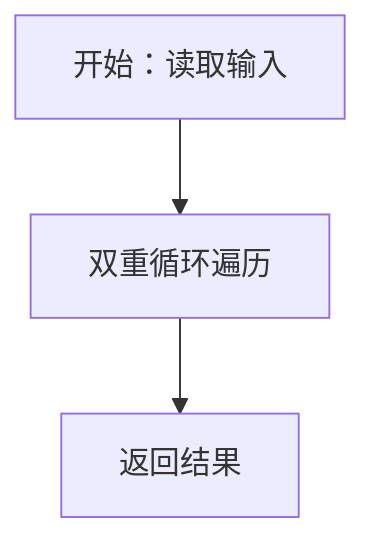
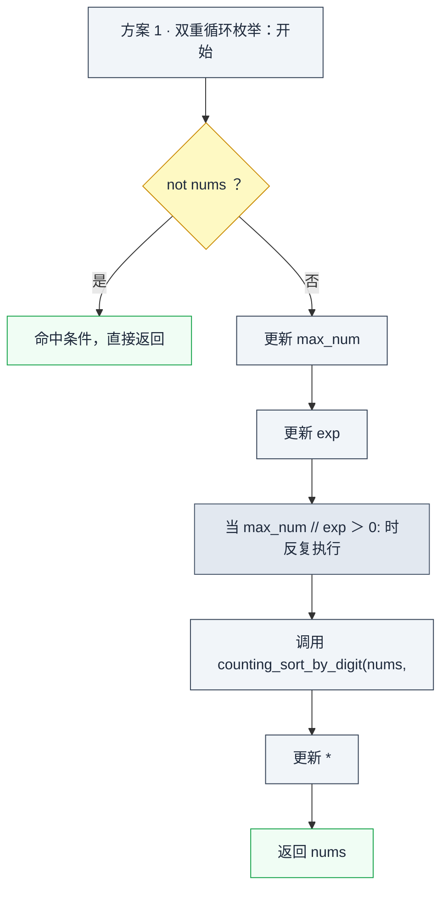
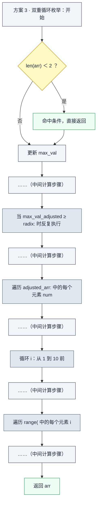
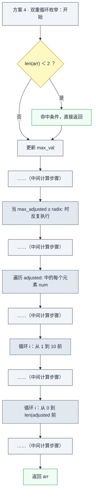
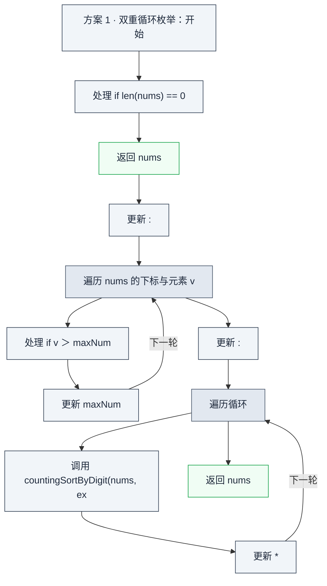
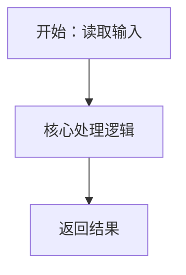
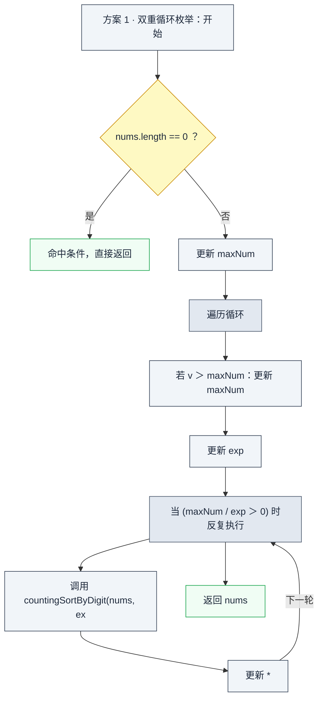
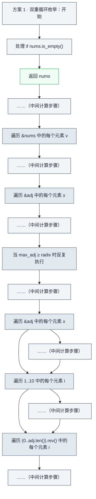
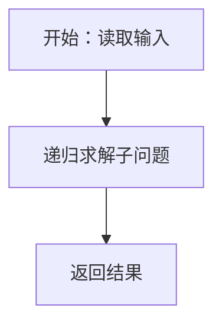

# 237 · 基数排序（第附阶段 · 专题补充 · Medium）

> **难度**：⭐⭐ Medium ｜ **专题**：算法笔记
> **学习定位**：第附阶段 · 专题补充第 237 篇 ｜ **解法数**：4
> **内容总结**：**基数排序**（算法笔记 · Medium）：共 4 个方案，主线思路「双重循环枚举」；时间 O(n²)（两层嵌套扫描）；动画演示归并分治过程，附录给出 11 种语言 × 全部方案的可运行实现。

---

## 题目描述

基数排序。具体输入输出约定见函数签名与用例。

- 主函数签名：`function radixSort(nums: number[]): number[]`

**用例演示**（摘自主解法内嵌自测，输入到输出一目了然）：

```typescript
  const cases: number[][] = [
    [1, 2, 3],
    [5, 4, 3, 2, 1],
    [3, 1, 4, 1, 5, 9, 2, 6, 5, 3, 5], // [3, 1, 4, 1, 5, 9, 2, 6, 5, 3, 5]
  ];
```

**数据范围与注意事项**：

- **易错点**：先看小例子手推一遍再对照代码，比直接读代码快得多。

## 题目分析

**场景是什么**：综合练习：把数据结构与策略组合起来解决一个完整问题。本题就是该场景的 Medium 级练习，主线做法是「双重循环枚举」。

**主线怎么解**：把主解法从头到尾过一遍，它其实在依次做这几件事：双重循环遍历。

## 解题思路

**方案对比**（共 4 个方案，由浅入深）：

| 方案 | 时间复杂度 | 空间复杂度 |
|---|---|---|
| 方案 1 · 双重循环枚举 | O(n²)（两层嵌套扫描） | O(1) 到 O(n) |
| 方案 2 · 双重循环枚举 | O(n²)（两层嵌套扫描） | O(1) 到 O(n) |
| 方案 3 · 双重循环枚举 | O(n²)（两层嵌套扫描） | O(1) 到 O(n) |
| 方案 4 · 双重循环枚举 | O(n²)（两层嵌套扫描） | O(1) 到 O(n) |

**方案间的取舍**：方案 1（双重循环枚举）；方案 2（双重循环枚举）；方案 3（双重循环枚举）；方案 4（双重循环枚举）。数据规模小、可读性优先时选靠前的方案；规模大、性能优先时选靠后的方案。

**怎么读这一篇**：

- 🐣 **新手路线**：把「题目描述」的示例 1 在纸上手推一遍 → 读方案 1（最直观的写法）与它的代码走读 → 按「运行方式」本地跑通看 PASS → 回头对比方案 2 之后的写法差在哪
- 🦅 **大佬路线**：直接锁定最优方案 1（双重循环枚举，O(n²)（两层嵌套扫描））→ 跳读该方案代码与走读 → 用「逐步拆解与面试追问」补齐复杂度推导与边界追问

### 动态算法图（归并分治，GIF 自动循环）


动画演示算法笔记专题里归并分治的典型过程；每个方案在「TypeScript 解题方案」一节还配了专属动画与专属流程图。

### 主解法流程图（真实控制流）



## TypeScript 解题方案（4 个方案逐个讲）

> **运行与提交**：每个方案都是自包含文件（内嵌用例自测，输出 PASS），整块复制到 `.ts` 文件后 `node 文件名` 即可运行。提交 LeetCode 时，把 `demo` 内的算法函数与辅助类型/函数整体取出、置于文件顶层即可。概念演示（非 LeetCode 编号题），在本地运行即可。

### 方案 1：双重循环枚举

**分析与思路**：核心做法是「双重循环枚举」。代码里依次做这些事：双重循环遍历。

**运行方式**：`node 本文件`，内嵌用例全部通过会输出 PASS。


**方案专属流程图**（真实控制流）：


```typescript
export function demo(): void {
  // 程序入口：跑内嵌自测用例
  function radixSort(nums: number[]): number[] {
    // 定义函数/方法 radixSort
    if (nums.length === 0) return nums; // 若 数组.长度 全等于 0，直接返回 数组
    let min_val = nums[0],
      max_val = nums[0]; // 把 数组[0], max_val 赋值为 数组[0] 存入 min_val
    for (const x of nums) {
      if (x < min_val) min_val = x;
      if (x > max_val) max_val = x;
    }
    const offset = min_val < 0 ? -min_val : 0; // 把 min_val 小于 0 ? 减 min_val : 0 存入 offset
    let adjusted = nums.map((x) => x + offset);
    let max_adjusted = adjusted[0]; // 把 adjusted[0] 存入 max_adjusted
    for (const x of adjusted) if (x > max_adjusted) max_adjusted = x;
    let radix = 1; // 把 1 存入 radix
    const tmp = new Array(adjusted.length).fill(0); // 把 new Array(adjusted.长度).fill(0) 存入 临时变量
    while (max_adjusted >= radix) {
      // 循环，直到不满足「max_adjusted 不低于 radix」
      const bucket = new Array(10).fill(0); // 把 new Array(10).fill(0) 存入 bucket
      for (const num of adjusted) {
        // for (const num of adjusted) {
        const d = Math.floor(num / radix) % 10; // 把 向下取整(num 除以 radix) 对…取模 10 存入 d
        bucket[d] += 1; // bucket[d]累加 1
      }
      for (let i = 1; i < 10; i++) bucket[i] += bucket[i - 1]; // 让 下标 i 从 1 开始计数，下标 i 小于 10 就继续
      for (let i = adjusted.length - 1; i >= 0; i--) {
        // 让 下标 i 从 adjusted.长度 减 1 开始计数，下标 i 不低于 0 就继续
        const d = Math.floor(adjusted[i] / radix) % 10; // 把 向下取整(adjusted[下标 i] 除以 radix) 对…取模 10 存入 d
        tmp[bucket[d] - 1] = adjusted[i]; // 把 adjusted[下标 i]; 写入 tmp[bucket[d] - 1]
        bucket[d] -= 1; // bucket[d]累减 1
      }
      for (let i = 0; i < adjusted.length; i++) adjusted[i] = tmp[i]; // 让 下标 i 从 0 开始计数，下标 i 小于 adjusted.长度 就继续
      radix *= 10; // 把 10; 写入 radix *
    }
    return adjusted.map((x) => x - offset);
  }
  const cases: number[][] = [
    [1, 2, 3],
    [5, 4, 3, 2, 1],
    [3, 1, 4, 1, 5, 9, 2, 6, 5, 3, 5], // [3, 1, 4, 1, 5, 9, 2, 6, 5, 3, 5]
  ];
  const wants: number[][] = [
    [1, 2, 3],
    [1, 2, 3, 4, 5],
    [1, 1, 2, 3, 3, 4, 5, 5, 5, 6, 9], // [1, 1, 2, 3, 3, 4, 5, 5, 5, 6, 9]
  ];
  let fail = false; // 把 false 存入 fail
  for (let i = 0; i < cases.length; i++) {
    // 让 下标 i 从 0 开始计数，下标 i 小于 cases.长度 就继续
    const got = radixSort(cases[i]); // 把 radixSort(cases[下标 i]) 存入 got
    if (got.length !== wants[i].length) {
      fail = true;
      console.log('FAIL len ' + i);
      continue;
    }
    for (let j = 0; j < got.length; j++)
      if (got[j] !== wants[i][j]) {
        fail = true;
        console.log(
          'FAIL case ' +
            i +
            ' idx ' +
            j +
            ' got ' +
            got[j] +
            ' want ' +
            wants[i][j],
        );
      } // 让 下标 j 从 0 开始计数，下标 j 小于 got.长度 就继续
  }
  if (fail) throw new Error('FAILED'); // 若 fail) throw new Error(「FAILED」);
  console.log('PASS'); // 全部用例通过，输出 PASS
}
demo(); // demo();
```

### 方案 2：双重循环枚举

**分析与思路**：核心做法是「双重循环枚举」。代码里依次做这些事：双重循环遍历。

**运行方式**：`node 本文件`，内嵌用例全部通过会输出 PASS。


**方案专属流程图**（真实控制流）：


```typescript
export function demo(): void {
  // 程序入口：跑内嵌自测用例
  function radixSort(nums: number[]): number[] {
    // 定义函数/方法 radixSort
    if (nums.length === 0) return nums; // 若 数组.长度 全等于 0，直接返回 数组
    let min_val = nums[0],
      max_val = nums[0]; // 把 数组[0], max_val 赋值为 数组[0] 存入 min_val
    for (const x of nums) {
      if (x < min_val) min_val = x;
      if (x > max_val) max_val = x;
    }
    const offset = min_val < 0 ? -min_val : 0; // 把 min_val 小于 0 ? 减 min_val : 0 存入 offset
    let adjusted = nums.map((x) => x + offset);
    let max_adjusted = adjusted[0]; // 把 adjusted[0] 存入 max_adjusted
    for (const x of adjusted) if (x > max_adjusted) max_adjusted = x;
    let radix = 1; // 把 1 存入 radix
    const tmp = new Array(adjusted.length).fill(0); // 把 new Array(adjusted.长度).fill(0) 存入 临时变量
    while (max_adjusted >= radix) {
      // 循环，直到不满足「max_adjusted 不低于 radix」
      const bucket = new Array(10).fill(0); // 把 new Array(10).fill(0) 存入 bucket
      for (const num of adjusted) {
        // for (const num of adjusted) {
        const d = Math.floor(num / radix) % 10; // 把 向下取整(num 除以 radix) 对…取模 10 存入 d
        bucket[d] += 1; // bucket[d]累加 1
      }
      for (let i = 1; i < 10; i++) bucket[i] += bucket[i - 1]; // 让 下标 i 从 1 开始计数，下标 i 小于 10 就继续
      for (let i = adjusted.length - 1; i >= 0; i--) {
        // 让 下标 i 从 adjusted.长度 减 1 开始计数，下标 i 不低于 0 就继续
        const d = Math.floor(adjusted[i] / radix) % 10; // 把 向下取整(adjusted[下标 i] 除以 radix) 对…取模 10 存入 d
        tmp[bucket[d] - 1] = adjusted[i]; // 把 adjusted[下标 i]; 写入 tmp[bucket[d] - 1]
        bucket[d] -= 1; // bucket[d]累减 1
      }
      for (let i = 0; i < adjusted.length; i++) adjusted[i] = tmp[i]; // 让 下标 i 从 0 开始计数，下标 i 小于 adjusted.长度 就继续
      radix *= 10; // 把 10; 写入 radix *
    }
    return adjusted.map((x) => x - offset);
  }
  const cases: number[][] = [
    [1, 2, 3],
    [5, 4, 3, 2, 1],
    [3, 1, 4, 1, 5, 9, 2, 6, 5, 3, 5], // [3, 1, 4, 1, 5, 9, 2, 6, 5, 3, 5]
  ];
  const wants: number[][] = [
    [1, 2, 3],
    [1, 2, 3, 4, 5],
    [1, 1, 2, 3, 3, 4, 5, 5, 5, 6, 9], // [1, 1, 2, 3, 3, 4, 5, 5, 5, 6, 9]
  ];
  let fail = false; // 把 false 存入 fail
  for (let i = 0; i < cases.length; i++) {
    // 让 下标 i 从 0 开始计数，下标 i 小于 cases.长度 就继续
    const got = radixSort(cases[i]); // 把 radixSort(cases[下标 i]) 存入 got
    if (got.length !== wants[i].length) {
      fail = true;
      console.log('FAIL len ' + i);
      continue;
    }
    for (let j = 0; j < got.length; j++)
      if (got[j] !== wants[i][j]) {
        fail = true;
        console.log(
          'FAIL case ' +
            i +
            ' idx ' +
            j +
            ' got ' +
            got[j] +
            ' want ' +
            wants[i][j],
        );
      } // 让 下标 j 从 0 开始计数，下标 j 小于 got.长度 就继续
  }
  if (fail) throw new Error('FAILED'); // 若 fail) throw new Error(「FAILED」);
  console.log('PASS'); // 全部用例通过，输出 PASS
}
demo(); // demo();
```

### 方案 3：双重循环枚举

**分析与思路**：核心做法是「双重循环枚举」。代码里依次做这些事：双重循环遍历。

**运行方式**：`node 本文件`，内嵌用例全部通过会输出 PASS。


**方案专属流程图**（真实控制流）：


```typescript
export function demo(): void {
  // 程序入口：跑内嵌自测用例
  function radixSort(nums: number[]): number[] {
    // 定义函数/方法 radixSort
    if (nums.length === 0) return nums; // 若 数组.长度 全等于 0，直接返回 数组
    let min_val = nums[0],
      max_val = nums[0]; // 把 数组[0], max_val 赋值为 数组[0] 存入 min_val
    for (const x of nums) {
      if (x < min_val) min_val = x;
      if (x > max_val) max_val = x;
    }
    const offset = min_val < 0 ? -min_val : 0; // 把 min_val 小于 0 ? 减 min_val : 0 存入 offset
    let adjusted = nums.map((x) => x + offset);
    let max_adjusted = adjusted[0]; // 把 adjusted[0] 存入 max_adjusted
    for (const x of adjusted) if (x > max_adjusted) max_adjusted = x;
    let radix = 1; // 把 1 存入 radix
    const tmp = new Array(adjusted.length).fill(0); // 把 new Array(adjusted.长度).fill(0) 存入 临时变量
    while (max_adjusted >= radix) {
      // 循环，直到不满足「max_adjusted 不低于 radix」
      const bucket = new Array(10).fill(0); // 把 new Array(10).fill(0) 存入 bucket
      for (const num of adjusted) {
        // for (const num of adjusted) {
        const d = Math.floor(num / radix) % 10; // 把 向下取整(num 除以 radix) 对…取模 10 存入 d
        bucket[d] += 1; // bucket[d]累加 1
      }
      for (let i = 1; i < 10; i++) bucket[i] += bucket[i - 1]; // 让 下标 i 从 1 开始计数，下标 i 小于 10 就继续
      for (let i = adjusted.length - 1; i >= 0; i--) {
        // 让 下标 i 从 adjusted.长度 减 1 开始计数，下标 i 不低于 0 就继续
        const d = Math.floor(adjusted[i] / radix) % 10; // 把 向下取整(adjusted[下标 i] 除以 radix) 对…取模 10 存入 d
        tmp[bucket[d] - 1] = adjusted[i]; // 把 adjusted[下标 i]; 写入 tmp[bucket[d] - 1]
        bucket[d] -= 1; // bucket[d]累减 1
      }
      for (let i = 0; i < adjusted.length; i++) adjusted[i] = tmp[i]; // 让 下标 i 从 0 开始计数，下标 i 小于 adjusted.长度 就继续
      radix *= 10; // 把 10; 写入 radix *
    }
    return adjusted.map((x) => x - offset);
  }
  const cases: number[][] = [
    [1, 2, 3],
    [5, 4, 3, 2, 1],
    [3, 1, 4, 1, 5, 9, 2, 6, 5, 3, 5], // [3, 1, 4, 1, 5, 9, 2, 6, 5, 3, 5]
  ];
  const wants: number[][] = [
    [1, 2, 3],
    [1, 2, 3, 4, 5],
    [1, 1, 2, 3, 3, 4, 5, 5, 5, 6, 9], // [1, 1, 2, 3, 3, 4, 5, 5, 5, 6, 9]
  ];
  let fail = false; // 把 false 存入 fail
  for (let i = 0; i < cases.length; i++) {
    // 让 下标 i 从 0 开始计数，下标 i 小于 cases.长度 就继续
    const got = radixSort(cases[i]); // 把 radixSort(cases[下标 i]) 存入 got
    if (got.length !== wants[i].length) {
      fail = true;
      console.log('FAIL len ' + i);
      continue;
    }
    for (let j = 0; j < got.length; j++)
      if (got[j] !== wants[i][j]) {
        fail = true;
        console.log(
          'FAIL case ' +
            i +
            ' idx ' +
            j +
            ' got ' +
            got[j] +
            ' want ' +
            wants[i][j],
        );
      } // 让 下标 j 从 0 开始计数，下标 j 小于 got.长度 就继续
  }
  if (fail) throw new Error('FAILED'); // 若 fail) throw new Error(「FAILED」);
  console.log('PASS'); // 全部用例通过，输出 PASS
}
demo(); // demo();
```

### 方案 4：双重循环枚举

**分析与思路**：核心做法是「双重循环枚举」。代码里依次做这些事：双重循环遍历。

**运行方式**：`node 本文件`，内嵌用例全部通过会输出 PASS。


**方案专属流程图**（真实控制流）：


```typescript
export function demo(): void {
  // 程序入口：跑内嵌自测用例
  function radixSort(nums: number[]): number[] {
    // 定义函数/方法 radixSort
    if (nums.length === 0) return nums; // 若 数组.长度 全等于 0，直接返回 数组
    let min_val = nums[0],
      max_val = nums[0]; // 把 数组[0], max_val 赋值为 数组[0] 存入 min_val
    for (const x of nums) {
      if (x < min_val) min_val = x;
      if (x > max_val) max_val = x;
    }
    const offset = min_val < 0 ? -min_val : 0; // 把 min_val 小于 0 ? 减 min_val : 0 存入 offset
    let adjusted = nums.map((x) => x + offset);
    let max_adjusted = adjusted[0]; // 把 adjusted[0] 存入 max_adjusted
    for (const x of adjusted) if (x > max_adjusted) max_adjusted = x;
    let radix = 1; // 把 1 存入 radix
    const tmp = new Array(adjusted.length).fill(0); // 把 new Array(adjusted.长度).fill(0) 存入 临时变量
    while (max_adjusted >= radix) {
      // 循环，直到不满足「max_adjusted 不低于 radix」
      const bucket = new Array(10).fill(0); // 把 new Array(10).fill(0) 存入 bucket
      for (const num of adjusted) {
        // for (const num of adjusted) {
        const d = Math.floor(num / radix) % 10; // 把 向下取整(num 除以 radix) 对…取模 10 存入 d
        bucket[d] += 1; // bucket[d]累加 1
      }
      for (let i = 1; i < 10; i++) bucket[i] += bucket[i - 1]; // 让 下标 i 从 1 开始计数，下标 i 小于 10 就继续
      for (let i = adjusted.length - 1; i >= 0; i--) {
        // 让 下标 i 从 adjusted.长度 减 1 开始计数，下标 i 不低于 0 就继续
        const d = Math.floor(adjusted[i] / radix) % 10; // 把 向下取整(adjusted[下标 i] 除以 radix) 对…取模 10 存入 d
        tmp[bucket[d] - 1] = adjusted[i]; // 把 adjusted[下标 i]; 写入 tmp[bucket[d] - 1]
        bucket[d] -= 1; // bucket[d]累减 1
      }
      for (let i = 0; i < adjusted.length; i++) adjusted[i] = tmp[i]; // 让 下标 i 从 0 开始计数，下标 i 小于 adjusted.长度 就继续
      radix *= 10; // 把 10; 写入 radix *
    }
    return adjusted.map((x) => x - offset);
  }
  const cases: number[][] = [
    [1, 2, 3],
    [5, 4, 3, 2, 1],
    [3, 1, 4, 1, 5, 9, 2, 6, 5, 3, 5], // [3, 1, 4, 1, 5, 9, 2, 6, 5, 3, 5]
  ];
  const wants: number[][] = [
    [1, 2, 3],
    [1, 2, 3, 4, 5],
    [1, 1, 2, 3, 3, 4, 5, 5, 5, 6, 9], // [1, 1, 2, 3, 3, 4, 5, 5, 5, 6, 9]
  ];
  let fail = false; // 把 false 存入 fail
  for (let i = 0; i < cases.length; i++) {
    // 让 下标 i 从 0 开始计数，下标 i 小于 cases.长度 就继续
    const got = radixSort(cases[i]); // 把 radixSort(cases[下标 i]) 存入 got
    if (got.length !== wants[i].length) {
      fail = true;
      console.log('FAIL len ' + i);
      continue;
    }
    for (let j = 0; j < got.length; j++)
      if (got[j] !== wants[i][j]) {
        fail = true;
        console.log(
          'FAIL case ' +
            i +
            ' idx ' +
            j +
            ' got ' +
            got[j] +
            ' want ' +
            wants[i][j],
        );
      } // 让 下标 j 从 0 开始计数，下标 j 小于 got.长度 就继续
  }
  if (fail) throw new Error('FAILED'); // 若 fail) throw new Error(「FAILED」);
  console.log('PASS'); // 全部用例通过，输出 PASS
}
demo(); // demo();
```

## 逐步拆解与面试追问

**复杂度**：时间 O(n²)（两层嵌套扫描），空间 O(1) 到 O(n)

**为什么是这个量级**：外层定起点、内层扫终点，n 个起点各扫 n 次

**面试官可能会追问**：

- 这个策略能推广到什么场景？
- 与暴力做法差在哪一步？
- 有没有更简单的等价写法？

## 关键 API 速查（TS 主解法实际用到，附官方链接）

| API | 作用 | 使用要点 | 官方文档 |
|---|---|---|---|
| `Array.prototype.map()` | 逐元素映射为新数组 | 回调 (v,i,arr)；返回等长新数组，不改变原数组；稀疏位跳过；链式调用注意中间数组开销 | [官方文档](https://developer.mozilla.org/zh-CN/docs/Web/JavaScript/Reference/Global_Objects/Array/map) |
| `Math.floor()` | 向下取整 | 负数向负无穷（-1.5 → -2）；大数用位运算前注意 2^31 界 | [官方文档](https://developer.mozilla.org/zh-CN/docs/Web/JavaScript/Reference/Global_Objects/Math/floor) |

### 各语言官方文档导航

- **TypeScript / JS**：[MDN 中文参考](https://developer.mozilla.org/zh-CN/)
- **Python**：[Python 官方文档](https://docs.python.org/zh-cn/3/)
- **Go**：[Go 标准库](https://pkg.go.dev/std)
- **Java**：[JDK 17 API](https://docs.oracle.com/en/java/javase/17/docs/api/)
- **Rust**：[Rust 标准库](https://doc.rust-lang.org/std/)
- **Lua**：[Lua 5.4 手册](https://www.lua.org/manual/5.4/)
- **C**：[Cppreference C](https://zh.cppreference.com/w/c)
- **C++**：[Cppreference C++](https://zh.cppreference.com/w/cpp)
- **R**：[R 官方手册](https://stat.ethz.ch/R-manual/)
- **Zig**：[Zig 语言文档](https://ziglang.org/documentation/master/)
- **Dart**：[Dart API](https://api.dart.dev/)

## 附录：其他 10 种语言全部实现（每种语言列举其全部方案）

> TypeScript 的全部方案见「TypeScript 解题方案」一节；下面是其余 10 种语言的对应实现，每种语言的每个方案都带思路分析、代码走读与专属运行架构图。
> 每个方案都内嵌用例自测，可独立运行（老仓库 python/go 文件遵循「打印结果」约定）。
> 完整解法文件见 `dsa/<语言>/notes/lc_134191965_基数排序/`。

### Python 实现（4 种方案）

Python 的全部方案如下，每个方案都内嵌用例自测，可独立运行（老仓库 python/go 文件遵循「打印结果」约定）：

#### 方案 1：双重循环枚举

**思路与代码分析**：核心是「双重循环枚举」。Python 版用切片与字典推导式简化操作，突出可读性。**走读**：方案 1 · 双重循环枚举：开始 → 命中条件，直接返回 → 更新 max_num → 更新 exp → 当 max_num // exp ＞ 0: 时反复执行 → 调用 counting_sort_by_digit(nums, → 更新 * → 返回 nums。

**运行架构**（真实控制流）：



```python
import sys  # 提高递归深度上限（深输入防 RecursionError）

sys.setrecursionlimit(200000)  # 树/链表类题目节点数可达 1e4 量级

def radixSort(nums):  # 定义函数 radixSort（参数：数组）
    if not nums:  # 若 not 数组
        return nums  # 返回 数组
    max_num = max(nums)  # 把 取较大值 数组) 存入 max_num
    exp = 1  # 把 1 存入 exp
    while max_num // exp > 0:  # 循环，直到不满足「max_num 除以 除以 exp 超过 0」
        counting_sort_by_digit(nums, exp)  # counting_sort_by_digit(数组, exp)
        exp *= 10  # 把 10 写入 exp *
    return nums  # 返回 数组

def counting_sort_by_digit(nums, exp):  # 定义函数 counting_sort_by_digit（参数：数组, exp）
    n = len(nums)  # 把 长度(数组) 存入 元素个数
    output = [0] * n  # 把 [0] 乘 元素个数 存入 输出
    count = [0] * 10  # 把 [0] 乘 10 存入 计数
    for i in range(n):  # 让 下标 i 从 元素个数 遍历
        index = nums[i] // exp  # 把 数组[下标 i] 除以 除以 exp 存入 index
        count[index % 10] += 1  # 把 1 写入 count[index % 10] +
    for i in range(1, 10):  # 让 下标 i 从 1 到 10 遍历
        count[i] += count[i - 1]  # count[i]累加 计数[下标 i 减 1]
    for i in range(n - 1, -1, -1):  # 让 下标 i 从 元素个数 减 1 倒数回去（每步减 1）
        index = nums[i] // exp  # 把 数组[下标 i] 除以 除以 exp 存入 index
        output[count[index % 10] - 1] = nums[i]  # 把 数组[下标 i] 写入 output[count[index % 10] - 1]
        count[index % 10] -= 1  # 把 1 写入 count[index % 10] -
    for i in range(n):  # 让 下标 i 从 元素个数 遍历
        nums[i] = output[i]  # 把 输出[下标 i] 写入 nums[i]

if __name__ == "__main__":  # 若 __name__ 等于 '__main__'
    print(radixSort([1, 2, 3]))  # 打印输出
```

#### 方案 2：双重循环枚举

**思路与代码分析**：核心是「双重循环枚举」。Python 版用切片与字典推导式简化操作，突出可读性。**走读**：方案 2 · 双重循环枚举：开始 → 命中条件，直接返回 → 更新 max_num → 更新 exp → 当 max_num // exp ＞ 0: 时反复执行 → 调用 counting_sort_by_digit(nums, → 更新 * → 返回 nums。

**运行架构**（真实控制流）：


```python
import sys  # 提高递归深度上限（深输入防 RecursionError）

sys.setrecursionlimit(200000)  # 树/链表类题目节点数可达 1e4 量级

def radixSort(nums):  # 定义函数 radixSort（参数：数组）
    if not nums:  # 若 not 数组
        return nums  # 返回 数组
    max_num = max(nums)  # 把 取较大值 数组) 存入 max_num
    exp = 1  # 把 1 存入 exp
    while max_num // exp > 0:  # 循环，直到不满足「max_num 除以 除以 exp 超过 0」
        counting_sort_by_digit(nums, exp)  # counting_sort_by_digit(数组, exp)
        exp *= 10  # 把 10 写入 exp *
    return nums  # 返回 数组

def counting_sort_by_digit(nums, exp):  # 定义函数 counting_sort_by_digit（参数：数组, exp）
    n = len(nums)  # 把 长度(数组) 存入 元素个数
    output = [0] * n  # 把 [0] 乘 元素个数 存入 输出
    count = [0] * 10  # 把 [0] 乘 10 存入 计数
    for i in range(n):  # 让 下标 i 从 元素个数 遍历
        index = nums[i] // exp  # 把 数组[下标 i] 除以 除以 exp 存入 index
        count[index % 10] += 1  # 把 1 写入 count[index % 10] +
    for i in range(1, 10):  # 让 下标 i 从 1 到 10 遍历
        count[i] += count[i - 1]  # count[i]累加 计数[下标 i 减 1]
    for i in range(n - 1, -1, -1):  # 让 下标 i 从 元素个数 减 1 倒数回去（每步减 1）
        index = nums[i] // exp  # 把 数组[下标 i] 除以 除以 exp 存入 index
        output[count[index % 10] - 1] = nums[i]  # 把 数组[下标 i] 写入 output[count[index % 10] - 1]
        count[index % 10] -= 1  # 把 1 写入 count[index % 10] -
    for i in range(n):  # 让 下标 i 从 元素个数 遍历
        nums[i] = output[i]  # 把 输出[下标 i] 写入 nums[i]

if __name__ == "__main__":  # 若 __name__ 等于 '__main__'
    print(radixSort([1, 2, 3]))  # 打印输出
```

#### 方案 3：双重循环枚举

**思路与代码分析**：核心是「双重循环枚举」。Python 版用切片与字典推导式简化操作，突出可读性。**走读**：方案 3 · 双重循环枚举：开始 → 命中条件，直接返回 → 更新 max_val → 当 max_val_adjusted ≥ radix: 时反复执行 → 遍历 adjusted_arr: 中的每个元素 num → 循环 i：从 1 到 10 前 → 遍历 range( 中的每个元素 i → 返回 arr。

**运行架构**（真实控制流）：



```python
import sys  # 提高递归深度上限（深输入防 RecursionError）

sys.setrecursionlimit(200000)  # 树/链表类题目节点数可达 1e4 量级

def radix_sort(arr):  # 定义函数 radix_sort（参数：数组）
    if len(arr) < 2:  # 若 长度(数组) 小于 2
        return arr  # 返回 数组
    max_val = max(arr)  # 把 取较大值 数组) 存入 max_val
    min_val = min(arr)  # 把 取较小值 数组) 存入 min_val
    offset = -min_val if min_val < 0 else 0  # 把 减 min_val if min_val 小于 0 else 0 存入 offset
    adjusted_arr = [num + offset for num in arr]  # 把 [num 加 offset for num in 数组] 存入 adjusted_arr
    max_val_adjusted = max(adjusted_arr)  # 把 取较大值 adjusted_arr) 存入 max_val_adjusted
    radix = 1  # 把 1 存入 radix
    tmp = [0] * len(arr)  # 把 [0] 乘 长度(数组) 存入 临时变量
    while max_val_adjusted >= radix:  # 循环，直到不满足「max_val_adjusted 不低于 radix」
        bucket = [0] * 10  # 把 [0] 乘 10 存入 bucket
        for num in adjusted_arr:  # 逐个取出 adjusted_arr 的元素（num）
            current_radix_num = (
                num // radix
            ) % 10  # 把 (num 除以 除以 radix) 对…取模 10 存入 current_radix_num
            bucket[current_radix_num] += 1  # bucket[current_radix_num]累加 1
        for i in range(1, 10):  # 让 下标 i 从 1 到 10 遍历
            bucket[i] += bucket[i - 1]  # bucket[i]累加 bucket[下标 i 减 1]
        for i in range(
            len(adjusted_arr) - 1, -1, -1
        ):  # 让 下标 i 从 长度(adjusted_arr) 减 1 倒数回去（每步减 1）
            current_radix_num = (adjusted_arr[i] // radix) % 10
            current_index = (
                bucket[current_radix_num] - 1
            )  # 把 bucket[current_radix_num] 减 1 存入 current_index
            tmp[current_index] = adjusted_arr[i]  # 把 adjusted_arr[下标 i] 写入 tmp[current_index]
            bucket[current_radix_num] -= 1  # bucket[current_radix_num]累减 1
        adjusted_arr[:] = tmp[:]  # 把 复制 临时变量 写入 adjusted_arr[:]
        radix *= 10  # 把 10 写入 radix *
    arr[:] = [num - offset for num in adjusted_arr]  # 把 [num 减 offset for num in adjusted_arr] 写入 arr[:]
    return arr  # 返回 数组

def test_radix_sort():  # 定义函数 test_radix_sort（参数：无）
    test_cases = [
        [100, 34, 1002, 1234, 66, 137, 49, 102, 9, 108, 102, 101, 104, 109, 102],
        [5, 4, 3, 2, 1],
        [1, 2, 3, 4, 5],
        [3, 1, 4, 1, 5, 9, 2, 6, 5, 3, 5],
        [],
        [1],
        [-2, 1, 0, -9, 1, 3, 9, 99, 9, -30, -100, 100, 88, 88, 20, 1, 0, 3, 4, 5, -20],
    ]
    for test_case in test_cases:  # 逐个取出 test_cases 的元素（test_case）
        copy_list = test_case[:]  # 把 复制 test_case 存入 copy_list
        sorted_list = radix_sort(copy_list)  # 把 radix_sort(copy_list) 存入 sorted_list
        print(f"Original: {test_case}, Sorted: {sorted_list}")  # 打印输出

if __name__ == "__main__":  # 若 __name__ 等于 '__main__'
    test_radix_sort()  # test_radix_sort()
```

#### 方案 4：双重循环枚举

**思路与代码分析**：核心是「双重循环枚举」。Python 版用切片与字典推导式简化操作，突出可读性。**走读**：方案 4 · 双重循环枚举：开始 → 命中条件，直接返回 → 更新 max_val → 当 max_adjusted ≥ radix: 时反复执行 → 遍历 adjusted: 中的每个元素 num → 循环 i：从 1 到 10 前 → 循环 i：从 0 到 len(adjusted 前 → 返回 arr。

**运行架构**（真实控制流）：



```python
import sys  # 提高递归深度上限（深输入防 RecursionError）

sys.setrecursionlimit(200000)  # 树/链表类题目节点数可达 1e4 量级

def radix_sort(arr):  # 定义函数 radix_sort（参数：数组）
    # 基数排序（LSD，基于计数排序思想），支持负数，时间复杂度 O(kn)
    if len(arr) < 2:  # 若 长度(数组) 小于 2
        return arr  # 返回 数组
    max_val = max(arr)  # 把 取较大值 数组) 存入 max_val
    min_val = min(arr)  # 把 取较小值 数组) 存入 min_val
    # 若有负数，整体平移为非负
    offset = -min_val if min_val < 0 else 0  # 把 减 min_val if min_val 小于 0 else 0 存入 offset
    adjusted = [num + offset for num in arr]  # 把 [num 加 offset for num in 数组] 存入 adjusted
    max_adjusted = max(adjusted)  # 把 取较大值 adjusted) 存入 max_adjusted
    radix = 1  # 把 1 存入 radix
    tmp = [0] * len(arr)  # 把 [0] 乘 长度(数组) 存入 临时变量
    while max_adjusted >= radix:  # 循环，直到不满足「max_adjusted 不低于 radix」
        bucket = [0] * 10  # 把 [0] 乘 10 存入 bucket
        for num in adjusted:  # 逐个取出 adjusted 的元素（num）
            bucket[(num // radix) % 10] += 1  # 把 1 写入 bucket[(num // radix) % 10] +
        for i in range(1, 10):  # 让 下标 i 从 1 到 10 遍历
            bucket[i] += bucket[i - 1]  # bucket[i]累加 bucket[下标 i 减 1]
        for i in range(len(adjusted) - 1, -1, -1):  # 让 下标 i 从 长度(adjusted) 减 1 倒数回去（每步减 1）
            d = (adjusted[i] // radix) % 10  # 把 (adjusted[下标 i] 除以 除以 radix) 对…取模 10 存入 d
            tmp[bucket[d] - 1] = adjusted[i]  # 把 adjusted[下标 i] 写入 tmp[bucket[d] - 1]
            bucket[d] -= 1  # bucket[d]累减 1
        adjusted[:] = tmp[:]  # 把 复制 临时变量 写入 adjusted[:]
        radix *= 10  # 把 10 写入 radix *
    arr[:] = [num - offset for num in adjusted]  # 把 [num 减 offset for num in adjusted] 写入 arr[:]
    return arr  # 返回 数组

if __name__ == "__main__":  # 若 __name__ 等于 '__main__'
    test_cases = [
        [100, 34, 1002, 1234, 66, 137, 49, 102, 9, 108, 102, 101, 104, 109, 102],
        [5, 4, 3, 2, 1],
        [1, 2, 3, 4, 5],
        [3, 1, 4, 1, 5, 9, 2, 6, 5, 3, 5],
        [],
        [1],
        [-2, 1, 0, -9, 1, 3, 9, 99, 9, -30, -100, 100, 88, 88, 20, 1, 0, 3, 4, 5, -20],
    ]
    for case in test_cases:  # 逐个取出 test_cases 的元素（case）
        print(radix_sort(case[:]))  # 打印输出
```

### Go 实现（4 种方案）

Go 的全部方案如下，每个方案都内嵌用例自测，可独立运行（老仓库 python/go 文件遵循「打印结果」约定）：

#### 方案 1：双重循环枚举

**思路与代码分析**：核心是「双重循环枚举」。Go 版用切片与多返回值惯用法，显式处理索引边界。**走读**：方案 1 · 双重循环枚举：开始 → 处理 if len(nums) == 0 → 返回 nums → 更新 : → 遍历 nums 的下标与元素 v → 处理 if v ＞ maxNum → 更新 maxNum → 更新 : → 遍历循环 → 调用 countingSortByDigit(nums, ex → 更新 * → 返回 nums。

**运行架构**（真实控制流）：



```go
package main // 引入依赖
import (
	"fmt"
	"os"
	"reflect"
) // 引入依赖
func radixSort(nums []int) []int { // 定义函数/方法 radixSort
	if len(nums) == 0 {
		return nums
	} // 若 长度(数组) 等于 0 { return 数组 }
	maxNum := nums[0] // 把 数组[0] 写入 maxNum :
	for _, v := range nums {
		if v > maxNum {
			maxNum = v
		}
	} // 同时取 _ 与 值 遍历
	exp := 1             // 把 1 写入 exp :
	for maxNum/exp > 0 { // for maxNum 除以 exp 超过 0 {
		countingSortByDigit(nums, exp) // countingSortByDigit(数组, exp)
		exp *= 10                      // 把 10 写入 exp *
	}
	return nums // 返回 数组
}
func countingSortByDigit(nums []int, exp int) { // 定义函数/方法 countingSortByDigit
	n := len(nums)           // 把 长度(数组) 写入 n :
	output := make([]int, n) // 把 make([]int, 元素个数) 写入 output :
	count := make([]int, 10) // 把 make([]int, 10) 写入 count :
	for i := 0; i < n; i++ { // 让 下标 i 从 0 开始计数
		index := nums[i] / exp // 把 数组[下标 i] 除以 exp 写入 index :
		count[index%10]++      // 计数[index 对…取模 10] 加一
	}
	for i := 1; i < 10; i++ {
		count[i] += count[i-1]
	} // 让 下标 i 从 1 开始计数
	for i := n - 1; i >= 0; i-- { // 把 元素个数 减 1; 下标 i 不低于 0; 下标 i 减一 { 写入 for i :
		index := nums[i] / exp              // 把 数组[下标 i] 除以 exp 写入 index :
		output[count[index%10]-1] = nums[i] // 把 数组[下标 i] 写入 output[count[index%10]-1]
		count[index%10]--                   // 计数[index 对…取模 10] 减一
	}
	for i := 0; i < n; i++ {
		nums[i] = output[i]
	} // 让 下标 i 从 0 开始计数
}

func main() { // 程序入口：跑内嵌自测用例
	cases := []struct {
		in   []int
		want []int
	}{ // 把 []struct{ in []int; want []int }{ 写入 cases :
		{[]int{1, 2, 3}, []int{1, 2, 3}},
		{[]int{5, 4, 3, 2, 1}, []int{1, 2, 3, 4, 5}},
	}
	ok := true                // 把 true 写入 ok :
	for _, c := range cases { // 同时取 _ 与 字符 遍历
		in := make([]int, len(c.in))         // 把 make([]int, 长度(字符.in)) 写入 in :
		copy(in, c.in)                       // copy(in, 字符.in)
		got := radixSort(in)                 // 把 radixSort(in) 写入 got :
		if !reflect.DeepEqual(got, c.want) { // 若 取反 reflect.DeepEqual(got, 字符.want
			ok = false
			fmt.Printf("FAIL radixSort(%v)=%v want %v\n", c.in, got, c.want) // 打印输出
		}
	}
	if !ok {
		os.Exit(1)
	} // 若 取反 ok { os.Exit(1) }
	fmt.Println("PASS") // 全部用例通过，输出 PASS
}
```

#### 方案 2：双重循环枚举

**思路与代码分析**：核心是「双重循环枚举」。Go 版用切片与多返回值惯用法，显式处理索引边界。**走读**：方案 2 · 双重循环枚举：开始 → 处理 if len(nums) == 0 → 返回 nums → 更新 : → 遍历 nums 的下标与元素 v → 处理 if v ＞ maxNum → 更新 maxNum → 更新 : → 遍历循环 → 调用 countingSortByDigit(nums, ex → 更新 * → 返回 nums。

**运行架构**（真实控制流）：


```go
package main // 引入依赖
import (
	"fmt"
	"os"
	"reflect"
) // 引入依赖
func radixSort(nums []int) []int { // 定义函数/方法 radixSort
	if len(nums) == 0 {
		return nums
	} // 若 长度(数组) 等于 0 { return 数组 }
	maxNum := nums[0] // 把 数组[0] 写入 maxNum :
	for _, v := range nums {
		if v > maxNum {
			maxNum = v
		}
	} // 同时取 _ 与 值 遍历
	exp := 1             // 把 1 写入 exp :
	for maxNum/exp > 0 { // for maxNum 除以 exp 超过 0 {
		countingSortByDigit(nums, exp) // countingSortByDigit(数组, exp)
		exp *= 10                      // 把 10 写入 exp *
	}
	return nums // 返回 数组
}
func countingSortByDigit(nums []int, exp int) { // 定义函数/方法 countingSortByDigit
	n := len(nums)           // 把 长度(数组) 写入 n :
	output := make([]int, n) // 把 make([]int, 元素个数) 写入 output :
	count := make([]int, 10) // 把 make([]int, 10) 写入 count :
	for i := 0; i < n; i++ { // 让 下标 i 从 0 开始计数
		index := nums[i] / exp // 把 数组[下标 i] 除以 exp 写入 index :
		count[index%10]++      // 计数[index 对…取模 10] 加一
	}
	for i := 1; i < 10; i++ {
		count[i] += count[i-1]
	} // 让 下标 i 从 1 开始计数
	for i := n - 1; i >= 0; i-- { // 把 元素个数 减 1; 下标 i 不低于 0; 下标 i 减一 { 写入 for i :
		index := nums[i] / exp              // 把 数组[下标 i] 除以 exp 写入 index :
		output[count[index%10]-1] = nums[i] // 把 数组[下标 i] 写入 output[count[index%10]-1]
		count[index%10]--                   // 计数[index 对…取模 10] 减一
	}
	for i := 0; i < n; i++ {
		nums[i] = output[i]
	} // 让 下标 i 从 0 开始计数
}

func main() { // 程序入口：跑内嵌自测用例
	cases := []struct {
		in   []int
		want []int
	}{ // 把 []struct{ in []int; want []int }{ 写入 cases :
		{[]int{1, 2, 3}, []int{1, 2, 3}},
		{[]int{5, 4, 3, 2, 1}, []int{1, 2, 3, 4, 5}},
	}
	ok := true                // 把 true 写入 ok :
	for _, c := range cases { // 同时取 _ 与 字符 遍历
		in := make([]int, len(c.in))         // 把 make([]int, 长度(字符.in)) 写入 in :
		copy(in, c.in)                       // copy(in, 字符.in)
		got := radixSort(in)                 // 把 radixSort(in) 写入 got :
		if !reflect.DeepEqual(got, c.want) { // 若 取反 reflect.DeepEqual(got, 字符.want
			ok = false
			fmt.Printf("FAIL radixSort(%v)=%v want %v\n", c.in, got, c.want) // 打印输出
		}
	}
	if !ok {
		os.Exit(1)
	} // 若 取反 ok { os.Exit(1) }
	fmt.Println("PASS") // 全部用例通过，输出 PASS
}
```

#### 方案 3：双重循环枚举

**思路与代码分析**：核心是「双重循环枚举」。Go 版用切片与多返回值惯用法，显式处理索引边界。

**运行架构**（真实控制流）：



```go
package main // 引入依赖
import (
	"fmt"
	"os"
	"reflect"
) // 引入依赖
func radixSort(arr []int) []int { // 定义函数/方法 radixSort
	if len(arr) < 2 {
		return arr
	} // 若 长度(数组) 小于 2 { return 数组 }
	maxVal := arr[0]
	minVal := arr[0] // 把 数组[0]; minVal : 赋值为 数组[0] 写入 maxVal :
	for _, v := range arr {
		if v > maxVal {
			maxVal = v
		}
		if v < minVal {
			minVal = v
		}
	} // 同时取 _ 与 值 遍历
	offset := 0 // 把 0 写入 offset :
	if minVal < 0 {
		offset = -minVal
	} // 若 minVal 小于 0 { offset 赋值为 减 minVal }
	adjusted := make([]int, len(arr)) // 把 make([]int, 长度(数组)) 写入 adjusted :
	for i, v := range arr {
		adjusted[i] = v + offset
	} // 同时取 下标 i 与 值 遍历
	maxAdj := adjusted[0] // 把 adjusted[0] 写入 maxAdj :
	for _, v := range adjusted {
		if v > maxAdj {
			maxAdj = v
		}
	} // 同时取 _ 与 值 遍历
	radix := 1                   // 把 1 写入 radix :
	tmp := make([]int, len(arr)) // 把 make([]int, 长度(数组)) 写入 tmp :
	for maxAdj >= radix {        // 把 radix { 写入 for maxAdj >
		bucket := make([]int, 10) // 把 make([]int, 10) 写入 bucket :
		for _, num := range adjusted {
			bucket[(num/radix)%10]++
		} // 同时取 _ 与 num 遍历
		for i := 1; i < 10; i++ {
			bucket[i] += bucket[i-1]
		} // 让 下标 i 从 1 开始计数
		for i := len(adjusted) - 1; i >= 0; i-- { // 把 长度(adjusted) 减 1; 下标 i 不低于 0; 下标 i 减一 { 写入 for i :
			d := (adjusted[i] / radix) % 10 // 把 (adjusted[下标 i] 除以 radix) 对…取模 10 写入 d :
			tmp[bucket[d]-1] = adjusted[i]  // 把 adjusted[下标 i] 写入 tmp[bucket[d]-1]
			bucket[d]--                     // bucket[d] 减一
		}
		copy(adjusted, tmp) // copy(adjusted, 临时变量)
		radix *= 10         // 把 10 写入 radix *
	}
	for i, v := range adjusted {
		arr[i] = v - offset
	} // 同时取 下标 i 与 值 遍历
	return arr // 返回 数组
}

func main() { // 程序入口：跑内嵌自测用例
	cases := []struct {
		in   []int
		want []int
	}{ // 把 []struct{ in []int; want []int }{ 写入 cases :
		{[]int{5, 4, 3, 2, 1}, []int{1, 2, 3, 4, 5}},
		{[]int{-2, 1, 0, -9, 1, 3, 9, 99, 9, -30, -100, 100, 88, 88, 20, 1, 0, 3, 4, 5, -20}, []int{-100, -30, -20, -9, -2, 0, 0, 1, 1, 1, 3, 3, 4, 5, 9, 9, 20, 88, 88, 99, 100}},
		{[]int{}, []int{}},
	}
	ok := true                // 把 true 写入 ok :
	for _, c := range cases { // 同时取 _ 与 字符 遍历
		in := make([]int, len(c.in))         // 把 make([]int, 长度(字符.in)) 写入 in :
		copy(in, c.in)                       // copy(in, 字符.in)
		got := radixSort(in)                 // 把 radixSort(in) 写入 got :
		if !reflect.DeepEqual(got, c.want) { // 若 取反 reflect.DeepEqual(got, 字符.want
			ok = false
			fmt.Printf("FAIL radixSort(%v)=%v want %v\n", c.in, got, c.want) // 打印输出
		}
	}
	if !ok {
		os.Exit(1)
	} // 若 取反 ok { os.Exit(1) }
	fmt.Println("PASS") // 全部用例通过，输出 PASS
}
```

#### 方案 4：双重循环枚举

**思路与代码分析**：核心是「双重循环枚举」。Go 版用切片与多返回值惯用法，显式处理索引边界。

**运行架构**：与方案 3 的控制流相同（同算法在该语言的等价实现），图见上。

```go
package main // 引入依赖
import (
	"fmt"
	"os"
	"reflect"
) // 引入依赖
func radixSort(arr []int) []int { // 定义函数/方法 radixSort
	if len(arr) < 2 {
		return arr
	} // 若 长度(数组) 小于 2 { return 数组 }
	maxVal := arr[0]
	minVal := arr[0] // 把 数组[0]; minVal : 赋值为 数组[0] 写入 maxVal :
	for _, v := range arr {
		if v > maxVal {
			maxVal = v
		}
		if v < minVal {
			minVal = v
		}
	} // 同时取 _ 与 值 遍历
	offset := 0 // 把 0 写入 offset :
	if minVal < 0 {
		offset = -minVal
	} // 若 minVal 小于 0 { offset 赋值为 减 minVal }
	adjusted := make([]int, len(arr)) // 把 make([]int, 长度(数组)) 写入 adjusted :
	for i, v := range arr {
		adjusted[i] = v + offset
	} // 同时取 下标 i 与 值 遍历
	maxAdj := adjusted[0] // 把 adjusted[0] 写入 maxAdj :
	for _, v := range adjusted {
		if v > maxAdj {
			maxAdj = v
		}
	} // 同时取 _ 与 值 遍历
	radix := 1                   // 把 1 写入 radix :
	tmp := make([]int, len(arr)) // 把 make([]int, 长度(数组)) 写入 tmp :
	for maxAdj >= radix {        // 把 radix { 写入 for maxAdj >
		bucket := make([]int, 10) // 把 make([]int, 10) 写入 bucket :
		for _, num := range adjusted {
			bucket[(num/radix)%10]++
		} // 同时取 _ 与 num 遍历
		for i := 1; i < 10; i++ {
			bucket[i] += bucket[i-1]
		} // 让 下标 i 从 1 开始计数
		for i := len(adjusted) - 1; i >= 0; i-- { // 把 长度(adjusted) 减 1; 下标 i 不低于 0; 下标 i 减一 { 写入 for i :
			d := (adjusted[i] / radix) % 10 // 把 (adjusted[下标 i] 除以 radix) 对…取模 10 写入 d :
			tmp[bucket[d]-1] = adjusted[i]  // 把 adjusted[下标 i] 写入 tmp[bucket[d]-1]
			bucket[d]--                     // bucket[d] 减一
		}
		copy(adjusted, tmp) // copy(adjusted, 临时变量)
		radix *= 10         // 把 10 写入 radix *
	}
	for i, v := range adjusted {
		arr[i] = v - offset
	} // 同时取 下标 i 与 值 遍历
	return arr // 返回 数组
}

func main() { // 程序入口：跑内嵌自测用例
	cases := []struct {
		in   []int
		want []int
	}{ // 把 []struct{ in []int; want []int }{ 写入 cases :
		{[]int{5, 4, 3, 2, 1}, []int{1, 2, 3, 4, 5}},
		{[]int{-2, 1, 0, -9, 1, 3, 9, 99, 9, -30, -100, 100, 88, 88, 20, 1, 0, 3, 4, 5, -20}, []int{-100, -30, -20, -9, -2, 0, 0, 1, 1, 1, 3, 3, 4, 5, 9, 9, 20, 88, 88, 99, 100}},
		{[]int{}, []int{}},
	}
	ok := true                // 把 true 写入 ok :
	for _, c := range cases { // 同时取 _ 与 字符 遍历
		in := make([]int, len(c.in))         // 把 make([]int, 长度(字符.in)) 写入 in :
		copy(in, c.in)                       // copy(in, 字符.in)
		got := radixSort(in)                 // 把 radixSort(in) 写入 got :
		if !reflect.DeepEqual(got, c.want) { // 若 取反 reflect.DeepEqual(got, 字符.want
			ok = false
			fmt.Printf("FAIL radixSort(%v)=%v want %v\n", c.in, got, c.want) // 打印输出
		}
	}
	if !ok {
		os.Exit(1)
	} // 若 取反 ok { os.Exit(1) }
	fmt.Println("PASS") // 全部用例通过，输出 PASS
}
```

### Java 实现（4 种方案）

Java 的全部方案如下，每个方案都内嵌用例自测，可独立运行（老仓库 python/go 文件遵循「打印结果」约定）：

#### 方案 1：双重循环枚举

**思路与代码分析**：核心是「双重循环枚举」。Java 版用类与静态方法组织，集合操作显式明了。代码里依次做这些事：单循环线性扫描。**走读**：方案 1 · 双重循环枚举：开始 → 命中条件，直接返回 → 更新 maxNum → 遍历循环 → 若 v ＞ maxNum：更新 maxNum → 更新 exp → 当 (maxNum / exp ＞ 0) 时反复执行 → 调用 countingSortByDigit(nums, ex → 更新 * → 返回 nums。

**运行架构**（真实控制流）：



```java
package com.webfault.dsa; // 引入依赖

class lc134191965_solution11 { // 定义类型
  static void countingSortByDigit(int[] nums, int exp) { // 定义函数/方法 countingSortByDigit
    int n = nums.length; // 把 数组.长度 存入 元素个数
    int[] output = new int[n]; // 把 new int[元素个数]; 写入 int[] output
    int[] count = new int[10]; // 把 new int[10]; 写入 int[] count
    for (int i = 0; i < n; i++) { // 让 下标 i 从 0 开始计数，下标 i 小于 元素个数 就继续
      int index = nums[i] / exp; // 把 数组[下标 i] 除以 exp 存入 index
      count[index % 10]++; // 计数[index 对…取模 10] 加一 ;
    }
    for (int i = 1; i < 10; i++) count[i] += count[i - 1]; // 让 下标 i 从 1 开始计数，下标 i 小于 10 就继续
    for (int i = n - 1; i >= 0; i--) { // 让 下标 i 从 元素个数 减 1 开始计数，下标 i 不低于 0 就继续
      int index = nums[i] / exp; // 把 数组[下标 i] 除以 exp 存入 index
      output[count[index % 10] - 1] = nums[i]; // 把 数组[下标 i]; 写入 output[count[index % 10] - 1]
      count[index % 10]--; // 计数[index 对…取模 10] 减一 ;
    }
    for (int i = 0; i < n; i++) nums[i] = output[i]; // 让 下标 i 从 0 开始计数，下标 i 小于 元素个数 就继续
  }

  static int[] radixSort(int[] nums) { // 定义函数/方法 radixSort
    if (nums.length == 0) return nums; // 若 数组.长度 等于 0，直接返回 数组
    int maxNum = 0; // 把 0 存入 maxNum
    for (int v : nums)
      if (v > maxNum) maxNum = v; // 把 值; 写入 for (int v : nums) if (v > maxNum) maxNum
    int exp = 1; // 把 1 存入 exp
    while (maxNum / exp > 0) { // 循环，直到不满足「maxNum 除以 exp 超过 0」
      countingSortByDigit(nums, exp); // countingSortByDigit(数组, exp);
      exp *= 10; // 把 10; 写入 exp *
    }
    return nums; // 返回 数组
  }

  public static void main(String[] args) { // public static void main(String[] args) {
    int[][][] cases = { // 把 { 写入 int[][][] cases
      {{1, 2, 3}, {1, 2, 3}},
      {
        {100, 34, 1002, 1234, 66, 137, 49, 102, 9, 108, 102, 101, 104, 109, 102},
        {9, 34, 49, 66, 100, 101, 102, 102, 102, 104, 108, 109, 137, 1002, 1234}
      },
      {{5, 4, 3, 2, 1}, {1, 2, 3, 4, 5}},
      {{1, 2, 3, 4, 5}, {1, 2, 3, 4, 5}},
      {{3, 1, 4, 1, 5, 9, 2, 6, 5, 3, 5}, {1, 1, 2, 3, 3, 4, 5, 5, 5, 6, 9}},
      {{}, {}},
    };
    boolean ok = true; // 把 true; 写入 boolean ok
    for (int[][] c : cases) { // for (int[][] 字符 : cases) {
      int[] in = c[0].clone(); // 把 字符[0].clone(); 写入 int[] in
      int[] want = c[1]; // 把 字符[1]; 写入 int[] want
      int[] got = radixSort(in); // 把 radixSort(in); 写入 int[] got
      if (got.length != want.length) {
        ok = false;
        System.out.println("FAIL len " + got.length + " want " + want.length);
        continue;
      }
      for (int i = 0; i < want.length; i++) { // 让 下标 i 从 0 开始计数，下标 i 小于 want.长度 就继续
        if (got[i] != want[i]) {
          ok = false;
          System.out.println(
              "FAIL "
                  + java.util.Arrays.toString(c[0])
                  + " got "
                  + java.util.Arrays.toString(got)
                  + " want "
                  + java.util.Arrays.toString(want));
          break;
        }
      }
    }
    if (!ok) throw new RuntimeException("FAILED"); // 若 取反 ok) throw new RuntimeException(「FAILED」);
    System.out.println("PASS"); // 全部用例通过，输出 PASS
  }
}
```

#### 方案 2：双重循环枚举

**思路与代码分析**：核心是「双重循环枚举」。Java 版用类与静态方法组织，集合操作显式明了。代码里依次做这些事：单循环线性扫描。**走读**：方案 2 · 双重循环枚举：开始 → 命中条件，直接返回 → 更新 maxNum → 遍历循环 → 若 v ＞ maxNum：更新 maxNum → 更新 exp → 当 (maxNum / exp ＞ 0) 时反复执行 → 调用 countingSortByDigit(nums, ex → 更新 * → 返回 nums。

**运行架构**（真实控制流）：


```java
package com.webfault.dsa; // 引入依赖

import java.util.*; // 引入依赖

class lc134191965_solution22 { // 定义类型
  static void countingSortByDigit(int[] nums, int exp) { // 定义函数/方法 countingSortByDigit
    int n = nums.length; // 把 数组.长度 存入 元素个数
    int[] output = new int[n]; // 把 new int[元素个数]; 写入 int[] output
    int[] count = new int[10]; // 把 new int[10]; 写入 int[] count
    for (int i = 0; i < n; i++) { // 让 下标 i 从 0 开始计数，下标 i 小于 元素个数 就继续
      int index = nums[i] / exp; // 把 数组[下标 i] 除以 exp 存入 index
      count[index % 10]++; // 计数[index 对…取模 10] 加一 ;
    }
    for (int i = 1; i < 10; i++) count[i] += count[i - 1]; // 让 下标 i 从 1 开始计数，下标 i 小于 10 就继续
    for (int i = n - 1; i >= 0; i--) { // 让 下标 i 从 元素个数 减 1 开始计数，下标 i 不低于 0 就继续
      int index = nums[i] / exp; // 把 数组[下标 i] 除以 exp 存入 index
      output[count[index % 10] - 1] = nums[i]; // 把 数组[下标 i]; 写入 output[count[index % 10] - 1]
      count[index % 10]--; // 计数[index 对…取模 10] 减一 ;
    }
    for (int i = 0; i < n; i++) nums[i] = output[i]; // 让 下标 i 从 0 开始计数，下标 i 小于 元素个数 就继续
  }

  static int[] radixSort(int[] nums) { // 定义函数/方法 radixSort
    if (nums.length == 0) return nums; // 若 数组.长度 等于 0，直接返回 数组
    int maxNum = 0; // 把 0 存入 maxNum
    for (int v : nums)
      if (v > maxNum) maxNum = v; // 把 值; 写入 for (int v : nums) if (v > maxNum) maxNum
    int exp = 1; // 把 1 存入 exp
    while (maxNum / exp > 0) { // 循环，直到不满足「maxNum 除以 exp 超过 0」
      countingSortByDigit(nums, exp); // countingSortByDigit(数组, exp);
      exp *= 10; // 把 10; 写入 exp *
    }
    return nums; // 返回 数组
  }

  public static void main(String[] args) { // public static void main(String[] args) {
    int[][][] cases = { // 把 { 写入 int[][][] cases
      {{1, 2, 3}, {1, 2, 3}},
      {
        {100, 34, 1002, 1234, 66, 137, 49, 102, 9, 108, 102, 101, 104, 109, 102},
        {9, 34, 49, 66, 100, 101, 102, 102, 102, 104, 108, 109, 137, 1002, 1234}
      },
      {{5, 4, 3, 2, 1}, {1, 2, 3, 4, 5}},
      {{1, 2, 3, 4, 5}, {1, 2, 3, 4, 5}},
      {{3, 1, 4, 1, 5, 9, 2, 6, 5, 3, 5}, {1, 1, 2, 3, 3, 4, 5, 5, 5, 6, 9}},
      {{}, {}},
    };
    boolean ok = true; // 把 true; 写入 boolean ok
    for (int[][] c : cases) { // for (int[][] 字符 : cases) {
      int[] in = c[0].clone(); // 把 字符[0].clone(); 写入 int[] in
      int[] want = c[1]; // 把 字符[1]; 写入 int[] want
      int[] got = radixSort(in); // 把 radixSort(in); 写入 int[] got
      if (got.length != want.length) {
        ok = false;
        System.out.println("FAIL len " + got.length + " want " + want.length);
        continue;
      }
      for (int i = 0; i < want.length; i++) { // 让 下标 i 从 0 开始计数，下标 i 小于 want.长度 就继续
        if (got[i] != want[i]) {
          ok = false;
          System.out.println(
              "FAIL "
                  + Arrays.toString(c[0])
                  + " got "
                  + Arrays.toString(got)
                  + " want "
                  + Arrays.toString(want));
          break;
        }
      }
    }
    if (!ok) throw new RuntimeException("FAILED"); // 若 取反 ok) throw new RuntimeException(「FAILED」);
    System.out.println("PASS"); // 全部用例通过，输出 PASS
  }
}
```

#### 方案 3：双重循环枚举

**思路与代码分析**：核心是「双重循环枚举」。Java 版用类与静态方法组织，集合操作显式明了。代码里依次做这些事：双重循环遍历。

**运行架构**（真实控制流）：


```java
package com.webfault.dsa; // 引入依赖

import java.util.*; // 引入依赖

class RadixS3 { // 定义类型
  static void radixSort(int[] arr) { // 定义函数/方法 radixSort
    if (arr.length < 2) return; // 若 数组.长度 小于 2) return;
    int maxVal = arr[0], minVal = arr[0]; // 把 数组[0], minVal 赋值为 数组[0] 存入 maxVal
    for (int x : arr) {
      if (x > maxVal) maxVal = x;
      if (x < minVal) minVal = x;
    }
    int offset = minVal < 0 ? -minVal : 0; // 把 minVal 小于 0 ? 减 minVal : 0 存入 offset
    int[] adjusted = new int[arr.length]; // 把 new int[数组.长度]; 写入 int[] adjusted
    for (int i = 0; i < arr.length; i++)
      adjusted[i] = arr[i] + offset; // 让 下标 i 从 0 开始计数，下标 i 小于 数组.长度 就继续
    int maxAdj = adjusted[0]; // 把 adjusted[0] 存入 maxAdj
    for (int x : adjusted)
      if (x > maxAdj) maxAdj = x; // 把 x; 写入 for (int x : adjusted) if (x > maxAdj) maxAdj
    int radix = 1; // 把 1 存入 radix
    int[] tmp = new int[arr.length]; // 把 new int[数组.长度]; 写入 int[] tmp
    while (maxAdj >= radix) { // 循环，直到不满足「maxAdj 不低于 radix」
      int[] bucket = new int[10]; // 把 new int[10]; 写入 int[] bucket
      for (int num : adjusted)
        bucket[
            (num / radix) % 10]++; // for (int num : adjusted) bucket[(num 除以 radix) 对…取模 10] 加一 ;
      for (int i = 1; i < 10; i++) bucket[i] += bucket[i - 1]; // 让 下标 i 从 1 开始计数，下标 i 小于 10 就继续
      for (int i = arr.length - 1; i >= 0; i--) { // 让 下标 i 从 数组.长度 减 1 开始计数，下标 i 不低于 0 就继续
        int d = (adjusted[i] / radix) % 10; // 把 (adjusted[下标 i] 除以 radix) 对…取模 10 存入 d
        tmp[bucket[d] - 1] = adjusted[i]; // 把 adjusted[下标 i]; 写入 tmp[bucket[d] - 1]
        bucket[d]--; // bucket[d] 减一 ;
      }
      for (int i = 0; i < arr.length; i++)
        adjusted[i] = tmp[i]; // 让 下标 i 从 0 开始计数，下标 i 小于 数组.长度 就继续
      radix *= 10; // 把 10; 写入 radix *
    }
    for (int i = 0; i < arr.length; i++)
      arr[i] = adjusted[i] - offset; // 让 下标 i 从 0 开始计数，下标 i 小于 数组.长度 就继续
  }

  public static void main(String[] args) { // public static void main(String[] args) {
    int[][][] cases = { // 把 { 写入 int[][][] cases
      {
        {100, 34, 1002, 1234, 66, 137, 49, 102, 9, 108, 102, 101, 104, 109, 102},
        {9, 34, 49, 66, 100, 101, 102, 102, 102, 104, 108, 109, 137, 1002, 1234}
      },
      {{5, 4, 3, 2, 1}, {1, 2, 3, 4, 5}},
      {{1, 2, 3, 4, 5}, {1, 2, 3, 4, 5}},
      {{3, 1, 4, 1, 5, 9, 2, 6, 5, 3, 5}, {1, 1, 2, 3, 3, 4, 5, 5, 5, 6, 9}},
      {{}, {}},
      {{1}, {1}},
      {
        {-2, 1, 0, -9, 1, 3, 9, 99, 9, -30, -100, 100, 88, 88, 20, 1, 0, 3, 4, 5, -20},
        {-100, -30, -20, -9, -2, 0, 0, 1, 1, 1, 3, 3, 4, 5, 9, 9, 20, 88, 88, 99, 100}
      },
    };
    boolean ok = true; // 把 true; 写入 boolean ok
    for (int[][] c : cases) { // for (int[][] 字符 : cases) {
      int[] in = c[0].clone(); // 把 字符[0].clone(); 写入 int[] in
      RadixS3.radixSort(in); // RadixS3.radixSort(in);
      if (!Arrays.equals(in, c[1])) { // 若 取反 Arrays.equals(in, 字符[1]
        ok = false; // 把 false; 写入 ok
        System.out.println(
            "FAIL "
                + Arrays.toString(c[0])
                + " -> "
                + Arrays.toString(in)
                + " want "
                + Arrays.toString(c[1])); // 打印输出
      }
    }
    if (!ok) throw new RuntimeException("FAILED"); // 若 取反 ok) throw new RuntimeException(「FAILED」);
    System.out.println("PASS"); // 全部用例通过，输出 PASS
  }
}
```

#### 方案 4：双重循环枚举

**思路与代码分析**：核心是「双重循环枚举」。Java 版用类与静态方法组织，集合操作显式明了。代码里依次做这些事：双重循环遍历。

**运行架构**：与方案 3 的控制流相同（同算法在该语言的等价实现），图见上。

```java
package com.webfault.dsa; // 引入依赖

import java.util.*; // 引入依赖

class RadixS4 { // 定义类型
  static void radixSort(int[] arr) { // 定义函数/方法 radixSort
    if (arr.length < 2) return; // 若 数组.长度 小于 2) return;
    int maxVal = arr[0], minVal = arr[0]; // 把 数组[0], minVal 赋值为 数组[0] 存入 maxVal
    for (int x : arr) {
      if (x > maxVal) maxVal = x;
      if (x < minVal) minVal = x;
    }
    int offset = minVal < 0 ? -minVal : 0; // 把 minVal 小于 0 ? 减 minVal : 0 存入 offset
    int[] adjusted = new int[arr.length]; // 把 new int[数组.长度]; 写入 int[] adjusted
    for (int i = 0; i < arr.length; i++)
      adjusted[i] = arr[i] + offset; // 让 下标 i 从 0 开始计数，下标 i 小于 数组.长度 就继续
    int maxAdj = adjusted[0]; // 把 adjusted[0] 存入 maxAdj
    for (int x : adjusted)
      if (x > maxAdj) maxAdj = x; // 把 x; 写入 for (int x : adjusted) if (x > maxAdj) maxAdj
    int radix = 1; // 把 1 存入 radix
    int[] tmp = new int[arr.length]; // 把 new int[数组.长度]; 写入 int[] tmp
    while (maxAdj >= radix) { // 循环，直到不满足「maxAdj 不低于 radix」
      int[] bucket = new int[10]; // 把 new int[10]; 写入 int[] bucket
      for (int num : adjusted)
        bucket[
            (num / radix) % 10]++; // for (int num : adjusted) bucket[(num 除以 radix) 对…取模 10] 加一 ;
      for (int i = 1; i < 10; i++) bucket[i] += bucket[i - 1]; // 让 下标 i 从 1 开始计数，下标 i 小于 10 就继续
      for (int i = arr.length - 1; i >= 0; i--) { // 让 下标 i 从 数组.长度 减 1 开始计数，下标 i 不低于 0 就继续
        int d = (adjusted[i] / radix) % 10; // 把 (adjusted[下标 i] 除以 radix) 对…取模 10 存入 d
        tmp[bucket[d] - 1] = adjusted[i]; // 把 adjusted[下标 i]; 写入 tmp[bucket[d] - 1]
        bucket[d]--; // bucket[d] 减一 ;
      }
      for (int i = 0; i < arr.length; i++)
        adjusted[i] = tmp[i]; // 让 下标 i 从 0 开始计数，下标 i 小于 数组.长度 就继续
      radix *= 10; // 把 10; 写入 radix *
    }
    for (int i = 0; i < arr.length; i++)
      arr[i] = adjusted[i] - offset; // 让 下标 i 从 0 开始计数，下标 i 小于 数组.长度 就继续
  }

  public static void main(String[] args) { // public static void main(String[] args) {
    int[][][] cases = { // 把 { 写入 int[][][] cases
      {
        {100, 34, 1002, 1234, 66, 137, 49, 102, 9, 108, 102, 101, 104, 109, 102},
        {9, 34, 49, 66, 100, 101, 102, 102, 102, 104, 108, 109, 137, 1002, 1234}
      },
      {{5, 4, 3, 2, 1}, {1, 2, 3, 4, 5}},
      {{1, 2, 3, 4, 5}, {1, 2, 3, 4, 5}},
      {{3, 1, 4, 1, 5, 9, 2, 6, 5, 3, 5}, {1, 1, 2, 3, 3, 4, 5, 5, 5, 6, 9}},
      {{}, {}},
      {{1}, {1}},
      {
        {-2, 1, 0, -9, 1, 3, 9, 99, 9, -30, -100, 100, 88, 88, 20, 1, 0, 3, 4, 5, -20},
        {-100, -30, -20, -9, -2, 0, 0, 1, 1, 1, 3, 3, 4, 5, 9, 9, 20, 88, 88, 99, 100}
      },
    };
    boolean ok = true; // 把 true; 写入 boolean ok
    for (int[][] c : cases) { // for (int[][] 字符 : cases) {
      int[] in = c[0].clone(); // 把 字符[0].clone(); 写入 int[] in
      RadixS4.radixSort(in); // RadixS4.radixSort(in);
      if (!Arrays.equals(in, c[1])) { // 若 取反 Arrays.equals(in, 字符[1]
        ok = false; // 把 false; 写入 ok
        System.out.println(
            "FAIL "
                + Arrays.toString(c[0])
                + " -> "
                + Arrays.toString(in)
                + " want "
                + Arrays.toString(c[1])); // 打印输出
      }
    }
    if (!ok) throw new RuntimeException("FAILED"); // 若 取反 ok) throw new RuntimeException(「FAILED」);
    System.out.println("PASS"); // 全部用例通过，输出 PASS
  }
}
```

### Rust 实现（4 种方案）

Rust 的全部方案如下，每个方案都内嵌用例自测，可独立运行（老仓库 python/go 文件遵循「打印结果」约定）：

#### 方案 1：双重循环枚举

**思路与代码分析**：核心是「双重循环枚举」。Rust 版用所有权移动与切片借用改写同一逻辑，注意 Option 与引用边界。**走读**：方案 1 · 双重循环枚举：开始 → 处理 if nums.is_empty() → 返回 nums → 遍历 &nums 中的每个元素 v → 遍历 &adj 中的每个元素 x → 当 max_adj ≥ radix 时反复执行 → 遍历 &adj 中的每个元素 x → 遍历 1..10 中的每个元素 i → 遍历 (0..adj.len()).rev() 中的每个元素 i。

**运行架构**（真实控制流）：



```rust
// 数据结构与算法之排序: 基数排序 — Rust 版（方案1）
fn radix_sort(nums: Vec<i32>) -> Vec<i32> {
    // 定义函数/方法 radix_sort
    if nums.is_empty() {
        return nums;
    } // 若 数组 是否为空 { return 数组; }
    let (mut mn, mut mx) = (nums[0], nums[0]); // 把 (数组[0], 数组[0]); 写入 let (mut mn, mut mx)
    for &v in &nums {
        if v < mn {
            mn = v;
        }
        if v > mx {
            mx = v;
        }
    }
    let offset = if mn < 0 { -mn } else { 0 }; // 把 if mn 小于 0 { 减 mn } else { 0 } 存入 offset
    let mut adj: Vec<i64> = nums.iter().map(|&x| (x + offset) as i64).collect();
    let mut max_adj: i64 = adj[0]; // 把 邻接表[0]; 写入 let mut max_adj: i64
    for &x in &adj {
        if x > max_adj {
            max_adj = x;
        }
    } // 把 x; } } 写入 for &x in &adj { if x > max_adj { max_adj
    let mut radix: i64 = 1; // 把 1; 写入 let mut radix: i64
    let mut tmp = vec![0i64; adj.len()]; // 把 vec取反 [0i64; 邻接表.长度()]; 写入 let mut tmp
    while max_adj >= radix {
        // 把 radix { 写入 while max_adj >
        let mut bucket = [0i64; 10]; // 把 [0i64; 10]; 写入 let mut bucket
        for &x in &adj {
            bucket[((x / radix) % 10) as usize] += 1;
        }
        for i in 1..10 {
            bucket[i] += bucket[i - 1];
        } // 逐个取出 1 的元素（下标 i）
        for i in (0..adj.len()).rev() {
            // for 下标 i in (0..邻接表.长度()).rev() {
            let d = ((adj[i] / radix) % 10) as usize; // 把 ((邻接表[下标 i] 除以 radix) 对…取模 10) as usize 存入 d
            bucket[d] -= 1; // bucket[d]累减 1
            tmp[bucket[d] as usize] = adj[i]; // 把 邻接表[下标 i]; 写入 tmp[bucket[d] as usize]
        }
        adj.copy_from_slice(&tmp); // 邻接表.copy_from_slice( 按位与 临时变量);
        radix *= 10; // 把 10; 写入 radix *
    }
    adj.into_iter()
        .map(|x| (x - offset as i64) as i32)
        .collect()
}
fn main() {
    // 程序入口：跑内嵌自测用例
    assert_eq!(radix_sort(vec![1, 2, 3]), vec![1, 2, 3]); // 断言校验
    assert_eq!(radix_sort(vec![5, 4, 3, 2, 1]), vec![1, 2, 3, 4, 5]); // 断言校验
    assert_eq!(
        radix_sort(vec![3, 1, 4, 1, 5, 9, 2, 6, 5, 3, 5]),
        vec![1, 1, 2, 3, 3, 4, 5, 5, 5, 6, 9]
    ); // 断言校验
    println!("PASS");
} // 全部用例通过，输出 PASS
```

#### 方案 2：双重循环枚举

**思路与代码分析**：核心是「双重循环枚举」。Rust 版用所有权移动与切片借用改写同一逻辑，注意 Option 与引用边界。**走读**：方案 2 · 双重循环枚举：开始 → 处理 if nums.is_empty() → 返回 nums → 遍历 &nums 中的每个元素 v → 遍历 &adj 中的每个元素 x → 当 max_adj ≥ radix 时反复执行 → 遍历 &adj 中的每个元素 x → 遍历 1..10 中的每个元素 i → 遍历 (0..adj.len()).rev() 中的每个元素 i。

**运行架构**（真实控制流）：


```rust
// 数据结构与算法之排序: 基数排序 — Rust 版（方案2）
fn radix_sort(nums: Vec<i32>) -> Vec<i32> {
    // 定义函数/方法 radix_sort
    if nums.is_empty() {
        return nums;
    } // 若 数组 是否为空 { return 数组; }
    let (mut mn, mut mx) = (nums[0], nums[0]); // 把 (数组[0], 数组[0]); 写入 let (mut mn, mut mx)
    for &v in &nums {
        if v < mn {
            mn = v;
        }
        if v > mx {
            mx = v;
        }
    }
    let offset = if mn < 0 { -mn } else { 0 }; // 把 if mn 小于 0 { 减 mn } else { 0 } 存入 offset
    let mut adj: Vec<i64> = nums.iter().map(|&x| (x + offset) as i64).collect();
    let mut max_adj: i64 = adj[0]; // 把 邻接表[0]; 写入 let mut max_adj: i64
    for &x in &adj {
        if x > max_adj {
            max_adj = x;
        }
    } // 把 x; } } 写入 for &x in &adj { if x > max_adj { max_adj
    let mut radix: i64 = 1; // 把 1; 写入 let mut radix: i64
    let mut tmp = vec![0i64; adj.len()]; // 把 vec取反 [0i64; 邻接表.长度()]; 写入 let mut tmp
    while max_adj >= radix {
        // 把 radix { 写入 while max_adj >
        let mut bucket = [0i64; 10]; // 把 [0i64; 10]; 写入 let mut bucket
        for &x in &adj {
            bucket[((x / radix) % 10) as usize] += 1;
        }
        for i in 1..10 {
            bucket[i] += bucket[i - 1];
        } // 逐个取出 1 的元素（下标 i）
        for i in (0..adj.len()).rev() {
            // for 下标 i in (0..邻接表.长度()).rev() {
            let d = ((adj[i] / radix) % 10) as usize; // 把 ((邻接表[下标 i] 除以 radix) 对…取模 10) as usize 存入 d
            bucket[d] -= 1; // bucket[d]累减 1
            tmp[bucket[d] as usize] = adj[i]; // 把 邻接表[下标 i]; 写入 tmp[bucket[d] as usize]
        }
        adj.copy_from_slice(&tmp); // 邻接表.copy_from_slice( 按位与 临时变量);
        radix *= 10; // 把 10; 写入 radix *
    }
    adj.into_iter()
        .map(|x| (x - offset as i64) as i32)
        .collect()
}
fn main() {
    // 程序入口：跑内嵌自测用例
    assert_eq!(radix_sort(vec![1, 2, 3]), vec![1, 2, 3]); // 断言校验
    assert_eq!(radix_sort(vec![5, 4, 3, 2, 1]), vec![1, 2, 3, 4, 5]); // 断言校验
    assert_eq!(
        radix_sort(vec![3, 1, 4, 1, 5, 9, 2, 6, 5, 3, 5]),
        vec![1, 1, 2, 3, 3, 4, 5, 5, 5, 6, 9]
    ); // 断言校验
    println!("PASS");
} // 全部用例通过，输出 PASS
```

#### 方案 3：双重循环枚举

**思路与代码分析**：核心是「双重循环枚举」。Rust 版用所有权移动与切片借用改写同一逻辑，注意 Option 与引用边界。**走读**：方案 3 · 双重循环枚举：开始 → 处理 if nums.is_empty() → 返回 nums → 遍历 &nums 中的每个元素 v → 遍历 &adj 中的每个元素 x → 当 max_adj ≥ radix 时反复执行 → 遍历 &adj 中的每个元素 x → 遍历 1..10 中的每个元素 i → 遍历 (0..adj.len()).rev() 中的每个元素 i。

**运行架构**（真实控制流）：


```rust
// 数据结构与算法之排序: 基数排序 — Rust 版（方案3）
fn radix_sort(nums: Vec<i32>) -> Vec<i32> {
    // 定义函数/方法 radix_sort
    if nums.is_empty() {
        return nums;
    } // 若 数组 是否为空 { return 数组; }
    let (mut mn, mut mx) = (nums[0], nums[0]); // 把 (数组[0], 数组[0]); 写入 let (mut mn, mut mx)
    for &v in &nums {
        if v < mn {
            mn = v;
        }
        if v > mx {
            mx = v;
        }
    }
    let offset = if mn < 0 { -mn } else { 0 }; // 把 if mn 小于 0 { 减 mn } else { 0 } 存入 offset
    let mut adj: Vec<i64> = nums.iter().map(|&x| (x + offset) as i64).collect();
    let mut max_adj: i64 = adj[0]; // 把 邻接表[0]; 写入 let mut max_adj: i64
    for &x in &adj {
        if x > max_adj {
            max_adj = x;
        }
    } // 把 x; } } 写入 for &x in &adj { if x > max_adj { max_adj
    let mut radix: i64 = 1; // 把 1; 写入 let mut radix: i64
    let mut tmp = vec![0i64; adj.len()]; // 把 vec取反 [0i64; 邻接表.长度()]; 写入 let mut tmp
    while max_adj >= radix {
        // 把 radix { 写入 while max_adj >
        let mut bucket = [0i64; 10]; // 把 [0i64; 10]; 写入 let mut bucket
        for &x in &adj {
            bucket[((x / radix) % 10) as usize] += 1;
        }
        for i in 1..10 {
            bucket[i] += bucket[i - 1];
        } // 逐个取出 1 的元素（下标 i）
        for i in (0..adj.len()).rev() {
            // for 下标 i in (0..邻接表.长度()).rev() {
            let d = ((adj[i] / radix) % 10) as usize; // 把 ((邻接表[下标 i] 除以 radix) 对…取模 10) as usize 存入 d
            bucket[d] -= 1; // bucket[d]累减 1
            tmp[bucket[d] as usize] = adj[i]; // 把 邻接表[下标 i]; 写入 tmp[bucket[d] as usize]
        }
        adj.copy_from_slice(&tmp); // 邻接表.copy_from_slice( 按位与 临时变量);
        radix *= 10; // 把 10; 写入 radix *
    }
    adj.into_iter()
        .map(|x| (x - offset as i64) as i32)
        .collect()
}
fn main() {
    // 程序入口：跑内嵌自测用例
    assert_eq!(radix_sort(vec![1, 2, 3]), vec![1, 2, 3]); // 断言校验
    assert_eq!(radix_sort(vec![5, 4, 3, 2, 1]), vec![1, 2, 3, 4, 5]); // 断言校验
    assert_eq!(
        radix_sort(vec![3, 1, 4, 1, 5, 9, 2, 6, 5, 3, 5]),
        vec![1, 1, 2, 3, 3, 4, 5, 5, 5, 6, 9]
    ); // 断言校验
    println!("PASS");
} // 全部用例通过，输出 PASS
```

#### 方案 4：双重循环枚举

**思路与代码分析**：核心是「双重循环枚举」。Rust 版用所有权移动与切片借用改写同一逻辑，注意 Option 与引用边界。**走读**：方案 4 · 双重循环枚举：开始 → 处理 if nums.is_empty() → 返回 nums → 遍历 &nums 中的每个元素 v → 遍历 &adj 中的每个元素 x → 当 max_adj ≥ radix 时反复执行 → 遍历 &adj 中的每个元素 x → 遍历 1..10 中的每个元素 i → 遍历 (0..adj.len()).rev() 中的每个元素 i。

**运行架构**（真实控制流）：


```rust
// 数据结构与算法之排序: 基数排序 — Rust 版（方案4）
fn radix_sort(nums: Vec<i32>) -> Vec<i32> {
    // 定义函数/方法 radix_sort
    if nums.is_empty() {
        return nums;
    } // 若 数组 是否为空 { return 数组; }
    let (mut mn, mut mx) = (nums[0], nums[0]); // 把 (数组[0], 数组[0]); 写入 let (mut mn, mut mx)
    for &v in &nums {
        if v < mn {
            mn = v;
        }
        if v > mx {
            mx = v;
        }
    }
    let offset = if mn < 0 { -mn } else { 0 }; // 把 if mn 小于 0 { 减 mn } else { 0 } 存入 offset
    let mut adj: Vec<i64> = nums.iter().map(|&x| (x + offset) as i64).collect();
    let mut max_adj: i64 = adj[0]; // 把 邻接表[0]; 写入 let mut max_adj: i64
    for &x in &adj {
        if x > max_adj {
            max_adj = x;
        }
    } // 把 x; } } 写入 for &x in &adj { if x > max_adj { max_adj
    let mut radix: i64 = 1; // 把 1; 写入 let mut radix: i64
    let mut tmp = vec![0i64; adj.len()]; // 把 vec取反 [0i64; 邻接表.长度()]; 写入 let mut tmp
    while max_adj >= radix {
        // 把 radix { 写入 while max_adj >
        let mut bucket = [0i64; 10]; // 把 [0i64; 10]; 写入 let mut bucket
        for &x in &adj {
            bucket[((x / radix) % 10) as usize] += 1;
        }
        for i in 1..10 {
            bucket[i] += bucket[i - 1];
        } // 逐个取出 1 的元素（下标 i）
        for i in (0..adj.len()).rev() {
            // for 下标 i in (0..邻接表.长度()).rev() {
            let d = ((adj[i] / radix) % 10) as usize; // 把 ((邻接表[下标 i] 除以 radix) 对…取模 10) as usize 存入 d
            bucket[d] -= 1; // bucket[d]累减 1
            tmp[bucket[d] as usize] = adj[i]; // 把 邻接表[下标 i]; 写入 tmp[bucket[d] as usize]
        }
        adj.copy_from_slice(&tmp); // 邻接表.copy_from_slice( 按位与 临时变量);
        radix *= 10; // 把 10; 写入 radix *
    }
    adj.into_iter()
        .map(|x| (x - offset as i64) as i32)
        .collect()
}
fn main() {
    // 程序入口：跑内嵌自测用例
    assert_eq!(radix_sort(vec![1, 2, 3]), vec![1, 2, 3]); // 断言校验
    assert_eq!(radix_sort(vec![5, 4, 3, 2, 1]), vec![1, 2, 3, 4, 5]); // 断言校验
    assert_eq!(
        radix_sort(vec![3, 1, 4, 1, 5, 9, 2, 6, 5, 3, 5]),
        vec![1, 1, 2, 3, 3, 4, 5, 5, 5, 6, 9]
    ); // 断言校验
    println!("PASS");
} // 全部用例通过，输出 PASS
```

### Lua 实现（4 种方案）

Lua 的全部方案如下，每个方案都内嵌用例自测，可独立运行（老仓库 python/go 文件遵循「打印结果」约定）：

#### 方案 1：双重循环枚举

**思路与代码分析**：核心是「双重循环枚举」。Lua 版用表与 ipairs 遍历，注意 ipairs 遇 nil 即停的语义。

**运行架构**（真实控制流）：



```lua
-- 数据结构与算法之排序: 基数排序 — Lua 版（方案1）
local function radix_sort(nums) -- local function radix_sort(数组)
	if #nums == 0 then
		return nums
	end -- 若 #数组 等于 0 then return 数组 终点
	local mn, mx = nums[1], nums[1] -- 把 数组[1], 数组[1] 写入 local mn, mx
	for _, v in ipairs(nums) do -- 遍历取 值
		if v < mn then
			mn = v
		end -- 若 值 小于 mn then mn 赋值为 值 终点
		if v > mx then
			mx = v
		end -- 若 值 超过 mx then mx 赋值为 值 终点
	end -- 终点
	local offset = mn < 0 and -mn or 0 -- 把 mn 小于 0 and 减 mn or 0 写入 local offset
	local adj = {} -- 把 {} 写入 local adj
	for i, v in ipairs(nums) do
		adj[i] = v + offset
	end -- 遍历取 值
	local max_adj = adj[1] -- 把 邻接表[1] 写入 local max_adj
	for _, v in ipairs(adj) do
		if v > max_adj then
			max_adj = v
		end
	end -- 遍历取 值
	local radix = 1 -- 把 1 写入 local radix
	local tmp = {} -- 把 {} 写入 local tmp
	while max_adj >= radix do -- 把 radix do 写入 while max_adj >
		local bucket = {} -- 把 {} 写入 local bucket
		for i = 0, 9 do
			bucket[i] = 0
		end -- 让 下标 i 从 0 走到 9（Lua 1 基）
		for _, v in ipairs(adj) do -- 遍历取 值
			local d = math.floor(v / radix) % 10 -- 把 math.floor(值 除以 radix) 对…取模 10 写入 local d
			bucket[d] = bucket[d] + 1 -- 把 bucket[d] 加 1 写入 bucket[d]
		end -- 终点
		for i = 1, 9 do
			bucket[i] = bucket[i] + bucket[i - 1]
		end -- 让 下标 i 从 1 走到 9（Lua 1 基）
		for i = #adj, 1, -1 do -- 把 #邻接表, 1, 减 1 do 写入 for i
			local d = math.floor(adj[i] / radix) % 10 -- 把 math.floor(邻接表[下标 i] 除以 radix) 对…取模 10 写入 local d
			tmp[bucket[d]] = adj[i] -- 把 邻接表[下标 i] 写入 tmp[bucket[d]]
			bucket[d] = bucket[d] - 1 -- 把 bucket[d] 减 1 写入 bucket[d]
		end -- 终点
		for i = 1, #adj do
			adj[i] = tmp[i]
		end -- 把 1, #邻接表 do 邻接表[下标 i] 赋值为 临时变量[下标 i] 终点 写入 for i
		radix = radix * 10 -- 把 radix 乘 10 存入 radix
	end -- 终点
	for i, v in ipairs(adj) do
		adj[i] = v - offset
	end -- 遍历取 值
	return adj -- 返回 邻接表
end -- 终点
assert(table.concat(radix_sort({ 1, 2, 3 }), ",") == "1,2,3") -- 打印输出
assert(table.concat(radix_sort({ 5, 4, 3, 2, 1 }), ",") == "1,2,3,4,5") -- 打印输出
assert(table.concat(radix_sort({ 3, 1, 4, 1, 5, 9, 2, 6, 5, 3, 5 }), ",") == "1,1,2,3,3,4,5,5,5,6,9") -- 打印输出
print("PASS") -- 全部用例通过，输出 PASS
```

#### 方案 2：双重循环枚举

**思路与代码分析**：核心是「双重循环枚举」。Lua 版用表与 ipairs 遍历，注意 ipairs 遇 nil 即停的语义。

**运行架构**：与方案 1 的控制流相同（同算法在该语言的等价实现），图见上。

```lua
-- 数据结构与算法之排序: 基数排序 — Lua 版（方案2）
local function radix_sort(nums) -- local function radix_sort(数组)
	if #nums == 0 then
		return nums
	end -- 若 #数组 等于 0 then return 数组 终点
	local mn, mx = nums[1], nums[1] -- 把 数组[1], 数组[1] 写入 local mn, mx
	for _, v in ipairs(nums) do -- 遍历取 值
		if v < mn then
			mn = v
		end -- 若 值 小于 mn then mn 赋值为 值 终点
		if v > mx then
			mx = v
		end -- 若 值 超过 mx then mx 赋值为 值 终点
	end -- 终点
	local offset = mn < 0 and -mn or 0 -- 把 mn 小于 0 and 减 mn or 0 写入 local offset
	local adj = {} -- 把 {} 写入 local adj
	for i, v in ipairs(nums) do
		adj[i] = v + offset
	end -- 遍历取 值
	local max_adj = adj[1] -- 把 邻接表[1] 写入 local max_adj
	for _, v in ipairs(adj) do
		if v > max_adj then
			max_adj = v
		end
	end -- 遍历取 值
	local radix = 1 -- 把 1 写入 local radix
	local tmp = {} -- 把 {} 写入 local tmp
	while max_adj >= radix do -- 把 radix do 写入 while max_adj >
		local bucket = {} -- 把 {} 写入 local bucket
		for i = 0, 9 do
			bucket[i] = 0
		end -- 让 下标 i 从 0 走到 9（Lua 1 基）
		for _, v in ipairs(adj) do -- 遍历取 值
			local d = math.floor(v / radix) % 10 -- 把 math.floor(值 除以 radix) 对…取模 10 写入 local d
			bucket[d] = bucket[d] + 1 -- 把 bucket[d] 加 1 写入 bucket[d]
		end -- 终点
		for i = 1, 9 do
			bucket[i] = bucket[i] + bucket[i - 1]
		end -- 让 下标 i 从 1 走到 9（Lua 1 基）
		for i = #adj, 1, -1 do -- 把 #邻接表, 1, 减 1 do 写入 for i
			local d = math.floor(adj[i] / radix) % 10 -- 把 math.floor(邻接表[下标 i] 除以 radix) 对…取模 10 写入 local d
			tmp[bucket[d]] = adj[i] -- 把 邻接表[下标 i] 写入 tmp[bucket[d]]
			bucket[d] = bucket[d] - 1 -- 把 bucket[d] 减 1 写入 bucket[d]
		end -- 终点
		for i = 1, #adj do
			adj[i] = tmp[i]
		end -- 把 1, #邻接表 do 邻接表[下标 i] 赋值为 临时变量[下标 i] 终点 写入 for i
		radix = radix * 10 -- 把 radix 乘 10 存入 radix
	end -- 终点
	for i, v in ipairs(adj) do
		adj[i] = v - offset
	end -- 遍历取 值
	return adj -- 返回 邻接表
end -- 终点
assert(table.concat(radix_sort({ 1, 2, 3 }), ",") == "1,2,3") -- 打印输出
assert(table.concat(radix_sort({ 5, 4, 3, 2, 1 }), ",") == "1,2,3,4,5") -- 打印输出
assert(table.concat(radix_sort({ 3, 1, 4, 1, 5, 9, 2, 6, 5, 3, 5 }), ",") == "1,1,2,3,3,4,5,5,5,6,9") -- 打印输出
print("PASS") -- 全部用例通过，输出 PASS
```

#### 方案 3：双重循环枚举

**思路与代码分析**：核心是「双重循环枚举」。Lua 版用表与 ipairs 遍历，注意 ipairs 遇 nil 即停的语义。

**运行架构**：与方案 1 的控制流相同（同算法在该语言的等价实现），图见上。

```lua
-- 数据结构与算法之排序: 基数排序 — Lua 版（方案3）
local function radix_sort(nums) -- local function radix_sort(数组)
	if #nums == 0 then
		return nums
	end -- 若 #数组 等于 0 then return 数组 终点
	local mn, mx = nums[1], nums[1] -- 把 数组[1], 数组[1] 写入 local mn, mx
	for _, v in ipairs(nums) do -- 遍历取 值
		if v < mn then
			mn = v
		end -- 若 值 小于 mn then mn 赋值为 值 终点
		if v > mx then
			mx = v
		end -- 若 值 超过 mx then mx 赋值为 值 终点
	end -- 终点
	local offset = mn < 0 and -mn or 0 -- 把 mn 小于 0 and 减 mn or 0 写入 local offset
	local adj = {} -- 把 {} 写入 local adj
	for i, v in ipairs(nums) do
		adj[i] = v + offset
	end -- 遍历取 值
	local max_adj = adj[1] -- 把 邻接表[1] 写入 local max_adj
	for _, v in ipairs(adj) do
		if v > max_adj then
			max_adj = v
		end
	end -- 遍历取 值
	local radix = 1 -- 把 1 写入 local radix
	local tmp = {} -- 把 {} 写入 local tmp
	while max_adj >= radix do -- 把 radix do 写入 while max_adj >
		local bucket = {} -- 把 {} 写入 local bucket
		for i = 0, 9 do
			bucket[i] = 0
		end -- 让 下标 i 从 0 走到 9（Lua 1 基）
		for _, v in ipairs(adj) do -- 遍历取 值
			local d = math.floor(v / radix) % 10 -- 把 math.floor(值 除以 radix) 对…取模 10 写入 local d
			bucket[d] = bucket[d] + 1 -- 把 bucket[d] 加 1 写入 bucket[d]
		end -- 终点
		for i = 1, 9 do
			bucket[i] = bucket[i] + bucket[i - 1]
		end -- 让 下标 i 从 1 走到 9（Lua 1 基）
		for i = #adj, 1, -1 do -- 把 #邻接表, 1, 减 1 do 写入 for i
			local d = math.floor(adj[i] / radix) % 10 -- 把 math.floor(邻接表[下标 i] 除以 radix) 对…取模 10 写入 local d
			tmp[bucket[d]] = adj[i] -- 把 邻接表[下标 i] 写入 tmp[bucket[d]]
			bucket[d] = bucket[d] - 1 -- 把 bucket[d] 减 1 写入 bucket[d]
		end -- 终点
		for i = 1, #adj do
			adj[i] = tmp[i]
		end -- 把 1, #邻接表 do 邻接表[下标 i] 赋值为 临时变量[下标 i] 终点 写入 for i
		radix = radix * 10 -- 把 radix 乘 10 存入 radix
	end -- 终点
	for i, v in ipairs(adj) do
		adj[i] = v - offset
	end -- 遍历取 值
	return adj -- 返回 邻接表
end -- 终点
assert(table.concat(radix_sort({ 1, 2, 3 }), ",") == "1,2,3") -- 打印输出
assert(table.concat(radix_sort({ 5, 4, 3, 2, 1 }), ",") == "1,2,3,4,5") -- 打印输出
assert(table.concat(radix_sort({ 3, 1, 4, 1, 5, 9, 2, 6, 5, 3, 5 }), ",") == "1,1,2,3,3,4,5,5,5,6,9") -- 打印输出
print("PASS") -- 全部用例通过，输出 PASS
```

#### 方案 4：双重循环枚举

**思路与代码分析**：核心是「双重循环枚举」。Lua 版用表与 ipairs 遍历，注意 ipairs 遇 nil 即停的语义。

**运行架构**：与方案 1 的控制流相同（同算法在该语言的等价实现），图见上。

```lua
-- 数据结构与算法之排序: 基数排序 — Lua 版（方案4）
local function radix_sort(nums) -- local function radix_sort(数组)
	if #nums == 0 then
		return nums
	end -- 若 #数组 等于 0 then return 数组 终点
	local mn, mx = nums[1], nums[1] -- 把 数组[1], 数组[1] 写入 local mn, mx
	for _, v in ipairs(nums) do -- 遍历取 值
		if v < mn then
			mn = v
		end -- 若 值 小于 mn then mn 赋值为 值 终点
		if v > mx then
			mx = v
		end -- 若 值 超过 mx then mx 赋值为 值 终点
	end -- 终点
	local offset = mn < 0 and -mn or 0 -- 把 mn 小于 0 and 减 mn or 0 写入 local offset
	local adj = {} -- 把 {} 写入 local adj
	for i, v in ipairs(nums) do
		adj[i] = v + offset
	end -- 遍历取 值
	local max_adj = adj[1] -- 把 邻接表[1] 写入 local max_adj
	for _, v in ipairs(adj) do
		if v > max_adj then
			max_adj = v
		end
	end -- 遍历取 值
	local radix = 1 -- 把 1 写入 local radix
	local tmp = {} -- 把 {} 写入 local tmp
	while max_adj >= radix do -- 把 radix do 写入 while max_adj >
		local bucket = {} -- 把 {} 写入 local bucket
		for i = 0, 9 do
			bucket[i] = 0
		end -- 让 下标 i 从 0 走到 9（Lua 1 基）
		for _, v in ipairs(adj) do -- 遍历取 值
			local d = math.floor(v / radix) % 10 -- 把 math.floor(值 除以 radix) 对…取模 10 写入 local d
			bucket[d] = bucket[d] + 1 -- 把 bucket[d] 加 1 写入 bucket[d]
		end -- 终点
		for i = 1, 9 do
			bucket[i] = bucket[i] + bucket[i - 1]
		end -- 让 下标 i 从 1 走到 9（Lua 1 基）
		for i = #adj, 1, -1 do -- 把 #邻接表, 1, 减 1 do 写入 for i
			local d = math.floor(adj[i] / radix) % 10 -- 把 math.floor(邻接表[下标 i] 除以 radix) 对…取模 10 写入 local d
			tmp[bucket[d]] = adj[i] -- 把 邻接表[下标 i] 写入 tmp[bucket[d]]
			bucket[d] = bucket[d] - 1 -- 把 bucket[d] 减 1 写入 bucket[d]
		end -- 终点
		for i = 1, #adj do
			adj[i] = tmp[i]
		end -- 把 1, #邻接表 do 邻接表[下标 i] 赋值为 临时变量[下标 i] 终点 写入 for i
		radix = radix * 10 -- 把 radix 乘 10 存入 radix
	end -- 终点
	for i, v in ipairs(adj) do
		adj[i] = v - offset
	end -- 遍历取 值
	return adj -- 返回 邻接表
end -- 终点
assert(table.concat(radix_sort({ 1, 2, 3 }), ",") == "1,2,3") -- 打印输出
assert(table.concat(radix_sort({ 5, 4, 3, 2, 1 }), ",") == "1,2,3,4,5") -- 打印输出
assert(table.concat(radix_sort({ 3, 1, 4, 1, 5, 9, 2, 6, 5, 3, 5 }), ",") == "1,1,2,3,3,4,5,5,5,6,9") -- 打印输出
print("PASS") -- 全部用例通过，输出 PASS
```

### C 实现（4 种方案）

C 的全部方案如下，每个方案都内嵌用例自测，可独立运行（老仓库 python/go 文件遵循「打印结果」约定）：

#### 方案 1：双重循环枚举

**思路与代码分析**：核心是「双重循环枚举」。C 版手动管理下标与内存，循环边界全部显式写出。代码里依次做这些事：双重循环遍历。

**运行架构**（真实控制流）：

```mermaid
graph TD
    A["开始：读取输入"]
    F0["双重循环遍历"]
    A --> F0
    Z["返回结果"]
    F0 --> Z
```

```c
/* 数据结构与算法之排序: 基数排序 — C 版（方案1） */
#include <stdio.h>                       // 引入头文件
static void radix_sort(int v[], int n) { // 定义函数/方法 radix_sort
    if (n == 0)
        return;               // 若 元素个数 等于 0) return;
    int mn = v[0], mx = v[0]; // 把 值[0], mx 赋值为 值[0] 存入 mn
    for (int i = 1; i < n; i++) {
        if (v[i] < mn)
            mn = v[i];
        if (v[i] > mx)
            mx = v[i];
    }                              // 让 下标 i 从 1 开始计数，下标 i 小于 元素个数 就继续
    int offset = mn < 0 ? -mn : 0; // 把 mn 小于 0 ? 减 mn : 0 存入 offset
    long adj[4096];                // long 邻接表[4096];
    long max_adj = 0;              // 把 0; 写入 long max_adj
    for (int i = 0; i < n; i++) {
        adj[i] = v[i] + offset;
        if (adj[i] > max_adj)
            max_adj = adj[i];
    }                          // 让 下标 i 从 0 开始计数，下标 i 小于 元素个数 就继续
    long radix = 1;            // 把 1; 写入 long radix
    long tmp[4096];            // long 临时变量[4096];
    while (max_adj >= radix) { // 循环，直到不满足「max_adj 不低于 radix」
        long bucket[10] = {0}; // 把 {0}; 写入 long bucket[10]
        for (int i = 0; i < n; i++)
            bucket[(adj[i] / radix) % 10]++; // 让 下标 i 从 0 开始计数，下标 i 小于 元素个数 就继续
        for (int i = 1; i < 10; i++)
            bucket[i] += bucket[i - 1]; // 让 下标 i 从 1 开始计数，下标 i 小于 10 就继续
        for (int i = n - 1; i >= 0; i--) { // 让 下标 i 从 元素个数 减 1 开始计数，下标 i 不低于 0 就继续
            int d = (int)((adj[i] / radix) % 10); // 把 (int)((邻接表[下标 i] 除以 radix) 对…取模 10) 存入 d
            tmp[--bucket[d]] = adj[i]; // 把 邻接表[下标 i]; 写入 tmp[--bucket[d]]
        }
        for (int i = 0; i < n; i++)
            adj[i] = tmp[i]; // 让 下标 i 从 0 开始计数，下标 i 小于 元素个数 就继续
        radix *= 10;         // 把 10; 写入 radix *
    }
    for (int i = 0; i < n; i++)
        v[i] = (int)(adj[i] - offset); // 让 下标 i 从 0 开始计数，下标 i 小于 元素个数 就继续
}
int main(void) {                // 程序入口：跑内嵌自测用例
    int v1[] = {5, 4, 3, 2, 1}; // 把 {5,4,3,2,1}; 写入 int v1[]
    radix_sort(v1, 5);          // radix_sort(v1, 5);
    for (int i = 0; i < 5; i++)
        if (v1[i] != i + 1) {
            printf("FAIL\n");
            return 1;
        } // 让 下标 i 从 0 开始计数，下标 i 小于 5 就继续
    printf("PASS\n");
    return 0;
} // 全部用例通过，输出 PASS
```

#### 方案 2：双重循环枚举

**思路与代码分析**：核心是「双重循环枚举」。C 版手动管理下标与内存，循环边界全部显式写出。代码里依次做这些事：双重循环遍历。

**运行架构**：与方案 1 的控制流相同（同算法在该语言的等价实现），图见上。

```c
/* 数据结构与算法之排序: 基数排序 — C 版（方案2） */
#include <stdio.h>                       // 引入头文件
static void radix_sort(int v[], int n) { // 定义函数/方法 radix_sort
    if (n == 0)
        return;               // 若 元素个数 等于 0) return;
    int mn = v[0], mx = v[0]; // 把 值[0], mx 赋值为 值[0] 存入 mn
    for (int i = 1; i < n; i++) {
        if (v[i] < mn)
            mn = v[i];
        if (v[i] > mx)
            mx = v[i];
    }                              // 让 下标 i 从 1 开始计数，下标 i 小于 元素个数 就继续
    int offset = mn < 0 ? -mn : 0; // 把 mn 小于 0 ? 减 mn : 0 存入 offset
    long adj[4096];                // long 邻接表[4096];
    long max_adj = 0;              // 把 0; 写入 long max_adj
    for (int i = 0; i < n; i++) {
        adj[i] = v[i] + offset;
        if (adj[i] > max_adj)
            max_adj = adj[i];
    }                          // 让 下标 i 从 0 开始计数，下标 i 小于 元素个数 就继续
    long radix = 1;            // 把 1; 写入 long radix
    long tmp[4096];            // long 临时变量[4096];
    while (max_adj >= radix) { // 循环，直到不满足「max_adj 不低于 radix」
        long bucket[10] = {0}; // 把 {0}; 写入 long bucket[10]
        for (int i = 0; i < n; i++)
            bucket[(adj[i] / radix) % 10]++; // 让 下标 i 从 0 开始计数，下标 i 小于 元素个数 就继续
        for (int i = 1; i < 10; i++)
            bucket[i] += bucket[i - 1]; // 让 下标 i 从 1 开始计数，下标 i 小于 10 就继续
        for (int i = n - 1; i >= 0; i--) { // 让 下标 i 从 元素个数 减 1 开始计数，下标 i 不低于 0 就继续
            int d = (int)((adj[i] / radix) % 10); // 把 (int)((邻接表[下标 i] 除以 radix) 对…取模 10) 存入 d
            tmp[--bucket[d]] = adj[i]; // 把 邻接表[下标 i]; 写入 tmp[--bucket[d]]
        }
        for (int i = 0; i < n; i++)
            adj[i] = tmp[i]; // 让 下标 i 从 0 开始计数，下标 i 小于 元素个数 就继续
        radix *= 10;         // 把 10; 写入 radix *
    }
    for (int i = 0; i < n; i++)
        v[i] = (int)(adj[i] - offset); // 让 下标 i 从 0 开始计数，下标 i 小于 元素个数 就继续
}
int main(void) {                // 程序入口：跑内嵌自测用例
    int v1[] = {5, 4, 3, 2, 1}; // 把 {5,4,3,2,1}; 写入 int v1[]
    radix_sort(v1, 5);          // radix_sort(v1, 5);
    for (int i = 0; i < 5; i++)
        if (v1[i] != i + 1) {
            printf("FAIL\n");
            return 1;
        } // 让 下标 i 从 0 开始计数，下标 i 小于 5 就继续
    printf("PASS\n");
    return 0;
} // 全部用例通过，输出 PASS
```

#### 方案 3：双重循环枚举

**思路与代码分析**：核心是「双重循环枚举」。C 版手动管理下标与内存，循环边界全部显式写出。代码里依次做这些事：双重循环遍历。

**运行架构**：与方案 1 的控制流相同（同算法在该语言的等价实现），图见上。

```c
/* 数据结构与算法之排序: 基数排序 — C 版（方案3） */
#include <stdio.h>                       // 引入头文件
static void radix_sort(int v[], int n) { // 定义函数/方法 radix_sort
    if (n == 0)
        return;               // 若 元素个数 等于 0) return;
    int mn = v[0], mx = v[0]; // 把 值[0], mx 赋值为 值[0] 存入 mn
    for (int i = 1; i < n; i++) {
        if (v[i] < mn)
            mn = v[i];
        if (v[i] > mx)
            mx = v[i];
    }                              // 让 下标 i 从 1 开始计数，下标 i 小于 元素个数 就继续
    int offset = mn < 0 ? -mn : 0; // 把 mn 小于 0 ? 减 mn : 0 存入 offset
    long adj[4096];                // long 邻接表[4096];
    long max_adj = 0;              // 把 0; 写入 long max_adj
    for (int i = 0; i < n; i++) {
        adj[i] = v[i] + offset;
        if (adj[i] > max_adj)
            max_adj = adj[i];
    }                          // 让 下标 i 从 0 开始计数，下标 i 小于 元素个数 就继续
    long radix = 1;            // 把 1; 写入 long radix
    long tmp[4096];            // long 临时变量[4096];
    while (max_adj >= radix) { // 循环，直到不满足「max_adj 不低于 radix」
        long bucket[10] = {0}; // 把 {0}; 写入 long bucket[10]
        for (int i = 0; i < n; i++)
            bucket[(adj[i] / radix) % 10]++; // 让 下标 i 从 0 开始计数，下标 i 小于 元素个数 就继续
        for (int i = 1; i < 10; i++)
            bucket[i] += bucket[i - 1]; // 让 下标 i 从 1 开始计数，下标 i 小于 10 就继续
        for (int i = n - 1; i >= 0; i--) { // 让 下标 i 从 元素个数 减 1 开始计数，下标 i 不低于 0 就继续
            int d = (int)((adj[i] / radix) % 10); // 把 (int)((邻接表[下标 i] 除以 radix) 对…取模 10) 存入 d
            tmp[--bucket[d]] = adj[i]; // 把 邻接表[下标 i]; 写入 tmp[--bucket[d]]
        }
        for (int i = 0; i < n; i++)
            adj[i] = tmp[i]; // 让 下标 i 从 0 开始计数，下标 i 小于 元素个数 就继续
        radix *= 10;         // 把 10; 写入 radix *
    }
    for (int i = 0; i < n; i++)
        v[i] = (int)(adj[i] - offset); // 让 下标 i 从 0 开始计数，下标 i 小于 元素个数 就继续
}
int main(void) {                // 程序入口：跑内嵌自测用例
    int v1[] = {5, 4, 3, 2, 1}; // 把 {5,4,3,2,1}; 写入 int v1[]
    radix_sort(v1, 5);          // radix_sort(v1, 5);
    for (int i = 0; i < 5; i++)
        if (v1[i] != i + 1) {
            printf("FAIL\n");
            return 1;
        } // 让 下标 i 从 0 开始计数，下标 i 小于 5 就继续
    printf("PASS\n");
    return 0;
} // 全部用例通过，输出 PASS
```

#### 方案 4：双重循环枚举

**思路与代码分析**：核心是「双重循环枚举」。C 版手动管理下标与内存，循环边界全部显式写出。代码里依次做这些事：双重循环遍历。

**运行架构**：与方案 1 的控制流相同（同算法在该语言的等价实现），图见上。

```c
/* 数据结构与算法之排序: 基数排序 — C 版（方案4） */
#include <stdio.h>                       // 引入头文件
static void radix_sort(int v[], int n) { // 定义函数/方法 radix_sort
    if (n == 0)
        return;               // 若 元素个数 等于 0) return;
    int mn = v[0], mx = v[0]; // 把 值[0], mx 赋值为 值[0] 存入 mn
    for (int i = 1; i < n; i++) {
        if (v[i] < mn)
            mn = v[i];
        if (v[i] > mx)
            mx = v[i];
    }                              // 让 下标 i 从 1 开始计数，下标 i 小于 元素个数 就继续
    int offset = mn < 0 ? -mn : 0; // 把 mn 小于 0 ? 减 mn : 0 存入 offset
    long adj[4096];                // long 邻接表[4096];
    long max_adj = 0;              // 把 0; 写入 long max_adj
    for (int i = 0; i < n; i++) {
        adj[i] = v[i] + offset;
        if (adj[i] > max_adj)
            max_adj = adj[i];
    }                          // 让 下标 i 从 0 开始计数，下标 i 小于 元素个数 就继续
    long radix = 1;            // 把 1; 写入 long radix
    long tmp[4096];            // long 临时变量[4096];
    while (max_adj >= radix) { // 循环，直到不满足「max_adj 不低于 radix」
        long bucket[10] = {0}; // 把 {0}; 写入 long bucket[10]
        for (int i = 0; i < n; i++)
            bucket[(adj[i] / radix) % 10]++; // 让 下标 i 从 0 开始计数，下标 i 小于 元素个数 就继续
        for (int i = 1; i < 10; i++)
            bucket[i] += bucket[i - 1]; // 让 下标 i 从 1 开始计数，下标 i 小于 10 就继续
        for (int i = n - 1; i >= 0; i--) { // 让 下标 i 从 元素个数 减 1 开始计数，下标 i 不低于 0 就继续
            int d = (int)((adj[i] / radix) % 10); // 把 (int)((邻接表[下标 i] 除以 radix) 对…取模 10) 存入 d
            tmp[--bucket[d]] = adj[i]; // 把 邻接表[下标 i]; 写入 tmp[--bucket[d]]
        }
        for (int i = 0; i < n; i++)
            adj[i] = tmp[i]; // 让 下标 i 从 0 开始计数，下标 i 小于 元素个数 就继续
        radix *= 10;         // 把 10; 写入 radix *
    }
    for (int i = 0; i < n; i++)
        v[i] = (int)(adj[i] - offset); // 让 下标 i 从 0 开始计数，下标 i 小于 元素个数 就继续
}
int main(void) {                // 程序入口：跑内嵌自测用例
    int v1[] = {5, 4, 3, 2, 1}; // 把 {5,4,3,2,1}; 写入 int v1[]
    radix_sort(v1, 5);          // radix_sort(v1, 5);
    for (int i = 0; i < 5; i++)
        if (v1[i] != i + 1) {
            printf("FAIL\n");
            return 1;
        } // 让 下标 i 从 0 开始计数，下标 i 小于 5 就继续
    printf("PASS\n");
    return 0;
} // 全部用例通过，输出 PASS
```

### C++ 实现（4 种方案）

C++ 的全部方案如下，每个方案都内嵌用例自测，可独立运行（老仓库 python/go 文件遵循「打印结果」约定）：

#### 方案 1：双重循环枚举

**思路与代码分析**：核心是「双重循环枚举」。C++ 版用 STL 容器与迭代器，减少手写下标错误。代码里依次做这些事：双重循环遍历。

**运行架构**（真实控制流）：

```mermaid
graph TD
    A["开始：读取输入"]
    F0["双重循环遍历"]
    A --> F0
    Z["返回结果"]
    F0 --> Z
```

```cpp
// 数据结构与算法之排序: 基数排序 — C++ 版（方案1）
#include <cassert>  // 引入头文件
#include <iostream> // 引入头文件
#include <vector>   // 引入头文件
static std::vector<int> radixSort(const std::vector<int> &nums) {
    if (nums.empty())
        return nums;                // 若 数组 是否为空，直接返回 数组
    int mn = nums[0], mx = nums[0]; // 把 数组[0], mx 赋值为 数组[0] 存入 mn
    for (int v : nums) {
        mn = std::min(mn, v);
        mx = std::max(mx, v);
    }
    int offset = mn < 0 ? -mn : 0; // 把 mn 小于 0 ? 减 mn : 0 存入 offset
    std::vector<long long> adj;    // std::vector 小于 long long 超过 邻接表;
    long long maxAdj = 0;          // 把 0 存入 maxAdj
    for (int v : nums) {
        adj.push_back(v + offset);
        maxAdj = std::max(maxAdj, static_cast<long long>(v) + offset);
    }
    long long radix = 1;                     // 把 1 存入 radix
    std::vector<long long> tmp(nums.size()); // std::vector 小于 long long 超过 临时变量(数组.大小());
    while (maxAdj >= radix) {                // 循环，直到不满足「maxAdj 不低于 radix」
        long long bucket[10] = {0};          // 把 {0}; 写入 long long bucket[10]
        for (auto x : adj)
            bucket[(x / radix) % 10]++; // 逐个取出 邻接表 的元素（x）
        for (int i = 1; i < 10; ++i)
            bucket[i] += bucket[i - 1]; // 让 下标 i 从 1 开始计数，下标 i 小于 10 就继续
        for (int i = static_cast<int>(adj.size()) - 1; i >= 0; --i) {
            tmp[--bucket[(adj[i] / radix) % 10]] =
                adj[i]; // 把 邻接表[下标 i]; 写入 tmp[--bucket[(adj[i] / radix) % 10]]
        }
        adj = tmp;   // 把 临时变量; 写入 邻接表
        radix *= 10; // 把 10; 写入 radix *
    }
    std::vector<int> out; // std::vector 小于 int 超过 out;
    for (auto x : adj)
        out.push_back(static_cast<int>(x - offset)); // 逐个取出 邻接表 的元素（x）
    return out;                                      // 返回 out
}
int main() { // 程序入口：跑内嵌自测用例
    assert((radixSort({5, 4, 3, 2, 1}) == std::vector<int>{1, 2, 3, 4, 5})); // 断言校验
    assert((radixSort({3, 1, 4, 1, 5, 9, 2, 6, 5, 3, 5}) ==
            std::vector<int>{1, 1, 2, 3, 3, 4, 5, 5, 5, 6, 9})); // 断言校验
    std::cout << "PASS" << std::endl;
} // 全部用例通过，输出 PASS
```

#### 方案 2：双重循环枚举

**思路与代码分析**：核心是「双重循环枚举」。C++ 版用 STL 容器与迭代器，减少手写下标错误。代码里依次做这些事：双重循环遍历。

**运行架构**：与方案 1 的控制流相同（同算法在该语言的等价实现），图见上。

```cpp
// 数据结构与算法之排序: 基数排序 — C++ 版（方案2）
#include <cassert>  // 引入头文件
#include <iostream> // 引入头文件
#include <vector>   // 引入头文件
static std::vector<int> radixSort(const std::vector<int> &nums) {
    if (nums.empty())
        return nums;                // 若 数组 是否为空，直接返回 数组
    int mn = nums[0], mx = nums[0]; // 把 数组[0], mx 赋值为 数组[0] 存入 mn
    for (int v : nums) {
        mn = std::min(mn, v);
        mx = std::max(mx, v);
    }
    int offset = mn < 0 ? -mn : 0; // 把 mn 小于 0 ? 减 mn : 0 存入 offset
    std::vector<long long> adj;    // std::vector 小于 long long 超过 邻接表;
    long long maxAdj = 0;          // 把 0 存入 maxAdj
    for (int v : nums) {
        adj.push_back(v + offset);
        maxAdj = std::max(maxAdj, static_cast<long long>(v) + offset);
    }
    long long radix = 1;                     // 把 1 存入 radix
    std::vector<long long> tmp(nums.size()); // std::vector 小于 long long 超过 临时变量(数组.大小());
    while (maxAdj >= radix) {                // 循环，直到不满足「maxAdj 不低于 radix」
        long long bucket[10] = {0};          // 把 {0}; 写入 long long bucket[10]
        for (auto x : adj)
            bucket[(x / radix) % 10]++; // 逐个取出 邻接表 的元素（x）
        for (int i = 1; i < 10; ++i)
            bucket[i] += bucket[i - 1]; // 让 下标 i 从 1 开始计数，下标 i 小于 10 就继续
        for (int i = static_cast<int>(adj.size()) - 1; i >= 0; --i) {
            tmp[--bucket[(adj[i] / radix) % 10]] =
                adj[i]; // 把 邻接表[下标 i]; 写入 tmp[--bucket[(adj[i] / radix) % 10]]
        }
        adj = tmp;   // 把 临时变量; 写入 邻接表
        radix *= 10; // 把 10; 写入 radix *
    }
    std::vector<int> out; // std::vector 小于 int 超过 out;
    for (auto x : adj)
        out.push_back(static_cast<int>(x - offset)); // 逐个取出 邻接表 的元素（x）
    return out;                                      // 返回 out
}
int main() { // 程序入口：跑内嵌自测用例
    assert((radixSort({5, 4, 3, 2, 1}) == std::vector<int>{1, 2, 3, 4, 5})); // 断言校验
    assert((radixSort({3, 1, 4, 1, 5, 9, 2, 6, 5, 3, 5}) ==
            std::vector<int>{1, 1, 2, 3, 3, 4, 5, 5, 5, 6, 9})); // 断言校验
    std::cout << "PASS" << std::endl;
} // 全部用例通过，输出 PASS
```

#### 方案 3：双重循环枚举

**思路与代码分析**：核心是「双重循环枚举」。C++ 版用 STL 容器与迭代器，减少手写下标错误。代码里依次做这些事：双重循环遍历。

**运行架构**：与方案 1 的控制流相同（同算法在该语言的等价实现），图见上。

```cpp
// 数据结构与算法之排序: 基数排序 — C++ 版（方案3）
#include <cassert>  // 引入头文件
#include <iostream> // 引入头文件
#include <vector>   // 引入头文件
static std::vector<int> radixSort(const std::vector<int> &nums) {
    if (nums.empty())
        return nums;                // 若 数组 是否为空，直接返回 数组
    int mn = nums[0], mx = nums[0]; // 把 数组[0], mx 赋值为 数组[0] 存入 mn
    for (int v : nums) {
        mn = std::min(mn, v);
        mx = std::max(mx, v);
    }
    int offset = mn < 0 ? -mn : 0; // 把 mn 小于 0 ? 减 mn : 0 存入 offset
    std::vector<long long> adj;    // std::vector 小于 long long 超过 邻接表;
    long long maxAdj = 0;          // 把 0 存入 maxAdj
    for (int v : nums) {
        adj.push_back(v + offset);
        maxAdj = std::max(maxAdj, static_cast<long long>(v) + offset);
    }
    long long radix = 1;                     // 把 1 存入 radix
    std::vector<long long> tmp(nums.size()); // std::vector 小于 long long 超过 临时变量(数组.大小());
    while (maxAdj >= radix) {                // 循环，直到不满足「maxAdj 不低于 radix」
        long long bucket[10] = {0};          // 把 {0}; 写入 long long bucket[10]
        for (auto x : adj)
            bucket[(x / radix) % 10]++; // 逐个取出 邻接表 的元素（x）
        for (int i = 1; i < 10; ++i)
            bucket[i] += bucket[i - 1]; // 让 下标 i 从 1 开始计数，下标 i 小于 10 就继续
        for (int i = static_cast<int>(adj.size()) - 1; i >= 0; --i) {
            tmp[--bucket[(adj[i] / radix) % 10]] =
                adj[i]; // 把 邻接表[下标 i]; 写入 tmp[--bucket[(adj[i] / radix) % 10]]
        }
        adj = tmp;   // 把 临时变量; 写入 邻接表
        radix *= 10; // 把 10; 写入 radix *
    }
    std::vector<int> out; // std::vector 小于 int 超过 out;
    for (auto x : adj)
        out.push_back(static_cast<int>(x - offset)); // 逐个取出 邻接表 的元素（x）
    return out;                                      // 返回 out
}
int main() { // 程序入口：跑内嵌自测用例
    assert((radixSort({5, 4, 3, 2, 1}) == std::vector<int>{1, 2, 3, 4, 5})); // 断言校验
    assert((radixSort({3, 1, 4, 1, 5, 9, 2, 6, 5, 3, 5}) ==
            std::vector<int>{1, 1, 2, 3, 3, 4, 5, 5, 5, 6, 9})); // 断言校验
    std::cout << "PASS" << std::endl;
} // 全部用例通过，输出 PASS
```

#### 方案 4：双重循环枚举

**思路与代码分析**：核心是「双重循环枚举」。C++ 版用 STL 容器与迭代器，减少手写下标错误。代码里依次做这些事：双重循环遍历。

**运行架构**：与方案 1 的控制流相同（同算法在该语言的等价实现），图见上。

```cpp
// 数据结构与算法之排序: 基数排序 — C++ 版（方案4）
#include <cassert>  // 引入头文件
#include <iostream> // 引入头文件
#include <vector>   // 引入头文件
static std::vector<int> radixSort(const std::vector<int> &nums) {
    if (nums.empty())
        return nums;                // 若 数组 是否为空，直接返回 数组
    int mn = nums[0], mx = nums[0]; // 把 数组[0], mx 赋值为 数组[0] 存入 mn
    for (int v : nums) {
        mn = std::min(mn, v);
        mx = std::max(mx, v);
    }
    int offset = mn < 0 ? -mn : 0; // 把 mn 小于 0 ? 减 mn : 0 存入 offset
    std::vector<long long> adj;    // std::vector 小于 long long 超过 邻接表;
    long long maxAdj = 0;          // 把 0 存入 maxAdj
    for (int v : nums) {
        adj.push_back(v + offset);
        maxAdj = std::max(maxAdj, static_cast<long long>(v) + offset);
    }
    long long radix = 1;                     // 把 1 存入 radix
    std::vector<long long> tmp(nums.size()); // std::vector 小于 long long 超过 临时变量(数组.大小());
    while (maxAdj >= radix) {                // 循环，直到不满足「maxAdj 不低于 radix」
        long long bucket[10] = {0};          // 把 {0}; 写入 long long bucket[10]
        for (auto x : adj)
            bucket[(x / radix) % 10]++; // 逐个取出 邻接表 的元素（x）
        for (int i = 1; i < 10; ++i)
            bucket[i] += bucket[i - 1]; // 让 下标 i 从 1 开始计数，下标 i 小于 10 就继续
        for (int i = static_cast<int>(adj.size()) - 1; i >= 0; --i) {
            tmp[--bucket[(adj[i] / radix) % 10]] =
                adj[i]; // 把 邻接表[下标 i]; 写入 tmp[--bucket[(adj[i] / radix) % 10]]
        }
        adj = tmp;   // 把 临时变量; 写入 邻接表
        radix *= 10; // 把 10; 写入 radix *
    }
    std::vector<int> out; // std::vector 小于 int 超过 out;
    for (auto x : adj)
        out.push_back(static_cast<int>(x - offset)); // 逐个取出 邻接表 的元素（x）
    return out;                                      // 返回 out
}
int main() { // 程序入口：跑内嵌自测用例
    assert((radixSort({5, 4, 3, 2, 1}) == std::vector<int>{1, 2, 3, 4, 5})); // 断言校验
    assert((radixSort({3, 1, 4, 1, 5, 9, 2, 6, 5, 3, 5}) ==
            std::vector<int>{1, 1, 2, 3, 3, 4, 5, 5, 5, 6, 9})); // 断言校验
    std::cout << "PASS" << std::endl;
} // 全部用例通过，输出 PASS
```

### R 实现（4 种方案）

R 的全部方案如下，每个方案都内嵌用例自测，可独立运行（老仓库 python/go 文件遵循「打印结果」约定）：

#### 方案 1：双重循环枚举

**思路与代码分析**：核心是「双重循环枚举」。R 版用向量化思维与 1 起始下标，注意 1:n 的降序陷阱。代码里依次做这些事：双重循环遍历。**走读**：方案 1 · 双重循环枚举：开始 → 命中条件，直接返回 → 处理 mn ＜- min(nums) → 当 (max_adj ≥ radix) 时反复执行 → 循环 v：遍历 adj → 循环 i：遍历 2:10 → 循环 i：遍历 length(adj):1 → 循环 i：遍历 seq_along(adj)。

**运行架构**（真实控制流）：

```mermaid
graph TD
    N0["方案 1 · 双重循环枚举：开始"]
    N1{"length(nums) == 0 ？"}
    N2["命中条件，直接返回"]
    N3["处理 mn ＜- min(nums)"]
    D1["……（中间计算步骤）"]
    N11["当 (max_adj ≥ radix) 时反复执行"]
    D2["……（中间计算步骤）"]
    N13["循环 v：遍历 adj"]
    D3["……（中间计算步骤）"]
    N16["循环 i：遍历 2:10"]
    N17["循环 i：遍历 length(adj):1"]
    D4["……（中间计算步骤）"]
    N21["循环 i：遍历 seq_along(adj)"]
    Dend["……（中间计算步骤）"]
    N0 --> N1
    N1 -- 是 --> N2
    N1 -- 否 --> N3
    N13 --> N16
    N16 --> N17
    N17 --> N21
    N2 --> N3
    N3 --> D1
    D1 --> N11
    N11 --> D2
    D2 --> N13
    N13 --> D3
    D3 --> N16
    N17 --> D4
    D4 --> N21
    N21 --> Dend
    classDef n fill:#f1f5f9,stroke:#334155,color:#1e293b;
    classDef lp fill:#e2e8f0,stroke:#475569,color:#1e293b;
    classDef dc fill:#fef9c3,stroke:#ca8a04,color:#1e293b;
    classDef tm fill:#f0fdf4,stroke:#16a34a,color:#1e293b;
    class N0,N3,D1,D2,D3,D4,Dend n;
    class N11,N13,N16,N17,N21 lp;
    class N1 dc;
    class N2 tm;
```

```r
# 版（方案1） 定义函数 radix_sort（参数：数组）
radix_sort <- function(nums) {
    if (length(nums) == 0)
        return(nums)  # 若 长度(数组) 等于 0) return(数组
    mn <- min(nums)
    mx <- max(nums)  # 把 取较小值 数组); mx 小于 减 取较大值 数组) 存入 mn
    offset <- if (mn < 0)
        -mn else 0  # 把 if (mn 小于 0) 减 mn else 0 存入 offset
    adj <- as.numeric(nums) + offset  # 把 as.numeric(数组) 加 offset 存入 邻接表
    max_adj <- max(adj)  # 把 取较大值 邻接表) 存入 max_adj
    radix <- 1  # 把 1 存入 radix
    tmp <- numeric(length(adj))  # 把 numeric(长度(邻接表)) 存入 临时变量
    while (max_adj >= radix) {
        # 循环，直到不满足「max_adj 不低于 radix」
        bucket <- rep(0, 10)  # 把 rep(0, 10) 存入 bucket
        for (v in adj) {
            # for (值 in 邻接表) {
            d <- floor(v/radix)%%10  # 把 floor(值 除以 radix) 对…取模 对…取模 10 存入 d
            bucket[d + 1] <- bucket[d + 1] + 1  # bucket[d 加 1] 小于 减 bucket[d 加 1] 加 1
        }
        for (i in 2:10) bucket[i] <- bucket[i] + bucket[i - 1]
        for (i in length(adj):1) {
            # for (下标 i in 长度(邻接表):1) {
            d <- floor(adj[i]/radix)%%10  # 把 floor(邻接表[下标 i] 除以 radix) 对…取模 对…取模 10 存入 d
            tmp[bucket[d + 1]] <- adj[i]  # 临时变量[bucket[d 加 1]] 小于 减 邻接表[下标 i]
            bucket[d + 1] <- bucket[d + 1] - 1  # bucket[d 加 1] 小于 减 bucket[d 加 1] 减 1
        }
        for (i in seq_along(adj)) adj[i] <- tmp[i]  # for (下标 i in seq_along(邻接表)) 邻接表[下标 i] 小于 减 临时变量[下标 i]
        radix <- radix * 10  # 把 radix 乘 10 存入 radix
    }
    as.integer(adj - offset)  # as.integer(邻接表 减 offset)
}
stopifnot(identical(radix_sort(c(5, 4, 3, 2, 1)), 1:5))  # 断言校验
stopifnot(identical(radix_sort(c(3, 1, 4, 1, 5, 9, 2, 6, 5, 3, 5)), c(1L, 1L, 2L, 3L, 3L, 4L, 5L, 5L, 5L, 6L, 9L)))  # 断言校验
cat("PASS\n")  # 全部用例通过，输出 PASS
```

#### 方案 2：双重循环枚举

**思路与代码分析**：核心是「双重循环枚举」。R 版用向量化思维与 1 起始下标，注意 1:n 的降序陷阱。代码里依次做这些事：双重循环遍历。**走读**：方案 2 · 双重循环枚举：开始 → 命中条件，直接返回 → 处理 mn ＜- min(nums) → 当 (max_adj ≥ radix) 时反复执行 → 循环 v：遍历 adj → 循环 i：遍历 2:10 → 循环 i：遍历 length(adj):1 → 循环 i：遍历 seq_along(adj)。

**运行架构**（真实控制流）：

```mermaid
graph TD
    N0["方案 2 · 双重循环枚举：开始"]
    N1{"length(nums) == 0 ？"}
    N2["命中条件，直接返回"]
    N3["处理 mn ＜- min(nums)"]
    D1["……（中间计算步骤）"]
    N11["当 (max_adj ≥ radix) 时反复执行"]
    D2["……（中间计算步骤）"]
    N13["循环 v：遍历 adj"]
    D3["……（中间计算步骤）"]
    N16["循环 i：遍历 2:10"]
    N17["循环 i：遍历 length(adj):1"]
    D4["……（中间计算步骤）"]
    N21["循环 i：遍历 seq_along(adj)"]
    Dend["……（中间计算步骤）"]
    N0 --> N1
    N1 -- 是 --> N2
    N1 -- 否 --> N3
    N13 --> N16
    N16 --> N17
    N17 --> N21
    N2 --> N3
    N3 --> D1
    D1 --> N11
    N11 --> D2
    D2 --> N13
    N13 --> D3
    D3 --> N16
    N17 --> D4
    D4 --> N21
    N21 --> Dend
    classDef n fill:#f1f5f9,stroke:#334155,color:#1e293b;
    classDef lp fill:#e2e8f0,stroke:#475569,color:#1e293b;
    classDef dc fill:#fef9c3,stroke:#ca8a04,color:#1e293b;
    classDef tm fill:#f0fdf4,stroke:#16a34a,color:#1e293b;
    class N0,N3,D1,D2,D3,D4,Dend n;
    class N11,N13,N16,N17,N21 lp;
    class N1 dc;
    class N2 tm;
```

```r
# 版（方案2） 定义函数 radix_sort（参数：数组）
radix_sort <- function(nums) {
    if (length(nums) == 0)
        return(nums)  # 若 长度(数组) 等于 0) return(数组
    mn <- min(nums)
    mx <- max(nums)  # 把 取较小值 数组); mx 小于 减 取较大值 数组) 存入 mn
    offset <- if (mn < 0)
        -mn else 0  # 把 if (mn 小于 0) 减 mn else 0 存入 offset
    adj <- as.numeric(nums) + offset  # 把 as.numeric(数组) 加 offset 存入 邻接表
    max_adj <- max(adj)  # 把 取较大值 邻接表) 存入 max_adj
    radix <- 1  # 把 1 存入 radix
    tmp <- numeric(length(adj))  # 把 numeric(长度(邻接表)) 存入 临时变量
    while (max_adj >= radix) {
        # 循环，直到不满足「max_adj 不低于 radix」
        bucket <- rep(0, 10)  # 把 rep(0, 10) 存入 bucket
        for (v in adj) {
            # for (值 in 邻接表) {
            d <- floor(v/radix)%%10  # 把 floor(值 除以 radix) 对…取模 对…取模 10 存入 d
            bucket[d + 1] <- bucket[d + 1] + 1  # bucket[d 加 1] 小于 减 bucket[d 加 1] 加 1
        }
        for (i in 2:10) bucket[i] <- bucket[i] + bucket[i - 1]
        for (i in length(adj):1) {
            # for (下标 i in 长度(邻接表):1) {
            d <- floor(adj[i]/radix)%%10  # 把 floor(邻接表[下标 i] 除以 radix) 对…取模 对…取模 10 存入 d
            tmp[bucket[d + 1]] <- adj[i]  # 临时变量[bucket[d 加 1]] 小于 减 邻接表[下标 i]
            bucket[d + 1] <- bucket[d + 1] - 1  # bucket[d 加 1] 小于 减 bucket[d 加 1] 减 1
        }
        for (i in seq_along(adj)) adj[i] <- tmp[i]  # for (下标 i in seq_along(邻接表)) 邻接表[下标 i] 小于 减 临时变量[下标 i]
        radix <- radix * 10  # 把 radix 乘 10 存入 radix
    }
    as.integer(adj - offset)  # as.integer(邻接表 减 offset)
}
stopifnot(identical(radix_sort(c(5, 4, 3, 2, 1)), 1:5))  # 断言校验
stopifnot(identical(radix_sort(c(3, 1, 4, 1, 5, 9, 2, 6, 5, 3, 5)), c(1L, 1L, 2L, 3L, 3L, 4L, 5L, 5L, 5L, 6L, 9L)))  # 断言校验
cat("PASS\n")  # 全部用例通过，输出 PASS
```

#### 方案 3：双重循环枚举

**思路与代码分析**：核心是「双重循环枚举」。R 版用向量化思维与 1 起始下标，注意 1:n 的降序陷阱。代码里依次做这些事：双重循环遍历。**走读**：方案 3 · 双重循环枚举：开始 → 命中条件，直接返回 → 处理 mn ＜- min(nums) → 当 (max_adj ≥ radix) 时反复执行 → 循环 v：遍历 adj → 循环 i：遍历 2:10 → 循环 i：遍历 length(adj):1 → 循环 i：遍历 seq_along(adj)。

**运行架构**（真实控制流）：

```mermaid
graph TD
    N0["方案 3 · 双重循环枚举：开始"]
    N1{"length(nums) == 0 ？"}
    N2["命中条件，直接返回"]
    N3["处理 mn ＜- min(nums)"]
    D1["……（中间计算步骤）"]
    N11["当 (max_adj ≥ radix) 时反复执行"]
    D2["……（中间计算步骤）"]
    N13["循环 v：遍历 adj"]
    D3["……（中间计算步骤）"]
    N16["循环 i：遍历 2:10"]
    N17["循环 i：遍历 length(adj):1"]
    D4["……（中间计算步骤）"]
    N21["循环 i：遍历 seq_along(adj)"]
    Dend["……（中间计算步骤）"]
    N0 --> N1
    N1 -- 是 --> N2
    N1 -- 否 --> N3
    N13 --> N16
    N16 --> N17
    N17 --> N21
    N2 --> N3
    N3 --> D1
    D1 --> N11
    N11 --> D2
    D2 --> N13
    N13 --> D3
    D3 --> N16
    N17 --> D4
    D4 --> N21
    N21 --> Dend
    classDef n fill:#f1f5f9,stroke:#334155,color:#1e293b;
    classDef lp fill:#e2e8f0,stroke:#475569,color:#1e293b;
    classDef dc fill:#fef9c3,stroke:#ca8a04,color:#1e293b;
    classDef tm fill:#f0fdf4,stroke:#16a34a,color:#1e293b;
    class N0,N3,D1,D2,D3,D4,Dend n;
    class N11,N13,N16,N17,N21 lp;
    class N1 dc;
    class N2 tm;
```

```r
# 版（方案3） 定义函数 radix_sort（参数：数组）
radix_sort <- function(nums) {
    if (length(nums) == 0)
        return(nums)  # 若 长度(数组) 等于 0) return(数组
    mn <- min(nums)
    mx <- max(nums)  # 把 取较小值 数组); mx 小于 减 取较大值 数组) 存入 mn
    offset <- if (mn < 0)
        -mn else 0  # 把 if (mn 小于 0) 减 mn else 0 存入 offset
    adj <- as.numeric(nums) + offset  # 把 as.numeric(数组) 加 offset 存入 邻接表
    max_adj <- max(adj)  # 把 取较大值 邻接表) 存入 max_adj
    radix <- 1  # 把 1 存入 radix
    tmp <- numeric(length(adj))  # 把 numeric(长度(邻接表)) 存入 临时变量
    while (max_adj >= radix) {
        # 循环，直到不满足「max_adj 不低于 radix」
        bucket <- rep(0, 10)  # 把 rep(0, 10) 存入 bucket
        for (v in adj) {
            # for (值 in 邻接表) {
            d <- floor(v/radix)%%10  # 把 floor(值 除以 radix) 对…取模 对…取模 10 存入 d
            bucket[d + 1] <- bucket[d + 1] + 1  # bucket[d 加 1] 小于 减 bucket[d 加 1] 加 1
        }
        for (i in 2:10) bucket[i] <- bucket[i] + bucket[i - 1]
        for (i in length(adj):1) {
            # for (下标 i in 长度(邻接表):1) {
            d <- floor(adj[i]/radix)%%10  # 把 floor(邻接表[下标 i] 除以 radix) 对…取模 对…取模 10 存入 d
            tmp[bucket[d + 1]] <- adj[i]  # 临时变量[bucket[d 加 1]] 小于 减 邻接表[下标 i]
            bucket[d + 1] <- bucket[d + 1] - 1  # bucket[d 加 1] 小于 减 bucket[d 加 1] 减 1
        }
        for (i in seq_along(adj)) adj[i] <- tmp[i]  # for (下标 i in seq_along(邻接表)) 邻接表[下标 i] 小于 减 临时变量[下标 i]
        radix <- radix * 10  # 把 radix 乘 10 存入 radix
    }
    as.integer(adj - offset)  # as.integer(邻接表 减 offset)
}
stopifnot(identical(radix_sort(c(5, 4, 3, 2, 1)), 1:5))  # 断言校验
stopifnot(identical(radix_sort(c(3, 1, 4, 1, 5, 9, 2, 6, 5, 3, 5)), c(1L, 1L, 2L, 3L, 3L, 4L, 5L, 5L, 5L, 6L, 9L)))  # 断言校验
cat("PASS\n")  # 全部用例通过，输出 PASS
```

#### 方案 4：双重循环枚举

**思路与代码分析**：核心是「双重循环枚举」。R 版用向量化思维与 1 起始下标，注意 1:n 的降序陷阱。代码里依次做这些事：双重循环遍历。**走读**：方案 4 · 双重循环枚举：开始 → 命中条件，直接返回 → 处理 mn ＜- min(nums) → 当 (max_adj ≥ radix) 时反复执行 → 循环 v：遍历 adj → 循环 i：遍历 2:10 → 循环 i：遍历 length(adj):1 → 循环 i：遍历 seq_along(adj)。

**运行架构**（真实控制流）：

```mermaid
graph TD
    N0["方案 4 · 双重循环枚举：开始"]
    N1{"length(nums) == 0 ？"}
    N2["命中条件，直接返回"]
    N3["处理 mn ＜- min(nums)"]
    D1["……（中间计算步骤）"]
    N11["当 (max_adj ≥ radix) 时反复执行"]
    D2["……（中间计算步骤）"]
    N13["循环 v：遍历 adj"]
    D3["……（中间计算步骤）"]
    N16["循环 i：遍历 2:10"]
    N17["循环 i：遍历 length(adj):1"]
    D4["……（中间计算步骤）"]
    N21["循环 i：遍历 seq_along(adj)"]
    Dend["……（中间计算步骤）"]
    N0 --> N1
    N1 -- 是 --> N2
    N1 -- 否 --> N3
    N13 --> N16
    N16 --> N17
    N17 --> N21
    N2 --> N3
    N3 --> D1
    D1 --> N11
    N11 --> D2
    D2 --> N13
    N13 --> D3
    D3 --> N16
    N17 --> D4
    D4 --> N21
    N21 --> Dend
    classDef n fill:#f1f5f9,stroke:#334155,color:#1e293b;
    classDef lp fill:#e2e8f0,stroke:#475569,color:#1e293b;
    classDef dc fill:#fef9c3,stroke:#ca8a04,color:#1e293b;
    classDef tm fill:#f0fdf4,stroke:#16a34a,color:#1e293b;
    class N0,N3,D1,D2,D3,D4,Dend n;
    class N11,N13,N16,N17,N21 lp;
    class N1 dc;
    class N2 tm;
```

```r
# 版（方案4） 定义函数 radix_sort（参数：数组）
radix_sort <- function(nums) {
    if (length(nums) == 0)
        return(nums)  # 若 长度(数组) 等于 0) return(数组
    mn <- min(nums)
    mx <- max(nums)  # 把 取较小值 数组); mx 小于 减 取较大值 数组) 存入 mn
    offset <- if (mn < 0)
        -mn else 0  # 把 if (mn 小于 0) 减 mn else 0 存入 offset
    adj <- as.numeric(nums) + offset  # 把 as.numeric(数组) 加 offset 存入 邻接表
    max_adj <- max(adj)  # 把 取较大值 邻接表) 存入 max_adj
    radix <- 1  # 把 1 存入 radix
    tmp <- numeric(length(adj))  # 把 numeric(长度(邻接表)) 存入 临时变量
    while (max_adj >= radix) {
        # 循环，直到不满足「max_adj 不低于 radix」
        bucket <- rep(0, 10)  # 把 rep(0, 10) 存入 bucket
        for (v in adj) {
            # for (值 in 邻接表) {
            d <- floor(v/radix)%%10  # 把 floor(值 除以 radix) 对…取模 对…取模 10 存入 d
            bucket[d + 1] <- bucket[d + 1] + 1  # bucket[d 加 1] 小于 减 bucket[d 加 1] 加 1
        }
        for (i in 2:10) bucket[i] <- bucket[i] + bucket[i - 1]
        for (i in length(adj):1) {
            # for (下标 i in 长度(邻接表):1) {
            d <- floor(adj[i]/radix)%%10  # 把 floor(邻接表[下标 i] 除以 radix) 对…取模 对…取模 10 存入 d
            tmp[bucket[d + 1]] <- adj[i]  # 临时变量[bucket[d 加 1]] 小于 减 邻接表[下标 i]
            bucket[d + 1] <- bucket[d + 1] - 1  # bucket[d 加 1] 小于 减 bucket[d 加 1] 减 1
        }
        for (i in seq_along(adj)) adj[i] <- tmp[i]  # for (下标 i in seq_along(邻接表)) 邻接表[下标 i] 小于 减 临时变量[下标 i]
        radix <- radix * 10  # 把 radix 乘 10 存入 radix
    }
    as.integer(adj - offset)  # as.integer(邻接表 减 offset)
}
stopifnot(identical(radix_sort(c(5, 4, 3, 2, 1)), 1:5))  # 断言校验
stopifnot(identical(radix_sort(c(3, 1, 4, 1, 5, 9, 2, 6, 5, 3, 5)), c(1L, 1L, 2L, 3L, 3L, 4L, 5L, 5L, 5L, 6L, 9L)))  # 断言校验
cat("PASS\n")  # 全部用例通过，输出 PASS
```

### Zig 实现（4 种方案）

Zig 的全部方案如下，每个方案都内嵌用例自测，可独立运行（老仓库 python/go 文件遵循「打印结果」约定）：

#### 方案 1：双重循环枚举

**思路与代码分析**：核心是「双重循环枚举」。Zig 版显式分配与清零，整型边界处理严格。代码里依次做这些事：双重循环遍历。

**运行架构**（真实控制流）：

```mermaid
graph TD
    A["开始：读取输入"]
    F0["双重循环遍历"]
    A --> F0
    F1["队列或堆的调度"]
    F0 --> F1
    Z["返回结果"]
    F1 --> Z
```

```zig
// 数据结构与算法之排序: 基数排序 — Zig 版（方案1）
const std = @import("std"); // 把 @import(「std」) 存入 std
fn radixSort(nums: []i32, alloc: std.mem.Allocator) []i32 { // 定义函数/方法 radixSort
    if (nums.len == 0) return nums; // 若 数组.长度 等于 0，直接返回 数组
    var mn = nums[0]; // 把 数组[0] 存入 mn
    var mx = nums[0]; // 把 数组[0] 存入 mx
    for (nums) |v| { // 逐个取出 数组 的元素（值）
        if (v < mn) mn = v; // 若 值 小于 mn) mn 赋值为 值;
        if (v > mx) mx = v; // 若 值 超过 mx) mx 赋值为 值;
    }
    const offset: i64 = if (mn < 0) -mn else 0; // 把 if (mn 小于 0) 减 mn else 0; 写入 const offset: i64
    var adj = alloc.alloc(i64, nums.len) catch unreachable; // 把 alloc.alloc(i64, 数组.长度) catch unreachable 存入 邻接表
    var max_adj: i64 = 0; // 把 0; 写入 var max_adj: i64
    for (nums, 0..) |v, i| { // for (数组, 0..) 按位或 值, 下标 i 按位或 {
        adj[i] = @as(i64, v) + offset; // 把 @as(i64, 值) 加 offset; 写入 adj[i]
        if (adj[i] > max_adj) max_adj = adj[i]; // 若 邻接表[下标 i] 超过 max_adj) max_adj 赋值为 邻接表[下标 i];
    }
    var radix: i64 = 1; // 把 1; 写入 var radix: i64
    var tmp = alloc.alloc(i64, nums.len) catch unreachable; // 把 alloc.alloc(i64, 数组.长度) catch unreachable 存入 临时变量
    while (max_adj >= radix) { // 循环，直到不满足「max_adj 不低于 radix」
        var bucket = [_]i64{0} ** 10; // 把 [_]i64{0} 乘 乘 10 存入 bucket
        for (adj) |x| bucket[@intCast(@mod(@divTrunc(x, radix), 10))] += 1; // 逐个取出 邻接表 的元素（x）
        for (1..10) |i| bucket[i] += bucket[i - 1]; // 逐个取出 1..10 的元素（下标 i）
        var i: usize = nums.len; // 把 数组.长度; 写入 var i: usize
        while (i > 0) { // 循环，直到不满足「下标 i 超过 0」
            i -= 1; // 下标 i累减 1
            const d: usize = @intCast(@mod(@divTrunc(adj[i], radix), 10));
            bucket[d] -= 1; // bucket[d]累减 1
            tmp[@intCast(bucket[d])] = adj[i]; // 把 邻接表[下标 i]; 写入 tmp[@intCast(bucket[d])]
        }
        for (0..nums.len) |k| adj[k] = tmp[k]; // 逐个取出 0..数组.长度 的元素（下标 k）
        radix *= 10; // 把 10; 写入 radix *
    }
    const out = alloc.alloc(i32, nums.len) catch unreachable; // 把 alloc.alloc(i32, 数组.长度) catch unreachable 存入 out
    for (adj, 0..) |x, i| out[i] = @intCast(x - offset); // 把 @intCast(x 减 offset); 写入 for (adj, 0..) |x, i| out[i]
    return out; // 返回 out
}
pub fn main() !void { // 程序入口：跑内嵌自测用例
    var arena = std.heap.ArenaAllocator.init(std.heap.page_allocator); // 把 std.堆.ArenaAllocator.init(std.堆.page_allocator) 存入 arena
    defer arena.deinit(); // defer arena.deinit();
    var v1 = [_]i32{ 5, 4, 3, 2, 1 }; // 把 [_]i32{ 5, 4, 3, 2, 1 } 存入 v1
    const got = radixSort(&v1, arena.allocator()); // 把 radixSort( 按位与 v1, arena.allocator()) 存入 got
    for (got, 0..) |g, i| if (g != @as(i32, @intCast(i + 1))) return error.TestFailed;
    std.debug.print("PASS\n", .{});
} // 全部用例通过，输出 PASS
```

#### 方案 2：双重循环枚举

**思路与代码分析**：核心是「双重循环枚举」。Zig 版显式分配与清零，整型边界处理严格。代码里依次做这些事：双重循环遍历。

**运行架构**：与方案 1 的控制流相同（同算法在该语言的等价实现），图见上。

```zig
// 数据结构与算法之排序: 基数排序 — Zig 版（方案2）
const std = @import("std"); // 把 @import(「std」) 存入 std
fn radixSort(nums: []i32, alloc: std.mem.Allocator) []i32 { // 定义函数/方法 radixSort
    if (nums.len == 0) return nums; // 若 数组.长度 等于 0，直接返回 数组
    var mn = nums[0]; // 把 数组[0] 存入 mn
    var mx = nums[0]; // 把 数组[0] 存入 mx
    for (nums) |v| { // 逐个取出 数组 的元素（值）
        if (v < mn) mn = v; // 若 值 小于 mn) mn 赋值为 值;
        if (v > mx) mx = v; // 若 值 超过 mx) mx 赋值为 值;
    }
    const offset: i64 = if (mn < 0) -mn else 0; // 把 if (mn 小于 0) 减 mn else 0; 写入 const offset: i64
    var adj = alloc.alloc(i64, nums.len) catch unreachable; // 把 alloc.alloc(i64, 数组.长度) catch unreachable 存入 邻接表
    var max_adj: i64 = 0; // 把 0; 写入 var max_adj: i64
    for (nums, 0..) |v, i| { // for (数组, 0..) 按位或 值, 下标 i 按位或 {
        adj[i] = @as(i64, v) + offset; // 把 @as(i64, 值) 加 offset; 写入 adj[i]
        if (adj[i] > max_adj) max_adj = adj[i]; // 若 邻接表[下标 i] 超过 max_adj) max_adj 赋值为 邻接表[下标 i];
    }
    var radix: i64 = 1; // 把 1; 写入 var radix: i64
    var tmp = alloc.alloc(i64, nums.len) catch unreachable; // 把 alloc.alloc(i64, 数组.长度) catch unreachable 存入 临时变量
    while (max_adj >= radix) { // 循环，直到不满足「max_adj 不低于 radix」
        var bucket = [_]i64{0} ** 10; // 把 [_]i64{0} 乘 乘 10 存入 bucket
        for (adj) |x| bucket[@intCast(@mod(@divTrunc(x, radix), 10))] += 1; // 逐个取出 邻接表 的元素（x）
        for (1..10) |i| bucket[i] += bucket[i - 1]; // 逐个取出 1..10 的元素（下标 i）
        var i: usize = nums.len; // 把 数组.长度; 写入 var i: usize
        while (i > 0) { // 循环，直到不满足「下标 i 超过 0」
            i -= 1; // 下标 i累减 1
            const d: usize = @intCast(@mod(@divTrunc(adj[i], radix), 10));
            bucket[d] -= 1; // bucket[d]累减 1
            tmp[@intCast(bucket[d])] = adj[i]; // 把 邻接表[下标 i]; 写入 tmp[@intCast(bucket[d])]
        }
        for (0..nums.len) |k| adj[k] = tmp[k]; // 逐个取出 0..数组.长度 的元素（下标 k）
        radix *= 10; // 把 10; 写入 radix *
    }
    const out = alloc.alloc(i32, nums.len) catch unreachable; // 把 alloc.alloc(i32, 数组.长度) catch unreachable 存入 out
    for (adj, 0..) |x, i| out[i] = @intCast(x - offset); // 把 @intCast(x 减 offset); 写入 for (adj, 0..) |x, i| out[i]
    return out; // 返回 out
}
pub fn main() !void { // 程序入口：跑内嵌自测用例
    var arena = std.heap.ArenaAllocator.init(std.heap.page_allocator); // 把 std.堆.ArenaAllocator.init(std.堆.page_allocator) 存入 arena
    defer arena.deinit(); // defer arena.deinit();
    var v1 = [_]i32{ 5, 4, 3, 2, 1 }; // 把 [_]i32{ 5, 4, 3, 2, 1 } 存入 v1
    const got = radixSort(&v1, arena.allocator()); // 把 radixSort( 按位与 v1, arena.allocator()) 存入 got
    for (got, 0..) |g, i| if (g != @as(i32, @intCast(i + 1))) return error.TestFailed;
    std.debug.print("PASS\n", .{});
} // 全部用例通过，输出 PASS
```

#### 方案 3：双重循环枚举

**思路与代码分析**：核心是「双重循环枚举」。Zig 版显式分配与清零，整型边界处理严格。代码里依次做这些事：双重循环遍历。

**运行架构**：与方案 1 的控制流相同（同算法在该语言的等价实现），图见上。

```zig
// 数据结构与算法之排序: 基数排序 — Zig 版（方案3）
const std = @import("std"); // 把 @import(「std」) 存入 std
fn radixSort(nums: []i32, alloc: std.mem.Allocator) []i32 { // 定义函数/方法 radixSort
    if (nums.len == 0) return nums; // 若 数组.长度 等于 0，直接返回 数组
    var mn = nums[0]; // 把 数组[0] 存入 mn
    var mx = nums[0]; // 把 数组[0] 存入 mx
    for (nums) |v| { // 逐个取出 数组 的元素（值）
        if (v < mn) mn = v; // 若 值 小于 mn) mn 赋值为 值;
        if (v > mx) mx = v; // 若 值 超过 mx) mx 赋值为 值;
    }
    const offset: i64 = if (mn < 0) -mn else 0; // 把 if (mn 小于 0) 减 mn else 0; 写入 const offset: i64
    var adj = alloc.alloc(i64, nums.len) catch unreachable; // 把 alloc.alloc(i64, 数组.长度) catch unreachable 存入 邻接表
    var max_adj: i64 = 0; // 把 0; 写入 var max_adj: i64
    for (nums, 0..) |v, i| { // for (数组, 0..) 按位或 值, 下标 i 按位或 {
        adj[i] = @as(i64, v) + offset; // 把 @as(i64, 值) 加 offset; 写入 adj[i]
        if (adj[i] > max_adj) max_adj = adj[i]; // 若 邻接表[下标 i] 超过 max_adj) max_adj 赋值为 邻接表[下标 i];
    }
    var radix: i64 = 1; // 把 1; 写入 var radix: i64
    var tmp = alloc.alloc(i64, nums.len) catch unreachable; // 把 alloc.alloc(i64, 数组.长度) catch unreachable 存入 临时变量
    while (max_adj >= radix) { // 循环，直到不满足「max_adj 不低于 radix」
        var bucket = [_]i64{0} ** 10; // 把 [_]i64{0} 乘 乘 10 存入 bucket
        for (adj) |x| bucket[@intCast(@mod(@divTrunc(x, radix), 10))] += 1; // 逐个取出 邻接表 的元素（x）
        for (1..10) |i| bucket[i] += bucket[i - 1]; // 逐个取出 1..10 的元素（下标 i）
        var i: usize = nums.len; // 把 数组.长度; 写入 var i: usize
        while (i > 0) { // 循环，直到不满足「下标 i 超过 0」
            i -= 1; // 下标 i累减 1
            const d: usize = @intCast(@mod(@divTrunc(adj[i], radix), 10));
            bucket[d] -= 1; // bucket[d]累减 1
            tmp[@intCast(bucket[d])] = adj[i]; // 把 邻接表[下标 i]; 写入 tmp[@intCast(bucket[d])]
        }
        for (0..nums.len) |k| adj[k] = tmp[k]; // 逐个取出 0..数组.长度 的元素（下标 k）
        radix *= 10; // 把 10; 写入 radix *
    }
    const out = alloc.alloc(i32, nums.len) catch unreachable; // 把 alloc.alloc(i32, 数组.长度) catch unreachable 存入 out
    for (adj, 0..) |x, i| out[i] = @intCast(x - offset); // 把 @intCast(x 减 offset); 写入 for (adj, 0..) |x, i| out[i]
    return out; // 返回 out
}
pub fn main() !void { // 程序入口：跑内嵌自测用例
    var arena = std.heap.ArenaAllocator.init(std.heap.page_allocator); // 把 std.堆.ArenaAllocator.init(std.堆.page_allocator) 存入 arena
    defer arena.deinit(); // defer arena.deinit();
    var v1 = [_]i32{ 5, 4, 3, 2, 1 }; // 把 [_]i32{ 5, 4, 3, 2, 1 } 存入 v1
    const got = radixSort(&v1, arena.allocator()); // 把 radixSort( 按位与 v1, arena.allocator()) 存入 got
    for (got, 0..) |g, i| if (g != @as(i32, @intCast(i + 1))) return error.TestFailed;
    std.debug.print("PASS\n", .{});
} // 全部用例通过，输出 PASS
```

#### 方案 4：双重循环枚举

**思路与代码分析**：核心是「双重循环枚举」。Zig 版显式分配与清零，整型边界处理严格。代码里依次做这些事：双重循环遍历。

**运行架构**：与方案 1 的控制流相同（同算法在该语言的等价实现），图见上。

```zig
// 数据结构与算法之排序: 基数排序 — Zig 版（方案4）
const std = @import("std"); // 把 @import(「std」) 存入 std
fn radixSort(nums: []i32, alloc: std.mem.Allocator) []i32 { // 定义函数/方法 radixSort
    if (nums.len == 0) return nums; // 若 数组.长度 等于 0，直接返回 数组
    var mn = nums[0]; // 把 数组[0] 存入 mn
    var mx = nums[0]; // 把 数组[0] 存入 mx
    for (nums) |v| { // 逐个取出 数组 的元素（值）
        if (v < mn) mn = v; // 若 值 小于 mn) mn 赋值为 值;
        if (v > mx) mx = v; // 若 值 超过 mx) mx 赋值为 值;
    }
    const offset: i64 = if (mn < 0) -mn else 0; // 把 if (mn 小于 0) 减 mn else 0; 写入 const offset: i64
    var adj = alloc.alloc(i64, nums.len) catch unreachable; // 把 alloc.alloc(i64, 数组.长度) catch unreachable 存入 邻接表
    var max_adj: i64 = 0; // 把 0; 写入 var max_adj: i64
    for (nums, 0..) |v, i| { // for (数组, 0..) 按位或 值, 下标 i 按位或 {
        adj[i] = @as(i64, v) + offset; // 把 @as(i64, 值) 加 offset; 写入 adj[i]
        if (adj[i] > max_adj) max_adj = adj[i]; // 若 邻接表[下标 i] 超过 max_adj) max_adj 赋值为 邻接表[下标 i];
    }
    var radix: i64 = 1; // 把 1; 写入 var radix: i64
    var tmp = alloc.alloc(i64, nums.len) catch unreachable; // 把 alloc.alloc(i64, 数组.长度) catch unreachable 存入 临时变量
    while (max_adj >= radix) { // 循环，直到不满足「max_adj 不低于 radix」
        var bucket = [_]i64{0} ** 10; // 把 [_]i64{0} 乘 乘 10 存入 bucket
        for (adj) |x| bucket[@intCast(@mod(@divTrunc(x, radix), 10))] += 1; // 逐个取出 邻接表 的元素（x）
        for (1..10) |i| bucket[i] += bucket[i - 1]; // 逐个取出 1..10 的元素（下标 i）
        var i: usize = nums.len; // 把 数组.长度; 写入 var i: usize
        while (i > 0) { // 循环，直到不满足「下标 i 超过 0」
            i -= 1; // 下标 i累减 1
            const d: usize = @intCast(@mod(@divTrunc(adj[i], radix), 10));
            bucket[d] -= 1; // bucket[d]累减 1
            tmp[@intCast(bucket[d])] = adj[i]; // 把 邻接表[下标 i]; 写入 tmp[@intCast(bucket[d])]
        }
        for (0..nums.len) |k| adj[k] = tmp[k]; // 逐个取出 0..数组.长度 的元素（下标 k）
        radix *= 10; // 把 10; 写入 radix *
    }
    const out = alloc.alloc(i32, nums.len) catch unreachable; // 把 alloc.alloc(i32, 数组.长度) catch unreachable 存入 out
    for (adj, 0..) |x, i| out[i] = @intCast(x - offset); // 把 @intCast(x 减 offset); 写入 for (adj, 0..) |x, i| out[i]
    return out; // 返回 out
}
pub fn main() !void { // 程序入口：跑内嵌自测用例
    var arena = std.heap.ArenaAllocator.init(std.heap.page_allocator); // 把 std.堆.ArenaAllocator.init(std.堆.page_allocator) 存入 arena
    defer arena.deinit(); // defer arena.deinit();
    var v1 = [_]i32{ 5, 4, 3, 2, 1 }; // 把 [_]i32{ 5, 4, 3, 2, 1 } 存入 v1
    const got = radixSort(&v1, arena.allocator()); // 把 radixSort( 按位与 v1, arena.allocator()) 存入 got
    for (got, 0..) |g, i| if (g != @as(i32, @intCast(i + 1))) return error.TestFailed;
    std.debug.print("PASS\n", .{});
} // 全部用例通过，输出 PASS
```

### Dart 实现（4 种方案）

Dart 的全部方案如下，每个方案都内嵌用例自测，可独立运行（老仓库 python/go 文件遵循「打印结果」约定）：

#### 方案 1：双重循环枚举

**思路与代码分析**：核心是「双重循环枚举」。Dart 版用可空类型标注与集合方法，注意空安全。代码里依次做这些事：双重循环遍历。

**运行架构**（真实控制流）：

```mermaid
graph TD
    A["开始：读取输入"]
    F0["双重循环遍历"]
    A --> F0
    Z["返回结果"]
    F0 --> Z
```

```dart
// 数据结构与算法之排序: 基数排序 — Dart 版（方案1）
List<int> radixSort(List<int> nums) {
  // 定义函数/方法 radixSort
  if (nums.isEmpty) return nums; // 若 数组.isEmpty，直接返回 数组
  var mn = nums[0], mx = nums[0]; // 把 数组[0], mx 赋值为 数组[0] 存入 mn
  for (final v in nums) {
    if (v < mn) mn = v;
    if (v > mx) mx = v;
  }
  final offset = mn < 0 ? -mn : 0; // 把 mn 小于 0 ? 减 mn : 0 存入 offset
  final adj = nums.map((v) => v + offset).toList();
  var maxAdj = adj[0]; // 把 邻接表[0] 存入 maxAdj
  for (final v in adj) {
    if (v > maxAdj) maxAdj = v;
  } // 把 值; } 写入 for (final v in adj) { if (v > maxAdj) maxAdj
  var radix = 1; // 把 1 存入 radix
  final tmp = List<int>.filled(
    adj.length,
    0,
  ); // 把 List 小于 int 超过 .filled(邻接表.长度, 0) 存入 临时变量
  while (maxAdj >= radix) {
    // 循环，直到不满足「maxAdj 不低于 radix」
    final bucket = List<int>.filled(
      10,
      0,
    ); // 把 List 小于 int 超过 .filled(10, 0) 存入 bucket
    for (final v in adj) {
      bucket[(v ~/ radix) % 10]++;
    } // for (final 值 in 邻接表) { bucket[(值 ~ 除以 radix) 对…取模 10] 加一 ; }
    for (var i = 1; i < 10; i++) {
      bucket[i] += bucket[i - 1];
    } // 让 下标 i 从 1 开始计数，下标 i 小于 10 就继续
    for (var i = adj.length - 1; i >= 0; i--) {
      // 让 下标 i 从 邻接表.长度 减 1 开始计数，下标 i 不低于 0 就继续
      tmp[--bucket[(adj[i] ~/ radix) % 10]] =
          adj[i]; // 把 邻接表[下标 i]; 写入 tmp[--bucket[(adj[i] ~/ radix) % 10]]
    }
    for (var i = 0; i < adj.length; i++) {
      adj[i] = tmp[i];
    } // 让 下标 i 从 0 开始计数，下标 i 小于 邻接表.长度 就继续
    radix *= 10; // 把 10; 写入 radix *
  }
  return adj.map((x) => x - offset).toList();
}

void main() {
  // 程序入口：跑内嵌自测用例
  if (radixSort([5, 4, 3, 2, 1]).toString() != '[1, 2, 3, 4, 5]')
    throw StateError('c1');
  if (radixSort([3, 1, 4, 1, 5, 9, 2, 6, 5, 3, 5]).toString() !=
      '[1, 1, 2, 3, 3, 4, 5, 5, 5, 6, 9]')
    throw StateError('c2');
  print('PASS');
} // 全部用例通过，输出 PASS
```

#### 方案 2：双重循环枚举

**思路与代码分析**：核心是「双重循环枚举」。Dart 版用可空类型标注与集合方法，注意空安全。代码里依次做这些事：双重循环遍历。

**运行架构**：与方案 1 的控制流相同（同算法在该语言的等价实现），图见上。

```dart
// 数据结构与算法之排序: 基数排序 — Dart 版（方案2）
List<int> radixSort(List<int> nums) {
  // 定义函数/方法 radixSort
  if (nums.isEmpty) return nums; // 若 数组.isEmpty，直接返回 数组
  var mn = nums[0], mx = nums[0]; // 把 数组[0], mx 赋值为 数组[0] 存入 mn
  for (final v in nums) {
    if (v < mn) mn = v;
    if (v > mx) mx = v;
  }
  final offset = mn < 0 ? -mn : 0; // 把 mn 小于 0 ? 减 mn : 0 存入 offset
  final adj = nums.map((v) => v + offset).toList();
  var maxAdj = adj[0]; // 把 邻接表[0] 存入 maxAdj
  for (final v in adj) {
    if (v > maxAdj) maxAdj = v;
  } // 把 值; } 写入 for (final v in adj) { if (v > maxAdj) maxAdj
  var radix = 1; // 把 1 存入 radix
  final tmp = List<int>.filled(
    adj.length,
    0,
  ); // 把 List 小于 int 超过 .filled(邻接表.长度, 0) 存入 临时变量
  while (maxAdj >= radix) {
    // 循环，直到不满足「maxAdj 不低于 radix」
    final bucket = List<int>.filled(
      10,
      0,
    ); // 把 List 小于 int 超过 .filled(10, 0) 存入 bucket
    for (final v in adj) {
      bucket[(v ~/ radix) % 10]++;
    } // for (final 值 in 邻接表) { bucket[(值 ~ 除以 radix) 对…取模 10] 加一 ; }
    for (var i = 1; i < 10; i++) {
      bucket[i] += bucket[i - 1];
    } // 让 下标 i 从 1 开始计数，下标 i 小于 10 就继续
    for (var i = adj.length - 1; i >= 0; i--) {
      // 让 下标 i 从 邻接表.长度 减 1 开始计数，下标 i 不低于 0 就继续
      tmp[--bucket[(adj[i] ~/ radix) % 10]] =
          adj[i]; // 把 邻接表[下标 i]; 写入 tmp[--bucket[(adj[i] ~/ radix) % 10]]
    }
    for (var i = 0; i < adj.length; i++) {
      adj[i] = tmp[i];
    } // 让 下标 i 从 0 开始计数，下标 i 小于 邻接表.长度 就继续
    radix *= 10; // 把 10; 写入 radix *
  }
  return adj.map((x) => x - offset).toList();
}

void main() {
  // 程序入口：跑内嵌自测用例
  if (radixSort([5, 4, 3, 2, 1]).toString() != '[1, 2, 3, 4, 5]')
    throw StateError('c1');
  if (radixSort([3, 1, 4, 1, 5, 9, 2, 6, 5, 3, 5]).toString() !=
      '[1, 1, 2, 3, 3, 4, 5, 5, 5, 6, 9]')
    throw StateError('c2');
  print('PASS');
} // 全部用例通过，输出 PASS
```

#### 方案 3：双重循环枚举

**思路与代码分析**：核心是「双重循环枚举」。Dart 版用可空类型标注与集合方法，注意空安全。代码里依次做这些事：双重循环遍历。

**运行架构**：与方案 1 的控制流相同（同算法在该语言的等价实现），图见上。

```dart
// 数据结构与算法之排序: 基数排序 — Dart 版（方案3）
List<int> radixSort(List<int> nums) {
  // 定义函数/方法 radixSort
  if (nums.isEmpty) return nums; // 若 数组.isEmpty，直接返回 数组
  var mn = nums[0], mx = nums[0]; // 把 数组[0], mx 赋值为 数组[0] 存入 mn
  for (final v in nums) {
    if (v < mn) mn = v;
    if (v > mx) mx = v;
  }
  final offset = mn < 0 ? -mn : 0; // 把 mn 小于 0 ? 减 mn : 0 存入 offset
  final adj = nums.map((v) => v + offset).toList();
  var maxAdj = adj[0]; // 把 邻接表[0] 存入 maxAdj
  for (final v in adj) {
    if (v > maxAdj) maxAdj = v;
  } // 把 值; } 写入 for (final v in adj) { if (v > maxAdj) maxAdj
  var radix = 1; // 把 1 存入 radix
  final tmp = List<int>.filled(
    adj.length,
    0,
  ); // 把 List 小于 int 超过 .filled(邻接表.长度, 0) 存入 临时变量
  while (maxAdj >= radix) {
    // 循环，直到不满足「maxAdj 不低于 radix」
    final bucket = List<int>.filled(
      10,
      0,
    ); // 把 List 小于 int 超过 .filled(10, 0) 存入 bucket
    for (final v in adj) {
      bucket[(v ~/ radix) % 10]++;
    } // for (final 值 in 邻接表) { bucket[(值 ~ 除以 radix) 对…取模 10] 加一 ; }
    for (var i = 1; i < 10; i++) {
      bucket[i] += bucket[i - 1];
    } // 让 下标 i 从 1 开始计数，下标 i 小于 10 就继续
    for (var i = adj.length - 1; i >= 0; i--) {
      // 让 下标 i 从 邻接表.长度 减 1 开始计数，下标 i 不低于 0 就继续
      tmp[--bucket[(adj[i] ~/ radix) % 10]] =
          adj[i]; // 把 邻接表[下标 i]; 写入 tmp[--bucket[(adj[i] ~/ radix) % 10]]
    }
    for (var i = 0; i < adj.length; i++) {
      adj[i] = tmp[i];
    } // 让 下标 i 从 0 开始计数，下标 i 小于 邻接表.长度 就继续
    radix *= 10; // 把 10; 写入 radix *
  }
  return adj.map((x) => x - offset).toList();
}

void main() {
  // 程序入口：跑内嵌自测用例
  if (radixSort([5, 4, 3, 2, 1]).toString() != '[1, 2, 3, 4, 5]')
    throw StateError('c1');
  if (radixSort([3, 1, 4, 1, 5, 9, 2, 6, 5, 3, 5]).toString() !=
      '[1, 1, 2, 3, 3, 4, 5, 5, 5, 6, 9]')
    throw StateError('c2');
  print('PASS');
} // 全部用例通过，输出 PASS
```

#### 方案 4：双重循环枚举

**思路与代码分析**：核心是「双重循环枚举」。Dart 版用可空类型标注与集合方法，注意空安全。代码里依次做这些事：双重循环遍历。

**运行架构**：与方案 1 的控制流相同（同算法在该语言的等价实现），图见上。

```dart
// 数据结构与算法之排序: 基数排序 — Dart 版（方案4）
List<int> radixSort(List<int> nums) {
  // 定义函数/方法 radixSort
  if (nums.isEmpty) return nums; // 若 数组.isEmpty，直接返回 数组
  var mn = nums[0], mx = nums[0]; // 把 数组[0], mx 赋值为 数组[0] 存入 mn
  for (final v in nums) {
    if (v < mn) mn = v;
    if (v > mx) mx = v;
  }
  final offset = mn < 0 ? -mn : 0; // 把 mn 小于 0 ? 减 mn : 0 存入 offset
  final adj = nums.map((v) => v + offset).toList();
  var maxAdj = adj[0]; // 把 邻接表[0] 存入 maxAdj
  for (final v in adj) {
    if (v > maxAdj) maxAdj = v;
  } // 把 值; } 写入 for (final v in adj) { if (v > maxAdj) maxAdj
  var radix = 1; // 把 1 存入 radix
  final tmp = List<int>.filled(
    adj.length,
    0,
  ); // 把 List 小于 int 超过 .filled(邻接表.长度, 0) 存入 临时变量
  while (maxAdj >= radix) {
    // 循环，直到不满足「maxAdj 不低于 radix」
    final bucket = List<int>.filled(
      10,
      0,
    ); // 把 List 小于 int 超过 .filled(10, 0) 存入 bucket
    for (final v in adj) {
      bucket[(v ~/ radix) % 10]++;
    } // for (final 值 in 邻接表) { bucket[(值 ~ 除以 radix) 对…取模 10] 加一 ; }
    for (var i = 1; i < 10; i++) {
      bucket[i] += bucket[i - 1];
    } // 让 下标 i 从 1 开始计数，下标 i 小于 10 就继续
    for (var i = adj.length - 1; i >= 0; i--) {
      // 让 下标 i 从 邻接表.长度 减 1 开始计数，下标 i 不低于 0 就继续
      tmp[--bucket[(adj[i] ~/ radix) % 10]] =
          adj[i]; // 把 邻接表[下标 i]; 写入 tmp[--bucket[(adj[i] ~/ radix) % 10]]
    }
    for (var i = 0; i < adj.length; i++) {
      adj[i] = tmp[i];
    } // 让 下标 i 从 0 开始计数，下标 i 小于 邻接表.长度 就继续
    radix *= 10; // 把 10; 写入 radix *
  }
  return adj.map((x) => x - offset).toList();
}

void main() {
  // 程序入口：跑内嵌自测用例
  if (radixSort([5, 4, 3, 2, 1]).toString() != '[1, 2, 3, 4, 5]')
    throw StateError('c1');
  if (radixSort([3, 1, 4, 1, 5, 9, 2, 6, 5, 3, 5]).toString() !=
      '[1, 1, 2, 3, 3, 4, 5, 5, 5, 6, 9]')
    throw StateError('c2');
  print('PASS');
} // 全部用例通过，输出 PASS
```

---

## 内容总结

- **基数排序**（算法笔记 · Medium）：共 4 个方案，主线思路「双重循环枚举」；时间 O(n²)（两层嵌套扫描）；动画演示归并分治过程，附录给出 11 种语言 × 全部方案的可运行实现。
- 来源博客：[https://blog.csdn.net/tyro_java/article/details/134191965](https://blog.csdn.net/tyro_java/article/details/134191965)
- 导航：[📋 总目录](../) ｜ [← 236 计数排序](../236_计数排序/) ｜ [238 桶排序 →](../238_桶排序/)
