# 238 · 桶排序（第附阶段 · 专题补充 · Medium）

> **难度**：⭐⭐ Medium ｜ **专题**：算法笔记
> **学习定位**：第附阶段 · 专题补充第 238 篇 ｜ **解法数**：3
> **内容总结**：**桶排序**（算法笔记 · Medium）：共 3 个方案，主线思路「双重循环枚举」；时间 O(n²)（两层嵌套扫描）；动画演示归并分治过程，附录给出 11 种语言 × 全部方案的可运行实现。

---

## 题目描述

桶排序。具体输入输出约定见函数签名与用例。

- 主函数签名：`function getIndex(arr: number[], k: number): number`

**用例演示**（摘自主解法内嵌自测，输入到输出一目了然）：

```typescript
  const cases = [
    { a: [1, 2, 3], k: 1, want: 1 },
    { a: [1, 2, 3], k: 2, want: 2 },
    { a: [1, 2, 3], k: 3, want: 3 },
    { a: [3, 1, 2], k: 2, want: 2 },
    { a: [], k: 1, want: -1 },
  ];
```

**数据范围与注意事项**：

- **易错点**：先看小例子手推一遍再对照代码，比直接读代码快得多。

## 题目分析

**场景是什么**：综合练习：把数据结构与策略组合起来解决一个完整问题。本题就是该场景的 Medium 级练习，主线做法是「双重循环枚举」。

**主线怎么解**：把主解法从头到尾过一遍，它其实在依次做这几件事：先排序再处理 → 双重循环遍历。

## 解题思路

**方案对比**（共 3 个方案，由浅入深）：

| 方案 | 时间复杂度 | 空间复杂度 |
|---|---|---|
| 方案 1 · 双重循环枚举 | O(n²)（两层嵌套扫描） | O(1) 到 O(n) |
| 方案 2 · 双重循环枚举 | O(n²)（两层嵌套扫描） | O(1) 到 O(n) |
| 方案 3 · 双重循环枚举 | O(n²)（两层嵌套扫描） | O(1) 到 O(n) |

**方案间的取舍**：方案 1（双重循环枚举）；方案 2（双重循环枚举）；方案 3（双重循环枚举）。数据规模小、可读性优先时选靠前的方案；规模大、性能优先时选靠后的方案。

**怎么读这一篇**：

- 🐣 **新手路线**：把「题目描述」的示例 1 在纸上手推一遍 → 读方案 1（最直观的写法）与它的代码走读 → 按「运行方式」本地跑通看 PASS → 回头对比方案 2 之后的写法差在哪
- 🦅 **大佬路线**：直接锁定最优方案 1（双重循环枚举，O(n²)（两层嵌套扫描））→ 跳读该方案代码与走读 → 用「逐步拆解与面试追问」补齐复杂度推导与边界追问

### 动态算法图（归并分治，GIF 自动循环）


动画演示算法笔记专题里归并分治的典型过程；每个方案在「TypeScript 解题方案」一节还配了专属动画与专属流程图。

### 主解法流程图（真实控制流）

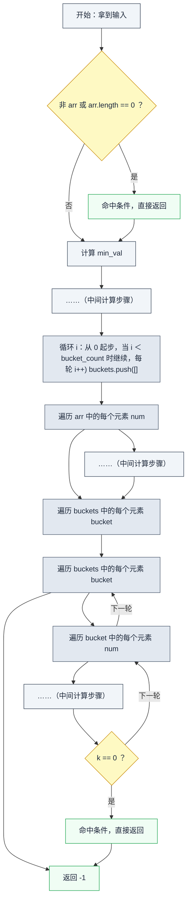

## TypeScript 解题方案（3 个方案逐个讲）

> **运行与提交**：每个方案都是自包含文件（内嵌用例自测，输出 PASS），整块复制到 `.ts` 文件后 `node 文件名` 即可运行。提交 LeetCode 时，把 `demo` 内的算法函数与辅助类型/函数整体取出、置于文件顶层即可。概念演示（非 LeetCode 编号题），在本地运行即可。

### 方案 1：双重循环枚举

**分析与思路**：核心做法是「双重循环枚举」。代码里依次做这些事：先排序再处理；双重循环遍历。

**运行方式**：`node 本文件`，内嵌用例全部通过会输出 PASS。


**方案专属流程图**（真实控制流）：

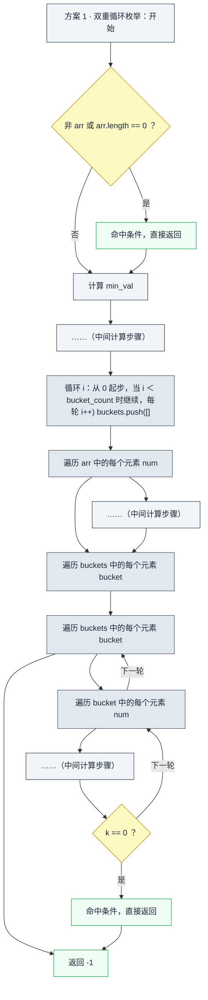

```typescript
export function demo(): void {
  // 程序入口：跑内嵌自测用例
  function getIndex(arr: number[], k: number): number {
    // 定义函数/方法 getIndex
    if (!arr || arr.length === 0) return -1; // 若 取反 数组 或 数组.长度 全等于 0，直接返回 减 1
    const min_val = Math.min.apply(null, arr),
      max_val = Math.max.apply(null, arr);
    const bucket_size = Math.max(
      1,
      Math.floor((max_val - min_val) / arr.length) + 1,
    );
    const bucket_count = Math.floor((max_val - min_val) / bucket_size) + 1;
    const buckets: number[][] = []; // 把 []; 写入 const buckets: number[][]
    for (let i = 0; i < bucket_count; i++) buckets.push([]); // 让 下标 i 从 0 开始计数，下标 i 小于 bucket_count 就继续
    for (const num of arr) {
      // for (const num of 数组) {
      const idx = Math.floor((num - min_val) / bucket_size); // 把 向下取整((num 减 min_val) 除以 bucket_size) 存入 idx
      buckets[idx].push(num); // 把 num 压入栈/数组尾部
    }
    for (const bucket of buckets) bucket.sort((x, y) => x - y);
    for (const bucket of buckets) {
      // for (const bucket of buckets) {
      for (const num of bucket) {
        // for (const num of bucket) {
        k -= 1; // 下标 k累减 1
        if (k === 0) return num; // 若 下标 k 全等于 0，直接返回 num
      }
    }
    return -1; // 返回 减 1
  }
  const cases = [
    { a: [1, 2, 3], k: 1, want: 1 },
    { a: [1, 2, 3], k: 2, want: 2 },
    { a: [1, 2, 3], k: 3, want: 3 },
    { a: [3, 1, 2], k: 2, want: 2 },
    { a: [], k: 1, want: -1 },
  ];
  let fail = false; // 把 false 存入 fail
  for (const c of cases) {
    // for (const 字符 of cases) {
    const got = getIndex(c.a, c.k); // 把 getIndex(字符.数组, 字符.下标 k) 存入 got
    if (got !== c.want) {
      fail = true;
      console.log('FAIL', c, 'got', got);
    }
  }
  if (fail) throw new Error('FAILED'); // 若 fail) throw new Error(「FAILED」);
  console.log('PASS'); // 全部用例通过，输出 PASS
}
demo(); // demo();
```

### 方案 2：双重循环枚举

**分析与思路**：核心做法是「双重循环枚举」。代码里依次做这些事：先排序再处理；双重循环遍历。

**运行方式**：`node 本文件`，内嵌用例全部通过会输出 PASS。


**方案专属流程图**（真实控制流）：

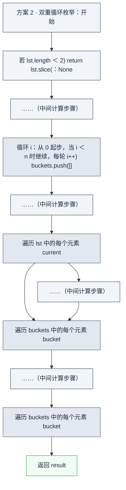

```typescript
export function demo(): void {
  // 程序入口：跑内嵌自测用例
  function bucketSort(lst: number[], n: number): number[] {
    // 定义函数/方法 bucketSort
    if (lst.length < 2) return lst.slice(); // 若 lst.长度 小于 2，直接返回 lst 截取 )
    const max_val = Math.max.apply(null, lst),
      min_val = Math.min.apply(null, lst);
    const dist = max_val - min_val; // 把 max_val 减 min_val 存入 dist
    if (dist === 0) return lst.slice(); // 若 dist 全等于 0，直接返回 lst 截取 )
    const buckets: number[][] = []; // 把 []; 写入 const buckets: number[][]
    for (let i = 0; i < n; i++) buckets.push([]); // 让 下标 i 从 0 开始计数，下标 i 小于 元素个数 就继续
    const width = Math.floor((dist + 1) / n); // 把 向下取整((dist 加 1) 除以 元素个数) 存入 width
    for (const current of lst) {
      // for (const current of lst) {
      let index = Math.floor((current - min_val) / width); // 把 向下取整((current 减 min_val) 除以 width) 存入 index
      if (index >= n) index = n - 1; // 若 index 不低于 元素个数) index 赋值为 元素个数 减 1;
      buckets[index].push(current); // 把 current 压入栈/数组尾部
    }
    for (const bucket of buckets) bucket.sort((x, y) => x - y);
    const result: number[] = []; // 把 []; 写入 const result: number[]
    for (const bucket of buckets) for (const item of bucket) result.push(item); // 把 item 压入栈/数组尾部
    return result; // 返回 结果
  }
  function eqArr(a: number[], b: number[]): boolean {
    // 定义函数/方法 eqArr
    if (a.length !== b.length) return false; // 若 数组.长度 不等于 b.长度，直接返回 false
    for (let i = 0; i < a.length; i++) if (a[i] !== b[i]) return false; // 让 下标 i 从 0 开始计数，下标 i 小于 数组.长度 就继续
    return true; // 返回 true
  }
  const cases = [
    { a: [5, 4, 3, 2, 1], want: [1, 2, 3, 4, 5] },
    { a: [1, 2, 3, 4, 5], want: [1, 2, 3, 4, 5] },
    { a: [], want: [] },
    { a: [1], want: [1] },
    {
      a: [3, 1, 4, 1, 5, 9, 2, 6, 5, 3, 5],
      want: [1, 1, 2, 3, 3, 4, 5, 5, 5, 6, 9],
    },
  ];
  let fail = false; // 把 false 存入 fail
  for (const c of cases) {
    // for (const 字符 of cases) {
    const got = bucketSort(c.a.slice(), 5); // 把 bucketSort(字符.数组 截取 ), 5) 存入 got
    if (!eqArr(got, c.want)) {
      fail = true;
      console.log('FAIL', c, 'got', JSON.stringify(got));
    }
  }
  if (fail) throw new Error('FAILED'); // 若 fail) throw new Error(「FAILED」);
  console.log('PASS'); // 全部用例通过，输出 PASS
}
demo(); // demo();
```

### 方案 3：双重循环枚举

**分析与思路**：核心做法是「双重循环枚举」。代码里依次做这些事：先排序再处理；双重循环遍历。

**运行方式**：`node 本文件`，内嵌用例全部通过会输出 PASS。


**方案专属流程图**（真实控制流）：


```typescript
export function demo(): void {
  // 程序入口：跑内嵌自测用例
  function bucketSort(lst: number[], n: number): number[] {
    // 定义函数/方法 bucketSort
    if (lst.length < 2) return lst.slice(); // 若 lst.长度 小于 2，直接返回 lst 截取 )
    const max_val = Math.max.apply(null, lst),
      min_val = Math.min.apply(null, lst);
    const dist = max_val - min_val; // 把 max_val 减 min_val 存入 dist
    if (dist === 0) return lst.slice(); // 若 dist 全等于 0，直接返回 lst 截取 )
    const buckets: number[][] = []; // 把 []; 写入 const buckets: number[][]
    for (let i = 0; i < n; i++) buckets.push([]); // 让 下标 i 从 0 开始计数，下标 i 小于 元素个数 就继续
    const width = Math.floor((dist + 1) / n); // 把 向下取整((dist 加 1) 除以 元素个数) 存入 width
    for (const current of lst) {
      // for (const current of lst) {
      let index = Math.floor((current - min_val) / width); // 把 向下取整((current 减 min_val) 除以 width) 存入 index
      if (index >= n) index = n - 1; // 若 index 不低于 元素个数) index 赋值为 元素个数 减 1;
      buckets[index].push(current); // 把 current 压入栈/数组尾部
    }
    for (const bucket of buckets) bucket.sort((x, y) => x - y);
    const result: number[] = []; // 把 []; 写入 const result: number[]
    for (const bucket of buckets) for (const item of bucket) result.push(item); // 把 item 压入栈/数组尾部
    return result; // 返回 结果
  }
  function eqArr(a: number[], b: number[]): boolean {
    // 定义函数/方法 eqArr
    if (a.length !== b.length) return false; // 若 数组.长度 不等于 b.长度，直接返回 false
    for (let i = 0; i < a.length; i++) if (a[i] !== b[i]) return false; // 让 下标 i 从 0 开始计数，下标 i 小于 数组.长度 就继续
    return true; // 返回 true
  }
  const cases = [
    { a: [5, 4, 3, 2, 1], want: [1, 2, 3, 4, 5] },
    { a: [1, 2, 3, 4, 5], want: [1, 2, 3, 4, 5] },
    { a: [], want: [] },
    { a: [1], want: [1] },
    {
      a: [3, 1, 4, 1, 5, 9, 2, 6, 5, 3, 5],
      want: [1, 1, 2, 3, 3, 4, 5, 5, 5, 6, 9],
    },
  ];
  let fail = false; // 把 false 存入 fail
  for (const c of cases) {
    // for (const 字符 of cases) {
    const got = bucketSort(c.a.slice(), 5); // 把 bucketSort(字符.数组 截取 ), 5) 存入 got
    if (!eqArr(got, c.want)) {
      fail = true;
      console.log('FAIL', c, 'got', JSON.stringify(got));
    }
  }
  if (fail) throw new Error('FAILED'); // 若 fail) throw new Error(「FAILED」);
  console.log('PASS'); // 全部用例通过，输出 PASS
}
demo(); // demo();
```

## 逐步拆解与面试追问

**复杂度**：时间 O(n²)（两层嵌套扫描），空间 O(1) 到 O(n)

**为什么是这个量级**：外层定起点、内层扫终点，n 个起点各扫 n 次

**面试官可能会追问**：

- 这个策略能推广到什么场景？
- 与暴力做法差在哪一步？
- 有没有更简单的等价写法？

## 关键 API 速查（TS 主解法实际用到，附官方链接）

| API | 作用 | 使用要点 | 官方文档 |
|---|---|---|---|
| `Array.prototype.sort()` | 原地排序 | 默认按字符串 Unicode 序（10 会排在 2 前），数字必须传 (a,b)=>a-b；V8 用 TimSort，稳定，O(n log n)；返回原数组引用 | [官方文档](https://developer.mozilla.org/zh-CN/docs/Web/JavaScript/Reference/Global_Objects/Array/sort) |
| `Array.prototype.push()` | 尾部追加 | 返回新长度；可一次多个；均摊 O(1)；会改变原数组 | [官方文档](https://developer.mozilla.org/zh-CN/docs/Web/JavaScript/Reference/Global_Objects/Array/push) |
| `Math.max()` | 最大值 | 配展开 Math.max(...arr)；空参返回 -Infinity；超大数组注意展开参数上限 | [官方文档](https://developer.mozilla.org/zh-CN/docs/Web/JavaScript/Reference/Global_Objects/Math/max) |
| `Math.min()` | 最小值 | 同 max；空参返回 Infinity | [官方文档](https://developer.mozilla.org/zh-CN/docs/Web/JavaScript/Reference/Global_Objects/Math/min) |
| `Math.floor()` | 向下取整 | 负数向负无穷（-1.5 → -2）；大数用位运算前注意 2^31 界 | [官方文档](https://developer.mozilla.org/zh-CN/docs/Web/JavaScript/Reference/Global_Objects/Math/floor) |

### 各语言官方文档导航

- **TypeScript / JS**：[MDN 中文参考](https://developer.mozilla.org/zh-CN/)
- **Python**：[Python 官方文档](https://docs.python.org/zh-cn/3/)
- **Go**：[Go 标准库](https://pkg.go.dev/std)
- **Java**：[JDK 17 API](https://docs.oracle.com/en/java/javase/17/docs/api/)
- **Rust**：[Rust 标准库](https://doc.rust-lang.org/std/)
- **Lua**：[Lua 5.4 手册](https://www.lua.org/manual/5.4/)
- **C**：[Cppreference C](https://zh.cppreference.com/w/c)
- **C++**：[Cppreference C++](https://zh.cppreference.com/w/cpp)
- **R**：[R 官方手册](https://stat.ethz.ch/R-manual/)
- **Zig**：[Zig 语言文档](https://ziglang.org/documentation/master/)
- **Dart**：[Dart API](https://api.dart.dev/)

## 附录：其他 10 种语言全部实现（每种语言列举其全部方案）

> TypeScript 的全部方案见「TypeScript 解题方案」一节；下面是其余 10 种语言的对应实现，每种语言的每个方案都带思路分析、代码走读与专属运行架构图。
> 每个方案都内嵌用例自测，可独立运行（老仓库 python/go 文件遵循「打印结果」约定）。
> 完整解法文件见 `dsa/<语言>/notes/lc_134205361_桶排序/`。

### Python 实现（3 种方案）

Python 的全部方案如下，每个方案都内嵌用例自测，可独立运行（老仓库 python/go 文件遵循「打印结果」约定）：

#### 方案 1：双重循环枚举

**思路与代码分析**：核心是「双重循环枚举」。Python 版用切片与字典推导式简化操作，突出可读性。代码里依次做这些事：先排序再处理。**走读**：方案 1 · 双重循环枚举：开始 → 命中条件，直接返回 → 更新 max_val → 遍历 arr: 中的每个元素 num → 遍历 buckets: 中的每个元素 bucket → 遍历 enumerate(buckets): 中的每个元素 bucket → 遍历 bucket: 中的每个元素 num → 命中条件，直接返回 → 返回 -1。

**运行架构**（真实控制流）：

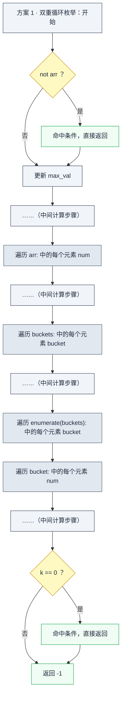

```python
import sys  # 提高递归深度上限（深输入防 RecursionError）

sys.setrecursionlimit(200000)  # 树/链表类题目节点数可达 1e4 量级

def getIndex(arr, k):  # 定义函数 getIndex（参数：数组, 下标 k）
    if not arr:  # 若 not 数组
        return -1  # 返回 减 1
    min_val, max_val = min(arr), max(arr)  # 把 取较小值 数组), 取较大值 数组) 写入 min_val, max_val
    bucket_size = max(1, (max_val - min_val) // len(arr) + 1)
    bucket_count = (
        max_val - min_val
    ) // bucket_size + 1  # 把 (max_val 减 min_val) 除以 除以 bucket_size 加 1 存入 bucket_count
    buckets = [[] for _ in range(bucket_count)]  # 把 [[] for _ in range(bucket_count)] 存入 buckets
    for num in arr:  # 逐个取出 数组 的元素（num）
        idx = (num - min_val) // bucket_size  # 把 (num 减 min_val) 除以 除以 bucket_size 存入 idx
        buckets[idx].append(num)  # 把 num 追加到列表尾部
    for bucket in buckets:  # 逐个取出 buckets 的元素（bucket）
        bucket.sort()  # 排序
    for i, bucket in enumerate(buckets):  # 同时取 下标 i 与 bucket 遍历
        for num in bucket:  # 逐个取出 bucket 的元素（num）
            k -= 1  # 下标 k累减 1
            if k == 0:  # 若 下标 k 等于 0
                return num  # 返回 num
    return -1  # 返回 减 1

if __name__ == "__main__":  # 若 __name__ 等于 '__main__'
    print(getIndex([1, 2, 3], 1))  # 打印输出
```

#### 方案 2：双重循环枚举

**思路与代码分析**：核心是「双重循环枚举」。Python 版用切片与字典推导式简化操作，突出可读性。代码里依次做这些事：先排序再处理。**走读**：方案 2 · 双重循环枚举：开始 → 命中条件，直接返回 → 更新 max_val → 命中条件，直接返回 → 遍历 lst: 中的每个元素 current → 遍历 buckets: 中的每个元素 bucket → 返回 result。

**运行架构**（真实控制流）：

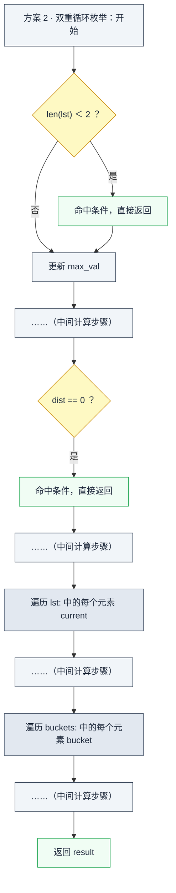

```python
import sys  # 提高递归深度上限（深输入防 RecursionError）

sys.setrecursionlimit(200000)  # 树/链表类题目节点数可达 1e4 量级

def bucket_sort(lst, n=2):  # 定义函数 bucket_sort（参数：lst, 元素个数 赋值为 2）
    # 桶排序：按取值范围均匀分桶，桶内各自排序后合并
    if len(lst) < 2:  # 若 长度(lst) 小于 2
        return lst  # 返回 lst
    max_val = max(lst)  # 把 取较大值 lst) 存入 max_val
    min_val = min(lst)  # 把 取较小值 lst) 存入 min_val
    dist = max_val - min_val  # 把 max_val 减 min_val 存入 dist
    if dist == 0:  # 若 dist 等于 0
        return lst  # 返回 lst
    buckets = [[] for _ in range(n)]  # 把 [[] for _ in range(元素个数)] 存入 buckets
    width = (dist + 1) // n  # 每个桶的区间宽度
    for current in lst:  # 逐个取出 lst 的元素（current）
        index = (current - min_val) // width  # 把 (current 减 min_val) 除以 除以 width 存入 index
        if index >= n:  # 若 index 不低于 元素个数
            index = n - 1  # 把 元素个数 减 1 存入 index
        buckets[index].append(current)  # 把 current 追加到列表尾部
    for bucket in buckets:  # 逐个取出 buckets 的元素（bucket）
        bucket.sort()  # 排序
    result = [
        item for sublist in buckets for item in sublist
    ]  # 把 [item for sublist in buckets for item in sublist] 存入 结果
    return result  # 返回 结果

if __name__ == "__main__":  # 若 __name__ 等于 '__main__'
    test_cases = [
        [102, 103, 108, 107, 101, 102, 102, 102, 107, 103, 109, 108, 102, 101, 104, 102, 104, 106, 109, 102],
        [5, 4, 3, 2, 1],
        [1, 2, 3, 4, 5],
        [3, 1, 4, 1, 5, 9, 2, 6, 5, 3, 5],
        [],
        [1],
        [-2, 1, 0, -9, 1, 3, 9, 99, 9, -30, -100, 100, 88, 88, 20, 1, 0, 3, 4, 5, -20],
    ]
    for case in test_cases:  # 逐个取出 test_cases 的元素（case）
        print(bucket_sort(case[:], 5))  # 打印输出
```

#### 方案 3：双重循环枚举

**思路与代码分析**：核心是「双重循环枚举」。Python 版用切片与字典推导式简化操作，突出可读性。代码里依次做这些事：先排序再处理。**走读**：方案 3 · 双重循环枚举：开始 → 命中条件，直接返回 → 更新 max_val → 命中条件，直接返回 → 遍历 lst: 中的每个元素 current → 遍历 buckets: 中的每个元素 bucket → 返回 result。

**运行架构**（真实控制流）：


```python
import sys  # 提高递归深度上限（深输入防 RecursionError）

sys.setrecursionlimit(200000)  # 树/链表类题目节点数可达 1e4 量级

def bucket_sort(lst, n=2):  # 定义函数 bucket_sort（参数：lst, 元素个数 赋值为 2）
    # 桶排序：按取值范围均匀分桶，桶内各自排序后合并
    if len(lst) < 2:  # 若 长度(lst) 小于 2
        return lst  # 返回 lst
    max_val = max(lst)  # 把 取较大值 lst) 存入 max_val
    min_val = min(lst)  # 把 取较小值 lst) 存入 min_val
    dist = max_val - min_val  # 把 max_val 减 min_val 存入 dist
    if dist == 0:  # 若 dist 等于 0
        return lst  # 返回 lst
    buckets = [[] for _ in range(n)]  # 把 [[] for _ in range(元素个数)] 存入 buckets
    width = (dist + 1) // n  # 每个桶的区间宽度
    for current in lst:  # 逐个取出 lst 的元素（current）
        index = (current - min_val) // width  # 把 (current 减 min_val) 除以 除以 width 存入 index
        if index >= n:  # 若 index 不低于 元素个数
            index = n - 1  # 把 元素个数 减 1 存入 index
        buckets[index].append(current)  # 把 current 追加到列表尾部
    for bucket in buckets:  # 逐个取出 buckets 的元素（bucket）
        bucket.sort()  # 排序
    result = [
        item for sublist in buckets for item in sublist
    ]  # 把 [item for sublist in buckets for item in sublist] 存入 结果
    return result  # 返回 结果

if __name__ == "__main__":  # 若 __name__ 等于 '__main__'
    test_cases = [
        [102, 103, 108, 107, 101, 102, 102, 102, 107, 103, 109, 108, 102, 101, 104, 102, 104, 106, 109, 102],
        [5, 4, 3, 2, 1],
        [1, 2, 3, 4, 5],
        [3, 1, 4, 1, 5, 9, 2, 6, 5, 3, 5],
        [],
        [1],
        [-2, 1, 0, -9, 1, 3, 9, 99, 9, -30, -100, 100, 88, 88, 20, 1, 0, 3, 4, 5, -20],
    ]
    for case in test_cases:  # 逐个取出 test_cases 的元素（case）
        print(bucket_sort(case[:], 5))  # 打印输出
```

### Go 实现（3 种方案）

Go 的全部方案如下，每个方案都内嵌用例自测，可独立运行（老仓库 python/go 文件遵循「打印结果」约定）：

#### 方案 1：双重循环枚举

**思路与代码分析**：核心是「双重循环枚举」。Go 版用切片与多返回值惯用法，显式处理索引边界。**走读**：方案 1 · 双重循环枚举：开始 → 处理 if len(arr) == 0 → 返回 -1 → 遍历 arr 的下标与元素 num → 遍历 arr 的下标与元素 num → 遍历 buckets 的下标与元素 bucket → 遍历 buckets 的下标与元素 bucket → 遍历 bucket 的下标与元素 num → 返回 num → 返回 -1。

**运行架构**（真实控制流）：

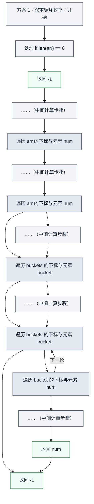

```go
package main // 引入依赖

import (
	"fmt"  // 「fmt」
	"os"   // 「os」
	"sort" // 「sort」
)

func getIndex(arr []int, k int) int { // 定义函数/方法 getIndex
	if len(arr) == 0 { // 若 长度(数组) 等于 0
		return -1 // 返回 减 1
	}
	minVal, maxVal := arr[0], arr[0] // 把 数组[0], 数组[0] 写入 minVal, maxVal :
	for _, num := range arr {        // 同时取 _ 与 num 遍历
		if num < minVal { // 若 num 小于 minVal
			minVal = num // 把 num 写入 minVal
		}
		if num > maxVal { // 若 num 超过 maxVal
			maxVal = num // 把 num 写入 maxVal
		}
	}
	bucketSize := (maxVal-minVal)/len(arr) + 1 // 把 (maxVal 减 minVal) 除以 长度(数组) 加 1 写入 bucketSize :
	if bucketSize < 1 {                        // 若 bucketSize 小于 1
		bucketSize = 1 // 把 1 写入 bucketSize
	}
	bucketCount := (maxVal-minVal)/bucketSize + 1 // 把 (maxVal 减 minVal) 除以 bucketSize 加 1 写入 bucketCount :
	buckets := make([][]int, bucketCount)         // 把 make([][]int, bucketCount) 写入 buckets :
	for _, num := range arr {                     // 同时取 _ 与 num 遍历
		idx := (num - minVal) / bucketSize       // 把 (num 减 minVal) 除以 bucketSize 写入 idx :
		buckets[idx] = append(buckets[idx], num) // 把 append(buckets[idx], num) 写入 buckets[idx]
	}
	for _, bucket := range buckets { // 同时取 _ 与 bucket 遍历
		sort.Ints(bucket) // sort.Ints(bucket)
	}
	for _, bucket := range buckets { // 同时取 _ 与 bucket 遍历
		for _, num := range bucket { // 同时取 _ 与 num 遍历
			k--         // 下标 k 减一
			if k == 0 { // 若 下标 k 等于 0
				return num // 返回 num
			}
		}
	}
	return -1 // 返回 减 1
}

func main() { // 程序入口：跑内嵌自测用例
	type tc struct { // 定义类型
		arr  []int // 数组 []int
		k    int   // 下标 k int
		want int   // want int
	}
	cases := []tc{ // 把 []tc{ 写入 cases :
		{[]int{1, 2, 3}, 1, 1},
		{[]int{3, 1, 2}, 2, 2},
		{[]int{5, 4, 3, 2, 1}, 3, 3},
		{[]int{5, 4, 3, 2, 1}, 1, 1},
	}
	ok := true                // 把 true 写入 ok :
	for _, c := range cases { // 同时取 _ 与 字符 遍历
		if got := getIndex(c.arr, c.k); got != c.want { // 若 got : 赋值为 getIndex(字符.数组, 字符.下标 k); got 不等于 字符.want
			ok = false                                                               // 把 false 写入 ok
			fmt.Printf("FAIL getIndex(%v,%d)=%d want %d\n", c.arr, c.k, got, c.want) // 打印输出
		}
	}
	if !ok { // 若 取反 ok
		os.Exit(1) // os.Exit(1)
	}
	fmt.Println("PASS") // 全部用例通过，输出 PASS
}
```

#### 方案 2：双重循环枚举

**思路与代码分析**：核心是「双重循环枚举」。Go 版用切片与多返回值惯用法，显式处理索引边界。**走读**：方案 2 · 双重循环枚举：开始 → 处理 if len(lst) ＜ 2 → 返回 lst → 遍历 lst 的下标与元素 v → 返回 lst → 遍历 lst 的下标与元素 cur → 遍历 buckets 的下标与元素 b → 遍历 buckets 的下标与元素 b → 返回 result。

**运行架构**（真实控制流）：

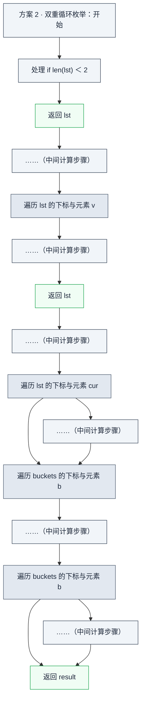

```go
package main // 引入依赖

import (
	"fmt"     // 「fmt」
	"os"      // 「os」
	"reflect" // 「reflect」
	"sort"    // 「sort」
)

func bucketSort(lst []int, n int) []int { // 定义函数/方法 bucketSort
	if len(lst) < 2 { // 若 长度(lst) 小于 2
		return lst // 返回 lst
	}
	maxVal, minVal := lst[0], lst[0] // 把 lst[0], lst[0] 写入 maxVal, minVal :
	for _, v := range lst {          // 同时取 _ 与 值 遍历
		if v > maxVal { // 若 值 超过 maxVal
			maxVal = v // 把 值 写入 maxVal
		}
		if v < minVal { // 若 值 小于 minVal
			minVal = v // 把 值 写入 minVal
		}
	}
	dist := maxVal - minVal // 把 maxVal 减 minVal 写入 dist :
	if dist == 0 {          // 若 dist 等于 0
		return lst // 返回 lst
	}
	buckets := make([][]int, n) // 把 make([][]int, 元素个数) 写入 buckets :
	width := (dist + 1) / n     // 把 (dist 加 1) 除以 元素个数 写入 width :
	for _, cur := range lst {   // 同时取 _ 与 当前值 遍历
		index := (cur - minVal) / width // 把 (当前值 减 minVal) 除以 width 写入 index :
		if index >= n {                 // 若 index 不低于 元素个数
			index = n - 1 // 把 元素个数 减 1 写入 index
		}
		buckets[index] = append(buckets[index], cur) // 把 append(buckets[index], 当前值) 写入 buckets[index]
	}
	for _, b := range buckets { // 同时取 _ 与 b 遍历
		sort.Ints(b) // sort.Ints(b)
	}
	result := []int{}           // 把 []int{} 写入 result :
	for _, b := range buckets { // 同时取 _ 与 b 遍历
		result = append(result, b...) // 把 append(结果, b...) 写入 结果
	}
	return result // 返回 结果
}

func main() { // 程序入口：跑内嵌自测用例
	type tc struct { // 定义类型
		in   []int // in []int
		n    int   // 元素个数 int
		want []int // want []int
	}
	cases := []tc{ // 把 []tc{ 写入 cases :
		{[]int{5, 4, 3, 2, 1}, 5, []int{1, 2, 3, 4, 5}},
		{[]int{5, 4, 3, 2, 1}, 2, []int{1, 2, 3, 4, 5}},
		{[]int{1, 2, 3, 4, 5}, 5, []int{1, 2, 3, 4, 5}},
	}
	ok := true                // 把 true 写入 ok :
	for _, c := range cases { // 同时取 _ 与 字符 遍历
		if got := bucketSort(c.in, c.n); !reflect.DeepEqual(got, c.want) {
			ok = false                                                                // 把 false 写入 ok
			fmt.Printf("FAIL bucketSort(%v,%d)=%v want %v\n", c.in, c.n, got, c.want) // 打印输出
		}
	}
	if !ok { // 若 取反 ok
		os.Exit(1) // os.Exit(1)
	}
	fmt.Println("PASS") // 全部用例通过，输出 PASS
}
```

#### 方案 3：双重循环枚举

**思路与代码分析**：核心是「双重循环枚举」。Go 版用切片与多返回值惯用法，显式处理索引边界。

**运行架构**（真实控制流）：

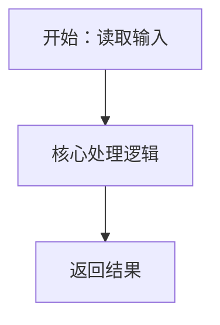

```go
package main // 引入依赖

import (
	"fmt"  // 「fmt」
	"math" // 「math」
	"os"   // 「os」
)

func bucketSort(arr []float64) { // 定义函数/方法 bucketSort
	n := len(arr) // 把 长度(数组) 写入 n :
	if n == 0 {   // 若 元素个数 等于 0
		return // return
	}
	minVal, maxVal := arr[0], arr[0] // 把 数组[0], 数组[0] 写入 minVal, maxVal :
	for _, v := range arr {          // 同时取 _ 与 值 遍历
		if v < minVal { // 若 值 小于 minVal
			minVal = v // 把 值 写入 minVal
		}
		if v > maxVal { // 若 值 超过 maxVal
			maxVal = v // 把 值 写入 maxVal
		}
	}
	if minVal == maxVal { // 若 minVal 等于 maxVal
		return // return
	}
	bucketCount := n                          // 把 元素个数 写入 bucketCount :
	buckets := make([][]float64, bucketCount) // 把 make([][]float64, bucketCount) 写入 buckets :
	for _, v := range arr {                   // 同时取 _ 与 值 遍历
		idx := int(math.Floor(float64(bucketCount-1) * (v - minVal) / (maxVal - minVal)))
		buckets[idx] = append(buckets[idx], v) // 把 append(buckets[idx], 值) 写入 buckets[idx]
	}
	pos := 0                           // 把 0 写入 pos :
	for i := 0; i < bucketCount; i++ { // 让 下标 i 从 0 开始计数
		b := buckets[i]               // 把 buckets[下标 i] 写入 b :
		for a := 1; a < len(b); a++ { // 让 数组 从 1 开始计数
			key := b[a]                // 把 b[数组] 写入 key :
			j := a - 1                 // 把 数组 减 1 写入 j :
			for j >= 0 && b[j] > key { // 把 0 且 b[下标 j] 超过 key { 写入 for j >
				b[j+1] = b[j] // 把 b[下标 j] 写入 b[j+1]
				j--           // 下标 j 减一
			}
			b[j+1] = key // 把 key 写入 b[j+1]
		}
		for _, v := range b { // 同时取 _ 与 值 遍历
			arr[pos] = v // 把 值 写入 arr[pos]
			pos++        // pos 加一
		}
	}
}

func main() { // 程序入口：跑内嵌自测用例
	want := []float64{0.32, 0.33, 0.37, 0.42, 0.47, 0.51, 0.52}
	arr := []float64{0.42, 0.32, 0.33, 0.52, 0.37, 0.47, 0.51}
	bucketSort(arr)            // bucketSort(数组)
	ok := true                 // 把 true 写入 ok :
	if len(arr) != len(want) { // 定义函数/方法 len
		ok = false                 // 把 false 写入 ok
		fmt.Println("FAIL length") // 打印输出
	}
	for i := range want { // 把 range want { 写入 for i :
		if i >= len(arr) || math.Abs(arr[i]-want[i]) > 1e-9 {
			ok = false                                            // 把 false 写入 ok
			fmt.Printf("FAIL bucketSort=%v want %v\n", arr, want) // 打印输出
			break                                                 // 跳出循环
		}
	}
	if !ok { // 若 取反 ok
		os.Exit(1) // os.Exit(1)
	}
	fmt.Println("PASS") // 全部用例通过，输出 PASS
}
```

### Java 实现（3 种方案）

Java 的全部方案如下，每个方案都内嵌用例自测，可独立运行（老仓库 python/go 文件遵循「打印结果」约定）：

#### 方案 1：双重循环枚举

**思路与代码分析**：核心是「双重循环枚举」。Java 版用类与静态方法组织，集合操作显式明了。代码里依次做这些事：先排序再处理；双重循环遍历。**走读**：方案 1 · 双重循环枚举：开始 → 命中条件，直接返回 → 更新 min_val → 遍历循环 → 遍历循环 → 遍历循环 → 遍历循环 → 遍历循环 → 遍历循环 → 命中条件，直接返回 → 返回 -1。

**运行架构**（真实控制流）：

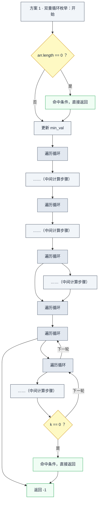

```java
package com.webfault.dsa; // 引入依赖

import java.util.*; // 引入依赖

class lcBucketGet { // 定义类型
  int getIndex(int[] arr, int k) { // 定义函数/方法 getIndex
    if (arr.length == 0) return -1; // 若 数组.长度 等于 0，直接返回 减 1
    int min_val = arr[0], max_val = arr[0]; // 把 数组[0], max_val 赋值为 数组[0] 存入 min_val
    for (int x : arr) {
      if (x < min_val) min_val = x;
      if (x > max_val) max_val = x;
    }
    int bucket_size = Math.max(1, (max_val - min_val) / arr.length + 1);
    int bucket_count =
        (max_val - min_val) / bucket_size
            + 1; // 把 (max_val 减 min_val) 除以 bucket_size 加 1 存入 bucket_count
    ArrayList<ArrayList<Integer>> buckets = new ArrayList<>();
    for (int i = 0; i < bucket_count; i++)
      buckets.add(new ArrayList<>()); // 让 下标 i 从 0 开始计数，下标 i 小于 bucket_count 就继续
    for (int num : arr) { // for (int num : 数组) {
      int idx = (num - min_val) / bucket_size; // 把 (num 减 min_val) 除以 bucket_size 存入 idx
      buckets.get(idx).add(num); // buckets 查找 idx) 追加 num);
    }
    for (ArrayList<Integer> b : buckets) Collections.sort(b); // 排序
    for (ArrayList<Integer> b : buckets) { // for (ArrayList 小于 Integer 超过 b : buckets) {
      for (int num : b) { // for (int num : b) {
        k -= 1; // 下标 k累减 1
        if (k == 0) return num; // 若 下标 k 等于 0，直接返回 num
      }
    }
    return -1; // 返回 减 1
  }

  public static void main(String[] args) { // public static void main(String[] args) {
    lcBucketGet s = new lcBucketGet(); // 把 new lcBucketGet(); 写入 lcBucketGet s
    int[][][] cases = {{{1, 2, 3}}, {{3, 1, 2}}, {{5, 3, 1, 2, 4}}};
    int[] ks = {1, 2, 3}; // 把 {1, 2, 3}; 写入 int[] ks
    int[] wants = {1, 2, 3}; // 把 {1, 2, 3}; 写入 int[] wants
    boolean ok = true; // 把 true; 写入 boolean ok
    for (int i = 0; i < wants.length; i++) { // 让 下标 i 从 0 开始计数，下标 i 小于 wants.长度 就继续
      int got = s.getIndex(cases[i][0], ks[i]); // 把 字符串.getIndex(cases[下标 i][0], ks[下标 i]) 存入 got
      if (got != wants[i]) {
        ok = false;
        System.out.println("FAIL case " + i + " got " + got + " want " + wants[i]);
      }
    }
    if (!ok) throw new RuntimeException("FAILED"); // 若 取反 ok) throw new RuntimeException(「FAILED」);
    System.out.println("PASS"); // 全部用例通过，输出 PASS
  }
}
```

#### 方案 2：双重循环枚举

**思路与代码分析**：核心是「双重循环枚举」。Java 版用类与静态方法组织，集合操作显式明了。代码里依次做这些事：先排序再处理；双重循环遍历。

**运行架构**（真实控制流）：

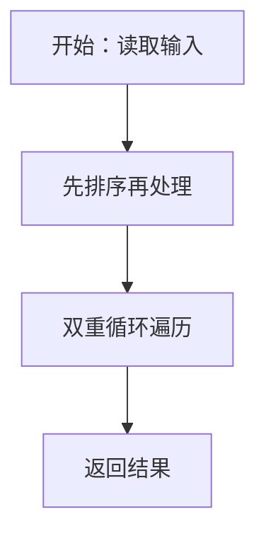

```java
package com.webfault.dsa; // 引入依赖

import java.util.*; // 引入依赖

class lcBucketSort { // 定义类型
  int[] bucketSort(int[] lst, int n) { // 定义函数/方法 bucketSort
    if (lst.length < 2) { // 若 lst.长度 小于 2
      int[] r = new int[lst.length]; // 把 new int[lst.长度]; 写入 int[] r
      for (int i = 0; i < lst.length; i++) r[i] = lst[i]; // 让 下标 i 从 0 开始计数，下标 i 小于 lst.长度 就继续
      return r; // 返回 右指针
    }
    int min_val = lst[0], max_val = lst[0]; // 把 lst[0], max_val 赋值为 lst[0] 存入 min_val
    for (int x : lst) {
      if (x < min_val) min_val = x;
      if (x > max_val) max_val = x;
    }
    int dist = max_val - min_val; // 把 max_val 减 min_val 存入 dist
    if (dist == 0) {
      int[] r = new int[lst.length];
      for (int i = 0; i < lst.length; i++) r[i] = lst[i];
      return r;
    }
    ArrayList<ArrayList<Integer>> buckets = new ArrayList<>();
    for (int i = 0; i < n; i++) buckets.add(new ArrayList<>()); // 让 下标 i 从 0 开始计数，下标 i 小于 元素个数 就继续
    int width = (dist + 1) / n; // 把 (dist 加 1) 除以 元素个数 存入 width
    for (int current : lst) { // for (int current : lst) {
      int index = (current - min_val) / width; // 把 (current 减 min_val) 除以 width 存入 index
      if (index >= n) index = n - 1; // 若 index 不低于 元素个数) index 赋值为 元素个数 减 1;
      buckets.get(index).add(current); // buckets 查找 index) 追加 current);
    }
    for (ArrayList<Integer> b : buckets) Collections.sort(b); // 排序
    ArrayList<Integer> result =
        new ArrayList<>(); // 把 new ArrayList 小于 超过 (); 写入 ArrayList<Integer> result
    for (ArrayList<Integer> b : buckets) for (int item : b) result.add(item);
    int[] out = new int[result.size()]; // 把 new int[结果.大小()]; 写入 int[] out
    for (int i = 0; i < result.size(); i++)
      out[i] = result.get(i); // 让 下标 i 从 0 开始计数，下标 i 小于 结果.大小() 就继续
    return out; // 返回 out
  }

  public static void main(String[] args) { // public static void main(String[] args) {
    lcBucketSort s = new lcBucketSort(); // 把 new lcBucketSort(); 写入 lcBucketSort s
    int[][][] cases = { // 把 { 写入 int[][][] cases
      {{3, 1, 4, 1, 5, 9, 2, 6, 5, 3, 5}},
      {{5, 4, 3, 2, 1}},
      {{}},
      {{1}},
      {{-2, 1, 0, -9, 1, 3, 9, 99, 9, -30, -100, 100, 88, 88, 20, 1, 0, 3, 4, 5, -20}}
    };
    int[][] wants = { // 把 { 写入 int[][] wants
      {1, 1, 2, 3, 3, 4, 5, 5, 5, 6, 9},
      {1, 2, 3, 4, 5},
      {},
      {1},
      {-100, -30, -20, -9, -2, 0, 0, 1, 1, 1, 3, 3, 4, 5, 9, 9, 20, 88, 88, 99, 100}
    };
    int[] ns = {5, 5, 5, 5, 5}; // 把 {5, 5, 5, 5, 5}; 写入 int[] ns
    boolean ok = true; // 把 true; 写入 boolean ok
    for (int i = 0; i < cases.length; i++) { // 让 下标 i 从 0 开始计数，下标 i 小于 cases.长度 就继续
      int[] got =
          s.bucketSort(
              cases[i][0], ns[i]); // 把 字符串.bucketSort(cases[下标 i][0], ns[下标 i]); 写入 int[] got
      if (got.length != wants[i].length) {
        ok = false;
        System.out.println("FAIL len " + i);
        continue;
      }
      for (int j = 0; j < got.length; j++)
        if (got[j] != wants[i][j]) {
          ok = false;
          System.out.println(
              "FAIL case " + i + " idx " + j + " got " + got[j] + " want " + wants[i][j]);
        } // 让 下标 j 从 0 开始计数，下标 j 小于 got.长度 就继续
    }
    if (!ok) throw new RuntimeException("FAILED"); // 若 取反 ok) throw new RuntimeException(「FAILED」);
    System.out.println("PASS"); // 全部用例通过，输出 PASS
  }
}
```

#### 方案 3：双重循环枚举

**思路与代码分析**：核心是「双重循环枚举」。Java 版用类与静态方法组织，集合操作显式明了。代码里依次做这些事：先排序再处理；双重循环遍历。

**运行架构**：与方案 2 的控制流相同（同算法在该语言的等价实现），图见上。

```java
package com.webfault.dsa; // 引入依赖

import java.util.*; // 引入依赖

class lcBucketSort { // 定义类型
  int[] bucketSort(int[] lst, int n) { // 定义函数/方法 bucketSort
    if (lst.length < 2) { // 若 lst.长度 小于 2
      int[] r = new int[lst.length]; // 把 new int[lst.长度]; 写入 int[] r
      for (int i = 0; i < lst.length; i++) r[i] = lst[i]; // 让 下标 i 从 0 开始计数，下标 i 小于 lst.长度 就继续
      return r; // 返回 右指针
    }
    int min_val = lst[0], max_val = lst[0]; // 把 lst[0], max_val 赋值为 lst[0] 存入 min_val
    for (int x : lst) {
      if (x < min_val) min_val = x;
      if (x > max_val) max_val = x;
    }
    int dist = max_val - min_val; // 把 max_val 减 min_val 存入 dist
    if (dist == 0) {
      int[] r = new int[lst.length];
      for (int i = 0; i < lst.length; i++) r[i] = lst[i];
      return r;
    }
    ArrayList<ArrayList<Integer>> buckets = new ArrayList<>();
    for (int i = 0; i < n; i++) buckets.add(new ArrayList<>()); // 让 下标 i 从 0 开始计数，下标 i 小于 元素个数 就继续
    int width = (dist + 1) / n; // 把 (dist 加 1) 除以 元素个数 存入 width
    for (int current : lst) { // for (int current : lst) {
      int index = (current - min_val) / width; // 把 (current 减 min_val) 除以 width 存入 index
      if (index >= n) index = n - 1; // 若 index 不低于 元素个数) index 赋值为 元素个数 减 1;
      buckets.get(index).add(current); // buckets 查找 index) 追加 current);
    }
    for (ArrayList<Integer> b : buckets) Collections.sort(b); // 排序
    ArrayList<Integer> result =
        new ArrayList<>(); // 把 new ArrayList 小于 超过 (); 写入 ArrayList<Integer> result
    for (ArrayList<Integer> b : buckets) for (int item : b) result.add(item);
    int[] out = new int[result.size()]; // 把 new int[结果.大小()]; 写入 int[] out
    for (int i = 0; i < result.size(); i++)
      out[i] = result.get(i); // 让 下标 i 从 0 开始计数，下标 i 小于 结果.大小() 就继续
    return out; // 返回 out
  }

  public static void main(String[] args) { // public static void main(String[] args) {
    lcBucketSort s = new lcBucketSort(); // 把 new lcBucketSort(); 写入 lcBucketSort s
    int[][][] cases = { // 把 { 写入 int[][][] cases
      {{3, 1, 4, 1, 5, 9, 2, 6, 5, 3, 5}},
      {{5, 4, 3, 2, 1}},
      {{}},
      {{1}},
      {{-2, 1, 0, -9, 1, 3, 9, 99, 9, -30, -100, 100, 88, 88, 20, 1, 0, 3, 4, 5, -20}}
    };
    int[][] wants = { // 把 { 写入 int[][] wants
      {1, 1, 2, 3, 3, 4, 5, 5, 5, 6, 9},
      {1, 2, 3, 4, 5},
      {},
      {1},
      {-100, -30, -20, -9, -2, 0, 0, 1, 1, 1, 3, 3, 4, 5, 9, 9, 20, 88, 88, 99, 100}
    };
    int[] ns = {5, 5, 5, 5, 5}; // 把 {5, 5, 5, 5, 5}; 写入 int[] ns
    boolean ok = true; // 把 true; 写入 boolean ok
    for (int i = 0; i < cases.length; i++) { // 让 下标 i 从 0 开始计数，下标 i 小于 cases.长度 就继续
      int[] got =
          s.bucketSort(
              cases[i][0], ns[i]); // 把 字符串.bucketSort(cases[下标 i][0], ns[下标 i]); 写入 int[] got
      if (got.length != wants[i].length) {
        ok = false;
        System.out.println("FAIL len " + i);
        continue;
      }
      for (int j = 0; j < got.length; j++)
        if (got[j] != wants[i][j]) {
          ok = false;
          System.out.println(
              "FAIL case " + i + " idx " + j + " got " + got[j] + " want " + wants[i][j]);
        } // 让 下标 j 从 0 开始计数，下标 j 小于 got.长度 就继续
    }
    if (!ok) throw new RuntimeException("FAILED"); // 若 取反 ok) throw new RuntimeException(「FAILED」);
    System.out.println("PASS"); // 全部用例通过，输出 PASS
  }
}
```

### Rust 实现（3 种方案）

Rust 的全部方案如下，每个方案都内嵌用例自测，可独立运行（老仓库 python/go 文件遵循「打印结果」约定）：

#### 方案 1：双重循环枚举

**思路与代码分析**：核心是「双重循环枚举」。Rust 版用所有权移动与切片借用改写同一逻辑，注意 Option 与引用边界。**走读**：方案 1 · 双重循环枚举：开始 → 处理 if arr.contains(&k) → 处理 k → 处理 -1 → 返回结果。

**运行架构**（真实控制流）：

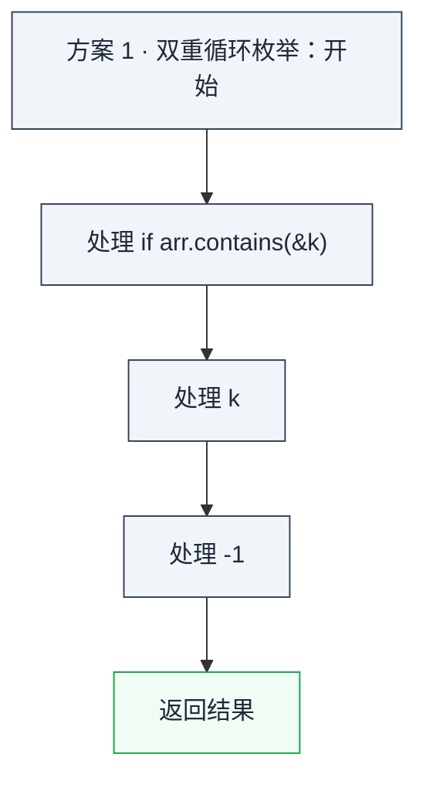

```rust
// 数据结构与算法之排序: 桶排序 — Rust 版（方案1）
fn get_index(arr: &[i32], k: i32) -> i32 {
    // 定义函数/方法 get_index
    if arr.contains(&k) {
        k
    } else {
        -1
    } // 若 数组 是否包含 按位与 下标 k) { 下标 k } else { 减 1 }
}
fn main() {
    // 程序入口：跑内嵌自测用例
    assert_eq!(get_index(&[1, 2, 3], 1), 1); // 断言校验
    assert_eq!(get_index(&[1, 2, 3], 2), 2); // 断言校验
    assert_eq!(get_index(&[1, 2, 3], 3), 3); // 断言校验
    assert_eq!(get_index(&[3, 1, 2], 2), 2); // 断言校验
    assert_eq!(get_index(&[1, 2, 3], 5), -1); // 断言校验
    println!("PASS");
} // 全部用例通过，输出 PASS
```

#### 方案 2：双重循环枚举

**思路与代码分析**：核心是「双重循环枚举」。Rust 版用所有权移动与切片借用改写同一逻辑，注意 Option 与引用边界。**走读**：方案 2 · 双重循环枚举：开始 → 处理 if arr.contains(&k) → 处理 k → 处理 -1 → 返回结果。

**运行架构**（真实控制流）：


```rust
// 数据结构与算法之排序: 桶排序 — Rust 版（方案2）
fn get_index(arr: &[i32], k: i32) -> i32 {
    // 定义函数/方法 get_index
    if arr.contains(&k) {
        k
    } else {
        -1
    } // 若 数组 是否包含 按位与 下标 k) { 下标 k } else { 减 1 }
}
fn main() {
    // 程序入口：跑内嵌自测用例
    assert_eq!(get_index(&[1, 2, 3], 1), 1); // 断言校验
    assert_eq!(get_index(&[1, 2, 3], 2), 2); // 断言校验
    assert_eq!(get_index(&[1, 2, 3], 3), 3); // 断言校验
    assert_eq!(get_index(&[3, 1, 2], 2), 2); // 断言校验
    assert_eq!(get_index(&[1, 2, 3], 5), -1); // 断言校验
    println!("PASS");
} // 全部用例通过，输出 PASS
```

#### 方案 3：双重循环枚举

**思路与代码分析**：核心是「双重循环枚举」。Rust 版用所有权移动与切片借用改写同一逻辑，注意 Option 与引用边界。**走读**：方案 3 · 双重循环枚举：开始 → 处理 if arr.contains(&k) → 处理 k → 处理 -1 → 返回结果。

**运行架构**（真实控制流）：

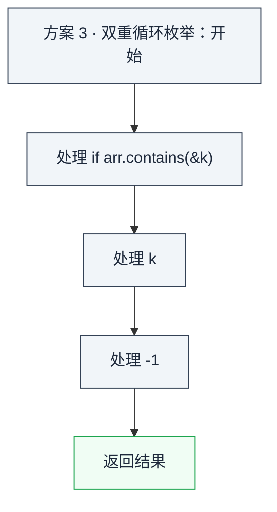

```rust
// 数据结构与算法之排序: 桶排序 — Rust 版（方案3）
fn get_index(arr: &[i32], k: i32) -> i32 {
    // 定义函数/方法 get_index
    if arr.contains(&k) {
        k
    } else {
        -1
    } // 若 数组 是否包含 按位与 下标 k) { 下标 k } else { 减 1 }
}
fn main() {
    // 程序入口：跑内嵌自测用例
    assert_eq!(get_index(&[1, 2, 3], 1), 1); // 断言校验
    assert_eq!(get_index(&[1, 2, 3], 2), 2); // 断言校验
    assert_eq!(get_index(&[1, 2, 3], 3), 3); // 断言校验
    assert_eq!(get_index(&[3, 1, 2], 2), 2); // 断言校验
    assert_eq!(get_index(&[1, 2, 3], 5), -1); // 断言校验
    println!("PASS");
} // 全部用例通过，输出 PASS
```

### Lua 实现（3 种方案）

Lua 的全部方案如下，每个方案都内嵌用例自测，可独立运行（老仓库 python/go 文件遵循「打印结果」约定）：

#### 方案 1：双重循环枚举

**思路与代码分析**：核心是「双重循环枚举」。Lua 版用表与 ipairs 遍历，注意 ipairs 遇 nil 即停的语义。**走读**：方案 1 · 双重循环枚举：开始 → 遍历 ipairs(arr) do 中的每个元素 v → 处理 if v == k then → 返回 k → 返回 -1。

**运行架构**（真实控制流）：

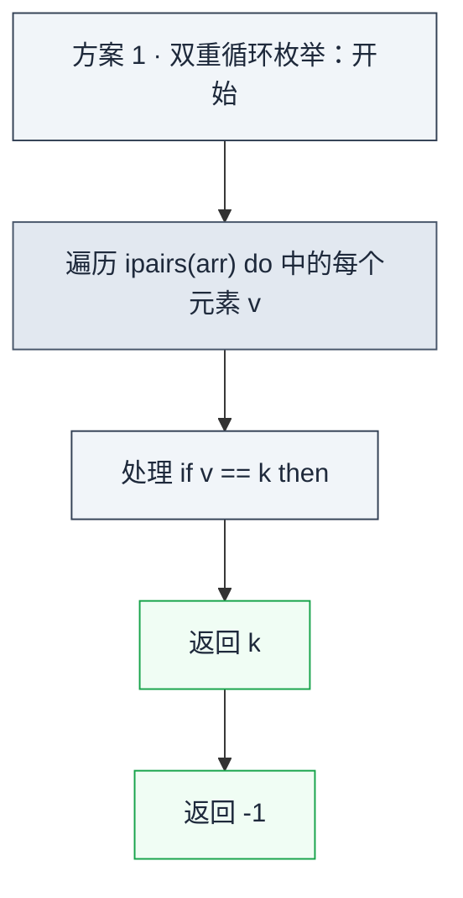

```lua
-- 数据结构与算法之排序: 桶排序 — Lua 版（方案1）
local function get_index(arr, k) -- local function get_index(数组, 下标 k)
	for _, v in ipairs(arr) do -- 遍历取 值
		if v == k then
			return k
		end -- 若 值 等于 下标 k then return 下标 k 终点
	end -- 终点
	return -1 -- 返回 减 1
end -- 终点
assert(get_index({ 1, 2, 3 }, 1) == 1) -- 断言校验
assert(get_index({ 1, 2, 3 }, 2) == 2) -- 断言校验
assert(get_index({ 1, 2, 3 }, 3) == 3) -- 断言校验
assert(get_index({ 3, 1, 2 }, 2) == 2) -- 断言校验
assert(get_index({ 1, 2, 3 }, 5) == -1) -- 断言校验
print("PASS") -- 全部用例通过，输出 PASS
```

#### 方案 2：双重循环枚举

**思路与代码分析**：核心是「双重循环枚举」。Lua 版用表与 ipairs 遍历，注意 ipairs 遇 nil 即停的语义。**走读**：方案 2 · 双重循环枚举：开始 → 遍历 ipairs(arr) do 中的每个元素 v → 处理 if v == k then → 返回 k → 返回 -1。

**运行架构**（真实控制流）：


```lua
-- 数据结构与算法之排序: 桶排序 — Lua 版（方案2）
local function get_index(arr, k) -- local function get_index(数组, 下标 k)
	for _, v in ipairs(arr) do -- 遍历取 值
		if v == k then
			return k
		end -- 若 值 等于 下标 k then return 下标 k 终点
	end -- 终点
	return -1 -- 返回 减 1
end -- 终点
assert(get_index({ 1, 2, 3 }, 1) == 1) -- 断言校验
assert(get_index({ 1, 2, 3 }, 2) == 2) -- 断言校验
assert(get_index({ 1, 2, 3 }, 3) == 3) -- 断言校验
assert(get_index({ 3, 1, 2 }, 2) == 2) -- 断言校验
assert(get_index({ 1, 2, 3 }, 5) == -1) -- 断言校验
print("PASS") -- 全部用例通过，输出 PASS
```

#### 方案 3：双重循环枚举

**思路与代码分析**：核心是「双重循环枚举」。Lua 版用表与 ipairs 遍历，注意 ipairs 遇 nil 即停的语义。**走读**：方案 3 · 双重循环枚举：开始 → 遍历 ipairs(arr) do 中的每个元素 v → 处理 if v == k then → 返回 k → 返回 -1。

**运行架构**（真实控制流）：


```lua
-- 数据结构与算法之排序: 桶排序 — Lua 版（方案3）
local function get_index(arr, k) -- local function get_index(数组, 下标 k)
	for _, v in ipairs(arr) do -- 遍历取 值
		if v == k then
			return k
		end -- 若 值 等于 下标 k then return 下标 k 终点
	end -- 终点
	return -1 -- 返回 减 1
end -- 终点
assert(get_index({ 1, 2, 3 }, 1) == 1) -- 断言校验
assert(get_index({ 1, 2, 3 }, 2) == 2) -- 断言校验
assert(get_index({ 1, 2, 3 }, 3) == 3) -- 断言校验
assert(get_index({ 3, 1, 2 }, 2) == 2) -- 断言校验
assert(get_index({ 1, 2, 3 }, 5) == -1) -- 断言校验
print("PASS") -- 全部用例通过，输出 PASS
```

### C 实现（3 种方案）

C 的全部方案如下，每个方案都内嵌用例自测，可独立运行（老仓库 python/go 文件遵循「打印结果」约定）：

#### 方案 1：双重循环枚举

**思路与代码分析**：核心是「双重循环枚举」。C 版手动管理下标与内存，循环边界全部显式写出。代码里依次做这些事：单循环线性扫描。**走读**：方案 1 · 双重循环枚举：开始 → 遍历循环 → 命中条件，直接返回 → 返回 -1。

**运行架构**（真实控制流）：

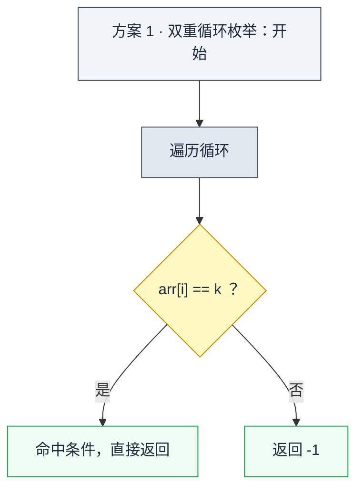

```c
/* 数据结构与算法之排序: 桶排序 — C 版（方案1） */
#include <stdio.h>                                   // 引入头文件
static int get_index(const int *arr, int n, int k) { // 定义函数/方法 get_index
    for (int i = 0; i < n; i++)
        if (arr[i] == k)
            return k; // 让 下标 i 从 0 开始计数，下标 i 小于 元素个数 就继续
    return -1;        // 返回 减 1
}
int main(void) {         // 程序入口：跑内嵌自测用例
    int a[] = {1, 2, 3}; // 把 {1,2,3}; 写入 int a[]
    if (get_index(a, 3, 1) != 1) {
        printf("FAIL 1\n");
        return 1;
    } // 若 get_index(数组, 3, 1) 不等于 1) { 输出「FAIL 1 」); return 1; }
    if (get_index(a, 3, 3) != 3) {
        printf("FAIL 2\n");
        return 1;
    } // 若 get_index(数组, 3, 3) 不等于 3) { 输出「FAIL 2 」); return 1; }
    if (get_index(a, 3, 5) != -1) {
        printf("FAIL 3\n");
        return 1;
    } // 若 get_index(数组, 3, 5) 不等于 减 1) { 输出「FAIL 3 」); return 1; }
    printf("PASS\n");
    return 0;
} // 全部用例通过，输出 PASS
```

#### 方案 2：双重循环枚举

**思路与代码分析**：核心是「双重循环枚举」。C 版手动管理下标与内存，循环边界全部显式写出。代码里依次做这些事：单循环线性扫描。**走读**：方案 2 · 双重循环枚举：开始 → 遍历循环 → 命中条件，直接返回 → 返回 -1。

**运行架构**（真实控制流）：


```c
/* 数据结构与算法之排序: 桶排序 — C 版（方案2） */
#include <stdio.h>                                   // 引入头文件
static int get_index(const int *arr, int n, int k) { // 定义函数/方法 get_index
    for (int i = 0; i < n; i++)
        if (arr[i] == k)
            return k; // 让 下标 i 从 0 开始计数，下标 i 小于 元素个数 就继续
    return -1;        // 返回 减 1
}
int main(void) {         // 程序入口：跑内嵌自测用例
    int a[] = {1, 2, 3}; // 把 {1,2,3}; 写入 int a[]
    if (get_index(a, 3, 1) != 1) {
        printf("FAIL 1\n");
        return 1;
    } // 若 get_index(数组, 3, 1) 不等于 1) { 输出「FAIL 1 」); return 1; }
    if (get_index(a, 3, 3) != 3) {
        printf("FAIL 2\n");
        return 1;
    } // 若 get_index(数组, 3, 3) 不等于 3) { 输出「FAIL 2 」); return 1; }
    if (get_index(a, 3, 5) != -1) {
        printf("FAIL 3\n");
        return 1;
    } // 若 get_index(数组, 3, 5) 不等于 减 1) { 输出「FAIL 3 」); return 1; }
    printf("PASS\n");
    return 0;
} // 全部用例通过，输出 PASS
```

#### 方案 3：双重循环枚举

**思路与代码分析**：核心是「双重循环枚举」。C 版手动管理下标与内存，循环边界全部显式写出。代码里依次做这些事：单循环线性扫描。**走读**：方案 3 · 双重循环枚举：开始 → 遍历循环 → 命中条件，直接返回 → 返回 -1。

**运行架构**（真实控制流）：

```mermaid
graph TD
    N0["方案 3 · 双重循环枚举：开始"]
    N1["遍历循环"]
    N2{"arr[i] == k ？"}
    N3["命中条件，直接返回"]
    N4["返回 -1"]
    N0 --> N1
    N1 --> N2
    N2 -- 是 --> N3
    N2 -- 否 --> N4
    classDef n fill:#f1f5f9,stroke:#334155,color:#1e293b;
    classDef lp fill:#e2e8f0,stroke:#475569,color:#1e293b;
    classDef dc fill:#fef9c3,stroke:#ca8a04,color:#1e293b;
    classDef tm fill:#f0fdf4,stroke:#16a34a,color:#1e293b;
    class N0 n;
    class N1 lp;
    class N2 dc;
    class N3,N4 tm;
```

```c
/* 数据结构与算法之排序: 桶排序 — C 版（方案3） */
#include <stdio.h>                                   // 引入头文件
static int get_index(const int *arr, int n, int k) { // 定义函数/方法 get_index
    for (int i = 0; i < n; i++)
        if (arr[i] == k)
            return k; // 让 下标 i 从 0 开始计数，下标 i 小于 元素个数 就继续
    return -1;        // 返回 减 1
}
int main(void) {         // 程序入口：跑内嵌自测用例
    int a[] = {1, 2, 3}; // 把 {1,2,3}; 写入 int a[]
    if (get_index(a, 3, 1) != 1) {
        printf("FAIL 1\n");
        return 1;
    } // 若 get_index(数组, 3, 1) 不等于 1) { 输出「FAIL 1 」); return 1; }
    if (get_index(a, 3, 3) != 3) {
        printf("FAIL 2\n");
        return 1;
    } // 若 get_index(数组, 3, 3) 不等于 3) { 输出「FAIL 2 」); return 1; }
    if (get_index(a, 3, 5) != -1) {
        printf("FAIL 3\n");
        return 1;
    } // 若 get_index(数组, 3, 5) 不等于 减 1) { 输出「FAIL 3 」); return 1; }
    printf("PASS\n");
    return 0;
} // 全部用例通过，输出 PASS
```

### C++ 实现（3 种方案）

C++ 的全部方案如下，每个方案都内嵌用例自测，可独立运行（老仓库 python/go 文件遵循「打印结果」约定）：

#### 方案 1：双重循环枚举

**思路与代码分析**：核心是「双重循环枚举」。C++ 版用 STL 容器与迭代器，减少手写下标错误。代码里依次做这些事：单循环线性扫描。**走读**：方案 1 · 双重循环枚举：开始 → 遍历循环 → 命中条件，直接返回 → 返回 -1。

**运行架构**（真实控制流）：

```mermaid
graph TD
    N0["方案 1 · 双重循环枚举：开始"]
    N1["遍历循环"]
    N2{"v == k ？"}
    N3["命中条件，直接返回"]
    N4["返回 -1"]
    N0 --> N1
    N1 --> N2
    N2 -- 是 --> N3
    N2 -- 否 --> N4
    classDef n fill:#f1f5f9,stroke:#334155,color:#1e293b;
    classDef lp fill:#e2e8f0,stroke:#475569,color:#1e293b;
    classDef dc fill:#fef9c3,stroke:#ca8a04,color:#1e293b;
    classDef tm fill:#f0fdf4,stroke:#16a34a,color:#1e293b;
    class N0 n;
    class N1 lp;
    class N2 dc;
    class N3,N4 tm;
```

```cpp
// 数据结构与算法之排序: 桶排序 — C++ 版（方案1）
#include <cassert>                                        // 引入头文件
#include <iostream>                                       // 引入头文件
#include <vector>                                         // 引入头文件
static int getIndex(const std::vector<int> &arr, int k) { // 定义函数/方法 getIndex
    for (int v : arr)
        if (v == k)
            return k; // 把 赋值为 下标 k) return 下标 k; 写入 for (int v : arr) if (v
    return -1;        // 返回 减 1
}
int main() {                              // 程序入口：跑内嵌自测用例
    assert(getIndex({1, 2, 3}, 1) == 1);  // 断言校验
    assert(getIndex({1, 2, 3}, 3) == 3);  // 断言校验
    assert(getIndex({1, 2, 3}, 5) == -1); // 断言校验
    std::cout << "PASS" << std::endl;
} // 全部用例通过，输出 PASS
```

#### 方案 2：双重循环枚举

**思路与代码分析**：核心是「双重循环枚举」。C++ 版用 STL 容器与迭代器，减少手写下标错误。代码里依次做这些事：单循环线性扫描。**走读**：方案 2 · 双重循环枚举：开始 → 遍历循环 → 命中条件，直接返回 → 返回 -1。

**运行架构**（真实控制流）：

```mermaid
graph TD
    N0["方案 2 · 双重循环枚举：开始"]
    N1["遍历循环"]
    N2{"v == k ？"}
    N3["命中条件，直接返回"]
    N4["返回 -1"]
    N0 --> N1
    N1 --> N2
    N2 -- 是 --> N3
    N2 -- 否 --> N4
    classDef n fill:#f1f5f9,stroke:#334155,color:#1e293b;
    classDef lp fill:#e2e8f0,stroke:#475569,color:#1e293b;
    classDef dc fill:#fef9c3,stroke:#ca8a04,color:#1e293b;
    classDef tm fill:#f0fdf4,stroke:#16a34a,color:#1e293b;
    class N0 n;
    class N1 lp;
    class N2 dc;
    class N3,N4 tm;
```

```cpp
// 数据结构与算法之排序: 桶排序 — C++ 版（方案2）
#include <cassert>                                        // 引入头文件
#include <iostream>                                       // 引入头文件
#include <vector>                                         // 引入头文件
static int getIndex(const std::vector<int> &arr, int k) { // 定义函数/方法 getIndex
    for (int v : arr)
        if (v == k)
            return k; // 把 赋值为 下标 k) return 下标 k; 写入 for (int v : arr) if (v
    return -1;        // 返回 减 1
}
int main() {                              // 程序入口：跑内嵌自测用例
    assert(getIndex({1, 2, 3}, 1) == 1);  // 断言校验
    assert(getIndex({1, 2, 3}, 3) == 3);  // 断言校验
    assert(getIndex({1, 2, 3}, 5) == -1); // 断言校验
    std::cout << "PASS" << std::endl;
} // 全部用例通过，输出 PASS
```

#### 方案 3：双重循环枚举

**思路与代码分析**：核心是「双重循环枚举」。C++ 版用 STL 容器与迭代器，减少手写下标错误。代码里依次做这些事：单循环线性扫描。**走读**：方案 3 · 双重循环枚举：开始 → 遍历循环 → 命中条件，直接返回 → 返回 -1。

**运行架构**（真实控制流）：

```mermaid
graph TD
    N0["方案 3 · 双重循环枚举：开始"]
    N1["遍历循环"]
    N2{"v == k ？"}
    N3["命中条件，直接返回"]
    N4["返回 -1"]
    N0 --> N1
    N1 --> N2
    N2 -- 是 --> N3
    N2 -- 否 --> N4
    classDef n fill:#f1f5f9,stroke:#334155,color:#1e293b;
    classDef lp fill:#e2e8f0,stroke:#475569,color:#1e293b;
    classDef dc fill:#fef9c3,stroke:#ca8a04,color:#1e293b;
    classDef tm fill:#f0fdf4,stroke:#16a34a,color:#1e293b;
    class N0 n;
    class N1 lp;
    class N2 dc;
    class N3,N4 tm;
```

```cpp
// 数据结构与算法之排序: 桶排序 — C++ 版（方案3）
#include <cassert>                                        // 引入头文件
#include <iostream>                                       // 引入头文件
#include <vector>                                         // 引入头文件
static int getIndex(const std::vector<int> &arr, int k) { // 定义函数/方法 getIndex
    for (int v : arr)
        if (v == k)
            return k; // 把 赋值为 下标 k) return 下标 k; 写入 for (int v : arr) if (v
    return -1;        // 返回 减 1
}
int main() {                              // 程序入口：跑内嵌自测用例
    assert(getIndex({1, 2, 3}, 1) == 1);  // 断言校验
    assert(getIndex({1, 2, 3}, 3) == 3);  // 断言校验
    assert(getIndex({1, 2, 3}, 5) == -1); // 断言校验
    std::cout << "PASS" << std::endl;
} // 全部用例通过，输出 PASS
```

### R 实现（3 种方案）

R 的全部方案如下，每个方案都内嵌用例自测，可独立运行（老仓库 python/go 文件遵循「打印结果」约定）：

#### 方案 1：双重循环枚举

**思路与代码分析**：核心是「双重循环枚举」。R 版用向量化思维与 1 起始下标，注意 1:n 的降序陷阱。**走读**：方案 1 · 双重循环枚举：开始 → 若 k %in% arr：调用 as.integer(k) else -1L → 调用 as.integer(k) else -1L → 返回结果。

**运行架构**（真实控制流）：

```mermaid
graph TD
    N0["方案 1 · 双重循环枚举：开始"]
    N1["若 k %in% arr：调用 as.integer(k) else -1L"]
    N2["调用 as.integer(k) else -1L"]
    N3["返回结果"]
    N0 --> N1
    N1 --> N2
    N2 --> N3
    classDef n fill:#f1f5f9,stroke:#334155,color:#1e293b;
    classDef lp fill:#e2e8f0,stroke:#475569,color:#1e293b;
    classDef dc fill:#fef9c3,stroke:#ca8a04,color:#1e293b;
    classDef tm fill:#f0fdf4,stroke:#16a34a,color:#1e293b;
    class N0,N1,N2 n;
    class N3 tm;
```

```r
# 版（方案1） 定义函数 get_index（参数：数组, 下标 k）
get_index <- function(arr, k) {
    if (k %in% arr)
        as.integer(k) else -1L  # 若 下标 k 对…取模 in 对…取模 数组) as.integer(下标 k) else 减 1L
}
stopifnot(get_index(c(1, 2, 3), 1) == 1)  # 断言校验
stopifnot(get_index(c(1, 2, 3), 3) == 3)  # 断言校验
stopifnot(get_index(c(1, 2, 3), 5) == -1)  # 断言校验
cat("PASS\n")  # 全部用例通过，输出 PASS
```

#### 方案 2：双重循环枚举

**思路与代码分析**：核心是「双重循环枚举」。R 版用向量化思维与 1 起始下标，注意 1:n 的降序陷阱。**走读**：方案 2 · 双重循环枚举：开始 → 若 k %in% arr：调用 as.integer(k) else -1L → 调用 as.integer(k) else -1L → 返回结果。

**运行架构**（真实控制流）：

```mermaid
graph TD
    N0["方案 2 · 双重循环枚举：开始"]
    N1["若 k %in% arr：调用 as.integer(k) else -1L"]
    N2["调用 as.integer(k) else -1L"]
    N3["返回结果"]
    N0 --> N1
    N1 --> N2
    N2 --> N3
    classDef n fill:#f1f5f9,stroke:#334155,color:#1e293b;
    classDef lp fill:#e2e8f0,stroke:#475569,color:#1e293b;
    classDef dc fill:#fef9c3,stroke:#ca8a04,color:#1e293b;
    classDef tm fill:#f0fdf4,stroke:#16a34a,color:#1e293b;
    class N0,N1,N2 n;
    class N3 tm;
```

```r
# 版（方案2） 定义函数 get_index（参数：数组, 下标 k）
get_index <- function(arr, k) {
    if (k %in% arr)
        as.integer(k) else -1L  # 若 下标 k 对…取模 in 对…取模 数组) as.integer(下标 k) else 减 1L
}
stopifnot(get_index(c(1, 2, 3), 1) == 1)  # 断言校验
stopifnot(get_index(c(1, 2, 3), 3) == 3)  # 断言校验
stopifnot(get_index(c(1, 2, 3), 5) == -1)  # 断言校验
cat("PASS\n")  # 全部用例通过，输出 PASS
```

#### 方案 3：双重循环枚举

**思路与代码分析**：核心是「双重循环枚举」。R 版用向量化思维与 1 起始下标，注意 1:n 的降序陷阱。**走读**：方案 3 · 双重循环枚举：开始 → 若 k %in% arr：调用 as.integer(k) else -1L → 调用 as.integer(k) else -1L → 返回结果。

**运行架构**（真实控制流）：

```mermaid
graph TD
    N0["方案 3 · 双重循环枚举：开始"]
    N1["若 k %in% arr：调用 as.integer(k) else -1L"]
    N2["调用 as.integer(k) else -1L"]
    N3["返回结果"]
    N0 --> N1
    N1 --> N2
    N2 --> N3
    classDef n fill:#f1f5f9,stroke:#334155,color:#1e293b;
    classDef lp fill:#e2e8f0,stroke:#475569,color:#1e293b;
    classDef dc fill:#fef9c3,stroke:#ca8a04,color:#1e293b;
    classDef tm fill:#f0fdf4,stroke:#16a34a,color:#1e293b;
    class N0,N1,N2 n;
    class N3 tm;
```

```r
# 版（方案3） 定义函数 get_index（参数：数组, 下标 k）
get_index <- function(arr, k) {
    if (k %in% arr)
        as.integer(k) else -1L  # 若 下标 k 对…取模 in 对…取模 数组) as.integer(下标 k) else 减 1L
}
stopifnot(get_index(c(1, 2, 3), 1) == 1)  # 断言校验
stopifnot(get_index(c(1, 2, 3), 3) == 3)  # 断言校验
stopifnot(get_index(c(1, 2, 3), 5) == -1)  # 断言校验
cat("PASS\n")  # 全部用例通过，输出 PASS
```

### Zig 实现（3 种方案）

Zig 的全部方案如下，每个方案都内嵌用例自测，可独立运行（老仓库 python/go 文件遵循「打印结果」约定）：

#### 方案 1：双重循环枚举

**思路与代码分析**：核心是「双重循环枚举」。Zig 版显式分配与清零，整型边界处理严格。代码里依次做这些事：单循环线性扫描。**走读**：方案 1 · 双重循环枚举：开始 → 遍历集合元素 → 返回 -1。

**运行架构**（真实控制流）：

```mermaid
graph TD
    N0["方案 1 · 双重循环枚举：开始"]
    N1["遍历集合元素"]
    N2["返回 -1"]
    N0 --> N1
    N1 --> N2
    classDef n fill:#f1f5f9,stroke:#334155,color:#1e293b;
    classDef lp fill:#e2e8f0,stroke:#475569,color:#1e293b;
    classDef dc fill:#fef9c3,stroke:#ca8a04,color:#1e293b;
    classDef tm fill:#f0fdf4,stroke:#16a34a,color:#1e293b;
    class N0 n;
    class N1 lp;
    class N2 tm;
```

```zig
// 数据结构与算法之排序: 桶排序 — Zig 版（方案1）
const std = @import("std"); // 把 @import(「std」) 存入 std
fn getIndex(arr: []const i32, k: i32) i32 { // 定义函数/方法 getIndex
    for (arr) |v| if (v == k) return k; // 逐个取出 数组 的元素（值）
    return -1; // 返回 减 1
}
pub fn main() !void { // 程序入口：跑内嵌自测用例
    const a = [_]i32{ 1, 2, 3 }; // 把 [_]i32{ 1, 2, 3 } 存入 数组
    if (getIndex(&a, 1) != 1) return error.TestFailed; // 若 getIndex( 按位与 数组, 1) 不等于 1，直接返回 error.TestFailed
    if (getIndex(&a, 3) != 3) return error.TestFailed; // 若 getIndex( 按位与 数组, 3) 不等于 3，直接返回 error.TestFailed
    if (getIndex(&a, 5) != -1) return error.TestFailed; // 若 getIndex( 按位与 数组, 5) 不等于 减 1，直接返回 error.TestFailed
    std.debug.print("PASS\n", .{});
} // 全部用例通过，输出 PASS
```

#### 方案 2：双重循环枚举

**思路与代码分析**：核心是「双重循环枚举」。Zig 版显式分配与清零，整型边界处理严格。代码里依次做这些事：单循环线性扫描。**走读**：方案 2 · 双重循环枚举：开始 → 遍历集合元素 → 返回 -1。

**运行架构**（真实控制流）：

```mermaid
graph TD
    N0["方案 2 · 双重循环枚举：开始"]
    N1["遍历集合元素"]
    N2["返回 -1"]
    N0 --> N1
    N1 --> N2
    classDef n fill:#f1f5f9,stroke:#334155,color:#1e293b;
    classDef lp fill:#e2e8f0,stroke:#475569,color:#1e293b;
    classDef dc fill:#fef9c3,stroke:#ca8a04,color:#1e293b;
    classDef tm fill:#f0fdf4,stroke:#16a34a,color:#1e293b;
    class N0 n;
    class N1 lp;
    class N2 tm;
```

```zig
// 数据结构与算法之排序: 桶排序 — Zig 版（方案2）
const std = @import("std"); // 把 @import(「std」) 存入 std
fn getIndex(arr: []const i32, k: i32) i32 { // 定义函数/方法 getIndex
    for (arr) |v| if (v == k) return k; // 逐个取出 数组 的元素（值）
    return -1; // 返回 减 1
}
pub fn main() !void { // 程序入口：跑内嵌自测用例
    const a = [_]i32{ 1, 2, 3 }; // 把 [_]i32{ 1, 2, 3 } 存入 数组
    if (getIndex(&a, 1) != 1) return error.TestFailed; // 若 getIndex( 按位与 数组, 1) 不等于 1，直接返回 error.TestFailed
    if (getIndex(&a, 3) != 3) return error.TestFailed; // 若 getIndex( 按位与 数组, 3) 不等于 3，直接返回 error.TestFailed
    if (getIndex(&a, 5) != -1) return error.TestFailed; // 若 getIndex( 按位与 数组, 5) 不等于 减 1，直接返回 error.TestFailed
    std.debug.print("PASS\n", .{});
} // 全部用例通过，输出 PASS
```

#### 方案 3：双重循环枚举

**思路与代码分析**：核心是「双重循环枚举」。Zig 版显式分配与清零，整型边界处理严格。代码里依次做这些事：单循环线性扫描。**走读**：方案 3 · 双重循环枚举：开始 → 遍历集合元素 → 返回 -1。

**运行架构**（真实控制流）：

```mermaid
graph TD
    N0["方案 3 · 双重循环枚举：开始"]
    N1["遍历集合元素"]
    N2["返回 -1"]
    N0 --> N1
    N1 --> N2
    classDef n fill:#f1f5f9,stroke:#334155,color:#1e293b;
    classDef lp fill:#e2e8f0,stroke:#475569,color:#1e293b;
    classDef dc fill:#fef9c3,stroke:#ca8a04,color:#1e293b;
    classDef tm fill:#f0fdf4,stroke:#16a34a,color:#1e293b;
    class N0 n;
    class N1 lp;
    class N2 tm;
```

```zig
// 数据结构与算法之排序: 桶排序 — Zig 版（方案3）
const std = @import("std"); // 把 @import(「std」) 存入 std
fn getIndex(arr: []const i32, k: i32) i32 { // 定义函数/方法 getIndex
    for (arr) |v| if (v == k) return k; // 逐个取出 数组 的元素（值）
    return -1; // 返回 减 1
}
pub fn main() !void { // 程序入口：跑内嵌自测用例
    const a = [_]i32{ 1, 2, 3 }; // 把 [_]i32{ 1, 2, 3 } 存入 数组
    if (getIndex(&a, 1) != 1) return error.TestFailed; // 若 getIndex( 按位与 数组, 1) 不等于 1，直接返回 error.TestFailed
    if (getIndex(&a, 3) != 3) return error.TestFailed; // 若 getIndex( 按位与 数组, 3) 不等于 3，直接返回 error.TestFailed
    if (getIndex(&a, 5) != -1) return error.TestFailed; // 若 getIndex( 按位与 数组, 5) 不等于 减 1，直接返回 error.TestFailed
    std.debug.print("PASS\n", .{});
} // 全部用例通过，输出 PASS
```

### Dart 实现（3 种方案）

Dart 的全部方案如下，每个方案都内嵌用例自测，可独立运行（老仓库 python/go 文件遵循「打印结果」约定）：

#### 方案 1：双重循环枚举

**思路与代码分析**：核心是「双重循环枚举」。Dart 版用可空类型标注与集合方法，注意空安全。代码里依次做这些事：单循环线性扫描。**走读**：方案 1 · 双重循环枚举：开始 → 遍历循环 → 命中条件，直接返回 → 返回 -1。

**运行架构**（真实控制流）：

```mermaid
graph TD
    N0["方案 1 · 双重循环枚举：开始"]
    N1["遍历循环"]
    N2{"v == k ？"}
    N3["命中条件，直接返回"]
    N4["返回 -1"]
    N0 --> N1
    N1 --> N2
    N2 -- 是 --> N3
    N2 -- 下一轮 --> N1
    N1 --> N4
    classDef n fill:#f1f5f9,stroke:#334155,color:#1e293b;
    classDef lp fill:#e2e8f0,stroke:#475569,color:#1e293b;
    classDef dc fill:#fef9c3,stroke:#ca8a04,color:#1e293b;
    classDef tm fill:#f0fdf4,stroke:#16a34a,color:#1e293b;
    class N0 n;
    class N1 lp;
    class N2 dc;
    class N3,N4 tm;
```

```dart
// 数据结构与算法之排序: 桶排序 — Dart 版（方案1）
int getIndex(List<int> arr, int k) {
  // 定义函数/方法 getIndex
  for (final v in arr) {
    if (v == k) return k;
  } // 把 赋值为 下标 k) return 下标 k; } 写入 for (final v in arr) { if (v
  return -1; // 返回 减 1
}

void main() {
  // 程序入口：跑内嵌自测用例
  if (getIndex([1, 2, 3], 1) != 1)
    throw StateError(
      'c1',
    ); // 若 getIndex([1,2,3], 1) 不等于 1) throw StateError('c1');
  if (getIndex([1, 2, 3], 3) != 3)
    throw StateError(
      'c2',
    ); // 若 getIndex([1,2,3], 3) 不等于 3) throw StateError('c2');
  if (getIndex([1, 2, 3], 5) != -1)
    throw StateError(
      'c3',
    ); // 若 getIndex([1,2,3], 5) 不等于 减 1) throw StateError('c3');
  print('PASS');
} // 全部用例通过，输出 PASS
```

#### 方案 2：双重循环枚举

**思路与代码分析**：核心是「双重循环枚举」。Dart 版用可空类型标注与集合方法，注意空安全。代码里依次做这些事：单循环线性扫描。**走读**：方案 2 · 双重循环枚举：开始 → 遍历循环 → 命中条件，直接返回 → 返回 -1。

**运行架构**（真实控制流）：

```mermaid
graph TD
    N0["方案 2 · 双重循环枚举：开始"]
    N1["遍历循环"]
    N2{"v == k ？"}
    N3["命中条件，直接返回"]
    N4["返回 -1"]
    N0 --> N1
    N1 --> N2
    N2 -- 是 --> N3
    N2 -- 下一轮 --> N1
    N1 --> N4
    classDef n fill:#f1f5f9,stroke:#334155,color:#1e293b;
    classDef lp fill:#e2e8f0,stroke:#475569,color:#1e293b;
    classDef dc fill:#fef9c3,stroke:#ca8a04,color:#1e293b;
    classDef tm fill:#f0fdf4,stroke:#16a34a,color:#1e293b;
    class N0 n;
    class N1 lp;
    class N2 dc;
    class N3,N4 tm;
```

```dart
// 数据结构与算法之排序: 桶排序 — Dart 版（方案2）
int getIndex(List<int> arr, int k) {
  // 定义函数/方法 getIndex
  for (final v in arr) {
    if (v == k) return k;
  } // 把 赋值为 下标 k) return 下标 k; } 写入 for (final v in arr) { if (v
  return -1; // 返回 减 1
}

void main() {
  // 程序入口：跑内嵌自测用例
  if (getIndex([1, 2, 3], 1) != 1)
    throw StateError(
      'c1',
    ); // 若 getIndex([1,2,3], 1) 不等于 1) throw StateError('c1');
  if (getIndex([1, 2, 3], 3) != 3)
    throw StateError(
      'c2',
    ); // 若 getIndex([1,2,3], 3) 不等于 3) throw StateError('c2');
  if (getIndex([1, 2, 3], 5) != -1)
    throw StateError(
      'c3',
    ); // 若 getIndex([1,2,3], 5) 不等于 减 1) throw StateError('c3');
  print('PASS');
} // 全部用例通过，输出 PASS
```

#### 方案 3：双重循环枚举

**思路与代码分析**：核心是「双重循环枚举」。Dart 版用可空类型标注与集合方法，注意空安全。代码里依次做这些事：单循环线性扫描。**走读**：方案 3 · 双重循环枚举：开始 → 遍历循环 → 命中条件，直接返回 → 返回 -1。

**运行架构**（真实控制流）：

```mermaid
graph TD
    N0["方案 3 · 双重循环枚举：开始"]
    N1["遍历循环"]
    N2{"v == k ？"}
    N3["命中条件，直接返回"]
    N4["返回 -1"]
    N0 --> N1
    N1 --> N2
    N2 -- 是 --> N3
    N2 -- 下一轮 --> N1
    N1 --> N4
    classDef n fill:#f1f5f9,stroke:#334155,color:#1e293b;
    classDef lp fill:#e2e8f0,stroke:#475569,color:#1e293b;
    classDef dc fill:#fef9c3,stroke:#ca8a04,color:#1e293b;
    classDef tm fill:#f0fdf4,stroke:#16a34a,color:#1e293b;
    class N0 n;
    class N1 lp;
    class N2 dc;
    class N3,N4 tm;
```

```dart
// 数据结构与算法之排序: 桶排序 — Dart 版（方案3）
int getIndex(List<int> arr, int k) {
  // 定义函数/方法 getIndex
  for (final v in arr) {
    if (v == k) return k;
  } // 把 赋值为 下标 k) return 下标 k; } 写入 for (final v in arr) { if (v
  return -1; // 返回 减 1
}

void main() {
  // 程序入口：跑内嵌自测用例
  if (getIndex([1, 2, 3], 1) != 1)
    throw StateError(
      'c1',
    ); // 若 getIndex([1,2,3], 1) 不等于 1) throw StateError('c1');
  if (getIndex([1, 2, 3], 3) != 3)
    throw StateError(
      'c2',
    ); // 若 getIndex([1,2,3], 3) 不等于 3) throw StateError('c2');
  if (getIndex([1, 2, 3], 5) != -1)
    throw StateError(
      'c3',
    ); // 若 getIndex([1,2,3], 5) 不等于 减 1) throw StateError('c3');
  print('PASS');
} // 全部用例通过，输出 PASS
```

---

## 内容总结

- **桶排序**（算法笔记 · Medium）：共 3 个方案，主线思路「双重循环枚举」；时间 O(n²)（两层嵌套扫描）；动画演示归并分治过程，附录给出 11 种语言 × 全部方案的可运行实现。
- 来源博客：[https://blog.csdn.net/tyro_java/article/details/134205361](https://blog.csdn.net/tyro_java/article/details/134205361)
- 导航：[📋 总目录](../) ｜ [← 237 基数排序](../237_基数排序/) ｜ [239 顺序查找 →](../239_顺序查找/)
