# 239 · 顺序查找（第附阶段 · 专题补充 · Medium）

> **难度**：⭐⭐ Medium ｜ **专题**：算法笔记
> **学习定位**：第附阶段 · 专题补充第 239 篇 ｜ **解法数**：3
> **内容总结**：**顺序查找**（算法笔记 · Medium）：共 3 个方案，主线思路「直接实现」；时间 O(n) 量级；动画演示归并分治过程，附录给出 11 种语言 × 全部方案的可运行实现。

---

## 题目描述

顺序查找。具体输入输出约定见函数签名与用例。

- 主函数签名：`function assertEq(actual: any, expected: any, msg: string = ''): void`

**数据范围与注意事项**：

- **易错点**：先看小例子手推一遍再对照代码，比直接读代码快得多。

## 题目分析

**场景是什么**：综合练习：把数据结构与策略组合起来解决一个完整问题。本题就是该场景的 Medium 级练习，主线做法是「直接实现」。

**主线怎么解**：主解法结构简单：读入、处理、返回。

## 解题思路

**方案对比**（共 3 个方案，由浅入深）：

| 方案 | 时间复杂度 | 空间复杂度 |
|---|---|---|
| 方案 1 · 直接实现 | O(n) 量级 | O(n) |
| 方案 2 · 单趟扫描 | O(n)（单趟线性扫描） | O(1) 到 O(n)（视辅助结构） |
| 方案 3 · 直接实现 | O(n) 量级 | O(n) |

**由浅入深的路径**：直接实现 → 单趟扫描；每往右一步，都在补上一步的短板。

**方案间的取舍**：方案 1（直接实现）；方案 2（单趟扫描）；方案 3（直接实现）。数据规模小、可读性优先时选靠前的方案；规模大、性能优先时选靠后的方案。

**怎么读这一篇**：

- 🐣 **新手路线**：把「题目描述」的示例 1 在纸上手推一遍 → 读方案 1（最直观的写法）与它的代码走读 → 按「运行方式」本地跑通看 PASS → 回头对比方案 2 之后的写法差在哪
- 🦅 **大佬路线**：直接锁定最优方案 1（直接实现，O(n) 量级）→ 跳读该方案代码与走读 → 用「逐步拆解与面试追问」补齐复杂度推导与边界追问

### 动态算法图（归并分治，GIF 自动循环）

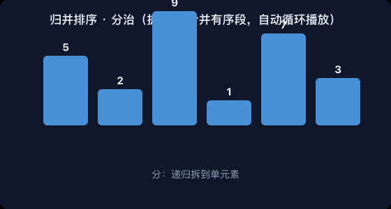

动画演示算法笔记专题里归并分治的典型过程；每个方案在「TypeScript 解题方案」一节还配了专属动画与专属流程图。

### 主解法流程图（真实控制流）

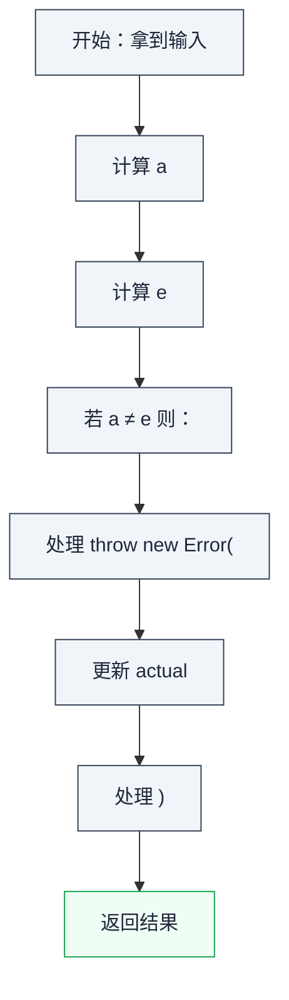

## TypeScript 解题方案（3 个方案逐个讲）

> **运行与提交**：每个方案都是自包含文件（内嵌用例自测，输出 PASS），整块复制到 `.ts` 文件后 `node 文件名` 即可运行。提交 LeetCode 时，把 `demo` 内的算法函数与辅助类型/函数整体取出、置于文件顶层即可。概念演示（非 LeetCode 编号题），在本地运行即可。

### 方案 1：直接实现

**分析与思路**：核心做法是「直接实现」。

**运行方式**：`node 本文件`，内嵌用例全部通过会输出 PASS。


**方案专属流程图**（真实控制流）：

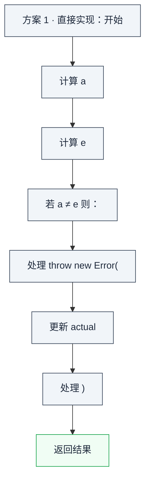

```typescript
function assertEq(actual: any, expected: any, msg: string = ''): void {
  // 定义函数/方法 assertEq
  const a = JSON.stringify(actual); // 把 JSON.stringify(actual) 存入 数组
  const e = JSON.stringify(expected); // 把 JSON.stringify(expected) 存入 e
  if (a !== e) {
    // 若 数组 不等于 e
    throw new Error(
      'ASSERT FAILED ' + msg + ' :: actual=' + a + ' expected=' + e,
    );
  }
}

function seqSearch(arr: number[], target: number): number {
  // 定义函数/方法 seqSearch
  for (let i = 0; i < arr.length; i++) {
    // 让 下标 i 从 0 开始计数，下标 i 小于 数组.长度 就继续
    if (arr[i] === target) return i; // 若 数组[下标 i] 全等于 目标值，直接返回 下标 i
  }
  return -1; // 返回 减 1
}

export function demo(): void {
  // 程序入口：跑内嵌自测用例
  assertEq(seqSearch([1, 2, 3], 1), 0, 'seqSearch hit'); // 断言校验
  assertEq(seqSearch([1, 2, 3], 2), 1, 'seqSearch hit2'); // 断言校验
  assertEq(seqSearch([1, 2, 3], 4), -1, 'seqSearch miss'); // 断言校验
  console.log('PASS'); // 全部用例通过，输出 PASS
}
demo(); // demo();
```

### 方案 2：单趟扫描

**分析与思路**：核心做法是「单趟扫描」。代码里依次做这些事：单循环线性扫描。

**运行方式**：`node 本文件`，内嵌用例全部通过会输出 PASS。


**方案专属流程图**（真实控制流）：

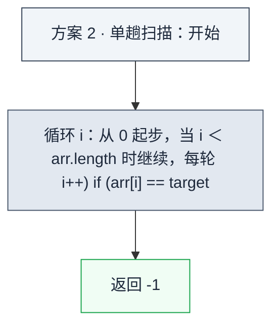

```typescript
export function demo(): void {
  // 程序入口：跑内嵌自测用例
  function seqSearch(arr: number[], target: number): number {
    // 定义函数/方法 seqSearch
    for (let i = 0; i < arr.length; i++) if (arr[i] === target) return i; // 让 下标 i 从 0 开始计数，下标 i 小于 数组.长度 就继续
    return -1; // 返回 减 1
  }
  const cases = [
    { arr: [1, 2, 3], t: 1, want: 0 },
    { arr: [1, 2, 3], t: 3, want: 2 },
    { arr: [1, 2, 3], t: 5, want: -1 },
  ];
  let fail = false; // 把 false 存入 fail
  for (const c of cases) {
    // for (const 字符 of cases) {
    const got = seqSearch(c.arr, c.t); // 把 seqSearch(字符.数组, 字符.另一字符串) 存入 got
    if (got !== c.want) {
      fail = true;
      console.log('FAIL ' + got + ' want ' + c.want);
    }
  }
  if (fail) throw new Error('FAILED'); // 若 fail) throw new Error(「FAILED」);
  console.log('PASS'); // 全部用例通过，输出 PASS
}
demo(); // demo();
```

### 方案 3：直接实现

**分析与思路**：核心做法是「直接实现」。

**运行方式**：`node 本文件`，内嵌用例全部通过会输出 PASS。


**方案专属流程图**（真实控制流）：

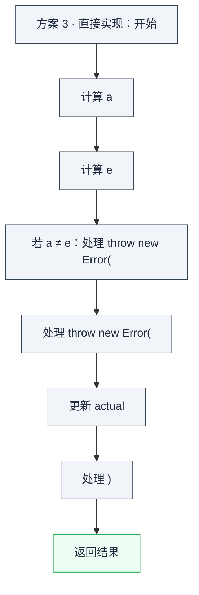

```typescript
function assertEq(actual: any, expected: any, msg: string = ''): void {
  // 定义函数/方法 assertEq
  const a = JSON.stringify(actual);
  const e = JSON.stringify(expected);
  if (a !== e)
    throw new Error(
      'ASSERT FAILED ' + msg + ' :: actual=' + a + ' expected=' + e,
    );
}

function seq_search(nums: number[], target: number): number {
  // 定义函数/方法 seq_search
  for (let i = 0; i < nums.length; i++) if (nums[i] === target) return i; // 让 下标 i 从 0 开始计数，下标 i 小于 数组.长度 就继续
  return -1; // 返回 减 1
}
export function demo(): void {
  // 程序入口：跑内嵌自测用例
  const cases: [number[], number, number][] = [
    [[15, 4, 23, 52, 1], 23, 2],
    [[15, 4, 23, 52, 1], 123, -1],
    [[1, 2, 3, 4, 5], 3, 2],
    [[1, 2, 3, 4, 5], 6, -1],
    [[10, 20, 30, 40, 50], 10, 0],
    [[10, 20, 30, 40, 50], 50, 4],
    [[], 1, -1],
    [[1], 1, 0],
    [[1], 2, -1],
  ];
  for (const [nums, target, expected] of cases) {
    // for (const [数组, 目标值, expected] of cases) {
    assertEq(
      seq_search(nums, target),
      expected,
      'case ' + JSON.stringify(nums) + ' ' + target,
    ); // 断言校验
  }
  console.log('PASS'); // 全部用例通过，输出 PASS
}
demo(); // demo();
```

## 逐步拆解与面试追问

**复杂度**：时间 O(n) 量级，空间 O(n)

**为什么是这个量级**：整体只对数据做有限趟处理

**面试官可能会追问**：

- 这个策略能推广到什么场景？
- 与暴力做法差在哪一步？
- 有没有更简单的等价写法？

## 关键 API 速查（TS 主解法实际用到，附官方链接）

| API | 作用 | 使用要点 | 官方文档 |
|---|---|---|---|
| `JSON.stringify()` | 序列化为 JSON 字符串 | 常用于结构化比较（深度相等判定）；undefined/函数/循环引用会被丢弃或抛错 | [官方文档](https://developer.mozilla.org/zh-CN/docs/Web/JavaScript/Reference/Global_Objects/JSON/stringify) |

### 各语言官方文档导航

- **TypeScript / JS**：[MDN 中文参考](https://developer.mozilla.org/zh-CN/)
- **Python**：[Python 官方文档](https://docs.python.org/zh-cn/3/)
- **Go**：[Go 标准库](https://pkg.go.dev/std)
- **Java**：[JDK 17 API](https://docs.oracle.com/en/java/javase/17/docs/api/)
- **Rust**：[Rust 标准库](https://doc.rust-lang.org/std/)
- **Lua**：[Lua 5.4 手册](https://www.lua.org/manual/5.4/)
- **C**：[Cppreference C](https://zh.cppreference.com/w/c)
- **C++**：[Cppreference C++](https://zh.cppreference.com/w/cpp)
- **R**：[R 官方手册](https://stat.ethz.ch/R-manual/)
- **Zig**：[Zig 语言文档](https://ziglang.org/documentation/master/)
- **Dart**：[Dart API](https://api.dart.dev/)

## 附录：其他 10 种语言全部实现（每种语言列举其全部方案）

> TypeScript 的全部方案见「TypeScript 解题方案」一节；下面是其余 10 种语言的对应实现，每种语言的每个方案都带思路分析、代码走读与专属运行架构图。
> 每个方案都内嵌用例自测，可独立运行（老仓库 python/go 文件遵循「打印结果」约定）。
> 完整解法文件见 `dsa/<语言>/notes/lc_134217002_顺序查找/`。

### Python 实现（3 种方案）

Python 的全部方案如下，每个方案都内嵌用例自测，可独立运行（老仓库 python/go 文件遵循「打印结果」约定）：

#### 方案 1：直接实现

**思路与代码分析**：核心是「直接实现」。Python 版用切片与字典推导式简化操作，突出可读性。**走读**：方案 1 · 直接实现：开始 → 循环 i：从 0 到 len(arr 前 → 命中条件，直接返回 → 返回 -1。

**运行架构**（真实控制流）：

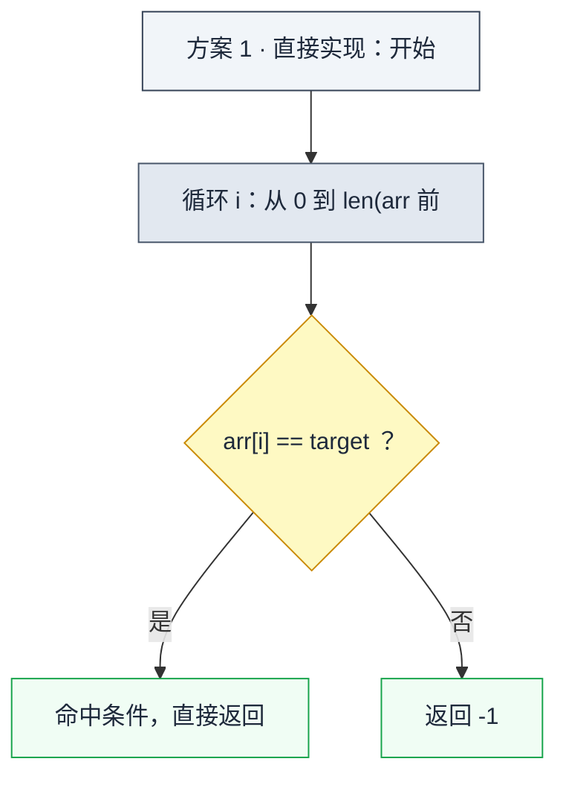

```python
import sys  # 提高递归深度上限（深输入防 RecursionError）

sys.setrecursionlimit(200000)  # 树/链表类题目节点数可达 1e4 量级

def seqSearch(arr, target):  # 定义函数 seqSearch（参数：数组, 目标值）
    for i in range(len(arr)):  # 让 下标 i 从 长度(数组 遍历
        if arr[i] == target:  # 若 数组[下标 i] 等于 目标值
            return i  # 返回 下标 i
    return -1  # 返回 减 1

if __name__ == "__main__":  # 若 __name__ 等于 '__main__'
    print(seqSearch([1, 2, 3], 1))  # 打印输出
```

#### 方案 2：单趟扫描

**思路与代码分析**：核心是「单趟扫描」。Python 版用切片与字典推导式简化操作，突出可读性。**走读**：方案 2 · 单趟扫描：开始 → 循环 i：从 0 到 len(nums 前 → 命中条件，直接返回 → 返回 -1。

**运行架构**（真实控制流）：


```python
# 顺序查找 - 返回目标值的下标, 找不到返回 -1
import sys  # 提高递归深度上限（深输入防 RecursionError）

sys.setrecursionlimit(200000)  # 树/链表类题目节点数可达 1e4 量级

def seq_search(nums, target):  # 定义函数 seq_search（参数：数组, 目标值）
    for i in range(len(nums)):  # 让 下标 i 从 长度(数组 遍历
        if nums[i] == target:  # 若 数组[下标 i] 等于 目标值
            return i  # 返回 下标 i
    return -1  # 返回 减 1

if __name__ == "__main__":  # 若 __name__ 等于 '__main__'
    lst = [15, 4, 23, 52, 1]  # 把 [15, 4, 23, 52, 1] 存入 lst
    print(seq_search(lst, 23))  # 2
    print(seq_search(lst, 123))  # -1
```

#### 方案 3：直接实现

**思路与代码分析**：核心是「直接实现」。Python 版用切片与字典推导式简化操作，突出可读性。**走读**：方案 3 · 直接实现：开始 → 循环 i：从 0 到 len(nums 前 → 命中条件，直接返回 → 返回 -1。

**运行架构**（真实控制流）：

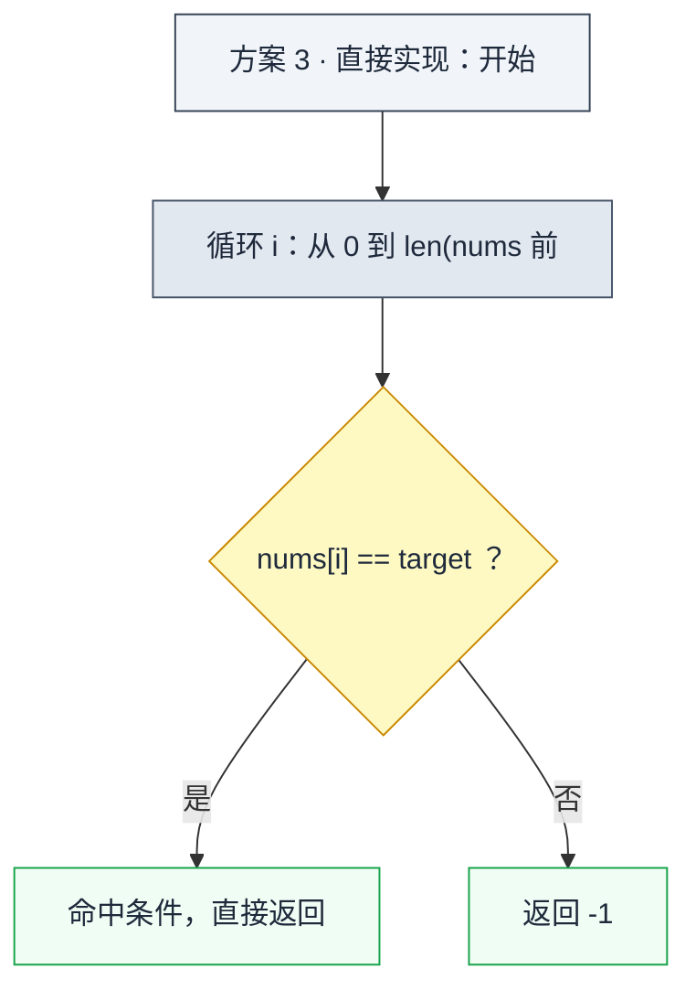

```python
# 顺序查找 - 带测试用例版本
import sys  # 提高递归深度上限（深输入防 RecursionError）

sys.setrecursionlimit(200000)  # 树/链表类题目节点数可达 1e4 量级

def seq_search(nums, target):  # 定义函数 seq_search（参数：数组, 目标值）
    for i in range(len(nums)):  # 让 下标 i 从 长度(数组 遍历
        if nums[i] == target:  # 若 数组[下标 i] 等于 目标值
            return i  # 返回 下标 i
    return -1  # 返回 减 1

def test_seq_search():  # 定义函数 test_seq_search（参数：无）
    test_cases = [
        ([15, 4, 23, 52, 1], 23, 2),
        ([15, 4, 23, 52, 1], 123, -1),
        ([1, 2, 3, 4, 5], 3, 2),
        ([1, 2, 3, 4, 5], 6, -1),
        ([10, 20, 30, 40, 50], 10, 0),
        ([10, 20, 30, 40, 50], 50, 4),
        ([], 1, -1),
        ([1], 1, 0),
        ([1], 2, -1),
    ]
    for i, (nums, target, expected) in enumerate(
        test_cases
    ):  # for 下标 i, (数组, 目标值, expected) in enumerate(test_cases):
        result = seq_search(nums, target)  # 把 seq_search(数组, 目标值) 存入 结果
        status = (
            "PASS" if result == expected else "FAIL"
        )  # 把 'PASS' if 结果 等于 expected else 'FAIL' 存入 status
        print(f"Test Case {i + 1}: {status} (expected {expected}, got {result})")  # 打印输出

if __name__ == "__main__":  # 若 __name__ 等于 '__main__'
    test_seq_search()  # test_seq_search()
```

### Go 实现（3 种方案）

Go 的全部方案如下，每个方案都内嵌用例自测，可独立运行（老仓库 python/go 文件遵循「打印结果」约定）：

#### 方案 1：直接实现

**思路与代码分析**：核心是「直接实现」。Go 版用切片与多返回值惯用法，显式处理索引边界。**走读**：方案 1 · 直接实现：开始 → 遍历 arr 的下标与元素 v → 处理 if v == target → 返回 i → 返回 -1。

**运行架构**（真实控制流）：

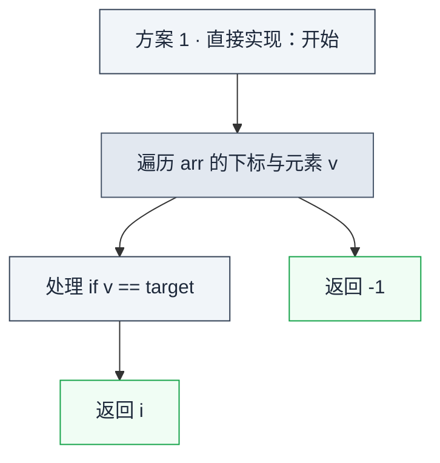

```go
package main // 引入依赖
import (
	"fmt"
	"os"
) // 引入依赖
func seqSearch(arr []int, target int) int { // 定义函数/方法 seqSearch
	for i, v := range arr {
		if v == target {
			return i
		}
	} // 同时取 下标 i 与 值 遍历
	return -1 // 返回 减 1
}
func main() { // 程序入口：跑内嵌自测用例
	cases := []struct {
		arr  []int
		t    int
		want int
	}{ // 把 []struct{ 数组 []int; 另一字符串 int; want int }{ 写入 cases :
		{[]int{1, 2, 3}, 1, 0}, {[]int{1, 2, 3}, 3, 2}, {[]int{1, 2, 3}, 5, -1},
	}
	ok := true                // 把 true 写入 ok :
	for _, c := range cases { // 同时取 _ 与 字符 遍历
		if got := seqSearch(c.arr, c.t); got != c.want {
			ok = false
			fmt.Printf("FAIL=%v want %v\n", got, c.want)
		}
	}
	if !ok {
		os.Exit(1)
	} // 若 取反 ok { os.Exit(1) }
	fmt.Println("PASS") // 全部用例通过，输出 PASS
}
```

#### 方案 2：单趟扫描

**思路与代码分析**：核心是「单趟扫描」。Go 版用切片与多返回值惯用法，显式处理索引边界。**走读**：方案 2 · 单趟扫描：开始 → 遍历循环 → 处理 if nums[i] == target → 返回 i → 返回 -1。

**运行架构**（真实控制流）：

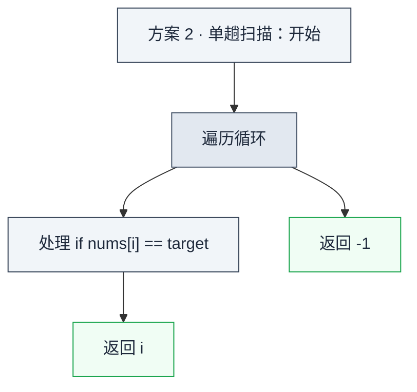

```go
package main // 引入依赖

import (
	"fmt" // 「fmt」
	"os"  // 「os」
)

func seqSearch(nums []int, target int) int { // 定义函数/方法 seqSearch
	for i := 0; i < len(nums); i++ { // 让 下标 i 从 0 开始计数
		if nums[i] == target { // 若 数组[下标 i] 等于 目标值
			return i // 返回 下标 i
		}
	}
	return -1 // 返回 减 1
}

func main() { // 程序入口：跑内嵌自测用例
	type tc struct { // 定义类型
		nums   []int // 数组 []int
		target int   // 目标值 int
		want   int   // want int
	}
	cases := []tc{ // 把 []tc{ 写入 cases :
		{[]int{15, 4, 23, 52, 1}, 23, 2},
		{[]int{15, 4, 23, 52, 1}, 123, -1},
		{[]int{}, 1, -1},
	}
	ok := true                // 把 true 写入 ok :
	for _, c := range cases { // 同时取 _ 与 字符 遍历
		if got := seqSearch(c.nums, c.target); got != c.want { // 若 got : 赋值为 seqSearch(字符.数组, 字符.目标值); got 不等于 字符.want
			ok = false                                                                      // 把 false 写入 ok
			fmt.Printf("FAIL seqSearch(%v,%d)=%d want %d\n", c.nums, c.target, got, c.want) // 打印输出
		}
	}
	if !ok { // 若 取反 ok
		os.Exit(1) // os.Exit(1)
	}
	fmt.Println("PASS") // 全部用例通过，输出 PASS
}
```

#### 方案 3：直接实现

**思路与代码分析**：核心是「直接实现」。Go 版用切片与多返回值惯用法，显式处理索引边界。**走读**：方案 3 · 直接实现：开始 → 遍历 arr 的下标与元素 v → 处理 if v == target → 返回 i → 返回 -1。

**运行架构**（真实控制流）：

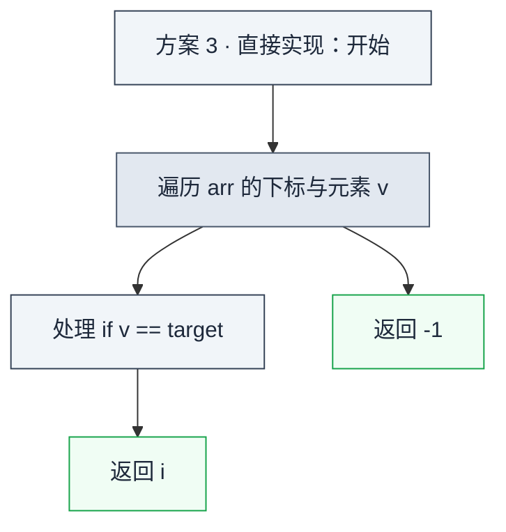

```go
package main // 引入依赖
import (
	"fmt"
	"os"
) // 引入依赖
func seqSearch(arr []int, target int) int { // 定义函数/方法 seqSearch
	for i, v := range arr {
		if v == target {
			return i
		}
	} // 同时取 下标 i 与 值 遍历
	return -1 // 返回 减 1
}
func main() { // 程序入口：跑内嵌自测用例
	cases := []struct {
		arr  []int
		t    int
		want int
	}{ // 把 []struct{ 数组 []int; 另一字符串 int; want int }{ 写入 cases :
		{[]int{1, 2, 3}, 1, 0}, {[]int{1, 2, 3}, 3, 2}, {[]int{1, 2, 3}, 5, -1},
	}
	ok := true                // 把 true 写入 ok :
	for _, c := range cases { // 同时取 _ 与 字符 遍历
		if got := seqSearch(c.arr, c.t); got != c.want {
			ok = false
			fmt.Printf("FAIL=%v want %v\n", got, c.want)
		}
	}
	if !ok {
		os.Exit(1)
	} // 若 取反 ok { os.Exit(1) }
	fmt.Println("PASS") // 全部用例通过，输出 PASS
}
```

### Java 实现（3 种方案）

Java 的全部方案如下，每个方案都内嵌用例自测，可独立运行（老仓库 python/go 文件遵循「打印结果」约定）：

#### 方案 1：直接实现

**思路与代码分析**：核心是「直接实现」。Java 版用类与静态方法组织，集合操作显式明了。代码里依次做这些事：单循环线性扫描。**走读**：方案 1 · 直接实现：开始 → 遍历循环 → 命中条件，直接返回 → 返回 -1。

**运行架构**（真实控制流）：

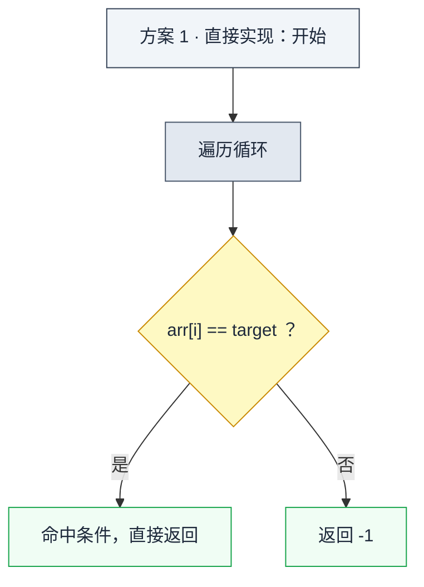

```java
package com.webfault.dsa; // 引入依赖

import java.util.*; // 引入依赖

class SeqS1 { // 定义类型
  static int seqSearch(int[] arr, int target) { // 定义函数/方法 seqSearch
    for (int i = 0; i < arr.length; i++)
      if (arr[i] == target) return i; // 让 下标 i 从 0 开始计数，下标 i 小于 数组.长度 就继续
    return -1; // 返回 减 1
  }

  public static void main(String[] args) { // public static void main(String[] args) {
    int[][] arrs = {
      {1, 2, 3}, {1, 2, 3}, {5, 4, 3, 2, 1}
    }; // 把 { {1, 2, 3}, {1, 2, 3}, {5, 4, 3, 2, 1} }; 写入 int[][] arrs
    int[] targets = {1, 9, 3}; // 把 { 1, 9, 3 }; 写入 int[] targets
    int[] wants = {0, -1, 2}; // 把 { 0, 减 1, 2 }; 写入 int[] wants
    boolean ok = true; // 把 true; 写入 boolean ok
    for (int i = 0; i < arrs.length; i++) { // 让 下标 i 从 0 开始计数，下标 i 小于 arrs.长度 就继续
      int got =
          SeqS1.seqSearch(
              arrs[i].clone(),
              targets[i]); // 把 SeqS1.seqSearch(arrs[下标 i].clone(), targets[下标 i]) 存入 got
      if (got != wants[i]) { // 若 got 不等于 wants[下标 i]
        ok = false; // 把 false; 写入 ok
        System.out.println(
            "FAIL seqSearch("
                + Arrays.toString(arrs[i])
                + ","
                + targets[i]
                + ")="
                + got
                + " want "
                + wants[i]); // 打印输出
      }
    }
    if (!ok) throw new RuntimeException("FAILED"); // 若 取反 ok) throw new RuntimeException(「FAILED」);
    System.out.println("PASS"); // 全部用例通过，输出 PASS
  }
}
```

#### 方案 2：单趟扫描

**思路与代码分析**：核心是「单趟扫描」。Java 版用类与静态方法组织，集合操作显式明了。代码里依次做这些事：单循环线性扫描。**走读**：方案 2 · 单趟扫描：开始 → 遍历循环 → 命中条件，直接返回 → 返回 -1。

**运行架构**（真实控制流）：

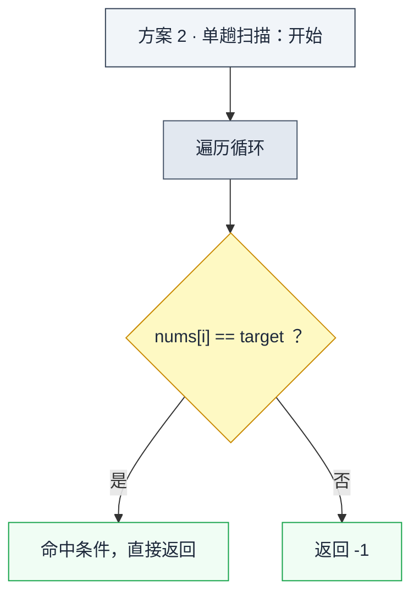

```java
package com.webfault.dsa; // 引入依赖

import java.util.*; // 引入依赖

class SeqS2 { // 定义类型
  static int seqSearch(int[] nums, int target) { // 定义函数/方法 seqSearch
    for (int i = 0; i < nums.length; i++)
      if (nums[i] == target) return i; // 让 下标 i 从 0 开始计数，下标 i 小于 数组.长度 就继续
    return -1; // 返回 减 1
  }

  public static void main(String[] args) { // public static void main(String[] args) {
    int[] lst = {15, 4, 23, 52, 1}; // 把 {15, 4, 23, 52, 1}; 写入 int[] lst
    int[] got = {SeqS2.seqSearch(lst, 23), SeqS2.seqSearch(lst, 123)};
    int[] want = {2, -1}; // 把 { 2, 减 1 }; 写入 int[] want
    boolean ok = true; // 把 true; 写入 boolean ok
    if (!Arrays.equals(got, want)) { // 若 取反 Arrays.equals(got, want
      ok = false; // 把 false; 写入 ok
      System.out.println(
          "FAIL seqSearch got " + Arrays.toString(got) + " want " + Arrays.toString(want)); // 打印输出
    }
    if (!ok) throw new RuntimeException("FAILED"); // 若 取反 ok) throw new RuntimeException(「FAILED」);
    System.out.println("PASS"); // 全部用例通过，输出 PASS
  }
}
```

#### 方案 3：直接实现

**思路与代码分析**：核心是「直接实现」。Java 版用类与静态方法组织，集合操作显式明了。代码里依次做这些事：单循环线性扫描。**走读**：方案 3 · 直接实现：开始 → 遍历循环 → 命中条件，直接返回 → 返回 -1。

**运行架构**（真实控制流）：


```java
package com.webfault.dsa; // 引入依赖

class Main { // 定义类型
  static int seqSearch(int[] arr, int target) { // 定义函数/方法 seqSearch
    for (int i = 0; i < arr.length; i++)
      if (arr[i] == target) return i; // 让 下标 i 从 0 开始计数，下标 i 小于 数组.长度 就继续
    return -1; // 返回 减 1
  }

  public static void main(String[] args) { // public static void main(String[] args) {
    int[][] a = {{1, 2, 3}, {1, 2, 3}, {1, 2, 3}};
    int[] t = {1, 3, 5};
    int[] ws = {0, 2, -1};
    boolean ok = true; // 把 true; 写入 boolean ok
    for (int i = 0; i < a.length; i++) { // 让 下标 i 从 0 开始计数，下标 i 小于 数组.长度 就继续
      int got = seqSearch(a[i], t[i]); // 把 seqSearch(数组[下标 i], 另一字符串[下标 i]) 存入 got
      if (got != ws[i]) {
        ok = false;
        System.out.println("FAIL " + got + " want " + ws[i]);
      }
    }
    if (!ok) throw new RuntimeException("FAILED"); // 若 取反 ok) throw new RuntimeException(「FAILED」);
    System.out.println("PASS"); // 全部用例通过，输出 PASS
  }
}
```

### Rust 实现（3 种方案）

Rust 的全部方案如下，每个方案都内嵌用例自测，可独立运行（老仓库 python/go 文件遵循「打印结果」约定）：

#### 方案 1：直接实现

**思路与代码分析**：核心是「直接实现」。Rust 版用所有权移动与切片借用改写同一逻辑，注意 Option 与引用边界。代码里依次做这些事：单循环线性扫描。**走读**：方案 1 · 直接实现：开始 → 遍历循环 → 处理 if v == key → 返回 i as i32 → 处理 -1。

**运行架构**（真实控制流）：


```rust
// 数据结构与算法之查找: 顺序查找 — Rust 版（方案1）
fn seq_search(arr: &[i32], key: i32) -> i32 {
    // 定义函数/方法 seq_search
    for (i, &v) in arr.iter().enumerate() {
        // for (下标 i, 按位与 值) in 数组.iter().enumerate() {
        if v == key {
            return i as i32;
        } // 若 值 等于 key { return 下标 i as i32; }
    }
    -1 // 减 1
}
fn main() {
    // 程序入口：跑内嵌自测用例
    assert_eq!(seq_search(&[1, 2, 3], 1), 0); // 断言校验
    assert_eq!(seq_search(&[1, 2, 3], 2), 1); // 断言校验
    assert_eq!(seq_search(&[1, 2, 3], 3), 2); // 断言校验
    assert_eq!(seq_search(&[1, 2, 3], 4), -1); // 断言校验
    println!("PASS");
} // 全部用例通过，输出 PASS
```

#### 方案 2：单趟扫描

**思路与代码分析**：核心是「单趟扫描」。Rust 版用所有权移动与切片借用改写同一逻辑，注意 Option 与引用边界。代码里依次做这些事：单循环线性扫描。**走读**：方案 2 · 单趟扫描：开始 → 遍历循环 → 处理 if v == key → 返回 i as i32 → 处理 -1。

**运行架构**（真实控制流）：

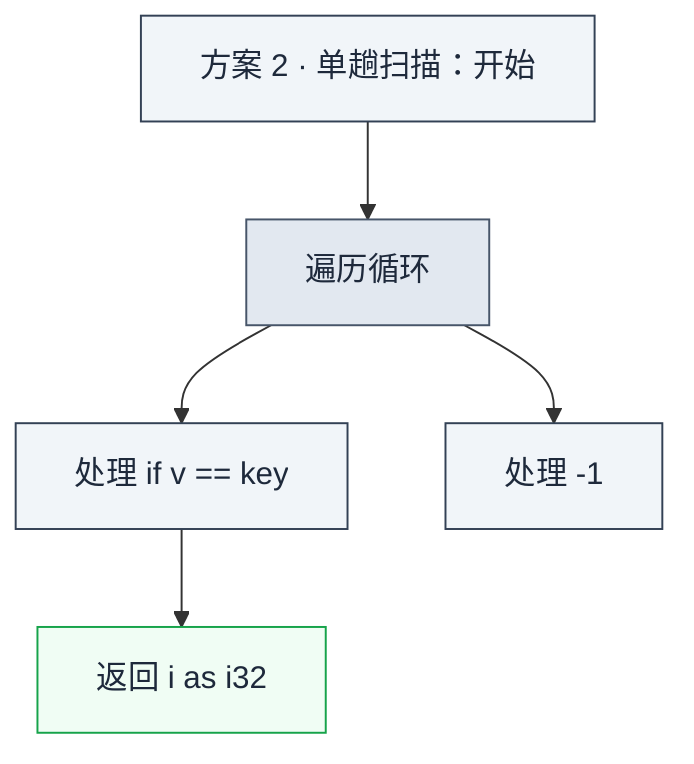

```rust
// 数据结构与算法之查找: 顺序查找 — Rust 版（方案2）
fn seq_search(arr: &[i32], key: i32) -> i32 {
    // 定义函数/方法 seq_search
    for (i, &v) in arr.iter().enumerate() {
        // for (下标 i, 按位与 值) in 数组.iter().enumerate() {
        if v == key {
            return i as i32;
        } // 若 值 等于 key { return 下标 i as i32; }
    }
    -1 // 减 1
}
fn main() {
    // 程序入口：跑内嵌自测用例
    assert_eq!(seq_search(&[1, 2, 3], 1), 0); // 断言校验
    assert_eq!(seq_search(&[1, 2, 3], 2), 1); // 断言校验
    assert_eq!(seq_search(&[1, 2, 3], 3), 2); // 断言校验
    assert_eq!(seq_search(&[1, 2, 3], 4), -1); // 断言校验
    println!("PASS");
} // 全部用例通过，输出 PASS
```

#### 方案 3：直接实现

**思路与代码分析**：核心是「直接实现」。Rust 版用所有权移动与切片借用改写同一逻辑，注意 Option 与引用边界。代码里依次做这些事：单循环线性扫描。**走读**：方案 3 · 直接实现：开始 → 遍历循环 → 处理 if v == key → 返回 i as i32 → 处理 -1。

**运行架构**（真实控制流）：

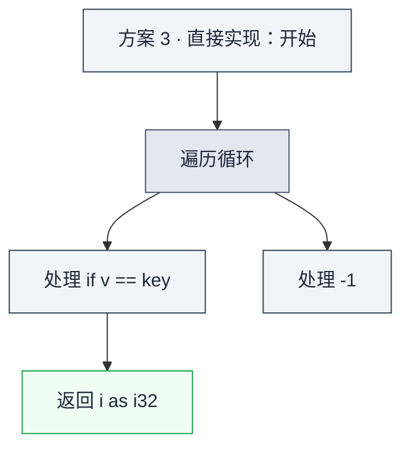

```rust
// 数据结构与算法之查找: 顺序查找 — Rust 版（方案3）
fn seq_search(arr: &[i32], key: i32) -> i32 {
    // 定义函数/方法 seq_search
    for (i, &v) in arr.iter().enumerate() {
        // for (下标 i, 按位与 值) in 数组.iter().enumerate() {
        if v == key {
            return i as i32;
        } // 若 值 等于 key { return 下标 i as i32; }
    }
    -1 // 减 1
}
fn main() {
    // 程序入口：跑内嵌自测用例
    assert_eq!(seq_search(&[1, 2, 3], 1), 0); // 断言校验
    assert_eq!(seq_search(&[1, 2, 3], 2), 1); // 断言校验
    assert_eq!(seq_search(&[1, 2, 3], 3), 2); // 断言校验
    assert_eq!(seq_search(&[1, 2, 3], 4), -1); // 断言校验
    println!("PASS");
} // 全部用例通过，输出 PASS
```

### Lua 实现（3 种方案）

Lua 的全部方案如下，每个方案都内嵌用例自测，可独立运行（老仓库 python/go 文件遵循「打印结果」约定）：

#### 方案 1：直接实现

**思路与代码分析**：核心是「直接实现」。Lua 版用表与 ipairs 遍历，注意 ipairs 遇 nil 即停的语义。**走读**：方案 1 · 直接实现：开始 → 遍历 ipairs(arr) do 中的每个元素 v → 处理 if v == key then → 返回 i - 1 → 返回 -1。

**运行架构**（真实控制流）：

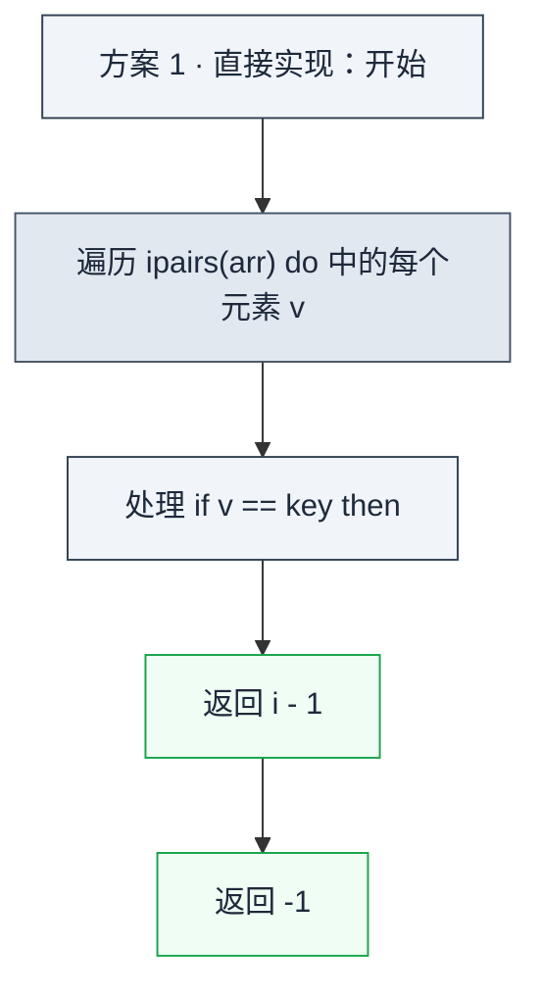

```lua
-- 数据结构与算法之查找: 顺序查找 — Lua 版（方案1）
local function seq_search(arr, key) -- local function seq_search(数组, key)
	for i, v in ipairs(arr) do -- 遍历取 值
		if v == key then
			return i - 1
		end -- 若 值 等于 key then return 下标 i 减 1 终点
	end -- 终点
	return -1 -- 返回 减 1
end -- 终点
assert(seq_search({ 1, 2, 3 }, 1) == 0) -- 断言校验
assert(seq_search({ 1, 2, 3 }, 2) == 1) -- 断言校验
assert(seq_search({ 1, 2, 3 }, 3) == 2) -- 断言校验
assert(seq_search({ 1, 2, 3 }, 4) == -1) -- 断言校验
print("PASS") -- 全部用例通过，输出 PASS
```

#### 方案 2：单趟扫描

**思路与代码分析**：核心是「单趟扫描」。Lua 版用表与 ipairs 遍历，注意 ipairs 遇 nil 即停的语义。**走读**：方案 2 · 单趟扫描：开始 → 遍历 ipairs(arr) do 中的每个元素 v → 处理 if v == key then → 返回 i - 1 → 返回 -1。

**运行架构**（真实控制流）：

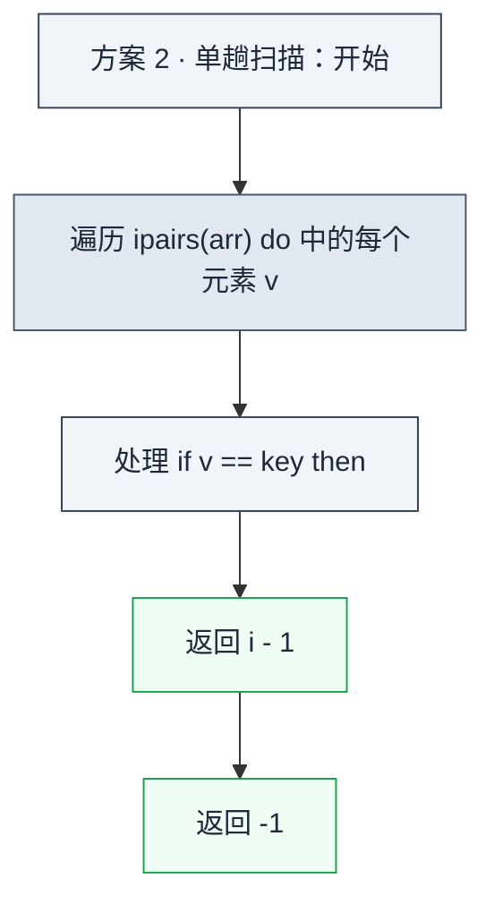

```lua
-- 数据结构与算法之查找: 顺序查找 — Lua 版（方案2）
local function seq_search(arr, key) -- local function seq_search(数组, key)
	for i, v in ipairs(arr) do -- 遍历取 值
		if v == key then
			return i - 1
		end -- 若 值 等于 key then return 下标 i 减 1 终点
	end -- 终点
	return -1 -- 返回 减 1
end -- 终点
assert(seq_search({ 1, 2, 3 }, 1) == 0) -- 断言校验
assert(seq_search({ 1, 2, 3 }, 2) == 1) -- 断言校验
assert(seq_search({ 1, 2, 3 }, 3) == 2) -- 断言校验
assert(seq_search({ 1, 2, 3 }, 4) == -1) -- 断言校验
print("PASS") -- 全部用例通过，输出 PASS
```

#### 方案 3：直接实现

**思路与代码分析**：核心是「直接实现」。Lua 版用表与 ipairs 遍历，注意 ipairs 遇 nil 即停的语义。**走读**：方案 3 · 直接实现：开始 → 遍历 ipairs(arr) do 中的每个元素 v → 处理 if v == key then → 返回 i - 1 → 返回 -1。

**运行架构**（真实控制流）：

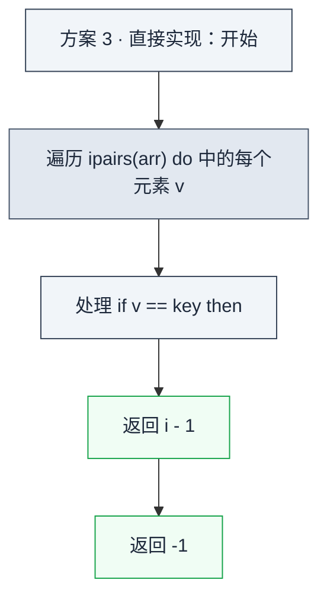

```lua
-- 数据结构与算法之查找: 顺序查找 — Lua 版（方案3）
local function seq_search(arr, key) -- local function seq_search(数组, key)
	for i, v in ipairs(arr) do -- 遍历取 值
		if v == key then
			return i - 1
		end -- 若 值 等于 key then return 下标 i 减 1 终点
	end -- 终点
	return -1 -- 返回 减 1
end -- 终点
assert(seq_search({ 1, 2, 3 }, 1) == 0) -- 断言校验
assert(seq_search({ 1, 2, 3 }, 2) == 1) -- 断言校验
assert(seq_search({ 1, 2, 3 }, 3) == 2) -- 断言校验
assert(seq_search({ 1, 2, 3 }, 4) == -1) -- 断言校验
print("PASS") -- 全部用例通过，输出 PASS
```

### C 实现（3 种方案）

C 的全部方案如下，每个方案都内嵌用例自测，可独立运行（老仓库 python/go 文件遵循「打印结果」约定）：

#### 方案 1：直接实现

**思路与代码分析**：核心是「直接实现」。C 版手动管理下标与内存，循环边界全部显式写出。代码里依次做这些事：单循环线性扫描。**走读**：方案 1 · 直接实现：开始 → 遍历循环 → 命中条件，直接返回 → 返回 -1。

**运行架构**（真实控制流）：

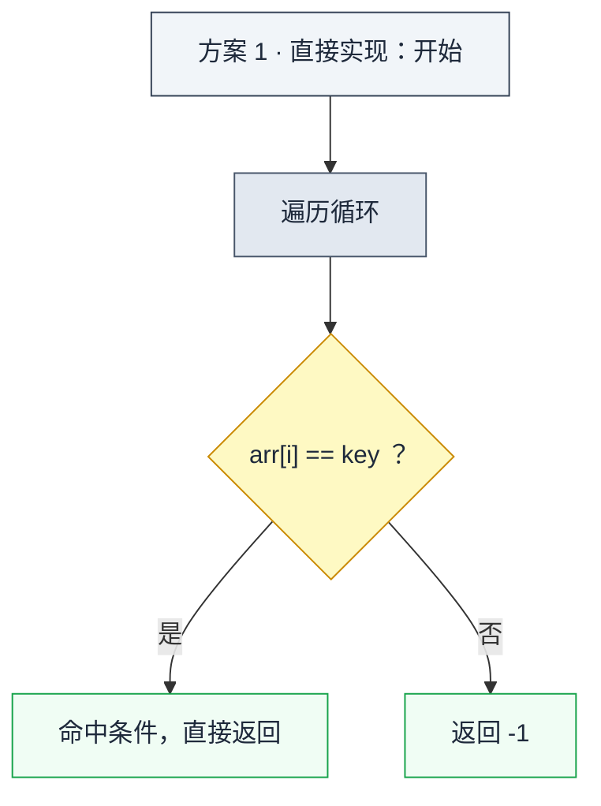

```c
/* 数据结构与算法之查找: 顺序查找 — C 版（方案1） */
#include <stdio.h>                                      // 引入头文件
static int seq_search(const int *arr, int n, int key) { // 定义函数/方法 seq_search
    for (int i = 0; i < n; i++)
        if (arr[i] == key)
            return i; // 让 下标 i 从 0 开始计数，下标 i 小于 元素个数 就继续
    return -1;        // 返回 减 1
}
int main(void) {         // 程序入口：跑内嵌自测用例
    int a[] = {1, 2, 3}; // 把 {1,2,3}; 写入 int a[]
    if (seq_search(a, 3, 1) != 0) {
        printf("FAIL 1\n");
        return 1;
    } // 若 seq_search(数组, 3, 1) 不等于 0) { 输出「FAIL 1 」); return 1; }
    if (seq_search(a, 3, 2) != 1) {
        printf("FAIL 2\n");
        return 1;
    } // 若 seq_search(数组, 3, 2) 不等于 1) { 输出「FAIL 2 」); return 1; }
    if (seq_search(a, 3, 4) != -1) {
        printf("FAIL 3\n");
        return 1;
    } // 若 seq_search(数组, 3, 4) 不等于 减 1) { 输出「FAIL 3 」); return 1; }
    printf("PASS\n");
    return 0;
} // 全部用例通过，输出 PASS
```

#### 方案 2：单趟扫描

**思路与代码分析**：核心是「单趟扫描」。C 版手动管理下标与内存，循环边界全部显式写出。代码里依次做这些事：单循环线性扫描。**走读**：方案 2 · 单趟扫描：开始 → 遍历循环 → 命中条件，直接返回 → 返回 -1。

**运行架构**（真实控制流）：

```mermaid
graph TD
    N0["方案 2 · 单趟扫描：开始"]
    N1["遍历循环"]
    N2{"arr[i] == key ？"}
    N3["命中条件，直接返回"]
    N4["返回 -1"]
    N0 --> N1
    N1 --> N2
    N2 -- 是 --> N3
    N2 -- 否 --> N4
    classDef n fill:#f1f5f9,stroke:#334155,color:#1e293b;
    classDef lp fill:#e2e8f0,stroke:#475569,color:#1e293b;
    classDef dc fill:#fef9c3,stroke:#ca8a04,color:#1e293b;
    classDef tm fill:#f0fdf4,stroke:#16a34a,color:#1e293b;
    class N0 n;
    class N1 lp;
    class N2 dc;
    class N3,N4 tm;
```

```c
/* 数据结构与算法之查找: 顺序查找 — C 版（方案2） */
#include <stdio.h>                                      // 引入头文件
static int seq_search(const int *arr, int n, int key) { // 定义函数/方法 seq_search
    for (int i = 0; i < n; i++)
        if (arr[i] == key)
            return i; // 让 下标 i 从 0 开始计数，下标 i 小于 元素个数 就继续
    return -1;        // 返回 减 1
}
int main(void) {         // 程序入口：跑内嵌自测用例
    int a[] = {1, 2, 3}; // 把 {1,2,3}; 写入 int a[]
    if (seq_search(a, 3, 1) != 0) {
        printf("FAIL 1\n");
        return 1;
    } // 若 seq_search(数组, 3, 1) 不等于 0) { 输出「FAIL 1 」); return 1; }
    if (seq_search(a, 3, 2) != 1) {
        printf("FAIL 2\n");
        return 1;
    } // 若 seq_search(数组, 3, 2) 不等于 1) { 输出「FAIL 2 」); return 1; }
    if (seq_search(a, 3, 4) != -1) {
        printf("FAIL 3\n");
        return 1;
    } // 若 seq_search(数组, 3, 4) 不等于 减 1) { 输出「FAIL 3 」); return 1; }
    printf("PASS\n");
    return 0;
} // 全部用例通过，输出 PASS
```

#### 方案 3：直接实现

**思路与代码分析**：核心是「直接实现」。C 版手动管理下标与内存，循环边界全部显式写出。代码里依次做这些事：单循环线性扫描。**走读**：方案 3 · 直接实现：开始 → 遍历循环 → 命中条件，直接返回 → 返回 -1。

**运行架构**（真实控制流）：

```mermaid
graph TD
    N0["方案 3 · 直接实现：开始"]
    N1["遍历循环"]
    N2{"arr[i] == key ？"}
    N3["命中条件，直接返回"]
    N4["返回 -1"]
    N0 --> N1
    N1 --> N2
    N2 -- 是 --> N3
    N2 -- 否 --> N4
    classDef n fill:#f1f5f9,stroke:#334155,color:#1e293b;
    classDef lp fill:#e2e8f0,stroke:#475569,color:#1e293b;
    classDef dc fill:#fef9c3,stroke:#ca8a04,color:#1e293b;
    classDef tm fill:#f0fdf4,stroke:#16a34a,color:#1e293b;
    class N0 n;
    class N1 lp;
    class N2 dc;
    class N3,N4 tm;
```

```c
/* 数据结构与算法之查找: 顺序查找 — C 版（方案3） */
#include <stdio.h>                                      // 引入头文件
static int seq_search(const int *arr, int n, int key) { // 定义函数/方法 seq_search
    for (int i = 0; i < n; i++)
        if (arr[i] == key)
            return i; // 让 下标 i 从 0 开始计数，下标 i 小于 元素个数 就继续
    return -1;        // 返回 减 1
}
int main(void) {         // 程序入口：跑内嵌自测用例
    int a[] = {1, 2, 3}; // 把 {1,2,3}; 写入 int a[]
    if (seq_search(a, 3, 1) != 0) {
        printf("FAIL 1\n");
        return 1;
    } // 若 seq_search(数组, 3, 1) 不等于 0) { 输出「FAIL 1 」); return 1; }
    if (seq_search(a, 3, 2) != 1) {
        printf("FAIL 2\n");
        return 1;
    } // 若 seq_search(数组, 3, 2) 不等于 1) { 输出「FAIL 2 」); return 1; }
    if (seq_search(a, 3, 4) != -1) {
        printf("FAIL 3\n");
        return 1;
    } // 若 seq_search(数组, 3, 4) 不等于 减 1) { 输出「FAIL 3 」); return 1; }
    printf("PASS\n");
    return 0;
} // 全部用例通过，输出 PASS
```

### C++ 实现（3 种方案）

C++ 的全部方案如下，每个方案都内嵌用例自测，可独立运行（老仓库 python/go 文件遵循「打印结果」约定）：

#### 方案 1：直接实现

**思路与代码分析**：核心是「直接实现」。C++ 版用 STL 容器与迭代器，减少手写下标错误。代码里依次做这些事：单循环线性扫描。**走读**：方案 1 · 直接实现：开始 → 遍历循环 → 命中条件，直接返回 → 返回 -1。

**运行架构**（真实控制流）：

```mermaid
graph TD
    N0["方案 1 · 直接实现：开始"]
    N1["遍历循环"]
    N2{"arr[i] == key ？"}
    N3["命中条件，直接返回"]
    N4["返回 -1"]
    N0 --> N1
    N1 --> N2
    N2 -- 是 --> N3
    N2 -- 否 --> N4
    classDef n fill:#f1f5f9,stroke:#334155,color:#1e293b;
    classDef lp fill:#e2e8f0,stroke:#475569,color:#1e293b;
    classDef dc fill:#fef9c3,stroke:#ca8a04,color:#1e293b;
    classDef tm fill:#f0fdf4,stroke:#16a34a,color:#1e293b;
    class N0 n;
    class N1 lp;
    class N2 dc;
    class N3,N4 tm;
```

```cpp
// 数据结构与算法之查找: 顺序查找 — C++ 版（方案1）
#include <cassert>                                           // 引入头文件
#include <iostream>                                          // 引入头文件
#include <vector>                                            // 引入头文件
static int seqSearch(const std::vector<int> &arr, int key) { // 定义函数/方法 seqSearch
    for (size_t i = 0; i < arr.size(); ++i)
        if (arr[i] == key)
            return static_cast<int>(i); // 让 下标 i 从 0 开始计数，下标 i 小于 数组.大小() 就继续
    return -1;                          // 返回 减 1
}
int main() {                               // 程序入口：跑内嵌自测用例
    assert(seqSearch({1, 2, 3}, 1) == 0);  // 断言校验
    assert(seqSearch({1, 2, 3}, 2) == 1);  // 断言校验
    assert(seqSearch({1, 2, 3}, 4) == -1); // 断言校验
    std::cout << "PASS" << std::endl;
} // 全部用例通过，输出 PASS
```

#### 方案 2：单趟扫描

**思路与代码分析**：核心是「单趟扫描」。C++ 版用 STL 容器与迭代器，减少手写下标错误。代码里依次做这些事：单循环线性扫描。**走读**：方案 2 · 单趟扫描：开始 → 遍历循环 → 命中条件，直接返回 → 返回 -1。

**运行架构**（真实控制流）：

```mermaid
graph TD
    N0["方案 2 · 单趟扫描：开始"]
    N1["遍历循环"]
    N2{"arr[i] == key ？"}
    N3["命中条件，直接返回"]
    N4["返回 -1"]
    N0 --> N1
    N1 --> N2
    N2 -- 是 --> N3
    N2 -- 否 --> N4
    classDef n fill:#f1f5f9,stroke:#334155,color:#1e293b;
    classDef lp fill:#e2e8f0,stroke:#475569,color:#1e293b;
    classDef dc fill:#fef9c3,stroke:#ca8a04,color:#1e293b;
    classDef tm fill:#f0fdf4,stroke:#16a34a,color:#1e293b;
    class N0 n;
    class N1 lp;
    class N2 dc;
    class N3,N4 tm;
```

```cpp
// 数据结构与算法之查找: 顺序查找 — C++ 版（方案2）
#include <cassert>                                           // 引入头文件
#include <iostream>                                          // 引入头文件
#include <vector>                                            // 引入头文件
static int seqSearch(const std::vector<int> &arr, int key) { // 定义函数/方法 seqSearch
    for (size_t i = 0; i < arr.size(); ++i)
        if (arr[i] == key)
            return static_cast<int>(i); // 让 下标 i 从 0 开始计数，下标 i 小于 数组.大小() 就继续
    return -1;                          // 返回 减 1
}
int main() {                               // 程序入口：跑内嵌自测用例
    assert(seqSearch({1, 2, 3}, 1) == 0);  // 断言校验
    assert(seqSearch({1, 2, 3}, 2) == 1);  // 断言校验
    assert(seqSearch({1, 2, 3}, 4) == -1); // 断言校验
    std::cout << "PASS" << std::endl;
} // 全部用例通过，输出 PASS
```

#### 方案 3：直接实现

**思路与代码分析**：核心是「直接实现」。C++ 版用 STL 容器与迭代器，减少手写下标错误。代码里依次做这些事：单循环线性扫描。**走读**：方案 3 · 直接实现：开始 → 遍历循环 → 命中条件，直接返回 → 返回 -1。

**运行架构**（真实控制流）：

```mermaid
graph TD
    N0["方案 3 · 直接实现：开始"]
    N1["遍历循环"]
    N2{"arr[i] == key ？"}
    N3["命中条件，直接返回"]
    N4["返回 -1"]
    N0 --> N1
    N1 --> N2
    N2 -- 是 --> N3
    N2 -- 否 --> N4
    classDef n fill:#f1f5f9,stroke:#334155,color:#1e293b;
    classDef lp fill:#e2e8f0,stroke:#475569,color:#1e293b;
    classDef dc fill:#fef9c3,stroke:#ca8a04,color:#1e293b;
    classDef tm fill:#f0fdf4,stroke:#16a34a,color:#1e293b;
    class N0 n;
    class N1 lp;
    class N2 dc;
    class N3,N4 tm;
```

```cpp
// 数据结构与算法之查找: 顺序查找 — C++ 版（方案3）
#include <cassert>                                           // 引入头文件
#include <iostream>                                          // 引入头文件
#include <vector>                                            // 引入头文件
static int seqSearch(const std::vector<int> &arr, int key) { // 定义函数/方法 seqSearch
    for (size_t i = 0; i < arr.size(); ++i)
        if (arr[i] == key)
            return static_cast<int>(i); // 让 下标 i 从 0 开始计数，下标 i 小于 数组.大小() 就继续
    return -1;                          // 返回 减 1
}
int main() {                               // 程序入口：跑内嵌自测用例
    assert(seqSearch({1, 2, 3}, 1) == 0);  // 断言校验
    assert(seqSearch({1, 2, 3}, 2) == 1);  // 断言校验
    assert(seqSearch({1, 2, 3}, 4) == -1); // 断言校验
    std::cout << "PASS" << std::endl;
} // 全部用例通过，输出 PASS
```

### R 实现（3 种方案）

R 的全部方案如下，每个方案都内嵌用例自测，可独立运行（老仓库 python/go 文件遵循「打印结果」约定）：

#### 方案 1：直接实现

**思路与代码分析**：核心是「直接实现」。R 版用向量化思维与 1 起始下标，注意 1:n 的降序陷阱。**走读**：方案 1 · 直接实现：开始 → 更新 = → 若 length(w) == 0：处理 -1L else as.integer(w[1] - 1 → 处理 -1L else as.integer(w[1] - 1 → 返回结果。

**运行架构**（真实控制流）：

```mermaid
graph TD
    N0["方案 1 · 直接实现：开始"]
    N1["更新 ="]
    N2["若 length(w) == 0：处理 -1L else as.integer(w[1] - 1"]
    N3["处理 -1L else as.integer(w[1] - 1"]
    N4["返回结果"]
    N0 --> N1
    N1 --> N2
    N2 --> N3
    N3 --> N4
    classDef n fill:#f1f5f9,stroke:#334155,color:#1e293b;
    classDef lp fill:#e2e8f0,stroke:#475569,color:#1e293b;
    classDef dc fill:#fef9c3,stroke:#ca8a04,color:#1e293b;
    classDef tm fill:#f0fdf4,stroke:#16a34a,color:#1e293b;
    class N0,N1,N2,N3 n;
    class N4 tm;
```

```r
# 版（方案1） 定义函数 seq_search（参数：数组, key）
seq_search <- function(arr, key) {
    w <- which(arr == key)  # 把 which(数组 等于 key) 存入 权重
    if (length(w) == 0)
        -1L else as.integer(w[1] - 1L)  # 若 长度(权重) 等于 0) 减 1L else as.integer(权重[1] 减 1L
}
stopifnot(seq_search(c(1, 2, 3), 1) == 0)  # 断言校验
stopifnot(seq_search(c(1, 2, 3), 2) == 1)  # 断言校验
stopifnot(seq_search(c(1, 2, 3), 4) == -1)  # 断言校验
cat("PASS\n")  # 全部用例通过，输出 PASS
```

#### 方案 2：单趟扫描

**思路与代码分析**：核心是「单趟扫描」。R 版用向量化思维与 1 起始下标，注意 1:n 的降序陷阱。**走读**：方案 2 · 单趟扫描：开始 → 更新 = → 若 length(w) == 0：处理 -1L else as.integer(w[1] - 1 → 处理 -1L else as.integer(w[1] - 1 → 返回结果。

**运行架构**（真实控制流）：

```mermaid
graph TD
    N0["方案 2 · 单趟扫描：开始"]
    N1["更新 ="]
    N2["若 length(w) == 0：处理 -1L else as.integer(w[1] - 1"]
    N3["处理 -1L else as.integer(w[1] - 1"]
    N4["返回结果"]
    N0 --> N1
    N1 --> N2
    N2 --> N3
    N3 --> N4
    classDef n fill:#f1f5f9,stroke:#334155,color:#1e293b;
    classDef lp fill:#e2e8f0,stroke:#475569,color:#1e293b;
    classDef dc fill:#fef9c3,stroke:#ca8a04,color:#1e293b;
    classDef tm fill:#f0fdf4,stroke:#16a34a,color:#1e293b;
    class N0,N1,N2,N3 n;
    class N4 tm;
```

```r
# 版（方案2） 定义函数 seq_search（参数：数组, key）
seq_search <- function(arr, key) {
    w <- which(arr == key)  # 把 which(数组 等于 key) 存入 权重
    if (length(w) == 0)
        -1L else as.integer(w[1] - 1L)  # 若 长度(权重) 等于 0) 减 1L else as.integer(权重[1] 减 1L
}
stopifnot(seq_search(c(1, 2, 3), 1) == 0)  # 断言校验
stopifnot(seq_search(c(1, 2, 3), 2) == 1)  # 断言校验
stopifnot(seq_search(c(1, 2, 3), 4) == -1)  # 断言校验
cat("PASS\n")  # 全部用例通过，输出 PASS
```

#### 方案 3：直接实现

**思路与代码分析**：核心是「直接实现」。R 版用向量化思维与 1 起始下标，注意 1:n 的降序陷阱。**走读**：方案 3 · 直接实现：开始 → 更新 = → 若 length(w) == 0：处理 -1L else as.integer(w[1] - 1 → 处理 -1L else as.integer(w[1] - 1 → 返回结果。

**运行架构**（真实控制流）：

```mermaid
graph TD
    N0["方案 3 · 直接实现：开始"]
    N1["更新 ="]
    N2["若 length(w) == 0：处理 -1L else as.integer(w[1] - 1"]
    N3["处理 -1L else as.integer(w[1] - 1"]
    N4["返回结果"]
    N0 --> N1
    N1 --> N2
    N2 --> N3
    N3 --> N4
    classDef n fill:#f1f5f9,stroke:#334155,color:#1e293b;
    classDef lp fill:#e2e8f0,stroke:#475569,color:#1e293b;
    classDef dc fill:#fef9c3,stroke:#ca8a04,color:#1e293b;
    classDef tm fill:#f0fdf4,stroke:#16a34a,color:#1e293b;
    class N0,N1,N2,N3 n;
    class N4 tm;
```

```r
# 版（方案3） 定义函数 seq_search（参数：数组, key）
seq_search <- function(arr, key) {
    w <- which(arr == key)  # 把 which(数组 等于 key) 存入 权重
    if (length(w) == 0)
        -1L else as.integer(w[1] - 1L)  # 若 长度(权重) 等于 0) 减 1L else as.integer(权重[1] 减 1L
}
stopifnot(seq_search(c(1, 2, 3), 1) == 0)  # 断言校验
stopifnot(seq_search(c(1, 2, 3), 2) == 1)  # 断言校验
stopifnot(seq_search(c(1, 2, 3), 4) == -1)  # 断言校验
cat("PASS\n")  # 全部用例通过，输出 PASS
```

### Zig 实现（3 种方案）

Zig 的全部方案如下，每个方案都内嵌用例自测，可独立运行（老仓库 python/go 文件遵循「打印结果」约定）：

#### 方案 1：直接实现

**思路与代码分析**：核心是「直接实现」。Zig 版显式分配与清零，整型边界处理严格。代码里依次做这些事：单循环线性扫描。**走读**：方案 1 · 直接实现：开始 → 遍历集合元素 → 若 v == key) return @intCast(i：None → 返回 -1。

**运行架构**（真实控制流）：

```mermaid
graph TD
    N0["方案 1 · 直接实现：开始"]
    N1["遍历集合元素"]
    N2["若 v == key) return @intCast(i：None"]
    N3["返回 -1"]
    N0 --> N1
    N1 --> N2
    N2 -- 下一轮 --> N1
    N1 --> N3
    classDef n fill:#f1f5f9,stroke:#334155,color:#1e293b;
    classDef lp fill:#e2e8f0,stroke:#475569,color:#1e293b;
    classDef dc fill:#fef9c3,stroke:#ca8a04,color:#1e293b;
    classDef tm fill:#f0fdf4,stroke:#16a34a,color:#1e293b;
    class N0,N2 n;
    class N1 lp;
    class N3 tm;
```

```zig
// 数据结构与算法之查找: 顺序查找 — Zig 版（方案1）
const std = @import("std"); // 把 @import(「std」) 存入 std
fn seqSearch(arr: []const i32, key: i32) i32 { // 定义函数/方法 seqSearch
    for (arr, 0..) |v, i| { // for (数组, 0..) 按位或 值, 下标 i 按位或 {
        if (v == key) return @intCast(i); // 若 值 等于 key，直接返回 @intCast(下标 i)
    }
    return -1; // 返回 减 1
}
pub fn main() !void { // 程序入口：跑内嵌自测用例
    const a = [_]i32{ 1, 2, 3 }; // 把 [_]i32{ 1, 2, 3 } 存入 数组
    if (seqSearch(&a, 1) != 0) return error.TestFailed; // 若 seqSearch( 按位与 数组, 1) 不等于 0，直接返回 error.TestFailed
    if (seqSearch(&a, 2) != 1) return error.TestFailed; // 若 seqSearch( 按位与 数组, 2) 不等于 1，直接返回 error.TestFailed
    if (seqSearch(&a, 4) != -1) return error.TestFailed; // 若 seqSearch( 按位与 数组, 4) 不等于 减 1，直接返回 error.TestFailed
    std.debug.print("PASS\n", .{});
} // 全部用例通过，输出 PASS
```

#### 方案 2：单趟扫描

**思路与代码分析**：核心是「单趟扫描」。Zig 版显式分配与清零，整型边界处理严格。代码里依次做这些事：单循环线性扫描。**走读**：方案 2 · 单趟扫描：开始 → 遍历集合元素 → 若 v == key) return @intCast(i：None → 返回 -1。

**运行架构**（真实控制流）：

```mermaid
graph TD
    N0["方案 2 · 单趟扫描：开始"]
    N1["遍历集合元素"]
    N2["若 v == key) return @intCast(i：None"]
    N3["返回 -1"]
    N0 --> N1
    N1 --> N2
    N2 -- 下一轮 --> N1
    N1 --> N3
    classDef n fill:#f1f5f9,stroke:#334155,color:#1e293b;
    classDef lp fill:#e2e8f0,stroke:#475569,color:#1e293b;
    classDef dc fill:#fef9c3,stroke:#ca8a04,color:#1e293b;
    classDef tm fill:#f0fdf4,stroke:#16a34a,color:#1e293b;
    class N0,N2 n;
    class N1 lp;
    class N3 tm;
```

```zig
// 数据结构与算法之查找: 顺序查找 — Zig 版（方案2）
const std = @import("std"); // 把 @import(「std」) 存入 std
fn seqSearch(arr: []const i32, key: i32) i32 { // 定义函数/方法 seqSearch
    for (arr, 0..) |v, i| { // for (数组, 0..) 按位或 值, 下标 i 按位或 {
        if (v == key) return @intCast(i); // 若 值 等于 key，直接返回 @intCast(下标 i)
    }
    return -1; // 返回 减 1
}
pub fn main() !void { // 程序入口：跑内嵌自测用例
    const a = [_]i32{ 1, 2, 3 }; // 把 [_]i32{ 1, 2, 3 } 存入 数组
    if (seqSearch(&a, 1) != 0) return error.TestFailed; // 若 seqSearch( 按位与 数组, 1) 不等于 0，直接返回 error.TestFailed
    if (seqSearch(&a, 2) != 1) return error.TestFailed; // 若 seqSearch( 按位与 数组, 2) 不等于 1，直接返回 error.TestFailed
    if (seqSearch(&a, 4) != -1) return error.TestFailed; // 若 seqSearch( 按位与 数组, 4) 不等于 减 1，直接返回 error.TestFailed
    std.debug.print("PASS\n", .{});
} // 全部用例通过，输出 PASS
```

#### 方案 3：直接实现

**思路与代码分析**：核心是「直接实现」。Zig 版显式分配与清零，整型边界处理严格。代码里依次做这些事：单循环线性扫描。**走读**：方案 3 · 直接实现：开始 → 遍历集合元素 → 若 v == key) return @intCast(i：None → 返回 -1。

**运行架构**（真实控制流）：

```mermaid
graph TD
    N0["方案 3 · 直接实现：开始"]
    N1["遍历集合元素"]
    N2["若 v == key) return @intCast(i：None"]
    N3["返回 -1"]
    N0 --> N1
    N1 --> N2
    N2 -- 下一轮 --> N1
    N1 --> N3
    classDef n fill:#f1f5f9,stroke:#334155,color:#1e293b;
    classDef lp fill:#e2e8f0,stroke:#475569,color:#1e293b;
    classDef dc fill:#fef9c3,stroke:#ca8a04,color:#1e293b;
    classDef tm fill:#f0fdf4,stroke:#16a34a,color:#1e293b;
    class N0,N2 n;
    class N1 lp;
    class N3 tm;
```

```zig
// 数据结构与算法之查找: 顺序查找 — Zig 版（方案3）
const std = @import("std"); // 把 @import(「std」) 存入 std
fn seqSearch(arr: []const i32, key: i32) i32 { // 定义函数/方法 seqSearch
    for (arr, 0..) |v, i| { // for (数组, 0..) 按位或 值, 下标 i 按位或 {
        if (v == key) return @intCast(i); // 若 值 等于 key，直接返回 @intCast(下标 i)
    }
    return -1; // 返回 减 1
}
pub fn main() !void { // 程序入口：跑内嵌自测用例
    const a = [_]i32{ 1, 2, 3 }; // 把 [_]i32{ 1, 2, 3 } 存入 数组
    if (seqSearch(&a, 1) != 0) return error.TestFailed; // 若 seqSearch( 按位与 数组, 1) 不等于 0，直接返回 error.TestFailed
    if (seqSearch(&a, 2) != 1) return error.TestFailed; // 若 seqSearch( 按位与 数组, 2) 不等于 1，直接返回 error.TestFailed
    if (seqSearch(&a, 4) != -1) return error.TestFailed; // 若 seqSearch( 按位与 数组, 4) 不等于 减 1，直接返回 error.TestFailed
    std.debug.print("PASS\n", .{});
} // 全部用例通过，输出 PASS
```

### Dart 实现（3 种方案）

Dart 的全部方案如下，每个方案都内嵌用例自测，可独立运行（老仓库 python/go 文件遵循「打印结果」约定）：

#### 方案 1：直接实现

**思路与代码分析**：核心是「直接实现」。Dart 版用可空类型标注与集合方法，注意空安全。代码里依次做这些事：单循环线性扫描。**走读**：方案 1 · 直接实现：开始 → 遍历循环 → 命中条件，直接返回 → 返回 -1。

**运行架构**（真实控制流）：

```mermaid
graph TD
    N0["方案 1 · 直接实现：开始"]
    N1["遍历循环"]
    N2{"arr[i] == key ？"}
    N3["命中条件，直接返回"]
    N4["返回 -1"]
    N0 --> N1
    N1 --> N2
    N2 -- 是 --> N3
    N2 -- 下一轮 --> N1
    N1 --> N4
    classDef n fill:#f1f5f9,stroke:#334155,color:#1e293b;
    classDef lp fill:#e2e8f0,stroke:#475569,color:#1e293b;
    classDef dc fill:#fef9c3,stroke:#ca8a04,color:#1e293b;
    classDef tm fill:#f0fdf4,stroke:#16a34a,color:#1e293b;
    class N0 n;
    class N1 lp;
    class N2 dc;
    class N3,N4 tm;
```

```dart
// 数据结构与算法之查找: 顺序查找 — Dart 版（方案1）
int seqSearch(List<int> arr, int key) {
  // 定义函数/方法 seqSearch
  for (var i = 0; i < arr.length; i++) {
    // 让 下标 i 从 0 开始计数，下标 i 小于 数组.长度 就继续
    if (arr[i] == key) return i; // 若 数组[下标 i] 等于 key，直接返回 下标 i
  }
  return -1; // 返回 减 1
}

void main() {
  // 程序入口：跑内嵌自测用例
  if (seqSearch([1, 2, 3], 1) != 0)
    throw StateError(
      'c1',
    ); // 若 seqSearch([1, 2, 3], 1) 不等于 0) throw StateError('c1');
  if (seqSearch([1, 2, 3], 2) != 1)
    throw StateError(
      'c2',
    ); // 若 seqSearch([1, 2, 3], 2) 不等于 1) throw StateError('c2');
  if (seqSearch([1, 2, 3], 4) != -1)
    throw StateError(
      'c3',
    ); // 若 seqSearch([1, 2, 3], 4) 不等于 减 1) throw StateError('c3');
  print('PASS');
} // 全部用例通过，输出 PASS
```

#### 方案 2：单趟扫描

**思路与代码分析**：核心是「单趟扫描」。Dart 版用可空类型标注与集合方法，注意空安全。代码里依次做这些事：单循环线性扫描。**走读**：方案 2 · 单趟扫描：开始 → 遍历循环 → 命中条件，直接返回 → 返回 -1。

**运行架构**（真实控制流）：

```mermaid
graph TD
    N0["方案 2 · 单趟扫描：开始"]
    N1["遍历循环"]
    N2{"arr[i] == key ？"}
    N3["命中条件，直接返回"]
    N4["返回 -1"]
    N0 --> N1
    N1 --> N2
    N2 -- 是 --> N3
    N2 -- 下一轮 --> N1
    N1 --> N4
    classDef n fill:#f1f5f9,stroke:#334155,color:#1e293b;
    classDef lp fill:#e2e8f0,stroke:#475569,color:#1e293b;
    classDef dc fill:#fef9c3,stroke:#ca8a04,color:#1e293b;
    classDef tm fill:#f0fdf4,stroke:#16a34a,color:#1e293b;
    class N0 n;
    class N1 lp;
    class N2 dc;
    class N3,N4 tm;
```

```dart
// 数据结构与算法之查找: 顺序查找 — Dart 版（方案2）
int seqSearch(List<int> arr, int key) {
  // 定义函数/方法 seqSearch
  for (var i = 0; i < arr.length; i++) {
    // 让 下标 i 从 0 开始计数，下标 i 小于 数组.长度 就继续
    if (arr[i] == key) return i; // 若 数组[下标 i] 等于 key，直接返回 下标 i
  }
  return -1; // 返回 减 1
}

void main() {
  // 程序入口：跑内嵌自测用例
  if (seqSearch([1, 2, 3], 1) != 0)
    throw StateError(
      'c1',
    ); // 若 seqSearch([1, 2, 3], 1) 不等于 0) throw StateError('c1');
  if (seqSearch([1, 2, 3], 2) != 1)
    throw StateError(
      'c2',
    ); // 若 seqSearch([1, 2, 3], 2) 不等于 1) throw StateError('c2');
  if (seqSearch([1, 2, 3], 4) != -1)
    throw StateError(
      'c3',
    ); // 若 seqSearch([1, 2, 3], 4) 不等于 减 1) throw StateError('c3');
  print('PASS');
} // 全部用例通过，输出 PASS
```

#### 方案 3：直接实现

**思路与代码分析**：核心是「直接实现」。Dart 版用可空类型标注与集合方法，注意空安全。代码里依次做这些事：单循环线性扫描。**走读**：方案 3 · 直接实现：开始 → 遍历循环 → 命中条件，直接返回 → 返回 -1。

**运行架构**（真实控制流）：

```mermaid
graph TD
    N0["方案 3 · 直接实现：开始"]
    N1["遍历循环"]
    N2{"arr[i] == key ？"}
    N3["命中条件，直接返回"]
    N4["返回 -1"]
    N0 --> N1
    N1 --> N2
    N2 -- 是 --> N3
    N2 -- 下一轮 --> N1
    N1 --> N4
    classDef n fill:#f1f5f9,stroke:#334155,color:#1e293b;
    classDef lp fill:#e2e8f0,stroke:#475569,color:#1e293b;
    classDef dc fill:#fef9c3,stroke:#ca8a04,color:#1e293b;
    classDef tm fill:#f0fdf4,stroke:#16a34a,color:#1e293b;
    class N0 n;
    class N1 lp;
    class N2 dc;
    class N3,N4 tm;
```

```dart
// 数据结构与算法之查找: 顺序查找 — Dart 版（方案3）
int seqSearch(List<int> arr, int key) {
  // 定义函数/方法 seqSearch
  for (var i = 0; i < arr.length; i++) {
    // 让 下标 i 从 0 开始计数，下标 i 小于 数组.长度 就继续
    if (arr[i] == key) return i; // 若 数组[下标 i] 等于 key，直接返回 下标 i
  }
  return -1; // 返回 减 1
}

void main() {
  // 程序入口：跑内嵌自测用例
  if (seqSearch([1, 2, 3], 1) != 0)
    throw StateError(
      'c1',
    ); // 若 seqSearch([1, 2, 3], 1) 不等于 0) throw StateError('c1');
  if (seqSearch([1, 2, 3], 2) != 1)
    throw StateError(
      'c2',
    ); // 若 seqSearch([1, 2, 3], 2) 不等于 1) throw StateError('c2');
  if (seqSearch([1, 2, 3], 4) != -1)
    throw StateError(
      'c3',
    ); // 若 seqSearch([1, 2, 3], 4) 不等于 减 1) throw StateError('c3');
  print('PASS');
} // 全部用例通过，输出 PASS
```

---

## 内容总结

- **顺序查找**（算法笔记 · Medium）：共 3 个方案，主线思路「直接实现」；时间 O(n) 量级；动画演示归并分治过程，附录给出 11 种语言 × 全部方案的可运行实现。
- 来源博客：[https://blog.csdn.net/tyro_java/article/details/134217002](https://blog.csdn.net/tyro_java/article/details/134217002)
- 导航：[📋 总目录](../) ｜ [← 238 桶排序](../238_桶排序/) ｜ [240 lcr 152. 验证二叉搜索树 →](../240_leetcode_lcr_152._验证二叉搜索树的后序遍历序列/)
