# 240 · lcr 152. 验证二叉搜索树的后序遍历序列（第附阶段 · 专题补充 · Medium）

> **难度**：⭐⭐ Medium ｜ **专题**：算法笔记
> **学习定位**：第附阶段 · 专题补充第 240 篇 ｜ **解法数**：1
> **内容总结**：**lcr 152. 验证二叉搜索树的后序遍历序列**（算法笔记 · Medium）：共 1 个方案，主线思路「迭代指针处理」；时间 O(n)（单趟线性扫描）；动画演示归并分治过程，附录给出 11 种语言 × 全部方案的可运行实现。

---

## 题目描述

lcr 152. 验证二叉搜索树的后序遍历序列。具体输入输出约定见函数签名与用例。

- 主函数签名：`function treeToLevel(root: any): any[]`

**用例演示**（摘自主解法内嵌自测，输入到输出一目了然）：

```typescript
  const cases = [
    { in: [[1, 6, 3, 2, 5]], want: false },
    { in: [[1, 3, 2, 4, 5]], want: true },
    { in: [[4, 6, 5, 9, 8, 7]], want: true },
    { in: [[1, 2, 3]], want: true },
  ];
```

**数据范围与注意事项**：

- **易错点**：先看小例子手推一遍再对照代码，比直接读代码快得多。

## 题目分析

**场景是什么**：综合练习：把数据结构与策略组合起来解决一个完整问题。本题就是该场景的 Medium 级练习，主线做法是「迭代指针处理」。

**主线怎么解**：把主解法从头到尾过一遍，它其实在依次做这几件事：队列或堆的调度。

## 解题思路

**方案对比**（共 1 个方案，由浅入深）：

| 方案 | 时间复杂度 | 空间复杂度 |
|---|---|---|
| 方案 1 · 迭代指针处理 | O(n)（单趟线性扫描） | O(1) 到 O(n)（视辅助结构） |

**怎么读这一篇**：

- 🐣 **新手路线**：把「题目描述」的示例 1 在纸上手推一遍 → 读方案 1（最直观的写法）与它的代码走读 → 按「运行方式」本地跑通看 PASS → 回头对比方案 2 之后的写法差在哪
- 🦅 **大佬路线**：直接锁定最优方案 1（迭代指针处理，O(n)（单趟线性扫描））→ 跳读该方案代码与走读 → 用「逐步拆解与面试追问」补齐复杂度推导与边界追问

### 动态算法图（归并分治，GIF 自动循环）


动画演示算法笔记专题里归并分治的典型过程；每个方案在「TypeScript 解题方案」一节还配了专属动画与专属流程图。

### 主解法流程图（真实控制流）

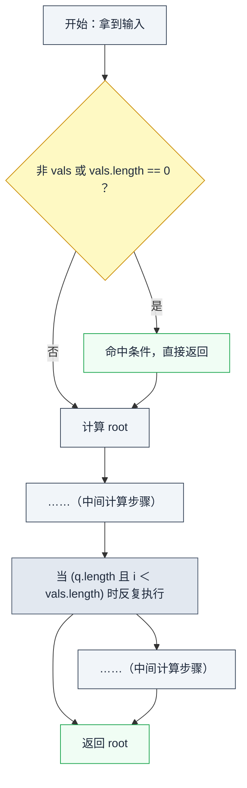

## TypeScript 解题方案（1 个方案逐个讲）

> **运行与提交**：每个方案都是自包含文件（内嵌用例自测，输出 PASS），整块复制到 `.ts` 文件后 `node 文件名` 即可运行。提交 LeetCode 时，把 `demo` 内的算法函数与辅助类型/函数整体取出、置于文件顶层即可。概念演示（非 LeetCode 编号题），在本地运行即可。

### 方案 1：迭代指针处理

**分析与思路**：核心做法是「迭代指针处理」。代码里依次做这些事：队列或堆的调度。

**运行方式**：`node 本文件`，内嵌用例全部通过会输出 PASS。


**方案专属流程图**（真实控制流）：

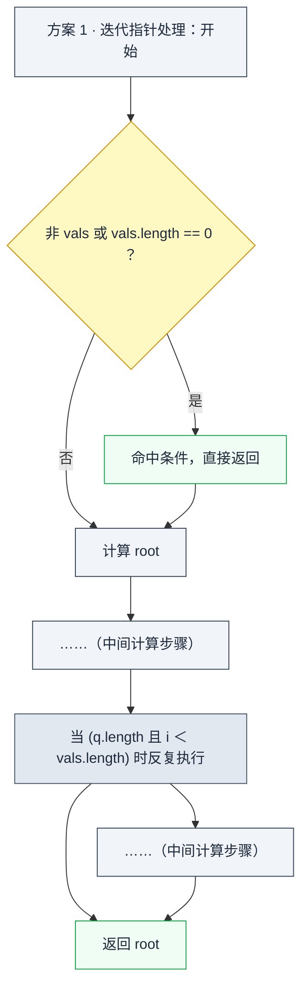

```typescript
class TreeNode {
  // 定义类型
  val: any;
  left: any;
  right: any; // 值: any; 左边界: any; 右边界: any;
  constructor(val?: any, left?: any, right?: any) {
    // constructor(值?: any, 左边界?: any, 右边界?: any) {
    this.val = val === undefined ? 0 : val; // 把 (值 全等于 undefined ? 0 : 值); 写入 值
    this.left = left === undefined ? null : left; // 把 (左边界 全等于 undefined ? null : 左边界); 写入 左边界
    this.right = right === undefined ? null : right; // 把 (右边界 全等于 undefined ? null : 右边界); 写入 右边界
  }
}
function buildTree(vals: any): any {
  // 定义函数/方法 buildTree
  if (!vals || vals.length === 0) return null; // 若 取反 vals 或 vals.长度 全等于 0，直接返回 null
  const root = new TreeNode(vals[0]);
  const q: any[] = [root];
  let i = 1;
  while (q.length && i < vals.length) {
    // 循环，直到不满足「节点.长度 且 下标 i 小于 vals.长度」
    const node = q.shift(); // 把 节点.shift() 存入 节点
    if (vals[i] !== null && vals[i] !== undefined) {
      node.left = new TreeNode(vals[i]);
      q.push(node.left);
    }
    i++; // 下标 i 加一
    if (i < vals.length && vals[i] !== null && vals[i] !== undefined) {
      node.right = new TreeNode(vals[i]);
      q.push(node.right);
    }
    i++; // 下标 i 加一
  }
  return root; // 返回 根节点
}
function treeToLevel(root: any): any[] {
  // 定义函数/方法 treeToLevel
  if (!root) return []; // 若 取反 根节点，直接返回 []
  const out: any[] = [];
  const q: any[] = [root]; // 把 []; const 节点: any[] 赋值为 [根节点]; 写入 const out: any[]
  while (q.length) {
    // 循环，直到不满足「节点.长度」
    const n = q.shift(); // 把 节点.shift() 存入 元素个数
    if (n === null || n === undefined) {
      out.push(null);
      continue;
    }
    out.push(n.val);
    q.push(n.left);
    q.push(n.right); // 把 元素个数.值 压入栈/数组尾部
  }
  while (out.length && out[out.length - 1] === null) out.pop(); // 循环，直到不满足「out.长度 且 out[out.长度 减 1] 全等于 null) out 弹出 );」
  return out; // 返回 out
}
class ListNode {
  // 定义类型
  val: any;
  next: any; // 值: any; 下一个: any;
  constructor(val?: any, next?: any) {
    this.val = val === undefined ? 0 : val;
    this.next = next === undefined ? null : next;
  }
}
function buildList(vals: any): any {
  // 定义函数/方法 buildList
  const dummy = new ListNode(0);
  let cur = dummy; // 把 new ListNode(0); let 当前值 赋值为 哨兵节点 存入 哨兵节点
  for (const v of vals) {
    cur.next = new ListNode(v);
    cur = cur.next;
  } // 把 new ListNode(值); 当前值 赋值为 当前值.下一个; } 写入 下一个
  return dummy.next; // 返回 哨兵节点.下一个
}
function listToArray(head: any): any[] {
  // 定义函数/方法 listToArray
  const out: any[] = [];
  let p = head; // 把 []; let 节点 赋值为 头节点; 写入 const out: any[]
  while (p) {
    out.push(p.val);
    p = p.next;
  } // 循环，直到不满足「节点) { out 追加 节点.值); 节点 赋值为 节点.下一个; }」
  return out; // 返回 out
}
// python-runtime shims
function pyLen(a: any): number {
  // 定义函数/方法 pyLen
  if (a === null || a === undefined) return 0; // 若 数组 全等于 null 或 数组 全等于 undefined，直接返回 0
  if (
    typeof a === 'string' ||
    Array.isArray(a) ||
    a instanceof Set ||
    a instanceof Map
  )
    return a.length ?? a.size;
  if (typeof a === 'object') return Object.keys(a).length; // 若 typeof 数组 全等于 'object'，直接返回 Object.keys(数组).长度
  return 0; // 返回 0
}
function pySlice(a: any, i: any, j: any, step?: any): any {
  // 定义函数/方法 pySlice
  if (typeof a === 'string') {
    const r = [...a].slice(i ?? 0, j ?? a.length);
    return step ? r.reverse().join('') : r.join('');
  }
  const arr = Array.isArray(a) ? a : [...a]; // 把 Array.isArray(数组) ? 数组 : 复制的 数组 存入 数组
  return arr.slice(i ?? 0, j ?? arr.length); // 返回 数组 截取 下标 i ?? 0, 下标 j ?? 数组.长度)
}
function pyRange(a: any, b?: any, step?: any): any[] {
  // 定义函数/方法 pyRange
  let s = 0,
    e = a,
    st = 1; // 把 0, e 赋值为 数组, st 赋值为 1 存入 字符串
  if (b !== undefined) {
    s = a;
    e = b;
  } // 若 b 不等于 undefined) { 字符串 赋值为 数组; e 赋值为 b; }
  if (step !== undefined) st = step; // 若 步数 不等于 undefined) st 赋值为 步数;
  const out: any[] = []; // 把 []; 写入 const out: any[]
  if (st > 0) for (let i = s; i < e; i += st) out.push(i);
  else for (let i = s; i > e; i += st) out.push(i); // 否则
  return out; // 返回 out
}
function pyIn(x: any, coll: any): boolean {
  // 定义函数/方法 pyIn
  if (coll === null || coll === undefined) return false; // 若 coll 全等于 null 或 coll 全等于 undefined，直接返回 false
  if (Array.isArray(coll)) return coll.includes(x); // 若 Array.isArray(coll)，直接返回 coll 是否包含 x)
  if (coll instanceof Set || coll instanceof Map) return coll.has(x); // 若 coll instanceof Set 或 coll instanceof Map，直接返回 coll.has(x)
  if (typeof coll === 'object') return x in coll; // 若 typeof coll 全等于 'object'，直接返回 x in coll
  if (typeof coll === 'string') return coll.indexOf(x) >= 0; // 若 typeof coll 全等于 'string'，直接返回 coll 查找 x) 不低于 0
  return false; // 返回 false
}
function pySorted(a: any): any[] {
  // 定义函数/方法 pySorted
  const arr = typeof a === 'string' ? [...a] : [...a]; // 把 (typeof 数组 全等于 'string') ? 复制的 数组 : 复制的 数组 存入 数组
  return arr.sort((x: any, y: any) => (x < y ? -1 : x > y ? 1 : 0));
}
function pyMin(a: any, b?: any): any {
  if (b !== undefined) return Math.min(a, b);
  if (Array.isArray(a) || a instanceof Set) return Math.min(...a);
  return Math.min(a);
} // 定义函数/方法 pyMin
function pyMax(a: any, b?: any): any {
  if (b !== undefined) return Math.max(a, b);
  if (Array.isArray(a) || a instanceof Set) return Math.max(...a);
  return Math.max(a);
} // 定义函数/方法 pyMax
function pySum(a: any): number {
  let s = 0;
  for (const v of a) s += v;
  return s;
} // 定义函数/方法 pySum
function pyAbs(x: any): number {
  return Math.abs(x);
} // 定义函数/方法 pyAbs
function pyEnumerate(a: any): any[] {
  const out: any[] = [];
  let i = 0;
  for (const v of a) {
    out.push([i, v]);
    i++;
  }
  return out;
} // 定义函数/方法 pyEnumerate
function pyZip(a: any, b: any): any[] {
  const n = Math.min(a.length, b.length);
  const out: any[] = [];
  for (let i = 0; i < n; i++) out.push([a[i], b[i]]);
  return out;
} // 定义函数/方法 pyZip
function pyDictGet(d: any, k: any, def?: any): any {
  return k in d ? d[k] : def === undefined ? null : def;
} // 定义函数/方法 pyDictGet
function pyPrint(...args: any[]): void {
  console.log(
    args
      .map((a) => (typeof a === 'object' && a !== null ? JSON.stringify(a) : a))
      .join(' '),
  );
} // 定义函数/方法 pyPrint
// collections / heapq
function heapPush(h: any[], x: any): void {
  h.push(x);
  let i = h.length - 1;
  while (i > 0) {
    const p = (i - 1) >> 1;
    if (h[p] <= h[i]) break;
    [h[p], h[i]] = [h[i], h[p]];
    i = p;
  }
} // 定义函数/方法 heapPush
function heapPop(h: any[]): any {
  const top = h[0];
  const last = h.pop();
  if (h.length) {
    h[0] = last;
    let i = 0;
    const n = h.length;
    while (true) {
      let l = 2 * i + 1,
        r = 2 * i + 2,
        s = i;
      if (l < n && h[l] < h[s]) s = l;
      if (r < n && h[r] < h[s]) s = r;
      if (s === i) break;
      [h[s], h[i]] = [h[i], h[s]];
      i = s;
    }
  }
  return top;
} // 定义函数/方法 heapPop
class Deque {
  private a: any[] = [];
  push(x: any) {
    this.a.push(x);
  }
  pushLeft(x: any) {
    this.a.unshift(x);
  }
  pop() {
    return this.a.pop();
  }
  popLeft() {
    return this.a.shift();
  }
  get length() {
    return this.a.length;
  }
  toArray() {
    return this.a.slice();
  }
} // 定义类型
function Counter(iter: any): any {
  const m: any = {};
  for (const v of iter) m[v] = (m[v] || 0) + 1;
  return m;
} // 定义函数/方法 Counter
function gcd(a: any, b: any): any {
  while (b) {
    [a, b] = [b, a % b];
  }
  return a;
} // 定义函数/方法 gcd
function pyInf(): number {
  return Infinity;
} // 定义函数/方法 pyInf

function norm(x: any): any {
  // 定义函数/方法 norm
  if (x === null || x === undefined) return null; // 若 x 全等于 null 或 x 全等于 undefined，直接返回 null
  if (typeof x === 'object') {
    // 若 typeof x 全等于 'object'
    if (x instanceof Deque) return x.toArray(); // 若 x instanceof Deque，直接返回 x.toArray()
    if (Array.isArray(x)) return x.map(norm); // 若 Array.isArray(x)，直接返回 x.映射表(norm)
    if (
      typeof x.val === 'number' &&
      (typeof x.left !== 'undefined' || typeof x.right !== 'undefined')
    )
      return treeToLevel(x);
    if (typeof x.next !== 'undefined' && typeof x.val === 'number')
      return listToArray(x);
    if (x instanceof Set) return [...x].sort(); // 若 x instanceof Set，直接返回 复制的 x 排序 )
    if (x instanceof Map) return Object.fromEntries(x); // 若 x instanceof Map，直接返回 Object.fromEntries(x)
    const o: any = {};
    for (const k of Object.keys(x)) o[k] = norm(x[k]);
    return o;
  }
  return x; // 返回 x
}
function eq(a: any, b: any): boolean {
  // 定义函数/方法 eq
  const x = norm(a),
    y = norm(b); // 把 norm(数组), y 赋值为 norm(b) 存入 x
  if (x === y) return true; // 若 x 全等于 y，直接返回 true
  if (x === null || y === null) return x === y; // 若 x 全等于 null 或 y 全等于 null，直接返回 x 全等于 y
  if (Array.isArray(x) && Array.isArray(y)) {
    // 若 Array.isArray(x) 且 Array.isArray(y
    if (x.length !== y.length) return false; // 若 x.长度 不等于 y.长度，直接返回 false
    for (let i = 0; i < x.length; i++) if (!eq(x[i], y[i])) return false; // 让 下标 i 从 0 开始计数，下标 i 小于 x.长度 就继续
    return true; // 返回 true
  }
  if (typeof x === 'object' && typeof y === 'object') {
    // 若 typeof x 全等于 'object' 且 typeof y 全等于 'object'
    const kx = Object.keys(x),
      ky = Object.keys(y); // 把 Object.keys(x), ky 赋值为 Object.keys(y) 存入 kx
    if (kx.length !== ky.length) return false; // 若 kx.长度 不等于 ky.长度，直接返回 false
    for (const k of kx) if (!eq(x[k], y[k])) return false;
    return true; // 返回 true
  }
  return x === y; // 返回 x 全等于 y
}

function verifyPostorder(postorder) {
  // 定义函数/方法 verifyPostorder
  function dfs(l, r) {
    // 定义函数/方法 dfs
    if (l >= r) return true; // 若 左指针 不低于 右指针，直接返回 true
    let p = l; // 把 左指针 存入 节点
    while (postorder[p] < postorder[r]) p++; // 循环，直到不满足「postorder[节点] 小于 postorder[右指针]) 节点 加一 ;」
    const m = p; // 把 节点 存入 映射表
    while (postorder[p] > postorder[r]) p++; // 循环，直到不满足「postorder[节点] 超过 postorder[右指针]) 节点 加一 ;」
    return p === r && dfs(l, m - 1) && dfs(m, r - 1); // 返回 节点 全等于 右指针 且 dfs(左指针, 映射表 减 1) 且 dfs(映射表, 右指针 减 1)
  }
  if (!postorder.length) return true; // 若 取反 postorder.长度，直接返回 true
  return dfs(0, postorder.length - 1); // 返回 dfs(0, postorder.长度 减 1)
}
export function demo(): void {
  // 程序入口：跑内嵌自测用例
  const cases = [
    { in: [[1, 6, 3, 2, 5]], want: false },
    { in: [[1, 3, 2, 4, 5]], want: true },
    { in: [[4, 6, 5, 9, 8, 7]], want: true },
    { in: [[1, 2, 3]], want: true },
  ];
  let fail = false; // 把 false 存入 fail
  for (const c of cases) {
    // for (const 字符 of cases) {
    const got = verifyPostorder(...c.in); // 把 verifyPostorder(...字符.in) 存入 got
    if (!eq(got, c.want)) {
      fail = true;
      console.log(
        'FAIL',
        JSON.stringify(c.in),
        '=>',
        JSON.stringify(got),
        'want',
        JSON.stringify(c.want),
      );
    }
  }
  if (fail) throw new Error('FAILED'); // 若 fail) throw new Error('FAILED');
  console.log('PASS'); // 全部用例通过，输出 PASS
}
demo(); // demo();
```

## 逐步拆解与面试追问

**复杂度**：时间 O(n)（单趟线性扫描），空间 O(1) 到 O(n)（视辅助结构）

**为什么是这个量级**：每个元素被常数次访问，辅助哈希或栈的开销与 n 同阶

**面试官可能会追问**：

- 这个策略能推广到什么场景？
- 与暴力做法差在哪一步？
- 有没有更简单的等价写法？

## 关键 API 速查（TS 主解法实际用到，附官方链接）

| API | 作用 | 使用要点 | 官方文档 |
|---|---|---|---|
| `Array.prototype.sort()` | 原地排序 | 默认按字符串 Unicode 序（10 会排在 2 前），数字必须传 (a,b)=>a-b；V8 用 TimSort，稳定，O(n log n)；返回原数组引用 | [官方文档](https://developer.mozilla.org/zh-CN/docs/Web/JavaScript/Reference/Global_Objects/Array/sort) |
| `Array.prototype.map()` | 逐元素映射为新数组 | 回调 (v,i,arr)；返回等长新数组，不改变原数组；稀疏位跳过；链式调用注意中间数组开销 | [官方文档](https://developer.mozilla.org/zh-CN/docs/Web/JavaScript/Reference/Global_Objects/Array/map) |
| `Array.prototype.push()` | 尾部追加 | 返回新长度；可一次多个；均摊 O(1)；会改变原数组 | [官方文档](https://developer.mozilla.org/zh-CN/docs/Web/JavaScript/Reference/Global_Objects/Array/push) |
| `Array.prototype.pop()` | 尾部弹出 | 返回被删元素（空数组返回 undefined）；O(1) | [官方文档](https://developer.mozilla.org/zh-CN/docs/Web/JavaScript/Reference/Global_Objects/Array/pop) |
| `Array.prototype.shift()` | 头部取出 | O(n)（后续元素整体前移）；大量头部操作请用链表或双端结构 | [官方文档](https://developer.mozilla.org/zh-CN/docs/Web/JavaScript/Reference/Global_Objects/Array/shift) |
| `Array.prototype.unshift()` | 头部插入 | O(n)；与 shift 组合可当双端队列 | [官方文档](https://developer.mozilla.org/zh-CN/docs/Web/JavaScript/Reference/Global_Objects/Array/unshift) |
| `Array/String includes()` | 是否包含 | 数组用 SameValueZero（NaN 可判）；字符串按子串；第二个参数为起始下标 | [官方文档](https://developer.mozilla.org/zh-CN/docs/Web/JavaScript/Reference/Global_Objects/Array/includes) |
| `Array/String indexOf()` | 首次出现的下标 | 找不到返回 -1；无法判 NaN（用 includes）；字符串可传起始位 | [官方文档](https://developer.mozilla.org/zh-CN/docs/Web/JavaScript/Reference/Global_Objects/Array/indexOf) |
| `Array/String slice()` | 切片（不改原数组） | slice(start,end) 含头不含尾；负数从尾计；常用于复制数组（slice()） | [官方文档](https://developer.mozilla.org/zh-CN/docs/Web/JavaScript/Reference/Global_Objects/Array/slice) |
| `Array.prototype.join()` | 数组拼接为字符串 | undefined/null 转空串；嵌套数组会展平一层；join('') 用于字符数组还原 | [官方文档](https://developer.mozilla.org/zh-CN/docs/Web/JavaScript/Reference/Global_Objects/Array/join) |
| `Object.keys()` | 对象键名数组 | 仅自身可枚举字符串键（不含 symbol）；配 length 可当计数器 | [官方文档](https://developer.mozilla.org/zh-CN/docs/Web/JavaScript/Reference/Global_Objects/Object/keys) |
| `Object.fromEntries()` | 键值对数组转对象 | 参数为 [k,v] 可迭代；map 出来的键值对可直接转对象 | [官方文档](https://developer.mozilla.org/zh-CN/docs/Web/JavaScript/Reference/Global_Objects/Object/fromEntries) |
| `JSON.stringify()` | 序列化为 JSON 字符串 | 常用于结构化比较（深度相等判定）；undefined/函数/循环引用会被丢弃或抛错 | [官方文档](https://developer.mozilla.org/zh-CN/docs/Web/JavaScript/Reference/Global_Objects/JSON/stringify) |
| `Math.max()` | 最大值 | 配展开 Math.max(...arr)；空参返回 -Infinity；超大数组注意展开参数上限 | [官方文档](https://developer.mozilla.org/zh-CN/docs/Web/JavaScript/Reference/Global_Objects/Math/max) |
| `Math.min()` | 最小值 | 同 max；空参返回 Infinity | [官方文档](https://developer.mozilla.org/zh-CN/docs/Web/JavaScript/Reference/Global_Objects/Math/min) |
| `Math.abs()` | 绝对值 | 入参会被隐式转数字；-0 返回 +0 | [官方文档](https://developer.mozilla.org/zh-CN/docs/Web/JavaScript/Reference/Global_Objects/Math/abs) |

### 各语言官方文档导航

- **TypeScript / JS**：[MDN 中文参考](https://developer.mozilla.org/zh-CN/)
- **Python**：[Python 官方文档](https://docs.python.org/zh-cn/3/)
- **Go**：[Go 标准库](https://pkg.go.dev/std)
- **Java**：[JDK 17 API](https://docs.oracle.com/en/java/javase/17/docs/api/)
- **Rust**：[Rust 标准库](https://doc.rust-lang.org/std/)
- **Lua**：[Lua 5.4 手册](https://www.lua.org/manual/5.4/)
- **C**：[Cppreference C](https://zh.cppreference.com/w/c)
- **C++**：[Cppreference C++](https://zh.cppreference.com/w/cpp)
- **R**：[R 官方手册](https://stat.ethz.ch/R-manual/)
- **Zig**：[Zig 语言文档](https://ziglang.org/documentation/master/)
- **Dart**：[Dart API](https://api.dart.dev/)

## 附录：其他 10 种语言全部实现（每种语言列举其全部方案）

> TypeScript 的全部方案见「TypeScript 解题方案」一节；下面是其余 10 种语言的对应实现，每种语言的每个方案都带思路分析、代码走读与专属运行架构图。
> 每个方案都内嵌用例自测，可独立运行（老仓库 python/go 文件遵循「打印结果」约定）。
> 完整解法文件见 `dsa/<语言>/notes/lc_145355207_leetcode_lcr_152._验证二叉搜索树的后序遍历序列/`。

### Python 实现（1 种方案）

Python 的全部方案如下，每个方案都内嵌用例自测，可独立运行（老仓库 python/go 文件遵循「打印结果」约定）：

#### 方案 1：迭代指针处理

**思路与代码分析**：核心是「迭代指针处理」。Python 版用切片与字典推导式简化操作，突出可读性。**走读**：方案 1 · 迭代指针处理：开始 → 命中条件，直接返回 → 更新 root → 更新 i → 当 ( 时反复执行 → 处理 i ＜ len(seq) - 1 and seq[i] → 处理 ): → 更新 + → 循环 j：从 i 到 len(seq 前 → 命中条件，直接返回 → 返回 helper(seq[:i]) and helper( → 处理 seq[i:-1] → 处理 ) → 返回 helper(postorder)。

**运行架构**（真实控制流）：

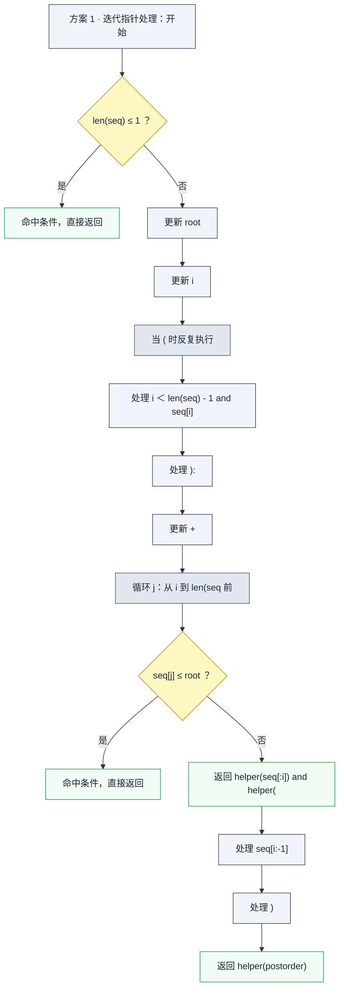

```python
import sys  # 提高递归深度上限（深输入防 RecursionError）

sys.setrecursionlimit(200000)  # 树/链表类题目节点数可达 1e4 量级

def verify_postorder(postorder):  # 定义函数 verify_postorder（参数：postorder）
    # 验证给定序列是否为某二叉搜索树的后序遍历结果
    def helper(seq):  # 定义函数 helper（参数：seq）
        if len(seq) <= 1:  # 若 长度(seq) 不超过 1
            return True  # 返回 True
        root = seq[-1]  # 把 seq[ 减 1] 存入 根节点
        # 左子树：所有小于根
        i = 0  # 把 0 存入 下标 i
        while (
            i < len(seq) - 1 and seq[i] < root
        ):  # 循环，直到不满足「下标 i 小于 长度(seq) 减 1 and seq[下标 i] 小于 根节点」
            i += 1  # 下标 i累加 1
        # 右子树：必须全部大于根
        for j in range(i, len(seq) - 1):  # 让 下标 j 从 下标 i 到 长度(seq 遍历
            if seq[j] <= root:  # 若 seq[下标 j] 不超过 根节点
                return False  # 返回 False
        return helper(seq[:i]) and helper(
            seq[i:-1]
        )  # 返回 helper(seq[:下标 i]) and helper(seq[下标 i: 减 1])

    return helper(postorder)  # 返回 helper(postorder)

if __name__ == "__main__":  # 若 __name__ 等于 '__main__'
    print(verify_postorder([1, 6, 3, 2, 5]))  # False
    print(verify_postorder([1, 3, 2, 6, 5]))  # True
    print(verify_postorder([4, 8, 6, 12, 10, 9]))  # True
```

### Go 实现（1 种方案）

Go 的全部方案如下，每个方案都内嵌用例自测，可独立运行（老仓库 python/go 文件遵循「打印结果」约定）：

#### 方案 1：迭代指针处理

**思路与代码分析**：核心是「迭代指针处理」。Go 版用切片与多返回值惯用法，显式处理索引边界。**走读**：方案 1 · 迭代指针处理：开始 → 计算 helper → 更新 helper → 处理 if len(seq) ≤ 1 → 返回 true → 更新 : → 更新 : → 遍历循环 → 处理 i++ → 遍历循环 → 处理 if seq[j] ≤ root → 返回 false → 返回 helper(seq[:i]) 且 helper(seq[i:len(seq)-1]) → 返回 helper(postorder)。

**运行架构**（真实控制流）：

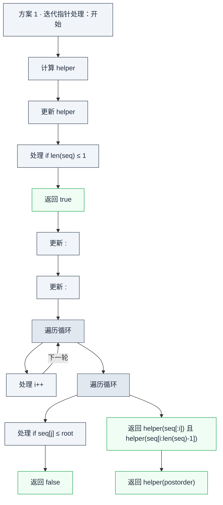

```go
package main // 引入依赖

import (
	"fmt" // 「fmt」
	"os"  // 「os」
)

func verifyPostorder(postorder []int) bool { // 定义函数/方法 verifyPostorder
	var helper func(seq []int) bool // var helper func(seq []int) bool
	helper = func(seq []int) bool { // 把 func(seq []int) bool { 写入 helper
		if len(seq) <= 1 { // 若 长度(seq) 不超过 1
			return true // 返回 true
		}
		root := seq[len(seq)-1]               // 把 seq[长度(seq) 减 1] 写入 root :
		i := 0                                // 把 0 写入 i :
		for i < len(seq)-1 && seq[i] < root { // for 下标 i 小于 长度(seq) 减 1 且 seq[下标 i] 小于 根节点 {
			i++ // 下标 i 加一
		}
		for j := i; j < len(seq)-1; j++ { // 把 下标 i; 下标 j 小于 长度(seq) 减 1; 下标 j 加一 { 写入 for j :
			if seq[j] <= root { // 若 seq[下标 j] 不超过 根节点
				return false // 返回 false
			}
		}
		return helper(seq[:i]) && helper(seq[i:len(seq)-1]) // 定义函数/方法 helper
	}
	return helper(postorder) // 定义函数/方法 helper
}

func main() { // 程序入口：跑内嵌自测用例
	type tc struct { // 定义类型
		in   []int // in []int
		want bool  // want bool
	}
	cases := []tc{ // 把 []tc{ 写入 cases :
		{[]int{1, 6, 3, 2, 5}, false},
		{[]int{1, 3, 2, 6, 5}, true},
		{[]int{4, 8, 6, 12, 10, 9}, true},
	}
	ok := true                // 把 true 写入 ok :
	for _, c := range cases { // 同时取 _ 与 字符 遍历
		if got := verifyPostorder(c.in); got != c.want { // 若 got : 赋值为 verifyPostorder(字符.in); got 不等于 字符.want
			ok = false                                                             // 把 false 写入 ok
			fmt.Printf("FAIL verifyPostorder(%v)=%v want %v\n", c.in, got, c.want) // 打印输出
		}
	}
	if !ok { // 若 取反 ok
		os.Exit(1) // os.Exit(1)
	}
	fmt.Println("PASS") // 全部用例通过，输出 PASS
}
```

### Java 实现（1 种方案）

Java 的全部方案如下，每个方案都内嵌用例自测，可独立运行（老仓库 python/go 文件遵循「打印结果」约定）：

#### 方案 1：迭代指针处理

**思路与代码分析**：核心是「迭代指针处理」。Java 版用类与静态方法组织，集合操作显式明了。**走读**：方案 1 · 迭代指针处理：开始 → 返回 helper(postorder)。

**运行架构**（真实控制流）：

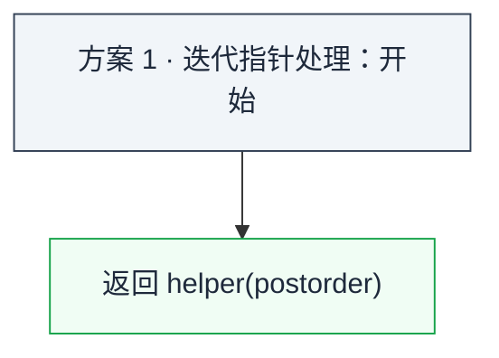

```java
package com.webfault.dsa; // 引入依赖

import java.util.*; // 引入依赖

class BstS1 { // 定义类型
  static boolean verifyPostorder(int[] postorder) { // 定义函数/方法 verifyPostorder
    return helper(postorder); // 返回 helper(postorder)
  }

  static boolean helper(int[] seq) { // 定义函数/方法 helper
    if (seq.length <= 1) return true; // 若 seq.长度 不超过 1，直接返回 true
    int root = seq[seq.length - 1]; // 把 seq[seq.长度 减 1] 存入 根节点
    int i = 0; // 把 0 存入 下标 i
    while (i < seq.length - 1 && seq[i] < root)
      i++; // 循环，直到不满足「下标 i 小于 seq.长度 减 1 且 seq[下标 i] 小于 根节点) 下标 i 加一 ;」
    for (int j = i; j < seq.length - 1; j++)
      if (seq[j] <= root) return false; // 让 下标 j 从 下标 i 开始计数，下标 j 小于 seq.长度 减 1 就继续
    int[] left = Arrays.copyOfRange(seq, 0, i); // 把 Arrays.copyOfRange(seq, 0, 下标 i); 写入 int[] left
    int[] right =
        Arrays.copyOfRange(
            seq, i, seq.length - 1); // 把 Arrays.copyOfRange(seq, 下标 i, seq.长度 减 1); 写入 int[] right
    return helper(left) && helper(right); // 返回 helper(左边界) 且 helper(右边界)
  }

  public static void main(String[] args) { // public static void main(String[] args) {
    boolean[] got = { // 把 { 写入 boolean[] got
      BstS1.verifyPostorder(new int[] {1, 6, 3, 2, 5}),
      BstS1.verifyPostorder(new int[] {1, 3, 2, 6, 5}),
      BstS1.verifyPostorder(new int[] {4, 8, 6, 12, 10, 9}),
    };
    boolean[] want = {false, true, true}; // 把 { false, true, true }; 写入 boolean[] want
    boolean ok = true; // 把 true; 写入 boolean ok
    for (int i = 0; i < got.length; i++) { // 让 下标 i 从 0 开始计数，下标 i 小于 got.长度 就继续
      if (got[i] != want[i]) { // 若 got[下标 i] 不等于 want[下标 i]
        ok = false; // 把 false; 写入 ok
        System.out.println("FAIL idx " + i + " got " + got[i] + " want " + want[i]); // 打印输出
      }
    }
    if (!ok) throw new RuntimeException("FAILED"); // 若 取反 ok) throw new RuntimeException(「FAILED」);
    System.out.println("PASS"); // 全部用例通过，输出 PASS
  }
}
```

### Rust 实现（1 种方案）

Rust 的全部方案如下，每个方案都内嵌用例自测，可独立运行（老仓库 python/go 文件遵循「打印结果」约定）：

#### 方案 1：迭代指针处理

**思路与代码分析**：核心是「迭代指针处理」。Rust 版用所有权移动与切片借用改写同一逻辑，注意 Option 与引用边界。**走读**：方案 1 · 迭代指针处理：开始 → 处理 if seq.len() ≤ 2 → 返回 true → 计算 root → 计算 i → 当 i ＜ seq.len() - 1 且 seq[i] ＜ root 时反复执行 → 更新 + → 遍历 &seq[i..seq.len() - 1] 中的每个元素 v → 处理 if v ＜ root → 返回 false → 调用 check(&seq[..i]) 且 check(&s → 调用 check(postorder)。

**运行架构**（真实控制流）：

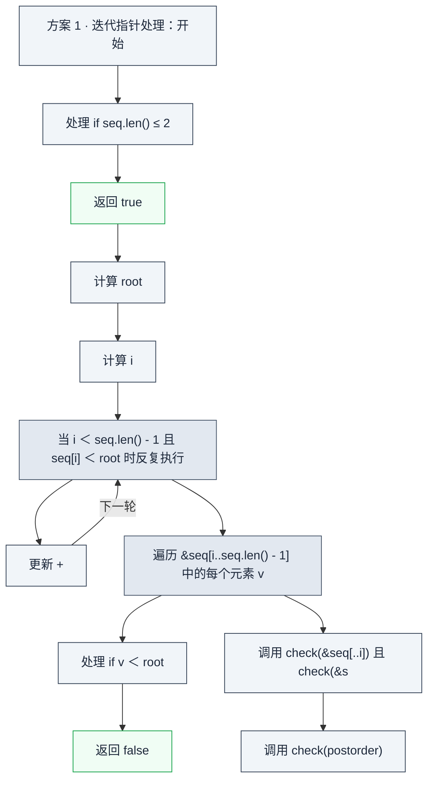

```rust
// LeetCode LCR 152. 验证二叉搜索树的后序遍历序列 — Rust 版（方案1）
fn verify_postorder(postorder: &[i32]) -> bool {
    // 定义函数/方法 verify_postorder
    fn check(seq: &[i32]) -> bool {
        // 定义判定函数 check
        if seq.len() <= 2 {
            return true;
        } // 若 seq.长度() 不超过 2 { return true; }
        let root = seq[seq.len() - 1]; // 把 seq[seq.长度() 减 1] 存入 根节点
        let mut i = 0usize; // 把 0usize; 写入 let mut i
        while i < seq.len() - 1 && seq[i] < root {
            i += 1;
        } // 把 1; } 写入 while i < seq.len() - 1 && seq[i] < root { i +
        for &v in &seq[i..seq.len() - 1] {
            // for 按位与 值 in 按位与 seq[下标 i..seq.长度() 减 1] {
            if v < root {
                return false;
            } // 若 值 小于 根节点 { return false; }
        }
        check(&seq[..i]) && check(&seq[i..seq.len() - 1])
    }
    check(postorder) // check(postorder)
}
fn main() {
    // 程序入口：跑内嵌自测用例
    assert!(!verify_postorder(&[1, 6, 3, 2, 5])); // 断言校验
    assert!(verify_postorder(&[1, 3, 2, 4, 5])); // 断言校验
    assert!(verify_postorder(&[4, 6, 5, 9, 8, 7])); // 断言校验
    assert!(verify_postorder(&[1, 2, 3])); // 断言校验
    println!("PASS");
} // 全部用例通过，输出 PASS
```

### Lua 实现（1 种方案）

Lua 的全部方案如下，每个方案都内嵌用例自测，可独立运行（老仓库 python/go 文件遵循「打印结果」约定）：

#### 方案 1：迭代指针处理

**思路与代码分析**：核心是「迭代指针处理」。Lua 版用表与 ipairs 遍历，注意 ipairs 遇 nil 即停的语义。代码里依次做这些事：递归求解子问题。**走读**：方案 1 · 迭代指针处理：开始 → 处理 local function check(seq, lo → 处理 if hi - lo ≤ 1 then → 返回 true → 更新 root → 更新 i → 当 i ＜ hi and seq[i] ＜ root do 时反复执行 → 更新 i → 循环 j：从 i 到 hi - 1 do → 处理 if seq[j] ＜ root then → 返回 false → 返回 check(seq, lo, i - 1) and check(seq, i, hi - 1) → 返回 check(postorder, 1, #postorder)。

**运行架构**（真实控制流）：

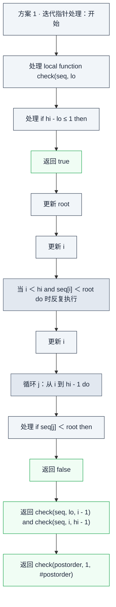

```lua
-- LeetCode LCR 152. 验证二叉搜索树的后序遍历序列 — Lua 版（方案1）
local function verify_postorder(postorder) -- local function verify_postorder(postorder)
	local function check(seq, lo, hi) -- local function check(seq, 左边界, 右边界)
		if hi - lo <= 1 then
			return true
		end -- 若 右边界 减 左边界 不超过 1 then return true 终点
		local root = seq[hi] -- 把 seq[右边界] 写入 local root
		local i = lo -- 把 左边界 写入 local i
		while i < hi and seq[i] < root do
			i = i + 1
		end -- 把 下标 i 加 1 终点 写入 while i < hi and seq[i] < root do i
		for j = i, hi - 1 do -- 把 下标 i, 右边界 减 1 do 写入 for j
			if seq[j] < root then
				return false
			end -- 若 seq[下标 j] 小于 根节点 then return false 终点
		end -- 终点
		return check(seq, lo, i - 1) and check(seq, i, hi - 1) -- 返回 check(seq, 左边界, 下标 i 减 1) and check(seq, 下标 i, 右边界 减 1)
	end -- 终点
	return check(postorder, 1, #postorder) -- 返回 check(postorder, 1, #postorder)
end -- 终点
assert(verify_postorder({ 1, 6, 3, 2, 5 }) == false) -- 断言校验
assert(verify_postorder({ 1, 3, 2, 4, 5 }) == true) -- 断言校验
assert(verify_postorder({ 4, 6, 5, 9, 8, 7 }) == true) -- 断言校验
assert(verify_postorder({ 1, 2, 3 }) == true) -- 断言校验
print("PASS") -- 全部用例通过，输出 PASS
```

### C 实现（1 种方案）

C 的全部方案如下，每个方案都内嵌用例自测，可独立运行（老仓库 python/go 文件遵循「打印结果」约定）：

#### 方案 1：迭代指针处理

**思路与代码分析**：核心是「迭代指针处理」。C 版手动管理下标与内存，循环边界全部显式写出。**走读**：方案 1 · 迭代指针处理：开始 → 返回 check(seq, 0, n - 1)。

**运行架构**（真实控制流）：

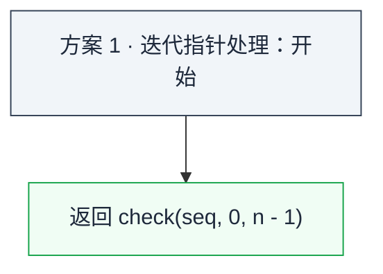

```c
/* LeetCode LCR 152. 验证二叉搜索树的后序遍历序列 — C 版（方案1） */
#include <stdio.h>                                 // 引入头文件
static int check(const int *seq, int lo, int hi) { // 定义判定函数 check
    if (hi - lo <= 1)
        return 1;       // 若 右边界 减 左边界 不超过 1，直接返回 1
    int root = seq[hi]; // 把 seq[右边界] 存入 根节点
    int i = lo;         // 把 左边界 存入 下标 i
    while (i < hi && seq[i] < root)
        i++; // 循环，直到不满足「下标 i 小于 右边界 且 seq[下标 i] 小于 根节点) 下标 i 加一 ;」
    for (int j = i; j < hi; j++) { // 让 下标 j 从 下标 i 开始计数，下标 j 小于 右边界 就继续
        if (seq[j] < root)
            return 0; // 若 seq[下标 j] 小于 根节点，直接返回 0
    }
    return check(seq, lo, i - 1) &&
           check(seq, i, hi - 1); // 返回 check(seq, 左边界, 下标 i 减 1) 且 check(seq, 下标 i, 右边界 减 1)
}
static int verify_postorder(const int *seq, int n) { return check(seq, 0, n - 1); }
int main(void) { // 程序入口：跑内嵌自测用例
    if (verify_postorder((int[]){1, 6, 3, 2, 5}, 5)) {
        printf("FAIL 1\n");
        return 1;
    }
    if (!verify_postorder((int[]){1, 3, 2, 4, 5}, 5)) {
        printf("FAIL 2\n");
        return 1;
    }
    if (!verify_postorder((int[]){4, 6, 5, 9, 8, 7}, 6)) {
        printf("FAIL 3\n");
        return 1;
    }
    if (!verify_postorder((int[]){1, 2, 3}, 3)) {
        printf("FAIL 4\n");
        return 1;
    }
    printf("PASS\n");
    return 0;
} // 全部用例通过，输出 PASS
```

### C++ 实现（1 种方案）

C++ 的全部方案如下，每个方案都内嵌用例自测，可独立运行（老仓库 python/go 文件遵循「打印结果」约定）：

#### 方案 1：迭代指针处理

**思路与代码分析**：核心是「迭代指针处理」。C++ 版用 STL 容器与迭代器，减少手写下标错误。**走读**：方案 1 · 迭代指针处理：开始 → 返回 check(postorder, 0, static_cast＜int＞(postorder.size()) - 1)。

**运行架构**（真实控制流）：

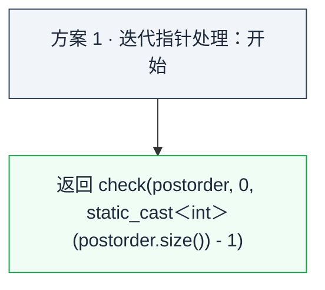

```cpp
// LeetCode LCR 152. 验证二叉搜索树的后序遍历序列 — C++ 版（方案1）
#include <cassert>                                               // 引入头文件
#include <iostream>                                              // 引入头文件
#include <vector>                                                // 引入头文件
static bool check(const std::vector<int> &seq, int lo, int hi) { // 定义判定函数 check
    if (hi - lo <= 1)
        return true;    // 若 右边界 减 左边界 不超过 1，直接返回 true
    int root = seq[hi]; // 把 seq[右边界] 存入 根节点
    int i = lo;         // 把 左边界 存入 下标 i
    while (i < hi && seq[i] < root)
        ++i; // 循环，直到不满足「下标 i 小于 右边界 且 seq[下标 i] 小于 根节点) 加一 下标 i;」
    for (int j = i; j < hi; ++j) { // 让 下标 j 从 下标 i 开始计数，下标 j 小于 右边界 就继续
        if (seq[j] < root)
            return false; // 若 seq[下标 j] 小于 根节点，直接返回 false
    }
    return check(seq, lo, i - 1) &&
           check(seq, i, hi - 1); // 返回 check(seq, 左边界, 下标 i 减 1) 且 check(seq, 下标 i, 右边界 减 1)
}
static bool verifyPostorder(const std::vector<int> &postorder) { // 定义函数/方法 verifyPostorder
    return check(postorder, 0, static_cast<int>(postorder.size()) - 1);
}
int main() {                                     // 程序入口：跑内嵌自测用例
    assert(!verifyPostorder({1, 6, 3, 2, 5}));   // 断言校验
    assert(verifyPostorder({1, 3, 2, 4, 5}));    // 断言校验
    assert(verifyPostorder({4, 6, 5, 9, 8, 7})); // 断言校验
    assert(verifyPostorder({1, 2, 3}));          // 断言校验
    std::cout << "PASS" << std::endl;
} // 全部用例通过，输出 PASS
```

### R 实现（1 种方案）

R 的全部方案如下，每个方案都内嵌用例自测，可独立运行（老仓库 python/go 文件遵循「打印结果」约定）：

#### 方案 1：迭代指针处理

**思路与代码分析**：核心是「迭代指针处理」。R 版用向量化思维与 1 起始下标，注意 1:n 的降序陷阱。代码里依次做这些事：单循环线性扫描。**走读**：方案 1 · 迭代指针处理：开始 → 处理 check ＜- function(lo, hi) → 命中条件，直接返回 → 处理 root ＜- postorder[hi] → 处理 i ＜- lo → 当 (i ＜ hi 且 postorder[i] ＜ root) i ＜- i + 1L 时反复执行 → 若 i ≤ hi - 1L 则： → 循环 j：遍历 i:(hi - 1L) → 命中条件，直接返回 → 调用 check(lo, i - 1L) 且 check(i → 调用 check(1L, length(postorder))。

**运行架构**（真实控制流）：

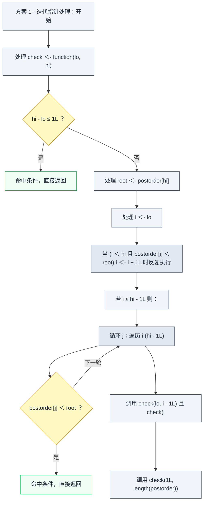

```r
# 验证二叉搜索树的后序遍历序列 — R 版（方案1） 定义函数 verify_postorder（参数：postorder） 定义函数
# check（参数：左边界, 右边界）
verify_postorder <- function(postorder) {
    check <- function(lo, hi) {
        if (hi - lo <= 1L)
            return(TRUE)  # 若 右边界 减 左边界 不超过 1L) return(TRUE
        root <- postorder[hi]  # 把 postorder[右边界] 存入 根节点
        i <- lo  # 把 左边界 存入 下标 i
        while (i < hi && postorder[i] < root) i <- i + 1L
        if (i <= hi - 1L) {
            # 若 下标 i 不超过 右边界 减 1L for (下标 j in 下标 i:(右边界 减 1L)) {
            for (j in i:(hi - 1L)) {
                if (postorder[j] < root)
                  return(FALSE)  # 若 postorder[下标 j] 小于 根节点) return(FALSE
            }
        }
        check(lo, i - 1L) && check(i, hi - 1L)  # check(左边界, 下标 i 减 1L) 且 check(下标 i, 右边界 减 1L)
    }
    check(1L, length(postorder))  # check(1L, 长度(postorder))
}
stopifnot(!verify_postorder(c(1, 6, 3, 2, 5)))  # 断言校验
stopifnot(verify_postorder(c(1, 3, 2, 4, 5)))  # 断言校验
stopifnot(verify_postorder(c(4, 6, 5, 9, 8, 7)))  # 断言校验
stopifnot(verify_postorder(c(1, 2, 3)))  # 断言校验
cat("PASS\n")  # 全部用例通过，输出 PASS
```

### Zig 实现（1 种方案）

Zig 的全部方案如下，每个方案都内嵌用例自测，可独立运行（老仓库 python/go 文件遵循「打印结果」约定）：

#### 方案 1：迭代指针处理

**思路与代码分析**：核心是「迭代指针处理」。Zig 版显式分配与清零，整型边界处理严格。**走读**：方案 1 · 迭代指针处理：开始 → 命中条件，直接返回 → 返回 checkSeq(postorder, 0, postorder.len - 1)。

**运行架构**（真实控制流）：

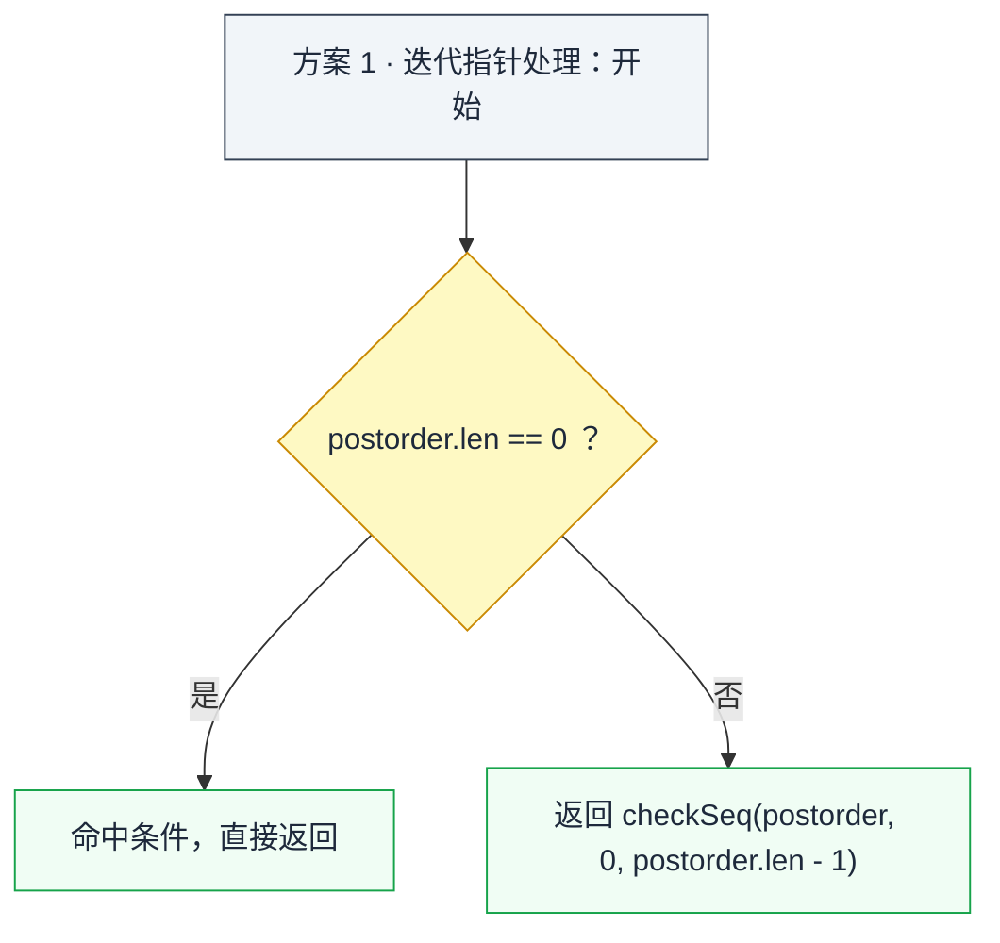

```zig
// LeetCode LCR 152. 验证二叉搜索树的后序遍历序列 — Zig 版（方案1）
const std = @import("std"); // 把 @import(「std」) 存入 std
fn checkSeq(seq: []const i32, lo: usize, hi: usize) bool { // 定义判定函数 checkSeq
    if (hi <= lo + 1) return true; // 若 右边界 不超过 左边界 加 1，直接返回 true
    const root = seq[hi]; // 把 seq[右边界] 存入 根节点
    var i = lo; // 把 左边界 存入 下标 i
    while (i < hi and seq[i] < root) i += 1; // 循环，直到不满足「下标 i 小于 右边界 and seq[下标 i] 小于 根节点) 下标 i 累加 1;」
    var j = i; // 把 下标 i 存入 下标 j
    while (j < hi) : (j += 1) { // 循环，直到不满足「下标 j 小于 右边界) : (下标 j 累加 1」
        if (seq[j] < root) return false; // 若 seq[下标 j] 小于 根节点，直接返回 false
    }
    return checkSeq(seq, lo, i - 1) and checkSeq(seq, i, hi - 1);
}
fn verifyPostorder(postorder: []const i32) bool { // 定义函数/方法 verifyPostorder
    if (postorder.len == 0) return true; // 若 postorder.长度 等于 0，直接返回 true
    return checkSeq(postorder, 0, postorder.len - 1); // 返回 checkSeq(postorder, 0, postorder.长度 减 1)
}
pub fn main() !void { // 程序入口：跑内嵌自测用例
    if (verifyPostorder(&[_]i32{ 1, 6, 3, 2, 5 })) return error.TestFailed;
    if (!verifyPostorder(&[_]i32{ 1, 3, 2, 4, 5 })) return error.TestFailed;
    if (!verifyPostorder(&[_]i32{ 4, 6, 5, 9, 8, 7 })) return error.TestFailed;
    if (!verifyPostorder(&[_]i32{ 1, 2, 3 })) return error.TestFailed;
    std.debug.print("PASS\n", .{});
} // 全部用例通过，输出 PASS
```

### Dart 实现（1 种方案）

Dart 的全部方案如下，每个方案都内嵌用例自测，可独立运行（老仓库 python/go 文件遵循「打印结果」约定）：

#### 方案 1：迭代指针处理

**思路与代码分析**：核心是「迭代指针处理」。Dart 版用可空类型标注与集合方法，注意空安全。代码里依次做这些事：单循环线性扫描。**走读**：方案 1 · 迭代指针处理：开始 → 处理 bool check(int lo, int hi) → 命中条件，直接返回 → 更新 root → 计算 i → 当 (i ＜ hi 且 postorder[i] ＜ root) 时反复执行 → 处理 i++ → 遍历循环 → 命中条件，直接返回 → 返回 check(lo, i - 1) 且 → 调用 check(i, hi - 1) → 返回 check(0, postorder.length - 1)。

**运行架构**（真实控制流）：

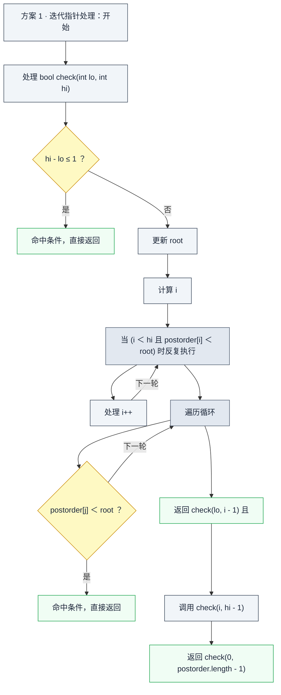

```dart
// LeetCode LCR 152. 验证二叉搜索树的后序遍历序列 — Dart 版（方案1）
bool verifyPostorder(List<int> postorder) {
  // 定义函数/方法 verifyPostorder
  bool check(int lo, int hi) {
    // 定义判定函数 check
    if (hi - lo <= 1) return true; // 若 右边界 减 左边界 不超过 1，直接返回 true
    final root = postorder[hi]; // 把 postorder[右边界] 存入 根节点
    var i = lo; // 把 左边界 存入 下标 i
    while (i < hi && postorder[i] < root) {
      i++;
    }
    for (var j = i; j < hi; j++) {
      // 让 下标 j 从 下标 i 开始计数，下标 j 小于 右边界 就继续
      if (postorder[j] < root)
        return false; // 若 postorder[下标 j] 小于 根节点，直接返回 false
    }
    return check(lo, i - 1) &&
        check(i, hi - 1); // 返回 check(左边界, 下标 i 减 1) 且 check(下标 i, 右边界 减 1)
  }

  return check(0, postorder.length - 1); // 返回 check(0, postorder.长度 减 1)
}

void main() {
  // 程序入口：跑内嵌自测用例
  if (verifyPostorder([1, 6, 3, 2, 5]))
    throw StateError(
      'c1',
    ); // 若 verifyPostorder([1, 6, 3, 2, 5])) throw StateError('c1');
  if (!verifyPostorder([1, 3, 2, 4, 5])) throw StateError('c2');
  if (!verifyPostorder([4, 6, 5, 9, 8, 7])) throw StateError('c3');
  if (!verifyPostorder([1, 2, 3]))
    throw StateError(
      'c4',
    ); // 若 取反 verifyPostorder([1, 2, 3])) throw StateError('c4');
  print('PASS');
} // 全部用例通过，输出 PASS
```

---

## 内容总结

- **lcr 152. 验证二叉搜索树的后序遍历序列**（算法笔记 · Medium）：共 1 个方案，主线思路「迭代指针处理」；时间 O(n)（单趟线性扫描）；动画演示归并分治过程，附录给出 11 种语言 × 全部方案的可运行实现。
- 来源博客：[https://blog.csdn.net/tyro_java/article/details/145355207](https://blog.csdn.net/tyro_java/article/details/145355207)
- 导航：[📋 总目录](../) ｜ [← 239 顺序查找](../239_顺序查找/) ｜ [241 lcp 10. 二叉树任务调度 →](../241_leetcode_lcp_10._二叉树任务调度/)
