# 242 · 设计一个验证系统（第附阶段 · 专题补充 · Medium）

> **难度**：⭐⭐ Medium ｜ **专题**：综合
> **学习定位**：第附阶段 · 专题补充第 242 篇 ｜ **解法数**：1
> **内容总结**：**设计一个验证系统**（综合 · Medium）：共 1 个方案，主线思路「哈希辅助」；时间 O(n)（单趟线性扫描）；动画演示归并分治过程，附录给出 11 种语言 × 全部方案的可运行实现。

---

## 题目描述

你需要设计一个包含验证码的验证系统。每一次验证中，用户会收到一个新的验证码，这个验证码在 `currentTime` 时刻之后 `timeToLive` 秒过期。如果验证码被更新了，那么它会在 `currentTime` （可能与之前的 `currentTime` 不同）时刻延长 `timeToLive` 秒。

请你实现 `AuthenticationManager` 类：

 `AuthenticationManager(int timeToLive)` 构造 `AuthenticationManager` 并设置 `timeToLive` 参数。
 `generate(string tokenId, int currentTime)` 给定 `tokenId` ，在当前时间 `currentTime` 生成一个新的验证码。
 `renew(string tokenId, int currentTime)` 将给定 `tokenId` 且 未过期 的验证码在 `currentTime` 时刻更新。如果给定 `tokenId` 对应的验证码不存在或已过期，请你忽略该操作，不会有任何更新操作发生。
 `countUnexpiredTokens(int currentTime)` 请返回在给定 `currentTime` 时刻，未过期 的验证码数目。

如果一个验证码在时刻 `t` 过期，且另一个操作恰好在时刻 `t` 发生（`renew` 或者 `countUnexpiredTokens` 操作），过期事件 优先于 其他操作。

**用例（来自原题）**：

**示例 1**

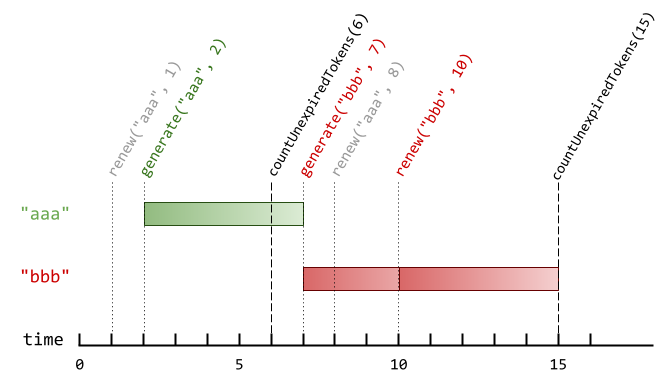

```text
输入：
["AuthenticationManager", "renew", "generate", "countUnexpiredTokens", "generate", "renew", "renew", "countUnexpiredTokens"]
[[5], ["aaa", 1], ["aaa", 2], [6], ["bbb", 7], ["aaa", 8], ["bbb", 10], [15]]
输出：
[null, null, null, 1, null, null, null, 0]
```

解释：AuthenticationManager authenticationManager = new AuthenticationManager(5); // 构造 AuthenticationManager ，设置 timeToLive = 5 秒。 authenticationManager.renew(「aaa」, 1); // 时刻 1 时，没有验证码的 tokenId 为 「aaa」 ，没有验证码被更新。 authenticationManager.generate(「aaa」, 2); // 时刻 2 时，生成一个 tokenId 为 「aaa」 的新验证码。 authenticationManager.countUnexpiredTokens(6); // 时刻 6 时，只有 tokenId 为 「aaa」 的验证码未过期，所以返回 1 。 authenticationManager.generate(「bbb」, 7); // 时刻 7 时，生成一个 tokenId 为 「bbb」 的新验证码。 authenticationManager.renew(「aaa」, 8); // tokenId 为 「aaa」 的验证码在时刻 7 过期，且 8 >= 7 ，所以时刻 8 的 renew 操作被忽略，没有验证码被更新。 authenticationManager.renew(「bbb」, 10); // tokenId 为 「bbb」 的验证码在时刻 10 没有过期，所以 renew 操作会执行，该 token 将在时刻 15 过期。 authenticationManager.countUnexpiredTokens(15); // tokenId 为 「bbb」 的验证码在时刻 15 过期，tokenId 为 「aaa」 的验证码在时刻 7 过期，所有验证码均已过期，所以返回 0 。
> 题面与 [leetcode.cn 官方](https://leetcode.cn/problems/design-authentication-manager/)一致，示例配图取自官方题面。

**数据范围与注意事项**：

- `1 <= timeToLive <= 10^8`
- `1 <= currentTime <= 10^8`
- `1 <= tokenId.length <= 5`
- `tokenId` 只包含小写英文字母。
- 所有 `generate` 函数的调用都会包含独一无二的 `tokenId` 值。
- 所有函数调用中，`currentTime` 的值 严格递增 。
- 所有函数的调用次数总共不超过 `2000` 次。
- **易错点**：特殊输入（空、重复、极值）的边界检查。

## 题目分析

**场景是什么**：综合练习：从题面本身出发选择合适的数据结构。本题就是该场景的 Medium 级练习，主线做法是「哈希辅助」。

**主线怎么解**：把主解法从头到尾过一遍，它其实在依次做这几件事：哈希结构做计数或查重 → 双重循环遍历。

## 解题思路

**方案对比**（共 1 个方案，由浅入深）：

| 方案 | 时间复杂度 | 空间复杂度 |
|---|---|---|
| 方案 1 · 哈希辅助 | O(n)（单趟线性扫描） | O(1) 到 O(n)（视辅助结构） |

**怎么读这一篇**：

- 🐣 **新手路线**：把「题目描述」的示例 1 在纸上手推一遍 → 读方案 1（最直观的写法）与它的代码走读 → 按「运行方式」本地跑通看 PASS → 回头对比方案 2 之后的写法差在哪
- 🦅 **大佬路线**：直接锁定最优方案 1（哈希辅助，O(n)（单趟线性扫描））→ 跳读该方案代码与走读 → 用「逐步拆解与面试追问」补齐复杂度推导与边界追问

### 动态算法图（归并分治，GIF 自动循环）


动画演示综合专题里归并分治的典型过程；每个方案在「TypeScript 解题方案」一节还配了专属动画与专属流程图。

### 主解法流程图（真实控制流）

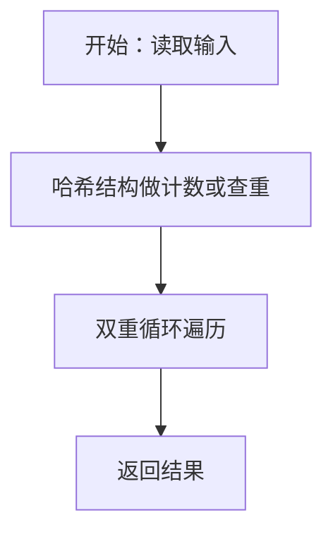

## TypeScript 解题方案（1 个方案逐个讲）

> **运行与提交**：每个方案都是自包含文件（内嵌用例自测，输出 PASS），整块复制到 `.ts` 文件后 `node 文件名` 即可运行。提交 LeetCode 时，把 `demo` 内的算法函数与辅助类型/函数整体取出、置于文件顶层即可。**提交备注**：设计题：按题面给定的 AuthenticationManager 接口提交。

### 方案 1：哈希辅助

**分析与思路**：核心做法是「哈希辅助」。代码里依次做这些事：哈希结构做计数或查重；双重循环遍历。

**运行方式**：`node 本文件`，内嵌用例全部通过会输出 PASS。


**方案专属流程图**（真实控制流）：


```typescript
/**
 ** LeetCode 1797. 设计一个验证系统
 ** 来源：https://blog.csdn.net/tyro_java/article/details/145354494
 */

export class AuthenticationManager {
  // export class AuthenticationManager {
  private expiresAt: Map<string, number>; // private expiresAt: Map 小于 string, number 超过 ;
  private ttl: number; // private ttl: number;
  constructor(timeToLive: number) {
    // constructor(timeToLive: number) {
    this.expiresAt = new Map(); // 把 new Map(); 写入 this.expiresAt
    this.ttl = timeToLive; // 把 timeToLive; 写入 this.ttl
  }
  generate(token: string, currentTime: number): void {
    // generate(token: string, currentTime: number): void {
    this.expiresAt.set(token, currentTime + this.ttl); // this.expiresAt.set(token, currentTime 加 this.ttl);
  }
  renew(token: string, currentTime: number): number {
    // renew(token: string, currentTime: number): number {
    if (this.expiresAt.has(token) && this.expiresAt.get(token)! > currentTime) {
      this.expiresAt.set(token, currentTime + this.ttl); // this.expiresAt.set(token, currentTime 加 this.ttl);
      return 1; // 返回 1
    }
    return 0; // 返回 0
  }
  countValidTokens(currentTime: number): number {
    // countValidTokens(currentTime: number): number {
    let count = 0; // 把 0 存入 计数
    for (const expire of this.expiresAt.values()) {
      // for (const expire of this.expiresAt.values()) {
      if (expire > currentTime) count++; // 若 expire 超过 currentTime) 计数 加一 ;
    }
    return count; // 返回 计数
  }
}

export function demo(): void {
  // 程序入口：跑内嵌自测用例
  const auth = new AuthenticationManager(5); // 把 new AuthenticationManager(5) 存入 auth
  auth.generate('aaa', 1); // auth.generate(「aaa」, 1);
  if (auth.countValidTokens(3) !== 1) throw new Error('FAILED count1');
  if (auth.renew('aaa', 4) !== 1) throw new Error('FAILED renew'); // 若 auth.renew(「aaa」, 4) 不等于 1) throw new Error(「aaa」);
  if (auth.countValidTokens(6) !== 1)
    throw new Error('FAILED count2 got ' + auth.countValidTokens(6));
  console.log('PASS'); // 全部用例通过，输出 PASS
}

demo(); // demo();
```

## 逐步拆解与面试追问

**复杂度**：时间 O(n)（单趟线性扫描），空间 O(1) 到 O(n)（视辅助结构）

**为什么是这个量级**：每个元素被常数次访问，辅助哈希或栈的开销与 n 同阶

**面试官可能会追问**：

- 有没有更直观的建模方式？
- 特殊输入的边界？
- 能否一步到位而不是分两趟？

## 关键 API 速查（TS 主解法实际用到，附官方链接）

| API | 作用 | 使用要点 | 官方文档 |
|---|---|---|---|
| `Map` | 哈希表：任意类型键值对 | set(k,v) 存、get(k) 取（不存在返回 undefined）、has(k) 判存在、delete(k) 删；增删查均摊 O(1)；键顺序为插入序；键必须用引用区分（对象键按身份） | [官方文档](https://developer.mozilla.org/zh-CN/docs/Web/JavaScript/Reference/Global_Objects/Map) |

### 各语言官方文档导航

- **TypeScript / JS**：[MDN 中文参考](https://developer.mozilla.org/zh-CN/)
- **Python**：[Python 官方文档](https://docs.python.org/zh-cn/3/)
- **Go**：[Go 标准库](https://pkg.go.dev/std)
- **Java**：[JDK 17 API](https://docs.oracle.com/en/java/javase/17/docs/api/)
- **Rust**：[Rust 标准库](https://doc.rust-lang.org/std/)
- **Lua**：[Lua 5.4 手册](https://www.lua.org/manual/5.4/)
- **C**：[Cppreference C](https://zh.cppreference.com/w/c)
- **C++**：[Cppreference C++](https://zh.cppreference.com/w/cpp)
- **R**：[R 官方手册](https://stat.ethz.ch/R-manual/)
- **Zig**：[Zig 语言文档](https://ziglang.org/documentation/master/)
- **Dart**：[Dart API](https://api.dart.dev/)

## 附录：其他 10 种语言全部实现（每种语言列举其全部方案）

> TypeScript 的全部方案见「TypeScript 解题方案」一节；下面是其余 10 种语言的对应实现，每种语言的每个方案都带思路分析、代码走读与专属运行架构图。
> 每个方案都内嵌用例自测，可独立运行（老仓库 python/go 文件遵循「打印结果」约定）。
> 完整解法文件见 `dsa/<语言>/other/lc_1797_设计一个验证系统/`。

### Python 实现（1 种方案）

Python 的全部方案如下，每个方案都内嵌用例自测，可独立运行（老仓库 python/go 文件遵循「打印结果」约定）：

#### 方案 1：哈希辅助

**思路与代码分析**：核心是「哈希辅助」。Python 版用切片与字典推导式简化操作，突出可读性。

**运行架构**（真实控制流）：

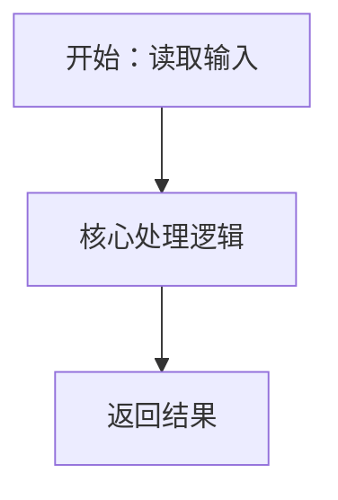

```python
import sys  # 提高递归深度上限（深输入防 RecursionError）

sys.setrecursionlimit(200000)  # 树/链表类题目节点数可达 1e4 量级

class AuthenticationManager:  # 定义类
    def __init__(self, timeToLive):  # 构造函数：初始化成员
        self.expires_at = {}  # 把 {} 写入 self.expires_at
        self.ttl = timeToLive  # 把 timeToLive 写入 self.ttl

    def generate(self, token, currentTime):  # 定义函数 generate（参数：self, token, currentTime）
        self.expires_at[token] = (
            currentTime + self.ttl
        )  # 把 currentTime 加 self.ttl 写入 self.expires_at[token]

    def renew(self, token, currentTime):  # 定义函数 renew（参数：self, token, currentTime）
        if token in self.expires_at and self.expires_at[token] > currentTime:
            self.expires_at[token] = (
                currentTime + self.ttl
            )  # 把 currentTime 加 self.ttl 写入 self.expires_at[token]
            return 1  # 返回 1
        return 0  # 返回 0

    def countValidTokens(self, currentTime):  # 定义函数 countValidTokens（参数：self, currentTime）
        count = 0  # 把 0 存入 计数
        for token, expire in self.expires_at.items():  # for token, expire in self.expires_at.items():
            if expire > currentTime:  # 若 expire 超过 currentTime
                count += 1  # 计数累加 1
        return count  # 返回 计数

if __name__ == "__main__":  # 若 __name__ 等于 '__main__'
    auth = AuthenticationManager(5)  # 把 AuthenticationManager(5) 存入 auth
    auth.generate("aaa", 1)  # auth.generate(「aaa」, 1)
    print(auth.countValidTokens(3))  # 打印输出
    print(auth.renew("aaa", 4))  # 打印输出
    print(auth.countValidTokens(6))  # 打印输出
```

### Go 实现（1 种方案）

Go 的全部方案如下，每个方案都内嵌用例自测，可独立运行（老仓库 python/go 文件遵循「打印结果」约定）：

#### 方案 1：哈希辅助

**思路与代码分析**：核心是「哈希辅助」。Go 版用切片与多返回值惯用法，显式处理索引边界。代码里依次做这些事：哈希结构做计数或查重。**走读**：方案 1 · 哈希辅助：开始 → 返回 &AuthenticationManager。

**运行架构**（真实控制流）：

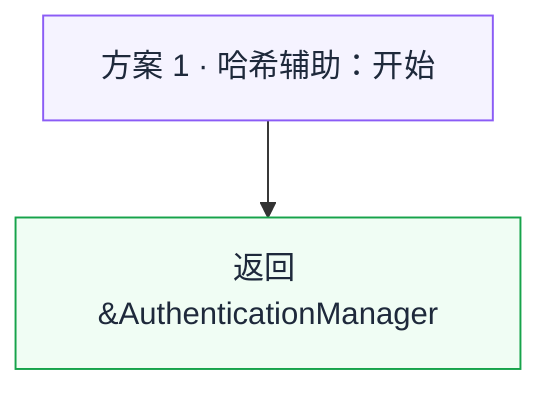

```go
package main // 引入依赖

import (
	"fmt" // 「fmt」
	"os"  // 「os」
)

type AuthenticationManager struct { // 定义类型
	expiresAt map[string]int // expiresAt 映射表[string]int
	ttl       int            // ttl int
}

func NewAuthenticationManager(ttl int) *AuthenticationManager { // 定义函数/方法 NewAuthenticationManager
	return &AuthenticationManager{expiresAt: make(map[string]int), ttl: ttl}
}

func (a *AuthenticationManager) generate(token string, currentTime int) { // 定义函数/方法 generate
	a.expiresAt[token] = currentTime + a.ttl // 把 currentTime 加 数组.ttl 写入 a.expiresAt[token]
}

func (a *AuthenticationManager) renew(token string, currentTime int) int { // 定义函数/方法 renew
	if exp, ok := a.expiresAt[token]; ok && exp > currentTime { // 若 exp, ok : 赋值为 数组.expiresAt[token]; ok 且 exp 超过 currentTime
		a.expiresAt[token] = currentTime + a.ttl // 把 currentTime 加 数组.ttl 写入 a.expiresAt[token]
		return 1                                 // 返回 1
	}
	return 0 // 返回 0
}

func (a *AuthenticationManager) countValidTokens(currentTime int) int { // 定义函数/方法 countValidTokens
	count := 0                        // 把 0 写入 count :
	for _, exp := range a.expiresAt { // 同时取 _ 与 exp 遍历
		if exp > currentTime { // 若 exp 超过 currentTime
			count++ // 计数 加一
		}
	}
	return count // 返回 计数
}

func main() { // 程序入口：跑内嵌自测用例
	a := NewAuthenticationManager(5)        // 把 NewAuthenticationManager(5) 写入 a :
	a.generate("aaa", 1)                    // 数组.generate(「aaa」, 1)
	ok := true                              // 把 true 写入 ok :
	if v := a.countValidTokens(3); v != 1 { // 若 值 : 赋值为 数组.countValidTokens(3); 值 不等于 1
		ok = false                          // 把 false 写入 ok
		fmt.Printf("FAIL count(3)=%d\n", v) // 打印输出
	}
	if v := a.renew("aaa", 4); v != 1 { // 若 值 : 赋值为 数组.renew(「aaa」, 4); 值 不等于 1
		ok = false                          // 把 false 写入 ok
		fmt.Printf("FAIL renew(4)=%d\n", v) // 打印输出
	}
	if v := a.countValidTokens(6); v != 1 { // 若 值 : 赋值为 数组.countValidTokens(6); 值 不等于 1
		ok = false                          // 把 false 写入 ok
		fmt.Printf("FAIL count(6)=%d\n", v) // 打印输出
	}
	if !ok { // 若 取反 ok
		os.Exit(1) // os.Exit(1)
	}
	fmt.Println("PASS") // 全部用例通过，输出 PASS
}
```

### Java 实现（1 种方案）

Java 的全部方案如下，每个方案都内嵌用例自测，可独立运行（老仓库 python/go 文件遵循「打印结果」约定）：

#### 方案 1：哈希辅助

**思路与代码分析**：核心是「哈希辅助」。Java 版用类与静态方法组织，集合操作显式明了。**走读**：方案 1 · 哈希辅助：开始 → 更新 ttl → 返回结果。

**运行架构**（真实控制流）：

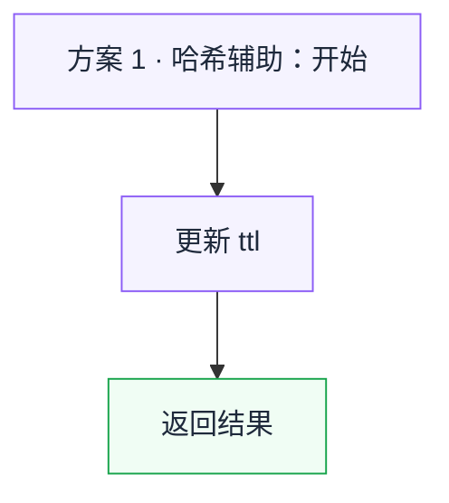

```java
package com.webfault.dsa; // 引入依赖

import java.util.*; // 引入依赖

class AuthS1 { // 定义类型
  static class AuthenticationManager { // static class AuthenticationManager {
    Map<String, Integer> expiresAt =
        new HashMap<>(); // 把 new HashMap 小于 超过 (); 写入 Map<String, Integer> expiresAt
    int ttl; // int ttl;

    AuthenticationManager(int timeToLive) {
      ttl = timeToLive;
    }

    void generate(String token, int currentTime) {
      expiresAt.put(token, currentTime + ttl);
    }

    int renew(String token, int currentTime) { // 定义函数/方法 renew
      if (expiresAt.containsKey(token) && expiresAt.get(token) > currentTime) {
        expiresAt.put(token, currentTime + ttl); // expiresAt.put(token, currentTime 加 ttl);
        return 1; // 返回 1
      }
      return 0; // 返回 0
    }

    int countValidTokens(int currentTime) { // 定义函数/方法 countValidTokens
      int count = 0; // 把 0 存入 计数
      for (int expire : expiresAt.values()) if (expire > currentTime) count++;
      return count; // 返回 计数
    }
  }

  public static void main(String[] args) { // public static void main(String[] args) {
    AuthenticationManager auth = new AuthenticationManager(5);
    auth.generate("aaa", 1); // auth.generate(「aaa」, 1);
    Integer[] got = { // 把 { 写入 Integer[] got
      auth.countValidTokens(3), auth.renew("aaa", 4), auth.countValidTokens(6),
    };
    Integer[] want = {1, 1, 1}; // 把 { 1, 1, 1 }; 写入 Integer[] want
    boolean ok = true; // 把 true; 写入 boolean ok
    for (int i = 0; i < got.length; i++) { // 让 下标 i 从 0 开始计数，下标 i 小于 got.长度 就继续
      if (!got[i].equals(want[i])) { // 若 取反 got[下标 i].equals(want[下标 i]
        ok = false; // 把 false; 写入 ok
        System.out.println("FAIL idx " + i + " got " + got[i] + " want " + want[i]); // 打印输出
      }
    }
    if (!ok) throw new RuntimeException("FAILED"); // 若 取反 ok) throw new RuntimeException(「FAILED」);
    System.out.println("PASS"); // 全部用例通过，输出 PASS
  }
}
```

### Rust 实现（1 种方案）

Rust 的全部方案如下，每个方案都内嵌用例自测，可独立运行（老仓库 python/go 文件遵循「打印结果」约定）：

#### 方案 1：哈希辅助

**思路与代码分析**：核心是「哈希辅助」。Rust 版用所有权移动与切片借用改写同一逻辑，注意 Option 与引用边界。代码里依次做这些事：哈希结构做计数或查重。**走读**：方案 1 · 哈希辅助：开始 → 处理 AuthenticationManager → 处理 ttl: time_to_live, → 处理 expires_at: HashMap::new(), → 返回结果。

**运行架构**（真实控制流）：

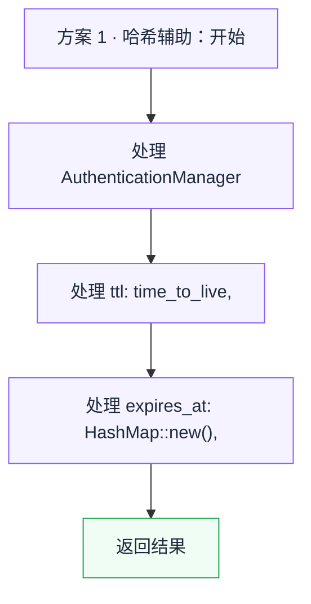

```rust
// LeetCode 1797. 设计一个验证系统 — Rust 版（方案1）
use std::collections::HashMap; // 引入依赖
struct AuthenticationManager {
    ttl: i64,
    expires_at: HashMap<String, i64>,
} // 定义类型
impl AuthenticationManager {
    // 实现块
    fn new(time_to_live: i64) -> Self {
        AuthenticationManager {
            ttl: time_to_live,
            expires_at: HashMap::new(),
        }
    } // 定义函数/方法 new
    fn generate(&mut self, token_id: &str, current_time: i64) {
        self.expires_at
            .insert(token_id.to_string(), current_time + self.ttl);
    } // 定义函数/方法 generate
    fn renew(&mut self, token_id: &str, current_time: i64) -> usize {
        // 定义函数/方法 renew
        if let Some(&exp) = self.expires_at.get(token_id) {
            // 若 let Some( 按位与 exp) 赋值为 self.expires_at 查找 token_id
            if exp > current_time {
                // 若 exp 超过 current_time
                self.expires_at
                    .insert(token_id.to_string(), current_time + self.ttl);
            }
        }
        self.count_valid_tokens(current_time) // self.count_valid_tokens(current_time)
    }
    fn count_valid_tokens(&self, current_time: i64) -> usize {
        // 定义函数/方法 count_valid_tokens
        self.expires_at
            .values()
            .filter(|&&e| e > current_time)
            .count()
    }
}
fn main() {
    // 程序入口：跑内嵌自测用例
    let mut auth = AuthenticationManager::new(5); // 把 AuthenticationManager::new(5); 写入 let mut auth
    auth.generate("aaa", 1); // auth.generate(「aaa」, 1);
    assert_eq!(auth.count_valid_tokens(3), 1); // 断言校验
    assert_eq!(auth.renew("aaa", 4), 1); // 断言校验
    assert_eq!(auth.count_valid_tokens(6), 1); // 断言校验
    println!("PASS"); // 全部用例通过，输出 PASS
}
```

### Lua 实现（1 种方案）

Lua 的全部方案如下，每个方案都内嵌用例自测，可独立运行（老仓库 python/go 文件遵循「打印结果」约定）：

#### 方案 1：哈希辅助

**思路与代码分析**：核心是「哈希辅助」。Lua 版用表与 ipairs 遍历，注意 ipairs 遇 nil 即停的语义。

**运行架构**（真实控制流）：


```lua
-- LeetCode 1797. 设计一个验证系统 — Lua 版（方案1）
local AuthenticationManager = {} -- 把 {} 写入 local AuthenticationManager
AuthenticationManager.__index = AuthenticationManager -- 把 AuthenticationManager 写入 AuthenticationManager.__index
function AuthenticationManager.new(ttl) -- function AuthenticationManager.new(ttl)
	return setmetatable({ ttl = ttl, expires_at = {} }, AuthenticationManager)
end -- 终点
function AuthenticationManager:generate(token_id, current_time)
	self.expires_at[token_id] = current_time + self.ttl -- 把 current_time 加 self.ttl 写入 self.expires_at[token_id]
end -- 终点
function AuthenticationManager:renew(token_id, current_time) -- function AuthenticationManager:renew(token_id, current_time)
	local exp = self.expires_at[token_id] -- 把 self.expires_at[token_id] 写入 local exp
	if exp and exp > current_time then -- 若 exp and exp 超过 current_time then
		self.expires_at[token_id] = current_time + self.ttl -- 把 current_time 加 self.ttl 写入 self.expires_at[token_id]
	end -- 终点
	return self:count_valid_tokens(current_time) -- 返回 self:count_valid_tokens(current_time)
end -- 终点
function AuthenticationManager:count_valid_tokens(current_time)
	local cnt = 0 -- 把 0 写入 local cnt
	for _, e in pairs(self.expires_at) do -- 遍历取 e
		if e > current_time then
			cnt = cnt + 1
		end -- 若 e 超过 current_time then 计数 赋值为 计数 加 1 终点
	end -- 终点
	return cnt -- 返回 计数
end -- 终点
local auth = AuthenticationManager.new(5) -- 把 AuthenticationManager.new(5) 写入 local auth
auth:generate("aaa", 1) -- auth:generate(「aaa」, 1)
assert(auth:count_valid_tokens(3) == 1) -- 断言校验
assert(auth:renew("aaa", 4) == 1) -- 断言校验
assert(auth:count_valid_tokens(6) == 1) -- 断言校验
print("PASS") -- 全部用例通过，输出 PASS
```

### C 实现（1 种方案）

C 的全部方案如下，每个方案都内嵌用例自测，可独立运行（老仓库 python/go 文件遵循「打印结果」约定）：

#### 方案 1：哈希辅助

**思路与代码分析**：核心是「哈希辅助」。C 版手动管理下标与内存，循环边界全部显式写出。**走读**：方案 1 · 哈希辅助：开始 → 更新 m->ttl → 更新 m->n → 返回结果。

**运行架构**（真实控制流）：

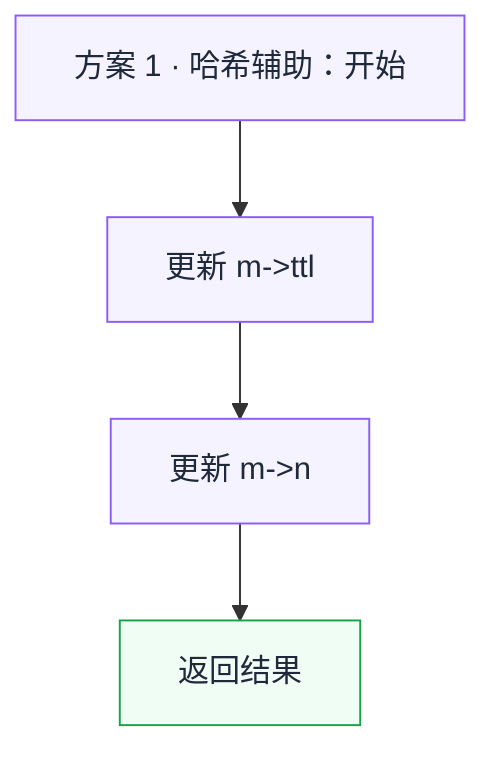

```c
/* LeetCode 1797. 设计一个验证系统 — C 版（方案1） */
#include <stdio.h>  // 引入头文件
#include <string.h> // 引入头文件
typedef struct {
    long ttl;
    char ids[64][32];
    long exps[64];
    int n;
} AuthManager;
static void am_init(AuthManager *m, long ttl) {
    m->ttl = ttl;
    m->n = 0;
}
static int am_find(AuthManager *m, const char *id) { // 定义函数/方法 am_find
    for (int i = 0; i < m->n; i++)
        if (strcmp(m->ids[i], id) == 0)
            return i; // 让 下标 i 从 0 开始计数，下标 i 小于 映射表 减 超过 元素个数 就继续
    return -1; // 返回 减 1
}
static void am_generate(AuthManager *m, const char *id, long t) { // 定义函数/方法 am_generate
    int i = am_find(m, id); // 把 am_find(映射表, id) 存入 下标 i
    if (i < 0) {
        i = m->n++;
        strcpy(m->ids[i], id);
    }
    m->exps[i] = t + m->ttl; // 把 另一字符串 加 映射表 减 超过 ttl; 写入 m->exps[i]
}
static int am_count(AuthManager *m, long t) { // 定义函数/方法 am_count
    int cnt = 0;                              // 把 0 存入 计数
    for (int i = 0; i < m->n; i++)
        if (m->exps[i] > t)
            cnt++; // 让 下标 i 从 0 开始计数，下标 i 小于 映射表 减 超过 元素个数 就继续
    return cnt; // 返回 计数
}
static int am_renew(AuthManager *m, const char *id, long t) { // 定义函数/方法 am_renew
    int i = am_find(m, id);                                   // 把 am_find(映射表, id) 存入 下标 i
    if (i >= 0 && m->exps[i] > t)
        m->exps[i] = t + m->ttl;
    return am_count(m, t); // 返回 am_count(映射表, 另一字符串)
}
int main(void) {               // 程序入口：跑内嵌自测用例
    AuthManager m;             // AuthManager 映射表;
    am_init(&m, 5);            // am_init( 按位与 映射表, 5);
    am_generate(&m, "aaa", 1); // am_generate( 按位与 映射表, 「aaa」, 1);
    if (am_count(&m, 3) != 1) {
        printf("FAIL c1\n");
        return 1;
    } // 若 am_count( 按位与 映射表, 3) 不等于 1) { 输出「FAIL c1 」); return 1; }
    if (am_renew(&m, "aaa", 4) != 1) {
        printf("FAIL r\n");
        return 1;
    }
    if (am_count(&m, 6) != 1) {
        printf("FAIL c2\n");
        return 1;
    } // 若 am_count( 按位与 映射表, 6) 不等于 1) { 输出「FAIL c2 」); return 1; }
    printf("PASS\n"); // 全部用例通过，输出 PASS
    return 0;         // 返回 0
}
```

### C++ 实现（1 种方案）

C++ 的全部方案如下，每个方案都内嵌用例自测，可独立运行（老仓库 python/go 文件遵循「打印结果」约定）：

#### 方案 1：哈希辅助

**思路与代码分析**：核心是「哈希辅助」。C++ 版用 STL 容器与迭代器，减少手写下标错误。**走读**：方案 1 · 哈希辅助：开始 → 更新 expiresAt[tokenId] → 返回结果。

**运行架构**（真实控制流）：

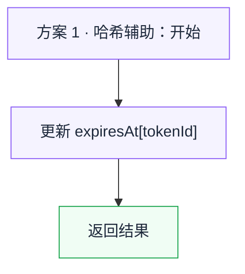

```cpp
// LeetCode 1797. 设计一个验证系统 — C++ 版（方案1）
#include <cassert>             // 引入头文件
#include <iostream>            // 引入头文件
#include <string>              // 引入头文件
#include <unordered_map>       // 引入头文件
struct AuthenticationManager { // 定义类型
    long long ttl;             // long long ttl;
    std::unordered_map<std::string, long long>
        expiresAt; // std::unordered_map 小于 std::string, long long 超过 expiresAt;
    explicit AuthenticationManager(long long timeToLive) : ttl(timeToLive) {}
    void generate(const std::string &tokenId, long long currentTime) {
        expiresAt[tokenId] = currentTime + ttl;
    }
    int renew(const std::string &tokenId, long long currentTime) { // 定义函数/方法 renew
        auto it = expiresAt.find(tokenId);                         // 把 expiresAt 查找 tokenId) 存入 it
        if (it != expiresAt.end() && it->second > currentTime)
            it->second = currentTime + ttl;
        return countValidTokens(currentTime); // 返回 countValidTokens(currentTime)
    }
    int countValidTokens(long long currentTime) const { // int countValidTokens(long long currentTime) const {
        int cnt = 0;                                    // 把 0 存入 计数
        for (auto &[_, e] : expiresAt)
            if (e > currentTime)
                ++cnt;
        return cnt; // 返回 计数
    }
};
int main() {                               // 程序入口：跑内嵌自测用例
    AuthenticationManager auth(5);         // AuthenticationManager auth(5);
    auth.generate("aaa", 1);               // auth.generate(「aaa」, 1);
    assert(auth.countValidTokens(3) == 1); // 断言校验
    assert(auth.renew("aaa", 4) == 1);     // 断言校验
    assert(auth.countValidTokens(6) == 1); // 断言校验
    std::cout << "PASS" << std::endl;      // 全部用例通过，输出 PASS
    return 0;                              // 返回 0
}
```

### R 实现（1 种方案）

R 的全部方案如下，每个方案都内嵌用例自测，可独立运行（老仓库 python/go 文件遵循「打印结果」约定）：

#### 方案 1：哈希辅助

**思路与代码分析**：核心是「哈希辅助」。R 版用向量化思维与 1 起始下标，注意 1:n 的降序陷阱。代码里依次做这些事：单循环线性扫描。**走读**：方案 1 · 哈希辅助：开始 → 更新 new.env(parent → 循环 k：遍历 ls(e$expires_at) → 返回结果。

**运行架构**（真实控制流）：

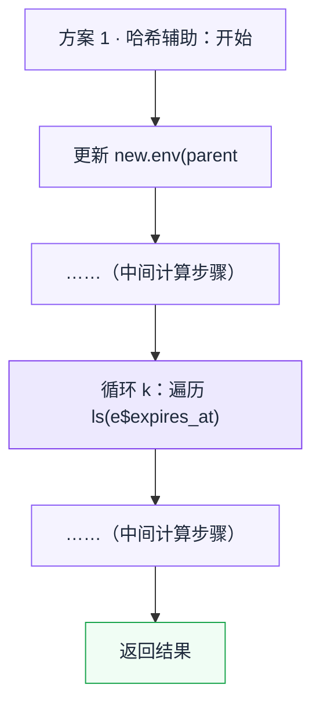

```r
# 版（方案1） 定义函数 AuthenticationManager（参数：ttl）
AuthenticationManager <- function(ttl) {
    e <- new.env(parent = emptyenv())  # 把 new.env(parent 赋值为 emptyenv()) 存入 e
    e$ttl <- ttl  # 把 ttl 存入 e$ttl
    e$expires_at <- new.env(parent = emptyenv())  # 把 new.env(parent 赋值为 emptyenv()) 存入 e$expires_at
    e$generate <- function(token_id, current_time) {
        # 把 function(token_id, current_time) { 存入 e$generate
        e$expires_at[[token_id]] <<- current_time + e$ttl  # e$expires_at[[token_id]] 小于 小于 减 current_time 加 e$ttl
    }
    e$renew <- function(token_id, current_time) {
        # 把 function(token_id, current_time) { 存入 e$renew
        exp <- e$expires_at[[token_id]]  # 把 e$expires_at[[token_id]] 存入 exp
        if (!is.null(exp) && exp > current_time) {
            # 若 取反 is.null(exp) 且 exp 超过 current_time
            e$expires_at[[token_id]] <<- current_time + e$ttl  # e$expires_at[[token_id]] 小于 小于 减 current_time 加 e$ttl
        }
        e$count_valid_tokens(current_time)  # e$count_valid_tokens(current_time)
    }
    e$count_valid_tokens <- function(current_time) {
        # 把 function(current_time) { 存入 e$count_valid_tokens
        cnt <- 0L  # 把 0L 存入 计数
        for (k in ls(e$expires_at)) {
            # for (下标 k in ls(e$expires_at)) {
            if (e$expires_at[[k]] > current_time)
                cnt <- cnt + 1L  # 若 e$expires_at[[下标 k]] 超过 current_time) 计数 小于 减 计数 加 1L
        }
        cnt  # 计数
    }
    e
}
auth <- AuthenticationManager(5)  # 把 AuthenticationManager(5) 存入 auth
auth$generate("aaa", 1)  # auth$generate(「aaa」, 1)
stopifnot(auth$count_valid_tokens(3) == 1)  # 断言校验
stopifnot(auth$renew("aaa", 4) == 1)  # 断言校验
stopifnot(auth$count_valid_tokens(6) == 1)  # 断言校验
cat("PASS\n")  # 全部用例通过，输出 PASS
```

### Zig 实现（1 种方案）

Zig 的全部方案如下，每个方案都内嵌用例自测，可独立运行（老仓库 python/go 文件遵循「打印结果」约定）：

#### 方案 1：哈希辅助

**思路与代码分析**：核心是「哈希辅助」。Zig 版显式分配与清零，整型边界处理严格。**走读**：方案 1 · 哈希辅助：开始 → 返回 .。

**运行架构**（真实控制流）：

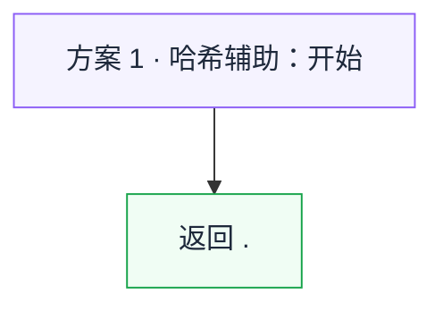

```zig
// LeetCode 1797. 设计一个验证系统 — Zig 版（方案1）
const std = @import("std"); // 把 @import(「std」) 存入 std
const AuthManager = struct { // 把 struct { 存入 AuthManager
    ttl: i64,
    ids: [64][32]u8,
    id_lens: [64]usize,
    exps: [64]i64,
    n: usize,
    fn init(ttl: i64) AuthManager { // 定义函数/方法 init
        return .{ .ttl = ttl, .ids = undefined, .id_lens = undefined, .exps = undefined, .n = 0 };
    }
    fn find(self: *AuthManager, id: []const u8) ?usize { // 定义函数/方法 find
        for (0..self.n) |i| { // 逐个取出 0..self.元素个数 的元素（下标 i）
            if (std.mem.eql(u8, self.ids[i][0..self.id_lens[i]], id)) return i;
        }
        return null; // 返回 null
    }
    fn generate(self: *AuthManager, id: []const u8, t: i64) void { // 定义函数/方法 generate
        const i = self.find(id) orelse blk: { // 把 self 查找 id) orelse blk: { 存入 下标 i
            const idx = self.n; // 把 self.元素个数 存入 idx
            self.n += 1; // self.n累加 1
            @memcpy(self.ids[idx][0..id.len], id); // @memcpy(self.ids[idx][0..id.长度], id);
            self.id_lens[idx] = id.len; // 把 id.长度; 写入 self.id_lens[idx]
            break :blk idx; // break :blk idx;
        };
        self.exps[i] = t + self.ttl; // 把 另一字符串 加 self.ttl; 写入 self.exps[i]
    }
    fn countValidTokens(self: *AuthManager, t: i64) usize { // 定义函数/方法 countValidTokens
        var cnt: usize = 0; // 把 0; 写入 var cnt: usize
        for (0..self.n) |i| { // 逐个取出 0..self.元素个数 的元素（下标 i）
            if (self.exps[i] > t) cnt += 1; // 若 self.exps[下标 i] 超过 另一字符串) 计数 累加 1;
        }
        return cnt; // 返回 计数
    }
    fn renew(self: *AuthManager, id: []const u8, t: i64) usize { // 定义函数/方法 renew
        if (self.find(id)) |i| { // 若 self 查找 id)) 按位或 下标 i 按位或
            if (self.exps[i] > t) self.exps[i] = t + self.ttl;
        }
        return self.countValidTokens(t); // 返回 self.countValidTokens(另一字符串)
    }
};
pub fn main() !void { // 程序入口：跑内嵌自测用例
    var auth = AuthManager.init(5); // 把 AuthManager.init(5) 存入 auth
    auth.generate("aaa", 1); // auth.generate(「aaa」, 1);
    if (auth.countValidTokens(3) != 1) return error.TestFailed; // 若 auth.countValidTokens(3) 不等于 1，直接返回 error.TestFailed
    if (auth.renew("aaa", 4) != 1) return error.TestFailed; // 若 auth.renew(「aaa」, 4) 不等于 1，直接返回 error.TestFailed
    if (auth.countValidTokens(6) != 1) return error.TestFailed; // 若 auth.countValidTokens(6) 不等于 1，直接返回 error.TestFailed
    std.debug.print("PASS\n", .{}); // 全部用例通过，输出 PASS
}
```

### Dart 实现（1 种方案）

Dart 的全部方案如下，每个方案都内嵌用例自测，可独立运行（老仓库 python/go 文件遵循「打印结果」约定）：

#### 方案 1：哈希辅助

**思路与代码分析**：核心是「哈希辅助」。Dart 版用可空类型标注与集合方法，注意空安全。**走读**：方案 1 · 哈希辅助：开始 → 更新 expiresAt[tokenId] → 处理 currentTime + ttl → 返回结果。

**运行架构**（真实控制流）：

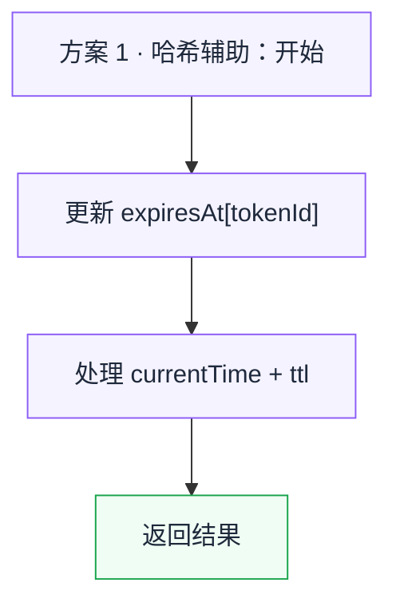

```dart
// LeetCode 1797. 设计一个验证系统 — Dart 版（方案1）
class AuthenticationManager {
  // 定义类型
  final int ttl; // final int ttl;
  final Map<String, int> expiresAt =
      {}; // 把 {}; 写入 final Map<String, int> expiresAt
  AuthenticationManager(this.ttl); // AuthenticationManager(this.ttl);
  void generate(String tokenId, int currentTime) {
    // 定义函数/方法 generate
    expiresAt[tokenId] =
        currentTime + ttl; // 把 currentTime 加 ttl; 写入 expiresAt[tokenId]
  }

  int renew(String tokenId, int currentTime) {
    // 定义函数/方法 renew
    final exp = expiresAt[tokenId]; // 把 expiresAt[tokenId] 存入 exp
    if (exp != null && exp > currentTime) {
      // 若 exp 不等于 null 且 exp 超过 currentTime
      expiresAt[tokenId] =
          currentTime + ttl; // 把 currentTime 加 ttl; 写入 expiresAt[tokenId]
    }
    return countValidTokens(currentTime); // 返回 countValidTokens(currentTime)
  }

  int countValidTokens(int currentTime) {
    // 定义函数/方法 countValidTokens
    var cnt = 0; // 把 0 存入 计数
    for (final e in expiresAt.values) {
      // for (final e in expiresAt.values) {
      if (e > currentTime) cnt++; // 若 e 超过 currentTime) 计数 加一 ;
    }
    return cnt; // 返回 计数
  }
}

void main() {
  // 程序入口：跑内嵌自测用例
  final auth = AuthenticationManager(5); // 把 AuthenticationManager(5) 存入 auth
  auth.generate('aaa', 1); // auth.generate('aaa', 1);
  if (auth.countValidTokens(3) != 1)
    throw StateError(
      'c1',
    ); // 若 auth.countValidTokens(3) 不等于 1) throw StateError('c1');
  if (auth.renew('aaa', 4) != 1)
    throw StateError(
      'r',
    ); // 若 auth.renew('aaa', 4) 不等于 1) throw StateError('右指针');
  if (auth.countValidTokens(6) != 1)
    throw StateError(
      'c2',
    ); // 若 auth.countValidTokens(6) 不等于 1) throw StateError('c2');
  print('PASS'); // 全部用例通过，输出 PASS
}
```

---

## 内容总结

- **设计一个验证系统**（综合 · Medium）：共 1 个方案，主线思路「哈希辅助」；时间 O(n)（单趟线性扫描）；动画演示归并分治过程，附录给出 11 种语言 × 全部方案的可运行实现。
- 来源博客：[https://blog.csdn.net/tyro_java/article/details/145354494](https://blog.csdn.net/tyro_java/article/details/145354494)
- 导航：[📋 总目录](../) ｜ [← 241 lcp 10. 二叉树任务调度](../241_leetcode_lcp_10._二叉树任务调度/) ｜ [243 快乐数 →](../243_快乐数/)
