# 243 · 快乐数（第附阶段 · 专题补充 · Medium）

> **难度**：⭐⭐ Medium ｜ **专题**：综合
> **学习定位**：第附阶段 · 专题补充第 243 篇 ｜ **解法数**：2
> **内容总结**：**快乐数**（综合 · Medium）：共 2 个方案，主线思路「计算每位平方和」；时间 O(n)（单趟线性扫描）；动画演示归并分治过程，附录给出 11 种语言 × 全部方案的可运行实现。

---

## 题目描述

编写一个算法来判断一个数 `n` 是不是快乐数。

「快乐数」 定义为：

 对于一个正整数，每一次将该数替换为它每个位置上的数字的平方和。
 然后重复这个过程直到这个数变为 1，也可能是 无限循环 但始终变不到 1。
 如果这个过程 结果为 1，那么这个数就是快乐数。

如果 `n` 是 快乐数 就返回 `true` ；不是，则返回 `false` 。

- 主函数签名：`function isHappy(n: number): boolean`

**用例（来自原题）**：

**示例 1**

```text
输入：n = 19
输出：true
```

解释：12 + 92 = 82 82 + 22 = 68 62 + 82 = 100 12 + 02 + 02 = 1

**示例 2**

```text
输入：n = 2
输出：false
```
> ✅ **官方验证**：全部 TypeScript 解法已通过 leetcode.cn 官方示例用例验证（自动注入运行，全部 PASS）。题面与 [leetcode.cn 官方](https://leetcode.cn/problems/happy-number/)一致，示例配图取自官方题面。

**数据范围与注意事项**：

- `1 <= n <= 2^31 - 1`
- **易错点**：特殊输入（空、重复、极值）的边界检查。

## 题目分析

**场景是什么**：综合练习：从题面本身出发选择合适的数据结构。本题就是该场景的 Medium 级练习，主线做法是「计算每位平方和」。

**主线怎么解**：主解法结构简单：读入、处理、返回。

## 解题思路

**方案对比**（共 2 个方案，由浅入深）：

| 方案 | 时间复杂度 | 空间复杂度 |
|---|---|---|
| 方案 1 · 计算每位平方和 | O(n)（单趟线性扫描） | O(1) 到 O(n)（视辅助结构） |
| 方案 2 · 哈希判圈 | O(n²)（两层嵌套扫描） | O(1) 到 O(n) |

**由浅入深的路径**：计算每位平方和 → 哈希判圈；每往右一步，都在补上一步的短板。

**方案间的取舍**：方案 1（计算每位平方和）；方案 2（哈希判圈）。数据规模小、可读性优先时选靠前的方案；规模大、性能优先时选靠后的方案。

**怎么读这一篇**：

- 🐣 **新手路线**：把「题目描述」的示例 1 在纸上手推一遍 → 读方案 1（最直观的写法）与它的代码走读 → 按「运行方式」本地跑通看 PASS → 回头对比方案 2 之后的写法差在哪
- 🦅 **大佬路线**：直接锁定最优方案 1（计算每位平方和，O(n)（单趟线性扫描））→ 跳读该方案代码与走读 → 用「逐步拆解与面试追问」补齐复杂度推导与边界追问

### 动态算法图（归并分治，GIF 自动循环）


动画演示综合专题里归并分治的典型过程；每个方案在「TypeScript 解题方案」一节还配了专属动画与专属流程图。

### 主解法流程图（真实控制流）

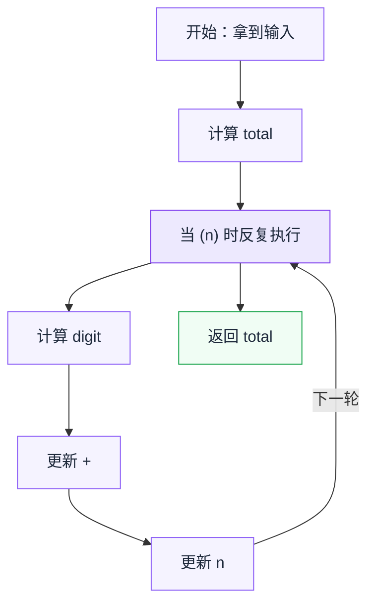

## TypeScript 解题方案（2 个方案逐个讲）

> **运行与提交**：每个方案都是自包含文件（内嵌用例自测，输出 PASS），整块复制到 `.ts` 文件后 `node 文件名` 即可运行。提交 LeetCode 时，把 `demo` 内的算法函数与辅助类型/函数整体取出、置于文件顶层即可。涉及交互/特殊接口的题以题面给定签名为准。

### 方案 1：计算每位平方和

**分析与思路**：核心做法是「计算每位平方和」。

**运行方式**：`node 本文件`，内嵌用例全部通过会输出 PASS。

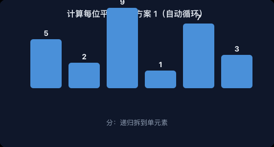

**方案专属流程图**（真实控制流）：

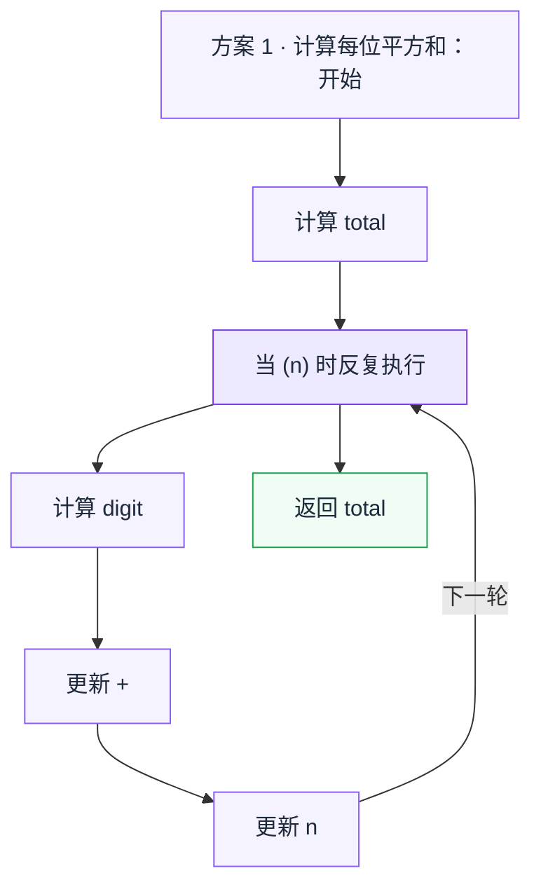

```typescript
/**
 ** LeetCode 202. 快乐数
 ** 方案：方案1：计算每位平方和
 ** 来源：https://blog.csdn.net/tyro_java/article/details/145355335
 */

export function bitSquareSum(n: number): number {
  // 定义函数/方法 bitSquareSum
  let total = 0; // 把 0 存入 总和
  while (n) {
    // 循环，直到不满足「元素个数」
    const digit = n % 10; // 把 元素个数 对…取模 10 存入 digit
    total += digit * digit; // 总和累加 digit 乘 digit
    n = Math.floor(n / 10); // 把 向下取整(元素个数 除以 10) 存入 元素个数
  }
  return total; // 返回 总和
}

function isHappy(n: number): boolean {
  // 定义判定函数 isHappy：哈希集合判圈
  const seen = new Set<number>(); // 已见集合
  while (n !== 1 && !seen.has(n)) {
    // 未到 1 且未成环
    seen.add(n); // 记录当前值
    n = bitSquareSum(n); // 下一状态 = 各位平方和
  }
  return n === 1; // 收敛到 1 即快乐数
}
export function demo(): void {
  // 程序入口：跑内嵌自测用例
  if (bitSquareSum(1) !== 1) throw new Error('FAILED 1'); // 若 bitSquareSum(1) 不等于 1) throw new Error(「FAILED 1」);
  if (bitSquareSum(19) !== 82)
    throw new Error('FAILED 19: ' + bitSquareSum(19));
  if (bitSquareSum(82) !== 68) throw new Error('FAILED 82'); // 若 bitSquareSum(82) 不等于 68) throw new Error(「FAILED 82」);
  if (isHappy(19) !== true) throw new Error('FAILED 19');
  if (isHappy(2) !== false) throw new Error('FAILED 2');
  if (isHappy(7) !== true) throw new Error('FAILED 7');
  console.log('PASS'); // 全部用例通过，输出 PASS
}

demo(); // demo();
```

### 方案 2：哈希判圈

**分析与思路**：核心做法是「哈希判圈」。代码里依次做这些事：哈希结构做计数或查重。

**运行方式**：`node 本文件`，内嵌用例全部通过会输出 PASS。

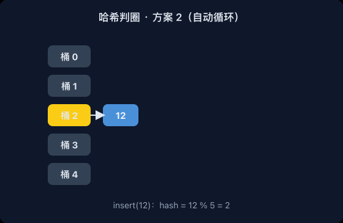

**方案专属流程图**（真实控制流）：

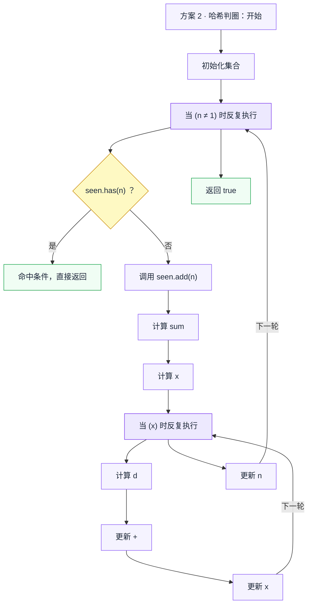

```typescript
/**
 ** LeetCode 202. 快乐数
 ** 方案：2 ) 方案2：哈希判圈
 ** 来源：https://blog.csdn.net/tyro_java/article/details/145355335
 */

export function isHappy(n: number): boolean {
  // 快乐数判定：哈希判圈（原 getNum 更名正名）  // 定义函数/方法 getNum
  const seen = new Set<number>(); // 把 new Set 小于 number 超过 () 存入 已见集合
  while (n !== 1) {
    // 循环，直到不满足「元素个数 不等于 1」
    if (seen.has(n)) return false; // 若 已见集合.has(元素个数)，直接返回 false
    seen.add(n); // 已见集合 追加 元素个数);
    let sum = 0; // 把 0 存入 累计和
    let x = n; // 把 元素个数 存入 x
    while (x) {
      // 循环，直到不满足「x」
      const d = x % 10; // 把 x 对…取模 10 存入 d
      sum += d * d; // 累计和累加 d 乘 d
      x = Math.floor(x / 10); // 把 向下取整(x 除以 10) 存入 x
    }
    n = sum; // 把 累计和 存入 元素个数
  }
  return true; // 返回 true
}

export function demo(): void {
  // 程序入口：跑内嵌自测用例
  if (!isHappy(1)) throw new Error('FAILED 1'); // 若 取反 isHappy(1)) throw new Error(「FAILED 1」);
  if (!isHappy(19)) throw new Error('FAILED 19'); // 若 取反 isHappy(19)) throw new Error(「FAILED 19」);
  if (isHappy(2)) throw new Error('FAILED 2 (should be unhappy)');
  console.log('PASS'); // 全部用例通过，输出 PASS
}

demo(); // demo();
```

## 逐步拆解与面试追问

**复杂度**：时间 O(n)（单趟线性扫描），空间 O(1) 到 O(n)（视辅助结构）

**为什么是这个量级**：每个元素被常数次访问，辅助哈希或栈的开销与 n 同阶

**面试官可能会追问**：

- 有没有更直观的建模方式？
- 特殊输入的边界？
- 能否一步到位而不是分两趟？

## 关键 API 速查（TS 主解法实际用到，附官方链接）

| API | 作用 | 使用要点 | 官方文档 |
|---|---|---|---|
| `Set` | 集合：元素唯一 | add/add.has/delete；has 均摊 O(1)；NaN 视为相同；去重常用 [...new Set(arr)] | [官方文档](https://developer.mozilla.org/zh-CN/docs/Web/JavaScript/Reference/Global_Objects/Set) |
| `Math.floor()` | 向下取整 | 负数向负无穷（-1.5 → -2）；大数用位运算前注意 2^31 界 | [官方文档](https://developer.mozilla.org/zh-CN/docs/Web/JavaScript/Reference/Global_Objects/Math/floor) |

### 各语言官方文档导航

- **TypeScript / JS**：[MDN 中文参考](https://developer.mozilla.org/zh-CN/)
- **Python**：[Python 官方文档](https://docs.python.org/zh-cn/3/)
- **Go**：[Go 标准库](https://pkg.go.dev/std)
- **Java**：[JDK 17 API](https://docs.oracle.com/en/java/javase/17/docs/api/)
- **Rust**：[Rust 标准库](https://doc.rust-lang.org/std/)
- **Lua**：[Lua 5.4 手册](https://www.lua.org/manual/5.4/)
- **C**：[Cppreference C](https://zh.cppreference.com/w/c)
- **C++**：[Cppreference C++](https://zh.cppreference.com/w/cpp)
- **R**：[R 官方手册](https://stat.ethz.ch/R-manual/)
- **Zig**：[Zig 语言文档](https://ziglang.org/documentation/master/)
- **Dart**：[Dart API](https://api.dart.dev/)

## 附录：其他 10 种语言全部实现（每种语言列举其全部方案）

> TypeScript 的全部方案见「TypeScript 解题方案」一节；下面是其余 10 种语言的对应实现，每种语言的每个方案都带思路分析、代码走读与专属运行架构图。
> 每个方案都内嵌用例自测，可独立运行（老仓库 python/go 文件遵循「打印结果」约定）。
> 完整解法文件见 `dsa/<语言>/other/lc_202_快乐数/`。

### Python 实现（2 种方案）

Python 的全部方案如下，每个方案都内嵌用例自测，可独立运行（老仓库 python/go 文件遵循「打印结果」约定）：

#### 方案 1：计算每位平方和

**思路与代码分析**：核心是「计算每位平方和」。Python 版用切片与字典推导式简化操作，突出可读性。**走读**：方案 1 · 计算每位平方和：开始 → 更新 total → 当 n: 时反复执行 → 更新 digit → 更新 + → 更新 // → 返回 total。

**运行架构**（真实控制流）：

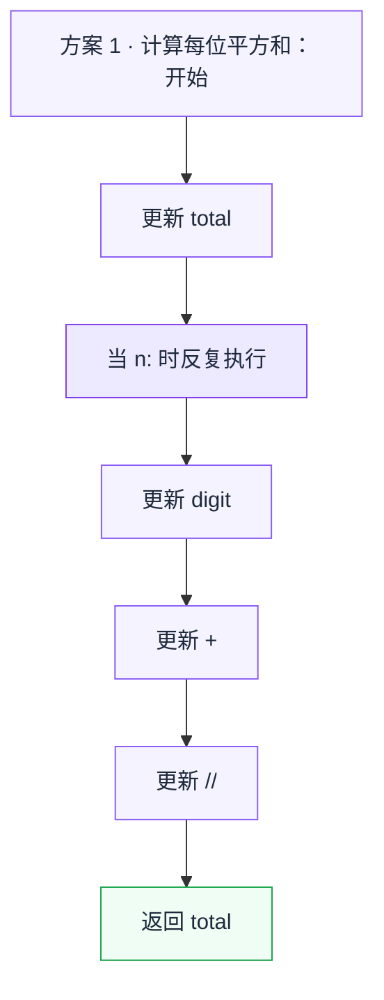

```python
import sys  # 提高递归深度上限（深输入防 RecursionError）

sys.setrecursionlimit(200000)  # 树/链表类题目节点数可达 1e4 量级

def bitSquareSum(n):  # 定义函数 bitSquareSum（参数：元素个数）
    total = 0  # 把 0 存入 总和
    while n:  # 循环，直到不满足「元素个数」
        digit = n % 10  # 把 元素个数 对…取模 10 存入 digit
        total += digit * digit  # 总和累加 digit 乘 digit
        n //= 10  # 把 10 写入 n //
    return total  # 返回 总和

if __name__ == "__main__":  # 若 __name__ 等于 '__main__'
    print(bitSquareSum(1))  # 打印输出
```

#### 方案 2：哈希判圈

**思路与代码分析**：核心是「哈希判圈」。Python 版用切片与字典推导式简化操作，突出可读性。**走读**：方案 2 · 哈希判圈：开始 → 更新 seen → 当 n ≠ 1: 时反复执行 → 命中条件，直接返回 → 调用 seen.add(n) → 更新 n → 返回 True。

**运行架构**（真实控制流）：

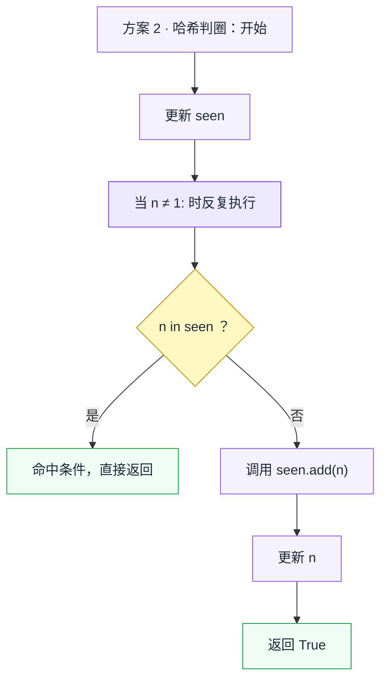

```python
import sys  # 提高递归深度上限（深输入防 RecursionError）

sys.setrecursionlimit(200000)  # 树/链表类题目节点数可达 1e4 量级

def getNum(n):  # 定义函数 getNum（参数：元素个数）
    seen = set()  # 把 set() 存入 已见集合
    while n != 1:  # 循环，直到不满足「元素个数 不等于 1」
        if n in seen:  # 若 元素个数 in 已见集合
            return False  # 返回 False
        seen.add(n)  # 已见集合 追加 元素个数)
        n = sum(int(d) ** 2 for d in str(n))  # 把 累计和(int(d) 乘 乘 2 for d in str(元素个数)) 存入 元素个数
    return True  # 返回 True

if __name__ == "__main__":  # 若 __name__ 等于 '__main__'
    print(getNum(1))  # 打印输出
```

### Go 实现（2 种方案）

Go 的全部方案如下，每个方案都内嵌用例自测，可独立运行（老仓库 python/go 文件遵循「打印结果」约定）：

#### 方案 1：计算每位平方和

**思路与代码分析**：核心是「计算每位平方和」。Go 版用切片与多返回值惯用法，显式处理索引边界。**走读**：方案 1 · 计算每位平方和：开始 → 更新 : → 遍历循环 → 更新 : → 更新 + → 更新 / → 返回 total。

**运行架构**（真实控制流）：

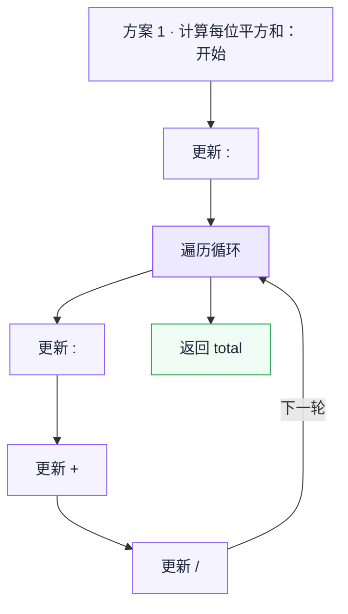

```go
package main // 引入依赖

import (
	"fmt" // 「fmt」
	"os"  // 「os」
)

func bitSquareSum(n int) int { // 定义函数/方法 bitSquareSum
	total := 0  // 把 0 写入 total :
	for n > 0 { // for 元素个数 超过 0 {
		digit := n % 10        // 把 元素个数 对…取模 10 写入 digit :
		total += digit * digit // 总和累加 digit 乘 digit
		n /= 10                // 把 10 写入 n /
	}
	return total // 返回 总和
}

func main() { // 程序入口：跑内嵌自测用例
	ok := true       // 把 true 写入 ok :
	tc := []struct { // 把 []struct { 写入 tc :
		in   int // in int
		want int // want int
	}{ // }{
		{1, 1}, {2, 4}, {19, 82}, {7, 49},
	}
	for _, c := range tc { // 同时取 _ 与 字符 遍历
		if got := bitSquareSum(c.in); got != c.want { // 若 got : 赋值为 bitSquareSum(字符.in); got 不等于 字符.want
			ok = false                                                          // 把 false 写入 ok
			fmt.Printf("FAIL bitSquareSum(%d)=%d want %d\n", c.in, got, c.want) // 打印输出
		}
	}
	if !ok { // 若 取反 ok
		os.Exit(1) // os.Exit(1)
	}
	fmt.Println("PASS") // 全部用例通过，输出 PASS
}
```

#### 方案 2：哈希判圈

**思路与代码分析**：核心是「哈希判圈」。Go 版用切片与多返回值惯用法，显式处理索引边界。代码里依次做这些事：哈希结构做计数或查重。**走读**：方案 2 · 哈希判圈：开始 → 更新 : → 遍历循环 → 处理 if seen[n] → 返回 false → 更新 seen[n] → 更新 : → 更新 : → 遍历循环 → 更新 : → 更新 + → 更新 / → 更新 n → 返回 true。

**运行架构**（真实控制流）：

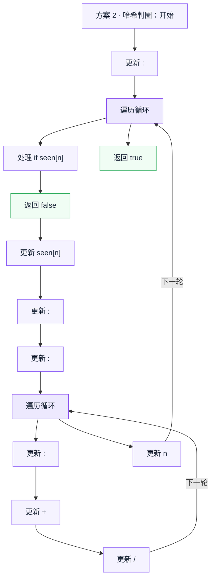

```go
package main // 引入依赖

import (
	"fmt" // 「fmt」
	"os"  // 「os」
)

func getNum(n int) bool { // 定义函数/方法 getNum
	seen := make(map[int]bool) // 把 make(映射表[int]bool) 写入 seen :
	for n != 1 {               // 把 1 { 写入 for n !
		if seen[n] { // 若 已见集合[元素个数]
			return false // 返回 false
		}
		seen[n] = true // 把 true 写入 seen[n]
		s := 0         // 把 0 写入 s :
		t := n         // 把 元素个数 写入 t :
		for t > 0 {    // for 另一字符串 超过 0 {
			d := t % 10 // 把 另一字符串 对…取模 10 写入 d :
			s += d * d  // 字符串累加 d 乘 d
			t /= 10     // 把 10 写入 t /
		}
		n = s // 把 字符串 写入 元素个数
	}
	return true // 返回 true
}

func main() { // 程序入口：跑内嵌自测用例
	ok := true       // 把 true 写入 ok :
	tc := []struct { // 把 []struct { 写入 tc :
		in   int  // in int
		want bool // want bool
	}{ // }{
		{1, true}, {19, true}, {2, false}, {7, true},
	}
	for _, c := range tc { // 同时取 _ 与 字符 遍历
		if got := getNum(c.in); got != c.want { // 若 got : 赋值为 getNum(字符.in); got 不等于 字符.want
			ok = false                                                    // 把 false 写入 ok
			fmt.Printf("FAIL getNum(%d)=%v want %v\n", c.in, got, c.want) // 打印输出
		}
	}
	if !ok { // 若 取反 ok
		os.Exit(1) // os.Exit(1)
	}
	fmt.Println("PASS") // 全部用例通过，输出 PASS
}
```

### Java 实现（2 种方案）

Java 的全部方案如下，每个方案都内嵌用例自测，可独立运行（老仓库 python/go 文件遵循「打印结果」约定）：

#### 方案 1：计算每位平方和

**思路与代码分析**：核心是「计算每位平方和」。Java 版用类与静态方法组织，集合操作显式明了。**走读**：方案 1 · 计算每位平方和：开始 → 更新 total → 当 (n ≠ 0) 时反复执行 → 更新 digit → 更新 + → 更新 / → 返回 total。

**运行架构**（真实控制流）：

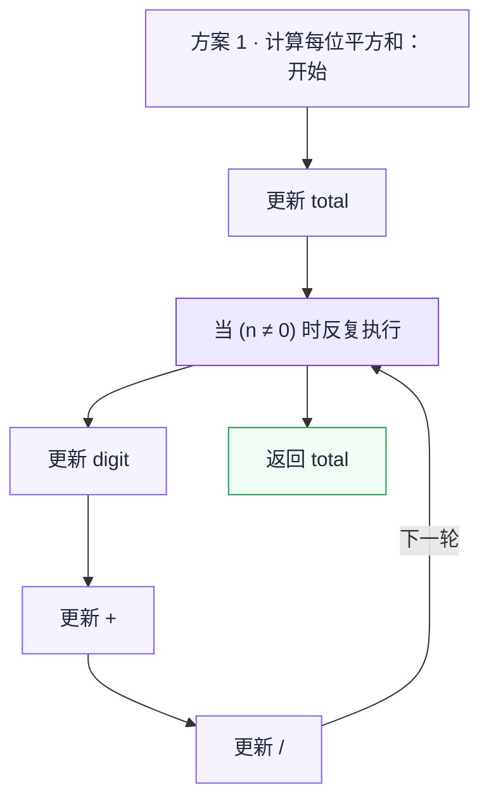

```java
package com.webfault.dsa; // 引入依赖

class HappyS1 { // 定义类型
  static int bitSquareSum(int n) { // 定义函数/方法 bitSquareSum
    int total = 0; // 把 0 存入 总和
    while (n != 0) { // 循环，直到不满足「元素个数 不等于 0」
      int digit = n % 10; // 把 元素个数 对…取模 10 存入 digit
      total += digit * digit; // 总和累加 digit 乘 digit
      n /= 10; // 把 10; 写入 n /
    }
    return total; // 返回 总和
  }

  public static void main(String[] args) { // public static void main(String[] args) {
    int[] got = { // 把 { 写入 int[] got
      HappyS1.bitSquareSum(1),
      HappyS1.bitSquareSum(19),
      HappyS1.bitSquareSum(0),
      HappyS1.bitSquareSum(123),
    };
    int[] want = {1, 82, 0, 14}; // 把 { 1, 82, 0, 14 }; 写入 int[] want
    boolean ok = true; // 把 true; 写入 boolean ok
    for (int i = 0; i < got.length; i++) { // 让 下标 i 从 0 开始计数，下标 i 小于 got.长度 就继续
      if (got[i] != want[i]) { // 若 got[下标 i] 不等于 want[下标 i]
        ok = false; // 把 false; 写入 ok
        System.out.println(
            "FAIL bitSquareSum idx " + i + " got " + got[i] + " want " + want[i]); // 打印输出
      }
    }
    if (!ok) throw new RuntimeException("FAILED"); // 若 取反 ok) throw new RuntimeException(「FAILED」);
    System.out.println("PASS"); // 全部用例通过，输出 PASS
  }
}
```

#### 方案 2：哈希判圈

**思路与代码分析**：核心是「哈希判圈」。Java 版用类与静态方法组织，集合操作显式明了。代码里依次做这些事：单循环线性扫描。**走读**：方案 2 · 哈希判圈：开始 → 更新 seen → 当 (n ≠ 1) 时反复执行 → 命中条件，直接返回 → 调用 seen.add(n) → 更新 sum → 遍历循环 → 调用 String.valueOf(n).toCharArra → 更新 d → 更新 + → 更新 n → 返回 true。

**运行架构**（真实控制流）：

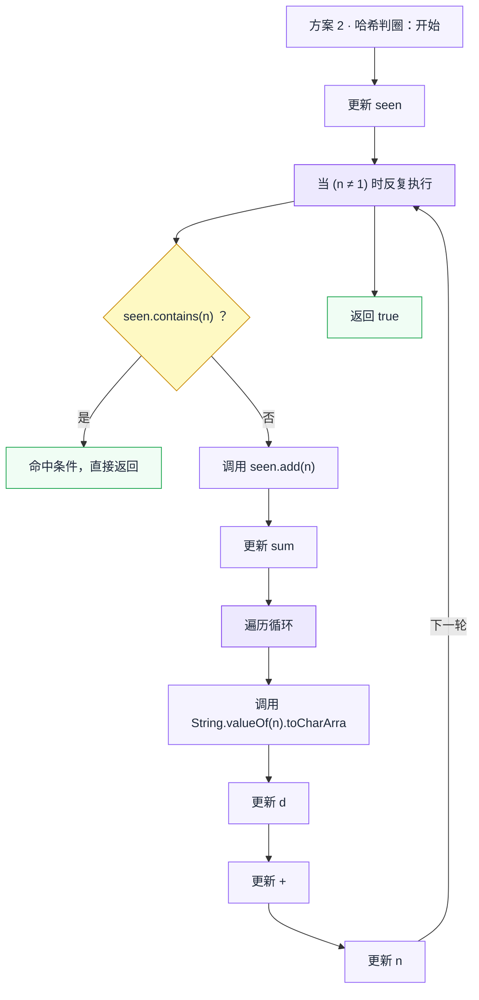

```java
package com.webfault.dsa; // 引入依赖

import java.util.*; // 引入依赖

class HappyS2 { // 定义类型
  static boolean getNum(int n) { // 定义函数/方法 getNum
    Set<Integer> seen = new HashSet<>(); // 把 new HashSet 小于 超过 (); 写入 Set<Integer> seen
    while (n != 1) { // 循环，直到不满足「元素个数 不等于 1」
      if (seen.contains(n)) return false; // 若 已见集合 是否包含 元素个数)，直接返回 false
      seen.add(n); // 已见集合 追加 元素个数);
      int sum = 0; // 把 0 存入 累计和
      for (char c :
          String.valueOf(n).toCharArray()) { // for (char 字符 : String.valueOf(元素个数).toCharArray()) {
        int d = c - '0'; // 把 字符 减 '0' 存入 d
        sum += d * d; // 累计和累加 d 乘 d
      }
      n = sum; // 把 累计和; 写入 元素个数
    }
    return true; // 返回 true
  }

  public static void main(String[] args) { // public static void main(String[] args) {
    boolean[] got = { // 把 { 写入 boolean[] got
      HappyS2.getNum(1), HappyS2.getNum(19), HappyS2.getNum(2),
    };
    boolean[] want = {true, true, false}; // 把 { true, true, false }; 写入 boolean[] want
    boolean ok = true; // 把 true; 写入 boolean ok
    for (int i = 0; i < got.length; i++) { // 让 下标 i 从 0 开始计数，下标 i 小于 got.长度 就继续
      if (got[i] != want[i]) { // 若 got[下标 i] 不等于 want[下标 i]
        ok = false; // 把 false; 写入 ok
        System.out.println("FAIL getNum idx " + i + " got " + got[i] + " want " + want[i]); // 打印输出
      }
    }
    if (!ok) throw new RuntimeException("FAILED"); // 若 取反 ok) throw new RuntimeException(「FAILED」);
    System.out.println("PASS"); // 全部用例通过，输出 PASS
  }
}
```

### Rust 实现（2 种方案）

Rust 的全部方案如下，每个方案都内嵌用例自测，可独立运行（老仓库 python/go 文件遵循「打印结果」约定）：

#### 方案 1：计算每位平方和

**思路与代码分析**：核心是「计算每位平方和」。Rust 版用所有权移动与切片借用改写同一逻辑，注意 Option 与引用边界。**走读**：方案 1 · 计算每位平方和：开始 → 计算 s → 当 n ＞ 0 时反复执行 → 计算 d → 更新 + → 更新 / → 处理 s → 返回结果。

**运行架构**（真实控制流）：

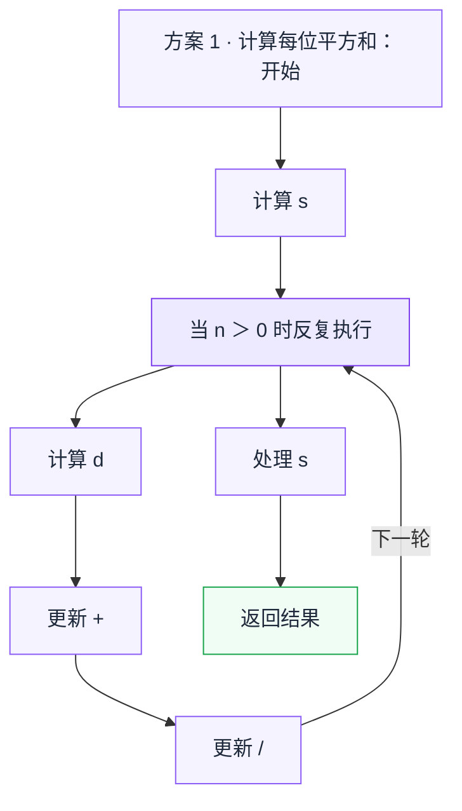

```rust
// LeetCode 202. 快乐数 — Rust 版（方案1）
fn bit_square_sum(mut n: i64) -> i64 {
    // 定义函数/方法 bit_square_sum
    let mut s = 0i64; // 把 0i64; 写入 let mut s
    while n > 0 {
        let d = n % 10;
        s += d * d;
        n /= 10;
    }
    s // 字符串
}
fn is_happy(mut n: i64) -> bool {
    // 定义判定函数 is_happy
    use std::collections::HashSet; // 引入依赖
    let mut seen: HashSet<i64> = HashSet::new(); // 把 HashSet::new(); 写入 let mut seen: HashSet<i64>
    while n != 1 && !seen.contains(&n) {
        // 把 1 且 取反 已见集合 是否包含 按位与 元素个数) { 写入 while n !
        seen.insert(n); // 已见集合 插入 元素个数);
        n = bit_square_sum(n); // 把 bit_square_sum(元素个数); 写入 元素个数
    }
    n == 1 // 把 赋值为 1 写入 元素个数
}
fn main() {
    // 程序入口：跑内嵌自测用例
    assert_eq!(bit_square_sum(1), 1); // 断言校验
    assert_eq!(bit_square_sum(19), 82); // 断言校验
    assert_eq!(bit_square_sum(82), 68); // 断言校验
    assert!(is_happy(19)); // 断言校验
    assert!(is_happy(1)); // 断言校验
    assert!(!is_happy(2)); // 断言校验
    println!("PASS"); // 全部用例通过，输出 PASS
}
```

#### 方案 2：哈希判圈

**思路与代码分析**：核心是「哈希判圈」。Rust 版用所有权移动与切片借用改写同一逻辑，注意 Option 与引用边界。**走读**：方案 2 · 哈希判圈：开始 → 计算 s → 当 n ＞ 0 时反复执行 → 计算 d → 更新 + → 更新 / → 处理 s → 返回结果。

**运行架构**（真实控制流）：

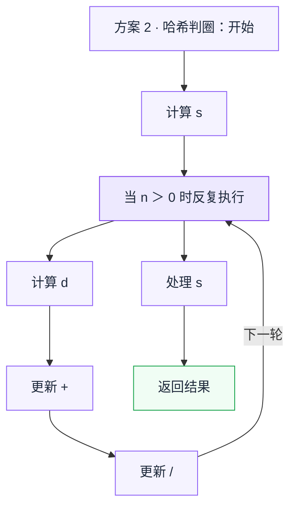

```rust
// LeetCode 202. 快乐数 — Rust 版（方案2）
fn bit_square_sum(mut n: i64) -> i64 {
    // 定义函数/方法 bit_square_sum
    let mut s = 0i64; // 把 0i64; 写入 let mut s
    while n > 0 {
        let d = n % 10;
        s += d * d;
        n /= 10;
    }
    s // 字符串
}
fn is_happy(mut n: i64) -> bool {
    // 定义判定函数 is_happy
    use std::collections::HashSet; // 引入依赖
    let mut seen: HashSet<i64> = HashSet::new(); // 把 HashSet::new(); 写入 let mut seen: HashSet<i64>
    while n != 1 && !seen.contains(&n) {
        // 把 1 且 取反 已见集合 是否包含 按位与 元素个数) { 写入 while n !
        seen.insert(n); // 已见集合 插入 元素个数);
        n = bit_square_sum(n); // 把 bit_square_sum(元素个数); 写入 元素个数
    }
    n == 1 // 把 赋值为 1 写入 元素个数
}
fn main() {
    // 程序入口：跑内嵌自测用例
    assert_eq!(bit_square_sum(1), 1); // 断言校验
    assert_eq!(bit_square_sum(19), 82); // 断言校验
    assert_eq!(bit_square_sum(82), 68); // 断言校验
    assert!(is_happy(19)); // 断言校验
    assert!(is_happy(1)); // 断言校验
    assert!(!is_happy(2)); // 断言校验
    println!("PASS"); // 全部用例通过，输出 PASS
}
```

### Lua 实现（2 种方案）

Lua 的全部方案如下，每个方案都内嵌用例自测，可独立运行（老仓库 python/go 文件遵循「打印结果」约定）：

#### 方案 1：计算每位平方和

**思路与代码分析**：核心是「计算每位平方和」。Lua 版用表与 ipairs 遍历，注意 ipairs 遇 nil 即停的语义。**走读**：方案 1 · 计算每位平方和：开始 → 更新 s → 当 n ＞ 0 do 时反复执行 → 更新 d → 更新 s → 更新 n → 返回 s。

**运行架构**（真实控制流）：

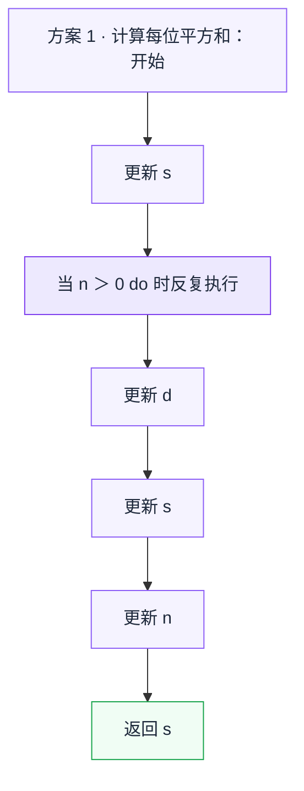

```lua
-- LeetCode 202. 快乐数 — Lua 版（方案1）
local function bit_square_sum(n) -- local function bit_square_sum(元素个数)
	local s = 0 -- 把 0 写入 local s
	while n > 0 do -- while 元素个数 超过 0 do
		local d = n % 10 -- 把 元素个数 对…取模 10 写入 local d
		s = s + d * d -- 把 字符串 加 d 乘 d 存入 字符串
		n = math.floor(n / 10) -- 把 math.floor(元素个数 除以 10) 存入 元素个数
	end -- 终点
	return s -- 返回 字符串
end -- 终点
local function is_happy(n) -- local function is_happy(元素个数)
	local seen = {} -- 把 {} 写入 local seen
	while n ~= 1 and not seen[n] do -- 把 1 and not 已见集合[元素个数] do 写入 while n ~
		seen[n] = true -- 把 true 写入 seen[n]
		n = bit_square_sum(n) -- 把 bit_square_sum(元素个数) 存入 元素个数
	end -- 终点
	return n == 1 -- 返回 元素个数 等于 1
end -- 终点
assert(bit_square_sum(1) == 1) -- 断言校验
assert(bit_square_sum(19) == 82) -- 断言校验
assert(bit_square_sum(82) == 68) -- 断言校验
assert(is_happy(19) == true) -- 断言校验
assert(is_happy(1) == true) -- 断言校验
assert(is_happy(2) == false) -- 断言校验
print("PASS") -- 全部用例通过，输出 PASS
```

#### 方案 2：哈希判圈

**思路与代码分析**：核心是「哈希判圈」。Lua 版用表与 ipairs 遍历，注意 ipairs 遇 nil 即停的语义。**走读**：方案 2 · 哈希判圈：开始 → 更新 s → 当 n ＞ 0 do 时反复执行 → 更新 d → 更新 s → 更新 n → 返回 s。

**运行架构**（真实控制流）：

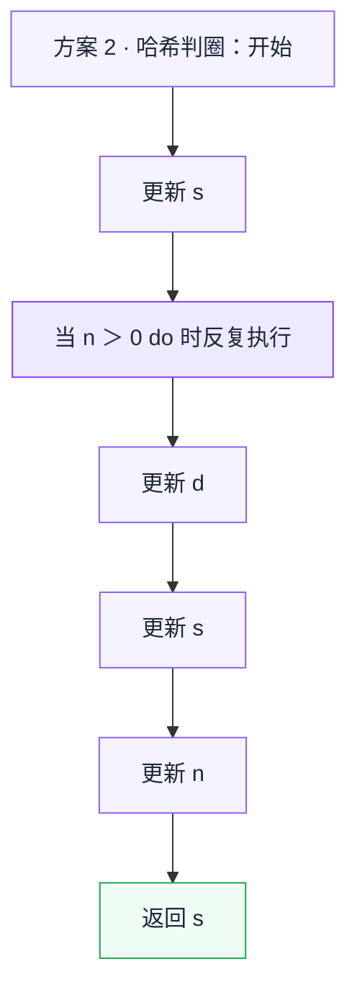

```lua
-- LeetCode 202. 快乐数 — Lua 版（方案2）
local function bit_square_sum(n) -- local function bit_square_sum(元素个数)
	local s = 0 -- 把 0 写入 local s
	while n > 0 do -- while 元素个数 超过 0 do
		local d = n % 10 -- 把 元素个数 对…取模 10 写入 local d
		s = s + d * d -- 把 字符串 加 d 乘 d 存入 字符串
		n = math.floor(n / 10) -- 把 math.floor(元素个数 除以 10) 存入 元素个数
	end -- 终点
	return s -- 返回 字符串
end -- 终点
local function is_happy(n) -- local function is_happy(元素个数)
	local seen = {} -- 把 {} 写入 local seen
	while n ~= 1 and not seen[n] do -- 把 1 and not 已见集合[元素个数] do 写入 while n ~
		seen[n] = true -- 把 true 写入 seen[n]
		n = bit_square_sum(n) -- 把 bit_square_sum(元素个数) 存入 元素个数
	end -- 终点
	return n == 1 -- 返回 元素个数 等于 1
end -- 终点
assert(bit_square_sum(1) == 1) -- 断言校验
assert(bit_square_sum(19) == 82) -- 断言校验
assert(bit_square_sum(82) == 68) -- 断言校验
assert(is_happy(19) == true) -- 断言校验
assert(is_happy(1) == true) -- 断言校验
assert(is_happy(2) == false) -- 断言校验
print("PASS") -- 全部用例通过，输出 PASS
```

### C 实现（2 种方案）

C 的全部方案如下，每个方案都内嵌用例自测，可独立运行（老仓库 python/go 文件遵循「打印结果」约定）：

#### 方案 1：计算每位平方和

**思路与代码分析**：核心是「计算每位平方和」。C 版手动管理下标与内存，循环边界全部显式写出。**走读**：方案 1 · 计算每位平方和：开始 → 更新 s → 当 (n ＞ 0) 时反复执行 → 更新 d → 更新 + → 更新 / → 返回 s。

**运行架构**（真实控制流）：

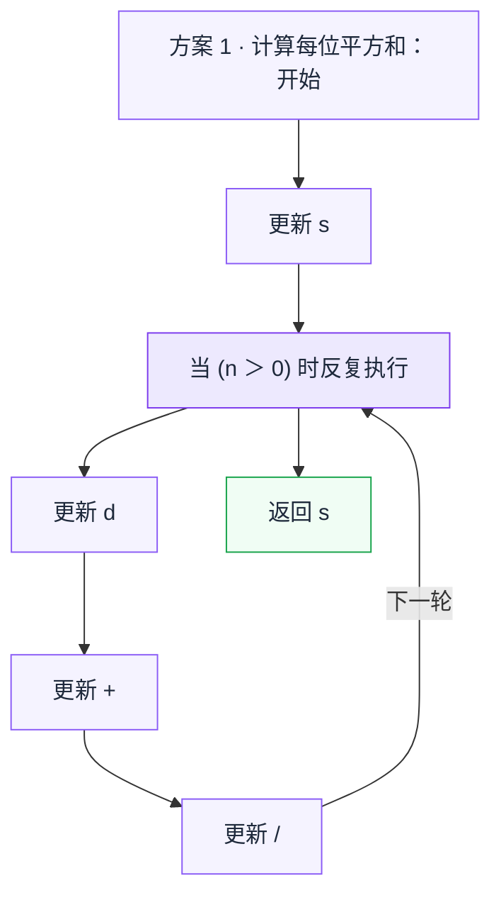

```c
/* LeetCode 202. 快乐数 — C 版（方案1） */
#include <stdio.h>                   // 引入头文件
static long bit_square_sum(long n) { // 定义函数/方法 bit_square_sum
    long s = 0;                      // 把 0; 写入 long s
    while (n > 0) {
        long d = n % 10;
        s += d * d;
        n /= 10;
    }
    return s; // 返回 字符串
}
static int is_happy(long n) { // 定义判定函数 is_happy
    long seen[1024];          // long 已见集合[1024];
    int cnt = 0;              // 把 0 存入 计数
    while (n != 1) {          // 循环，直到不满足「元素个数 不等于 1」
        for (int i = 0; i < cnt; i++)
            if (seen[i] == n)
                return 0; // 让 下标 i 从 0 开始计数，下标 i 小于 计数 就继续
        if (cnt < 1024)
            seen[cnt++] = n;   // 若 计数 小于 1024) 已见集合[计数 加一 ] 赋值为 元素个数;
        n = bit_square_sum(n); // 把 bit_square_sum(元素个数); 写入 元素个数
    }
    return 1; // 返回 1
}
int main(void) { // 程序入口：跑内嵌自测用例
    if (bit_square_sum(1) != 1) {
        printf("FAIL a1\n");
        return 1;
    } // 若 bit_square_sum(1) 不等于 1) { 输出「FAIL a1 」); return 1; }
    if (bit_square_sum(19) != 82) {
        printf("FAIL a2\n");
        return 1;
    } // 若 bit_square_sum(19) 不等于 82) { 输出「FAIL a2 」); return 1; }
    if (bit_square_sum(82) != 68) {
        printf("FAIL a3\n");
        return 1;
    } // 若 bit_square_sum(82) 不等于 68) { 输出「FAIL a3 」); return 1; }
    if (!is_happy(19) || !is_happy(1) || is_happy(2)) {
        printf("FAIL b\n");
        return 1;
    }
    printf("PASS\n"); // 全部用例通过，输出 PASS
    return 0;         // 返回 0
}
```

#### 方案 2：哈希判圈

**思路与代码分析**：核心是「哈希判圈」。C 版手动管理下标与内存，循环边界全部显式写出。**走读**：方案 2 · 哈希判圈：开始 → 更新 s → 当 (n ＞ 0) 时反复执行 → 更新 d → 更新 + → 更新 / → 返回 s。

**运行架构**（真实控制流）：

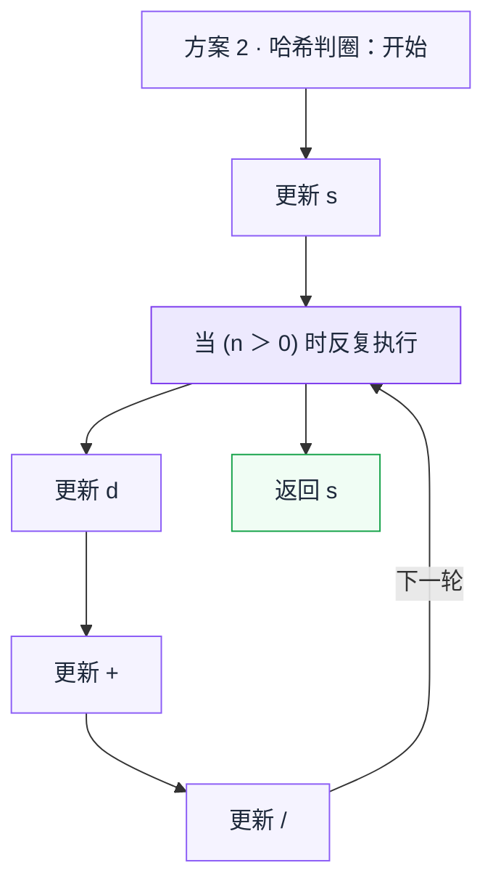

```c
/* LeetCode 202. 快乐数 — C 版（方案2） */
#include <stdio.h>                   // 引入头文件
static long bit_square_sum(long n) { // 定义函数/方法 bit_square_sum
    long s = 0;                      // 把 0; 写入 long s
    while (n > 0) {
        long d = n % 10;
        s += d * d;
        n /= 10;
    }
    return s; // 返回 字符串
}
static int is_happy(long n) { // 定义判定函数 is_happy
    long seen[1024];          // long 已见集合[1024];
    int cnt = 0;              // 把 0 存入 计数
    while (n != 1) {          // 循环，直到不满足「元素个数 不等于 1」
        for (int i = 0; i < cnt; i++)
            if (seen[i] == n)
                return 0; // 让 下标 i 从 0 开始计数，下标 i 小于 计数 就继续
        if (cnt < 1024)
            seen[cnt++] = n;   // 若 计数 小于 1024) 已见集合[计数 加一 ] 赋值为 元素个数;
        n = bit_square_sum(n); // 把 bit_square_sum(元素个数); 写入 元素个数
    }
    return 1; // 返回 1
}
int main(void) { // 程序入口：跑内嵌自测用例
    if (bit_square_sum(1) != 1) {
        printf("FAIL a1\n");
        return 1;
    } // 若 bit_square_sum(1) 不等于 1) { 输出「FAIL a1 」); return 1; }
    if (bit_square_sum(19) != 82) {
        printf("FAIL a2\n");
        return 1;
    } // 若 bit_square_sum(19) 不等于 82) { 输出「FAIL a2 」); return 1; }
    if (bit_square_sum(82) != 68) {
        printf("FAIL a3\n");
        return 1;
    } // 若 bit_square_sum(82) 不等于 68) { 输出「FAIL a3 」); return 1; }
    if (!is_happy(19) || !is_happy(1) || is_happy(2)) {
        printf("FAIL b\n");
        return 1;
    }
    printf("PASS\n"); // 全部用例通过，输出 PASS
    return 0;         // 返回 0
}
```

### C++ 实现（2 种方案）

C++ 的全部方案如下，每个方案都内嵌用例自测，可独立运行（老仓库 python/go 文件遵循「打印结果」约定）：

#### 方案 1：计算每位平方和

**思路与代码分析**：核心是「计算每位平方和」。C++ 版用 STL 容器与迭代器，减少手写下标错误。**走读**：方案 1 · 计算每位平方和：开始 → 更新 s → 当 (n ＞ 0) 时反复执行 → 更新 d → 更新 + → 更新 / → 返回 s。

**运行架构**（真实控制流）：


```cpp
// LeetCode 202. 快乐数 — C++ 版（方案1）
#include <cassert>                           // 引入头文件
#include <iostream>                          // 引入头文件
#include <unordered_set>                     // 引入头文件
static long long bitSquareSum(long long n) { // static long long bitSquareSum(long long 元素个数) {
    long long s = 0;                         // 把 0 存入 字符串
    while (n > 0) {
        long long d = n % 10;
        s += d * d;
        n /= 10;
    }
    return s; // 返回 字符串
}
static bool isHappy(long long n) {      // 定义判定函数 isHappy
    std::unordered_set<long long> seen; // std::unordered_set 小于 long long 超过 已见集合;
    while (n != 1 && !seen.count(n)) { // 循环，直到不满足「元素个数 不等于 1 且 取反 已见集合.计数(元素个数」
        seen.insert(n);      // 已见集合 插入 元素个数);
        n = bitSquareSum(n); // 把 bitSquareSum(元素个数); 写入 元素个数
    }
    return n == 1; // 返回 元素个数 等于 1
}
int main() {                          // 程序入口：跑内嵌自测用例
    assert(bitSquareSum(1) == 1);     // 断言校验
    assert(bitSquareSum(19) == 82);   // 断言校验
    assert(bitSquareSum(82) == 68);   // 断言校验
    assert(isHappy(19));              // 断言校验
    assert(isHappy(1));               // 断言校验
    assert(!isHappy(2));              // 断言校验
    std::cout << "PASS" << std::endl; // 全部用例通过，输出 PASS
    return 0;                         // 返回 0
}
```

#### 方案 2：哈希判圈

**思路与代码分析**：核心是「哈希判圈」。C++ 版用 STL 容器与迭代器，减少手写下标错误。**走读**：方案 2 · 哈希判圈：开始 → 更新 s → 当 (n ＞ 0) 时反复执行 → 更新 d → 更新 + → 更新 / → 返回 s。

**运行架构**（真实控制流）：


```cpp
// LeetCode 202. 快乐数 — C++ 版（方案2）
#include <cassert>                           // 引入头文件
#include <iostream>                          // 引入头文件
#include <unordered_set>                     // 引入头文件
static long long bitSquareSum(long long n) { // static long long bitSquareSum(long long 元素个数) {
    long long s = 0;                         // 把 0 存入 字符串
    while (n > 0) {
        long long d = n % 10;
        s += d * d;
        n /= 10;
    }
    return s; // 返回 字符串
}
static bool isHappy(long long n) {      // 定义判定函数 isHappy
    std::unordered_set<long long> seen; // std::unordered_set 小于 long long 超过 已见集合;
    while (n != 1 && !seen.count(n)) { // 循环，直到不满足「元素个数 不等于 1 且 取反 已见集合.计数(元素个数」
        seen.insert(n);      // 已见集合 插入 元素个数);
        n = bitSquareSum(n); // 把 bitSquareSum(元素个数); 写入 元素个数
    }
    return n == 1; // 返回 元素个数 等于 1
}
int main() {                          // 程序入口：跑内嵌自测用例
    assert(bitSquareSum(1) == 1);     // 断言校验
    assert(bitSquareSum(19) == 82);   // 断言校验
    assert(bitSquareSum(82) == 68);   // 断言校验
    assert(isHappy(19));              // 断言校验
    assert(isHappy(1));               // 断言校验
    assert(!isHappy(2));              // 断言校验
    std::cout << "PASS" << std::endl; // 全部用例通过，输出 PASS
    return 0;                         // 返回 0
}
```

### R 实现（2 种方案）

R 的全部方案如下，每个方案都内嵌用例自测，可独立运行（老仓库 python/go 文件遵循「打印结果」约定）：

#### 方案 1：计算每位平方和

**思路与代码分析**：核心是「计算每位平方和」。R 版用向量化思维与 1 起始下标，注意 1:n 的降序陷阱。**走读**：方案 1 · 计算每位平方和：开始 → 处理 s ＜- 0 → 当 (n ＞ 0) 时反复执行 → 处理 d ＜- n%%10 → 处理 s ＜- s + d * d → 处理 n ＜- n%/%10 → 处理 s → 返回结果。

**运行架构**（真实控制流）：

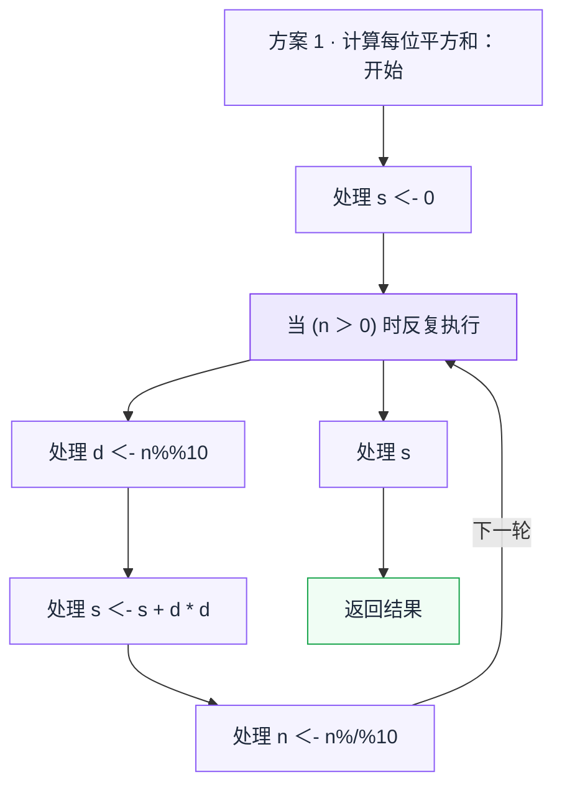

```r
# 版（方案1） 定义函数 bit_square_sum（参数：元素个数）
bit_square_sum <- function(n) {
    s <- 0  # 把 0 存入 字符串
    while (n > 0) {
        # 循环，直到不满足「元素个数 超过 0」
        d <- n%%10  # 把 元素个数 对…取模 对…取模 10 存入 d
        s <- s + d * d  # 把 字符串 加 d 乘 d 存入 字符串
        n <- n%/%10  # 把 元素个数 对…取模 除以 对…取模 10 存入 元素个数
    }
    s  # 字符串
}
is_happy <- function(n) {
    # 定义函数 is_happy（参数：元素个数）
    seen <- new.env(parent = emptyenv())  # 把 new.env(parent 赋值为 emptyenv()) 存入 已见集合
    while (n != 1 && is.null(seen[[as.character(n)]])) {
        # 循环，直到不满足「元素个数 不等于 1 且 is.null(已见集合[[as.character(元素个数)]]」
        seen[[as.character(n)]] <- TRUE  # 把 TRUE 存入 seen[[as.character(n)]]
        n <- bit_square_sum(n)  # 把 bit_square_sum(元素个数) 存入 元素个数
    }
    n == 1  # 把 赋值为 1 存入 元素个数
}
stopifnot(bit_square_sum(1) == 1, bit_square_sum(19) == 82, bit_square_sum(82) == 68)  # 断言校验
stopifnot(is_happy(19), is_happy(1), !is_happy(2))  # 断言校验
cat("PASS\n")  # 全部用例通过，输出 PASS
```

#### 方案 2：哈希判圈

**思路与代码分析**：核心是「哈希判圈」。R 版用向量化思维与 1 起始下标，注意 1:n 的降序陷阱。**走读**：方案 2 · 哈希判圈：开始 → 处理 s ＜- 0 → 当 (n ＞ 0) 时反复执行 → 处理 d ＜- n%%10 → 处理 s ＜- s + d * d → 处理 n ＜- n%/%10 → 处理 s → 返回结果。

**运行架构**（真实控制流）：

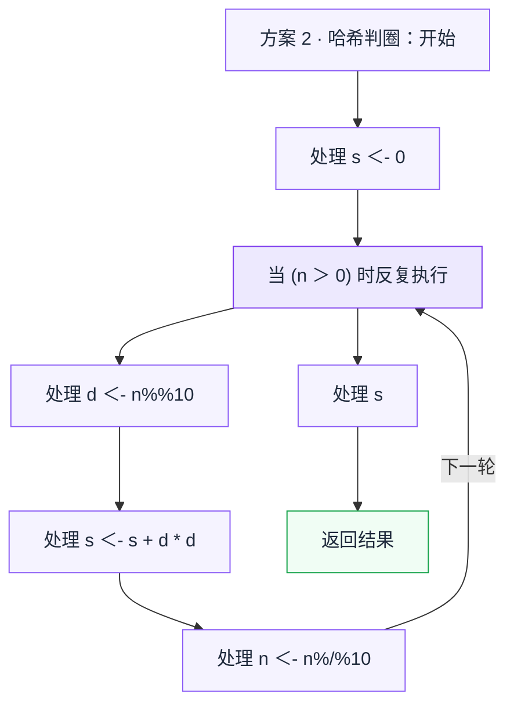

```r
# 版（方案2） 定义函数 bit_square_sum（参数：元素个数）
bit_square_sum <- function(n) {
    s <- 0  # 把 0 存入 字符串
    while (n > 0) {
        # 循环，直到不满足「元素个数 超过 0」
        d <- n%%10  # 把 元素个数 对…取模 对…取模 10 存入 d
        s <- s + d * d  # 把 字符串 加 d 乘 d 存入 字符串
        n <- n%/%10  # 把 元素个数 对…取模 除以 对…取模 10 存入 元素个数
    }
    s  # 字符串
}
is_happy <- function(n) {
    # 定义函数 is_happy（参数：元素个数）
    seen <- new.env(parent = emptyenv())  # 把 new.env(parent 赋值为 emptyenv()) 存入 已见集合
    while (n != 1 && is.null(seen[[as.character(n)]])) {
        # 循环，直到不满足「元素个数 不等于 1 且 is.null(已见集合[[as.character(元素个数)]]」
        seen[[as.character(n)]] <- TRUE  # 把 TRUE 存入 seen[[as.character(n)]]
        n <- bit_square_sum(n)  # 把 bit_square_sum(元素个数) 存入 元素个数
    }
    n == 1  # 把 赋值为 1 存入 元素个数
}
stopifnot(bit_square_sum(1) == 1, bit_square_sum(19) == 82, bit_square_sum(82) == 68)  # 断言校验
stopifnot(is_happy(19), is_happy(1), !is_happy(2))  # 断言校验
cat("PASS\n")  # 全部用例通过，输出 PASS
```

### Zig 实现（2 种方案）

Zig 的全部方案如下，每个方案都内嵌用例自测，可独立运行（老仓库 python/go 文件遵循「打印结果」约定）：

#### 方案 1：计算每位平方和

**思路与代码分析**：核心是「计算每位平方和」。Zig 版显式分配与清零，整型边界处理严格。**走读**：方案 1 · 计算每位平方和：开始 → 计算 s → 计算 n → 当 (n ＞ 0) : (n = @divTrunc(n, 10)) 时反复执行 → 计算 d → 更新 + → 返回 s。

**运行架构**（真实控制流）：

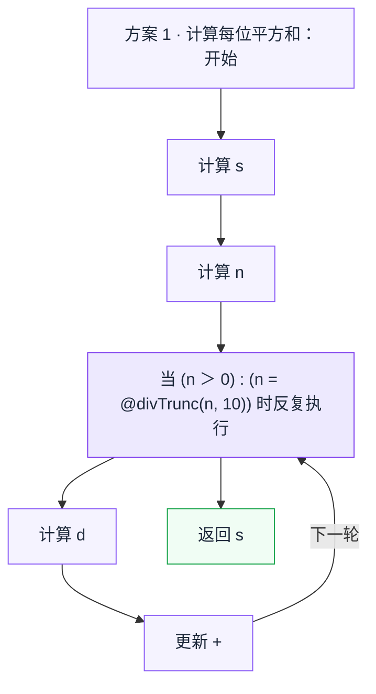

```zig
// LeetCode 202. 快乐数 — Zig 版（方案1）
const std = @import("std"); // 把 @import(「std」) 存入 std
fn bitSquareSum(n0: i64) i64 { // 定义函数/方法 bitSquareSum
    var s: i64 = 0; // 把 0; 写入 var s: i64
    var n = n0; // 把 n0 存入 元素个数
    while (n > 0) : (n = @divTrunc(n, 10)) { // 循环，直到不满足「元素个数 超过 0) : (元素个数 赋值为 @divTrunc(元素个数, 10」
        const d = @mod(n, 10); // 把 @mod(元素个数, 10) 存入 d
        s += d * d; // 字符串累加 d 乘 d
    }
    return s; // 返回 字符串
}
fn isHappy(n0: i64) bool { // 定义判定函数 isHappy
    var seen_buf: [1024]i64 = undefined; // 把 undefined; 写入 var seen_buf: [1024]i64
    var cnt: usize = 0; // 把 0; 写入 var cnt: usize
    var n = n0; // 把 n0 存入 元素个数
    while (n != 1) { // 循环，直到不满足「元素个数 不等于 1」
        for (seen_buf[0..cnt]) |v| if (v == n) return false;
        if (cnt < seen_buf.len) {
            seen_buf[cnt] = n;
            cnt += 1;
        } // 若 计数 小于 seen_buf.长度) { seen_buf[计数] 赋值为 元素个数; 计数 累加 1; }
        n = bitSquareSum(n); // 把 bitSquareSum(元素个数); 写入 元素个数
    }
    return true; // 返回 true
}
pub fn main() !void { // 程序入口：跑内嵌自测用例
    if (bitSquareSum(1) != 1) return error.TestFailed; // 若 bitSquareSum(1) 不等于 1，直接返回 error.TestFailed
    if (bitSquareSum(19) != 82) return error.TestFailed; // 若 bitSquareSum(19) 不等于 82，直接返回 error.TestFailed
    if (bitSquareSum(82) != 68) return error.TestFailed; // 若 bitSquareSum(82) 不等于 68，直接返回 error.TestFailed
    if (!isHappy(19) or !isHappy(1) or isHappy(2)) return error.TestFailed;
    std.debug.print("PASS\n", .{}); // 全部用例通过，输出 PASS
}
```

#### 方案 2：哈希判圈

**思路与代码分析**：核心是「哈希判圈」。Zig 版显式分配与清零，整型边界处理严格。**走读**：方案 2 · 哈希判圈：开始 → 计算 s → 计算 n → 当 (n ＞ 0) : (n = @divTrunc(n, 10)) 时反复执行 → 计算 d → 更新 + → 返回 s。

**运行架构**（真实控制流）：

```mermaid
graph TD
    N0["方案 2 · 哈希判圈：开始"]
    N1["计算 s"]
    N2["计算 n"]
    N3["当 (n ＞ 0) : (n = @divTrunc(n, 10)) 时反复执行"]
    N4["计算 d"]
    N5["更新 +"]
    N6["返回 s"]
    N0 --> N1
    N1 --> N2
    N2 --> N3
    N3 --> N4
    N4 --> N5
    N5 -- 下一轮 --> N3
    N3 --> N6
    classDef n fill:#f5f3ff,stroke:#8b5cf6,color:#1e293b;
    classDef lp fill:#ede9fe,stroke:#7c3aed,color:#1e293b;
    classDef dc fill:#fef9c3,stroke:#ca8a04,color:#1e293b;
    classDef tm fill:#f0fdf4,stroke:#16a34a,color:#1e293b;
    class N0,N1,N2,N4,N5 n;
    class N3 lp;
    class N6 tm;
```

```zig
// LeetCode 202. 快乐数 — Zig 版（方案2）
const std = @import("std"); // 把 @import(「std」) 存入 std
fn bitSquareSum(n0: i64) i64 { // 定义函数/方法 bitSquareSum
    var s: i64 = 0; // 把 0; 写入 var s: i64
    var n = n0; // 把 n0 存入 元素个数
    while (n > 0) : (n = @divTrunc(n, 10)) { // 循环，直到不满足「元素个数 超过 0) : (元素个数 赋值为 @divTrunc(元素个数, 10」
        const d = @mod(n, 10); // 把 @mod(元素个数, 10) 存入 d
        s += d * d; // 字符串累加 d 乘 d
    }
    return s; // 返回 字符串
}
fn isHappy(n0: i64) bool { // 定义判定函数 isHappy
    var seen_buf: [1024]i64 = undefined; // 把 undefined; 写入 var seen_buf: [1024]i64
    var cnt: usize = 0; // 把 0; 写入 var cnt: usize
    var n = n0; // 把 n0 存入 元素个数
    while (n != 1) { // 循环，直到不满足「元素个数 不等于 1」
        for (seen_buf[0..cnt]) |v| if (v == n) return false;
        if (cnt < seen_buf.len) {
            seen_buf[cnt] = n;
            cnt += 1;
        } // 若 计数 小于 seen_buf.长度) { seen_buf[计数] 赋值为 元素个数; 计数 累加 1; }
        n = bitSquareSum(n); // 把 bitSquareSum(元素个数); 写入 元素个数
    }
    return true; // 返回 true
}
pub fn main() !void { // 程序入口：跑内嵌自测用例
    if (bitSquareSum(1) != 1) return error.TestFailed; // 若 bitSquareSum(1) 不等于 1，直接返回 error.TestFailed
    if (bitSquareSum(19) != 82) return error.TestFailed; // 若 bitSquareSum(19) 不等于 82，直接返回 error.TestFailed
    if (bitSquareSum(82) != 68) return error.TestFailed; // 若 bitSquareSum(82) 不等于 68，直接返回 error.TestFailed
    if (!isHappy(19) or !isHappy(1) or isHappy(2)) return error.TestFailed;
    std.debug.print("PASS\n", .{}); // 全部用例通过，输出 PASS
}
```

### Dart 实现（2 种方案）

Dart 的全部方案如下，每个方案都内嵌用例自测，可独立运行（老仓库 python/go 文件遵循「打印结果」约定）：

#### 方案 1：计算每位平方和

**思路与代码分析**：核心是「计算每位平方和」。Dart 版用可空类型标注与集合方法，注意空安全。**走读**：方案 1 · 计算每位平方和：开始 → 计算 s → 当 (n ＞ 0) 时反复执行 → 更新 d → 更新 + → 更新 n → 返回 s。

**运行架构**（真实控制流）：

```mermaid
graph TD
    N0["方案 1 · 计算每位平方和：开始"]
    N1["计算 s"]
    N2["当 (n ＞ 0) 时反复执行"]
    N3["更新 d"]
    N4["更新 +"]
    N5["更新 n"]
    N6["返回 s"]
    N0 --> N1
    N1 --> N2
    N2 --> N3
    N3 --> N4
    N4 --> N5
    N5 -- 下一轮 --> N2
    N2 --> N6
    classDef n fill:#f5f3ff,stroke:#8b5cf6,color:#1e293b;
    classDef lp fill:#ede9fe,stroke:#7c3aed,color:#1e293b;
    classDef dc fill:#fef9c3,stroke:#ca8a04,color:#1e293b;
    classDef tm fill:#f0fdf4,stroke:#16a34a,color:#1e293b;
    class N0,N1,N3,N4,N5 n;
    class N2 lp;
    class N6 tm;
```

```dart
// LeetCode 202. 快乐数 — Dart 版（方案1）
int bitSquareSum(int n) {
  // 定义函数/方法 bitSquareSum
  var s = 0; // 把 0 存入 字符串
  while (n > 0) {
    // 循环，直到不满足「元素个数 超过 0」
    final d = n % 10; // 把 元素个数 对…取模 10 存入 d
    s += d * d; // 字符串累加 d 乘 d
    n = n ~/ 10; // 把 元素个数 ~ 除以 10 存入 元素个数
  }
  return s; // 返回 字符串
}

bool isHappy(int n) {
  // 定义判定函数 isHappy
  final seen = <int>{}; // 把 小于 int 超过 {} 存入 已见集合
  while (n != 1 && !seen.contains(n)) {
    // 循环，直到不满足「元素个数 不等于 1 且 取反 已见集合 是否包含 元素个数」
    seen.add(n); // 已见集合 追加 元素个数);
    n = bitSquareSum(n); // 把 bitSquareSum(元素个数) 存入 元素个数
  }
  return n == 1; // 返回 元素个数 等于 1
}

void main() {
  // 程序入口：跑内嵌自测用例
  if (bitSquareSum(1) != 1)
    throw StateError('a1'); // 若 bitSquareSum(1) 不等于 1) throw StateError('a1');
  if (bitSquareSum(19) != 82)
    throw StateError(
      'a2',
    ); // 若 bitSquareSum(19) 不等于 82) throw StateError('a2');
  if (bitSquareSum(82) != 68)
    throw StateError(
      'a3',
    ); // 若 bitSquareSum(82) 不等于 68) throw StateError('a3');
  if (!isHappy(19) || !isHappy(1) || isHappy(2)) throw StateError('b');
  print('PASS'); // 全部用例通过，输出 PASS
}
```

#### 方案 2：哈希判圈

**思路与代码分析**：核心是「哈希判圈」。Dart 版用可空类型标注与集合方法，注意空安全。**走读**：方案 2 · 哈希判圈：开始 → 计算 s → 当 (n ＞ 0) 时反复执行 → 更新 d → 更新 + → 更新 n → 返回 s。

**运行架构**（真实控制流）：

```mermaid
graph TD
    N0["方案 2 · 哈希判圈：开始"]
    N1["计算 s"]
    N2["当 (n ＞ 0) 时反复执行"]
    N3["更新 d"]
    N4["更新 +"]
    N5["更新 n"]
    N6["返回 s"]
    N0 --> N1
    N1 --> N2
    N2 --> N3
    N3 --> N4
    N4 --> N5
    N5 -- 下一轮 --> N2
    N2 --> N6
    classDef n fill:#f5f3ff,stroke:#8b5cf6,color:#1e293b;
    classDef lp fill:#ede9fe,stroke:#7c3aed,color:#1e293b;
    classDef dc fill:#fef9c3,stroke:#ca8a04,color:#1e293b;
    classDef tm fill:#f0fdf4,stroke:#16a34a,color:#1e293b;
    class N0,N1,N3,N4,N5 n;
    class N2 lp;
    class N6 tm;
```

```dart
// LeetCode 202. 快乐数 — Dart 版（方案2）
int bitSquareSum(int n) {
  // 定义函数/方法 bitSquareSum
  var s = 0; // 把 0 存入 字符串
  while (n > 0) {
    // 循环，直到不满足「元素个数 超过 0」
    final d = n % 10; // 把 元素个数 对…取模 10 存入 d
    s += d * d; // 字符串累加 d 乘 d
    n = n ~/ 10; // 把 元素个数 ~ 除以 10 存入 元素个数
  }
  return s; // 返回 字符串
}

bool isHappy(int n) {
  // 定义判定函数 isHappy
  final seen = <int>{}; // 把 小于 int 超过 {} 存入 已见集合
  while (n != 1 && !seen.contains(n)) {
    // 循环，直到不满足「元素个数 不等于 1 且 取反 已见集合 是否包含 元素个数」
    seen.add(n); // 已见集合 追加 元素个数);
    n = bitSquareSum(n); // 把 bitSquareSum(元素个数) 存入 元素个数
  }
  return n == 1; // 返回 元素个数 等于 1
}

void main() {
  // 程序入口：跑内嵌自测用例
  if (bitSquareSum(1) != 1)
    throw StateError('a1'); // 若 bitSquareSum(1) 不等于 1) throw StateError('a1');
  if (bitSquareSum(19) != 82)
    throw StateError(
      'a2',
    ); // 若 bitSquareSum(19) 不等于 82) throw StateError('a2');
  if (bitSquareSum(82) != 68)
    throw StateError(
      'a3',
    ); // 若 bitSquareSum(82) 不等于 68) throw StateError('a3');
  if (!isHappy(19) || !isHappy(1) || isHappy(2)) throw StateError('b');
  print('PASS'); // 全部用例通过，输出 PASS
}
```

---

## 内容总结

- **快乐数**（综合 · Medium）：共 2 个方案，主线思路「计算每位平方和」；时间 O(n)（单趟线性扫描）；动画演示归并分治过程，附录给出 11 种语言 × 全部方案的可运行实现。
- 来源博客：[https://blog.csdn.net/tyro_java/article/details/145355335](https://blog.csdn.net/tyro_java/article/details/145355335)
- 导航：[📋 总目录](../) ｜ [← 242 设计一个验证系统](../242_设计一个验证系统/) ｜ [244 设计位集 →](../244_设计位集/)
