# 244 · 设计位集（第附阶段 · 专题补充 · Medium）

> **难度**：⭐⭐ Medium ｜ **专题**：综合
> **学习定位**：第附阶段 · 专题补充第 244 篇 ｜ **解法数**：2
> **内容总结**：**设计位集**（综合 · Medium）：共 2 个方案，主线思路「按字存储实现」；时间 O(n)（单趟线性扫描）；动画演示归并分治过程，附录给出 11 种语言 × 全部方案的可运行实现。

---

## 题目描述

位集 Bitset 是一种能以紧凑形式存储位的数据结构。

请你实现 `Bitset` 类。

 `Bitset(int size)` 用 `size` 个位初始化 Bitset ，所有位都是 `0` 。
 `void fix(int idx)` 将下标为 `idx` 的位上的值更新为 `1` 。如果值已经是 `1` ，则不会发生任何改变。
 `void unfix(int idx)` 将下标为 `idx` 的位上的值更新为 `0` 。如果值已经是 `0` ，则不会发生任何改变。
 `void flip()` 翻转 Bitset 中每一位上的值。换句话说，所有值为 `0` 的位将会变成 `1` ，反之亦然。
 `boolean all()` 检查 Bitset 中 每一位 的值是否都是 `1` 。如果满足此条件，返回 `true` ；否则，返回 `false` 。
 `boolean one()` 检查 Bitset 中 是否 至少一位 的值是 `1` 。如果满足此条件，返回 `true` ；否则，返回 `false` 。
 `int count()` 返回 Bitset 中值为 1 的位的 总数 。
 `String toString()` 返回 Bitset 的当前组成情况。注意，在结果字符串中，第 `i` 个下标处的字符应该与 Bitset 中的第 `i` 位一致。

示例：

输入
[「Bitset」, 「fix」, 「fix」, 「flip」, 「all」, 「unfix」, 「flip」, 「one」, 「unfix」, 「count」, 「toString」]
[[5], [3], [1], [], [], [0], [], [], [0], [], []]
输出
[null, null, null, null, false, null, null, true, null, 2, 「01010」]

解释
Bitset bs = new Bitset(5); // bitset = 「00000」.
bs.fix(3); // 将 idx = 3 处的值更新为 1 ，此时 bitset = 「00010」 。
bs.fix(1); // 将 idx = 1 处的值更新为 1 ，此时 bitset = 「01010」 。
bs.flip(); // 翻转每一位上的值，此时 bitset = 「10101」 。
bs.all(); // 返回 False ，bitset 中的值不全为 1 。
bs.unfix(0); // 将 idx = 0 处的值更新为 0 ，此时 bitset = 「00101」 。
bs.flip(); // 翻转每一位上的值，此时 bitset = 「11010」 。
bs.one(); // 返回 True ，至少存在一位的值为 1 。
bs.unfix(0); // 将 idx = 0 处的值更新为 0 ，此时 bitset = 「01010」 。
bs.count(); // 返回 2 ，当前有 2 位的值为 1 。
bs.toString(); // 返回 「01010」 ，即 bitset 的当前组成情况。

提示：

 `1 
 `0 
 至多调用 `fix`、`unfix`、`flip`、`all`、`one`、`count` 和 `toString` 方法 总共 `10^5` 次
 至少调用 `all`、`one`、`count` 或 `toString` 方法一次
 至多调用 `toString` 方法 `5` 次

> 题面与 [leetcode.cn 官方](https://leetcode.cn/problems/design-bitset/)一致，示例配图取自官方题面。

**数据范围与注意事项**：

- `1 <= size <= 10^5`
- `0 <= idx <= size - 1`
- `至多调用 `fix`、`unfix`、`flip`、`all`、`one`、`count` 和 `toString` 方法 总共 `10^5` 次`
- 至少调用 `all`、`one`、`count` 或 `toString` 方法一次
- 至多调用 `toString` 方法 `5` 次
- **易错点**：特殊输入（空、重复、极值）的边界检查。

## 题目分析

**场景是什么**：综合练习：从题面本身出发选择合适的数据结构。本题就是该场景的 Medium 级练习，主线做法是「按字存储实现」。

**主线怎么解**：把主解法从头到尾过一遍，它其实在依次做这几件事：单循环线性扫描。

## 解题思路

**方案对比**（共 2 个方案，由浅入深）：

| 方案 | 时间复杂度 | 空间复杂度 |
|---|---|---|
| 方案 1 · 按字存储实现 | O(n)（单趟线性扫描） | O(1) 到 O(n)（视辅助结构） |
| 方案 2 · 按字存储实现 | O(n)（单趟线性扫描） | O(1) 到 O(n)（视辅助结构） |

**方案间的取舍**：方案 1（按字存储实现）；方案 2（按字存储实现）。数据规模小、可读性优先时选靠前的方案；规模大、性能优先时选靠后的方案。

**怎么读这一篇**：

- 🐣 **新手路线**：把「题目描述」的示例 1 在纸上手推一遍 → 读方案 1（最直观的写法）与它的代码走读 → 按「运行方式」本地跑通看 PASS → 回头对比方案 2 之后的写法差在哪
- 🦅 **大佬路线**：直接锁定最优方案 1（按字存储实现，O(n)（单趟线性扫描））→ 跳读该方案代码与走读 → 用「逐步拆解与面试追问」补齐复杂度推导与边界追问

### 动态算法图（归并分治，GIF 自动循环）


动画演示综合专题里归并分治的典型过程；每个方案在「TypeScript 解题方案」一节还配了专属动画与专属流程图。

### 主解法流程图（真实控制流）

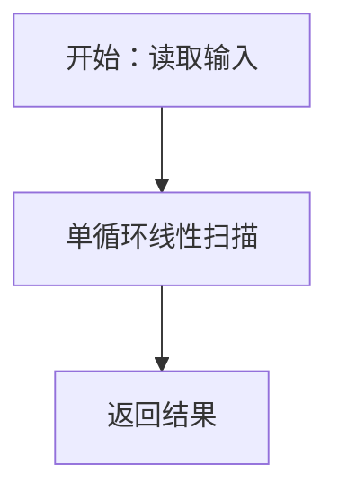

## TypeScript 解题方案（2 个方案逐个讲）

> **运行与提交**：每个方案都是自包含文件（内嵌用例自测，输出 PASS），整块复制到 `.ts` 文件后 `node 文件名` 即可运行。提交 LeetCode 时，把 `demo` 内的算法函数与辅助类型/函数整体取出、置于文件顶层即可。涉及交互/特殊接口的题以题面给定签名为准。

### 方案 1：按字存储实现

**分析与思路**：核心做法是「按字存储实现」。代码里依次做这些事：单循环线性扫描。

**运行方式**：`node 本文件`，内嵌用例全部通过会输出 PASS。


**方案专属流程图**（真实控制流）：


```typescript
/**
 ** LeetCode 2166. 设计位集
 ** 方案：1 ) 方案1：按字存储实现
 ** 来源：https://blog.csdn.net/tyro_java/article/details/145370422
 */

export class Bitset {
  // export class Bitset {
  private n: number; // private 元素个数: number;
  private words: number[]; // private 单词列表: number[];
  private ones: number; // private ones: number;
  private reverse: number; // private reverse: number;
  constructor(size: number) {
    // constructor(大小: number) {
    this.n = size; // 把 大小; 写入 元素个数
    this.words = new Array(Math.floor((size + 31) / 32)).fill(0); // 把 new Array(向下取整((大小 加 31) 除以 32)).fill(0); 写入 单词列表
    this.ones = 0; // 把 0; 写入 this.ones
    this.reverse = 0; // 把 0; 写入 this.reverse
  }
  private realFlag(idx: number): number {
    // private realFlag(idx: number): number {
    const index = Math.floor(idx / 32); // 把 向下取整(idx 除以 32) 存入 index
    const bit = idx % 32; // 把 idx 对…取模 32 存入 bit
    return ((this.words[index] >> bit) & 1) ^ this.reverse; // 返回 ((this.单词列表[index] 超过 超过 bit) 按位与 1) 按位异或 this.reverse
  }
  private setFlag(idx: number, v: number): void {
    // private setFlag(idx: number, 值: number): void {
    const index = Math.floor(idx / 32); // 把 向下取整(idx 除以 32) 存入 index
    const bit = idx % 32; // 把 idx 对…取模 32 存入 bit
    const old = this.realFlag(idx); // 把 this.realFlag(idx) 存入 old
    if (old !== v) {
      // 若 old 不等于 值
      this.ones += v - old; // this.ones累加 (值 减 old)
      const physical = v ^ this.reverse; // 把 值 按位异或 this.reverse 存入 physical
      if (physical === 1)
        this.words[index] |= 1 << bit; // 若 physical 全等于 1) this.单词列表[index] 按位或 赋值为 (1 小于 小于 bit);
      else this.words[index] &= ~(1 << bit); // 否则
    }
  }
  fix(idx: number): void {
    this.setFlag(idx, 1);
  } // fix(idx: number): void { this.setFlag(idx, 1); }
  unfix(idx: number): void {
    this.setFlag(idx, 0);
  } // unfix(idx: number): void { this.setFlag(idx, 0); }
  flip(): void {
    this.reverse ^= 1;
    this.ones = this.n - this.ones;
  }
  all(): boolean {
    return this.ones === this.n;
  } // 把 等于 this.元素个数; } 写入 all(): boolean { return this.ones
  one(): boolean {
    return this.ones > 0;
  } // one(): boolean { return this.ones 超过 0; }
  count(): number {
    return this.ones;
  } // 计数(): number { return this.ones; }
  toString(): string {
    // toString(): string {
    let s = ''; // 把 「」 存入 字符串
    for (let i = 0; i < this.n; i++) s += this.realFlag(i).toString(); // 让 下标 i 从 0 开始计数，下标 i 小于 this.元素个数 就继续
    return s; // 返回 字符串
  }
}

export function demo(): void {
  // 程序入口：跑内嵌自测用例
  const bs = new Bitset(5); // 把 new Bitset(5) 存入 bs
  bs.fix(0); // bs.fix(0);
  bs.fix(3); // bs.fix(3);
  if (bs.toString() !== '10010')
    throw new Error('FAILED toString1: ' + bs.toString());
  if (bs.count() !== 2) throw new Error('FAILED count1'); // 若 bs.计数() 不等于 2) throw new Error(「FAILED count1」);
  bs.flip(); // bs.flip();
  if (bs.toString() !== '01101')
    throw new Error('FAILED toString2: ' + bs.toString());
  if (bs.count() !== 3) throw new Error('FAILED count2'); // 若 bs.计数() 不等于 3) throw new Error(「FAILED count2」);
  bs.unfix(0); // bs.unfix(0);
  if (bs.toString() !== '01101')
    throw new Error('FAILED toString3: ' + bs.toString());
  if (bs.all() || !bs.one()) throw new Error('FAILED all/one');
  console.log('PASS'); // 全部用例通过，输出 PASS
}

demo(); // demo();
```

### 方案 2：按字存储实现

**分析与思路**：核心做法是「按字存储实现」。代码里依次做这些事：单循环线性扫描。

**运行方式**：`node 本文件`，内嵌用例全部通过会输出 PASS。

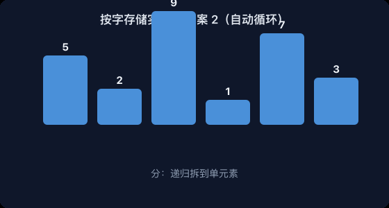

**方案专属流程图**（真实控制流）：


```typescript
/**
 ** LeetCode 2166. 设计位集
 ** 方案：2 ) 方案2：按字存储实现
 ** 来源：https://blog.csdn.net/tyro_java/article/details/145370422
 */

export class Bitset {
  // export class Bitset {
  private n: number; // private 元素个数: number;
  private words: number[]; // private 单词列表: number[];
  private ones: number; // private ones: number;
  private reverse: number; // private reverse: number;
  constructor(size: number) {
    // constructor(大小: number) {
    this.n = size; // 把 大小; 写入 元素个数
    this.words = new Array(Math.floor((size + 31) / 32)).fill(0); // 把 new Array(向下取整((大小 加 31) 除以 32)).fill(0); 写入 单词列表
    this.ones = 0; // 把 0; 写入 this.ones
    this.reverse = 0; // 把 0; 写入 this.reverse
  }
  private realFlag(idx: number): number {
    // private realFlag(idx: number): number {
    const index = Math.floor(idx / 32); // 把 向下取整(idx 除以 32) 存入 index
    const bit = idx % 32; // 把 idx 对…取模 32 存入 bit
    return ((this.words[index] >> bit) & 1) ^ this.reverse; // 返回 ((this.单词列表[index] 超过 超过 bit) 按位与 1) 按位异或 this.reverse
  }
  private setFlag(idx: number, v: number): void {
    // private setFlag(idx: number, 值: number): void {
    const index = Math.floor(idx / 32); // 把 向下取整(idx 除以 32) 存入 index
    const bit = idx % 32; // 把 idx 对…取模 32 存入 bit
    const old = this.realFlag(idx); // 把 this.realFlag(idx) 存入 old
    if (old !== v) {
      // 若 old 不等于 值
      this.ones += v - old; // this.ones累加 (值 减 old)
      const physical = v ^ this.reverse; // 把 值 按位异或 this.reverse 存入 physical
      if (physical === 1)
        this.words[index] |= 1 << bit; // 若 physical 全等于 1) this.单词列表[index] 按位或 赋值为 (1 小于 小于 bit);
      else this.words[index] &= ~(1 << bit); // 否则
    }
  }
  fix(idx: number): void {
    this.setFlag(idx, 1);
  } // fix(idx: number): void { this.setFlag(idx, 1); }
  unfix(idx: number): void {
    this.setFlag(idx, 0);
  } // unfix(idx: number): void { this.setFlag(idx, 0); }
  flip(): void {
    this.reverse ^= 1;
    this.ones = this.n - this.ones;
  }
  all(): boolean {
    return this.ones === this.n;
  } // 把 等于 this.元素个数; } 写入 all(): boolean { return this.ones
  one(): boolean {
    return this.ones > 0;
  } // one(): boolean { return this.ones 超过 0; }
  count(): number {
    return this.ones;
  } // 计数(): number { return this.ones; }
  toString(): string {
    // toString(): string {
    let s = ''; // 把 「」 存入 字符串
    for (let i = 0; i < this.n; i++) s += this.realFlag(i).toString(); // 让 下标 i 从 0 开始计数，下标 i 小于 this.元素个数 就继续
    return s; // 返回 字符串
  }
}

export function demo(): void {
  // 程序入口：跑内嵌自测用例
  const bs = new Bitset(5); // 把 new Bitset(5) 存入 bs
  bs.fix(0); // bs.fix(0);
  bs.fix(3); // bs.fix(3);
  if (bs.toString() !== '10010')
    throw new Error('FAILED toString1: ' + bs.toString());
  if (bs.count() !== 2) throw new Error('FAILED count1'); // 若 bs.计数() 不等于 2) throw new Error(「FAILED count1」);
  bs.flip(); // bs.flip();
  if (bs.toString() !== '01101')
    throw new Error('FAILED toString2: ' + bs.toString());
  if (bs.count() !== 3) throw new Error('FAILED count2'); // 若 bs.计数() 不等于 3) throw new Error(「FAILED count2」);
  bs.unfix(0); // bs.unfix(0);
  if (bs.toString() !== '01101')
    throw new Error('FAILED toString3: ' + bs.toString());
  if (bs.all() || !bs.one()) throw new Error('FAILED all/one');
  console.log('PASS'); // 全部用例通过，输出 PASS
}

demo(); // demo();
```

## 逐步拆解与面试追问

**复杂度**：时间 O(n)（单趟线性扫描），空间 O(1) 到 O(n)（视辅助结构）

**为什么是这个量级**：每个元素被常数次访问，辅助哈希或栈的开销与 n 同阶

**面试官可能会追问**：

- 有没有更直观的建模方式？
- 特殊输入的边界？
- 能否一步到位而不是分两趟？

## 关键 API 速查（TS 主解法实际用到，附官方链接）

| API | 作用 | 使用要点 | 官方文档 |
|---|---|---|---|
| `Math.floor()` | 向下取整 | 负数向负无穷（-1.5 → -2）；大数用位运算前注意 2^31 界 | [官方文档](https://developer.mozilla.org/zh-CN/docs/Web/JavaScript/Reference/Global_Objects/Math/floor) |

### 各语言官方文档导航

- **TypeScript / JS**：[MDN 中文参考](https://developer.mozilla.org/zh-CN/)
- **Python**：[Python 官方文档](https://docs.python.org/zh-cn/3/)
- **Go**：[Go 标准库](https://pkg.go.dev/std)
- **Java**：[JDK 17 API](https://docs.oracle.com/en/java/javase/17/docs/api/)
- **Rust**：[Rust 标准库](https://doc.rust-lang.org/std/)
- **Lua**：[Lua 5.4 手册](https://www.lua.org/manual/5.4/)
- **C**：[Cppreference C](https://zh.cppreference.com/w/c)
- **C++**：[Cppreference C++](https://zh.cppreference.com/w/cpp)
- **R**：[R 官方手册](https://stat.ethz.ch/R-manual/)
- **Zig**：[Zig 语言文档](https://ziglang.org/documentation/master/)
- **Dart**：[Dart API](https://api.dart.dev/)

## 附录：其他 10 种语言全部实现（每种语言列举其全部方案）

> TypeScript 的全部方案见「TypeScript 解题方案」一节；下面是其余 10 种语言的对应实现，每种语言的每个方案都带思路分析、代码走读与专属运行架构图。
> 每个方案都内嵌用例自测，可独立运行（老仓库 python/go 文件遵循「打印结果」约定）。
> 完整解法文件见 `dsa/<语言>/other/lc_2166_设计位集/`。

### Python 实现（2 种方案）

Python 的全部方案如下，每个方案都内嵌用例自测，可独立运行（老仓库 python/go 文件遵循「打印结果」约定）：

#### 方案 1：按字存储实现

**思路与代码分析**：核心是「按字存储实现」。Python 版用切片与字典推导式简化操作，突出可读性。

**运行架构**（真实控制流）：

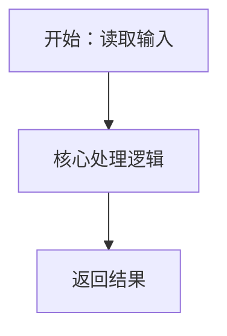

```python
import sys  # 提高递归深度上限（深输入防 RecursionError）

sys.setrecursionlimit(200000)  # 树/链表类题目节点数可达 1e4 量级

class Bitset:  # 定义类
    def __init__(self, size):  # 构造函数：初始化成员
        self.n = size  # 把 大小 写入 元素个数
        self.words = [0] * ((size + 31) // 32)  # 把 [0] 乘 ((大小 加 31) 除以 除以 32) 写入 单词列表
        self.ones = 0  # 把 0 写入 self.ones
        self.reverse = 0  # 把 0 写入 self.reverse

    def _real_flag(self, idx):  # 定义函数 _real_flag（参数：self, idx）
        index = idx // 32  # 把 idx 除以 除以 32 存入 index
        bit = idx % 32  # 把 idx 对…取模 32 存入 bit
        return (
            (self.words[index] >> bit) & 1
        ) ^ self.reverse  # 返回 ((self.单词列表[index] 超过 超过 bit) 按位与 1) 按位异或 self.reverse

    def _set_flag(self, idx, v):  # 定义函数 _set_flag（参数：self, idx, 值）
        index = idx // 32  # 把 idx 除以 除以 32 存入 index
        bit = idx % 32  # 把 idx 对…取模 32 存入 bit
        old = self._real_flag(idx)  # 把 self._real_flag(idx) 存入 old
        if old != v:  # 若 old 不等于 值
            self.ones += v - old  # self.ones累加 (值 减 old)
            physical = v ^ self.reverse  # 把 值 按位异或 self.reverse 存入 physical
            if physical == 1:  # 若 physical 等于 1
                self.words[index] |= 1 << bit  # 把 (1 小于 小于 bit) 写入 self.words[index] |
            else:  # 否则
                self.words[index] &= ~(1 << bit)  # 把 ~(1 小于 小于 bit) 写入 self.words[index] &

    def fix(self, idx):  # 定义函数 fix（参数：self, idx）
        self._set_flag(idx, 1)  # self._set_flag(idx, 1)

    def unfix(self, idx):  # 定义函数 unfix（参数：self, idx）
        self._set_flag(idx, 0)  # self._set_flag(idx, 0)

    def flip(self):  # 定义函数 flip（参数：self）
        self.reverse ^= 1  # 把 1 写入 self.reverse ^
        self.ones = self.n - self.ones  # 把 self.元素个数 减 self.ones 写入 self.ones

    def all(self):  # 定义函数 all（参数：self）
        return self.ones == self.n  # 返回 self.ones 等于 self.元素个数

    def one(self):  # 定义函数 one（参数：self）
        return self.ones > 0  # 返回 self.ones 超过 0

    def count(self):  # 定义函数 count（参数：self）
        return self.ones  # 返回 self.ones

    def toString(self):  # 定义函数 toString（参数：self）
        return "".join(str(self._real_flag(i)) for i in range(self.n))

if __name__ == "__main__":  # 若 __name__ 等于 '__main__'
    bs = Bitset(5)  # 把 Bitset(5) 存入 bs
    bs.fix(0)  # bs.fix(0)
    bs.fix(3)  # bs.fix(3)
    print(bs.toString())  # 打印输出
    print(bs.count())  # 打印输出
    bs.flip()  # bs.flip()
    print(bs.toString())  # 打印输出
    print(bs.count())  # 打印输出
    bs.unfix(0)  # bs.unfix(0)
    print(bs.toString())  # 打印输出
    print(bs.all(), bs.one())  # 打印输出
```

#### 方案 2：按字存储实现

**思路与代码分析**：核心是「按字存储实现」。Python 版用切片与字典推导式简化操作，突出可读性。

**运行架构**：与方案 1 的控制流相同（同算法在该语言的等价实现），图见上。

```python
import sys  # 提高递归深度上限（深输入防 RecursionError）

sys.setrecursionlimit(200000)  # 树/链表类题目节点数可达 1e4 量级

class Bitset:  # 定义类
    def __init__(self, size):  # 构造函数：初始化成员
        self.n = size  # 把 大小 写入 元素个数
        self.words = [0] * ((size + 31) // 32)  # 把 [0] 乘 ((大小 加 31) 除以 除以 32) 写入 单词列表
        self.ones = 0  # 把 0 写入 self.ones
        self.reverse = 0  # 把 0 写入 self.reverse

    def _real_flag(self, idx):  # 定义函数 _real_flag（参数：self, idx）
        index = idx // 32  # 把 idx 除以 除以 32 存入 index
        bit = idx % 32  # 把 idx 对…取模 32 存入 bit
        return (
            (self.words[index] >> bit) & 1
        ) ^ self.reverse  # 返回 ((self.单词列表[index] 超过 超过 bit) 按位与 1) 按位异或 self.reverse

    def _set_flag(self, idx, v):  # 定义函数 _set_flag（参数：self, idx, 值）
        index = idx // 32  # 把 idx 除以 除以 32 存入 index
        bit = idx % 32  # 把 idx 对…取模 32 存入 bit
        old = self._real_flag(idx)  # 把 self._real_flag(idx) 存入 old
        if old != v:  # 若 old 不等于 值
            self.ones += v - old  # self.ones累加 (值 减 old)
            physical = v ^ self.reverse  # 把 值 按位异或 self.reverse 存入 physical
            if physical == 1:  # 若 physical 等于 1
                self.words[index] |= 1 << bit  # 把 (1 小于 小于 bit) 写入 self.words[index] |
            else:  # 否则
                self.words[index] &= ~(1 << bit)  # 把 ~(1 小于 小于 bit) 写入 self.words[index] &

    def fix(self, idx):  # 定义函数 fix（参数：self, idx）
        self._set_flag(idx, 1)  # self._set_flag(idx, 1)

    def unfix(self, idx):  # 定义函数 unfix（参数：self, idx）
        self._set_flag(idx, 0)  # self._set_flag(idx, 0)

    def flip(self):  # 定义函数 flip（参数：self）
        self.reverse ^= 1  # 把 1 写入 self.reverse ^
        self.ones = self.n - self.ones  # 把 self.元素个数 减 self.ones 写入 self.ones

    def all(self):  # 定义函数 all（参数：self）
        return self.ones == self.n  # 返回 self.ones 等于 self.元素个数

    def one(self):  # 定义函数 one（参数：self）
        return self.ones > 0  # 返回 self.ones 超过 0

    def count(self):  # 定义函数 count（参数：self）
        return self.ones  # 返回 self.ones

    def toString(self):  # 定义函数 toString（参数：self）
        return "".join(str(self._real_flag(i)) for i in range(self.n))

if __name__ == "__main__":  # 若 __name__ 等于 '__main__'
    bs = Bitset(5)  # 把 Bitset(5) 存入 bs
    bs.fix(0)  # bs.fix(0)
    bs.fix(3)  # bs.fix(3)
    print(bs.toString())  # 打印输出
    print(bs.count())  # 打印输出
    bs.flip()  # bs.flip()
    print(bs.toString())  # 打印输出
    print(bs.count())  # 打印输出
    bs.unfix(0)  # bs.unfix(0)
    print(bs.toString())  # 打印输出
    print(bs.all(), bs.one())  # 打印输出
```

### Go 实现（2 种方案）

Go 的全部方案如下，每个方案都内嵌用例自测，可独立运行（老仓库 python/go 文件遵循「打印结果」约定）：

#### 方案 1：按字存储实现

**思路与代码分析**：核心是「按字存储实现」。Go 版用切片与多返回值惯用法，显式处理索引边界。**走读**：方案 1 · 按字存储实现：开始 → 返回 &Bitset。

**运行架构**（真实控制流）：

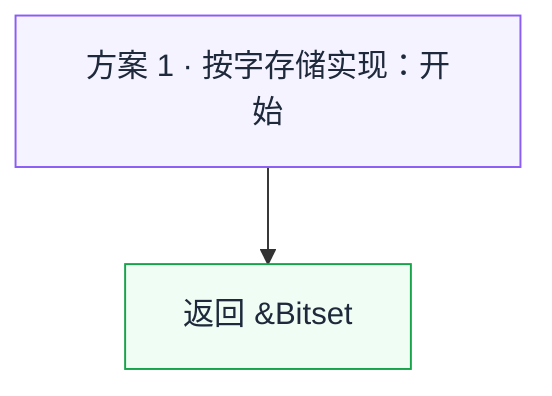

```go
package main // 引入依赖

import (
	"fmt" // 「fmt」
	"os"  // 「os」
)

// Bitset stores bits one-per-int; Flip uses a lazy inverted flag.
type Bitset struct { // 定义类型
	arr      []int // 数组 []int
	cnt      int   // 计数 int
	reversed int   // reversed int
}

func NewBitset(size int) *Bitset { // 定义函数/方法 NewBitset
	return &Bitset{arr: make([]int, size)} // 返回 按位与 Bitset{数组: make([]int, 大小)}
}

func (b *Bitset) fix(idx int) { // 定义函数/方法 fix
	if (b.arr[idx] ^ b.reversed) == 0 { // 若 b.数组[idx] 按位异或 b.reversed) 等于 0
		b.arr[idx] ^= 1 // 把 1 写入 b.arr[idx] ^
		b.cnt++         // b.计数 加一
	}
}

func (b *Bitset) unfix(idx int) { // 定义函数/方法 unfix
	if (b.arr[idx] ^ b.reversed) == 1 { // 若 b.数组[idx] 按位异或 b.reversed) 等于 1
		b.arr[idx] ^= 1 // 把 1 写入 b.arr[idx] ^
		b.cnt--         // b.计数 减一
	}
}

func (b *Bitset) flip() { // 定义函数/方法 flip
	b.reversed ^= 1            // 把 1 写入 b.reversed ^
	b.cnt = len(b.arr) - b.cnt // 把 长度(b.数组) 减 b.计数 写入 计数
}

func (b *Bitset) all() bool  { return b.cnt == len(b.arr) } // 定义函数/方法 all
func (b *Bitset) one() bool  { return b.cnt > 0 }           // 定义函数/方法 one
func (b *Bitset) count() int { return b.cnt }               // 定义函数/方法 count

func (b *Bitset) toString() string { // 定义函数/方法 toString
	res := make([]byte, len(b.arr)) // 把 make([]byte, 长度(b.数组)) 写入 res :
	for i, bit := range b.arr {     // 同时取 下标 i 与 bit 遍历
		res[i] = byte('0' + (bit ^ b.reversed)) // 把 byte('0' 加 (bit 按位异或 b.reversed)) 写入 res[i]
	}
	return string(res) // 定义函数/方法 string
}

func main() { // 程序入口：跑内嵌自测用例
	b := NewBitset(5)                    // 把 NewBitset(5) 写入 b :
	b.fix(0)                             // b.fix(0)
	b.fix(3)                             // b.fix(3)
	ok := true                           // 把 true 写入 ok :
	if s := b.toString(); s != "10010" { // 若 字符串 : 赋值为 b.toString(); 字符串 不等于 「10010」
		ok = false                           // 把 false 写入 ok
		fmt.Printf("FAIL toString1=%q\n", s) // 打印输出
	}
	if c := b.count(); c != 2 { // 若 字符 : 赋值为 b.计数(); 字符 不等于 2
		ok = false                        // 把 false 写入 ok
		fmt.Printf("FAIL count1=%d\n", c) // 打印输出
	}
	b.flip()                             // b.flip()
	if s := b.toString(); s != "01101" { // 若 字符串 : 赋值为 b.toString(); 字符串 不等于 「01101」
		ok = false                           // 把 false 写入 ok
		fmt.Printf("FAIL toString2=%q\n", s) // 打印输出
	}
	if c := b.count(); c != 3 { // 若 字符 : 赋值为 b.计数(); 字符 不等于 3
		ok = false                        // 把 false 写入 ok
		fmt.Printf("FAIL count2=%d\n", c) // 打印输出
	}
	b.unfix(0)                           // b.unfix(0)
	if s := b.toString(); s != "01101" { // 若 字符串 : 赋值为 b.toString(); 字符串 不等于 「01101」
		ok = false                           // 把 false 写入 ok
		fmt.Printf("FAIL toString3=%q\n", s) // 打印输出
	}
	if a := b.all(); a != false { // 若 数组 : 赋值为 b.all(); 数组 不等于 false
		ok = false              // 把 false 写入 ok
		fmt.Println("FAIL all") // 打印输出
	}
	if o := b.one(); o != true { // 若 o : 赋值为 b.one(); o 不等于 true
		ok = false              // 把 false 写入 ok
		fmt.Println("FAIL one") // 打印输出
	}
	if !ok { // 若 取反 ok
		os.Exit(1) // os.Exit(1)
	}
	fmt.Println("PASS") // 全部用例通过，输出 PASS
}
```

#### 方案 2：按字存储实现

**思路与代码分析**：核心是「按字存储实现」。Go 版用切片与多返回值惯用法，显式处理索引边界。**走读**：方案 2 · 按字存储实现：开始 → 返回 &Bitset。

**运行架构**（真实控制流）：

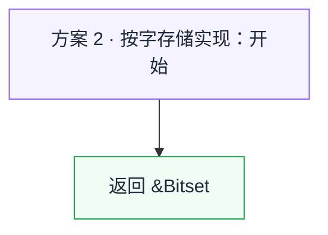

```go
package main // 引入依赖

import (
	"fmt" // 「fmt」
	"os"  // 「os」
)

// Bitset stores bits one-per-int; Flip uses a lazy inverted flag.
type Bitset struct { // 定义类型
	arr      []int // 数组 []int
	cnt      int   // 计数 int
	reversed int   // reversed int
}

func Constructor(size int) *Bitset { // 定义函数/方法 Constructor
	return &Bitset{arr: make([]int, size)} // 返回 按位与 Bitset{数组: make([]int, 大小)}
}

func (b *Bitset) Fix(idx int) { // 定义函数/方法 Fix
	if (b.arr[idx] ^ b.reversed) == 0 { // 若 b.数组[idx] 按位异或 b.reversed) 等于 0
		b.arr[idx] ^= 1 // 把 1 写入 b.arr[idx] ^
		b.cnt++         // b.计数 加一
	}
}

func (b *Bitset) Unfix(idx int) { // 定义函数/方法 Unfix
	if (b.arr[idx] ^ b.reversed) == 1 { // 若 b.数组[idx] 按位异或 b.reversed) 等于 1
		b.arr[idx] ^= 1 // 把 1 写入 b.arr[idx] ^
		b.cnt--         // b.计数 减一
	}
}

func (b *Bitset) Flip() { // 定义函数/方法 Flip
	b.reversed ^= 1            // 把 1 写入 b.reversed ^
	b.cnt = len(b.arr) - b.cnt // 把 长度(b.数组) 减 b.计数 写入 计数
}

func (b *Bitset) All() bool  { return b.cnt == len(b.arr) } // 定义函数/方法 All
func (b *Bitset) One() bool  { return b.cnt > 0 }           // 定义函数/方法 One
func (b *Bitset) Count() int { return b.cnt }               // 定义函数/方法 Count

func (b *Bitset) ToString() string { // 定义函数/方法 ToString
	res := make([]byte, len(b.arr)) // 把 make([]byte, 长度(b.数组)) 写入 res :
	for i, bit := range b.arr {     // 同时取 下标 i 与 bit 遍历
		res[i] = byte('0' + (bit ^ b.reversed)) // 把 byte('0' 加 (bit 按位异或 b.reversed)) 写入 res[i]
	}
	return string(res) // 定义函数/方法 string
}

func main() { // 程序入口：跑内嵌自测用例
	b := Constructor(5)                  // 把 Constructor(5) 写入 b :
	b.Fix(0)                             // b.Fix(0)
	b.Fix(3)                             // b.Fix(3)
	ok := true                           // 把 true 写入 ok :
	if s := b.ToString(); s != "10010" { // 若 字符串 : 赋值为 b.ToString(); 字符串 不等于 「10010」
		ok = false                           // 把 false 写入 ok
		fmt.Printf("FAIL toString1=%q\n", s) // 打印输出
	}
	if c := b.Count(); c != 2 { // 若 字符 : 赋值为 b.Count(); 字符 不等于 2
		ok = false                        // 把 false 写入 ok
		fmt.Printf("FAIL count1=%d\n", c) // 打印输出
	}
	b.Flip()                             // b.Flip()
	if s := b.ToString(); s != "01101" { // 若 字符串 : 赋值为 b.ToString(); 字符串 不等于 「01101」
		ok = false                           // 把 false 写入 ok
		fmt.Printf("FAIL toString2=%q\n", s) // 打印输出
	}
	if c := b.Count(); c != 3 { // 若 字符 : 赋值为 b.Count(); 字符 不等于 3
		ok = false                        // 把 false 写入 ok
		fmt.Printf("FAIL count2=%d\n", c) // 打印输出
	}
	b.Unfix(0)                           // b.Unfix(0)
	if s := b.ToString(); s != "01101" { // 若 字符串 : 赋值为 b.ToString(); 字符串 不等于 「01101」
		ok = false                           // 把 false 写入 ok
		fmt.Printf("FAIL toString3=%q\n", s) // 打印输出
	}
	if a := b.All(); a != false { // 若 数组 : 赋值为 b.All(); 数组 不等于 false
		ok = false              // 把 false 写入 ok
		fmt.Println("FAIL all") // 打印输出
	}
	if o := b.One(); o != true { // 若 o : 赋值为 b.One(); o 不等于 true
		ok = false              // 把 false 写入 ok
		fmt.Println("FAIL one") // 打印输出
	}
	if !ok { // 若 取反 ok
		os.Exit(1) // os.Exit(1)
	}
	fmt.Println("PASS") // 全部用例通过，输出 PASS
}
```

### Java 实现（2 种方案）

Java 的全部方案如下，每个方案都内嵌用例自测，可独立运行（老仓库 python/go 文件遵循「打印结果」约定）：

#### 方案 1：按字存储实现

**思路与代码分析**：核心是「按字存储实现」。Java 版用类与静态方法组织，集合操作显式明了。**走读**：方案 1 · 按字存储实现：开始 → 更新 this.n → 更新 this.words → 更新 this.ones → 更新 this.reverse → 返回结果。

**运行架构**（真实控制流）：


```java
package com.webfault.dsa; // 引入依赖

class lc2166_solution111 { // 定义类型
  // Bitset 忠实翻译 python ref（32 位分 words + reverse 懒翻转）
  static class Bitset { // static class Bitset {
    int n; // int 元素个数;
    int[] words; // int[] 单词列表;
    int ones; // int ones;
    int reverse; // int reverse;

    Bitset(int size) { // Bitset(int 大小) {
      this.n = size; // 把 大小; 写入 元素个数
      this.words = new int[(size + 31) / 32]; // 把 new int[(大小 加 31) 除以 32]; 写入 单词列表
      this.ones = 0; // 把 0; 写入 this.ones
      this.reverse = 0; // 把 0; 写入 this.reverse
    }

    int realFlag(int idx) { // 定义函数/方法 realFlag
      int index = idx / 32; // 把 idx 除以 32 存入 index
      int bit = idx % 32; // 把 idx 对…取模 32 存入 bit
      return ((words[index] >> bit) & 1)
          ^ reverse; // 返回 ((单词列表[index] 超过 超过 bit) 按位与 1) 按位异或 reverse
    }

    void setFlag(int idx, int v) { // 定义函数/方法 setFlag
      int index = idx / 32; // 把 idx 除以 32 存入 index
      int bit = idx % 32; // 把 idx 对…取模 32 存入 bit
      int old = realFlag(idx); // 把 realFlag(idx) 存入 old
      if (old != v) { // 若 old 不等于 值
        ones += (v - old); // ones累加 (值 减 old)
        int physical = v ^ reverse; // 把 值 按位异或 reverse 存入 physical
        if (physical == 1) { // 若 physical 等于 1
          words[index] |= (1 << bit); // 把 (1 小于 小于 bit); 写入 words[index] |
        } else { // 否则
          words[index] &= ~(1 << bit); // 把 ~(1 小于 小于 bit); 写入 words[index] &
        }
      }
    }

    void fix(int idx) { // 定义函数/方法 fix
      setFlag(idx, 1); // setFlag(idx, 1);
    }

    void unfix(int idx) { // 定义函数/方法 unfix
      setFlag(idx, 0); // setFlag(idx, 0);
    }

    void flip() { // 定义函数/方法 flip
      reverse ^= 1; // 把 1; 写入 reverse ^
      ones = n - ones; // 把 元素个数 减 ones; 写入 ones
    }

    boolean all() { // 定义函数/方法 all
      return ones == n; // 返回 ones 等于 元素个数
    }

    boolean one() { // 定义函数/方法 one
      return ones > 0; // 返回 ones 超过 0
    }

    int count() { // 定义函数/方法 count
      return ones; // 返回 ones
    }

    String str() { // 定义函数/方法 str
      StringBuilder sb = new StringBuilder(); // 把 new StringBuilder(); 写入 StringBuilder sb
      for (int i = 0; i < n; i++) { // 让 下标 i 从 0 开始计数，下标 i 小于 元素个数 就继续
        sb.append(realFlag(i)); // 把 realFlag(下标 i 追加到列表尾部
      }
      return sb.toString(); // 返回 sb.toString()
    }
  }

  public static void main(String[] args) { // public static void main(String[] args) {
    boolean ok = true; // 把 true; 写入 boolean ok

    // case A normal: 对应 python ref __main__
    Bitset a = new Bitset(5); // 把 new Bitset(5); 写入 Bitset a
    a.fix(0); // 数组.fix(0);
    a.fix(3); // 数组.fix(3);
    if (!a.str().equals("10010")
        || a.count() != 2) { // 若 取反 数组.str().equals(「10010」) 或 数组.计数() 不等于 2
      ok = false; // 把 false; 写入 ok
      System.out.println("FAIL A1 got " + a.str() + " count " + a.count()); // 打印输出
    }
    a.flip(); // 数组.flip();
    if (!a.str().equals("01101")
        || a.count() != 3) { // 若 取反 数组.str().equals(「01101」) 或 数组.计数() 不等于 3
      ok = false; // 把 false; 写入 ok
      System.out.println("FAIL A2 got " + a.str() + " count " + a.count()); // 打印输出
    }
    a.unfix(0); // 数组.unfix(0);
    if (!a.str().equals("01101")
        || a.all()
        || !a.one()) { // 若 取反 数组.str().equals(「01101」) 或 数组.all() 或 取反 数组.one(
      ok = false; // 把 false; 写入 ok
      System.out.println("FAIL A3 got " + a.str()); // 打印输出
    }

    // case B boundary: size=1 全边界
    Bitset b = new Bitset(1); // 把 new Bitset(1); 写入 Bitset b
    if (!b.str().equals("0")
        || b.all()
        || b.one()
        || b.count() != 0) { // 若 取反 b.str().equals(「0」) 或 b.all() 或 b.one() 或 b.计数() 不等于 0
      ok = false; // 把 false; 写入 ok
      System.out.println("FAIL B0"); // 打印输出
    }
    b.fix(0); // b.fix(0);
    if (!b.str().equals("1") || !b.all() || !b.one() || b.count() != 1) {
      ok = false; // 把 false; 写入 ok
      System.out.println("FAIL B1"); // 打印输出
    }
    b.unfix(0); // b.unfix(0);
    if (!b.str().equals("0")
        || b.all()
        || b.one()
        || b.count() != 0) { // 若 取反 b.str().equals(「0」) 或 b.all() 或 b.one() 或 b.计数() 不等于 0
      ok = false; // 把 false; 写入 ok
      System.out.println("FAIL B2"); // 打印输出
    }
    b.flip(); // b.flip();
    if (!b.str().equals("1") || !b.all() || !b.one() || b.count() != 1) {
      ok = false; // 把 false; 写入 ok
      System.out.println("FAIL B3"); // 打印输出
    }

    // case C boundary: size=33 跨 32 位 words 边界
    Bitset c = new Bitset(33); // 把 new Bitset(33); 写入 Bitset c
    c.fix(0); // 字符.fix(0);
    c.fix(32); // 字符.fix(32);
    c.flip(); // 字符.flip();
    c.fix(16); // 字符.fix(16);
    if (!c.str().equals("011111111111111111111111111111110")
        || c.count() != 31
        || c.all()
        || !c.one()) {
      ok = false; // 把 false; 写入 ok
      System.out.println("FAIL C1 got " + c.str() + " count " + c.count()); // 打印输出
    }

    if (!ok) { // 若 取反 ok
      throw new RuntimeException("FAILED"); // throw new RuntimeException(「FAILED」);
    }
    System.out.println("PASS"); // 全部用例通过，输出 PASS
  }
}
```

#### 方案 2：按字存储实现

**思路与代码分析**：核心是「按字存储实现」。Java 版用类与静态方法组织，集合操作显式明了。**走读**：方案 2 · 按字存储实现：开始 → 更新 this.n → 更新 this.words → 更新 this.ones → 更新 this.reverse → 返回结果。

**运行架构**（真实控制流）：

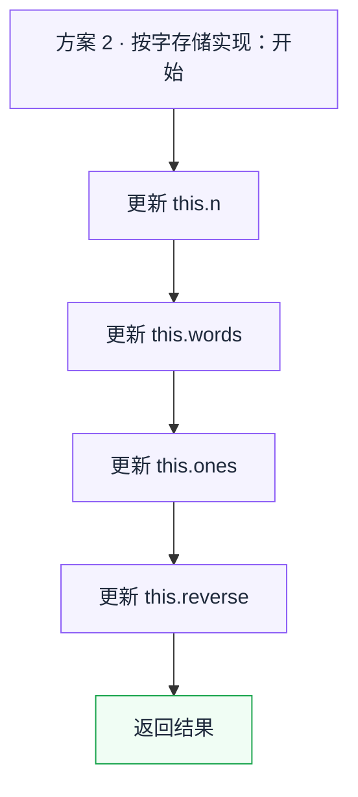

```java
package com.webfault.dsa; // 引入依赖

class lc2166_solution222 { // 定义类型
  // Bitset 忠实翻译 python ref（32 位分 words + reverse 懒翻转）
  static class Bitset { // static class Bitset {
    int n; // int 元素个数;
    int[] words; // int[] 单词列表;
    int ones; // int ones;
    int reverse; // int reverse;

    Bitset(int size) { // Bitset(int 大小) {
      this.n = size; // 把 大小; 写入 元素个数
      this.words = new int[(size + 31) / 32]; // 把 new int[(大小 加 31) 除以 32]; 写入 单词列表
      this.ones = 0; // 把 0; 写入 this.ones
      this.reverse = 0; // 把 0; 写入 this.reverse
    }

    int realFlag(int idx) { // 定义函数/方法 realFlag
      int index = idx / 32; // 把 idx 除以 32 存入 index
      int bit = idx % 32; // 把 idx 对…取模 32 存入 bit
      return ((words[index] >> bit) & 1)
          ^ reverse; // 返回 ((单词列表[index] 超过 超过 bit) 按位与 1) 按位异或 reverse
    }

    void setFlag(int idx, int v) { // 定义函数/方法 setFlag
      int index = idx / 32; // 把 idx 除以 32 存入 index
      int bit = idx % 32; // 把 idx 对…取模 32 存入 bit
      int old = realFlag(idx); // 把 realFlag(idx) 存入 old
      if (old != v) { // 若 old 不等于 值
        ones += (v - old); // ones累加 (值 减 old)
        int physical = v ^ reverse; // 把 值 按位异或 reverse 存入 physical
        if (physical == 1) { // 若 physical 等于 1
          words[index] |= (1 << bit); // 把 (1 小于 小于 bit); 写入 words[index] |
        } else { // 否则
          words[index] &= ~(1 << bit); // 把 ~(1 小于 小于 bit); 写入 words[index] &
        }
      }
    }

    void fix(int idx) { // 定义函数/方法 fix
      setFlag(idx, 1); // setFlag(idx, 1);
    }

    void unfix(int idx) { // 定义函数/方法 unfix
      setFlag(idx, 0); // setFlag(idx, 0);
    }

    void flip() { // 定义函数/方法 flip
      reverse ^= 1; // 把 1; 写入 reverse ^
      ones = n - ones; // 把 元素个数 减 ones; 写入 ones
    }

    boolean all() { // 定义函数/方法 all
      return ones == n; // 返回 ones 等于 元素个数
    }

    boolean one() { // 定义函数/方法 one
      return ones > 0; // 返回 ones 超过 0
    }

    int count() { // 定义函数/方法 count
      return ones; // 返回 ones
    }

    String str() { // 定义函数/方法 str
      StringBuilder sb = new StringBuilder(); // 把 new StringBuilder(); 写入 StringBuilder sb
      for (int i = 0; i < n; i++) { // 让 下标 i 从 0 开始计数，下标 i 小于 元素个数 就继续
        sb.append(realFlag(i)); // 把 realFlag(下标 i 追加到列表尾部
      }
      return sb.toString(); // 返回 sb.toString()
    }
  }

  public static void main(String[] args) { // public static void main(String[] args) {
    boolean ok = true; // 把 true; 写入 boolean ok

    // case A normal: 对应 python ref __main__
    Bitset a = new Bitset(5); // 把 new Bitset(5); 写入 Bitset a
    a.fix(0); // 数组.fix(0);
    a.fix(3); // 数组.fix(3);
    if (!a.str().equals("10010")
        || a.count() != 2) { // 若 取反 数组.str().equals(「10010」) 或 数组.计数() 不等于 2
      ok = false; // 把 false; 写入 ok
      System.out.println("FAIL A1 got " + a.str() + " count " + a.count()); // 打印输出
    }
    a.flip(); // 数组.flip();
    if (!a.str().equals("01101")
        || a.count() != 3) { // 若 取反 数组.str().equals(「01101」) 或 数组.计数() 不等于 3
      ok = false; // 把 false; 写入 ok
      System.out.println("FAIL A2 got " + a.str() + " count " + a.count()); // 打印输出
    }
    a.unfix(0); // 数组.unfix(0);
    if (!a.str().equals("01101")
        || a.all()
        || !a.one()) { // 若 取反 数组.str().equals(「01101」) 或 数组.all() 或 取反 数组.one(
      ok = false; // 把 false; 写入 ok
      System.out.println("FAIL A3 got " + a.str()); // 打印输出
    }

    // case B boundary: size=1 全边界
    Bitset b = new Bitset(1); // 把 new Bitset(1); 写入 Bitset b
    if (!b.str().equals("0")
        || b.all()
        || b.one()
        || b.count() != 0) { // 若 取反 b.str().equals(「0」) 或 b.all() 或 b.one() 或 b.计数() 不等于 0
      ok = false; // 把 false; 写入 ok
      System.out.println("FAIL B0"); // 打印输出
    }
    b.fix(0); // b.fix(0);
    if (!b.str().equals("1") || !b.all() || !b.one() || b.count() != 1) {
      ok = false; // 把 false; 写入 ok
      System.out.println("FAIL B1"); // 打印输出
    }
    b.unfix(0); // b.unfix(0);
    if (!b.str().equals("0")
        || b.all()
        || b.one()
        || b.count() != 0) { // 若 取反 b.str().equals(「0」) 或 b.all() 或 b.one() 或 b.计数() 不等于 0
      ok = false; // 把 false; 写入 ok
      System.out.println("FAIL B2"); // 打印输出
    }
    b.flip(); // b.flip();
    if (!b.str().equals("1") || !b.all() || !b.one() || b.count() != 1) {
      ok = false; // 把 false; 写入 ok
      System.out.println("FAIL B3"); // 打印输出
    }

    // case C boundary: size=33 跨 32 位 words 边界
    Bitset c = new Bitset(33); // 把 new Bitset(33); 写入 Bitset c
    c.fix(0); // 字符.fix(0);
    c.fix(32); // 字符.fix(32);
    c.flip(); // 字符.flip();
    c.fix(16); // 字符.fix(16);
    if (!c.str().equals("011111111111111111111111111111110")
        || c.count() != 31
        || c.all()
        || !c.one()) {
      ok = false; // 把 false; 写入 ok
      System.out.println("FAIL C1 got " + c.str() + " count " + c.count()); // 打印输出
    }

    if (!ok) { // 若 取反 ok
      throw new RuntimeException("FAILED"); // throw new RuntimeException(「FAILED」);
    }
    System.out.println("PASS"); // 全部用例通过，输出 PASS
  }
}
```

### Rust 实现（2 种方案）

Rust 的全部方案如下，每个方案都内嵌用例自测，可独立运行（老仓库 python/go 文件遵循「打印结果」约定）：

#### 方案 1：按字存储实现

**思路与代码分析**：核心是「按字存储实现」。Rust 版用所有权移动与切片借用改写同一逻辑，注意 Option 与引用边界。**走读**：方案 1 · 按字存储实现：开始 → 处理 Bitset → 处理 n: size, → 处理 words: vec非 [0; (size + 31) / → 处理 ones: 0, → 处理 reverse: 0, → 返回结果。

**运行架构**（真实控制流）：


```rust
// LeetCode 2166. 设计位集 — Rust 版（方案1）
struct Bitset {
    n: usize,
    words: Vec<u32>,
    ones: usize,
    reverse: u32,
} // 定义类型
impl Bitset {
    // 实现块
    fn new(size: usize) -> Self {
        Bitset {
            n: size,
            words: vec![0; (size + 31) / 32],
            ones: 0,
            reverse: 0,
        }
    } // 定义函数/方法 new
    fn get(&self, idx: usize) -> u32 {
        ((self.words[idx / 32] >> (idx % 32)) & 1) ^ self.reverse
    } // 定义函数/方法 get
    fn fix(&mut self, idx: usize) {
        if self.get(idx) == 0 {
            self.words[idx / 32] |= 1 << (idx % 32);
            self.ones += 1;
        }
    } // 定义函数/方法 fix
    fn unfix(&mut self, idx: usize) {
        if self.get(idx) == 1 {
            self.words[idx / 32] &= !(1 << (idx % 32));
            self.ones -= 1;
        }
    } // 定义函数/方法 unfix
    fn flip(&mut self) {
        self.reverse ^= 1;
        self.ones = self.n - self.ones;
    } // 定义函数/方法 flip
    fn all(&self) -> bool {
        self.ones == self.n
    } // 定义函数/方法 all
    fn one(&self) -> bool {
        self.ones > 0
    } // 定义函数/方法 one
    fn count(&self) -> usize {
        self.ones
    } // 定义函数/方法 count
    fn to_string(&self) -> String {
        (0..self.n)
            .map(|i| char::from(b'0' + self.get(i) as u8))
            .collect()
    } // 定义函数/方法 to_string
}
fn main() {
    // 程序入口：跑内嵌自测用例
    let mut bs = Bitset::new(5); // 把 Bitset::new(5); 写入 let mut bs
    bs.fix(0);
    bs.fix(3); // bs.fix(0); bs.fix(3);
    assert_eq!(bs.to_string(), "10010"); // 断言校验
    assert_eq!(bs.count(), 2); // 断言校验
    bs.flip(); // bs.flip();
    assert_eq!(bs.to_string(), "01101"); // 断言校验
    assert_eq!(bs.count(), 3); // 断言校验
    bs.unfix(0); // bs.unfix(0);
    assert_eq!(bs.to_string(), "01101"); // 断言校验
    assert!(!bs.all() && bs.one()); // 断言校验
    println!("PASS"); // 全部用例通过，输出 PASS
}
```

#### 方案 2：按字存储实现

**思路与代码分析**：核心是「按字存储实现」。Rust 版用所有权移动与切片借用改写同一逻辑，注意 Option 与引用边界。**走读**：方案 2 · 按字存储实现：开始 → 处理 Bitset → 处理 n: size, → 处理 words: vec非 [0; (size + 31) / → 处理 ones: 0, → 处理 reverse: 0, → 返回结果。

**运行架构**（真实控制流）：

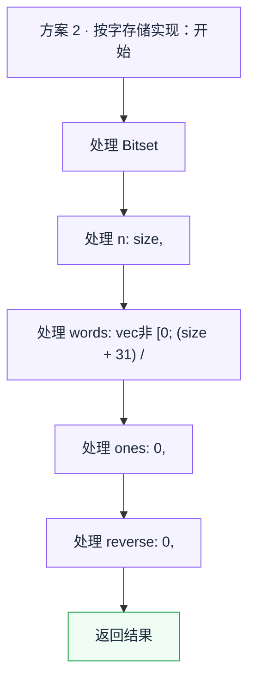

```rust
// LeetCode 2166. 设计位集 — Rust 版（方案2）
struct Bitset {
    n: usize,
    words: Vec<u32>,
    ones: usize,
    reverse: u32,
} // 定义类型
impl Bitset {
    // 实现块
    fn new(size: usize) -> Self {
        Bitset {
            n: size,
            words: vec![0; (size + 31) / 32],
            ones: 0,
            reverse: 0,
        }
    } // 定义函数/方法 new
    fn get(&self, idx: usize) -> u32 {
        ((self.words[idx / 32] >> (idx % 32)) & 1) ^ self.reverse
    } // 定义函数/方法 get
    fn fix(&mut self, idx: usize) {
        if self.get(idx) == 0 {
            self.words[idx / 32] |= 1 << (idx % 32);
            self.ones += 1;
        }
    } // 定义函数/方法 fix
    fn unfix(&mut self, idx: usize) {
        if self.get(idx) == 1 {
            self.words[idx / 32] &= !(1 << (idx % 32));
            self.ones -= 1;
        }
    } // 定义函数/方法 unfix
    fn flip(&mut self) {
        self.reverse ^= 1;
        self.ones = self.n - self.ones;
    } // 定义函数/方法 flip
    fn all(&self) -> bool {
        self.ones == self.n
    } // 定义函数/方法 all
    fn one(&self) -> bool {
        self.ones > 0
    } // 定义函数/方法 one
    fn count(&self) -> usize {
        self.ones
    } // 定义函数/方法 count
    fn to_string(&self) -> String {
        (0..self.n)
            .map(|i| char::from(b'0' + self.get(i) as u8))
            .collect()
    } // 定义函数/方法 to_string
}
fn main() {
    // 程序入口：跑内嵌自测用例
    let mut bs = Bitset::new(5); // 把 Bitset::new(5); 写入 let mut bs
    bs.fix(0);
    bs.fix(3); // bs.fix(0); bs.fix(3);
    assert_eq!(bs.to_string(), "10010"); // 断言校验
    assert_eq!(bs.count(), 2); // 断言校验
    bs.flip(); // bs.flip();
    assert_eq!(bs.to_string(), "01101"); // 断言校验
    assert_eq!(bs.count(), 3); // 断言校验
    bs.unfix(0); // bs.unfix(0);
    assert_eq!(bs.to_string(), "01101"); // 断言校验
    assert!(!bs.all() && bs.one()); // 断言校验
    println!("PASS"); // 全部用例通过，输出 PASS
}
```

### Lua 实现（2 种方案）

Lua 的全部方案如下，每个方案都内嵌用例自测，可独立运行（老仓库 python/go 文件遵循「打印结果」约定）：

#### 方案 1：按字存储实现

**思路与代码分析**：核心是「按字存储实现」。Lua 版用表与 ipairs 遍历，注意 ipairs 遇 nil 即停的语义。

**运行架构**（真实控制流）：


```lua
-- LeetCode 2166. 设计位集 — Lua 版（方案1）
local Bitset = {} -- 把 {} 写入 local Bitset
Bitset.__index = Bitset -- 把 Bitset 写入 Bitset.__index
function Bitset.new(size) -- function Bitset.new(大小)
	return setmetatable({ n = size, words = {}, ones = 0, reverse = 0 }, Bitset)
end -- 终点
function Bitset:get(idx) -- function Bitset:get(idx)
	local w = self.words[(idx >> 5) + 1] or 0 -- 把 self.单词列表[(idx 超过 超过 5) 加 1] or 0 写入 local w
	return ((w >> (idx & 31)) & 1) ~ self.reverse -- 返回 ((权重 超过 超过 (idx 按位与 31)) 按位与 1) ~ self.reverse
end -- 终点
function Bitset:fix(idx) -- function Bitset:fix(idx)
	if self:get(idx) == 0 then -- 若 self:get(idx) 等于 0 then
		self.words[(idx >> 5) + 1] = (self.words[(idx >> 5) + 1] or 0) | (1 << (idx & 31))
		self.ones = self.ones + 1 -- 把 self.ones 加 1 写入 self.ones
	end -- 终点
end -- 终点
function Bitset:unfix(idx) -- function Bitset:unfix(idx)
	if self:get(idx) == 1 then -- 若 self:get(idx) 等于 1 then
		self.words[(idx >> 5) + 1] = (self.words[(idx >> 5) + 1] or 0) & ~(1 << (idx & 31))
		self.ones = self.ones - 1 -- 把 self.ones 减 1 写入 self.ones
	end -- 终点
end -- 终点
function Bitset:flip() -- function Bitset:flip()
	self.reverse = self.reverse ~ 1 -- 把 self.reverse ~ 1 写入 self.reverse
	self.ones = self.n - self.ones -- 把 self.元素个数 减 self.ones 写入 self.ones
end -- 终点
function Bitset:all()
	return self.ones == self.n
end -- 把 赋值为 self.元素个数 终点 写入 function Bitset:all() return self.ones
function Bitset:one()
	return self.ones > 0
end -- function Bitset:one() return self.ones 超过 0 终点
function Bitset:count()
	return self.ones
end -- function Bitset:计数() return self.ones 终点
function Bitset:tostring() -- function Bitset:tostring()
	local s = {} -- 把 {} 写入 local s
	for i = 0, self.n - 1 do
		s[#s + 1] = tostring(self:get(i))
	end -- 让 下标 i 从 0 走到 self（Lua 1 基）
	return table.concat(s) -- 返回 table.concat(字符串)
end -- 终点
local bs = Bitset.new(5) -- 把 Bitset.new(5) 写入 local bs
bs:fix(0)
bs:fix(3) -- bs:fix(0); bs:fix(3)
assert(bs:tostring() == "10010") -- 断言校验
assert(bs:count() == 2) -- 断言校验
bs:flip() -- bs:flip()
assert(bs:tostring() == "01101") -- 断言校验
assert(bs:count() == 3) -- 断言校验
bs:unfix(0) -- bs:unfix(0)
assert(bs:tostring() == "01101") -- 断言校验
assert(bs:all() == false and bs:one() == true) -- 断言校验
print("PASS") -- 全部用例通过，输出 PASS
```

#### 方案 2：按字存储实现

**思路与代码分析**：核心是「按字存储实现」。Lua 版用表与 ipairs 遍历，注意 ipairs 遇 nil 即停的语义。

**运行架构**：与方案 1 的控制流相同（同算法在该语言的等价实现），图见上。

```lua
-- LeetCode 2166. 设计位集 — Lua 版（方案2）
local Bitset = {} -- 把 {} 写入 local Bitset
Bitset.__index = Bitset -- 把 Bitset 写入 Bitset.__index
function Bitset.new(size) -- function Bitset.new(大小)
	return setmetatable({ n = size, words = {}, ones = 0, reverse = 0 }, Bitset)
end -- 终点
function Bitset:get(idx) -- function Bitset:get(idx)
	local w = self.words[(idx >> 5) + 1] or 0 -- 把 self.单词列表[(idx 超过 超过 5) 加 1] or 0 写入 local w
	return ((w >> (idx & 31)) & 1) ~ self.reverse -- 返回 ((权重 超过 超过 (idx 按位与 31)) 按位与 1) ~ self.reverse
end -- 终点
function Bitset:fix(idx) -- function Bitset:fix(idx)
	if self:get(idx) == 0 then -- 若 self:get(idx) 等于 0 then
		self.words[(idx >> 5) + 1] = (self.words[(idx >> 5) + 1] or 0) | (1 << (idx & 31))
		self.ones = self.ones + 1 -- 把 self.ones 加 1 写入 self.ones
	end -- 终点
end -- 终点
function Bitset:unfix(idx) -- function Bitset:unfix(idx)
	if self:get(idx) == 1 then -- 若 self:get(idx) 等于 1 then
		self.words[(idx >> 5) + 1] = (self.words[(idx >> 5) + 1] or 0) & ~(1 << (idx & 31))
		self.ones = self.ones - 1 -- 把 self.ones 减 1 写入 self.ones
	end -- 终点
end -- 终点
function Bitset:flip() -- function Bitset:flip()
	self.reverse = self.reverse ~ 1 -- 把 self.reverse ~ 1 写入 self.reverse
	self.ones = self.n - self.ones -- 把 self.元素个数 减 self.ones 写入 self.ones
end -- 终点
function Bitset:all()
	return self.ones == self.n
end -- 把 赋值为 self.元素个数 终点 写入 function Bitset:all() return self.ones
function Bitset:one()
	return self.ones > 0
end -- function Bitset:one() return self.ones 超过 0 终点
function Bitset:count()
	return self.ones
end -- function Bitset:计数() return self.ones 终点
function Bitset:tostring() -- function Bitset:tostring()
	local s = {} -- 把 {} 写入 local s
	for i = 0, self.n - 1 do
		s[#s + 1] = tostring(self:get(i))
	end -- 让 下标 i 从 0 走到 self（Lua 1 基）
	return table.concat(s) -- 返回 table.concat(字符串)
end -- 终点
local bs = Bitset.new(5) -- 把 Bitset.new(5) 写入 local bs
bs:fix(0)
bs:fix(3) -- bs:fix(0); bs:fix(3)
assert(bs:tostring() == "10010") -- 断言校验
assert(bs:count() == 2) -- 断言校验
bs:flip() -- bs:flip()
assert(bs:tostring() == "01101") -- 断言校验
assert(bs:count() == 3) -- 断言校验
bs:unfix(0) -- bs:unfix(0)
assert(bs:tostring() == "01101") -- 断言校验
assert(bs:all() == false and bs:one() == true) -- 断言校验
print("PASS") -- 全部用例通过，输出 PASS
```

### C 实现（2 种方案）

C 的全部方案如下，每个方案都内嵌用例自测，可独立运行（老仓库 python/go 文件遵循「打印结果」约定）：

#### 方案 1：按字存储实现

**思路与代码分析**：核心是「按字存储实现」。C 版手动管理下标与内存，循环边界全部显式写出。**走读**：方案 1 · 按字存储实现：开始 → 更新 *b → 更新 b->n → 更新 b->words → 调用 sizeof(unsigned)) → 更新 b->ones → 更新 b->reverse → 返回 b。

**运行架构**（真实控制流）：

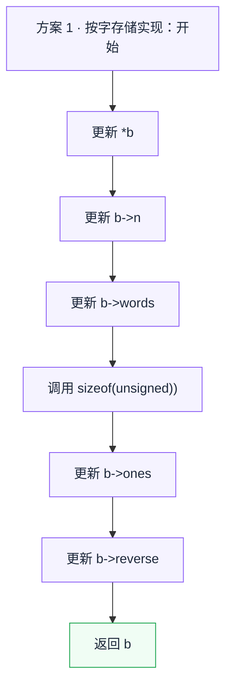

```c
/* LeetCode 2166. 设计位集 — C 版（方案1） */
#include <stdio.h>  // 引入头文件
#include <stdlib.h> // 引入头文件
#include <string.h> // 引入头文件
typedef struct {
    int n;
    unsigned *words;
    int ones;
    unsigned reverse;
} Bitset;
static Bitset *bs_new(int size) {       // static Bitset 乘 bs_new(int 大小) {
    Bitset *b = malloc(sizeof(Bitset)); // 把 malloc(sizeof(Bitset)); 写入 Bitset *b
    b->n = size;                        // 把 大小; 写入 b->n
    b->words = calloc((size + 31) / 32,
                      sizeof(unsigned)); // 把 calloc((大小 加 31) 除以 32, sizeof(unsigned)); 写入 b->words
    b->ones = 0;
    b->reverse = 0; // 把 0; b 减 超过 reverse 赋值为 0; 写入 b->ones
    return b;       // 返回 b
}
static unsigned bs_get(Bitset *b, int idx) { return ((b->words[idx >> 5] >> (idx & 31)) & 1u) ^ b->reverse; }
static void bs_fix(Bitset *b, int idx) {
    if (bs_get(b, idx) == 0) {
        b->words[idx >> 5] |= 1u << (idx & 31);
        b->ones++;
    }
}
static void bs_unfix(Bitset *b, int idx) {
    if (bs_get(b, idx) == 1) {
        b->words[idx >> 5] &= ~(1u << (idx & 31));
        b->ones--;
    }
}
static void bs_flip(Bitset *b) {
    b->reverse ^= 1;
    b->ones = b->n - b->ones;
}
static int bs_all(Bitset *b) { return b->ones == b->n; }
static int bs_one(Bitset *b) {
    return b->ones > 0;
} // static int bs_one(Bitset 乘 b) { return b 减 超过 ones 超过 0; }
static void bs_str(Bitset *b, char out[]) { // 定义函数/方法 bs_str
    for (int i = 0; i < b->n; i++)
        out[i] = '0' + bs_get(b, i); // 让 下标 i 从 0 开始计数，下标 i 小于 b 减 超过 元素个数 就继续
    out[b->n] = '\0';                // 把 '\0'; 写入 out[b->n]
}
int main(void) {           // 程序入口：跑内嵌自测用例
    Bitset *b = bs_new(5); // 把 bs_new(5); 写入 Bitset *b
    char s[64];            // char 字符串[64];
    bs_fix(b, 0);
    bs_fix(b, 3); // bs_fix(b, 0); bs_fix(b, 3);
    bs_str(b, s); // bs_str(b, 字符串);
    if (strcmp(s, "10010") != 0) {
        printf("FAIL s1 %s\n", s);
        return 1;
    } // 若 strcmp(字符串, 「10010」) 不等于 0) { 输出「10010」, 字符串); return 1; }
    if (b->ones != 2) {
        printf("FAIL c1\n");
        return 1;
    }             // 若 b 减 超过 ones 不等于 2) { 输出「FAIL c1 」); return 1; }
    bs_flip(b);   // bs_flip(b);
    bs_str(b, s); // bs_str(b, 字符串);
    if (strcmp(s, "01101") != 0) {
        printf("FAIL s2 %s\n", s);
        return 1;
    } // 若 strcmp(字符串, 「01101」) 不等于 0) { 输出「01101」, 字符串); return 1; }
    if (b->ones != 3) {
        printf("FAIL c2\n");
        return 1;
    }               // 若 b 减 超过 ones 不等于 3) { 输出「FAIL c2 」); return 1; }
    bs_unfix(b, 0); // bs_unfix(b, 0);
    bs_str(b, s);   // bs_str(b, 字符串);
    if (strcmp(s, "01101") != 0) {
        printf("FAIL s3 %s\n", s);
        return 1;
    } // 若 strcmp(字符串, 「01101」) 不等于 0) { 输出「01101」, 字符串); return 1; }
    if (bs_all(b) || !bs_one(b)) {
        printf("FAIL ao\n");
        return 1;
    } // 若 bs_all(b) 或 取反 bs_one(b)) { 输出「FAIL ao 」); return 1; }
    free(b->words);
    free(b);          // free(b 减 超过 单词列表); free(b);
    printf("PASS\n"); // 全部用例通过，输出 PASS
    return 0;         // 返回 0
}
```

#### 方案 2：按字存储实现

**思路与代码分析**：核心是「按字存储实现」。C 版手动管理下标与内存，循环边界全部显式写出。**走读**：方案 2 · 按字存储实现：开始 → 更新 *b → 更新 b->n → 更新 b->words → 调用 sizeof(unsigned)) → 更新 b->ones → 更新 b->reverse → 返回 b。

**运行架构**（真实控制流）：


```c
/* LeetCode 2166. 设计位集 — C 版（方案2） */
#include <stdio.h>  // 引入头文件
#include <stdlib.h> // 引入头文件
#include <string.h> // 引入头文件
typedef struct {
    int n;
    unsigned *words;
    int ones;
    unsigned reverse;
} Bitset;
static Bitset *bs_new(int size) {       // static Bitset 乘 bs_new(int 大小) {
    Bitset *b = malloc(sizeof(Bitset)); // 把 malloc(sizeof(Bitset)); 写入 Bitset *b
    b->n = size;                        // 把 大小; 写入 b->n
    b->words = calloc((size + 31) / 32,
                      sizeof(unsigned)); // 把 calloc((大小 加 31) 除以 32, sizeof(unsigned)); 写入 b->words
    b->ones = 0;
    b->reverse = 0; // 把 0; b 减 超过 reverse 赋值为 0; 写入 b->ones
    return b;       // 返回 b
}
static unsigned bs_get(Bitset *b, int idx) { return ((b->words[idx >> 5] >> (idx & 31)) & 1u) ^ b->reverse; }
static void bs_fix(Bitset *b, int idx) {
    if (bs_get(b, idx) == 0) {
        b->words[idx >> 5] |= 1u << (idx & 31);
        b->ones++;
    }
}
static void bs_unfix(Bitset *b, int idx) {
    if (bs_get(b, idx) == 1) {
        b->words[idx >> 5] &= ~(1u << (idx & 31));
        b->ones--;
    }
}
static void bs_flip(Bitset *b) {
    b->reverse ^= 1;
    b->ones = b->n - b->ones;
}
static int bs_all(Bitset *b) { return b->ones == b->n; }
static int bs_one(Bitset *b) {
    return b->ones > 0;
} // static int bs_one(Bitset 乘 b) { return b 减 超过 ones 超过 0; }
static void bs_str(Bitset *b, char out[]) { // 定义函数/方法 bs_str
    for (int i = 0; i < b->n; i++)
        out[i] = '0' + bs_get(b, i); // 让 下标 i 从 0 开始计数，下标 i 小于 b 减 超过 元素个数 就继续
    out[b->n] = '\0';                // 把 '\0'; 写入 out[b->n]
}
int main(void) {           // 程序入口：跑内嵌自测用例
    Bitset *b = bs_new(5); // 把 bs_new(5); 写入 Bitset *b
    char s[64];            // char 字符串[64];
    bs_fix(b, 0);
    bs_fix(b, 3); // bs_fix(b, 0); bs_fix(b, 3);
    bs_str(b, s); // bs_str(b, 字符串);
    if (strcmp(s, "10010") != 0) {
        printf("FAIL s1 %s\n", s);
        return 1;
    } // 若 strcmp(字符串, 「10010」) 不等于 0) { 输出「10010」, 字符串); return 1; }
    if (b->ones != 2) {
        printf("FAIL c1\n");
        return 1;
    }             // 若 b 减 超过 ones 不等于 2) { 输出「FAIL c1 」); return 1; }
    bs_flip(b);   // bs_flip(b);
    bs_str(b, s); // bs_str(b, 字符串);
    if (strcmp(s, "01101") != 0) {
        printf("FAIL s2 %s\n", s);
        return 1;
    } // 若 strcmp(字符串, 「01101」) 不等于 0) { 输出「01101」, 字符串); return 1; }
    if (b->ones != 3) {
        printf("FAIL c2\n");
        return 1;
    }               // 若 b 减 超过 ones 不等于 3) { 输出「FAIL c2 」); return 1; }
    bs_unfix(b, 0); // bs_unfix(b, 0);
    bs_str(b, s);   // bs_str(b, 字符串);
    if (strcmp(s, "01101") != 0) {
        printf("FAIL s3 %s\n", s);
        return 1;
    } // 若 strcmp(字符串, 「01101」) 不等于 0) { 输出「01101」, 字符串); return 1; }
    if (bs_all(b) || !bs_one(b)) {
        printf("FAIL ao\n");
        return 1;
    } // 若 bs_all(b) 或 取反 bs_one(b)) { 输出「FAIL ao 」); return 1; }
    free(b->words);
    free(b);          // free(b 减 超过 单词列表); free(b);
    printf("PASS\n"); // 全部用例通过，输出 PASS
    return 0;         // 返回 0
}
```

### C++ 实现（2 种方案）

C++ 的全部方案如下，每个方案都内嵌用例自测，可独立运行（老仓库 python/go 文件遵循「打印结果」约定）：

#### 方案 1：按字存储实现

**思路与代码分析**：核心是「按字存储实现」。C++ 版用 STL 容器与迭代器，减少手写下标错误。**走读**：方案 1 · 按字存储实现：开始 → 若 get(idx) == 0 则： → 更新 | → 处理 ++ones → 返回结果。

**运行架构**（真实控制流）：


```cpp
// LeetCode 2166. 设计位集 — C++ 版（方案1）
#include <cassert>               // 引入头文件
#include <iostream>              // 引入头文件
#include <string>                // 引入头文件
#include <vector>                // 引入头文件
struct Bitset {                  // 定义类型
    int n;                       // int 元素个数;
    std::vector<unsigned> words; // std::vector 小于 unsigned 超过 单词列表;
    int ones = 0;                // 把 0 存入 ones
    unsigned reverse = 0;        // 把 0; 写入 unsigned reverse
    explicit Bitset(int size) : n(size), words((size + 31) / 32, 0u) {}
    unsigned get(int idx) const { return ((words[idx >> 5] >> (idx & 31)) & 1u) ^ reverse; }
    void fix(int idx) {
        if (get(idx) == 0) {
            words[idx >> 5] |= 1u << (idx & 31);
            ++ones;
        }
    }
    void unfix(int idx) {
        if (get(idx) == 1) {
            words[idx >> 5] &= ~(1u << (idx & 31));
            --ones;
        }
    }
    void flip() {
        reverse ^= 1;
        ones = n - ones;
    } // 把 1; ones 赋值为 元素个数 减 ones; } 写入 void flip() { reverse ^
    bool all() const { return ones == n; } // 把 赋值为 元素个数; } 写入 bool all() const { return ones
    bool one() const { return ones > 0; } // bool one() const { return ones 超过 0; }
    int count() const { return ones; }    // int 计数() const { return ones; }
    std::string toString() const {        // std::string toString() const {
        std::string s;                    // std::string 字符串;
        for (int i = 0; i < n; ++i)
            s.push_back('0' +
                        static_cast<char>(get(i))); // 让 下标 i 从 0 开始计数，下标 i 小于 元素个数 就继续
        return s;                                   // 返回 字符串
    }
};
int main() {      // 程序入口：跑内嵌自测用例
    Bitset bs(5); // Bitset bs(5);
    bs.fix(0);
    bs.fix(3);                        // bs.fix(0); bs.fix(3);
    assert(bs.toString() == "10010"); // 断言校验
    assert(bs.count() == 2);          // 断言校验
    bs.flip();                        // bs.flip();
    assert(bs.toString() == "01101"); // 断言校验
    assert(bs.count() == 3);          // 断言校验
    bs.unfix(0);                      // bs.unfix(0);
    assert(bs.toString() == "01101"); // 断言校验
    assert(!bs.all() && bs.one());    // 断言校验
    std::cout << "PASS" << std::endl; // 全部用例通过，输出 PASS
    return 0;                         // 返回 0
}
```

#### 方案 2：按字存储实现

**思路与代码分析**：核心是「按字存储实现」。C++ 版用 STL 容器与迭代器，减少手写下标错误。**走读**：方案 2 · 按字存储实现：开始 → 若 get(idx) == 0 则： → 更新 | → 处理 ++ones → 返回结果。

**运行架构**（真实控制流）：

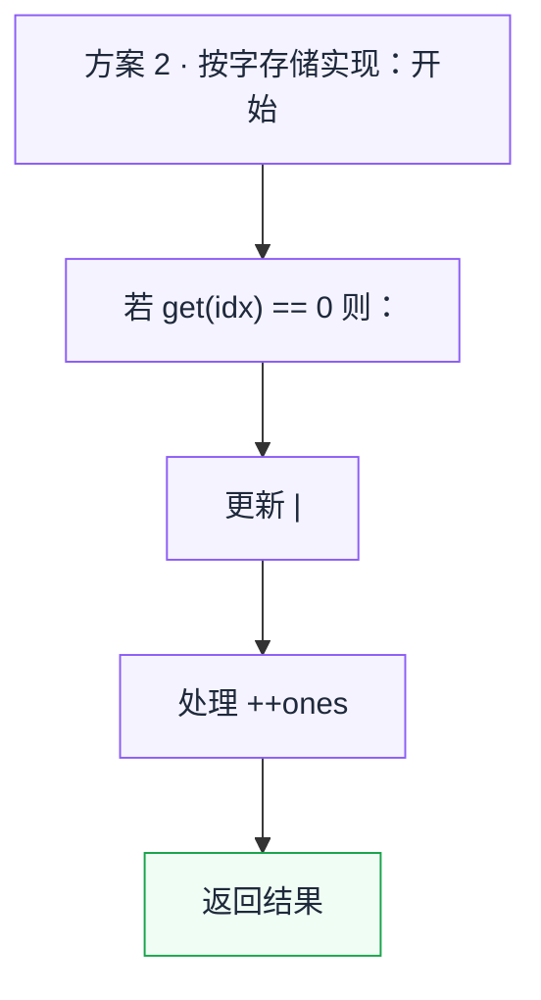

```cpp
// LeetCode 2166. 设计位集 — C++ 版（方案2）
#include <cassert>               // 引入头文件
#include <iostream>              // 引入头文件
#include <string>                // 引入头文件
#include <vector>                // 引入头文件
struct Bitset {                  // 定义类型
    int n;                       // int 元素个数;
    std::vector<unsigned> words; // std::vector 小于 unsigned 超过 单词列表;
    int ones = 0;                // 把 0 存入 ones
    unsigned reverse = 0;        // 把 0; 写入 unsigned reverse
    explicit Bitset(int size) : n(size), words((size + 31) / 32, 0u) {}
    unsigned get(int idx) const { return ((words[idx >> 5] >> (idx & 31)) & 1u) ^ reverse; }
    void fix(int idx) {
        if (get(idx) == 0) {
            words[idx >> 5] |= 1u << (idx & 31);
            ++ones;
        }
    }
    void unfix(int idx) {
        if (get(idx) == 1) {
            words[idx >> 5] &= ~(1u << (idx & 31));
            --ones;
        }
    }
    void flip() {
        reverse ^= 1;
        ones = n - ones;
    } // 把 1; ones 赋值为 元素个数 减 ones; } 写入 void flip() { reverse ^
    bool all() const { return ones == n; } // 把 赋值为 元素个数; } 写入 bool all() const { return ones
    bool one() const { return ones > 0; } // bool one() const { return ones 超过 0; }
    int count() const { return ones; }    // int 计数() const { return ones; }
    std::string toString() const {        // std::string toString() const {
        std::string s;                    // std::string 字符串;
        for (int i = 0; i < n; ++i)
            s.push_back('0' +
                        static_cast<char>(get(i))); // 让 下标 i 从 0 开始计数，下标 i 小于 元素个数 就继续
        return s;                                   // 返回 字符串
    }
};
int main() {      // 程序入口：跑内嵌自测用例
    Bitset bs(5); // Bitset bs(5);
    bs.fix(0);
    bs.fix(3);                        // bs.fix(0); bs.fix(3);
    assert(bs.toString() == "10010"); // 断言校验
    assert(bs.count() == 2);          // 断言校验
    bs.flip();                        // bs.flip();
    assert(bs.toString() == "01101"); // 断言校验
    assert(bs.count() == 3);          // 断言校验
    bs.unfix(0);                      // bs.unfix(0);
    assert(bs.toString() == "01101"); // 断言校验
    assert(!bs.all() && bs.one());    // 断言校验
    std::cout << "PASS" << std::endl; // 全部用例通过，输出 PASS
    return 0;                         // 返回 0
}
```

### R 实现（2 种方案）

R 的全部方案如下，每个方案都内嵌用例自测，可独立运行（老仓库 python/go 文件遵循「打印结果」约定）：

#### 方案 1：按字存储实现

**思路与代码分析**：核心是「按字存储实现」。R 版用向量化思维与 1 起始下标，注意 1:n 的降序陷阱。**走读**：方案 1 · 按字存储实现：开始 → 更新 new.env(parent → 返回结果。

**运行架构**（真实控制流）：


```r
# 版（方案1） 定义函数 Bitset（参数：大小）
Bitset <- function(size) {
    e <- new.env(parent = emptyenv())  # 把 new.env(parent 赋值为 emptyenv()) 存入 e
    e$n <- size  # 把 大小 存入 e$n
    e$words <- rep(0, (size + 31)%/%32)  # 把 rep(0, (大小 加 31) 对…取模 除以 对…取模 32) 存入 e$words
    e$ones <- 0L  # 把 0L 存入 e$ones
    e$reverse <- 0L  # 把 0L 存入 e$reverse
    e$get <- function(idx) {
        # 把 function(idx) { 存入 e$get
        w <- e$words[(idx%/%32) + 1]  # 把 e$单词列表[(idx 对…取模 除以 对…取模 32) 加 1] 存入 权重
        bitwXor(bitwAnd(bitwShiftR(w, idx%%32), 1L), e$reverse)
    }
    e$fix <- function(idx) {
        # 把 function(idx) { 存入 e$fix 若 e$get(idx) 等于 0
        if (e$get(idx) == 0) {
            wi <- (idx%/%32) + 1  # 把 (idx 对…取模 除以 对…取模 32) 加 1 存入 wi
            e$words[wi] <- bitwOr(e$words[wi], bitwShiftL(1, idx%%32))
            e$ones <- e$ones + 1L  # 把 e$ones 加 1L 存入 e$ones
        }
    }
    e$unfix <- function(idx) {
        # 把 function(idx) { 存入 e$unfix 若 e$get(idx) 等于 1
        if (e$get(idx) == 1) {
            wi <- (idx%/%32) + 1  # 把 (idx 对…取模 除以 对…取模 32) 加 1 存入 wi
            e$words[wi] <- bitwAnd(e$words[wi], bitwNot(bitwShiftL(1, idx%%32)))
            e$ones <- e$ones - 1L  # 把 e$ones 减 1L 存入 e$ones
        }
    }
    e$flip <- function() {
        # 把 function() { 存入 e$flip
        e$reverse <- bitwXor(e$reverse, 1L)  # 把 bitwXor(e$reverse, 1L) 存入 e$reverse
        e$ones <- e$n - e$ones  # 把 e$元素个数 减 e$ones 存入 e$ones
    }
    e$all <- function() e$ones == e$n  # 把 function() e$ones 等于 e$元素个数 存入 e$all
    e$one <- function() e$ones > 0  # 把 function() e$ones 超过 0 存入 e$one
    e$count <- function() e$ones  # 把 function() e$ones 存入 e$count
    e$tostring <- function() {
        # 把 function() { 存入 e$tostring
        paste(vapply(seq_len(e$n) - 1L, function(i) as.character(e$get(i)), ""), collapse = "")
    }
    e
}
bs <- Bitset(5)  # 把 Bitset(5) 存入 bs
bs$fix(0)
bs$fix(3)  # bs$fix(0); bs$fix(3)
stopifnot(bs$tostring() == "10010", bs$count() == 2)  # 断言校验
bs$flip()  # bs$flip()
stopifnot(bs$tostring() == "01101", bs$count() == 3)  # 断言校验
bs$unfix(0)  # bs$unfix(0)
stopifnot(bs$tostring() == "01101")  # 断言校验
stopifnot(bs$all() == FALSE, bs$one() == TRUE)  # 断言校验
cat("PASS\n")  # 全部用例通过，输出 PASS
```

#### 方案 2：按字存储实现

**思路与代码分析**：核心是「按字存储实现」。R 版用向量化思维与 1 起始下标，注意 1:n 的降序陷阱。**走读**：方案 2 · 按字存储实现：开始 → 更新 new.env(parent → 返回结果。

**运行架构**（真实控制流）：

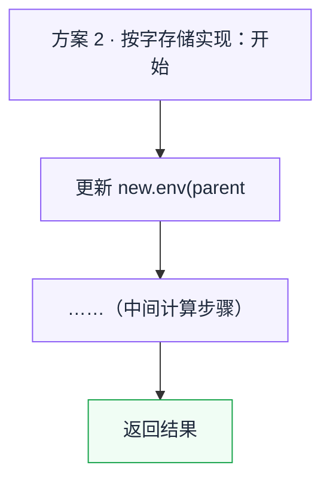

```r
# 版（方案2） 定义函数 Bitset（参数：大小）
Bitset <- function(size) {
    e <- new.env(parent = emptyenv())  # 把 new.env(parent 赋值为 emptyenv()) 存入 e
    e$n <- size  # 把 大小 存入 e$n
    e$words <- rep(0, (size + 31)%/%32)  # 把 rep(0, (大小 加 31) 对…取模 除以 对…取模 32) 存入 e$words
    e$ones <- 0L  # 把 0L 存入 e$ones
    e$reverse <- 0L  # 把 0L 存入 e$reverse
    e$get <- function(idx) {
        # 把 function(idx) { 存入 e$get
        w <- e$words[(idx%/%32) + 1]  # 把 e$单词列表[(idx 对…取模 除以 对…取模 32) 加 1] 存入 权重
        bitwXor(bitwAnd(bitwShiftR(w, idx%%32), 1L), e$reverse)
    }
    e$fix <- function(idx) {
        # 把 function(idx) { 存入 e$fix 若 e$get(idx) 等于 0
        if (e$get(idx) == 0) {
            wi <- (idx%/%32) + 1  # 把 (idx 对…取模 除以 对…取模 32) 加 1 存入 wi
            e$words[wi] <- bitwOr(e$words[wi], bitwShiftL(1, idx%%32))
            e$ones <- e$ones + 1L  # 把 e$ones 加 1L 存入 e$ones
        }
    }
    e$unfix <- function(idx) {
        # 把 function(idx) { 存入 e$unfix 若 e$get(idx) 等于 1
        if (e$get(idx) == 1) {
            wi <- (idx%/%32) + 1  # 把 (idx 对…取模 除以 对…取模 32) 加 1 存入 wi
            e$words[wi] <- bitwAnd(e$words[wi], bitwNot(bitwShiftL(1, idx%%32)))
            e$ones <- e$ones - 1L  # 把 e$ones 减 1L 存入 e$ones
        }
    }
    e$flip <- function() {
        # 把 function() { 存入 e$flip
        e$reverse <- bitwXor(e$reverse, 1L)  # 把 bitwXor(e$reverse, 1L) 存入 e$reverse
        e$ones <- e$n - e$ones  # 把 e$元素个数 减 e$ones 存入 e$ones
    }
    e$all <- function() e$ones == e$n  # 把 function() e$ones 等于 e$元素个数 存入 e$all
    e$one <- function() e$ones > 0  # 把 function() e$ones 超过 0 存入 e$one
    e$count <- function() e$ones  # 把 function() e$ones 存入 e$count
    e$tostring <- function() {
        # 把 function() { 存入 e$tostring
        paste(vapply(seq_len(e$n) - 1L, function(i) as.character(e$get(i)), ""), collapse = "")
    }
    e
}
bs <- Bitset(5)  # 把 Bitset(5) 存入 bs
bs$fix(0)
bs$fix(3)  # bs$fix(0); bs$fix(3)
stopifnot(bs$tostring() == "10010", bs$count() == 2)  # 断言校验
bs$flip()  # bs$flip()
stopifnot(bs$tostring() == "01101", bs$count() == 3)  # 断言校验
bs$unfix(0)  # bs$unfix(0)
stopifnot(bs$tostring() == "01101")  # 断言校验
stopifnot(bs$all() == FALSE, bs$one() == TRUE)  # 断言校验
cat("PASS\n")  # 全部用例通过，输出 PASS
```

### Zig 实现（2 种方案）

Zig 的全部方案如下，每个方案都内嵌用例自测，可独立运行（老仓库 python/go 文件遵循「打印结果」约定）：

#### 方案 1：按字存储实现

**思路与代码分析**：核心是「按字存储实现」。Zig 版显式分配与清零，整型边界处理严格。**走读**：方案 1 · 按字存储实现：开始 → 计算 words → 处理 @memset(words, 0) → 返回 .。

**运行架构**（真实控制流）：

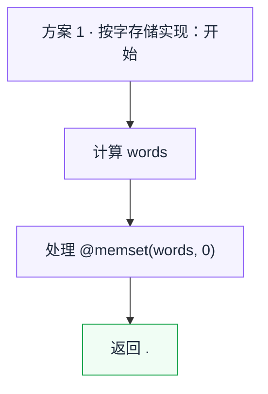

```zig
// LeetCode 2166. 设计位集 — Zig 版（方案1）
const std = @import("std"); // 把 @import(「std」) 存入 std
const Bitset = struct { // 把 struct { 存入 Bitset
    n: usize,
    words: []u32,
    ones: usize,
    reverse: u32,
    fn init(alloc: std.mem.Allocator, size: usize) !Bitset { // 定义函数/方法 init
        const words = try alloc.alloc(u32, (size + 31) / 32); // 把 try alloc.alloc(u32, (大小 加 31) 除以 32) 存入 单词列表
        @memset(words, 0); // @memset(单词列表, 0);
        return .{ .n = size, .words = words, .ones = 0, .reverse = 0 };
    }
    fn get(self: *const Bitset, idx: usize) u32 { // 定义函数/方法 get
        return ((self.words[idx / 32] >> @intCast(idx % 32)) & 1) ^ self.reverse;
    }
    fn fix(self: *Bitset, idx: usize) void { // 定义函数/方法 fix
        if (self.get(idx) == 0) { // 若 self 查找 idx) 等于 0
            self.words[idx / 32] |= @as(u32, 1) << @intCast(idx % 32);
            self.ones += 1; // self.ones累加 1
        }
    }
    fn unfix(self: *Bitset, idx: usize) void { // 定义函数/方法 unfix
        if (self.get(idx) == 1) { // 若 self 查找 idx) 等于 1
            self.words[idx / 32] &= ~(@as(u32, 1) << @intCast(idx % 32));
            self.ones -= 1; // self.ones累减 1
        }
    }
    fn flip(self: *Bitset) void { // 定义函数/方法 flip
        self.reverse ^= 1; // 把 1; 写入 self.reverse ^
        self.ones = self.n - self.ones; // 把 self.元素个数 减 self.ones; 写入 self.ones
    }
    fn all(self: *const Bitset) bool {
        return self.ones == self.n;
    } // 定义函数/方法 all
    fn one(self: *const Bitset) bool {
        return self.ones > 0;
    } // 定义函数/方法 one
    fn toStr(self: *const Bitset, out: []u8) void { // 定义函数/方法 toStr
        for (0..self.n) |i| out[i] = '0' + @as(u8, @intCast(self.get(i))); // 逐个取出 0..self.元素个数 的元素（下标 i）
    }
};
pub fn main() !void { // 程序入口：跑内嵌自测用例
    var arena = std.heap.ArenaAllocator.init(std.heap.page_allocator); // 把 std.堆.ArenaAllocator.init(std.堆.page_allocator) 存入 arena
    defer arena.deinit(); // defer arena.deinit();
    var bs = try Bitset.init(arena.allocator(), 5); // 把 try Bitset.init(arena.allocator(), 5) 存入 bs
    var buf: [64]u8 = undefined; // 把 undefined; 写入 var buf: [64]u8
    bs.fix(0);
    bs.fix(3); // bs.fix(0); bs.fix(3);
    bs.toStr(&buf); // bs.toStr( 按位与 buf);
    if (!std.mem.eql(u8, buf[0..5], "10010")) return error.TestFailed;
    if (bs.ones != 2) return error.TestFailed; // 若 bs.ones 不等于 2，直接返回 error.TestFailed
    bs.flip(); // bs.flip();
    bs.toStr(&buf); // bs.toStr( 按位与 buf);
    if (!std.mem.eql(u8, buf[0..5], "01101")) return error.TestFailed;
    if (bs.ones != 3) return error.TestFailed; // 若 bs.ones 不等于 3，直接返回 error.TestFailed
    bs.unfix(0); // bs.unfix(0);
    bs.toStr(&buf); // bs.toStr( 按位与 buf);
    if (!std.mem.eql(u8, buf[0..5], "01101")) return error.TestFailed;
    if (bs.all() or !bs.one()) return error.TestFailed; // 若 bs.all() or 取反 bs.one()，直接返回 error.TestFailed
    std.debug.print("PASS\n", .{}); // 全部用例通过，输出 PASS
}
```

#### 方案 2：按字存储实现

**思路与代码分析**：核心是「按字存储实现」。Zig 版显式分配与清零，整型边界处理严格。**走读**：方案 2 · 按字存储实现：开始 → 计算 words → 处理 @memset(words, 0) → 返回 .。

**运行架构**（真实控制流）：


```zig
// LeetCode 2166. 设计位集 — Zig 版（方案2）
const std = @import("std"); // 把 @import(「std」) 存入 std
const Bitset = struct { // 把 struct { 存入 Bitset
    n: usize,
    words: []u32,
    ones: usize,
    reverse: u32,
    fn init(alloc: std.mem.Allocator, size: usize) !Bitset { // 定义函数/方法 init
        const words = try alloc.alloc(u32, (size + 31) / 32); // 把 try alloc.alloc(u32, (大小 加 31) 除以 32) 存入 单词列表
        @memset(words, 0); // @memset(单词列表, 0);
        return .{ .n = size, .words = words, .ones = 0, .reverse = 0 };
    }
    fn get(self: *const Bitset, idx: usize) u32 { // 定义函数/方法 get
        return ((self.words[idx / 32] >> @intCast(idx % 32)) & 1) ^ self.reverse;
    }
    fn fix(self: *Bitset, idx: usize) void { // 定义函数/方法 fix
        if (self.get(idx) == 0) { // 若 self 查找 idx) 等于 0
            self.words[idx / 32] |= @as(u32, 1) << @intCast(idx % 32);
            self.ones += 1; // self.ones累加 1
        }
    }
    fn unfix(self: *Bitset, idx: usize) void { // 定义函数/方法 unfix
        if (self.get(idx) == 1) { // 若 self 查找 idx) 等于 1
            self.words[idx / 32] &= ~(@as(u32, 1) << @intCast(idx % 32));
            self.ones -= 1; // self.ones累减 1
        }
    }
    fn flip(self: *Bitset) void { // 定义函数/方法 flip
        self.reverse ^= 1; // 把 1; 写入 self.reverse ^
        self.ones = self.n - self.ones; // 把 self.元素个数 减 self.ones; 写入 self.ones
    }
    fn all(self: *const Bitset) bool {
        return self.ones == self.n;
    } // 定义函数/方法 all
    fn one(self: *const Bitset) bool {
        return self.ones > 0;
    } // 定义函数/方法 one
    fn toStr(self: *const Bitset, out: []u8) void { // 定义函数/方法 toStr
        for (0..self.n) |i| out[i] = '0' + @as(u8, @intCast(self.get(i))); // 逐个取出 0..self.元素个数 的元素（下标 i）
    }
};
pub fn main() !void { // 程序入口：跑内嵌自测用例
    var arena = std.heap.ArenaAllocator.init(std.heap.page_allocator); // 把 std.堆.ArenaAllocator.init(std.堆.page_allocator) 存入 arena
    defer arena.deinit(); // defer arena.deinit();
    var bs = try Bitset.init(arena.allocator(), 5); // 把 try Bitset.init(arena.allocator(), 5) 存入 bs
    var buf: [64]u8 = undefined; // 把 undefined; 写入 var buf: [64]u8
    bs.fix(0);
    bs.fix(3); // bs.fix(0); bs.fix(3);
    bs.toStr(&buf); // bs.toStr( 按位与 buf);
    if (!std.mem.eql(u8, buf[0..5], "10010")) return error.TestFailed;
    if (bs.ones != 2) return error.TestFailed; // 若 bs.ones 不等于 2，直接返回 error.TestFailed
    bs.flip(); // bs.flip();
    bs.toStr(&buf); // bs.toStr( 按位与 buf);
    if (!std.mem.eql(u8, buf[0..5], "01101")) return error.TestFailed;
    if (bs.ones != 3) return error.TestFailed; // 若 bs.ones 不等于 3，直接返回 error.TestFailed
    bs.unfix(0); // bs.unfix(0);
    bs.toStr(&buf); // bs.toStr( 按位与 buf);
    if (!std.mem.eql(u8, buf[0..5], "01101")) return error.TestFailed;
    if (bs.all() or !bs.one()) return error.TestFailed; // 若 bs.all() or 取反 bs.one()，直接返回 error.TestFailed
    std.debug.print("PASS\n", .{}); // 全部用例通过，输出 PASS
}
```

### Dart 实现（2 种方案）

Dart 的全部方案如下，每个方案都内嵌用例自测，可独立运行（老仓库 python/go 文件遵循「打印结果」约定）：

#### 方案 1：按字存储实现

**思路与代码分析**：核心是「按字存储实现」。Dart 版用可空类型标注与集合方法，注意空安全。**走读**：方案 1 · 按字存储实现：开始 → 若 getBit(idx) == 0 则： → 更新 | → 处理 1 ＜＜ (idx & 31) → 处理 ones++ → 返回结果。

**运行架构**（真实控制流）：

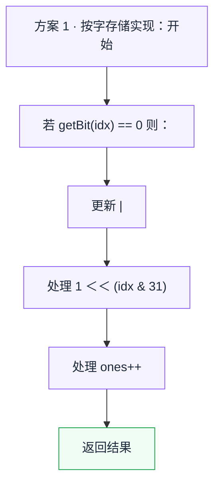

```dart
// LeetCode 2166. 设计位集 — Dart 版（方案1）
class Bitset {
  // 定义类型
  final int n; // final int 元素个数;
  final List<int> words; // final List 小于 int 超过 单词列表;
  int ones = 0; // 把 0 存入 ones
  int reverse = 0; // 把 0 存入 reverse
  Bitset(this.n) : words = List.filled((n + 31) ~/ 32, 0);
  int getBit(int idx) => ((words[idx >> 5] >> (idx & 31)) & 1) ^ reverse;
  void fix(int idx) {
    // 定义函数/方法 fix
    if (getBit(idx) == 0) {
      // 若 getBit(idx) 等于 0
      words[idx >> 5] |=
          1 << (idx & 31); // 把 1 小于 小于 (idx 按位与 31); 写入 words[idx >> 5] |
      ones++; // ones 加一
    }
  }

  void unfix(int idx) {
    // 定义函数/方法 unfix
    if (getBit(idx) == 1) {
      // 若 getBit(idx) 等于 1
      words[idx >> 5] &=
          ~(1 << (idx & 31)); // 把 ~(1 小于 小于 (idx 按位与 31)); 写入 words[idx >> 5] &
      ones--; // ones 减一
    }
  }

  void flip() {
    // 定义函数/方法 flip
    reverse ^= 1; // 把 1; 写入 reverse ^
    ones = n - ones; // 把 元素个数 减 ones 存入 ones
  }

  bool all() => ones == n;
  bool one() => ones > 0;
  int count() => ones;
  String toString() {
    // 定义函数/方法 toString
    final sb = StringBuffer(); // 把 StringBuffer() 存入 sb
    for (var i = 0; i < n; i++) {
      // 让 下标 i 从 0 开始计数，下标 i 小于 元素个数 就继续
      sb.write(getBit(i)); // sb.write(getBit(下标 i));
    }
    return sb.toString(); // 返回 sb.toString()
  }
}

void main() {
  // 程序入口：跑内嵌自测用例
  final bs = Bitset(5); // 把 Bitset(5) 存入 bs
  bs.fix(0);
  bs.fix(3); // bs.fix(0); bs.fix(3);
  if (bs.toString() != '10010')
    throw StateError(
      's1',
    ); // 若 bs.toString() 不等于 '10010') throw StateError('s1');
  if (bs.count() != 2)
    throw StateError('c1'); // 若 bs.计数() 不等于 2) throw StateError('c1');
  bs.flip(); // bs.flip();
  if (bs.toString() != '01101')
    throw StateError(
      's2',
    ); // 若 bs.toString() 不等于 '01101') throw StateError('s2');
  if (bs.count() != 3)
    throw StateError('c2'); // 若 bs.计数() 不等于 3) throw StateError('c2');
  bs.unfix(0); // bs.unfix(0);
  if (bs.toString() != '01101')
    throw StateError(
      's3',
    ); // 若 bs.toString() 不等于 '01101') throw StateError('s3');
  if (bs.all() || !bs.one())
    throw StateError('ao'); // 若 bs.all() 或 取反 bs.one()) throw StateError('ao');
  print('PASS'); // 全部用例通过，输出 PASS
}
```

#### 方案 2：按字存储实现

**思路与代码分析**：核心是「按字存储实现」。Dart 版用可空类型标注与集合方法，注意空安全。**走读**：方案 2 · 按字存储实现：开始 → 若 getBit(idx) == 0 则： → 更新 | → 处理 1 ＜＜ (idx & 31) → 处理 ones++ → 返回结果。

**运行架构**（真实控制流）：

```mermaid
graph TD
    N0["方案 2 · 按字存储实现：开始"]
    N1["若 getBit(idx) == 0 则："]
    N2["更新 |"]
    N3["处理 1 ＜＜ (idx & 31)"]
    N4["处理 ones++"]
    N5["返回结果"]
    N0 --> N1
    N1 --> N2
    N2 --> N3
    N3 --> N4
    N4 --> N5
    classDef n fill:#f5f3ff,stroke:#8b5cf6,color:#1e293b;
    classDef lp fill:#ede9fe,stroke:#7c3aed,color:#1e293b;
    classDef dc fill:#fef9c3,stroke:#ca8a04,color:#1e293b;
    classDef tm fill:#f0fdf4,stroke:#16a34a,color:#1e293b;
    class N0,N1,N2,N3,N4 n;
    class N5 tm;
```

```dart
// LeetCode 2166. 设计位集 — Dart 版（方案2）
class Bitset {
  // 定义类型
  final int n; // final int 元素个数;
  final List<int> words; // final List 小于 int 超过 单词列表;
  int ones = 0; // 把 0 存入 ones
  int reverse = 0; // 把 0 存入 reverse
  Bitset(this.n) : words = List.filled((n + 31) ~/ 32, 0);
  int getBit(int idx) => ((words[idx >> 5] >> (idx & 31)) & 1) ^ reverse;
  void fix(int idx) {
    // 定义函数/方法 fix
    if (getBit(idx) == 0) {
      // 若 getBit(idx) 等于 0
      words[idx >> 5] |=
          1 << (idx & 31); // 把 1 小于 小于 (idx 按位与 31); 写入 words[idx >> 5] |
      ones++; // ones 加一
    }
  }

  void unfix(int idx) {
    // 定义函数/方法 unfix
    if (getBit(idx) == 1) {
      // 若 getBit(idx) 等于 1
      words[idx >> 5] &=
          ~(1 << (idx & 31)); // 把 ~(1 小于 小于 (idx 按位与 31)); 写入 words[idx >> 5] &
      ones--; // ones 减一
    }
  }

  void flip() {
    // 定义函数/方法 flip
    reverse ^= 1; // 把 1; 写入 reverse ^
    ones = n - ones; // 把 元素个数 减 ones 存入 ones
  }

  bool all() => ones == n;
  bool one() => ones > 0;
  int count() => ones;
  String toString() {
    // 定义函数/方法 toString
    final sb = StringBuffer(); // 把 StringBuffer() 存入 sb
    for (var i = 0; i < n; i++) {
      // 让 下标 i 从 0 开始计数，下标 i 小于 元素个数 就继续
      sb.write(getBit(i)); // sb.write(getBit(下标 i));
    }
    return sb.toString(); // 返回 sb.toString()
  }
}

void main() {
  // 程序入口：跑内嵌自测用例
  final bs = Bitset(5); // 把 Bitset(5) 存入 bs
  bs.fix(0);
  bs.fix(3); // bs.fix(0); bs.fix(3);
  if (bs.toString() != '10010')
    throw StateError(
      's1',
    ); // 若 bs.toString() 不等于 '10010') throw StateError('s1');
  if (bs.count() != 2)
    throw StateError('c1'); // 若 bs.计数() 不等于 2) throw StateError('c1');
  bs.flip(); // bs.flip();
  if (bs.toString() != '01101')
    throw StateError(
      's2',
    ); // 若 bs.toString() 不等于 '01101') throw StateError('s2');
  if (bs.count() != 3)
    throw StateError('c2'); // 若 bs.计数() 不等于 3) throw StateError('c2');
  bs.unfix(0); // bs.unfix(0);
  if (bs.toString() != '01101')
    throw StateError(
      's3',
    ); // 若 bs.toString() 不等于 '01101') throw StateError('s3');
  if (bs.all() || !bs.one())
    throw StateError('ao'); // 若 bs.all() 或 取反 bs.one()) throw StateError('ao');
  print('PASS'); // 全部用例通过，输出 PASS
}
```

---

## 内容总结

- **设计位集**（综合 · Medium）：共 2 个方案，主线思路「按字存储实现」；时间 O(n)（单趟线性扫描）；动画演示归并分治过程，附录给出 11 种语言 × 全部方案的可运行实现。
- 来源博客：[https://blog.csdn.net/tyro_java/article/details/145370422](https://blog.csdn.net/tyro_java/article/details/145370422)
- 导航：[📋 总目录](../) ｜ [← 243 快乐数](../243_快乐数/) ｜ [245 存在重复元素 →](../245_存在重复元素/)
