# 245 · 存在重复元素（第附阶段 · 专题补充 · Medium）

> **难度**：⭐⭐ Medium ｜ **专题**：综合
> **学习定位**：第附阶段 · 专题补充第 245 篇 ｜ **解法数**：2
> **内容总结**：**存在重复元素**（综合 · Medium）：共 2 个方案，主线思路「集合去重」；时间 O(n) 量级；动画演示归并分治过程，附录给出 11 种语言 × 全部方案的可运行实现。

---

## 题目描述

给你一个整数数组 `nums` 。如果任一值在数组中出现 至少两次 ，返回 `true` ；如果数组中每个元素互不相同，返回 `false` 。

**用例（来自原题）**：

**示例 1**

解释：元素 1 在下标 0 和 3 出现

**示例 2**

解释：所有元素都不同

**示例 3**
> 题面与 [leetcode.cn 官方](https://leetcode.cn/problems/contains-duplicate/)一致，示例配图取自官方题面。

**数据范围与注意事项**：

- `1 <= nums.length <= 10^5`
- `-10^9 <= nums[i] <= 10^9`
- **易错点**：特殊输入（空、重复、极值）的边界检查。

## 题目分析

**场景是什么**：综合练习：从题面本身出发选择合适的数据结构。本题就是该场景的 Medium 级练习，主线做法是「集合去重」。

**主线怎么解**：把主解法从头到尾过一遍，它其实在依次做这几件事：哈希结构做计数或查重。

## 解题思路

**方案对比**（共 2 个方案，由浅入深）：

| 方案 | 时间复杂度 | 空间复杂度 |
|---|---|---|
| 方案 1 · 集合去重 | O(n) 量级 | O(n) |
| 方案 2 · 哈希辅助 | O(n)（单趟线性扫描） | O(1) 到 O(n)（视辅助结构） |

**由浅入深的路径**：集合去重 → 哈希辅助；每往右一步，都在补上一步的短板。

**方案间的取舍**：方案 1（集合去重）；方案 2（哈希辅助）。数据规模小、可读性优先时选靠前的方案；规模大、性能优先时选靠后的方案。

**怎么读这一篇**：

- 🐣 **新手路线**：把「题目描述」的示例 1 在纸上手推一遍 → 读方案 1（最直观的写法）与它的代码走读 → 按「运行方式」本地跑通看 PASS → 回头对比方案 2 之后的写法差在哪
- 🦅 **大佬路线**：直接锁定最优方案 1（集合去重，O(n) 量级）→ 跳读该方案代码与走读 → 用「逐步拆解与面试追问」补齐复杂度推导与边界追问

### 动态算法图（归并分治，GIF 自动循环）


动画演示综合专题里归并分治的典型过程；每个方案在「TypeScript 解题方案」一节还配了专属动画与专属流程图。

### 主解法流程图（真实控制流）

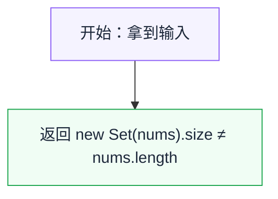

## TypeScript 解题方案（2 个方案逐个讲）

> **运行与提交**：每个方案都是自包含文件（内嵌用例自测，输出 PASS），整块复制到 `.ts` 文件后 `node 文件名` 即可运行。提交 LeetCode 时，把 `demo` 内的算法函数与辅助类型/函数整体取出、置于文件顶层即可。涉及交互/特殊接口的题以题面给定签名为准。

### 方案 1：集合去重

**分析与思路**：核心做法是「集合去重」。代码里依次做这些事：哈希结构做计数或查重。

**运行方式**：`node 本文件`，内嵌用例全部通过会输出 PASS。

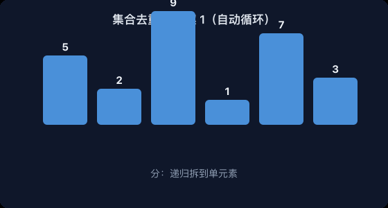

**方案专属流程图**（真实控制流）：

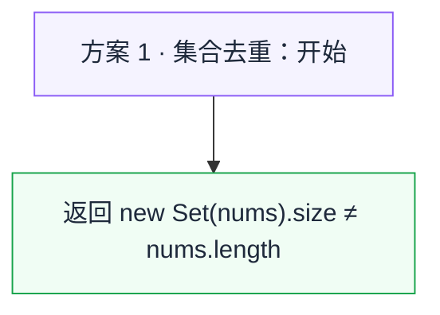

```typescript
/**
 ** LeetCode 217. 存在重复元素
 ** 方案：1 ) 方案1：集合去重
 ** 来源：https://blog.csdn.net/tyro_java/article/details/145344295
 */

export function containsDuplicate(nums: number[]): boolean {
  // 定义函数/方法 containsDuplicate
  return new Set(nums).size !== nums.length; // 返回 new Set(数组).大小 不等于 数组.长度
}

export function demo(): void {
  // 程序入口：跑内嵌自测用例
  if (containsDuplicate([1, 2, 3]) !== false) throw new Error('FAILED 1');
  if (containsDuplicate([1, 2, 3, 1]) !== true) throw new Error('FAILED 2');
  console.log('PASS'); // 全部用例通过，输出 PASS
}

demo(); // demo();
```

### 方案 2：哈希辅助

**分析与思路**：核心做法是「哈希辅助」。代码里依次做这些事：哈希结构做计数或查重；单循环线性扫描。

**运行方式**：`node 本文件`，内嵌用例全部通过会输出 PASS。

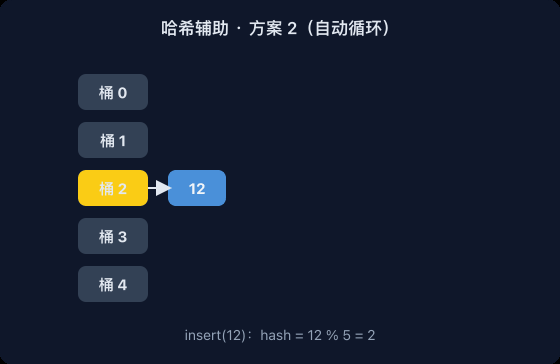

**方案专属流程图**（真实控制流）：

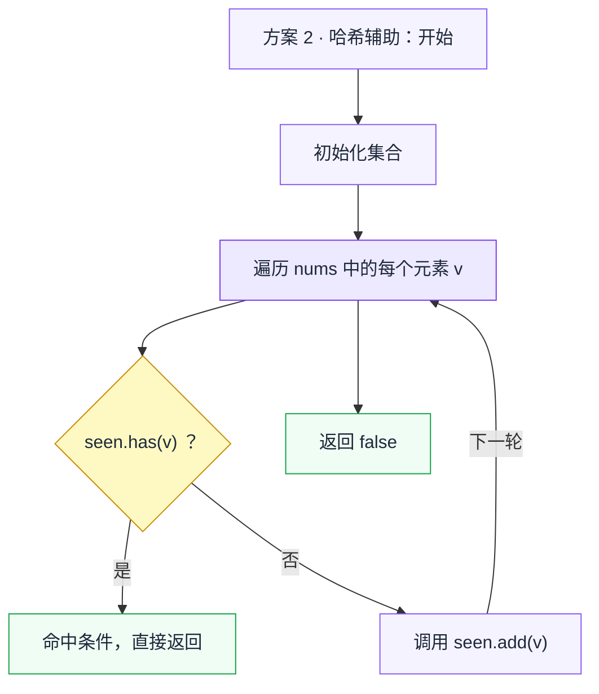

```typescript
export function demo(): void {
  // 程序入口：跑内嵌自测用例
  function containsDuplicate(nums: number[]): boolean {
    // 定义函数/方法 containsDuplicate
    const seen = new Set<number>(); // 把 new Set 小于 number 超过 () 存入 已见集合
    for (const v of nums) {
      if (seen.has(v)) return true;
      seen.add(v);
    }
    return false; // 返回 false
  }
  const cases = [
    { in: [1, 2, 3], want: false },
    { in: [1, 2, 2], want: true },
    { in: [0], want: false },
  ];
  let fail = false; // 把 false 存入 fail
  for (const c of cases) {
    // for (const 字符 of cases) {
    const got = containsDuplicate(c.in); // 把 containsDuplicate(字符.in) 存入 got
    if (got !== c.want) {
      fail = true;
      console.log('FAIL ' + got + ' want ' + c.want);
    }
  }
  if (fail) throw new Error('FAILED'); // 若 fail) throw new Error(「FAILED」);
  console.log('PASS'); // 全部用例通过，输出 PASS
}
demo(); // demo();
```

## 逐步拆解与面试追问

**复杂度**：时间 O(n) 量级，空间 O(n)

**为什么是这个量级**：整体只对数据做有限趟处理

**面试官可能会追问**：

- 有没有更直观的建模方式？
- 特殊输入的边界？
- 能否一步到位而不是分两趟？

## 关键 API 速查（TS 主解法实际用到，附官方链接）

| API | 作用 | 使用要点 | 官方文档 |
|---|---|---|---|
| `Set` | 集合：元素唯一 | add/add.has/delete；has 均摊 O(1)；NaN 视为相同；去重常用 [...new Set(arr)] | [官方文档](https://developer.mozilla.org/zh-CN/docs/Web/JavaScript/Reference/Global_Objects/Set) |

### 各语言官方文档导航

- **TypeScript / JS**：[MDN 中文参考](https://developer.mozilla.org/zh-CN/)
- **Python**：[Python 官方文档](https://docs.python.org/zh-cn/3/)
- **Go**：[Go 标准库](https://pkg.go.dev/std)
- **Java**：[JDK 17 API](https://docs.oracle.com/en/java/javase/17/docs/api/)
- **Rust**：[Rust 标准库](https://doc.rust-lang.org/std/)
- **Lua**：[Lua 5.4 手册](https://www.lua.org/manual/5.4/)
- **C**：[Cppreference C](https://zh.cppreference.com/w/c)
- **C++**：[Cppreference C++](https://zh.cppreference.com/w/cpp)
- **R**：[R 官方手册](https://stat.ethz.ch/R-manual/)
- **Zig**：[Zig 语言文档](https://ziglang.org/documentation/master/)
- **Dart**：[Dart API](https://api.dart.dev/)

## 附录：其他 10 种语言全部实现（每种语言列举其全部方案）

> TypeScript 的全部方案见「TypeScript 解题方案」一节；下面是其余 10 种语言的对应实现，每种语言的每个方案都带思路分析、代码走读与专属运行架构图。
> 每个方案都内嵌用例自测，可独立运行（老仓库 python/go 文件遵循「打印结果」约定）。
> 完整解法文件见 `dsa/<语言>/other/lc_217_存在重复元素/`。

### Python 实现（2 种方案）

Python 的全部方案如下，每个方案都内嵌用例自测，可独立运行（老仓库 python/go 文件遵循「打印结果」约定）：

#### 方案 1：集合去重

**思路与代码分析**：核心是「集合去重」。Python 版用切片与字典推导式简化操作，突出可读性。**走读**：方案 1 · 集合去重：开始 → 返回 len(nums) ≠ len(set(nums))。

**运行架构**（真实控制流）：

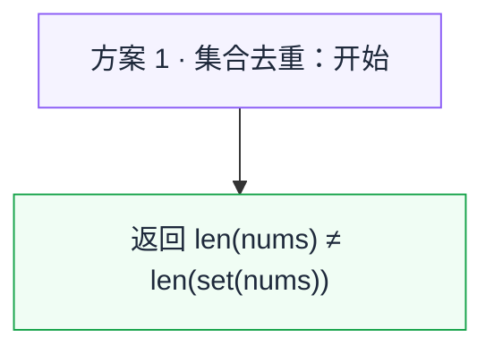

```python
import sys  # 提高递归深度上限（深输入防 RecursionError）

sys.setrecursionlimit(200000)  # 树/链表类题目节点数可达 1e4 量级

def containsDuplicate(nums):  # 定义函数 containsDuplicate（参数：数组）
    return len(nums) != len(set(nums))  # 返回 长度(数组) 不等于 长度(set(数组))

if __name__ == "__main__":  # 若 __name__ 等于 '__main__'
    print(containsDuplicate([1, 2, 3]))  # 打印输出
```

#### 方案 2：哈希辅助

**思路与代码分析**：核心是「哈希辅助」。Python 版用切片与字典推导式简化操作，突出可读性。**走读**：方案 2 · 哈希辅助：开始 → 返回 len(nums) ≠ len(set(nums))。

**运行架构**（真实控制流）：

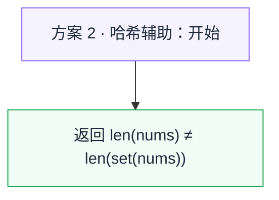

```python
import sys  # 提高递归深度上限（深输入防 RecursionError）

sys.setrecursionlimit(200000)  # 树/链表类题目节点数可达 1e4 量级

def containsDuplicate(nums):  # 定义函数 containsDuplicate（参数：数组）
    return len(nums) != len(set(nums))  # 返回 长度(数组) 不等于 长度(set(数组))

if __name__ == "__main__":  # 若 __name__ 等于 '__main__'
    print(containsDuplicate([1, 2, 3]))  # 打印输出
```

### Go 实现（2 种方案）

Go 的全部方案如下，每个方案都内嵌用例自测，可独立运行（老仓库 python/go 文件遵循「打印结果」约定）：

#### 方案 1：集合去重

**思路与代码分析**：核心是「集合去重」。Go 版用切片与多返回值惯用法，显式处理索引边界。代码里依次做这些事：哈希结构做计数或查重。**走读**：方案 1 · 集合去重：开始 → 更新 : → 遍历 nums 的下标与元素 v → 处理 if seen[v] → 返回 true → 更新 seen[v] → 返回 false。

**运行架构**（真实控制流）：


```go
package main // 引入依赖

import (
	"fmt" // 「fmt」
	"os"  // 「os」
)

func containsDuplicate(nums []int) bool { // 定义函数/方法 containsDuplicate
	seen := make(map[int]bool) // 把 make(映射表[int]bool) 写入 seen :
	for _, v := range nums {   // 同时取 _ 与 值 遍历
		if seen[v] { // 若 已见集合[值]
			return true // 返回 true
		}
		seen[v] = true // 把 true 写入 seen[v]
	}
	return false // 返回 false
}

func main() { // 程序入口：跑内嵌自测用例
	ok := true       // 把 true 写入 ok :
	tc := []struct { // 把 []struct { 写入 tc :
		in   []int // in []int
		want bool  // want bool
	}{ // }{
		{[]int{1, 2, 3}, false},
		{[]int{1, 2, 3, 1}, true},
		{[]int{}, false},
	}
	for _, c := range tc { // 同时取 _ 与 字符 遍历
		if got := containsDuplicate(c.in); got != c.want { // 若 got : 赋值为 containsDuplicate(字符.in); got 不等于 字符.want
			ok = false                                                               // 把 false 写入 ok
			fmt.Printf("FAIL containsDuplicate(%v)=%v want %v\n", c.in, got, c.want) // 打印输出
		}
	}
	if !ok { // 若 取反 ok
		os.Exit(1) // os.Exit(1)
	}
	fmt.Println("PASS") // 全部用例通过，输出 PASS
}
```

#### 方案 2：哈希辅助

**思路与代码分析**：核心是「哈希辅助」。Go 版用切片与多返回值惯用法，显式处理索引边界。代码里依次做这些事：哈希结构做计数或查重。**走读**：方案 2 · 哈希辅助：开始 → 更新 : → 遍历 nums 的下标与元素 v → 处理 if seen[v] → 返回 true → 更新 seen[v] → 返回 false。

**运行架构**（真实控制流）：

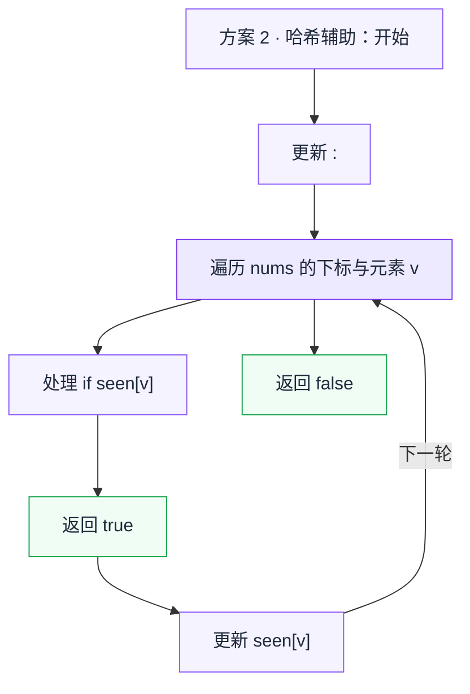

```go
package main // 引入依赖

import (
	"fmt" // 「fmt」
	"os"  // 「os」
)

func containsDuplicate(nums []int) bool { // 定义函数/方法 containsDuplicate
	seen := make(map[int]bool) // 把 make(映射表[int]bool) 写入 seen :
	for _, v := range nums {   // 同时取 _ 与 值 遍历
		if seen[v] { // 若 已见集合[值]
			return true // 返回 true
		}
		seen[v] = true // 把 true 写入 seen[v]
	}
	return false // 返回 false
}

func main() { // 程序入口：跑内嵌自测用例
	ok := true       // 把 true 写入 ok :
	tc := []struct { // 把 []struct { 写入 tc :
		in   []int // in []int
		want bool  // want bool
	}{ // }{
		{[]int{1, 2, 3}, false},
		{[]int{1, 2, 3, 1}, true},
		{[]int{5, 5}, true},
	}
	for _, c := range tc { // 同时取 _ 与 字符 遍历
		if got := containsDuplicate(c.in); got != c.want { // 若 got : 赋值为 containsDuplicate(字符.in); got 不等于 字符.want
			ok = false                                                               // 把 false 写入 ok
			fmt.Printf("FAIL containsDuplicate(%v)=%v want %v\n", c.in, got, c.want) // 打印输出
		}
	}
	if !ok { // 若 取反 ok
		os.Exit(1) // os.Exit(1)
	}
	fmt.Println("PASS") // 全部用例通过，输出 PASS
}
```

### Java 实现（2 种方案）

Java 的全部方案如下，每个方案都内嵌用例自测，可独立运行（老仓库 python/go 文件遵循「打印结果」约定）：

#### 方案 1：集合去重

**思路与代码分析**：核心是「集合去重」。Java 版用类与静态方法组织，集合操作显式明了。代码里依次做这些事：单循环线性扫描。**走读**：方案 1 · 集合去重：开始 → 更新 set → 遍历循环 → 命中条件，直接返回 → 调用 set.add(num) → 返回 false。

**运行架构**（真实控制流）：

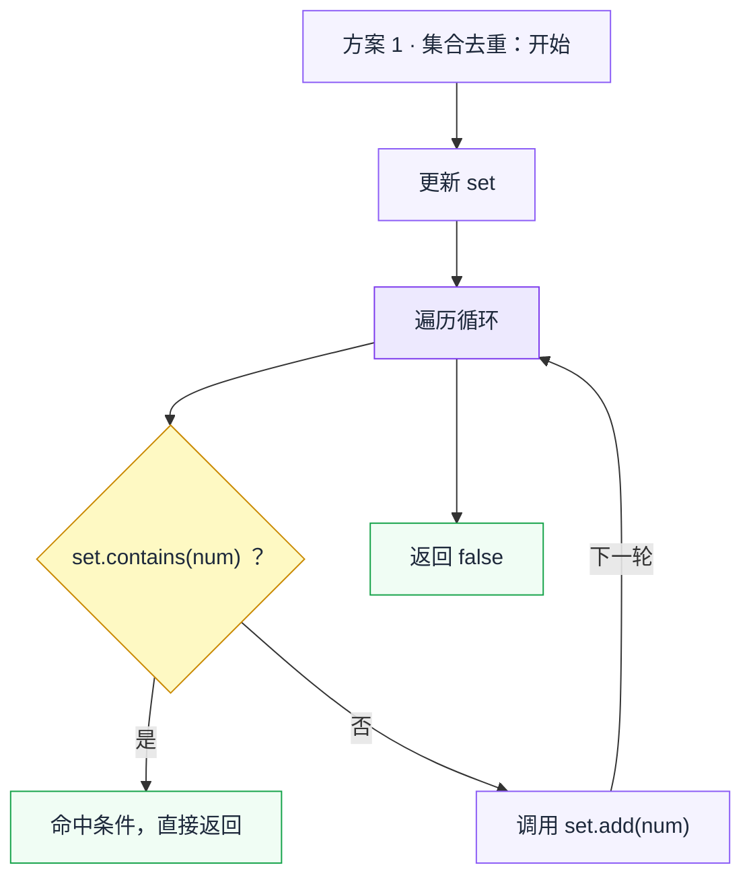

```java
package com.webfault.dsa; // 引入依赖

import java.util.*; // 引入依赖

class DupS1 { // 定义类型
  static boolean containsDuplicate(int[] nums) { // 定义函数/方法 containsDuplicate
    Set<Integer> set = new HashSet<>(); // 把 new HashSet 小于 超过 (); 写入 Set<Integer> set
    for (int num : nums) { // for (int num : 数组) {
      if (set.contains(num)) return true; // 若 set 是否包含 num)，直接返回 true
      set.add(num); // set 追加 num);
    }
    return false; // 返回 false
  }

  public static void main(String[] args) { // public static void main(String[] args) {
    boolean[] got = { // 把 { 写入 boolean[] got
      DupS1.containsDuplicate(new int[] {1, 2, 3}),
      DupS1.containsDuplicate(new int[] {1, 2, 3, 1}),
      DupS1.containsDuplicate(new int[] {1}),
    };
    boolean[] want = {false, true, false}; // 把 { false, true, false }; 写入 boolean[] want
    boolean ok = true; // 把 true; 写入 boolean ok
    for (int i = 0; i < got.length; i++) { // 让 下标 i 从 0 开始计数，下标 i 小于 got.长度 就继续
      if (got[i] != want[i]) { // 若 got[下标 i] 不等于 want[下标 i]
        ok = false; // 把 false; 写入 ok
        System.out.println("FAIL idx " + i + " got " + got[i] + " want " + want[i]); // 打印输出
      }
    }
    if (!ok) throw new RuntimeException("FAILED"); // 若 取反 ok) throw new RuntimeException(「FAILED」);
    System.out.println("PASS"); // 全部用例通过，输出 PASS
  }
}
```

#### 方案 2：哈希辅助

**思路与代码分析**：核心是「哈希辅助」。Java 版用类与静态方法组织，集合操作显式明了。代码里依次做这些事：先排序再处理；单循环线性扫描。**走读**：方案 2 · 哈希辅助：开始 → 排序整理 → 遍历循环 → 命中条件，直接返回 → 返回 false。

**运行架构**（真实控制流）：

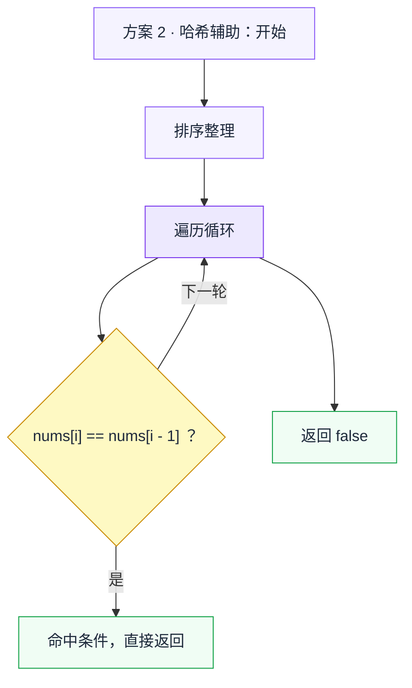

```java
package com.webfault.dsa; // 引入依赖

import java.util.*; // 引入依赖

class DupS2 { // 定义类型
  static boolean containsDuplicate(int[] nums) { // 定义函数/方法 containsDuplicate
    Arrays.sort(nums); // 排序
    for (int i = 1; i < nums.length; i++) { // 让 下标 i 从 1 开始计数，下标 i 小于 数组.长度 就继续
      if (nums[i] == nums[i - 1]) return true; // 若 数组[下标 i] 等于 数组[下标 i 减 1]，直接返回 true
    }
    return false; // 返回 false
  }

  public static void main(String[] args) { // public static void main(String[] args) {
    boolean[] got = { // 把 { 写入 boolean[] got
      DupS2.containsDuplicate(new int[] {1, 2, 3}),
      DupS2.containsDuplicate(new int[] {1, 2, 3, 1}),
      DupS2.containsDuplicate(new int[] {1}),
    };
    boolean[] want = {false, true, false}; // 把 { false, true, false }; 写入 boolean[] want
    boolean ok = true; // 把 true; 写入 boolean ok
    for (int i = 0; i < got.length; i++) { // 让 下标 i 从 0 开始计数，下标 i 小于 got.长度 就继续
      if (got[i] != want[i]) { // 若 got[下标 i] 不等于 want[下标 i]
        ok = false; // 把 false; 写入 ok
        System.out.println("FAIL idx " + i + " got " + got[i] + " want " + want[i]); // 打印输出
      }
    }
    if (!ok) throw new RuntimeException("FAILED"); // 若 取反 ok) throw new RuntimeException(「FAILED」);
    System.out.println("PASS"); // 全部用例通过，输出 PASS
  }
}
```

### Rust 实现（2 种方案）

Rust 的全部方案如下，每个方案都内嵌用例自测，可独立运行（老仓库 python/go 文件遵循「打印结果」约定）：

#### 方案 1：集合去重

**思路与代码分析**：核心是「集合去重」。Rust 版用所有权移动与切片借用改写同一逻辑，注意 Option 与引用边界。**走读**：方案 1 · 集合去重：开始 → 计算 set → 更新 ! → 返回结果。

**运行架构**（真实控制流）：

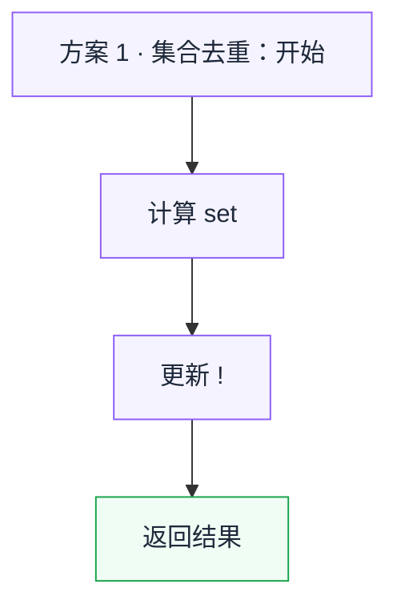

```rust
// LeetCode 217. 存在重复元素 — Rust 版（方案1）
use std::collections::HashSet; // 引入依赖
fn contains_duplicate(nums: &[i32]) -> bool {
    // 定义函数/方法 contains_duplicate
    let set: HashSet<i32> = nums.iter().cloned().collect(); // 把 数组.iter().cloned().collect(); 写入 let set: HashSet<i32>
    set.len() != nums.len() // 把 数组.长度() 写入 set.len() !
}
fn main() {
    // 程序入口：跑内嵌自测用例
    assert!(contains_duplicate(&[1, 2, 3, 1])); // 断言校验
    assert!(!contains_duplicate(&[1, 2, 3, 4])); // 断言校验
    println!("PASS"); // 全部用例通过，输出 PASS
}
```

#### 方案 2：哈希辅助

**思路与代码分析**：核心是「哈希辅助」。Rust 版用所有权移动与切片借用改写同一逻辑，注意 Option 与引用边界。**走读**：方案 2 · 哈希辅助：开始 → 计算 set → 更新 ! → 返回结果。

**运行架构**（真实控制流）：

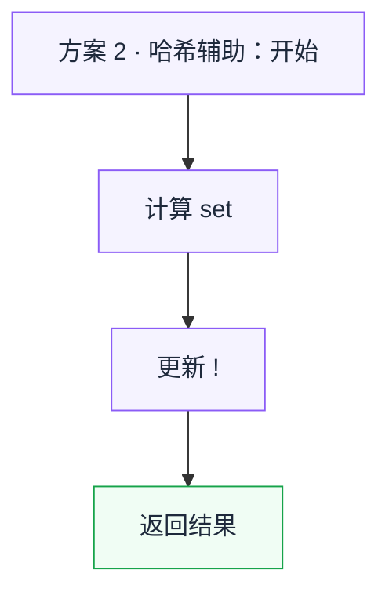

```rust
// LeetCode 217. 存在重复元素 — Rust 版（方案2）
use std::collections::HashSet; // 引入依赖
fn contains_duplicate(nums: &[i32]) -> bool {
    // 定义函数/方法 contains_duplicate
    let set: HashSet<i32> = nums.iter().cloned().collect(); // 把 数组.iter().cloned().collect(); 写入 let set: HashSet<i32>
    set.len() != nums.len() // 把 数组.长度() 写入 set.len() !
}
fn main() {
    // 程序入口：跑内嵌自测用例
    assert!(contains_duplicate(&[1, 2, 3, 1])); // 断言校验
    assert!(!contains_duplicate(&[1, 2, 3, 4])); // 断言校验
    println!("PASS"); // 全部用例通过，输出 PASS
}
```

### Lua 实现（2 种方案）

Lua 的全部方案如下，每个方案都内嵌用例自测，可独立运行（老仓库 python/go 文件遵循「打印结果」约定）：

#### 方案 1：集合去重

**思路与代码分析**：核心是「集合去重」。Lua 版用表与 ipairs 遍历，注意 ipairs 遇 nil 即停的语义。**走读**：方案 1 · 集合去重：开始 → 更新 set → 更新 cnt → 遍历 ipairs(nums) do 中的每个元素 v → 处理 if not set[v] then → 更新 set[v] → 更新 cnt → 返回 cnt ~= #nums。

**运行架构**（真实控制流）：

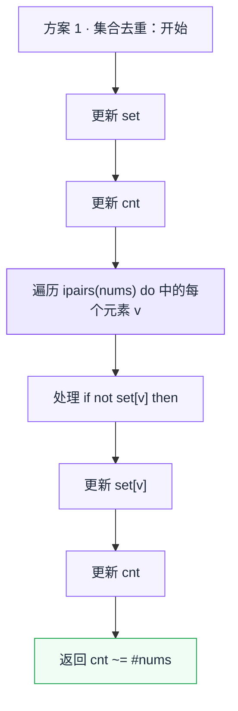

```lua
-- LeetCode 217. 存在重复元素 — Lua 版（方案1）
local function contains_duplicate(nums) -- local function contains_duplicate(数组)
	local set = {} -- 把 {} 写入 local set
	local cnt = 0 -- 把 0 写入 local cnt
	for _, v in ipairs(nums) do -- 遍历取 值
		if not set[v] then
			set[v] = true
			cnt = cnt + 1
		end -- 若 not set[值] then set[值] 赋值为 true; 计数 赋值为 计数 加 1 终点
	end -- 终点
	return cnt ~= #nums -- 返回 计数 ~ 赋值为 #数组
end -- 终点
assert(contains_duplicate({ 1, 2, 3, 1 }) == true) -- 断言校验
assert(contains_duplicate({ 1, 2, 3, 4 }) == false) -- 断言校验
print("PASS") -- 全部用例通过，输出 PASS
```

#### 方案 2：哈希辅助

**思路与代码分析**：核心是「哈希辅助」。Lua 版用表与 ipairs 遍历，注意 ipairs 遇 nil 即停的语义。**走读**：方案 2 · 哈希辅助：开始 → 更新 set → 更新 cnt → 遍历 ipairs(nums) do 中的每个元素 v → 处理 if not set[v] then → 更新 set[v] → 更新 cnt → 返回 cnt ~= #nums。

**运行架构**（真实控制流）：

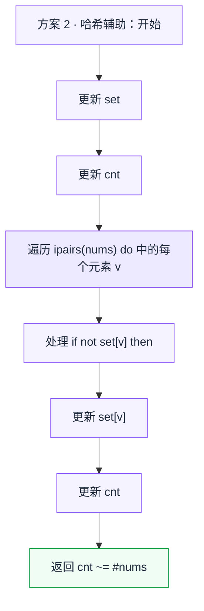

```lua
-- LeetCode 217. 存在重复元素 — Lua 版（方案2）
local function contains_duplicate(nums) -- local function contains_duplicate(数组)
	local set = {} -- 把 {} 写入 local set
	local cnt = 0 -- 把 0 写入 local cnt
	for _, v in ipairs(nums) do -- 遍历取 值
		if not set[v] then
			set[v] = true
			cnt = cnt + 1
		end -- 若 not set[值] then set[值] 赋值为 true; 计数 赋值为 计数 加 1 终点
	end -- 终点
	return cnt ~= #nums -- 返回 计数 ~ 赋值为 #数组
end -- 终点
assert(contains_duplicate({ 1, 2, 3, 1 }) == true) -- 断言校验
assert(contains_duplicate({ 1, 2, 3, 4 }) == false) -- 断言校验
print("PASS") -- 全部用例通过，输出 PASS
```

### C 实现（2 种方案）

C 的全部方案如下，每个方案都内嵌用例自测，可独立运行（老仓库 python/go 文件遵循「打印结果」约定）：

#### 方案 1：集合去重

**思路与代码分析**：核心是「集合去重」。C 版手动管理下标与内存，循环边界全部显式写出。代码里依次做这些事：双重循环遍历。**走读**：方案 1 · 集合去重：开始 → 命中条件，直接返回 → 更新 *sorted → 遍历循环 → 更新 sorted[i] → 调用 qsort(sorted, n, sizeof(int) → 更新 dup → 遍历循环 → 若 sorted[i] == sorted[i - 1] 则： → 更新 dup → 跳出循环（break） → 调用 free(sorted) → 返回 dup。

**运行架构**（真实控制流）：

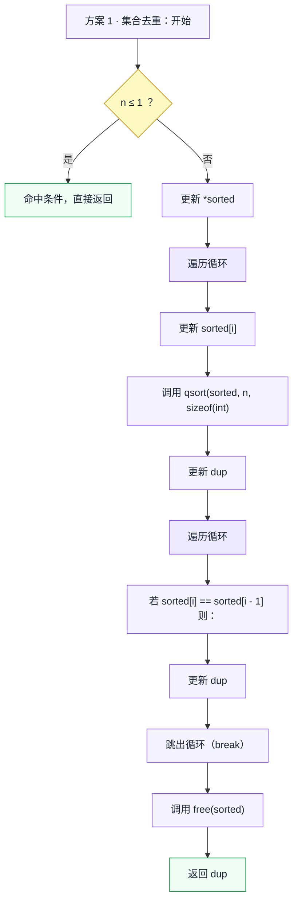

```c
/* LeetCode 217. 存在重复元素 — C 版（方案1） */
#include <stdio.h>  // 引入头文件
#include <stdlib.h> // 引入头文件
static int cmp_int(const void *a, const void *b) { return *(const int *)a - *(const int *)b; }
static int contains_duplicate(const int *nums, int n) { // 定义函数/方法 contains_duplicate
    if (n <= 1)
        return 0;                          // 若 元素个数 不超过 1，直接返回 0
    int *sorted = malloc(sizeof(int) * n); // 把 malloc(sizeof(int) 乘 元素个数); 写入 int *sorted
    for (int i = 0; i < n; i++)
        sorted[i] = nums[i]; // 让 下标 i 从 0 开始计数，下标 i 小于 元素个数 就继续
    qsort(sorted, n, sizeof(int), cmp_int); // qsort(sorted, 元素个数, sizeof(int), cmp_int);
    int dup = 0;                            // 把 0 存入 dup
    for (int i = 1; i < n; i++)
        if (sorted[i] == sorted[i - 1]) {
            dup = 1;
            break;
        }         // 让 下标 i 从 1 开始计数，下标 i 小于 元素个数 就继续
    free(sorted); // free(sorted);
    return dup;   // 返回 dup
}
int main(void) { // 程序入口：跑内嵌自测用例
    if (!contains_duplicate((int[]){1, 2, 3, 1}, 4)) {
        printf("FAIL 1\n");
        return 1;
    }
    if (contains_duplicate((int[]){1, 2, 3, 4}, 4)) {
        printf("FAIL 2\n");
        return 1;
    }
    printf("PASS\n"); // 全部用例通过，输出 PASS
    return 0;         // 返回 0
}
```

#### 方案 2：哈希辅助

**思路与代码分析**：核心是「哈希辅助」。C 版手动管理下标与内存，循环边界全部显式写出。代码里依次做这些事：双重循环遍历。**走读**：方案 2 · 哈希辅助：开始 → 命中条件，直接返回 → 更新 *sorted → 遍历循环 → 更新 sorted[i] → 调用 qsort(sorted, n, sizeof(int) → 更新 dup → 遍历循环 → 若 sorted[i] == sorted[i - 1] 则： → 更新 dup → 跳出循环（break） → 调用 free(sorted) → 返回 dup。

**运行架构**（真实控制流）：


```c
/* LeetCode 217. 存在重复元素 — C 版（方案2） */
#include <stdio.h>  // 引入头文件
#include <stdlib.h> // 引入头文件
static int cmp_int(const void *a, const void *b) { return *(const int *)a - *(const int *)b; }
static int contains_duplicate(const int *nums, int n) { // 定义函数/方法 contains_duplicate
    if (n <= 1)
        return 0;                          // 若 元素个数 不超过 1，直接返回 0
    int *sorted = malloc(sizeof(int) * n); // 把 malloc(sizeof(int) 乘 元素个数); 写入 int *sorted
    for (int i = 0; i < n; i++)
        sorted[i] = nums[i]; // 让 下标 i 从 0 开始计数，下标 i 小于 元素个数 就继续
    qsort(sorted, n, sizeof(int), cmp_int); // qsort(sorted, 元素个数, sizeof(int), cmp_int);
    int dup = 0;                            // 把 0 存入 dup
    for (int i = 1; i < n; i++)
        if (sorted[i] == sorted[i - 1]) {
            dup = 1;
            break;
        }         // 让 下标 i 从 1 开始计数，下标 i 小于 元素个数 就继续
    free(sorted); // free(sorted);
    return dup;   // 返回 dup
}
int main(void) { // 程序入口：跑内嵌自测用例
    if (!contains_duplicate((int[]){1, 2, 3, 1}, 4)) {
        printf("FAIL 1\n");
        return 1;
    }
    if (contains_duplicate((int[]){1, 2, 3, 4}, 4)) {
        printf("FAIL 2\n");
        return 1;
    }
    printf("PASS\n"); // 全部用例通过，输出 PASS
    return 0;         // 返回 0
}
```

### C++ 实现（2 种方案）

C++ 的全部方案如下，每个方案都内嵌用例自测，可独立运行（老仓库 python/go 文件遵循「打印结果」约定）：

#### 方案 1：集合去重

**思路与代码分析**：核心是「集合去重」。C++ 版用 STL 容器与迭代器，减少手写下标错误。**走读**：方案 1 · 集合去重：开始 → 返回 std::unordered_set＜int＞(nums.begin(), nums.end()).size() ≠ nums.size()。

**运行架构**（真实控制流）：

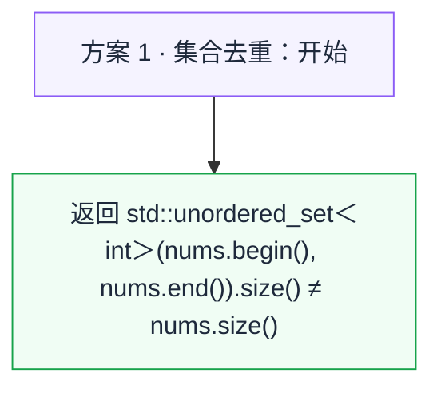

```cpp
// LeetCode 217. 存在重复元素 — C++ 版（方案1）
#include <cassert>                                            // 引入头文件
#include <iostream>                                           // 引入头文件
#include <unordered_set>                                      // 引入头文件
#include <vector>                                             // 引入头文件
static bool containsDuplicate(const std::vector<int> &nums) { // 定义函数/方法 containsDuplicate
    return std::unordered_set<int>(nums.begin(), nums.end()).size() != nums.size();
}
int main() {                                  // 程序入口：跑内嵌自测用例
    assert(containsDuplicate({1, 2, 3, 1}));  // 断言校验
    assert(!containsDuplicate({1, 2, 3, 4})); // 断言校验
    std::cout << "PASS" << std::endl;         // 全部用例通过，输出 PASS
    return 0;                                 // 返回 0
}
```

#### 方案 2：哈希辅助

**思路与代码分析**：核心是「哈希辅助」。C++ 版用 STL 容器与迭代器，减少手写下标错误。**走读**：方案 2 · 哈希辅助：开始 → 返回 std::unordered_set＜int＞(nums.begin(), nums.end()).size() ≠ nums.size()。

**运行架构**（真实控制流）：

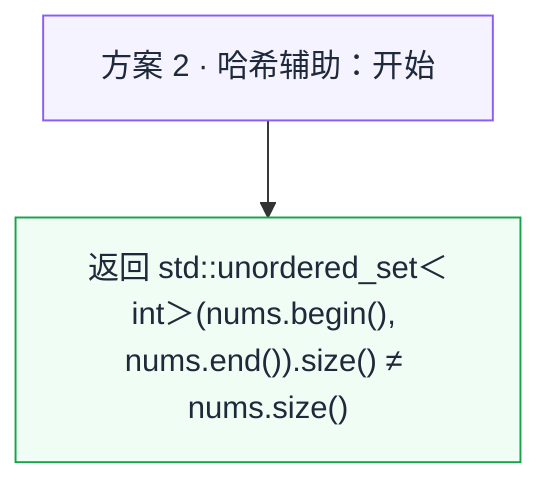

```cpp
// LeetCode 217. 存在重复元素 — C++ 版（方案2）
#include <cassert>                                            // 引入头文件
#include <iostream>                                           // 引入头文件
#include <unordered_set>                                      // 引入头文件
#include <vector>                                             // 引入头文件
static bool containsDuplicate(const std::vector<int> &nums) { // 定义函数/方法 containsDuplicate
    return std::unordered_set<int>(nums.begin(), nums.end()).size() != nums.size();
}
int main() {                                  // 程序入口：跑内嵌自测用例
    assert(containsDuplicate({1, 2, 3, 1}));  // 断言校验
    assert(!containsDuplicate({1, 2, 3, 4})); // 断言校验
    std::cout << "PASS" << std::endl;         // 全部用例通过，输出 PASS
    return 0;                                 // 返回 0
}
```

### R 实现（2 种方案）

R 的全部方案如下，每个方案都内嵌用例自测，可独立运行（老仓库 python/go 文件遵循「打印结果」约定）：

#### 方案 1：集合去重

**思路与代码分析**：核心是「集合去重」。R 版用向量化思维与 1 起始下标，注意 1:n 的降序陷阱。

**运行架构**（真实控制流）：

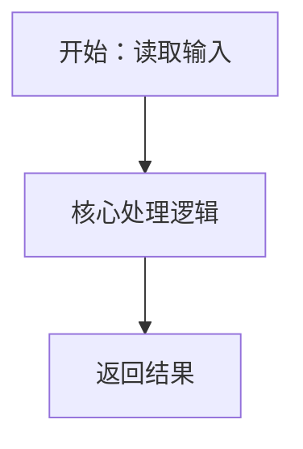

```r
# 版（方案1）
contains_duplicate <- function(nums) length(unique(nums)) != length(nums)  # 定义函数 contains_duplicate（参数：数组）
stopifnot(contains_duplicate(c(1, 2, 3, 1)))  # 断言校验
stopifnot(!contains_duplicate(c(1, 2, 3, 4)))  # 断言校验
cat("PASS\n")  # 全部用例通过，输出 PASS
```

#### 方案 2：哈希辅助

**思路与代码分析**：核心是「哈希辅助」。R 版用向量化思维与 1 起始下标，注意 1:n 的降序陷阱。

**运行架构**：与方案 1 的控制流相同（同算法在该语言的等价实现），图见上。

```r
# 版（方案2）
contains_duplicate <- function(nums) length(unique(nums)) != length(nums)  # 定义函数 contains_duplicate（参数：数组）
stopifnot(contains_duplicate(c(1, 2, 3, 1)))  # 断言校验
stopifnot(!contains_duplicate(c(1, 2, 3, 4)))  # 断言校验
cat("PASS\n")  # 全部用例通过，输出 PASS
```

### Zig 实现（2 种方案）

Zig 的全部方案如下，每个方案都内嵌用例自测，可独立运行（老仓库 python/go 文件遵循「打印结果」约定）：

#### 方案 1：集合去重

**思路与代码分析**：核心是「集合去重」。Zig 版显式分配与清零，整型边界处理严格。代码里依次做这些事：哈希结构做计数或查重；单循环线性扫描。**走读**：方案 1 · 集合去重：开始 → 计算 set → 处理 defer set.deinit() → 遍历集合元素 → 命中条件，直接返回 → 调用 set.put(v, → 返回 false。

**运行架构**（真实控制流）：


```zig
// LeetCode 217. 存在重复元素 — Zig 版（方案1）
const std = @import("std"); // 把 @import(「std」) 存入 std
fn containsDuplicate(nums: []const i32, alloc: std.mem.Allocator) bool { // 定义函数/方法 containsDuplicate
    var set = std.AutoHashMap(i32, void).init(alloc); // 把 std.AutoHashMap(i32, void).init(alloc) 存入 set
    defer set.deinit(); // defer set.deinit();
    for (nums) |v| { // 逐个取出 数组 的元素（值）
        if (set.contains(v)) return true; // 若 set 是否包含 值)，直接返回 true
        set.put(v, {}) catch unreachable; // set.put(值, {}) catch unreachable;
    }
    return false; // 返回 false
}
pub fn main() !void { // 程序入口：跑内嵌自测用例
    var arena = std.heap.ArenaAllocator.init(std.heap.page_allocator); // 把 std.堆.ArenaAllocator.init(std.堆.page_allocator) 存入 arena
    defer arena.deinit(); // defer arena.deinit();
    if (!containsDuplicate(&[_]i32{ 1, 2, 3, 1 }, arena.allocator())) return error.TestFailed;
    if (containsDuplicate(&[_]i32{ 1, 2, 3, 4 }, arena.allocator())) return error.TestFailed;
    std.debug.print("PASS\n", .{}); // 全部用例通过，输出 PASS
}
```

#### 方案 2：哈希辅助

**思路与代码分析**：核心是「哈希辅助」。Zig 版显式分配与清零，整型边界处理严格。代码里依次做这些事：哈希结构做计数或查重；单循环线性扫描。**走读**：方案 2 · 哈希辅助：开始 → 计算 set → 处理 defer set.deinit() → 遍历集合元素 → 命中条件，直接返回 → 调用 set.put(v, → 返回 false。

**运行架构**（真实控制流）：

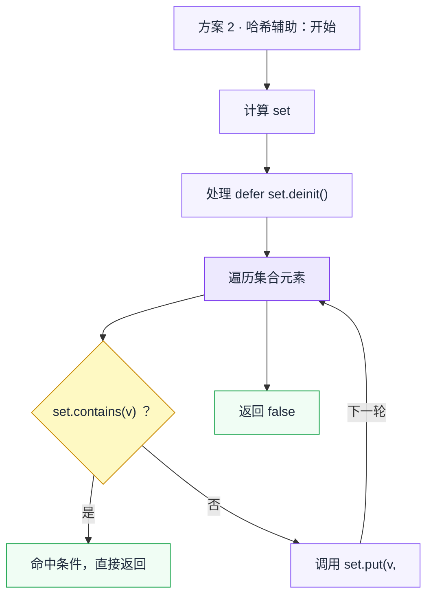

```zig
// LeetCode 217. 存在重复元素 — Zig 版（方案2）
const std = @import("std"); // 把 @import(「std」) 存入 std
fn containsDuplicate(nums: []const i32, alloc: std.mem.Allocator) bool { // 定义函数/方法 containsDuplicate
    var set = std.AutoHashMap(i32, void).init(alloc); // 把 std.AutoHashMap(i32, void).init(alloc) 存入 set
    defer set.deinit(); // defer set.deinit();
    for (nums) |v| { // 逐个取出 数组 的元素（值）
        if (set.contains(v)) return true; // 若 set 是否包含 值)，直接返回 true
        set.put(v, {}) catch unreachable; // set.put(值, {}) catch unreachable;
    }
    return false; // 返回 false
}
pub fn main() !void { // 程序入口：跑内嵌自测用例
    var arena = std.heap.ArenaAllocator.init(std.heap.page_allocator); // 把 std.堆.ArenaAllocator.init(std.堆.page_allocator) 存入 arena
    defer arena.deinit(); // defer arena.deinit();
    if (!containsDuplicate(&[_]i32{ 1, 2, 3, 1 }, arena.allocator())) return error.TestFailed;
    if (containsDuplicate(&[_]i32{ 1, 2, 3, 4 }, arena.allocator())) return error.TestFailed;
    std.debug.print("PASS\n", .{}); // 全部用例通过，输出 PASS
}
```

### Dart 实现（2 种方案）

Dart 的全部方案如下，每个方案都内嵌用例自测，可独立运行（老仓库 python/go 文件遵循「打印结果」约定）：

#### 方案 1：集合去重

**思路与代码分析**：核心是「集合去重」。Dart 版用可空类型标注与集合方法，注意空安全。

**运行架构**（真实控制流）：

```mermaid
graph TD
    A["开始：读取输入"]
    F0["核心处理逻辑"]
    A --> F0
    Z["返回结果"]
    F0 --> Z
```

```dart
// LeetCode 217. 存在重复元素 — Dart 版（方案1）
bool containsDuplicate(List<int> nums) => nums.toSet().length != nums.length;
void main() {
  // 程序入口：跑内嵌自测用例
  if (!containsDuplicate([1, 2, 3, 1])) throw StateError('c1');
  if (containsDuplicate([1, 2, 3, 4]))
    throw StateError(
      'c2',
    ); // 若 containsDuplicate([1, 2, 3, 4])) throw StateError('c2');
  print('PASS'); // 全部用例通过，输出 PASS
}
```

#### 方案 2：哈希辅助

**思路与代码分析**：核心是「哈希辅助」。Dart 版用可空类型标注与集合方法，注意空安全。

**运行架构**：与方案 1 的控制流相同（同算法在该语言的等价实现），图见上。

```dart
// LeetCode 217. 存在重复元素 — Dart 版（方案2）
bool containsDuplicate(List<int> nums) => nums.toSet().length != nums.length;
void main() {
  // 程序入口：跑内嵌自测用例
  if (!containsDuplicate([1, 2, 3, 1])) throw StateError('c1');
  if (containsDuplicate([1, 2, 3, 4]))
    throw StateError(
      'c2',
    ); // 若 containsDuplicate([1, 2, 3, 4])) throw StateError('c2');
  print('PASS'); // 全部用例通过，输出 PASS
}
```

---

## 内容总结

- **存在重复元素**（综合 · Medium）：共 2 个方案，主线思路「集合去重」；时间 O(n) 量级；动画演示归并分治过程，附录给出 11 种语言 × 全部方案的可运行实现。
- 来源博客：[https://blog.csdn.net/tyro_java/article/details/145344295](https://blog.csdn.net/tyro_java/article/details/145344295)
- 导航：[📋 总目录](../) ｜ [← 244 设计位集](../244_设计位集/) ｜ [246 有效的字母异位词 →](../246_有效的字母异位词/)
