# 246 · 有效的字母异位词（第附阶段 · 专题补充 · Medium）

> **难度**：⭐⭐ Medium ｜ **专题**：综合
> **学习定位**：第附阶段 · 专题补充第 246 篇 ｜ **解法数**：2
> **内容总结**：**有效的字母异位词**（综合 · Medium）：共 2 个方案，主线思路「排序」；时间 O(n) 量级；动画演示归并分治过程，附录给出 11 种语言 × 全部方案的可运行实现。

---

## 题目描述

给定两个字符串 `s` 和 `t` ，编写一个函数来判断 `t` 是否是 `s` 的 字母异位词。

示例 1:

输入: s = 「anagram」, t = 「nagaram」
输出: true

- 主函数签名：`function isAnagram(s: string, t: string): boolean`

**用例（来自原题）**：

**示例 2**

```text
输入: s = "rat", t = "car"
输出: false
```
> ✅ **官方验证**：全部 TypeScript 解法已通过 leetcode.cn 官方示例用例验证（自动注入运行，全部 PASS）。题面与 [leetcode.cn 官方](https://leetcode.cn/problems/valid-anagram/)一致，示例配图取自官方题面。

**数据范围与注意事项**：

- `1 <= s.length, t.length <= 5  10^4`
- `s` 和 `t` 仅包含小写字母
- **易错点**：特殊输入（空、重复、极值）的边界检查。

## 题目分析

**场景是什么**：综合练习：从题面本身出发选择合适的数据结构。本题就是该场景的 Medium 级练习，主线做法是「排序」。

**主线怎么解**：把主解法从头到尾过一遍，它其实在依次做这几件事：先排序再处理。

## 解题思路

**方案对比**（共 2 个方案，由浅入深）：

| 方案 | 时间复杂度 | 空间复杂度 |
|---|---|---|
| 方案 1 · 排序 | O(n) 量级 | O(n) |
| 方案 2 · 哈希表 | O(n)（单趟线性扫描） | O(1) 到 O(n)（视辅助结构） |

**由浅入深的路径**：排序 → 哈希表；每往右一步，都在补上一步的短板。

**方案间的取舍**：方案 1（排序）；方案 2（哈希表）。数据规模小、可读性优先时选靠前的方案；规模大、性能优先时选靠后的方案。

**怎么读这一篇**：

- 🐣 **新手路线**：把「题目描述」的示例 1 在纸上手推一遍 → 读方案 1（最直观的写法）与它的代码走读 → 按「运行方式」本地跑通看 PASS → 回头对比方案 2 之后的写法差在哪
- 🦅 **大佬路线**：直接锁定最优方案 1（排序，O(n) 量级）→ 跳读该方案代码与走读 → 用「逐步拆解与面试追问」补齐复杂度推导与边界追问

### 动态算法图（归并分治，GIF 自动循环）


动画演示综合专题里归并分治的典型过程；每个方案在「TypeScript 解题方案」一节还配了专属动画与专属流程图。

### 主解法流程图（真实控制流）

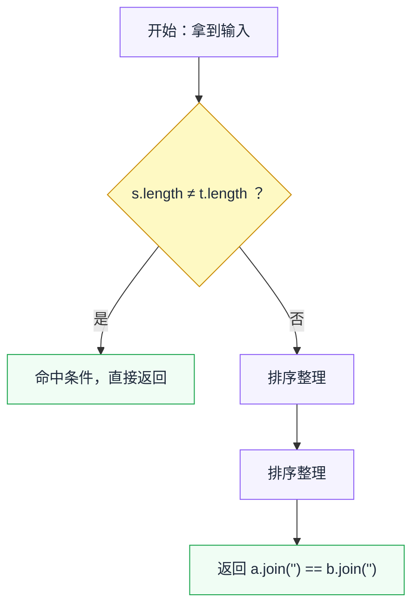

## TypeScript 解题方案（2 个方案逐个讲）

> **运行与提交**：每个方案都是自包含文件（内嵌用例自测，输出 PASS），整块复制到 `.ts` 文件后 `node 文件名` 即可运行。提交 LeetCode 时，把 `demo` 内的算法函数与辅助类型/函数整体取出、置于文件顶层即可。涉及交互/特殊接口的题以题面给定签名为准。

### 方案 1：排序

**分析与思路**：核心做法是「排序」。代码里依次做这些事：先排序再处理。

**运行方式**：`node 本文件`，内嵌用例全部通过会输出 PASS。

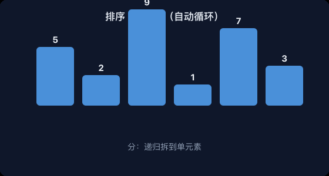

**方案专属流程图**（真实控制流）：

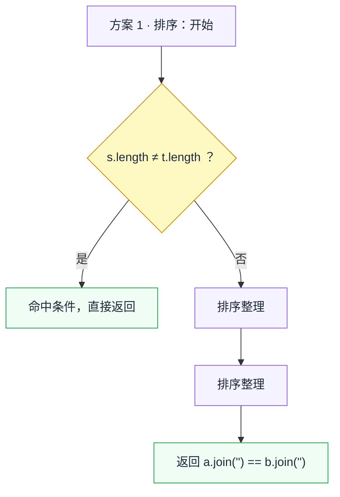

```typescript
/**
 ** LeetCode 242. 有效的字母异位词
 ** 方案：1 ) 方案1：排序
 ** 来源：https://blog.csdn.net/tyro_java/article/details/145355461
 */

// 忠实翻译 Python 参考实现：Counter(s) == Counter(t)
function isAnagram(s: string, t: string): boolean {
  // 定义判定函数 isAnagram
  if (s.length !== t.length) return false; // 若 字符串.长度 不等于 另一字符串.长度，直接返回 false
  const a = s.split('').sort(); // 把 字符串.split('') 排序 ) 存入 数组
  const b = t.split('').sort(); // 把 另一字符串.split('') 排序 ) 存入 b
  return a.join('') === b.join(''); // 返回 数组.join('') 全等于 b.join('')
}

export function demo(): void {
  // 程序入口：跑内嵌自测用例
  // 用例来自 _tools/correctness_check.py PROBLEMS["lc_242_有效的字母异位词"]
  const cases: [string, string, boolean][] = [
    ['anagram', 'nagaram', true],
    ['rat', 'car', false],
    ['aacc', 'ccac', false],
  ];
  for (const [a, b, want] of cases) {
    // for (const [数组, b, want] of cases) {
    const got = isAnagram(a, b); // 把 isAnagram(数组, b) 存入 got
    if (got !== want) {
      // 若 got 不等于 want
      throw new Error(`FAIL isAnagram(${a},${b}) = ${got}, want ${want}`);
    }
  }
  console.log('PASS'); // 全部用例通过，输出 PASS
}

demo(); // demo();
```

### 方案 2：哈希表

**分析与思路**：核心做法是「哈希表」。代码里依次做这些事：双重循环遍历。

**运行方式**：`node 本文件`，内嵌用例全部通过会输出 PASS。

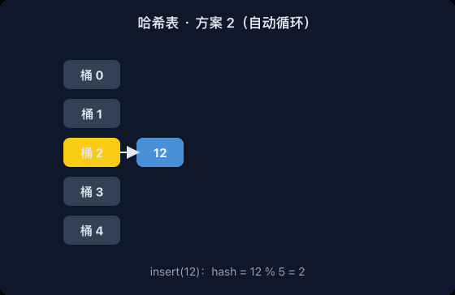

**方案专属流程图**（真实控制流）：

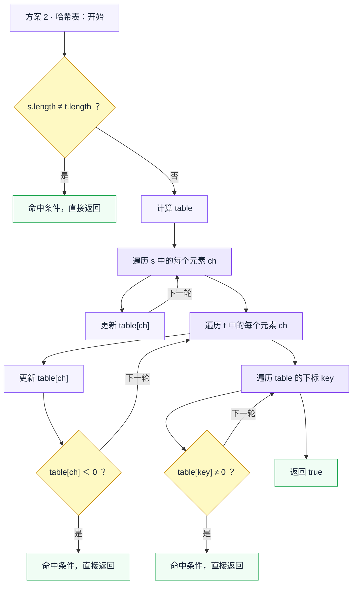

```typescript
/**
 ** LeetCode 242. 有效的字母异位词
 ** 方案：2 ) 方案2：哈希表
 ** 来源：https://blog.csdn.net/tyro_java/article/details/145355461
 */

// 忠实翻译 Python 参考实现：Counter(s) == Counter(t)
function isAnagram(s: string, t: string): boolean {
  // 定义判定函数 isAnagram
  if (s.length !== t.length) return false; // 若 字符串.长度 不等于 另一字符串.长度，直接返回 false
  const table: Record<string, number> = {}; // 把 {}; 写入 const table: Record<string, number>
  for (const ch of s) {
    // for (const 字符 of 字符串) {
    table[ch] = (table[ch] ?? 0) + 1; // 把 (table[字符] ?? 0) 加 1; 写入 table[ch]
  }
  for (const ch of t) {
    // for (const 字符 of 另一字符串) {
    table[ch] = (table[ch] ?? 0) - 1; // 把 (table[字符] ?? 0) 减 1; 写入 table[ch]
    if (table[ch] < 0) return false; // 若 table[字符] 小于 0，直接返回 false
  }
  for (const key in table) {
    // for (const key in table) {
    if (table[key] !== 0) return false; // 若 table[key] 不等于 0，直接返回 false
  }
  return true; // 返回 true
}

export function demo(): void {
  // 程序入口：跑内嵌自测用例
  // 用例来自 _tools/correctness_check.py PROBLEMS["lc_242_有效的字母异位词"]
  const cases: [string, string, boolean][] = [
    ['anagram', 'nagaram', true],
    ['rat', 'car', false],
    ['aacc', 'ccac', false],
  ];
  for (const [a, b, want] of cases) {
    // for (const [数组, b, want] of cases) {
    const got = isAnagram(a, b); // 把 isAnagram(数组, b) 存入 got
    if (got !== want) {
      // 若 got 不等于 want
      throw new Error(`FAIL isAnagram(${a},${b}) = ${got}, want ${want}`);
    }
  }
  console.log('PASS'); // 全部用例通过，输出 PASS
}

demo(); // demo();
```

## 逐步拆解与面试追问

**复杂度**：时间 O(n) 量级，空间 O(n)

**为什么是这个量级**：整体只对数据做有限趟处理

**面试官可能会追问**：

- 有没有更直观的建模方式？
- 特殊输入的边界？
- 能否一步到位而不是分两趟？

## 关键 API 速查（TS 主解法实际用到，附官方链接）

| API | 作用 | 使用要点 | 官方文档 |
|---|---|---|---|
| `Array.prototype.sort()` | 原地排序 | 默认按字符串 Unicode 序（10 会排在 2 前），数字必须传 (a,b)=>a-b；V8 用 TimSort，稳定，O(n log n)；返回原数组引用 | [官方文档](https://developer.mozilla.org/zh-CN/docs/Web/JavaScript/Reference/Global_Objects/Array/sort) |
| `Array.prototype.join()` | 数组拼接为字符串 | undefined/null 转空串；嵌套数组会展平一层；join('') 用于字符数组还原 | [官方文档](https://developer.mozilla.org/zh-CN/docs/Web/JavaScript/Reference/Global_Objects/Array/join) |
| `String.prototype.split()` | 字符串切分为数组 | split('') 按字符拆；split(/正则/) 支持模式；空串调用会拆出空串数组 | [官方文档](https://developer.mozilla.org/zh-CN/docs/Web/JavaScript/Reference/Global_Objects/String/split) |

### 各语言官方文档导航

- **TypeScript / JS**：[MDN 中文参考](https://developer.mozilla.org/zh-CN/)
- **Python**：[Python 官方文档](https://docs.python.org/zh-cn/3/)
- **Go**：[Go 标准库](https://pkg.go.dev/std)
- **Java**：[JDK 17 API](https://docs.oracle.com/en/java/javase/17/docs/api/)
- **Rust**：[Rust 标准库](https://doc.rust-lang.org/std/)
- **Lua**：[Lua 5.4 手册](https://www.lua.org/manual/5.4/)
- **C**：[Cppreference C](https://zh.cppreference.com/w/c)
- **C++**：[Cppreference C++](https://zh.cppreference.com/w/cpp)
- **R**：[R 官方手册](https://stat.ethz.ch/R-manual/)
- **Zig**：[Zig 语言文档](https://ziglang.org/documentation/master/)
- **Dart**：[Dart API](https://api.dart.dev/)

## 附录：其他 10 种语言全部实现（每种语言列举其全部方案）

> TypeScript 的全部方案见「TypeScript 解题方案」一节；下面是其余 10 种语言的对应实现，每种语言的每个方案都带思路分析、代码走读与专属运行架构图。
> 每个方案都内嵌用例自测，可独立运行（老仓库 python/go 文件遵循「打印结果」约定）。
> 完整解法文件见 `dsa/<语言>/other/lc_242_有效的字母异位词/`。

### Python 实现（2 种方案）

Python 的全部方案如下，每个方案都内嵌用例自测，可独立运行（老仓库 python/go 文件遵循「打印结果」约定）：

#### 方案 1：排序

**思路与代码分析**：核心是「排序」。Python 版用切片与字典推导式简化操作，突出可读性。代码里依次做这些事：先排序再处理。**走读**：方案 1 · 排序：开始 → 返回 sorted(s) == sorted(t)。

**运行架构**（真实控制流）：

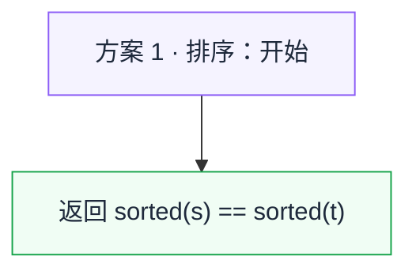

```python
import sys  # 提高递归深度上限（深输入防 RecursionError）

sys.setrecursionlimit(200000)  # 树/链表类题目节点数可达 1e4 量级

def isAnagram(s, t):  # 定义函数 isAnagram（参数：字符串, 另一字符串）
    return sorted(s) == sorted(t)  # 返回 sorted(字符串) 等于 sorted(另一字符串)

if __name__ == "__main__":  # 若 __name__ 等于 '__main__'
    print(isAnagram("anagram", "nagaram"))  # 打印输出
```

#### 方案 2：哈希表

**思路与代码分析**：核心是「哈希表」。Python 版用切片与字典推导式简化操作，突出可读性。代码里依次做这些事：先排序再处理。**走读**：方案 2 · 哈希表：开始 → 返回 sorted(s) == sorted(t)。

**运行架构**（真实控制流）：

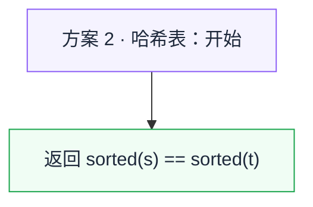

```python
import sys  # 提高递归深度上限（深输入防 RecursionError）

sys.setrecursionlimit(200000)  # 树/链表类题目节点数可达 1e4 量级

def isAnagram(s, t):  # 定义函数 isAnagram（参数：字符串, 另一字符串）
    return sorted(s) == sorted(t)  # 返回 sorted(字符串) 等于 sorted(另一字符串)

if __name__ == "__main__":  # 若 __name__ 等于 '__main__'
    print(isAnagram("anagram", "nagaram"))  # 打印输出
```

### Go 实现（2 种方案）

Go 的全部方案如下，每个方案都内嵌用例自测，可独立运行（老仓库 python/go 文件遵循「打印结果」约定）：

#### 方案 1：排序

**思路与代码分析**：核心是「排序」。Go 版用切片与多返回值惯用法，显式处理索引边界。**走读**：方案 1 · 排序：开始 → 处理 if len(s) ≠ len(t) → 返回 false → 更新 : → 更新 : → 调用 sort.Slice(rs, func(i, j int → 调用 sort.Slice(rt, func(i, j int → 遍历 rs 的下标与元素 i → 处理 if rs[i] ≠ rt[i] → 返回 false → 返回 true。

**运行架构**（真实控制流）：

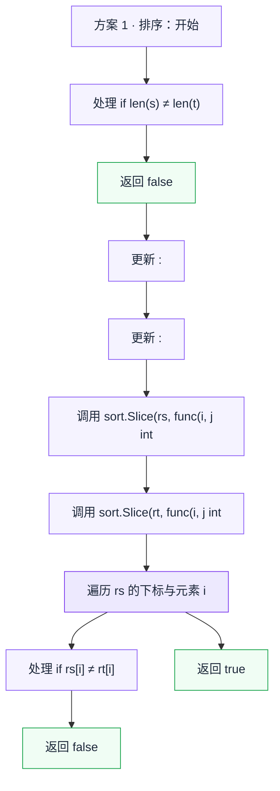

```go
package main // 引入依赖

import (
	"fmt"  // 「fmt」
	"os"   // 「os」
	"sort" // 「sort」
)

// isAnagram 判断两个字符串是否为字母异位词（排序法）。
// 忠实翻译 Python 参考实现：Counter(s) == Counter(t)
func isAnagram(s string, t string) bool { // 定义判定函数 isAnagram
	if len(s) != len(t) { // 定义函数/方法 len
		return false // 返回 false
	}
	rs := []rune(s) // 把 []rune(字符串) 写入 rs :
	rt := []rune(t) // 把 []rune(另一字符串) 写入 rt :
	sort.Slice(rs, func(i, j int) bool { return rs[i] < rs[j] })
	sort.Slice(rt, func(i, j int) bool { return rt[i] < rt[j] })
	for i := range rs { // 把 range rs { 写入 for i :
		if rs[i] != rt[i] { // 若 rs[下标 i] 不等于 rt[下标 i]
			return false // 返回 false
		}
	}
	return true // 返回 true
}

func main() { // 程序入口：跑内嵌自测用例
	// 用例来自 _tools/correctness_check.py PROBLEMS["lc_242_有效的字母异位词"]
	cases := []struct { // 把 []struct { 写入 cases :
		s, t string // 字符串, 另一字符串 string
		want bool   // want bool
	}{ // }{
		{"anagram", "nagaram", true},
		{"rat", "car", false},
		{"aacc", "ccac", false},
	}
	allOK := true             // 把 true 写入 allOK :
	for _, c := range cases { // 同时取 _ 与 字符 遍历
		got := isAnagram(c.s, c.t) // 把 isAnagram(字符.字符串, 字符.另一字符串) 写入 got :
		if got != c.want {         // 若 got 不等于 字符.want
			allOK = false                                                              // 把 false 写入 allOK
			fmt.Printf("FAIL isAnagram(%q,%q) = %v, want %v\n", c.s, c.t, got, c.want) // 打印输出
		}
	}
	if !allOK { // 若 取反 allOK
		os.Exit(1) // os.Exit(1)
	}
	fmt.Println("PASS") // 全部用例通过，输出 PASS
}
```

#### 方案 2：哈希表

**思路与代码分析**：核心是「哈希表」。Go 版用切片与多返回值惯用法，显式处理索引边界。代码里依次做这些事：哈希结构做计数或查重。**走读**：方案 2 · 哈希表：开始 → 处理 if len(s) ≠ len(t) → 返回 false → 更新 : → 遍历 s 的下标与元素 r → 处理 cnt[r]++ → 遍历 t 的下标与元素 r → 处理 cnt[r]-- → 处理 if cnt[r] ＜ 0 → 返回 false → 遍历 cnt 的下标与元素 v → 处理 if v ≠ 0 → 返回 false → 返回 true。

**运行架构**（真实控制流）：

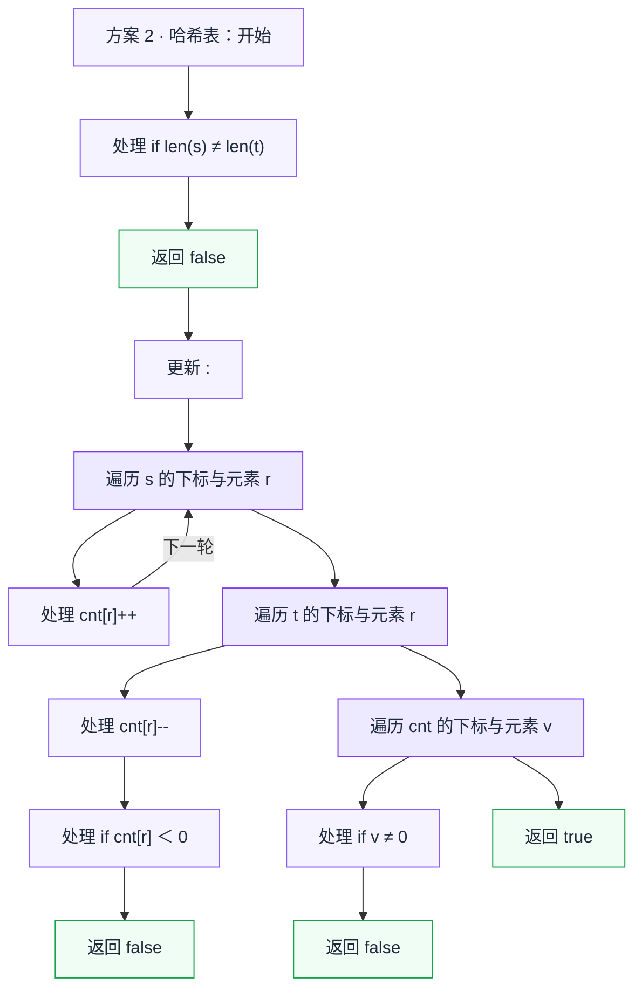

```go
package main // 引入依赖

import (
	"fmt" // 「fmt」
	"os"  // 「os」
)

// isAnagram 判断两个字符串是否为字母异位词（哈希计数法）。
// 忠实翻译 Python 参考实现：Counter(s) == Counter(t)
func isAnagram(s string, t string) bool { // 定义判定函数 isAnagram
	if len(s) != len(t) { // 定义函数/方法 len
		return false // 返回 false
	}
	cnt := make(map[rune]int) // 把 make(映射表[rune]int) 写入 cnt :
	for _, r := range s {     // 同时取 _ 与 右指针 遍历
		cnt[r]++ // 计数[右指针] 加一
	}
	for _, r := range t { // 同时取 _ 与 右指针 遍历
		cnt[r]--        // 计数[右指针] 减一
		if cnt[r] < 0 { // 若 计数[右指针] 小于 0
			return false // 返回 false
		}
	}
	for _, v := range cnt { // 同时取 _ 与 值 遍历
		if v != 0 { // 若 值 不等于 0
			return false // 返回 false
		}
	}
	return true // 返回 true
}

func main() { // 程序入口：跑内嵌自测用例
	// 用例来自 _tools/correctness_check.py PROBLEMS["lc_242_有效的字母异位词"]
	cases := []struct { // 把 []struct { 写入 cases :
		s, t string // 字符串, 另一字符串 string
		want bool   // want bool
	}{ // }{
		{"anagram", "nagaram", true},
		{"rat", "car", false},
		{"aacc", "ccac", false},
	}
	allOK := true             // 把 true 写入 allOK :
	for _, c := range cases { // 同时取 _ 与 字符 遍历
		got := isAnagram(c.s, c.t) // 把 isAnagram(字符.字符串, 字符.另一字符串) 写入 got :
		if got != c.want {         // 若 got 不等于 字符.want
			allOK = false                                                              // 把 false 写入 allOK
			fmt.Printf("FAIL isAnagram(%q,%q) = %v, want %v\n", c.s, c.t, got, c.want) // 打印输出
		}
	}
	if !allOK { // 若 取反 allOK
		os.Exit(1) // os.Exit(1)
	}
	fmt.Println("PASS") // 全部用例通过，输出 PASS
}
```

### Java 实现（2 种方案）

Java 的全部方案如下，每个方案都内嵌用例自测，可独立运行（老仓库 python/go 文件遵循「打印结果」约定）：

#### 方案 1：排序

**思路与代码分析**：核心是「排序」。Java 版用类与静态方法组织，集合操作显式明了。代码里依次做这些事：先排序再处理。**走读**：方案 1 · 排序：开始 → 命中条件，直接返回 → 更新 a → 更新 b → 排序整理 → 排序整理 → 返回 Arrays.equals(a, b)。

**运行架构**（真实控制流）：

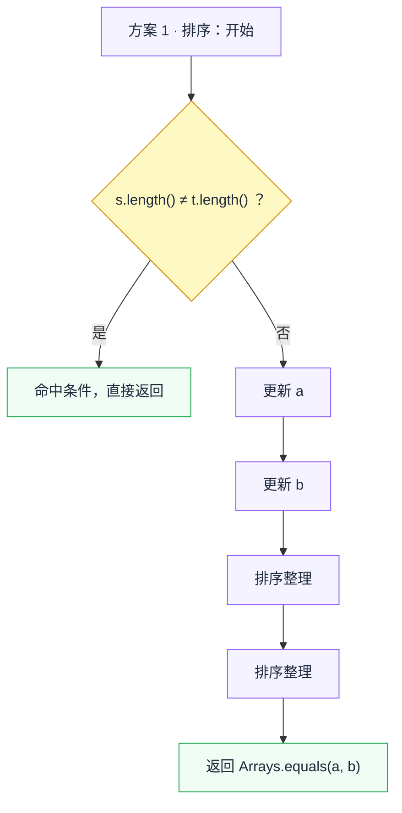

```java
package com.webfault.dsa; // 引入依赖

import java.util.Arrays; // 引入依赖

// LeetCode 242. 有效的字母异位词（排序法）
// 忠实翻译 Python 参考实现：Counter(s) == Counter(t)
class lc242_solution111 { // 定义类型
  boolean isAnagram(String s, String t) { // 定义判定函数 isAnagram
    if (s.length() != t.length()) return false; // 若 字符串.长度() 不等于 另一字符串.长度()，直接返回 false
    char[] a = s.toCharArray(); // 把 字符串.toCharArray(); 写入 char[] a
    char[] b = t.toCharArray(); // 把 另一字符串.toCharArray(); 写入 char[] b
    Arrays.sort(a); // 排序
    Arrays.sort(b); // 排序
    return Arrays.equals(a, b); // 返回 Arrays.equals(数组, b)
  }

  public static void main(String[] args) { // public static void main(String[] args) {
    // 用例来自 _tools/correctness_check.py PROBLEMS["lc_242_有效的字母异位词"]
    Object[][] cases = { // 把 { 写入 Object[][] cases
      {"anagram", "nagaram", true},
      {"rat", "car", false},
      {"aacc", "ccac", false},
    };
    lc242_solution111 s =
        new lc242_solution111(); // 把 new lc242_solution111(); 写入 lc242_solution111 s
    boolean allOK = true; // 把 true; 写入 boolean allOK
    for (Object[] c : cases) { // for (Object[] 字符 : cases) {
      boolean got = s.isAnagram((String) c[0], (String) c[1]);
      boolean want = (Boolean) c[2]; // 把 (Boolean) 字符[2]; 写入 boolean want
      if (got != want) { // 若 got 不等于 want
        allOK = false; // 把 false; 写入 allOK
        System.out.println(
            "FAIL isAnagram(" + c[0] + "," + c[1] + ") = " + got + ", want " + want); // 打印输出
      }
    }
    if (!allOK) { // 若 取反 allOK
      throw new RuntimeException(
          "some cases FAILED"); // throw new RuntimeException(「some cases FAILED」);
    }
    System.out.println("PASS"); // 全部用例通过，输出 PASS
  }
}
```

#### 方案 2：哈希表

**思路与代码分析**：核心是「哈希表」。Java 版用类与静态方法组织，集合操作显式明了。代码里依次做这些事：哈希结构做计数或查重；双重循环遍历。**走读**：方案 2 · 哈希表：开始 → 命中条件，直接返回 → 更新 cnt → 遍历循环 → 遍历循环 → 命中条件，直接返回 → 遍历循环 → 命中条件，直接返回 → 返回 true。

**运行架构**（真实控制流）：

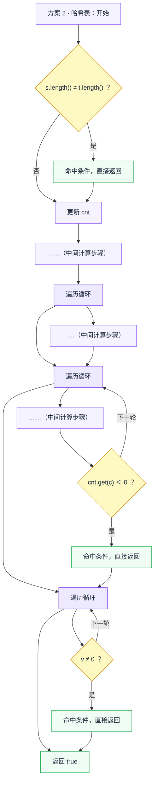

```java
package com.webfault.dsa; // 引入依赖

import java.util.HashMap; // 引入依赖
import java.util.Map; // 引入依赖

// LeetCode 242. 有效的字母异位词（哈希计数法）
// 忠实翻译 Python 参考实现：Counter(s) == Counter(t)
class lc242_solution222 { // 定义类型
  boolean isAnagram(String s, String t) { // 定义判定函数 isAnagram
    if (s.length() != t.length()) return false; // 若 字符串.长度() 不等于 另一字符串.长度()，直接返回 false
    Map<Character, Integer> cnt =
        new HashMap<>(); // 把 new HashMap 小于 超过 (); 写入 Map<Character, Integer> cnt
    for (int i = 0; i < s.length(); i++) { // 让 下标 i 从 0 开始计数，下标 i 小于 字符串.长度() 就继续
      char c = s.charAt(i); // 逐字符处理
      cnt.put(c, cnt.getOrDefault(c, 0) + 1); // 计数.put(字符, 计数.getOrDefault(字符, 0) 加 1);
    }
    for (int i = 0; i < t.length(); i++) { // 让 下标 i 从 0 开始计数，下标 i 小于 另一字符串.长度() 就继续
      char c = t.charAt(i); // 逐字符处理
      cnt.put(c, cnt.getOrDefault(c, 0) - 1); // 计数.put(字符, 计数.getOrDefault(字符, 0) 减 1);
      if (cnt.get(c) < 0) return false; // 若 计数 查找 字符) 小于 0，直接返回 false
    }
    for (int v : cnt.values()) { // for (int 值 : 计数.values()) {
      if (v != 0) return false; // 若 值 不等于 0，直接返回 false
    }
    return true; // 返回 true
  }

  public static void main(String[] args) { // public static void main(String[] args) {
    // 用例来自 _tools/correctness_check.py PROBLEMS["lc_242_有效的字母异位词"]
    Object[][] cases = { // 把 { 写入 Object[][] cases
      {"anagram", "nagaram", true},
      {"rat", "car", false},
      {"aacc", "ccac", false},
    };
    lc242_solution222 s =
        new lc242_solution222(); // 把 new lc242_solution222(); 写入 lc242_solution222 s
    boolean allOK = true; // 把 true; 写入 boolean allOK
    for (Object[] c : cases) { // for (Object[] 字符 : cases) {
      boolean got = s.isAnagram((String) c[0], (String) c[1]);
      boolean want = (Boolean) c[2]; // 把 (Boolean) 字符[2]; 写入 boolean want
      if (got != want) { // 若 got 不等于 want
        allOK = false; // 把 false; 写入 allOK
        System.out.println(
            "FAIL isAnagram(" + c[0] + "," + c[1] + ") = " + got + ", want " + want); // 打印输出
      }
    }
    if (!allOK) { // 若 取反 allOK
      throw new RuntimeException(
          "some cases FAILED"); // throw new RuntimeException(「some cases FAILED」);
    }
    System.out.println("PASS"); // 全部用例通过，输出 PASS
  }
}
```

### Rust 实现（2 种方案）

Rust 的全部方案如下，每个方案都内嵌用例自测，可独立运行（老仓库 python/go 文件遵循「打印结果」约定）：

#### 方案 1：排序

**思路与代码分析**：核心是「排序」。Rust 版用所有权移动与切片借用改写同一逻辑，注意 Option 与引用边界。代码里依次做这些事：先排序再处理。**走读**：方案 1 · 排序：开始 → 处理 if s.len() ≠ t.len() → 返回 false → 计算 a → 计算 b → 排序整理 → 排序整理 → 更新 =。

**运行架构**（真实控制流）：

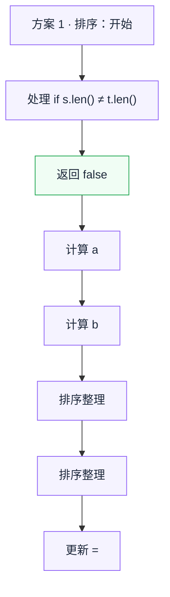

```rust
// LeetCode 242. 有效的字母异位词 — Rust 版（方案1）
fn is_anagram(s: &str, t: &str) -> bool {
    // 定义判定函数 is_anagram
    if s.len() != t.len() {
        return false;
    } // 若 字符串.长度() 不等于 另一字符串.长度() { return false; }
    let mut a: Vec<char> = s.chars().collect(); // 把 字符串.chars().collect(); 写入 let mut a: Vec<char>
    let mut b: Vec<char> = t.chars().collect(); // 把 另一字符串.chars().collect(); 写入 let mut b: Vec<char>
    a.sort(); // 排序
    b.sort(); // 排序
    a == b // 把 赋值为 b 写入 数组
}
fn main() {
    // 程序入口：跑内嵌自测用例
    assert!(is_anagram("anagram", "nagaram")); // 断言校验
    assert!(!is_anagram("rat", "car")); // 断言校验
    println!("PASS"); // 全部用例通过，输出 PASS
}
```

#### 方案 2：哈希表

**思路与代码分析**：核心是「哈希表」。Rust 版用所有权移动与切片借用改写同一逻辑，注意 Option 与引用边界。代码里依次做这些事：先排序再处理。**走读**：方案 2 · 哈希表：开始 → 处理 if s.len() ≠ t.len() → 返回 false → 计算 a → 计算 b → 排序整理 → 排序整理 → 更新 =。

**运行架构**（真实控制流）：

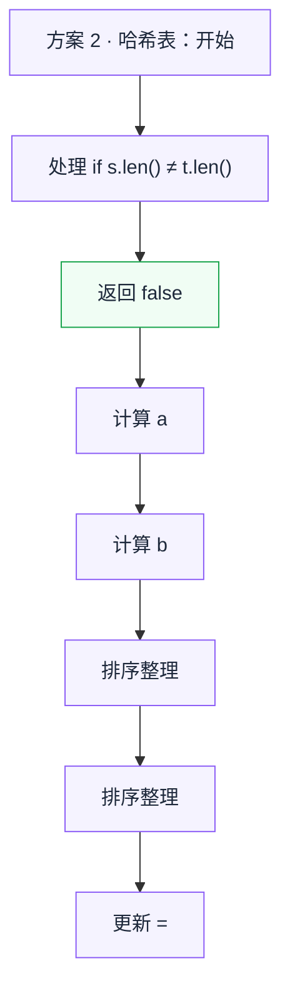

```rust
// LeetCode 242. 有效的字母异位词 — Rust 版（方案2）
fn is_anagram(s: &str, t: &str) -> bool {
    // 定义判定函数 is_anagram
    if s.len() != t.len() {
        return false;
    } // 若 字符串.长度() 不等于 另一字符串.长度() { return false; }
    let mut a: Vec<char> = s.chars().collect(); // 把 字符串.chars().collect(); 写入 let mut a: Vec<char>
    let mut b: Vec<char> = t.chars().collect(); // 把 另一字符串.chars().collect(); 写入 let mut b: Vec<char>
    a.sort(); // 排序
    b.sort(); // 排序
    a == b // 把 赋值为 b 写入 数组
}
fn main() {
    // 程序入口：跑内嵌自测用例
    assert!(is_anagram("anagram", "nagaram")); // 断言校验
    assert!(!is_anagram("rat", "car")); // 断言校验
    println!("PASS"); // 全部用例通过，输出 PASS
}
```

### Lua 实现（2 种方案）

Lua 的全部方案如下，每个方案都内嵌用例自测，可独立运行（老仓库 python/go 文件遵循「打印结果」约定）：

#### 方案 1：排序

**思路与代码分析**：核心是「排序」。Lua 版用表与 ipairs 遍历，注意 ipairs 遇 nil 即停的语义。代码里依次做这些事：先排序再处理。**走读**：方案 1 · 排序：开始 → 处理 if #s ~= #t then → 返回 false → 更新 b → 处理 s:gsub(., function(c) → 更新 1] → 处理 t:gsub(., function(c) → 更新 1] → 排序整理 → 排序整理 → 循环 i：从 1 到 #a do → 处理 if a[i] ~= b[i] then → 返回 false → 返回 true。

**运行架构**（真实控制流）：

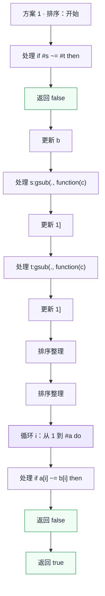

```lua
-- LeetCode 242. 有效的字母异位词 — Lua 版（方案1）
local function is_anagram(s, t) -- local function is_anagram(字符串, 另一字符串)
	if #s ~= #t then
		return false
	end -- 若 #字符串 ~ 赋值为 #另一字符串 then return false 终点
	local a, b = {}, {} -- 把 {}, {} 写入 local a, b
	s:gsub(".", function(c)
		a[#a + 1] = c
	end) -- 把 字符 终点) 写入 s:gsub(".", function(c) a[#a + 1]
	t:gsub(".", function(c)
		b[#b + 1] = c
	end) -- 把 字符 终点) 写入 t:gsub(".", function(c) b[#b + 1]
	table.sort(a) -- 排序
	table.sort(b) -- 排序
	for i = 1, #a do -- 把 1, #数组 do 写入 for i
		if a[i] ~= b[i] then
			return false
		end -- 若 数组[下标 i] ~ 赋值为 b[下标 i] then return false 终点
	end -- 终点
	return true -- 返回 true
end -- 终点
assert(is_anagram("anagram", "nagaram") == true) -- 断言校验
assert(is_anagram("rat", "car") == false) -- 断言校验
print("PASS") -- 全部用例通过，输出 PASS
```

#### 方案 2：哈希表

**思路与代码分析**：核心是「哈希表」。Lua 版用表与 ipairs 遍历，注意 ipairs 遇 nil 即停的语义。代码里依次做这些事：先排序再处理。**走读**：方案 2 · 哈希表：开始 → 处理 if #s ~= #t then → 返回 false → 更新 b → 处理 s:gsub(., function(c) → 更新 1] → 处理 t:gsub(., function(c) → 更新 1] → 排序整理 → 排序整理 → 循环 i：从 1 到 #a do → 处理 if a[i] ~= b[i] then → 返回 false → 返回 true。

**运行架构**（真实控制流）：

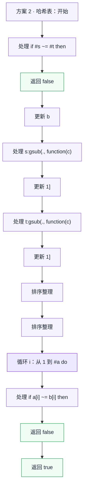

```lua
-- LeetCode 242. 有效的字母异位词 — Lua 版（方案2）
local function is_anagram(s, t) -- local function is_anagram(字符串, 另一字符串)
	if #s ~= #t then
		return false
	end -- 若 #字符串 ~ 赋值为 #另一字符串 then return false 终点
	local a, b = {}, {} -- 把 {}, {} 写入 local a, b
	s:gsub(".", function(c)
		a[#a + 1] = c
	end) -- 把 字符 终点) 写入 s:gsub(".", function(c) a[#a + 1]
	t:gsub(".", function(c)
		b[#b + 1] = c
	end) -- 把 字符 终点) 写入 t:gsub(".", function(c) b[#b + 1]
	table.sort(a) -- 排序
	table.sort(b) -- 排序
	for i = 1, #a do -- 把 1, #数组 do 写入 for i
		if a[i] ~= b[i] then
			return false
		end -- 若 数组[下标 i] ~ 赋值为 b[下标 i] then return false 终点
	end -- 终点
	return true -- 返回 true
end -- 终点
assert(is_anagram("anagram", "nagaram") == true) -- 断言校验
assert(is_anagram("rat", "car") == false) -- 断言校验
print("PASS") -- 全部用例通过，输出 PASS
```

### C 实现（2 种方案）

C 的全部方案如下，每个方案都内嵌用例自测，可独立运行（老仓库 python/go 文件遵循「打印结果」约定）：

#### 方案 1：排序

**思路与代码分析**：核心是「排序」。C 版手动管理下标与内存，循环边界全部显式写出。代码里依次做这些事：双重循环遍历。**走读**：方案 1 · 排序：开始 → 更新 ls → 命中条件，直接返回 → 更新 cnt[256] → 遍历循环 → 处理 cnt[(unsigned char)s[i]]++ → 遍历循环 → 处理 cnt[(unsigned char)t[i]]-- → 遍历循环 → 命中条件，直接返回 → 返回 1。

**运行架构**（真实控制流）：

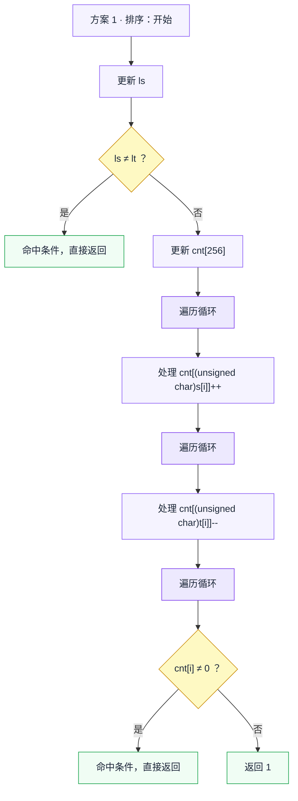

```c
/* LeetCode 242. 有效的字母异位词 — C 版（方案1） */
#include <stdio.h>                                    // 引入头文件
#include <string.h>                                   // 引入头文件
static int is_anagram(const char *s, const char *t) { // 定义判定函数 is_anagram
    size_t ls = strlen(s), lt = strlen(t); // 把 strlen(字符串), lt 赋值为 strlen(另一字符串); 写入 size_t ls
    if (ls != lt)
        return 0;       // 若 ls 不等于 lt，直接返回 0
    int cnt[256] = {0}; // 把 {0}; 写入 int cnt[256]
    for (size_t i = 0; i < ls; i++)
        cnt[(unsigned char)s[i]]++; // 让 下标 i 从 0 开始计数，下标 i 小于 ls 就继续
    for (size_t i = 0; i < lt; i++)
        cnt[(unsigned char)t[i]]--; // 让 下标 i 从 0 开始计数，下标 i 小于 lt 就继续
    for (int i = 0; i < 256; i++)
        if (cnt[i] != 0)
            return 0; // 让 下标 i 从 0 开始计数，下标 i 小于 256 就继续
    return 1;         // 返回 1
}
int main(void) { // 程序入口：跑内嵌自测用例
    if (!is_anagram("anagram", "nagaram")) {
        printf("FAIL 1\n");
        return 1;
    }
    if (is_anagram("rat", "car")) {
        printf("FAIL 2\n");
        return 1;
    }                 // 若 is_anagram(「rat」, 「rat」)) { 输出「rat」); return 1; }
    printf("PASS\n"); // 全部用例通过，输出 PASS
    return 0;         // 返回 0
}
```

#### 方案 2：哈希表

**思路与代码分析**：核心是「哈希表」。C 版手动管理下标与内存，循环边界全部显式写出。代码里依次做这些事：双重循环遍历。**走读**：方案 2 · 哈希表：开始 → 更新 ls → 命中条件，直接返回 → 更新 cnt[256] → 遍历循环 → 处理 cnt[(unsigned char)s[i]]++ → 遍历循环 → 处理 cnt[(unsigned char)t[i]]-- → 遍历循环 → 命中条件，直接返回 → 返回 1。

**运行架构**（真实控制流）：

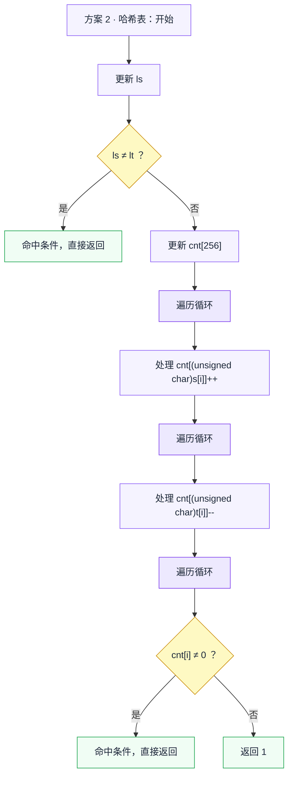

```c
/* LeetCode 242. 有效的字母异位词 — C 版（方案2） */
#include <stdio.h>                                    // 引入头文件
#include <string.h>                                   // 引入头文件
static int is_anagram(const char *s, const char *t) { // 定义判定函数 is_anagram
    size_t ls = strlen(s), lt = strlen(t); // 把 strlen(字符串), lt 赋值为 strlen(另一字符串); 写入 size_t ls
    if (ls != lt)
        return 0;       // 若 ls 不等于 lt，直接返回 0
    int cnt[256] = {0}; // 把 {0}; 写入 int cnt[256]
    for (size_t i = 0; i < ls; i++)
        cnt[(unsigned char)s[i]]++; // 让 下标 i 从 0 开始计数，下标 i 小于 ls 就继续
    for (size_t i = 0; i < lt; i++)
        cnt[(unsigned char)t[i]]--; // 让 下标 i 从 0 开始计数，下标 i 小于 lt 就继续
    for (int i = 0; i < 256; i++)
        if (cnt[i] != 0)
            return 0; // 让 下标 i 从 0 开始计数，下标 i 小于 256 就继续
    return 1;         // 返回 1
}
int main(void) { // 程序入口：跑内嵌自测用例
    if (!is_anagram("anagram", "nagaram")) {
        printf("FAIL 1\n");
        return 1;
    }
    if (is_anagram("rat", "car")) {
        printf("FAIL 2\n");
        return 1;
    }                 // 若 is_anagram(「rat」, 「rat」)) { 输出「rat」); return 1; }
    printf("PASS\n"); // 全部用例通过，输出 PASS
    return 0;         // 返回 0
}
```

### C++ 实现（2 种方案）

C++ 的全部方案如下，每个方案都内嵌用例自测，可独立运行（老仓库 python/go 文件遵循「打印结果」约定）：

#### 方案 1：排序

**思路与代码分析**：核心是「排序」。C++ 版用 STL 容器与迭代器，减少手写下标错误。**走读**：方案 1 · 排序：开始 → 命中条件，直接返回 → 处理 std::sort(s.begin(), s.end() → 处理 std::sort(t.begin(), t.end() → 返回 s == t。

**运行架构**（真实控制流）：

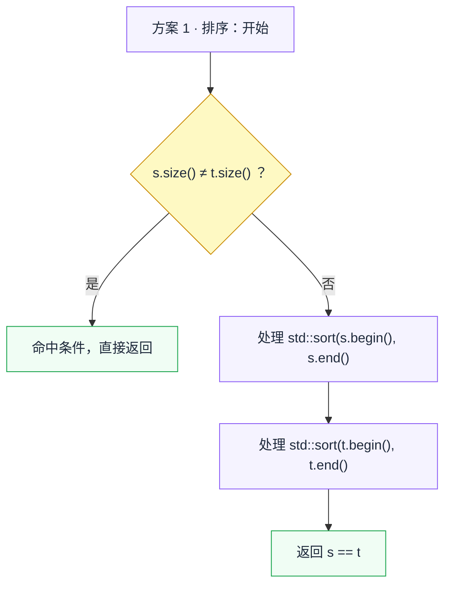

```cpp
// LeetCode 242. 有效的字母异位词 — C++ 版（方案1）
#include <algorithm>                                  // 引入头文件
#include <cassert>                                    // 引入头文件
#include <iostream>                                   // 引入头文件
#include <string>                                     // 引入头文件
static bool isAnagram(std::string s, std::string t) { // 定义判定函数 isAnagram
    if (s.size() != t.size())
        return false; // 若 字符串.大小() 不等于 另一字符串.大小()，直接返回 false
    std::sort(s.begin(), s.end()); // std::sort(字符串 迭代位置 , 字符串.终点());
    std::sort(t.begin(), t.end()); // std::sort(另一字符串 迭代位置 , 另一字符串.终点());
    return s == t;                 // 返回 字符串 等于 另一字符串
}
int main() {                                 // 程序入口：跑内嵌自测用例
    assert(isAnagram("anagram", "nagaram")); // 断言校验
    assert(!isAnagram("rat", "car"));        // 断言校验
    std::cout << "PASS" << std::endl;        // 全部用例通过，输出 PASS
    return 0;                                // 返回 0
}
```

#### 方案 2：哈希表

**思路与代码分析**：核心是「哈希表」。C++ 版用 STL 容器与迭代器，减少手写下标错误。**走读**：方案 2 · 哈希表：开始 → 命中条件，直接返回 → 处理 std::sort(s.begin(), s.end() → 处理 std::sort(t.begin(), t.end() → 返回 s == t。

**运行架构**（真实控制流）：

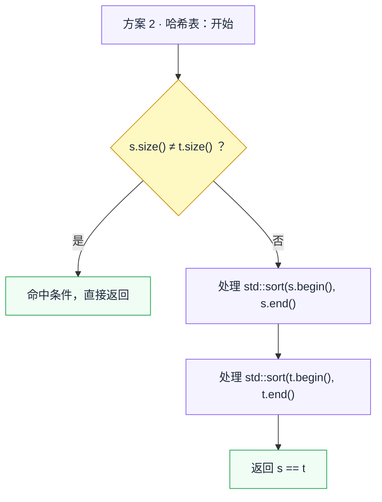

```cpp
// LeetCode 242. 有效的字母异位词 — C++ 版（方案2）
#include <algorithm>                                  // 引入头文件
#include <cassert>                                    // 引入头文件
#include <iostream>                                   // 引入头文件
#include <string>                                     // 引入头文件
static bool isAnagram(std::string s, std::string t) { // 定义判定函数 isAnagram
    if (s.size() != t.size())
        return false; // 若 字符串.大小() 不等于 另一字符串.大小()，直接返回 false
    std::sort(s.begin(), s.end()); // std::sort(字符串 迭代位置 , 字符串.终点());
    std::sort(t.begin(), t.end()); // std::sort(另一字符串 迭代位置 , 另一字符串.终点());
    return s == t;                 // 返回 字符串 等于 另一字符串
}
int main() {                                 // 程序入口：跑内嵌自测用例
    assert(isAnagram("anagram", "nagaram")); // 断言校验
    assert(!isAnagram("rat", "car"));        // 断言校验
    std::cout << "PASS" << std::endl;        // 全部用例通过，输出 PASS
    return 0;                                // 返回 0
}
```

### R 实现（2 种方案）

R 的全部方案如下，每个方案都内嵌用例自测，可独立运行（老仓库 python/go 文件遵循「打印结果」约定）：

#### 方案 1：排序

**思路与代码分析**：核心是「排序」。R 版用向量化思维与 1 起始下标，注意 1:n 的降序陷阱。**走读**：方案 1 · 排序：开始 → 命中条件，直接返回 → 调用 identical(sort(strsplit(s,。

**运行架构**（真实控制流）：

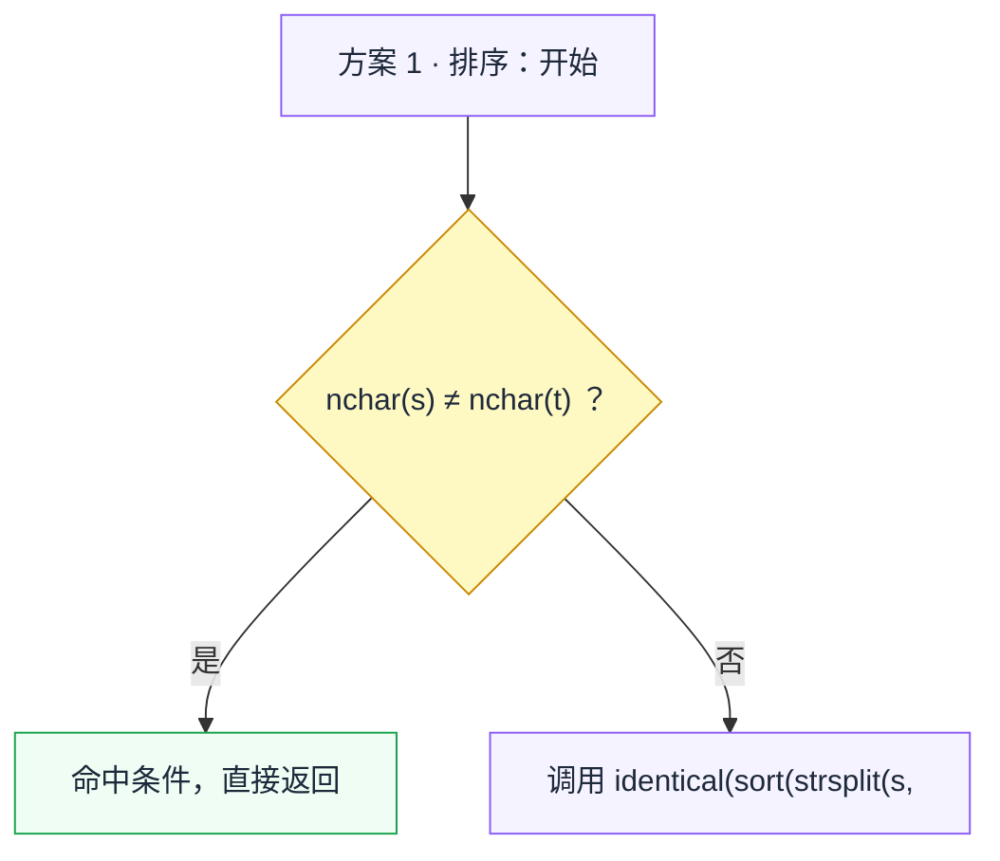

```r
# 版（方案1） 定义函数 is_anagram（参数：字符串, 另一字符串）
is_anagram <- function(s, t) {
    if (nchar(s) != nchar(t))
        return(FALSE)  # 若 nchar(字符串) 不等于 nchar(另一字符串)) return(FALSE
    identical(sort(strsplit(s, "")[[1]]), sort(strsplit(t, "")[[1]]))
}
stopifnot(is_anagram("anagram", "nagaram"))  # 断言校验
stopifnot(!is_anagram("rat", "car"))  # 断言校验
cat("PASS\n")  # 全部用例通过，输出 PASS
```

#### 方案 2：哈希表

**思路与代码分析**：核心是「哈希表」。R 版用向量化思维与 1 起始下标，注意 1:n 的降序陷阱。**走读**：方案 2 · 哈希表：开始 → 命中条件，直接返回 → 调用 identical(sort(strsplit(s,。

**运行架构**（真实控制流）：

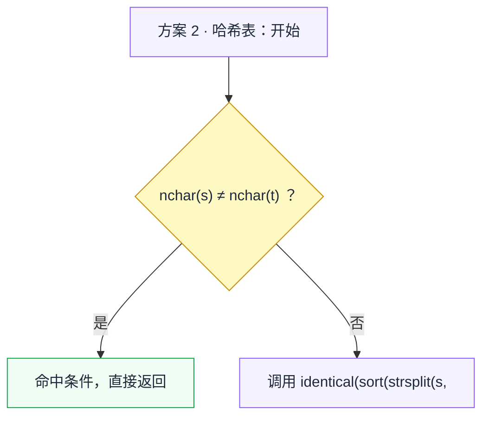

```r
# 版（方案2） 定义函数 is_anagram（参数：字符串, 另一字符串）
is_anagram <- function(s, t) {
    if (nchar(s) != nchar(t))
        return(FALSE)  # 若 nchar(字符串) 不等于 nchar(另一字符串)) return(FALSE
    identical(sort(strsplit(s, "")[[1]]), sort(strsplit(t, "")[[1]]))
}
stopifnot(is_anagram("anagram", "nagaram"))  # 断言校验
stopifnot(!is_anagram("rat", "car"))  # 断言校验
cat("PASS\n")  # 全部用例通过，输出 PASS
```

### Zig 实现（2 种方案）

Zig 的全部方案如下，每个方案都内嵌用例自测，可独立运行（老仓库 python/go 文件遵循「打印结果」约定）：

#### 方案 1：排序

**思路与代码分析**：核心是「排序」。Zig 版显式分配与清零，整型边界处理严格。代码里依次做这些事：双重循环遍历。**走读**：方案 1 · 排序：开始 → 命中条件，直接返回 → 计算 cnt → 遍历集合元素 → 遍历集合元素 → 遍历集合元素 → 返回 true。

**运行架构**（真实控制流）：

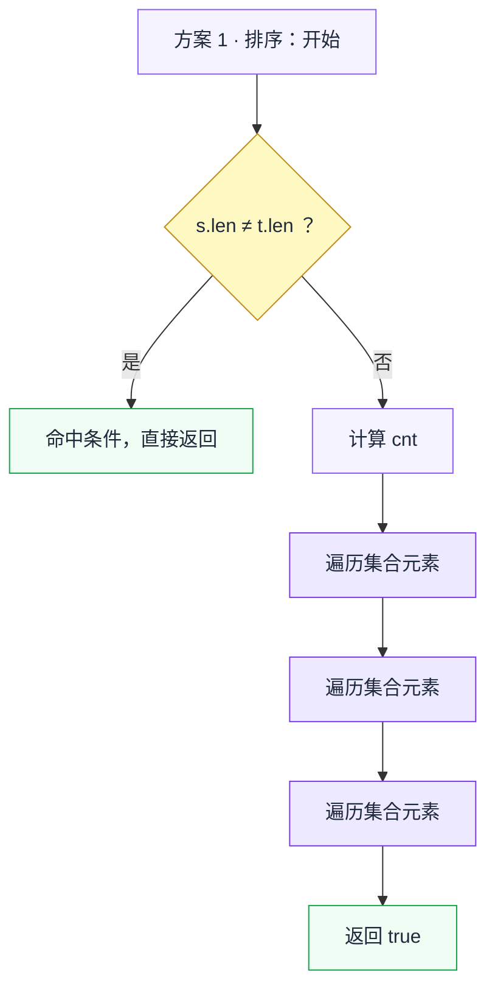

```zig
// LeetCode 242. 有效的字母异位词 — Zig 版（方案1）
const std = @import("std"); // 把 @import(「std」) 存入 std
fn isAnagram(s: []const u8, t: []const u8) bool { // 定义判定函数 isAnagram
    if (s.len != t.len) return false; // 若 字符串.长度 不等于 另一字符串.长度，直接返回 false
    var cnt = [_]i32{0} ** 256; // 把 [_]i32{0} 乘 乘 256 存入 计数
    for (s) |c| cnt[c] += 1; // 逐个取出 字符串 的元素（字符）
    for (t) |c| cnt[c] -= 1; // 逐个取出 另一字符串 的元素（字符）
    for (cnt) |v| if (v != 0) return false; // 逐个取出 计数 的元素（值）
    return true; // 返回 true
}
pub fn main() !void { // 程序入口：跑内嵌自测用例
    if (!isAnagram("anagram", "nagaram")) return error.TestFailed; // 若 取反 isAnagram(「anagram」, 「anagram」)，直接返回 error.TestFailed
    if (isAnagram("rat", "car")) return error.TestFailed; // 若 isAnagram(「rat」, 「rat」)，直接返回 error.TestFailed
    std.debug.print("PASS\n", .{}); // 全部用例通过，输出 PASS
}
```

#### 方案 2：哈希表

**思路与代码分析**：核心是「哈希表」。Zig 版显式分配与清零，整型边界处理严格。代码里依次做这些事：双重循环遍历。**走读**：方案 2 · 哈希表：开始 → 命中条件，直接返回 → 计算 cnt → 遍历集合元素 → 遍历集合元素 → 遍历集合元素 → 返回 true。

**运行架构**（真实控制流）：

```mermaid
graph TD
    N0["方案 2 · 哈希表：开始"]
    N1{"s.len ≠ t.len ？"}
    N2["命中条件，直接返回"]
    N3["计算 cnt"]
    N4["遍历集合元素"]
    N5["遍历集合元素"]
    N6["遍历集合元素"]
    N7["返回 true"]
    N0 --> N1
    N1 -- 是 --> N2
    N1 -- 否 --> N3
    N3 --> N4
    N4 --> N5
    N5 --> N6
    N6 --> N7
    classDef n fill:#f5f3ff,stroke:#8b5cf6,color:#1e293b;
    classDef lp fill:#ede9fe,stroke:#7c3aed,color:#1e293b;
    classDef dc fill:#fef9c3,stroke:#ca8a04,color:#1e293b;
    classDef tm fill:#f0fdf4,stroke:#16a34a,color:#1e293b;
    class N0,N3 n;
    class N4,N5,N6 lp;
    class N1 dc;
    class N2,N7 tm;
```

```zig
// LeetCode 242. 有效的字母异位词 — Zig 版（方案2）
const std = @import("std"); // 把 @import(「std」) 存入 std
fn isAnagram(s: []const u8, t: []const u8) bool { // 定义判定函数 isAnagram
    if (s.len != t.len) return false; // 若 字符串.长度 不等于 另一字符串.长度，直接返回 false
    var cnt = [_]i32{0} ** 256; // 把 [_]i32{0} 乘 乘 256 存入 计数
    for (s) |c| cnt[c] += 1; // 逐个取出 字符串 的元素（字符）
    for (t) |c| cnt[c] -= 1; // 逐个取出 另一字符串 的元素（字符）
    for (cnt) |v| if (v != 0) return false; // 逐个取出 计数 的元素（值）
    return true; // 返回 true
}
pub fn main() !void { // 程序入口：跑内嵌自测用例
    if (!isAnagram("anagram", "nagaram")) return error.TestFailed; // 若 取反 isAnagram(「anagram」, 「anagram」)，直接返回 error.TestFailed
    if (isAnagram("rat", "car")) return error.TestFailed; // 若 isAnagram(「rat」, 「rat」)，直接返回 error.TestFailed
    std.debug.print("PASS\n", .{}); // 全部用例通过，输出 PASS
}
```

### Dart 实现（2 种方案）

Dart 的全部方案如下，每个方案都内嵌用例自测，可独立运行（老仓库 python/go 文件遵循「打印结果」约定）：

#### 方案 1：排序

**思路与代码分析**：核心是「排序」。Dart 版用可空类型标注与集合方法，注意空安全。代码里依次做这些事：先排序再处理；单循环线性扫描。**走读**：方案 1 · 排序：开始 → 命中条件，直接返回 → 排序整理 → 排序整理 → 遍历循环 → 命中条件，直接返回 → 返回 true。

**运行架构**（真实控制流）：

```mermaid
graph TD
    N0["方案 1 · 排序：开始"]
    N1{"s.length ≠ t.length ？"}
    N2["命中条件，直接返回"]
    N3["排序整理"]
    N4["排序整理"]
    N5["遍历循环"]
    N6{"a[i] ≠ b[i] ？"}
    N7["命中条件，直接返回"]
    N8["返回 true"]
    N0 --> N1
    N1 -- 是 --> N2
    N1 -- 否 --> N3
    N3 --> N4
    N4 --> N5
    N5 --> N6
    N6 -- 是 --> N7
    N6 -- 下一轮 --> N5
    N5 --> N8
    classDef n fill:#f5f3ff,stroke:#8b5cf6,color:#1e293b;
    classDef lp fill:#ede9fe,stroke:#7c3aed,color:#1e293b;
    classDef dc fill:#fef9c3,stroke:#ca8a04,color:#1e293b;
    classDef tm fill:#f0fdf4,stroke:#16a34a,color:#1e293b;
    class N0,N3,N4 n;
    class N5 lp;
    class N1,N6 dc;
    class N2,N7,N8 tm;
```

```dart
// LeetCode 242. 有效的字母异位词 — Dart 版（方案1）
bool isAnagram(String s, String t) {
  // 定义判定函数 isAnagram
  if (s.length != t.length) return false; // 若 字符串.长度 不等于 另一字符串.长度，直接返回 false
  final a = s.split('')..sort(); // 把 字符串.split(''). 排序 ) 存入 数组
  final b = t.split('')..sort(); // 把 另一字符串.split(''). 排序 ) 存入 b
  for (var i = 0; i < a.length; i++) {
    // 让 下标 i 从 0 开始计数，下标 i 小于 数组.长度 就继续
    if (a[i] != b[i]) return false; // 若 数组[下标 i] 不等于 b[下标 i]，直接返回 false
  }
  return true; // 返回 true
}

void main() {
  // 程序入口：跑内嵌自测用例
  if (!isAnagram('anagram', 'nagaram')) throw StateError('c1');
  if (isAnagram('rat', 'car'))
    throw StateError(
      'c2',
    ); // 若 isAnagram('rat', 'car')) throw StateError('c2');
  print('PASS'); // 全部用例通过，输出 PASS
}
```

#### 方案 2：哈希表

**思路与代码分析**：核心是「哈希表」。Dart 版用可空类型标注与集合方法，注意空安全。代码里依次做这些事：先排序再处理；单循环线性扫描。**走读**：方案 2 · 哈希表：开始 → 命中条件，直接返回 → 排序整理 → 排序整理 → 遍历循环 → 命中条件，直接返回 → 返回 true。

**运行架构**（真实控制流）：

```mermaid
graph TD
    N0["方案 2 · 哈希表：开始"]
    N1{"s.length ≠ t.length ？"}
    N2["命中条件，直接返回"]
    N3["排序整理"]
    N4["排序整理"]
    N5["遍历循环"]
    N6{"a[i] ≠ b[i] ？"}
    N7["命中条件，直接返回"]
    N8["返回 true"]
    N0 --> N1
    N1 -- 是 --> N2
    N1 -- 否 --> N3
    N3 --> N4
    N4 --> N5
    N5 --> N6
    N6 -- 是 --> N7
    N6 -- 下一轮 --> N5
    N5 --> N8
    classDef n fill:#f5f3ff,stroke:#8b5cf6,color:#1e293b;
    classDef lp fill:#ede9fe,stroke:#7c3aed,color:#1e293b;
    classDef dc fill:#fef9c3,stroke:#ca8a04,color:#1e293b;
    classDef tm fill:#f0fdf4,stroke:#16a34a,color:#1e293b;
    class N0,N3,N4 n;
    class N5 lp;
    class N1,N6 dc;
    class N2,N7,N8 tm;
```

```dart
// LeetCode 242. 有效的字母异位词 — Dart 版（方案2）
bool isAnagram(String s, String t) {
  // 定义判定函数 isAnagram
  if (s.length != t.length) return false; // 若 字符串.长度 不等于 另一字符串.长度，直接返回 false
  final a = s.split('')..sort(); // 把 字符串.split(''). 排序 ) 存入 数组
  final b = t.split('')..sort(); // 把 另一字符串.split(''). 排序 ) 存入 b
  for (var i = 0; i < a.length; i++) {
    // 让 下标 i 从 0 开始计数，下标 i 小于 数组.长度 就继续
    if (a[i] != b[i]) return false; // 若 数组[下标 i] 不等于 b[下标 i]，直接返回 false
  }
  return true; // 返回 true
}

void main() {
  // 程序入口：跑内嵌自测用例
  if (!isAnagram('anagram', 'nagaram')) throw StateError('c1');
  if (isAnagram('rat', 'car'))
    throw StateError(
      'c2',
    ); // 若 isAnagram('rat', 'car')) throw StateError('c2');
  print('PASS'); // 全部用例通过，输出 PASS
}
```

---

## 内容总结

- **有效的字母异位词**（综合 · Medium）：共 2 个方案，主线思路「排序」；时间 O(n) 量级；动画演示归并分治过程，附录给出 11 种语言 × 全部方案的可运行实现。
- 来源博客：[https://blog.csdn.net/tyro_java/article/details/145355461](https://blog.csdn.net/tyro_java/article/details/145355461)
- 导航：[📋 总目录](../) ｜ [← 245 存在重复元素](../245_存在重复元素/) ｜ [247 有时间限制的 promise 对 →](../247_有时间限制的_promise_对象/)
