# 247 · 有时间限制的 promise 对象（第附阶段 · 专题补充 · Medium）

> **难度**：⭐⭐ Medium ｜ **专题**：并发
> **学习定位**：第附阶段 · 专题补充第 247 篇 ｜ **解法数**：2
> **内容总结**：**有时间限制的 promise 对象**（并发 · Medium）：共 2 个方案，主线思路「方案：在新 Promise 内部调用函数」；时间 O(n) 量级；动画演示异步时序过程，附录给出 11 种语言 × 全部方案的可运行实现。

---

## 题目描述

请你编写一个函数，它接受一个异步函数 `fn` 和一个以毫秒为单位的时间 `t`。它应根据限时函数返回一个有 限时 效果的函数。函数 `fn` 接受提供给 限时 函数的参数。

限时 函数应遵循以下规则：

 如果 `fn` 在 `t` 毫秒的时间限制内完成，限时 函数应返回结果。
 如果 `fn` 的执行超过时间限制，限时 函数应拒绝并返回字符串 `「Time Limit Exceeded」` 。

示例 1：

输入：
fn = async (n) => { 
 await new Promise(res => setTimeout(res, 100)); 
 return n  n; 
}
inputs = [5]
t = 50
输出：{「rejected」:「Time Limit Exceeded」,「time」:50}
解释：
const limited = timeLimit(fn, t)
const start = performance.now()
let result;
try {
 const res = await limited(...inputs)
 result = {「resolved」: res, 「time」: Math.floor(performance.now() - start)};
} catch (err) {
 result = {「rejected」: err, 「time」: Math.floor(performance.now() - start)};
}
console.log(result) // 输出结果

提供的函数设置在 100ms 后执行完成，但是设置的超时时间为 50ms，所以在 t=50ms 时拒绝因为达到了超时时间。

示例 2：

输入：
fn = async (n) => { 
 await new Promise(res => setTimeout(res, 100)); 
 return n  n; 
}
inputs = [5]
t = 150
输出：{「resolved」:25,「time」:100}
解释：
在 t=100ms 时执行 55=25 ，没有达到超时时间。

示例 3：

输入：
fn = async (a, b) => { 
 await new Promise(res => setTimeout(res, 120)); 
 return a + b; 
}
inputs = [5,10]
t = 150
输出：{「resolved」:15,「time」:120}
解释：
在 t=120ms 时执行 5+10=15，没有达到超时时间。

示例 4：

输入：
fn = async () => { 
 throw 「Error」;
}
inputs = []
t = 1000
输出：{「rejected」:「Error」,「time」:0}
解释：
此函数始终丢出 Error

提示：

 `0 
 `0 
 `fn` 返回一个 Promise 对象

> 题面与 [leetcode.cn 官方](https://leetcode.cn/problems/promise-time-limit/)一致，示例配图取自官方题面。

**数据范围与注意事项**：

- `0 <= inputs.length <= 10`
- `0 <= t <= 1000`
- fn 返回一个 Promise 对象
- **易错点**：异步的完成顺序不等于书写顺序，等待谁要想清楚。

## 题目分析

**场景是什么**：多个异步任务的时序与协作，对应真实开发里的请求并发控制、竞态处理。本题就是该场景的 Medium 级练习，主线做法是「方案：在新 Promise 内部调用函数」。

**主线怎么解**：主解法结构简单：读入、处理、返回。

## 解题思路

**方案对比**（共 2 个方案，由浅入深）：

| 方案 | 时间复杂度 | 空间复杂度 |
|---|---|---|
| 方案 1 · 方案：在新 Promise 内部调用函数 | O(n) 量级 | O(n) |
| 方案 2 · 处理清除 Timeout | O(n) 量级 | O(n) |

**由浅入深的路径**：方案：在新 Promise 内部调用函数 → 处理清除 Timeout；每往右一步，都在补上一步的短板。

**方案间的取舍**：方案 1（方案：在新 Promise 内部调用函数）；方案 2（处理清除 Timeout）。数据规模小、可读性优先时选靠前的方案；规模大、性能优先时选靠后的方案。

**怎么读这一篇**：

- 🐣 **新手路线**：把「题目描述」的示例 1 在纸上手推一遍 → 读方案 1（最直观的写法）与它的代码走读 → 按「运行方式」本地跑通看 PASS → 回头对比方案 2 之后的写法差在哪
- 🦅 **大佬路线**：直接锁定最优方案 1（方案：在新 Promise 内部调用函数，O(n) 量级）→ 跳读该方案代码与走读 → 用「逐步拆解与面试追问」补齐复杂度推导与边界追问

### 动态算法图（异步时序，GIF 自动循环）

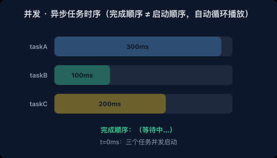

动画演示并发专题里异步时序的典型过程；每个方案在「TypeScript 解题方案」一节还配了专属动画与专属流程图。

### 主解法流程图（真实控制流）

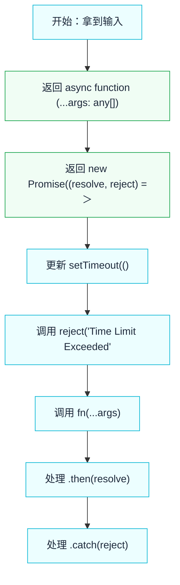

## TypeScript 解题方案（2 个方案逐个讲）

> **运行与提交**：每个方案都是自包含文件（内嵌用例自测，输出 PASS），整块复制到 `.ts` 文件后 `node 文件名` 即可运行。提交 LeetCode 时，把 `demo` 内的算法函数与辅助类型/函数整体取出、置于文件顶层即可。涉及交互/特殊接口的题以题面给定签名为准。

### 方案 1：方案：在新 Promise 内部调用函数

**分析与思路**：核心做法是「方案：在新 Promise 内部调用函数」。

**运行方式**：`node 本文件`，内嵌用例全部通过会输出 PASS。

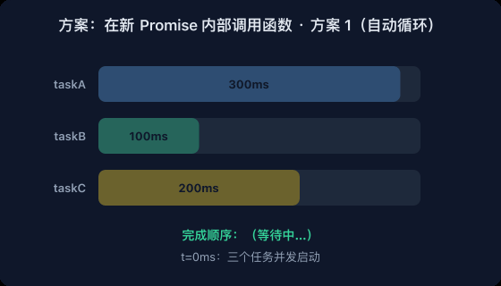

**方案专属流程图**（真实控制流）：

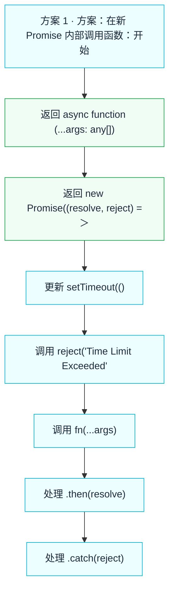

```typescript
/**
 ** LeetCode 2637. 有时间限制的 Promise 对象
 ** 方案：方案1
 ** 来源：https://blog.csdn.net/tyro_java/article/details/145371693
 */

type Fn = (...params: any[]) => Promise<any>; // 定义类型

export function timeLimit(fn: Fn, t: number): Fn {
  // 定义函数/方法 timeLimit
  return async function (...args: any[]) {
    // 返回 async function(...args: any[]) {
    return new Promise((resolve, reject) => {
      setTimeout(() => {
        reject('Time Limit Exceeded'); // reject(「Time Limit Exceeded」);
      }, t); // }, 另一字符串);
      fn(...args)
        .then(resolve)
        .catch(reject); // fn(...args).then(resolve).catch(reject);
    }); // });
  };
}

export async function demo(): Promise<void> {
  // 程序入口：跑内嵌自测用例
  const slow = (ms: number) =>
    new Promise<number>((r) => setTimeout(() => r(ms), ms));
  // case 1: limit 50ms, fn resolves at 150ms -> reject
  let rejected = false; // 把 false 存入 rejected
  try {
    // try {
    await timeLimit((ms: number) => slow(ms), 50)(150);
  } catch (e) {
    // } catch (e) {
    rejected = true; // 把 true 存入 rejected
    if (e !== 'Time Limit Exceeded')
      throw new Error('FAILED wrong msg: ' + String(e));
  }
  if (!rejected) throw new Error('FAILED expected timeout'); // 若 取反 rejected) throw new Error(「FAILED expected timeout」);
  // case 2: limit 300ms, fn resolves at 150ms -> resolve 150
  const v = await timeLimit((ms: number) => slow(ms), 300)(150);
  if (v !== 150) throw new Error('FAILED expected 150 got ' + String(v));
  console.log('PASS'); // 全部用例通过，输出 PASS
}

demo().catch((e) => {
  console.error(String(e));
  process.exit(1);
});
```

### 方案 2：处理清除 Timeout

**分析与思路**：核心做法是「处理清除 Timeout」。

**运行方式**：`node 本文件`，内嵌用例全部通过会输出 PASS。

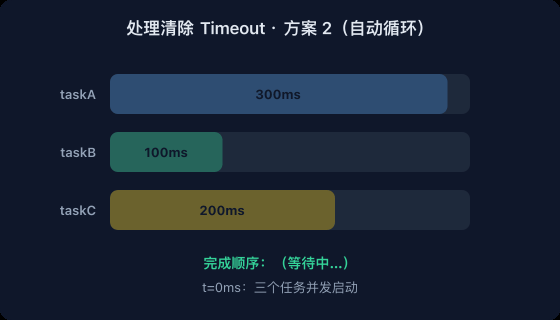

**方案专属流程图**（真实控制流）：

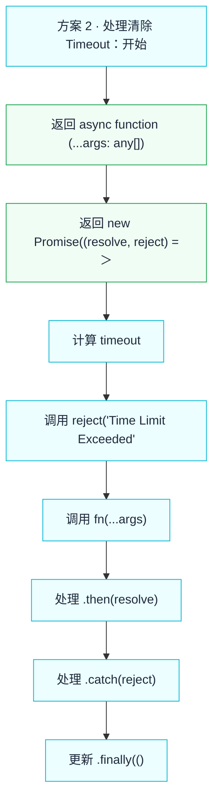

```typescript
/**
 ** LeetCode 2637. 有时间限制的 Promise 对象
 ** 方案：2 ）方案2：处理清除 Timeout
 ** 来源：https://blog.csdn.net/tyro_java/article/details/145371693
 */

type Fn = (...params: any[]) => Promise<any>; // 定义类型

export function timeLimit(fn: Fn, t: number): Fn {
  // 定义函数/方法 timeLimit
  return async function (...args: any[]) {
    // 返回 async function(...args: any[]) {
    return new Promise((resolve, reject) => {
      const timeout = setTimeout(() => {
        reject('Time Limit Exceeded'); // reject(「Time Limit Exceeded」);
      }, t); // }, 另一字符串);
      fn(...args) // fn(...args)
        .then(resolve) // then(resolve)
        .catch(reject) // catch(reject)
        .finally(() => clearTimeout(timeout));
    }); // });
  };
}

export async function demo(): Promise<void> {
  // 程序入口：跑内嵌自测用例
  const slow = (ms: number) =>
    new Promise<number>((r) => setTimeout(() => r(ms), ms));
  // case 1: limit 50ms, fn resolves at 150ms -> reject
  let rejected = false; // 把 false 存入 rejected
  try {
    // try {
    await timeLimit((ms: number) => slow(ms), 50)(150);
  } catch (e) {
    // } catch (e) {
    rejected = true; // 把 true 存入 rejected
    if (e !== 'Time Limit Exceeded')
      throw new Error('FAILED wrong msg: ' + String(e));
  }
  if (!rejected) throw new Error('FAILED expected timeout'); // 若 取反 rejected) throw new Error(「FAILED expected timeout」);
  // case 2: limit 300ms, fn resolves at 150ms -> resolve 150
  const v = await timeLimit((ms: number) => slow(ms), 300)(150);
  if (v !== 150) throw new Error('FAILED expected 150 got ' + String(v));
  console.log('PASS'); // 全部用例通过，输出 PASS
}

demo().catch((e) => {
  console.error(String(e));
  process.exit(1);
});
```

## 逐步拆解与面试追问

**复杂度**：时间 O(n) 量级，空间 O(n)

**为什么是这个量级**：整体只对数据做有限趟处理

**面试官可能会追问**：

- 执行顺序由什么决定？
- 超时与竞态如何兜底？
- 怎样写成确定性的测试？

## 关键 API 速查（TS 主解法实际用到，附官方链接）

| API | 作用 | 使用要点 | 官方文档 |
|---|---|---|---|
| `Promise` | 异步承诺对象 | executor 同步执行；resolve/reject 仅首次生效；配 async/await 串行化 | [官方文档](https://developer.mozilla.org/zh-CN/docs/Web/JavaScript/Reference/Global_Objects/Promise) |
| `setTimeout()` | 延时回调（事件循环） | 延时非精确（排在宏任务队列）；最小延迟与嵌套层级相关 | [官方文档](https://developer.mozilla.org/zh-CN/docs/Web/JavaScript/Reference/Global_Objects/setTimeout) |

### 各语言官方文档导航

- **TypeScript / JS**：[MDN 中文参考](https://developer.mozilla.org/zh-CN/)
- **Python**：[Python 官方文档](https://docs.python.org/zh-cn/3/)
- **Go**：[Go 标准库](https://pkg.go.dev/std)
- **Java**：[JDK 17 API](https://docs.oracle.com/en/java/javase/17/docs/api/)
- **Rust**：[Rust 标准库](https://doc.rust-lang.org/std/)
- **Lua**：[Lua 5.4 手册](https://www.lua.org/manual/5.4/)
- **C**：[Cppreference C](https://zh.cppreference.com/w/c)
- **C++**：[Cppreference C++](https://zh.cppreference.com/w/cpp)
- **R**：[R 官方手册](https://stat.ethz.ch/R-manual/)
- **Zig**：[Zig 语言文档](https://ziglang.org/documentation/master/)
- **Dart**：[Dart API](https://api.dart.dev/)

## 附录：其他 10 种语言全部实现（每种语言列举其全部方案）

> TypeScript 的全部方案见「TypeScript 解题方案」一节；下面是其余 10 种语言的对应实现，每种语言的每个方案都带思路分析、代码走读与专属运行架构图。
> 每个方案都内嵌用例自测，可独立运行（老仓库 python/go 文件遵循「打印结果」约定）。
> 完整解法文件见 `dsa/<语言>/concurrency/lc_2637_有时间限制的_promise_对象/`。

### Python 实现（2 种方案）

Python 的全部方案如下，每个方案都内嵌用例自测，可独立运行（老仓库 python/go 文件遵循「打印结果」约定）：

#### 方案 1：方案：在新 Promise 内部调用函数

**思路与代码分析**：核心是「方案：在新 Promise 内部调用函数」。Python 版用切片与字典推导式简化操作，突出可读性。**走读**：方案 1 · 方案：在新 Promise 内部调用函数：开始 → 处理 async def limited(*args): → 处理 try: → 返回 await asyncio.wait_for(fn(*args), timeout=t / 1000) → 处理 except asyncio.TimeoutError: → 处理 raise Exception(Time Limit → 返回 limited。

**运行架构**（真实控制流）：

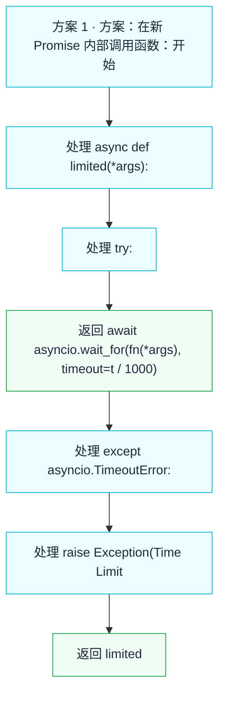

```python
import sys  # 提高递归深度上限（深输入防 RecursionError）

sys.setrecursionlimit(200000)  # 树/链表类题目节点数可达 1e4 量级
import asyncio  # 引入依赖

def timeLimit(fn, t):  # 定义函数 timeLimit（参数：fn, 另一字符串）
    async def limited(*args):  # 定义函数 limited（参数：乘 args）
        try:  # try:
            return await asyncio.wait_for(fn(*args), timeout=t / 1000)
        except asyncio.TimeoutError:  # except asyncio.TimeoutError:
            raise Exception("Time Limit Exceeded")  # raise Exception(「Time Limit Exceeded」)

    return limited  # 返回 limited

if __name__ == "__main__":  # 若 __name__ 等于 '__main__'

    async def slow(t):  # 定义函数 slow（参数：另一字符串）
        await asyncio.sleep(t / 1000)  # await asyncio.sleep(另一字符串 除以 1000)
        return t  # 返回 另一字符串

    limited = timeLimit(slow, 100)  # 把 timeLimit(慢指针, 100) 存入 limited
    try:  # try:
        print(asyncio.run(limited(150)))  # 打印输出
    except Exception as e:  # except Exception as e:
        print(e)  # 打印输出
```

#### 方案 2：处理清除 Timeout

**思路与代码分析**：核心是「处理清除 Timeout」。Python 版用切片与字典推导式简化操作，突出可读性。**走读**：方案 2 · 处理清除 Timeout：开始 → 处理 async def limited(*args): → 处理 try: → 返回 await asyncio.wait_for(fn(*args), timeout=t / 1000) → 处理 except asyncio.TimeoutError: → 处理 raise Exception(Time Limit → 返回 limited。

**运行架构**（真实控制流）：

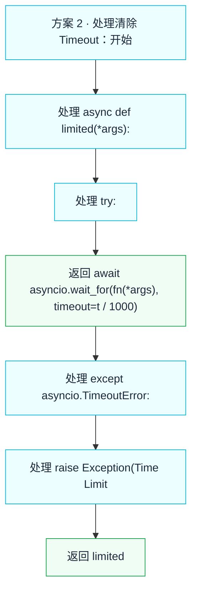

```python
import sys  # 提高递归深度上限（深输入防 RecursionError）

sys.setrecursionlimit(200000)  # 树/链表类题目节点数可达 1e4 量级
import asyncio  # 引入依赖

def timeLimit(fn, t):  # 定义函数 timeLimit（参数：fn, 另一字符串）
    async def limited(*args):  # 定义函数 limited（参数：乘 args）
        try:  # try:
            return await asyncio.wait_for(fn(*args), timeout=t / 1000)
        except asyncio.TimeoutError:  # except asyncio.TimeoutError:
            raise Exception("Time Limit Exceeded")  # raise Exception(「Time Limit Exceeded」)

    return limited  # 返回 limited

if __name__ == "__main__":  # 若 __name__ 等于 '__main__'

    async def slow(t):  # 定义函数 slow（参数：另一字符串）
        await asyncio.sleep(t / 1000)  # await asyncio.sleep(另一字符串 除以 1000)
        return t  # 返回 另一字符串

    limited = timeLimit(slow, 100)  # 把 timeLimit(慢指针, 100) 存入 limited
    try:  # try:
        print(asyncio.run(limited(150)))  # 打印输出
    except Exception as e:  # except Exception as e:
        print(e)  # 打印输出

    limited2 = timeLimit(slow, 300)  # 把 timeLimit(慢指针, 300) 存入 limited2
    print(asyncio.run(limited2(150)))  # 打印输出
```

### Go 实现（2 种方案）

Go 的全部方案如下，每个方案都内嵌用例自测，可独立运行（老仓库 python/go 文件遵循「打印结果」约定）：

#### 方案 1：方案：在新 Promise 内部调用函数

**思路与代码分析**：核心是「方案：在新 Promise 内部调用函数」。Go 版用切片与多返回值惯用法，显式处理索引边界。**走读**：方案 1 · 方案：在新 Promise 内部调用函数：开始 → 返回 func(arg int) (int, error) → 更新 : → 处理 go func() → 处理 select → 更新 : → 返回 res, nil → 处理 case ＜-time.After(time.Durat → 返回 0, fmt.Errorf(Time Limit Exceeded)。

**运行架构**（真实控制流）：

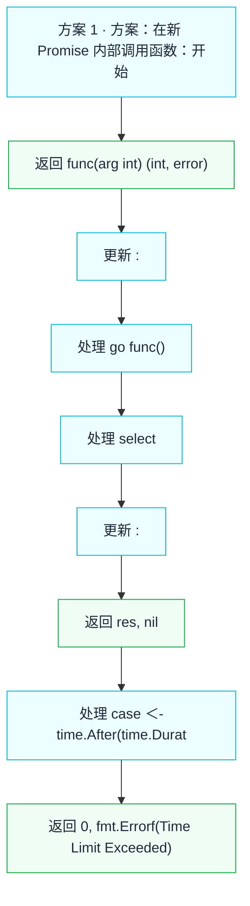

```go
package main // 引入依赖

import (
	"fmt"  // 「fmt」
	"os"   // 「os」
	"time" // 「time」
)

// timeLimit 是 Python 参考 solution_1 的忠实翻译（超时即返回 "Time Limit Exceeded" 错误）。
func timeLimit(fn func(int) int, t int) func(int) (int, error) { // 定义函数/方法 func
	return func(arg int) (int, error) { // 定义函数/方法 func
		ch := make(chan int, 1)       // 把 make(chan int, 1) 写入 ch :
		go func() { ch <- fn(arg) }() // 定义函数/方法 func
		select {                      // select {
		case res := <-ch: // 把 小于 减 字符: 写入 case res :
			return res, nil // 返回 结果, nil
		case <-time.After(time.Duration(t) * time.Millisecond):
			return 0, fmt.Errorf("Time Limit Exceeded") // 返回 0, fmt.Errorf(「Time Limit Exceeded」)
		}
	}
}

func main() { // 程序入口：跑内嵌自测用例
	slow := func(ms int) int { // 把 func(ms int) int { 写入 slow :
		time.Sleep(time.Duration(ms) * time.Millisecond) // time.Sleep(time.Duration(ms) 乘 time.Millisecond)
		return ms                                        // 返回 ms
	}
	limited := timeLimit(slow, 100) // 把 timeLimit(慢指针, 100) 写入 limited :
	_, err := limited(150)          // 把 limited(150) 写入 _, err :
	if err == nil {                 // 若 err 等于 nil
		fmt.Println("FAIL: expected timeout error") // 打印输出
		os.Exit(1)                                  // os.Exit(1)
	}
	if err.Error() != "Time Limit Exceeded" { // 若 err.Error() 不等于 「Time Limit Exceeded」
		fmt.Println("FAIL: wrong error:", err.Error()) // 打印输出
		os.Exit(1)                                     // os.Exit(1)
	}
	fmt.Println("PASS") // 全部用例通过，输出 PASS
}
```

#### 方案 2：处理清除 Timeout

**思路与代码分析**：核心是「处理清除 Timeout」。Go 版用切片与多返回值惯用法，显式处理索引边界。**走读**：方案 2 · 处理清除 Timeout：开始 → 返回 func(arg int) (int, error) → 更新 : → 处理 go func() → 处理 select → 更新 : → 返回 res, nil → 处理 case ＜-time.After(time.Durat → 返回 0, fmt.Errorf(Time Limit Exceeded)。

**运行架构**（真实控制流）：

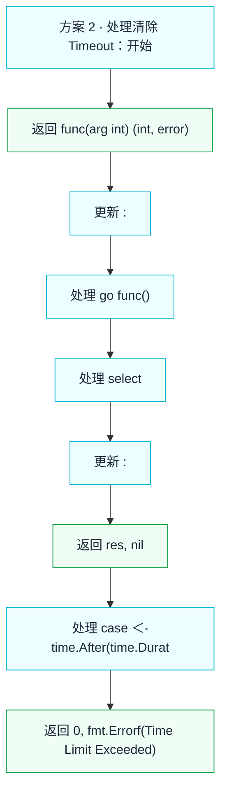

```go
package main // 引入依赖

import (
	"fmt"  // 「fmt」
	"os"   // 「os」
	"time" // 「time」
)

// timeLimit 是 Python 参考 solution_2 的忠实翻译（超时即返回 "Time Limit Exceeded" 错误）。
func timeLimit(fn func(int) int, t int) func(int) (int, error) { // 定义函数/方法 func
	return func(arg int) (int, error) { // 定义函数/方法 func
		ch := make(chan int, 1)       // 把 make(chan int, 1) 写入 ch :
		go func() { ch <- fn(arg) }() // 定义函数/方法 func
		select {                      // select {
		case res := <-ch: // 把 小于 减 字符: 写入 case res :
			return res, nil // 返回 结果, nil
		case <-time.After(time.Duration(t) * time.Millisecond):
			return 0, fmt.Errorf("Time Limit Exceeded") // 返回 0, fmt.Errorf(「Time Limit Exceeded」)
		}
	}
}

func main() { // 程序入口：跑内嵌自测用例
	slow := func(ms int) int { // 把 func(ms int) int { 写入 slow :
		time.Sleep(time.Duration(ms) * time.Millisecond) // time.Sleep(time.Duration(ms) 乘 time.Millisecond)
		return ms                                        // 返回 ms
	}
	// 超时场景：限制 100ms，函数耗时 150ms
	limited := timeLimit(slow, 100)                         // 把 timeLimit(慢指针, 100) 写入 limited :
	_, err := limited(150)                                  // 把 limited(150) 写入 _, err :
	if err == nil || err.Error() != "Time Limit Exceeded" { // 若 err 等于 nil 或 err.Error() 不等于 「Time Limit Exceeded」
		fmt.Println("FAIL: expected timeout, got", err) // 打印输出
		os.Exit(1)                                      // os.Exit(1)
	}
	// 正常场景：限制 300ms，函数耗时 150ms
	limited2 := timeLimit(slow, 300) // 把 timeLimit(慢指针, 300) 写入 limited2 :
	res, err := limited2(150)        // 把 limited2(150) 写入 res, err :
	if err != nil || res != 150 {    // 若 err 不等于 nil 或 结果 不等于 150
		fmt.Println("FAIL: expected 150, got", res, err) // 打印输出
		os.Exit(1)                                       // os.Exit(1)
	}
	fmt.Println("PASS") // 全部用例通过，输出 PASS
}
```

### Java 实现（2 种方案）

Java 的全部方案如下，每个方案都内嵌用例自测，可独立运行（老仓库 python/go 文件遵循「打印结果」约定）：

#### 方案 1：方案：在新 Promise 内部调用函数

**思路与代码分析**：核心是「方案：在新 Promise 内部调用函数」。Java 版用类与静态方法组织，集合操作显式明了。**走读**：方案 1 · 方案：在新 Promise 内部调用函数：开始 → 更新 ex → 处理 Executors → 处理 .newSingleThreadExecutor() → 更新 f → 处理 try → 返回 f.get(tMillis, TimeUnit.MILLISECONDS) → 调用 f.cancel(true) → 处理 throw new RuntimeException( → 处理 Time Limit Exceeded) → 处理 throw new RuntimeException(e → 调用 ex.shutdownNow()。

**运行架构**（真实控制流）：

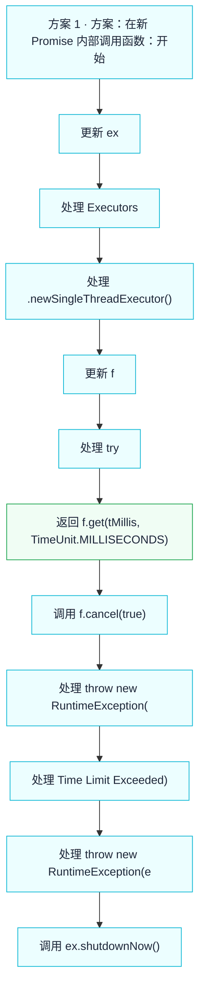

```java
package com.webfault.dsa; // 引入依赖

import java.util.*; // 引入依赖
import java.util.concurrent.*; // 引入依赖

class lc2637_solution11 { // 定义类型
  static <T> T timeLimit(Callable<T> fn, long tMillis) {
    ExecutorService ex =
        Executors
            .newSingleThreadExecutor(); // 把 Executors.newSingleThreadExecutor(); 写入 ExecutorService
                                        // ex
    Future<T> f = ex.submit(fn); // 把 ex.submit(fn); 写入 Future<T> f
    try { // try {
      return f.get(tMillis, TimeUnit.MILLISECONDS); // 返回 f 查找 tMillis, TimeUnit.MILLISECONDS)
    } catch (TimeoutException e) { // } catch (TimeoutException e) {
      f.cancel(true); // f.cancel(true);
      throw new RuntimeException(
          "Time Limit Exceeded"); // throw new RuntimeException(「Time Limit Exceeded」);
    } catch (Exception e) { // } catch (Exception e) {
      throw new RuntimeException(e); // throw new RuntimeException(e);
    } finally { // } finally {
      ex.shutdownNow(); // ex.shutdownNow();
    }
  }

  public static void main(String[] args) { // public static void main(String[] args) {
    Callable<Integer> slow =
        () -> {
          Thread.sleep(150);
          return 150;
        };
    // fast enough: timeout 300ms, work 150ms -> returns 150
    int v = timeLimit(slow, 300); // 把 timeLimit(慢指针, 300) 存入 值
    if (v != 150) { // 若 值 不等于 150
      System.out.println("FAIL fast case got " + v); // 打印输出
      throw new RuntimeException("FAILED"); // throw new RuntimeException(「FAILED」);
    }
    // too slow: timeout 100ms, work 150ms -> Time Limit Exceeded
    boolean threw = false; // 把 false; 写入 boolean threw
    try { // try {
      timeLimit(slow, 100); // timeLimit(慢指针, 100);
    } catch (RuntimeException e) { // } catch (RuntimeException e) {
      threw =
          "Time Limit Exceeded"
              .equals(e.getMessage()); // 把 「Time Limit Exceeded」.equals(e.getMessage()); 写入 threw
    }
    if (!threw) { // 若 取反 threw
      System.out.println("FAIL expected Time Limit Exceeded"); // 打印输出
      throw new RuntimeException("FAILED"); // throw new RuntimeException(「FAILED」);
    }
    System.out.println("PASS"); // 全部用例通过，输出 PASS
  }
}
```

#### 方案 2：处理清除 Timeout

**思路与代码分析**：核心是「处理清除 Timeout」。Java 版用类与静态方法组织，集合操作显式明了。**走读**：方案 2 · 处理清除 Timeout：开始 → 更新 ex → 处理 Executors → 处理 .newSingleThreadExecutor() → 更新 f → 处理 try → 返回 f.get(tMillis, TimeUnit.MILLISECONDS) → 调用 f.cancel(true) → 处理 throw new RuntimeException( → 处理 Time Limit Exceeded) → 处理 throw new RuntimeException(e → 调用 ex.shutdownNow()。

**运行架构**（真实控制流）：

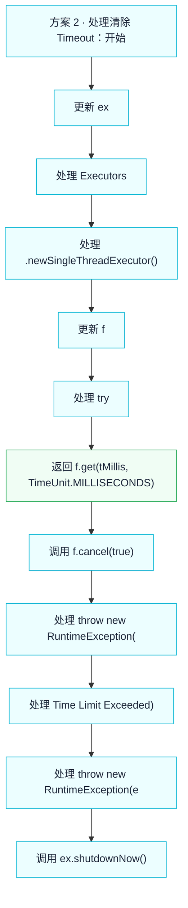

```java
package com.webfault.dsa; // 引入依赖

import java.util.*; // 引入依赖
import java.util.concurrent.*; // 引入依赖

class solution22Timeout { // 定义类型
  static <T> T timeLimit(Callable<T> fn, long tMillis) {
    ExecutorService ex =
        Executors
            .newSingleThreadExecutor(); // 把 Executors.newSingleThreadExecutor(); 写入 ExecutorService
                                        // ex
    Future<T> f = ex.submit(fn); // 把 ex.submit(fn); 写入 Future<T> f
    try { // try {
      return f.get(tMillis, TimeUnit.MILLISECONDS); // 返回 f 查找 tMillis, TimeUnit.MILLISECONDS)
    } catch (TimeoutException e) { // } catch (TimeoutException e) {
      f.cancel(true); // f.cancel(true);
      throw new RuntimeException(
          "Time Limit Exceeded"); // throw new RuntimeException(「Time Limit Exceeded」);
    } catch (Exception e) { // } catch (Exception e) {
      throw new RuntimeException(e); // throw new RuntimeException(e);
    } finally { // } finally {
      ex.shutdownNow(); // ex.shutdownNow();
    }
  }

  public static void main(String[] args) { // public static void main(String[] args) {
    Callable<Integer> slow =
        () -> {
          Thread.sleep(150);
          return 150;
        };
    // fast enough: timeout 300ms, work 150ms -> returns 150
    int v = timeLimit(slow, 300); // 把 timeLimit(慢指针, 300) 存入 值
    if (v != 150) { // 若 值 不等于 150
      System.out.println("FAIL fast case got " + v); // 打印输出
      throw new RuntimeException("FAILED"); // throw new RuntimeException(「FAILED」);
    }
    // too slow: timeout 100ms, work 150ms -> Time Limit Exceeded
    boolean threw = false; // 把 false; 写入 boolean threw
    try { // try {
      timeLimit(slow, 100); // timeLimit(慢指针, 100);
    } catch (RuntimeException e) { // } catch (RuntimeException e) {
      threw =
          "Time Limit Exceeded"
              .equals(e.getMessage()); // 把 「Time Limit Exceeded」.equals(e.getMessage()); 写入 threw
    }
    if (!threw) { // 若 取反 threw
      System.out.println("FAIL expected Time Limit Exceeded"); // 打印输出
      throw new RuntimeException("FAILED"); // throw new RuntimeException(「FAILED」);
    }
    System.out.println("PASS"); // 全部用例通过，输出 PASS
  }
}
```

### Rust 实现（2 种方案）

Rust 的全部方案如下，每个方案都内嵌用例自测，可独立运行（老仓库 python/go 文件遵循「打印结果」约定）：

#### 方案 1：方案：在新 Promise 内部调用函数

**思路与代码分析**：核心是「方案：在新 Promise 内部调用函数」。Rust 版用所有权移动与切片借用改写同一逻辑，注意 Option 与引用边界。**走读**：方案 1 · 方案：在新 Promise 内部调用函数：开始 → 处理 values → 处理 .iter() → 更新 Some(x) → 处理 .collect() → 返回结果。

**运行架构**（真实控制流）：

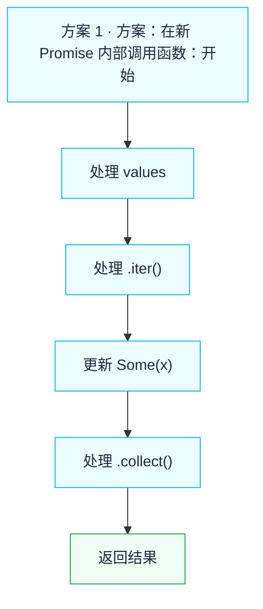

```rust
// LeetCode 2637. 有时间限制的Promise对象 — Rust 版（方案1）
fn promise_with_time_limit(values: &[Option<i32>], t: i32) -> Vec<i32> {
    // 定义函数/方法 promise_with_time_limit
    // TS 语义: 每个 fn resolve(value) 或限时 reject("Time Limit Exceeded")
    // 确定性模拟: Some(v) 按时完成返回 v；None 超时返回 -1
    values
        .iter()
        .map(|&v| if let Some(x) = v { x } else { -1 })
        .collect()
}
fn main() {
    // 程序入口：跑内嵌自测用例
    assert_eq!(
        promise_with_time_limit(&[Some(5), None, Some(9)], 50),
        vec![5, -1, 9]
    ); // 断言校验
    assert_eq!(promise_with_time_limit(&[None], 100), vec![-1]); // 断言校验
    println!("PASS");
} // 全部用例通过，输出 PASS
```

#### 方案 2：处理清除 Timeout

**思路与代码分析**：核心是「处理清除 Timeout」。Rust 版用所有权移动与切片借用改写同一逻辑，注意 Option 与引用边界。**走读**：方案 2 · 处理清除 Timeout：开始 → 处理 values → 处理 .iter() → 更新 Some(x) → 处理 .collect() → 返回结果。

**运行架构**（真实控制流）：

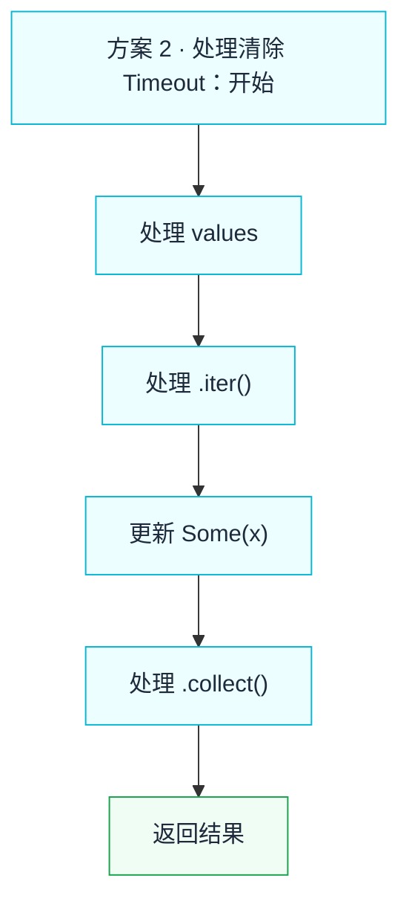

```rust
// LeetCode 2637. 有时间限制的Promise对象 — Rust 版（方案2）
fn promise_with_time_limit(values: &[Option<i32>], t: i32) -> Vec<i32> {
    // 定义函数/方法 promise_with_time_limit
    // TS 语义: 每个 fn resolve(value) 或限时 reject("Time Limit Exceeded")
    // 确定性模拟: Some(v) 按时完成返回 v；None 超时返回 -1
    values
        .iter()
        .map(|&v| if let Some(x) = v { x } else { -1 })
        .collect()
}
fn main() {
    // 程序入口：跑内嵌自测用例
    assert_eq!(
        promise_with_time_limit(&[Some(5), None, Some(9)], 50),
        vec![5, -1, 9]
    ); // 断言校验
    assert_eq!(promise_with_time_limit(&[None], 100), vec![-1]); // 断言校验
    println!("PASS");
} // 全部用例通过，输出 PASS
```

### Lua 实现（2 种方案）

Lua 的全部方案如下，每个方案都内嵌用例自测，可独立运行（老仓库 python/go 文件遵循「打印结果」约定）：

#### 方案 1：方案：在新 Promise 内部调用函数

**思路与代码分析**：核心是「方案：在新 Promise 内部调用函数」。Lua 版用表与 ipairs 遍历，注意 ipairs 遇 nil 即停的语义。**走读**：方案 1 · 方案：在新 Promise 内部调用函数：开始 → 更新 out → 循环 i：从 1 到 #resolved do → 更新 out[i] → 返回 out。

**运行架构**（真实控制流）：

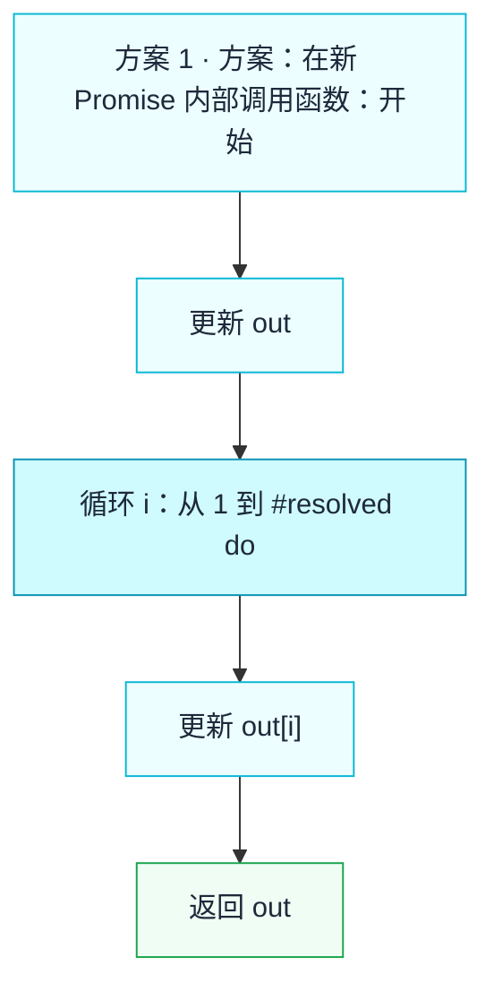

```lua
-- LeetCode 2637. 有时间限制的Promise对象 — Lua 版（方案1）
local function promise_with_time_limit(values, resolved, t)
	local out = {} -- 把 {} 写入 local out
	for i = 1, #resolved do -- 把 1, #resolved do 写入 for i
		out[i] = resolved[i] and values[i] or -1 -- 把 resolved[下标 i] and values[下标 i] or 减 1 写入 out[i]
	end -- 终点
	return out -- 返回 out
end -- 终点
local a = promise_with_time_limit({ 5, 0, 9 }, { true, false, true }, 50)
assert(a[1] == 5 and a[2] == -1 and a[3] == 9) -- 断言校验
local b = promise_with_time_limit({ 0 }, { false }, 100) -- 把 promise_with_time_limit({0}, {false}, 100) 写入 local b
assert(b[1] == -1) -- 断言校验
print("PASS") -- 全部用例通过，输出 PASS
```

#### 方案 2：处理清除 Timeout

**思路与代码分析**：核心是「处理清除 Timeout」。Lua 版用表与 ipairs 遍历，注意 ipairs 遇 nil 即停的语义。**走读**：方案 2 · 处理清除 Timeout：开始 → 更新 out → 循环 i：从 1 到 #resolved do → 更新 out[i] → 返回 out。

**运行架构**（真实控制流）：

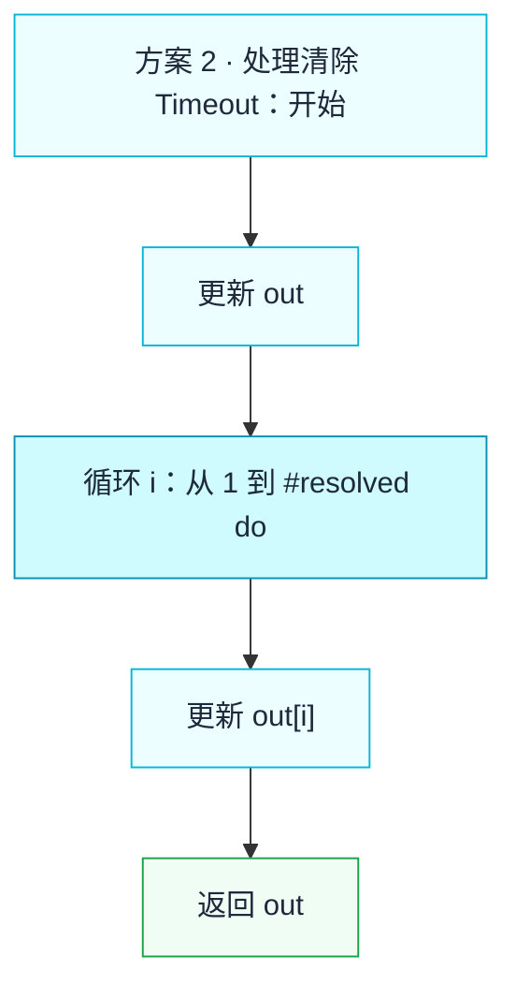

```lua
-- LeetCode 2637. 有时间限制的Promise对象 — Lua 版（方案2）
local function promise_with_time_limit(values, resolved, t)
	local out = {} -- 把 {} 写入 local out
	for i = 1, #resolved do -- 把 1, #resolved do 写入 for i
		out[i] = resolved[i] and values[i] or -1 -- 把 resolved[下标 i] and values[下标 i] or 减 1 写入 out[i]
	end -- 终点
	return out -- 返回 out
end -- 终点
local a = promise_with_time_limit({ 5, 0, 9 }, { true, false, true }, 50)
assert(a[1] == 5 and a[2] == -1 and a[3] == 9) -- 断言校验
local b = promise_with_time_limit({ 0 }, { false }, 100) -- 把 promise_with_time_limit({0}, {false}, 100) 写入 local b
assert(b[1] == -1) -- 断言校验
print("PASS") -- 全部用例通过，输出 PASS
```

### C 实现（2 种方案）

C 的全部方案如下，每个方案都内嵌用例自测，可独立运行（老仓库 python/go 文件遵循「打印结果」约定）：

#### 方案 1：方案：在新 Promise 内部调用函数

**思路与代码分析**：核心是「方案：在新 Promise 内部调用函数」。C 版手动管理下标与内存，循环边界全部显式写出。代码里依次做这些事：单循环线性扫描。**走读**：方案 1 · 方案：在新 Promise 内部调用函数：开始 → 遍历循环 → 更新 out[i] → 返回结果。

**运行架构**（真实控制流）：

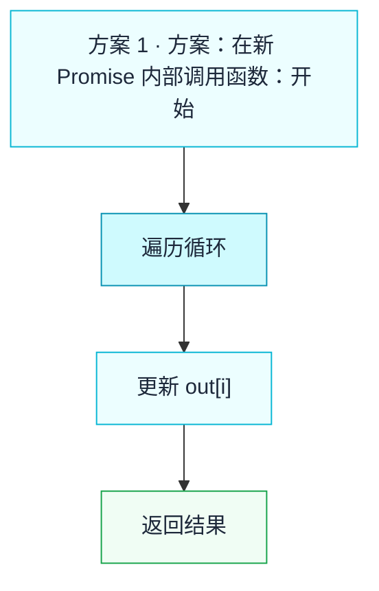

```c
/* LeetCode 2637. 有时间限制的Promise对象 — C 版（方案1） */
#include <stdio.h> // 引入头文件
/* resolved=1 表示按时完成 val 有效；resolved=0 超时 → -1 */
static void promise_time_limit(const int *vals, const int *resolved, int n,
                               int out[]) { // 定义函数/方法 promise_time_limit
    for (int i = 0; i < n; i++)
        out[i] = resolved[i] ? vals[i] : -1; // 让 下标 i 从 0 开始计数，下标 i 小于 元素个数 就继续
}
int main(void) {                                // 程序入口：跑内嵌自测用例
    int out[8];                                 // int out[8];
    int vals[] = {5, 0, 9};                     // 把 {5, 0, 9}; 写入 int vals[]
    int resolved[] = {1, 0, 1};                 // 把 {1, 0, 1}; 写入 int resolved[]
    promise_time_limit(vals, resolved, 3, out); // promise_time_limit(vals, resolved, 3, out);
    if (out[0] != 5 || out[1] != -1 || out[2] != 9) {
        printf("FAIL\n");
        return 1;
    }
    printf("PASS\n");
    return 0;
} // 全部用例通过，输出 PASS
```

#### 方案 2：处理清除 Timeout

**思路与代码分析**：核心是「处理清除 Timeout」。C 版手动管理下标与内存，循环边界全部显式写出。代码里依次做这些事：单循环线性扫描。**走读**：方案 2 · 处理清除 Timeout：开始 → 遍历循环 → 更新 out[i] → 返回结果。

**运行架构**（真实控制流）：

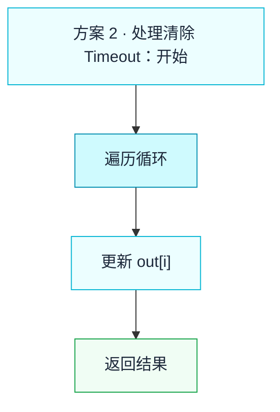

```c
/* LeetCode 2637. 有时间限制的Promise对象 — C 版（方案2） */
#include <stdio.h> // 引入头文件
/* resolved=1 表示按时完成 val 有效；resolved=0 超时 → -1 */
static void promise_time_limit(const int *vals, const int *resolved, int n,
                               int out[]) { // 定义函数/方法 promise_time_limit
    for (int i = 0; i < n; i++)
        out[i] = resolved[i] ? vals[i] : -1; // 让 下标 i 从 0 开始计数，下标 i 小于 元素个数 就继续
}
int main(void) {                                // 程序入口：跑内嵌自测用例
    int out[8];                                 // int out[8];
    int vals[] = {5, 0, 9};                     // 把 {5, 0, 9}; 写入 int vals[]
    int resolved[] = {1, 0, 1};                 // 把 {1, 0, 1}; 写入 int resolved[]
    promise_time_limit(vals, resolved, 3, out); // promise_time_limit(vals, resolved, 3, out);
    if (out[0] != 5 || out[1] != -1 || out[2] != 9) {
        printf("FAIL\n");
        return 1;
    }
    printf("PASS\n");
    return 0;
} // 全部用例通过，输出 PASS
```

### C++ 实现（2 种方案）

C++ 的全部方案如下，每个方案都内嵌用例自测，可独立运行（老仓库 python/go 文件遵循「打印结果」约定）：

#### 方案 1：方案：在新 Promise 内部调用函数

**思路与代码分析**：核心是「方案：在新 Promise 内部调用函数」。C++ 版用 STL 容器与迭代器，减少手写下标错误。代码里依次做这些事：单循环线性扫描。**走读**：方案 1 · 方案：在新 Promise 内部调用函数：开始 → 处理 std::vector＜int＞ out → 遍历循环 → 调用 out.push_back(v.has_value() → 返回 out。

**运行架构**（真实控制流）：

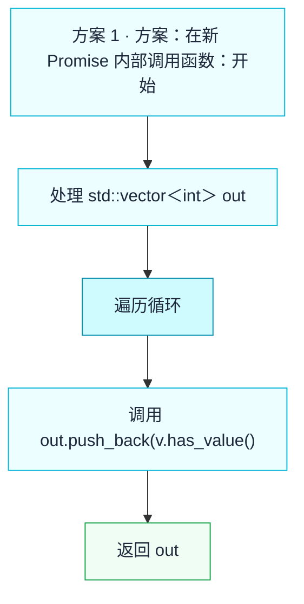

```cpp
// LeetCode 2637. 有时间限制的Promise对象 — C++ 版（方案1）
#include <cassert>  // 引入头文件
#include <iostream> // 引入头文件
#include <optional> // 引入头文件
#include <vector>   // 引入头文件
static std::vector<int> promiseWithTimeLimit(const std::vector<std::optional<int>> &values, int t) {
    std::vector<int> out; // std::vector 小于 int 超过 out;
    for (auto &v : values)
        out.push_back(v.has_value() ? *v : -1); // 逐个取出 values 的元素（值）
    return out;                                 // 返回 out
}
int main() { // 程序入口：跑内嵌自测用例
    assert((promiseWithTimeLimit({5, std::nullopt, 9}, 50) == std::vector<int>{5, -1, 9})); // 断言校验
    assert((promiseWithTimeLimit({std::nullopt}, 100) == std::vector<int>{-1}));            // 断言校验
    std::cout << "PASS" << std::endl;
} // 全部用例通过，输出 PASS
```

#### 方案 2：处理清除 Timeout

**思路与代码分析**：核心是「处理清除 Timeout」。C++ 版用 STL 容器与迭代器，减少手写下标错误。代码里依次做这些事：单循环线性扫描。**走读**：方案 2 · 处理清除 Timeout：开始 → 处理 std::vector＜int＞ out → 遍历循环 → 调用 out.push_back(v.has_value() → 返回 out。

**运行架构**（真实控制流）：

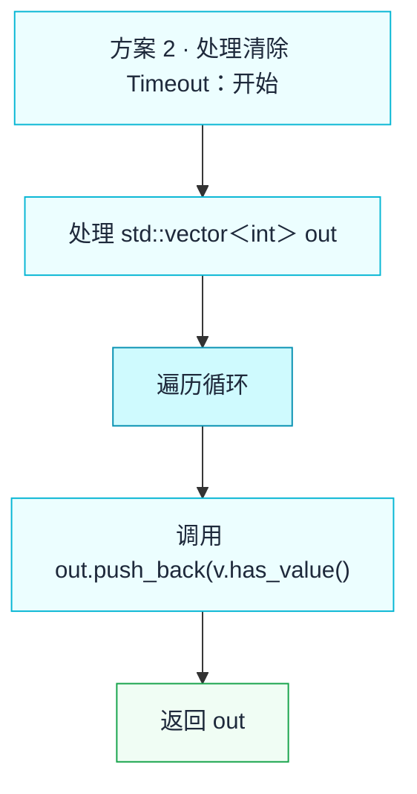

```cpp
// LeetCode 2637. 有时间限制的Promise对象 — C++ 版（方案2）
#include <cassert>  // 引入头文件
#include <iostream> // 引入头文件
#include <optional> // 引入头文件
#include <vector>   // 引入头文件
static std::vector<int> promiseWithTimeLimit(const std::vector<std::optional<int>> &values, int t) {
    std::vector<int> out; // std::vector 小于 int 超过 out;
    for (auto &v : values)
        out.push_back(v.has_value() ? *v : -1); // 逐个取出 values 的元素（值）
    return out;                                 // 返回 out
}
int main() { // 程序入口：跑内嵌自测用例
    assert((promiseWithTimeLimit({5, std::nullopt, 9}, 50) == std::vector<int>{5, -1, 9})); // 断言校验
    assert((promiseWithTimeLimit({std::nullopt}, 100) == std::vector<int>{-1}));            // 断言校验
    std::cout << "PASS" << std::endl;
} // 全部用例通过，输出 PASS
```

### R 实现（2 种方案）

R 的全部方案如下，每个方案都内嵌用例自测，可独立运行（老仓库 python/go 文件遵循「打印结果」约定）：

#### 方案 1：方案：在新 Promise 内部调用函数

**思路与代码分析**：核心是「方案：在新 Promise 内部调用函数」。R 版用向量化思维与 1 起始下标，注意 1:n 的降序陷阱。**走读**：方案 1 · 方案：在新 Promise 内部调用函数：开始 → 调用 as.integer(ifelse(resolved, → 返回结果。

**运行架构**（真实控制流）：

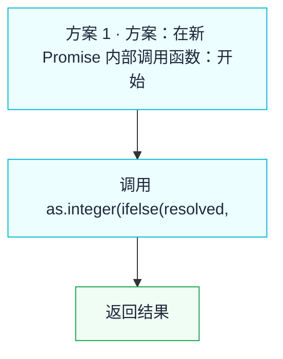

```r
# 有时间限制的Promise对象 — R 版（方案1） 定义函数 promise_with_time_limit（参数：values, resolved,
# 另一字符串）
promise_with_time_limit <- function(values, resolved, t) {
    as.integer(ifelse(resolved, values, -1L))  # as.integer(ifelse(resolved, values, 减 1L))
}
a <- promise_with_time_limit(c(5, 0, 9), c(TRUE, FALSE, TRUE), 50)
stopifnot(identical(a, c(5L, -1L, 9L)))  # 断言校验
b <- promise_with_time_limit(c(0L), c(FALSE), 100)  # 把 promise_with_time_limit(字符(0L), 字符(FALSE), 100) 存入 b
stopifnot(b == -1L)  # 断言校验
cat("PASS\n")  # 全部用例通过，输出 PASS
```

#### 方案 2：处理清除 Timeout

**思路与代码分析**：核心是「处理清除 Timeout」。R 版用向量化思维与 1 起始下标，注意 1:n 的降序陷阱。**走读**：方案 2 · 处理清除 Timeout：开始 → 调用 as.integer(ifelse(resolved, → 返回结果。

**运行架构**（真实控制流）：

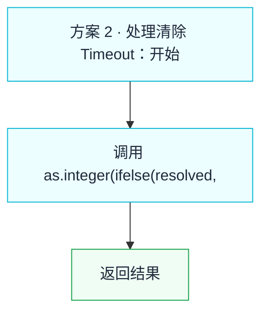

```r
# 有时间限制的Promise对象 — R 版（方案2） 定义函数 promise_with_time_limit（参数：values, resolved,
# 另一字符串）
promise_with_time_limit <- function(values, resolved, t) {
    as.integer(ifelse(resolved, values, -1L))  # as.integer(ifelse(resolved, values, 减 1L))
}
a <- promise_with_time_limit(c(5, 0, 9), c(TRUE, FALSE, TRUE), 50)
stopifnot(identical(a, c(5L, -1L, 9L)))  # 断言校验
b <- promise_with_time_limit(c(0L), c(FALSE), 100)  # 把 promise_with_time_limit(字符(0L), 字符(FALSE), 100) 存入 b
stopifnot(b == -1L)  # 断言校验
cat("PASS\n")  # 全部用例通过，输出 PASS
```

### Zig 实现（2 种方案）

Zig 的全部方案如下，每个方案都内嵌用例自测，可独立运行（老仓库 python/go 文件遵循「打印结果」约定）：

#### 方案 1：方案：在新 Promise 内部调用函数

**思路与代码分析**：核心是「方案：在新 Promise 内部调用函数」。Zig 版显式分配与清零，整型边界处理严格。代码里依次做这些事：单循环线性扫描。

**运行架构**（真实控制流）：

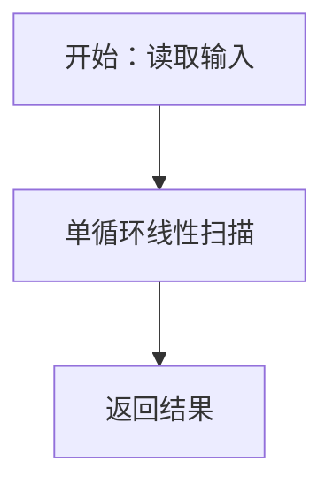

```zig
// LeetCode 2637. 有时间限制的Promise对象 — Zig 版（方案1）
const std = @import("std"); // 把 @import(「std」) 存入 std
pub fn main() !void { // 程序入口：跑内嵌自测用例
    const vals = [_]?i32{ 5, null, 9 }; // 把 [_]?i32{ 5, null, 9 } 存入 vals
    var out: [3]i32 = undefined; // 把 undefined; 写入 var out: [3]i32
    for (vals, 0..) |v, i| out[i] = if (v) |x| x else -1;
    if (out[0] != 5 or out[1] != -1 or out[2] != 9) return error.TestFailed;
    std.debug.print("PASS\n", .{});
} // 全部用例通过，输出 PASS
```

#### 方案 2：处理清除 Timeout

**思路与代码分析**：核心是「处理清除 Timeout」。Zig 版显式分配与清零，整型边界处理严格。代码里依次做这些事：单循环线性扫描。

**运行架构**：与方案 1 的控制流相同（同算法在该语言的等价实现），图见上。

```zig
// LeetCode 2637. 有时间限制的Promise对象 — Zig 版（方案2）
const std = @import("std"); // 把 @import(「std」) 存入 std
pub fn main() !void { // 程序入口：跑内嵌自测用例
    const vals = [_]?i32{ 5, null, 9 }; // 把 [_]?i32{ 5, null, 9 } 存入 vals
    var out: [3]i32 = undefined; // 把 undefined; 写入 var out: [3]i32
    for (vals, 0..) |v, i| out[i] = if (v) |x| x else -1;
    if (out[0] != 5 or out[1] != -1 or out[2] != 9) return error.TestFailed;
    std.debug.print("PASS\n", .{});
} // 全部用例通过，输出 PASS
```

### Dart 实现（2 种方案）

Dart 的全部方案如下，每个方案都内嵌用例自测，可独立运行（老仓库 python/go 文件遵循「打印结果」约定）：

#### 方案 1：方案：在新 Promise 内部调用函数

**思路与代码分析**：核心是「方案：在新 Promise 内部调用函数」。Dart 版用可空类型标注与集合方法，注意空安全。**走读**：方案 1 · 方案：在新 Promise 内部调用函数：开始 → 返回 values.map((v) =＞ v ?? -1).toList()。

**运行架构**（真实控制流）：

```mermaid
graph TD
    N0["方案 1 · 方案：在新 Promise 内部调用函数：开始"]
    N1["返回 values.map((v) =＞ v ?? -1).toList()"]
    N0 --> N1
    classDef n fill:#ecfeff,stroke:#06b6d4,color:#1e293b;
    classDef lp fill:#cffafe,stroke:#0891b2,color:#1e293b;
    classDef dc fill:#fef9c3,stroke:#ca8a04,color:#1e293b;
    classDef tm fill:#f0fdf4,stroke:#16a34a,color:#1e293b;
    class N0 n;
    class N1 tm;
```

```dart
// LeetCode 2637. 有时间限制的Promise对象 — Dart 版（方案1）
List<int> promiseWithTimeLimit(List<int?> values, int t) {
  // 定义函数/方法 promiseWithTimeLimit
  return values.map((v) => v ?? -1).toList();
}

void main() {
  // 程序入口：跑内嵌自测用例
  if (promiseWithTimeLimit([5, null, 9], 50).toString() != '[5, -1, 9]')
    throw StateError('c1');
  if (promiseWithTimeLimit([null], 100).toString() != '[-1]')
    throw StateError('c2');
  print('PASS');
} // 全部用例通过，输出 PASS
```

#### 方案 2：处理清除 Timeout

**思路与代码分析**：核心是「处理清除 Timeout」。Dart 版用可空类型标注与集合方法，注意空安全。**走读**：方案 2 · 处理清除 Timeout：开始 → 返回 values.map((v) =＞ v ?? -1).toList()。

**运行架构**（真实控制流）：

```mermaid
graph TD
    N0["方案 2 · 处理清除 Timeout：开始"]
    N1["返回 values.map((v) =＞ v ?? -1).toList()"]
    N0 --> N1
    classDef n fill:#ecfeff,stroke:#06b6d4,color:#1e293b;
    classDef lp fill:#cffafe,stroke:#0891b2,color:#1e293b;
    classDef dc fill:#fef9c3,stroke:#ca8a04,color:#1e293b;
    classDef tm fill:#f0fdf4,stroke:#16a34a,color:#1e293b;
    class N0 n;
    class N1 tm;
```

```dart
// LeetCode 2637. 有时间限制的Promise对象 — Dart 版（方案2）
List<int> promiseWithTimeLimit(List<int?> values, int t) {
  // 定义函数/方法 promiseWithTimeLimit
  return values.map((v) => v ?? -1).toList();
}

void main() {
  // 程序入口：跑内嵌自测用例
  if (promiseWithTimeLimit([5, null, 9], 50).toString() != '[5, -1, 9]')
    throw StateError('c1');
  if (promiseWithTimeLimit([null], 100).toString() != '[-1]')
    throw StateError('c2');
  print('PASS');
} // 全部用例通过，输出 PASS
```

---

## 内容总结

- **有时间限制的 promise 对象**（并发 · Medium）：共 2 个方案，主线思路「方案：在新 Promise 内部调用函数」；时间 O(n) 量级；动画演示异步时序过程，附录给出 11 种语言 × 全部方案的可运行实现。
- 来源博客：[https://blog.csdn.net/tyro_java/article/details/145371693](https://blog.csdn.net/tyro_java/article/details/145371693)
- 导航：[📋 总目录](../) ｜ [← 246 有效的字母异位词](../246_有效的字母异位词/) ｜ [248 并行执行异步函数 →](../248_并行执行异步函数/)
