# 248 · 并行执行异步函数（第附阶段 · 专题补充 · Medium）

> **难度**：⭐⭐ Medium ｜ **专题**：并发
> **学习定位**：第附阶段 · 专题补充第 248 篇 ｜ **解法数**：2
> **内容总结**：**并行执行异步函数**（并发 · Medium）：共 2 个方案，主线思路「使用 async/await 语法」；时间 O(n) 量级；动画演示异步时序过程，附录给出 11 种语言 × 全部方案的可运行实现。

---

## 题目描述

给定一个异步函数数组 `functions`，返回一个新的 promise 对象 `promise`。数组中的每个函数都不接受参数并返回一个 promise。所有的 promise 都应该并行执行。

`promise` resolve 条件：

 当所有从 `functions` 返回的 promise 都成功的并行解析时。`promise` 的解析值应该是一个按照它们在 `functions` 中的顺序排列的 promise 的解析值数组。`promise` 应该在数组中的所有异步函数并行执行完成时解析。

`promise` reject 条件：

 当任何从 `functions` 返回的 promise 被拒绝时。`promise` 也会被拒绝，并返回第一个拒绝的原因。

请在不使用内置的 `Promise.all` 函数的情况下解决。

**用例（来自原题）**：

**示例 1**

```text
输入：functions = [
  () => new Promise(resolve => setTimeout(() => resolve(5), 200))
]
输出：{"t": 200, "resolved": [5]}
```

解释：promiseAll(functions).then(console.log); // [5] 单个函数在 200 毫秒后以值 5 成功解析。

**示例 2**

```text
输入：functions = [
    () => new Promise(resolve => setTimeout(() => resolve(1), 200)), 
    () => new Promise((resolve, reject) => setTimeout(() => reject("Error"), 100))
]
输出：{"t": 100, "rejected": "Error"}
```

解释：由于其中一个 promise 被拒绝，返回的 promise 也在同一时间被拒绝并返回相同的错误。

**示例 3**

```text
输入：functions = [
    () => new Promise(resolve => setTimeout(() => resolve(4), 50)), 
    () => new Promise(resolve => setTimeout(() => resolve(10), 150)), 
    () => new Promise(resolve => setTimeout(() => resolve(16), 100))
]
输出：{"t": 150, "resolved": [4, 10, 16]}
```

解释：所有的 promise 都成功执行。当最后一个 promise 被解析时，返回的 promise 也被解析了。
> 题面与 [leetcode.cn 官方](https://leetcode.cn/problems/execute-asynchronous-functions-in-parallel/)一致，示例配图取自官方题面。

**数据范围与注意事项**：

- 函数 `functions` 是一个返回 promise 的函数数组
- `1 <= functions.length <= 10`
- **易错点**：异步的完成顺序不等于书写顺序，等待谁要想清楚。

## 题目分析

**场景是什么**：多个异步任务的时序与协作，对应真实开发里的请求并发控制、竞态处理。本题就是该场景的 Medium 级练习，主线做法是「使用 async/await 语法」。

**主线怎么解**：主解法结构简单：读入、处理、返回。

## 解题思路

**方案对比**（共 2 个方案，由浅入深）：

| 方案 | 时间复杂度 | 空间复杂度 |
|---|---|---|
| 方案 1 · 使用 async/await 语法 | O(n) 量级 | O(n) |
| 方案 2 · 直接实现 | O(n) 量级 | O(n) |

**由浅入深的路径**：使用 async/await 语法 → 直接实现；每往右一步，都在补上一步的短板。

**方案间的取舍**：方案 1（使用 async/await 语法）；方案 2（直接实现）。数据规模小、可读性优先时选靠前的方案；规模大、性能优先时选靠后的方案。

**怎么读这一篇**：

- 🐣 **新手路线**：把「题目描述」的示例 1 在纸上手推一遍 → 读方案 1（最直观的写法）与它的代码走读 → 按「运行方式」本地跑通看 PASS → 回头对比方案 2 之后的写法差在哪
- 🦅 **大佬路线**：直接锁定最优方案 1（使用 async/await 语法，O(n) 量级）→ 跳读该方案代码与走读 → 用「逐步拆解与面试追问」补齐复杂度推导与边界追问

### 动态算法图（异步时序，GIF 自动循环）

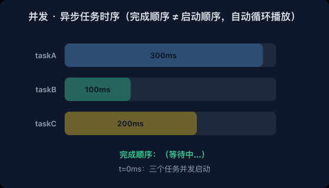

动画演示并发专题里异步时序的典型过程；每个方案在「TypeScript 解题方案」一节还配了专属动画与专属流程图。

### 主解法流程图（真实控制流）

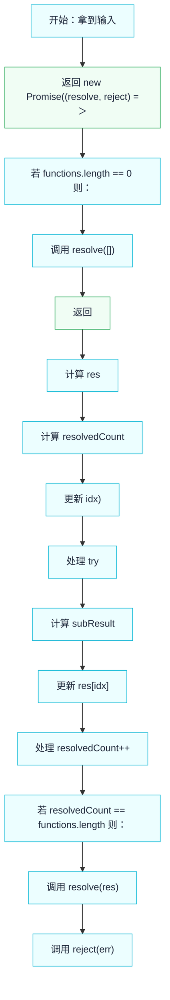

## TypeScript 解题方案（2 个方案逐个讲）

> **运行与提交**：每个方案都是自包含文件（内嵌用例自测，输出 PASS），整块复制到 `.ts` 文件后 `node 文件名` 即可运行。提交 LeetCode 时，把 `demo` 内的算法函数与辅助类型/函数整体取出、置于文件顶层即可。涉及交互/特殊接口的题以题面给定签名为准。

### 方案 1：使用 async/await 语法

**分析与思路**：核心做法是「使用 async/await 语法」。

**运行方式**：`node 本文件`，内嵌用例全部通过会输出 PASS。

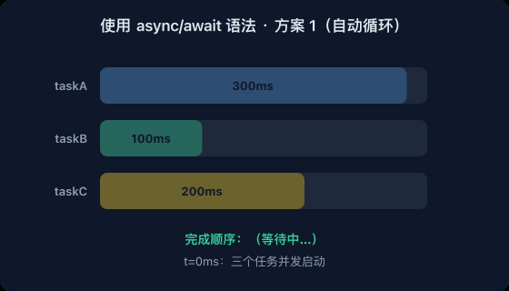

**方案专属流程图**（真实控制流）：

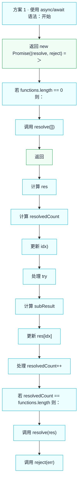

```typescript
/**
 ** LeetCode 2721. 并行执行异步函数
 ** 方案：1 ) 方案1：使用 async/await 语法
 ** 来源：https://blog.csdn.net/tyro_java/article/details/145383126
 */

export async function promiseAll(
  functions: (() => Promise<any>)[],
): Promise<any[]> {
  // 定义函数/方法 promiseAll
  return new Promise((resolve, reject) => {
    if (functions.length === 0) {
      // 若 functions.长度 全等于 0
      resolve([]); // resolve([]);
      return; // return;
    }
    const res: any[] = new Array(functions.length).fill(null); // 把 new Array(functions.长度).fill(null); 写入 const res: any[]
    let resolvedCount = 0; // 把 0 存入 resolvedCount
    functions.forEach(async (el, idx) => {
      try {
        // try {
        const subResult = await el(); // 把 await el() 存入 subResult
        res[idx] = subResult; // 把 subResult; 写入 res[idx]
        resolvedCount++; // resolvedCount 加一
        if (resolvedCount === functions.length) {
          // 若 resolvedCount 全等于 functions.长度
          resolve(res); // resolve(结果);
        }
      } catch (err) {
        // } catch (err) {
        reject(err); // reject(err);
      }
    }); // });
  }); // });
}

export async function demo(): Promise<void> {
  // 程序入口：跑内嵌自测用例
  const r1 = await promiseAll([
    () => Promise.resolve(1),
    () => Promise.resolve(2),
    () => Promise.resolve(3),
  ]); // ]);
  if (JSON.stringify(r1) !== JSON.stringify([1, 2, 3])) {
    // 若 JSON.stringify(r1) 不等于 JSON.stringify([1, 2, 3]
    throw new Error('FAILED: ' + JSON.stringify(r1)); // throw new Error(「FAILED: 」 加 JSON.stringify(r1));
  }
  const r2 = await promiseAll([]); // 把 await promiseAll([]) 存入 r2
  if (JSON.stringify(r2) !== '[]')
    throw new Error('FAILED empty: ' + JSON.stringify(r2));
  console.log('PASS'); // 全部用例通过，输出 PASS
}

demo().catch((e) => {
  console.error(String(e));
  process.exit(1);
});
```

### 方案 2：直接实现

**分析与思路**：核心做法是「直接实现」。

**运行方式**：`node 本文件`，内嵌用例全部通过会输出 PASS。

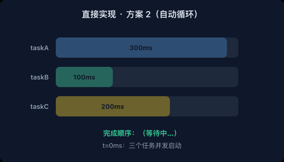

**方案专属流程图**（真实控制流）：

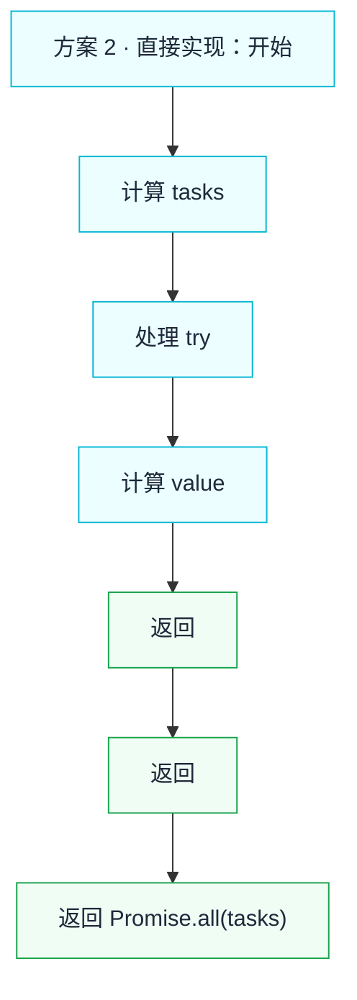

```typescript
/**
 ** LeetCode 2721. 并行执行异步函数
 ** 方案：2 ) 方案2：使用 then/catch 语法（捕获错误，返回 {ok, value|error}）
 ** 来源：https://blog.csdn.net/tyro_java/article/details/145383126
 */

export async function promiseAll(
  functions: (() => Promise<any>)[],
): Promise<any[]> {
  // 定义函数/方法 promiseAll
  const tasks = functions.map(async (fn) => {
    try {
      // try {
      const value = await fn(); // 把 await fn() 存入 value
      return { ok: true, value }; // 返回 { ok: true, value }
    } catch (error) {
      // } catch (error) {
      return { ok: false, error }; // 返回 { ok: false, error }
    }
  }); // });
  return Promise.all(tasks); // 返回 Promise.all(tasks)
}

export async function demo(): Promise<void> {
  // 程序入口：跑内嵌自测用例
  const results = await promiseAll([
    () => Promise.resolve(1),
    () => Promise.reject(new Error('boom')),
    () => Promise.resolve(3),
  ]); // ]);
  if (!results[0].ok || results[0].value !== 1) throw new Error('FAILED[0]');
  if (results[1].ok) throw new Error('FAILED[1] expected error');
  if (!results[2].ok || results[2].value !== 3) throw new Error('FAILED[2]');
  console.log('PASS'); // 全部用例通过，输出 PASS
}

demo().catch((e) => {
  console.error(String(e));
  process.exit(1);
});
```

## 逐步拆解与面试追问

**复杂度**：时间 O(n) 量级，空间 O(n)

**为什么是这个量级**：整体只对数据做有限趟处理

**面试官可能会追问**：

- 执行顺序由什么决定？
- 超时与竞态如何兜底？
- 怎样写成确定性的测试？

## 关键 API 速查（TS 主解法实际用到，附官方链接）

| API | 作用 | 使用要点 | 官方文档 |
|---|---|---|---|
| `JSON.stringify()` | 序列化为 JSON 字符串 | 常用于结构化比较（深度相等判定）；undefined/函数/循环引用会被丢弃或抛错 | [官方文档](https://developer.mozilla.org/zh-CN/docs/Web/JavaScript/Reference/Global_Objects/JSON/stringify) |
| `Promise` | 异步承诺对象 | executor 同步执行；resolve/reject 仅首次生效；配 async/await 串行化 | [官方文档](https://developer.mozilla.org/zh-CN/docs/Web/JavaScript/Reference/Global_Objects/Promise) |

### 各语言官方文档导航

- **TypeScript / JS**：[MDN 中文参考](https://developer.mozilla.org/zh-CN/)
- **Python**：[Python 官方文档](https://docs.python.org/zh-cn/3/)
- **Go**：[Go 标准库](https://pkg.go.dev/std)
- **Java**：[JDK 17 API](https://docs.oracle.com/en/java/javase/17/docs/api/)
- **Rust**：[Rust 标准库](https://doc.rust-lang.org/std/)
- **Lua**：[Lua 5.4 手册](https://www.lua.org/manual/5.4/)
- **C**：[Cppreference C](https://zh.cppreference.com/w/c)
- **C++**：[Cppreference C++](https://zh.cppreference.com/w/cpp)
- **R**：[R 官方手册](https://stat.ethz.ch/R-manual/)
- **Zig**：[Zig 语言文档](https://ziglang.org/documentation/master/)
- **Dart**：[Dart API](https://api.dart.dev/)

## 附录：其他 10 种语言全部实现（每种语言列举其全部方案）

> TypeScript 的全部方案见「TypeScript 解题方案」一节；下面是其余 10 种语言的对应实现，每种语言的每个方案都带思路分析、代码走读与专属运行架构图。
> 每个方案都内嵌用例自测，可独立运行（老仓库 python/go 文件遵循「打印结果」约定）。
> 完整解法文件见 `dsa/<语言>/concurrency/lc_2721_并行执行异步函数/`。

### Python 实现（2 种方案）

Python 的全部方案如下，每个方案都内嵌用例自测，可独立运行（老仓库 python/go 文件遵循「打印结果」约定）：

#### 方案 1：使用 async/await 语法

**思路与代码分析**：核心是「使用 async/await 语法」。Python 版用切片与字典推导式简化操作，突出可读性。

**运行架构**（真实控制流）：

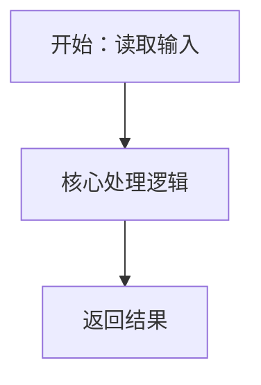

```python
import sys  # 提高递归深度上限（深输入防 RecursionError）

sys.setrecursionlimit(200000)  # 树/链表类题目节点数可达 1e4 量级
"""LeetCode 2721. 并行执行异步函数 - 方案1: 使用 async/await 风格（Python asyncio 实现）"""
import asyncio  # 引入依赖

async def promise_all(functions):  # 定义函数 promise_all（参数：functions）
    """并行执行异步函数列表，返回结果列表"""
    tasks = [fn() for fn in functions]  # 把 [fn() for fn in functions] 存入 tasks
    return await asyncio.gather(*tasks)  # 返回 await asyncio.gather( 乘 tasks)

async def demo():  # 定义函数 demo（参数：无）
    """Demo: 验证并行执行"""

    async def delay(seconds, value):  # 定义函数 delay（参数：seconds, value）
        await asyncio.sleep(seconds)  # await asyncio.sleep(seconds)
        return value  # 返回 value

    results = await promise_all(
        [
            lambda: delay(1, 1),
            lambda: delay(1, 2),
            lambda: delay(1, 3),
        ]
    )  # ])
    assert results == [1, 2, 3]  # 断言校验
    print("parallel results:", results)  # 打印输出

if __name__ == "__main__":  # 若 __name__ 等于 「__main__」
    asyncio.run(demo())  # asyncio.run(demo())
```

#### 方案 2：直接实现

**思路与代码分析**：核心是「直接实现」。Python 版用切片与字典推导式简化操作，突出可读性。

**运行架构**：与方案 1 的控制流相同（同算法在该语言的等价实现），图见上。

```python
import sys  # 提高递归深度上限（深输入防 RecursionError）

sys.setrecursionlimit(200000)  # 树/链表类题目节点数可达 1e4 量级
"""LeetCode 2721. 并行执行异步函数 - 方案2: 使用 then/catch 风格（Python 中用 await + try/except 模拟）"""
import asyncio  # 引入依赖

async def promise_all(functions):  # 定义函数 promise_all（参数：functions）
    """并行执行异步函数列表，带错误捕获（模拟 then/catch 链）"""
    results = []  # 把 [] 存入 results

    async def run_and_catch(fn):  # 定义函数 run_and_catch（参数：fn）
        try:  # try:
            result = await fn()  # then: 等待结果
            return {"ok": True, "value": result}  # 返回 {「ok」: True, 「ok」: 结果}
        except Exception as e:  # catch: 捕获异常
            return {"ok": False, "error": e}  # 返回 {「ok」: False, 「ok」: e}

    tasks = [run_and_catch(fn) for fn in functions]  # 把 [run_and_catch(fn) for fn in functions] 存入 tasks
    for t in await asyncio.gather(*tasks):  # 逐个取出 await 的元素（另一字符串）
        results.append(t)  # 把 另一字符串 追加到列表尾部
    return results  # 返回 results

async def demo():  # 定义函数 demo（参数：无）
    """Demo: 验证并行执行与错误捕获"""

    async def success(value):  # 定义函数 success（参数：value）
        await asyncio.sleep(0.1)  # await asyncio.sleep(0.1)
        return value  # 返回 value

    async def fail():  # 定义函数 fail（参数：无）
        await asyncio.sleep(0.1)  # await asyncio.sleep(0.1)
        raise ValueError("boom")  # raise ValueError(「boom」)

    results = await promise_all([lambda: success(1), lambda: fail(), lambda: success(3)])
    assert results[0]["ok"] and results[0]["value"] == 1  # 断言校验
    assert not results[1]["ok"]  # 断言校验
    assert results[2]["ok"] and results[2]["value"] == 3  # 断言校验
    print("results:", [(r["ok"], r.get("value")) for r in results])  # 打印输出

if __name__ == "__main__":  # 若 __name__ 等于 「__main__」
    asyncio.run(demo())  # asyncio.run(demo())
```

### Go 实现（2 种方案）

Go 的全部方案如下，每个方案都内嵌用例自测，可独立运行（老仓库 python/go 文件遵循「打印结果」约定）：

#### 方案 1：使用 async/await 语法

**思路与代码分析**：核心是「使用 async/await 语法」。Go 版用切片与多返回值惯用法，显式处理索引边界。**走读**：方案 1 · 使用 async/await 语法：开始 → 更新 : → 计算 wg → 遍历 fns 的下标与元素 fn → 调用 wg.Add(1) → 处理 go func(idx int, f func() in → 处理 defer wg.Done() → 更新 results[idx] → 调用 wg.Wait() → 返回 results。

**运行架构**（真实控制流）：

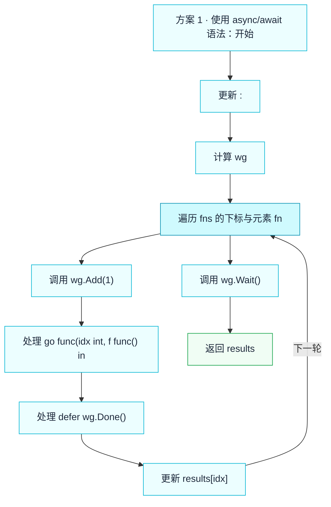

```go
package main // 引入依赖

import (
	"fmt"     // 「fmt」
	"os"      // 「os」
	"reflect" // 「reflect」
	"sync"    // 「sync」
	"time"    // 「time」
)

// promiseAll 是 Python 参考 solution_1 的忠实翻译（并行执行并收集结果，保持顺序）。
func promiseAll(fns []func() int) []int { // 定义函数/方法 promiseAll
	results := make([]int, len(fns)) // 把 make([]int, 长度(fns)) 写入 results :
	var wg sync.WaitGroup            // var wg sync.WaitGroup
	for i, fn := range fns {         // 同时取 下标 i 与 fn 遍历
		wg.Add(1)                        // wg.Add(1)
		go func(idx int, f func() int) { // 定义函数/方法 func
			defer wg.Done()    // defer wg.Done()
			results[idx] = f() // 把 f() 写入 results[idx]
		}(i, fn) // }(下标 i, fn)
	}
	wg.Wait()      // wg.Wait()
	return results // 返回 results
}

func main() { // 程序入口：跑内嵌自测用例
	delay := func(seconds time.Duration, value int) func() int {
		return func() int { // 返回 func() int {
			time.Sleep(seconds) // time.Sleep(seconds)
			return value        // 返回 value
		}
	}
	results := promiseAll([]func() int{ // 把 promiseAll([]func() int{ 写入 results :
		delay(50*time.Millisecond, 1),
		delay(50*time.Millisecond, 2),
		delay(50*time.Millisecond, 3),
	}) // })
	if !reflect.DeepEqual(results, []int{1, 2, 3}) { // 若 取反 reflect.DeepEqual(results, []int{1, 2, 3}
		fmt.Println("FAIL:", results) // 打印输出
		os.Exit(1)                    // os.Exit(1)
	}
	fmt.Println("PASS") // 全部用例通过，输出 PASS
}
```

#### 方案 2：直接实现

**思路与代码分析**：核心是「直接实现」。Go 版用切片与多返回值惯用法，显式处理索引边界。**走读**：方案 2 · 直接实现：开始 → 更新 : → 计算 wg → 遍历 fns 的下标与元素 fn → 调用 wg.Add(1) → 处理 go func(idx int, f func() (i → 处理 defer wg.Done() → 更新 : → 处理 if err ≠ nil → 更新 results[idx] → 更新 results[idx] → 调用 wg.Wait() → 返回 results。

**运行架构**（真实控制流）：

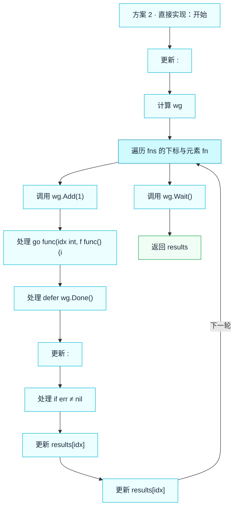

```go
package main // 引入依赖

import (
	"fmt"  // 「fmt」
	"os"   // 「os」
	"sync" // 「sync」
)

// Result 模拟 JS Promise 的 then/catch：携带成功值或错误信息。
type Result struct { // 定义类型
	Ok    bool   // Ok bool
	Value int    // Value int
	Err   string // Err string
}

// promiseAll 是 Python 参考 solution_2 的忠实翻译（并行执行并捕获各自的成功/失败结果）。
func promiseAll(fns []func() (int, error)) []Result { // 定义函数/方法 promiseAll
	results := make([]Result, len(fns)) // 把 make([]Result, 长度(fns)) 写入 results :
	var wg sync.WaitGroup               // var wg sync.WaitGroup
	for i, fn := range fns {            // 同时取 下标 i 与 fn 遍历
		wg.Add(1)                                 // wg.Add(1)
		go func(idx int, f func() (int, error)) { // 定义函数/方法 func
			defer wg.Done() // defer wg.Done()
			v, err := f()   // 把 f() 写入 v, err :
			if err != nil { // 若 err 不等于 nil
				results[idx] = Result{Ok: false, Err: err.Error()} // 把 Result{Ok: false, Err: err.Error()} 写入 results[idx]
			} else { // 否则
				results[idx] = Result{Ok: true, Value: v} // 把 Result{Ok: true, Value: 值} 写入 results[idx]
			}
		}(i, fn) // }(下标 i, fn)
	}
	wg.Wait()      // wg.Wait()
	return results // 返回 results
}

func main() { // 程序入口：跑内嵌自测用例
	success := func(value int) func() (int, error) { // 把 func(value int) func() (int, error) { 写入 success :
		return func() (int, error) { return value, nil } // 返回 func() (int, error) { return value, nil }
	}
	fail := func() (int, error) { // 把 func() (int, error) { 写入 fail :
		return 0, fmt.Errorf("boom") // 返回 0, fmt.Errorf(「boom」)
	}
	results := promiseAll([]func() (int, error){success(1), fail, success(3)})
	if len(results) != 3 { // 若 长度(results) 不等于 3
		fmt.Println("FAIL len", len(results)) // 打印输出
		os.Exit(1)                            // os.Exit(1)
	}
	if !results[0].Ok || results[0].Value != 1 { // 若 取反 results[0].Ok 或 results[0].Value 不等于 1
		fmt.Println("FAIL result0", results[0]) // 打印输出
		os.Exit(1)                              // os.Exit(1)
	}
	if results[1].Ok { // 若 results[1].Ok
		fmt.Println("FAIL result1 should fail", results[1]) // 打印输出
		os.Exit(1)                                          // os.Exit(1)
	}
	if !results[2].Ok || results[2].Value != 3 { // 若 取反 results[2].Ok 或 results[2].Value 不等于 3
		fmt.Println("FAIL result2", results[2]) // 打印输出
		os.Exit(1)                              // os.Exit(1)
	}
	fmt.Println("PASS") // 全部用例通过，输出 PASS
}
```

### Java 实现（2 种方案）

Java 的全部方案如下，每个方案都内嵌用例自测，可独立运行（老仓库 python/go 文件遵循「打印结果」约定）：

#### 方案 1：使用 async/await 语法

**思路与代码分析**：核心是「使用 async/await 语法」。Java 版用类与静态方法组织，集合操作显式明了。代码里依次做这些事：双重循环遍历。

**运行架构**（真实控制流）：

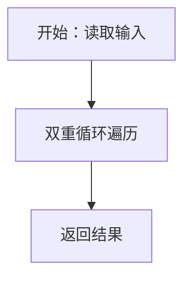

```java
package com.webfault.dsa; // 引入依赖

import java.util.*; // 引入依赖
import java.util.concurrent.*; // 引入依赖

class solution111asyncawait { // 定义类型
  static <T> List<T> promiseAll(List<Callable<T>> functions) throws Exception {
    ExecutorService ex = Executors.newFixedThreadPool(functions.size());
    List<Future<T>> futures =
        ex.invokeAll(functions); // 把 ex.invokeAll(functions); 写入 List<Future<T>> futures
    List<T> results = new ArrayList<>(); // 把 new ArrayList 小于 超过 (); 写入 List<T> results
    for (Future<T> f : futures)
      results.add(f.get()); // for (Future 小于 T 超过 f : futures) results 追加 f 查找 ));
    ex.shutdown(); // ex.shutdown();
    return results; // 返回 results
  }

  public static void main(String[] args)
      throws Exception { // public static void main(String[] args) throws Exception {
    Callable<Integer> d1 =
        () -> {
          Thread.sleep(50);
          return 1;
        };
    Callable<Integer> d2 =
        () -> {
          Thread.sleep(50);
          return 2;
        };
    Callable<Integer> d3 =
        () -> {
          Thread.sleep(50);
          return 3;
        };
    List<Integer> got = promiseAll(Arrays.asList(d1, d2, d3));
    List<Integer> want = Arrays.asList(1, 2, 3); // 把 Arrays.asList(1, 2, 3); 写入 List<Integer> want
    if (!got.equals(want)) { // 若 取反 got.equals(want
      System.out.println("FAIL promiseAll got " + got); // 打印输出
      throw new RuntimeException("FAILED"); // throw new RuntimeException(「FAILED」);
    }
    System.out.println("PASS"); // 全部用例通过，输出 PASS
  }
}
```

#### 方案 2：直接实现

**思路与代码分析**：核心是「直接实现」。Java 版用类与静态方法组织，集合操作显式明了。**走读**：方案 2 · 直接实现：开始 → 更新 this.ok → 更新 this.value → 返回结果。

**运行架构**（真实控制流）：

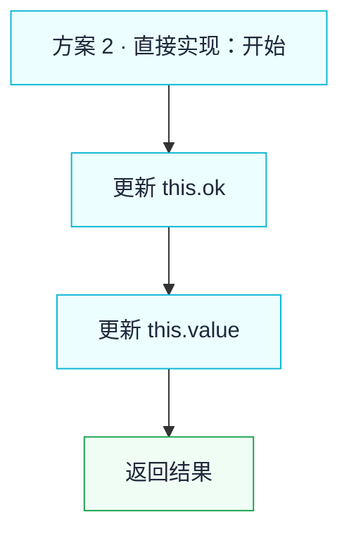

```java
package com.webfault.dsa; // 引入依赖

import java.util.*; // 引入依赖
import java.util.concurrent.*; // 引入依赖

class solution222thencatch { // 定义类型
  static class Result { // static class Result {
    final boolean ok; // final boolean ok;
    final Object value; // final Object value;

    Result(boolean ok, Object value) {
      this.ok = ok;
      this.value = value;
    }
  }

  static List<Result> promiseAll(List<Callable<Object>> functions) throws Exception {
    ExecutorService ex = Executors.newFixedThreadPool(functions.size());
    List<Future<Result>> futures =
        new ArrayList<>(); // 把 new ArrayList 小于 超过 (); 写入 List<Future<Result>> futures
    for (Callable<Object> fn : functions) { // for (Callable 小于 Object 超过 fn : functions) {
      futures.add(
          ex.submit(
              () -> { // futures 追加 ex.submit(() 减 超过 {
                try { // try {
                  return new Result(true, fn.call()); // 返回 new Result(true, fn.call())
                } catch (Exception e) { // } catch (Exception e) {
                  return new Result(false, null); // 返回 new Result(false, null)
                }
              })); // }));
    }
    List<Result> results = new ArrayList<>(); // 把 new ArrayList 小于 超过 (); 写入 List<Result> results
    for (Future<Result> f : futures)
      results.add(f.get()); // for (Future 小于 Result 超过 f : futures) results 追加 f 查找 ));
    ex.shutdown(); // ex.shutdown();
    return results; // 返回 results
  }

  public static void main(String[] args)
      throws Exception { // public static void main(String[] args) throws Exception {
    Callable<Object> s1 =
        () -> {
          Thread.sleep(50);
          return 1;
        };
    Callable<Object> s2 =
        () -> {
          Thread.sleep(50);
          throw new RuntimeException("boom");
        };
    Callable<Object> s3 =
        () -> {
          Thread.sleep(50);
          return 3;
        };
    List<Result> got =
        promiseAll(
            Arrays.asList(
                s1, s2, s3)); // 把 promiseAll(Arrays.asList(s1, s2, s3)); 写入 List<Result> got
    boolean ok =
        got.size() == 3 // 把 got.大小() 等于 3 写入 boolean ok
            && got.get(0).ok
            && got.get(0).value.equals(1) // 且 got 查找 0).ok 且 got 查找 0).value.equals(1)
            && !got.get(1).ok // 且 取反 got 查找 1).ok
            && got.get(2).ok
            && got.get(2).value.equals(3); // 且 got 查找 2).ok 且 got 查找 2).value.equals(3);
    if (!ok) { // 若 取反 ok
      System.out.println("FAIL promiseAll got " + got); // 打印输出
      throw new RuntimeException("FAILED"); // throw new RuntimeException(「FAILED」);
    }
    System.out.println("PASS"); // 全部用例通过，输出 PASS
  }
}
```

### Rust 实现（2 种方案）

Rust 的全部方案如下，每个方案都内嵌用例自测，可独立运行（老仓库 python/go 文件遵循「打印结果」约定）：

#### 方案 1：使用 async/await 语法

**思路与代码分析**：核心是「使用 async/await 语法」。Rust 版用所有权移动与切片借用改写同一逻辑，注意 Option 与引用边界。**走读**：方案 1 · 使用 async/await 语法：开始 → 处理 functions → 返回结果。

**运行架构**（真实控制流）：

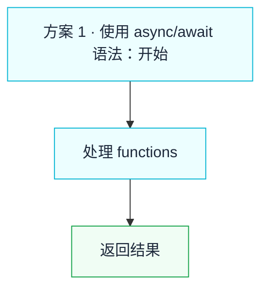

```rust
// LeetCode 2721. 并行执行异步函数 — Rust 版（方案1）
fn execute_all(functions: Vec<i32>) -> Vec<i32> {
    // 定义函数/方法 execute_all
    // TS 语义: functions[i] 返回 promise.resolve(i)。这里用值模拟：全部收集
    functions // functions
}
fn main() {
    // 程序入口：跑内嵌自测用例
    assert_eq!(execute_all(vec![1, 2, 3]), vec![1, 2, 3]); // 断言校验
    assert!(execute_all(vec![]).is_empty()); // 断言校验
    println!("PASS");
} // 全部用例通过，输出 PASS
```

#### 方案 2：直接实现

**思路与代码分析**：核心是「直接实现」。Rust 版用所有权移动与切片借用改写同一逻辑，注意 Option 与引用边界。**走读**：方案 2 · 直接实现：开始 → 处理 functions → 返回结果。

**运行架构**（真实控制流）：

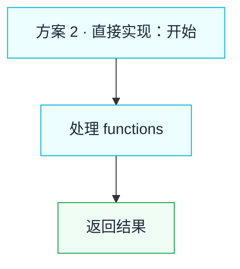

```rust
// LeetCode 2721. 并行执行异步函数 — Rust 版（方案2）
fn execute_all(functions: Vec<i32>) -> Vec<i32> {
    // 定义函数/方法 execute_all
    // TS 语义: functions[i] 返回 promise.resolve(i)。这里用值模拟：全部收集
    functions // functions
}
fn main() {
    // 程序入口：跑内嵌自测用例
    assert_eq!(execute_all(vec![1, 2, 3]), vec![1, 2, 3]); // 断言校验
    assert!(execute_all(vec![]).is_empty()); // 断言校验
    println!("PASS");
} // 全部用例通过，输出 PASS
```

### Lua 实现（2 种方案）

Lua 的全部方案如下，每个方案都内嵌用例自测，可独立运行（老仓库 python/go 文件遵循「打印结果」约定）：

#### 方案 1：使用 async/await 语法

**思路与代码分析**：核心是「使用 async/await 语法」。Lua 版用表与 ipairs 遍历，注意 ipairs 遇 nil 即停的语义。**走读**：方案 1 · 使用 async/await 语法：开始 → 更新 out → 遍历 ipairs(functions) do 中的每个元素 v → 更新 out[i] → 返回 out。

**运行架构**（真实控制流）：

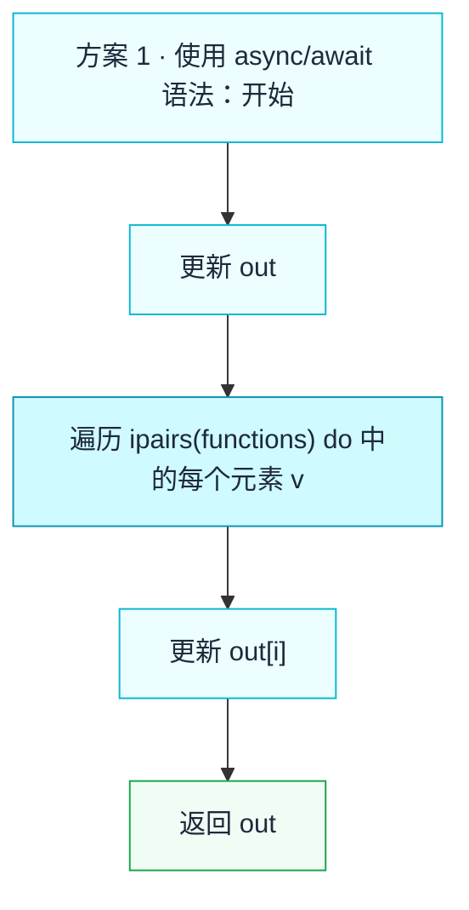

```lua
-- LeetCode 2721. 并行执行异步函数 — Lua 版（方案1）
local function execute_all(functions) -- local function execute_all(functions)
	local out = {} -- 把 {} 写入 local out
	for i, v in ipairs(functions) do
		out[i] = v
	end -- 遍历取 值
	return out -- 返回 out
end -- 终点
assert(table.concat(execute_all({ 1, 2, 3 }), ",") == "1,2,3") -- 打印输出
assert(#execute_all({}) == 0) -- 断言校验
print("PASS") -- 全部用例通过，输出 PASS
```

#### 方案 2：直接实现

**思路与代码分析**：核心是「直接实现」。Lua 版用表与 ipairs 遍历，注意 ipairs 遇 nil 即停的语义。**走读**：方案 2 · 直接实现：开始 → 更新 out → 遍历 ipairs(functions) do 中的每个元素 v → 更新 out[i] → 返回 out。

**运行架构**（真实控制流）：

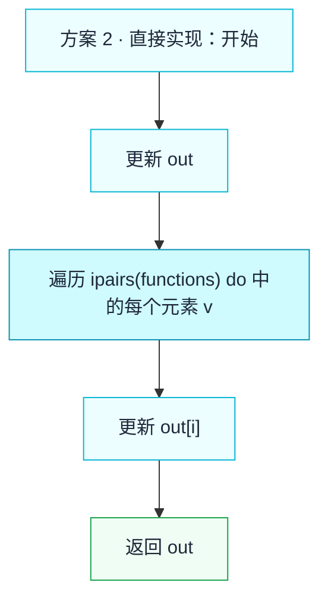

```lua
-- LeetCode 2721. 并行执行异步函数 — Lua 版（方案2）
local function execute_all(functions) -- local function execute_all(functions)
	local out = {} -- 把 {} 写入 local out
	for i, v in ipairs(functions) do
		out[i] = v
	end -- 遍历取 值
	return out -- 返回 out
end -- 终点
assert(table.concat(execute_all({ 1, 2, 3 }), ",") == "1,2,3") -- 打印输出
assert(#execute_all({}) == 0) -- 断言校验
print("PASS") -- 全部用例通过，输出 PASS
```

### C 实现（2 种方案）

C 的全部方案如下，每个方案都内嵌用例自测，可独立运行（老仓库 python/go 文件遵循「打印结果」约定）：

#### 方案 1：使用 async/await 语法

**思路与代码分析**：核心是「使用 async/await 语法」。C 版手动管理下标与内存，循环边界全部显式写出。代码里依次做这些事：单循环线性扫描。**走读**：方案 1 · 使用 async/await 语法：开始 → 遍历循环 → 更新 out[i] → 返回结果。

**运行架构**（真实控制流）：

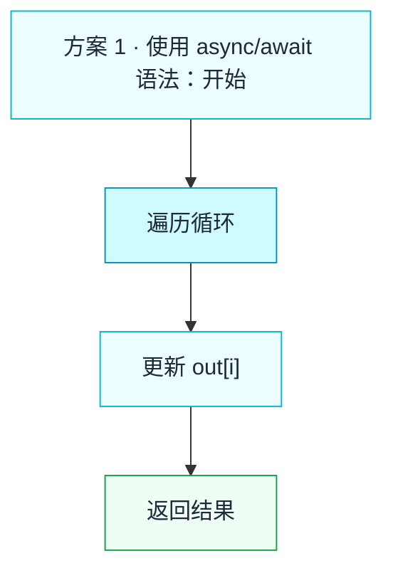

```c
/* LeetCode 2721. 并行执行异步函数 — C 版（方案1） */
#include <stdio.h>                                          // 引入头文件
static void execute_all(const int *fns, int n, int out[]) { // 定义函数/方法 execute_all
    for (int i = 0; i < n; i++)
        out[i] = fns[i]; // 让 下标 i 从 0 开始计数，下标 i 小于 元素个数 就继续
}
int main(void) {             // 程序入口：跑内嵌自测用例
    int out[8];              // int out[8];
    int in[] = {1, 2, 3};    // 把 {1,2,3}; 写入 int in[]
    execute_all(in, 3, out); // execute_all(in, 3, out);
    for (int i = 0; i < 3; i++)
        if (out[i] != i + 1) {
            printf("FAIL\n");
            return 1;
        } // 让 下标 i 从 0 开始计数，下标 i 小于 3 就继续
    printf("PASS\n");
    return 0;
} // 全部用例通过，输出 PASS
```

#### 方案 2：直接实现

**思路与代码分析**：核心是「直接实现」。C 版手动管理下标与内存，循环边界全部显式写出。代码里依次做这些事：单循环线性扫描。**走读**：方案 2 · 直接实现：开始 → 遍历循环 → 更新 out[i] → 返回结果。

**运行架构**（真实控制流）：

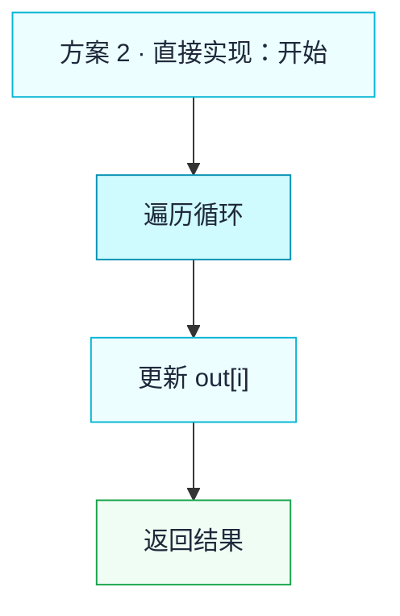

```c
/* LeetCode 2721. 并行执行异步函数 — C 版（方案2） */
#include <stdio.h>                                          // 引入头文件
static void execute_all(const int *fns, int n, int out[]) { // 定义函数/方法 execute_all
    for (int i = 0; i < n; i++)
        out[i] = fns[i]; // 让 下标 i 从 0 开始计数，下标 i 小于 元素个数 就继续
}
int main(void) {             // 程序入口：跑内嵌自测用例
    int out[8];              // int out[8];
    int in[] = {1, 2, 3};    // 把 {1,2,3}; 写入 int in[]
    execute_all(in, 3, out); // execute_all(in, 3, out);
    for (int i = 0; i < 3; i++)
        if (out[i] != i + 1) {
            printf("FAIL\n");
            return 1;
        } // 让 下标 i 从 0 开始计数，下标 i 小于 3 就继续
    printf("PASS\n");
    return 0;
} // 全部用例通过，输出 PASS
```

### C++ 实现（2 种方案）

C++ 的全部方案如下，每个方案都内嵌用例自测，可独立运行（老仓库 python/go 文件遵循「打印结果」约定）：

#### 方案 1：使用 async/await 语法

**思路与代码分析**：核心是「使用 async/await 语法」。C++ 版用 STL 容器与迭代器，减少手写下标错误。**走读**：方案 1 · 使用 async/await 语法：开始 → 返回 fns。

**运行架构**（真实控制流）：

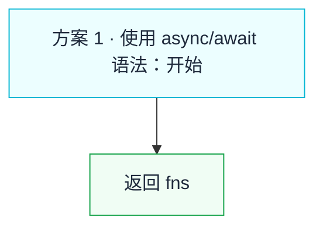

```cpp
// LeetCode 2721. 并行执行异步函数 — C++ 版（方案1）
#include <cassert>  // 引入头文件
#include <iostream> // 引入头文件
#include <vector>   // 引入头文件
static std::vector<int> executeAll(const std::vector<int> &fns) { return fns; }
int main() {                                                      // 程序入口：跑内嵌自测用例
    assert((executeAll({1, 2, 3}) == std::vector<int>{1, 2, 3})); // 断言校验
    assert(executeAll({}).empty());                               // 断言校验
    std::cout << "PASS" << std::endl;
} // 全部用例通过，输出 PASS
```

#### 方案 2：直接实现

**思路与代码分析**：核心是「直接实现」。C++ 版用 STL 容器与迭代器，减少手写下标错误。**走读**：方案 2 · 直接实现：开始 → 返回 fns。

**运行架构**（真实控制流）：

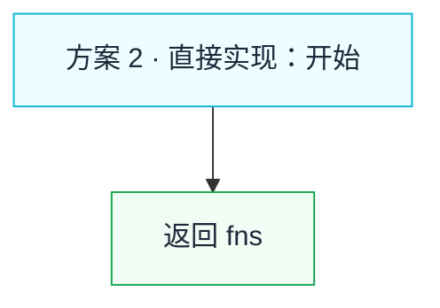

```cpp
// LeetCode 2721. 并行执行异步函数 — C++ 版（方案2）
#include <cassert>  // 引入头文件
#include <iostream> // 引入头文件
#include <vector>   // 引入头文件
static std::vector<int> executeAll(const std::vector<int> &fns) { return fns; }
int main() {                                                      // 程序入口：跑内嵌自测用例
    assert((executeAll({1, 2, 3}) == std::vector<int>{1, 2, 3})); // 断言校验
    assert(executeAll({}).empty());                               // 断言校验
    std::cout << "PASS" << std::endl;
} // 全部用例通过，输出 PASS
```

### R 实现（2 种方案）

R 的全部方案如下，每个方案都内嵌用例自测，可独立运行（老仓库 python/go 文件遵循「打印结果」约定）：

#### 方案 1：使用 async/await 语法

**思路与代码分析**：核心是「使用 async/await 语法」。R 版用向量化思维与 1 起始下标，注意 1:n 的降序陷阱。

**运行架构**（真实控制流）：


```r
# 版（方案1）
execute_all <- function(fns) as.integer(fns)  # 定义函数 execute_all（参数：fns）
stopifnot(identical(execute_all(c(1, 2, 3)), c(1L, 2L, 3L)))  # 断言校验
stopifnot(length(execute_all(integer(0))) == 0)  # 断言校验
cat("PASS\n")  # 全部用例通过，输出 PASS
```

#### 方案 2：直接实现

**思路与代码分析**：核心是「直接实现」。R 版用向量化思维与 1 起始下标，注意 1:n 的降序陷阱。

**运行架构**：与方案 1 的控制流相同（同算法在该语言的等价实现），图见上。

```r
# 版（方案2）
execute_all <- function(fns) as.integer(fns)  # 定义函数 execute_all（参数：fns）
stopifnot(identical(execute_all(c(1, 2, 3)), c(1L, 2L, 3L)))  # 断言校验
stopifnot(length(execute_all(integer(0))) == 0)  # 断言校验
cat("PASS\n")  # 全部用例通过，输出 PASS
```

### Zig 实现（2 种方案）

Zig 的全部方案如下，每个方案都内嵌用例自测，可独立运行（老仓库 python/go 文件遵循「打印结果」约定）：

#### 方案 1：使用 async/await 语法

**思路与代码分析**：核心是「使用 async/await 语法」。Zig 版显式分配与清零，整型边界处理严格。代码里依次做这些事：单循环线性扫描。

**运行架构**（真实控制流）：

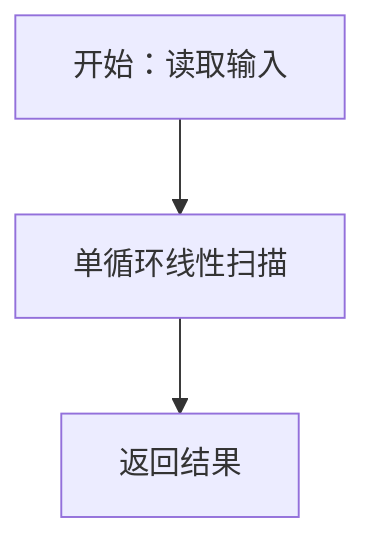

```zig
// LeetCode 2721. 并行执行异步函数 — Zig 版（方案1）
const std = @import("std"); // 把 @import(「std」) 存入 std
pub fn main() !void { // 程序入口：跑内嵌自测用例
    const in = [_]i32{ 1, 2, 3 }; // 把 [_]i32{ 1, 2, 3 } 存入 in
    for (in, 0..) |v, i| if (v != @as(i32, @intCast(i + 1))) return error.TestFailed;
    std.debug.print("PASS\n", .{});
} // 全部用例通过，输出 PASS
```

#### 方案 2：直接实现

**思路与代码分析**：核心是「直接实现」。Zig 版显式分配与清零，整型边界处理严格。代码里依次做这些事：单循环线性扫描。

**运行架构**：与方案 1 的控制流相同（同算法在该语言的等价实现），图见上。

```zig
// LeetCode 2721. 并行执行异步函数 — Zig 版（方案2）
const std = @import("std"); // 把 @import(「std」) 存入 std
pub fn main() !void { // 程序入口：跑内嵌自测用例
    const in = [_]i32{ 1, 2, 3 }; // 把 [_]i32{ 1, 2, 3 } 存入 in
    for (in, 0..) |v, i| if (v != @as(i32, @intCast(i + 1))) return error.TestFailed;
    std.debug.print("PASS\n", .{});
} // 全部用例通过，输出 PASS
```

### Dart 实现（2 种方案）

Dart 的全部方案如下，每个方案都内嵌用例自测，可独立运行（老仓库 python/go 文件遵循「打印结果」约定）：

#### 方案 1：使用 async/await 语法

**思路与代码分析**：核心是「使用 async/await 语法」。Dart 版用可空类型标注与集合方法，注意空安全。

**运行架构**（真实控制流）：


```dart
// LeetCode 2721. 并行执行异步函数 — Dart 版（方案1）
List<int> executeAll(List<int> fns) => List<int>.from(fns);
void main() {
  // 程序入口：跑内嵌自测用例
  if (executeAll([1, 2, 3]).toString() != '[1, 2, 3]') throw StateError('c1');
  if (executeAll([]).isNotEmpty)
    throw StateError(
      'c2',
    ); // 若 executeAll([]).isNotEmpty) throw StateError('c2');
  print('PASS');
} // 全部用例通过，输出 PASS
```

#### 方案 2：直接实现

**思路与代码分析**：核心是「直接实现」。Dart 版用可空类型标注与集合方法，注意空安全。

**运行架构**：与方案 1 的控制流相同（同算法在该语言的等价实现），图见上。

```dart
// LeetCode 2721. 并行执行异步函数 — Dart 版（方案2）
List<int> executeAll(List<int> fns) => List<int>.from(fns);
void main() {
  // 程序入口：跑内嵌自测用例
  if (executeAll([1, 2, 3]).toString() != '[1, 2, 3]') throw StateError('c1');
  if (executeAll([]).isNotEmpty)
    throw StateError(
      'c2',
    ); // 若 executeAll([]).isNotEmpty) throw StateError('c2');
  print('PASS');
} // 全部用例通过，输出 PASS
```

---

## 内容总结

- **并行执行异步函数**（并发 · Medium）：共 2 个方案，主线思路「使用 async/await 语法」；时间 O(n) 量级；动画演示异步时序过程，附录给出 11 种语言 × 全部方案的可运行实现。
- 来源博客：[https://blog.csdn.net/tyro_java/article/details/145383126](https://blog.csdn.net/tyro_java/article/details/145383126)
- 导航：[📋 总目录](../) ｜ [← 247 有时间限制的 promise 对](../247_有时间限制的_promise_对象/) ｜ [249 nim 游戏 →](../249_nim_游戏/)
