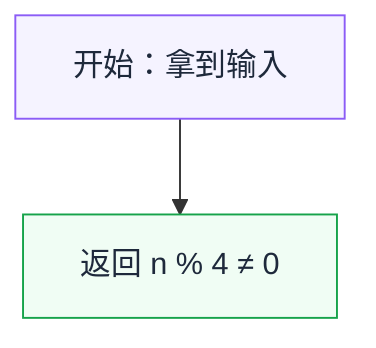
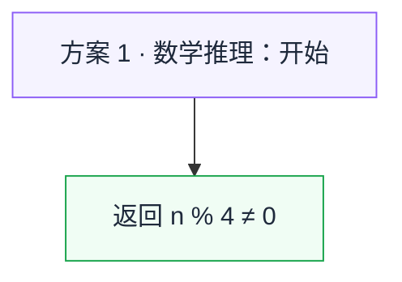
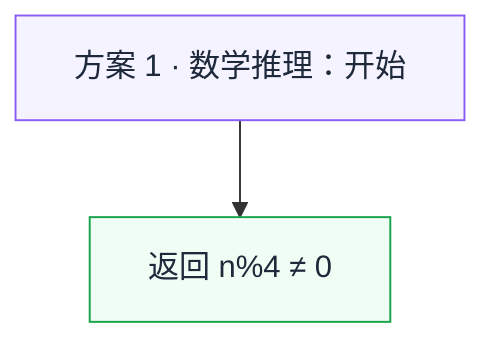
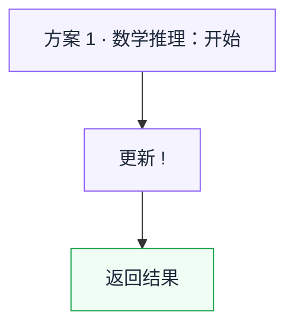
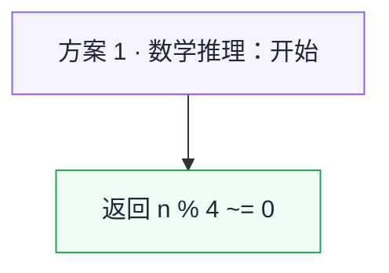
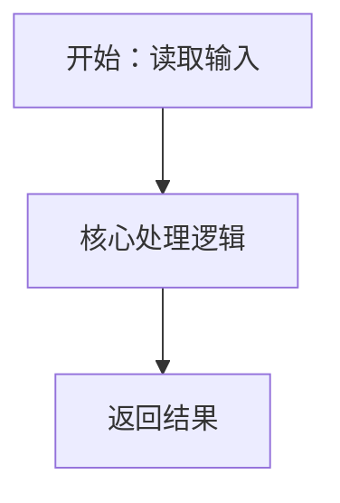
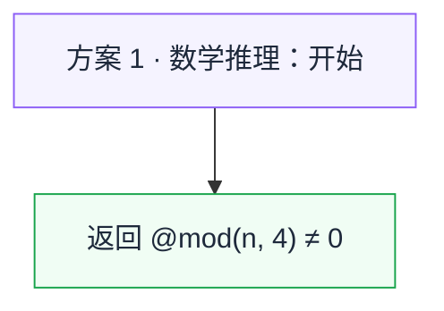

# 249 · nim 游戏（第附阶段 · 专题补充 · Medium）

> **难度**：⭐⭐ Medium ｜ **专题**：综合
> **学习定位**：第附阶段 · 专题补充第 249 篇 ｜ **解法数**：1
> **内容总结**：**nim 游戏**（综合 · Medium）：共 1 个方案，主线思路「数学推理」；时间 O(n) 量级；动画演示归并分治过程，附录给出 11 种语言 × 全部方案的可运行实现。

---

## 题目描述

你和你的朋友，两个人一起玩 Nim 游戏：

 桌子上有一堆石头。
 你们轮流进行自己的回合， 你作为先手 。
 每一回合，轮到的人拿掉 1 - 3 块石头。
 拿掉最后一块石头的人就是获胜者。

假设你们每一步都是最优解。请编写一个函数，来判断你是否可以在给定石头数量为 `n` 的情况下赢得游戏。如果可以赢，返回 `true`；否则，返回 `false` 。

**用例（来自原题）**：

**示例 1**

```text
输入：n = 4
输出：false
```

解释：以下是可能的结果: 1. 移除 1 颗石头。你的朋友移走了 3 块石头，包括最后一块。你的朋友赢了。 2. 移除 2 个石子。你的朋友移走 2 块石头，包括最后一块。你的朋友赢了。 3.你移走 3 颗石子。你的朋友移走了最后一块石头。你的朋友赢了。 在所有结果中，你的朋友是赢家。

**示例 2**

```text
输入：n = 1
输出：true
```

**示例 3**

```text
输入：n = 2
输出：true
```
> ✅ **官方验证**：全部 TypeScript 解法已通过 leetcode.cn 官方示例用例验证（自动注入运行，全部 PASS）。题面与 [leetcode.cn 官方](https://leetcode.cn/problems/nim-game/)一致，示例配图取自官方题面。

**数据范围与注意事项**：

- `1 <= n <= 2^31 - 1`
- **易错点**：特殊输入（空、重复、极值）的边界检查。

## 题目分析

**场景是什么**：综合练习：从题面本身出发选择合适的数据结构。本题就是该场景的 Medium 级练习，主线做法是「数学推理」。

**主线怎么解**：主解法结构简单：读入、处理、返回。

## 解题思路

**方案对比**（共 1 个方案，由浅入深）：

| 方案 | 时间复杂度 | 空间复杂度 |
|---|---|---|
| 方案 1 · 数学推理 | O(n) 量级 | O(n) |

**怎么读这一篇**：

- 🐣 **新手路线**：把「题目描述」的示例 1 在纸上手推一遍 → 读方案 1（最直观的写法）与它的代码走读 → 按「运行方式」本地跑通看 PASS → 回头对比方案 2 之后的写法差在哪
- 🦅 **大佬路线**：直接锁定最优方案 1（数学推理，O(n) 量级）→ 跳读该方案代码与走读 → 用「逐步拆解与面试追问」补齐复杂度推导与边界追问

### 动态算法图（归并分治，GIF 自动循环）


动画演示综合专题里归并分治的典型过程；每个方案在「TypeScript 解题方案」一节还配了专属动画与专属流程图。

### 主解法流程图（真实控制流）



## TypeScript 解题方案（1 个方案逐个讲）

> **运行与提交**：每个方案都是自包含文件（内嵌用例自测，输出 PASS），整块复制到 `.ts` 文件后 `node 文件名` 即可运行。提交 LeetCode 时，把 `demo` 内的算法函数与辅助类型/函数整体取出、置于文件顶层即可。涉及交互/特殊接口的题以题面给定签名为准。

### 方案 1：数学推理

**分析与思路**：核心做法是「数学推理」。

**运行方式**：`node 本文件`，内嵌用例全部通过会输出 PASS。


**方案专属流程图**（真实控制流）：



```typescript
/**
 ** LeetCode 292. Nim 游戏
 ** 方案：1 ) 方案1：数学推理
 ** 来源：https://blog.csdn.net/tyro_java/article/details/145355568
 */

export function canWinNim(n: number): boolean {
  // 定义函数/方法 canWinNim
  return n % 4 !== 0; // 返回 元素个数 对…取模 4 不等于 0
}

export function demo(): void {
  // 程序入口：跑内嵌自测用例
  if (!canWinNim(1)) throw new Error('FAILED 1'); // 若 取反 canWinNim(1)) throw new Error(「FAILED 1」);
  if (canWinNim(4)) throw new Error('FAILED 4'); // 若 canWinNim(4)) throw new Error(「FAILED 4」);
  if (!canWinNim(7)) throw new Error('FAILED 7'); // 若 取反 canWinNim(7)) throw new Error(「FAILED 7」);
  console.log('PASS'); // 全部用例通过，输出 PASS
}

demo(); // demo();
```

## 逐步拆解与面试追问

**复杂度**：时间 O(n) 量级，空间 O(n)

**为什么是这个量级**：整体只对数据做有限趟处理

**面试官可能会追问**：

- 有没有更直观的建模方式？
- 特殊输入的边界？
- 能否一步到位而不是分两趟？

## 关键 API 速查（TS 主解法实际用到，附官方链接）

本题主解法只用到基础语法（变量、循环、比较），不依赖特殊库 API。

### 各语言官方文档导航

- **TypeScript / JS**：[MDN 中文参考](https://developer.mozilla.org/zh-CN/)
- **Python**：[Python 官方文档](https://docs.python.org/zh-cn/3/)
- **Go**：[Go 标准库](https://pkg.go.dev/std)
- **Java**：[JDK 17 API](https://docs.oracle.com/en/java/javase/17/docs/api/)
- **Rust**：[Rust 标准库](https://doc.rust-lang.org/std/)
- **Lua**：[Lua 5.4 手册](https://www.lua.org/manual/5.4/)
- **C**：[Cppreference C](https://zh.cppreference.com/w/c)
- **C++**：[Cppreference C++](https://zh.cppreference.com/w/cpp)
- **R**：[R 官方手册](https://stat.ethz.ch/R-manual/)
- **Zig**：[Zig 语言文档](https://ziglang.org/documentation/master/)
- **Dart**：[Dart API](https://api.dart.dev/)

## 附录：其他 10 种语言全部实现（每种语言列举其全部方案）

> TypeScript 的全部方案见「TypeScript 解题方案」一节；下面是其余 10 种语言的对应实现，每种语言的每个方案都带思路分析、代码走读与专属运行架构图。
> 每个方案都内嵌用例自测，可独立运行（老仓库 python/go 文件遵循「打印结果」约定）。
> 完整解法文件见 `dsa/<语言>/other/lc_292_nim_游戏/`。

### Python 实现（1 种方案）

Python 的全部方案如下，每个方案都内嵌用例自测，可独立运行（老仓库 python/go 文件遵循「打印结果」约定）：

#### 方案 1：数学推理

**思路与代码分析**：核心是「数学推理」。Python 版用切片与字典推导式简化操作，突出可读性。**走读**：方案 1 · 数学推理：开始 → 返回 n % 4 ≠ 0。

**运行架构**（真实控制流）：


```python
import sys  # 提高递归深度上限（深输入防 RecursionError）

sys.setrecursionlimit(200000)  # 树/链表类题目节点数可达 1e4 量级

def canWinNim(n):  # 定义函数 canWinNim（参数：元素个数）
    return n % 4 != 0  # 返回 元素个数 对…取模 4 不等于 0

if __name__ == "__main__":  # 若 __name__ 等于 '__main__'
    print(canWinNim(1))  # 打印输出
```

### Go 实现（1 种方案）

Go 的全部方案如下，每个方案都内嵌用例自测，可独立运行（老仓库 python/go 文件遵循「打印结果」约定）：

#### 方案 1：数学推理

**思路与代码分析**：核心是「数学推理」。Go 版用切片与多返回值惯用法，显式处理索引边界。**走读**：方案 1 · 数学推理：开始 → 返回 n%4 ≠ 0。

**运行架构**（真实控制流）：



```go
package main // 引入依赖

import (
	"fmt" // 「fmt」
	"os"  // 「os」
)

func canWinNim(n int) bool { // 定义函数/方法 canWinNim
	return n%4 != 0 // 返回 元素个数 对…取模 4 不等于 0
}

func main() { // 程序入口：跑内嵌自测用例
	ok := true       // 把 true 写入 ok :
	tc := []struct { // 把 []struct { 写入 tc :
		in   int  // in int
		want bool // want bool
	}{ // }{
		{1, true}, {4, false}, {7, true}, {8, false},
	}
	for _, c := range tc { // 同时取 _ 与 字符 遍历
		if got := canWinNim(c.in); got != c.want { // 若 got : 赋值为 canWinNim(字符.in); got 不等于 字符.want
			ok = false                                                       // 把 false 写入 ok
			fmt.Printf("FAIL canWinNim(%d)=%v want %v\n", c.in, got, c.want) // 打印输出
		}
	}
	if !ok { // 若 取反 ok
		os.Exit(1) // os.Exit(1)
	}
	fmt.Println("PASS") // 全部用例通过，输出 PASS
}
```

### Java 实现（1 种方案）

Java 的全部方案如下，每个方案都内嵌用例自测，可独立运行（老仓库 python/go 文件遵循「打印结果」约定）：

#### 方案 1：数学推理

**思路与代码分析**：核心是「数学推理」。Java 版用类与静态方法组织，集合操作显式明了。**走读**：方案 1 · 数学推理：开始 → 返回 n % 4 ≠ 0。

**运行架构**（真实控制流）：


```java
package com.webfault.dsa; // 引入依赖

class NimS1 { // 定义类型
  static boolean canWinNim(int n) { // 定义函数/方法 canWinNim
    return n % 4 != 0; // 返回 元素个数 对…取模 4 不等于 0
  }

  public static void main(String[] args) { // public static void main(String[] args) {
    boolean[] got = { // 把 { 写入 boolean[] got
      NimS1.canWinNim(1), NimS1.canWinNim(4), NimS1.canWinNim(2),
    };
    boolean[] want = {true, false, true}; // 把 { true, false, true }; 写入 boolean[] want
    boolean ok = true; // 把 true; 写入 boolean ok
    for (int i = 0; i < got.length; i++) { // 让 下标 i 从 0 开始计数，下标 i 小于 got.长度 就继续
      if (got[i] != want[i]) { // 若 got[下标 i] 不等于 want[下标 i]
        ok = false; // 把 false; 写入 ok
        System.out.println("FAIL idx " + i + " got " + got[i] + " want " + want[i]); // 打印输出
      }
    }
    if (!ok) throw new RuntimeException("FAILED"); // 若 取反 ok) throw new RuntimeException(「FAILED」);
    System.out.println("PASS"); // 全部用例通过，输出 PASS
  }
}
```

### Rust 实现（1 种方案）

Rust 的全部方案如下，每个方案都内嵌用例自测，可独立运行（老仓库 python/go 文件遵循「打印结果」约定）：

#### 方案 1：数学推理

**思路与代码分析**：核心是「数学推理」。Rust 版用所有权移动与切片借用改写同一逻辑，注意 Option 与引用边界。**走读**：方案 1 · 数学推理：开始 → 更新 ! → 返回结果。

**运行架构**（真实控制流）：



```rust
// LeetCode 292. Nim游戏 — Rust 版（方案1）
fn can_win_nim(n: i64) -> bool {
    n % 4 != 0
} // 定义函数/方法 can_win_nim
fn main() {
    // 程序入口：跑内嵌自测用例
    assert!(!can_win_nim(4)); // 断言校验
    assert!(can_win_nim(1)); // 断言校验
    assert!(can_win_nim(2)); // 断言校验
    assert!(!can_win_nim(8)); // 断言校验
    println!("PASS"); // 全部用例通过，输出 PASS
}
```

### Lua 实现（1 种方案）

Lua 的全部方案如下，每个方案都内嵌用例自测，可独立运行（老仓库 python/go 文件遵循「打印结果」约定）：

#### 方案 1：数学推理

**思路与代码分析**：核心是「数学推理」。Lua 版用表与 ipairs 遍历，注意 ipairs 遇 nil 即停的语义。**走读**：方案 1 · 数学推理：开始 → 返回 n % 4 ~= 0。

**运行架构**（真实控制流）：



```lua
-- LeetCode 292. Nim游戏 — Lua 版（方案1）
local function can_win_nim(n)
	return n % 4 ~= 0
end -- 把 0 终点 写入 local function can_win_nim(n) return n % 4 ~
assert(can_win_nim(4) == false) -- 断言校验
assert(can_win_nim(1) == true) -- 断言校验
assert(can_win_nim(2) == true) -- 断言校验
assert(can_win_nim(8) == false) -- 断言校验
print("PASS") -- 全部用例通过，输出 PASS
```

### C 实现（1 种方案）

C 的全部方案如下，每个方案都内嵌用例自测，可独立运行（老仓库 python/go 文件遵循「打印结果」约定）：

#### 方案 1：数学推理

**思路与代码分析**：核心是「数学推理」。C 版手动管理下标与内存，循环边界全部显式写出。**走读**：方案 1 · 数学推理：开始 → 返回 n % 4 ≠ 0。

**运行架构**（真实控制流）：


```c
/* LeetCode 292. Nim游戏 — C 版（方案1） */
#include <stdio.h> // 引入头文件
static int can_win_nim(long n) {
    return n % 4 != 0;
} // 把 0; } 写入 static int can_win_nim(long n) { return n % 4 !
int main(void) { // 程序入口：跑内嵌自测用例
    if (can_win_nim(4)) {
        printf("FAIL 1\n");
        return 1;
    } // 若 can_win_nim(4)) { 输出「FAIL 1 」); return 1; }
    if (!can_win_nim(1) || !can_win_nim(2)) {
        printf("FAIL 2\n");
        return 1;
    }
    if (can_win_nim(8)) {
        printf("FAIL 3\n");
        return 1;
    }                 // 若 can_win_nim(8)) { 输出「FAIL 3 」); return 1; }
    printf("PASS\n"); // 全部用例通过，输出 PASS
    return 0;         // 返回 0
}
```

### C++ 实现（1 种方案）

C++ 的全部方案如下，每个方案都内嵌用例自测，可独立运行（老仓库 python/go 文件遵循「打印结果」约定）：

#### 方案 1：数学推理

**思路与代码分析**：核心是「数学推理」。C++ 版用 STL 容器与迭代器，减少手写下标错误。**走读**：方案 1 · 数学推理：开始 → 返回 n % 4 ≠ 0。

**运行架构**（真实控制流）：


```cpp
// LeetCode 292. Nim游戏 — C++ 版（方案1）
#include <cassert>  // 引入头文件
#include <iostream> // 引入头文件
static bool canWinNim(long long n) { return n % 4 != 0; }
int main() {                          // 程序入口：跑内嵌自测用例
    assert(!canWinNim(4));            // 断言校验
    assert(canWinNim(1));             // 断言校验
    assert(canWinNim(2));             // 断言校验
    assert(!canWinNim(8));            // 断言校验
    std::cout << "PASS" << std::endl; // 全部用例通过，输出 PASS
    return 0;                         // 返回 0
}
```

### R 实现（1 种方案）

R 的全部方案如下，每个方案都内嵌用例自测，可独立运行（老仓库 python/go 文件遵循「打印结果」约定）：

#### 方案 1：数学推理

**思路与代码分析**：核心是「数学推理」。R 版用向量化思维与 1 起始下标，注意 1:n 的降序陷阱。

**运行架构**（真实控制流）：



```r
# 版（方案1）
can_win_nim <- function(n) n%%4 != 0  # 定义函数 can_win_nim（参数：元素个数）
stopifnot(!can_win_nim(4), can_win_nim(1), can_win_nim(2), !can_win_nim(8))  # 断言校验
cat("PASS\n")  # 全部用例通过，输出 PASS
```

### Zig 实现（1 种方案）

Zig 的全部方案如下，每个方案都内嵌用例自测，可独立运行（老仓库 python/go 文件遵循「打印结果」约定）：

#### 方案 1：数学推理

**思路与代码分析**：核心是「数学推理」。Zig 版显式分配与清零，整型边界处理严格。**走读**：方案 1 · 数学推理：开始 → 返回 @mod(n, 4) ≠ 0。

**运行架构**（真实控制流）：



```zig
// LeetCode 292. Nim游戏 — Zig 版（方案1）
const std = @import("std"); // 把 @import(「std」) 存入 std
fn canWinNim(n: i64) bool {
    return @mod(n, 4) != 0;
} // 定义函数/方法 canWinNim
pub fn main() !void { // 程序入口：跑内嵌自测用例
    if (canWinNim(4)) return error.TestFailed; // 若 canWinNim(4)，直接返回 error.TestFailed
    if (!canWinNim(1) or !canWinNim(2)) return error.TestFailed; // 若 取反 canWinNim(1) or 取反 canWinNim(2)，直接返回 error.TestFailed
    if (canWinNim(8)) return error.TestFailed; // 若 canWinNim(8)，直接返回 error.TestFailed
    std.debug.print("PASS\n", .{}); // 全部用例通过，输出 PASS
}
```

### Dart 实现（1 种方案）

Dart 的全部方案如下，每个方案都内嵌用例自测，可独立运行（老仓库 python/go 文件遵循「打印结果」约定）：

#### 方案 1：数学推理

**思路与代码分析**：核心是「数学推理」。Dart 版用可空类型标注与集合方法，注意空安全。

**运行架构**（真实控制流）：


```dart
// LeetCode 292. Nim游戏 — Dart 版（方案1）
bool canWinNim(int n) => n % 4 != 0;
void main() {
  // 程序入口：跑内嵌自测用例
  if (canWinNim(4))
    throw StateError('c1'); // 若 canWinNim(4)) throw StateError('c1');
  if (!canWinNim(1) || !canWinNim(2))
    throw StateError(
      'c2',
    ); // 若 取反 canWinNim(1) 或 取反 canWinNim(2)) throw StateError('c2');
  if (canWinNim(8))
    throw StateError('c3'); // 若 canWinNim(8)) throw StateError('c3');
  print('PASS'); // 全部用例通过，输出 PASS
}
```

---

## 内容总结

- **nim 游戏**（综合 · Medium）：共 1 个方案，主线思路「数学推理」；时间 O(n) 量级；动画演示归并分治过程，附录给出 11 种语言 × 全部方案的可运行实现。
- 来源博客：[https://blog.csdn.net/tyro_java/article/details/145355568](https://blog.csdn.net/tyro_java/article/details/145355568)
- 导航：[📋 总目录](../) ｜ [← 248 并行执行异步函数](../248_并行执行异步函数/) ｜ [250 3 的幂 →](../250_3_的幂/)
