# 250 · 3 的幂（第附阶段 · 专题补充 · Medium）

> **难度**：⭐⭐ Medium ｜ **专题**：综合
> **学习定位**：第附阶段 · 专题补充第 250 篇 ｜ **解法数**：2
> **内容总结**：**3 的幂**（综合 · Medium）：共 2 个方案，主线思路「试除法」；时间 O(n)（单趟线性扫描）；动画演示归并分治过程，附录给出 11 种语言 × 全部方案的可运行实现。

---

## 题目描述

给定一个整数，写一个函数来判断它是否是 3 的幂次方。如果是，返回 `true` ；否则，返回 `false` 。

整数 `n` 是 3 的幂次方需满足：存在整数 `x` 使得 `n == 3^x`

**用例（来自原题）**：

**示例 1**

```text
输入：n = 27
输出：true
```

**示例 2**

```text
输入：n = 0
输出：false
```

**示例 3**

```text
输入：n = 9
输出：true
```

**示例 4**

```text
输入：n = 45
输出：false
```
> ✅ **官方验证**：全部 TypeScript 解法已通过 leetcode.cn 官方示例用例验证（自动注入运行，全部 PASS）。题面与 [leetcode.cn 官方](https://leetcode.cn/problems/power-of-three/)一致，示例配图取自官方题面。

**数据范围与注意事项**：

- `-2^31 <= n <= 2^31 - 1`
- 进阶：你能不使用循环或者递归来完成本题吗？
- **易错点**：特殊输入（空、重复、极值）的边界检查。

## 题目分析

**场景是什么**：综合练习：从题面本身出发选择合适的数据结构。本题就是该场景的 Medium 级练习，主线做法是「试除法」。

**主线怎么解**：主解法结构简单：读入、处理、返回。

## 解题思路

**方案对比**（共 2 个方案，由浅入深）：

| 方案 | 时间复杂度 | 空间复杂度 |
|---|---|---|
| 方案 1 · 试除法 | O(n)（单趟线性扫描） | O(1) 到 O(n)（视辅助结构） |
| 方案 2 · 最大 3 的幂约数判定 | O(n) 量级 | O(n) |

**由浅入深的路径**：试除法 → 最大 3 的幂约数判定；每往右一步，都在补上一步的短板。

**方案间的取舍**：方案 1（试除法）；方案 2（最大 3 的幂约数判定）。数据规模小、可读性优先时选靠前的方案；规模大、性能优先时选靠后的方案。

**怎么读这一篇**：

- 🐣 **新手路线**：把「题目描述」的示例 1 在纸上手推一遍 → 读方案 1（最直观的写法）与它的代码走读 → 按「运行方式」本地跑通看 PASS → 回头对比方案 2 之后的写法差在哪
- 🦅 **大佬路线**：直接锁定最优方案 1（试除法，O(n)（单趟线性扫描））→ 跳读该方案代码与走读 → 用「逐步拆解与面试追问」补齐复杂度推导与边界追问

### 动态算法图（归并分治，GIF 自动循环）


动画演示综合专题里归并分治的典型过程；每个方案在「TypeScript 解题方案」一节还配了专属动画与专属流程图。

### 主解法流程图（真实控制流）

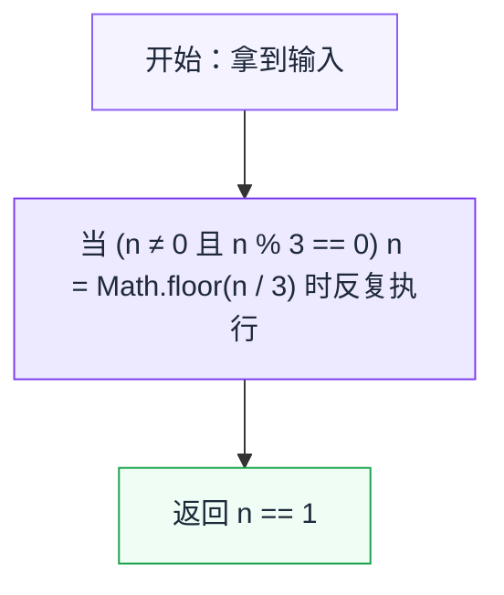

## TypeScript 解题方案（2 个方案逐个讲）

> **运行与提交**：每个方案都是自包含文件（内嵌用例自测，输出 PASS），整块复制到 `.ts` 文件后 `node 文件名` 即可运行。提交 LeetCode 时，把 `demo` 内的算法函数与辅助类型/函数整体取出、置于文件顶层即可。涉及交互/特殊接口的题以题面给定签名为准。

### 方案 1：试除法

**分析与思路**：核心做法是「试除法」。

**运行方式**：`node 本文件`，内嵌用例全部通过会输出 PASS。

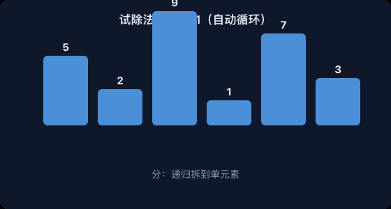

**方案专属流程图**（真实控制流）：

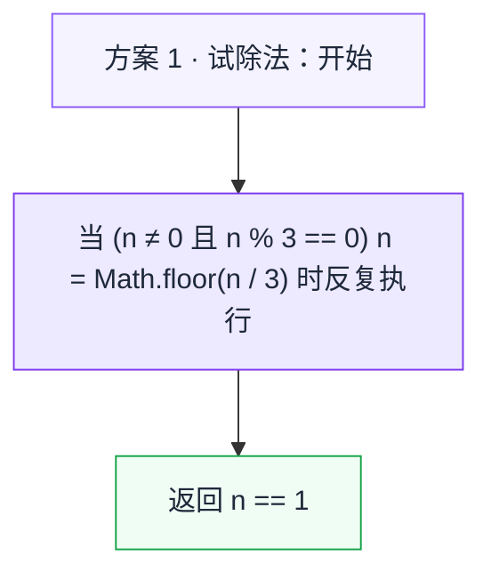

```typescript
/**
 ** LeetCode 326. 3 的幂
 ** 方案：1 ) 方案1：试除法
 ** 来源：https://blog.csdn.net/tyro_java/article/details/145355653
 */

export function isPowerOfThree(n: number): boolean {
  // 定义判定函数 isPowerOfThree
  while (n !== 0 && n % 3 === 0) n = Math.floor(n / 3);
  return n === 1; // 返回 元素个数 全等于 1
}

export function demo(): void {
  // 程序入口：跑内嵌自测用例
  if (!isPowerOfThree(1)) throw new Error('FAILED 1'); // 若 取反 isPowerOfThree(1)) throw new Error(「FAILED 1」);
  if (!isPowerOfThree(27)) throw new Error('FAILED 27'); // 若 取反 isPowerOfThree(27)) throw new Error(「FAILED 27」);
  if (isPowerOfThree(0)) throw new Error('FAILED 0'); // 若 isPowerOfThree(0)) throw new Error(「FAILED 0」);
  if (isPowerOfThree(2)) throw new Error('FAILED 2'); // 若 isPowerOfThree(2)) throw new Error(「FAILED 2」);
  console.log('PASS'); // 全部用例通过，输出 PASS
}

demo(); // demo();
```

### 方案 2：最大 3 的幂约数判定

**分析与思路**：核心做法是「最大 3 的幂约数判定」。

**运行方式**：`node 本文件`，内嵌用例全部通过会输出 PASS。

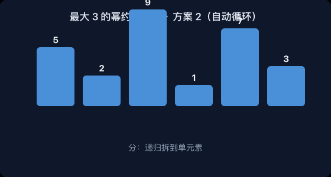

**方案专属流程图**（真实控制流）：

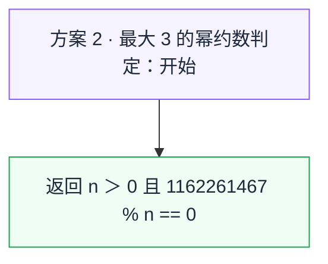

```typescript
/**
 ** LeetCode 326. 3 的幂
 ** 方案：2 ) 方案2：最大 3 的幂约数判定
 ** 来源：https://blog.csdn.net/tyro_java/article/details/145355653
 */

export function isPowerOfThree(n: number): boolean {
  // 定义判定函数 isPowerOfThree
  return n > 0 && 1162261467 % n === 0; // 返回 元素个数 超过 0 且 1162261467 对…取模 元素个数 全等于 0
}

export function demo(): void {
  // 程序入口：跑内嵌自测用例
  if (!isPowerOfThree(1)) throw new Error('FAILED 1'); // 若 取反 isPowerOfThree(1)) throw new Error(「FAILED 1」);
  if (!isPowerOfThree(27)) throw new Error('FAILED 27'); // 若 取反 isPowerOfThree(27)) throw new Error(「FAILED 27」);
  if (isPowerOfThree(0)) throw new Error('FAILED 0'); // 若 isPowerOfThree(0)) throw new Error(「FAILED 0」);
  if (isPowerOfThree(2)) throw new Error('FAILED 2'); // 若 isPowerOfThree(2)) throw new Error(「FAILED 2」);
  console.log('PASS'); // 全部用例通过，输出 PASS
}

demo(); // demo();
```

## 逐步拆解与面试追问

**复杂度**：时间 O(n)（单趟线性扫描），空间 O(1) 到 O(n)（视辅助结构）

**为什么是这个量级**：每个元素被常数次访问，辅助哈希或栈的开销与 n 同阶

**面试官可能会追问**：

- 有没有更直观的建模方式？
- 特殊输入的边界？
- 能否一步到位而不是分两趟？

## 关键 API 速查（TS 主解法实际用到，附官方链接）

| API | 作用 | 使用要点 | 官方文档 |
|---|---|---|---|
| `Math.floor()` | 向下取整 | 负数向负无穷（-1.5 → -2）；大数用位运算前注意 2^31 界 | [官方文档](https://developer.mozilla.org/zh-CN/docs/Web/JavaScript/Reference/Global_Objects/Math/floor) |

### 各语言官方文档导航

- **TypeScript / JS**：[MDN 中文参考](https://developer.mozilla.org/zh-CN/)
- **Python**：[Python 官方文档](https://docs.python.org/zh-cn/3/)
- **Go**：[Go 标准库](https://pkg.go.dev/std)
- **Java**：[JDK 17 API](https://docs.oracle.com/en/java/javase/17/docs/api/)
- **Rust**：[Rust 标准库](https://doc.rust-lang.org/std/)
- **Lua**：[Lua 5.4 手册](https://www.lua.org/manual/5.4/)
- **C**：[Cppreference C](https://zh.cppreference.com/w/c)
- **C++**：[Cppreference C++](https://zh.cppreference.com/w/cpp)
- **R**：[R 官方手册](https://stat.ethz.ch/R-manual/)
- **Zig**：[Zig 语言文档](https://ziglang.org/documentation/master/)
- **Dart**：[Dart API](https://api.dart.dev/)

## 附录：其他 10 种语言全部实现（每种语言列举其全部方案）

> TypeScript 的全部方案见「TypeScript 解题方案」一节；下面是其余 10 种语言的对应实现，每种语言的每个方案都带思路分析、代码走读与专属运行架构图。
> 每个方案都内嵌用例自测，可独立运行（老仓库 python/go 文件遵循「打印结果」约定）。
> 完整解法文件见 `dsa/<语言>/other/lc_326_3_的幂/`。

### Python 实现（2 种方案）

Python 的全部方案如下，每个方案都内嵌用例自测，可独立运行（老仓库 python/go 文件遵循「打印结果」约定）：

#### 方案 1：试除法

**思路与代码分析**：核心是「试除法」。Python 版用切片与字典推导式简化操作，突出可读性。**走读**：方案 1 · 试除法：开始 → 当 n ≠ 0 and n % 3 == 0: 时反复执行 → 更新 n → 返回 n == 1。

**运行架构**（真实控制流）：

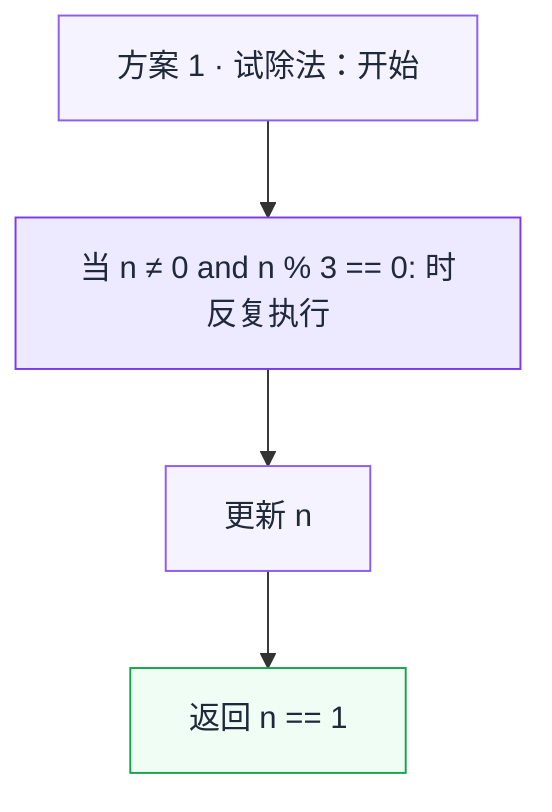

```python
import sys  # 提高递归深度上限（深输入防 RecursionError）

sys.setrecursionlimit(200000)  # 树/链表类题目节点数可达 1e4 量级

def isPowerOfThree(n):  # 定义函数 isPowerOfThree（参数：元素个数）
    while n != 0 and n % 3 == 0:  # 循环，直到不满足「元素个数 不等于 0 and 元素个数 对…取模 3 等于 0」
        n = int(n / 3)  # 把 int(元素个数 除以 3) 存入 元素个数
    return n == 1  # 返回 元素个数 等于 1

if __name__ == "__main__":  # 若 __name__ 等于 '__main__'
    print(isPowerOfThree(1))  # 打印输出
```

#### 方案 2：最大 3 的幂约数判定

**思路与代码分析**：核心是「最大 3 的幂约数判定」。Python 版用切片与字典推导式简化操作，突出可读性。**走读**：方案 2 · 最大 3 的幂约数判定：开始 → 返回 n ＞ 0 and 1162261467 % n == 0。

**运行架构**（真实控制流）：

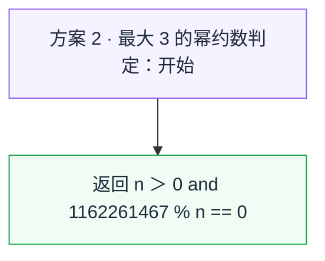

```python
import sys  # 提高递归深度上限（深输入防 RecursionError）

sys.setrecursionlimit(200000)  # 树/链表类题目节点数可达 1e4 量级

def isPowerOfThree(n):  # 定义函数 isPowerOfThree（参数：元素个数）
    return n > 0 and 1162261467 % n == 0  # 返回 元素个数 超过 0 and 1162261467 对…取模 元素个数 等于 0

if __name__ == "__main__":  # 若 __name__ 等于 '__main__'
    print(isPowerOfThree(1))  # 打印输出
```

### Go 实现（2 种方案）

Go 的全部方案如下，每个方案都内嵌用例自测，可独立运行（老仓库 python/go 文件遵循「打印结果」约定）：

#### 方案 1：试除法

**思路与代码分析**：核心是「试除法」。Go 版用切片与多返回值惯用法，显式处理索引边界。**走读**：方案 1 · 试除法：开始 → 处理 if n ≤ 0 → 返回 false → 遍历循环 → 更新 / → 返回 n == 1。

**运行架构**（真实控制流）：

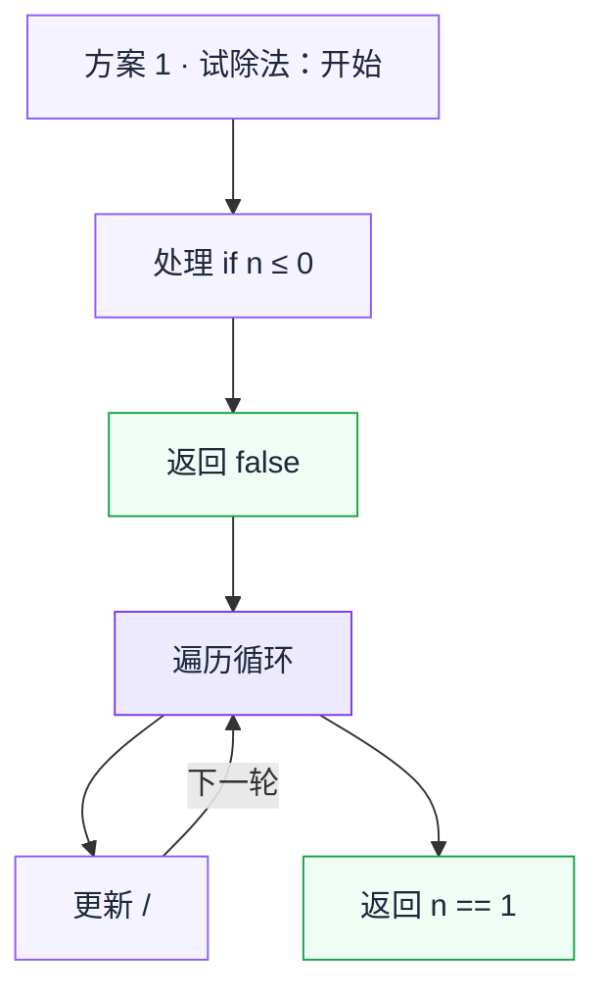

```go
package main // 引入依赖

import (
	"fmt" // 「fmt」
	"os"  // 「os」
)

func isPowerOfThree(n int) bool { // 定义判定函数 isPowerOfThree
	if n <= 0 { // 若 元素个数 不超过 0
		return false // 返回 false
	}
	for n%3 == 0 { // 把 赋值为 0 { 写入 for n%3
		n /= 3 // 把 3 写入 n /
	}
	return n == 1 // 返回 元素个数 等于 1
}

func main() { // 程序入口：跑内嵌自测用例
	ok := true       // 把 true 写入 ok :
	tc := []struct { // 把 []struct { 写入 tc :
		in   int  // in int
		want bool // want bool
	}{ // }{
		{1, true}, {3, true}, {9, true}, {2, false}, {0, false}, {27, true},
	}
	for _, c := range tc { // 同时取 _ 与 字符 遍历
		if got := isPowerOfThree(c.in); got != c.want { // 若 got : 赋值为 isPowerOfThree(字符.in); got 不等于 字符.want
			ok = false                                                            // 把 false 写入 ok
			fmt.Printf("FAIL isPowerOfThree(%d)=%v want %v\n", c.in, got, c.want) // 打印输出
		}
	}
	if !ok { // 若 取反 ok
		os.Exit(1) // os.Exit(1)
	}
	fmt.Println("PASS") // 全部用例通过，输出 PASS
}
```

#### 方案 2：最大 3 的幂约数判定

**思路与代码分析**：核心是「最大 3 的幂约数判定」。Go 版用切片与多返回值惯用法，显式处理索引边界。**走读**：方案 2 · 最大 3 的幂约数判定：开始 → 处理 if n ≤ 0 → 返回 false → 遍历循环 → 更新 / → 返回 n == 1。

**运行架构**（真实控制流）：

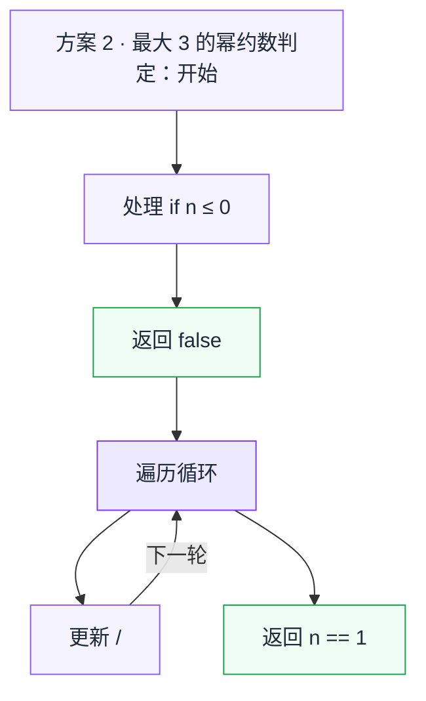

```go
package main // 引入依赖
import (
	"fmt"
	"os"
) // 引入依赖
func isPowerOfThree(n int) bool { // 定义判定函数 isPowerOfThree
	if n <= 0 {
		return false
	} // 若 元素个数 不超过 0 { return false }
	for n%3 == 0 {
		n /= 3
	} // 把 赋值为 0 { 元素个数 除以 3 } 写入 for n%3
	return n == 1 // 返回 元素个数 等于 1
}
func main() { // 程序入口：跑内嵌自测用例
	cases := []struct {
		in   int
		want bool
	}{ // 把 []struct{ in int; want bool }{ 写入 cases :
		{1, true}, {0, false}, {9, true}, {2, false}, {27, true},
	}
	ok := true                // 把 true 写入 ok :
	for _, c := range cases { // 同时取 _ 与 字符 遍历
		if got := isPowerOfThree(c.in); got != c.want {
			ok = false
			fmt.Printf("FAIL=%v want %v\n", got, c.want)
		}
	}
	if !ok {
		os.Exit(1)
	} // 若 取反 ok { os.Exit(1) }
	fmt.Println("PASS") // 全部用例通过，输出 PASS
}
```

### Java 实现（2 种方案）

Java 的全部方案如下，每个方案都内嵌用例自测，可独立运行（老仓库 python/go 文件遵循「打印结果」约定）：

#### 方案 1：试除法

**思路与代码分析**：核心是「试除法」。Java 版用类与静态方法组织，集合操作显式明了。**走读**：方案 1 · 试除法：开始 → 当 (n ≠ 0 且 n % 3 == 0) 时反复执行 → 更新 n → 返回 n == 1。

**运行架构**（真实控制流）：

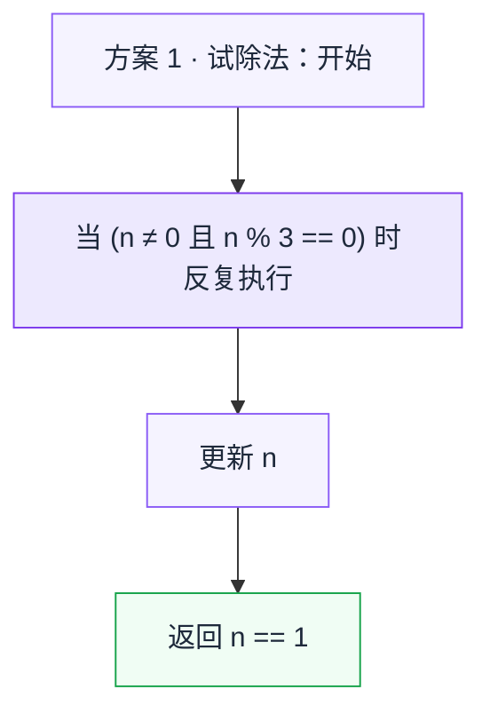

```java
package com.webfault.dsa; // 引入依赖

class Pow3S1 { // 定义类型
  static boolean isPowerOfThree(int n) { // 定义判定函数 isPowerOfThree
    while (n != 0 && n % 3 == 0)
      n = n / 3; // 循环，直到不满足「元素个数 不等于 0 且 元素个数 对…取模 3 等于 0) 元素个数 赋值为 元素个数 除以 3;」
    return n == 1; // 返回 元素个数 等于 1
  }

  public static void main(String[] args) { // public static void main(String[] args) {
    boolean[] got = { // 把 { 写入 boolean[] got
      Pow3S1.isPowerOfThree(1),
      Pow3S1.isPowerOfThree(3),
      Pow3S1.isPowerOfThree(9),
      Pow3S1.isPowerOfThree(2),
      Pow3S1.isPowerOfThree(0),
    };
    boolean[] want = {
      true, true, true, false, false
    }; // 把 { true, true, true, false, false }; 写入 boolean[] want
    boolean ok = true; // 把 true; 写入 boolean ok
    for (int i = 0; i < got.length; i++) { // 让 下标 i 从 0 开始计数，下标 i 小于 got.长度 就继续
      if (got[i] != want[i]) { // 若 got[下标 i] 不等于 want[下标 i]
        ok = false; // 把 false; 写入 ok
        System.out.println("FAIL idx " + i + " got " + got[i] + " want " + want[i]); // 打印输出
      }
    }
    if (!ok) throw new RuntimeException("FAILED"); // 若 取反 ok) throw new RuntimeException(「FAILED」);
    System.out.println("PASS"); // 全部用例通过，输出 PASS
  }
}
```

#### 方案 2：最大 3 的幂约数判定

**思路与代码分析**：核心是「最大 3 的幂约数判定」。Java 版用类与静态方法组织，集合操作显式明了。**走读**：方案 2 · 最大 3 的幂约数判定：开始 → 返回 n ＞ 0 且 1162261467 % n == 0。

**运行架构**（真实控制流）：


```java
package com.webfault.dsa; // 引入依赖

class Pow3S2 { // 定义类型
  static boolean isPowerOfThree(int n) { // 定义判定函数 isPowerOfThree
    return n > 0 && 1162261467 % n == 0; // 返回 元素个数 超过 0 且 1162261467 对…取模 元素个数 等于 0
  }

  public static void main(String[] args) { // public static void main(String[] args) {
    boolean[] got = { // 把 { 写入 boolean[] got
      Pow3S2.isPowerOfThree(1),
      Pow3S2.isPowerOfThree(3),
      Pow3S2.isPowerOfThree(9),
      Pow3S2.isPowerOfThree(2),
      Pow3S2.isPowerOfThree(0),
    };
    boolean[] want = {
      true, true, true, false, false
    }; // 把 { true, true, true, false, false }; 写入 boolean[] want
    boolean ok = true; // 把 true; 写入 boolean ok
    for (int i = 0; i < got.length; i++) { // 让 下标 i 从 0 开始计数，下标 i 小于 got.长度 就继续
      if (got[i] != want[i]) { // 若 got[下标 i] 不等于 want[下标 i]
        ok = false; // 把 false; 写入 ok
        System.out.println("FAIL idx " + i + " got " + got[i] + " want " + want[i]); // 打印输出
      }
    }
    if (!ok) throw new RuntimeException("FAILED"); // 若 取反 ok) throw new RuntimeException(「FAILED」);
    System.out.println("PASS"); // 全部用例通过，输出 PASS
  }
}
```

### Rust 实现（2 种方案）

Rust 的全部方案如下，每个方案都内嵌用例自测，可独立运行（老仓库 python/go 文件遵循「打印结果」约定）：

#### 方案 1：试除法

**思路与代码分析**：核心是「试除法」。Rust 版用所有权移动与切片借用改写同一逻辑，注意 Option 与引用边界。**走读**：方案 1 · 试除法：开始 → 当 n ≠ 0 且 n % 3 == 0 时反复执行 → 更新 / → 更新 = → 返回结果。

**运行架构**（真实控制流）：

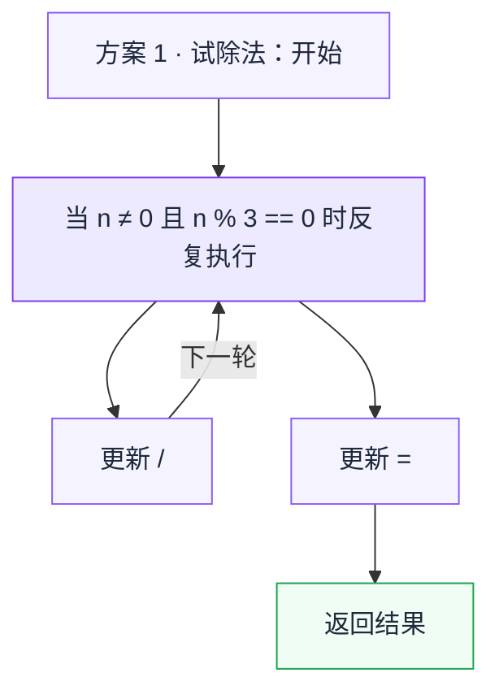

```rust
// LeetCode 326. 3的幂 — Rust 版（方案1）
fn is_power_of_three(mut n: i64) -> bool {
    // 定义判定函数 is_power_of_three
    while n != 0 && n % 3 == 0 {
        n /= 3;
    } // 把 0 且 元素个数 对…取模 3 等于 0 { 元素个数 除以 3; } 写入 while n !
    n == 1 // 把 赋值为 1 写入 元素个数
}
fn main() {
    // 程序入口：跑内嵌自测用例
    assert!(is_power_of_three(27)); // 断言校验
    assert!(!is_power_of_three(0)); // 断言校验
    assert!(is_power_of_three(9)); // 断言校验
    assert!(!is_power_of_three(-1)); // 断言校验
    assert!(is_power_of_three(1)); // 断言校验
    println!("PASS"); // 全部用例通过，输出 PASS
}
```

#### 方案 2：最大 3 的幂约数判定

**思路与代码分析**：核心是「最大 3 的幂约数判定」。Rust 版用所有权移动与切片借用改写同一逻辑，注意 Option 与引用边界。**走读**：方案 2 · 最大 3 的幂约数判定：开始 → 当 n ≠ 0 且 n % 3 == 0 时反复执行 → 更新 / → 更新 = → 返回结果。

**运行架构**（真实控制流）：

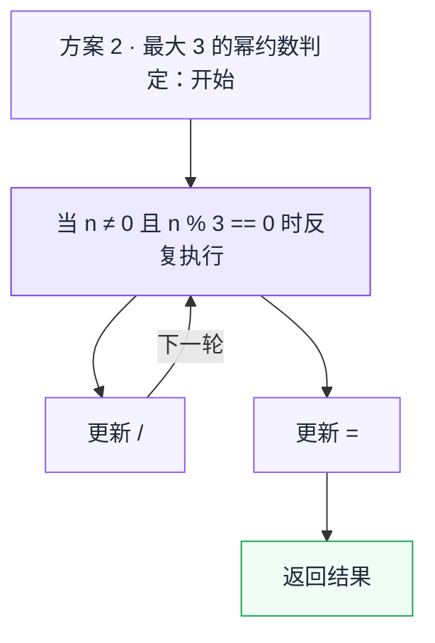

```rust
// LeetCode 326. 3的幂 — Rust 版（方案2）
fn is_power_of_three(mut n: i64) -> bool {
    // 定义判定函数 is_power_of_three
    while n != 0 && n % 3 == 0 {
        n /= 3;
    } // 把 0 且 元素个数 对…取模 3 等于 0 { 元素个数 除以 3; } 写入 while n !
    n == 1 // 把 赋值为 1 写入 元素个数
}
fn main() {
    // 程序入口：跑内嵌自测用例
    assert!(is_power_of_three(27)); // 断言校验
    assert!(!is_power_of_three(0)); // 断言校验
    assert!(is_power_of_three(9)); // 断言校验
    assert!(!is_power_of_three(-1)); // 断言校验
    assert!(is_power_of_three(1)); // 断言校验
    println!("PASS"); // 全部用例通过，输出 PASS
}
```

### Lua 实现（2 种方案）

Lua 的全部方案如下，每个方案都内嵌用例自测，可独立运行（老仓库 python/go 文件遵循「打印结果」约定）：

#### 方案 1：试除法

**思路与代码分析**：核心是「试除法」。Lua 版用表与 ipairs 遍历，注意 ipairs 遇 nil 即停的语义。**走读**：方案 1 · 试除法：开始 → 当 n ~= 0 and n % 3 == 0 do 时反复执行 → 更新 n → 返回 n == 1。

**运行架构**（真实控制流）：

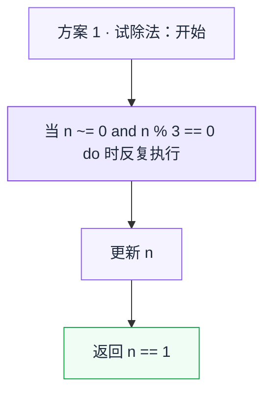

```lua
-- LeetCode 326. 3的幂 — Lua 版（方案1）
local function is_power_of_three(n) -- local function is_power_of_three(元素个数)
	while n ~= 0 and n % 3 == 0 do
		n = math.floor(n / 3)
	end
	return n == 1 -- 返回 元素个数 等于 1
end -- 终点
assert(is_power_of_three(27) == true) -- 断言校验
assert(is_power_of_three(0) == false) -- 断言校验
assert(is_power_of_three(9) == true) -- 断言校验
assert(is_power_of_three(-1) == false) -- 断言校验
assert(is_power_of_three(1) == true) -- 断言校验
print("PASS") -- 全部用例通过，输出 PASS
```

#### 方案 2：最大 3 的幂约数判定

**思路与代码分析**：核心是「最大 3 的幂约数判定」。Lua 版用表与 ipairs 遍历，注意 ipairs 遇 nil 即停的语义。**走读**：方案 2 · 最大 3 的幂约数判定：开始 → 当 n ~= 0 and n % 3 == 0 do 时反复执行 → 更新 n → 返回 n == 1。

**运行架构**（真实控制流）：

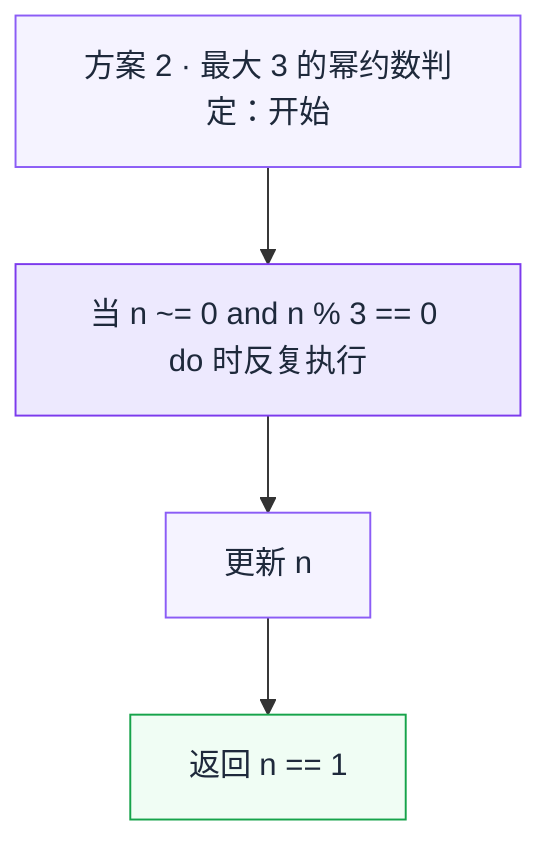

```lua
-- LeetCode 326. 3的幂 — Lua 版（方案2）
local function is_power_of_three(n) -- local function is_power_of_three(元素个数)
	while n ~= 0 and n % 3 == 0 do
		n = math.floor(n / 3)
	end
	return n == 1 -- 返回 元素个数 等于 1
end -- 终点
assert(is_power_of_three(27) == true) -- 断言校验
assert(is_power_of_three(0) == false) -- 断言校验
assert(is_power_of_three(9) == true) -- 断言校验
assert(is_power_of_three(-1) == false) -- 断言校验
assert(is_power_of_three(1) == true) -- 断言校验
print("PASS") -- 全部用例通过，输出 PASS
```

### C 实现（2 种方案）

C 的全部方案如下，每个方案都内嵌用例自测，可独立运行（老仓库 python/go 文件遵循「打印结果」约定）：

#### 方案 1：试除法

**思路与代码分析**：核心是「试除法」。C 版手动管理下标与内存，循环边界全部显式写出。**走读**：方案 1 · 试除法：开始 → 当 (n ≠ 0 且 n % 3 == 0) 时反复执行 → 更新 / → 返回 n == 1。

**运行架构**（真实控制流）：

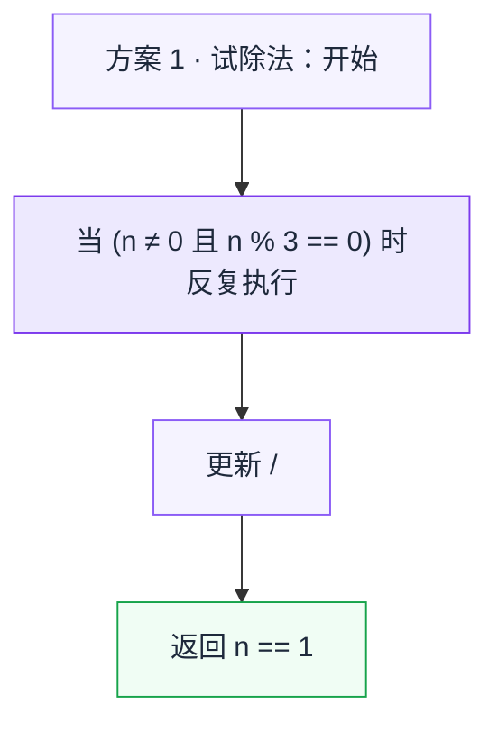

```c
/* LeetCode 326. 3的幂 — C 版（方案1） */
#include <stdio.h>                     // 引入头文件
static int is_power_of_three(long n) { // 定义判定函数 is_power_of_three
    while (n != 0 && n % 3 == 0)
        n /= 3; // 循环，直到不满足「元素个数 不等于 0 且 元素个数 对…取模 3 等于 0) 元素个数 除以 3;」
    return n == 1; // 返回 元素个数 等于 1
}
int main(void) { // 程序入口：跑内嵌自测用例
    if (!is_power_of_three(27)) {
        printf("FAIL 1\n");
        return 1;
    } // 若 取反 is_power_of_three(27)) { 输出「FAIL 1 」); return 1; }
    if (is_power_of_three(0)) {
        printf("FAIL 2\n");
        return 1;
    } // 若 is_power_of_three(0)) { 输出「FAIL 2 」); return 1; }
    if (!is_power_of_three(9)) {
        printf("FAIL 3\n");
        return 1;
    } // 若 取反 is_power_of_three(9)) { 输出「FAIL 3 」); return 1; }
    if (is_power_of_three(-1)) {
        printf("FAIL 4\n");
        return 1;
    } // 若 is_power_of_three( 减 1)) { 输出「FAIL 4 」); return 1; }
    if (!is_power_of_three(1)) {
        printf("FAIL 5\n");
        return 1;
    }                 // 若 取反 is_power_of_three(1)) { 输出「FAIL 5 」); return 1; }
    printf("PASS\n"); // 全部用例通过，输出 PASS
    return 0;         // 返回 0
}
```

#### 方案 2：最大 3 的幂约数判定

**思路与代码分析**：核心是「最大 3 的幂约数判定」。C 版手动管理下标与内存，循环边界全部显式写出。**走读**：方案 2 · 最大 3 的幂约数判定：开始 → 当 (n ≠ 0 且 n % 3 == 0) 时反复执行 → 更新 / → 返回 n == 1。

**运行架构**（真实控制流）：

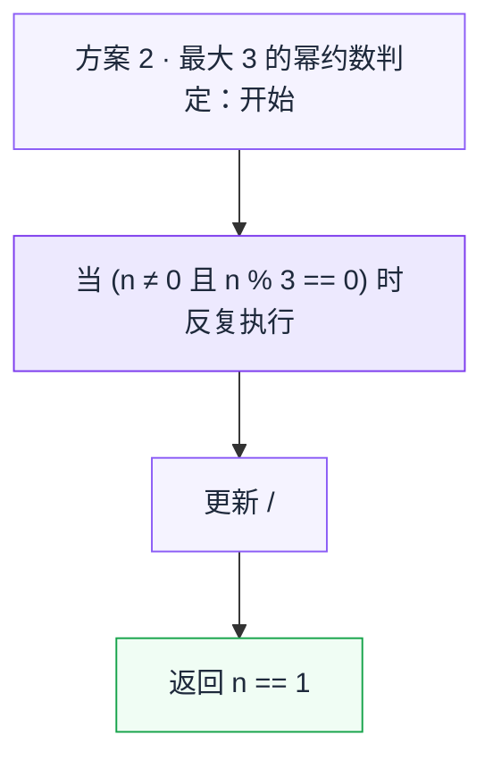

```c
/* LeetCode 326. 3的幂 — C 版（方案2） */
#include <stdio.h>                     // 引入头文件
static int is_power_of_three(long n) { // 定义判定函数 is_power_of_three
    while (n != 0 && n % 3 == 0)
        n /= 3; // 循环，直到不满足「元素个数 不等于 0 且 元素个数 对…取模 3 等于 0) 元素个数 除以 3;」
    return n == 1; // 返回 元素个数 等于 1
}
int main(void) { // 程序入口：跑内嵌自测用例
    if (!is_power_of_three(27)) {
        printf("FAIL 1\n");
        return 1;
    } // 若 取反 is_power_of_three(27)) { 输出「FAIL 1 」); return 1; }
    if (is_power_of_three(0)) {
        printf("FAIL 2\n");
        return 1;
    } // 若 is_power_of_three(0)) { 输出「FAIL 2 」); return 1; }
    if (!is_power_of_three(9)) {
        printf("FAIL 3\n");
        return 1;
    } // 若 取反 is_power_of_three(9)) { 输出「FAIL 3 」); return 1; }
    if (is_power_of_three(-1)) {
        printf("FAIL 4\n");
        return 1;
    } // 若 is_power_of_three( 减 1)) { 输出「FAIL 4 」); return 1; }
    if (!is_power_of_three(1)) {
        printf("FAIL 5\n");
        return 1;
    }                 // 若 取反 is_power_of_three(1)) { 输出「FAIL 5 」); return 1; }
    printf("PASS\n"); // 全部用例通过，输出 PASS
    return 0;         // 返回 0
}
```

### C++ 实现（2 种方案）

C++ 的全部方案如下，每个方案都内嵌用例自测，可独立运行（老仓库 python/go 文件遵循「打印结果」约定）：

#### 方案 1：试除法

**思路与代码分析**：核心是「试除法」。C++ 版用 STL 容器与迭代器，减少手写下标错误。**走读**：方案 1 · 试除法：开始 → 当 (n ≠ 0 且 n % 3 == 0) 时反复执行 → 更新 / → 返回 n == 1。

**运行架构**（真实控制流）：


```cpp
// LeetCode 326. 3的幂 — C++ 版（方案1）
#include <cassert>                        // 引入头文件
#include <iostream>                       // 引入头文件
static bool isPowerOfThree(long long n) { // 定义判定函数 isPowerOfThree
    while (n != 0 && n % 3 == 0)
        n /= 3; // 循环，直到不满足「元素个数 不等于 0 且 元素个数 对…取模 3 等于 0) 元素个数 除以 3;」
    return n == 1; // 返回 元素个数 等于 1
}
int main() {                          // 程序入口：跑内嵌自测用例
    assert(isPowerOfThree(27));       // 断言校验
    assert(!isPowerOfThree(0));       // 断言校验
    assert(isPowerOfThree(9));        // 断言校验
    assert(!isPowerOfThree(-1));      // 断言校验
    assert(isPowerOfThree(1));        // 断言校验
    std::cout << "PASS" << std::endl; // 全部用例通过，输出 PASS
    return 0;                         // 返回 0
}
```

#### 方案 2：最大 3 的幂约数判定

**思路与代码分析**：核心是「最大 3 的幂约数判定」。C++ 版用 STL 容器与迭代器，减少手写下标错误。**走读**：方案 2 · 最大 3 的幂约数判定：开始 → 当 (n ≠ 0 且 n % 3 == 0) 时反复执行 → 更新 / → 返回 n == 1。

**运行架构**（真实控制流）：


```cpp
// LeetCode 326. 3的幂 — C++ 版（方案2）
#include <cassert>                        // 引入头文件
#include <iostream>                       // 引入头文件
static bool isPowerOfThree(long long n) { // 定义判定函数 isPowerOfThree
    while (n != 0 && n % 3 == 0)
        n /= 3; // 循环，直到不满足「元素个数 不等于 0 且 元素个数 对…取模 3 等于 0) 元素个数 除以 3;」
    return n == 1; // 返回 元素个数 等于 1
}
int main() {                          // 程序入口：跑内嵌自测用例
    assert(isPowerOfThree(27));       // 断言校验
    assert(!isPowerOfThree(0));       // 断言校验
    assert(isPowerOfThree(9));        // 断言校验
    assert(!isPowerOfThree(-1));      // 断言校验
    assert(isPowerOfThree(1));        // 断言校验
    std::cout << "PASS" << std::endl; // 全部用例通过，输出 PASS
    return 0;                         // 返回 0
}
```

### R 实现（2 种方案）

R 的全部方案如下，每个方案都内嵌用例自测，可独立运行（老仓库 python/go 文件遵循「打印结果」约定）：

#### 方案 1：试除法

**思路与代码分析**：核心是「试除法」。R 版用向量化思维与 1 起始下标，注意 1:n 的降序陷阱。**走读**：方案 1 · 试除法：开始 → 当 (n ≠ 0 且 n%%3 == 0) n ＜- n%/%3 时反复执行 → 更新 = → 返回结果。

**运行架构**（真实控制流）：

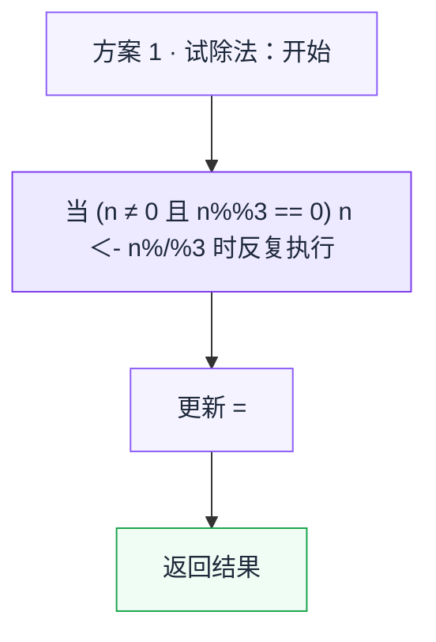

```r
# 定义函数 is_power_of_three（参数：元素个数）
is_power_of_three <- function(n) {
    while (n != 0 && n%%3 == 0) n <- n%/%3
    n == 1  # 把 赋值为 1 存入 元素个数
}
stopifnot(is_power_of_three(27), !is_power_of_three(0), is_power_of_three(9), !is_power_of_three(-1), is_power_of_three(1))  # 断言校验
cat("PASS\n")  # 全部用例通过，输出 PASS
```

#### 方案 2：最大 3 的幂约数判定

**思路与代码分析**：核心是「最大 3 的幂约数判定」。R 版用向量化思维与 1 起始下标，注意 1:n 的降序陷阱。**走读**：方案 2 · 最大 3 的幂约数判定：开始 → 当 (n ≠ 0 且 n%%3 == 0) n ＜- n%/%3 时反复执行 → 更新 = → 返回结果。

**运行架构**（真实控制流）：

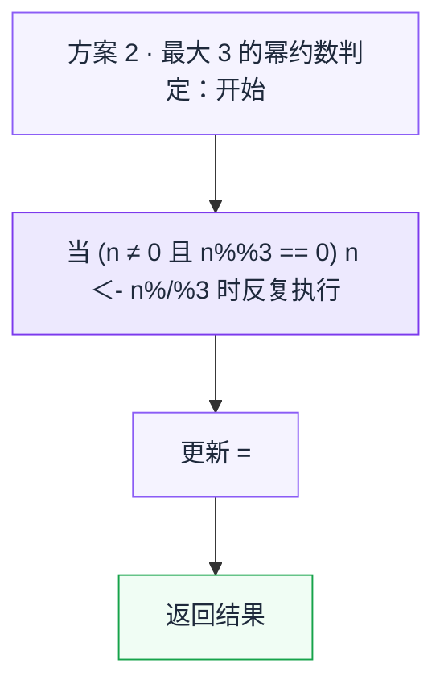

```r
# 定义函数 is_power_of_three（参数：元素个数）
is_power_of_three <- function(n) {
    while (n != 0 && n%%3 == 0) n <- n%/%3
    n == 1  # 把 赋值为 1 存入 元素个数
}
stopifnot(is_power_of_three(27), !is_power_of_three(0), is_power_of_three(9), !is_power_of_three(-1), is_power_of_three(1))  # 断言校验
cat("PASS\n")  # 全部用例通过，输出 PASS
```

### Zig 实现（2 种方案）

Zig 的全部方案如下，每个方案都内嵌用例自测，可独立运行（老仓库 python/go 文件遵循「打印结果」约定）：

#### 方案 1：试除法

**思路与代码分析**：核心是「试除法」。Zig 版显式分配与清零，整型边界处理严格。**走读**：方案 1 · 试除法：开始 → 计算 n → 当 (n ≠ 0 and @mod(n, 3) == 0) n = @divTrunc(n, 3) 时反复执行 → 返回 n == 1。

**运行架构**（真实控制流）：

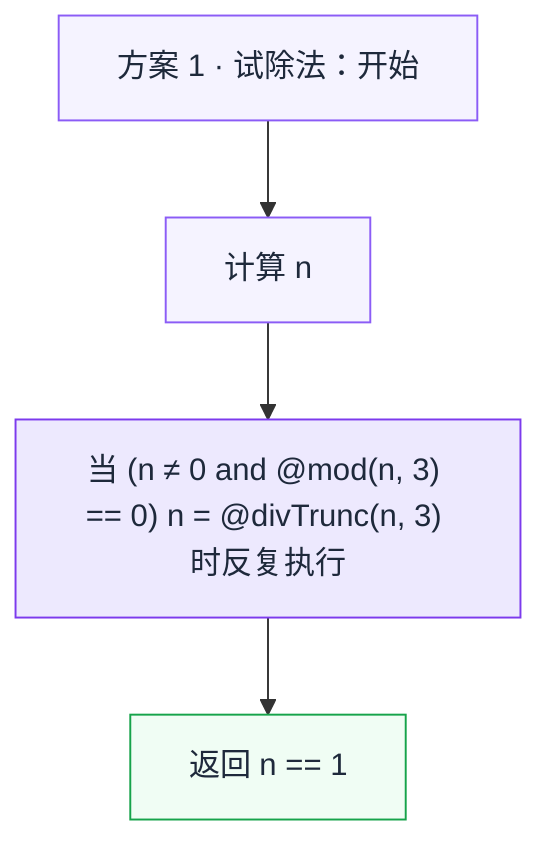

```zig
// LeetCode 326. 3的幂 — Zig 版（方案1）
const std = @import("std"); // 把 @import(「std」) 存入 std
fn isPowerOfThree(n0: i64) bool { // 定义判定函数 isPowerOfThree
    var n = n0; // 把 n0 存入 元素个数
    while (n != 0 and @mod(n, 3) == 0) n = @divTrunc(n, 3);
    return n == 1; // 返回 元素个数 等于 1
}
pub fn main() !void { // 程序入口：跑内嵌自测用例
    if (!isPowerOfThree(27)) return error.TestFailed; // 若 取反 isPowerOfThree(27)，直接返回 error.TestFailed
    if (isPowerOfThree(0)) return error.TestFailed; // 若 isPowerOfThree(0)，直接返回 error.TestFailed
    if (!isPowerOfThree(9)) return error.TestFailed; // 若 取反 isPowerOfThree(9)，直接返回 error.TestFailed
    if (isPowerOfThree(-1)) return error.TestFailed; // 若 isPowerOfThree( 减 1)，直接返回 error.TestFailed
    if (!isPowerOfThree(1)) return error.TestFailed; // 若 取反 isPowerOfThree(1)，直接返回 error.TestFailed
    std.debug.print("PASS\n", .{}); // 全部用例通过，输出 PASS
}
```

#### 方案 2：最大 3 的幂约数判定

**思路与代码分析**：核心是「最大 3 的幂约数判定」。Zig 版显式分配与清零，整型边界处理严格。**走读**：方案 2 · 最大 3 的幂约数判定：开始 → 计算 n → 当 (n ≠ 0 and @mod(n, 3) == 0) n = @divTrunc(n, 3) 时反复执行 → 返回 n == 1。

**运行架构**（真实控制流）：

```mermaid
graph TD
    N0["方案 2 · 最大 3 的幂约数判定：开始"]
    N1["计算 n"]
    N2["当 (n ≠ 0 and @mod(n, 3) == 0) n = @divTrunc(n, 3) 时反复执行"]
    N3["返回 n == 1"]
    N0 --> N1
    N1 --> N2
    N2 --> N3
    classDef n fill:#f5f3ff,stroke:#8b5cf6,color:#1e293b;
    classDef lp fill:#ede9fe,stroke:#7c3aed,color:#1e293b;
    classDef dc fill:#fef9c3,stroke:#ca8a04,color:#1e293b;
    classDef tm fill:#f0fdf4,stroke:#16a34a,color:#1e293b;
    class N0,N1 n;
    class N2 lp;
    class N3 tm;
```

```zig
// LeetCode 326. 3的幂 — Zig 版（方案2）
const std = @import("std"); // 把 @import(「std」) 存入 std
fn isPowerOfThree(n0: i64) bool { // 定义判定函数 isPowerOfThree
    var n = n0; // 把 n0 存入 元素个数
    while (n != 0 and @mod(n, 3) == 0) n = @divTrunc(n, 3);
    return n == 1; // 返回 元素个数 等于 1
}
pub fn main() !void { // 程序入口：跑内嵌自测用例
    if (!isPowerOfThree(27)) return error.TestFailed; // 若 取反 isPowerOfThree(27)，直接返回 error.TestFailed
    if (isPowerOfThree(0)) return error.TestFailed; // 若 isPowerOfThree(0)，直接返回 error.TestFailed
    if (!isPowerOfThree(9)) return error.TestFailed; // 若 取反 isPowerOfThree(9)，直接返回 error.TestFailed
    if (isPowerOfThree(-1)) return error.TestFailed; // 若 isPowerOfThree( 减 1)，直接返回 error.TestFailed
    if (!isPowerOfThree(1)) return error.TestFailed; // 若 取反 isPowerOfThree(1)，直接返回 error.TestFailed
    std.debug.print("PASS\n", .{}); // 全部用例通过，输出 PASS
}
```

### Dart 实现（2 种方案）

Dart 的全部方案如下，每个方案都内嵌用例自测，可独立运行（老仓库 python/go 文件遵循「打印结果」约定）：

#### 方案 1：试除法

**思路与代码分析**：核心是「试除法」。Dart 版用可空类型标注与集合方法，注意空安全。**走读**：方案 1 · 试除法：开始 → 当 (n ≠ 0 且 n % 3 == 0) 时反复执行 → 更新 n → 返回 n == 1。

**运行架构**（真实控制流）：

```mermaid
graph TD
    N0["方案 1 · 试除法：开始"]
    N1["当 (n ≠ 0 且 n % 3 == 0) 时反复执行"]
    N2["更新 n"]
    N3["返回 n == 1"]
    N0 --> N1
    N1 --> N2
    N2 -- 下一轮 --> N1
    N1 --> N3
    classDef n fill:#f5f3ff,stroke:#8b5cf6,color:#1e293b;
    classDef lp fill:#ede9fe,stroke:#7c3aed,color:#1e293b;
    classDef dc fill:#fef9c3,stroke:#ca8a04,color:#1e293b;
    classDef tm fill:#f0fdf4,stroke:#16a34a,color:#1e293b;
    class N0,N2 n;
    class N1 lp;
    class N3 tm;
```

```dart
// LeetCode 326. 3的幂 — Dart 版（方案1）
bool isPowerOfThree(int n) {
  // 定义判定函数 isPowerOfThree
  while (n != 0 && n % 3 == 0) {
    // 循环，直到不满足「元素个数 不等于 0 且 元素个数 对…取模 3 等于 0」
    n = n ~/ 3; // 把 元素个数 ~ 除以 3 存入 元素个数
  }
  return n == 1; // 返回 元素个数 等于 1
}

void main() {
  // 程序入口：跑内嵌自测用例
  if (!isPowerOfThree(27))
    throw StateError('c1'); // 若 取反 isPowerOfThree(27)) throw StateError('c1');
  if (isPowerOfThree(0))
    throw StateError('c2'); // 若 isPowerOfThree(0)) throw StateError('c2');
  if (!isPowerOfThree(9))
    throw StateError('c3'); // 若 取反 isPowerOfThree(9)) throw StateError('c3');
  if (isPowerOfThree(-1))
    throw StateError('c4'); // 若 isPowerOfThree( 减 1)) throw StateError('c4');
  if (!isPowerOfThree(1))
    throw StateError('c5'); // 若 取反 isPowerOfThree(1)) throw StateError('c5');
  print('PASS'); // 全部用例通过，输出 PASS
}
```

#### 方案 2：最大 3 的幂约数判定

**思路与代码分析**：核心是「最大 3 的幂约数判定」。Dart 版用可空类型标注与集合方法，注意空安全。**走读**：方案 2 · 最大 3 的幂约数判定：开始 → 当 (n ≠ 0 且 n % 3 == 0) 时反复执行 → 更新 n → 返回 n == 1。

**运行架构**（真实控制流）：

```mermaid
graph TD
    N0["方案 2 · 最大 3 的幂约数判定：开始"]
    N1["当 (n ≠ 0 且 n % 3 == 0) 时反复执行"]
    N2["更新 n"]
    N3["返回 n == 1"]
    N0 --> N1
    N1 --> N2
    N2 -- 下一轮 --> N1
    N1 --> N3
    classDef n fill:#f5f3ff,stroke:#8b5cf6,color:#1e293b;
    classDef lp fill:#ede9fe,stroke:#7c3aed,color:#1e293b;
    classDef dc fill:#fef9c3,stroke:#ca8a04,color:#1e293b;
    classDef tm fill:#f0fdf4,stroke:#16a34a,color:#1e293b;
    class N0,N2 n;
    class N1 lp;
    class N3 tm;
```

```dart
// LeetCode 326. 3的幂 — Dart 版（方案2）
bool isPowerOfThree(int n) {
  // 定义判定函数 isPowerOfThree
  while (n != 0 && n % 3 == 0) {
    // 循环，直到不满足「元素个数 不等于 0 且 元素个数 对…取模 3 等于 0」
    n = n ~/ 3; // 把 元素个数 ~ 除以 3 存入 元素个数
  }
  return n == 1; // 返回 元素个数 等于 1
}

void main() {
  // 程序入口：跑内嵌自测用例
  if (!isPowerOfThree(27))
    throw StateError('c1'); // 若 取反 isPowerOfThree(27)) throw StateError('c1');
  if (isPowerOfThree(0))
    throw StateError('c2'); // 若 isPowerOfThree(0)) throw StateError('c2');
  if (!isPowerOfThree(9))
    throw StateError('c3'); // 若 取反 isPowerOfThree(9)) throw StateError('c3');
  if (isPowerOfThree(-1))
    throw StateError('c4'); // 若 isPowerOfThree( 减 1)) throw StateError('c4');
  if (!isPowerOfThree(1))
    throw StateError('c5'); // 若 取反 isPowerOfThree(1)) throw StateError('c5');
  print('PASS'); // 全部用例通过，输出 PASS
}
```

---

## 内容总结

- **3 的幂**（综合 · Medium）：共 2 个方案，主线思路「试除法」；时间 O(n)（单趟线性扫描）；动画演示归并分治过程，附录给出 11 种语言 × 全部方案的可运行实现。
- 来源博客：[https://blog.csdn.net/tyro_java/article/details/145355653](https://blog.csdn.net/tyro_java/article/details/145355653)
- 导航：[📋 总目录](../) ｜ [← 249 nim 游戏](../249_nim_游戏/) ｜ [251 数据结构与算法笔记 复杂度 →](../251_数据结构与算法笔记_复杂度/)
