# 251 · 数据结构与算法笔记 复杂度（第附阶段 · 专题补充 · Medium）

> **难度**：⭐⭐ Medium ｜ **专题**：算法笔记
> **学习定位**：第附阶段 · 专题补充第 251 篇 ｜ **解法数**：12
> **内容总结**：**数据结构与算法笔记 复杂度**（算法笔记 · Medium）：共 12 个方案，主线思路「单趟扫描」；时间 O(n)（单趟线性扫描）；动画演示归并分治过程，附录给出 11 种语言 × 全部方案的可运行实现。

---

## 题目描述

数据结构与算法笔记 复杂度。具体输入输出约定见函数签名与用例。

- 主函数签名：`function linearSearch(arr: number[], target: number): number`

**用例演示**（摘自主解法内嵌自测，输入到输出一目了然）：

```typescript
  const cases: { arr: number[]; target: number; want: number }[] = [
    { arr: [3, 1, 4, 1, 5, 9, 2, 6], target: 5, want: 4 },
    { arr: [3, 1, 4, 1, 5, 9, 2, 6], target: 7, want: -1 },
    { arr: [], target: 1, want: -1 },
    { arr: [9], target: 9, want: 0 },
    { arr: [9], target: 8, want: -1 },
  ];
```

**数据范围与注意事项**：

- **易错点**：先看小例子手推一遍再对照代码，比直接读代码快得多。

## 题目分析

**场景是什么**：综合练习：把数据结构与策略组合起来解决一个完整问题。本题就是该场景的 Medium 级练习，主线做法是「单趟扫描」。

**主线怎么解**：把主解法从头到尾过一遍，它其实在依次做这几件事：单循环线性扫描。

## 解题思路

**方案对比**（共 12 个方案，由浅入深）：

| 方案 | 时间复杂度 | 空间复杂度 |
|---|---|---|
| 方案 1 · 单趟扫描 | O(n)（单趟线性扫描） | O(1) 到 O(n)（视辅助结构） |
| 方案 2 · 二分查找 | O(log n) | O(1) |
| 方案 3 · 双重循环枚举 | O(n²)（两层嵌套扫描） | O(1) 到 O(n) |
| 方案 4 · 单趟扫描 | O(n)（单趟线性扫描） | O(1) 到 O(n)（视辅助结构） |
| 方案 5 · 双重循环枚举 | O(n²)（两层嵌套扫描） | O(1) 到 O(n) |
| 方案 6 · 单趟扫描 | O(n²)（两层嵌套扫描） | O(1) 到 O(n) |
| 方案 7 · 双指针收缩 | O(n)（单趟线性扫描） | O(1) 到 O(n)（视辅助结构） |
| 方案 8 · 双重循环枚举 | O(n²)（两层嵌套扫描） | O(1) 到 O(n) |
| 方案 9 · 直接实现 | O(n) 量级 | O(n) |
| 方案 10 · 双重循环枚举 | O(n²)（两层嵌套扫描） | O(1) 到 O(n) |
| 方案 11 · 双重循环枚举 | O(n²)（两层嵌套扫描） | O(1) 到 O(n) |
| 方案 12 · 直接实现 | O(n) 量级 | O(n) |

**由浅入深的路径**：单趟扫描 → 二分查找 → 双重循环枚举 → 双指针收缩 → 直接实现；每往右一步，都在补上一步的短板。

**方案间的取舍**：方案 1（单趟扫描）；方案 2（二分查找）；方案 3（双重循环枚举）；方案 4（单趟扫描）；方案 5（双重循环枚举）；方案 6（单趟扫描）；方案 7（双指针收缩）；方案 8（双重循环枚举）；方案 9（直接实现）；方案 10（双重循环枚举）；方案 11（双重循环枚举）；方案 12（直接实现）。数据规模小、可读性优先时选靠前的方案；规模大、性能优先时选靠后的方案。

**怎么读这一篇**：

- 🐣 **新手路线**：把「题目描述」的示例 1 在纸上手推一遍 → 读方案 1（最直观的写法）与它的代码走读 → 按「运行方式」本地跑通看 PASS → 回头对比方案 2 之后的写法差在哪
- 🦅 **大佬路线**：直接锁定最优方案 2（二分查找，O(log n)）→ 跳读该方案代码与走读 → 用「逐步拆解与面试追问」补齐复杂度推导与边界追问

### 动态算法图（归并分治，GIF 自动循环）


动画演示算法笔记专题里归并分治的典型过程；每个方案在「TypeScript 解题方案」一节还配了专属动画与专属流程图。

### 主解法流程图（真实控制流）

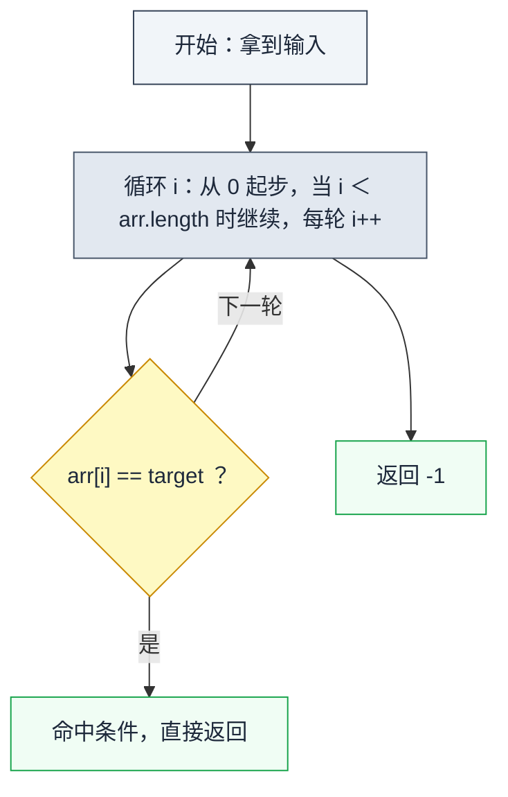

## TypeScript 解题方案（12 个方案逐个讲）

> **运行与提交**：每个方案都是自包含文件（内嵌用例自测，输出 PASS），整块复制到 `.ts` 文件后 `node 文件名` 即可运行。提交 LeetCode 时，把 `demo` 内的算法函数与辅助类型/函数整体取出、置于文件顶层即可。概念演示（非 LeetCode 编号题），在本地运行即可。

### 方案 1：单趟扫描

**分析与思路**：核心做法是「单趟扫描」。代码里依次做这些事：单循环线性扫描。

**运行方式**：`node 本文件`，内嵌用例全部通过会输出 PASS。


**方案专属流程图**（真实控制流）：

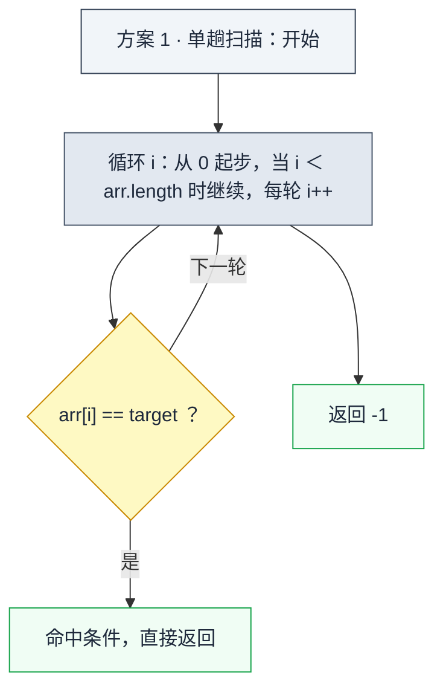

```typescript
export function demo(): void {
  // 程序入口：跑内嵌自测用例
  // 顺序查找：最坏时间复杂度 O(n)
  function linearSearch(arr: number[], target: number): number {
    // 定义函数/方法 linearSearch
    for (let i = 0; i < arr.length; i++) {
      // 让 下标 i 从 0 开始计数，下标 i 小于 数组.长度 就继续
      if (arr[i] === target) return i; // 若 数组[下标 i] 全等于 目标值，直接返回 下标 i
    }
    return -1; // 返回 减 1
  }

  const cases: { arr: number[]; target: number; want: number }[] = [
    { arr: [3, 1, 4, 1, 5, 9, 2, 6], target: 5, want: 4 },
    { arr: [3, 1, 4, 1, 5, 9, 2, 6], target: 7, want: -1 },
    { arr: [], target: 1, want: -1 },
    { arr: [9], target: 9, want: 0 },
    { arr: [9], target: 8, want: -1 },
  ];
  let fail = false; // 把 false 存入 fail
  for (const c of cases) {
    // for (const 字符 of cases) {
    const got = linearSearch(c.arr, c.target); // 把 linearSearch(字符.数组, 字符.目标值) 存入 got
    if (got !== c.want) {
      // 若 got 不等于 字符.want
      fail = true; // 把 true 存入 fail
      console.log(
        'FAIL linearSearch(%o,%d)=%d want %d',
        c.arr,
        c.target,
        got,
        c.want,
      ); // 打印输出
    }
  }
  if (fail) throw new Error('FAILED'); // 若 fail) throw new Error(「FAILED」);
  console.log('PASS'); // 全部用例通过，输出 PASS
}
demo(); // demo();
```

### 方案 2：二分查找

**分析与思路**：核心做法是「二分查找」。代码里依次做这些事：二分收缩区间。

**运行方式**：`node 本文件`，内嵌用例全部通过会输出 PASS。

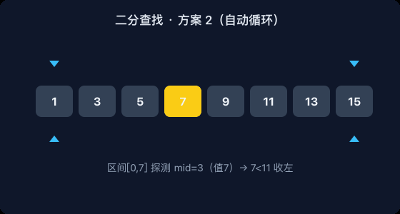

**方案专属流程图**（真实控制流）：

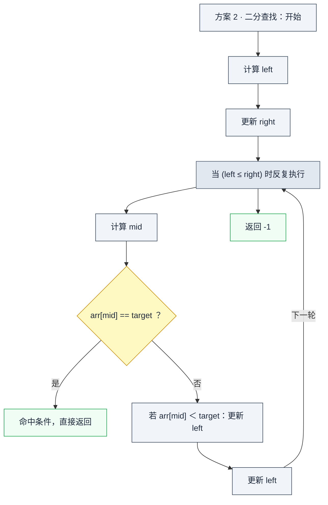

```typescript
export function demo(): void {
  // 程序入口：跑内嵌自测用例
  // 二分查找：要求有序数组，时间复杂度 O(log n)
  function binarySearch(arr: number[], target: number): number {
    // 定义函数/方法 binarySearch
    let left = 0,
      right = arr.length - 1; // 把 0, 右边界 赋值为 数组.长度 减 1 存入 左边界
    while (left <= right) {
      // 循环，直到不满足「左边界 不超过 右边界」
      const mid = Math.floor((left + right) / 2); // 把 向下取整((左边界 加 右边界) 除以 2) 存入 中点
      if (arr[mid] === target) return mid; // 若 数组[中点] 全等于 目标值，直接返回 中点
      if (arr[mid] < target)
        left = mid + 1; // 若 数组[中点] 小于 目标值) 左边界 赋值为 中点 加 1;
      else right = mid - 1; // 否则
    }
    return -1; // 返回 减 1
  }

  const cases: { arr: number[]; target: number; want: number }[] = [
    { arr: [1, 3, 5, 7, 9], target: 5, want: 2 },
    { arr: [1, 3, 5, 7, 9], target: 4, want: -1 },
    { arr: [1, 3, 5, 7, 9], target: 1, want: 0 },
    { arr: [1, 3, 5, 7, 9], target: 9, want: 4 },
    { arr: [], target: 1, want: -1 },
    { arr: [2], target: 2, want: 0 },
    { arr: [2], target: 3, want: -1 },
  ];
  let fail = false; // 把 false 存入 fail
  for (const c of cases) {
    // for (const 字符 of cases) {
    const got = binarySearch(c.arr, c.target); // 把 binarySearch(字符.数组, 字符.目标值) 存入 got
    if (got !== c.want) {
      // 若 got 不等于 字符.want
      fail = true; // 把 true 存入 fail
      console.log(
        'FAIL binarySearch(%o,%d)=%d want %d',
        c.arr,
        c.target,
        got,
        c.want,
      ); // 打印输出
    }
  }
  if (fail) throw new Error('FAILED'); // 若 fail) throw new Error(「FAILED」);
  console.log('PASS'); // 全部用例通过，输出 PASS
}
demo(); // demo();
```

### 方案 3：双重循环枚举

**分析与思路**：核心做法是「双重循环枚举」。代码里依次做这些事：双重循环遍历。

**运行方式**：`node 本文件`，内嵌用例全部通过会输出 PASS。


**方案专属流程图**（真实控制流）：

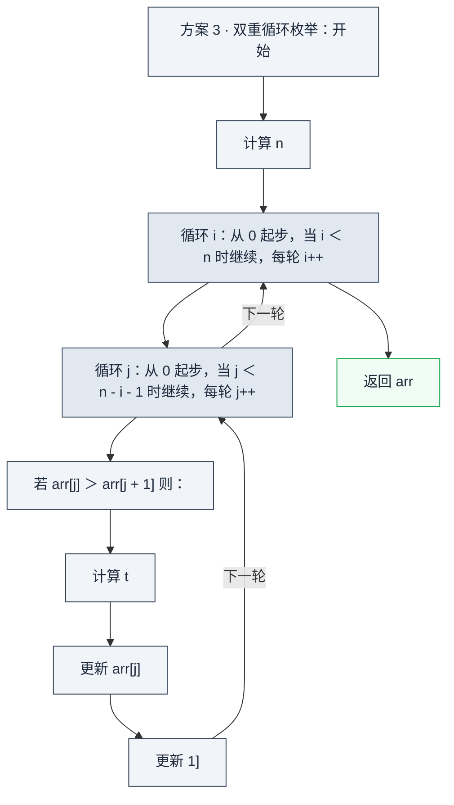

```typescript
export function demo(): void {
  // 程序入口：跑内嵌自测用例
  // 冒泡排序：最坏/平均时间复杂度 O(n^2)
  function bubbleSort(arr: number[]): number[] {
    // 定义函数/方法 bubbleSort
    const n = arr.length; // 把 数组.长度 存入 元素个数
    for (let i = 0; i < n; i++) {
      // 让 下标 i 从 0 开始计数，下标 i 小于 元素个数 就继续
      for (let j = 0; j < n - i - 1; j++) {
        // 让 下标 j 从 0 开始计数，下标 j 小于 元素个数 减 下标 i 减 1 就继续
        if (arr[j] > arr[j + 1]) {
          // 若 数组[下标 j] 超过 数组[下标 j 加 1]
          const t = arr[j];
          arr[j] = arr[j + 1];
          arr[j + 1] = t;
        }
      }
    }
    return arr; // 返回 数组
  }

  function eqArr(a: number[], b: number[]): boolean {
    // 定义函数/方法 eqArr
    if (a.length !== b.length) return false; // 若 数组.长度 不等于 b.长度，直接返回 false
    for (let i = 0; i < a.length; i++) if (a[i] !== b[i]) return false; // 让 下标 i 从 0 开始计数，下标 i 小于 数组.长度 就继续
    return true; // 返回 true
  }

  const cases: { in: number[]; want: number[] }[] = [
    { in: [3, 1, 4, 1, 5, 9, 2, 6], want: [1, 1, 2, 3, 4, 5, 6, 9] },
    { in: [], want: [] },
    { in: [1], want: [1] },
    { in: [5, 4, 3, 2, 1], want: [1, 2, 3, 4, 5] },
  ];
  let fail = false; // 把 false 存入 fail
  for (const c of cases) {
    // for (const 字符 of cases) {
    const got = bubbleSort(c.in.slice()); // 把 bubbleSort(字符.in 截取 )) 存入 got
    if (!eqArr(got, c.want)) {
      // 若 取反 eqArr(got, 字符.want
      fail = true; // 把 true 存入 fail
      console.log('FAIL bubbleSort(%o)=%o want %o', c.in, got, c.want); // 打印输出
    }
  }
  if (fail) throw new Error('FAILED'); // 若 fail) throw new Error(「FAILED」);
  console.log('PASS'); // 全部用例通过，输出 PASS
}
demo(); // demo();
```

### 方案 4：单趟扫描

**分析与思路**：核心做法是「单趟扫描」。代码里依次做这些事：单循环线性扫描。

**运行方式**：`node 本文件`，内嵌用例全部通过会输出 PASS。


**方案专属流程图**（真实控制流）：

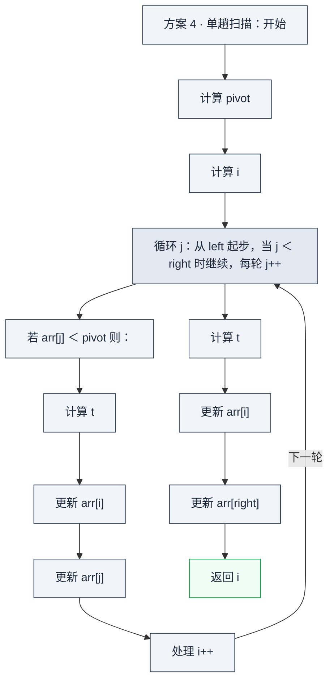

```typescript
export function demo(): void {
  // 程序入口：跑内嵌自测用例
  function partition(arr: number[], left: number, right: number): number {
    // 定义函数/方法 partition
    const pivot = arr[right]; // 把 数组[右边界] 存入 pivot
    let i = left; // 把 左边界 存入 下标 i
    for (let j = left; j < right; j++) {
      // 让 下标 j 从 左边界 开始计数，下标 j 小于 右边界 就继续
      if (arr[j] < pivot) {
        // 若 数组[下标 j] 小于 pivot
        const t = arr[i];
        arr[i] = arr[j];
        arr[j] = t;
        i++; // 下标 i 加一
      }
    }
    const t = arr[i];
    arr[i] = arr[right];
    arr[right] = t; // 把 数组[下标 i]; 数组[下标 i] 赋值为 数组[右边界]; 数组[右边界] 赋值为 另一字符串 存入 另一字符串
    return i; // 返回 下标 i
  }

  // 快速排序：平均时间复杂度 O(n log n)
  function quickSort(
    arr: number[],
    left = 0,
    right: number | null = null,
  ): number[] {
    // 定义函数/方法 quickSort
    const r = right === null ? arr.length - 1 : right; // 把 右边界 全等于 null ? 数组.长度 减 1 : 右边界 存入 右指针
    if (left < r) {
      // 若 左边界 小于 右指针
      const pivotIndex = partition(arr, left, r); // 把 partition(数组, 左边界, 右指针) 存入 pivotIndex
      quickSort(arr, left, pivotIndex - 1); // quickSort(数组, 左边界, pivotIndex 减 1);
      quickSort(arr, pivotIndex + 1, r); // quickSort(数组, pivotIndex 加 1, 右指针);
    }
    return arr; // 返回 数组
  }

  function eqArr(a: number[], b: number[]): boolean {
    // 定义函数/方法 eqArr
    if (a.length !== b.length) return false; // 若 数组.长度 不等于 b.长度，直接返回 false
    for (let i = 0; i < a.length; i++) if (a[i] !== b[i]) return false; // 让 下标 i 从 0 开始计数，下标 i 小于 数组.长度 就继续
    return true; // 返回 true
  }

  const cases: { in: number[]; want: number[] }[] = [
    { in: [3, 1, 4, 1, 5, 9, 2, 6], want: [1, 1, 2, 3, 4, 5, 6, 9] },
    { in: [], want: [] },
    { in: [1], want: [1] },
    { in: [5, 4, 3, 2, 1], want: [1, 2, 3, 4, 5] },
  ];
  let fail = false; // 把 false 存入 fail
  for (const c of cases) {
    // for (const 字符 of cases) {
    const got = quickSort(c.in.slice()); // 把 quickSort(字符.in 截取 )) 存入 got
    if (!eqArr(got, c.want)) {
      // 若 取反 eqArr(got, 字符.want
      fail = true; // 把 true 存入 fail
      console.log('FAIL quickSort(%o)=%o want %o', c.in, got, c.want); // 打印输出
    }
  }
  if (fail) throw new Error('FAILED'); // 若 fail) throw new Error(「FAILED」);
  console.log('PASS'); // 全部用例通过，输出 PASS
}
demo(); // demo();
```

### 方案 5：双重循环枚举

**分析与思路**：核心做法是「双重循环枚举」。代码里依次做这些事：双重循环遍历。

**运行方式**：`node 本文件`，内嵌用例全部通过会输出 PASS。


**方案专属流程图**（真实控制流）：

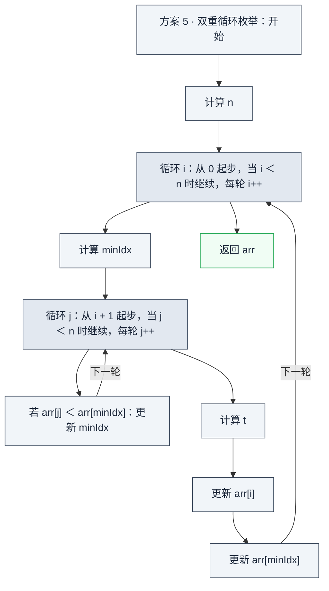

```typescript
export function demo(): void {
  // 程序入口：跑内嵌自测用例
  // 选择排序：时间复杂度 O(n^2)
  function selectionSort(arr: number[]): number[] {
    // 定义函数/方法 selectionSort
    const n = arr.length; // 把 数组.长度 存入 元素个数
    for (let i = 0; i < n; i++) {
      // 让 下标 i 从 0 开始计数，下标 i 小于 元素个数 就继续
      let minIdx = i; // 把 下标 i 存入 minIdx
      for (let j = i + 1; j < n; j++) {
        // 让 下标 j 从 下标 i 加 1 开始计数，下标 j 小于 元素个数 就继续
        if (arr[j] < arr[minIdx]) minIdx = j; // 若 数组[下标 j] 小于 数组[minIdx]) minIdx 赋值为 下标 j;
      }
      const t = arr[i];
      arr[i] = arr[minIdx];
      arr[minIdx] = t;
    }
    return arr; // 返回 数组
  }

  function eqArr(a: number[], b: number[]): boolean {
    // 定义函数/方法 eqArr
    if (a.length !== b.length) return false; // 若 数组.长度 不等于 b.长度，直接返回 false
    for (let i = 0; i < a.length; i++) if (a[i] !== b[i]) return false; // 让 下标 i 从 0 开始计数，下标 i 小于 数组.长度 就继续
    return true; // 返回 true
  }

  const cases: { in: number[]; want: number[] }[] = [
    { in: [3, 1, 4, 1, 5, 9, 2, 6], want: [1, 1, 2, 3, 4, 5, 6, 9] },
    { in: [], want: [] },
    { in: [1], want: [1] },
    { in: [5, 4, 3, 2, 1], want: [1, 2, 3, 4, 5] },
  ];
  let fail = false; // 把 false 存入 fail
  for (const c of cases) {
    // for (const 字符 of cases) {
    const got = selectionSort(c.in.slice()); // 把 selectionSort(字符.in 截取 )) 存入 got
    if (!eqArr(got, c.want)) {
      // 若 取反 eqArr(got, 字符.want
      fail = true; // 把 true 存入 fail
      console.log('FAIL selectionSort(%o)=%o want %o', c.in, got, c.want); // 打印输出
    }
  }
  if (fail) throw new Error('FAILED'); // 若 fail) throw new Error(「FAILED」);
  console.log('PASS'); // 全部用例通过，输出 PASS
}
demo(); // demo();
```

### 方案 6：单趟扫描

**分析与思路**：核心做法是「单趟扫描」。代码里依次做这些事：单循环线性扫描。

**运行方式**：`node 本文件`，内嵌用例全部通过会输出 PASS。


**方案专属流程图**（真实控制流）：

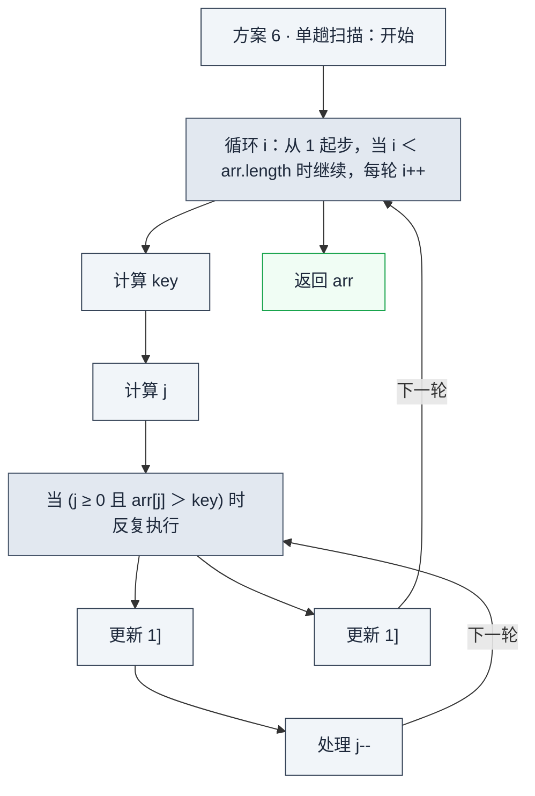

```typescript
export function demo(): void {
  // 程序入口：跑内嵌自测用例
  // 插入排序：最坏时间复杂度 O(n^2)，最好 O(n)
  function insertionSort(arr: number[]): number[] {
    // 定义函数/方法 insertionSort
    for (let i = 1; i < arr.length; i++) {
      // 让 下标 i 从 1 开始计数，下标 i 小于 数组.长度 就继续
      const key = arr[i]; // 把 数组[下标 i] 存入 key
      let j = i - 1; // 把 下标 i 减 1 存入 下标 j
      while (j >= 0 && arr[j] > key) {
        // 循环，直到不满足「下标 j 不低于 0 且 数组[下标 j] 超过 key」
        arr[j + 1] = arr[j]; // 把 数组[下标 j]; 写入 arr[j + 1]
        j--; // 下标 j 减一
      }
      arr[j + 1] = key; // 把 key; 写入 arr[j + 1]
    }
    return arr; // 返回 数组
  }

  function eqArr(a: number[], b: number[]): boolean {
    // 定义函数/方法 eqArr
    if (a.length !== b.length) return false; // 若 数组.长度 不等于 b.长度，直接返回 false
    for (let i = 0; i < a.length; i++) if (a[i] !== b[i]) return false; // 让 下标 i 从 0 开始计数，下标 i 小于 数组.长度 就继续
    return true; // 返回 true
  }

  const cases: { in: number[]; want: number[] }[] = [
    { in: [3, 1, 4, 1, 5, 9, 2, 6], want: [1, 1, 2, 3, 4, 5, 6, 9] },
    { in: [], want: [] },
    { in: [1], want: [1] },
    { in: [5, 4, 3, 2, 1], want: [1, 2, 3, 4, 5] },
  ];
  let fail = false; // 把 false 存入 fail
  for (const c of cases) {
    // for (const 字符 of cases) {
    const got = insertionSort(c.in.slice()); // 把 insertionSort(字符.in 截取 )) 存入 got
    if (!eqArr(got, c.want)) {
      // 若 取反 eqArr(got, 字符.want
      fail = true; // 把 true 存入 fail
      console.log('FAIL insertionSort(%o)=%o want %o', c.in, got, c.want); // 打印输出
    }
  }
  if (fail) throw new Error('FAILED'); // 若 fail) throw new Error(「FAILED」);
  console.log('PASS'); // 全部用例通过，输出 PASS
}
demo(); // demo();
```

### 方案 7：双指针收缩

**分析与思路**：核心做法是「双指针收缩」。

**运行方式**：`node 本文件`，内嵌用例全部通过会输出 PASS。

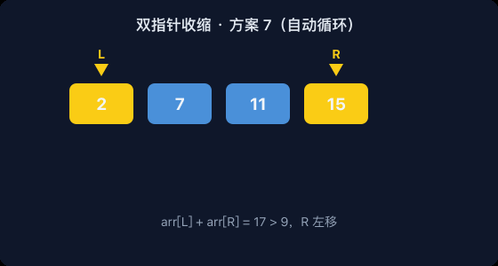

**方案专属流程图**（真实控制流）：

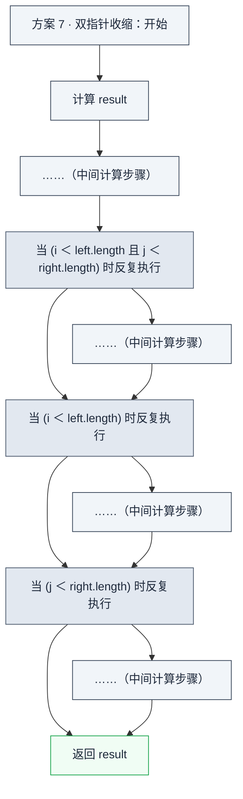

```typescript
export function demo(): void {
  // 程序入口：跑内嵌自测用例
  function merge(left: number[], right: number[]): number[] {
    // 定义函数/方法 merge
    const result: number[] = []; // 把 []; 写入 const result: number[]
    let i = 0,
      j = 0; // 把 0, 下标 j 赋值为 0 存入 下标 i
    while (i < left.length && j < right.length) {
      // 循环，直到不满足「下标 i 小于 左边界.长度 且 下标 j 小于 右边界.长度」
      if (left[i] <= right[j]) {
        // 若 左边界[下标 i] 不超过 右边界[下标 j]
        result.push(left[i]);
        i++; // 把 左边界[下标 i] 压入栈/数组尾部
      } else {
        // 否则
        result.push(right[j]);
        j++; // 把 右边界[下标 j] 压入栈/数组尾部
      }
    }
    while (i < left.length) {
      result.push(left[i]);
      i++;
    } // 循环，直到不满足「下标 i 小于 左边界.长度) { 结果 追加 左边界[下标 i]); 下标 i 加一 ; }」
    while (j < right.length) {
      result.push(right[j]);
      j++;
    } // 循环，直到不满足「下标 j 小于 右边界.长度) { 结果 追加 右边界[下标 j]); 下标 j 加一 ; }」
    return result; // 返回 结果
  }

  // 归并排序：时间复杂度 O(n log n)，空间复杂度 O(n)
  function mergeSort(arr: number[]): number[] {
    // 定义函数/方法 mergeSort
    if (arr.length <= 1) return arr; // 若 数组.长度 不超过 1，直接返回 数组
    const mid = Math.floor(arr.length / 2); // 把 向下取整(数组.长度 除以 2) 存入 中点
    const left = mergeSort(arr.slice(0, mid)); // 把 mergeSort(数组 截取 0, 中点)) 存入 左边界
    const right = mergeSort(arr.slice(mid)); // 把 mergeSort(数组 截取 中点)) 存入 右边界
    return merge(left, right); // 返回 merge(左边界, 右边界)
  }

  function eqArr(a: number[], b: number[]): boolean {
    // 定义函数/方法 eqArr
    if (a.length !== b.length) return false; // 若 数组.长度 不等于 b.长度，直接返回 false
    for (let i = 0; i < a.length; i++) if (a[i] !== b[i]) return false; // 让 下标 i 从 0 开始计数，下标 i 小于 数组.长度 就继续
    return true; // 返回 true
  }

  const cases: { in: number[]; want: number[] }[] = [
    { in: [3, 1, 4, 1, 5, 9, 2, 6], want: [1, 1, 2, 3, 4, 5, 6, 9] },
    { in: [], want: [] },
    { in: [1], want: [1] },
    { in: [5, 4, 3, 2, 1], want: [1, 2, 3, 4, 5] },
  ];
  let fail = false; // 把 false 存入 fail
  for (const c of cases) {
    // for (const 字符 of cases) {
    const got = mergeSort(c.in.slice()); // 把 mergeSort(字符.in 截取 )) 存入 got
    if (!eqArr(got, c.want)) {
      // 若 取反 eqArr(got, 字符.want
      fail = true; // 把 true 存入 fail
      console.log('FAIL mergeSort(%o)=%o want %o', c.in, got, c.want); // 打印输出
    }
  }
  if (fail) throw new Error('FAILED'); // 若 fail) throw new Error(「FAILED」);
  console.log('PASS'); // 全部用例通过，输出 PASS
}
demo(); // demo();
```

### 方案 8：双重循环枚举

**分析与思路**：核心做法是「双重循环枚举」。代码里依次做这些事：双重循环遍历；队列或堆的调度。

**运行方式**：`node 本文件`，内嵌用例全部通过会输出 PASS。


**方案专属流程图**（真实控制流）：

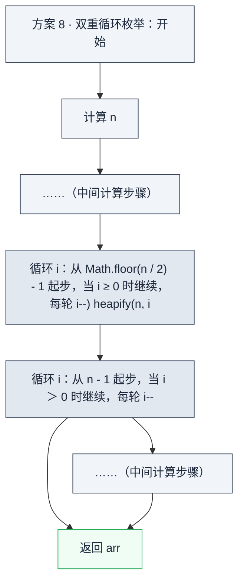

```typescript
export function demo(): void {
  // 程序入口：跑内嵌自测用例
  // 堆排序：时间复杂度 O(n log n)，原地排序
  function heapSort(arr: number[]): number[] {
    // 定义函数/方法 heapSort
    const n = arr.length; // 把 数组.长度 存入 元素个数

    function heapify(size: number, root: number): void {
      // 定义函数/方法 heapify
      let largest = root; // 把 根节点 存入 largest
      const left = 2 * root + 1; // 把 2 乘 根节点 加 1 存入 左边界
      const right = 2 * root + 2; // 把 2 乘 根节点 加 2 存入 右边界
      if (left < size && arr[left] > arr[largest]) largest = left; // 若 左边界 小于 大小 且 数组[左边界] 超过 数组[largest]) largest 赋值为 左边界;
      if (right < size && arr[right] > arr[largest]) largest = right; // 若 右边界 小于 大小 且 数组[右边界] 超过 数组[largest]) largest 赋值为 右边界;
      if (largest !== root) {
        // 若 largest 不等于 根节点
        const t = arr[root];
        arr[root] = arr[largest];
        arr[largest] = t;
        heapify(size, largest); // heapify(大小, largest);
      }
    }

    for (let i = Math.floor(n / 2) - 1; i >= 0; i--) heapify(n, i); // 让 下标 i 从 向下取整(元素个数 除以 2) 减 1 开始计数，下标 i 不低于 0 就继续
    for (let i = n - 1; i > 0; i--) {
      // 让 下标 i 从 元素个数 减 1 开始计数，下标 i 超过 0 就继续
      const t = arr[0];
      arr[0] = arr[i];
      arr[i] = t; // 把 数组[0]; 数组[0] 赋值为 数组[下标 i]; 数组[下标 i] 赋值为 另一字符串 存入 另一字符串
      heapify(i, 0); // heapify(下标 i, 0);
    }
    return arr; // 返回 数组
  }

  function eqArr(a: number[], b: number[]): boolean {
    // 定义函数/方法 eqArr
    if (a.length !== b.length) return false; // 若 数组.长度 不等于 b.长度，直接返回 false
    for (let i = 0; i < a.length; i++) if (a[i] !== b[i]) return false; // 让 下标 i 从 0 开始计数，下标 i 小于 数组.长度 就继续
    return true; // 返回 true
  }

  const cases: { in: number[]; want: number[] }[] = [
    { in: [3, 1, 4, 1, 5, 9, 2, 6], want: [1, 1, 2, 3, 4, 5, 6, 9] },
    { in: [], want: [] },
    { in: [1], want: [1] },
    { in: [5, 4, 3, 2, 1], want: [1, 2, 3, 4, 5] },
  ];
  let fail = false; // 把 false 存入 fail
  for (const c of cases) {
    // for (const 字符 of cases) {
    const got = heapSort(c.in.slice()); // 把 heapSort(字符.in 截取 )) 存入 got
    if (!eqArr(got, c.want)) {
      // 若 取反 eqArr(got, 字符.want
      fail = true; // 把 true 存入 fail
      console.log('FAIL heapSort(%o)=%o want %o', c.in, got, c.want); // 打印输出
    }
  }
  if (fail) throw new Error('FAILED'); // 若 fail) throw new Error(「FAILED」);
  console.log('PASS'); // 全部用例通过，输出 PASS
}
demo(); // demo();
```

### 方案 9：直接实现

**分析与思路**：核心做法是「直接实现」。

**运行方式**：`node 本文件`，内嵌用例全部通过会输出 PASS。

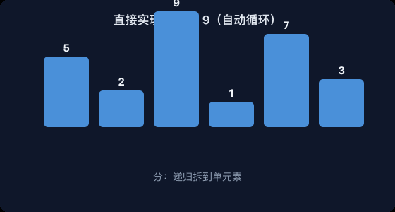

**方案专属流程图**（真实控制流）：

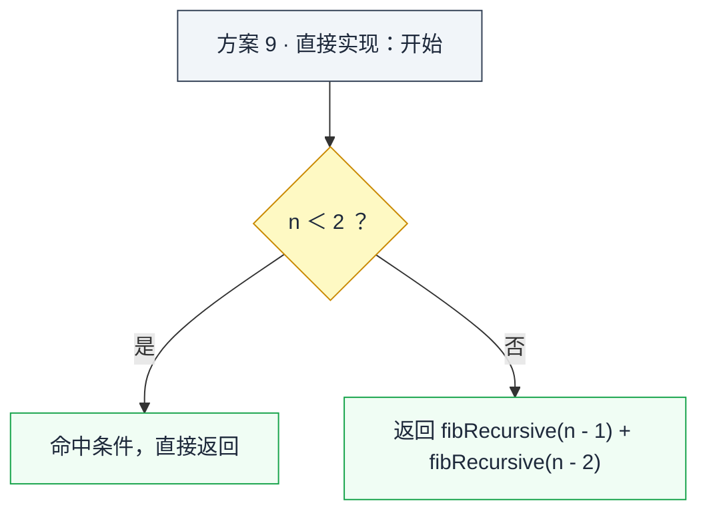

```typescript
export function demo(): void {
  // 程序入口：跑内嵌自测用例
  // 递归斐波那契：时间复杂度 O(2^n)，指数级
  function fibRecursive(n: number): number {
    // 定义函数/方法 fibRecursive
    if (n < 2) return n; // 若 元素个数 小于 2，直接返回 元素个数
    return fibRecursive(n - 1) + fibRecursive(n - 2); // 返回 fibRecursive(元素个数 减 1) 加 fibRecursive(元素个数 减 2)
  }

  // 迭代/动态规划斐波那契：时间复杂度 O(n)
  function fibIterative(n: number): number {
    // 定义函数/方法 fibIterative
    if (n < 2) return n; // 若 元素个数 小于 2，直接返回 元素个数
    let a = 0,
      b = 1; // 把 0, b 赋值为 1 存入 数组
    for (let i = 2; i <= n; i++) {
      // 让 下标 i 从 2 开始计数，下标 i 不超过 元素个数 就继续
      const t = a + b; // 把 数组 加 b 存入 另一字符串
      a = b; // 把 b 存入 数组
      b = t; // 把 另一字符串 存入 b
    }
    return b; // 返回 b
  }

  const cases: { n: number; want: number }[] = [
    { n: 0, want: 0 },
    { n: 1, want: 1 },
    { n: 2, want: 1 },
    { n: 10, want: 55 },
    { n: 15, want: 610 },
  ];
  let fail = false; // 把 false 存入 fail
  for (const c of cases) {
    // for (const 字符 of cases) {
    const g1 = fibRecursive(c.n); // 把 fibRecursive(字符.元素个数) 存入 g1
    const g2 = fibIterative(c.n); // 把 fibIterative(字符.元素个数) 存入 g2
    if (g1 !== c.want || g2 !== c.want) {
      // 若 g1 不等于 字符.want 或 g2 不等于 字符.want
      fail = true; // 把 true 存入 fail
      console.log(
        'FAIL fib(%d): recursive=%d iterative=%d want %d',
        c.n,
        g1,
        g2,
        c.want,
      ); // 打印输出
    }
  }
  if (fail) throw new Error('FAILED'); // 若 fail) throw new Error(「FAILED」);
  console.log('PASS'); // 全部用例通过，输出 PASS
}
demo(); // demo();
```

### 方案 10：双重循环枚举

**分析与思路**：核心做法是「双重循环枚举」。代码里依次做这些事：双重循环遍历。

**运行方式**：`node 本文件`，内嵌用例全部通过会输出 PASS。


**方案专属流程图**（真实控制流）：

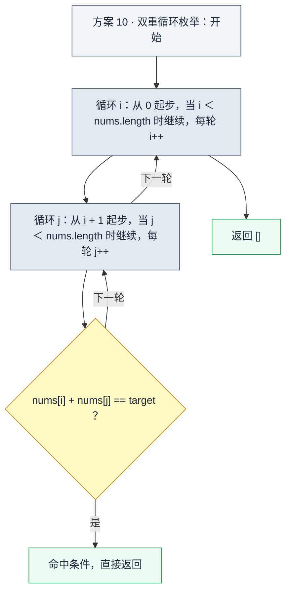

```typescript
export function demo(): void {
  // 程序入口：跑内嵌自测用例
  // 暴力解法：时间复杂度 O(n^2)
  function twoSumBrute(nums: number[], target: number): number[] {
    // 定义函数/方法 twoSumBrute
    for (let i = 0; i < nums.length; i++) {
      // 让 下标 i 从 0 开始计数，下标 i 小于 数组.长度 就继续
      for (let j = i + 1; j < nums.length; j++) {
        // 让 下标 j 从 下标 i 加 1 开始计数，下标 j 小于 数组.长度 就继续
        if (nums[i] + nums[j] === target) return [i, j]; // 若 数组[下标 i] 加 数组[下标 j] 全等于 目标值，直接返回 [下标 i, 下标 j]
      }
    }
    return []; // 返回 []
  }

  // 哈希表解法：时间复杂度 O(n)
  function twoSumHash(nums: number[], target: number): number[] {
    // 定义函数/方法 twoSumHash
    const seen = new Map<number, number>(); // 把 new Map 小于 number, number 超过 () 存入 已见集合
    for (let i = 0; i < nums.length; i++) {
      // 让 下标 i 从 0 开始计数，下标 i 小于 数组.长度 就继续
      const num = nums[i]; // 把 数组[下标 i] 存入 num
      if (seen.has(target - num)) {
        // 若 已见集合.has(目标值 减 num
        return [seen.get(target - num) as number, i]; // 返回 [已见集合 查找 目标值 减 num) as number, 下标 i]
      }
      seen.set(num, i); // 已见集合.set(num, 下标 i);
    }
    return []; // 返回 []
  }

  function eqArr(a: number[], b: number[]): boolean {
    // 定义函数/方法 eqArr
    if (a.length !== b.length) return false; // 若 数组.长度 不等于 b.长度，直接返回 false
    for (let i = 0; i < a.length; i++) if (a[i] !== b[i]) return false; // 让 下标 i 从 0 开始计数，下标 i 小于 数组.长度 就继续
    return true; // 返回 true
  }

  const cases: { nums: number[]; target: number; want: number[] }[] = [
    { nums: [2, 7, 11, 15], target: 9, want: [0, 1] },
    { nums: [3, 2, 4], target: 6, want: [1, 2] },
    { nums: [3, 3], target: 6, want: [0, 1] },
    { nums: [1, 2, 3], target: 7, want: [] },
  ];
  let fail = false; // 把 false 存入 fail
  for (const c of cases) {
    // for (const 字符 of cases) {
    const g1 = twoSumBrute(c.nums, c.target); // 把 twoSumBrute(字符.数组, 字符.目标值) 存入 g1
    const g2 = twoSumHash(c.nums, c.target); // 把 twoSumHash(字符.数组, 字符.目标值) 存入 g2
    if (!eqArr(g1, c.want) || !eqArr(g2, c.want)) {
      // 若 取反 eqArr(g1, 字符.want) 或 取反 eqArr(g2, 字符.want
      fail = true; // 把 true 存入 fail
      console.log(
        'FAIL twoSum(%o,%d): brute=%o hash=%o want %o',
        c.nums,
        c.target,
        g1,
        g2,
        c.want,
      ); // 打印输出
    }
  }
  if (fail) throw new Error('FAILED'); // 若 fail) throw new Error(「FAILED」);
  console.log('PASS'); // 全部用例通过，输出 PASS
}
demo(); // demo();
```

### 方案 11：双重循环枚举

**分析与思路**：核心做法是「双重循环枚举」。代码里依次做这些事：双重循环遍历。

**运行方式**：`node 本文件`，内嵌用例全部通过会输出 PASS。


**方案专属流程图**（真实控制流）：

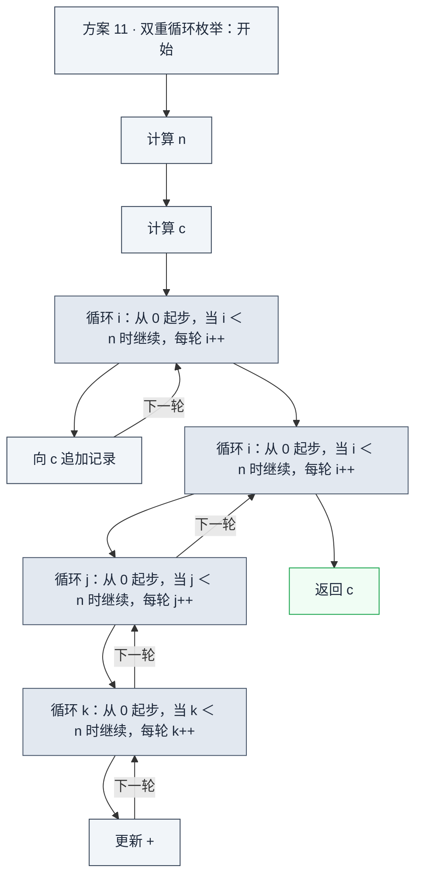

```typescript
export function demo(): void {
  // 程序入口：跑内嵌自测用例
  // 朴素矩阵乘法：时间复杂度 O(n^3)
  function matrixMultiply(a: number[][], b: number[][]): number[][] {
    // 定义函数/方法 matrixMultiply
    const n = a.length; // 把 数组.长度 存入 元素个数
    const c: number[][] = []; // 把 []; 写入 const c: number[][]
    for (let i = 0; i < n; i++) {
      // 让 下标 i 从 0 开始计数，下标 i 小于 元素个数 就继续
      c.push(new Array<number>(n).fill(0)); // 把 new Array 小于 number 超过 (元素个数 压入栈/数组尾部
    }
    for (let i = 0; i < n; i++) {
      // 让 下标 i 从 0 开始计数，下标 i 小于 元素个数 就继续
      for (let j = 0; j < n; j++) {
        // 让 下标 j 从 0 开始计数，下标 j 小于 元素个数 就继续
        for (let k = 0; k < n; k++) {
          // 让 下标 k 从 0 开始计数，下标 k 小于 元素个数 就继续
          c[i][j] += a[i][k] * b[k][j]; // c[i][j]累加 数组[下标 i][下标 k] 乘 b[下标 k][下标 j]
        }
      }
    }
    return c; // 返回 字符
  }

  function eqMat(a: number[][], b: number[][]): boolean {
    // 定义函数/方法 eqMat
    if (a.length !== b.length) return false; // 若 数组.长度 不等于 b.长度，直接返回 false
    for (let i = 0; i < a.length; i++) {
      // 让 下标 i 从 0 开始计数，下标 i 小于 数组.长度 就继续
      if (a[i].length !== b[i].length) return false; // 若 数组[下标 i].长度 不等于 b[下标 i].长度，直接返回 false
      for (let j = 0; j < a[i].length; j++)
        if (a[i][j] !== b[i][j]) return false; // 让 下标 j 从 0 开始计数，下标 j 小于 数组[下标 i].长度 就继续
    }
    return true; // 返回 true
  }

  const cases: { a: number[][]; b: number[][]; want: number[][] }[] = [
    {
      a: [
        [1, 2],
        [3, 4],
      ],
      b: [
        [5, 6],
        [7, 8],
      ],
      want: [
        [19, 22],
        [43, 50],
      ],
    },
    { a: [[2]], b: [[3]], want: [[6]] },
    {
      a: [
        [1, 0],
        [0, 1],
      ],
      b: [
        [5, 6],
        [7, 8],
      ],
      want: [
        [5, 6],
        [7, 8],
      ],
    },
    {
      a: [
        [0, 0],
        [0, 0],
      ],
      b: [
        [1, 2],
        [3, 4],
      ],
      want: [
        [0, 0],
        [0, 0],
      ],
    },
  ];
  let fail = false; // 把 false 存入 fail
  for (const c of cases) {
    // for (const 字符 of cases) {
    const got = matrixMultiply(c.a, c.b); // 把 matrixMultiply(字符.数组, 字符.b) 存入 got
    if (!eqMat(got, c.want)) {
      // 若 取反 eqMat(got, 字符.want
      fail = true; // 把 true 存入 fail
      console.log(
        'FAIL matrixMultiply(%o,%o)=%o want %o',
        c.a,
        c.b,
        got,
        c.want,
      ); // 打印输出
    }
  }
  if (fail) throw new Error('FAILED'); // 若 fail) throw new Error(「FAILED」);
  console.log('PASS'); // 全部用例通过，输出 PASS
}
demo(); // demo();
```

### 方案 12：直接实现

**分析与思路**：核心做法是「直接实现」。

**运行方式**：`node 本文件`，内嵌用例全部通过会输出 PASS。


**方案专属流程图**（真实控制流）：

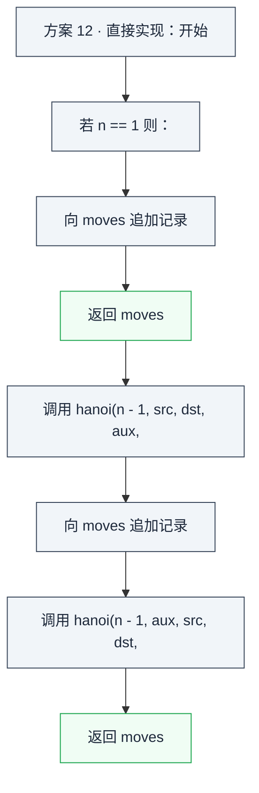

```typescript
export function demo(): void {
  // 程序入口：跑内嵌自测用例
  // 汉诺塔：递归解法，时间复杂度 O(2^n)
  function hanoi(
    n: number,
    src: string,
    aux: string,
    dst: string,
    moves: string[] = [],
  ): string[] {
    // 定义函数/方法 hanoi
    if (n === 1) {
      // 若 元素个数 全等于 1
      moves.push(src + '->' + dst); // 把 src 加 「 减 超过 」 加 dst 压入栈/数组尾部
      return moves; // 返回 moves
    }
    hanoi(n - 1, src, dst, aux, moves); // hanoi(元素个数 减 1, src, dst, aux, moves);
    moves.push(src + '->' + dst); // 把 src 加 「 减 超过 」 加 dst 压入栈/数组尾部
    hanoi(n - 1, aux, src, dst, moves); // hanoi(元素个数 减 1, aux, src, dst, moves);
    return moves; // 返回 moves
  }

  function eqArr(a: string[], b: string[]): boolean {
    // 定义函数/方法 eqArr
    if (a.length !== b.length) return false; // 若 数组.长度 不等于 b.长度，直接返回 false
    for (let i = 0; i < a.length; i++) if (a[i] !== b[i]) return false; // 让 下标 i 从 0 开始计数，下标 i 小于 数组.长度 就继续
    return true; // 返回 true
  }

  const cases: { n: number; want: string[] }[] = [
    {
      n: 3,
      want: ['A->C', 'A->B', 'C->B', 'A->C', 'B->A', 'B->C', 'A->C'],
    },
    { n: 1, want: ['A->C'] },
    { n: 2, want: ['A->B', 'A->C', 'B->C'] },
  ];
  let fail = false; // 把 false 存入 fail
  for (const c of cases) {
    // for (const 字符 of cases) {
    const got = hanoi(c.n, 'A', 'B', 'C'); // 把 hanoi(字符.元素个数, 「A」, 「A」, 「A」) 存入 got
    if (!eqArr(got, c.want)) {
      // 若 取反 eqArr(got, 字符.want
      fail = true; // 把 true 存入 fail
      console.log('FAIL hanoi(%d)=%o want %o', c.n, got, c.want); // 打印输出
    }
  }
  if (fail) throw new Error('FAILED'); // 若 fail) throw new Error(「FAILED」);
  console.log('PASS'); // 全部用例通过，输出 PASS
}
demo(); // demo();
```

## 逐步拆解与面试追问

**复杂度**：时间 O(n)（单趟线性扫描），空间 O(1) 到 O(n)（视辅助结构）

**为什么是这个量级**：每个元素被常数次访问，辅助哈希或栈的开销与 n 同阶

**面试官可能会追问**：

- 这个策略能推广到什么场景？
- 与暴力做法差在哪一步？
- 有没有更简单的等价写法？

## 关键 API 速查（TS 主解法实际用到，附官方链接）

本题主解法只用到基础语法（变量、循环、比较），不依赖特殊库 API。

### 各语言官方文档导航

- **TypeScript / JS**：[MDN 中文参考](https://developer.mozilla.org/zh-CN/)
- **Python**：[Python 官方文档](https://docs.python.org/zh-cn/3/)
- **Go**：[Go 标准库](https://pkg.go.dev/std)
- **Java**：[JDK 17 API](https://docs.oracle.com/en/java/javase/17/docs/api/)
- **Rust**：[Rust 标准库](https://doc.rust-lang.org/std/)
- **Lua**：[Lua 5.4 手册](https://www.lua.org/manual/5.4/)
- **C**：[Cppreference C](https://zh.cppreference.com/w/c)
- **C++**：[Cppreference C++](https://zh.cppreference.com/w/cpp)
- **R**：[R 官方手册](https://stat.ethz.ch/R-manual/)
- **Zig**：[Zig 语言文档](https://ziglang.org/documentation/master/)
- **Dart**：[Dart API](https://api.dart.dev/)

## 附录：其他 10 种语言全部实现（每种语言列举其全部方案）

> TypeScript 的全部方案见「TypeScript 解题方案」一节；下面是其余 10 种语言的对应实现，每种语言的每个方案都带思路分析、代码走读与专属运行架构图。
> 每个方案都内嵌用例自测，可独立运行（老仓库 python/go 文件遵循「打印结果」约定）。
> 完整解法文件见 `dsa/<语言>/notes/lc_93536806_数据结构与算法笔记_复杂度/`。

### Python 实现（12 种方案）

Python 的全部方案如下，每个方案都内嵌用例自测，可独立运行（老仓库 python/go 文件遵循「打印结果」约定）：

#### 方案 1：单趟扫描

**思路与代码分析**：核心是「单趟扫描」。Python 版用切片与字典推导式简化操作，突出可读性。**走读**：方案 1 · 单趟扫描：开始 → 循环 i：从 0 到 len(arr 前 → 命中条件，直接返回 → 返回 -1。

**运行架构**（真实控制流）：

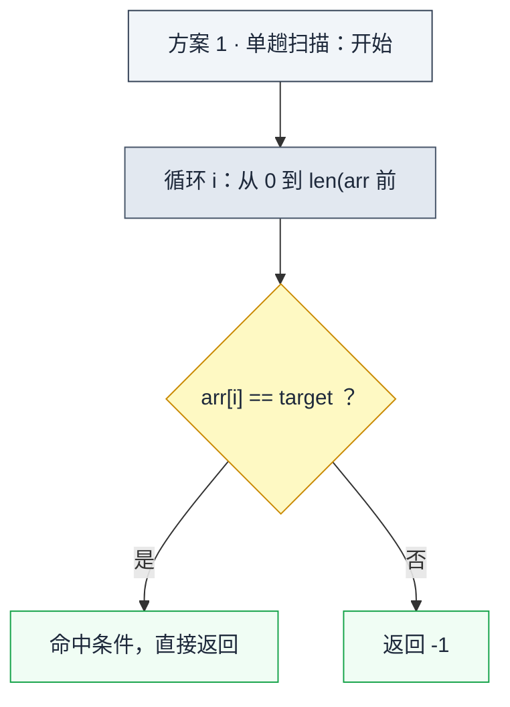

```python
import sys  # 提高递归深度上限（深输入防 RecursionError）

sys.setrecursionlimit(200000)  # 树/链表类题目节点数可达 1e4 量级

def linear_search(arr, target):  # 定义函数 linear_search（参数：数组, 目标值）
    # 顺序查找：最坏时间复杂度 O(n)
    for i in range(len(arr)):  # 让 下标 i 从 长度(数组 遍历
        if arr[i] == target:  # 若 数组[下标 i] 等于 目标值
            return i  # 返回 下标 i
    return -1  # 返回 减 1

if __name__ == "__main__":  # 若 __name__ 等于 '__main__'
    arr = [3, 1, 4, 1, 5, 9, 2, 6]  # 把 [3, 1, 4, 1, 5, 9, 2, 6] 存入 数组
    print(linear_search(arr, 5))  # 4
    print(linear_search(arr, 7))  # -1
```

#### 方案 2：二分查找

**思路与代码分析**：核心是「二分查找」。Python 版用切片与字典推导式简化操作，突出可读性。代码里依次做这些事：二分收缩区间。**走读**：方案 2 · 二分查找：开始 → 更新 right → 当 left ≤ right: 时反复执行 → 更新 mid → 命中条件，直接返回 → 处理 elif arr[mid] ＜ target: → 更新 left → 更新 right → 返回 -1。

**运行架构**（真实控制流）：

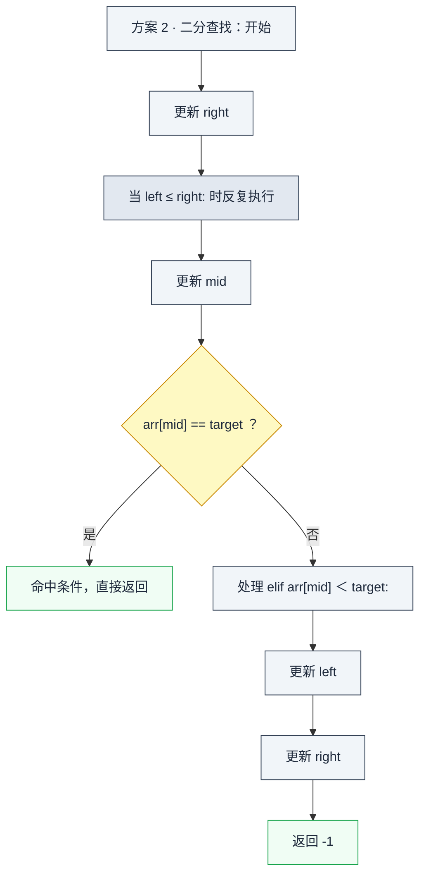

```python
import sys  # 提高递归深度上限（深输入防 RecursionError）

sys.setrecursionlimit(200000)  # 树/链表类题目节点数可达 1e4 量级

def binary_search(arr, target):  # 定义函数 binary_search（参数：数组, 目标值）
    # 二分查找：要求有序数组，时间复杂度 O(log n)
    left, right = 0, len(arr) - 1  # 把 0, 长度(数组) 减 1 写入 left, right
    while left <= right:  # 循环，直到不满足「左边界 不超过 右边界」
        mid = (left + right) // 2  # 把 (左边界 加 右边界) 除以 除以 2 存入 中点
        if arr[mid] == target:  # 若 数组[中点] 等于 目标值
            return mid  # 返回 中点
        elif arr[mid] < target:  # 否则，若 数组[中点] 小于 目标值
            left = mid + 1  # 把 中点 加 1 存入 左边界
        else:  # 否则
            right = mid - 1  # 把 中点 减 1 存入 右边界
    return -1  # 返回 减 1

if __name__ == "__main__":  # 若 __name__ 等于 '__main__'
    arr = [1, 3, 5, 7, 9]  # 把 [1, 3, 5, 7, 9] 存入 数组
    print(binary_search(arr, 5))  # 2
    print(binary_search(arr, 4))  # -1
```

#### 方案 3：双重循环枚举

**思路与代码分析**：核心是「双重循环枚举」。Python 版用切片与字典推导式简化操作，突出可读性。**走读**：方案 3 · 双重循环枚举：开始 → 更新 n → 循环 i：从 0 到 n 前 → 循环 j：从 0 到 n - i - 1 前 → 若 arr[j] ＞ arr[j + 1]：更新 1] → 更新 1] → 处理 arr[j + 1], → 处理 arr[j], → 处理 ) → 返回 arr。

**运行架构**（真实控制流）：

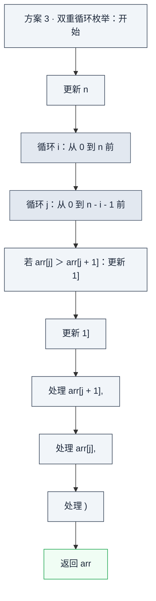

```python
import sys  # 提高递归深度上限（深输入防 RecursionError）

sys.setrecursionlimit(200000)  # 树/链表类题目节点数可达 1e4 量级

def bubble_sort(arr):  # 定义函数 bubble_sort（参数：数组）
    # 冒泡排序：最坏/平均时间复杂度 O(n^2)
    n = len(arr)  # 把 长度(数组) 存入 元素个数
    for i in range(n):  # 让 下标 i 从 元素个数 遍历
        for j in range(n - i - 1):  # 让 下标 j 从 元素个数 减 下标 i 减 1 遍历
            if arr[j] > arr[j + 1]:  # 若 数组[下标 j] 超过 数组[下标 j 加 1]
                arr[j], arr[j + 1] = (
                    arr[j + 1],
                    arr[j],
                )  # 把 数组[下标 j 加 1], 数组[下标 j] 写入 arr[j], arr[j + 1]
    return arr  # 返回 数组

if __name__ == "__main__":  # 若 __name__ 等于 '__main__'
    arr = [3, 1, 4, 1, 5, 9, 2, 6]  # 把 [3, 1, 4, 1, 5, 9, 2, 6] 存入 数组
    print(bubble_sort(arr[:]))  # [1, 1, 2, 3, 4, 5, 6, 9]
```

#### 方案 4：单趟扫描

**思路与代码分析**：核心是「单趟扫描」。Python 版用切片与字典推导式简化操作，突出可读性。**走读**：方案 4 · 单趟扫描：开始 → 更新 pivot → 更新 i → 循环 j：从 left 到 right 前 → 若 arr[j] ＜ pivot：更新 arr[j] → 更新 arr[j] → 更新 + → 更新 arr[right] → 返回 i。

**运行架构**（真实控制流）：

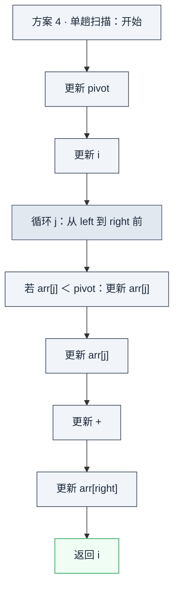

```python
import sys  # 提高递归深度上限（深输入防 RecursionError）

sys.setrecursionlimit(200000)  # 树/链表类题目节点数可达 1e4 量级

def partition(arr, left, right):  # 定义函数 partition（参数：数组, 左边界, 右边界）
    pivot = arr[right]  # 把 数组[右边界] 存入 pivot
    i = left  # 把 左边界 存入 下标 i
    for j in range(left, right):  # 让 下标 j 从 左边界 到 右边界 遍历
        if arr[j] < pivot:  # 若 数组[下标 j] 小于 pivot
            arr[i], arr[j] = arr[j], arr[i]  # 把 数组[下标 j], 数组[下标 i] 写入 arr[i], arr[j]
            i += 1  # 下标 i累加 1
    arr[i], arr[right] = arr[right], arr[i]  # 把 数组[右边界], 数组[下标 i] 写入 arr[i], arr[right]
    return i  # 返回 下标 i

def quick_sort(
    arr, left=0, right=None
):  # 定义函数 quick_sort（参数：数组, 左边界 赋值为 0, 右边界 赋值为 None）
    # 快速排序：平均时间复杂度 O(n log n)
    if right is None:  # 若 右边界 is None
        right = len(arr) - 1  # 把 长度(数组) 减 1 存入 右边界
    if left < right:  # 若 左边界 小于 右边界
        pivot_index = partition(arr, left, right)  # 把 partition(数组, 左边界, 右边界) 存入 pivot_index
        quick_sort(arr, left, pivot_index - 1)  # quick_sort(数组, 左边界, pivot_index 减 1)
        quick_sort(arr, pivot_index + 1, right)  # quick_sort(数组, pivot_index 加 1, 右边界)
    return arr  # 返回 数组

if __name__ == "__main__":  # 若 __name__ 等于 '__main__'
    arr = [3, 1, 4, 1, 5, 9, 2, 6]  # 把 [3, 1, 4, 1, 5, 9, 2, 6] 存入 数组
    print(quick_sort(arr[:]))  # [1, 1, 2, 3, 4, 5, 6, 9]
```

#### 方案 5：双重循环枚举

**思路与代码分析**：核心是「双重循环枚举」。Python 版用切片与字典推导式简化操作，突出可读性。**走读**：方案 5 · 双重循环枚举：开始 → 更新 n → 循环 i：从 0 到 n 前 → 更新 min_idx → 循环 j：从 i + 1 到 n 前 → 若 arr[j] ＜ arr[min_idx]：更新 min_idx → 更新 min_idx → 更新 arr[min_idx] → 处理 arr[min_idx], → 处理 arr[i], → 处理 ) → 返回 arr。

**运行架构**（真实控制流）：

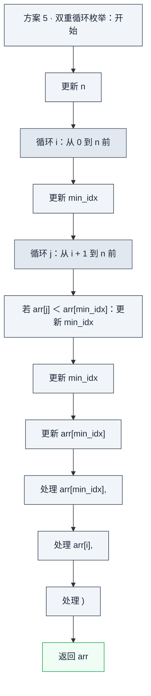

```python
import sys  # 提高递归深度上限（深输入防 RecursionError）

sys.setrecursionlimit(200000)  # 树/链表类题目节点数可达 1e4 量级

def selection_sort(arr):  # 定义函数 selection_sort（参数：数组）
    # 选择排序：时间复杂度 O(n^2)
    n = len(arr)  # 把 长度(数组) 存入 元素个数
    for i in range(n):  # 让 下标 i 从 元素个数 遍历
        min_idx = i  # 把 下标 i 存入 min_idx
        for j in range(i + 1, n):  # 让 下标 j 从 下标 i 加 1 到 元素个数 遍历
            if arr[j] < arr[min_idx]:  # 若 数组[下标 j] 小于 数组[min_idx]
                min_idx = j  # 把 下标 j 存入 min_idx
        arr[i], arr[min_idx] = (
            arr[min_idx],
            arr[i],
        )  # 把 数组[min_idx], 数组[下标 i] 写入 arr[i], arr[min_idx]
    return arr  # 返回 数组

if __name__ == "__main__":  # 若 __name__ 等于 '__main__'
    arr = [3, 1, 4, 1, 5, 9, 2, 6]  # 把 [3, 1, 4, 1, 5, 9, 2, 6] 存入 数组
    print(selection_sort(arr[:]))  # [1, 1, 2, 3, 4, 5, 6, 9]
```

#### 方案 6：单趟扫描

**思路与代码分析**：核心是「单趟扫描」。Python 版用切片与字典推导式简化操作，突出可读性。**走读**：方案 6 · 单趟扫描：开始 → 循环 i：从 1 到 len(arr 前 → 更新 key → 更新 j → 当 j ≥ 0 and arr[j] ＞ key: 时反复执行 → 更新 1] → 更新 - → 更新 1] → 返回 arr。

**运行架构**（真实控制流）：

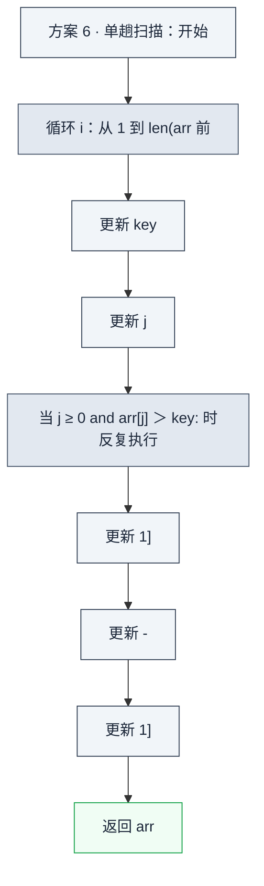

```python
import sys  # 提高递归深度上限（深输入防 RecursionError）

sys.setrecursionlimit(200000)  # 树/链表类题目节点数可达 1e4 量级

def insertion_sort(arr):  # 定义函数 insertion_sort（参数：数组）
    # 插入排序：最坏时间复杂度 O(n^2)，最好 O(n)
    for i in range(1, len(arr)):  # 让 下标 i 从 1 到 长度(数组 遍历
        key = arr[i]  # 把 数组[下标 i] 存入 key
        j = i - 1  # 把 下标 i 减 1 存入 下标 j
        while j >= 0 and arr[j] > key:  # 循环，直到不满足「下标 j 不低于 0 and 数组[下标 j] 超过 key」
            arr[j + 1] = arr[j]  # 把 数组[下标 j] 写入 arr[j + 1]
            j -= 1  # 下标 j累减 1
        arr[j + 1] = key  # 把 key 写入 arr[j + 1]
    return arr  # 返回 数组

if __name__ == "__main__":  # 若 __name__ 等于 '__main__'
    arr = [3, 1, 4, 1, 5, 9, 2, 6]  # 把 [3, 1, 4, 1, 5, 9, 2, 6] 存入 数组
    print(insertion_sort(arr[:]))  # [1, 1, 2, 3, 4, 5, 6, 9]
```

#### 方案 7：双指针收缩

**思路与代码分析**：核心是「双指针收缩」。Python 版用切片与字典推导式简化操作，突出可读性。**走读**：方案 7 · 双指针收缩：开始 → 命中条件，直接返回 → 更新 mid → 更新 left → 更新 right → 返回 merge(left, right)。

**运行架构**（真实控制流）：

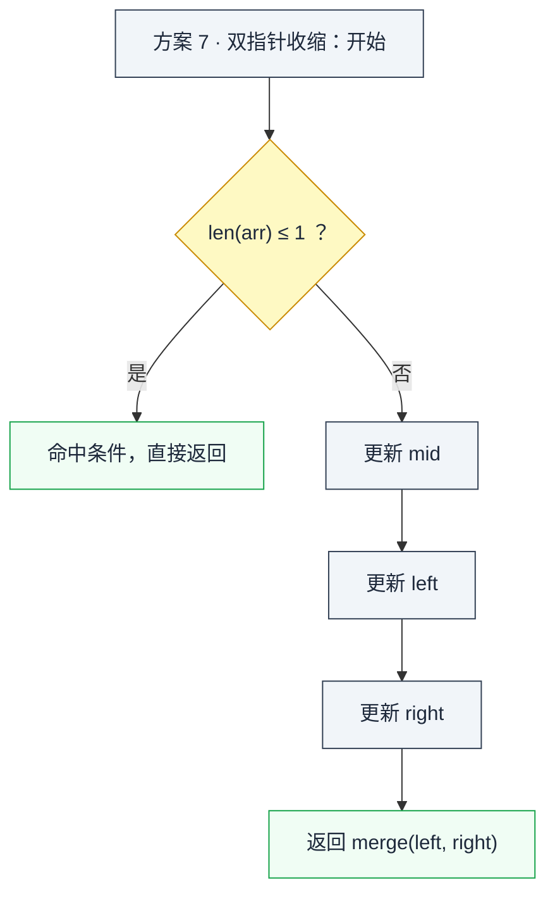

```python
import sys  # 提高递归深度上限（深输入防 RecursionError）

sys.setrecursionlimit(200000)  # 树/链表类题目节点数可达 1e4 量级

def merge_sort(arr):  # 定义函数 merge_sort（参数：数组）
    # 归并排序：时间复杂度 O(n log n)，空间复杂度 O(n)
    if len(arr) <= 1:  # 若 长度(数组) 不超过 1
        return arr  # 返回 数组
    mid = len(arr) // 2  # 把 长度(数组) 除以 除以 2 存入 中点
    left = merge_sort(arr[:mid])  # 把 merge_sort(数组[:中点]) 存入 左边界
    right = merge_sort(arr[mid:])  # 把 merge_sort(数组[中点:]) 存入 右边界
    return merge(left, right)  # 返回 merge(左边界, 右边界)

def merge(left, right):  # 定义函数 merge（参数：左边界, 右边界）
    result = []  # 把 [] 存入 结果
    i = j = 0  # 把 下标 j 赋值为 0 存入 下标 i
    while i < len(left) and j < len(
        right
    ):  # 循环，直到不满足「下标 i 小于 长度(左边界) and 下标 j 小于 长度(右边界」
        if left[i] <= right[j]:  # 若 左边界[下标 i] 不超过 右边界[下标 j]
            result.append(left[i])  # 把 左边界[下标 i] 追加到列表尾部
            i += 1  # 下标 i累加 1
        else:  # 否则
            result.append(right[j])  # 把 右边界[下标 j] 追加到列表尾部
            j += 1  # 下标 j累加 1
    result.extend(left[i:])  # 结果.extend(左边界[下标 i:])
    result.extend(right[j:])  # 结果.extend(右边界[下标 j:])
    return result  # 返回 结果

if __name__ == "__main__":  # 若 __name__ 等于 '__main__'
    arr = [3, 1, 4, 1, 5, 9, 2, 6]  # 把 [3, 1, 4, 1, 5, 9, 2, 6] 存入 数组
    print(merge_sort(arr))  # [1, 1, 2, 3, 4, 5, 6, 9]
```

#### 方案 8：双重循环枚举

**思路与代码分析**：核心是「双重循环枚举」。Python 版用切片与字典推导式简化操作，突出可读性。代码里依次做这些事：队列或堆的调度。**走读**：方案 8 · 双重循环枚举：开始 → 更新 n → 循环 i：从 n // 2 - 1 到 -1 前，步长 -1 → 循环 i：从 n - 1 到 -1 前，步长 0 → 返回 arr。

**运行架构**（真实控制流）：

```mermaid
graph TD
    N0["方案 8 · 双重循环枚举：开始"]
    N1["更新 n"]
    D1["……（中间计算步骤）"]
    N19["循环 i：从 n // 2 - 1 到 -1 前，步长 -1"]
    D2["……（中间计算步骤）"]
    N21["循环 i：从 n - 1 到 -1 前，步长 0"]
    D3["……（中间计算步骤）"]
    N24["返回 arr"]
    N0 --> N1
    N1 --> D1
    D1 --> N19
    N19 --> D2
    D2 --> N21
    N21 --> D3
    D3 --> N24
    classDef n fill:#f1f5f9,stroke:#334155,color:#1e293b;
    classDef lp fill:#e2e8f0,stroke:#475569,color:#1e293b;
    classDef dc fill:#fef9c3,stroke:#ca8a04,color:#1e293b;
    classDef tm fill:#f0fdf4,stroke:#16a34a,color:#1e293b;
    class N0,N1,D1,D2,D3 n;
    class N19,N21 lp;
    class N24 tm;
```

```python
import sys  # 提高递归深度上限（深输入防 RecursionError）

sys.setrecursionlimit(200000)  # 树/链表类题目节点数可达 1e4 量级

def heap_sort(arr):  # 定义函数 heap_sort（参数：数组）
    # 堆排序：时间复杂度 O(n log n)，原地排序
    n = len(arr)  # 把 长度(数组) 存入 元素个数

    def heapify(size, root):  # 定义函数 heapify（参数：大小, 根节点）
        largest = root  # 把 根节点 存入 largest
        left = 2 * root + 1  # 把 2 乘 根节点 加 1 存入 左边界
        right = 2 * root + 2  # 把 2 乘 根节点 加 2 存入 右边界
        if (
            left < size and arr[left] > arr[largest]
        ):  # 若 左边界 小于 大小 and 数组[左边界] 超过 数组[largest]
            largest = left  # 把 左边界 存入 largest
        if (
            right < size and arr[right] > arr[largest]
        ):  # 若 右边界 小于 大小 and 数组[右边界] 超过 数组[largest]
            largest = right  # 把 右边界 存入 largest
        if largest != root:  # 若 largest 不等于 根节点
            arr[root], arr[largest] = (
                arr[largest],
                arr[root],
            )  # 把 数组[largest], 数组[根节点] 写入 arr[root], arr[largest]
            heapify(size, largest)  # heapify(大小, largest)

    for i in range(n // 2 - 1, -1, -1):  # 让 下标 i 从 元素个数 除以 除以 2 减 1 倒数回去（每步减 1）
        heapify(n, i)  # heapify(元素个数, 下标 i)
    for i in range(n - 1, 0, -1):  # 让 下标 i 从 元素个数 减 1 倒数回去（每步减 1）
        arr[0], arr[i] = arr[i], arr[0]  # 把 数组[下标 i], 数组[0] 写入 arr[0], arr[i]
        heapify(i, 0)  # heapify(下标 i, 0)
    return arr  # 返回 数组

if __name__ == "__main__":  # 若 __name__ 等于 '__main__'
    arr = [3, 1, 4, 1, 5, 9, 2, 6]  # 把 [3, 1, 4, 1, 5, 9, 2, 6] 存入 数组
    print(heap_sort(arr[:]))  # [1, 1, 2, 3, 4, 5, 6, 9]
```

#### 方案 9：直接实现

**思路与代码分析**：核心是「直接实现」。Python 版用切片与字典推导式简化操作，突出可读性。**走读**：方案 9 · 直接实现：开始 → 命中条件，直接返回 → 返回 fib_recursive(n - 1) + fib_recursive( → 处理 n - 2 → 处理 )。

**运行架构**（真实控制流）：

```mermaid
graph TD
    N0["方案 9 · 直接实现：开始"]
    N1{"n ＜ 2 ？"}
    N2["命中条件，直接返回"]
    N3["返回 fib_recursive(n - 1) + fib_recursive("]
    N4["处理 n - 2"]
    N5["处理 )"]
    N0 --> N1
    N1 -- 是 --> N2
    N1 -- 否 --> N3
    N3 --> N4
    N4 --> N5
    classDef n fill:#f1f5f9,stroke:#334155,color:#1e293b;
    classDef lp fill:#e2e8f0,stroke:#475569,color:#1e293b;
    classDef dc fill:#fef9c3,stroke:#ca8a04,color:#1e293b;
    classDef tm fill:#f0fdf4,stroke:#16a34a,color:#1e293b;
    class N0,N4,N5 n;
    class N1 dc;
    class N2,N3 tm;
```

```python
import sys  # 提高递归深度上限（深输入防 RecursionError）

sys.setrecursionlimit(200000)  # 树/链表类题目节点数可达 1e4 量级

def fib_recursive(n):  # 定义函数 fib_recursive（参数：元素个数）
    # 递归斐波那契：时间复杂度 O(2^n)，指数级
    if n < 2:  # 若 元素个数 小于 2
        return n  # 返回 元素个数
    return fib_recursive(n - 1) + fib_recursive(
        n - 2
    )  # 返回 fib_recursive(元素个数 减 1) 加 fib_recursive(元素个数 减 2)

def fib_iterative(n):  # 定义函数 fib_iterative（参数：元素个数）
    # 迭代/动态规划斐波那契：时间复杂度 O(n)
    if n < 2:  # 若 元素个数 小于 2
        return n  # 返回 元素个数
    a, b = 0, 1  # 把 0, 1 写入 a, b
    for _ in range(2, n + 1):  # 让 _ 从 2 到 元素个数 加 1 遍历
        a, b = b, a + b  # 把 b, 数组 加 b 写入 a, b
    return b  # 返回 b

if __name__ == "__main__":  # 若 __name__ 等于 '__main__'
    print(fib_recursive(10))  # 55
    print(fib_iterative(10))  # 55
```

#### 方案 10：双重循环枚举

**思路与代码分析**：核心是「双重循环枚举」。Python 版用切片与字典推导式简化操作，突出可读性。**走读**：方案 10 · 双重循环枚举：开始 → 循环 i：从 0 到 len(nums 前 → 循环 j：从 i + 1 到 len(nums 前 → 命中条件，直接返回 → 返回 []。

**运行架构**（真实控制流）：

```mermaid
graph TD
    N0["方案 10 · 双重循环枚举：开始"]
    N1["循环 i：从 0 到 len(nums 前"]
    N2["循环 j：从 i + 1 到 len(nums 前"]
    N3{"nums[i] + nums[j] == target ？"}
    N4["命中条件，直接返回"]
    N5["返回 []"]
    N0 --> N1
    N1 --> N2
    N2 --> N3
    N3 -- 是 --> N4
    N3 -- 否 --> N5
    classDef n fill:#f1f5f9,stroke:#334155,color:#1e293b;
    classDef lp fill:#e2e8f0,stroke:#475569,color:#1e293b;
    classDef dc fill:#fef9c3,stroke:#ca8a04,color:#1e293b;
    classDef tm fill:#f0fdf4,stroke:#16a34a,color:#1e293b;
    class N0 n;
    class N1,N2 lp;
    class N3 dc;
    class N4,N5 tm;
```

```python
import sys  # 提高递归深度上限（深输入防 RecursionError）

sys.setrecursionlimit(200000)  # 树/链表类题目节点数可达 1e4 量级

def two_sum_brute(nums, target):  # 定义函数 two_sum_brute（参数：数组, 目标值）
    # 暴力解法：时间复杂度 O(n^2)
    for i in range(len(nums)):  # 让 下标 i 从 长度(数组 遍历
        for j in range(i + 1, len(nums)):  # 让 下标 j 从 下标 i 加 1 到 长度(数组 遍历
            if nums[i] + nums[j] == target:  # 若 数组[下标 i] 加 数组[下标 j] 等于 目标值
                return [i, j]  # 返回 [下标 i, 下标 j]
    return []  # 返回 []

def two_sum_hash(nums, target):  # 定义函数 two_sum_hash（参数：数组, 目标值）
    # 哈希表解法：时间复杂度 O(n)
    seen = {}  # 把 {} 存入 已见集合
    for i, num in enumerate(nums):  # 同时取 下标 i 与 num 遍历
        if target - num in seen:  # 若 目标值 减 num in 已见集合
            return [seen[target - num], i]  # 返回 [已见集合[目标值 减 num], 下标 i]
        seen[num] = i  # 把 下标 i 写入 seen[num]
    return []  # 返回 []

if __name__ == "__main__":  # 若 __name__ 等于 '__main__'
    nums = [2, 7, 11, 15]  # 把 [2, 7, 11, 15] 存入 数组
    target = 9  # 把 9 存入 目标值
    print(two_sum_brute(nums, target))  # [0, 1]
    print(two_sum_hash(nums, target))  # [0, 1]
```

#### 方案 11：双重循环枚举

**思路与代码分析**：核心是「双重循环枚举」。Python 版用切片与字典推导式简化操作，突出可读性。**走读**：方案 11 · 双重循环枚举：开始 → 更新 n → 更新 c → 循环 i：从 0 到 n 前 → 循环 j：从 0 到 n 前 → 循环 k：从 0 到 n 前 → 更新 + → 返回 c。

**运行架构**（真实控制流）：

```mermaid
graph TD
    N0["方案 11 · 双重循环枚举：开始"]
    N1["更新 n"]
    N2["更新 c"]
    N3["循环 i：从 0 到 n 前"]
    N4["循环 j：从 0 到 n 前"]
    N5["循环 k：从 0 到 n 前"]
    N6["更新 +"]
    N7["返回 c"]
    N0 --> N1
    N1 --> N2
    N2 --> N3
    N3 --> N4
    N4 --> N5
    N5 --> N6
    N6 --> N7
    classDef n fill:#f1f5f9,stroke:#334155,color:#1e293b;
    classDef lp fill:#e2e8f0,stroke:#475569,color:#1e293b;
    classDef dc fill:#fef9c3,stroke:#ca8a04,color:#1e293b;
    classDef tm fill:#f0fdf4,stroke:#16a34a,color:#1e293b;
    class N0,N1,N2,N6 n;
    class N3,N4,N5 lp;
    class N7 tm;
```

```python
import sys  # 提高递归深度上限（深输入防 RecursionError）

sys.setrecursionlimit(200000)  # 树/链表类题目节点数可达 1e4 量级

def matrix_multiply(a, b):  # 定义函数 matrix_multiply（参数：数组, b）
    # 朴素矩阵乘法：时间复杂度 O(n^3)
    n = len(a)  # 把 长度(数组) 存入 元素个数
    c = [[0] * n for _ in range(n)]  # 把 [[0] 乘 元素个数 for _ in range(元素个数)] 存入 字符
    for i in range(n):  # 让 下标 i 从 元素个数 遍历
        for j in range(n):  # 让 下标 j 从 元素个数 遍历
            for k in range(n):  # 让 下标 k 从 元素个数 遍历
                c[i][j] += a[i][k] * b[k][j]  # c[i][j]累加 数组[下标 i][下标 k] 乘 b[下标 k][下标 j]
    return c  # 返回 字符

if __name__ == "__main__":  # 若 __name__ 等于 '__main__'
    a = [[1, 2], [3, 4]]  # 把 [[1, 2], [3, 4]] 存入 数组
    b = [[5, 6], [7, 8]]  # 把 [[5, 6], [7, 8]] 存入 b
    print(matrix_multiply(a, b))  # [[19, 22], [43, 50]]
```

#### 方案 12：直接实现

**思路与代码分析**：核心是「直接实现」。Python 版用切片与字典推导式简化操作，突出可读性。**走读**：方案 12 · 直接实现：开始 → 若 moves is None：更新 moves → 更新 moves → 若 n == 1：向 moves 追加记录 → 向 moves 追加记录 → 返回 moves → 调用 hanoi(n - 1, src, dst, aux, → 向 moves 追加记录 → 调用 hanoi(n - 1, aux, src, dst, → 返回 moves。

**运行架构**（真实控制流）：

```mermaid
graph TD
    N0["方案 12 · 直接实现：开始"]
    N1["若 moves is None：更新 moves"]
    N2["更新 moves"]
    N3["若 n == 1：向 moves 追加记录"]
    N4["向 moves 追加记录"]
    N5["返回 moves"]
    N6["调用 hanoi(n - 1, src, dst, aux,"]
    N7["向 moves 追加记录"]
    N8["调用 hanoi(n - 1, aux, src, dst,"]
    N9["返回 moves"]
    N0 --> N1
    N1 --> N2
    N2 --> N3
    N3 --> N4
    N4 --> N5
    N5 --> N6
    N6 --> N7
    N7 --> N8
    N8 --> N9
    classDef n fill:#f1f5f9,stroke:#334155,color:#1e293b;
    classDef lp fill:#e2e8f0,stroke:#475569,color:#1e293b;
    classDef dc fill:#fef9c3,stroke:#ca8a04,color:#1e293b;
    classDef tm fill:#f0fdf4,stroke:#16a34a,color:#1e293b;
    class N0,N1,N2,N3,N4,N6,N7,N8 n;
    class N5,N9 tm;
```

```python
import sys  # 提高递归深度上限（深输入防 RecursionError）

sys.setrecursionlimit(200000)  # 树/链表类题目节点数可达 1e4 量级

def hanoi(n, src, aux, dst, moves=None):  # 定义函数 hanoi（参数：元素个数, src, aux, dst, moves 赋值为 None）
    # 汉诺塔：递归解法，时间复杂度 O(2^n)
    if moves is None:  # 若 moves is None
        moves = []  # 把 [] 存入 moves
    if n == 1:  # 若 元素个数 等于 1
        moves.append((src, dst))  # 把 (src, dst 追加到列表尾部
        return moves  # 返回 moves
    hanoi(n - 1, src, dst, aux, moves)  # hanoi(元素个数 减 1, src, dst, aux, moves)
    moves.append((src, dst))  # 把 (src, dst 追加到列表尾部
    hanoi(n - 1, aux, src, dst, moves)  # hanoi(元素个数 减 1, aux, src, dst, moves)
    return moves  # 返回 moves

if __name__ == "__main__":  # 若 __name__ 等于 '__main__'
    moves = hanoi(3, "A", "B", "C")  # 把 hanoi(3, 'A', 'B', 'C') 存入 moves
    print(len(moves), moves)  # 7 [(A,C),(A,B),...]
```

### Go 实现（12 种方案）

Go 的全部方案如下，每个方案都内嵌用例自测，可独立运行（老仓库 python/go 文件遵循「打印结果」约定）：

#### 方案 1：单趟扫描

**思路与代码分析**：核心是「单趟扫描」。Go 版用切片与多返回值惯用法，显式处理索引边界。**走读**：方案 1 · 单趟扫描：开始 → 遍历循环 → 处理 if arr[i] == target → 返回 i → 返回 -1。

**运行架构**（真实控制流）：

```mermaid
graph TD
    N0["方案 1 · 单趟扫描：开始"]
    N1["遍历循环"]
    N2["处理 if arr[i] == target"]
    N3["返回 i"]
    N4["返回 -1"]
    N0 --> N1
    N1 --> N2
    N2 --> N3
    N1 --> N4
    classDef n fill:#f1f5f9,stroke:#334155,color:#1e293b;
    classDef lp fill:#e2e8f0,stroke:#475569,color:#1e293b;
    classDef dc fill:#fef9c3,stroke:#ca8a04,color:#1e293b;
    classDef tm fill:#f0fdf4,stroke:#16a34a,color:#1e293b;
    class N0,N2 n;
    class N1 lp;
    class N3,N4 tm;
```

```go
package main // 引入依赖

import (
	"fmt" // 「fmt」
	"os"  // 「os」
)

func linearSearch(arr []int, target int) int { // 定义函数/方法 linearSearch
	for i := 0; i < len(arr); i++ { // 让 下标 i 从 0 开始计数
		if arr[i] == target { // 若 数组[下标 i] 等于 目标值
			return i // 返回 下标 i
		}
	}
	return -1 // 返回 减 1
}

func main() { // 程序入口：跑内嵌自测用例
	arr := []int{3, 1, 4, 1, 5, 9, 2, 6}   // 把 []int{3, 1, 4, 1, 5, 9, 2, 6} 写入 arr :
	ok := true                             // 把 true 写入 ok :
	if v := linearSearch(arr, 5); v != 4 { // 若 值 : 赋值为 linearSearch(数组, 5); 值 不等于 4
		ok = false                                        // 把 false 写入 ok
		fmt.Printf("FAIL linearSearch(5)=%d want 4\n", v) // 打印输出
	}
	if v := linearSearch(arr, 7); v != -1 { // 若 值 : 赋值为 linearSearch(数组, 7); 值 不等于 减 1
		ok = false                                         // 把 false 写入 ok
		fmt.Printf("FAIL linearSearch(7)=%d want -1\n", v) // 打印输出
	}
	if !ok { // 若 取反 ok
		os.Exit(1) // os.Exit(1)
	}
	fmt.Println("PASS") // 全部用例通过，输出 PASS
}
```

#### 方案 2：二分查找

**思路与代码分析**：核心是「二分查找」。Go 版用切片与多返回值惯用法，显式处理索引边界。**走读**：方案 2 · 二分查找：开始 → 更新 : → 遍历循环 → 更新 : → 处理 if arr[mid] == target → 返回 mid → 更新 left → 更新 right → 返回 -1。

**运行架构**（真实控制流）：

```mermaid
graph TD
    N0["方案 2 · 二分查找：开始"]
    N1["更新 :"]
    N2["遍历循环"]
    N3["更新 :"]
    N4["处理 if arr[mid] == target"]
    N5["返回 mid"]
    N6["更新 left"]
    N7["更新 right"]
    N8["返回 -1"]
    N0 --> N1
    N1 --> N2
    N2 --> N3
    N3 --> N4
    N4 --> N5
    N5 --> N6
    N6 --> N7
    N7 -- 下一轮 --> N2
    N2 --> N8
    classDef n fill:#f1f5f9,stroke:#334155,color:#1e293b;
    classDef lp fill:#e2e8f0,stroke:#475569,color:#1e293b;
    classDef dc fill:#fef9c3,stroke:#ca8a04,color:#1e293b;
    classDef tm fill:#f0fdf4,stroke:#16a34a,color:#1e293b;
    class N0,N1,N3,N4,N6,N7 n;
    class N2 lp;
    class N5,N8 tm;
```

```go
package main // 引入依赖

import (
	"fmt" // 「fmt」
	"os"  // 「os」
)

func binarySearch(arr []int, target int) int { // 定义函数/方法 binarySearch
	left, right := 0, len(arr)-1 // 把 0, 长度(数组) 减 1 写入 left, right :
	for left <= right {          // 把 右边界 { 写入 for left <
		mid := (left + right) / 2 // 把 (左边界 加 右边界) 除以 2 写入 mid :
		if arr[mid] == target {   // 若 数组[中点] 等于 目标值
			return mid // 返回 中点
		} else if arr[mid] < target { // 否则，若 数组[中点] 小于 目标值
			left = mid + 1 // 把 中点 加 1 写入 左边界
		} else { // 否则
			right = mid - 1 // 把 中点 减 1 写入 右边界
		}
	}
	return -1 // 返回 减 1
}

func main() { // 程序入口：跑内嵌自测用例
	arr := []int{1, 3, 5, 7, 9}            // 把 []int{1, 3, 5, 7, 9} 写入 arr :
	ok := true                             // 把 true 写入 ok :
	if v := binarySearch(arr, 5); v != 2 { // 若 值 : 赋值为 binarySearch(数组, 5); 值 不等于 2
		ok = false                                        // 把 false 写入 ok
		fmt.Printf("FAIL binarySearch(5)=%d want 2\n", v) // 打印输出
	}
	if v := binarySearch(arr, 4); v != -1 { // 若 值 : 赋值为 binarySearch(数组, 4); 值 不等于 减 1
		ok = false                                         // 把 false 写入 ok
		fmt.Printf("FAIL binarySearch(4)=%d want -1\n", v) // 打印输出
	}
	if !ok { // 若 取反 ok
		os.Exit(1) // os.Exit(1)
	}
	fmt.Println("PASS") // 全部用例通过，输出 PASS
}
```

#### 方案 3：双重循环枚举

**思路与代码分析**：核心是「双重循环枚举」。Go 版用切片与多返回值惯用法，显式处理索引边界。**走读**：方案 3 · 双重循环枚举：开始 → 更新 : → 遍历循环 → 遍历循环 → 处理 if arr[j] ＞ arr[j+1] → 更新 arr[j+1] → 返回 arr。

**运行架构**（真实控制流）：

```mermaid
graph TD
    N0["方案 3 · 双重循环枚举：开始"]
    N1["更新 :"]
    N2["遍历循环"]
    N3["遍历循环"]
    N4["处理 if arr[j] ＞ arr[j+1]"]
    N5["更新 arr[j+1]"]
    N6["返回 arr"]
    N0 --> N1
    N1 --> N2
    N2 --> N3
    N3 --> N4
    N4 --> N5
    N5 -- 下一轮 --> N3
    N3 -- 下一轮 --> N2
    N2 --> N6
    classDef n fill:#f1f5f9,stroke:#334155,color:#1e293b;
    classDef lp fill:#e2e8f0,stroke:#475569,color:#1e293b;
    classDef dc fill:#fef9c3,stroke:#ca8a04,color:#1e293b;
    classDef tm fill:#f0fdf4,stroke:#16a34a,color:#1e293b;
    class N0,N1,N4,N5 n;
    class N2,N3 lp;
    class N6 tm;
```

```go
package main // 引入依赖

import (
	"fmt"     // 「fmt」
	"os"      // 「os」
	"reflect" // 「reflect」
)

func bubbleSort(arr []int) []int { // 定义函数/方法 bubbleSort
	n := len(arr)            // 把 长度(数组) 写入 n :
	for i := 0; i < n; i++ { // 让 下标 i 从 0 开始计数
		for j := 0; j < n-i-1; j++ { // 让 下标 j 从 0 开始计数
			if arr[j] > arr[j+1] { // 若 数组[下标 j] 超过 数组[下标 j 加 1]
				arr[j], arr[j+1] = arr[j+1], arr[j] // 把 数组[下标 j 加 1], 数组[下标 j] 写入 arr[j], arr[j+1]
			}
		}
	}
	return arr // 返回 数组
}

func main() { // 程序入口：跑内嵌自测用例
	ok := true                          // 把 true 写入 ok :
	in := []int{3, 1, 4, 1, 5, 9, 2, 6} // 把 []int{3, 1, 4, 1, 5, 9, 2, 6} 写入 in :
	if got := bubbleSort(append([]int{}, in...)); !reflect.DeepEqual(got, []int{1, 1, 2, 3, 4, 5, 6, 9}) {
		ok = false                              // 把 false 写入 ok
		fmt.Printf("FAIL bubbleSort=%v\n", got) // 打印输出
	}
	if !ok { // 若 取反 ok
		os.Exit(1) // os.Exit(1)
	}
	fmt.Println("PASS") // 全部用例通过，输出 PASS
}
```

#### 方案 4：单趟扫描

**思路与代码分析**：核心是「单趟扫描」。Go 版用切片与多返回值惯用法，显式处理索引边界。**走读**：方案 4 · 单趟扫描：开始 → 处理 if left ＜ right → 更新 : → 调用 quickSort(arr, left, p-1) → 调用 quickSort(arr, p+1, right) → 返回结果。

**运行架构**（真实控制流）：

```mermaid
graph TD
    N0["方案 4 · 单趟扫描：开始"]
    N1["处理 if left ＜ right"]
    N2["更新 :"]
    N3["调用 quickSort(arr, left, p-1)"]
    N4["调用 quickSort(arr, p+1, right)"]
    N5["返回结果"]
    N0 --> N1
    N1 --> N2
    N2 --> N3
    N3 --> N4
    N4 --> N5
    classDef n fill:#f1f5f9,stroke:#334155,color:#1e293b;
    classDef lp fill:#e2e8f0,stroke:#475569,color:#1e293b;
    classDef dc fill:#fef9c3,stroke:#ca8a04,color:#1e293b;
    classDef tm fill:#f0fdf4,stroke:#16a34a,color:#1e293b;
    class N0,N1,N2,N3,N4 n;
    class N5 tm;
```

```go
package main // 引入依赖

import (
	"fmt"     // 「fmt」
	"os"      // 「os」
	"reflect" // 「reflect」
)

func partition(arr []int, left, right int) int { // 定义函数/方法 partition
	pivot := arr[right]             // 把 数组[右边界] 写入 pivot :
	i := left                       // 把 左边界 写入 i :
	for j := left; j < right; j++ { // 把 左边界; 下标 j 小于 右边界; 下标 j 加一 { 写入 for j :
		if arr[j] < pivot { // 若 数组[下标 j] 小于 pivot
			arr[i], arr[j] = arr[j], arr[i] // 把 数组[下标 j], 数组[下标 i] 写入 arr[i], arr[j]
			i++                             // 下标 i 加一
		}
	}
	arr[i], arr[right] = arr[right], arr[i] // 把 数组[右边界], 数组[下标 i] 写入 arr[i], arr[right]
	return i                                // 返回 下标 i
}

func quickSort(arr []int, left, right int) { // 定义函数/方法 quickSort
	if left < right { // 若 左边界 小于 右边界
		p := partition(arr, left, right) // 把 partition(数组, 左边界, 右边界) 写入 p :
		quickSort(arr, left, p-1)        // quickSort(数组, 左边界, 节点 减 1)
		quickSort(arr, p+1, right)       // quickSort(数组, 节点 加 1, 右边界)
	}
}

func main() { // 程序入口：跑内嵌自测用例
	ok := true                                                // 把 true 写入 ok :
	in := []int{3, 1, 4, 1, 5, 9, 2, 6}                       // 把 []int{3, 1, 4, 1, 5, 9, 2, 6} 写入 in :
	q := append([]int{}, in...)                               // 把 append([]int{}, in...) 写入 q :
	quickSort(q, 0, len(q)-1)                                 // quickSort(节点, 0, 长度(节点) 减 1)
	if !reflect.DeepEqual(q, []int{1, 1, 2, 3, 4, 5, 6, 9}) { // 若 取反 reflect.DeepEqual(节点, []int{1, 1, 2, 3, 4, 5, 6, 9}
		ok = false                           // 把 false 写入 ok
		fmt.Printf("FAIL quickSort=%v\n", q) // 打印输出
	}
	if !ok { // 若 取反 ok
		os.Exit(1) // os.Exit(1)
	}
	fmt.Println("PASS") // 全部用例通过，输出 PASS
}
```

#### 方案 5：双重循环枚举

**思路与代码分析**：核心是「双重循环枚举」。Go 版用切片与多返回值惯用法，显式处理索引边界。**走读**：方案 5 · 双重循环枚举：开始 → 更新 : → 遍历循环 → 更新 : → 遍历循环 → 处理 if arr[j] ＜ arr[minIdx] → 更新 minIdx → 更新 arr[minIdx] → 返回 arr。

**运行架构**（真实控制流）：

```mermaid
graph TD
    N0["方案 5 · 双重循环枚举：开始"]
    N1["更新 :"]
    N2["遍历循环"]
    N3["更新 :"]
    N4["遍历循环"]
    N5["处理 if arr[j] ＜ arr[minIdx]"]
    N6["更新 minIdx"]
    N7["更新 arr[minIdx]"]
    N8["返回 arr"]
    N0 --> N1
    N1 --> N2
    N2 --> N3
    N3 --> N4
    N4 --> N5
    N5 --> N6
    N6 -- 下一轮 --> N4
    N4 --> N7
    N7 -- 下一轮 --> N2
    N2 --> N8
    classDef n fill:#f1f5f9,stroke:#334155,color:#1e293b;
    classDef lp fill:#e2e8f0,stroke:#475569,color:#1e293b;
    classDef dc fill:#fef9c3,stroke:#ca8a04,color:#1e293b;
    classDef tm fill:#f0fdf4,stroke:#16a34a,color:#1e293b;
    class N0,N1,N3,N5,N6,N7 n;
    class N2,N4 lp;
    class N8 tm;
```

```go
package main // 引入依赖

import (
	"fmt"     // 「fmt」
	"os"      // 「os」
	"reflect" // 「reflect」
)

func selectionSort(arr []int) []int { // 定义函数/方法 selectionSort
	n := len(arr)            // 把 长度(数组) 写入 n :
	for i := 0; i < n; i++ { // 让 下标 i 从 0 开始计数
		minIdx := i                  // 把 下标 i 写入 minIdx :
		for j := i + 1; j < n; j++ { // 把 下标 i 加 1; 下标 j 小于 元素个数; 下标 j 加一 { 写入 for j :
			if arr[j] < arr[minIdx] { // 若 数组[下标 j] 小于 数组[minIdx]
				minIdx = j // 把 下标 j 写入 minIdx
			}
		}
		arr[i], arr[minIdx] = arr[minIdx], arr[i] // 把 数组[minIdx], 数组[下标 i] 写入 arr[i], arr[minIdx]
	}
	return arr // 返回 数组
}

func main() { // 程序入口：跑内嵌自测用例
	ok := true                          // 把 true 写入 ok :
	in := []int{3, 1, 4, 1, 5, 9, 2, 6} // 把 []int{3, 1, 4, 1, 5, 9, 2, 6} 写入 in :
	if got := selectionSort(append([]int{}, in...)); !reflect.DeepEqual(got, []int{1, 1, 2, 3, 4, 5, 6, 9}) {
		ok = false                                 // 把 false 写入 ok
		fmt.Printf("FAIL selectionSort=%v\n", got) // 打印输出
	}
	if !ok { // 若 取反 ok
		os.Exit(1) // os.Exit(1)
	}
	fmt.Println("PASS") // 全部用例通过，输出 PASS
}
```

#### 方案 6：单趟扫描

**思路与代码分析**：核心是「单趟扫描」。Go 版用切片与多返回值惯用法，显式处理索引边界。**走读**：方案 6 · 单趟扫描：开始 → 遍历循环 → 更新 : → 更新 : → 遍历循环 → 更新 arr[j+1] → 处理 j-- → 更新 arr[j+1] → 返回 arr。

**运行架构**（真实控制流）：

```mermaid
graph TD
    N0["方案 6 · 单趟扫描：开始"]
    N1["遍历循环"]
    N2["更新 :"]
    N3["更新 :"]
    N4["遍历循环"]
    N5["更新 arr[j+1]"]
    N6["处理 j--"]
    N7["更新 arr[j+1]"]
    N8["返回 arr"]
    N0 --> N1
    N1 --> N2
    N2 --> N3
    N3 --> N4
    N4 --> N5
    N5 --> N6
    N6 -- 下一轮 --> N4
    N4 --> N7
    N7 -- 下一轮 --> N1
    N1 --> N8
    classDef n fill:#f1f5f9,stroke:#334155,color:#1e293b;
    classDef lp fill:#e2e8f0,stroke:#475569,color:#1e293b;
    classDef dc fill:#fef9c3,stroke:#ca8a04,color:#1e293b;
    classDef tm fill:#f0fdf4,stroke:#16a34a,color:#1e293b;
    class N0,N2,N3,N5,N6,N7 n;
    class N1,N4 lp;
    class N8 tm;
```

```go
package main // 引入依赖

import (
	"fmt"     // 「fmt」
	"os"      // 「os」
	"reflect" // 「reflect」
)

func insertionSort(arr []int) []int { // 定义函数/方法 insertionSort
	for i := 1; i < len(arr); i++ { // 让 下标 i 从 1 开始计数
		key := arr[i]                // 把 数组[下标 i] 写入 key :
		j := i - 1                   // 把 下标 i 减 1 写入 j :
		for j >= 0 && arr[j] > key { // 把 0 且 数组[下标 j] 超过 key { 写入 for j >
			arr[j+1] = arr[j] // 把 数组[下标 j] 写入 arr[j+1]
			j--               // 下标 j 减一
		}
		arr[j+1] = key // 把 key 写入 arr[j+1]
	}
	return arr // 返回 数组
}

func main() { // 程序入口：跑内嵌自测用例
	ok := true                          // 把 true 写入 ok :
	in := []int{3, 1, 4, 1, 5, 9, 2, 6} // 把 []int{3, 1, 4, 1, 5, 9, 2, 6} 写入 in :
	if got := insertionSort(append([]int{}, in...)); !reflect.DeepEqual(got, []int{1, 1, 2, 3, 4, 5, 6, 9}) {
		ok = false                                 // 把 false 写入 ok
		fmt.Printf("FAIL insertionSort=%v\n", got) // 打印输出
	}
	if !ok { // 若 取反 ok
		os.Exit(1) // os.Exit(1)
	}
	fmt.Println("PASS") // 全部用例通过，输出 PASS
}
```

#### 方案 7：双指针收缩

**思路与代码分析**：核心是「双指针收缩」。Go 版用切片与多返回值惯用法，显式处理索引边界。**走读**：方案 7 · 双指针收缩：开始 → 处理 if len(arr) ≤ 1 → 返回 arr → 更新 : → 更新 : → 更新 : → 返回 merge(left, right)。

**运行架构**（真实控制流）：

```mermaid
graph TD
    N0["方案 7 · 双指针收缩：开始"]
    N1["处理 if len(arr) ≤ 1"]
    N2["返回 arr"]
    N3["更新 :"]
    N4["更新 :"]
    N5["更新 :"]
    N6["返回 merge(left, right)"]
    N0 --> N1
    N1 --> N2
    N2 --> N3
    N3 --> N4
    N4 --> N5
    N5 --> N6
    classDef n fill:#f1f5f9,stroke:#334155,color:#1e293b;
    classDef lp fill:#e2e8f0,stroke:#475569,color:#1e293b;
    classDef dc fill:#fef9c3,stroke:#ca8a04,color:#1e293b;
    classDef tm fill:#f0fdf4,stroke:#16a34a,color:#1e293b;
    class N0,N1,N3,N4,N5 n;
    class N2,N6 tm;
```

```go
package main // 引入依赖

import (
	"fmt"     // 「fmt」
	"os"      // 「os」
	"reflect" // 「reflect」
)

func mergeSort(arr []int) []int { // 定义函数/方法 mergeSort
	if len(arr) <= 1 { // 若 长度(数组) 不超过 1
		return arr // 返回 数组
	}
	mid := len(arr) / 2           // 把 长度(数组) 除以 2 写入 mid :
	left := mergeSort(arr[:mid])  // 把 mergeSort(数组[:中点]) 写入 left :
	right := mergeSort(arr[mid:]) // 把 mergeSort(数组[中点:]) 写入 right :
	return merge(left, right)     // 定义函数/方法 merge
}

func merge(left, right []int) []int { // 定义函数/方法 merge
	result := []int{}                     // 把 []int{} 写入 result :
	i, j := 0, 0                          // 把 0, 0 写入 i, j :
	for i < len(left) && j < len(right) { // for 下标 i 小于 长度(左边界) 且 下标 j 小于 长度(右边界) {
		if left[i] <= right[j] { // 若 左边界[下标 i] 不超过 右边界[下标 j]
			result = append(result, left[i]) // 把 append(结果, 左边界[下标 i]) 写入 结果
			i++                              // 下标 i 加一
		} else { // 否则
			result = append(result, right[j]) // 把 append(结果, 右边界[下标 j]) 写入 结果
			j++                               // 下标 j 加一
		}
	}
	result = append(result, left[i:]...)  // 把 append(结果, 左边界[下标 i:]...) 写入 结果
	result = append(result, right[j:]...) // 把 append(结果, 右边界[下标 j:]...) 写入 结果
	return result                         // 返回 结果
}

func main() { // 程序入口：跑内嵌自测用例
	ok := true                          // 把 true 写入 ok :
	in := []int{3, 1, 4, 1, 5, 9, 2, 6} // 把 []int{3, 1, 4, 1, 5, 9, 2, 6} 写入 in :
	if got := mergeSort(append([]int{}, in...)); !reflect.DeepEqual(got, []int{1, 1, 2, 3, 4, 5, 6, 9}) {
		ok = false                             // 把 false 写入 ok
		fmt.Printf("FAIL mergeSort=%v\n", got) // 打印输出
	}
	if !ok { // 若 取反 ok
		os.Exit(1) // os.Exit(1)
	}
	fmt.Println("PASS") // 全部用例通过，输出 PASS
}
```

#### 方案 8：双重循环枚举

**思路与代码分析**：核心是「双重循环枚举」。Go 版用切片与多返回值惯用法，显式处理索引边界。代码里依次做这些事：队列或堆的调度。**走读**：方案 8 · 双重循环枚举：开始 → 更新 : → 遍历循环 → 遍历循环 → 返回 arr。

**运行架构**（真实控制流）：

```mermaid
graph TD
    N0["方案 8 · 双重循环枚举：开始"]
    N1["更新 :"]
    D1["……（中间计算步骤）"]
    N14["遍历循环"]
    D2["……（中间计算步骤）"]
    N16["遍历循环"]
    D3["……（中间计算步骤）"]
    N19["返回 arr"]
    N0 --> N1
    N14 --> N16
    N16 --> N19
    N1 --> D1
    D1 --> N14
    N14 --> D2
    D2 --> N16
    N16 --> D3
    D3 --> N19
    classDef n fill:#f1f5f9,stroke:#334155,color:#1e293b;
    classDef lp fill:#e2e8f0,stroke:#475569,color:#1e293b;
    classDef dc fill:#fef9c3,stroke:#ca8a04,color:#1e293b;
    classDef tm fill:#f0fdf4,stroke:#16a34a,color:#1e293b;
    class N0,N1,D1,D2,D3 n;
    class N14,N16 lp;
    class N19 tm;
```

```go
package main // 引入依赖

import (
	"fmt"     // 「fmt」
	"os"      // 「os」
	"reflect" // 「reflect」
)

func heapSort(arr []int) []int { // 定义函数/方法 heapSort
	n := len(arr)                    // 把 长度(数组) 写入 n :
	var heapify func(size, root int) // var heapify func(大小, 根节点 int)
	heapify = func(size, root int) { // 把 func(大小, 根节点 int) { 写入 heapify
		largest := root                              // 把 根节点 写入 largest :
		left := 2*root + 1                           // 把 2 乘 根节点 加 1 写入 left :
		right := 2*root + 2                          // 把 2 乘 根节点 加 2 写入 right :
		if left < size && arr[left] > arr[largest] { // 若 左边界 小于 大小 且 数组[左边界] 超过 数组[largest]
			largest = left // 把 左边界 写入 largest
		}
		if right < size && arr[right] > arr[largest] { // 若 右边界 小于 大小 且 数组[右边界] 超过 数组[largest]
			largest = right // 把 右边界 写入 largest
		}
		if largest != root { // 若 largest 不等于 根节点
			arr[root], arr[largest] = arr[largest], arr[root] // 把 数组[largest], 数组[根节点] 写入 arr[root], arr[largest]
			heapify(size, largest)                            // heapify(大小, largest)
		}
	}
	for i := n/2 - 1; i >= 0; i-- { // 把 元素个数 除以 2 减 1; 下标 i 不低于 0; 下标 i 减一 { 写入 for i :
		heapify(n, i) // heapify(元素个数, 下标 i)
	}
	for i := n - 1; i > 0; i-- { // 把 元素个数 减 1; 下标 i 超过 0; 下标 i 减一 { 写入 for i :
		arr[0], arr[i] = arr[i], arr[0] // 把 数组[下标 i], 数组[0] 写入 arr[0], arr[i]
		heapify(i, 0)                   // heapify(下标 i, 0)
	}
	return arr // 返回 数组
}

func main() { // 程序入口：跑内嵌自测用例
	ok := true                          // 把 true 写入 ok :
	in := []int{3, 1, 4, 1, 5, 9, 2, 6} // 把 []int{3, 1, 4, 1, 5, 9, 2, 6} 写入 in :
	if got := heapSort(append([]int{}, in...)); !reflect.DeepEqual(got, []int{1, 1, 2, 3, 4, 5, 6, 9}) {
		ok = false                            // 把 false 写入 ok
		fmt.Printf("FAIL heapSort=%v\n", got) // 打印输出
	}
	if !ok { // 若 取反 ok
		os.Exit(1) // os.Exit(1)
	}
	fmt.Println("PASS") // 全部用例通过，输出 PASS
}
```

#### 方案 9：直接实现

**思路与代码分析**：核心是「直接实现」。Go 版用切片与多返回值惯用法，显式处理索引边界。**走读**：方案 9 · 直接实现：开始 → 处理 if n ＜ 2 → 返回 n → 返回 fibRecursive(n-1) + fibRecursive(n-2)。

**运行架构**（真实控制流）：

```mermaid
graph TD
    N0["方案 9 · 直接实现：开始"]
    N1["处理 if n ＜ 2"]
    N2["返回 n"]
    N3["返回 fibRecursive(n-1) + fibRecursive(n-2)"]
    N0 --> N1
    N1 --> N2
    N2 --> N3
    classDef n fill:#f1f5f9,stroke:#334155,color:#1e293b;
    classDef lp fill:#e2e8f0,stroke:#475569,color:#1e293b;
    classDef dc fill:#fef9c3,stroke:#ca8a04,color:#1e293b;
    classDef tm fill:#f0fdf4,stroke:#16a34a,color:#1e293b;
    class N0,N1 n;
    class N2,N3 tm;
```

```go
package main // 引入依赖

import (
	"fmt" // 「fmt」
	"os"  // 「os」
)

func fibRecursive(n int) int { // 定义函数/方法 fibRecursive
	if n < 2 { // 若 元素个数 小于 2
		return n // 返回 元素个数
	}
	return fibRecursive(n-1) + fibRecursive(n-2) // 定义函数/方法 fibRecursive
}

func fibIterative(n int) int { // 定义函数/方法 fibIterative
	if n < 2 { // 若 元素个数 小于 2
		return n // 返回 元素个数
	}
	a, b := 0, 1              // 把 0, 1 写入 a, b :
	for i := 2; i <= n; i++ { // 让 下标 i 从 2 开始计数
		a, b = b, a+b // 把 b, 数组 加 b 写入 a, b
	}
	return b // 返回 b
}

func main() { // 程序入口：跑内嵌自测用例
	ok := true                          // 把 true 写入 ok :
	if v := fibRecursive(10); v != 55 { // 若 值 : 赋值为 fibRecursive(10); 值 不等于 55
		ok = false                                          // 把 false 写入 ok
		fmt.Printf("FAIL fibRecursive(10)=%d want 55\n", v) // 打印输出
	}
	if v := fibIterative(10); v != 55 { // 若 值 : 赋值为 fibIterative(10); 值 不等于 55
		ok = false                                          // 把 false 写入 ok
		fmt.Printf("FAIL fibIterative(10)=%d want 55\n", v) // 打印输出
	}
	if !ok { // 若 取反 ok
		os.Exit(1) // os.Exit(1)
	}
	fmt.Println("PASS") // 全部用例通过，输出 PASS
}
```

#### 方案 10：双重循环枚举

**思路与代码分析**：核心是「双重循环枚举」。Go 版用切片与多返回值惯用法，显式处理索引边界。**走读**：方案 10 · 双重循环枚举：开始 → 遍历循环 → 遍历循环 → 处理 if nums[i]+nums[j] == target → 返回 []int → 返回 []int。

**运行架构**（真实控制流）：

```mermaid
graph TD
    N0["方案 10 · 双重循环枚举：开始"]
    N1["遍历循环"]
    N2["遍历循环"]
    N3["处理 if nums[i]+nums[j] == target"]
    N4["返回 []int"]
    N5["返回 []int"]
    N0 --> N1
    N1 --> N2
    N2 --> N3
    N3 --> N4
    N2 -- 下一轮 --> N1
    N1 --> N5
    classDef n fill:#f1f5f9,stroke:#334155,color:#1e293b;
    classDef lp fill:#e2e8f0,stroke:#475569,color:#1e293b;
    classDef dc fill:#fef9c3,stroke:#ca8a04,color:#1e293b;
    classDef tm fill:#f0fdf4,stroke:#16a34a,color:#1e293b;
    class N0,N3 n;
    class N1,N2 lp;
    class N4,N5 tm;
```

```go
package main // 引入依赖

import (
	"fmt"     // 「fmt」
	"os"      // 「os」
	"reflect" // 「reflect」
)

func twoSumBrute(nums []int, target int) []int { // 定义函数/方法 twoSumBrute
	for i := 0; i < len(nums); i++ { // 让 下标 i 从 0 开始计数
		for j := i + 1; j < len(nums); j++ { // 把 下标 i 加 1; 下标 j 小于 长度(数组); 下标 j 加一 { 写入 for j :
			if nums[i]+nums[j] == target { // 若 数组[下标 i] 加 数组[下标 j] 等于 目标值
				return []int{i, j} // 返回 []int{下标 i, 下标 j}
			}
		}
	}
	return []int{} // 返回 []int{}
}

func twoSumHash(nums []int, target int) []int { // 定义函数/方法 twoSumHash
	seen := make(map[int]int)  // 把 make(映射表[int]int) 写入 seen :
	for i, num := range nums { // 同时取 下标 i 与 num 遍历
		if j, ok := seen[target-num]; ok { // 若 下标 j, ok : 赋值为 已见集合[目标值 减 num]; ok
			return []int{j, i} // 返回 []int{下标 j, 下标 i}
		}
		seen[num] = i // 把 下标 i 写入 seen[num]
	}
	return []int{} // 返回 []int{}
}

func main() { // 程序入口：跑内嵌自测用例
	nums := []int{2, 7, 11, 15} // 把 []int{2, 7, 11, 15} 写入 nums :
	target := 9                 // 把 9 写入 target :
	ok := true                  // 把 true 写入 ok :
	if got := twoSumBrute(nums, target); !reflect.DeepEqual(got, []int{0, 1}) {
		ok = false                               // 把 false 写入 ok
		fmt.Printf("FAIL twoSumBrute=%v\n", got) // 打印输出
	}
	if got := twoSumHash(nums, target); !reflect.DeepEqual(got, []int{0, 1}) {
		ok = false                              // 把 false 写入 ok
		fmt.Printf("FAIL twoSumHash=%v\n", got) // 打印输出
	}
	if !ok { // 若 取反 ok
		os.Exit(1) // os.Exit(1)
	}
	fmt.Println("PASS") // 全部用例通过，输出 PASS
}
```

#### 方案 11：双重循环枚举

**思路与代码分析**：核心是「双重循环枚举」。Go 版用切片与多返回值惯用法，显式处理索引边界。**走读**：方案 11 · 双重循环枚举：开始 → 更新 : → 更新 : → 遍历 c 的下标与元素 i → 更新 c[i] → 遍历循环 → 遍历循环 → 遍历循环 → 更新 + → 返回 c。

**运行架构**（真实控制流）：

```mermaid
graph TD
    N0["方案 11 · 双重循环枚举：开始"]
    N1["更新 :"]
    N2["更新 :"]
    N3["遍历 c 的下标与元素 i"]
    N4["更新 c[i]"]
    N5["遍历循环"]
    N6["遍历循环"]
    N7["遍历循环"]
    N8["更新 +"]
    N9["返回 c"]
    N0 --> N1
    N1 --> N2
    N2 --> N3
    N3 --> N4
    N4 -- 下一轮 --> N3
    N3 --> N5
    N5 --> N6
    N6 --> N7
    N7 --> N8
    N8 -- 下一轮 --> N7
    N7 -- 下一轮 --> N6
    N6 -- 下一轮 --> N5
    N5 --> N9
    classDef n fill:#f1f5f9,stroke:#334155,color:#1e293b;
    classDef lp fill:#e2e8f0,stroke:#475569,color:#1e293b;
    classDef dc fill:#fef9c3,stroke:#ca8a04,color:#1e293b;
    classDef tm fill:#f0fdf4,stroke:#16a34a,color:#1e293b;
    class N0,N1,N2,N4,N8 n;
    class N3,N5,N6,N7 lp;
    class N9 tm;
```

```go
package main // 引入依赖

import (
	"fmt"     // 「fmt」
	"os"      // 「os」
	"reflect" // 「reflect」
)

func matrixMultiply(a, b [][]int) [][]int { // 定义函数/方法 matrixMultiply
	n := len(a)           // 把 长度(数组) 写入 n :
	c := make([][]int, n) // 把 make([][]int, 元素个数) 写入 c :
	for i := range c {    // 把 range 字符 { 写入 for i :
		c[i] = make([]int, n) // 把 make([]int, 元素个数) 写入 c[i]
	}
	for i := 0; i < n; i++ { // 让 下标 i 从 0 开始计数
		for j := 0; j < n; j++ { // 让 下标 j 从 0 开始计数
			for k := 0; k < n; k++ { // 让 下标 k 从 0 开始计数
				c[i][j] += a[i][k] * b[k][j] // c[i][j]累加 数组[下标 i][下标 k] 乘 b[下标 k][下标 j]
			}
		}
	}
	return c // 返回 字符
}

func main() { // 程序入口：跑内嵌自测用例
	a := [][]int{{1, 2}, {3, 4}}        // 把 [][]int{{1, 2}, {3, 4}} 写入 a :
	b := [][]int{{5, 6}, {7, 8}}        // 把 [][]int{{5, 6}, {7, 8}} 写入 b :
	want := [][]int{{19, 22}, {43, 50}} // 把 [][]int{{19, 22}, {43, 50}} 写入 want :
	ok := true                          // 把 true 写入 ok :
	if got := matrixMultiply(a, b); !reflect.DeepEqual(got, want) {
		ok = false                                                // 把 false 写入 ok
		fmt.Printf("FAIL matrixMultiply=%v want %v\n", got, want) // 打印输出
	}
	if !ok { // 若 取反 ok
		os.Exit(1) // os.Exit(1)
	}
	fmt.Println("PASS") // 全部用例通过，输出 PASS
}
```

#### 方案 12：直接实现

**思路与代码分析**：核心是「直接实现」。Go 版用切片与多返回值惯用法，显式处理索引边界。**走读**：方案 12 · 直接实现：开始 → 处理 if n == 1 → 返回  → 调用 hanoi(n-1, src, dst, aux, mo → 调用 hanoi(n-1, aux, src, dst, mo。

**运行架构**（真实控制流）：

```mermaid
graph TD
    N0["方案 12 · 直接实现：开始"]
    N1["处理 if n == 1"]
    N2["返回 "]
    N3["调用 hanoi(n-1, src, dst, aux, mo"]
    N4["调用 hanoi(n-1, aux, src, dst, mo"]
    N0 --> N1
    N1 --> N2
    N2 --> N3
    N3 --> N4
    classDef n fill:#f1f5f9,stroke:#334155,color:#1e293b;
    classDef lp fill:#e2e8f0,stroke:#475569,color:#1e293b;
    classDef dc fill:#fef9c3,stroke:#ca8a04,color:#1e293b;
    classDef tm fill:#f0fdf4,stroke:#16a34a,color:#1e293b;
    class N0,N1,N3,N4 n;
    class N2 tm;
```

```go
package main // 引入依赖

import (
	"fmt"     // 「fmt」
	"os"      // 「os」
	"reflect" // 「reflect」
)

func hanoi(n int, src, aux, dst rune, moves *[][2]rune) { // 定义函数/方法 hanoi
	if n == 1 { // 若 元素个数 等于 1
		*moves = append(*moves, [2]rune{src, dst})
		return // return
	}
	hanoi(n-1, src, dst, aux, moves) // hanoi(元素个数 减 1, src, dst, aux, moves)
	*moves = append(*moves, [2]rune{src, dst})
	hanoi(n-1, aux, src, dst, moves) // hanoi(元素个数 减 1, aux, src, dst, moves)
}

func main() { // 程序入口：跑内嵌自测用例
	var moves [][2]rune             // var moves [][2]rune
	hanoi(3, 'A', 'B', 'C', &moves) // hanoi(3, 'A', 'B', 'C', 按位与 moves)
	want := [][2]rune{              // 把 [][2]rune{ 写入 want :
		{'A', 'C'}, {'A', 'B'}, {'C', 'B'}, {'A', 'C'}, {'B', 'A'}, {'B', 'C'}, {'A', 'C'},
	}
	ok := true                                              // 把 true 写入 ok :
	if len(moves) != 7 || !reflect.DeepEqual(moves, want) { // 定义函数/方法 len
		ok = false                                         // 把 false 写入 ok
		fmt.Printf("FAIL hanoi=%v want %v\n", moves, want) // 打印输出
	}
	if !ok { // 若 取反 ok
		os.Exit(1) // os.Exit(1)
	}
	fmt.Println("PASS") // 全部用例通过，输出 PASS
}
```

### Java 实现（12 种方案）

Java 的全部方案如下，每个方案都内嵌用例自测，可独立运行（老仓库 python/go 文件遵循「打印结果」约定）：

#### 方案 1：单趟扫描

**思路与代码分析**：核心是「单趟扫描」。Java 版用类与静态方法组织，集合操作显式明了。代码里依次做这些事：单循环线性扫描。**走读**：方案 1 · 单趟扫描：开始 → 遍历循环 → 命中条件，直接返回 → 返回 -1。

**运行架构**（真实控制流）：

```mermaid
graph TD
    N0["方案 1 · 单趟扫描：开始"]
    N1["遍历循环"]
    N2{"arr[i] == target ？"}
    N3["命中条件，直接返回"]
    N4["返回 -1"]
    N0 --> N1
    N1 --> N2
    N2 -- 是 --> N3
    N2 -- 否 --> N4
    classDef n fill:#f1f5f9,stroke:#334155,color:#1e293b;
    classDef lp fill:#e2e8f0,stroke:#475569,color:#1e293b;
    classDef dc fill:#fef9c3,stroke:#ca8a04,color:#1e293b;
    classDef tm fill:#f0fdf4,stroke:#16a34a,color:#1e293b;
    class N0 n;
    class N1 lp;
    class N2 dc;
    class N3,N4 tm;
```

```java
package com.webfault.dsa; // 引入依赖

import java.util.*; // 引入依赖

class Main { // 定义类型
  static int linearSearch(int[] arr, int target) { // 定义函数/方法 linearSearch
    for (int i = 0; i < arr.length; i++)
      if (arr[i] == target) return i; // 让 下标 i 从 0 开始计数，下标 i 小于 数组.长度 就继续
    return -1; // 返回 减 1
  }

  public static void main(String[] args) { // public static void main(String[] args){
    int[] arr = {3, 1, 4, 1, 5, 9, 2, 6}; // 把 {3,1,4,1,5,9,2,6}; 写入 int[] arr
    if (!(linearSearch(arr, 5) == 4
        && linearSearch(arr, 7)
            == -1)) { // 若 取反 (linearSearch(数组,5) 等于 4 且 linearSearch(数组,7) 等于 减 1
      System.out.println("FAIL");
      throw new RuntimeException("FAILED"); // 打印输出
    }
    System.out.println("PASS"); // 全部用例通过，输出 PASS
  }
}
```

#### 方案 2：二分查找

**思路与代码分析**：核心是「二分查找」。Java 版用类与静态方法组织，集合操作显式明了。代码里依次做这些事：二分收缩区间。**走读**：方案 2 · 二分查找：开始 → 更新 left → 当 (left ≤ right) 时反复执行 → 更新 mid → 命中条件，直接返回 → 返回 -1。

**运行架构**（真实控制流）：

```mermaid
graph TD
    N0["方案 2 · 二分查找：开始"]
    N1["更新 left"]
    N2["当 (left ≤ right) 时反复执行"]
    N3["更新 mid"]
    N4{"arr[mid] == target ？"}
    N5["命中条件，直接返回"]
    N6["返回 -1"]
    N0 --> N1
    N1 --> N2
    N2 --> N3
    N3 --> N4
    N4 -- 是 --> N5
    N4 -- 下一轮 --> N2
    N2 --> N6
    classDef n fill:#f1f5f9,stroke:#334155,color:#1e293b;
    classDef lp fill:#e2e8f0,stroke:#475569,color:#1e293b;
    classDef dc fill:#fef9c3,stroke:#ca8a04,color:#1e293b;
    classDef tm fill:#f0fdf4,stroke:#16a34a,color:#1e293b;
    class N0,N1,N3 n;
    class N2 lp;
    class N4 dc;
    class N5,N6 tm;
```

```java
package com.webfault.dsa; // 引入依赖

import java.util.*; // 引入依赖

class Main { // 定义类型
  static int binarySearch(int[] arr, int target) { // 定义函数/方法 binarySearch
    int left = 0, right = arr.length - 1; // 把 0, 右边界 赋值为 数组.长度 减 1 存入 左边界
    while (left <= right) { // 循环，直到不满足「左边界 不超过 右边界」
      int mid = left + (right - left) / 2; // 把 (左边界 加 右边界) 除以 2 存入 中点
      if (arr[mid] == target) return mid; // 若 数组[中点] 等于 目标值，直接返回 中点
      else if (arr[mid] < target) left = mid + 1; // 否则，若 数组[中点] 小于 目标值) 左边界 赋值为 中点 加 1;
      else right = mid - 1; // 否则
    }
    return -1; // 返回 减 1
  }

  public static void main(String[] args) { // public static void main(String[] args){
    int[] arr = {1, 3, 5, 7, 9}; // 把 {1,3,5,7,9}; 写入 int[] arr
    if (!(binarySearch(arr, 5) == 2
        && binarySearch(arr, 4)
            == -1)) { // 若 取反 (binarySearch(数组,5) 等于 2 且 binarySearch(数组,4) 等于 减 1
      System.out.println("FAIL");
      throw new RuntimeException("FAILED"); // 打印输出
    }
    System.out.println("PASS"); // 全部用例通过，输出 PASS
  }
}
```

#### 方案 3：双重循环枚举

**思路与代码分析**：核心是「双重循环枚举」。Java 版用类与静态方法组织，集合操作显式明了。代码里依次做这些事：双重循环遍历。**走读**：方案 3 · 双重循环枚举：开始 → 更新 n → 遍历循环 → 遍历循环 → 若 arr[j] ＞ arr[j + 1] 则： → 更新 t → 更新 arr[j] → 更新 1] → 返回 arr。

**运行架构**（真实控制流）：

```mermaid
graph TD
    N0["方案 3 · 双重循环枚举：开始"]
    N1["更新 n"]
    N2["遍历循环"]
    N3["遍历循环"]
    N4["若 arr[j] ＞ arr[j + 1] 则："]
    N5["更新 t"]
    N6["更新 arr[j]"]
    N7["更新 1]"]
    N8["返回 arr"]
    N0 --> N1
    N1 --> N2
    N2 --> N3
    N3 --> N4
    N4 --> N5
    N5 --> N6
    N6 --> N7
    N7 -- 下一轮 --> N3
    N3 -- 下一轮 --> N2
    N2 --> N8
    classDef n fill:#f1f5f9,stroke:#334155,color:#1e293b;
    classDef lp fill:#e2e8f0,stroke:#475569,color:#1e293b;
    classDef dc fill:#fef9c3,stroke:#ca8a04,color:#1e293b;
    classDef tm fill:#f0fdf4,stroke:#16a34a,color:#1e293b;
    class N0,N1,N4,N5,N6,N7 n;
    class N2,N3 lp;
    class N8 tm;
```

```java
package com.webfault.dsa; // 引入依赖

class Main { // 定义类型
  int[] bubble_sort(int[] arr) { // 定义函数/方法 bubble_sort
    int n = arr.length; // 把 数组.长度 存入 元素个数
    for (int i = 0; i < n; i++) { // 让 下标 i 从 0 开始计数，下标 i 小于 元素个数 就继续
      for (int j = 0; j < n - i - 1; j++) { // 让 下标 j 从 0 开始计数，下标 j 小于 元素个数 减 下标 i 减 1 就继续
        if (arr[j] > arr[j + 1]) {
          int t = arr[j];
          arr[j] = arr[j + 1];
          arr[j + 1] = t;
        }
      }
    }
    return arr; // 返回 数组
  }

  public static void main(String[] args) { // public static void main(String[] args) {
    Main s = new Main(); // 把 new Main(); 写入 Main s
    Object[][] cases = { // 把 { 写入 Object[][] cases
      {new int[] {3, 1, 4, 1, 5, 9, 2, 6}, new int[] {1, 1, 2, 3, 4, 5, 6, 9}},
      {new int[] {}, new int[] {}},
      {new int[] {5}, new int[] {5}},
      {new int[] {2, 1}, new int[] {1, 2}},
    };
    boolean ok = true; // 把 true; 写入 boolean ok
    for (Object[] c : cases) { // for (Object[] 字符 : cases) {
      int[] got = s.bubble_sort((int[]) c[0]); // 把 字符串.bubble_sort((int[]) 字符[0]); 写入 int[] got
      if (!java.util.Arrays.equals(got, (int[]) c[1])) {
        ok = false;
        System.out.println("FAIL got=" + java.util.Arrays.toString(got));
      }
    }
    if (!ok) throw new RuntimeException("FAILED"); // 若 取反 ok) throw new RuntimeException(「FAILED」);
    System.out.println("PASS"); // 全部用例通过，输出 PASS
  }
}
```

#### 方案 4：单趟扫描

**思路与代码分析**：核心是「单趟扫描」。Java 版用类与静态方法组织，集合操作显式明了。代码里依次做这些事：单循环线性扫描。**走读**：方案 4 · 单趟扫描：开始 → 更新 pivot → 更新 i → 遍历循环 → 若 arr[j] ＜ pivot 则： → 更新 t → 更新 arr[i] → 更新 arr[j] → 处理 i++ → 更新 t → 更新 arr[i] → 更新 arr[right] → 返回 i。

**运行架构**（真实控制流）：

```mermaid
graph TD
    N0["方案 4 · 单趟扫描：开始"]
    N1["更新 pivot"]
    N2["更新 i"]
    N3["遍历循环"]
    N4["若 arr[j] ＜ pivot 则："]
    N5["更新 t"]
    N6["更新 arr[i]"]
    N7["更新 arr[j]"]
    N8["处理 i++"]
    N9["更新 t"]
    N10["更新 arr[i]"]
    N11["更新 arr[right]"]
    N12["返回 i"]
    N0 --> N1
    N1 --> N2
    N2 --> N3
    N3 --> N4
    N4 --> N5
    N5 --> N6
    N6 --> N7
    N7 --> N8
    N8 -- 下一轮 --> N3
    N3 --> N9
    N9 --> N10
    N10 --> N11
    N11 --> N12
    classDef n fill:#f1f5f9,stroke:#334155,color:#1e293b;
    classDef lp fill:#e2e8f0,stroke:#475569,color:#1e293b;
    classDef dc fill:#fef9c3,stroke:#ca8a04,color:#1e293b;
    classDef tm fill:#f0fdf4,stroke:#16a34a,color:#1e293b;
    class N0,N1,N2,N4,N5,N6,N7,N8,N9,N10,N11 n;
    class N3 lp;
    class N12 tm;
```

```java
package com.webfault.dsa; // 引入依赖

class Main { // 定义类型
  int partition(int[] arr, int left, int right) { // 定义函数/方法 partition
    int pivot = arr[right]; // 把 数组[右边界] 存入 pivot
    int i = left; // 把 左边界 存入 下标 i
    for (int j = left; j < right; j++) { // 让 下标 j 从 左边界 开始计数，下标 j 小于 右边界 就继续
      if (arr[j] < pivot) {
        int t = arr[i];
        arr[i] = arr[j];
        arr[j] = t;
        i++;
      }
    }
    int t = arr[i];
    arr[i] = arr[right];
    arr[right] = t; // 把 数组[下标 i]; 数组[下标 i] 赋值为 数组[右边界]; 数组[右边界] 赋值为 另一字符串 存入 另一字符串
    return i; // 返回 下标 i
  }

  void quick_sort(int[] arr, int left, int right) { // 定义函数/方法 quick_sort
    if (left < right) { // 若 左边界 小于 右边界
      int p = partition(arr, left, right); // 把 partition(数组, 左边界, 右边界) 存入 节点
      quick_sort(arr, left, p - 1); // quick_sort(数组, 左边界, 节点 减 1);
      quick_sort(arr, p + 1, right); // quick_sort(数组, 节点 加 1, 右边界);
    }
  }

  int[] quick_sort(int[] arr) { // 定义函数/方法 quick_sort
    if (arr.length > 0)
      quick_sort(arr, 0, arr.length - 1); // 若 数组.长度 超过 0) quick_sort(数组, 0, 数组.长度 减 1);
    return arr; // 返回 数组
  }

  public static void main(String[] args) { // public static void main(String[] args) {
    Main s = new Main(); // 把 new Main(); 写入 Main s
    Object[][] cases = { // 把 { 写入 Object[][] cases
      {new int[] {3, 1, 4, 1, 5, 9, 2, 6}, new int[] {1, 1, 2, 3, 4, 5, 6, 9}},
      {new int[] {}, new int[] {}},
      {new int[] {5}, new int[] {5}},
      {new int[] {2, 1}, new int[] {1, 2}},
    };
    boolean ok = true; // 把 true; 写入 boolean ok
    for (Object[] c : cases) { // for (Object[] 字符 : cases) {
      int[] got = s.quick_sort((int[]) c[0]); // 把 字符串.quick_sort((int[]) 字符[0]); 写入 int[] got
      if (!java.util.Arrays.equals(got, (int[]) c[1])) {
        ok = false;
        System.out.println("FAIL got=" + java.util.Arrays.toString(got));
      }
    }
    if (!ok) throw new RuntimeException("FAILED"); // 若 取反 ok) throw new RuntimeException(「FAILED」);
    System.out.println("PASS"); // 全部用例通过，输出 PASS
  }
}
```

#### 方案 5：双重循环枚举

**思路与代码分析**：核心是「双重循环枚举」。Java 版用类与静态方法组织，集合操作显式明了。代码里依次做这些事：双重循环遍历。**走读**：方案 5 · 双重循环枚举：开始 → 更新 n → 遍历循环 → 更新 min_idx → 遍历循环 → 若 arr[j] ＜ arr[min_idx]：更新 min_idx → 更新 t → 更新 arr[i] → 更新 arr[min_idx] → 返回 arr。

**运行架构**（真实控制流）：

```mermaid
graph TD
    N0["方案 5 · 双重循环枚举：开始"]
    N1["更新 n"]
    N2["遍历循环"]
    N3["更新 min_idx"]
    N4["遍历循环"]
    N5["若 arr[j] ＜ arr[min_idx]：更新 min_idx"]
    N6["更新 t"]
    N7["更新 arr[i]"]
    N8["更新 arr[min_idx]"]
    N9["返回 arr"]
    N0 --> N1
    N1 --> N2
    N2 --> N3
    N3 --> N4
    N4 --> N5
    N5 --> N6
    N6 --> N7
    N7 --> N8
    N8 -- 下一轮 --> N2
    N2 --> N9
    classDef n fill:#f1f5f9,stroke:#334155,color:#1e293b;
    classDef lp fill:#e2e8f0,stroke:#475569,color:#1e293b;
    classDef dc fill:#fef9c3,stroke:#ca8a04,color:#1e293b;
    classDef tm fill:#f0fdf4,stroke:#16a34a,color:#1e293b;
    class N0,N1,N3,N5,N6,N7,N8 n;
    class N2,N4 lp;
    class N9 tm;
```

```java
package com.webfault.dsa; // 引入依赖

class Main { // 定义类型
  int[] selection_sort(int[] arr) { // 定义函数/方法 selection_sort
    int n = arr.length; // 把 数组.长度 存入 元素个数
    for (int i = 0; i < n; i++) { // 让 下标 i 从 0 开始计数，下标 i 小于 元素个数 就继续
      int min_idx = i; // 把 下标 i 存入 min_idx
      for (int j = i + 1; j < n; j++)
        if (arr[j] < arr[min_idx]) min_idx = j; // 让 下标 j 从 下标 i 加 1 开始计数，下标 j 小于 元素个数 就继续
      int t = arr[i];
      arr[i] = arr[min_idx];
      arr[min_idx] = t;
    }
    return arr; // 返回 数组
  }

  public static void main(String[] args) { // public static void main(String[] args) {
    Main s = new Main(); // 把 new Main(); 写入 Main s
    Object[][] cases = { // 把 { 写入 Object[][] cases
      {new int[] {3, 1, 4, 1, 5, 9, 2, 6}, new int[] {1, 1, 2, 3, 4, 5, 6, 9}},
      {new int[] {}, new int[] {}},
      {new int[] {5}, new int[] {5}},
      {new int[] {2, 1}, new int[] {1, 2}},
    };
    boolean ok = true; // 把 true; 写入 boolean ok
    for (Object[] c : cases) { // for (Object[] 字符 : cases) {
      int[] got =
          s.selection_sort((int[]) c[0]); // 把 字符串.selection_sort((int[]) 字符[0]); 写入 int[] got
      if (!java.util.Arrays.equals(got, (int[]) c[1])) {
        ok = false;
        System.out.println("FAIL got=" + java.util.Arrays.toString(got));
      }
    }
    if (!ok) throw new RuntimeException("FAILED"); // 若 取反 ok) throw new RuntimeException(「FAILED」);
    System.out.println("PASS"); // 全部用例通过，输出 PASS
  }
}
```

#### 方案 6：单趟扫描

**思路与代码分析**：核心是「单趟扫描」。Java 版用类与静态方法组织，集合操作显式明了。代码里依次做这些事：单循环线性扫描。**走读**：方案 6 · 单趟扫描：开始 → 遍历循环 → 更新 key → 更新 j → 当 (j ≥ 0 且 arr[j] ＞ key) 时反复执行 → 更新 1] → 处理 j-- → 更新 1] → 返回 arr。

**运行架构**（真实控制流）：

```mermaid
graph TD
    N0["方案 6 · 单趟扫描：开始"]
    N1["遍历循环"]
    N2["更新 key"]
    N3["更新 j"]
    N4["当 (j ≥ 0 且 arr[j] ＞ key) 时反复执行"]
    N5["更新 1]"]
    N6["处理 j--"]
    N7["更新 1]"]
    N8["返回 arr"]
    N0 --> N1
    N1 --> N2
    N2 --> N3
    N3 --> N4
    N4 --> N5
    N5 --> N6
    N6 -- 下一轮 --> N4
    N4 --> N7
    N7 -- 下一轮 --> N1
    N1 --> N8
    classDef n fill:#f1f5f9,stroke:#334155,color:#1e293b;
    classDef lp fill:#e2e8f0,stroke:#475569,color:#1e293b;
    classDef dc fill:#fef9c3,stroke:#ca8a04,color:#1e293b;
    classDef tm fill:#f0fdf4,stroke:#16a34a,color:#1e293b;
    class N0,N2,N3,N5,N6,N7 n;
    class N1,N4 lp;
    class N8 tm;
```

```java
package com.webfault.dsa; // 引入依赖

class Main { // 定义类型
  int[] insertion_sort(int[] arr) { // 定义函数/方法 insertion_sort
    for (int i = 1; i < arr.length; i++) { // 让 下标 i 从 1 开始计数，下标 i 小于 数组.长度 就继续
      int key = arr[i]; // 把 数组[下标 i] 存入 key
      int j = i - 1; // 把 下标 i 减 1 存入 下标 j
      while (j >= 0 && arr[j] > key) {
        arr[j + 1] = arr[j];
        j--;
      }
      arr[j + 1] = key; // 把 key; 写入 arr[j + 1]
    }
    return arr; // 返回 数组
  }

  public static void main(String[] args) { // public static void main(String[] args) {
    Main s = new Main(); // 把 new Main(); 写入 Main s
    Object[][] cases = { // 把 { 写入 Object[][] cases
      {new int[] {3, 1, 4, 1, 5, 9, 2, 6}, new int[] {1, 1, 2, 3, 4, 5, 6, 9}},
      {new int[] {}, new int[] {}},
      {new int[] {5}, new int[] {5}},
      {new int[] {2, 1}, new int[] {1, 2}},
    };
    boolean ok = true; // 把 true; 写入 boolean ok
    for (Object[] c : cases) { // for (Object[] 字符 : cases) {
      int[] got =
          s.insertion_sort((int[]) c[0]); // 把 字符串.insertion_sort((int[]) 字符[0]); 写入 int[] got
      if (!java.util.Arrays.equals(got, (int[]) c[1])) {
        ok = false;
        System.out.println("FAIL got=" + java.util.Arrays.toString(got));
      }
    }
    if (!ok) throw new RuntimeException("FAILED"); // 若 取反 ok) throw new RuntimeException(「FAILED」);
    System.out.println("PASS"); // 全部用例通过，输出 PASS
  }
}
```

#### 方案 7：双指针收缩

**思路与代码分析**：核心是「双指针收缩」。Java 版用类与静态方法组织，集合操作显式明了。**走读**：方案 7 · 双指针收缩：开始 → 更新 result → 处理 new int[left.length + right. → 更新 i → 当 (i ＜ left.length 且 j ＜ right.length) 时反复执行 → 若 left[i] ≤ right[j]：更新 result[k++] → 更新 result[k++] → 当 (i ＜ left.length) 时反复执行 → 更新 result[k++] → 当 (j ＜ right.length) 时反复执行 → 更新 result[k++] → 返回 result。

**运行架构**（真实控制流）：

```mermaid
graph TD
    N0["方案 7 · 双指针收缩：开始"]
    N1["更新 result"]
    N2["处理 new int[left.length + right."]
    N3["更新 i"]
    N4["当 (i ＜ left.length 且 j ＜ right.length) 时反复执行"]
    N5["若 left[i] ≤ right[j]：更新 result[k++]"]
    N6["更新 result[k++]"]
    N7["当 (i ＜ left.length) 时反复执行"]
    N8["更新 result[k++]"]
    N9["当 (j ＜ right.length) 时反复执行"]
    N10["更新 result[k++]"]
    N11["返回 result"]
    N0 --> N1
    N1 --> N2
    N2 --> N3
    N3 --> N4
    N4 --> N5
    N5 --> N6
    N6 -- 下一轮 --> N4
    N4 --> N7
    N7 --> N8
    N8 --> N9
    N9 --> N10
    N10 --> N11
    classDef n fill:#f1f5f9,stroke:#334155,color:#1e293b;
    classDef lp fill:#e2e8f0,stroke:#475569,color:#1e293b;
    classDef dc fill:#fef9c3,stroke:#ca8a04,color:#1e293b;
    classDef tm fill:#f0fdf4,stroke:#16a34a,color:#1e293b;
    class N0,N1,N2,N3,N5,N6,N8,N10 n;
    class N4,N7,N9 lp;
    class N11 tm;
```

```java
package com.webfault.dsa; // 引入依赖

class Main { // 定义类型
  int[] merge(int[] left, int[] right) { // 定义函数/方法 merge
    int[] result =
        new int[left.length + right.length]; // 把 new int[左边界.长度 加 右边界.长度]; 写入 int[] result
    int i = 0, j = 0, k = 0; // 把 0, 下标 j 赋值为 0, 下标 k 赋值为 0 存入 下标 i
    while (i < left.length && j < right.length) { // 循环，直到不满足「下标 i 小于 左边界.长度 且 下标 j 小于 右边界.长度」
      if (left[i] <= right[j])
        result[k++] = left[i++]; // 若 左边界[下标 i] 不超过 右边界[下标 j]) 结果[下标 k 加一 ] 赋值为 左边界[下标 i 加一 ];
      else result[k++] = right[j++]; // 否则
    }
    while (i < left.length)
      result[k++] = left[i++]; // 循环，直到不满足「下标 i 小于 左边界.长度) 结果[下标 k 加一 ] 赋值为 左边界[下标 i 加一 ];」
    while (j < right.length)
      result[k++] = right[j++]; // 循环，直到不满足「下标 j 小于 右边界.长度) 结果[下标 k 加一 ] 赋值为 右边界[下标 j 加一 ];」
    return result; // 返回 结果
  }

  int[] merge_sort(int[] arr) { // 定义函数/方法 merge_sort
    if (arr.length <= 1) return arr; // 若 数组.长度 不超过 1，直接返回 数组
    int mid = arr.length / 2; // 把 数组.长度 除以 2 存入 中点
    int[] left = merge_sort(java.util.Arrays.copyOfRange(arr, 0, mid));
    int[] right = merge_sort(java.util.Arrays.copyOfRange(arr, mid, arr.length));
    return merge(left, right); // 返回 merge(左边界, 右边界)
  }

  public static void main(String[] args) { // public static void main(String[] args) {
    Main s = new Main(); // 把 new Main(); 写入 Main s
    Object[][] cases = { // 把 { 写入 Object[][] cases
      {new int[] {3, 1, 4, 1, 5, 9, 2, 6}, new int[] {1, 1, 2, 3, 4, 5, 6, 9}},
      {new int[] {}, new int[] {}},
      {new int[] {5}, new int[] {5}},
      {new int[] {2, 1}, new int[] {1, 2}},
    };
    boolean ok = true; // 把 true; 写入 boolean ok
    for (Object[] c : cases) { // for (Object[] 字符 : cases) {
      int[] got = s.merge_sort((int[]) c[0]); // 把 字符串.merge_sort((int[]) 字符[0]); 写入 int[] got
      if (!java.util.Arrays.equals(got, (int[]) c[1])) {
        ok = false;
        System.out.println("FAIL got=" + java.util.Arrays.toString(got));
      }
    }
    if (!ok) throw new RuntimeException("FAILED"); // 若 取反 ok) throw new RuntimeException(「FAILED」);
    System.out.println("PASS"); // 全部用例通过，输出 PASS
  }
}
```

#### 方案 8：双重循环枚举

**思路与代码分析**：核心是「双重循环枚举」。Java 版用类与静态方法组织，集合操作显式明了。代码里依次做这些事：队列或堆的调度。**走读**：方案 8 · 双重循环枚举：开始 → 更新 largest → 更新 left → 更新 right → 若 left ＜ size 且 arr[left] ＞ arr[largest]：更新 largest → 更新 largest → 若 right ＜ size 且 arr[right] ＞ arr[largest]：更新 largest → 更新 largest → 若 largest ≠ root 则： → 更新 t → 更新 arr[root] → 更新 arr[largest] → 调用 heapify(arr, size, largest) → 返回结果。

**运行架构**（真实控制流）：

```mermaid
graph TD
    N0["方案 8 · 双重循环枚举：开始"]
    N1["更新 largest"]
    N2["更新 left"]
    N3["更新 right"]
    N4["若 left ＜ size 且 arr[left] ＞ arr[largest]：更新 largest"]
    N5["更新 largest"]
    N6["若 right ＜ size 且 arr[right] ＞ arr[largest]：更新 largest"]
    N7["更新 largest"]
    N8["若 largest ≠ root 则："]
    N9["更新 t"]
    N10["更新 arr[root]"]
    N11["更新 arr[largest]"]
    N12["调用 heapify(arr, size, largest)"]
    N13["返回结果"]
    N0 --> N1
    N1 --> N2
    N2 --> N3
    N3 --> N4
    N4 --> N5
    N5 --> N6
    N6 --> N7
    N7 --> N8
    N8 --> N9
    N9 --> N10
    N10 --> N11
    N11 --> N12
    N12 --> N13
    classDef n fill:#f1f5f9,stroke:#334155,color:#1e293b;
    classDef lp fill:#e2e8f0,stroke:#475569,color:#1e293b;
    classDef dc fill:#fef9c3,stroke:#ca8a04,color:#1e293b;
    classDef tm fill:#f0fdf4,stroke:#16a34a,color:#1e293b;
    class N0,N1,N2,N3,N4,N5,N6,N7,N8,N9,N10,N11,N12 n;
    class N13 tm;
```

```java
package com.webfault.dsa; // 引入依赖

class Main { // 定义类型
  void heapify(int[] arr, int size, int root) { // 定义函数/方法 heapify
    int largest = root; // 把 根节点 存入 largest
    int left = 2 * root + 1; // 把 2 乘 根节点 加 1 存入 左边界
    int right = 2 * root + 2; // 把 2 乘 根节点 加 2 存入 右边界
    if (left < size && arr[left] > arr[largest])
      largest = left; // 若 左边界 小于 大小 且 数组[左边界] 超过 数组[largest]) largest 赋值为 左边界;
    if (right < size && arr[right] > arr[largest])
      largest = right; // 若 右边界 小于 大小 且 数组[右边界] 超过 数组[largest]) largest 赋值为 右边界;
    if (largest != root) {
      int t = arr[root];
      arr[root] = arr[largest];
      arr[largest] = t;
      heapify(arr, size, largest);
    }
  }

  int[] heap_sort(int[] arr) { // 定义函数/方法 heap_sort
    int n = arr.length; // 把 数组.长度 存入 元素个数
    for (int i = n / 2 - 1; i >= 0; i--)
      heapify(arr, n, i); // 让 下标 i 从 元素个数 除以 2 减 1 开始计数，下标 i 不低于 0 就继续
    for (int i = n - 1; i > 0; i--) {
      int t = arr[0];
      arr[0] = arr[i];
      arr[i] = t;
      heapify(arr, i, 0);
    } // 让 下标 i 从 元素个数 减 1 开始计数，下标 i 超过 0 就继续
    return arr; // 返回 数组
  }

  public static void main(String[] args) { // public static void main(String[] args) {
    Main s = new Main(); // 把 new Main(); 写入 Main s
    Object[][] cases = { // 把 { 写入 Object[][] cases
      {new int[] {3, 1, 4, 1, 5, 9, 2, 6}, new int[] {1, 1, 2, 3, 4, 5, 6, 9}},
      {new int[] {}, new int[] {}},
      {new int[] {5}, new int[] {5}},
      {new int[] {2, 1}, new int[] {1, 2}},
    };
    boolean ok = true; // 把 true; 写入 boolean ok
    for (Object[] c : cases) { // for (Object[] 字符 : cases) {
      int[] got = s.heap_sort((int[]) c[0]); // 把 字符串.heap_sort((int[]) 字符[0]); 写入 int[] got
      if (!java.util.Arrays.equals(got, (int[]) c[1])) {
        ok = false;
        System.out.println("FAIL got=" + java.util.Arrays.toString(got));
      }
    }
    if (!ok) throw new RuntimeException("FAILED"); // 若 取反 ok) throw new RuntimeException(「FAILED」);
    System.out.println("PASS"); // 全部用例通过，输出 PASS
  }
}
```

#### 方案 9：直接实现

**思路与代码分析**：核心是「直接实现」。Java 版用类与静态方法组织，集合操作显式明了。**走读**：方案 9 · 直接实现：开始 → 命中条件，直接返回 → 返回 fib_recursive(n - 1) → 处理 + fib_recursive(n - 2)。

**运行架构**（真实控制流）：

```mermaid
graph TD
    N0["方案 9 · 直接实现：开始"]
    N1{"n ＜ 2 ？"}
    N2["命中条件，直接返回"]
    N3["返回 fib_recursive(n - 1)"]
    N4["处理 + fib_recursive(n - 2)"]
    N0 --> N1
    N1 -- 是 --> N2
    N1 -- 否 --> N3
    N3 --> N4
    classDef n fill:#f1f5f9,stroke:#334155,color:#1e293b;
    classDef lp fill:#e2e8f0,stroke:#475569,color:#1e293b;
    classDef dc fill:#fef9c3,stroke:#ca8a04,color:#1e293b;
    classDef tm fill:#f0fdf4,stroke:#16a34a,color:#1e293b;
    class N0,N4 n;
    class N1 dc;
    class N2,N3 tm;
```

```java
package com.webfault.dsa; // 引入依赖

class Main { // 定义类型
  int fib_recursive(int n) { // 定义函数/方法 fib_recursive
    if (n < 2) return n; // 若 元素个数 小于 2，直接返回 元素个数
    return fib_recursive(n - 1)
        + fib_recursive(n - 2); // 返回 fib_recursive(元素个数 减 1) 加 fib_recursive(元素个数 减 2)
  }

  int fib_iterative(int n) { // 定义函数/方法 fib_iterative
    if (n < 2) return n; // 若 元素个数 小于 2，直接返回 元素个数
    int a = 0, b = 1; // 把 0, b 赋值为 1 存入 数组
    for (int k = 2; k <= n; k++) {
      int t = b;
      b = a + b;
      a = t;
    } // 让 下标 k 从 2 开始计数，下标 k 不超过 元素个数 就继续
    return b; // 返回 b
  }

  public static void main(String[] args) { // public static void main(String[] args) {
    Main s = new Main(); // 把 new Main(); 写入 Main s
    boolean ok = true; // 把 true; 写入 boolean ok
    if (s.fib_recursive(0) != 0) {
      ok = false;
      System.out.println("FAIL fib_recursive0");
    }
    if (s.fib_iterative(0) != 0) {
      ok = false;
      System.out.println("FAIL fib_iterative0");
    }
    if (s.fib_recursive(10) != 55) {
      ok = false;
      System.out.println("FAIL fib_recursive");
    }
    if (s.fib_iterative(10) != 55) {
      ok = false;
      System.out.println("FAIL fib_iterative");
    }
    if (!ok) throw new RuntimeException("FAILED"); // 若 取反 ok) throw new RuntimeException(「FAILED」);
    System.out.println("PASS"); // 全部用例通过，输出 PASS
  }
}
```

#### 方案 10：双重循环枚举

**思路与代码分析**：核心是「双重循环枚举」。Java 版用类与静态方法组织，集合操作显式明了。代码里依次做这些事：双重循环遍历。**走读**：方案 10 · 双重循环枚举：开始 → 遍历循环 → 遍历循环 → 命中条件，直接返回 → 返回 new int[]。

**运行架构**（真实控制流）：

```mermaid
graph TD
    N0["方案 10 · 双重循环枚举：开始"]
    N1["遍历循环"]
    N2["遍历循环"]
    N3{"nums[i] + nums[j] == target ？"}
    N4["命中条件，直接返回"]
    N5["返回 new int[]"]
    N0 --> N1
    N1 --> N2
    N2 --> N3
    N3 -- 是 --> N4
    N3 -- 否 --> N5
    classDef n fill:#f1f5f9,stroke:#334155,color:#1e293b;
    classDef lp fill:#e2e8f0,stroke:#475569,color:#1e293b;
    classDef dc fill:#fef9c3,stroke:#ca8a04,color:#1e293b;
    classDef tm fill:#f0fdf4,stroke:#16a34a,color:#1e293b;
    class N0 n;
    class N1,N2 lp;
    class N3 dc;
    class N4,N5 tm;
```

```java
package com.webfault.dsa; // 引入依赖

class Main { // 定义类型
  int[] two_sum_brute(int[] nums, int target) { // 定义函数/方法 two_sum_brute
    for (int i = 0; i < nums.length; i++) // 让 下标 i 从 0 开始计数，下标 i 小于 数组.长度 就继续
    for (int j = i + 1; j < nums.length; j++) // 让 下标 j 从 下标 i 加 1 开始计数，下标 j 小于 数组.长度 就继续
      if (nums[i] + nums[j] == target)
          return new int[] {i, j}; // 若 数组[下标 i] 加 数组[下标 j] 等于 目标值，直接返回 new int[]{下标 i, 下标 j}
    return new int[] {}; // 返回 new int[]{}
  }

  int[] two_sum_hash(int[] nums, int target) { // 定义函数/方法 two_sum_hash
    java.util.Map<Integer, Integer> seen = new java.util.HashMap<>();
    for (int i = 0; i < nums.length; i++) { // 让 下标 i 从 0 开始计数，下标 i 小于 数组.长度 就继续
      if (seen.containsKey(target - nums[i])) return new int[] {seen.get(target - nums[i]), i};
      seen.put(nums[i], i); // 已见集合.put(数组[下标 i], 下标 i);
    }
    return new int[] {}; // 返回 new int[]{}
  }

  public static void main(String[] args) { // public static void main(String[] args) {
    Main s = new Main(); // 把 new Main(); 写入 Main s
    boolean ok = true; // 把 true; 写入 boolean ok
    if (!java.util.Arrays.equals(s.two_sum_brute(new int[] {2, 7, 11, 15}, 9), new int[] {0, 1})) {
      ok = false;
      System.out.println("FAIL two_sum_brute");
    }
    if (!java.util.Arrays.equals(s.two_sum_hash(new int[] {2, 7, 11, 15}, 9), new int[] {0, 1})) {
      ok = false;
      System.out.println("FAIL two_sum_hash");
    }
    if (!ok) throw new RuntimeException("FAILED"); // 若 取反 ok) throw new RuntimeException(「FAILED」);
    System.out.println("PASS"); // 全部用例通过，输出 PASS
  }
}
```

#### 方案 11：双重循环枚举

**思路与代码分析**：核心是「双重循环枚举」。Java 版用类与静态方法组织，集合操作显式明了。代码里依次做这些事：双重循环遍历。**走读**：方案 11 · 双重循环枚举：开始 → 更新 n → 更新 c → 遍历循环 → 遍历循环 → 遍历循环 → 更新 + → 返回 c。

**运行架构**（真实控制流）：

```mermaid
graph TD
    N0["方案 11 · 双重循环枚举：开始"]
    N1["更新 n"]
    N2["更新 c"]
    N3["遍历循环"]
    N4["遍历循环"]
    N5["遍历循环"]
    N6["更新 +"]
    N7["返回 c"]
    N0 --> N1
    N1 --> N2
    N2 --> N3
    N3 --> N4
    N4 --> N5
    N5 --> N6
    N6 --> N7
    classDef n fill:#f1f5f9,stroke:#334155,color:#1e293b;
    classDef lp fill:#e2e8f0,stroke:#475569,color:#1e293b;
    classDef dc fill:#fef9c3,stroke:#ca8a04,color:#1e293b;
    classDef tm fill:#f0fdf4,stroke:#16a34a,color:#1e293b;
    class N0,N1,N2,N6 n;
    class N3,N4,N5 lp;
    class N7 tm;
```

```java
package com.webfault.dsa; // 引入依赖

class Main { // 定义类型
  int[][] matrix_multiply(int[][] a, int[][] b) { // 定义函数/方法 matrix_multiply
    int n = a.length; // 把 数组.长度 存入 元素个数
    int[][] c = new int[n][n]; // 把 new int[元素个数][元素个数]; 写入 int[][] c
    for (int i = 0; i < n; i++) // 让 下标 i 从 0 开始计数，下标 i 小于 元素个数 就继续
    for (int j = 0; j < n; j++) // 让 下标 j 从 0 开始计数，下标 j 小于 元素个数 就继续
      for (int k = 0; k < n; k++) // 让 下标 k 从 0 开始计数，下标 k 小于 元素个数 就继续
        c[i][j] += a[i][k] * b[k][j]; // c[i][j]累加 数组[下标 i][下标 k] 乘 b[下标 k][下标 j]
    return c; // 返回 字符
  }

  public static void main(String[] args) { // public static void main(String[] args) {
    Main s = new Main(); // 把 new Main(); 写入 Main s
    int[][] a = {{1, 2}, {3, 4}}; // 把 {{1, 2}, {3, 4}}; 写入 int[][] a
    int[][] b = {{5, 6}, {7, 8}}; // 把 {{5, 6}, {7, 8}}; 写入 int[][] b
    int[][] want = {{19, 22}, {43, 50}}; // 把 {{19, 22}, {43, 50}}; 写入 int[][] want
    int[][] a1 = {{5}}; // 把 {{5}}; 写入 int[][] a1
    int[][] b1 = {{2}}; // 把 {{2}}; 写入 int[][] b1
    int[][] want1 = {{10}}; // 把 {{10}}; 写入 int[][] want1
    int[][] got = s.matrix_multiply(a, b); // 把 字符串.matrix_multiply(数组, b); 写入 int[][] got
    int[][] got1 = s.matrix_multiply(a1, b1); // 把 字符串.matrix_multiply(a1, b1); 写入 int[][] got1
    boolean ok = true; // 把 true; 写入 boolean ok
    if (got.length != want.length) ok = false; // 若 got.长度 不等于 want.长度) ok 赋值为 false;
    else
      for (int i = 0; i < want.length; i++) // 否则
      if (!java.util.Arrays.equals(got[i], want[i])) ok = false;
    if (got1.length != want1.length) ok = false; // 若 got1.长度 不等于 want1.长度) ok 赋值为 false;
    else
      for (int i = 0; i < want1.length; i++) // 否则
      if (!java.util.Arrays.equals(got1[i], want1[i])) ok = false;
    if (!ok) {
      System.out.println("FAIL");
      throw new RuntimeException("FAILED");
    }
    System.out.println("PASS"); // 全部用例通过，输出 PASS
  }
}
```

#### 方案 12：直接实现

**思路与代码分析**：核心是「直接实现」。Java 版用类与静态方法组织，集合操作显式明了。**走读**：方案 12 · 直接实现：开始 → 更新 moves → 调用 h(n, src, aux, dst, moves) → 返回 moves。

**运行架构**（真实控制流）：

```mermaid
graph TD
    N0["方案 12 · 直接实现：开始"]
    N1["更新 moves"]
    N2["调用 h(n, src, aux, dst, moves)"]
    N3["返回 moves"]
    N0 --> N1
    N1 --> N2
    N2 --> N3
    classDef n fill:#f1f5f9,stroke:#334155,color:#1e293b;
    classDef lp fill:#e2e8f0,stroke:#475569,color:#1e293b;
    classDef dc fill:#fef9c3,stroke:#ca8a04,color:#1e293b;
    classDef tm fill:#f0fdf4,stroke:#16a34a,color:#1e293b;
    class N0,N1,N2 n;
    class N3 tm;
```

```java
package com.webfault.dsa; // 引入依赖

import java.util.*; // 引入依赖

class Main { // 定义类型
  List<String> hanoi(int n, char src, char aux, char dst) { // 定义函数/方法 hanoi
    List<String> moves = new ArrayList<>(); // 把 new ArrayList 小于 超过 (); 写入 List<String> moves
    h(n, src, aux, dst, moves); // h(元素个数, src, aux, dst, moves);
    return moves; // 返回 moves
  }

  void h(int n, char src, char aux, char dst, List<String> moves) { // 定义函数/方法 h
    if (n == 1) {
      moves.add("" + src + dst);
      return;
    } // 若 元素个数 等于 1) { moves 追加 「」 加 src 加 dst); return; }
    h(n - 1, src, dst, aux, moves); // h(元素个数 减 1, src, dst, aux, moves);
    moves.add("" + src + dst); // moves 追加 「」 加 src 加 dst);
    h(n - 1, aux, src, dst, moves); // h(元素个数 减 1, aux, src, dst, moves);
  }

  public static void main(String[] args) { // public static void main(String[] args) {
    Main s = new Main(); // 把 new Main(); 写入 Main s
    List<String> got =
        s.hanoi(3, 'A', 'B', 'C'); // 把 字符串.hanoi(3, 'A', 'B', 'C'); 写入 List<String> got
    List<String> want = Arrays.asList("AC", "AB", "CB", "AC", "BA", "BC", "AC");
    List<String> got1 =
        s.hanoi(1, 'A', 'B', 'C'); // 把 字符串.hanoi(1, 'A', 'B', 'C'); 写入 List<String> got1
    List<String> want1 = Arrays.asList("AC"); // 把 Arrays.asList(「AC」); 写入 List<String> want1
    boolean ok =
        got.equals(want)
            && got1.equals(want1); // 把 got.equals(want) 且 got1.equals(want1); 写入 boolean ok
    if (!ok) {
      System.out.println("FAIL got=" + got);
      throw new RuntimeException("FAILED");
    }
    System.out.println("PASS"); // 全部用例通过，输出 PASS
  }
}
```

### Rust 实现（12 种方案）

Rust 的全部方案如下，每个方案都内嵌用例自测，可独立运行（老仓库 python/go 文件遵循「打印结果」约定）：

#### 方案 1：单趟扫描

**思路与代码分析**：核心是「单趟扫描」。Rust 版用所有权移动与切片借用改写同一逻辑，注意 Option 与引用边界。**走读**：方案 1 · 单趟扫描：开始 → 处理 if n ≤ 1 → 返回 1 → 处理 2 * func_calls(n - 1)。

**运行架构**（真实控制流）：

```mermaid
graph TD
    N0["方案 1 · 单趟扫描：开始"]
    N1["处理 if n ≤ 1"]
    N2["返回 1"]
    N3["处理 2 * func_calls(n - 1)"]
    N0 --> N1
    N1 --> N2
    N2 --> N3
    classDef n fill:#f1f5f9,stroke:#334155,color:#1e293b;
    classDef lp fill:#e2e8f0,stroke:#475569,color:#1e293b;
    classDef dc fill:#fef9c3,stroke:#ca8a04,color:#1e293b;
    classDef tm fill:#f0fdf4,stroke:#16a34a,color:#1e293b;
    class N0,N1,N3 n;
    class N2 tm;
```

```rust
// 数据结构与算法笔记: 复杂度 — Rust 版（方案1）
fn func_calls(n: i32) -> i64 {
    // 定义函数/方法 func_calls
    // func(n) = func(n-1) + func(n-1)，总调用次数 = 2^n - 1（指数复杂度示例）
    if n <= 1 {
        return 1;
    } // 若 元素个数 不超过 1 { return 1; }
    2 * func_calls(n - 1) // 2 乘 func_calls(元素个数 减 1)
}
fn main() {
    // 程序入口：跑内嵌自测用例
    assert_eq!(func_calls(1), 1); // 断言校验
    assert_eq!(func_calls(2), 2); // 断言校验
    assert_eq!(func_calls(5), 16); // 断言校验
    assert_eq!(func_calls(10), 512); // 断言校验
    println!("PASS");
} // 全部用例通过，输出 PASS
```

#### 方案 2：二分查找

**思路与代码分析**：核心是「二分查找」。Rust 版用所有权移动与切片借用改写同一逻辑，注意 Option 与引用边界。**走读**：方案 2 · 二分查找：开始 → 处理 if n ≤ 1 → 返回 1 → 处理 2 * func_calls(n - 1)。

**运行架构**（真实控制流）：

```mermaid
graph TD
    N0["方案 2 · 二分查找：开始"]
    N1["处理 if n ≤ 1"]
    N2["返回 1"]
    N3["处理 2 * func_calls(n - 1)"]
    N0 --> N1
    N1 --> N2
    N2 --> N3
    classDef n fill:#f1f5f9,stroke:#334155,color:#1e293b;
    classDef lp fill:#e2e8f0,stroke:#475569,color:#1e293b;
    classDef dc fill:#fef9c3,stroke:#ca8a04,color:#1e293b;
    classDef tm fill:#f0fdf4,stroke:#16a34a,color:#1e293b;
    class N0,N1,N3 n;
    class N2 tm;
```

```rust
// 数据结构与算法笔记: 复杂度 — Rust 版（方案2）
fn func_calls(n: i32) -> i64 {
    // 定义函数/方法 func_calls
    // func(n) = func(n-1) + func(n-1)，总调用次数 = 2^n - 1（指数复杂度示例）
    if n <= 1 {
        return 1;
    } // 若 元素个数 不超过 1 { return 1; }
    2 * func_calls(n - 1) // 2 乘 func_calls(元素个数 减 1)
}
fn main() {
    // 程序入口：跑内嵌自测用例
    assert_eq!(func_calls(1), 1); // 断言校验
    assert_eq!(func_calls(2), 2); // 断言校验
    assert_eq!(func_calls(5), 16); // 断言校验
    assert_eq!(func_calls(10), 512); // 断言校验
    println!("PASS");
} // 全部用例通过，输出 PASS
```

#### 方案 3：双重循环枚举

**思路与代码分析**：核心是「双重循环枚举」。Rust 版用所有权移动与切片借用改写同一逻辑，注意 Option 与引用边界。**走读**：方案 3 · 双重循环枚举：开始 → 处理 if n ≤ 1 → 返回 1 → 处理 2 * func_calls(n - 1)。

**运行架构**（真实控制流）：

```mermaid
graph TD
    N0["方案 3 · 双重循环枚举：开始"]
    N1["处理 if n ≤ 1"]
    N2["返回 1"]
    N3["处理 2 * func_calls(n - 1)"]
    N0 --> N1
    N1 --> N2
    N2 --> N3
    classDef n fill:#f1f5f9,stroke:#334155,color:#1e293b;
    classDef lp fill:#e2e8f0,stroke:#475569,color:#1e293b;
    classDef dc fill:#fef9c3,stroke:#ca8a04,color:#1e293b;
    classDef tm fill:#f0fdf4,stroke:#16a34a,color:#1e293b;
    class N0,N1,N3 n;
    class N2 tm;
```

```rust
// 数据结构与算法笔记: 复杂度 — Rust 版（方案3）
fn func_calls(n: i32) -> i64 {
    // 定义函数/方法 func_calls
    // func(n) = func(n-1) + func(n-1)，总调用次数 = 2^n - 1（指数复杂度示例）
    if n <= 1 {
        return 1;
    } // 若 元素个数 不超过 1 { return 1; }
    2 * func_calls(n - 1) // 2 乘 func_calls(元素个数 减 1)
}
fn main() {
    // 程序入口：跑内嵌自测用例
    assert_eq!(func_calls(1), 1); // 断言校验
    assert_eq!(func_calls(2), 2); // 断言校验
    assert_eq!(func_calls(5), 16); // 断言校验
    assert_eq!(func_calls(10), 512); // 断言校验
    println!("PASS");
} // 全部用例通过，输出 PASS
```

#### 方案 4：单趟扫描

**思路与代码分析**：核心是「单趟扫描」。Rust 版用所有权移动与切片借用改写同一逻辑，注意 Option 与引用边界。**走读**：方案 4 · 单趟扫描：开始 → 处理 if n ≤ 1 → 返回 1 → 处理 2 * func_calls(n - 1)。

**运行架构**（真实控制流）：

```mermaid
graph TD
    N0["方案 4 · 单趟扫描：开始"]
    N1["处理 if n ≤ 1"]
    N2["返回 1"]
    N3["处理 2 * func_calls(n - 1)"]
    N0 --> N1
    N1 --> N2
    N2 --> N3
    classDef n fill:#f1f5f9,stroke:#334155,color:#1e293b;
    classDef lp fill:#e2e8f0,stroke:#475569,color:#1e293b;
    classDef dc fill:#fef9c3,stroke:#ca8a04,color:#1e293b;
    classDef tm fill:#f0fdf4,stroke:#16a34a,color:#1e293b;
    class N0,N1,N3 n;
    class N2 tm;
```

```rust
// 数据结构与算法笔记: 复杂度 — Rust 版（方案4）
fn func_calls(n: i32) -> i64 {
    // 定义函数/方法 func_calls
    // func(n) = func(n-1) + func(n-1)，总调用次数 = 2^n - 1（指数复杂度示例）
    if n <= 1 {
        return 1;
    } // 若 元素个数 不超过 1 { return 1; }
    2 * func_calls(n - 1) // 2 乘 func_calls(元素个数 减 1)
}
fn main() {
    // 程序入口：跑内嵌自测用例
    assert_eq!(func_calls(1), 1); // 断言校验
    assert_eq!(func_calls(2), 2); // 断言校验
    assert_eq!(func_calls(5), 16); // 断言校验
    assert_eq!(func_calls(10), 512); // 断言校验
    println!("PASS");
} // 全部用例通过，输出 PASS
```

#### 方案 5：双重循环枚举

**思路与代码分析**：核心是「双重循环枚举」。Rust 版用所有权移动与切片借用改写同一逻辑，注意 Option 与引用边界。**走读**：方案 5 · 双重循环枚举：开始 → 处理 if n ≤ 1 → 返回 1 → 处理 2 * func_calls(n - 1)。

**运行架构**（真实控制流）：

```mermaid
graph TD
    N0["方案 5 · 双重循环枚举：开始"]
    N1["处理 if n ≤ 1"]
    N2["返回 1"]
    N3["处理 2 * func_calls(n - 1)"]
    N0 --> N1
    N1 --> N2
    N2 --> N3
    classDef n fill:#f1f5f9,stroke:#334155,color:#1e293b;
    classDef lp fill:#e2e8f0,stroke:#475569,color:#1e293b;
    classDef dc fill:#fef9c3,stroke:#ca8a04,color:#1e293b;
    classDef tm fill:#f0fdf4,stroke:#16a34a,color:#1e293b;
    class N0,N1,N3 n;
    class N2 tm;
```

```rust
// 数据结构与算法笔记: 复杂度 — Rust 版（方案5）
fn func_calls(n: i32) -> i64 {
    // 定义函数/方法 func_calls
    // func(n) = func(n-1) + func(n-1)，总调用次数 = 2^n - 1（指数复杂度示例）
    if n <= 1 {
        return 1;
    } // 若 元素个数 不超过 1 { return 1; }
    2 * func_calls(n - 1) // 2 乘 func_calls(元素个数 减 1)
}
fn main() {
    // 程序入口：跑内嵌自测用例
    assert_eq!(func_calls(1), 1); // 断言校验
    assert_eq!(func_calls(2), 2); // 断言校验
    assert_eq!(func_calls(5), 16); // 断言校验
    assert_eq!(func_calls(10), 512); // 断言校验
    println!("PASS");
} // 全部用例通过，输出 PASS
```

#### 方案 6：单趟扫描

**思路与代码分析**：核心是「单趟扫描」。Rust 版用所有权移动与切片借用改写同一逻辑，注意 Option 与引用边界。**走读**：方案 6 · 单趟扫描：开始 → 处理 if n ≤ 1 → 返回 1 → 处理 2 * func_calls(n - 1)。

**运行架构**（真实控制流）：

```mermaid
graph TD
    N0["方案 6 · 单趟扫描：开始"]
    N1["处理 if n ≤ 1"]
    N2["返回 1"]
    N3["处理 2 * func_calls(n - 1)"]
    N0 --> N1
    N1 --> N2
    N2 --> N3
    classDef n fill:#f1f5f9,stroke:#334155,color:#1e293b;
    classDef lp fill:#e2e8f0,stroke:#475569,color:#1e293b;
    classDef dc fill:#fef9c3,stroke:#ca8a04,color:#1e293b;
    classDef tm fill:#f0fdf4,stroke:#16a34a,color:#1e293b;
    class N0,N1,N3 n;
    class N2 tm;
```

```rust
// 数据结构与算法笔记: 复杂度 — Rust 版（方案6）
fn func_calls(n: i32) -> i64 {
    // 定义函数/方法 func_calls
    // func(n) = func(n-1) + func(n-1)，总调用次数 = 2^n - 1（指数复杂度示例）
    if n <= 1 {
        return 1;
    } // 若 元素个数 不超过 1 { return 1; }
    2 * func_calls(n - 1) // 2 乘 func_calls(元素个数 减 1)
}
fn main() {
    // 程序入口：跑内嵌自测用例
    assert_eq!(func_calls(1), 1); // 断言校验
    assert_eq!(func_calls(2), 2); // 断言校验
    assert_eq!(func_calls(5), 16); // 断言校验
    assert_eq!(func_calls(10), 512); // 断言校验
    println!("PASS");
} // 全部用例通过，输出 PASS
```

#### 方案 7：双指针收缩

**思路与代码分析**：核心是「双指针收缩」。Rust 版用所有权移动与切片借用改写同一逻辑，注意 Option 与引用边界。**走读**：方案 7 · 双指针收缩：开始 → 处理 if n ≤ 1 → 返回 1 → 处理 2 * func_calls(n - 1)。

**运行架构**（真实控制流）：

```mermaid
graph TD
    N0["方案 7 · 双指针收缩：开始"]
    N1["处理 if n ≤ 1"]
    N2["返回 1"]
    N3["处理 2 * func_calls(n - 1)"]
    N0 --> N1
    N1 --> N2
    N2 --> N3
    classDef n fill:#f1f5f9,stroke:#334155,color:#1e293b;
    classDef lp fill:#e2e8f0,stroke:#475569,color:#1e293b;
    classDef dc fill:#fef9c3,stroke:#ca8a04,color:#1e293b;
    classDef tm fill:#f0fdf4,stroke:#16a34a,color:#1e293b;
    class N0,N1,N3 n;
    class N2 tm;
```

```rust
// 数据结构与算法笔记: 复杂度 — Rust 版（方案7）
fn func_calls(n: i32) -> i64 {
    // 定义函数/方法 func_calls
    // func(n) = func(n-1) + func(n-1)，总调用次数 = 2^n - 1（指数复杂度示例）
    if n <= 1 {
        return 1;
    } // 若 元素个数 不超过 1 { return 1; }
    2 * func_calls(n - 1) // 2 乘 func_calls(元素个数 减 1)
}
fn main() {
    // 程序入口：跑内嵌自测用例
    assert_eq!(func_calls(1), 1); // 断言校验
    assert_eq!(func_calls(2), 2); // 断言校验
    assert_eq!(func_calls(5), 16); // 断言校验
    assert_eq!(func_calls(10), 512); // 断言校验
    println!("PASS");
} // 全部用例通过，输出 PASS
```

#### 方案 8：双重循环枚举

**思路与代码分析**：核心是「双重循环枚举」。Rust 版用所有权移动与切片借用改写同一逻辑，注意 Option 与引用边界。**走读**：方案 8 · 双重循环枚举：开始 → 处理 if n ≤ 1 → 返回 1 → 处理 2 * func_calls(n - 1)。

**运行架构**（真实控制流）：

```mermaid
graph TD
    N0["方案 8 · 双重循环枚举：开始"]
    N1["处理 if n ≤ 1"]
    N2["返回 1"]
    N3["处理 2 * func_calls(n - 1)"]
    N0 --> N1
    N1 --> N2
    N2 --> N3
    classDef n fill:#f1f5f9,stroke:#334155,color:#1e293b;
    classDef lp fill:#e2e8f0,stroke:#475569,color:#1e293b;
    classDef dc fill:#fef9c3,stroke:#ca8a04,color:#1e293b;
    classDef tm fill:#f0fdf4,stroke:#16a34a,color:#1e293b;
    class N0,N1,N3 n;
    class N2 tm;
```

```rust
// 数据结构与算法笔记: 复杂度 — Rust 版（方案8）
fn func_calls(n: i32) -> i64 {
    // 定义函数/方法 func_calls
    // func(n) = func(n-1) + func(n-1)，总调用次数 = 2^n - 1（指数复杂度示例）
    if n <= 1 {
        return 1;
    } // 若 元素个数 不超过 1 { return 1; }
    2 * func_calls(n - 1) // 2 乘 func_calls(元素个数 减 1)
}
fn main() {
    // 程序入口：跑内嵌自测用例
    assert_eq!(func_calls(1), 1); // 断言校验
    assert_eq!(func_calls(2), 2); // 断言校验
    assert_eq!(func_calls(5), 16); // 断言校验
    assert_eq!(func_calls(10), 512); // 断言校验
    println!("PASS");
} // 全部用例通过，输出 PASS
```

#### 方案 9：直接实现

**思路与代码分析**：核心是「直接实现」。Rust 版用所有权移动与切片借用改写同一逻辑，注意 Option 与引用边界。**走读**：方案 9 · 直接实现：开始 → 处理 if n ≤ 1 → 返回 1 → 处理 2 * func_calls(n - 1)。

**运行架构**（真实控制流）：

```mermaid
graph TD
    N0["方案 9 · 直接实现：开始"]
    N1["处理 if n ≤ 1"]
    N2["返回 1"]
    N3["处理 2 * func_calls(n - 1)"]
    N0 --> N1
    N1 --> N2
    N2 --> N3
    classDef n fill:#f1f5f9,stroke:#334155,color:#1e293b;
    classDef lp fill:#e2e8f0,stroke:#475569,color:#1e293b;
    classDef dc fill:#fef9c3,stroke:#ca8a04,color:#1e293b;
    classDef tm fill:#f0fdf4,stroke:#16a34a,color:#1e293b;
    class N0,N1,N3 n;
    class N2 tm;
```

```rust
// 数据结构与算法笔记: 复杂度 — Rust 版（方案9）
fn func_calls(n: i32) -> i64 {
    // 定义函数/方法 func_calls
    // func(n) = func(n-1) + func(n-1)，总调用次数 = 2^n - 1（指数复杂度示例）
    if n <= 1 {
        return 1;
    } // 若 元素个数 不超过 1 { return 1; }
    2 * func_calls(n - 1) // 2 乘 func_calls(元素个数 减 1)
}
fn main() {
    // 程序入口：跑内嵌自测用例
    assert_eq!(func_calls(1), 1); // 断言校验
    assert_eq!(func_calls(2), 2); // 断言校验
    assert_eq!(func_calls(5), 16); // 断言校验
    assert_eq!(func_calls(10), 512); // 断言校验
    println!("PASS");
} // 全部用例通过，输出 PASS
```

#### 方案 10：双重循环枚举

**思路与代码分析**：核心是「双重循环枚举」。Rust 版用所有权移动与切片借用改写同一逻辑，注意 Option 与引用边界。**走读**：方案 10 · 双重循环枚举：开始 → 处理 if n ≤ 1 → 返回 1 → 处理 2 * func_calls(n - 1)。

**运行架构**（真实控制流）：

```mermaid
graph TD
    N0["方案 10 · 双重循环枚举：开始"]
    N1["处理 if n ≤ 1"]
    N2["返回 1"]
    N3["处理 2 * func_calls(n - 1)"]
    N0 --> N1
    N1 --> N2
    N2 --> N3
    classDef n fill:#f1f5f9,stroke:#334155,color:#1e293b;
    classDef lp fill:#e2e8f0,stroke:#475569,color:#1e293b;
    classDef dc fill:#fef9c3,stroke:#ca8a04,color:#1e293b;
    classDef tm fill:#f0fdf4,stroke:#16a34a,color:#1e293b;
    class N0,N1,N3 n;
    class N2 tm;
```

```rust
// 数据结构与算法笔记: 复杂度 — Rust 版（方案10）
fn func_calls(n: i32) -> i64 {
    // 定义函数/方法 func_calls
    // func(n) = func(n-1) + func(n-1)，总调用次数 = 2^n - 1（指数复杂度示例）
    if n <= 1 {
        return 1;
    } // 若 元素个数 不超过 1 { return 1; }
    2 * func_calls(n - 1) // 2 乘 func_calls(元素个数 减 1)
}
fn main() {
    // 程序入口：跑内嵌自测用例
    assert_eq!(func_calls(1), 1); // 断言校验
    assert_eq!(func_calls(2), 2); // 断言校验
    assert_eq!(func_calls(5), 16); // 断言校验
    assert_eq!(func_calls(10), 512); // 断言校验
    println!("PASS");
} // 全部用例通过，输出 PASS
```

#### 方案 11：双重循环枚举

**思路与代码分析**：核心是「双重循环枚举」。Rust 版用所有权移动与切片借用改写同一逻辑，注意 Option 与引用边界。**走读**：方案 11 · 双重循环枚举：开始 → 处理 if n ≤ 1 → 返回 1 → 处理 2 * func_calls(n - 1)。

**运行架构**（真实控制流）：

```mermaid
graph TD
    N0["方案 11 · 双重循环枚举：开始"]
    N1["处理 if n ≤ 1"]
    N2["返回 1"]
    N3["处理 2 * func_calls(n - 1)"]
    N0 --> N1
    N1 --> N2
    N2 --> N3
    classDef n fill:#f1f5f9,stroke:#334155,color:#1e293b;
    classDef lp fill:#e2e8f0,stroke:#475569,color:#1e293b;
    classDef dc fill:#fef9c3,stroke:#ca8a04,color:#1e293b;
    classDef tm fill:#f0fdf4,stroke:#16a34a,color:#1e293b;
    class N0,N1,N3 n;
    class N2 tm;
```

```rust
// 数据结构与算法笔记: 复杂度 — Rust 版（方案11）
fn func_calls(n: i32) -> i64 {
    // 定义函数/方法 func_calls
    // func(n) = func(n-1) + func(n-1)，总调用次数 = 2^n - 1（指数复杂度示例）
    if n <= 1 {
        return 1;
    } // 若 元素个数 不超过 1 { return 1; }
    2 * func_calls(n - 1) // 2 乘 func_calls(元素个数 减 1)
}
fn main() {
    // 程序入口：跑内嵌自测用例
    assert_eq!(func_calls(1), 1); // 断言校验
    assert_eq!(func_calls(2), 2); // 断言校验
    assert_eq!(func_calls(5), 16); // 断言校验
    assert_eq!(func_calls(10), 512); // 断言校验
    println!("PASS");
} // 全部用例通过，输出 PASS
```

#### 方案 12：直接实现

**思路与代码分析**：核心是「直接实现」。Rust 版用所有权移动与切片借用改写同一逻辑，注意 Option 与引用边界。**走读**：方案 12 · 直接实现：开始 → 处理 if n ≤ 1 → 返回 1 → 处理 2 * func_calls(n - 1)。

**运行架构**（真实控制流）：

```mermaid
graph TD
    N0["方案 12 · 直接实现：开始"]
    N1["处理 if n ≤ 1"]
    N2["返回 1"]
    N3["处理 2 * func_calls(n - 1)"]
    N0 --> N1
    N1 --> N2
    N2 --> N3
    classDef n fill:#f1f5f9,stroke:#334155,color:#1e293b;
    classDef lp fill:#e2e8f0,stroke:#475569,color:#1e293b;
    classDef dc fill:#fef9c3,stroke:#ca8a04,color:#1e293b;
    classDef tm fill:#f0fdf4,stroke:#16a34a,color:#1e293b;
    class N0,N1,N3 n;
    class N2 tm;
```

```rust
// 数据结构与算法笔记: 复杂度 — Rust 版（方案12）
fn func_calls(n: i32) -> i64 {
    // 定义函数/方法 func_calls
    // func(n) = func(n-1) + func(n-1)，总调用次数 = 2^n - 1（指数复杂度示例）
    if n <= 1 {
        return 1;
    } // 若 元素个数 不超过 1 { return 1; }
    2 * func_calls(n - 1) // 2 乘 func_calls(元素个数 减 1)
}
fn main() {
    // 程序入口：跑内嵌自测用例
    assert_eq!(func_calls(1), 1); // 断言校验
    assert_eq!(func_calls(2), 2); // 断言校验
    assert_eq!(func_calls(5), 16); // 断言校验
    assert_eq!(func_calls(10), 512); // 断言校验
    println!("PASS");
} // 全部用例通过，输出 PASS
```

### Lua 实现（12 种方案）

Lua 的全部方案如下，每个方案都内嵌用例自测，可独立运行（老仓库 python/go 文件遵循「打印结果」约定）：

#### 方案 1：单趟扫描

**思路与代码分析**：核心是「单趟扫描」。Lua 版用表与 ipairs 遍历，注意 ipairs 遇 nil 即停的语义。**走读**：方案 1 · 单趟扫描：开始 → 处理 if n ≤ 1 then → 返回 1 → 返回 2 * func_calls(n - 1)。

**运行架构**（真实控制流）：

```mermaid
graph TD
    N0["方案 1 · 单趟扫描：开始"]
    N1["处理 if n ≤ 1 then"]
    N2["返回 1"]
    N3["返回 2 * func_calls(n - 1)"]
    N0 --> N1
    N1 --> N2
    N2 --> N3
    classDef n fill:#f1f5f9,stroke:#334155,color:#1e293b;
    classDef lp fill:#e2e8f0,stroke:#475569,color:#1e293b;
    classDef dc fill:#fef9c3,stroke:#ca8a04,color:#1e293b;
    classDef tm fill:#f0fdf4,stroke:#16a34a,color:#1e293b;
    class N0,N1 n;
    class N2,N3 tm;
```

```lua
-- 数据结构与算法笔记: 复杂度 — Lua 版（方案1）
local function func_calls(n) -- local function func_calls(元素个数)
	if n <= 1 then
		return 1
	end -- 若 元素个数 不超过 1 then return 1 终点
	return 2 * func_calls(n - 1) -- 返回 2 乘 func_calls(元素个数 减 1)
end -- 终点
assert(func_calls(1) == 1) -- 断言校验
assert(func_calls(2) == 2) -- 断言校验
assert(func_calls(5) == 16) -- 断言校验
assert(func_calls(10) == 512) -- 断言校验
print("PASS") -- 全部用例通过，输出 PASS
```

#### 方案 2：二分查找

**思路与代码分析**：核心是「二分查找」。Lua 版用表与 ipairs 遍历，注意 ipairs 遇 nil 即停的语义。**走读**：方案 2 · 二分查找：开始 → 处理 if n ≤ 1 then → 返回 1 → 返回 2 * func_calls(n - 1)。

**运行架构**（真实控制流）：

```mermaid
graph TD
    N0["方案 2 · 二分查找：开始"]
    N1["处理 if n ≤ 1 then"]
    N2["返回 1"]
    N3["返回 2 * func_calls(n - 1)"]
    N0 --> N1
    N1 --> N2
    N2 --> N3
    classDef n fill:#f1f5f9,stroke:#334155,color:#1e293b;
    classDef lp fill:#e2e8f0,stroke:#475569,color:#1e293b;
    classDef dc fill:#fef9c3,stroke:#ca8a04,color:#1e293b;
    classDef tm fill:#f0fdf4,stroke:#16a34a,color:#1e293b;
    class N0,N1 n;
    class N2,N3 tm;
```

```lua
-- 数据结构与算法笔记: 复杂度 — Lua 版（方案2）
local function func_calls(n) -- local function func_calls(元素个数)
	if n <= 1 then
		return 1
	end -- 若 元素个数 不超过 1 then return 1 终点
	return 2 * func_calls(n - 1) -- 返回 2 乘 func_calls(元素个数 减 1)
end -- 终点
assert(func_calls(1) == 1) -- 断言校验
assert(func_calls(2) == 2) -- 断言校验
assert(func_calls(5) == 16) -- 断言校验
assert(func_calls(10) == 512) -- 断言校验
print("PASS") -- 全部用例通过，输出 PASS
```

#### 方案 3：双重循环枚举

**思路与代码分析**：核心是「双重循环枚举」。Lua 版用表与 ipairs 遍历，注意 ipairs 遇 nil 即停的语义。**走读**：方案 3 · 双重循环枚举：开始 → 处理 if n ≤ 1 then → 返回 1 → 返回 2 * func_calls(n - 1)。

**运行架构**（真实控制流）：

```mermaid
graph TD
    N0["方案 3 · 双重循环枚举：开始"]
    N1["处理 if n ≤ 1 then"]
    N2["返回 1"]
    N3["返回 2 * func_calls(n - 1)"]
    N0 --> N1
    N1 --> N2
    N2 --> N3
    classDef n fill:#f1f5f9,stroke:#334155,color:#1e293b;
    classDef lp fill:#e2e8f0,stroke:#475569,color:#1e293b;
    classDef dc fill:#fef9c3,stroke:#ca8a04,color:#1e293b;
    classDef tm fill:#f0fdf4,stroke:#16a34a,color:#1e293b;
    class N0,N1 n;
    class N2,N3 tm;
```

```lua
-- 数据结构与算法笔记: 复杂度 — Lua 版（方案3）
local function func_calls(n) -- local function func_calls(元素个数)
	if n <= 1 then
		return 1
	end -- 若 元素个数 不超过 1 then return 1 终点
	return 2 * func_calls(n - 1) -- 返回 2 乘 func_calls(元素个数 减 1)
end -- 终点
assert(func_calls(1) == 1) -- 断言校验
assert(func_calls(2) == 2) -- 断言校验
assert(func_calls(5) == 16) -- 断言校验
assert(func_calls(10) == 512) -- 断言校验
print("PASS") -- 全部用例通过，输出 PASS
```

#### 方案 4：单趟扫描

**思路与代码分析**：核心是「单趟扫描」。Lua 版用表与 ipairs 遍历，注意 ipairs 遇 nil 即停的语义。**走读**：方案 4 · 单趟扫描：开始 → 处理 if n ≤ 1 then → 返回 1 → 返回 2 * func_calls(n - 1)。

**运行架构**（真实控制流）：

```mermaid
graph TD
    N0["方案 4 · 单趟扫描：开始"]
    N1["处理 if n ≤ 1 then"]
    N2["返回 1"]
    N3["返回 2 * func_calls(n - 1)"]
    N0 --> N1
    N1 --> N2
    N2 --> N3
    classDef n fill:#f1f5f9,stroke:#334155,color:#1e293b;
    classDef lp fill:#e2e8f0,stroke:#475569,color:#1e293b;
    classDef dc fill:#fef9c3,stroke:#ca8a04,color:#1e293b;
    classDef tm fill:#f0fdf4,stroke:#16a34a,color:#1e293b;
    class N0,N1 n;
    class N2,N3 tm;
```

```lua
-- 数据结构与算法笔记: 复杂度 — Lua 版（方案4）
local function func_calls(n) -- local function func_calls(元素个数)
	if n <= 1 then
		return 1
	end -- 若 元素个数 不超过 1 then return 1 终点
	return 2 * func_calls(n - 1) -- 返回 2 乘 func_calls(元素个数 减 1)
end -- 终点
assert(func_calls(1) == 1) -- 断言校验
assert(func_calls(2) == 2) -- 断言校验
assert(func_calls(5) == 16) -- 断言校验
assert(func_calls(10) == 512) -- 断言校验
print("PASS") -- 全部用例通过，输出 PASS
```

#### 方案 5：双重循环枚举

**思路与代码分析**：核心是「双重循环枚举」。Lua 版用表与 ipairs 遍历，注意 ipairs 遇 nil 即停的语义。**走读**：方案 5 · 双重循环枚举：开始 → 处理 if n ≤ 1 then → 返回 1 → 返回 2 * func_calls(n - 1)。

**运行架构**（真实控制流）：

```mermaid
graph TD
    N0["方案 5 · 双重循环枚举：开始"]
    N1["处理 if n ≤ 1 then"]
    N2["返回 1"]
    N3["返回 2 * func_calls(n - 1)"]
    N0 --> N1
    N1 --> N2
    N2 --> N3
    classDef n fill:#f1f5f9,stroke:#334155,color:#1e293b;
    classDef lp fill:#e2e8f0,stroke:#475569,color:#1e293b;
    classDef dc fill:#fef9c3,stroke:#ca8a04,color:#1e293b;
    classDef tm fill:#f0fdf4,stroke:#16a34a,color:#1e293b;
    class N0,N1 n;
    class N2,N3 tm;
```

```lua
-- 数据结构与算法笔记: 复杂度 — Lua 版（方案5）
local function func_calls(n) -- local function func_calls(元素个数)
	if n <= 1 then
		return 1
	end -- 若 元素个数 不超过 1 then return 1 终点
	return 2 * func_calls(n - 1) -- 返回 2 乘 func_calls(元素个数 减 1)
end -- 终点
assert(func_calls(1) == 1) -- 断言校验
assert(func_calls(2) == 2) -- 断言校验
assert(func_calls(5) == 16) -- 断言校验
assert(func_calls(10) == 512) -- 断言校验
print("PASS") -- 全部用例通过，输出 PASS
```

#### 方案 6：单趟扫描

**思路与代码分析**：核心是「单趟扫描」。Lua 版用表与 ipairs 遍历，注意 ipairs 遇 nil 即停的语义。**走读**：方案 6 · 单趟扫描：开始 → 处理 if n ≤ 1 then → 返回 1 → 返回 2 * func_calls(n - 1)。

**运行架构**（真实控制流）：

```mermaid
graph TD
    N0["方案 6 · 单趟扫描：开始"]
    N1["处理 if n ≤ 1 then"]
    N2["返回 1"]
    N3["返回 2 * func_calls(n - 1)"]
    N0 --> N1
    N1 --> N2
    N2 --> N3
    classDef n fill:#f1f5f9,stroke:#334155,color:#1e293b;
    classDef lp fill:#e2e8f0,stroke:#475569,color:#1e293b;
    classDef dc fill:#fef9c3,stroke:#ca8a04,color:#1e293b;
    classDef tm fill:#f0fdf4,stroke:#16a34a,color:#1e293b;
    class N0,N1 n;
    class N2,N3 tm;
```

```lua
-- 数据结构与算法笔记: 复杂度 — Lua 版（方案6）
local function func_calls(n) -- local function func_calls(元素个数)
	if n <= 1 then
		return 1
	end -- 若 元素个数 不超过 1 then return 1 终点
	return 2 * func_calls(n - 1) -- 返回 2 乘 func_calls(元素个数 减 1)
end -- 终点
assert(func_calls(1) == 1) -- 断言校验
assert(func_calls(2) == 2) -- 断言校验
assert(func_calls(5) == 16) -- 断言校验
assert(func_calls(10) == 512) -- 断言校验
print("PASS") -- 全部用例通过，输出 PASS
```

#### 方案 7：双指针收缩

**思路与代码分析**：核心是「双指针收缩」。Lua 版用表与 ipairs 遍历，注意 ipairs 遇 nil 即停的语义。**走读**：方案 7 · 双指针收缩：开始 → 处理 if n ≤ 1 then → 返回 1 → 返回 2 * func_calls(n - 1)。

**运行架构**（真实控制流）：

```mermaid
graph TD
    N0["方案 7 · 双指针收缩：开始"]
    N1["处理 if n ≤ 1 then"]
    N2["返回 1"]
    N3["返回 2 * func_calls(n - 1)"]
    N0 --> N1
    N1 --> N2
    N2 --> N3
    classDef n fill:#f1f5f9,stroke:#334155,color:#1e293b;
    classDef lp fill:#e2e8f0,stroke:#475569,color:#1e293b;
    classDef dc fill:#fef9c3,stroke:#ca8a04,color:#1e293b;
    classDef tm fill:#f0fdf4,stroke:#16a34a,color:#1e293b;
    class N0,N1 n;
    class N2,N3 tm;
```

```lua
-- 数据结构与算法笔记: 复杂度 — Lua 版（方案7）
local function func_calls(n) -- local function func_calls(元素个数)
	if n <= 1 then
		return 1
	end -- 若 元素个数 不超过 1 then return 1 终点
	return 2 * func_calls(n - 1) -- 返回 2 乘 func_calls(元素个数 减 1)
end -- 终点
assert(func_calls(1) == 1) -- 断言校验
assert(func_calls(2) == 2) -- 断言校验
assert(func_calls(5) == 16) -- 断言校验
assert(func_calls(10) == 512) -- 断言校验
print("PASS") -- 全部用例通过，输出 PASS
```

#### 方案 8：双重循环枚举

**思路与代码分析**：核心是「双重循环枚举」。Lua 版用表与 ipairs 遍历，注意 ipairs 遇 nil 即停的语义。**走读**：方案 8 · 双重循环枚举：开始 → 处理 if n ≤ 1 then → 返回 1 → 返回 2 * func_calls(n - 1)。

**运行架构**（真实控制流）：

```mermaid
graph TD
    N0["方案 8 · 双重循环枚举：开始"]
    N1["处理 if n ≤ 1 then"]
    N2["返回 1"]
    N3["返回 2 * func_calls(n - 1)"]
    N0 --> N1
    N1 --> N2
    N2 --> N3
    classDef n fill:#f1f5f9,stroke:#334155,color:#1e293b;
    classDef lp fill:#e2e8f0,stroke:#475569,color:#1e293b;
    classDef dc fill:#fef9c3,stroke:#ca8a04,color:#1e293b;
    classDef tm fill:#f0fdf4,stroke:#16a34a,color:#1e293b;
    class N0,N1 n;
    class N2,N3 tm;
```

```lua
-- 数据结构与算法笔记: 复杂度 — Lua 版（方案8）
local function func_calls(n) -- local function func_calls(元素个数)
	if n <= 1 then
		return 1
	end -- 若 元素个数 不超过 1 then return 1 终点
	return 2 * func_calls(n - 1) -- 返回 2 乘 func_calls(元素个数 减 1)
end -- 终点
assert(func_calls(1) == 1) -- 断言校验
assert(func_calls(2) == 2) -- 断言校验
assert(func_calls(5) == 16) -- 断言校验
assert(func_calls(10) == 512) -- 断言校验
print("PASS") -- 全部用例通过，输出 PASS
```

#### 方案 9：直接实现

**思路与代码分析**：核心是「直接实现」。Lua 版用表与 ipairs 遍历，注意 ipairs 遇 nil 即停的语义。**走读**：方案 9 · 直接实现：开始 → 处理 if n ≤ 1 then → 返回 1 → 返回 2 * func_calls(n - 1)。

**运行架构**（真实控制流）：

```mermaid
graph TD
    N0["方案 9 · 直接实现：开始"]
    N1["处理 if n ≤ 1 then"]
    N2["返回 1"]
    N3["返回 2 * func_calls(n - 1)"]
    N0 --> N1
    N1 --> N2
    N2 --> N3
    classDef n fill:#f1f5f9,stroke:#334155,color:#1e293b;
    classDef lp fill:#e2e8f0,stroke:#475569,color:#1e293b;
    classDef dc fill:#fef9c3,stroke:#ca8a04,color:#1e293b;
    classDef tm fill:#f0fdf4,stroke:#16a34a,color:#1e293b;
    class N0,N1 n;
    class N2,N3 tm;
```

```lua
-- 数据结构与算法笔记: 复杂度 — Lua 版（方案9）
local function func_calls(n) -- local function func_calls(元素个数)
	if n <= 1 then
		return 1
	end -- 若 元素个数 不超过 1 then return 1 终点
	return 2 * func_calls(n - 1) -- 返回 2 乘 func_calls(元素个数 减 1)
end -- 终点
assert(func_calls(1) == 1) -- 断言校验
assert(func_calls(2) == 2) -- 断言校验
assert(func_calls(5) == 16) -- 断言校验
assert(func_calls(10) == 512) -- 断言校验
print("PASS") -- 全部用例通过，输出 PASS
```

#### 方案 10：双重循环枚举

**思路与代码分析**：核心是「双重循环枚举」。Lua 版用表与 ipairs 遍历，注意 ipairs 遇 nil 即停的语义。**走读**：方案 10 · 双重循环枚举：开始 → 处理 if n ≤ 1 then → 返回 1 → 返回 2 * func_calls(n - 1)。

**运行架构**（真实控制流）：

```mermaid
graph TD
    N0["方案 10 · 双重循环枚举：开始"]
    N1["处理 if n ≤ 1 then"]
    N2["返回 1"]
    N3["返回 2 * func_calls(n - 1)"]
    N0 --> N1
    N1 --> N2
    N2 --> N3
    classDef n fill:#f1f5f9,stroke:#334155,color:#1e293b;
    classDef lp fill:#e2e8f0,stroke:#475569,color:#1e293b;
    classDef dc fill:#fef9c3,stroke:#ca8a04,color:#1e293b;
    classDef tm fill:#f0fdf4,stroke:#16a34a,color:#1e293b;
    class N0,N1 n;
    class N2,N3 tm;
```

```lua
-- 数据结构与算法笔记: 复杂度 — Lua 版（方案10）
local function func_calls(n) -- local function func_calls(元素个数)
	if n <= 1 then
		return 1
	end -- 若 元素个数 不超过 1 then return 1 终点
	return 2 * func_calls(n - 1) -- 返回 2 乘 func_calls(元素个数 减 1)
end -- 终点
assert(func_calls(1) == 1) -- 断言校验
assert(func_calls(2) == 2) -- 断言校验
assert(func_calls(5) == 16) -- 断言校验
assert(func_calls(10) == 512) -- 断言校验
print("PASS") -- 全部用例通过，输出 PASS
```

#### 方案 11：双重循环枚举

**思路与代码分析**：核心是「双重循环枚举」。Lua 版用表与 ipairs 遍历，注意 ipairs 遇 nil 即停的语义。**走读**：方案 11 · 双重循环枚举：开始 → 处理 if n ≤ 1 then → 返回 1 → 返回 2 * func_calls(n - 1)。

**运行架构**（真实控制流）：

```mermaid
graph TD
    N0["方案 11 · 双重循环枚举：开始"]
    N1["处理 if n ≤ 1 then"]
    N2["返回 1"]
    N3["返回 2 * func_calls(n - 1)"]
    N0 --> N1
    N1 --> N2
    N2 --> N3
    classDef n fill:#f1f5f9,stroke:#334155,color:#1e293b;
    classDef lp fill:#e2e8f0,stroke:#475569,color:#1e293b;
    classDef dc fill:#fef9c3,stroke:#ca8a04,color:#1e293b;
    classDef tm fill:#f0fdf4,stroke:#16a34a,color:#1e293b;
    class N0,N1 n;
    class N2,N3 tm;
```

```lua
-- 数据结构与算法笔记: 复杂度 — Lua 版（方案11）
local function func_calls(n) -- local function func_calls(元素个数)
	if n <= 1 then
		return 1
	end -- 若 元素个数 不超过 1 then return 1 终点
	return 2 * func_calls(n - 1) -- 返回 2 乘 func_calls(元素个数 减 1)
end -- 终点
assert(func_calls(1) == 1) -- 断言校验
assert(func_calls(2) == 2) -- 断言校验
assert(func_calls(5) == 16) -- 断言校验
assert(func_calls(10) == 512) -- 断言校验
print("PASS") -- 全部用例通过，输出 PASS
```

#### 方案 12：直接实现

**思路与代码分析**：核心是「直接实现」。Lua 版用表与 ipairs 遍历，注意 ipairs 遇 nil 即停的语义。**走读**：方案 12 · 直接实现：开始 → 处理 if n ≤ 1 then → 返回 1 → 返回 2 * func_calls(n - 1)。

**运行架构**（真实控制流）：

```mermaid
graph TD
    N0["方案 12 · 直接实现：开始"]
    N1["处理 if n ≤ 1 then"]
    N2["返回 1"]
    N3["返回 2 * func_calls(n - 1)"]
    N0 --> N1
    N1 --> N2
    N2 --> N3
    classDef n fill:#f1f5f9,stroke:#334155,color:#1e293b;
    classDef lp fill:#e2e8f0,stroke:#475569,color:#1e293b;
    classDef dc fill:#fef9c3,stroke:#ca8a04,color:#1e293b;
    classDef tm fill:#f0fdf4,stroke:#16a34a,color:#1e293b;
    class N0,N1 n;
    class N2,N3 tm;
```

```lua
-- 数据结构与算法笔记: 复杂度 — Lua 版（方案12）
local function func_calls(n) -- local function func_calls(元素个数)
	if n <= 1 then
		return 1
	end -- 若 元素个数 不超过 1 then return 1 终点
	return 2 * func_calls(n - 1) -- 返回 2 乘 func_calls(元素个数 减 1)
end -- 终点
assert(func_calls(1) == 1) -- 断言校验
assert(func_calls(2) == 2) -- 断言校验
assert(func_calls(5) == 16) -- 断言校验
assert(func_calls(10) == 512) -- 断言校验
print("PASS") -- 全部用例通过，输出 PASS
```

### C 实现（12 种方案）

C 的全部方案如下，每个方案都内嵌用例自测，可独立运行（老仓库 python/go 文件遵循「打印结果」约定）：

#### 方案 1：单趟扫描

**思路与代码分析**：核心是「单趟扫描」。C 版手动管理下标与内存，循环边界全部显式写出。**走读**：方案 1 · 单趟扫描：开始 → 命中条件，直接返回 → 返回 2 * func_calls(n - 1)。

**运行架构**（真实控制流）：

```mermaid
graph TD
    N0["方案 1 · 单趟扫描：开始"]
    N1{"n ≤ 1 ？"}
    N2["命中条件，直接返回"]
    N3["返回 2 * func_calls(n - 1)"]
    N0 --> N1
    N1 -- 是 --> N2
    N1 -- 否 --> N3
    classDef n fill:#f1f5f9,stroke:#334155,color:#1e293b;
    classDef lp fill:#e2e8f0,stroke:#475569,color:#1e293b;
    classDef dc fill:#fef9c3,stroke:#ca8a04,color:#1e293b;
    classDef tm fill:#f0fdf4,stroke:#16a34a,color:#1e293b;
    class N0 n;
    class N1 dc;
    class N2,N3 tm;
```

```c
/* 数据结构与算法笔记: 复杂度 — C 版（方案1） */
#include <stdio.h>              // 引入头文件
static long func_calls(int n) { // 定义函数/方法 func_calls
    if (n <= 1)
        return 1;                 // 若 元素个数 不超过 1，直接返回 1
    return 2 * func_calls(n - 1); // 返回 2 乘 func_calls(元素个数 减 1)
}
int main(void) { // 程序入口：跑内嵌自测用例
    if (func_calls(1) != 1 || func_calls(2) != 2 || func_calls(5) != 16 || func_calls(10) != 512) {
        printf("FAIL\n");
        return 1;
    }
    printf("PASS\n");
    return 0;
} // 全部用例通过，输出 PASS
```

#### 方案 2：二分查找

**思路与代码分析**：核心是「二分查找」。C 版手动管理下标与内存，循环边界全部显式写出。**走读**：方案 2 · 二分查找：开始 → 命中条件，直接返回 → 返回 2 * func_calls(n - 1)。

**运行架构**（真实控制流）：

```mermaid
graph TD
    N0["方案 2 · 二分查找：开始"]
    N1{"n ≤ 1 ？"}
    N2["命中条件，直接返回"]
    N3["返回 2 * func_calls(n - 1)"]
    N0 --> N1
    N1 -- 是 --> N2
    N1 -- 否 --> N3
    classDef n fill:#f1f5f9,stroke:#334155,color:#1e293b;
    classDef lp fill:#e2e8f0,stroke:#475569,color:#1e293b;
    classDef dc fill:#fef9c3,stroke:#ca8a04,color:#1e293b;
    classDef tm fill:#f0fdf4,stroke:#16a34a,color:#1e293b;
    class N0 n;
    class N1 dc;
    class N2,N3 tm;
```

```c
/* 数据结构与算法笔记: 复杂度 — C 版（方案2） */
#include <stdio.h>              // 引入头文件
static long func_calls(int n) { // 定义函数/方法 func_calls
    if (n <= 1)
        return 1;                 // 若 元素个数 不超过 1，直接返回 1
    return 2 * func_calls(n - 1); // 返回 2 乘 func_calls(元素个数 减 1)
}
int main(void) { // 程序入口：跑内嵌自测用例
    if (func_calls(1) != 1 || func_calls(2) != 2 || func_calls(5) != 16 || func_calls(10) != 512) {
        printf("FAIL\n");
        return 1;
    }
    printf("PASS\n");
    return 0;
} // 全部用例通过，输出 PASS
```

#### 方案 3：双重循环枚举

**思路与代码分析**：核心是「双重循环枚举」。C 版手动管理下标与内存，循环边界全部显式写出。**走读**：方案 3 · 双重循环枚举：开始 → 命中条件，直接返回 → 返回 2 * func_calls(n - 1)。

**运行架构**（真实控制流）：

```mermaid
graph TD
    N0["方案 3 · 双重循环枚举：开始"]
    N1{"n ≤ 1 ？"}
    N2["命中条件，直接返回"]
    N3["返回 2 * func_calls(n - 1)"]
    N0 --> N1
    N1 -- 是 --> N2
    N1 -- 否 --> N3
    classDef n fill:#f1f5f9,stroke:#334155,color:#1e293b;
    classDef lp fill:#e2e8f0,stroke:#475569,color:#1e293b;
    classDef dc fill:#fef9c3,stroke:#ca8a04,color:#1e293b;
    classDef tm fill:#f0fdf4,stroke:#16a34a,color:#1e293b;
    class N0 n;
    class N1 dc;
    class N2,N3 tm;
```

```c
/* 数据结构与算法笔记: 复杂度 — C 版（方案3） */
#include <stdio.h>              // 引入头文件
static long func_calls(int n) { // 定义函数/方法 func_calls
    if (n <= 1)
        return 1;                 // 若 元素个数 不超过 1，直接返回 1
    return 2 * func_calls(n - 1); // 返回 2 乘 func_calls(元素个数 减 1)
}
int main(void) { // 程序入口：跑内嵌自测用例
    if (func_calls(1) != 1 || func_calls(2) != 2 || func_calls(5) != 16 || func_calls(10) != 512) {
        printf("FAIL\n");
        return 1;
    }
    printf("PASS\n");
    return 0;
} // 全部用例通过，输出 PASS
```

#### 方案 4：单趟扫描

**思路与代码分析**：核心是「单趟扫描」。C 版手动管理下标与内存，循环边界全部显式写出。**走读**：方案 4 · 单趟扫描：开始 → 命中条件，直接返回 → 返回 2 * func_calls(n - 1)。

**运行架构**（真实控制流）：

```mermaid
graph TD
    N0["方案 4 · 单趟扫描：开始"]
    N1{"n ≤ 1 ？"}
    N2["命中条件，直接返回"]
    N3["返回 2 * func_calls(n - 1)"]
    N0 --> N1
    N1 -- 是 --> N2
    N1 -- 否 --> N3
    classDef n fill:#f1f5f9,stroke:#334155,color:#1e293b;
    classDef lp fill:#e2e8f0,stroke:#475569,color:#1e293b;
    classDef dc fill:#fef9c3,stroke:#ca8a04,color:#1e293b;
    classDef tm fill:#f0fdf4,stroke:#16a34a,color:#1e293b;
    class N0 n;
    class N1 dc;
    class N2,N3 tm;
```

```c
/* 数据结构与算法笔记: 复杂度 — C 版（方案4） */
#include <stdio.h>              // 引入头文件
static long func_calls(int n) { // 定义函数/方法 func_calls
    if (n <= 1)
        return 1;                 // 若 元素个数 不超过 1，直接返回 1
    return 2 * func_calls(n - 1); // 返回 2 乘 func_calls(元素个数 减 1)
}
int main(void) { // 程序入口：跑内嵌自测用例
    if (func_calls(1) != 1 || func_calls(2) != 2 || func_calls(5) != 16 || func_calls(10) != 512) {
        printf("FAIL\n");
        return 1;
    }
    printf("PASS\n");
    return 0;
} // 全部用例通过，输出 PASS
```

#### 方案 5：双重循环枚举

**思路与代码分析**：核心是「双重循环枚举」。C 版手动管理下标与内存，循环边界全部显式写出。**走读**：方案 5 · 双重循环枚举：开始 → 命中条件，直接返回 → 返回 2 * func_calls(n - 1)。

**运行架构**（真实控制流）：

```mermaid
graph TD
    N0["方案 5 · 双重循环枚举：开始"]
    N1{"n ≤ 1 ？"}
    N2["命中条件，直接返回"]
    N3["返回 2 * func_calls(n - 1)"]
    N0 --> N1
    N1 -- 是 --> N2
    N1 -- 否 --> N3
    classDef n fill:#f1f5f9,stroke:#334155,color:#1e293b;
    classDef lp fill:#e2e8f0,stroke:#475569,color:#1e293b;
    classDef dc fill:#fef9c3,stroke:#ca8a04,color:#1e293b;
    classDef tm fill:#f0fdf4,stroke:#16a34a,color:#1e293b;
    class N0 n;
    class N1 dc;
    class N2,N3 tm;
```

```c
/* 数据结构与算法笔记: 复杂度 — C 版（方案5） */
#include <stdio.h>              // 引入头文件
static long func_calls(int n) { // 定义函数/方法 func_calls
    if (n <= 1)
        return 1;                 // 若 元素个数 不超过 1，直接返回 1
    return 2 * func_calls(n - 1); // 返回 2 乘 func_calls(元素个数 减 1)
}
int main(void) { // 程序入口：跑内嵌自测用例
    if (func_calls(1) != 1 || func_calls(2) != 2 || func_calls(5) != 16 || func_calls(10) != 512) {
        printf("FAIL\n");
        return 1;
    }
    printf("PASS\n");
    return 0;
} // 全部用例通过，输出 PASS
```

#### 方案 6：单趟扫描

**思路与代码分析**：核心是「单趟扫描」。C 版手动管理下标与内存，循环边界全部显式写出。**走读**：方案 6 · 单趟扫描：开始 → 命中条件，直接返回 → 返回 2 * func_calls(n - 1)。

**运行架构**（真实控制流）：

```mermaid
graph TD
    N0["方案 6 · 单趟扫描：开始"]
    N1{"n ≤ 1 ？"}
    N2["命中条件，直接返回"]
    N3["返回 2 * func_calls(n - 1)"]
    N0 --> N1
    N1 -- 是 --> N2
    N1 -- 否 --> N3
    classDef n fill:#f1f5f9,stroke:#334155,color:#1e293b;
    classDef lp fill:#e2e8f0,stroke:#475569,color:#1e293b;
    classDef dc fill:#fef9c3,stroke:#ca8a04,color:#1e293b;
    classDef tm fill:#f0fdf4,stroke:#16a34a,color:#1e293b;
    class N0 n;
    class N1 dc;
    class N2,N3 tm;
```

```c
/* 数据结构与算法笔记: 复杂度 — C 版（方案6） */
#include <stdio.h>              // 引入头文件
static long func_calls(int n) { // 定义函数/方法 func_calls
    if (n <= 1)
        return 1;                 // 若 元素个数 不超过 1，直接返回 1
    return 2 * func_calls(n - 1); // 返回 2 乘 func_calls(元素个数 减 1)
}
int main(void) { // 程序入口：跑内嵌自测用例
    if (func_calls(1) != 1 || func_calls(2) != 2 || func_calls(5) != 16 || func_calls(10) != 512) {
        printf("FAIL\n");
        return 1;
    }
    printf("PASS\n");
    return 0;
} // 全部用例通过，输出 PASS
```

#### 方案 7：双指针收缩

**思路与代码分析**：核心是「双指针收缩」。C 版手动管理下标与内存，循环边界全部显式写出。**走读**：方案 7 · 双指针收缩：开始 → 命中条件，直接返回 → 返回 2 * func_calls(n - 1)。

**运行架构**（真实控制流）：

```mermaid
graph TD
    N0["方案 7 · 双指针收缩：开始"]
    N1{"n ≤ 1 ？"}
    N2["命中条件，直接返回"]
    N3["返回 2 * func_calls(n - 1)"]
    N0 --> N1
    N1 -- 是 --> N2
    N1 -- 否 --> N3
    classDef n fill:#f1f5f9,stroke:#334155,color:#1e293b;
    classDef lp fill:#e2e8f0,stroke:#475569,color:#1e293b;
    classDef dc fill:#fef9c3,stroke:#ca8a04,color:#1e293b;
    classDef tm fill:#f0fdf4,stroke:#16a34a,color:#1e293b;
    class N0 n;
    class N1 dc;
    class N2,N3 tm;
```

```c
/* 数据结构与算法笔记: 复杂度 — C 版（方案7） */
#include <stdio.h>              // 引入头文件
static long func_calls(int n) { // 定义函数/方法 func_calls
    if (n <= 1)
        return 1;                 // 若 元素个数 不超过 1，直接返回 1
    return 2 * func_calls(n - 1); // 返回 2 乘 func_calls(元素个数 减 1)
}
int main(void) { // 程序入口：跑内嵌自测用例
    if (func_calls(1) != 1 || func_calls(2) != 2 || func_calls(5) != 16 || func_calls(10) != 512) {
        printf("FAIL\n");
        return 1;
    }
    printf("PASS\n");
    return 0;
} // 全部用例通过，输出 PASS
```

#### 方案 8：双重循环枚举

**思路与代码分析**：核心是「双重循环枚举」。C 版手动管理下标与内存，循环边界全部显式写出。**走读**：方案 8 · 双重循环枚举：开始 → 命中条件，直接返回 → 返回 2 * func_calls(n - 1)。

**运行架构**（真实控制流）：

```mermaid
graph TD
    N0["方案 8 · 双重循环枚举：开始"]
    N1{"n ≤ 1 ？"}
    N2["命中条件，直接返回"]
    N3["返回 2 * func_calls(n - 1)"]
    N0 --> N1
    N1 -- 是 --> N2
    N1 -- 否 --> N3
    classDef n fill:#f1f5f9,stroke:#334155,color:#1e293b;
    classDef lp fill:#e2e8f0,stroke:#475569,color:#1e293b;
    classDef dc fill:#fef9c3,stroke:#ca8a04,color:#1e293b;
    classDef tm fill:#f0fdf4,stroke:#16a34a,color:#1e293b;
    class N0 n;
    class N1 dc;
    class N2,N3 tm;
```

```c
/* 数据结构与算法笔记: 复杂度 — C 版（方案8） */
#include <stdio.h>              // 引入头文件
static long func_calls(int n) { // 定义函数/方法 func_calls
    if (n <= 1)
        return 1;                 // 若 元素个数 不超过 1，直接返回 1
    return 2 * func_calls(n - 1); // 返回 2 乘 func_calls(元素个数 减 1)
}
int main(void) { // 程序入口：跑内嵌自测用例
    if (func_calls(1) != 1 || func_calls(2) != 2 || func_calls(5) != 16 || func_calls(10) != 512) {
        printf("FAIL\n");
        return 1;
    }
    printf("PASS\n");
    return 0;
} // 全部用例通过，输出 PASS
```

#### 方案 9：直接实现

**思路与代码分析**：核心是「直接实现」。C 版手动管理下标与内存，循环边界全部显式写出。**走读**：方案 9 · 直接实现：开始 → 命中条件，直接返回 → 返回 2 * func_calls(n - 1)。

**运行架构**（真实控制流）：

```mermaid
graph TD
    N0["方案 9 · 直接实现：开始"]
    N1{"n ≤ 1 ？"}
    N2["命中条件，直接返回"]
    N3["返回 2 * func_calls(n - 1)"]
    N0 --> N1
    N1 -- 是 --> N2
    N1 -- 否 --> N3
    classDef n fill:#f1f5f9,stroke:#334155,color:#1e293b;
    classDef lp fill:#e2e8f0,stroke:#475569,color:#1e293b;
    classDef dc fill:#fef9c3,stroke:#ca8a04,color:#1e293b;
    classDef tm fill:#f0fdf4,stroke:#16a34a,color:#1e293b;
    class N0 n;
    class N1 dc;
    class N2,N3 tm;
```

```c
/* 数据结构与算法笔记: 复杂度 — C 版（方案9） */
#include <stdio.h>              // 引入头文件
static long func_calls(int n) { // 定义函数/方法 func_calls
    if (n <= 1)
        return 1;                 // 若 元素个数 不超过 1，直接返回 1
    return 2 * func_calls(n - 1); // 返回 2 乘 func_calls(元素个数 减 1)
}
int main(void) { // 程序入口：跑内嵌自测用例
    if (func_calls(1) != 1 || func_calls(2) != 2 || func_calls(5) != 16 || func_calls(10) != 512) {
        printf("FAIL\n");
        return 1;
    }
    printf("PASS\n");
    return 0;
} // 全部用例通过，输出 PASS
```

#### 方案 10：双重循环枚举

**思路与代码分析**：核心是「双重循环枚举」。C 版手动管理下标与内存，循环边界全部显式写出。**走读**：方案 10 · 双重循环枚举：开始 → 命中条件，直接返回 → 返回 2 * func_calls(n - 1)。

**运行架构**（真实控制流）：

```mermaid
graph TD
    N0["方案 10 · 双重循环枚举：开始"]
    N1{"n ≤ 1 ？"}
    N2["命中条件，直接返回"]
    N3["返回 2 * func_calls(n - 1)"]
    N0 --> N1
    N1 -- 是 --> N2
    N1 -- 否 --> N3
    classDef n fill:#f1f5f9,stroke:#334155,color:#1e293b;
    classDef lp fill:#e2e8f0,stroke:#475569,color:#1e293b;
    classDef dc fill:#fef9c3,stroke:#ca8a04,color:#1e293b;
    classDef tm fill:#f0fdf4,stroke:#16a34a,color:#1e293b;
    class N0 n;
    class N1 dc;
    class N2,N3 tm;
```

```c
/* 数据结构与算法笔记: 复杂度 — C 版（方案10） */
#include <stdio.h>              // 引入头文件
static long func_calls(int n) { // 定义函数/方法 func_calls
    if (n <= 1)
        return 1;                 // 若 元素个数 不超过 1，直接返回 1
    return 2 * func_calls(n - 1); // 返回 2 乘 func_calls(元素个数 减 1)
}
int main(void) { // 程序入口：跑内嵌自测用例
    if (func_calls(1) != 1 || func_calls(2) != 2 || func_calls(5) != 16 || func_calls(10) != 512) {
        printf("FAIL\n");
        return 1;
    }
    printf("PASS\n");
    return 0;
} // 全部用例通过，输出 PASS
```

#### 方案 11：双重循环枚举

**思路与代码分析**：核心是「双重循环枚举」。C 版手动管理下标与内存，循环边界全部显式写出。**走读**：方案 11 · 双重循环枚举：开始 → 命中条件，直接返回 → 返回 2 * func_calls(n - 1)。

**运行架构**（真实控制流）：

```mermaid
graph TD
    N0["方案 11 · 双重循环枚举：开始"]
    N1{"n ≤ 1 ？"}
    N2["命中条件，直接返回"]
    N3["返回 2 * func_calls(n - 1)"]
    N0 --> N1
    N1 -- 是 --> N2
    N1 -- 否 --> N3
    classDef n fill:#f1f5f9,stroke:#334155,color:#1e293b;
    classDef lp fill:#e2e8f0,stroke:#475569,color:#1e293b;
    classDef dc fill:#fef9c3,stroke:#ca8a04,color:#1e293b;
    classDef tm fill:#f0fdf4,stroke:#16a34a,color:#1e293b;
    class N0 n;
    class N1 dc;
    class N2,N3 tm;
```

```c
/* 数据结构与算法笔记: 复杂度 — C 版（方案11） */
#include <stdio.h>              // 引入头文件
static long func_calls(int n) { // 定义函数/方法 func_calls
    if (n <= 1)
        return 1;                 // 若 元素个数 不超过 1，直接返回 1
    return 2 * func_calls(n - 1); // 返回 2 乘 func_calls(元素个数 减 1)
}
int main(void) { // 程序入口：跑内嵌自测用例
    if (func_calls(1) != 1 || func_calls(2) != 2 || func_calls(5) != 16 || func_calls(10) != 512) {
        printf("FAIL\n");
        return 1;
    }
    printf("PASS\n");
    return 0;
} // 全部用例通过，输出 PASS
```

#### 方案 12：直接实现

**思路与代码分析**：核心是「直接实现」。C 版手动管理下标与内存，循环边界全部显式写出。**走读**：方案 12 · 直接实现：开始 → 命中条件，直接返回 → 返回 2 * func_calls(n - 1)。

**运行架构**（真实控制流）：

```mermaid
graph TD
    N0["方案 12 · 直接实现：开始"]
    N1{"n ≤ 1 ？"}
    N2["命中条件，直接返回"]
    N3["返回 2 * func_calls(n - 1)"]
    N0 --> N1
    N1 -- 是 --> N2
    N1 -- 否 --> N3
    classDef n fill:#f1f5f9,stroke:#334155,color:#1e293b;
    classDef lp fill:#e2e8f0,stroke:#475569,color:#1e293b;
    classDef dc fill:#fef9c3,stroke:#ca8a04,color:#1e293b;
    classDef tm fill:#f0fdf4,stroke:#16a34a,color:#1e293b;
    class N0 n;
    class N1 dc;
    class N2,N3 tm;
```

```c
/* 数据结构与算法笔记: 复杂度 — C 版（方案12） */
#include <stdio.h>              // 引入头文件
static long func_calls(int n) { // 定义函数/方法 func_calls
    if (n <= 1)
        return 1;                 // 若 元素个数 不超过 1，直接返回 1
    return 2 * func_calls(n - 1); // 返回 2 乘 func_calls(元素个数 减 1)
}
int main(void) { // 程序入口：跑内嵌自测用例
    if (func_calls(1) != 1 || func_calls(2) != 2 || func_calls(5) != 16 || func_calls(10) != 512) {
        printf("FAIL\n");
        return 1;
    }
    printf("PASS\n");
    return 0;
} // 全部用例通过，输出 PASS
```

### C++ 实现（12 种方案）

C++ 的全部方案如下，每个方案都内嵌用例自测，可独立运行（老仓库 python/go 文件遵循「打印结果」约定）：

#### 方案 1：单趟扫描

**思路与代码分析**：核心是「单趟扫描」。C++ 版用 STL 容器与迭代器，减少手写下标错误。**走读**：方案 1 · 单趟扫描：开始 → 命中条件，直接返回 → 返回 2 * funcCalls(n - 1)。

**运行架构**（真实控制流）：

```mermaid
graph TD
    N0["方案 1 · 单趟扫描：开始"]
    N1{"n ≤ 1 ？"}
    N2["命中条件，直接返回"]
    N3["返回 2 * funcCalls(n - 1)"]
    N0 --> N1
    N1 -- 是 --> N2
    N1 -- 否 --> N3
    classDef n fill:#f1f5f9,stroke:#334155,color:#1e293b;
    classDef lp fill:#e2e8f0,stroke:#475569,color:#1e293b;
    classDef dc fill:#fef9c3,stroke:#ca8a04,color:#1e293b;
    classDef tm fill:#f0fdf4,stroke:#16a34a,color:#1e293b;
    class N0 n;
    class N1 dc;
    class N2,N3 tm;
```

```cpp
// 数据结构与算法笔记: 复杂度 — C++ 版（方案1）
#include <cassert>                  // 引入头文件
#include <iostream>                 // 引入头文件
static long long funcCalls(int n) { // static long long funcCalls(int 元素个数) {
    if (n <= 1)
        return 1;                // 若 元素个数 不超过 1，直接返回 1
    return 2 * funcCalls(n - 1); // 返回 2 乘 funcCalls(元素个数 减 1)
}
int main() {
    assert(funcCalls(1) == 1);
    assert(funcCalls(2) == 2);
    assert(funcCalls(5) == 16);
    assert(funcCalls(10) == 512);
    std::cout << "PASS" << std::endl;
} // 全部用例通过，输出 PASS
```

#### 方案 2：二分查找

**思路与代码分析**：核心是「二分查找」。C++ 版用 STL 容器与迭代器，减少手写下标错误。**走读**：方案 2 · 二分查找：开始 → 命中条件，直接返回 → 返回 2 * funcCalls(n - 1)。

**运行架构**（真实控制流）：

```mermaid
graph TD
    N0["方案 2 · 二分查找：开始"]
    N1{"n ≤ 1 ？"}
    N2["命中条件，直接返回"]
    N3["返回 2 * funcCalls(n - 1)"]
    N0 --> N1
    N1 -- 是 --> N2
    N1 -- 否 --> N3
    classDef n fill:#f1f5f9,stroke:#334155,color:#1e293b;
    classDef lp fill:#e2e8f0,stroke:#475569,color:#1e293b;
    classDef dc fill:#fef9c3,stroke:#ca8a04,color:#1e293b;
    classDef tm fill:#f0fdf4,stroke:#16a34a,color:#1e293b;
    class N0 n;
    class N1 dc;
    class N2,N3 tm;
```

```cpp
// 数据结构与算法笔记: 复杂度 — C++ 版（方案2）
#include <cassert>                  // 引入头文件
#include <iostream>                 // 引入头文件
static long long funcCalls(int n) { // static long long funcCalls(int 元素个数) {
    if (n <= 1)
        return 1;                // 若 元素个数 不超过 1，直接返回 1
    return 2 * funcCalls(n - 1); // 返回 2 乘 funcCalls(元素个数 减 1)
}
int main() {
    assert(funcCalls(1) == 1);
    assert(funcCalls(2) == 2);
    assert(funcCalls(5) == 16);
    assert(funcCalls(10) == 512);
    std::cout << "PASS" << std::endl;
} // 全部用例通过，输出 PASS
```

#### 方案 3：双重循环枚举

**思路与代码分析**：核心是「双重循环枚举」。C++ 版用 STL 容器与迭代器，减少手写下标错误。**走读**：方案 3 · 双重循环枚举：开始 → 命中条件，直接返回 → 返回 2 * funcCalls(n - 1)。

**运行架构**（真实控制流）：

```mermaid
graph TD
    N0["方案 3 · 双重循环枚举：开始"]
    N1{"n ≤ 1 ？"}
    N2["命中条件，直接返回"]
    N3["返回 2 * funcCalls(n - 1)"]
    N0 --> N1
    N1 -- 是 --> N2
    N1 -- 否 --> N3
    classDef n fill:#f1f5f9,stroke:#334155,color:#1e293b;
    classDef lp fill:#e2e8f0,stroke:#475569,color:#1e293b;
    classDef dc fill:#fef9c3,stroke:#ca8a04,color:#1e293b;
    classDef tm fill:#f0fdf4,stroke:#16a34a,color:#1e293b;
    class N0 n;
    class N1 dc;
    class N2,N3 tm;
```

```cpp
// 数据结构与算法笔记: 复杂度 — C++ 版（方案3）
#include <cassert>                  // 引入头文件
#include <iostream>                 // 引入头文件
static long long funcCalls(int n) { // static long long funcCalls(int 元素个数) {
    if (n <= 1)
        return 1;                // 若 元素个数 不超过 1，直接返回 1
    return 2 * funcCalls(n - 1); // 返回 2 乘 funcCalls(元素个数 减 1)
}
int main() {
    assert(funcCalls(1) == 1);
    assert(funcCalls(2) == 2);
    assert(funcCalls(5) == 16);
    assert(funcCalls(10) == 512);
    std::cout << "PASS" << std::endl;
} // 全部用例通过，输出 PASS
```

#### 方案 4：单趟扫描

**思路与代码分析**：核心是「单趟扫描」。C++ 版用 STL 容器与迭代器，减少手写下标错误。**走读**：方案 4 · 单趟扫描：开始 → 命中条件，直接返回 → 返回 2 * funcCalls(n - 1)。

**运行架构**（真实控制流）：

```mermaid
graph TD
    N0["方案 4 · 单趟扫描：开始"]
    N1{"n ≤ 1 ？"}
    N2["命中条件，直接返回"]
    N3["返回 2 * funcCalls(n - 1)"]
    N0 --> N1
    N1 -- 是 --> N2
    N1 -- 否 --> N3
    classDef n fill:#f1f5f9,stroke:#334155,color:#1e293b;
    classDef lp fill:#e2e8f0,stroke:#475569,color:#1e293b;
    classDef dc fill:#fef9c3,stroke:#ca8a04,color:#1e293b;
    classDef tm fill:#f0fdf4,stroke:#16a34a,color:#1e293b;
    class N0 n;
    class N1 dc;
    class N2,N3 tm;
```

```cpp
// 数据结构与算法笔记: 复杂度 — C++ 版（方案4）
#include <cassert>                  // 引入头文件
#include <iostream>                 // 引入头文件
static long long funcCalls(int n) { // static long long funcCalls(int 元素个数) {
    if (n <= 1)
        return 1;                // 若 元素个数 不超过 1，直接返回 1
    return 2 * funcCalls(n - 1); // 返回 2 乘 funcCalls(元素个数 减 1)
}
int main() {
    assert(funcCalls(1) == 1);
    assert(funcCalls(2) == 2);
    assert(funcCalls(5) == 16);
    assert(funcCalls(10) == 512);
    std::cout << "PASS" << std::endl;
} // 全部用例通过，输出 PASS
```

#### 方案 5：双重循环枚举

**思路与代码分析**：核心是「双重循环枚举」。C++ 版用 STL 容器与迭代器，减少手写下标错误。**走读**：方案 5 · 双重循环枚举：开始 → 命中条件，直接返回 → 返回 2 * funcCalls(n - 1)。

**运行架构**（真实控制流）：

```mermaid
graph TD
    N0["方案 5 · 双重循环枚举：开始"]
    N1{"n ≤ 1 ？"}
    N2["命中条件，直接返回"]
    N3["返回 2 * funcCalls(n - 1)"]
    N0 --> N1
    N1 -- 是 --> N2
    N1 -- 否 --> N3
    classDef n fill:#f1f5f9,stroke:#334155,color:#1e293b;
    classDef lp fill:#e2e8f0,stroke:#475569,color:#1e293b;
    classDef dc fill:#fef9c3,stroke:#ca8a04,color:#1e293b;
    classDef tm fill:#f0fdf4,stroke:#16a34a,color:#1e293b;
    class N0 n;
    class N1 dc;
    class N2,N3 tm;
```

```cpp
// 数据结构与算法笔记: 复杂度 — C++ 版（方案5）
#include <cassert>                  // 引入头文件
#include <iostream>                 // 引入头文件
static long long funcCalls(int n) { // static long long funcCalls(int 元素个数) {
    if (n <= 1)
        return 1;                // 若 元素个数 不超过 1，直接返回 1
    return 2 * funcCalls(n - 1); // 返回 2 乘 funcCalls(元素个数 减 1)
}
int main() {
    assert(funcCalls(1) == 1);
    assert(funcCalls(2) == 2);
    assert(funcCalls(5) == 16);
    assert(funcCalls(10) == 512);
    std::cout << "PASS" << std::endl;
} // 全部用例通过，输出 PASS
```

#### 方案 6：单趟扫描

**思路与代码分析**：核心是「单趟扫描」。C++ 版用 STL 容器与迭代器，减少手写下标错误。**走读**：方案 6 · 单趟扫描：开始 → 命中条件，直接返回 → 返回 2 * funcCalls(n - 1)。

**运行架构**（真实控制流）：

```mermaid
graph TD
    N0["方案 6 · 单趟扫描：开始"]
    N1{"n ≤ 1 ？"}
    N2["命中条件，直接返回"]
    N3["返回 2 * funcCalls(n - 1)"]
    N0 --> N1
    N1 -- 是 --> N2
    N1 -- 否 --> N3
    classDef n fill:#f1f5f9,stroke:#334155,color:#1e293b;
    classDef lp fill:#e2e8f0,stroke:#475569,color:#1e293b;
    classDef dc fill:#fef9c3,stroke:#ca8a04,color:#1e293b;
    classDef tm fill:#f0fdf4,stroke:#16a34a,color:#1e293b;
    class N0 n;
    class N1 dc;
    class N2,N3 tm;
```

```cpp
// 数据结构与算法笔记: 复杂度 — C++ 版（方案6）
#include <cassert>                  // 引入头文件
#include <iostream>                 // 引入头文件
static long long funcCalls(int n) { // static long long funcCalls(int 元素个数) {
    if (n <= 1)
        return 1;                // 若 元素个数 不超过 1，直接返回 1
    return 2 * funcCalls(n - 1); // 返回 2 乘 funcCalls(元素个数 减 1)
}
int main() {
    assert(funcCalls(1) == 1);
    assert(funcCalls(2) == 2);
    assert(funcCalls(5) == 16);
    assert(funcCalls(10) == 512);
    std::cout << "PASS" << std::endl;
} // 全部用例通过，输出 PASS
```

#### 方案 7：双指针收缩

**思路与代码分析**：核心是「双指针收缩」。C++ 版用 STL 容器与迭代器，减少手写下标错误。**走读**：方案 7 · 双指针收缩：开始 → 命中条件，直接返回 → 返回 2 * funcCalls(n - 1)。

**运行架构**（真实控制流）：

```mermaid
graph TD
    N0["方案 7 · 双指针收缩：开始"]
    N1{"n ≤ 1 ？"}
    N2["命中条件，直接返回"]
    N3["返回 2 * funcCalls(n - 1)"]
    N0 --> N1
    N1 -- 是 --> N2
    N1 -- 否 --> N3
    classDef n fill:#f1f5f9,stroke:#334155,color:#1e293b;
    classDef lp fill:#e2e8f0,stroke:#475569,color:#1e293b;
    classDef dc fill:#fef9c3,stroke:#ca8a04,color:#1e293b;
    classDef tm fill:#f0fdf4,stroke:#16a34a,color:#1e293b;
    class N0 n;
    class N1 dc;
    class N2,N3 tm;
```

```cpp
// 数据结构与算法笔记: 复杂度 — C++ 版（方案7）
#include <cassert>                  // 引入头文件
#include <iostream>                 // 引入头文件
static long long funcCalls(int n) { // static long long funcCalls(int 元素个数) {
    if (n <= 1)
        return 1;                // 若 元素个数 不超过 1，直接返回 1
    return 2 * funcCalls(n - 1); // 返回 2 乘 funcCalls(元素个数 减 1)
}
int main() {
    assert(funcCalls(1) == 1);
    assert(funcCalls(2) == 2);
    assert(funcCalls(5) == 16);
    assert(funcCalls(10) == 512);
    std::cout << "PASS" << std::endl;
} // 全部用例通过，输出 PASS
```

#### 方案 8：双重循环枚举

**思路与代码分析**：核心是「双重循环枚举」。C++ 版用 STL 容器与迭代器，减少手写下标错误。**走读**：方案 8 · 双重循环枚举：开始 → 命中条件，直接返回 → 返回 2 * funcCalls(n - 1)。

**运行架构**（真实控制流）：

```mermaid
graph TD
    N0["方案 8 · 双重循环枚举：开始"]
    N1{"n ≤ 1 ？"}
    N2["命中条件，直接返回"]
    N3["返回 2 * funcCalls(n - 1)"]
    N0 --> N1
    N1 -- 是 --> N2
    N1 -- 否 --> N3
    classDef n fill:#f1f5f9,stroke:#334155,color:#1e293b;
    classDef lp fill:#e2e8f0,stroke:#475569,color:#1e293b;
    classDef dc fill:#fef9c3,stroke:#ca8a04,color:#1e293b;
    classDef tm fill:#f0fdf4,stroke:#16a34a,color:#1e293b;
    class N0 n;
    class N1 dc;
    class N2,N3 tm;
```

```cpp
// 数据结构与算法笔记: 复杂度 — C++ 版（方案8）
#include <cassert>                  // 引入头文件
#include <iostream>                 // 引入头文件
static long long funcCalls(int n) { // static long long funcCalls(int 元素个数) {
    if (n <= 1)
        return 1;                // 若 元素个数 不超过 1，直接返回 1
    return 2 * funcCalls(n - 1); // 返回 2 乘 funcCalls(元素个数 减 1)
}
int main() {
    assert(funcCalls(1) == 1);
    assert(funcCalls(2) == 2);
    assert(funcCalls(5) == 16);
    assert(funcCalls(10) == 512);
    std::cout << "PASS" << std::endl;
} // 全部用例通过，输出 PASS
```

#### 方案 9：直接实现

**思路与代码分析**：核心是「直接实现」。C++ 版用 STL 容器与迭代器，减少手写下标错误。**走读**：方案 9 · 直接实现：开始 → 命中条件，直接返回 → 返回 2 * funcCalls(n - 1)。

**运行架构**（真实控制流）：

```mermaid
graph TD
    N0["方案 9 · 直接实现：开始"]
    N1{"n ≤ 1 ？"}
    N2["命中条件，直接返回"]
    N3["返回 2 * funcCalls(n - 1)"]
    N0 --> N1
    N1 -- 是 --> N2
    N1 -- 否 --> N3
    classDef n fill:#f1f5f9,stroke:#334155,color:#1e293b;
    classDef lp fill:#e2e8f0,stroke:#475569,color:#1e293b;
    classDef dc fill:#fef9c3,stroke:#ca8a04,color:#1e293b;
    classDef tm fill:#f0fdf4,stroke:#16a34a,color:#1e293b;
    class N0 n;
    class N1 dc;
    class N2,N3 tm;
```

```cpp
// 数据结构与算法笔记: 复杂度 — C++ 版（方案9）
#include <cassert>                  // 引入头文件
#include <iostream>                 // 引入头文件
static long long funcCalls(int n) { // static long long funcCalls(int 元素个数) {
    if (n <= 1)
        return 1;                // 若 元素个数 不超过 1，直接返回 1
    return 2 * funcCalls(n - 1); // 返回 2 乘 funcCalls(元素个数 减 1)
}
int main() {
    assert(funcCalls(1) == 1);
    assert(funcCalls(2) == 2);
    assert(funcCalls(5) == 16);
    assert(funcCalls(10) == 512);
    std::cout << "PASS" << std::endl;
} // 全部用例通过，输出 PASS
```

#### 方案 10：双重循环枚举

**思路与代码分析**：核心是「双重循环枚举」。C++ 版用 STL 容器与迭代器，减少手写下标错误。**走读**：方案 10 · 双重循环枚举：开始 → 命中条件，直接返回 → 返回 2 * funcCalls(n - 1)。

**运行架构**（真实控制流）：

```mermaid
graph TD
    N0["方案 10 · 双重循环枚举：开始"]
    N1{"n ≤ 1 ？"}
    N2["命中条件，直接返回"]
    N3["返回 2 * funcCalls(n - 1)"]
    N0 --> N1
    N1 -- 是 --> N2
    N1 -- 否 --> N3
    classDef n fill:#f1f5f9,stroke:#334155,color:#1e293b;
    classDef lp fill:#e2e8f0,stroke:#475569,color:#1e293b;
    classDef dc fill:#fef9c3,stroke:#ca8a04,color:#1e293b;
    classDef tm fill:#f0fdf4,stroke:#16a34a,color:#1e293b;
    class N0 n;
    class N1 dc;
    class N2,N3 tm;
```

```cpp
// 数据结构与算法笔记: 复杂度 — C++ 版（方案10）
#include <cassert>                  // 引入头文件
#include <iostream>                 // 引入头文件
static long long funcCalls(int n) { // static long long funcCalls(int 元素个数) {
    if (n <= 1)
        return 1;                // 若 元素个数 不超过 1，直接返回 1
    return 2 * funcCalls(n - 1); // 返回 2 乘 funcCalls(元素个数 减 1)
}
int main() {
    assert(funcCalls(1) == 1);
    assert(funcCalls(2) == 2);
    assert(funcCalls(5) == 16);
    assert(funcCalls(10) == 512);
    std::cout << "PASS" << std::endl;
} // 全部用例通过，输出 PASS
```

#### 方案 11：双重循环枚举

**思路与代码分析**：核心是「双重循环枚举」。C++ 版用 STL 容器与迭代器，减少手写下标错误。**走读**：方案 11 · 双重循环枚举：开始 → 命中条件，直接返回 → 返回 2 * funcCalls(n - 1)。

**运行架构**（真实控制流）：

```mermaid
graph TD
    N0["方案 11 · 双重循环枚举：开始"]
    N1{"n ≤ 1 ？"}
    N2["命中条件，直接返回"]
    N3["返回 2 * funcCalls(n - 1)"]
    N0 --> N1
    N1 -- 是 --> N2
    N1 -- 否 --> N3
    classDef n fill:#f1f5f9,stroke:#334155,color:#1e293b;
    classDef lp fill:#e2e8f0,stroke:#475569,color:#1e293b;
    classDef dc fill:#fef9c3,stroke:#ca8a04,color:#1e293b;
    classDef tm fill:#f0fdf4,stroke:#16a34a,color:#1e293b;
    class N0 n;
    class N1 dc;
    class N2,N3 tm;
```

```cpp
// 数据结构与算法笔记: 复杂度 — C++ 版（方案11）
#include <cassert>                  // 引入头文件
#include <iostream>                 // 引入头文件
static long long funcCalls(int n) { // static long long funcCalls(int 元素个数) {
    if (n <= 1)
        return 1;                // 若 元素个数 不超过 1，直接返回 1
    return 2 * funcCalls(n - 1); // 返回 2 乘 funcCalls(元素个数 减 1)
}
int main() {
    assert(funcCalls(1) == 1);
    assert(funcCalls(2) == 2);
    assert(funcCalls(5) == 16);
    assert(funcCalls(10) == 512);
    std::cout << "PASS" << std::endl;
} // 全部用例通过，输出 PASS
```

#### 方案 12：直接实现

**思路与代码分析**：核心是「直接实现」。C++ 版用 STL 容器与迭代器，减少手写下标错误。**走读**：方案 12 · 直接实现：开始 → 命中条件，直接返回 → 返回 2 * funcCalls(n - 1)。

**运行架构**（真实控制流）：

```mermaid
graph TD
    N0["方案 12 · 直接实现：开始"]
    N1{"n ≤ 1 ？"}
    N2["命中条件，直接返回"]
    N3["返回 2 * funcCalls(n - 1)"]
    N0 --> N1
    N1 -- 是 --> N2
    N1 -- 否 --> N3
    classDef n fill:#f1f5f9,stroke:#334155,color:#1e293b;
    classDef lp fill:#e2e8f0,stroke:#475569,color:#1e293b;
    classDef dc fill:#fef9c3,stroke:#ca8a04,color:#1e293b;
    classDef tm fill:#f0fdf4,stroke:#16a34a,color:#1e293b;
    class N0 n;
    class N1 dc;
    class N2,N3 tm;
```

```cpp
// 数据结构与算法笔记: 复杂度 — C++ 版（方案12）
#include <cassert>                  // 引入头文件
#include <iostream>                 // 引入头文件
static long long funcCalls(int n) { // static long long funcCalls(int 元素个数) {
    if (n <= 1)
        return 1;                // 若 元素个数 不超过 1，直接返回 1
    return 2 * funcCalls(n - 1); // 返回 2 乘 funcCalls(元素个数 减 1)
}
int main() {
    assert(funcCalls(1) == 1);
    assert(funcCalls(2) == 2);
    assert(funcCalls(5) == 16);
    assert(funcCalls(10) == 512);
    std::cout << "PASS" << std::endl;
} // 全部用例通过，输出 PASS
```

### R 实现（12 种方案）

R 的全部方案如下，每个方案都内嵌用例自测，可独立运行（老仓库 python/go 文件遵循「打印结果」约定）：

#### 方案 1：单趟扫描

**思路与代码分析**：核心是「单趟扫描」。R 版用向量化思维与 1 起始下标，注意 1:n 的降序陷阱。**走读**：方案 1 · 单趟扫描：开始 → 命中条件，直接返回 → 处理 2 * func_calls(n - 1)。

**运行架构**（真实控制流）：

```mermaid
graph TD
    N0["方案 1 · 单趟扫描：开始"]
    N1{"n ≤ 1 ？"}
    N2["命中条件，直接返回"]
    N3["处理 2 * func_calls(n - 1)"]
    N0 --> N1
    N1 -- 是 --> N2
    N1 -- 否 --> N3
    classDef n fill:#f1f5f9,stroke:#334155,color:#1e293b;
    classDef lp fill:#e2e8f0,stroke:#475569,color:#1e293b;
    classDef dc fill:#fef9c3,stroke:#ca8a04,color:#1e293b;
    classDef tm fill:#f0fdf4,stroke:#16a34a,color:#1e293b;
    class N0,N3 n;
    class N1 dc;
    class N2 tm;
```

```r
# 版（方案1） 定义函数 func_calls（参数：元素个数）
func_calls <- function(n) {
    if (n <= 1)
        return(1)  # 若 元素个数 不超过 1) return(1
    2 * func_calls(n - 1)  # 2 乘 func_calls(元素个数 减 1)
}
stopifnot(func_calls(1) == 1, func_calls(2) == 2, func_calls(5) == 16, func_calls(10) == 512)  # 断言校验
cat("PASS\n")  # 全部用例通过，输出 PASS
```

#### 方案 2：二分查找

**思路与代码分析**：核心是「二分查找」。R 版用向量化思维与 1 起始下标，注意 1:n 的降序陷阱。**走读**：方案 2 · 二分查找：开始 → 命中条件，直接返回 → 处理 2 * func_calls(n - 1)。

**运行架构**（真实控制流）：

```mermaid
graph TD
    N0["方案 2 · 二分查找：开始"]
    N1{"n ≤ 1 ？"}
    N2["命中条件，直接返回"]
    N3["处理 2 * func_calls(n - 1)"]
    N0 --> N1
    N1 -- 是 --> N2
    N1 -- 否 --> N3
    classDef n fill:#f1f5f9,stroke:#334155,color:#1e293b;
    classDef lp fill:#e2e8f0,stroke:#475569,color:#1e293b;
    classDef dc fill:#fef9c3,stroke:#ca8a04,color:#1e293b;
    classDef tm fill:#f0fdf4,stroke:#16a34a,color:#1e293b;
    class N0,N3 n;
    class N1 dc;
    class N2 tm;
```

```r
# 版（方案2） 定义函数 func_calls（参数：元素个数）
func_calls <- function(n) {
    if (n <= 1)
        return(1)  # 若 元素个数 不超过 1) return(1
    2 * func_calls(n - 1)  # 2 乘 func_calls(元素个数 减 1)
}
stopifnot(func_calls(1) == 1, func_calls(2) == 2, func_calls(5) == 16, func_calls(10) == 512)  # 断言校验
cat("PASS\n")  # 全部用例通过，输出 PASS
```

#### 方案 3：双重循环枚举

**思路与代码分析**：核心是「双重循环枚举」。R 版用向量化思维与 1 起始下标，注意 1:n 的降序陷阱。**走读**：方案 3 · 双重循环枚举：开始 → 命中条件，直接返回 → 处理 2 * func_calls(n - 1)。

**运行架构**（真实控制流）：

```mermaid
graph TD
    N0["方案 3 · 双重循环枚举：开始"]
    N1{"n ≤ 1 ？"}
    N2["命中条件，直接返回"]
    N3["处理 2 * func_calls(n - 1)"]
    N0 --> N1
    N1 -- 是 --> N2
    N1 -- 否 --> N3
    classDef n fill:#f1f5f9,stroke:#334155,color:#1e293b;
    classDef lp fill:#e2e8f0,stroke:#475569,color:#1e293b;
    classDef dc fill:#fef9c3,stroke:#ca8a04,color:#1e293b;
    classDef tm fill:#f0fdf4,stroke:#16a34a,color:#1e293b;
    class N0,N3 n;
    class N1 dc;
    class N2 tm;
```

```r
# 版（方案3） 定义函数 func_calls（参数：元素个数）
func_calls <- function(n) {
    if (n <= 1)
        return(1)  # 若 元素个数 不超过 1) return(1
    2 * func_calls(n - 1)  # 2 乘 func_calls(元素个数 减 1)
}
stopifnot(func_calls(1) == 1, func_calls(2) == 2, func_calls(5) == 16, func_calls(10) == 512)  # 断言校验
cat("PASS\n")  # 全部用例通过，输出 PASS
```

#### 方案 4：单趟扫描

**思路与代码分析**：核心是「单趟扫描」。R 版用向量化思维与 1 起始下标，注意 1:n 的降序陷阱。**走读**：方案 4 · 单趟扫描：开始 → 命中条件，直接返回 → 处理 2 * func_calls(n - 1)。

**运行架构**（真实控制流）：

```mermaid
graph TD
    N0["方案 4 · 单趟扫描：开始"]
    N1{"n ≤ 1 ？"}
    N2["命中条件，直接返回"]
    N3["处理 2 * func_calls(n - 1)"]
    N0 --> N1
    N1 -- 是 --> N2
    N1 -- 否 --> N3
    classDef n fill:#f1f5f9,stroke:#334155,color:#1e293b;
    classDef lp fill:#e2e8f0,stroke:#475569,color:#1e293b;
    classDef dc fill:#fef9c3,stroke:#ca8a04,color:#1e293b;
    classDef tm fill:#f0fdf4,stroke:#16a34a,color:#1e293b;
    class N0,N3 n;
    class N1 dc;
    class N2 tm;
```

```r
# 版（方案4） 定义函数 func_calls（参数：元素个数）
func_calls <- function(n) {
    if (n <= 1)
        return(1)  # 若 元素个数 不超过 1) return(1
    2 * func_calls(n - 1)  # 2 乘 func_calls(元素个数 减 1)
}
stopifnot(func_calls(1) == 1, func_calls(2) == 2, func_calls(5) == 16, func_calls(10) == 512)  # 断言校验
cat("PASS\n")  # 全部用例通过，输出 PASS
```

#### 方案 5：双重循环枚举

**思路与代码分析**：核心是「双重循环枚举」。R 版用向量化思维与 1 起始下标，注意 1:n 的降序陷阱。**走读**：方案 5 · 双重循环枚举：开始 → 命中条件，直接返回 → 处理 2 * func_calls(n - 1)。

**运行架构**（真实控制流）：

```mermaid
graph TD
    N0["方案 5 · 双重循环枚举：开始"]
    N1{"n ≤ 1 ？"}
    N2["命中条件，直接返回"]
    N3["处理 2 * func_calls(n - 1)"]
    N0 --> N1
    N1 -- 是 --> N2
    N1 -- 否 --> N3
    classDef n fill:#f1f5f9,stroke:#334155,color:#1e293b;
    classDef lp fill:#e2e8f0,stroke:#475569,color:#1e293b;
    classDef dc fill:#fef9c3,stroke:#ca8a04,color:#1e293b;
    classDef tm fill:#f0fdf4,stroke:#16a34a,color:#1e293b;
    class N0,N3 n;
    class N1 dc;
    class N2 tm;
```

```r
# 版（方案5） 定义函数 func_calls（参数：元素个数）
func_calls <- function(n) {
    if (n <= 1)
        return(1)  # 若 元素个数 不超过 1) return(1
    2 * func_calls(n - 1)  # 2 乘 func_calls(元素个数 减 1)
}
stopifnot(func_calls(1) == 1, func_calls(2) == 2, func_calls(5) == 16, func_calls(10) == 512)  # 断言校验
cat("PASS\n")  # 全部用例通过，输出 PASS
```

#### 方案 6：单趟扫描

**思路与代码分析**：核心是「单趟扫描」。R 版用向量化思维与 1 起始下标，注意 1:n 的降序陷阱。**走读**：方案 6 · 单趟扫描：开始 → 命中条件，直接返回 → 处理 2 * func_calls(n - 1)。

**运行架构**（真实控制流）：

```mermaid
graph TD
    N0["方案 6 · 单趟扫描：开始"]
    N1{"n ≤ 1 ？"}
    N2["命中条件，直接返回"]
    N3["处理 2 * func_calls(n - 1)"]
    N0 --> N1
    N1 -- 是 --> N2
    N1 -- 否 --> N3
    classDef n fill:#f1f5f9,stroke:#334155,color:#1e293b;
    classDef lp fill:#e2e8f0,stroke:#475569,color:#1e293b;
    classDef dc fill:#fef9c3,stroke:#ca8a04,color:#1e293b;
    classDef tm fill:#f0fdf4,stroke:#16a34a,color:#1e293b;
    class N0,N3 n;
    class N1 dc;
    class N2 tm;
```

```r
# 版（方案6） 定义函数 func_calls（参数：元素个数）
func_calls <- function(n) {
    if (n <= 1)
        return(1)  # 若 元素个数 不超过 1) return(1
    2 * func_calls(n - 1)  # 2 乘 func_calls(元素个数 减 1)
}
stopifnot(func_calls(1) == 1, func_calls(2) == 2, func_calls(5) == 16, func_calls(10) == 512)  # 断言校验
cat("PASS\n")  # 全部用例通过，输出 PASS
```

#### 方案 7：双指针收缩

**思路与代码分析**：核心是「双指针收缩」。R 版用向量化思维与 1 起始下标，注意 1:n 的降序陷阱。**走读**：方案 7 · 双指针收缩：开始 → 命中条件，直接返回 → 处理 2 * func_calls(n - 1)。

**运行架构**（真实控制流）：

```mermaid
graph TD
    N0["方案 7 · 双指针收缩：开始"]
    N1{"n ≤ 1 ？"}
    N2["命中条件，直接返回"]
    N3["处理 2 * func_calls(n - 1)"]
    N0 --> N1
    N1 -- 是 --> N2
    N1 -- 否 --> N3
    classDef n fill:#f1f5f9,stroke:#334155,color:#1e293b;
    classDef lp fill:#e2e8f0,stroke:#475569,color:#1e293b;
    classDef dc fill:#fef9c3,stroke:#ca8a04,color:#1e293b;
    classDef tm fill:#f0fdf4,stroke:#16a34a,color:#1e293b;
    class N0,N3 n;
    class N1 dc;
    class N2 tm;
```

```r
# 版（方案7） 定义函数 func_calls（参数：元素个数）
func_calls <- function(n) {
    if (n <= 1)
        return(1)  # 若 元素个数 不超过 1) return(1
    2 * func_calls(n - 1)  # 2 乘 func_calls(元素个数 减 1)
}
stopifnot(func_calls(1) == 1, func_calls(2) == 2, func_calls(5) == 16, func_calls(10) == 512)  # 断言校验
cat("PASS\n")  # 全部用例通过，输出 PASS
```

#### 方案 8：双重循环枚举

**思路与代码分析**：核心是「双重循环枚举」。R 版用向量化思维与 1 起始下标，注意 1:n 的降序陷阱。**走读**：方案 8 · 双重循环枚举：开始 → 命中条件，直接返回 → 处理 2 * func_calls(n - 1)。

**运行架构**（真实控制流）：

```mermaid
graph TD
    N0["方案 8 · 双重循环枚举：开始"]
    N1{"n ≤ 1 ？"}
    N2["命中条件，直接返回"]
    N3["处理 2 * func_calls(n - 1)"]
    N0 --> N1
    N1 -- 是 --> N2
    N1 -- 否 --> N3
    classDef n fill:#f1f5f9,stroke:#334155,color:#1e293b;
    classDef lp fill:#e2e8f0,stroke:#475569,color:#1e293b;
    classDef dc fill:#fef9c3,stroke:#ca8a04,color:#1e293b;
    classDef tm fill:#f0fdf4,stroke:#16a34a,color:#1e293b;
    class N0,N3 n;
    class N1 dc;
    class N2 tm;
```

```r
# 版（方案8） 定义函数 func_calls（参数：元素个数）
func_calls <- function(n) {
    if (n <= 1)
        return(1)  # 若 元素个数 不超过 1) return(1
    2 * func_calls(n - 1)  # 2 乘 func_calls(元素个数 减 1)
}
stopifnot(func_calls(1) == 1, func_calls(2) == 2, func_calls(5) == 16, func_calls(10) == 512)  # 断言校验
cat("PASS\n")  # 全部用例通过，输出 PASS
```

#### 方案 9：直接实现

**思路与代码分析**：核心是「直接实现」。R 版用向量化思维与 1 起始下标，注意 1:n 的降序陷阱。**走读**：方案 9 · 直接实现：开始 → 命中条件，直接返回 → 处理 2 * func_calls(n - 1)。

**运行架构**（真实控制流）：

```mermaid
graph TD
    N0["方案 9 · 直接实现：开始"]
    N1{"n ≤ 1 ？"}
    N2["命中条件，直接返回"]
    N3["处理 2 * func_calls(n - 1)"]
    N0 --> N1
    N1 -- 是 --> N2
    N1 -- 否 --> N3
    classDef n fill:#f1f5f9,stroke:#334155,color:#1e293b;
    classDef lp fill:#e2e8f0,stroke:#475569,color:#1e293b;
    classDef dc fill:#fef9c3,stroke:#ca8a04,color:#1e293b;
    classDef tm fill:#f0fdf4,stroke:#16a34a,color:#1e293b;
    class N0,N3 n;
    class N1 dc;
    class N2 tm;
```

```r
# 版（方案9） 定义函数 func_calls（参数：元素个数）
func_calls <- function(n) {
    if (n <= 1)
        return(1)  # 若 元素个数 不超过 1) return(1
    2 * func_calls(n - 1)  # 2 乘 func_calls(元素个数 减 1)
}
stopifnot(func_calls(1) == 1, func_calls(2) == 2, func_calls(5) == 16, func_calls(10) == 512)  # 断言校验
cat("PASS\n")  # 全部用例通过，输出 PASS
```

#### 方案 10：双重循环枚举

**思路与代码分析**：核心是「双重循环枚举」。R 版用向量化思维与 1 起始下标，注意 1:n 的降序陷阱。**走读**：方案 10 · 双重循环枚举：开始 → 命中条件，直接返回 → 处理 2 * func_calls(n - 1)。

**运行架构**（真实控制流）：

```mermaid
graph TD
    N0["方案 10 · 双重循环枚举：开始"]
    N1{"n ≤ 1 ？"}
    N2["命中条件，直接返回"]
    N3["处理 2 * func_calls(n - 1)"]
    N0 --> N1
    N1 -- 是 --> N2
    N1 -- 否 --> N3
    classDef n fill:#f1f5f9,stroke:#334155,color:#1e293b;
    classDef lp fill:#e2e8f0,stroke:#475569,color:#1e293b;
    classDef dc fill:#fef9c3,stroke:#ca8a04,color:#1e293b;
    classDef tm fill:#f0fdf4,stroke:#16a34a,color:#1e293b;
    class N0,N3 n;
    class N1 dc;
    class N2 tm;
```

```r
# 版（方案10） 定义函数 func_calls（参数：元素个数）
func_calls <- function(n) {
    if (n <= 1)
        return(1)  # 若 元素个数 不超过 1) return(1
    2 * func_calls(n - 1)  # 2 乘 func_calls(元素个数 减 1)
}
stopifnot(func_calls(1) == 1, func_calls(2) == 2, func_calls(5) == 16, func_calls(10) == 512)  # 断言校验
cat("PASS\n")  # 全部用例通过，输出 PASS
```

#### 方案 11：双重循环枚举

**思路与代码分析**：核心是「双重循环枚举」。R 版用向量化思维与 1 起始下标，注意 1:n 的降序陷阱。**走读**：方案 11 · 双重循环枚举：开始 → 命中条件，直接返回 → 处理 2 * func_calls(n - 1)。

**运行架构**（真实控制流）：

```mermaid
graph TD
    N0["方案 11 · 双重循环枚举：开始"]
    N1{"n ≤ 1 ？"}
    N2["命中条件，直接返回"]
    N3["处理 2 * func_calls(n - 1)"]
    N0 --> N1
    N1 -- 是 --> N2
    N1 -- 否 --> N3
    classDef n fill:#f1f5f9,stroke:#334155,color:#1e293b;
    classDef lp fill:#e2e8f0,stroke:#475569,color:#1e293b;
    classDef dc fill:#fef9c3,stroke:#ca8a04,color:#1e293b;
    classDef tm fill:#f0fdf4,stroke:#16a34a,color:#1e293b;
    class N0,N3 n;
    class N1 dc;
    class N2 tm;
```

```r
# 版（方案11） 定义函数 func_calls（参数：元素个数）
func_calls <- function(n) {
    if (n <= 1)
        return(1)  # 若 元素个数 不超过 1) return(1
    2 * func_calls(n - 1)  # 2 乘 func_calls(元素个数 减 1)
}
stopifnot(func_calls(1) == 1, func_calls(2) == 2, func_calls(5) == 16, func_calls(10) == 512)  # 断言校验
cat("PASS\n")  # 全部用例通过，输出 PASS
```

#### 方案 12：直接实现

**思路与代码分析**：核心是「直接实现」。R 版用向量化思维与 1 起始下标，注意 1:n 的降序陷阱。**走读**：方案 12 · 直接实现：开始 → 命中条件，直接返回 → 处理 2 * func_calls(n - 1)。

**运行架构**（真实控制流）：

```mermaid
graph TD
    N0["方案 12 · 直接实现：开始"]
    N1{"n ≤ 1 ？"}
    N2["命中条件，直接返回"]
    N3["处理 2 * func_calls(n - 1)"]
    N0 --> N1
    N1 -- 是 --> N2
    N1 -- 否 --> N3
    classDef n fill:#f1f5f9,stroke:#334155,color:#1e293b;
    classDef lp fill:#e2e8f0,stroke:#475569,color:#1e293b;
    classDef dc fill:#fef9c3,stroke:#ca8a04,color:#1e293b;
    classDef tm fill:#f0fdf4,stroke:#16a34a,color:#1e293b;
    class N0,N3 n;
    class N1 dc;
    class N2 tm;
```

```r
# 版（方案12） 定义函数 func_calls（参数：元素个数）
func_calls <- function(n) {
    if (n <= 1)
        return(1)  # 若 元素个数 不超过 1) return(1
    2 * func_calls(n - 1)  # 2 乘 func_calls(元素个数 减 1)
}
stopifnot(func_calls(1) == 1, func_calls(2) == 2, func_calls(5) == 16, func_calls(10) == 512)  # 断言校验
cat("PASS\n")  # 全部用例通过，输出 PASS
```

### Zig 实现（12 种方案）

Zig 的全部方案如下，每个方案都内嵌用例自测，可独立运行（老仓库 python/go 文件遵循「打印结果」约定）：

#### 方案 1：单趟扫描

**思路与代码分析**：核心是「单趟扫描」。Zig 版显式分配与清零，整型边界处理严格。**走读**：方案 1 · 单趟扫描：开始 → 命中条件，直接返回 → 返回 2 * funcCalls(n - 1)。

**运行架构**（真实控制流）：

```mermaid
graph TD
    N0["方案 1 · 单趟扫描：开始"]
    N1{"n ≤ 1 ？"}
    N2["命中条件，直接返回"]
    N3["返回 2 * funcCalls(n - 1)"]
    N0 --> N1
    N1 -- 是 --> N2
    N1 -- 否 --> N3
    classDef n fill:#f1f5f9,stroke:#334155,color:#1e293b;
    classDef lp fill:#e2e8f0,stroke:#475569,color:#1e293b;
    classDef dc fill:#fef9c3,stroke:#ca8a04,color:#1e293b;
    classDef tm fill:#f0fdf4,stroke:#16a34a,color:#1e293b;
    class N0 n;
    class N1 dc;
    class N2,N3 tm;
```

```zig
// 数据结构与算法笔记: 复杂度 — Zig 版（方案1）
const std = @import("std"); // 把 @import(「std」) 存入 std
fn funcCalls(n: i32) i64 { // 定义函数/方法 funcCalls
    if (n <= 1) return 1; // 若 元素个数 不超过 1，直接返回 1
    return 2 * funcCalls(n - 1); // 返回 2 乘 funcCalls(元素个数 减 1)
}
pub fn main() !void { // 程序入口：跑内嵌自测用例
    if (funcCalls(1) != 1 or funcCalls(2) != 2 or funcCalls(5) != 16 or funcCalls(10) != 512) return error.TestFailed;
    std.debug.print("PASS\n", .{});
} // 全部用例通过，输出 PASS
```

#### 方案 2：二分查找

**思路与代码分析**：核心是「二分查找」。Zig 版显式分配与清零，整型边界处理严格。**走读**：方案 2 · 二分查找：开始 → 命中条件，直接返回 → 返回 2 * funcCalls(n - 1)。

**运行架构**（真实控制流）：

```mermaid
graph TD
    N0["方案 2 · 二分查找：开始"]
    N1{"n ≤ 1 ？"}
    N2["命中条件，直接返回"]
    N3["返回 2 * funcCalls(n - 1)"]
    N0 --> N1
    N1 -- 是 --> N2
    N1 -- 否 --> N3
    classDef n fill:#f1f5f9,stroke:#334155,color:#1e293b;
    classDef lp fill:#e2e8f0,stroke:#475569,color:#1e293b;
    classDef dc fill:#fef9c3,stroke:#ca8a04,color:#1e293b;
    classDef tm fill:#f0fdf4,stroke:#16a34a,color:#1e293b;
    class N0 n;
    class N1 dc;
    class N2,N3 tm;
```

```zig
// 数据结构与算法笔记: 复杂度 — Zig 版（方案2）
const std = @import("std"); // 把 @import(「std」) 存入 std
fn funcCalls(n: i32) i64 { // 定义函数/方法 funcCalls
    if (n <= 1) return 1; // 若 元素个数 不超过 1，直接返回 1
    return 2 * funcCalls(n - 1); // 返回 2 乘 funcCalls(元素个数 减 1)
}
pub fn main() !void { // 程序入口：跑内嵌自测用例
    if (funcCalls(1) != 1 or funcCalls(2) != 2 or funcCalls(5) != 16 or funcCalls(10) != 512) return error.TestFailed;
    std.debug.print("PASS\n", .{});
} // 全部用例通过，输出 PASS
```

#### 方案 3：双重循环枚举

**思路与代码分析**：核心是「双重循环枚举」。Zig 版显式分配与清零，整型边界处理严格。**走读**：方案 3 · 双重循环枚举：开始 → 命中条件，直接返回 → 返回 2 * funcCalls(n - 1)。

**运行架构**（真实控制流）：

```mermaid
graph TD
    N0["方案 3 · 双重循环枚举：开始"]
    N1{"n ≤ 1 ？"}
    N2["命中条件，直接返回"]
    N3["返回 2 * funcCalls(n - 1)"]
    N0 --> N1
    N1 -- 是 --> N2
    N1 -- 否 --> N3
    classDef n fill:#f1f5f9,stroke:#334155,color:#1e293b;
    classDef lp fill:#e2e8f0,stroke:#475569,color:#1e293b;
    classDef dc fill:#fef9c3,stroke:#ca8a04,color:#1e293b;
    classDef tm fill:#f0fdf4,stroke:#16a34a,color:#1e293b;
    class N0 n;
    class N1 dc;
    class N2,N3 tm;
```

```zig
// 数据结构与算法笔记: 复杂度 — Zig 版（方案3）
const std = @import("std"); // 把 @import(「std」) 存入 std
fn funcCalls(n: i32) i64 { // 定义函数/方法 funcCalls
    if (n <= 1) return 1; // 若 元素个数 不超过 1，直接返回 1
    return 2 * funcCalls(n - 1); // 返回 2 乘 funcCalls(元素个数 减 1)
}
pub fn main() !void { // 程序入口：跑内嵌自测用例
    if (funcCalls(1) != 1 or funcCalls(2) != 2 or funcCalls(5) != 16 or funcCalls(10) != 512) return error.TestFailed;
    std.debug.print("PASS\n", .{});
} // 全部用例通过，输出 PASS
```

#### 方案 4：单趟扫描

**思路与代码分析**：核心是「单趟扫描」。Zig 版显式分配与清零，整型边界处理严格。**走读**：方案 4 · 单趟扫描：开始 → 命中条件，直接返回 → 返回 2 * funcCalls(n - 1)。

**运行架构**（真实控制流）：

```mermaid
graph TD
    N0["方案 4 · 单趟扫描：开始"]
    N1{"n ≤ 1 ？"}
    N2["命中条件，直接返回"]
    N3["返回 2 * funcCalls(n - 1)"]
    N0 --> N1
    N1 -- 是 --> N2
    N1 -- 否 --> N3
    classDef n fill:#f1f5f9,stroke:#334155,color:#1e293b;
    classDef lp fill:#e2e8f0,stroke:#475569,color:#1e293b;
    classDef dc fill:#fef9c3,stroke:#ca8a04,color:#1e293b;
    classDef tm fill:#f0fdf4,stroke:#16a34a,color:#1e293b;
    class N0 n;
    class N1 dc;
    class N2,N3 tm;
```

```zig
// 数据结构与算法笔记: 复杂度 — Zig 版（方案4）
const std = @import("std"); // 把 @import(「std」) 存入 std
fn funcCalls(n: i32) i64 { // 定义函数/方法 funcCalls
    if (n <= 1) return 1; // 若 元素个数 不超过 1，直接返回 1
    return 2 * funcCalls(n - 1); // 返回 2 乘 funcCalls(元素个数 减 1)
}
pub fn main() !void { // 程序入口：跑内嵌自测用例
    if (funcCalls(1) != 1 or funcCalls(2) != 2 or funcCalls(5) != 16 or funcCalls(10) != 512) return error.TestFailed;
    std.debug.print("PASS\n", .{});
} // 全部用例通过，输出 PASS
```

#### 方案 5：双重循环枚举

**思路与代码分析**：核心是「双重循环枚举」。Zig 版显式分配与清零，整型边界处理严格。**走读**：方案 5 · 双重循环枚举：开始 → 命中条件，直接返回 → 返回 2 * funcCalls(n - 1)。

**运行架构**（真实控制流）：

```mermaid
graph TD
    N0["方案 5 · 双重循环枚举：开始"]
    N1{"n ≤ 1 ？"}
    N2["命中条件，直接返回"]
    N3["返回 2 * funcCalls(n - 1)"]
    N0 --> N1
    N1 -- 是 --> N2
    N1 -- 否 --> N3
    classDef n fill:#f1f5f9,stroke:#334155,color:#1e293b;
    classDef lp fill:#e2e8f0,stroke:#475569,color:#1e293b;
    classDef dc fill:#fef9c3,stroke:#ca8a04,color:#1e293b;
    classDef tm fill:#f0fdf4,stroke:#16a34a,color:#1e293b;
    class N0 n;
    class N1 dc;
    class N2,N3 tm;
```

```zig
// 数据结构与算法笔记: 复杂度 — Zig 版（方案5）
const std = @import("std"); // 把 @import(「std」) 存入 std
fn funcCalls(n: i32) i64 { // 定义函数/方法 funcCalls
    if (n <= 1) return 1; // 若 元素个数 不超过 1，直接返回 1
    return 2 * funcCalls(n - 1); // 返回 2 乘 funcCalls(元素个数 减 1)
}
pub fn main() !void { // 程序入口：跑内嵌自测用例
    if (funcCalls(1) != 1 or funcCalls(2) != 2 or funcCalls(5) != 16 or funcCalls(10) != 512) return error.TestFailed;
    std.debug.print("PASS\n", .{});
} // 全部用例通过，输出 PASS
```

#### 方案 6：单趟扫描

**思路与代码分析**：核心是「单趟扫描」。Zig 版显式分配与清零，整型边界处理严格。**走读**：方案 6 · 单趟扫描：开始 → 命中条件，直接返回 → 返回 2 * funcCalls(n - 1)。

**运行架构**（真实控制流）：

```mermaid
graph TD
    N0["方案 6 · 单趟扫描：开始"]
    N1{"n ≤ 1 ？"}
    N2["命中条件，直接返回"]
    N3["返回 2 * funcCalls(n - 1)"]
    N0 --> N1
    N1 -- 是 --> N2
    N1 -- 否 --> N3
    classDef n fill:#f1f5f9,stroke:#334155,color:#1e293b;
    classDef lp fill:#e2e8f0,stroke:#475569,color:#1e293b;
    classDef dc fill:#fef9c3,stroke:#ca8a04,color:#1e293b;
    classDef tm fill:#f0fdf4,stroke:#16a34a,color:#1e293b;
    class N0 n;
    class N1 dc;
    class N2,N3 tm;
```

```zig
// 数据结构与算法笔记: 复杂度 — Zig 版（方案6）
const std = @import("std"); // 把 @import(「std」) 存入 std
fn funcCalls(n: i32) i64 { // 定义函数/方法 funcCalls
    if (n <= 1) return 1; // 若 元素个数 不超过 1，直接返回 1
    return 2 * funcCalls(n - 1); // 返回 2 乘 funcCalls(元素个数 减 1)
}
pub fn main() !void { // 程序入口：跑内嵌自测用例
    if (funcCalls(1) != 1 or funcCalls(2) != 2 or funcCalls(5) != 16 or funcCalls(10) != 512) return error.TestFailed;
    std.debug.print("PASS\n", .{});
} // 全部用例通过，输出 PASS
```

#### 方案 7：双指针收缩

**思路与代码分析**：核心是「双指针收缩」。Zig 版显式分配与清零，整型边界处理严格。**走读**：方案 7 · 双指针收缩：开始 → 命中条件，直接返回 → 返回 2 * funcCalls(n - 1)。

**运行架构**（真实控制流）：

```mermaid
graph TD
    N0["方案 7 · 双指针收缩：开始"]
    N1{"n ≤ 1 ？"}
    N2["命中条件，直接返回"]
    N3["返回 2 * funcCalls(n - 1)"]
    N0 --> N1
    N1 -- 是 --> N2
    N1 -- 否 --> N3
    classDef n fill:#f1f5f9,stroke:#334155,color:#1e293b;
    classDef lp fill:#e2e8f0,stroke:#475569,color:#1e293b;
    classDef dc fill:#fef9c3,stroke:#ca8a04,color:#1e293b;
    classDef tm fill:#f0fdf4,stroke:#16a34a,color:#1e293b;
    class N0 n;
    class N1 dc;
    class N2,N3 tm;
```

```zig
// 数据结构与算法笔记: 复杂度 — Zig 版（方案7）
const std = @import("std"); // 把 @import(「std」) 存入 std
fn funcCalls(n: i32) i64 { // 定义函数/方法 funcCalls
    if (n <= 1) return 1; // 若 元素个数 不超过 1，直接返回 1
    return 2 * funcCalls(n - 1); // 返回 2 乘 funcCalls(元素个数 减 1)
}
pub fn main() !void { // 程序入口：跑内嵌自测用例
    if (funcCalls(1) != 1 or funcCalls(2) != 2 or funcCalls(5) != 16 or funcCalls(10) != 512) return error.TestFailed;
    std.debug.print("PASS\n", .{});
} // 全部用例通过，输出 PASS
```

#### 方案 8：双重循环枚举

**思路与代码分析**：核心是「双重循环枚举」。Zig 版显式分配与清零，整型边界处理严格。**走读**：方案 8 · 双重循环枚举：开始 → 命中条件，直接返回 → 返回 2 * funcCalls(n - 1)。

**运行架构**（真实控制流）：

```mermaid
graph TD
    N0["方案 8 · 双重循环枚举：开始"]
    N1{"n ≤ 1 ？"}
    N2["命中条件，直接返回"]
    N3["返回 2 * funcCalls(n - 1)"]
    N0 --> N1
    N1 -- 是 --> N2
    N1 -- 否 --> N3
    classDef n fill:#f1f5f9,stroke:#334155,color:#1e293b;
    classDef lp fill:#e2e8f0,stroke:#475569,color:#1e293b;
    classDef dc fill:#fef9c3,stroke:#ca8a04,color:#1e293b;
    classDef tm fill:#f0fdf4,stroke:#16a34a,color:#1e293b;
    class N0 n;
    class N1 dc;
    class N2,N3 tm;
```

```zig
// 数据结构与算法笔记: 复杂度 — Zig 版（方案8）
const std = @import("std"); // 把 @import(「std」) 存入 std
fn funcCalls(n: i32) i64 { // 定义函数/方法 funcCalls
    if (n <= 1) return 1; // 若 元素个数 不超过 1，直接返回 1
    return 2 * funcCalls(n - 1); // 返回 2 乘 funcCalls(元素个数 减 1)
}
pub fn main() !void { // 程序入口：跑内嵌自测用例
    if (funcCalls(1) != 1 or funcCalls(2) != 2 or funcCalls(5) != 16 or funcCalls(10) != 512) return error.TestFailed;
    std.debug.print("PASS\n", .{});
} // 全部用例通过，输出 PASS
```

#### 方案 9：直接实现

**思路与代码分析**：核心是「直接实现」。Zig 版显式分配与清零，整型边界处理严格。**走读**：方案 9 · 直接实现：开始 → 命中条件，直接返回 → 返回 2 * funcCalls(n - 1)。

**运行架构**（真实控制流）：

```mermaid
graph TD
    N0["方案 9 · 直接实现：开始"]
    N1{"n ≤ 1 ？"}
    N2["命中条件，直接返回"]
    N3["返回 2 * funcCalls(n - 1)"]
    N0 --> N1
    N1 -- 是 --> N2
    N1 -- 否 --> N3
    classDef n fill:#f1f5f9,stroke:#334155,color:#1e293b;
    classDef lp fill:#e2e8f0,stroke:#475569,color:#1e293b;
    classDef dc fill:#fef9c3,stroke:#ca8a04,color:#1e293b;
    classDef tm fill:#f0fdf4,stroke:#16a34a,color:#1e293b;
    class N0 n;
    class N1 dc;
    class N2,N3 tm;
```

```zig
// 数据结构与算法笔记: 复杂度 — Zig 版（方案9）
const std = @import("std"); // 把 @import(「std」) 存入 std
fn funcCalls(n: i32) i64 { // 定义函数/方法 funcCalls
    if (n <= 1) return 1; // 若 元素个数 不超过 1，直接返回 1
    return 2 * funcCalls(n - 1); // 返回 2 乘 funcCalls(元素个数 减 1)
}
pub fn main() !void { // 程序入口：跑内嵌自测用例
    if (funcCalls(1) != 1 or funcCalls(2) != 2 or funcCalls(5) != 16 or funcCalls(10) != 512) return error.TestFailed;
    std.debug.print("PASS\n", .{});
} // 全部用例通过，输出 PASS
```

#### 方案 10：双重循环枚举

**思路与代码分析**：核心是「双重循环枚举」。Zig 版显式分配与清零，整型边界处理严格。**走读**：方案 10 · 双重循环枚举：开始 → 命中条件，直接返回 → 返回 2 * funcCalls(n - 1)。

**运行架构**（真实控制流）：

```mermaid
graph TD
    N0["方案 10 · 双重循环枚举：开始"]
    N1{"n ≤ 1 ？"}
    N2["命中条件，直接返回"]
    N3["返回 2 * funcCalls(n - 1)"]
    N0 --> N1
    N1 -- 是 --> N2
    N1 -- 否 --> N3
    classDef n fill:#f1f5f9,stroke:#334155,color:#1e293b;
    classDef lp fill:#e2e8f0,stroke:#475569,color:#1e293b;
    classDef dc fill:#fef9c3,stroke:#ca8a04,color:#1e293b;
    classDef tm fill:#f0fdf4,stroke:#16a34a,color:#1e293b;
    class N0 n;
    class N1 dc;
    class N2,N3 tm;
```

```zig
// 数据结构与算法笔记: 复杂度 — Zig 版（方案10）
const std = @import("std"); // 把 @import(「std」) 存入 std
fn funcCalls(n: i32) i64 { // 定义函数/方法 funcCalls
    if (n <= 1) return 1; // 若 元素个数 不超过 1，直接返回 1
    return 2 * funcCalls(n - 1); // 返回 2 乘 funcCalls(元素个数 减 1)
}
pub fn main() !void { // 程序入口：跑内嵌自测用例
    if (funcCalls(1) != 1 or funcCalls(2) != 2 or funcCalls(5) != 16 or funcCalls(10) != 512) return error.TestFailed;
    std.debug.print("PASS\n", .{});
} // 全部用例通过，输出 PASS
```

#### 方案 11：双重循环枚举

**思路与代码分析**：核心是「双重循环枚举」。Zig 版显式分配与清零，整型边界处理严格。**走读**：方案 11 · 双重循环枚举：开始 → 命中条件，直接返回 → 返回 2 * funcCalls(n - 1)。

**运行架构**（真实控制流）：

```mermaid
graph TD
    N0["方案 11 · 双重循环枚举：开始"]
    N1{"n ≤ 1 ？"}
    N2["命中条件，直接返回"]
    N3["返回 2 * funcCalls(n - 1)"]
    N0 --> N1
    N1 -- 是 --> N2
    N1 -- 否 --> N3
    classDef n fill:#f1f5f9,stroke:#334155,color:#1e293b;
    classDef lp fill:#e2e8f0,stroke:#475569,color:#1e293b;
    classDef dc fill:#fef9c3,stroke:#ca8a04,color:#1e293b;
    classDef tm fill:#f0fdf4,stroke:#16a34a,color:#1e293b;
    class N0 n;
    class N1 dc;
    class N2,N3 tm;
```

```zig
// 数据结构与算法笔记: 复杂度 — Zig 版（方案11）
const std = @import("std"); // 把 @import(「std」) 存入 std
fn funcCalls(n: i32) i64 { // 定义函数/方法 funcCalls
    if (n <= 1) return 1; // 若 元素个数 不超过 1，直接返回 1
    return 2 * funcCalls(n - 1); // 返回 2 乘 funcCalls(元素个数 减 1)
}
pub fn main() !void { // 程序入口：跑内嵌自测用例
    if (funcCalls(1) != 1 or funcCalls(2) != 2 or funcCalls(5) != 16 or funcCalls(10) != 512) return error.TestFailed;
    std.debug.print("PASS\n", .{});
} // 全部用例通过，输出 PASS
```

#### 方案 12：直接实现

**思路与代码分析**：核心是「直接实现」。Zig 版显式分配与清零，整型边界处理严格。**走读**：方案 12 · 直接实现：开始 → 命中条件，直接返回 → 返回 2 * funcCalls(n - 1)。

**运行架构**（真实控制流）：

```mermaid
graph TD
    N0["方案 12 · 直接实现：开始"]
    N1{"n ≤ 1 ？"}
    N2["命中条件，直接返回"]
    N3["返回 2 * funcCalls(n - 1)"]
    N0 --> N1
    N1 -- 是 --> N2
    N1 -- 否 --> N3
    classDef n fill:#f1f5f9,stroke:#334155,color:#1e293b;
    classDef lp fill:#e2e8f0,stroke:#475569,color:#1e293b;
    classDef dc fill:#fef9c3,stroke:#ca8a04,color:#1e293b;
    classDef tm fill:#f0fdf4,stroke:#16a34a,color:#1e293b;
    class N0 n;
    class N1 dc;
    class N2,N3 tm;
```

```zig
// 数据结构与算法笔记: 复杂度 — Zig 版（方案12）
const std = @import("std"); // 把 @import(「std」) 存入 std
fn funcCalls(n: i32) i64 { // 定义函数/方法 funcCalls
    if (n <= 1) return 1; // 若 元素个数 不超过 1，直接返回 1
    return 2 * funcCalls(n - 1); // 返回 2 乘 funcCalls(元素个数 减 1)
}
pub fn main() !void { // 程序入口：跑内嵌自测用例
    if (funcCalls(1) != 1 or funcCalls(2) != 2 or funcCalls(5) != 16 or funcCalls(10) != 512) return error.TestFailed;
    std.debug.print("PASS\n", .{});
} // 全部用例通过，输出 PASS
```

### Dart 实现（12 种方案）

Dart 的全部方案如下，每个方案都内嵌用例自测，可独立运行（老仓库 python/go 文件遵循「打印结果」约定）：

#### 方案 1：单趟扫描

**思路与代码分析**：核心是「单趟扫描」。Dart 版用可空类型标注与集合方法，注意空安全。**走读**：方案 1 · 单趟扫描：开始 → 命中条件，直接返回 → 返回 2 * funcCalls(n - 1)。

**运行架构**（真实控制流）：

```mermaid
graph TD
    N0["方案 1 · 单趟扫描：开始"]
    N1{"n ≤ 1 ？"}
    N2["命中条件，直接返回"]
    N3["返回 2 * funcCalls(n - 1)"]
    N0 --> N1
    N1 -- 是 --> N2
    N1 -- 否 --> N3
    classDef n fill:#f1f5f9,stroke:#334155,color:#1e293b;
    classDef lp fill:#e2e8f0,stroke:#475569,color:#1e293b;
    classDef dc fill:#fef9c3,stroke:#ca8a04,color:#1e293b;
    classDef tm fill:#f0fdf4,stroke:#16a34a,color:#1e293b;
    class N0 n;
    class N1 dc;
    class N2,N3 tm;
```

```dart
// 数据结构与算法笔记: 复杂度 — Dart 版（方案1）
int funcCalls(int n) {
  // 定义函数/方法 funcCalls
  if (n <= 1) return 1; // 若 元素个数 不超过 1，直接返回 1
  return 2 * funcCalls(n - 1); // 返回 2 乘 funcCalls(元素个数 减 1)
}

void main() {
  if (funcCalls(1) != 1 ||
      funcCalls(2) != 2 ||
      funcCalls(5) != 16 ||
      funcCalls(10) != 512)
    throw StateError('x');
  print('PASS');
} // 全部用例通过，输出 PASS
```

#### 方案 2：二分查找

**思路与代码分析**：核心是「二分查找」。Dart 版用可空类型标注与集合方法，注意空安全。**走读**：方案 2 · 二分查找：开始 → 命中条件，直接返回 → 返回 2 * funcCalls(n - 1)。

**运行架构**（真实控制流）：

```mermaid
graph TD
    N0["方案 2 · 二分查找：开始"]
    N1{"n ≤ 1 ？"}
    N2["命中条件，直接返回"]
    N3["返回 2 * funcCalls(n - 1)"]
    N0 --> N1
    N1 -- 是 --> N2
    N1 -- 否 --> N3
    classDef n fill:#f1f5f9,stroke:#334155,color:#1e293b;
    classDef lp fill:#e2e8f0,stroke:#475569,color:#1e293b;
    classDef dc fill:#fef9c3,stroke:#ca8a04,color:#1e293b;
    classDef tm fill:#f0fdf4,stroke:#16a34a,color:#1e293b;
    class N0 n;
    class N1 dc;
    class N2,N3 tm;
```

```dart
// 数据结构与算法笔记: 复杂度 — Dart 版（方案2）
int funcCalls(int n) {
  // 定义函数/方法 funcCalls
  if (n <= 1) return 1; // 若 元素个数 不超过 1，直接返回 1
  return 2 * funcCalls(n - 1); // 返回 2 乘 funcCalls(元素个数 减 1)
}

void main() {
  if (funcCalls(1) != 1 ||
      funcCalls(2) != 2 ||
      funcCalls(5) != 16 ||
      funcCalls(10) != 512)
    throw StateError('x');
  print('PASS');
} // 全部用例通过，输出 PASS
```

#### 方案 3：双重循环枚举

**思路与代码分析**：核心是「双重循环枚举」。Dart 版用可空类型标注与集合方法，注意空安全。**走读**：方案 3 · 双重循环枚举：开始 → 命中条件，直接返回 → 返回 2 * funcCalls(n - 1)。

**运行架构**（真实控制流）：

```mermaid
graph TD
    N0["方案 3 · 双重循环枚举：开始"]
    N1{"n ≤ 1 ？"}
    N2["命中条件，直接返回"]
    N3["返回 2 * funcCalls(n - 1)"]
    N0 --> N1
    N1 -- 是 --> N2
    N1 -- 否 --> N3
    classDef n fill:#f1f5f9,stroke:#334155,color:#1e293b;
    classDef lp fill:#e2e8f0,stroke:#475569,color:#1e293b;
    classDef dc fill:#fef9c3,stroke:#ca8a04,color:#1e293b;
    classDef tm fill:#f0fdf4,stroke:#16a34a,color:#1e293b;
    class N0 n;
    class N1 dc;
    class N2,N3 tm;
```

```dart
// 数据结构与算法笔记: 复杂度 — Dart 版（方案3）
int funcCalls(int n) {
  // 定义函数/方法 funcCalls
  if (n <= 1) return 1; // 若 元素个数 不超过 1，直接返回 1
  return 2 * funcCalls(n - 1); // 返回 2 乘 funcCalls(元素个数 减 1)
}

void main() {
  if (funcCalls(1) != 1 ||
      funcCalls(2) != 2 ||
      funcCalls(5) != 16 ||
      funcCalls(10) != 512)
    throw StateError('x');
  print('PASS');
} // 全部用例通过，输出 PASS
```

#### 方案 4：单趟扫描

**思路与代码分析**：核心是「单趟扫描」。Dart 版用可空类型标注与集合方法，注意空安全。**走读**：方案 4 · 单趟扫描：开始 → 命中条件，直接返回 → 返回 2 * funcCalls(n - 1)。

**运行架构**（真实控制流）：

```mermaid
graph TD
    N0["方案 4 · 单趟扫描：开始"]
    N1{"n ≤ 1 ？"}
    N2["命中条件，直接返回"]
    N3["返回 2 * funcCalls(n - 1)"]
    N0 --> N1
    N1 -- 是 --> N2
    N1 -- 否 --> N3
    classDef n fill:#f1f5f9,stroke:#334155,color:#1e293b;
    classDef lp fill:#e2e8f0,stroke:#475569,color:#1e293b;
    classDef dc fill:#fef9c3,stroke:#ca8a04,color:#1e293b;
    classDef tm fill:#f0fdf4,stroke:#16a34a,color:#1e293b;
    class N0 n;
    class N1 dc;
    class N2,N3 tm;
```

```dart
// 数据结构与算法笔记: 复杂度 — Dart 版（方案4）
int funcCalls(int n) {
  // 定义函数/方法 funcCalls
  if (n <= 1) return 1; // 若 元素个数 不超过 1，直接返回 1
  return 2 * funcCalls(n - 1); // 返回 2 乘 funcCalls(元素个数 减 1)
}

void main() {
  if (funcCalls(1) != 1 ||
      funcCalls(2) != 2 ||
      funcCalls(5) != 16 ||
      funcCalls(10) != 512)
    throw StateError('x');
  print('PASS');
} // 全部用例通过，输出 PASS
```

#### 方案 5：双重循环枚举

**思路与代码分析**：核心是「双重循环枚举」。Dart 版用可空类型标注与集合方法，注意空安全。**走读**：方案 5 · 双重循环枚举：开始 → 命中条件，直接返回 → 返回 2 * funcCalls(n - 1)。

**运行架构**（真实控制流）：

```mermaid
graph TD
    N0["方案 5 · 双重循环枚举：开始"]
    N1{"n ≤ 1 ？"}
    N2["命中条件，直接返回"]
    N3["返回 2 * funcCalls(n - 1)"]
    N0 --> N1
    N1 -- 是 --> N2
    N1 -- 否 --> N3
    classDef n fill:#f1f5f9,stroke:#334155,color:#1e293b;
    classDef lp fill:#e2e8f0,stroke:#475569,color:#1e293b;
    classDef dc fill:#fef9c3,stroke:#ca8a04,color:#1e293b;
    classDef tm fill:#f0fdf4,stroke:#16a34a,color:#1e293b;
    class N0 n;
    class N1 dc;
    class N2,N3 tm;
```

```dart
// 数据结构与算法笔记: 复杂度 — Dart 版（方案5）
int funcCalls(int n) {
  // 定义函数/方法 funcCalls
  if (n <= 1) return 1; // 若 元素个数 不超过 1，直接返回 1
  return 2 * funcCalls(n - 1); // 返回 2 乘 funcCalls(元素个数 减 1)
}

void main() {
  if (funcCalls(1) != 1 ||
      funcCalls(2) != 2 ||
      funcCalls(5) != 16 ||
      funcCalls(10) != 512)
    throw StateError('x');
  print('PASS');
} // 全部用例通过，输出 PASS
```

#### 方案 6：单趟扫描

**思路与代码分析**：核心是「单趟扫描」。Dart 版用可空类型标注与集合方法，注意空安全。**走读**：方案 6 · 单趟扫描：开始 → 命中条件，直接返回 → 返回 2 * funcCalls(n - 1)。

**运行架构**（真实控制流）：

```mermaid
graph TD
    N0["方案 6 · 单趟扫描：开始"]
    N1{"n ≤ 1 ？"}
    N2["命中条件，直接返回"]
    N3["返回 2 * funcCalls(n - 1)"]
    N0 --> N1
    N1 -- 是 --> N2
    N1 -- 否 --> N3
    classDef n fill:#f1f5f9,stroke:#334155,color:#1e293b;
    classDef lp fill:#e2e8f0,stroke:#475569,color:#1e293b;
    classDef dc fill:#fef9c3,stroke:#ca8a04,color:#1e293b;
    classDef tm fill:#f0fdf4,stroke:#16a34a,color:#1e293b;
    class N0 n;
    class N1 dc;
    class N2,N3 tm;
```

```dart
// 数据结构与算法笔记: 复杂度 — Dart 版（方案6）
int funcCalls(int n) {
  // 定义函数/方法 funcCalls
  if (n <= 1) return 1; // 若 元素个数 不超过 1，直接返回 1
  return 2 * funcCalls(n - 1); // 返回 2 乘 funcCalls(元素个数 减 1)
}

void main() {
  if (funcCalls(1) != 1 ||
      funcCalls(2) != 2 ||
      funcCalls(5) != 16 ||
      funcCalls(10) != 512)
    throw StateError('x');
  print('PASS');
} // 全部用例通过，输出 PASS
```

#### 方案 7：双指针收缩

**思路与代码分析**：核心是「双指针收缩」。Dart 版用可空类型标注与集合方法，注意空安全。**走读**：方案 7 · 双指针收缩：开始 → 命中条件，直接返回 → 返回 2 * funcCalls(n - 1)。

**运行架构**（真实控制流）：

```mermaid
graph TD
    N0["方案 7 · 双指针收缩：开始"]
    N1{"n ≤ 1 ？"}
    N2["命中条件，直接返回"]
    N3["返回 2 * funcCalls(n - 1)"]
    N0 --> N1
    N1 -- 是 --> N2
    N1 -- 否 --> N3
    classDef n fill:#f1f5f9,stroke:#334155,color:#1e293b;
    classDef lp fill:#e2e8f0,stroke:#475569,color:#1e293b;
    classDef dc fill:#fef9c3,stroke:#ca8a04,color:#1e293b;
    classDef tm fill:#f0fdf4,stroke:#16a34a,color:#1e293b;
    class N0 n;
    class N1 dc;
    class N2,N3 tm;
```

```dart
// 数据结构与算法笔记: 复杂度 — Dart 版（方案7）
int funcCalls(int n) {
  // 定义函数/方法 funcCalls
  if (n <= 1) return 1; // 若 元素个数 不超过 1，直接返回 1
  return 2 * funcCalls(n - 1); // 返回 2 乘 funcCalls(元素个数 减 1)
}

void main() {
  if (funcCalls(1) != 1 ||
      funcCalls(2) != 2 ||
      funcCalls(5) != 16 ||
      funcCalls(10) != 512)
    throw StateError('x');
  print('PASS');
} // 全部用例通过，输出 PASS
```

#### 方案 8：双重循环枚举

**思路与代码分析**：核心是「双重循环枚举」。Dart 版用可空类型标注与集合方法，注意空安全。**走读**：方案 8 · 双重循环枚举：开始 → 命中条件，直接返回 → 返回 2 * funcCalls(n - 1)。

**运行架构**（真实控制流）：

```mermaid
graph TD
    N0["方案 8 · 双重循环枚举：开始"]
    N1{"n ≤ 1 ？"}
    N2["命中条件，直接返回"]
    N3["返回 2 * funcCalls(n - 1)"]
    N0 --> N1
    N1 -- 是 --> N2
    N1 -- 否 --> N3
    classDef n fill:#f1f5f9,stroke:#334155,color:#1e293b;
    classDef lp fill:#e2e8f0,stroke:#475569,color:#1e293b;
    classDef dc fill:#fef9c3,stroke:#ca8a04,color:#1e293b;
    classDef tm fill:#f0fdf4,stroke:#16a34a,color:#1e293b;
    class N0 n;
    class N1 dc;
    class N2,N3 tm;
```

```dart
// 数据结构与算法笔记: 复杂度 — Dart 版（方案8）
int funcCalls(int n) {
  // 定义函数/方法 funcCalls
  if (n <= 1) return 1; // 若 元素个数 不超过 1，直接返回 1
  return 2 * funcCalls(n - 1); // 返回 2 乘 funcCalls(元素个数 减 1)
}

void main() {
  if (funcCalls(1) != 1 ||
      funcCalls(2) != 2 ||
      funcCalls(5) != 16 ||
      funcCalls(10) != 512)
    throw StateError('x');
  print('PASS');
} // 全部用例通过，输出 PASS
```

#### 方案 9：直接实现

**思路与代码分析**：核心是「直接实现」。Dart 版用可空类型标注与集合方法，注意空安全。**走读**：方案 9 · 直接实现：开始 → 命中条件，直接返回 → 返回 2 * funcCalls(n - 1)。

**运行架构**（真实控制流）：

```mermaid
graph TD
    N0["方案 9 · 直接实现：开始"]
    N1{"n ≤ 1 ？"}
    N2["命中条件，直接返回"]
    N3["返回 2 * funcCalls(n - 1)"]
    N0 --> N1
    N1 -- 是 --> N2
    N1 -- 否 --> N3
    classDef n fill:#f1f5f9,stroke:#334155,color:#1e293b;
    classDef lp fill:#e2e8f0,stroke:#475569,color:#1e293b;
    classDef dc fill:#fef9c3,stroke:#ca8a04,color:#1e293b;
    classDef tm fill:#f0fdf4,stroke:#16a34a,color:#1e293b;
    class N0 n;
    class N1 dc;
    class N2,N3 tm;
```

```dart
// 数据结构与算法笔记: 复杂度 — Dart 版（方案9）
int funcCalls(int n) {
  // 定义函数/方法 funcCalls
  if (n <= 1) return 1; // 若 元素个数 不超过 1，直接返回 1
  return 2 * funcCalls(n - 1); // 返回 2 乘 funcCalls(元素个数 减 1)
}

void main() {
  if (funcCalls(1) != 1 ||
      funcCalls(2) != 2 ||
      funcCalls(5) != 16 ||
      funcCalls(10) != 512)
    throw StateError('x');
  print('PASS');
} // 全部用例通过，输出 PASS
```

#### 方案 10：双重循环枚举

**思路与代码分析**：核心是「双重循环枚举」。Dart 版用可空类型标注与集合方法，注意空安全。**走读**：方案 10 · 双重循环枚举：开始 → 命中条件，直接返回 → 返回 2 * funcCalls(n - 1)。

**运行架构**（真实控制流）：

```mermaid
graph TD
    N0["方案 10 · 双重循环枚举：开始"]
    N1{"n ≤ 1 ？"}
    N2["命中条件，直接返回"]
    N3["返回 2 * funcCalls(n - 1)"]
    N0 --> N1
    N1 -- 是 --> N2
    N1 -- 否 --> N3
    classDef n fill:#f1f5f9,stroke:#334155,color:#1e293b;
    classDef lp fill:#e2e8f0,stroke:#475569,color:#1e293b;
    classDef dc fill:#fef9c3,stroke:#ca8a04,color:#1e293b;
    classDef tm fill:#f0fdf4,stroke:#16a34a,color:#1e293b;
    class N0 n;
    class N1 dc;
    class N2,N3 tm;
```

```dart
// 数据结构与算法笔记: 复杂度 — Dart 版（方案10）
int funcCalls(int n) {
  // 定义函数/方法 funcCalls
  if (n <= 1) return 1; // 若 元素个数 不超过 1，直接返回 1
  return 2 * funcCalls(n - 1); // 返回 2 乘 funcCalls(元素个数 减 1)
}

void main() {
  if (funcCalls(1) != 1 ||
      funcCalls(2) != 2 ||
      funcCalls(5) != 16 ||
      funcCalls(10) != 512)
    throw StateError('x');
  print('PASS');
} // 全部用例通过，输出 PASS
```

#### 方案 11：双重循环枚举

**思路与代码分析**：核心是「双重循环枚举」。Dart 版用可空类型标注与集合方法，注意空安全。**走读**：方案 11 · 双重循环枚举：开始 → 命中条件，直接返回 → 返回 2 * funcCalls(n - 1)。

**运行架构**（真实控制流）：

```mermaid
graph TD
    N0["方案 11 · 双重循环枚举：开始"]
    N1{"n ≤ 1 ？"}
    N2["命中条件，直接返回"]
    N3["返回 2 * funcCalls(n - 1)"]
    N0 --> N1
    N1 -- 是 --> N2
    N1 -- 否 --> N3
    classDef n fill:#f1f5f9,stroke:#334155,color:#1e293b;
    classDef lp fill:#e2e8f0,stroke:#475569,color:#1e293b;
    classDef dc fill:#fef9c3,stroke:#ca8a04,color:#1e293b;
    classDef tm fill:#f0fdf4,stroke:#16a34a,color:#1e293b;
    class N0 n;
    class N1 dc;
    class N2,N3 tm;
```

```dart
// 数据结构与算法笔记: 复杂度 — Dart 版（方案11）
int funcCalls(int n) {
  // 定义函数/方法 funcCalls
  if (n <= 1) return 1; // 若 元素个数 不超过 1，直接返回 1
  return 2 * funcCalls(n - 1); // 返回 2 乘 funcCalls(元素个数 减 1)
}

void main() {
  if (funcCalls(1) != 1 ||
      funcCalls(2) != 2 ||
      funcCalls(5) != 16 ||
      funcCalls(10) != 512)
    throw StateError('x');
  print('PASS');
} // 全部用例通过，输出 PASS
```

#### 方案 12：直接实现

**思路与代码分析**：核心是「直接实现」。Dart 版用可空类型标注与集合方法，注意空安全。**走读**：方案 12 · 直接实现：开始 → 命中条件，直接返回 → 返回 2 * funcCalls(n - 1)。

**运行架构**（真实控制流）：

```mermaid
graph TD
    N0["方案 12 · 直接实现：开始"]
    N1{"n ≤ 1 ？"}
    N2["命中条件，直接返回"]
    N3["返回 2 * funcCalls(n - 1)"]
    N0 --> N1
    N1 -- 是 --> N2
    N1 -- 否 --> N3
    classDef n fill:#f1f5f9,stroke:#334155,color:#1e293b;
    classDef lp fill:#e2e8f0,stroke:#475569,color:#1e293b;
    classDef dc fill:#fef9c3,stroke:#ca8a04,color:#1e293b;
    classDef tm fill:#f0fdf4,stroke:#16a34a,color:#1e293b;
    class N0 n;
    class N1 dc;
    class N2,N3 tm;
```

```dart
// 数据结构与算法笔记: 复杂度 — Dart 版（方案12）
int funcCalls(int n) {
  // 定义函数/方法 funcCalls
  if (n <= 1) return 1; // 若 元素个数 不超过 1，直接返回 1
  return 2 * funcCalls(n - 1); // 返回 2 乘 funcCalls(元素个数 减 1)
}

void main() {
  if (funcCalls(1) != 1 ||
      funcCalls(2) != 2 ||
      funcCalls(5) != 16 ||
      funcCalls(10) != 512)
    throw StateError('x');
  print('PASS');
} // 全部用例通过，输出 PASS
```

---

## 内容总结

- **数据结构与算法笔记 复杂度**（算法笔记 · Medium）：共 12 个方案，主线思路「单趟扫描」；时间 O(n)（单趟线性扫描）；动画演示归并分治过程，附录给出 11 种语言 × 全部方案的可运行实现。
- 来源博客：[https://blog.csdn.net/tyro_java/article/details/93536806](https://blog.csdn.net/tyro_java/article/details/93536806)
- 导航：[📋 总目录](../) ｜ [← 250 3 的幂](../250_3_的幂/) ｜ [252 数据结构与算法笔记 农夫过河问题 →](../252_数据结构与算法笔记_农夫过河问题python3实现/)
