# 252 · 数据结构与算法笔记 农夫过河问题python3实现（第附阶段 · 专题补充 · Medium）

> **难度**：⭐⭐ Medium ｜ **专题**：算法笔记
> **学习定位**：第附阶段 · 专题补充第 252 篇 ｜ **解法数**：1
> **内容总结**：**数据结构与算法笔记 农夫过河问题python3实现**（算法笔记 · Medium）：共 1 个方案，主线思路「直接实现」；时间 O(n) 量级；动画演示归并分治过程，附录给出 11 种语言 × 全部方案的可运行实现。

---

## 题目描述

数据结构与算法笔记 农夫过河问题python3实现。具体输入输出约定见函数签名与用例。

- 主函数签名：`function isSafe(state: number[]): boolean`

**数据范围与注意事项**：

- **易错点**：先看小例子手推一遍再对照代码，比直接读代码快得多。

## 题目分析

**场景是什么**：综合练习：把数据结构与策略组合起来解决一个完整问题。本题就是该场景的 Medium 级练习，主线做法是「直接实现」。

**主线怎么解**：主解法结构简单：读入、处理、返回。

## 解题思路

**方案对比**（共 1 个方案，由浅入深）：

| 方案 | 时间复杂度 | 空间复杂度 |
|---|---|---|
| 方案 1 · 直接实现 | O(n) 量级 | O(n) |

**怎么读这一篇**：

- 🐣 **新手路线**：把「题目描述」的示例 1 在纸上手推一遍 → 读方案 1（最直观的写法）与它的代码走读 → 按「运行方式」本地跑通看 PASS → 回头对比方案 2 之后的写法差在哪
- 🦅 **大佬路线**：直接锁定最优方案 1（直接实现，O(n) 量级）→ 跳读该方案代码与走读 → 用「逐步拆解与面试追问」补齐复杂度推导与边界追问

### 动态算法图（归并分治，GIF 自动循环）


动画演示算法笔记专题里归并分治的典型过程；每个方案在「TypeScript 解题方案」一节还配了专属动画与专属流程图。

### 主解法流程图（真实控制流）

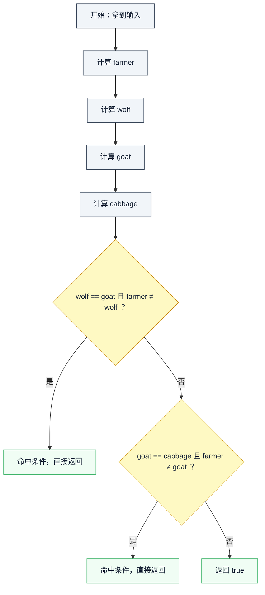

## TypeScript 解题方案（1 个方案逐个讲）

> **运行与提交**：每个方案都是自包含文件（内嵌用例自测，输出 PASS），整块复制到 `.ts` 文件后 `node 文件名` 即可运行。提交 LeetCode 时，把 `demo` 内的算法函数与辅助类型/函数整体取出、置于文件顶层即可。概念演示（非 LeetCode 编号题），在本地运行即可。

### 方案 1：直接实现

**分析与思路**：核心做法是「直接实现」。

**运行方式**：`node 本文件`，内嵌用例全部通过会输出 PASS。


**方案专属流程图**（真实控制流）：

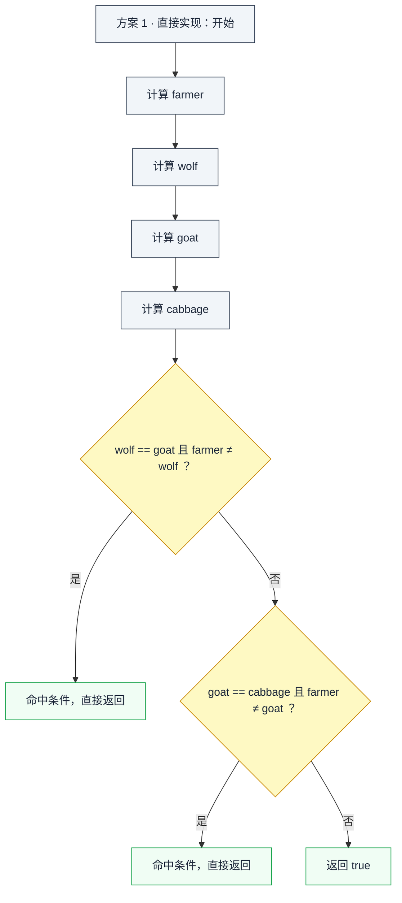

```typescript
// 忠实翻译 python solution_1：BFS 求农夫过河最短路径
// 状态四元组 (农夫, 狼, 羊, 菜)，0=左岸，1=右岸
export function demo(): void {
  // 程序入口：跑内嵌自测用例
  function isSafe(state: number[]): boolean {
    // 定义判定函数 isSafe
    const farmer = state[0]; // 把 state[0] 存入 farmer
    const wolf = state[1]; // 把 state[1] 存入 wolf
    const goat = state[2]; // 把 state[2] 存入 goat
    const cabbage = state[3]; // 把 state[3] 存入 cabbage
    if (wolf === goat && farmer !== wolf) {
      // 若 wolf 全等于 goat 且 farmer 不等于 wolf
      return false; // 返回 false
    }
    if (goat === cabbage && farmer !== goat) {
      // 若 goat 全等于 cabbage 且 farmer 不等于 goat
      return false; // 返回 false
    }
    return true; // 返回 true
  }
  function solve(): number[][] | null {
    // 定义函数/方法 solve
    const start = [0, 0, 0, 0]; // 把 [0, 0, 0, 0] 存入 起点
    const goal = [1, 1, 1, 1]; // 把 [1, 1, 1, 1] 存入 goal
    const prev: Map<string, number[] | null> = new Map(); // 把 new Map(); 写入 const prev: Map<string, number[] | null>
    prev.set(start.join(','), null); // 拼接为字符串
    const q: number[][] = [start]; // 把 [起点]; 写入 const q: number[][]
    while (q.length > 0) {
      // 循环，直到不满足「节点.长度 超过 0」
      const cur = q.shift() as number[]; // 把 节点.shift() as number[] 存入 当前值
      const curKey = cur.join(','); // 把 当前值.join(「,」) 存入 curKey
      if (curKey === goal.join(',')) {
        // 若 curKey 全等于 goal.join(「,」
        const path: number[][] = []; // 把 []; 写入 const path: number[][]
        let k: number[] | null = cur; // 把 当前值; 写入 let k: number[] | null
        while (k !== null) {
          // 循环，直到不满足「下标 k 不等于 null」
          path.push(k); // 把 下标 k 压入栈/数组尾部
          k = prev.get(k.join(',')) || null; // 把 前一个 查找 下标 k.join(「,」)) 或 null 存入 下标 k
        }
        path.reverse(); // 反转
        return path; // 返回 当前路径
      }
      const farmer = cur[0]; // 把 当前值[0] 存入 farmer
      for (let i = 0; i < 4; i++) {
        // 让 下标 i 从 0 开始计数，下标 i 小于 4 就继续
        if (i !== 0 && cur[i] !== farmer) {
          // 若 下标 i 不等于 0 且 当前值[下标 i] 不等于 farmer
          continue; // 跳过本轮，进入下一次
        }
        const nxt = cur.slice(); // 把 当前值 截取 ) 存入 nxt
        nxt[0] = 1 - farmer; // 把 1 减 farmer; 写入 nxt[0]
        if (i !== 0) {
          // 若 下标 i 不等于 0
          nxt[i] = 1 - farmer; // 把 1 减 farmer; 写入 nxt[i]
        }
        const nk = nxt.join(','); // 把 nxt.join(「,」) 存入 nk
        if (prev.has(nk)) {
          // 若 前一个.has(nk
          continue; // 跳过本轮，进入下一次
        }
        if (!isSafe(nxt)) {
          // 若 取反 isSafe(nxt
          continue; // 跳过本轮，进入下一次
        }
        prev.set(nk, cur); // 前一个.set(nk, 当前值);
        q.push(nxt); // 把 nxt 压入栈/数组尾部
      }
    }
    return null; // 返回 null
  }
  const want: number[][] = [
    [0, 0, 0, 0],
    [1, 0, 1, 0],
    [0, 0, 1, 0],
    [1, 1, 1, 0],
    [0, 1, 0, 0],
    [1, 1, 0, 1],
    [0, 1, 0, 1],
    [1, 1, 1, 1],
  ];
  const path = solve(); // 把 solve() 存入 当前路径
  if (path === null) {
    // 若 当前路径 全等于 null
    throw new Error('FAILED: 无解'); // throw new Error(「FAILED: 无解」);
  }
  let ok = path.length === want.length; // 把 当前路径.长度 全等于 want.长度 存入 ok
  for (let i = 0; ok && i < want.length; i++) {
    // 让 下标 i 从 0 开始计数，ok 且 下标 i 小于 want.长度 就继续
    for (let j = 0; j < 4; j++) {
      // 让 下标 j 从 0 开始计数，下标 j 小于 4 就继续
      if (path[i][j] !== want[i][j]) {
        // 若 当前路径[下标 i][下标 j] 不等于 want[下标 i][下标 j]
        ok = false; // 把 false 存入 ok
      }
    }
  }
  if (!ok) {
    // 若 取反 ok
    console.log(
      'FAIL path=' + JSON.stringify(path) + ' want=' + JSON.stringify(want),
    ); // 打印输出
    throw new Error('FAILED'); // throw new Error(「FAILED」);
  }
  console.log('PASS'); // 全部用例通过，输出 PASS
}
demo(); // demo();
```

## 逐步拆解与面试追问

**复杂度**：时间 O(n) 量级，空间 O(n)

**为什么是这个量级**：整体只对数据做有限趟处理

**面试官可能会追问**：

- 这个策略能推广到什么场景？
- 与暴力做法差在哪一步？
- 有没有更简单的等价写法？

## 关键 API 速查（TS 主解法实际用到，附官方链接）

| API | 作用 | 使用要点 | 官方文档 |
|---|---|---|---|
| `Map` | 哈希表：任意类型键值对 | set(k,v) 存、get(k) 取（不存在返回 undefined）、has(k) 判存在、delete(k) 删；增删查均摊 O(1)；键顺序为插入序；键必须用引用区分（对象键按身份） | [官方文档](https://developer.mozilla.org/zh-CN/docs/Web/JavaScript/Reference/Global_Objects/Map) |
| `Array.prototype.push()` | 尾部追加 | 返回新长度；可一次多个；均摊 O(1)；会改变原数组 | [官方文档](https://developer.mozilla.org/zh-CN/docs/Web/JavaScript/Reference/Global_Objects/Array/push) |
| `Array.prototype.shift()` | 头部取出 | O(n)（后续元素整体前移）；大量头部操作请用链表或双端结构 | [官方文档](https://developer.mozilla.org/zh-CN/docs/Web/JavaScript/Reference/Global_Objects/Array/shift) |
| `Array/String slice()` | 切片（不改原数组） | slice(start,end) 含头不含尾；负数从尾计；常用于复制数组（slice()） | [官方文档](https://developer.mozilla.org/zh-CN/docs/Web/JavaScript/Reference/Global_Objects/Array/slice) |
| `Array.prototype.join()` | 数组拼接为字符串 | undefined/null 转空串；嵌套数组会展平一层；join('') 用于字符数组还原 | [官方文档](https://developer.mozilla.org/zh-CN/docs/Web/JavaScript/Reference/Global_Objects/Array/join) |
| `JSON.stringify()` | 序列化为 JSON 字符串 | 常用于结构化比较（深度相等判定）；undefined/函数/循环引用会被丢弃或抛错 | [官方文档](https://developer.mozilla.org/zh-CN/docs/Web/JavaScript/Reference/Global_Objects/JSON/stringify) |

### 各语言官方文档导航

- **TypeScript / JS**：[MDN 中文参考](https://developer.mozilla.org/zh-CN/)
- **Python**：[Python 官方文档](https://docs.python.org/zh-cn/3/)
- **Go**：[Go 标准库](https://pkg.go.dev/std)
- **Java**：[JDK 17 API](https://docs.oracle.com/en/java/javase/17/docs/api/)
- **Rust**：[Rust 标准库](https://doc.rust-lang.org/std/)
- **Lua**：[Lua 5.4 手册](https://www.lua.org/manual/5.4/)
- **C**：[Cppreference C](https://zh.cppreference.com/w/c)
- **C++**：[Cppreference C++](https://zh.cppreference.com/w/cpp)
- **R**：[R 官方手册](https://stat.ethz.ch/R-manual/)
- **Zig**：[Zig 语言文档](https://ziglang.org/documentation/master/)
- **Dart**：[Dart API](https://api.dart.dev/)

## 附录：其他 10 种语言全部实现（每种语言列举其全部方案）

> TypeScript 的全部方案见「TypeScript 解题方案」一节；下面是其余 10 种语言的对应实现，每种语言的每个方案都带思路分析、代码走读与专属运行架构图。
> 每个方案都内嵌用例自测，可独立运行（老仓库 python/go 文件遵循「打印结果」约定）。
> 完整解法文件见 `dsa/<语言>/notes/lc_98685358_数据结构与算法笔记_农夫过河问题python3实现/`。

### Python 实现（1 种方案）

Python 的全部方案如下，每个方案都内嵌用例自测，可独立运行（老仓库 python/go 文件遵循「打印结果」约定）：

#### 方案 1：直接实现

**思路与代码分析**：核心是「直接实现」。Python 版用切片与字典推导式简化操作，突出可读性。**走读**：方案 1 · 直接实现：开始 → 更新 cabbage → 命中条件，直接返回 → 命中条件，直接返回 → 返回 True。

**运行架构**（真实控制流）：

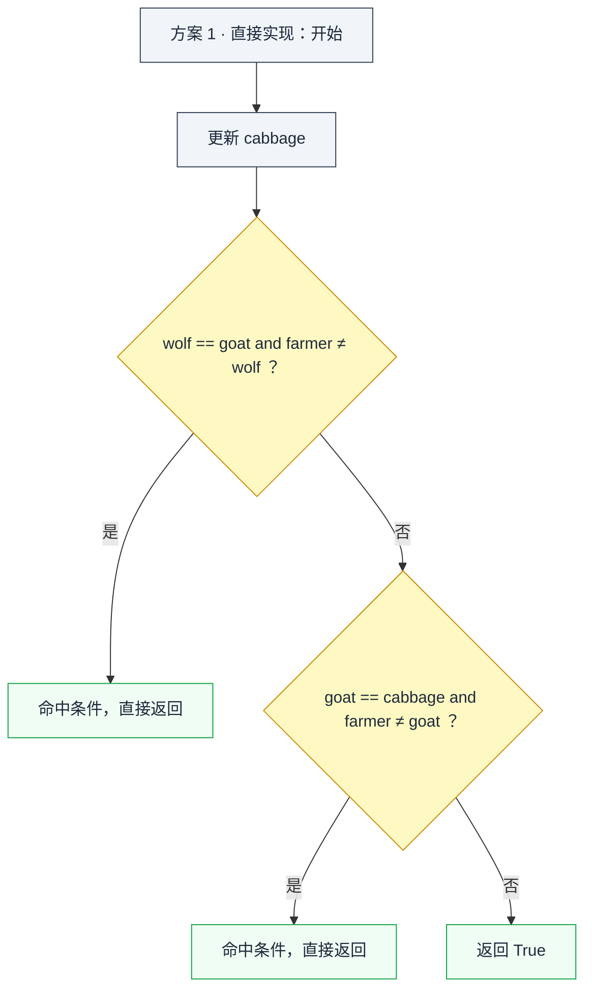

```python
import sys  # 提高递归深度上限（深输入防 RecursionError）

sys.setrecursionlimit(200000)  # 树/链表类题目节点数可达 1e4 量级
from collections import deque  # from collections import deque

# 角色位置用四元组表示 (农夫, 狼, 羊, 菜)，0=左岸，1=右岸
# 约束：狼和羊不能单独相处；羊和菜不能单独相处（农夫不在同一岸时）
NAMES = ["F", "W", "G", "C"]  # 把 ['F', 'W', 'G', 'C'] 存入 NAMES

def is_safe(state):  # 定义函数 is_safe（参数：state）
    farmer, wolf, goat, cabbage = state  # 把 state 写入 farmer, wolf, goat, cabbage
    if wolf == goat and farmer != wolf:  # 若 wolf 等于 goat and farmer 不等于 wolf
        return False  # 返回 False
    if goat == cabbage and farmer != goat:  # 若 goat 等于 cabbage and farmer 不等于 goat
        return False  # 返回 False
    return True  # 返回 True

def solve():  # 定义函数 solve（参数：无）
    start = (0, 0, 0, 0)  # 把 (0, 0, 0, 0) 存入 起点
    goal = (1, 1, 1, 1)  # 把 (1, 1, 1, 1) 存入 goal
    prev = {start: None}  # 把 {起点: None} 存入 前一个
    q = deque([start])  # 把 deque([起点]) 存入 节点
    while q:  # 循环，直到不满足「节点」
        cur = q.popleft()  # 把 节点.popleft() 存入 当前值
        if cur == goal:  # 若 当前值 等于 goal
            path = [cur]  # 把 [当前值] 存入 当前路径
            while prev[path[-1]] is not None:  # 循环，直到不满足「前一个[当前路径[ 减 1]] is not None」
                path.append(prev[path[-1]])  # 把 前一个[当前路径[ 减 1]] 追加到列表尾部
            return path[::-1]  # 返回 当前路径[:: 减 1]
        farmer = cur[0]  # 把 当前值[0] 存入 farmer
        for i in range(4):  # 让 下标 i 从 4 遍历
            if i != 0 and cur[i] != farmer:  # 若 下标 i 不等于 0 and 当前值[下标 i] 不等于 farmer
                continue  # 跳过本轮，进入下一次
            nxt = list(cur)  # 把 列表(当前值) 存入 nxt
            nxt[0] = 1 - farmer  # 把 1 减 farmer 写入 nxt[0]
            if i != 0:  # 若 下标 i 不等于 0
                nxt[i] = 1 - farmer  # 把 1 减 farmer 写入 nxt[i]
            nxt = tuple(nxt)  # 把 tuple(nxt) 存入 nxt
            if nxt in prev:  # 若 nxt in 前一个
                continue  # 跳过本轮，进入下一次
            if not is_safe(nxt):  # 若 not is_safe(nxt
                continue  # 跳过本轮，进入下一次
            prev[nxt] = cur  # 把 当前值 写入 prev[nxt]
            q.append(nxt)  # 把 nxt 追加到列表尾部
    return None  # 返回 None

if __name__ == "__main__":  # 若 __name__ 等于 「__main__」
    path = solve()  # 把 solve() 存入 当前路径
    if path is None:  # 若 当前路径 is None
        print("无解")  # 打印输出
    else:  # 否则
        for state in path:  # 逐个取出 当前路径 的元素（state）
            print(state, {NAMES[i]: ("L" if v == 0 else "R") for i, v in enumerate(state)})  # 打印输出
```

### Go 实现（1 种方案）

Go 的全部方案如下，每个方案都内嵌用例自测，可独立运行（老仓库 python/go 文件遵循「打印结果」约定）：

#### 方案 1：直接实现

**思路与代码分析**：核心是「直接实现」。Go 版用切片与多返回值惯用法，显式处理索引边界。代码里依次做这些事：哈希结构做计数或查重。**走读**：方案 1 · 直接实现：开始 → 更新 : → 遍历循环 → 遍历循环 → 遍历循环 → 返回 path → 遍历循环 → 返回 nil。

**运行架构**（真实控制流）：

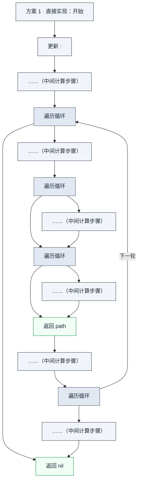

```go
package main // 引入依赖

import (
	"fmt" // 「fmt」
	"os"  // 「os」
)

func isSafe(state [4]int) bool { // 定义判定函数 isSafe
	farmer, wolf, goat, cabbage := state[0], state[1], state[2], state[3]
	if wolf == goat && farmer != wolf { // 若 wolf 等于 goat 且 farmer 不等于 wolf
		return false // 返回 false
	}
	if goat == cabbage && farmer != goat { // 若 goat 等于 cabbage 且 farmer 不等于 goat
		return false // 返回 false
	}
	return true // 返回 true
}

func solve() [][4]int { // 定义函数/方法 solve
	start := [4]int{0, 0, 0, 0}                // 把 [4]int{0, 0, 0, 0} 写入 start :
	goal := [4]int{1, 1, 1, 1}                 // 把 [4]int{1, 1, 1, 1} 写入 goal :
	sentinel := [4]int{-1, -1, -1, -1}         // 把 [4]int{ 减 1, 减 1, 减 1, 减 1} 写入 sentinel :
	prev := map[[4]int][4]int{start: sentinel} // 把 映射表[[4]int][4]int{起点: sentinel} 写入 prev :
	queue := [][4]int{start}                   // 把 [][4]int{起点} 写入 queue :
	for len(queue) > 0 {                       // for 长度(队列) 超过 0 {
		cur := queue[0]   // 把 队列[0] 写入 cur :
		queue = queue[1:] // 把 队列[1:] 写入 队列
		if cur == goal {  // 若 当前值 等于 goal
			path := [][4]int{cur}                     // 把 [][4]int{当前值} 写入 path :
			for prev[path[len(path)-1]] != sentinel { // 把 sentinel { 写入 for prev[path[len(path)-1]] !
				path = append(path, prev[path[len(path)-1]]) // 把 append(当前路径, 前一个[当前路径[长度(当前路径) 减 1]]) 写入 当前路径
			}
			for i, j := 0, len(path)-1; i < j; i, j = i+1, j-1 {
				path[i], path[j] = path[j], path[i] // 把 当前路径[下标 j], 当前路径[下标 i] 写入 path[i], path[j]
			}
			return path // 返回 当前路径
		}
		farmer := cur[0]         // 把 当前值[0] 写入 farmer :
		for i := 0; i < 4; i++ { // 让 下标 i 从 0 开始计数
			if i != 0 && cur[i] != farmer { // 若 下标 i 不等于 0 且 当前值[下标 i] 不等于 farmer
				continue // 跳过本轮，进入下一次
			}
			nxt := cur          // 把 当前值 写入 nxt :
			nxt[0] = 1 - farmer // 把 1 减 farmer 写入 nxt[0]
			if i != 0 {         // 若 下标 i 不等于 0
				nxt[i] = 1 - farmer // 把 1 减 farmer 写入 nxt[i]
			}
			if _, ok := prev[nxt]; ok { // 若 _, ok : 赋值为 前一个[nxt]; ok
				continue // 跳过本轮，进入下一次
			}
			if !isSafe(nxt) { // 若 取反 isSafe(nxt
				continue // 跳过本轮，进入下一次
			}
			prev[nxt] = cur            // 把 当前值 写入 prev[nxt]
			queue = append(queue, nxt) // 把 append(队列, nxt) 写入 队列
		}
	}
	return nil // 返回 nil
}

func main() { // 程序入口：跑内嵌自测用例
	path := solve()  // 把 solve() 写入 path :
	ok := true       // 把 true 写入 ok :
	if path == nil { // 若 当前路径 等于 nil
		ok = false                      // 把 false 写入 ok
		fmt.Println("FAIL no solution") // 打印输出
	} else { // 否则
		start := [4]int{0, 0, 0, 0}                        // 把 [4]int{0, 0, 0, 0} 写入 start :
		goal := [4]int{1, 1, 1, 1}                         // 把 [4]int{1, 1, 1, 1} 写入 goal :
		if path[0] != start || path[len(path)-1] != goal { // 若 当前路径[0] 不等于 起点 或 当前路径[长度(当前路径) 减 1] 不等于 goal
			ok = false                    // 把 false 写入 ok
			fmt.Println("FAIL endpoints") // 打印输出
		}
		for _, s := range path { // 同时取 _ 与 字符串 遍历
			if !isSafe(s) { // 若 取反 isSafe(字符串
				ok = false                       // 把 false 写入 ok
				fmt.Println("FAIL unsafe state") // 打印输出
				break                            // 跳出循环
			}
		}
		for i := 1; i < len(path); i++ { // 让 下标 i 从 1 开始计数
			a, b := path[i-1], path[i] // 把 当前路径[下标 i 减 1], 当前路径[下标 i] 写入 a, b :
			diff := 0                  // 把 0 写入 diff :
			for k := 0; k < 4; k++ {   // 让 下标 k 从 0 开始计数
				if a[k] != b[k] { // 若 数组[下标 k] 不等于 b[下标 k]
					diff++ // 差值 加一
				}
			}
			if a[0] == b[0] || diff < 1 || diff > 2 { // 若 数组[0] 等于 b[0] 或 差值 小于 1 或 差值 超过 2
				ok = false                       // 把 false 写入 ok
				fmt.Println("FAIL invalid step") // 打印输出
				break                            // 跳出循环
			}
		}
	}
	if !ok { // 若 取反 ok
		os.Exit(1) // os.Exit(1)
	}
	fmt.Println("PASS") // 全部用例通过，输出 PASS
}
```

### Java 实现（1 种方案）

Java 的全部方案如下，每个方案都内嵌用例自测，可独立运行（老仓库 python/go 文件遵循「打印结果」约定）：

#### 方案 1：直接实现

**思路与代码分析**：核心是「直接实现」。Java 版用类与静态方法组织，集合操作显式明了。**走读**：方案 1 · 直接实现：开始 → 更新 f → 更新 w → 更新 g → 更新 c → 命中条件，直接返回 → 命中条件，直接返回 → 返回 true。

**运行架构**（真实控制流）：

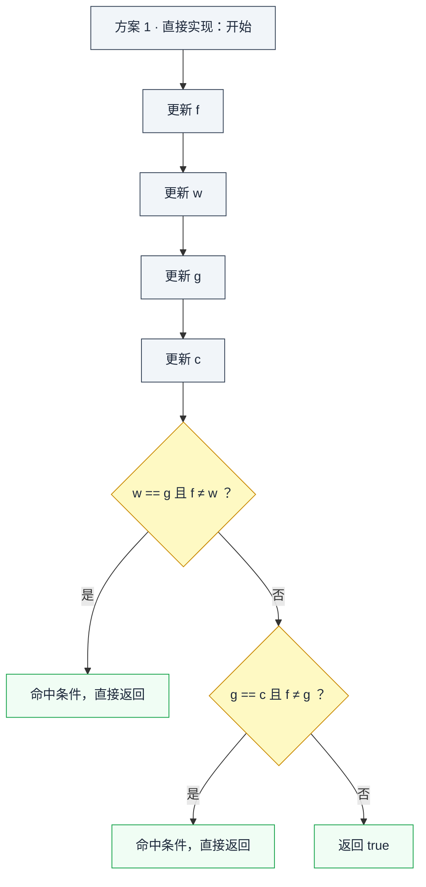

```java
package com.webfault.dsa; // 引入依赖

import java.util.*; // 引入依赖

class FarmerS1 { // 定义类型
  static boolean isSafe(int[] s) { // 定义判定函数 isSafe
    int f = s[0],
        w = s[1],
        g = s[2],
        c = s[3]; // 把 字符串[0], 权重 赋值为 字符串[1], g 赋值为 字符串[2], 字符 赋值为 字符串[3] 存入 f
    if (w == g && f != w) return false; // 若 权重 等于 g 且 f 不等于 权重，直接返回 false
    if (g == c && f != g) return false; // 若 g 等于 字符 且 f 不等于 g，直接返回 false
    return true; // 返回 true
  }

  static String key(int[] s) {
    return s[0] + "," + s[1] + "," + s[2] + "," + s[3];
  }

  static List<int[]> solve() { // 定义函数/方法 solve
    int[] start = {0, 0, 0, 0}; // 把 {0, 0, 0, 0}; 写入 int[] start
    int[] goal = {1, 1, 1, 1}; // 把 {1, 1, 1, 1}; 写入 int[] goal
    Map<String, int[]> prev = new HashMap<>(); // 把 new HashMap 小于 超过 (); 写入 Map<String, int[]> prev
    Queue<int[]> q = new ArrayDeque<>(); // 把 new ArrayDeque 小于 超过 (); 写入 Queue<int[]> q
    q.add(start); // 节点 追加 起点);
    prev.put(key(start), null); // 前一个.put(key(起点), null);
    while (!q.isEmpty()) { // 循环，直到不满足「取反 节点.isEmpty(」
      int[] cur = q.poll(); // 把 节点.poll(); 写入 int[] cur
      if (Arrays.equals(cur, goal)) { // 若 Arrays.equals(当前值, goal
        List<int[]> path = new ArrayList<>(); // 把 new ArrayList 小于 超过 (); 写入 List<int[]> path
        int[] p = cur; // 把 当前值; 写入 int[] p
        while (p != null) {
          path.add(0, p);
          p = prev.get(key(p));
        }
        return path; // 返回 当前路径
      }
      int farmer = cur[0]; // 把 当前值[0] 存入 farmer
      for (int i = 0; i < 4; i++) { // 让 下标 i 从 0 开始计数，下标 i 小于 4 就继续
        if (i != 0 && cur[i] != farmer) continue; // 若 下标 i 不等于 0 且 当前值[下标 i] 不等于 farmer) continue;
        int[] nxt = cur.clone(); // 把 当前值.clone(); 写入 int[] nxt
        nxt[0] = 1 - farmer; // 把 1 减 farmer; 写入 nxt[0]
        if (i != 0) nxt[i] = 1 - farmer; // 若 下标 i 不等于 0) nxt[下标 i] 赋值为 1 减 farmer;
        if (prev.containsKey(key(nxt))) continue; // 若 前一个.containsKey(key(nxt))) continue;
        if (!isSafe(nxt)) continue; // 若 取反 isSafe(nxt)) continue;
        prev.put(key(nxt), cur); // 前一个.put(key(nxt), 当前值);
        q.add(nxt); // 节点 追加 nxt);
      }
    }
    return null; // 返回 null
  }

  public static void main(String[] args) { // public static void main(String[] args) {
    List<int[]> got = FarmerS1.solve(); // 把 FarmerS1.solve(); 写入 List<int[]> got
    int[][][] want = { // 把 { 写入 int[][][] want
      {{0, 0, 0, 0}}, {{1, 0, 1, 0}}, {{0, 0, 1, 0}}, {{1, 1, 1, 0}},
      {{0, 1, 0, 0}}, {{1, 1, 0, 1}}, {{0, 1, 0, 1}}, {{1, 1, 1, 1}},
    };
    boolean ok = true; // 把 true; 写入 boolean ok
    if (got == null || got.size() != want.length)
      ok = false; // 若 got 等于 null 或 got.大小() 不等于 want.长度) ok 赋值为 false;
    else { // 否则
      for (int i = 0; i < want.length; i++) { // 让 下标 i 从 0 开始计数，下标 i 小于 want.长度 就继续
        if (!Arrays.equals(
            got.get(i), want[i][0])) { // 若 取反 Arrays.equals(got 查找 下标 i), want[下标 i][0]
          ok = false; // 把 false; 写入 ok
          System.out.println(
              "FAIL step "
                  + i
                  + " got "
                  + Arrays.toString(got.get(i))
                  + " want "
                  + Arrays.toString(want[i][0])); // 打印输出
        }
      }
    }
    if (!ok) throw new RuntimeException("FAILED"); // 若 取反 ok) throw new RuntimeException(「FAILED」);
    System.out.println("PASS"); // 全部用例通过，输出 PASS
  }
}
```

### Rust 实现（1 种方案）

Rust 的全部方案如下，每个方案都内嵌用例自测，可独立运行（老仓库 python/go 文件遵循「打印结果」约定）：

#### 方案 1：直接实现

**思路与代码分析**：核心是「直接实现」。Rust 版用所有权移动与切片借用改写同一逻辑，注意 Option 与引用边界。**走读**：方案 1 · 直接实现：开始 → 计算 let (farmer, wolf, goat, → 处理 if wolf == goat 且 farmer ≠ → 返回 false → 处理 if goat == cabbage 且 farmer → 返回 false → 处理 true。

**运行架构**（真实控制流）：

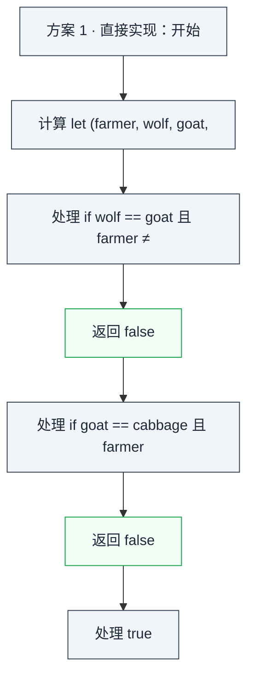

```rust
// LeetCode 98685358. 农夫过河问题 — Rust 版（农夫过河问题：BFS 求最短过河序列，状态 (农夫,狼,羊,菜)，0=左岸 1=右岸）
use std::collections::HashMap; // 引入依赖

// 安全判定：狼与羊单独相处或羊与菜单独相处则不安全
fn is_safe(s: &[i32; 4]) -> bool {
    // 定义判定函数 is_safe
    let (farmer, wolf, goat, cabbage) = (s[0], s[1], s[2], s[3]);
    if wolf == goat && farmer != wolf {
        // 若 wolf 等于 goat 且 farmer 不等于 wolf
        return false; // 返回 false
    }
    if goat == cabbage && farmer != goat {
        // 若 goat 等于 cabbage 且 farmer 不等于 goat
        return false; // 返回 false
    }
    true // true
}

fn key(s: &[i32; 4]) -> String {
    // 定义函数/方法 key
    format!("{},{},{},{}", s[0], s[1], s[2], s[3]) // format取反 (「{},{},{},{}」, 字符串[0], 字符串[1], 字符串[2], 字符串[3])
}

fn solve() -> Option<Vec<[i32; 4]>> {
    // 定义函数/方法 solve
    let start = [0, 0, 0, 0]; // 把 [0, 0, 0, 0] 存入 起点
    let goal = [1, 1, 1, 1]; // 把 [1, 1, 1, 1] 存入 goal
    let mut prev: HashMap<String, Option<[i32; 4]>> = HashMap::new();
    prev.insert(key(&start), None); // 前一个 插入 key( 按位与 起点), None);
    let mut q: Vec<[i32; 4]> = vec![start]; // 把 vec取反 [起点]; 写入 let mut q: Vec<[i32; 4]>
    let mut head = 0usize; // 把 0usize; 写入 let mut head
    while head < q.len() {
        // while 头节点 小于 节点.长度() {
        let cur = q[head]; // 把 节点[头节点] 存入 当前值
        head += 1; // 头节点累加 1
        let cur_key = key(&cur); // 把 key( 按位与 当前值) 存入 cur_key
        if cur == goal {
            // 若 当前值 等于 goal
            let mut path: Vec<[i32; 4]> = vec![]; // 把 vec取反 []; 写入 let mut path: Vec<[i32; 4]>
            let mut k: Option<[i32; 4]> = Some(cur); // 把 Some(当前值); 写入 let mut k: Option<[i32; 4]>
            while let Some(s) = k {
                // 边取边处理，取空即停
                path.push(s); // 把 字符串 压入栈/数组尾部
                k = *prev.get(&key(&s)).unwrap(); // 把 乘 前一个 查找 按位与 key( 按位与 字符串)).unwrap(); 写入 下标 k
            }
            path.reverse(); // 反转
            return Some(path); // 返回 Some(当前路径)
        }
        let farmer = cur[0]; // 把 当前值[0] 存入 farmer
        for i in 0..4usize {
            // 逐个取出 0 的元素（下标 i）
            if i != 0 && cur[i] != farmer {
                // 若 下标 i 不等于 0 且 当前值[下标 i] 不等于 farmer
                continue; // 跳过本轮，进入下一次
            }
            let mut nxt = cur; // 把 当前值; 写入 let mut nxt
            nxt[0] = 1 - farmer; // 把 1 减 farmer; 写入 nxt[0]
            if i != 0 {
                // 若 下标 i 不等于 0
                nxt[i] = 1 - farmer; // 把 1 减 farmer; 写入 nxt[i]
            }
            let nk = key(&nxt); // 把 key( 按位与 nxt) 存入 nk
            if prev.contains_key(&nk) {
                // 若 前一个.contains_key( 按位与 nk
                continue; // 跳过本轮，进入下一次
            }
            if !is_safe(&nxt) {
                // 若 取反 is_safe( 按位与 nxt
                continue; // 跳过本轮，进入下一次
            }
            prev.insert(nk, Some(cur)); // 前一个 插入 nk, Some(当前值));
            q.push(nxt); // 把 nxt 压入栈/数组尾部
        }
    }
    None // None
}

fn main() {
    // 程序入口：跑内嵌自测用例
    let want: Vec<[i32; 4]> = vec![
        [0, 0, 0, 0],
        [1, 0, 1, 0],
        [0, 0, 1, 0],
        [1, 1, 1, 0],
        [0, 1, 0, 0],
        [1, 1, 0, 1],
        [0, 1, 0, 1],
        [1, 1, 1, 1],
    ];
    let path = solve().expect("FAILED: 无解"); // 把 solve().expect(「FAILED: 无解」) 存入 当前路径
    assert_eq!(path, want, "path mismatch"); // 断言校验
    println!("PASS"); // 全部用例通过，输出 PASS
}
```

### Lua 实现（1 种方案）

Lua 的全部方案如下，每个方案都内嵌用例自测，可独立运行（老仓库 python/go 文件遵循「打印结果」约定）：

#### 方案 1：直接实现

**思路与代码分析**：核心是「直接实现」。Lua 版用表与 ipairs 遍历，注意 ipairs 遇 nil 即停的语义。**走读**：方案 1 · 直接实现：开始 → 处理 if s[2] == s[3] and s[1] ~= → 返回 false → 处理 if s[3] == s[4] and s[1] ~= → 返回 false → 返回 true。

**运行架构**（真实控制流）：

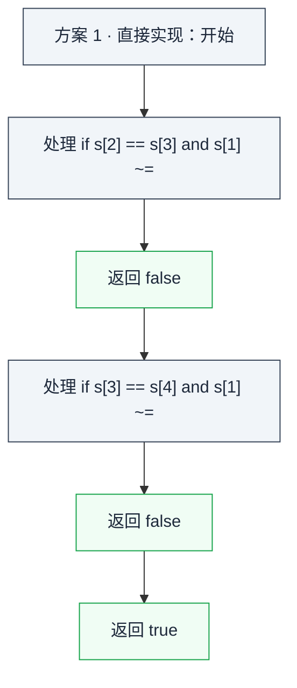

```lua
-- LeetCode 98685358. 农夫过河问题 — Lua 版（农夫过河问题：BFS 求最短过河序列，状态 (农夫,狼,羊,菜)，0=左岸 1=右岸）

local function is_safe(s) -- local function is_safe(字符串)
	if s[2] == s[3] and s[1] ~= s[2] then
		return false
	end
	if s[3] == s[4] and s[1] ~= s[3] then
		return false
	end
	return true -- 返回 true
end -- 终点

local function key(s) -- local function key(字符串)
	return table.concat(s, ",") -- 返回 table.concat(字符串, 「,」)
end -- 终点

local function solve() -- local function solve()
	local start = { 0, 0, 0, 0 } -- 把 {0, 0, 0, 0} 写入 local start
	local goal = { 1, 1, 1, 1 } -- 把 {1, 1, 1, 1} 写入 local goal
	local prev = {} -- key -> 父 key（起点无父，缺省 nil）
	local state_by = {} -- key -> 状态表
	prev[key(start)] = false -- 把 false 写入 prev[key(start)]
	state_by[key(start)] = start -- 把 起点 写入 state_by[key(start)]
	local q = { start } -- 把 {起点} 写入 local q
	local head = 1 -- 把 1 写入 local head
	while head <= #q do -- 把 #节点 do 写入 while head <
		local cur = q[head] -- 把 节点[头节点] 写入 local cur
		head = head + 1 -- 把 头节点 加 1 存入 头节点
		local ck = key(cur) -- 把 key(当前值) 写入 local ck
		if ck == key(goal) then -- 若 ck 等于 key(goal) then
			local path = {} -- 把 {} 写入 local path
			local k = ck -- 把 ck 写入 local k
			while k and k ~= false do -- 把 false do 写入 while k and k ~
				path[#path + 1] = state_by[k] -- 把 state_by[下标 k] 写入 path[#path + 1]
				k = prev[k] -- 把 前一个[下标 k] 存入 下标 k
			end -- 终点
			-- 反转
			local n = #path -- 把 #当前路径 写入 local n
			for i = 1, math.floor(n / 2) do -- 让 下标 i 从 1 走到 math（Lua 1 基）
				path[i], path[n - i + 1] = path[n - i + 1], path[i]
			end -- 终点
			return path -- 返回 当前路径
		end -- 终点
		local farmer = cur[1] -- 把 当前值[1] 写入 local farmer
		for i = 1, 4 do -- 让 下标 i 从 1 走到 4（Lua 1 基）
			if i == 1 or cur[i] == farmer then -- 若 下标 i 等于 1 or 当前值[下标 i] 等于 farmer then
				local nxt = { cur[1], cur[2], cur[3], cur[4] } -- 把 {当前值[1], 当前值[2], 当前值[3], 当前值[4]} 写入 local nxt
				nxt[1] = 1 - farmer -- 把 1 减 farmer 写入 nxt[1]
				if i ~= 1 then
					nxt[i] = 1 - farmer
				end -- 若 下标 i ~ 赋值为 1 then nxt[下标 i] 赋值为 1 减 farmer 终点
				local nk = key(nxt) -- 把 key(nxt) 写入 local nk
				if prev[nk] == nil then -- 若 前一个[nk] 等于 nil then
					if is_safe(nxt) then -- 若 is_safe(nxt) then
						prev[nk] = ck -- 把 ck 写入 prev[nk]
						state_by[nk] = nxt -- 把 nxt 写入 state_by[nk]
						q[#q + 1] = nxt -- 把 nxt 写入 q[#q + 1]
					end -- 终点
				end -- 终点
			end -- 终点
		end -- 终点
	end -- 终点
	return nil -- 返回 nil
end -- 终点

local want = { -- 把 { 写入 local want
	{ 0, 0, 0, 0 },
	{ 1, 0, 1, 0 },
	{ 0, 0, 1, 0 },
	{ 1, 1, 1, 0 },
	{ 0, 1, 0, 0 },
	{ 1, 1, 0, 1 },
	{ 0, 1, 0, 1 },
	{ 1, 1, 1, 1 },
}
local path = solve() -- 把 solve() 写入 local path
assert(path ~= nil, "FAILED: 无解") -- 断言校验
assert(#path == #want, "path length mismatch") -- 断言校验
for i = 1, #want do -- 把 1, #want do 写入 for i
	for j = 1, 4 do -- 让 下标 j 从 1 走到 4（Lua 1 基）
		assert(path[i][j] == want[i][j], "path mismatch at " .. i .. "," .. j) -- 断言校验
	end -- 终点
end -- 终点
print("PASS") -- 全部用例通过，输出 PASS
```

### C 实现（1 种方案）

C 的全部方案如下，每个方案都内嵌用例自测，可独立运行（老仓库 python/go 文件遵循「打印结果」约定）：

#### 方案 1：直接实现

**思路与代码分析**：核心是「直接实现」。C 版手动管理下标与内存，循环边界全部显式写出。代码里依次做这些事：双重循环遍历。**走读**：方案 1 · 直接实现：开始 → 更新 start → 遍历循环 → 当 (head ＜ tail) 时反复执行 → 当 (k ≠ -1) 时反复执行 → 遍历循环 → 返回 n → 遍历循环 → 返回 -1。

**运行架构**（真实控制流）：

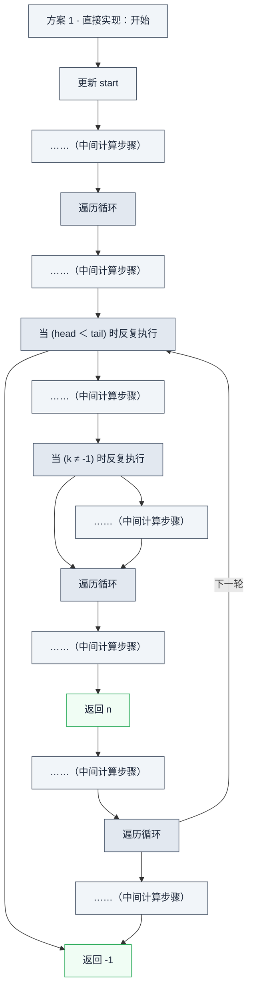

```c
* LeetCode 98685358. 农夫过河问题 — C 版（农夫过河问题：BFS 求最短过河序列，状态 (农夫,狼,羊,菜)，0=左岸
 * 1=右岸） 状态编码为 4bit 整数：bit3=农夫 bit2=狼 bit1=羊 bit0=菜
 */
#include <stdio.h> // 引入头文件

static int is_safe(int s) { // 定义判定函数 is_safe
    int farmer = (s >> 3) & 1, wolf = (s >> 2) & 1, goat = (s >> 1) & 1, cabbage = s & 1;
    if (wolf == goat && farmer != wolf)
        return 0; // 若 wolf 等于 goat 且 farmer 不等于 wolf，直接返回 0
    if (goat == cabbage && farmer != goat)
        return 0; // 若 goat 等于 cabbage 且 farmer 不等于 goat，直接返回 0
    return 1;     // 返回 1
}

static void dec(int s, int out[4]) { // 定义函数/方法 dec
    out[0] = (s >> 3) & 1;
    out[1] = (s >> 2) & 1;
    out[2] = (s >> 1) & 1;
    out[3] = s & 1;
}

static int enc(int v[4]) {                        // 定义函数/方法 enc
    return v[0] * 8 + v[1] * 4 + v[2] * 2 + v[3]; // 返回 值[0] 乘 8 加 值[1] 乘 4 加 值[2] 乘 2 加 值[3]
}

static int solve(int path[][4]) { // 定义函数/方法 solve
    int start = 0, goal = 15;     // 把 0, goal 赋值为 15 存入 起点
    int prev[16];                 // int 前一个[16];
    for (int i = 0; i < 16; i++)
        prev[i] = -2; /* -2 未访问, -1 起点 */ // 让 下标 i 从 0 开始计数，下标 i 小于 16 就继续
    int q[16], head = 0, tail = 0;             // 把 0, 尾节点 赋值为 0; 写入 int q[16], head
    prev[start] = -1;                          // 把 减 1; 写入 prev[start]
    q[tail++] = start;                         // 把 起点; 写入 q[tail++]
    while (head < tail) {                      // 循环，直到不满足「头节点 小于 尾节点」
        int cur = q[head++];                   // 把 节点[头节点 加一 ] 存入 当前值
        if (cur == goal) {                     // 若 当前值 等于 goal
            int n = 0, tmp[16];                // 把 0, 临时变量[16] 存入 元素个数
            int k = cur;                       // 把 当前值 存入 下标 k
            while (k != -1) {
                tmp[n++] = k;
                k = prev[k];
            }
            for (int i = 0; i < n; i++)
                dec(tmp[n - 1 - i], path[i]); // 让 下标 i 从 0 开始计数，下标 i 小于 元素个数 就继续
            return n;                         // 返回 元素个数
        }
        int farmer = (cur >> 3) & 1;  // 把 (当前值 超过 超过 3) 按位与 1 存入 farmer
        for (int i = 0; i < 4; i++) { // 让 下标 i 从 0 开始计数，下标 i 小于 4 就继续
            if (i != 0 && ((cur >> (3 - i)) & 1) != farmer)
                continue;
            int v[4];          // int 值[4];
            dec(cur, v);       // dec(当前值, 值);
            v[0] = 1 - farmer; // 把 1 减 farmer; 写入 v[0]
            if (i != 0)
                v[i] = 1 - farmer; // 若 下标 i 不等于 0) 值[下标 i] 赋值为 1 减 farmer;
            int nk = enc(v);       // 把 enc(值) 存入 nk
            if (prev[nk] != -2)
                continue; // 若 前一个[nk] 不等于 减 2) continue;
            if (!is_safe(nk))
                continue;   // 若 取反 is_safe(nk)) continue;
            prev[nk] = cur; // 把 当前值; 写入 prev[nk]
            q[tail++] = nk; // 把 nk; 写入 q[tail++]
        }
    }
    return -1; // 返回 减 1
}

int main(void) { // 程序入口：跑内嵌自测用例
    int want[8][4] = {
        // 把 { 写入 int want[8][4]
        {0, 0, 0, 0}, {1, 0, 1, 0}, {0, 0, 1, 0}, {1, 1, 1, 0},
        {0, 1, 0, 0}, {1, 1, 0, 1}, {0, 1, 0, 1}, {1, 1, 1, 1},
    };
    int path[16][4];     // int 当前路径[16][4];
    int n = solve(path); // 把 solve(当前路径) 存入 元素个数
    if (n != 8) {
        printf("FAILED: path length %d\n", n);
        return 1;
    }
    for (int i = 0; i < 8; i++)             // 让 下标 i 从 0 开始计数，下标 i 小于 8 就继续
        for (int j = 0; j < 4; j++)         // 让 下标 j 从 0 开始计数，下标 j 小于 4 就继续
            if (path[i][j] != want[i][j]) { // 若 当前路径[下标 i][下标 j] 不等于 want[下标 i][下标 j]
                printf("FAILED: mismatch at %d,%d\n", i, j); // 打印输出
                return 1;                                    // 返回 1
            }
    printf("PASS\n"); // 全部用例通过，输出 PASS
    return 0;         // 返回 0
}
```

### C++ 实现（1 种方案）

C++ 的全部方案如下，每个方案都内嵌用例自测，可独立运行（老仓库 python/go 文件遵循「打印结果」约定）：

#### 方案 1：直接实现

**思路与代码分析**：核心是「直接实现」。C++ 版用 STL 容器与迭代器，减少手写下标错误。代码里依次做这些事：单循环线性扫描。**走读**：方案 1 · 直接实现：开始 → 处理 std::vector＜int＞ start → 当 (head ＜ q.size()) 时反复执行 → 当 (true) 时反复执行 → 返回 path → 遍历循环 → 返回 。

**运行架构**（真实控制流）：

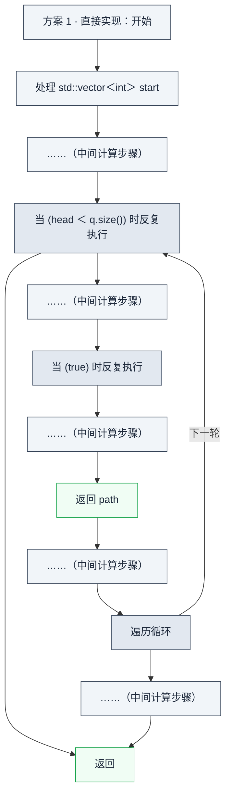

```cpp
// LeetCode 98685358. 农夫过河问题 — C++ 版（农夫过河问题：BFS 求最短过河序列，状态 (农夫,狼,羊,菜)，0=左岸
// 1=右岸）
#include <iostream> // 引入头文件
#include <map>      // 引入头文件
#include <vector>   // 引入头文件

static bool is_safe(const std::vector<int> &s) { // 定义判定函数 is_safe
    if (s[1] == s[2] && s[0] != s[1])
        return false; // 若 字符串[1] 等于 字符串[2] 且 字符串[0] 不等于 字符串[1]，直接返回 false
    if (s[2] == s[3] && s[0] != s[2])
        return false; // 若 字符串[2] 等于 字符串[3] 且 字符串[0] 不等于 字符串[2]，直接返回 false
    return true; // 返回 true
}

static std::string key(const std::vector<int> &s) {
    std::string k;                          // std::string 下标 k;
    for (size_t i = 0; i < s.size(); ++i) { // 让 下标 i 从 0 开始计数，下标 i 小于 字符串.大小() 就继续
        if (i)
            k += ",";              // 若 下标 i) 下标 k 累加 「,」;
        k += std::to_string(s[i]); // 下标 k累加 std::to_string(字符串[下标 i])
    }
    return k; // 返回 下标 k
}

static std::vector<std::vector<int>>
solve() { // static std::vector 小于 std::vector 小于 int 超过 超过 solve() {
    std::vector<int> start{0, 0, 0, 0}; // std::vector 小于 int 超过 起点{0, 0, 0, 0};
    std::vector<int> goal{1, 1, 1, 1};  // std::vector 小于 int 超过 goal{1, 1, 1, 1};
    // prev: key -> (是否有父状态, 父key)
    std::map<std::string, std::pair<bool, std::string>> prev;
    prev[key(start)] = {false, ""}; // 把 {false, 「」}; 写入 prev[key(start)]
    std::map<std::string, std::vector<int>>
        state_by; // std::映射表 小于 std::string, std::vector 小于 int 超过 超过 state_by;
    state_by[key(start)] = start;           // 把 起点; 写入 state_by[key(start)]
    std::vector<std::vector<int>> q{start}; // std::vector 小于 std::vector 小于 int 超过 超过 节点{起点};
    size_t head = 0;                        // 把 0; 写入 size_t head
    while (head < q.size()) {               // 循环，直到不满足「头节点 小于 节点.大小(」
        std::vector<int> cur = q[head++]; // 把 节点[头节点 加一 ]; 写入 std::vector<int> cur
        std::string ck = key(cur);        // 把 key(当前值); 写入 std::string ck
        if (cur == goal) {                // 若 当前值 等于 goal
            std::vector<std::vector<int>> path; // std::vector 小于 std::vector 小于 int 超过 超过 当前路径;
            std::string k = ck;                 // 把 ck; 写入 std::string k
            while (true) {                      // 循环，直到不满足「true」
                path.push_back(state_by.at(k)); // 当前路径 追加 state_by.at(下标 k));
                if (!prev.at(k).first)
                    break;             // 若 取反 前一个.at(下标 k).first) break;
                k = prev.at(k).second; // 把 前一个.at(下标 k).second; 写入 下标 k
            }
            std::reverse(path.begin(), path.end()); // std::reverse(当前路径 迭代位置 , 当前路径.终点());
            return path;                            // 返回 当前路径
        }
        int farmer = cur[0];          // 把 当前值[0] 存入 farmer
        for (int i = 0; i < 4; ++i) { // 让 下标 i 从 0 开始计数，下标 i 小于 4 就继续
            if (i != 0 && cur[i] != farmer)
                continue; // 若 下标 i 不等于 0 且 当前值[下标 i] 不等于 farmer) continue;
            std::vector<int> nxt = cur; // 把 当前值; 写入 std::vector<int> nxt
            nxt[0] = 1 - farmer;        // 把 1 减 farmer; 写入 nxt[0]
            if (i != 0)
                nxt[i] = 1 - farmer;   // 若 下标 i 不等于 0) nxt[下标 i] 赋值为 1 减 farmer;
            std::string nk = key(nxt); // 把 key(nxt); 写入 std::string nk
            if (prev.count(nk))
                continue; // 若 前一个.计数(nk)) continue;
            if (!is_safe(nxt))
                continue;          // 若 取反 is_safe(nxt)) continue;
            prev[nk] = {true, ck}; // 把 {true, ck}; 写入 prev[nk]
            state_by[nk] = nxt;    // 把 nxt; 写入 state_by[nk]
            q.push_back(nxt);      // 节点 追加 nxt);
        }
    }
    return {}; // 返回 {}
}

int main() { // 程序入口：跑内嵌自测用例
    std::vector<std::vector<int>> want = {
        // 把 { 写入 std::vector<std::vector<int>> want
        {0, 0, 0, 0}, {1, 0, 1, 0}, {0, 0, 1, 0}, {1, 1, 1, 0},
        {0, 1, 0, 0}, {1, 1, 0, 1}, {0, 1, 0, 1}, {1, 1, 1, 1},
    };
    std::vector<std::vector<int>> path = solve(); // 把 solve(); 写入 std::vector<std::vector<int>> path
    if (path.empty()) {
        std::cout << "FAILED: 无解" << std::endl;
        return 1;
    }
    if (path != want) {
        std::cout << "FAILED: path mismatch" << std::endl;
        return 1;
    }
    std::cout << "PASS" << std::endl; // 全部用例通过，输出 PASS
    return 0;                         // 返回 0
}
```

### R 实现（1 种方案）

R 的全部方案如下，每个方案都内嵌用例自测，可独立运行（老仓库 python/go 文件遵循「打印结果」约定）：

#### 方案 1：直接实现

**思路与代码分析**：核心是「直接实现」。R 版用向量化思维与 1 起始下标，注意 1:n 的降序陷阱。**走读**：方案 1 · 直接实现：开始 → 命中条件，直接返回 → 命中条件，直接返回 → 处理 TRUE。

**运行架构**（真实控制流）：

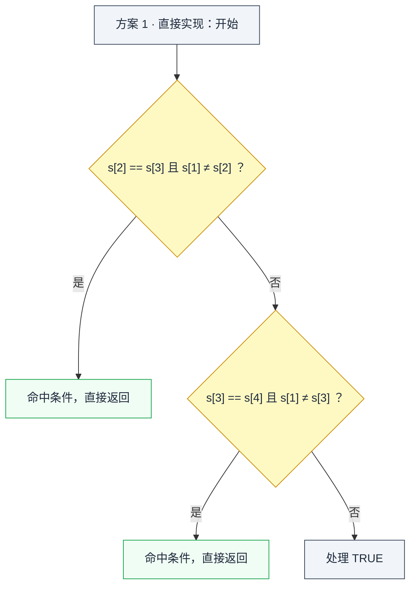

```r
# 版（农夫过河问题：BFS 求最短过河序列，状态 (农夫,狼,羊,菜)，0=左岸 1=右岸）
is_safe <- function(s) {
    # 定义函数 is_safe（参数：字符串）
    if (s[2] == s[3] && s[1] != s[2])
        return(FALSE)  # 若 字符串[2] 等于 字符串[3] 且 字符串[1] 不等于 字符串[2]) return(FALSE
    if (s[3] == s[4] && s[1] != s[3])
        return(FALSE)  # 若 字符串[3] 等于 字符串[4] 且 字符串[1] 不等于 字符串[3]) return(FALSE
    TRUE  # TRUE
}
key_of <- function(s) paste(s, collapse = ",")  # 定义函数 key_of（参数：字符串）
solve <- function() {
    # 定义函数 solve（参数：无）
    start <- c(0L, 0L, 0L, 0L)  # 把 字符(0L, 0L, 0L, 0L) 存入 起点
    goal <- c(1L, 1L, 1L, 1L)  # 把 字符(1L, 1L, 1L, 1L) 存入 goal
    prev <- new.env(parent = emptyenv())  # key -> 父 key（起点为 NA）
    state_by <- new.env(parent = emptyenv())  # 把 new.env(parent 赋值为 emptyenv()) 存入 state_by
    prev[[key_of(start)]] <- NA_character_  # 把 NA_character_ 存入 prev[[key_of(start)]]
    state_by[[key_of(start)]] <- start  # 把 起点 存入 state_by[[key_of(start)]]
    q <- list(start)  # 把 列表(起点) 存入 节点
    head <- 1L  # 把 1L 存入 头节点
    while (head <= length(q)) {
        # 循环，直到不满足「头节点 不超过 长度(节点」
        cur <- q[[head]]  # 把 节点[[头节点]] 存入 当前值
        head <- head + 1L  # 把 头节点 加 1L 存入 头节点
        ck <- key_of(cur)  # 把 key_of(当前值) 存入 ck
        if (identical(ck, key_of(goal))) {
            # 若 identical(ck, key_of(goal
            path <- list()  # 把 列表() 存入 当前路径
            k <- ck  # 把 ck 存入 下标 k
            while (!is.na(k)) {
                # 循环，直到不满足「取反 is.na(下标 k」
                path[[length(path) + 1L]] <- state_by[[k]]  # 当前路径[[长度(当前路径) 加 1L]] 小于 减 state_by[[下标 k]]
                k <- prev[[k]]  # 把 前一个[[下标 k]] 存入 下标 k
            }
            return(rev(path))  # 返回 rev(当前路径
        }
        farmer <- cur[1]  # 把 当前值[1] 存入 farmer
        for (i in 1:4) {
            # for (下标 i in 1:4) {
            if (i != 1L && cur[i] != farmer)
                next  # 若 下标 i 不等于 1L 且 当前值[下标 i] 不等于 farmer) 下一个
            nxt <- cur  # 把 当前值 存入 nxt
            nxt[1] <- 1L - farmer  # 把 1L 减 farmer 存入 nxt[1]
            if (i != 1L)
                nxt[i] <- 1L - farmer  # 若 下标 i 不等于 1L) nxt[下标 i] 小于 减 1L 减 farmer
            nk <- key_of(nxt)  # 把 key_of(nxt) 存入 nk
            if (!is.null(prev[[nk]]))
                next  # 若 取反 is.null(前一个[[nk]])) 下一个
            if (!is_safe(nxt))
                next  # 若 取反 is_safe(nxt)) 下一个
            prev[[nk]] <- ck  # 把 ck 存入 prev[[nk]]
            state_by[[nk]] <- nxt  # 把 nxt 存入 state_by[[nk]]
            q[[length(q) + 1L]] <- nxt  # 节点[[长度(节点) 加 1L]] 小于 减 nxt
        }
    }
    NULL  # NULL
}
want <- list(c(0L, 0L, 0L, 0L), c(1L, 0L, 1L, 0L), c(0L, 0L, 1L, 0L), c(1L, 1L, 1L, 0L), c(0L, 1L, 0L, 0L), c(1L,
    1L, 0L, 1L), c(0L, 1L, 0L, 1L), c(1L, 1L, 1L, 1L))
path <- solve()  # 把 solve() 存入 当前路径
stopifnot(!is.null(path))  # 断言校验
stopifnot(length(path) == length(want))  # 断言校验
for (i in seq_along(want)) {
    # for (下标 i in seq_along(want)) {
    stopifnot(identical(as.integer(path[[i]]), as.integer(want[[i]])))  # 断言校验
}
cat("PASS\n")  # 全部用例通过，输出 PASS
```

### Zig 实现（1 种方案）

Zig 的全部方案如下，每个方案都内嵌用例自测，可独立运行（老仓库 python/go 文件遵循「打印结果」约定）：

#### 方案 1：直接实现

**思路与代码分析**：核心是「直接实现」。Zig 版显式分配与清零，整型边界处理严格。代码里依次做这些事：单循环线性扫描。**走读**：方案 1 · 直接实现：开始 → 计算 start → 遍历集合元素 → 当 (head ＜ tail) 时反复执行 → 当 (k ≠ -1) 时反复执行 → 当 (i ＜ n) : (i += 1) 时反复执行 → 返回 n → 当 (i ＜ 4) : (i += 1) 时反复执行 → 返回 error.NoSolution。

**运行架构**（真实控制流）：

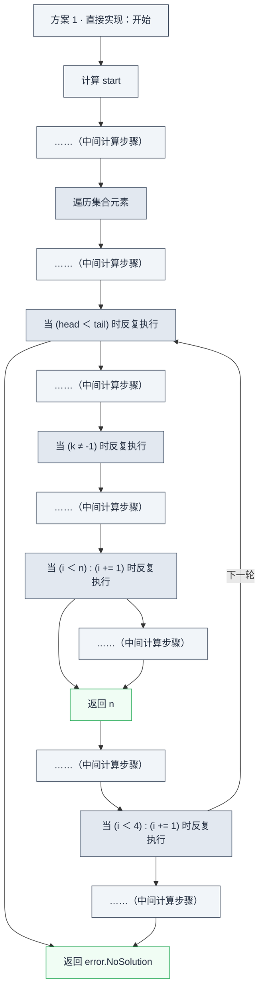

```zig
// LeetCode 98685358. 农夫过河问题 — Zig 版（农夫过河问题：BFS 求最短过河序列，状态 (农夫,狼,羊,菜)，0=左岸 1=右岸）
// 状态编码为 4bit：bit3=农夫 bit2=狼 bit1=羊 bit0=菜
const std = @import("std"); // 把 @import(「std」) 存入 std

fn isSafe(s: u4) bool { // 定义判定函数 isSafe
    const farmer: u1 = @truncate(s >> 3); // 把 @truncate(字符串 超过 超过 3); 写入 const farmer: u1
    const wolf: u1 = @truncate(s >> 2); // 把 @truncate(字符串 超过 超过 2); 写入 const wolf: u1
    const goat: u1 = @truncate(s >> 1); // 把 @truncate(字符串 超过 超过 1); 写入 const goat: u1
    const cabbage: u1 = @truncate(s); // 把 @truncate(字符串); 写入 const cabbage: u1
    if (wolf == goat and farmer != wolf) return false; // 若 wolf 等于 goat and farmer 不等于 wolf，直接返回 false
    if (goat == cabbage and farmer != goat) return false; // 若 goat 等于 cabbage and farmer 不等于 goat，直接返回 false
    return true; // 返回 true
}

fn dec(s: u4) [4]i32 { // 定义函数/方法 dec
    return .{ // 返回 {
        @as(i32, @intCast((s >> 3) & 1)),
        @as(i32, @intCast((s >> 2) & 1)),
        @as(i32, @intCast((s >> 1) & 1)),
        @as(i32, @intCast(s & 1)),
    };
}

fn enc(v: [4]i32) u4 { // 定义函数/方法 enc
    return @intCast(v[0] * 8 + v[1] * 4 + v[2] * 2 + v[3]); // 返回 @intCast(值[0] 乘 8 加 值[1] 乘 4 加 值[2] 乘 2 加 值[3])
}

fn solve(path: *[16][4]i32) !usize { // 定义函数/方法 solve
    const start: u4 = 0; // 把 0; 写入 const start: u4
    const goal: u4 = 15; // 把 15; 写入 const goal: u4
    var prev: [16]i8 = undefined; // 把 undefined; 写入 var prev: [16]i8
    for (&prev) |*p| p.* = -2; // -2 未访问, -1 起点
    var q: [16]u4 = undefined; // 把 undefined; 写入 var q: [16]u4
    var head: usize = 0; // 把 0; 写入 var head: usize
    var tail: usize = 0; // 把 0; 写入 var tail: usize
    prev[start] = -1; // 把 减 1; 写入 prev[start]
    q[tail] = start; // 把 起点; 写入 q[tail]
    tail += 1; // 尾节点累加 1
    while (head < tail) { // 循环，直到不满足「头节点 小于 尾节点」
        const cur = q[head]; // 把 节点[头节点] 存入 当前值
        head += 1; // 头节点累加 1
        if (cur == goal) { // 若 当前值 等于 goal
            var n: usize = 0; // 把 0; 写入 var n: usize
            var tmp: [16]u4 = undefined; // 把 undefined; 写入 var tmp: [16]u4
            var k: i16 = cur; // 把 当前值; 写入 var k: i16
            while (k != -1) { // 循环，直到不满足「下标 k 不等于 减 1」
                tmp[n] = @intCast(k); // 把 @intCast(下标 k); 写入 tmp[n]
                n += 1; // 元素个数累加 1
                k = prev[@intCast(k)]; // 把 前一个[@intCast(下标 k)]; 写入 下标 k
            }
            var i: usize = 0; // 把 0; 写入 var i: usize
            while (i < n) : (i += 1) { // 循环，直到不满足「下标 i 小于 元素个数) : (下标 i 累加 1」
                path[i] = dec(tmp[n - 1 - i]); // 把 dec(临时变量[元素个数 减 1 减 下标 i]); 写入 path[i]
            }
            return n; // 返回 元素个数
        }
        const farmer: i32 = @intCast((cur >> 3) & 1); // 把 @intCast((当前值 超过 超过 3) 按位与 1); 写入 const farmer: i32
        var i: usize = 0; // 把 0; 写入 var i: usize
        while (i < 4) : (i += 1) { // 循环，直到不满足「下标 i 小于 4) : (下标 i 累加 1」
            const bit: i32 = @intCast((cur >> @intCast(3 - i)) & 1);
            if (i != 0 and bit != farmer) continue; // 若 下标 i 不等于 0 and bit 不等于 farmer) continue;
            var v = dec(cur); // 把 dec(当前值) 存入 值
            v[0] = 1 - farmer; // 把 1 减 farmer; 写入 v[0]
            if (i != 0) v[i] = 1 - farmer; // 若 下标 i 不等于 0) 值[下标 i] 赋值为 1 减 farmer;
            const nk = enc(v); // 把 enc(值) 存入 nk
            if (prev[nk] != -2) continue; // 若 前一个[nk] 不等于 减 2) continue;
            if (!isSafe(nk)) continue; // 若 取反 isSafe(nk)) continue;
            prev[nk] = @intCast(cur); // 把 @intCast(当前值); 写入 prev[nk]
            q[tail] = nk; // 把 nk; 写入 q[tail]
            tail += 1; // 尾节点累加 1
        }
    }
    return error.NoSolution; // 返回 error.NoSolution
}

pub fn main() !void { // 程序入口：跑内嵌自测用例
    const want = [8][4]i32{ // 把 [8][4]i32{ 存入 want
        .{ 0, 0, 0, 0 }, .{ 1, 0, 1, 0 }, .{ 0, 0, 1, 0 }, .{ 1, 1, 1, 0 },
        .{ 0, 1, 0, 0 }, .{ 1, 1, 0, 1 }, .{ 0, 1, 0, 1 }, .{ 1, 1, 1, 1 },
    };
    var path: [16][4]i32 = undefined; // 把 undefined; 写入 var path: [16][4]i32
    const n = solve(&path) catch { // 把 solve( 按位与 当前路径) catch { 存入 元素个数
        std.debug.print("FAILED: 无解\n", .{}); // 打印输出
        return error.NoSolution; // 返回 error.NoSolution
    };
    if (n != 8) { // 若 元素个数 不等于 8
        std.debug.print("FAILED: path length {d}\n", .{n}); // 打印输出
        return error.TestFailed; // 返回 error.TestFailed
    }
    for (want, 0..) |row, i| { // for (want, 0..) 按位或 row, 下标 i 按位或 {
        for (row, 0..) |x, j| { // for (row, 0..) 按位或 x, 下标 j 按位或 {
            if (path[i][j] != x) { // 若 当前路径[下标 i][下标 j] 不等于 x
                std.debug.print("FAILED: mismatch at {d},{d}\n", .{ i, j }); // 打印输出
                return error.TestFailed; // 返回 error.TestFailed
            }
        }
    }
    std.debug.print("PASS\n", .{}); // 全部用例通过，输出 PASS
}
```

### Dart 实现（1 种方案）

Dart 的全部方案如下，每个方案都内嵌用例自测，可独立运行（老仓库 python/go 文件遵循「打印结果」约定）：

#### 方案 1：直接实现

**思路与代码分析**：核心是「直接实现」。Dart 版用可空类型标注与集合方法，注意空安全。**走读**：方案 1 · 直接实现：开始 → 命中条件，直接返回 → 命中条件，直接返回 → 返回 true。

**运行架构**（真实控制流）：

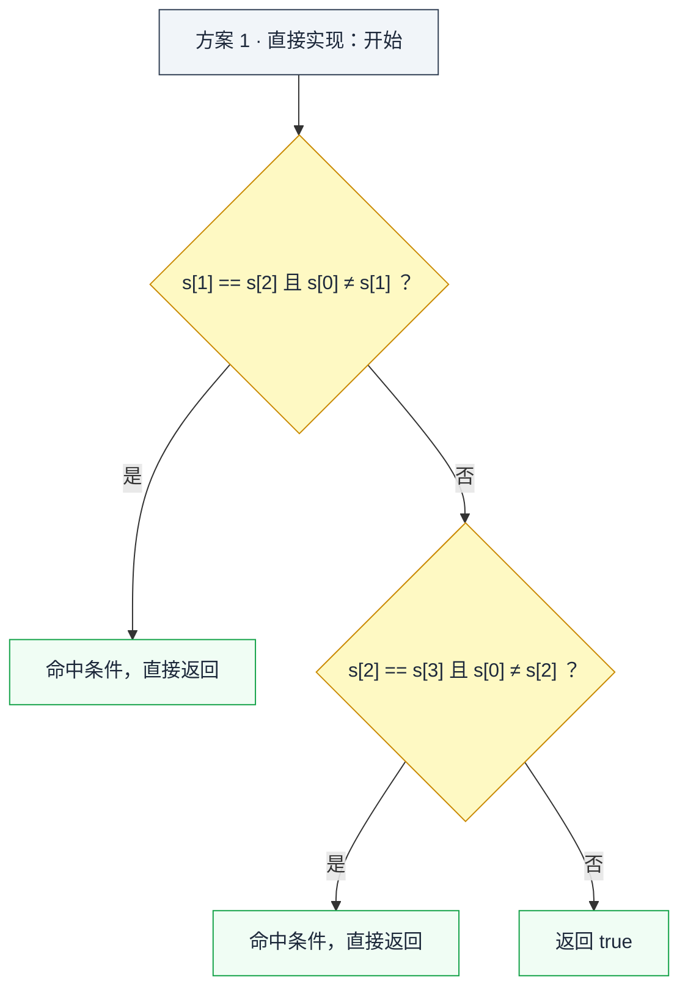

```dart
// LeetCode 98685358. 农夫过河问题 — Dart 版（农夫过河问题：BFS 求最短过河序列，状态 (农夫,狼,羊,菜)，0=左岸 1=右岸）

bool isSafe(List<int> s) {
  // 定义判定函数 isSafe
  if (s[1] == s[2] && s[0] != s[1])
    return false; // 若 字符串[1] 等于 字符串[2] 且 字符串[0] 不等于 字符串[1]，直接返回 false
  if (s[2] == s[3] && s[0] != s[2])
    return false; // 若 字符串[2] 等于 字符串[3] 且 字符串[0] 不等于 字符串[2]，直接返回 false
  return true; // 返回 true
}

String key(List<int> s) => s.join(',');

List<List<int>>? solve() {
  // List 小于 List 小于 int 超过 超过 ? solve() {
  final start = <int>[0, 0, 0, 0]; // 把 小于 int 超过 [0, 0, 0, 0] 存入 起点
  final goal = <int>[1, 1, 1, 1]; // 把 小于 int 超过 [1, 1, 1, 1] 存入 goal
  final prev = <String, String?>{}; // key -> 父 key（起点为 null）
  final stateBy =
      <String, List<int>>{}; // 把 小于 String, List 小于 int 超过 超过 {} 存入 stateBy
  prev[key(start)] = null; // 把 null; 写入 prev[key(start)]
  stateBy[key(start)] = start; // 把 起点; 写入 stateBy[key(start)]
  final q = <List<int>>[start]; // 把 小于 List 小于 int 超过 超过 [起点] 存入 节点
  var head = 0; // 把 0 存入 头节点
  while (head < q.length) {
    // 循环，直到不满足「头节点 小于 节点.长度」
    final cur = q[head++]; // 把 节点[头节点 加一 ] 存入 当前值
    final ck = key(cur); // 把 key(当前值) 存入 ck
    if (ck == key(goal)) {
      // 若 ck 等于 key(goal
      final path = <List<int>>[]; // 把 小于 List 小于 int 超过 超过 [] 存入 当前路径
      String? k = ck; // 把 ck; 写入 String? k
      while (k != null) {
        // 循环，直到不满足「下标 k 不等于 null」
        path.add(stateBy[k]!); // 当前路径 追加 stateBy[下标 k]取反 );
        k = prev[k]; // 把 前一个[下标 k] 存入 下标 k
      }
      return path.reversed.toList(); // 返回 当前路径.reversed.toList()
    }
    final farmer = cur[0]; // 把 当前值[0] 存入 farmer
    for (var i = 0; i < 4; i++) {
      // 让 下标 i 从 0 开始计数，下标 i 小于 4 就继续
      if (i != 0 && cur[i] != farmer)
        continue; // 若 下标 i 不等于 0 且 当前值[下标 i] 不等于 farmer) continue;
      final nxt = List<int>.from(cur); // 把 List 小于 int 超过 .from(当前值) 存入 nxt
      nxt[0] = 1 - farmer; // 把 1 减 farmer; 写入 nxt[0]
      if (i != 0)
        nxt[i] = 1 - farmer; // 若 下标 i 不等于 0) nxt[下标 i] 赋值为 1 减 farmer;
      final nk = key(nxt); // 把 key(nxt) 存入 nk
      if (prev.containsKey(nk)) continue; // 若 前一个.containsKey(nk)) continue;
      if (!isSafe(nxt)) continue; // 若 取反 isSafe(nxt)) continue;
      prev[nk] = ck; // 把 ck; 写入 prev[nk]
      stateBy[nk] = nxt; // 把 nxt; 写入 stateBy[nk]
      q.add(nxt); // 节点 追加 nxt);
    }
  }
  return null; // 返回 null
}

void main() {
  // 程序入口：跑内嵌自测用例
  final want = <List<int>>[
    <int>[0, 0, 0, 0],
    <int>[1, 0, 1, 0],
    <int>[0, 0, 1, 0],
    <int>[1, 1, 1, 0],
    <int>[0, 1, 0, 0],
    <int>[1, 1, 0, 1],
    <int>[0, 1, 0, 1],
    <int>[1, 1, 1, 1],
  ];
  final path = solve(); // 把 solve() 存入 当前路径
  if (path == null)
    throw StateError(
      'FAILED: 无解',
    ); // 若 当前路径 等于 null) throw StateError('FAILED: 无解');
  final ok =
      path.length == want.length &&
      List.generate(
        want.length,
        (i) => path[i].toString() == want[i].toString(),
      ).every((x) => x);
  if (!ok)
    throw StateError(
      'FAILED: path mismatch',
    ); // 若 取反 ok) throw StateError('FAILED: 当前路径 mismatch');
  print('PASS'); // 全部用例通过，输出 PASS
}
```

---

## 内容总结

- **数据结构与算法笔记 农夫过河问题python3实现**（算法笔记 · Medium）：共 1 个方案，主线思路「直接实现」；时间 O(n) 量级；动画演示归并分治过程，附录给出 11 种语言 × 全部方案的可运行实现。
- 来源博客：[https://blog.csdn.net/tyro_java/article/details/98685358](https://blog.csdn.net/tyro_java/article/details/98685358)
- 导航：[📋 总目录](../) ｜ [← 251 数据结构与算法笔记 复杂度](../251_数据结构与算法笔记_复杂度/) ｜ [253 python笔记 数据结构与算法 →](../253_python笔记_数据结构与算法之数组操作/)
