# 253 · python笔记 数据结构与算法之数组操作（第附阶段 · 专题补充 · Medium）

> **难度**：⭐⭐ Medium ｜ **专题**：算法笔记
> **学习定位**：第附阶段 · 专题补充第 253 篇 ｜ **解法数**：2
> **内容总结**：**python笔记 数据结构与算法之数组操作**（算法笔记 · Medium）：共 2 个方案，主线思路「迭代指针处理」；时间 O(n)（单趟线性扫描）；动画演示归并分治过程，附录给出 11 种语言 × 全部方案的可运行实现。

---

## 题目描述

python笔记 数据结构与算法之数组操作。具体输入输出约定见函数签名与用例。

- 主函数签名：`function treeToLevel(root: any): any[]`

**用例演示**（摘自主解法内嵌自测，输入到输出一目了然）：

```typescript
  const cases = [
    { got: twoSum([2, 7, 11, 15], 9), want: [0, 1] },
    { got: maxSubArray([-2, 1, -3, 4, -1, 2, 1, -5, 4]), want: 6 },
    { got: rotateArray([1, 2, 3, 4, 5, 6, 7], 3), want: [5, 6, 7, 1, 2, 3, 4] },
    { got: twoSum([3, 2, 4], 6), want: [1, 2] },
  ];
```

**数据范围与注意事项**：

- **易错点**：先看小例子手推一遍再对照代码，比直接读代码快得多。

## 题目分析

**场景是什么**：综合练习：把数据结构与策略组合起来解决一个完整问题。本题就是该场景的 Medium 级练习，主线做法是「迭代指针处理」。

**主线怎么解**：把主解法从头到尾过一遍，它其实在依次做这几件事：队列或堆的调度。

## 解题思路

**方案对比**（共 2 个方案，由浅入深）：

| 方案 | 时间复杂度 | 空间复杂度 |
|---|---|---|
| 方案 1 · 迭代指针处理 | O(n)（单趟线性扫描） | O(1) 到 O(n)（视辅助结构） |
| 方案 2 · 迭代指针处理 | O(n)（单趟线性扫描） | O(1) 到 O(n)（视辅助结构） |

**方案间的取舍**：方案 1（迭代指针处理）；方案 2（迭代指针处理）。数据规模小、可读性优先时选靠前的方案；规模大、性能优先时选靠后的方案。

**怎么读这一篇**：

- 🐣 **新手路线**：把「题目描述」的示例 1 在纸上手推一遍 → 读方案 1（最直观的写法）与它的代码走读 → 按「运行方式」本地跑通看 PASS → 回头对比方案 2 之后的写法差在哪
- 🦅 **大佬路线**：直接锁定最优方案 1（迭代指针处理，O(n)（单趟线性扫描））→ 跳读该方案代码与走读 → 用「逐步拆解与面试追问」补齐复杂度推导与边界追问

### 动态算法图（归并分治，GIF 自动循环）


动画演示算法笔记专题里归并分治的典型过程；每个方案在「TypeScript 解题方案」一节还配了专属动画与专属流程图。

### 主解法流程图（真实控制流）

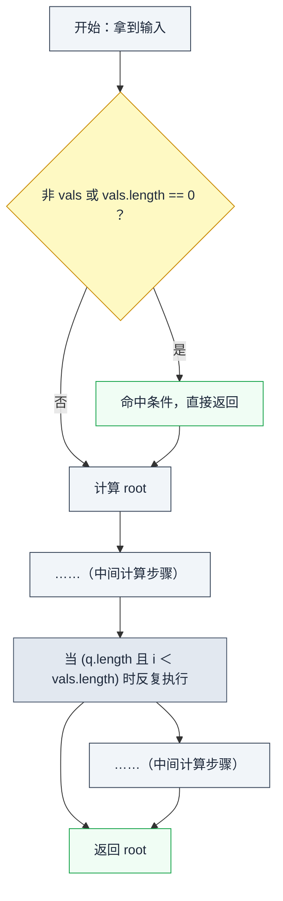

## TypeScript 解题方案（2 个方案逐个讲）

> **运行与提交**：每个方案都是自包含文件（内嵌用例自测，输出 PASS），整块复制到 `.ts` 文件后 `node 文件名` 即可运行。提交 LeetCode 时，把 `demo` 内的算法函数与辅助类型/函数整体取出、置于文件顶层即可。概念演示（非 LeetCode 编号题），在本地运行即可。

### 方案 1：迭代指针处理

**分析与思路**：核心做法是「迭代指针处理」。代码里依次做这些事：队列或堆的调度。

**运行方式**：`node 本文件`，内嵌用例全部通过会输出 PASS。


**方案专属流程图**（真实控制流）：

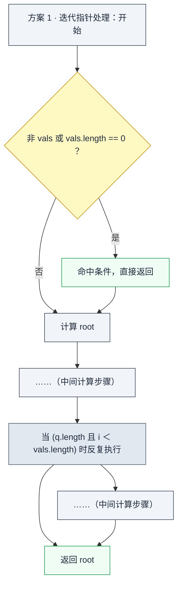

```typescript
class TreeNode {
  // 定义类型
  val: any;
  left: any;
  right: any; // 值: any; 左边界: any; 右边界: any;
  constructor(val?: any, left?: any, right?: any) {
    // constructor(值?: any, 左边界?: any, 右边界?: any) {
    this.val = val === undefined ? 0 : val; // 把 (值 全等于 undefined ? 0 : 值); 写入 值
    this.left = left === undefined ? null : left; // 把 (左边界 全等于 undefined ? null : 左边界); 写入 左边界
    this.right = right === undefined ? null : right; // 把 (右边界 全等于 undefined ? null : 右边界); 写入 右边界
  }
}
function buildTree(vals: any): any {
  // 定义函数/方法 buildTree
  if (!vals || vals.length === 0) return null; // 若 取反 vals 或 vals.长度 全等于 0，直接返回 null
  const root = new TreeNode(vals[0]);
  const q: any[] = [root];
  let i = 1;
  while (q.length && i < vals.length) {
    // 循环，直到不满足「节点.长度 且 下标 i 小于 vals.长度」
    const node = q.shift(); // 把 节点.shift() 存入 节点
    if (vals[i] !== null && vals[i] !== undefined) {
      node.left = new TreeNode(vals[i]);
      q.push(node.left);
    }
    i++; // 下标 i 加一
    if (i < vals.length && vals[i] !== null && vals[i] !== undefined) {
      node.right = new TreeNode(vals[i]);
      q.push(node.right);
    }
    i++; // 下标 i 加一
  }
  return root; // 返回 根节点
}
function treeToLevel(root: any): any[] {
  // 定义函数/方法 treeToLevel
  if (!root) return []; // 若 取反 根节点，直接返回 []
  const out: any[] = [];
  const q: any[] = [root]; // 把 []; const 节点: any[] 赋值为 [根节点]; 写入 const out: any[]
  while (q.length) {
    // 循环，直到不满足「节点.长度」
    const n = q.shift(); // 把 节点.shift() 存入 元素个数
    if (n === null || n === undefined) {
      out.push(null);
      continue;
    }
    out.push(n.val);
    q.push(n.left);
    q.push(n.right); // 把 元素个数.值 压入栈/数组尾部
  }
  while (out.length && out[out.length - 1] === null) out.pop(); // 循环，直到不满足「out.长度 且 out[out.长度 减 1] 全等于 null) out 弹出 );」
  return out; // 返回 out
}
class ListNode {
  // 定义类型
  val: any;
  next: any; // 值: any; 下一个: any;
  constructor(val?: any, next?: any) {
    this.val = val === undefined ? 0 : val;
    this.next = next === undefined ? null : next;
  }
}
function buildList(vals: any): any {
  // 定义函数/方法 buildList
  const dummy = new ListNode(0);
  let cur = dummy; // 把 new ListNode(0); let 当前值 赋值为 哨兵节点 存入 哨兵节点
  for (const v of vals) {
    cur.next = new ListNode(v);
    cur = cur.next;
  } // 把 new ListNode(值); 当前值 赋值为 当前值.下一个; } 写入 下一个
  return dummy.next; // 返回 哨兵节点.下一个
}
function listToArray(head: any): any[] {
  // 定义函数/方法 listToArray
  const out: any[] = [];
  let p = head; // 把 []; let 节点 赋值为 头节点; 写入 const out: any[]
  while (p) {
    out.push(p.val);
    p = p.next;
  } // 循环，直到不满足「节点) { out 追加 节点.值); 节点 赋值为 节点.下一个; }」
  return out; // 返回 out
}
// python-runtime shims
function pyLen(a: any): number {
  // 定义函数/方法 pyLen
  if (a === null || a === undefined) return 0; // 若 数组 全等于 null 或 数组 全等于 undefined，直接返回 0
  if (
    typeof a === 'string' ||
    Array.isArray(a) ||
    a instanceof Set ||
    a instanceof Map
  )
    return a.length ?? a.size;
  if (typeof a === 'object') return Object.keys(a).length; // 若 typeof 数组 全等于 'object'，直接返回 Object.keys(数组).长度
  return 0; // 返回 0
}
function pySlice(a: any, i: any, j: any, step?: any): any {
  // 定义函数/方法 pySlice
  if (typeof a === 'string') {
    const r = [...a].slice(i ?? 0, j ?? a.length);
    return step ? r.reverse().join('') : r.join('');
  }
  const arr = Array.isArray(a) ? a : [...a]; // 把 Array.isArray(数组) ? 数组 : 复制的 数组 存入 数组
  return arr.slice(i ?? 0, j ?? arr.length); // 返回 数组 截取 下标 i ?? 0, 下标 j ?? 数组.长度)
}
function pyRange(a: any, b?: any, step?: any): any[] {
  // 定义函数/方法 pyRange
  let s = 0,
    e = a,
    st = 1; // 把 0, e 赋值为 数组, st 赋值为 1 存入 字符串
  if (b !== undefined) {
    s = a;
    e = b;
  } // 若 b 不等于 undefined) { 字符串 赋值为 数组; e 赋值为 b; }
  if (step !== undefined) st = step; // 若 步数 不等于 undefined) st 赋值为 步数;
  const out: any[] = []; // 把 []; 写入 const out: any[]
  if (st > 0) for (let i = s; i < e; i += st) out.push(i);
  else for (let i = s; i > e; i += st) out.push(i); // 否则
  return out; // 返回 out
}
function pyIn(x: any, coll: any): boolean {
  // 定义函数/方法 pyIn
  if (coll === null || coll === undefined) return false; // 若 coll 全等于 null 或 coll 全等于 undefined，直接返回 false
  if (Array.isArray(coll)) return coll.includes(x); // 若 Array.isArray(coll)，直接返回 coll 是否包含 x)
  if (coll instanceof Set || coll instanceof Map) return coll.has(x); // 若 coll instanceof Set 或 coll instanceof Map，直接返回 coll.has(x)
  if (typeof coll === 'object') return x in coll; // 若 typeof coll 全等于 'object'，直接返回 x in coll
  if (typeof coll === 'string') return coll.indexOf(x) >= 0; // 若 typeof coll 全等于 'string'，直接返回 coll 查找 x) 不低于 0
  return false; // 返回 false
}
function pySorted(a: any): any[] {
  // 定义函数/方法 pySorted
  const arr = typeof a === 'string' ? [...a] : [...a]; // 把 (typeof 数组 全等于 'string') ? 复制的 数组 : 复制的 数组 存入 数组
  return arr.sort((x: any, y: any) => (x < y ? -1 : x > y ? 1 : 0));
}
function pyMin(a: any, b?: any): any {
  if (b !== undefined) return Math.min(a, b);
  if (Array.isArray(a) || a instanceof Set) return Math.min(...a);
  return Math.min(a);
} // 定义函数/方法 pyMin
function pyMax(a: any, b?: any): any {
  if (b !== undefined) return Math.max(a, b);
  if (Array.isArray(a) || a instanceof Set) return Math.max(...a);
  return Math.max(a);
} // 定义函数/方法 pyMax
function pySum(a: any): number {
  let s = 0;
  for (const v of a) s += v;
  return s;
} // 定义函数/方法 pySum
function pyAbs(x: any): number {
  return Math.abs(x);
} // 定义函数/方法 pyAbs
function pyEnumerate(a: any): any[] {
  const out: any[] = [];
  let i = 0;
  for (const v of a) {
    out.push([i, v]);
    i++;
  }
  return out;
} // 定义函数/方法 pyEnumerate
function pyZip(a: any, b: any): any[] {
  const n = Math.min(a.length, b.length);
  const out: any[] = [];
  for (let i = 0; i < n; i++) out.push([a[i], b[i]]);
  return out;
} // 定义函数/方法 pyZip
function pyDictGet(d: any, k: any, def?: any): any {
  return k in d ? d[k] : def === undefined ? null : def;
} // 定义函数/方法 pyDictGet
function pyPrint(...args: any[]): void {
  console.log(
    args
      .map((a) => (typeof a === 'object' && a !== null ? JSON.stringify(a) : a))
      .join(' '),
  );
} // 定义函数/方法 pyPrint
// collections / heapq
function heapPush(h: any[], x: any): void {
  h.push(x);
  let i = h.length - 1;
  while (i > 0) {
    const p = (i - 1) >> 1;
    if (h[p] <= h[i]) break;
    [h[p], h[i]] = [h[i], h[p]];
    i = p;
  }
} // 定义函数/方法 heapPush
function heapPop(h: any[]): any {
  const top = h[0];
  const last = h.pop();
  if (h.length) {
    h[0] = last;
    let i = 0;
    const n = h.length;
    while (true) {
      let l = 2 * i + 1,
        r = 2 * i + 2,
        s = i;
      if (l < n && h[l] < h[s]) s = l;
      if (r < n && h[r] < h[s]) s = r;
      if (s === i) break;
      [h[s], h[i]] = [h[i], h[s]];
      i = s;
    }
  }
  return top;
} // 定义函数/方法 heapPop
class Deque {
  private a: any[] = [];
  push(x: any) {
    this.a.push(x);
  }
  pushLeft(x: any) {
    this.a.unshift(x);
  }
  pop() {
    return this.a.pop();
  }
  popLeft() {
    return this.a.shift();
  }
  get length() {
    return this.a.length;
  }
  toArray() {
    return this.a.slice();
  }
} // 定义类型
function Counter(iter: any): any {
  const m: any = {};
  for (const v of iter) m[v] = (m[v] || 0) + 1;
  return m;
} // 定义函数/方法 Counter
function gcd(a: any, b: any): any {
  while (b) {
    [a, b] = [b, a % b];
  }
  return a;
} // 定义函数/方法 gcd
function pyInf(): number {
  return Infinity;
} // 定义函数/方法 pyInf

function norm(x: any): any {
  // 定义函数/方法 norm
  if (x === null || x === undefined) return null; // 若 x 全等于 null 或 x 全等于 undefined，直接返回 null
  if (typeof x === 'object') {
    // 若 typeof x 全等于 'object'
    if (x instanceof Deque) return x.toArray(); // 若 x instanceof Deque，直接返回 x.toArray()
    if (Array.isArray(x)) return x.map(norm); // 若 Array.isArray(x)，直接返回 x.映射表(norm)
    if (
      typeof x.val === 'number' &&
      (typeof x.left !== 'undefined' || typeof x.right !== 'undefined')
    )
      return treeToLevel(x);
    if (typeof x.next !== 'undefined' && typeof x.val === 'number')
      return listToArray(x);
    if (x instanceof Set) return [...x].sort(); // 若 x instanceof Set，直接返回 复制的 x 排序 )
    if (x instanceof Map) return Object.fromEntries(x); // 若 x instanceof Map，直接返回 Object.fromEntries(x)
    const o: any = {};
    for (const k of Object.keys(x)) o[k] = norm(x[k]);
    return o;
  }
  return x; // 返回 x
}
function eq(a: any, b: any): boolean {
  // 定义函数/方法 eq
  const x = norm(a),
    y = norm(b); // 把 norm(数组), y 赋值为 norm(b) 存入 x
  if (x === y) return true; // 若 x 全等于 y，直接返回 true
  if (x === null || y === null) return x === y; // 若 x 全等于 null 或 y 全等于 null，直接返回 x 全等于 y
  if (Array.isArray(x) && Array.isArray(y)) {
    // 若 Array.isArray(x) 且 Array.isArray(y
    if (x.length !== y.length) return false; // 若 x.长度 不等于 y.长度，直接返回 false
    for (let i = 0; i < x.length; i++) if (!eq(x[i], y[i])) return false; // 让 下标 i 从 0 开始计数，下标 i 小于 x.长度 就继续
    return true; // 返回 true
  }
  if (typeof x === 'object' && typeof y === 'object') {
    // 若 typeof x 全等于 'object' 且 typeof y 全等于 'object'
    const kx = Object.keys(x),
      ky = Object.keys(y); // 把 Object.keys(x), ky 赋值为 Object.keys(y) 存入 kx
    if (kx.length !== ky.length) return false; // 若 kx.长度 不等于 ky.长度，直接返回 false
    for (const k of kx) if (!eq(x[k], y[k])) return false;
    return true; // 返回 true
  }
  return x === y; // 返回 x 全等于 y
}

function twoSum(nums, target) {
  // 定义函数/方法 twoSum
  const m = {}; // 把 {} 存入 映射表
  for (let i = 0; i < nums.length; i++) {
    // 让 下标 i 从 0 开始计数，下标 i 小于 数组.长度 就继续
    if (target - nums[i] in m) return [m[target - nums[i]], i]; // 若 (目标值 减 数组[下标 i]) in 映射表，直接返回 [映射表[目标值 减 数组[下标 i]], 下标 i]
    m[nums[i]] = i; // 把 下标 i; 写入 m[nums[i]]
  }
  return []; // 返回 []
}
function maxSubArray(nums) {
  // 定义函数/方法 maxSubArray
  let best = nums[0],
    cur = nums[0]; // 把 数组[0], 当前值 赋值为 数组[0] 存入 当前最优
  for (let i = 1; i < nums.length; i++) {
    cur = Math.max(nums[i], cur + nums[i]);
    best = Math.max(best, cur);
  } // 让 下标 i 从 1 开始计数，下标 i 小于 数组.长度 就继续
  return best; // 返回 当前最优
}
function rotateArray(nums, k) {
  // 定义函数/方法 rotateArray
  const n = nums.length;
  if (n === 0) return nums; // 把 数组.长度; if (元素个数 全等于 0) return 数组 存入 元素个数
  k = k % n;
  return nums.slice(n - k).concat(nums.slice(0, n - k));
}
export function demo(): void {
  // 程序入口：跑内嵌自测用例
  const cases = [
    { got: twoSum([2, 7, 11, 15], 9), want: [0, 1] },
    { got: maxSubArray([-2, 1, -3, 4, -1, 2, 1, -5, 4]), want: 6 },
    { got: rotateArray([1, 2, 3, 4, 5, 6, 7], 3), want: [5, 6, 7, 1, 2, 3, 4] },
    { got: twoSum([3, 2, 4], 6), want: [1, 2] },
  ];
  let fail = false; // 把 false 存入 fail
  for (const c of cases)
    if (!eq(c.got, c.want)) {
      fail = true;
      console.log('FAIL', c);
    } // 打印输出
  if (fail) throw new Error('FAILED'); // 若 fail) throw new Error(「FAILED」);
  console.log('PASS'); // 全部用例通过，输出 PASS
}
demo(); // demo();
```

### 方案 2：迭代指针处理

**分析与思路**：核心做法是「迭代指针处理」。代码里依次做这些事：队列或堆的调度。

**运行方式**：`node 本文件`，内嵌用例全部通过会输出 PASS。


**方案专属流程图**（真实控制流）：


```typescript
class TreeNode {
  // 定义类型
  val: any;
  left: any;
  right: any; // 值: any; 左边界: any; 右边界: any;
  constructor(val?: any, left?: any, right?: any) {
    // constructor(值?: any, 左边界?: any, 右边界?: any) {
    this.val = val === undefined ? 0 : val; // 把 (值 全等于 undefined ? 0 : 值); 写入 值
    this.left = left === undefined ? null : left; // 把 (左边界 全等于 undefined ? null : 左边界); 写入 左边界
    this.right = right === undefined ? null : right; // 把 (右边界 全等于 undefined ? null : 右边界); 写入 右边界
  }
}
function buildTree(vals: any): any {
  // 定义函数/方法 buildTree
  if (!vals || vals.length === 0) return null; // 若 取反 vals 或 vals.长度 全等于 0，直接返回 null
  const root = new TreeNode(vals[0]);
  const q: any[] = [root];
  let i = 1;
  while (q.length && i < vals.length) {
    // 循环，直到不满足「节点.长度 且 下标 i 小于 vals.长度」
    const node = q.shift(); // 把 节点.shift() 存入 节点
    if (vals[i] !== null && vals[i] !== undefined) {
      node.left = new TreeNode(vals[i]);
      q.push(node.left);
    }
    i++; // 下标 i 加一
    if (i < vals.length && vals[i] !== null && vals[i] !== undefined) {
      node.right = new TreeNode(vals[i]);
      q.push(node.right);
    }
    i++; // 下标 i 加一
  }
  return root; // 返回 根节点
}
function treeToLevel(root: any): any[] {
  // 定义函数/方法 treeToLevel
  if (!root) return []; // 若 取反 根节点，直接返回 []
  const out: any[] = [];
  const q: any[] = [root]; // 把 []; const 节点: any[] 赋值为 [根节点]; 写入 const out: any[]
  while (q.length) {
    // 循环，直到不满足「节点.长度」
    const n = q.shift(); // 把 节点.shift() 存入 元素个数
    if (n === null || n === undefined) {
      out.push(null);
      continue;
    }
    out.push(n.val);
    q.push(n.left);
    q.push(n.right); // 把 元素个数.值 压入栈/数组尾部
  }
  while (out.length && out[out.length - 1] === null) out.pop(); // 循环，直到不满足「out.长度 且 out[out.长度 减 1] 全等于 null) out 弹出 );」
  return out; // 返回 out
}
class ListNode {
  // 定义类型
  val: any;
  next: any; // 值: any; 下一个: any;
  constructor(val?: any, next?: any) {
    this.val = val === undefined ? 0 : val;
    this.next = next === undefined ? null : next;
  }
}
function buildList(vals: any): any {
  // 定义函数/方法 buildList
  const dummy = new ListNode(0);
  let cur = dummy; // 把 new ListNode(0); let 当前值 赋值为 哨兵节点 存入 哨兵节点
  for (const v of vals) {
    cur.next = new ListNode(v);
    cur = cur.next;
  } // 把 new ListNode(值); 当前值 赋值为 当前值.下一个; } 写入 下一个
  return dummy.next; // 返回 哨兵节点.下一个
}
function listToArray(head: any): any[] {
  // 定义函数/方法 listToArray
  const out: any[] = [];
  let p = head; // 把 []; let 节点 赋值为 头节点; 写入 const out: any[]
  while (p) {
    out.push(p.val);
    p = p.next;
  } // 循环，直到不满足「节点) { out 追加 节点.值); 节点 赋值为 节点.下一个; }」
  return out; // 返回 out
}
// python-runtime shims
function pyLen(a: any): number {
  // 定义函数/方法 pyLen
  if (a === null || a === undefined) return 0; // 若 数组 全等于 null 或 数组 全等于 undefined，直接返回 0
  if (
    typeof a === 'string' ||
    Array.isArray(a) ||
    a instanceof Set ||
    a instanceof Map
  )
    return a.length ?? a.size;
  if (typeof a === 'object') return Object.keys(a).length; // 若 typeof 数组 全等于 'object'，直接返回 Object.keys(数组).长度
  return 0; // 返回 0
}
function pySlice(a: any, i: any, j: any, step?: any): any {
  // 定义函数/方法 pySlice
  if (typeof a === 'string') {
    const r = [...a].slice(i ?? 0, j ?? a.length);
    return step ? r.reverse().join('') : r.join('');
  }
  const arr = Array.isArray(a) ? a : [...a]; // 把 Array.isArray(数组) ? 数组 : 复制的 数组 存入 数组
  return arr.slice(i ?? 0, j ?? arr.length); // 返回 数组 截取 下标 i ?? 0, 下标 j ?? 数组.长度)
}
function pyRange(a: any, b?: any, step?: any): any[] {
  // 定义函数/方法 pyRange
  let s = 0,
    e = a,
    st = 1; // 把 0, e 赋值为 数组, st 赋值为 1 存入 字符串
  if (b !== undefined) {
    s = a;
    e = b;
  } // 若 b 不等于 undefined) { 字符串 赋值为 数组; e 赋值为 b; }
  if (step !== undefined) st = step; // 若 步数 不等于 undefined) st 赋值为 步数;
  const out: any[] = []; // 把 []; 写入 const out: any[]
  if (st > 0) for (let i = s; i < e; i += st) out.push(i);
  else for (let i = s; i > e; i += st) out.push(i); // 否则
  return out; // 返回 out
}
function pyIn(x: any, coll: any): boolean {
  // 定义函数/方法 pyIn
  if (coll === null || coll === undefined) return false; // 若 coll 全等于 null 或 coll 全等于 undefined，直接返回 false
  if (Array.isArray(coll)) return coll.includes(x); // 若 Array.isArray(coll)，直接返回 coll 是否包含 x)
  if (coll instanceof Set || coll instanceof Map) return coll.has(x); // 若 coll instanceof Set 或 coll instanceof Map，直接返回 coll.has(x)
  if (typeof coll === 'object') return x in coll; // 若 typeof coll 全等于 'object'，直接返回 x in coll
  if (typeof coll === 'string') return coll.indexOf(x) >= 0; // 若 typeof coll 全等于 'string'，直接返回 coll 查找 x) 不低于 0
  return false; // 返回 false
}
function pySorted(a: any): any[] {
  // 定义函数/方法 pySorted
  const arr = typeof a === 'string' ? [...a] : [...a]; // 把 (typeof 数组 全等于 'string') ? 复制的 数组 : 复制的 数组 存入 数组
  return arr.sort((x: any, y: any) => (x < y ? -1 : x > y ? 1 : 0));
}
function pyMin(a: any, b?: any): any {
  if (b !== undefined) return Math.min(a, b);
  if (Array.isArray(a) || a instanceof Set) return Math.min(...a);
  return Math.min(a);
} // 定义函数/方法 pyMin
function pyMax(a: any, b?: any): any {
  if (b !== undefined) return Math.max(a, b);
  if (Array.isArray(a) || a instanceof Set) return Math.max(...a);
  return Math.max(a);
} // 定义函数/方法 pyMax
function pySum(a: any): number {
  let s = 0;
  for (const v of a) s += v;
  return s;
} // 定义函数/方法 pySum
function pyAbs(x: any): number {
  return Math.abs(x);
} // 定义函数/方法 pyAbs
function pyEnumerate(a: any): any[] {
  const out: any[] = [];
  let i = 0;
  for (const v of a) {
    out.push([i, v]);
    i++;
  }
  return out;
} // 定义函数/方法 pyEnumerate
function pyZip(a: any, b: any): any[] {
  const n = Math.min(a.length, b.length);
  const out: any[] = [];
  for (let i = 0; i < n; i++) out.push([a[i], b[i]]);
  return out;
} // 定义函数/方法 pyZip
function pyDictGet(d: any, k: any, def?: any): any {
  return k in d ? d[k] : def === undefined ? null : def;
} // 定义函数/方法 pyDictGet
function pyPrint(...args: any[]): void {
  console.log(
    args
      .map((a) => (typeof a === 'object' && a !== null ? JSON.stringify(a) : a))
      .join(' '),
  );
} // 定义函数/方法 pyPrint
// collections / heapq
function heapPush(h: any[], x: any): void {
  h.push(x);
  let i = h.length - 1;
  while (i > 0) {
    const p = (i - 1) >> 1;
    if (h[p] <= h[i]) break;
    [h[p], h[i]] = [h[i], h[p]];
    i = p;
  }
} // 定义函数/方法 heapPush
function heapPop(h: any[]): any {
  const top = h[0];
  const last = h.pop();
  if (h.length) {
    h[0] = last;
    let i = 0;
    const n = h.length;
    while (true) {
      let l = 2 * i + 1,
        r = 2 * i + 2,
        s = i;
      if (l < n && h[l] < h[s]) s = l;
      if (r < n && h[r] < h[s]) s = r;
      if (s === i) break;
      [h[s], h[i]] = [h[i], h[s]];
      i = s;
    }
  }
  return top;
} // 定义函数/方法 heapPop
class Deque {
  private a: any[] = [];
  push(x: any) {
    this.a.push(x);
  }
  pushLeft(x: any) {
    this.a.unshift(x);
  }
  pop() {
    return this.a.pop();
  }
  popLeft() {
    return this.a.shift();
  }
  get length() {
    return this.a.length;
  }
  toArray() {
    return this.a.slice();
  }
} // 定义类型
function Counter(iter: any): any {
  const m: any = {};
  for (const v of iter) m[v] = (m[v] || 0) + 1;
  return m;
} // 定义函数/方法 Counter
function gcd(a: any, b: any): any {
  while (b) {
    [a, b] = [b, a % b];
  }
  return a;
} // 定义函数/方法 gcd
function pyInf(): number {
  return Infinity;
} // 定义函数/方法 pyInf

function norm(x: any): any {
  // 定义函数/方法 norm
  if (x === null || x === undefined) return null; // 若 x 全等于 null 或 x 全等于 undefined，直接返回 null
  if (typeof x === 'object') {
    // 若 typeof x 全等于 'object'
    if (x instanceof Deque) return x.toArray(); // 若 x instanceof Deque，直接返回 x.toArray()
    if (Array.isArray(x)) return x.map(norm); // 若 Array.isArray(x)，直接返回 x.映射表(norm)
    if (
      typeof x.val === 'number' &&
      (typeof x.left !== 'undefined' || typeof x.right !== 'undefined')
    )
      return treeToLevel(x);
    if (typeof x.next !== 'undefined' && typeof x.val === 'number')
      return listToArray(x);
    if (x instanceof Set) return [...x].sort(); // 若 x instanceof Set，直接返回 复制的 x 排序 )
    if (x instanceof Map) return Object.fromEntries(x); // 若 x instanceof Map，直接返回 Object.fromEntries(x)
    const o: any = {};
    for (const k of Object.keys(x)) o[k] = norm(x[k]);
    return o;
  }
  return x; // 返回 x
}
function eq(a: any, b: any): boolean {
  // 定义函数/方法 eq
  const x = norm(a),
    y = norm(b); // 把 norm(数组), y 赋值为 norm(b) 存入 x
  if (x === y) return true; // 若 x 全等于 y，直接返回 true
  if (x === null || y === null) return x === y; // 若 x 全等于 null 或 y 全等于 null，直接返回 x 全等于 y
  if (Array.isArray(x) && Array.isArray(y)) {
    // 若 Array.isArray(x) 且 Array.isArray(y
    if (x.length !== y.length) return false; // 若 x.长度 不等于 y.长度，直接返回 false
    for (let i = 0; i < x.length; i++) if (!eq(x[i], y[i])) return false; // 让 下标 i 从 0 开始计数，下标 i 小于 x.长度 就继续
    return true; // 返回 true
  }
  if (typeof x === 'object' && typeof y === 'object') {
    // 若 typeof x 全等于 'object' 且 typeof y 全等于 'object'
    const kx = Object.keys(x),
      ky = Object.keys(y); // 把 Object.keys(x), ky 赋值为 Object.keys(y) 存入 kx
    if (kx.length !== ky.length) return false; // 若 kx.长度 不等于 ky.长度，直接返回 false
    for (const k of kx) if (!eq(x[k], y[k])) return false;
    return true; // 返回 true
  }
  return x === y; // 返回 x 全等于 y
}

function twoSum(nums, target) {
  // 定义函数/方法 twoSum
  const m = {}; // 把 {} 存入 映射表
  for (let i = 0; i < nums.length; i++) {
    // 让 下标 i 从 0 开始计数，下标 i 小于 数组.长度 就继续
    if (target - nums[i] in m) return [m[target - nums[i]], i]; // 若 (目标值 减 数组[下标 i]) in 映射表，直接返回 [映射表[目标值 减 数组[下标 i]], 下标 i]
    m[nums[i]] = i; // 把 下标 i; 写入 m[nums[i]]
  }
  return []; // 返回 []
}
function maxSubArray(nums) {
  // 定义函数/方法 maxSubArray
  let best = nums[0],
    cur = nums[0]; // 把 数组[0], 当前值 赋值为 数组[0] 存入 当前最优
  for (let i = 1; i < nums.length; i++) {
    cur = Math.max(nums[i], cur + nums[i]);
    best = Math.max(best, cur);
  } // 让 下标 i 从 1 开始计数，下标 i 小于 数组.长度 就继续
  return best; // 返回 当前最优
}
function rotateArray(nums, k) {
  // 定义函数/方法 rotateArray
  const n = nums.length;
  if (n === 0) return nums; // 把 数组.长度; if (元素个数 全等于 0) return 数组 存入 元素个数
  k = k % n;
  return nums.slice(n - k).concat(nums.slice(0, n - k));
}
export function demo(): void {
  // 程序入口：跑内嵌自测用例
  const cases = [
    { got: twoSum([2, 7, 11, 15], 9), want: [0, 1] },
    { got: maxSubArray([-2, 1, -3, 4, -1, 2, 1, -5, 4]), want: 6 },
    { got: rotateArray([1, 2, 3, 4, 5, 6, 7], 3), want: [5, 6, 7, 1, 2, 3, 4] },
    { got: twoSum([3, 2, 4], 6), want: [1, 2] },
  ];
  let fail = false; // 把 false 存入 fail
  for (const c of cases)
    if (!eq(c.got, c.want)) {
      fail = true;
      console.log('FAIL', c);
    } // 打印输出
  if (fail) throw new Error('FAILED'); // 若 fail) throw new Error(「FAILED」);
  console.log('PASS'); // 全部用例通过，输出 PASS
}
demo(); // demo();
```

## 逐步拆解与面试追问

**复杂度**：时间 O(n)（单趟线性扫描），空间 O(1) 到 O(n)（视辅助结构）

**为什么是这个量级**：每个元素被常数次访问，辅助哈希或栈的开销与 n 同阶

**面试官可能会追问**：

- 这个策略能推广到什么场景？
- 与暴力做法差在哪一步？
- 有没有更简单的等价写法？

## 关键 API 速查（TS 主解法实际用到，附官方链接）

| API | 作用 | 使用要点 | 官方文档 |
|---|---|---|---|
| `Array.prototype.sort()` | 原地排序 | 默认按字符串 Unicode 序（10 会排在 2 前），数字必须传 (a,b)=>a-b；V8 用 TimSort，稳定，O(n log n)；返回原数组引用 | [官方文档](https://developer.mozilla.org/zh-CN/docs/Web/JavaScript/Reference/Global_Objects/Array/sort) |
| `Array.prototype.map()` | 逐元素映射为新数组 | 回调 (v,i,arr)；返回等长新数组，不改变原数组；稀疏位跳过；链式调用注意中间数组开销 | [官方文档](https://developer.mozilla.org/zh-CN/docs/Web/JavaScript/Reference/Global_Objects/Array/map) |
| `Array.prototype.push()` | 尾部追加 | 返回新长度；可一次多个；均摊 O(1)；会改变原数组 | [官方文档](https://developer.mozilla.org/zh-CN/docs/Web/JavaScript/Reference/Global_Objects/Array/push) |
| `Array.prototype.pop()` | 尾部弹出 | 返回被删元素（空数组返回 undefined）；O(1) | [官方文档](https://developer.mozilla.org/zh-CN/docs/Web/JavaScript/Reference/Global_Objects/Array/pop) |
| `Array.prototype.shift()` | 头部取出 | O(n)（后续元素整体前移）；大量头部操作请用链表或双端结构 | [官方文档](https://developer.mozilla.org/zh-CN/docs/Web/JavaScript/Reference/Global_Objects/Array/shift) |
| `Array.prototype.unshift()` | 头部插入 | O(n)；与 shift 组合可当双端队列 | [官方文档](https://developer.mozilla.org/zh-CN/docs/Web/JavaScript/Reference/Global_Objects/Array/unshift) |
| `Array/String includes()` | 是否包含 | 数组用 SameValueZero（NaN 可判）；字符串按子串；第二个参数为起始下标 | [官方文档](https://developer.mozilla.org/zh-CN/docs/Web/JavaScript/Reference/Global_Objects/Array/includes) |
| `Array/String indexOf()` | 首次出现的下标 | 找不到返回 -1；无法判 NaN（用 includes）；字符串可传起始位 | [官方文档](https://developer.mozilla.org/zh-CN/docs/Web/JavaScript/Reference/Global_Objects/Array/indexOf) |
| `Array/String slice()` | 切片（不改原数组） | slice(start,end) 含头不含尾；负数从尾计；常用于复制数组（slice()） | [官方文档](https://developer.mozilla.org/zh-CN/docs/Web/JavaScript/Reference/Global_Objects/Array/slice) |
| `Array.prototype.join()` | 数组拼接为字符串 | undefined/null 转空串；嵌套数组会展平一层；join('') 用于字符数组还原 | [官方文档](https://developer.mozilla.org/zh-CN/docs/Web/JavaScript/Reference/Global_Objects/Array/join) |
| `Object.keys()` | 对象键名数组 | 仅自身可枚举字符串键（不含 symbol）；配 length 可当计数器 | [官方文档](https://developer.mozilla.org/zh-CN/docs/Web/JavaScript/Reference/Global_Objects/Object/keys) |
| `Object.fromEntries()` | 键值对数组转对象 | 参数为 [k,v] 可迭代；map 出来的键值对可直接转对象 | [官方文档](https://developer.mozilla.org/zh-CN/docs/Web/JavaScript/Reference/Global_Objects/Object/fromEntries) |
| `JSON.stringify()` | 序列化为 JSON 字符串 | 常用于结构化比较（深度相等判定）；undefined/函数/循环引用会被丢弃或抛错 | [官方文档](https://developer.mozilla.org/zh-CN/docs/Web/JavaScript/Reference/Global_Objects/JSON/stringify) |
| `Math.max()` | 最大值 | 配展开 Math.max(...arr)；空参返回 -Infinity；超大数组注意展开参数上限 | [官方文档](https://developer.mozilla.org/zh-CN/docs/Web/JavaScript/Reference/Global_Objects/Math/max) |
| `Math.min()` | 最小值 | 同 max；空参返回 Infinity | [官方文档](https://developer.mozilla.org/zh-CN/docs/Web/JavaScript/Reference/Global_Objects/Math/min) |
| `Math.abs()` | 绝对值 | 入参会被隐式转数字；-0 返回 +0 | [官方文档](https://developer.mozilla.org/zh-CN/docs/Web/JavaScript/Reference/Global_Objects/Math/abs) |

### 各语言官方文档导航

- **TypeScript / JS**：[MDN 中文参考](https://developer.mozilla.org/zh-CN/)
- **Python**：[Python 官方文档](https://docs.python.org/zh-cn/3/)
- **Go**：[Go 标准库](https://pkg.go.dev/std)
- **Java**：[JDK 17 API](https://docs.oracle.com/en/java/javase/17/docs/api/)
- **Rust**：[Rust 标准库](https://doc.rust-lang.org/std/)
- **Lua**：[Lua 5.4 手册](https://www.lua.org/manual/5.4/)
- **C**：[Cppreference C](https://zh.cppreference.com/w/c)
- **C++**：[Cppreference C++](https://zh.cppreference.com/w/cpp)
- **R**：[R 官方手册](https://stat.ethz.ch/R-manual/)
- **Zig**：[Zig 语言文档](https://ziglang.org/documentation/master/)
- **Dart**：[Dart API](https://api.dart.dev/)

## 附录：其他 10 种语言全部实现（每种语言列举其全部方案）

> TypeScript 的全部方案见「TypeScript 解题方案」一节；下面是其余 10 种语言的对应实现，每种语言的每个方案都带思路分析、代码走读与专属运行架构图。
> 每个方案都内嵌用例自测，可独立运行（老仓库 python/go 文件遵循「打印结果」约定）。
> 完整解法文件见 `dsa/<语言>/notes/lc_99759428_python笔记_数据结构与算法之数组操作/`。

### Python 实现（2 种方案）

Python 的全部方案如下，每个方案都内嵌用例自测，可独立运行（老仓库 python/go 文件遵循「打印结果」约定）：

#### 方案 1：迭代指针处理

**思路与代码分析**：核心是「迭代指针处理」。Python 版用切片与字典推导式简化操作，突出可读性。**走读**：方案 1 · 迭代指针处理：开始 → 更新 mp → 遍历 enumerate(nums): 中的每个元素 num → 更新 complement → 命中条件，直接返回 → 更新 mp[num] → 返回 []。

**运行架构**（真实控制流）：

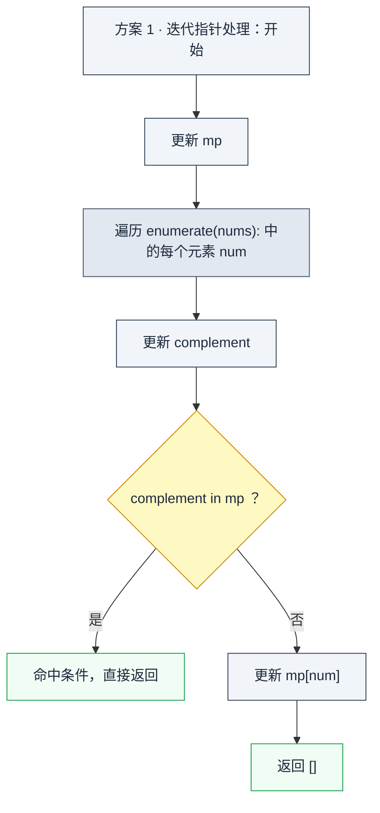

```python
import sys  # 提高递归深度上限（深输入防 RecursionError）

sys.setrecursionlimit(200000)  # 树/链表类题目节点数可达 1e4 量级

def two_sum(nums, target):  # 定义函数 two_sum（参数：数组, 目标值）
    mp = {}  # 把 {} 存入 mp
    for i, num in enumerate(nums):  # 同时取 下标 i 与 num 遍历
        complement = target - num  # 把 目标值 减 num 存入 complement
        if complement in mp:  # 若 complement in mp
            return [mp[complement], i]  # 返回 [mp[complement], 下标 i]
        mp[num] = i  # 把 下标 i 写入 mp[num]
    return []  # 返回 []

def max_sub_array(nums):  # 定义函数 max_sub_array（参数：数组）
    max_sum = nums[0]  # 把 数组[0] 存入 max_sum
    current_sum = nums[0]  # 把 数组[0] 存入 current_sum
    for i in range(1, len(nums)):  # 让 下标 i 从 1 到 长度(数组 遍历
        current_sum = max(
            nums[i], current_sum + nums[i]
        )  # 把 取较大值 数组[下标 i], current_sum 加 数组[下标 i]) 存入 current_sum
        max_sum = max(max_sum, current_sum)  # 把 取较大值 max_sum, current_sum) 存入 max_sum
    return max_sum  # 返回 max_sum

def rotate_array(nums, k):  # 定义函数 rotate_array（参数：数组, 下标 k）
    n = len(nums)  # 把 长度(数组) 存入 元素个数
    if n == 0:  # 若 元素个数 等于 0
        return  # return
    k %= n  # 把 元素个数 写入 k %

    def reverse(arr, left, right):  # 定义函数 reverse（参数：数组, 左边界, 右边界）
        while left < right:  # 循环，直到不满足「左边界 小于 右边界」
            arr[left], arr[right] = (
                arr[right],
                arr[left],
            )  # 把 数组[右边界], 数组[左边界] 写入 arr[left], arr[right]
            left += 1  # 左边界累加 1
            right -= 1  # 右边界累减 1

    reverse(nums, 0, n - 1)  # reverse(数组, 0, 元素个数 减 1)
    reverse(nums, 0, k - 1)  # reverse(数组, 0, 下标 k 减 1)
    reverse(nums, k, n - 1)  # reverse(数组, 下标 k, 元素个数 减 1)

if __name__ == "__main__":  # 若 __name__ 等于 '__main__'
    print(two_sum([2, 7, 11, 15], 9))  # 打印输出
    print(max_sub_array([-2, 1, -3, 4, -1, 2, 1, -5, 4]))  # 打印输出
    arr = [1, 2, 3, 4, 5]  # 把 [1, 2, 3, 4, 5] 存入 数组
    rotate_array(arr, 2)  # rotate_array(数组, 2)
    print(arr)  # 打印输出
```

#### 方案 2：迭代指针处理

**思路与代码分析**：核心是「迭代指针处理」。Python 版用切片与字典推导式简化操作，突出可读性。**走读**：方案 2 · 迭代指针处理：开始 → 更新 mp → 遍历 enumerate(nums): 中的每个元素 num → 更新 complement → 命中条件，直接返回 → 更新 mp[num] → 返回 []。

**运行架构**（真实控制流）：


```python
import sys  # 提高递归深度上限（深输入防 RecursionError）

sys.setrecursionlimit(200000)  # 树/链表类题目节点数可达 1e4 量级

def two_sum(nums, target):  # 定义函数 two_sum（参数：数组, 目标值）
    mp = {}  # 把 {} 存入 mp
    for i, num in enumerate(nums):  # 同时取 下标 i 与 num 遍历
        complement = target - num  # 把 目标值 减 num 存入 complement
        if complement in mp:  # 若 complement in mp
            return [mp[complement], i]  # 返回 [mp[complement], 下标 i]
        mp[num] = i  # 把 下标 i 写入 mp[num]
    return []  # 返回 []

def max_sub_array(nums):  # 定义函数 max_sub_array（参数：数组）
    max_sum = nums[0]  # 把 数组[0] 存入 max_sum
    current_sum = nums[0]  # 把 数组[0] 存入 current_sum
    for i in range(1, len(nums)):  # 让 下标 i 从 1 到 长度(数组 遍历
        current_sum = max(
            nums[i], current_sum + nums[i]
        )  # 把 取较大值 数组[下标 i], current_sum 加 数组[下标 i]) 存入 current_sum
        max_sum = max(max_sum, current_sum)  # 把 取较大值 max_sum, current_sum) 存入 max_sum
    return max_sum  # 返回 max_sum

def rotate_array(nums, k):  # 定义函数 rotate_array（参数：数组, 下标 k）
    n = len(nums)  # 把 长度(数组) 存入 元素个数
    if n == 0:  # 若 元素个数 等于 0
        return  # return
    k %= n  # 把 元素个数 写入 k %

    def reverse(arr, left, right):  # 定义函数 reverse（参数：数组, 左边界, 右边界）
        while left < right:  # 循环，直到不满足「左边界 小于 右边界」
            arr[left], arr[right] = (
                arr[right],
                arr[left],
            )  # 把 数组[右边界], 数组[左边界] 写入 arr[left], arr[right]
            left += 1  # 左边界累加 1
            right -= 1  # 右边界累减 1

    reverse(nums, 0, n - 1)  # reverse(数组, 0, 元素个数 减 1)
    reverse(nums, 0, k - 1)  # reverse(数组, 0, 下标 k 减 1)
    reverse(nums, k, n - 1)  # reverse(数组, 下标 k, 元素个数 减 1)

if __name__ == "__main__":  # 若 __name__ 等于 '__main__'
    print(two_sum([2, 7, 11, 15], 9))  # 打印输出
    print(max_sub_array([-2, 1, -3, 4, -1, 2, 1, -5, 4]))  # 打印输出
    arr = [1, 2, 3, 4, 5]  # 把 [1, 2, 3, 4, 5] 存入 数组
    rotate_array(arr, 2)  # rotate_array(数组, 2)
    print(arr)  # 打印输出
```

### Go 实现（2 种方案）

Go 的全部方案如下，每个方案都内嵌用例自测，可独立运行（老仓库 python/go 文件遵循「打印结果」约定）：

#### 方案 1：迭代指针处理

**思路与代码分析**：核心是「迭代指针处理」。Go 版用切片与多返回值惯用法，显式处理索引边界。代码里依次做这些事：哈希结构做计数或查重。**走读**：方案 1 · 迭代指针处理：开始 → 更新 : → 遍历 nums 的下标与元素 num → 更新 : → 处理 if j, ok := mp[complement] → 返回 []int → 更新 mp[num] → 返回 []int。

**运行架构**（真实控制流）：

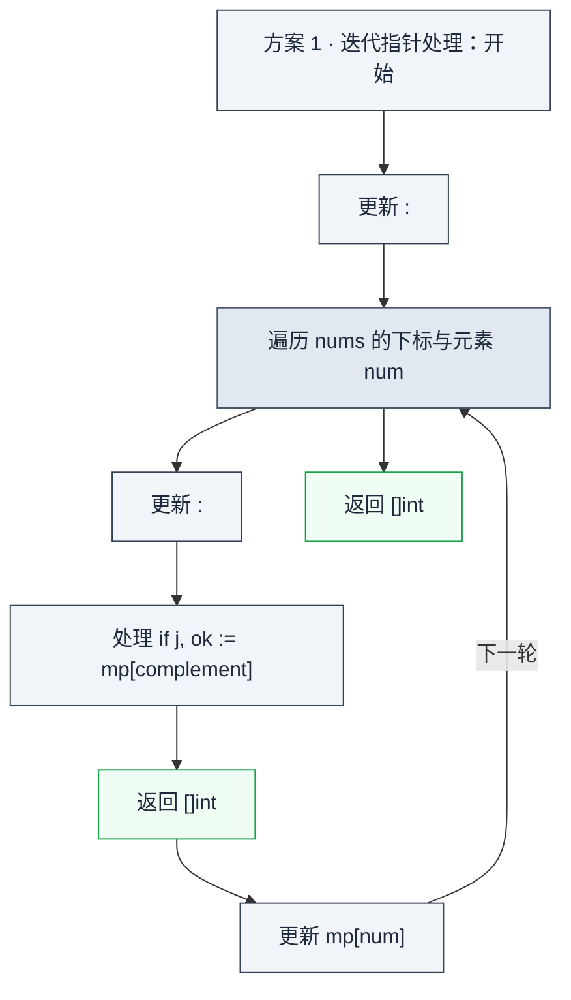

```go
package main // 引入依赖

import (
	"fmt"     // 「fmt」
	"os"      // 「os」
	"reflect" // 「reflect」
)

func twoSumN(nums []int, target int) []int { // 定义函数/方法 twoSumN
	mp := make(map[int]int)    // 把 make(映射表[int]int) 写入 mp :
	for i, num := range nums { // 同时取 下标 i 与 num 遍历
		complement := target - num       // 把 目标值 减 num 写入 complement :
		if j, ok := mp[complement]; ok { // 若 下标 j, ok : 赋值为 mp[complement]; ok
			return []int{j, i} // 返回 []int{下标 j, 下标 i}
		}
		mp[num] = i // 把 下标 i 写入 mp[num]
	}
	return []int{} // 返回 []int{}
}

func maxSubArray(nums []int) int { // 定义函数/方法 maxSubArray
	maxSum := nums[0]                // 把 数组[0] 写入 maxSum :
	currentSum := nums[0]            // 把 数组[0] 写入 currentSum :
	for i := 1; i < len(nums); i++ { // 让 下标 i 从 1 开始计数
		if nums[i] > currentSum+nums[i] { // 若 数组[下标 i] 超过 currentSum 加 数组[下标 i]
			currentSum = nums[i] // 把 数组[下标 i] 写入 currentSum
		} else { // 否则
			currentSum = currentSum + nums[i] // 把 currentSum 加 数组[下标 i] 写入 currentSum
		}
		if currentSum > maxSum { // 若 currentSum 超过 maxSum
			maxSum = currentSum // 把 currentSum 写入 maxSum
		}
	}
	return maxSum // 返回 maxSum
}

func reverseArr(arr []int, left, right int) { // 定义函数/方法 reverseArr
	for left < right { // for 左边界 小于 右边界 {
		arr[left], arr[right] = arr[right], arr[left] // 把 数组[右边界], 数组[左边界] 写入 arr[left], arr[right]
		left++                                        // 左边界 加一
		right--                                       // 右边界 减一
	}
}

func rotateArray(nums []int, k int) { // 定义函数/方法 rotateArray
	n := len(nums) // 把 长度(数组) 写入 n :
	if n == 0 {    // 若 元素个数 等于 0
		return // return
	}
	k %= n                   // 把 元素个数 写入 k %
	reverseArr(nums, 0, n-1) // reverseArr(数组, 0, 元素个数 减 1)
	reverseArr(nums, 0, k-1) // reverseArr(数组, 0, 下标 k 减 1)
	reverseArr(nums, k, n-1) // reverseArr(数组, 下标 k, 元素个数 减 1)
}

func main() { // 程序入口：跑内嵌自测用例
	ok := true // 把 true 写入 ok :
	if got := twoSumN([]int{2, 7, 11, 15}, 9); !reflect.DeepEqual(got, []int{0, 1}) {
		ok = false                          // 把 false 写入 ok
		fmt.Printf("FAIL twoSum=%v\n", got) // 打印输出
	}
	if got := maxSubArray([]int{-2, 1, -3, 4, -1, 2, 1, -5, 4}); got != 6 {
		ok = false                               // 把 false 写入 ok
		fmt.Printf("FAIL maxSubArray=%d\n", got) // 打印输出
	}
	arr := []int{1, 2, 3, 4, 5}                        // 把 []int{1, 2, 3, 4, 5} 写入 arr :
	rotateArray(arr, 2)                                // rotateArray(数组, 2)
	if !reflect.DeepEqual(arr, []int{4, 5, 1, 2, 3}) { // 若 取反 reflect.DeepEqual(数组, []int{4, 5, 1, 2, 3}
		ok = false                               // 把 false 写入 ok
		fmt.Printf("FAIL rotateArray=%v\n", arr) // 打印输出
	}
	if !ok { // 若 取反 ok
		os.Exit(1) // os.Exit(1)
	}
	fmt.Println("PASS") // 全部用例通过，输出 PASS
}
```

#### 方案 2：迭代指针处理

**思路与代码分析**：核心是「迭代指针处理」。Go 版用切片与多返回值惯用法，显式处理索引边界。代码里依次做这些事：哈希结构做计数或查重。**走读**：方案 2 · 迭代指针处理：开始 → 更新 : → 遍历 nums 的下标与元素 num → 更新 : → 处理 if j, ok := mp[complement] → 返回 []int → 更新 mp[num] → 返回 []int。

**运行架构**（真实控制流）：


```go
package main // 引入依赖

import (
	"fmt"     // 「fmt」
	"os"      // 「os」
	"reflect" // 「reflect」
)

func twoSumN(nums []int, target int) []int { // 定义函数/方法 twoSumN
	mp := make(map[int]int)    // 把 make(映射表[int]int) 写入 mp :
	for i, num := range nums { // 同时取 下标 i 与 num 遍历
		complement := target - num       // 把 目标值 减 num 写入 complement :
		if j, ok := mp[complement]; ok { // 若 下标 j, ok : 赋值为 mp[complement]; ok
			return []int{j, i} // 返回 []int{下标 j, 下标 i}
		}
		mp[num] = i // 把 下标 i 写入 mp[num]
	}
	return []int{} // 返回 []int{}
}

func maxSubArray(nums []int) int { // 定义函数/方法 maxSubArray
	maxSum := nums[0]                // 把 数组[0] 写入 maxSum :
	currentSum := nums[0]            // 把 数组[0] 写入 currentSum :
	for i := 1; i < len(nums); i++ { // 让 下标 i 从 1 开始计数
		if nums[i] > currentSum+nums[i] { // 若 数组[下标 i] 超过 currentSum 加 数组[下标 i]
			currentSum = nums[i] // 把 数组[下标 i] 写入 currentSum
		} else { // 否则
			currentSum = currentSum + nums[i] // 把 currentSum 加 数组[下标 i] 写入 currentSum
		}
		if currentSum > maxSum { // 若 currentSum 超过 maxSum
			maxSum = currentSum // 把 currentSum 写入 maxSum
		}
	}
	return maxSum // 返回 maxSum
}

func reverseArr(arr []int, left, right int) { // 定义函数/方法 reverseArr
	for left < right { // for 左边界 小于 右边界 {
		arr[left], arr[right] = arr[right], arr[left] // 把 数组[右边界], 数组[左边界] 写入 arr[left], arr[right]
		left++                                        // 左边界 加一
		right--                                       // 右边界 减一
	}
}

func rotateArray(nums []int, k int) { // 定义函数/方法 rotateArray
	n := len(nums) // 把 长度(数组) 写入 n :
	if n == 0 {    // 若 元素个数 等于 0
		return // return
	}
	k %= n                   // 把 元素个数 写入 k %
	reverseArr(nums, 0, n-1) // reverseArr(数组, 0, 元素个数 减 1)
	reverseArr(nums, 0, k-1) // reverseArr(数组, 0, 下标 k 减 1)
	reverseArr(nums, k, n-1) // reverseArr(数组, 下标 k, 元素个数 减 1)
}

func main() { // 程序入口：跑内嵌自测用例
	ok := true // 把 true 写入 ok :
	if got := twoSumN([]int{2, 7, 11, 15}, 9); !reflect.DeepEqual(got, []int{0, 1}) {
		ok = false                          // 把 false 写入 ok
		fmt.Printf("FAIL twoSum=%v\n", got) // 打印输出
	}
	if got := maxSubArray([]int{-2, 1, -3, 4, -1, 2, 1, -5, 4}); got != 6 {
		ok = false                               // 把 false 写入 ok
		fmt.Printf("FAIL maxSubArray=%d\n", got) // 打印输出
	}
	arr := []int{1, 2, 3, 4, 5}                        // 把 []int{1, 2, 3, 4, 5} 写入 arr :
	rotateArray(arr, 2)                                // rotateArray(数组, 2)
	if !reflect.DeepEqual(arr, []int{4, 5, 1, 2, 3}) { // 若 取反 reflect.DeepEqual(数组, []int{4, 5, 1, 2, 3}
		ok = false                               // 把 false 写入 ok
		fmt.Printf("FAIL rotateArray=%v\n", arr) // 打印输出
	}
	if !ok { // 若 取反 ok
		os.Exit(1) // os.Exit(1)
	}
	fmt.Println("PASS") // 全部用例通过，输出 PASS
}
```

### Java 实现（2 种方案）

Java 的全部方案如下，每个方案都内嵌用例自测，可独立运行（老仓库 python/go 文件遵循「打印结果」约定）：

#### 方案 1：迭代指针处理

**思路与代码分析**：核心是「迭代指针处理」。Java 版用类与静态方法组织，集合操作显式明了。代码里依次做这些事：哈希结构做计数或查重；单循环线性扫描。**走读**：方案 1 · 迭代指针处理：开始 → 更新 mp → 处理 new HashMap＜＞() → 遍历循环 → 更新 complement → 命中条件，直接返回 → 调用 mp.put(nums[i], i) → 返回 new int[]。

**运行架构**（真实控制流）：


```java
package com.webfault.dsa; // 引入依赖

import java.util.*; // 引入依赖

class ArrOpsS1 { // 定义类型
  static int[] twoSum(int[] nums, int target) { // 定义函数/方法 twoSum
    Map<Integer, Integer> mp =
        new HashMap<>(); // 把 new HashMap 小于 超过 (); 写入 Map<Integer, Integer> mp
    for (int i = 0; i < nums.length; i++) { // 让 下标 i 从 0 开始计数，下标 i 小于 数组.长度 就继续
      int complement = target - nums[i]; // 把 目标值 减 数组[下标 i] 存入 complement
      if (mp.containsKey(complement)) return new int[] {mp.get(complement), i};
      mp.put(nums[i], i); // mp.put(数组[下标 i], 下标 i);
    }
    return new int[] {}; // 返回 new int[]{}
  }

  static int maxSubArray(int[] nums) { // 定义函数/方法 maxSubArray
    int maxSum = nums[0], currentSum = nums[0]; // 把 数组[0], currentSum 赋值为 数组[0] 存入 maxSum
    for (int i = 1; i < nums.length; i++) { // 让 下标 i 从 1 开始计数，下标 i 小于 数组.长度 就继续
      currentSum =
          Math.max(
              nums[i],
              currentSum + nums[i]); // 把 Math.取较大值 数组[下标 i], currentSum 加 数组[下标 i]); 写入 currentSum
      maxSum = Math.max(maxSum, currentSum); // 把 Math.取较大值 maxSum, currentSum); 写入 maxSum
    }
    return maxSum; // 返回 maxSum
  }

  static void rotateArray(int[] nums, int k) { // 定义函数/方法 rotateArray
    int n = nums.length; // 把 数组.长度 存入 元素个数
    if (n == 0) return; // 若 元素个数 等于 0) return;
    k %= n; // 把 元素个数; 写入 k %
    reverse(nums, 0, n - 1); // reverse(数组, 0, 元素个数 减 1);
    reverse(nums, 0, k - 1); // reverse(数组, 0, 下标 k 减 1);
    reverse(nums, k, n - 1); // reverse(数组, 下标 k, 元素个数 减 1);
  }

  static void reverse(int[] a, int l, int r) { // 定义函数/方法 reverse
    while (l < r) {
      int t = a[l];
      a[l] = a[r];
      a[r] = t;
      l++;
      r--;
    }
  }

  public static void main(String[] args) { // public static void main(String[] args) {
    boolean ok = true; // 把 true; 写入 boolean ok
    int[] ts =
        ArrOpsS1.twoSum(
            new int[] {2, 7, 11, 15},
            9); // 把 ArrOpsS1.twoSum(new int[]{2, 7, 11, 15}, 9); 写入 int[] ts
    if (!Arrays.equals(ts, new int[] {0, 1})) {
      ok = false;
      System.out.println("FAIL twoSum=" + Arrays.toString(ts));
    }
    int ms = ArrOpsS1.maxSubArray(new int[] {-2, 1, -3, 4, -1, 2, 1, -5, 4});
    if (ms != 6) {
      ok = false;
      System.out.println("FAIL maxSubArray=" + ms);
    }
    int[] rot = {1, 2, 3, 4, 5}; // 把 {1, 2, 3, 4, 5}; 写入 int[] rot
    ArrOpsS1.rotateArray(rot, 2); // ArrOpsS1.rotateArray(rot, 2);
    if (!Arrays.equals(rot, new int[] {4, 5, 1, 2, 3})) {
      ok = false;
      System.out.println("FAIL rotateArray=" + Arrays.toString(rot));
    }
    if (!ok) throw new RuntimeException("FAILED"); // 若 取反 ok) throw new RuntimeException(「FAILED」);
    System.out.println("PASS"); // 全部用例通过，输出 PASS
  }
}
```

#### 方案 2：迭代指针处理

**思路与代码分析**：核心是「迭代指针处理」。Java 版用类与静态方法组织，集合操作显式明了。代码里依次做这些事：哈希结构做计数或查重；单循环线性扫描。**走读**：方案 2 · 迭代指针处理：开始 → 更新 mp → 处理 new HashMap＜＞() → 遍历循环 → 更新 complement → 命中条件，直接返回 → 调用 mp.put(nums[i], i) → 返回 new int[]。

**运行架构**（真实控制流）：

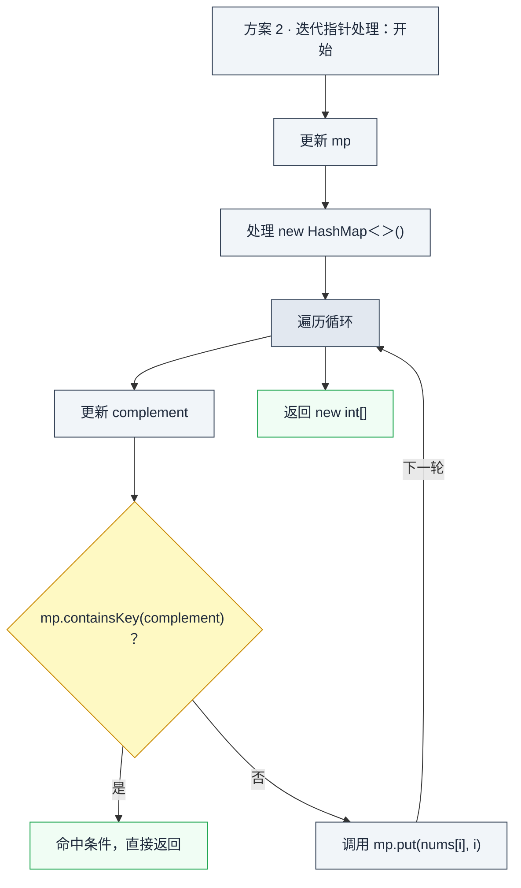

```java
package com.webfault.dsa; // 引入依赖

import java.util.*; // 引入依赖

class ArrOpsS2 { // 定义类型
  static int[] twoSum(int[] nums, int target) { // 定义函数/方法 twoSum
    Map<Integer, Integer> mp =
        new HashMap<>(); // 把 new HashMap 小于 超过 (); 写入 Map<Integer, Integer> mp
    for (int i = 0; i < nums.length; i++) { // 让 下标 i 从 0 开始计数，下标 i 小于 数组.长度 就继续
      int complement = target - nums[i]; // 把 目标值 减 数组[下标 i] 存入 complement
      if (mp.containsKey(complement)) return new int[] {mp.get(complement), i};
      mp.put(nums[i], i); // mp.put(数组[下标 i], 下标 i);
    }
    return new int[] {}; // 返回 new int[]{}
  }

  static int maxSubArray(int[] nums) { // 定义函数/方法 maxSubArray
    int maxSum = nums[0], currentSum = nums[0]; // 把 数组[0], currentSum 赋值为 数组[0] 存入 maxSum
    for (int i = 1; i < nums.length; i++) { // 让 下标 i 从 1 开始计数，下标 i 小于 数组.长度 就继续
      currentSum =
          Math.max(
              nums[i],
              currentSum + nums[i]); // 把 Math.取较大值 数组[下标 i], currentSum 加 数组[下标 i]); 写入 currentSum
      maxSum = Math.max(maxSum, currentSum); // 把 Math.取较大值 maxSum, currentSum); 写入 maxSum
    }
    return maxSum; // 返回 maxSum
  }

  static void rotateArray(int[] nums, int k) { // 定义函数/方法 rotateArray
    int n = nums.length; // 把 数组.长度 存入 元素个数
    if (n == 0) return; // 若 元素个数 等于 0) return;
    k %= n; // 把 元素个数; 写入 k %
    reverse(nums, 0, n - 1); // reverse(数组, 0, 元素个数 减 1);
    reverse(nums, 0, k - 1); // reverse(数组, 0, 下标 k 减 1);
    reverse(nums, k, n - 1); // reverse(数组, 下标 k, 元素个数 减 1);
  }

  static void reverse(int[] a, int l, int r) { // 定义函数/方法 reverse
    while (l < r) {
      int t = a[l];
      a[l] = a[r];
      a[r] = t;
      l++;
      r--;
    }
  }

  public static void main(String[] args) { // public static void main(String[] args) {
    boolean ok = true; // 把 true; 写入 boolean ok
    int[] ts =
        ArrOpsS2.twoSum(
            new int[] {2, 7, 11, 15},
            9); // 把 ArrOpsS2.twoSum(new int[]{2, 7, 11, 15}, 9); 写入 int[] ts
    if (!Arrays.equals(ts, new int[] {0, 1})) {
      ok = false;
      System.out.println("FAIL twoSum=" + Arrays.toString(ts));
    }
    int ms = ArrOpsS2.maxSubArray(new int[] {-2, 1, -3, 4, -1, 2, 1, -5, 4});
    if (ms != 6) {
      ok = false;
      System.out.println("FAIL maxSubArray=" + ms);
    }
    int[] rot = {1, 2, 3, 4, 5}; // 把 {1, 2, 3, 4, 5}; 写入 int[] rot
    ArrOpsS2.rotateArray(rot, 2); // ArrOpsS2.rotateArray(rot, 2);
    if (!Arrays.equals(rot, new int[] {4, 5, 1, 2, 3})) {
      ok = false;
      System.out.println("FAIL rotateArray=" + Arrays.toString(rot));
    }
    if (!ok) throw new RuntimeException("FAILED"); // 若 取反 ok) throw new RuntimeException(「FAILED」);
    System.out.println("PASS"); // 全部用例通过，输出 PASS
  }
}
```

### Rust 实现（2 种方案）

Rust 的全部方案如下，每个方案都内嵌用例自测，可独立运行（老仓库 python/go 文件遵循「打印结果」约定）：

#### 方案 1：迭代指针处理

**思路与代码分析**：核心是「迭代指针处理」。Rust 版用所有权移动与切片借用改写同一逻辑，注意 Option 与引用边界。**走读**：方案 1 · 迭代指针处理：开始 → 遍历 0..nums.len() 中的每个元素 i → 遍历 i + 1..nums.len() 中的每个元素 j → 处理 if nums[i] + nums[j] == targ → 返回 vec非 [i as i32, j as i32] → 处理 vec非 []。

**运行架构**（真实控制流）：

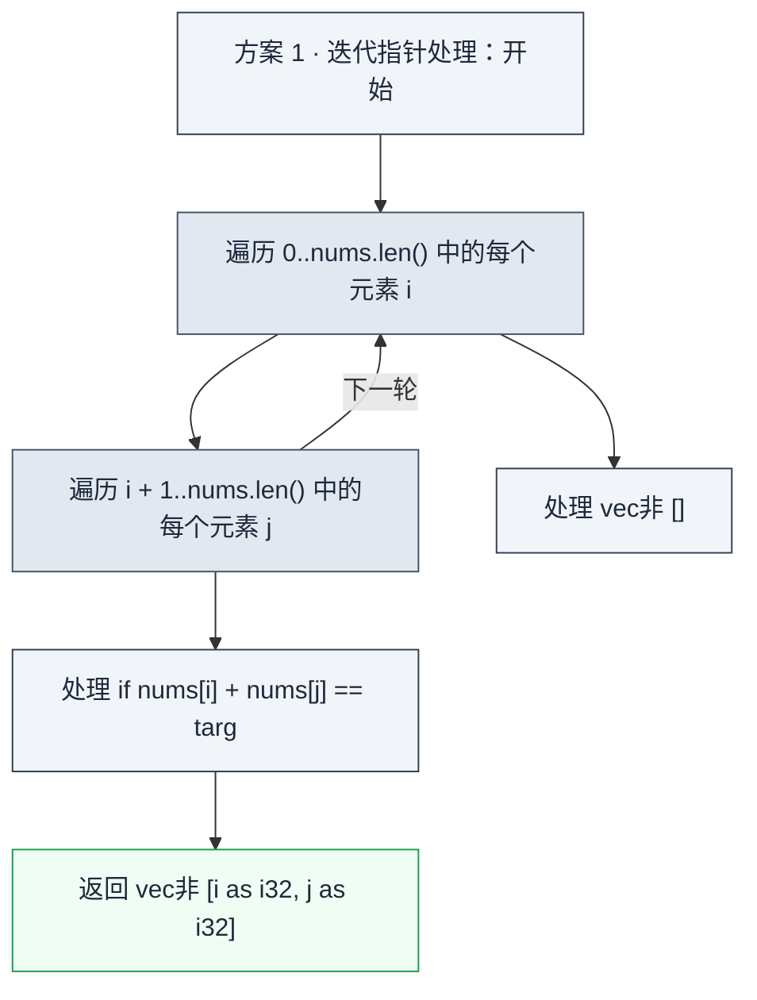

```rust
// 数据结构与算法之数组操作 — Rust 版（方案1）
fn two_sum(nums: &[i32], target: i32) -> Vec<i32> {
    // 定义函数/方法 two_sum
    for i in 0..nums.len() {
        // 逐个取出 0 的元素（下标 i）
        for j in i + 1..nums.len() {
            // 逐个取出 下标 i 的元素（下标 j）
            if nums[i] + nums[j] == target {
                return vec![i as i32, j as i32];
            }
        }
    }
    vec![] // vec取反 []
}
fn max_sub_array(nums: &[i32]) -> i32 {
    // 定义函数/方法 max_sub_array
    let (mut best, mut cur) = (nums[0], nums[0]); // 把 (数组[0], 数组[0]); 写入 let (mut best, mut cur)
    for &v in nums.iter().skip(1) {
        // for 按位与 值 in 数组.iter().skip(1) {
        cur = if cur > 0 { cur + v } else { v }; // 把 if 当前值 超过 0 { 当前值 加 值 } else { 值 }; 写入 当前值
        best = best.max(cur); // 把 当前最优.取较大值 当前值); 写入 当前最优
    }
    best // 当前最优
}
fn rotate_array(nums: &[i32], k: i32) -> Vec<i32> {
    // 定义函数/方法 rotate_array
    let n = nums.len(); // 把 数组.长度() 存入 元素个数
    let k = (k as usize) % n; // 把 (下标 k as usize) 对…取模 元素个数 存入 下标 k
    let mut v = nums.to_vec(); // 把 数组.to_vec(); 写入 let mut v
    v.rotate_right(k); // 值.rotate_right(下标 k);
    v
}
fn main() {
    // 程序入口：跑内嵌自测用例
    assert_eq!(two_sum(&[2, 7, 11, 15], 9), vec![0, 1]); // 断言校验
    assert_eq!(max_sub_array(&[-2, 1, -3, 4, -1, 2, 1, -5, 4]), 6); // 断言校验
    assert_eq!(
        rotate_array(&[1, 2, 3, 4, 5, 6, 7], 3),
        vec![5, 6, 7, 1, 2, 3, 4]
    ); // 断言校验
    println!("PASS");
} // 全部用例通过，输出 PASS
```

#### 方案 2：迭代指针处理

**思路与代码分析**：核心是「迭代指针处理」。Rust 版用所有权移动与切片借用改写同一逻辑，注意 Option 与引用边界。**走读**：方案 2 · 迭代指针处理：开始 → 遍历 0..nums.len() 中的每个元素 i → 遍历 i + 1..nums.len() 中的每个元素 j → 处理 if nums[i] + nums[j] == targ → 返回 vec非 [i as i32, j as i32] → 处理 vec非 []。

**运行架构**（真实控制流）：


```rust
// 数据结构与算法之数组操作 — Rust 版（方案2）
fn two_sum(nums: &[i32], target: i32) -> Vec<i32> {
    // 定义函数/方法 two_sum
    for i in 0..nums.len() {
        // 逐个取出 0 的元素（下标 i）
        for j in i + 1..nums.len() {
            // 逐个取出 下标 i 的元素（下标 j）
            if nums[i] + nums[j] == target {
                return vec![i as i32, j as i32];
            }
        }
    }
    vec![] // vec取反 []
}
fn max_sub_array(nums: &[i32]) -> i32 {
    // 定义函数/方法 max_sub_array
    let (mut best, mut cur) = (nums[0], nums[0]); // 把 (数组[0], 数组[0]); 写入 let (mut best, mut cur)
    for &v in nums.iter().skip(1) {
        // for 按位与 值 in 数组.iter().skip(1) {
        cur = if cur > 0 { cur + v } else { v }; // 把 if 当前值 超过 0 { 当前值 加 值 } else { 值 }; 写入 当前值
        best = best.max(cur); // 把 当前最优.取较大值 当前值); 写入 当前最优
    }
    best // 当前最优
}
fn rotate_array(nums: &[i32], k: i32) -> Vec<i32> {
    // 定义函数/方法 rotate_array
    let n = nums.len(); // 把 数组.长度() 存入 元素个数
    let k = (k as usize) % n; // 把 (下标 k as usize) 对…取模 元素个数 存入 下标 k
    let mut v = nums.to_vec(); // 把 数组.to_vec(); 写入 let mut v
    v.rotate_right(k); // 值.rotate_right(下标 k);
    v
}
fn main() {
    // 程序入口：跑内嵌自测用例
    assert_eq!(two_sum(&[2, 7, 11, 15], 9), vec![0, 1]); // 断言校验
    assert_eq!(max_sub_array(&[-2, 1, -3, 4, -1, 2, 1, -5, 4]), 6); // 断言校验
    assert_eq!(
        rotate_array(&[1, 2, 3, 4, 5, 6, 7], 3),
        vec![5, 6, 7, 1, 2, 3, 4]
    ); // 断言校验
    println!("PASS");
} // 全部用例通过，输出 PASS
```

### Lua 实现（2 种方案）

Lua 的全部方案如下，每个方案都内嵌用例自测，可独立运行（老仓库 python/go 文件遵循「打印结果」约定）：

#### 方案 1：迭代指针处理

**思路与代码分析**：核心是「迭代指针处理」。Lua 版用表与 ipairs 遍历，注意 ipairs 遇 nil 即停的语义。**走读**：方案 1 · 迭代指针处理：开始 → 循环 i：从 1 到 #nums do → 循环 j：从 i + 1 到 #nums do → 处理 if nums[i] + nums[j] == targ → 返回  → 返回 。

**运行架构**（真实控制流）：


```lua
-- 数据结构与算法之数组操作 — Lua 版（方案1）
local function two_sum(nums, target) -- local function two_sum(数组, 目标值)
	for i = 1, #nums do -- 把 1, #数组 do 写入 for i
		for j = i + 1, #nums do -- 把 下标 i 加 1, #数组 do 写入 for j
			if nums[i] + nums[j] == target then
				return { i - 1, j - 1 }
			end
		end -- 终点
	end -- 终点
	return {} -- 返回 {}
end -- 终点
local function max_sub_array(nums) -- local function max_sub_array(数组)
	local best, cur = nums[1], nums[1] -- 把 数组[1], 数组[1] 写入 local best, cur
	for i = 2, #nums do -- 把 2, #数组 do 写入 for i
		cur = cur > 0 and cur + nums[i] or nums[i] -- 把 当前值 超过 0 and 当前值 加 数组[下标 i] or 数组[下标 i] 存入 当前值
		if cur > best then
			best = cur
		end -- 若 当前值 超过 当前最优 then 当前最优 赋值为 当前值 终点
	end -- 终点
	return best -- 返回 当前最优
end -- 终点
local function rotate_array(nums, k) -- local function rotate_array(数组, 下标 k)
	local n = #nums -- 把 #数组 写入 local n
	k = k % n -- 把 下标 k 对…取模 元素个数 存入 下标 k
	local out = {} -- 把 {} 写入 local out
	for i = n - k + 1, n do
		out[#out + 1] = nums[i]
	end
	for i = 1, n - k do
		out[#out + 1] = nums[i]
	end -- 让 下标 i 从 1 走到 元素个数（Lua 1 基）
	return out -- 返回 out
end -- 终点
assert(table.concat(two_sum({ 2, 7, 11, 15 }, 9), ",") == "0,1") -- 打印输出
assert(max_sub_array({ -2, 1, -3, 4, -1, 2, 1, -5, 4 }) == 6) -- 断言校验
assert(table.concat(rotate_array({ 1, 2, 3, 4, 5, 6, 7 }, 3), ",") == "5,6,7,1,2,3,4") -- 打印输出
print("PASS") -- 全部用例通过，输出 PASS
```

#### 方案 2：迭代指针处理

**思路与代码分析**：核心是「迭代指针处理」。Lua 版用表与 ipairs 遍历，注意 ipairs 遇 nil 即停的语义。**走读**：方案 2 · 迭代指针处理：开始 → 循环 i：从 1 到 #nums do → 循环 j：从 i + 1 到 #nums do → 处理 if nums[i] + nums[j] == targ → 返回  → 返回 。

**运行架构**（真实控制流）：

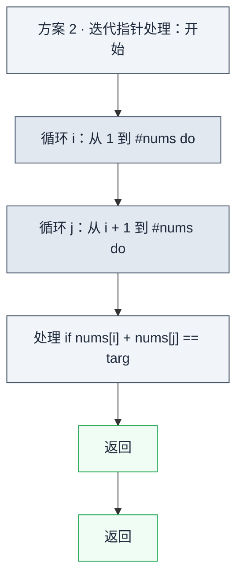

```lua
-- 数据结构与算法之数组操作 — Lua 版（方案2）
local function two_sum(nums, target) -- local function two_sum(数组, 目标值)
	for i = 1, #nums do -- 把 1, #数组 do 写入 for i
		for j = i + 1, #nums do -- 把 下标 i 加 1, #数组 do 写入 for j
			if nums[i] + nums[j] == target then
				return { i - 1, j - 1 }
			end
		end -- 终点
	end -- 终点
	return {} -- 返回 {}
end -- 终点
local function max_sub_array(nums) -- local function max_sub_array(数组)
	local best, cur = nums[1], nums[1] -- 把 数组[1], 数组[1] 写入 local best, cur
	for i = 2, #nums do -- 把 2, #数组 do 写入 for i
		cur = cur > 0 and cur + nums[i] or nums[i] -- 把 当前值 超过 0 and 当前值 加 数组[下标 i] or 数组[下标 i] 存入 当前值
		if cur > best then
			best = cur
		end -- 若 当前值 超过 当前最优 then 当前最优 赋值为 当前值 终点
	end -- 终点
	return best -- 返回 当前最优
end -- 终点
local function rotate_array(nums, k) -- local function rotate_array(数组, 下标 k)
	local n = #nums -- 把 #数组 写入 local n
	k = k % n -- 把 下标 k 对…取模 元素个数 存入 下标 k
	local out = {} -- 把 {} 写入 local out
	for i = n - k + 1, n do
		out[#out + 1] = nums[i]
	end
	for i = 1, n - k do
		out[#out + 1] = nums[i]
	end -- 让 下标 i 从 1 走到 元素个数（Lua 1 基）
	return out -- 返回 out
end -- 终点
assert(table.concat(two_sum({ 2, 7, 11, 15 }, 9), ",") == "0,1") -- 打印输出
assert(max_sub_array({ -2, 1, -3, 4, -1, 2, 1, -5, 4 }) == 6) -- 断言校验
assert(table.concat(rotate_array({ 1, 2, 3, 4, 5, 6, 7 }, 3), ",") == "5,6,7,1,2,3,4") -- 打印输出
print("PASS") -- 全部用例通过，输出 PASS
```

### C 实现（2 种方案）

C 的全部方案如下，每个方案都内嵌用例自测，可独立运行（老仓库 python/go 文件遵循「打印结果」约定）：

#### 方案 1：迭代指针处理

**思路与代码分析**：核心是「迭代指针处理」。C 版手动管理下标与内存，循环边界全部显式写出。代码里依次做这些事：双重循环遍历。**走读**：方案 1 · 迭代指针处理：开始 → 遍历循环 → 遍历循环 → 若 n[i] + n[j] == target 则： → 更新 out[0] → 更新 out[1] → 返回 1 → 返回 0。

**运行架构**（真实控制流）：


```c
/* 数据结构与算法之数组操作 — C 版（方案1） */
#include <stdio.h>                                                  // 引入头文件
static int two_sum(const int *n, int len, int target, int out[2]) { // 定义函数/方法 two_sum
    for (int i = 0; i < len; i++) // 让 下标 i 从 0 开始计数，下标 i 小于 长度 就继续
        for (int j = i + 1; j < len; j++) // 让 下标 j 从 下标 i 加 1 开始计数，下标 j 小于 长度 就继续
            if (n[i] + n[j] == target) {
                out[0] = i;
                out[1] = j;
                return 1;
            }
    return 0; // 返回 0
}
static int max_sub_array(const int *n, int len) { // 定义函数/方法 max_sub_array
    int best = n[0], cur = n[0]; // 把 元素个数[0], 当前值 赋值为 元素个数[0] 存入 当前最优
    for (int i = 1; i < len; i++) { // 让 下标 i 从 1 开始计数，下标 i 小于 长度 就继续
        cur = cur > 0 ? cur + n[i]
                      : n[i]; // 把 当前值 超过 0 ? 当前值 加 元素个数[下标 i] : 元素个数[下标 i]; 写入 当前值
        if (cur > best)
            best = cur; // 若 当前值 超过 当前最优) 当前最优 赋值为 当前值;
    }
    return best; // 返回 当前最优
}
int main(void) { // 程序入口：跑内嵌自测用例
    int out[2];  // int out[2];
    if (two_sum((int[]){2, 7, 11, 15}, 4, 9, out) != 1 || out[0] != 0 || out[1] != 1) {
        printf("FAIL 1\n");
        return 1;
    }
    if (max_sub_array((int[]){-2, 1, -3, 4, -1, 2, 1, -5, 4}, 9) != 6) {
        printf("FAIL 2\n");
        return 1;
    }
    printf("PASS\n");
    return 0;
} // 全部用例通过，输出 PASS
```

#### 方案 2：迭代指针处理

**思路与代码分析**：核心是「迭代指针处理」。C 版手动管理下标与内存，循环边界全部显式写出。代码里依次做这些事：双重循环遍历。**走读**：方案 2 · 迭代指针处理：开始 → 遍历循环 → 遍历循环 → 若 n[i] + n[j] == target 则： → 更新 out[0] → 更新 out[1] → 返回 1 → 返回 0。

**运行架构**（真实控制流）：

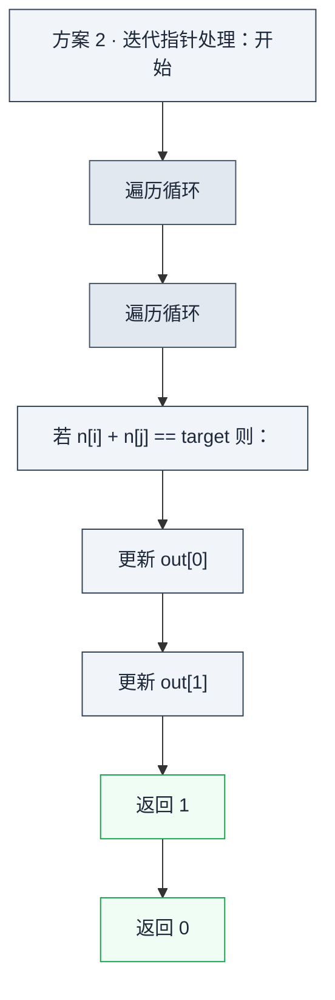

```c
/* 数据结构与算法之数组操作 — C 版（方案2） */
#include <stdio.h>                                                  // 引入头文件
static int two_sum(const int *n, int len, int target, int out[2]) { // 定义函数/方法 two_sum
    for (int i = 0; i < len; i++) // 让 下标 i 从 0 开始计数，下标 i 小于 长度 就继续
        for (int j = i + 1; j < len; j++) // 让 下标 j 从 下标 i 加 1 开始计数，下标 j 小于 长度 就继续
            if (n[i] + n[j] == target) {
                out[0] = i;
                out[1] = j;
                return 1;
            }
    return 0; // 返回 0
}
static int max_sub_array(const int *n, int len) { // 定义函数/方法 max_sub_array
    int best = n[0], cur = n[0]; // 把 元素个数[0], 当前值 赋值为 元素个数[0] 存入 当前最优
    for (int i = 1; i < len; i++) { // 让 下标 i 从 1 开始计数，下标 i 小于 长度 就继续
        cur = cur > 0 ? cur + n[i]
                      : n[i]; // 把 当前值 超过 0 ? 当前值 加 元素个数[下标 i] : 元素个数[下标 i]; 写入 当前值
        if (cur > best)
            best = cur; // 若 当前值 超过 当前最优) 当前最优 赋值为 当前值;
    }
    return best; // 返回 当前最优
}
int main(void) { // 程序入口：跑内嵌自测用例
    int out[2];  // int out[2];
    if (two_sum((int[]){2, 7, 11, 15}, 4, 9, out) != 1 || out[0] != 0 || out[1] != 1) {
        printf("FAIL 1\n");
        return 1;
    }
    if (max_sub_array((int[]){-2, 1, -3, 4, -1, 2, 1, -5, 4}, 9) != 6) {
        printf("FAIL 2\n");
        return 1;
    }
    printf("PASS\n");
    return 0;
} // 全部用例通过，输出 PASS
```

### C++ 实现（2 种方案）

C++ 的全部方案如下，每个方案都内嵌用例自测，可独立运行（老仓库 python/go 文件遵循「打印结果」约定）：

#### 方案 1：迭代指针处理

**思路与代码分析**：核心是「迭代指针处理」。C++ 版用 STL 容器与迭代器，减少手写下标错误。代码里依次做这些事：双重循环遍历。**走读**：方案 1 · 迭代指针处理：开始 → 遍历循环 → 遍历循环 → 处理 ++j) → 命中条件，直接返回 → 返回 。

**运行架构**（真实控制流）：


```cpp
// 数据结构与算法之数组操作 — C++ 版（方案1）
#include <cassert>  // 引入头文件
#include <iostream> // 引入头文件
#include <vector>   // 引入头文件
static std::vector<int> twoSum(const std::vector<int> &nums, int target) {
    for (size_t i = 0; i < nums.size(); ++i) // 让 下标 i 从 0 开始计数，下标 i 小于 数组.大小() 就继续
        for (size_t j = i + 1; j < nums.size();
             ++j) // 让 下标 j 从 下标 i 加 1 开始计数，下标 j 小于 数组.大小() 就继续
            if (nums[i] + nums[j] == target)
                return {static_cast<int>(i), static_cast<int>(j)};
    return {}; // 返回 {}
}
static int maxSubArray(const std::vector<int> &nums) { // 定义函数/方法 maxSubArray
    int best = nums[0], cur = nums[0]; // 把 数组[0], 当前值 赋值为 数组[0] 存入 当前最优
    for (size_t i = 1; i < nums.size(); ++i) { // 让 下标 i 从 1 开始计数，下标 i 小于 数组.大小() 就继续
        cur = std::max(cur + nums[i],
                       nums[i]); // 把 std::取较大值 当前值 加 数组[下标 i], 数组[下标 i]); 写入 当前值
        best = std::max(best, cur); // 把 std::取较大值 当前最优, 当前值); 写入 当前最优
    }
    return best; // 返回 当前最优
}
static std::vector<int> rotateArray(const std::vector<int> &nums, int k) {
    auto v = nums;            // 把 数组 存入 值
    size_t n = v.size();      // 把 值.大小(); 写入 size_t n
    k %= static_cast<int>(n); // 把 static_cast 小于 int 超过 (元素个数); 写入 k %
    std::rotate(v.begin(), v.begin() + n - k,
                v.end()); // std::rotate(值 迭代位置 , 值 迭代位置 加 元素个数 减 下标 k, 值.终点());
    return v;             // 返回 值
}
int main() {                                                       // 程序入口：跑内嵌自测用例
    assert((twoSum({2, 7, 11, 15}, 9) == std::vector<int>{0, 1})); // 断言校验
    assert(maxSubArray({-2, 1, -3, 4, -1, 2, 1, -5, 4}) == 6);     // 断言校验
    assert((rotateArray({1, 2, 3, 4, 5, 6, 7}, 3) == std::vector<int>{5, 6, 7, 1, 2, 3, 4})); // 断言校验
    std::cout << "PASS" << std::endl;
} // 全部用例通过，输出 PASS
```

#### 方案 2：迭代指针处理

**思路与代码分析**：核心是「迭代指针处理」。C++ 版用 STL 容器与迭代器，减少手写下标错误。代码里依次做这些事：双重循环遍历。**走读**：方案 2 · 迭代指针处理：开始 → 遍历循环 → 遍历循环 → 处理 ++j) → 命中条件，直接返回 → 返回 。

**运行架构**（真实控制流）：

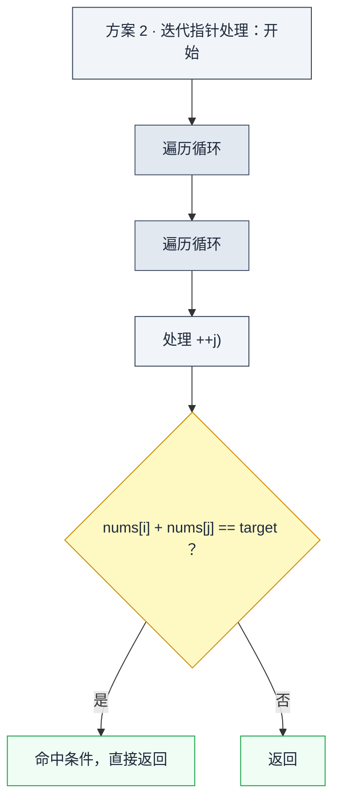

```cpp
// 数据结构与算法之数组操作 — C++ 版（方案2）
#include <cassert>  // 引入头文件
#include <iostream> // 引入头文件
#include <vector>   // 引入头文件
static std::vector<int> twoSum(const std::vector<int> &nums, int target) {
    for (size_t i = 0; i < nums.size(); ++i) // 让 下标 i 从 0 开始计数，下标 i 小于 数组.大小() 就继续
        for (size_t j = i + 1; j < nums.size();
             ++j) // 让 下标 j 从 下标 i 加 1 开始计数，下标 j 小于 数组.大小() 就继续
            if (nums[i] + nums[j] == target)
                return {static_cast<int>(i), static_cast<int>(j)};
    return {}; // 返回 {}
}
static int maxSubArray(const std::vector<int> &nums) { // 定义函数/方法 maxSubArray
    int best = nums[0], cur = nums[0]; // 把 数组[0], 当前值 赋值为 数组[0] 存入 当前最优
    for (size_t i = 1; i < nums.size(); ++i) { // 让 下标 i 从 1 开始计数，下标 i 小于 数组.大小() 就继续
        cur = std::max(cur + nums[i],
                       nums[i]); // 把 std::取较大值 当前值 加 数组[下标 i], 数组[下标 i]); 写入 当前值
        best = std::max(best, cur); // 把 std::取较大值 当前最优, 当前值); 写入 当前最优
    }
    return best; // 返回 当前最优
}
static std::vector<int> rotateArray(const std::vector<int> &nums, int k) {
    auto v = nums;            // 把 数组 存入 值
    size_t n = v.size();      // 把 值.大小(); 写入 size_t n
    k %= static_cast<int>(n); // 把 static_cast 小于 int 超过 (元素个数); 写入 k %
    std::rotate(v.begin(), v.begin() + n - k,
                v.end()); // std::rotate(值 迭代位置 , 值 迭代位置 加 元素个数 减 下标 k, 值.终点());
    return v;             // 返回 值
}
int main() {                                                       // 程序入口：跑内嵌自测用例
    assert((twoSum({2, 7, 11, 15}, 9) == std::vector<int>{0, 1})); // 断言校验
    assert(maxSubArray({-2, 1, -3, 4, -1, 2, 1, -5, 4}) == 6);     // 断言校验
    assert((rotateArray({1, 2, 3, 4, 5, 6, 7}, 3) == std::vector<int>{5, 6, 7, 1, 2, 3, 4})); // 断言校验
    std::cout << "PASS" << std::endl;
} // 全部用例通过，输出 PASS
```

### R 实现（2 种方案）

R 的全部方案如下，每个方案都内嵌用例自测，可独立运行（老仓库 python/go 文件遵循「打印结果」约定）：

#### 方案 1：迭代指针处理

**思路与代码分析**：核心是「迭代指针处理」。R 版用向量化思维与 1 起始下标，注意 1:n 的降序陷阱。代码里依次做这些事：双重循环遍历。**走读**：方案 1 · 迭代指针处理：开始 → 循环 i：遍历 seq_along(nums) → 循环 j：遍历 (i + 1L):length(nums) → 命中条件，直接返回 → 调用 integer(0)。

**运行架构**（真实控制流）：

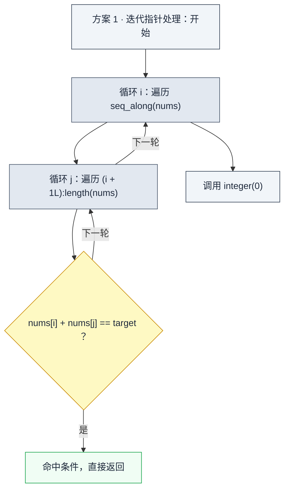

```r
# 版（方案1） 定义函数 two_sum（参数：数组, 目标值） for (下标 i in seq_along(数组)) { for (下标 j in (下标 i
# 加 1L):长度(数组)) {
two_sum <- function(nums, target) {
    for (i in seq_along(nums)) {
        for (j in (i + 1L):length(nums)) {
            if (nums[i] + nums[j] == target)
                return(c(i - 1L, j - 1L))  # 若 数组[下标 i] 加 数组[下标 j] 等于 目标值) return(字符(下标 i 减 1L, 下标 j 减 1L
        }
    }
    integer(0)  # integer(0)
}
max_sub_array <- function(nums) {
    # 定义函数 max_sub_array（参数：数组）
    best <- nums[1]
    cur <- nums[1]  # 把 数组[1]; 当前值 小于 减 数组[1] 存入 当前最优
    for (v in nums[-1]) {
        # for (值 in 数组[ 减 1]) {
        cur <- max(cur + v, v)  # 把 取较大值 当前值 加 值, 值) 存入 当前值
        best <- max(best, cur)  # 把 取较大值 当前最优, 当前值) 存入 当前最优
    }
    best  # 当前最优
}
rotate_array <- function(nums, k) {
    # 定义函数 rotate_array（参数：数组, 下标 k）
    n <- length(nums)  # 把 长度(数组) 存入 元素个数
    k <- k%%n  # 把 下标 k 对…取模 对…取模 元素个数 存入 下标 k
    c(nums[(n - k + 1L):n], nums[1:(n - k)])  # 字符(数组[(元素个数 减 下标 k 加 1L):元素个数], 数组[1:(元素个数 减 下标 k)])
}
stopifnot(identical(as.integer(two_sum(c(2, 7, 11, 15), 9)), c(0L, 1L)))  # 断言校验
stopifnot(max_sub_array(c(-2, 1, -3, 4, -1, 2, 1, -5, 4)) == 6)  # 断言校验
stopifnot(identical(as.integer(rotate_array(c(1, 2, 3, 4, 5, 6, 7), 3)), c(5L, 6L, 7L, 1L, 2L, 3L, 4L)))  # 断言校验
cat("PASS\n")  # 全部用例通过，输出 PASS
```

#### 方案 2：迭代指针处理

**思路与代码分析**：核心是「迭代指针处理」。R 版用向量化思维与 1 起始下标，注意 1:n 的降序陷阱。代码里依次做这些事：双重循环遍历。**走读**：方案 2 · 迭代指针处理：开始 → 循环 i：遍历 seq_along(nums) → 循环 j：遍历 (i + 1L):length(nums) → 命中条件，直接返回 → 调用 integer(0)。

**运行架构**（真实控制流）：


```r
# 版（方案2） 定义函数 two_sum（参数：数组, 目标值） for (下标 i in seq_along(数组)) { for (下标 j in (下标 i
# 加 1L):长度(数组)) {
two_sum <- function(nums, target) {
    for (i in seq_along(nums)) {
        for (j in (i + 1L):length(nums)) {
            if (nums[i] + nums[j] == target)
                return(c(i - 1L, j - 1L))  # 若 数组[下标 i] 加 数组[下标 j] 等于 目标值) return(字符(下标 i 减 1L, 下标 j 减 1L
        }
    }
    integer(0)  # integer(0)
}
max_sub_array <- function(nums) {
    # 定义函数 max_sub_array（参数：数组）
    best <- nums[1]
    cur <- nums[1]  # 把 数组[1]; 当前值 小于 减 数组[1] 存入 当前最优
    for (v in nums[-1]) {
        # for (值 in 数组[ 减 1]) {
        cur <- max(cur + v, v)  # 把 取较大值 当前值 加 值, 值) 存入 当前值
        best <- max(best, cur)  # 把 取较大值 当前最优, 当前值) 存入 当前最优
    }
    best  # 当前最优
}
rotate_array <- function(nums, k) {
    # 定义函数 rotate_array（参数：数组, 下标 k）
    n <- length(nums)  # 把 长度(数组) 存入 元素个数
    k <- k%%n  # 把 下标 k 对…取模 对…取模 元素个数 存入 下标 k
    c(nums[(n - k + 1L):n], nums[1:(n - k)])  # 字符(数组[(元素个数 减 下标 k 加 1L):元素个数], 数组[1:(元素个数 减 下标 k)])
}
stopifnot(identical(as.integer(two_sum(c(2, 7, 11, 15), 9)), c(0L, 1L)))  # 断言校验
stopifnot(max_sub_array(c(-2, 1, -3, 4, -1, 2, 1, -5, 4)) == 6)  # 断言校验
stopifnot(identical(as.integer(rotate_array(c(1, 2, 3, 4, 5, 6, 7), 3)), c(5L, 6L, 7L, 1L, 2L, 3L, 4L)))  # 断言校验
cat("PASS\n")  # 全部用例通过，输出 PASS
```

### Zig 实现（2 种方案）

Zig 的全部方案如下，每个方案都内嵌用例自测，可独立运行（老仓库 python/go 文件遵循「打印结果」约定）：

#### 方案 1：迭代指针处理

**思路与代码分析**：核心是「迭代指针处理」。Zig 版显式分配与清零，整型边界处理严格。代码里依次做这些事：双重循环遍历。**走读**：方案 1 · 迭代指针处理：开始 → 遍历集合元素 → 遍历集合元素 → 若 nums[i] + nums[j] == target 则： → 更新 out[0] → 更新 out[1] → 返回 true → 返回 false。

**运行架构**（真实控制流）：

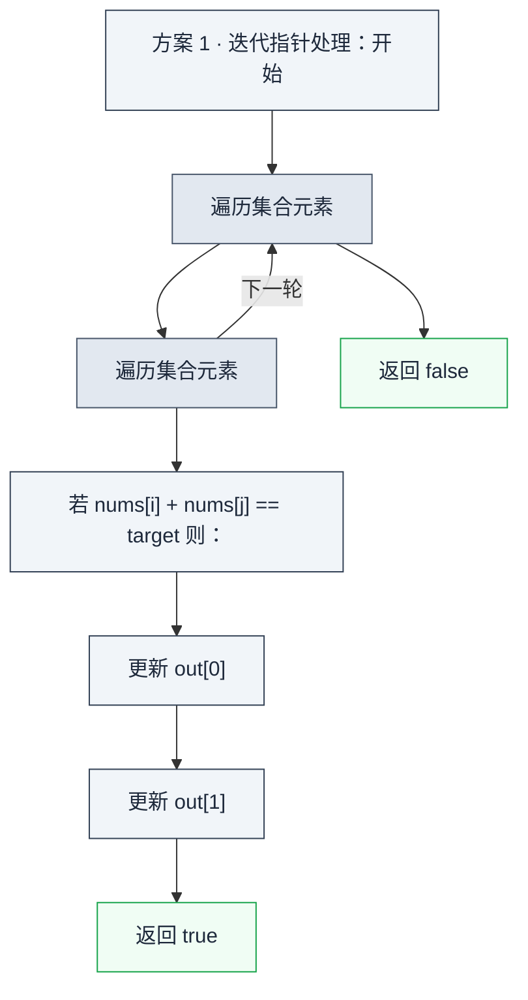

```zig
// 数据结构与算法之数组操作 — Zig 版（方案1）
const std = @import("std"); // 把 @import(「std」) 存入 std
fn twoSum(nums: []const i32, target: i32, out: *[2]i32) bool { // 定义函数/方法 twoSum
    for (0..nums.len) |i| { // 逐个取出 0..数组.长度 的元素（下标 i）
        for (i + 1..nums.len) |j| { // for (下标 i 加 1..数组.长度) 按位或 下标 j 按位或 {
            if (nums[i] + nums[j] == target) { // 若 数组[下标 i] 加 数组[下标 j] 等于 目标值
                out[0] = @intCast(i); // 把 @intCast(下标 i); 写入 out[0]
                out[1] = @intCast(j); // 把 @intCast(下标 j); 写入 out[1]
                return true; // 返回 true
            }
        }
    }
    return false; // 返回 false
}
fn maxSubArray(nums: []const i32) i32 { // 定义函数/方法 maxSubArray
    var best = nums[0]; // 把 数组[0] 存入 当前最优
    var cur = nums[0]; // 把 数组[0] 存入 当前值
    for (nums[1..]) |v| { // for (数组[1..]) 按位或 值 按位或 {
        cur = if (cur > 0) cur + v else v; // 把 if (当前值 超过 0) 当前值 加 值 else 值; 写入 当前值
        if (cur > best) best = cur; // 若 当前值 超过 当前最优) 当前最优 赋值为 当前值;
    }
    return best; // 返回 当前最优
}
pub fn main() !void { // 程序入口：跑内嵌自测用例
    var out: [2]i32 = undefined; // 把 undefined; 写入 var out: [2]i32
    if (!twoSum(&[_]i32{ 2, 7, 11, 15 }, 9, &out)) return error.TestFailed;
    if (out[0] != 0 or out[1] != 1) return error.TestFailed; // 若 out[0] 不等于 0 or out[1] 不等于 1，直接返回 error.TestFailed
    if (maxSubArray(&[_]i32{ -2, 1, -3, 4, -1, 2, 1, -5, 4 }) != 6) return error.TestFailed;
    std.debug.print("PASS\n", .{});
} // 全部用例通过，输出 PASS
```

#### 方案 2：迭代指针处理

**思路与代码分析**：核心是「迭代指针处理」。Zig 版显式分配与清零，整型边界处理严格。代码里依次做这些事：双重循环遍历。**走读**：方案 2 · 迭代指针处理：开始 → 遍历集合元素 → 遍历集合元素 → 若 nums[i] + nums[j] == target 则： → 更新 out[0] → 更新 out[1] → 返回 true → 返回 false。

**运行架构**（真实控制流）：

```mermaid
graph TD
    N0["方案 2 · 迭代指针处理：开始"]
    N1["遍历集合元素"]
    N2["遍历集合元素"]
    N3["若 nums[i] + nums[j] == target 则："]
    N4["更新 out[0]"]
    N5["更新 out[1]"]
    N6["返回 true"]
    N7["返回 false"]
    N0 --> N1
    N1 --> N2
    N2 --> N3
    N3 --> N4
    N4 --> N5
    N5 --> N6
    N2 -- 下一轮 --> N1
    N1 --> N7
    classDef n fill:#f1f5f9,stroke:#334155,color:#1e293b;
    classDef lp fill:#e2e8f0,stroke:#475569,color:#1e293b;
    classDef dc fill:#fef9c3,stroke:#ca8a04,color:#1e293b;
    classDef tm fill:#f0fdf4,stroke:#16a34a,color:#1e293b;
    class N0,N3,N4,N5 n;
    class N1,N2 lp;
    class N6,N7 tm;
```

```zig
// 数据结构与算法之数组操作 — Zig 版（方案2）
const std = @import("std"); // 把 @import(「std」) 存入 std
fn twoSum(nums: []const i32, target: i32, out: *[2]i32) bool { // 定义函数/方法 twoSum
    for (0..nums.len) |i| { // 逐个取出 0..数组.长度 的元素（下标 i）
        for (i + 1..nums.len) |j| { // for (下标 i 加 1..数组.长度) 按位或 下标 j 按位或 {
            if (nums[i] + nums[j] == target) { // 若 数组[下标 i] 加 数组[下标 j] 等于 目标值
                out[0] = @intCast(i); // 把 @intCast(下标 i); 写入 out[0]
                out[1] = @intCast(j); // 把 @intCast(下标 j); 写入 out[1]
                return true; // 返回 true
            }
        }
    }
    return false; // 返回 false
}
fn maxSubArray(nums: []const i32) i32 { // 定义函数/方法 maxSubArray
    var best = nums[0]; // 把 数组[0] 存入 当前最优
    var cur = nums[0]; // 把 数组[0] 存入 当前值
    for (nums[1..]) |v| { // for (数组[1..]) 按位或 值 按位或 {
        cur = if (cur > 0) cur + v else v; // 把 if (当前值 超过 0) 当前值 加 值 else 值; 写入 当前值
        if (cur > best) best = cur; // 若 当前值 超过 当前最优) 当前最优 赋值为 当前值;
    }
    return best; // 返回 当前最优
}
pub fn main() !void { // 程序入口：跑内嵌自测用例
    var out: [2]i32 = undefined; // 把 undefined; 写入 var out: [2]i32
    if (!twoSum(&[_]i32{ 2, 7, 11, 15 }, 9, &out)) return error.TestFailed;
    if (out[0] != 0 or out[1] != 1) return error.TestFailed; // 若 out[0] 不等于 0 or out[1] 不等于 1，直接返回 error.TestFailed
    if (maxSubArray(&[_]i32{ -2, 1, -3, 4, -1, 2, 1, -5, 4 }) != 6) return error.TestFailed;
    std.debug.print("PASS\n", .{});
} // 全部用例通过，输出 PASS
```

### Dart 实现（2 种方案）

Dart 的全部方案如下，每个方案都内嵌用例自测，可独立运行（老仓库 python/go 文件遵循「打印结果」约定）：

#### 方案 1：迭代指针处理

**思路与代码分析**：核心是「迭代指针处理」。Dart 版用可空类型标注与集合方法，注意空安全。代码里依次做这些事：双重循环遍历。**走读**：方案 1 · 迭代指针处理：开始 → 遍历循环 → 遍历循环 → 命中条件，直接返回 → 返回 []。

**运行架构**（真实控制流）：

```mermaid
graph TD
    N0["方案 1 · 迭代指针处理：开始"]
    N1["遍历循环"]
    N2["遍历循环"]
    N3{"nums[i] + nums[j] == target ？"}
    N4["命中条件，直接返回"]
    N5["返回 []"]
    N0 --> N1
    N1 --> N2
    N2 --> N3
    N3 -- 是 --> N4
    N3 -- 下一轮 --> N2
    N2 -- 下一轮 --> N1
    N1 --> N5
    classDef n fill:#f1f5f9,stroke:#334155,color:#1e293b;
    classDef lp fill:#e2e8f0,stroke:#475569,color:#1e293b;
    classDef dc fill:#fef9c3,stroke:#ca8a04,color:#1e293b;
    classDef tm fill:#f0fdf4,stroke:#16a34a,color:#1e293b;
    class N0 n;
    class N1,N2 lp;
    class N3 dc;
    class N4,N5 tm;
```

```dart
// 数据结构与算法之数组操作 — Dart 版（方案1）
List<int> twoSum(List<int> nums, int target) {
  // 定义函数/方法 twoSum
  for (var i = 0; i < nums.length; i++) {
    // 让 下标 i 从 0 开始计数，下标 i 小于 数组.长度 就继续
    for (var j = i + 1; j < nums.length; j++) {
      // 让 下标 j 从 下标 i 加 1 开始计数，下标 j 小于 数组.长度 就继续
      if (nums[i] + nums[j] == target)
        return [i, j]; // 若 数组[下标 i] 加 数组[下标 j] 等于 目标值，直接返回 [下标 i, 下标 j]
    }
  }
  return []; // 返回 []
}

int maxSubArray(List<int> nums) {
  // 定义函数/方法 maxSubArray
  var best = nums[0], cur = nums[0]; // 把 数组[0], 当前值 赋值为 数组[0] 存入 当前最优
  for (var i = 1; i < nums.length; i++) {
    // 让 下标 i 从 1 开始计数，下标 i 小于 数组.长度 就继续
    cur = cur > 0
        ? cur + nums[i]
        : nums[i]; // 把 当前值 超过 0 ? 当前值 加 数组[下标 i] : 数组[下标 i] 存入 当前值
    if (cur > best) best = cur; // 若 当前值 超过 当前最优) 当前最优 赋值为 当前值;
  }
  return best; // 返回 当前最优
}

List<int> rotateArray(List<int> nums, int k) {
  // 定义函数/方法 rotateArray
  final n = nums.length; // 把 数组.长度 存入 元素个数
  final kk = k % n; // 把 下标 k 对…取模 元素个数 存入 kk
  return [
    ...nums.sublist(n - kk),
    ...nums.sublist(0, n - kk),
  ]; // 返回 [...数组.sublist(元素个数 减 kk), ...数组.sublist(0, 元素个数 减 kk)]
}

void main() {
  // 程序入口：跑内嵌自测用例
  if (twoSum([2, 7, 11, 15], 9).toString() != '[0, 1]') throw StateError('c1');
  if (maxSubArray([-2, 1, -3, 4, -1, 2, 1, -5, 4]) != 6) throw StateError('c2');
  if (rotateArray([1, 2, 3, 4, 5, 6, 7], 3).toString() !=
      '[5, 6, 7, 1, 2, 3, 4]')
    throw StateError('c3');
  print('PASS');
} // 全部用例通过，输出 PASS
```

#### 方案 2：迭代指针处理

**思路与代码分析**：核心是「迭代指针处理」。Dart 版用可空类型标注与集合方法，注意空安全。代码里依次做这些事：双重循环遍历。**走读**：方案 2 · 迭代指针处理：开始 → 遍历循环 → 遍历循环 → 命中条件，直接返回 → 返回 []。

**运行架构**（真实控制流）：

```mermaid
graph TD
    N0["方案 2 · 迭代指针处理：开始"]
    N1["遍历循环"]
    N2["遍历循环"]
    N3{"nums[i] + nums[j] == target ？"}
    N4["命中条件，直接返回"]
    N5["返回 []"]
    N0 --> N1
    N1 --> N2
    N2 --> N3
    N3 -- 是 --> N4
    N3 -- 下一轮 --> N2
    N2 -- 下一轮 --> N1
    N1 --> N5
    classDef n fill:#f1f5f9,stroke:#334155,color:#1e293b;
    classDef lp fill:#e2e8f0,stroke:#475569,color:#1e293b;
    classDef dc fill:#fef9c3,stroke:#ca8a04,color:#1e293b;
    classDef tm fill:#f0fdf4,stroke:#16a34a,color:#1e293b;
    class N0 n;
    class N1,N2 lp;
    class N3 dc;
    class N4,N5 tm;
```

```dart
// 数据结构与算法之数组操作 — Dart 版（方案2）
List<int> twoSum(List<int> nums, int target) {
  // 定义函数/方法 twoSum
  for (var i = 0; i < nums.length; i++) {
    // 让 下标 i 从 0 开始计数，下标 i 小于 数组.长度 就继续
    for (var j = i + 1; j < nums.length; j++) {
      // 让 下标 j 从 下标 i 加 1 开始计数，下标 j 小于 数组.长度 就继续
      if (nums[i] + nums[j] == target)
        return [i, j]; // 若 数组[下标 i] 加 数组[下标 j] 等于 目标值，直接返回 [下标 i, 下标 j]
    }
  }
  return []; // 返回 []
}

int maxSubArray(List<int> nums) {
  // 定义函数/方法 maxSubArray
  var best = nums[0], cur = nums[0]; // 把 数组[0], 当前值 赋值为 数组[0] 存入 当前最优
  for (var i = 1; i < nums.length; i++) {
    // 让 下标 i 从 1 开始计数，下标 i 小于 数组.长度 就继续
    cur = cur > 0
        ? cur + nums[i]
        : nums[i]; // 把 当前值 超过 0 ? 当前值 加 数组[下标 i] : 数组[下标 i] 存入 当前值
    if (cur > best) best = cur; // 若 当前值 超过 当前最优) 当前最优 赋值为 当前值;
  }
  return best; // 返回 当前最优
}

List<int> rotateArray(List<int> nums, int k) {
  // 定义函数/方法 rotateArray
  final n = nums.length; // 把 数组.长度 存入 元素个数
  final kk = k % n; // 把 下标 k 对…取模 元素个数 存入 kk
  return [
    ...nums.sublist(n - kk),
    ...nums.sublist(0, n - kk),
  ]; // 返回 [...数组.sublist(元素个数 减 kk), ...数组.sublist(0, 元素个数 减 kk)]
}

void main() {
  // 程序入口：跑内嵌自测用例
  if (twoSum([2, 7, 11, 15], 9).toString() != '[0, 1]') throw StateError('c1');
  if (maxSubArray([-2, 1, -3, 4, -1, 2, 1, -5, 4]) != 6) throw StateError('c2');
  if (rotateArray([1, 2, 3, 4, 5, 6, 7], 3).toString() !=
      '[5, 6, 7, 1, 2, 3, 4]')
    throw StateError('c3');
  print('PASS');
} // 全部用例通过，输出 PASS
```

---

## 内容总结

- **python笔记 数据结构与算法之数组操作**（算法笔记 · Medium）：共 2 个方案，主线思路「迭代指针处理」；时间 O(n)（单趟线性扫描）；动画演示归并分治过程，附录给出 11 种语言 × 全部方案的可运行实现。
- 来源博客：[https://blog.csdn.net/tyro_java/article/details/99759428](https://blog.csdn.net/tyro_java/article/details/99759428)
- 导航：[📋 总目录](../) ｜ [← 252 数据结构与算法笔记 农夫过河问题](../252_数据结构与算法笔记_农夫过河问题python3实现/)
