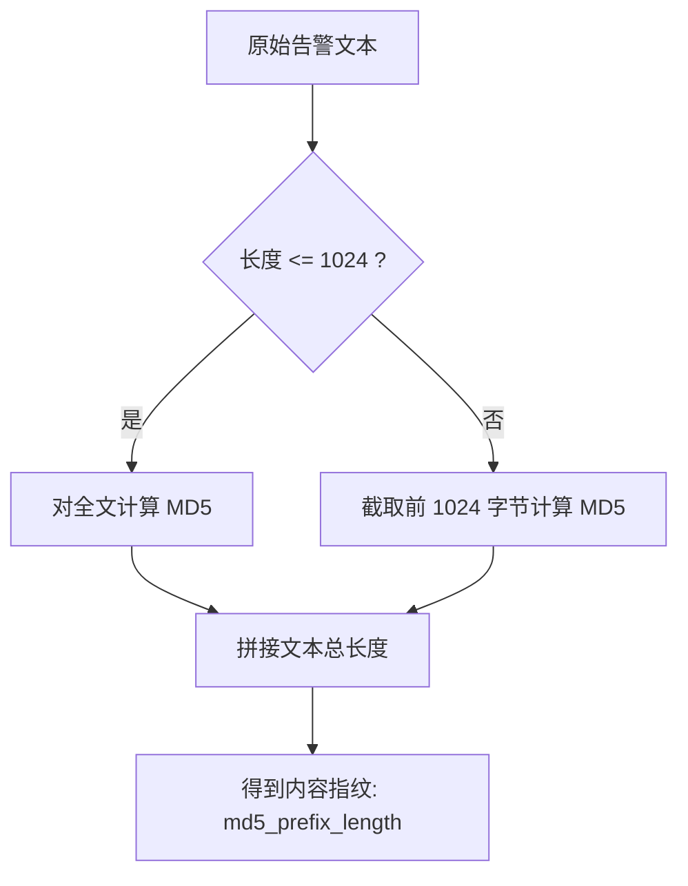
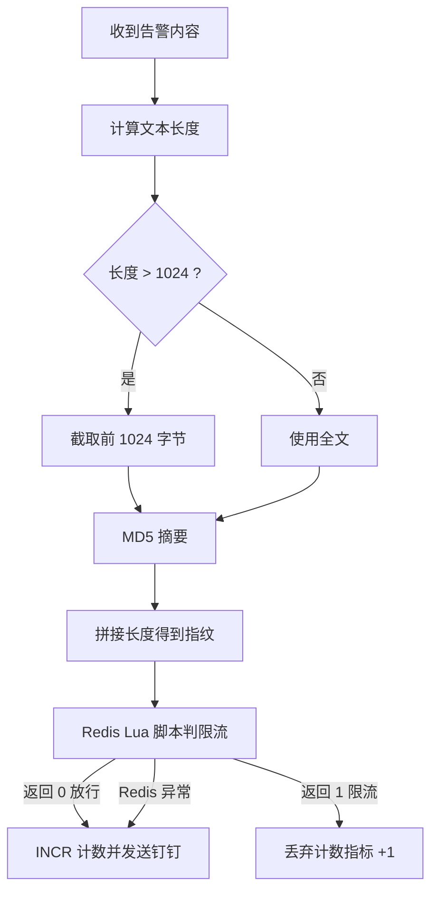

## 纲要

- 排重思路：MD5(前 1KB 内容) + 文本总长度 组成内容指纹，兼顾性能与碰撞率。
- 限流目标：一分钟以内相同内容的告警不超过 10 次。
- `GET` + `INCR` 两条命令非原子，必须用 **Lua 脚本**合并成一个原子操作。
- 封装独立的 `redislimiter` 包，对外只暴露 `IsLimit(ctx,client,key,limit,expireSeconds) bool`。
- 限流命中后的告警不静默丢弃，而是计入"丢弃告警数"指标，用于后续观测吞吐量。

## 排重：先做一个够用的内容指纹

排重要解决的是：如何快速判断两段文本是否相同。

直觉方案是对整段文本做 MD5。MD5 能把任意长度文本压成 32 位十六进制串，碰撞概率极低，两段不同文本几乎不可能得到相同摘要。但在日志告警场景里有个现实问题——**错误日志可能非常大**，堆栈、SQL 语句、响应体一起打出来，几 MB 都不罕见。对每条告警都做一次全量 MD5，CPU 开销不可忽视，而告警链路上每条消息都要过这一关。

工程上的折中方案是**截断采样**：



只取前 1KB 计算，代价显著降低。但这引入了新问题：两段文本前 1KB 完全相同的概率虽然低，但不为零——比如同一个错误的堆栈前 1KB 一模一样，只有末尾的参数不同。

解决办法是**再加一个维度：文本总长度**。指纹变成：

```
fingerprint = md5(content[:1024]) + "_" + len(content)
```

要让两个不同的文本撞上同一个指纹，需要同时满足"前 1KB 字节完全相同"且"总长度完全一致"。理论上可能，实践中概率低到可以忽略。

这个思路并不是日志告警专用。判断两个视频文件是否相同用的就是同一招：取前 10MB 或 20MB 算 MD5，再比对文件总长度。在生产环境长期验证过，效率高且没有出现过误判。

## 限流：为什么 GET + INCR 不够用

限流需求是"一分钟内相同内容的告警不超过 10 次"。用 Redis 表达很自然：

- 以内容指纹为 key；
- 每次告警时 `INCR` 这个 key；
- 首次写入时设置 60 秒过期；
- 计数超过 10 就拦截。

朴素实现是先 `GET` 看当前值，小于阈值再 `INCR`：

```go
// 错误示范：GET 与 INCR 之间存在竞态
cur, _ := rdb.Get(ctx, key).Int()
if cur < limit {
    rdb.Incr(ctx, key)
    return false
}
return true
```

问题在于这两条命令之间有时间窗口。告警服务是并发的，十个协程同时 `GET` 到值 9，都会判定"可以发送"，然后全部 `INCR`——实际发出了 10 条，计数却只从 9 涨到 19。限流形同虚设。

限流场景对精确度的要求没有金融扣款那么高，但既然 Redis 提供了原子方案，就没有理由用不严谨的实现。**Lua 脚本在 Redis 中单线程执行，天然原子**，把"读—判断—自增—设过期"打包进去即可。

## Lua 脚本

```lua
-- 根据讲稿逻辑补充：限流脚本 apm_limit.lua
-- KEYS[1]: 限流 key（内容指纹）
-- ARGV[1]: 限流阈值 limit
-- ARGV[2]: key 过期时间（秒）
-- 返回值: 1 表示需要限流，0 表示放行

local key    = KEYS[1]
local limit  = tonumber(ARGV[1])
local expire = tonumber(ARGV[2])

local current = tonumber(redis.call('GET', key) or '0')

if current >= limit then
    return 1
end

redis.call('INCR', key)
-- 仅在首次计数时设置过期时间，
-- 避免每次 INCR 都刷新 TTL 导致窗口被无限延长
if current == 0 then
    redis.call('EXPIRE', key, expire)
end

return 0
```

一个细节：**过期时间只在首次设置**。如果每次 `INCR` 都刷 `EXPIRE`，那么只要告警持续产生，key 永不过期，限流窗口从"滑动的 60 秒"退化成"永久封禁"。只在 `current == 0` 时设置，才能保证窗口真正在滚动。

## Go 侧封装

```go
// 根据讲稿逻辑补充：redislimiter/limiter.go
package redislimiter

import (
	"context"
	"log"

	"github.com/redis/go-redis/v9"
)

const limitScript = `
local key    = KEYS[1]
local limit  = tonumber(ARGV[1])
local expire = tonumber(ARGV[2])
local current = tonumber(redis.call('GET', key) or '0')
if current >= limit then
    return 1
end
redis.call('INCR', key)
if current == 0 then
    redis.call('EXPIRE', key, expire)
end
return 0
`

// IsLimit 判断该 key 是否应被限流。
// 返回 true 表示命中限流，调用方应跳过本次动作；
// 返回 false 表示放行。
// Redis 发生故障时降级为放行，保证告警不因限流组件异常而整体失效。
func IsLimit(ctx context.Context, client *redis.Client, key string, limit int, expireSeconds int) bool {
	res, err := client.Eval(ctx, limitScript, []string{key}, limit, expireSeconds).Result()
	if err != nil {
		log.Printf("redislimiter: eval failed: %v, skip limiting", err)
		return false
	}

	limited, ok := res.(int64)
	if !ok {
		log.Printf("redislimiter: unexpected result type %T, skip limiting", res)
		return false
	}
	return limited == 1
}
```

降级策略在这里是**放行**。限流器本身的可用性不应该高于告警链路的可用性——如果 Redis 挂了就把所有告警都吞掉，那是把一个小故障放大成大故障。正确的顺序是：Redis 挂 → 不限流 → 钉钉限流兜底 → 开发者看到刷屏但至少收到了告警。

## 计算内容指纹

```go
// 根据讲稿逻辑补充：告警内容指纹
package redislimiter

import (
	"crypto/md5"
	"encoding/hex"
	"fmt"
)

// fingerprintSampleSize 参与 MD5 计算的最大字节数。
const fingerprintSampleSize = 1024

// MD5 计算字节切片的 MD5 十六进制串。
func MD5(data []byte) string {
	sum := md5.Sum(data)
	return hex.EncodeToString(sum[:])
}

// Fingerprint 生成内容指纹：前 1KB 的 MD5 + 文本总长度。
// 长度维度用于降低截断采样带来的碰撞概率。
func Fingerprint(content string) string {
	sample := content
	if len(sample) > fingerprintSampleSize {
		sample = sample[:fingerprintSampleSize]
	}
	return fmt.Sprintf("%s_%d", MD5([]byte(sample)), len(content))
}
```

## 串进告警发送流程

在调用钉钉发送之前插入排重与限流：

```go
// 根据讲稿逻辑补充：告警发送前的限流排重
const (
	alertLimitCount  = 10   // 相同内容一分钟内最多 10 次
	alertLimitWindow = 60   // 限流窗口（秒）
)

func AlertWithLimit(ctx context.Context, rdb *redis.Client, n *Notifier, content string) {
	fp := redislimiter.Fingerprint(content)
	key := "apm:alert:limit:" + n.App + ":" + fp

	if redislimiter.IsLimit(ctx, rdb, key, alertLimitCount, alertLimitWindow) {
		// 被限流的告警不能无声无息地消失，
		// 计入 counter 指标，在 Grafana 上观察丢弃速率
		discardCounter.WithLabelValues(n.App, n.Host, "dingtalk").Inc()
		log.Printf("alert discarded by limiter, app=%s fp=%s", n.App, fp)
		return
	}

	if err := SendDingTalk(n.DingTalkWebhook, content); err != nil {
		log.Printf("dingtalk alert failed: %v", err)
	}
}
```

被丢弃的告警数是一个**必须被观测**的量。如果丢弃数长期为 0，说明限流阈值可能设得太松；如果丢弃数持续走高，说明要么业务在持续报错，要么阈值设得太紧。指标化的意义就在于让这个决策有数据支撑，而不是拍脑袋。

## 完整处理流程



## API 速览

| API | 签名 | 说明 |
| --- | --- | --- |
| `md5.Sum` | `(data []byte) [16]byte` | 计算 16 字节摘要 |
| `hex.EncodeToString` | `(src []byte) string` | 转为 32 位十六进制串 |
| `redis.Client.Eval` | `(ctx,script string,keys []string,args ...interface{}) *Cmd` | 执行 Lua 脚本，保证原子性 |
| `redis.call('GET'\|'INCR'\|'EXPIRE',...)` | Lua 内调用 Redis 命令 | 脚本内所有命令单线程串行执行 |
| `KEYS` / `ARGV` | Lua 内全局表 | 分别接收外部传入的 key 与参数 |

## Demo 示例

**运行说明**：需要 Redis 实例。将 `redislimiter` 与主程序放在同一 module 下，`go run .` 启动后循环发送相同内容 15 次，可以观察到前 10 次放行、后 5 次被限流，且 60 秒后计数归零重新开放。

**代码说明**：Lua 脚本以字符串常量内嵌，避免部署时额外分发 `.lua` 文件。`Fingerprint` 的截断长度 1024 可按实际日志体积调整——日志普遍很短时可以调大以提升精度，日志普遍很大时可以调小以节省 CPU。

**技术点总结**：

- 内容指纹 = 前 1KB MD5 + 总长度，是性能与碰撞率的工程折中，视频去重同理。
- 限流必须原子，Lua 脚本是 Redis 里实现"读—判—改"原子化的标准手段。
- 过期时间只在首次计数时设置，否则限流窗口会被无限延长成永久封禁。
- 限流组件自身故障时降级为放行，不能让限流器成为告警链路的单点。
- 被限流丢弃的告警要指标化，否则限流阈值永远是拍脑袋定的。
