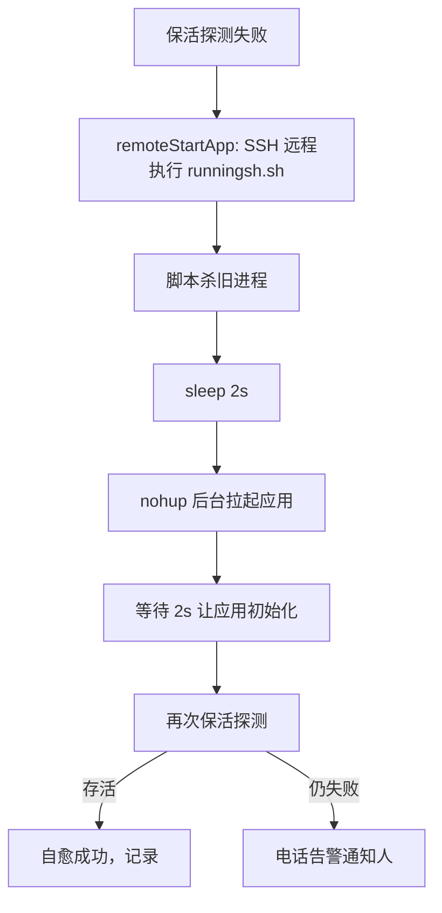

## 纲要

- 保活探测只告警还不够：成熟的运营系统应在发现服务宕机后**自动重启**，把"能自愈"的故障消化在系统内部。
- 重启本质是一次**远程命令执行**：不同服务部署在不同主机，靠配置表已知 IP 与服务名。
- 重启脚本 `runningsh.sh`：入参为服务名；先杀旧进程、sleep 2s、再用 `nohup` 拉起，stdout/stderr 合并重定向到 `nohup.out`。
- 远程执行靠 SSH：在容器里装 `openssh-server`、生成密钥、把宿主机公钥写进 `authorized_keys`，宿主机 `ssh -p 10022` 即可连入。
- Go 侧用 `golang.org/x/crypto/ssh` 公钥私钥认证；`HostKeyCallback` 连自己机器直接放行；连不上整台机器时 `return` 而非 `panic`。
- **关键陷阱**：远程脚本必须把进程后台化并关闭标准输出，否则 ssh session 的网络 fd 永不关闭，`Run` 永远阻塞。
- 自愈链路：探测失败 → 远程重启 → sleep 2s 等待初始化 → 再次保活探测 → 仍失败才走电话告警。

## 素材索引



## 重启脚本

保活探测在前面章节已经跑通，但只做了"发现宕机 → 告警"。这一节把它补成"发现宕机 → 尝试重启 → 重启后仍失败才告警"。

重启的本质是一次远程命令执行。每个服务原本就是靠 `nohup ./app` 启起来的，区别只是运行在各自的主机上。因此只要能远程登录目标主机并跑一条启动命令即可。把这条逻辑固化成一个脚本，入参是服务名：

```bash
#!/bin/bash
# runningsh.sh —— 根据讲稿逻辑补充：按服务名远程拉起应用
# 约定：脚本与可执行文件放在同一固定目录（如 /build），目录名永远不变，
# 这样监控程序的开发最简化。
# 用法: sh runningsh.sh <app>
APP=$1
echo "准备重启: $APP"

# 先杀掉之前的进程
pkill -f "$APP" || true
sleep 2

# 用 nohup 后台启动，stdout/stderr 统一落到 nohup.out，
# 与直接用 nohup 启动应用时的输出目的地一致
nohup ./"$APP" >> nohup.out 2>&1 &
```

脚本里 `>> nohup.out 2>&1 &` 三个要素缺一不可：合并标准错误、后台运行、输出落到文件。

## 打通宿主机到容器的 SSH

演示环境里，应用跑在 Ubuntu 容器内，要模拟"生产上从 A 主机向 B 主机发远程启动命令"，需要让宿主机能通过 SSH 连进容器：

1. 容器内安装 `openssh-server`，执行 `/etc/init.d/ssh start`（或 `service ssh start`）启动 SSH 服务，用 `ps -ef` 确认进程在。
2. `ssh-keygen` 生成密钥对：`id_rsa`（私钥）、`id_rsa.pub`（公钥）。
3. 把**宿主机的公钥**追加进容器的 `~/.ssh/authorized_keys`，容器在接收 SSH 连接时会校验该公钥，匹配即放行。
4. 容器的 22 端口已映射到宿主机的 `10022`，于是宿主机直接 `ssh -p 10022 root@localhost` 即可连入。

## Go 侧远程重启

Go 标准库之外，`golang.org/x/crypto/ssh` 已经封装好 SSH 客户端。认证支持密码和公钥私钥两种方式，这里用公钥私钥。

```go
// remote/start.go —— 根据讲稿逻辑补充：通过 SSH 远程重启应用服务
// 依赖: go get golang.org/x/crypto/ssh
package remote

import (
	"bytes"
	"fmt"
	"log"
	"os"
	"time"

	"golang.org/x/crypto/ssh"
)

const (
	sshUser      = "root"
	sshPort      = "10022" // 容器 22 端口映射到宿主机的端口
	keyPath      = "/root/.ssh/id_rsa"
	appDir       = "/build" // 宿主机目录经卷映射挂到容器内的固定目录
	restartScript = "runningsh.sh"
)

// RemoteStartApp 通过 SSH 在目标主机上调用重启脚本拉起指定服务。
func RemoteStartApp(app, host string) error {
	// 1. 读取私钥（公钥私钥认证）
	key, err := os.ReadFile(keyPath)
	if err != nil {
		return fmt.Errorf("read private key: %w", err)
	}
	signer, err := ssh.ParsePrivateKey(key)
	if err != nil {
		return fmt.Errorf("parse private key: %w", err)
	}

	// 2. 构造客户端配置：1s 内未通过认证即失败；连自己的机器 HostKeyCallback 直接放行
	config := &ssh.ClientConfig{
		User:            sshUser,
		Auth:            []ssh.AuthMethod{ssh.PublicKeys(signer)},
		Timeout:         1 * time.Second,
		HostKeyCallback: ssh.InsecureIgnoreHostKey(), // 演示用；生产应校验已知主机指纹
	}

	addr := host + ":" + sshPort
	client, err := ssh.Dial("tcp", addr, config)
	if err != nil {
		// SSH 都连不上说明整台机器可能宕机，而不是应用宕机；
		// 这里不要 panic，正常返回，交由后续逻辑继续告警即可。
		return fmt.Errorf("ssh dial %s: %w", addr, err)
	}
	defer client.Close()

	// 3. 多条命令用分号分隔；进入固定目录后后台执行脚本。
	//    关键：必须加 & 与 >> nohup.out 2>&1。否则脚本的 stdout 继承自
	//    ssh session 的网络 fd，进程不关闭该 fd，session.Run 会一直阻塞拿不到返回。
	cmd := fmt.Sprintf(
		"cd %s; sh %s %s >> nohup.out 2>&1 &",
		appDir, restartScript, app,
	)

	session, err := client.NewSession()
	if err != nil {
		return fmt.Errorf("new session: %w", err)
	}
	defer session.Close()

	var out bytes.Buffer
	session.Stdout = &out
	if err := session.Run(cmd); err != nil {
		return fmt.Errorf("run %q: %w", cmd, err)
	}
	log.Printf("remote start %s on %s ok: %s", app, host, out.String())
	return nil
}
```

几个实现要点：

- **`HostKeyCallback` 缺失会报错**：首次直连时客户端要求一个 `HostKeyCallback`，连自己机器直接返回 `nil`（即 `InsecureIgnoreHostKey`）即可，生产环境应改成校验已知主机指纹。
- **连不上机器不要 panic**：SSH 握手失败意味着整台主机可能已宕机，此时继续往下走告警通道比让程序崩掉更合理。讲稿里强调 `panic` 只适合调试阶段暴露错误，生产环境要捕获或返回错误。
- **必须后台化输出**：这是最隐蔽的坑。远程命令的标准输出流被 ssh session 的网络接口取代，若不关闭，session 永不返回，自愈逻辑会卡死。

## 接入保活探测形成自愈

在保活探测判定失败、准备告警之前，先尝试远程重启，再重新探测一次：

```go
// 根据讲稿逻辑补充：探测失败后的自愈流程片段
func handleDown(app, host string, probe Probe) {
	// 1. 先尝试远程重启
	if err := RemoteStartApp(app, host); err != nil {
		log.Printf("remote start failed, will alert: %v", err)
	} else {
		// 2. 等应用完成初始化（有的服务启动要加载配置/建连）
		time.Sleep(2 * time.Second)
		// 3. 再次保活探测
		if probe.CheckAlive(app, host) == "ok" {
			log.Printf("%s on %s 自愈成功", app, host)
			return
		}
	}
	// 4. 重启后仍不存活，才走电话告警
	alert.Phone(app, host, "服务宕机且自愈失败")
}
```

这样大量"进程崩了但能自动拉起"的情况被系统内部消化，开发者只在真正需要人介入时被叫醒。

## API 速览

| API | 签名 | 说明 |
| --- | --- | --- |
| `ssh.Dial` | `(network,addr string,config *ClientConfig) (*Client,error)` | 建立 SSH 连接 |
| `ssh.ClientConfig` | 结构体 | 含 `User`/`Auth`/`Timeout`/`HostKeyCallback` |
| `ssh.ParsePrivateKey` | `(pemBytes []byte) (Signer,error)` | 解析私钥 |
| `ssh.Client.NewSession` | `() (*Session,error)` | 开启一个执行会话 |
| `session.Run` | `(cmd string) error` | 远程执行命令，命令结束才返回 |

## Demo 示例

**运行说明**：`go get golang.org/x/crypto/ssh` 后，把 `runningsh.sh` 与可执行文件放进 `/build`，在宿主机用 `ssh-keygen` 把公钥写入容器 `authorized_keys`。调用 `RemoteStartApp("order-service","127.0.0.1")`（容器 22 映射宿主机 10022），可看到容器内 `order-service` 被拉起。

**代码说明**：脚本固定定位到 `/build` 目录，是把"约定优于配置"落到监控程序里的典型做法——目录名永远不变，省去动态传路径的复杂度。

**技术点总结**：

- 保活探测应演进到"自愈"：探测失败先重启，重启后复核，仍失败才告警。
- 远程重启靠 SSH + 启动脚本，脚本必须 `nohup ... >> nohup.out 2>&1 &` 后台化并合并输出。
- 连接目标用公钥私钥认证；`HostKeyCallback` 连本机直接放行。
- SSH 连不上代表整机宕机，应 `return` 而非 `panic`，否则常驻协程崩掉会让所有保活静默失效。
- 远程命令必须关闭标准输出（后台化），否则 ssh session 永不返回，自愈卡死。
- "约定固定目录"用规则化配置简化监控程序开发。
