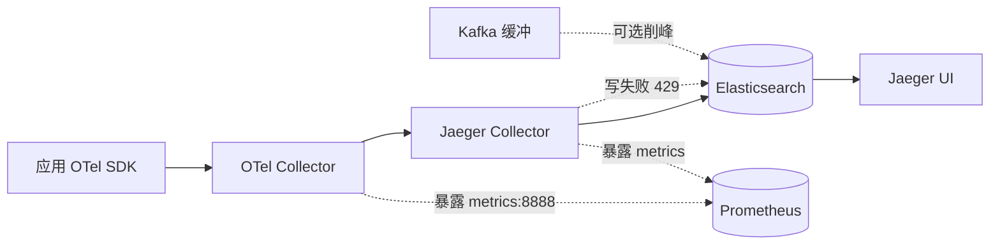

## 纲要

- 链路追踪数据流：应用 → OTel SDK → OTel Collector → Jaeger Collector → ES（存储）→ Jaeger UI。
- 通用层：先看 OTel/Jaeger 所在主机的 CPU/内存/网络/磁盘 IO（沿用前述思路）。
- 组件指标：OTel Collector 在 `service.telemetry.metrics` 暴露指标（端口 8888），Prometheus 抓取后进 Grafana。
- 重点关注：exporter 发送 span 的**失败数**与**队列容量**；队列将满说明 exporter 跟不上，有丢数据风险。
- 丢数据应对：processor 默认开启重试（首次失败 5s 后重试，内存队列 `sending_queue` 默认 1000），超队列仍会丢；持久化队列需另配。
- 若 collector 没问题：看 Jaeger Collector → ES 写入是否 429；ES 太忙就扩容 ES 集群或加 Kafka 缓冲层。
- 扩容思路：OTel Collector 建集群并按 **traceID 哈希**做负载均衡（同 trace 的 span 落同一 collector）；Jaeger→ES 加 Kafka 削峰。

## 素材索引



## 回顾链路追踪数据架构

应用通过 OpenTelemetry SDK 把 trace 数据发往 OpenTelemetry Collector；Collector 过滤后发往 Jaeger Collector；Jaeger Collector 收集完成后发往存储层 ES；最后由 Jaeger UI 展示。这是 Jaeger 官方推荐的部署模式：以 OTel Collector 为中心集群收集全部 trace，过滤后交给 Jaeger 各组件存储与展示。

## 通用层：主机资源瓶颈

和前述一致，先登到 OTel Collector、Jaeger 所在主机，看 CPU、内存、网络、磁盘 IO 是否到瓶颈；若有，定位到具体进程。这一层是任何组件都适用的前置排查。

## 组件指标层：OTel Collector 自监控

OTel Collector 自身会暴露 metrics（Prometheus 格式），在配置文件的 `service` 段开启 `telemetry.metrics`，可指定暴露端口与详细程度（normal / detailed）。课程里用的是详细模式、端口 `8888`，浏览器直接访问该端口即可看到指标，如：

- Collector 内部**队列容量**；
- exporter 已发出的 span 总数、发送**失败数**。

重点关注**失败数**与**队列容量**：如果队列容量快达到上限，说明 exporter 处理速度跟不上（或下游太慢），数据可能开始丢失。官方文档建议用"失败数 / 总发送数"的比率来检测是否丢数据，另一个监控点是队列长度——达到容量上限后入队会失败并打丢数据日志。

### 重试与丢数据的边界

processor 丢弃 span 时，默认开启重试：首次失败后等 5 秒再重试，重试数据也进一个队列（由 `sending_queue` 配置，默认内存中保留 1000 大小）。注意两点：

- 重试只在**内存**中，重试数据不能无限增长，超过 `sending_queue` 大小仍会丢。
- 持久化队列（落盘）需单独配置，可参考官方文档自查。

排查原则：发生问题先想"怎么排查、定位到哪"，定位到具体组件后再照文档改配置解决。

## 下游组件：Jaeger Collector 与 ES

若 collector 侧没丢数据，但 trace 仍可能丢，就要逐个组件往下看。Jaeger Collector 把数据发往 ES 存储时可能出错：

- **ES 插入过频会返回 429**（Too Many Requests），告诉 collector 当前忙不过来，需要稍后重试。
- 发现 429 的两种方式：① ES 错误日志（配日志收集检索）；② Jaeger Collector 暴露的 metrics（官网 troubleshooting 页列出，如 `spans_received`、`spans_dropped`），访问其指标端口能看到"被丢弃的 span 总数"。

同时监控 OTel Collector、Jaeger Collector、ES 三者的 CPU/内存与队列容量，在接近预测阈值时告警，提前规划扩容。

## 扩容思路

### OTel Collector 集群：按 traceID 负载均衡

过滤 trace 数据较消耗 CPU，单台 Collector 处理不过来时应建 Collector 集群。关键是让 trace 数据打到集群时按 **traceID 哈希**做负载均衡，使同一条 trace 的所有 span 落到**同一个** Collector——因为过滤逻辑要统计同一条 trace 上各 span 的信息，必须在一台 Collector 上拿到完整 trace，不能把同一 trace 的不同 span 分散到不同节点。

```go
// lb/trace.go —— 根据讲稿逻辑补充：按 traceID 哈希做负载均衡，
// 保证同一条 trace 的所有 span 落到同一个 collector。
package lb

import (
	"hash/crc32"
	"sync"
)

// TraceBalancer 基于 traceID 取模选择 collector 节点。
type TraceBalancer struct {
	mu         sync.RWMutex
	collectors []string
}

// NewTraceBalancer 构造负载均衡器，addrs 为各 collector 地址。
func NewTraceBalancer(addrs ...string) *TraceBalancer {
	return &TraceBalancer{collectors: addrs}
}

// Pick 根据 traceID 哈希选择 collector 地址。
func (b *TraceBalancer) Pick(traceID string) string {
	b.mu.RLock()
	defer b.mu.RUnlock()
	if len(b.collectors) == 0 {
		return ""
	}
	idx := crc32.ChecksumIEEE([]byte(traceID)) % uint32(len(b.collectors))
	return b.collectors[idx]
}
```

### Jaeger Collector → ES：扩容或加 Kafka 缓冲

- ES 忙不过来：简单做法把 ES 从单节点扩到多节点（如 1 → 3），分摊插入压力。
- 更通用的削峰做法：在 Jaeger Collector 与 ES 之间加一层 **Kafka** 做缓冲，把批量插入变成匀速插入（官方部署架构有说明）。

## 小结

链路追踪的瓶颈衡量 = 主机资源 + Collector/Jaeger 指标（队列、失败数、丢弃数）+ ES 429 日志；扩容则按 traceID 哈希建 Collector 集群、给 ES 扩容或加 Kafka 缓冲。排查时把链路每个组件拎出来逐个看是否正常即可。
