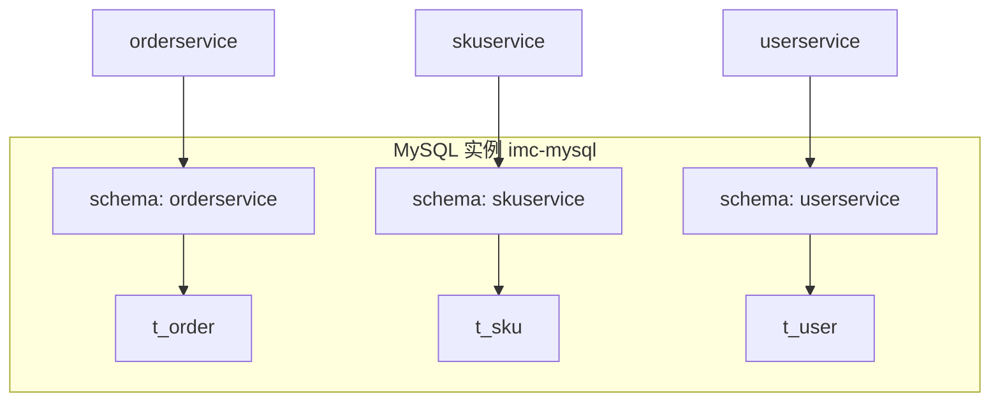

## 纲要

- 用 go work 多模块工作区组织整套项目
- 五个子模块的分工：三个业务服务 + 基础组件库 + 告警服务
- 基础组件库为什么先做子模块而不是直接 `require`
- 配置目录与 docker compose 的摆放
- 三张业务表（订单、用户、商品）的字段设计
- 用一个实例三个 schema 模拟"每个服务独占数据库"

## 用 go work 组织多模块工程

整个工程采用 Go 1.18 之后的 **多模块工作区（go workspace）** 开发方式：顶层一个 `go.work`，把若干各自持有 `go.mod` 的子项目组织在一起。这和 Java 里用 Maven 聚合多个子模块的形式非常类似——每个模块有自己的依赖声明，但又能在同一个工作区里互相引用、一起编译。

```dir
imc-apm/
├── go.work                     # 多模块工作区声明
├── deploy/                     # 所有中间件与组件的配置文件
│   ├── docker-compose.yml      # MySQL / Redis 容器
│   ├── filebeat.yml
│   ├── logstash.conf
│   └── otel-collector-config.yaml
├── protos/                     # proto 文件与生成代码（独立模块，被各服务引用）
│   ├── go.mod
│   ├── hello.proto
│   ├── sku.proto
│   └── user.proto
├── dogapm/                     # 自研基础组件库
│   ├── go.mod
│   ├── infra.go                # 基础设施（DB / Redis）统一管理
│   ├── http_server.go
│   ├── grpc_client.go
│   ├── grpc_server.go
│   ├── component.go            # 统一的启动/关闭管理
│   ├── http_response.go        # 统一 HTTP 返回格式
│   ├── log.go
│   └── sql_util.go
├── orderservice/               # 订单服务（对客户端暴露 HTTP）
│   ├── go.mod
│   ├── main.go
│   ├── api/                    # 路由处理函数
│   └── client/                 # 下游 gRPC 客户端
├── skuservice/                 # 商品服务（暴露 gRPC）
│   ├── go.mod
│   ├── main.go
│   ├── grpc/                   # gRPC 业务实现
│   └── dao/                    # 数据访问层
├── userservice/                # 用户服务（暴露 gRPC）
│   ├── go.mod
│   ├── main.go
│   ├── grpc/
│   └── dao/
└── dogalarm/                   # 自研告警服务
    └── go.mod
```

`go.work` 的内容就是把这些模块登记进来：

```go
go 1.21

use (
	./dogapm
	./dogalarm
	./orderservice
	./protos
	./skuservice
	./userservice
)
```

### 为什么基础组件库先做成子模块

dogAPM 完全可以用 `go.mod` 的 `require` 配置引入，但那样会有一个很现实的问题：基础组件库在课程推进过程中会被反复修改，每改一次都要处理版本号的引用与更新，开发效率很低。

所以开发阶段把 dogAPM 作为整个大项目的一个子模块，通过 go workspace 直接引用本地代码；等组件库成熟、接口稳定之后，再以版本化方式发布，各业务模块用 `require` 引入固定版本即可。这是自研基础库的标准演进路径：**先本地联调，后版本发布**。

`protos` 目录也是同样道理。生成的 pb.go 会被业务层和 dogAPM 共同引用，因此它必须是一个可被 `require` / `use` 的独立模块，而不是散落在某个服务内部的普通目录。

## 配置文件目录

`deploy` 目录集中存放所有中间件配置：docker compose 编排文件、Elasticsearch 配置、Filebeat / Logstash 配置以及后续的 OpenTelemetry Collector 配置。

其中 docker compose 负责拉起 MySQL 和 Redis 两个容器，容器名分别命名为 `imc-mysql` 和 `imc-redis`。把之前的编排内容统一挪到这里管理，好处是环境可以一键重建，不会散落在各个讲解环节里。

```yaml
# deploy/docker-compose.yml —— 根据讲稿逻辑补充
version: "3.8"

services:
  imc-mysql:
    image: mysql:8.0
    container_name: imc-mysql
    environment:
      MYSQL_ROOT_PASSWORD: "1234567"
      TZ: Asia/Shanghai
    ports:
      - "3306:3306"
    volumes:
      - ./mysql/data:/var/lib/mysql
    command: --default-authentication-plugin=mysql_native_password

  imc-redis:
    image: redis:7.0
    container_name: imc-redis
    ports:
      - "6379:6379"
    volumes:
      - ./redis/data:/data
```

启动后注意检查 `GOPROXY` 环境变量不能为空，否则后续 `go get` 拉依赖会直接失败——这是使用 go workspace 时最常见的第一个坑。

## 三张业务表的结构设计

表设计刻意保持精简，只保留下单流程真正需要的字段。

### 订单表 t_order

| 字段 | 类型 | 说明 |
| --- | --- | --- |
| id | bigint | 自增主键 |
| order_id | varchar | 订单号，下单时生成 UUID |
| uid | bigint | 下单用户 |
| sku_id | bigint | 购买的商品 |
| num | int | 购买数量 |
| price | decimal | 订单价格 |
| ctime | datetime | 创建时间 |
| utime | datetime | 更新时间 |

### 商品表 t_sku

| 字段 | 类型 | 说明 |
| --- | --- | --- |
| id | bigint | 自增主键 |
| sku_id | bigint | 商品 ID |
| name | varchar | 商品名称 |
| price | decimal | 商品价格 |
| num | int | 库存数量 |
| ctime | datetime | 创建时间 |
| utime | datetime | 更新时间 |

### 用户表 t_user

| 字段 | 类型 | 说明 |
| --- | --- | --- |
| id | bigint | 自增主键 |
| uid | bigint | 用户 ID |
| name | varchar | 用户名称 |

用户表只保留两个业务字段，足以支撑"用 uid 查用户是否存在"这一校验动作。生产环境当然是 token 体系，但那会引入鉴权、网关、会话管理等一系列与监控无关的复杂度——**课程刻意把业务逻辑压到最薄，让每一处代码都为可观测性服务**。

## 用一个实例三个 schema 模拟服务独占数据库

真实的微服务架构里，每个服务应该有自己的数据库实例，物理隔离、互不影响。但如果在本机起三个 MySQL 容器，再加上 Redis、ES、Logstash、Kibana、Jaeger、Prometheus 等一堆中间件，机器资源很快就会吃紧。

折中方案是：**一个 MySQL 实例，三个 schema**。



从应用视角看，三个 schema 互相隔离，等价于三个独立数据库；后续按应用维度统计 MySQL 指标时，也能自然地按 schema 区分归属。

建库建表语句（根据讲稿逻辑补充，可直接在 MySQL 中执行）：

```sql
CREATE DATABASE IF NOT EXISTS imc_db DEFAULT CHARACTER SET utf8mb4;

USE imc_db;

-- 订单表：归属 orderservice
CREATE TABLE IF NOT EXISTS t_order (
    id       BIGINT AUTO_INCREMENT PRIMARY KEY,
    order_id VARCHAR(64)  NOT NULL COMMENT '订单号',
    uid      BIGINT       NOT NULL COMMENT '下单用户',
    sku_id   BIGINT       NOT NULL COMMENT '商品 ID',
    num      INT          NOT NULL DEFAULT 0 COMMENT '购买数量',
    price    DECIMAL(10,2) NOT NULL DEFAULT 0 COMMENT '订单价格',
    ctime    DATETIME     NOT NULL DEFAULT CURRENT_TIMESTAMP,
    utime    DATETIME     NOT NULL DEFAULT CURRENT_TIMESTAMP ON UPDATE CURRENT_TIMESTAMP,
    KEY idx_uid (uid),
    KEY idx_ctime (ctime)
) ENGINE = InnoDB;

-- 商品表：归属 skuservice
CREATE TABLE IF NOT EXISTS t_sku (
    id     BIGINT AUTO_INCREMENT PRIMARY KEY,
    sku_id BIGINT        NOT NULL COMMENT '商品 ID',
    name   VARCHAR(128)  NOT NULL DEFAULT '' COMMENT '商品名称',
    price  DECIMAL(10,2) NOT NULL DEFAULT 0 COMMENT '商品价格',
    num    INT           NOT NULL DEFAULT 0 COMMENT '库存数量',
    ctime  DATETIME      NOT NULL DEFAULT CURRENT_TIMESTAMP,
    utime  DATETIME      NOT NULL DEFAULT CURRENT_TIMESTAMP ON UPDATE CURRENT_TIMESTAMP,
    UNIQUE KEY uk_sku_id (sku_id)
) ENGINE = InnoDB;

-- 用户表：归属 userservice
CREATE TABLE IF NOT EXISTS t_user (
    id   BIGINT AUTO_INCREMENT PRIMARY KEY,
    uid  BIGINT       NOT NULL COMMENT '用户 ID',
    name VARCHAR(128) NOT NULL DEFAULT '' COMMENT '用户名称',
    UNIQUE KEY uk_uid (uid)
) ENGINE = InnoDB;
```

若要严格模拟物理隔离，可以为每个服务分别建库（库名与 schema 同名），连接串中的数据库名换成对应库即可，代码无需改动。

测试数据（根据讲稿逻辑补充）：

```sql
INSERT INTO t_sku (sku_id, name, price, num) VALUES (2, 'sku-test', 15.00, 90);
INSERT INTO t_user (uid, name) VALUES (3, 'lanpangzi');
```

## 小结

这一节把工程的骨架定下来了：go workspace 管理六个子模块，`deploy` 目录统一收拢中间件配置，三张精简的业务表按 schema 隔离。这个结构决定了后面所有埋点改造的落点——**改动集中在 dogapm 一个模块内，业务模块几乎零感知**。
