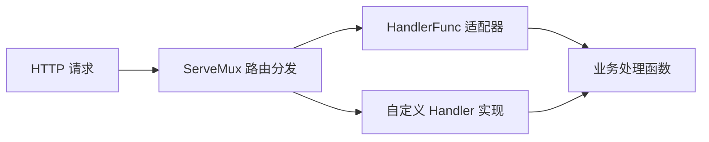
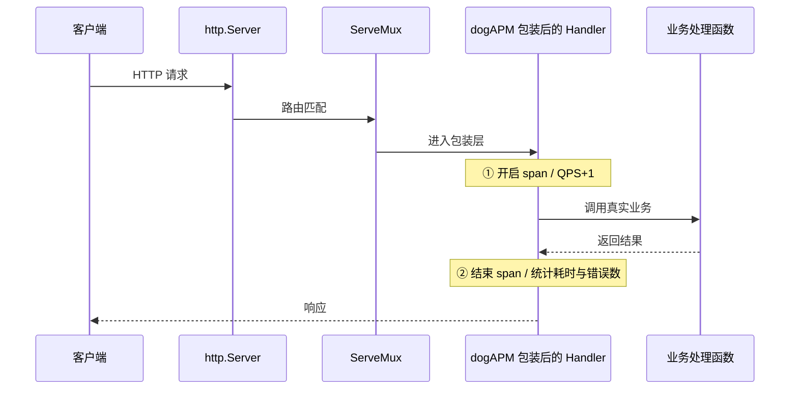

## 纲要

- 原生 Go 创建 HTTP 服务的标准写法：`ServeMux` + `http.Server`
- `Handle` 与 `HandleFunc` 的区别与底层 `Handler` 接口
- 为什么业务层不能直接调用官方库
- dogAPM 中 `HTTPServer` 结构体的设计
- 对外暴露的 `Handle` / `HandleFunc` / `Start` / `Close` 四个方法
- 封装留下的埋点切口在哪里

## 原生创建 HTTP 服务的写法

Go 标准库创建一个 HTTP 服务，通常分三步：

```go
// 1. 创建一个 ServeMux，作为请求分发器
mux := http.NewServeMux()

// 2. 组装 http.Server，指定监听地址与处理器
server := &http.Server{
	Addr:    ":8080",
	Handler: mux,
}

// 3. 启动监听
server.ListenAndServe()
```

特定 URL 由哪个函数处理，由 `ServeMux` 决定，它提供了两个注册方法：

```go
// 注册一个函数：签名为 func(http.ResponseWriter, *http.Request)
mux.HandleFunc("/test", func(w http.ResponseWriter, r *http.Request) {
	w.Write([]byte("ok"))
})

// 注册一个 Handler 实现
mux.Handle("/order", orderHandler{})
```

`Handle` 接收的是一个接口，而不是函数：

```go
type Handler interface {
	ServeHTTP(ResponseWriter, *Request)
}
```

所以 `HandleFunc` 本质上只是把普通函数适配成 `Handler` 接口的一层语法糖。理解了这一点，后面做埋点包装就有两种可选路径：包函数，或者包接口实现。



## 为什么业务层不能直接用官方库

如果业务层满地都是 `http.NewServeMux()` 和 `mux.HandleFunc()`，那么后续要"在每个请求处理前后加链路埋点、统计 QPS 与错误数"，就只能逐个业务项目去改。

dogAPM 的做法是在官方库之上再封装一层，把路由注册、启动、关闭都收进自己的 `HTTPServer` 结构体。**业务层拿不到原生的 mux，只能通过 dogAPM 提供的方法注册路由**——这样所有请求入口都被收口了，埋点只需要在两个方法里做一次。

## HTTPServer 结构体的设计

```go
// dogapm/http_server.go —— 根据讲稿逻辑补充
package dogapm

import (
	"context"
	"net/http"
)

// HTTPServer 是对 net/http 的一层封装，收口所有 HTTP 入口
type HTTPServer struct {
	mux    *http.ServeMux
	server *http.Server
	addr   string
}

// NewHTTPServer 创建 HTTP 服务器实例，addr 为监听地址
func NewHTTPServer(addr string) *HTTPServer {
	mux := http.NewServeMux()
	return &HTTPServer{
		mux:  mux,
		addr: addr,
		server: &http.Server{
			Addr:    addr,
			Handler: mux,
		},
	}
}
```

结构体里同时持有 `mux` 和 `server`：前者用于注册路由，后者用于生命周期管理。

## 注册路由：Handle 与 HandleFunc

两个方法与官方库同名同义，内部调用被收口的 `mux`：

```go
// Handle 注册实现了 http.Handler 接口的处理器
func (s *HTTPServer) Handle(pattern string, handler http.Handler) {
	// 后续可在此处对 handler 做埋点包装
	s.mux.Handle(pattern, handler)
}

// HandleFunc 注册处理函数
func (s *HTTPServer) HandleFunc(pattern string, f func(http.ResponseWriter, *http.Request)) {
	// 后续可在此处对 f 做埋点包装
	s.mux.HandleFunc(pattern, f)
}
```

这两个方法就是**未来所有 HTTP 维度埋点的唯一切口**。讲稿里明确提到：后续做链路追踪时，会在请求处理前后各加一次埋点处理；做指标监控时，会在这里统计 QPS 与错误数。业务层对这一切无感知。

## 启动与关闭

启动放在独立的 goroutine 里，避免阻塞主流程（因为一个进程通常还要同时起 gRPC 服务）：

```go
// Start 启动 HTTP 服务（根据讲稿逻辑补充）
func (s *HTTPServer) Start() {
	go func() {
		if err := s.server.ListenAndServe(); err != nil && err != http.ErrServerClosed {
			panic(err)
		}
	}()
}

// Close 关闭 HTTP 服务
func (s *HTTPServer) Close() error {
	return s.server.Shutdown(context.Background())
}
```

`ListenAndServe` 正常关闭时会返回 `http.ErrServerClosed`，这不是错误，必须过滤掉，否则优雅退出时会误 panic。

关闭使用 `Shutdown` 而不是 `Close`：前者会先停止接收新连接、等存量请求处理完再退出，后者会直接掐断所有连接。对线上服务来说，`Shutdown` 是唯一可接受的选择。

## 业务层的使用方式

```go
// orderservice/main.go —— 根据讲稿逻辑补充
package main

import (
	"net/http"
	"time"

	"dogapm"
)

func main() {
	server := dogapm.NewHTTPServer(":8080")

	// 注意：路由必须以斜杠开头，写成 "test" 会命中 404
	server.HandleFunc("/test", func(w http.ResponseWriter, r *http.Request) {
		w.WriteHeader(http.StatusOK)
		w.Write([]byte("ok"))
	})

	server.Start()

	// Start 是异步的，这里等待一段时间以便观察效果
	time.Sleep(time.Second * 10)
	_ = server.Close()
}
```

验证：

```bash
curl http://127.0.0.1:8080/test
# ok
```

讲稿里踩过的一个小坑值得记一笔：路由写成 `test` 而不是 `/test`，访问时直接 404。`ServeMux` 的路由匹配要求 pattern 以 `/` 开头，否则它会被视为"主机名模式"而无法命中。

## 埋点切口的预留位置

把整个请求生命周期画出来，可以清楚看到未来埋点插入的位置：



① 和 ② 两处逻辑，后续只需要写在 dogAPM 的 `Handle` / `HandleFunc` 里，三个业务服务的全部 HTTP 接口就自动获得了链路与指标能力。

## API 速览

| API | 签名 | 说明 |
| --- | --- | --- |
| `http.NewServeMux` | `func NewServeMux() *ServeMux` | 创建路由分发器 |
| `(*ServeMux).Handle` | `func (mux *ServeMux) Handle(pattern string,handler Handler)` | 注册 Handler 接口实现 |
| `(*ServeMux).HandleFunc` | `func (mux *ServeMux) HandleFunc(pattern string,handler func(ResponseWriter,*Request))` | 注册处理函数 |
| `http.Handler` | `interface { ServeHTTP(ResponseWriter,*Request) }` | 处理器接口 |
| `NewHTTPServer` | `func NewHTTPServer(addr string) *HTTPServer` | dogAPM 封装的构造入口 |
| `(*HTTPServer).Start` | `func (s *HTTPServer) Start()` | 协程异步启动 HTTP 服务 |
| `(*HTTPServer).Close` | `func (s *HTTPServer) Close() error` | 优雅关闭 HTTP 服务 |
| `(*http.Server).Shutdown` | `func (srv *Server) Shutdown(ctx context.Context) error` | 优雅停机，等待存量请求结束 |

## Demo 示例

### 运行说明

```bash
cd orderservice && go run main.go
curl http://127.0.0.1:8080/test
```

### 代码说明

- `HTTPServer` 同时持有 `mux`（注册路由）与 `server`（生命周期）；
- `Handle` / `HandleFunc` 与官方同名，降低业务层的迁移成本；
- `Start` 内部起 goroutine，保证一个进程能同时启动 HTTP 与 gRPC；
- 关闭使用 `Shutdown` 以支持优雅退出，并过滤 `http.ErrServerClosed`。

### 技术点总结

- 收口请求入口是可观测性改造的第一步；
- `HandleFunc` 是 `Handle` 之上的函数适配器，二者可统一在一处包装；
- 优雅退出必须用 `Shutdown`，且要过滤 `ErrServerClosed`；
- 路由 pattern 必须以 `/` 开头。
