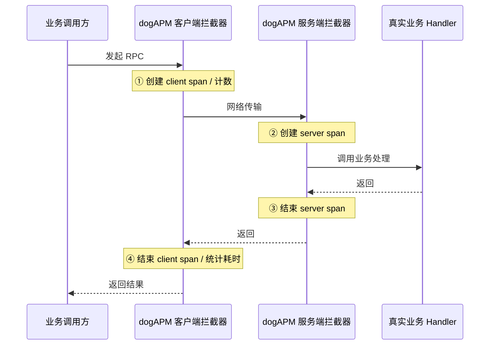

## 纲要

- 为什么要自己封装 gRPC client / server：为业务层统一收口拦截器，便于后续埋点
- `GRPCClient` 对官方 `*grpc.ClientConn` 的封装，内置一元客户端拦截器
- `GRPCServer` 对官方 `*grpc.Server` 的封装，内置一元服务端拦截器
- 暂不做多余逻辑，拦截器里只透传，后续在链路追踪 / 指标监控时再注入埋点
- 跳过 TLS，允许无证书访问（开发环境）
- 用 proto 文件 + `protoc` 生成 Go 桩代码，并把 `protos` 作为 go.work 子模块
- 一个 HelloWorld 例子验证 client / server 跑通

## 为什么要自己封装 gRPC

前面封装了 HTTP 框架，这一节封装 gRPC 框架。目的是让业务层调用框架时，**能够方便地做埋点操作**。gRPC 的 client 和 server 都有拦截器（interceptor）机制——只要在封装时预留好拦截器，后续做链路追踪和指标监控，只需要在拦截器里加逻辑，业务层对这一切无感知。这跟 Java 里用 Spring 拦截器在方法前后加额外操作是类似的。

## 定义两个结构体

结构体 `GRPCClient` 封装官方的 gRPC client；`GRPCServer` 封装官方的 gRPC server。先引入 `google.golang.org/grpc`。

### 客户端封装

```go
// dogapm/grpc_client.go —— 根据讲稿逻辑补充
package dogapm

import (
	"context"

	"google.golang.org/grpc"
	"google.golang.org/grpc/credentials/insecure"
)

// GRPCClient 对官方 *grpc.ClientConn 的一层封装
type GRPCClient struct {
	conn *grpc.ClientConn
}

// clientInterceptor 返回一元客户端拦截器，后续链路追踪 / 指标埋点都加在这里
func clientInterceptor() grpc.UnaryClientInterceptor {
	return func(
		ctx context.Context,
		method string,
		req, reply interface{},
		cc *grpc.ClientConn,
		invoker grpc.UnaryInvoker,
		opts ...grpc.CallOption,
	) error {
		// TODO: 后续在此创建 span、统计 QPS 等埋点逻辑
		return invoker(ctx, method, req, reply, cc, opts...)
	}
}

// NewGRPCClient 创建连接 addr 的 gRPC 客户端
func NewGRPCClient(addr string) *GRPCClient {
	conn, err := grpc.NewClient(
		addr,
		grpc.WithTransportCredentials(insecure.NewCredentials()), // 开发环境跳过 TLS
		grpc.WithUnaryInterceptor(clientInterceptor()),
	)
	if err != nil {
		panic(err)
	}
	return &GRPCClient{conn: conn}
}

// Conn 暴露底层连接，供业务层生成的 client 包装使用
func (c *GRPCClient) Conn() *grpc.ClientConn {
	return c.conn
}
```

`GRPCClient` 内部持有 `*grpc.ClientConn`。创建连接时通过 `grpc.WithUnaryInterceptor` 挂上拦截器——这是后续做埋点的唯一入口。因为 gRPC 默认走 HTTP/2 需要证书，开发环境用 `insecure.NewCredentials()` 允许无证书访问。

### 服务端封装

```go
// dogapm/grpc_server.go —— 根据讲稿逻辑补充
package dogapm

import (
	"net"

	"google.golang.org/grpc"
)

// GRPCServer 对官方 *grpc.Server 的一层封装
type GRPCServer struct {
	addr   string
	server *grpc.Server
}

// serverInterceptor 返回一元服务端拦截器，后续埋点加在这里
func serverInterceptor() grpc.UnaryServerInterceptor {
	return func(
		ctx context.Context,
		req interface{},
		info *grpc.UnaryServerInfo,
		handler grpc.UnaryHandler,
	) (interface{}, error) {
		// TODO: 后续在 handler 调用前后加入埋点逻辑
		return handler(ctx, req)
	}
}

// NewGRPCServer 创建 gRPC 服务端，addr 为监听地址
func NewGRPCServer(addr string) *GRPCServer {
	s := grpc.NewServer(grpc.UnaryInterceptor(serverInterceptor()))
	return &GRPCServer{addr: addr, server: s}
}

// Server 暴露底层 *grpc.Server，用于注册业务服务
func (s *GRPCServer) Server() *grpc.Server {
	return s.server
}

// Start 监听 tcp 并异步启动 gRPC 服务
func (s *GRPCServer) Start() {
	lis, err := net.Listen("tcp", s.addr)
	if err != nil {
		panic(err)
	}
	go func() {
		if err := s.server.Serve(lis); err != nil {
			panic(err)
		}
	}()
}
```

服务端同样用 `grpc.UnaryInterceptor` 预留拦截器。`Start` 构建 TCP listener 并异步 `Serve`，与 HTTP 服务一样避免阻塞主流程。



①②③④ 四处逻辑后续只写在 dogAPM 的拦截器里，三个业务服务的全部 gRPC 接口就自动获得链路与指标能力。

## proto 文件与代码生成

gRPC 客户端与服务端之间的交互格式由 `proto` 文件约定。用 Go 需要两个工具把 proto 转成 Go 代码：

- `protoc`：将 proto 定义的结构体转成 Go 结构体，生成 `.pb.go` 文件；
- `protoc-gen-go-grpc`：将 proto 定义的 service 转成 Go 写的 server 接口，生成 `_grpc.pb.go` 文件。

在项目下建 `proto` 目录放置 proto 文件：

```proto
// proto/hello.proto —— 根据讲稿逻辑补充
syntax = "proto3";

option go_package = "./hello;hello";

message HelloMessage {
  string message = 1;
}

service HelloService {
  rpc Receive(HelloMessage) returns (HelloMessage);
}
```

生成命令：

```bash
protoc --go_out=. --go_opt=paths=source_relative \
       --go-grpc_out=. --go-grpc_opt=paths=source_relative \
       proto/hello.proto
```

由于业务层和 APM 框架都会引用 `protos` 下的内容，把它作为 `go.work` 的子模块，让整个大项目共享：

```bash
# 在 protos 目录初始化 module 并生成桩代码后，回到项目根
go work init
go work use ./protos ./orderservice ./userservice ./goodsservice
```

## HelloWorld 验证

实现 service 并启动 client / server 验证是否跑通：

```go
// orderservice/main.go —— 根据讲稿逻辑补充
package main

import (
	"context"
	"log"
	"time"

	"google.golang.org/grpc"

	"dogapm"
	"yourmodule/protos/hello"
)

// helloService 实现生成的 HelloServiceServer 接口
type helloService struct {
	hello.UnimplementedHelloServiceServer
}

func (s *helloService) Receive(ctx context.Context, m *hello.HelloMessage) (*hello.HelloMessage, error) {
	return &hello.HelloMessage{Message: m.Message}, nil
}

func main() {
	// 1. 启动服务端，注册业务实现
	gs := dogapm.NewGRPCServer(":8080")
	hello.RegisterHelloServiceServer(gs.Server(), &helloService{})
	gs.Start()

	// 2. 启动客户端，连接本地 8080
	client := dogapm.NewGRPCClient("127.0.0.1:8080")
	c := hello.NewHelloServiceClient(client.Conn())

	resp, err := c.Receive(context.Background(), &hello.HelloMessage{Message: "hello world"})
	if err != nil {
		log.Fatal(err)
	}
	log.Println(resp.Message) // hello world

	time.Sleep(time.Second)
}
```

运行后控制台打印 `hello world`，说明封装好的 `GRPCClient` / `GRPCServer` 已正常工作。后续业务层统一使用这两个结构体，也就会统一走我们定义好的拦截器。

## API 速览

| API | 签名 | 说明 |
| --- | --- | --- |
| `grpc.NewClient` | `func NewClient(target string,opts ...DialOption) (*ClientConn,error)` | 创建 gRPC 连接（新 API） |
| `grpc.NewServer` | `func NewServer(opts ...ServerOption) *Server` | 创建 gRPC server |
| `grpc.WithUnaryInterceptor` | `DialOption` / `ServerOption` | 挂载一元拦截器 |
| `grpc.WithTransportCredentials` | `DialOption` | 设置传输凭证，`insecure.NewCredentials()` 跳过 TLS |
| `(*grpc.Server).Serve` | `func (s *Server) Serve(lis net.Listener) error` | 启动监听并服务 |
| `NewGRPCClient` | `func NewGRPCClient(addr string) *GRPCClient` | dogAPM 客户端封装构造 |
| `NewGRPCServer` | `func NewGRPCServer(addr string) *GRPCServer` | dogAPM 服务端封装构造 |

## Demo 示例

### 运行说明

```bash
# 1. 安装插件
go install google.golang.org/protobuf/cmd/protoc-gen-go@latest
go install google.golang.org/grpc/cmd/protoc-gen-go-grpc@latest

# 2. 生成桩代码
protoc --go_out=. --go_opt=paths=source_relative \
       --go-grpc_out=. --go-grpc_opt=paths=source_relative proto/hello.proto

# 3. 运行
go run orderservice/main.go
```

### 代码说明

- 两个结构体把官方 gRPC 连接 / server 收口，并各自预留一元拦截器；
- 拦截器当前仅透传，是后续链路追踪与指标埋点的唯一切口；
- 开发环境用 `insecure` 跳过证书；生产应改为正式 TLS 凭证；
- `protos` 通过 `go.work` 作为子模块被业务层与 APM 框架共享。

### 技术点总结

- 自封装的核心动机是"统一拦截器、统一埋点"，而非重复官方能力；
- 拦截器机制与 Spring 拦截器思想一致：在方法前后插入逻辑；
- 用 proto + `protoc` 双插件生成 `.pb.go` 与 `_grpc.pb.go`，是 Go gRPC 的标准工作流。
