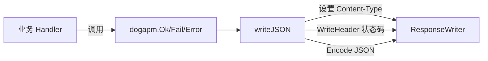

## 纲要

- 为什么需要统一返回格式：避免业务层各自拼 JSON 字符串，提升开发效率
- dogAPM 中 `Response` 统一结构：code / msg / data
- 成功响应 `Ok` 与 `OkWithData`（HTTP 200）
- 业务失败 `Fail`（HTTP 400，携带描述与业务数据）
- 服务器内部错误 `Error`（HTTP 500）
- 统一设置 `Content-Type: application/json` 与状态码后写回响应体

## 为什么需要统一返回格式

前面封装了 HTTP 框架，但业务层使用 HTTP 接口时通常要向前端返回 **JSON 格式**的数据。如果框架不规定返回格式，业务层就得自己拼 JSON 字符串，既容易出错又影响开发效率。因此本节在 dogAPM 里把 HTTP 响应格式固定下来，并以 JSON 返回。

## 统一的响应结构

返回给前端的内容固定为三部分：

- `code`：响应结果码，代表成功还是失败；
- `msg`：描述性信息，说明成功或失败的具体原因；
- `data`：附带的业务数据（泛型，可空）。

```go
// dogapm/http_response.go —— 根据讲稿逻辑补充
package dogapm

import (
	"encoding/json"
	"net/http"
)

// Response 是返回给前端的统一结构
type Response struct {
	Code int         `json:"code"`
	Msg  string      `json:"msg"`
	Data interface{} `json:"data,omitempty"`
}

// 固定 JSON 响应头的 Content-Type 常量
const contentTypeJSON = "application/json; charset=utf-8"

// writeJSON 设置响应头并写回 JSON 响应体
func writeJSON(w http.ResponseWriter, status int, resp Response) {
	w.Header().Set("Content-Type", contentTypeJSON)
	w.WriteHeader(status)
	_ = json.NewEncoder(w).Encode(resp)
}
```

`data` 用 `interface{}` 承载任意业务对象，`omitempty` 保证无数据时该字段不出现在 JSON 里。`Content-Type` 设为常量，避免每处重复书写。

## 封装常用方法

为业务层提供几个常用方法，分别对应不同的响应语义。

```go
// dogapm/http_response.go（续）

// Ok 返回成功，且不携带业务数据
func Ok(w http.ResponseWriter) {
	writeJSON(w, http.StatusOK, Response{Code: 200, Msg: "success"})
}

// OkWithData 返回成功，并携带业务数据
func OkWithData(w http.ResponseWriter, data interface{}) {
	writeJSON(w, http.StatusOK, Response{Code: 200, Msg: "success", Data: data})
}

// Fail 业务层面失败，返回 400，可携带描述与业务数据
func Fail(w http.ResponseWriter, msg string, data interface{}) {
	writeJSON(w, http.StatusBadRequest, Response{Code: 400, Msg: msg, Data: data})
}

// Error 服务器内部错误（如访问 DB / 下游接口出错），返回 500
func Error(w http.ResponseWriter, msg string) {
	writeJSON(w, http.StatusInternalServerError, Response{Code: 500, Msg: msg})
}
```

两种失败做了区分：

- **业务层面失败**：返回 `400 Bad Request`，由参数传入描述信息与可能的业务数据；
- **服务器内部错误**：如访问数据库或下游接口出现网络错误，直接返回 `500 Internal Server Error`。

## 业务层使用方式

```go
// orderservice/main.go —— 根据讲稿逻辑补充
package main

import (
	"net/http"

	"dogapm"
)

func main() {
	mux := http.NewServeMux()

	// 成功且带数据
	mux.HandleFunc("/order", func(w http.ResponseWriter, r *http.Request) {
		dogapm.OkWithData(w, map[string]interface{}{
			"order_id": 1001,
			"status":   "paid",
		})
	})

	// 业务失败
	mux.HandleFunc("/order/fail", func(w http.ResponseWriter, r *http.Request) {
		dogapm.Fail(w, "库存不足", nil)
	})

	// 内部错误
	mux.HandleFunc("/order/err", func(w http.ResponseWriter, r *http.Request) {
		dogapm.Error(w, "查询数据库失败")
	})

	_ = http.ListenAndServe(":8080", mux)
}
```

业务层只需调用 `dogapm.Ok` / `OkWithData` / `Fail` / `Error`，即可统一以 JSON 格式响应，无需关心序列化细节。



## API 速览

| API | 签名 | 说明 |
| --- | --- | --- |
| `Response` | `struct{ Code int;Msg string;Data interface{} }` | 统一响应结构 |
| `Ok` | `func Ok(w http.ResponseWriter)` | 成功，无业务数据，HTTP 200 |
| `OkWithData` | `func OkWithData(w http.ResponseWriter,data interface{})` | 成功带数据，HTTP 200 |
| `Fail` | `func Fail(w http.ResponseWriter,msg string,data interface{})` | 业务失败，HTTP 400 |
| `Error` | `func Error(w http.ResponseWriter,msg string)` | 服务器内部错误，HTTP 500 |
| `json.NewEncoder` | `func NewEncoder(w io.Writer) *Encoder` | 将结构体编码为 JSON 并写入 |

## Demo 示例

### 运行说明

```bash
go run orderservice/main.go
curl -i http://127.0.0.1:8080/order
# HTTP/1.1 200 OK
# {"code":200,"msg":"success","data":{"order_id":1001,"status":"paid"}}
curl -i http://127.0.0.1:8080/order/fail
# {"code":400,"msg":"库存不足","data":null}
```

### 代码说明

- `Response` 用 `json` tag 控制序列化字段，`data` 用 `omitempty` 省略空值；
- `writeJSON` 统一设置 `Content-Type` 与状态码，是四种方法共用的底层；
- 业务失败（400）与内部错误（500）语义分离，便于上层告警区分。

### 技术点总结

- 统一返回格式是框架收口的一部分，降低业务层心智负担；
- `Content-Type` 用常量固定，避免拼写错位；
- 区分 400（业务）与 500（系统）有助于后续指标 / 日志告警精准分级。
