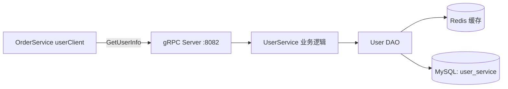

## 纲要

- UserService 与 SKU 服务结构类似，但**额外接入 Redis**，为后续 Redis 维度监控埋点做准备
- `main` 同时初始化 MySQL 与 Redis 两个连接
- DAO 层 `getUserInfo` 采用**缓存旁路（Cache-Aside）**：先读 Redis，未命中再读 DB，并回写缓存
- 缓存 key 固定、TTL 设 10 分钟，把用户信息序列化后的字符串写入 Redis
- 业务层调用 DAO，查不到返回错误；查到用 `cast` 转回具体类型
- 回到 OrderService 补上 `userClient`（`:8082`）与「校验用户是否存在」逻辑

## UserService 与 SKU 服务的异同

UserService 的整体骨架直接复用 SKU 服务的写法（初始化 DB、启动 gRPC Server `:8082`、注册实现），唯一的增量是：**除了 MySQL，还要把 Redis 连接也初始化起来**。讲稿有意在这里引入 Redis，是因为后续要讲 Redis 维度的监控，需要有一个真实在用 Redis 的服务。



## protobuf 契约

与 SKU 对称，`User` 消息只有两个字段，方法 `GetUserInfo` 入参只需 UID：

```protobuf
// user.proto —— 根据讲稿逻辑补充
syntax = "proto3";

package user;

option go_package = "./userpb";

message User {
  string name = 1; // 用户名
  int64  userId = 2; // 用户 ID
}

service UserService {
  rpc GetUserInfo(GetReq) returns (User);
}

message GetReq {
  int64 id = 1; // 用户 ID
}
```

## DAO 层：缓存旁路模式

`getUserInfo` 是这一节的重点。它遵循经典的 **Cache-Aside（缓存旁路）** 模式：

1. 先尝试从 Redis 读缓存；
2. 命中则把缓存字符串反序列化成 map 直接返回；
3. 未命中（或任何 Redis 错误）则回落到 MySQL 查询；
4. 查到后把用户信息序列化成字符串写回 Redis，TTL 10 分钟；
5. 数据库也查不到，返回 `nil`。

```go
// userservice/dao/user.go —— 根据讲稿逻辑补充
package dao

import (
	"context"
	"encoding/json"
	"dogapm"
	"time"
)

const userCacheTTL = 10 * time.Minute

// GetUserInfo 先查 Redis，未命中查 DB 并回写缓存
func GetUserInfo(ctx context.Context, uid int64) (map[string]interface{}, error) {
	key := "user:" + strconv.FormatInt(uid, 10)

	// 1. 读缓存
	if dogapm.RDB != nil {
		if s, err := dogapm.RDB.Get(ctx, key).Result(); err == nil && s != "" {
			var m map[string]interface{}
			if json.Unmarshal([]byte(s), &m) == nil {
				return m, nil // 命中即返回
			}
		}
	}

	// 2. 缓存未命中，读 DB
	rows, err := dogapm.DB.QueryContext(ctx, "SELECT user_id, name FROM t_user WHERE user_id = ?", uid)
	if err != nil {
		return nil, err
	}
	row := dogapm.QueryOne(rows) // 单行 map，无数据返回 nil
	if row == nil {
		return nil, nil
	}

	// 3. 回写缓存
	if dogapm.RDB != nil {
		if b, e := json.Marshal(row); e == nil {
			_ = dogapm.RDB.Set(ctx, key, string(b), userCacheTTL).Err()
		}
	}
	return row, nil
}
```

几个值得强调的设计：

- **序列化格式用 JSON**：把 map 直接 `json.Marshal` 成字符串存 Redis，读取时 `json.Unmarshal` 还原。简单通用，也方便后续监控时直接看到内容。
- **TTL 10 分钟**：讲稿明确写死 10 分钟，避免缓存永久有效导致用户信息更新后长时间不生效。
- **Redis 不可用时降级到 DB**：`RDB != nil` 的判断 + 忽略 Redis 错误，保证缓存组件故障时不影响主流程。

## 业务层：调用 DAO 完成校验

```go
// userservice/grpcimpl/user.go —— 根据讲稿逻辑补充
package grpcimpl

import (
	"context"
	"fmt"

	"userservice/dao"
	"userservice/userpb"

	"github.com/spf13/cast"
)

type UserServer struct{}

func (s *UserServer) GetUserInfo(ctx context.Context, req *userpb.GetReq) (*userpb.User, error) {
	row, err := dao.GetUserInfo(ctx, req.Id)
	if err != nil {
		return nil, err
	}
	if row == nil {
		return nil, fmt.Errorf("用户不存在")
	}
	return &userpb.User{
		UserId: cast.ToInt64(row["user_id"]),
		Name:   cast.ToString(row["name"]),
	}, nil
}
```

业务逻辑极简：查不到即报「用户不存在」，查到就返回。讲稿提到生产环境还会叠加 token 校验，本课程为聚焦监控，简化为「UID 在库中存在即视为合法用户」。

## 回到 OrderService 补上用户校验

UserService 就绪后，把前述在 OrderService 留下的另一个 TODO 补上：声明全局 `UserClient`，连到 `:8082`，下单时调用 `GetUserInfo` 校验用户是否存在。

```go
// orderservice/client/user.go —— 根据讲稿逻辑补充
package client

import (
	"dogapm"
	"userservice/userpb"
)

var UserClient userpb.UserServiceClient

// InitUserClient 用 gRPC 连接初始化用户服务客户端（端口 8082）
func InitUserClient(conn *dogapm.GRPCConn) {
	UserClient = userpb.NewUserServiceClient(conn.Channel())
}
```

在 `api.AddOrder` 里把校验段补全：

```go
// orderservice/api/order.go 片段
user, err := client.UserClient.GetUserInfo(r.Context(), &userpb.GetReq{Id: int64(uid)})
if err != nil || user == nil {
    dogapm.WriteStatus(w, http.StatusBadRequest, "用户不合法")
    return
}
```

到此，三个微服务的下单主链路全部贯通：**下单 → 校验用户（gRPC）→ 扣减库存（gRPC）→ 落库建单**，且 UserService 已经把 Redis 用起来，为后续 Redis 监控埋下切口。

## API 速览

| API | 说明 |
| --- | --- |
| `dao.GetUserInfo(ctx,uid)` | 缓存旁路读用户，命中 Redis 直返，否则查 DB 并回写 |
| `dogapm.RDB.Get/Set` | Redis 读写（go-redis 风格） |
| `json.Marshal / Unmarshal` | 用户信息 map 与缓存字符串互转 |
| `userpb.NewUserServiceClient` | 创建用户服务 gRPC Client |
| `strconv.FormatInt` | 拼缓存 key 时把 UID 转字符串 |

## Demo 示例

下面给出一个**单文件可运行**的缓存旁路演示（根据讲稿逻辑补充）。为避免依赖外部 Redis，示例用一个内存 Map 模拟 Redis 的 `Get/Set` 语义，重点演示「先缓存后 DB、未命中回落并回写」的逻辑。

**运行说明**

```bash
mkdir usercache-demo && cd usercache-demo
go mod init usercache-demo
# 把下方代码保存为 main.go
go run main.go
```

**代码**

```go
package main

import (
	"encoding/json"
	"fmt"
	"sync"
	"time"
)

// 用内存 map 模拟 Redis 的 Get/Set
type fakeRedis struct {
	mu   sync.Mutex
	data map[string]string
	ttl  map[string]time.Time
}

func (r *fakeRedis) Get(key string) (string, bool) {
	r.mu.Lock()
	defer r.mu.Unlock()
	if s, ok := r.data[key]; ok {
		if t, ok2 := r.ttl[key]; ok2 && time.Now().After(t) {
			return "", false // 已过期
		}
		return s, true
	}
	return "", false
}

func (r *fakeRedis) Set(key, val string, d time.Duration) {
	r.mu.Lock()
	defer r.mu.Unlock()
	r.data[key] = val
	r.ttl[key] = time.Now().Add(d)
}

var cache = &fakeRedis{data: map[string]string{}, ttl: map[string]time.Time{}}

// 模拟 DB
func dbGetUser(uid int64) (map[string]interface{}, bool) {
	if uid == 3 {
		return map[string]interface{}{"user_id": int64(3), "name": "蓝胖子"}, true
	}
	return nil, false
}

// GetUserInfo 缓存旁路：先缓存，未命中查 DB 并回写
func GetUserInfo(uid int64) (map[string]interface{}, error) {
	key := "user:" + fmt.Sprint(uid)

	if s, ok := cache.Get(key); ok {
		var m map[string]interface{}
		if json.Unmarshal([]byte(s), &m) == nil {
			fmt.Println("[cache hit]")
			return m, nil
		}
	}

	row, found := dbGetUser(uid)
	if !found {
		return nil, nil
	}
	if b, err := json.Marshal(row); err == nil {
		cache.Set(key, string(b), 10*time.Minute)
	}
	fmt.Println("[cache miss -> db]")
	return row, nil
}

func main() {
	// 第一次：缓存未命中，走 DB 并回写
	u1, _ := GetUserInfo(3)
	fmt.Println("第一次:", u1)

	// 第二次：缓存命中，直接返回
	u2, _ := GetUserInfo(3)
	fmt.Println("第二次:", u2)

	// UID 不存在
	u3, _ := GetUserInfo(999)
	fmt.Printf("不存在: %v\n", u3)
}
```

**代码说明**

- 第一次请求打印 `[cache miss -> db]`，第二次打印 `[cache hit]`，直观体现旁路逻辑
- 真实项目把 `fakeRedis` 换成 go-redis 的 `redis.Client` 即可，方法语义一致
- TTL 10 分钟与讲稿一致，过期后自动回落 DB

**技术点总结**

- 缓存旁路是读多写少场景的标准做法：缓存挡在 DB 前面，未命中才穿透
- 「Redis 错误可降级」是健壮性关键，不能因为缓存挂了就让主流程失败
- 序列化 + 固定 TTL + 固定 key 前缀，是缓存用户类小数据的最简可靠形态
