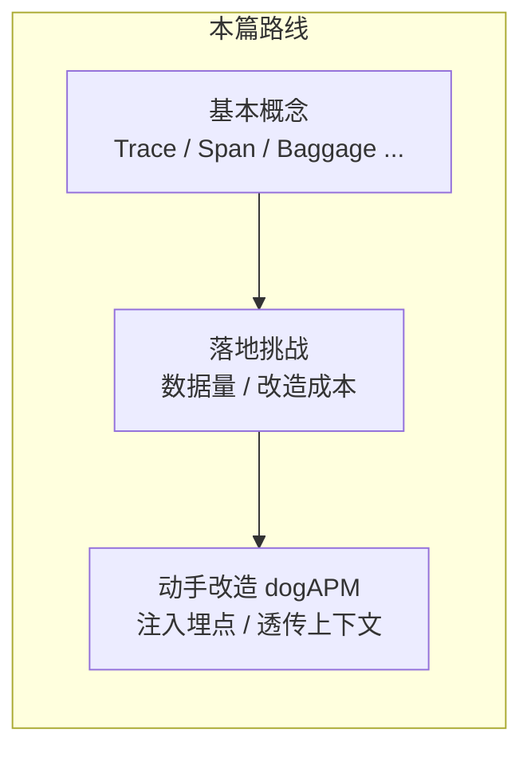

## 纲要

- 本篇主线：把「分布式链路追踪」落地到前面写好的 dogAPM 框架里
- 内容三段式：先讲链路追踪的**基本概念**，再讲落地时的**挑战与业界方案**，最后**动手改造**框架
- 链路追踪（Tracing）是 APM 三板斧（指标 / 日志 / 链路）里最贴近「请求全貌」的一项
- 本章要解决的问题：跨进程把一次请求的各阶段串成一条完整链路，并在界面上展示
- 改造对象就是第三张写好的订单 / 商品 / 用户三个微服务

## 本章要解决什么

前三章我们已经把三个微服务（Order / SKU / User）用 dogAPM 骨架搭起来了，但它们彼此独立，一次下单请求经过 HTTP 入口、再跨 gRPC 打到下游两个服务，在监控视角里是「碎」的——你只能看到每个服务各自的日志和指标，却看不出「这一次请求到底经过了哪些服务、每个阶段花了多久、哪里变慢了」。

本篇就是要补上这块拼图：**分布式链路追踪**。它会把一次完整请求在多个进程、多个服务之间的调用路径，串成一条有向的「 trace 」，并在类似 Jaeger 的界面上可视化出来。

## 本章内容结构

按照「是什么 → 为什么难 → 怎么落地」的顺序展开：

- **是什么**：梳理链路追踪的通用术语。无论用 OpenTracing、OpenTelemetry 还是其他框架，像 `Trace`、`Span`、`SpanContext`、`SpanEvent`、`SpanTag`、`SpanStatus`、`SpanKind`、`Baggage`、`Propagator` 这些概念都是相通的，先统一语言，后面才不会雾里看花。
- **为什么难**：落地一套链路追踪系统会撞上两个现实问题——链路数据量太大怎么存、怎么查（引出采样）；以及 Go 没有 Java 那种探针机制、只能手动埋点带来的研发改造成本。
- **怎么落地**：把前面讲的概念和方案，真正写进 dogAPM 框架——给 HTTP / gRPC / Redis / MySQL 等基础组件加埋点，让一次跨服务请求能被完整记录并导出。

## 为什么这一章值得单独成篇

链路追踪和前两章的指标、日志有本质区别：指标回答「系统平均怎么样」，日志回答「某一刻发生了什么」，而链路追踪回答「这一次请求具体走了哪条路、卡在哪一段」。它最贴近一次真实故障的还原现场，也是 dogAPM 项目从「能跑的业务骨架」走向「可观测的系统」的关键一步。
