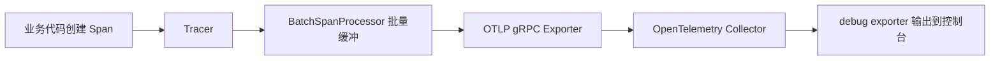

## 纲要

- OpenTelemetry Go SDK 的初始化链路：Resource → gRPC 连接 → OTLP Trace Exporter → BatchSpanProcessor → TracerProvider
- Tracer、Span、Context 三者的关系，以及 Span 上下文如何沿着调用栈向下传递
- 采样器（AlwaysSample / 概率采样）与传播者（W3C TraceContext）的作用位置
- OpenTelemetry Collector 的安装与配置文件四大块：receivers / processors / exporters / extensions + service.pipelines
- 用 docker-compose 起 Collector，通过 debug exporter 在控制台验证 11 个 Span 是否成功上报

## 从一段官方示例讲起

要验证一条链路追踪数据能不能真的从应用程序送到 Collector，最快的办法是先跑通 OpenTelemetry 官方给出的最小示例。这段代码虽然短，但它把客户端 SDK 的核心组件全部串了一遍——Provider、Exporter、Processor、Sampler、Propagator、Tracer、Span——理解它就等于理解了 Go 侧链路追踪的骨架。

整体数据流是这样的：



关键点在于：Span 并不是一个一个发出去的。`BatchSpanProcessor` 会在内存里攒一批，然后一次性推送给 Collector，这样可以显著降低网络往返开销。

## 初始化 TracerProvider

第一步是初始化 Provider。在 OpenTelemetry 的 SDK 语义里，Trace 数据和 Metrics 数据各自都有一个 Provider，Provider 的职责是创建对应的 Tracer / Meter 实例。

```go
package main

import (
	"context"
	"log"
	"time"

	"go.opentelemetry.io/otel"
	"go.opentelemetry.io/otel/exporters/otlp/otlptrace/otlptracegrpc"
	"go.opentelemetry.io/otel/propagation"
	"go.opentelemetry.io/otel/sdk/resource"
	sdktrace "go.opentelemetry.io/otel/sdk/trace"
	semconv "go.opentelemetry.io/otel/semconv/v1.21.0"
	"google.golang.org/grpc"
	"google.golang.org/grpc/credentials/insecure"
)

// initTracerProvider 初始化全局 TracerProvider。
// 根据讲稿逻辑补充：Collector 在本机 54317 端口监听 OTLP/gRPC。
func initTracerProvider(ctx context.Context, endpoint string) (*sdktrace.TracerProvider, error) {
	// 1. 建立到 Collector 的 gRPC 连接
	conn, err := grpc.DialContext(ctx, endpoint,
		grpc.WithTransportCredentials(insecure.NewCredentials()),
		grpc.WithBlock(),
	)
	if err != nil {
		return nil, err
	}

	// 2. 基于该连接创建 OTLP Trace Exporter（导出者）
	exporter, err := otlptracegrpc.New(ctx, otlptracegrpc.WithGRPCConn(conn))
	if err != nil {
		return nil, err
	}

	// 3. 声明 Resource：承载服务的公共信息，服务名是最重要的一个
	res, err := resource.New(ctx,
		resource.WithAttributes(
			semconv.ServiceName("test-service"),
		),
	)
	if err != nil {
		return nil, err
	}

	// 4. 用 BatchSpanProcessor 包装 Exporter，实现批量导出
	bsp := sdktrace.NewBatchSpanProcessor(exporter)

	// 5. 组装 TracerProvider
	tp := sdktrace.NewTracerProvider(
		sdktrace.WithSampler(sdktrace.AlwaysSample()), // 采样策略：全采
		sdktrace.WithResource(res),
		sdktrace.WithSpanProcessor(bsp),
	)

	// 6. 设置为全局 Provider
	otel.SetTracerProvider(tp)

	// 7. 设置传播者，遵循 W3C TraceContext 规范
	otel.SetTextMapPropagator(propagation.TraceContext{})

	return tp, nil
}
```

这里有几个容易忽略但很重要的细节：

- **Resource 是公共维度**。服务名、主机名、版本号这类"这条数据属于谁"的信息放在 Resource 上，而不是每个 Span 都重复打一遍属性。
- **BatchSpanProcessor 是可插拔的**。它只是 `SpanProcessor` 的一个实现，也可以换成 `SimpleSpanProcessor`（同步逐条导出），只是生产环境几乎不会这么用。
- **采样器决定的是"要不要生成"**。`AlwaysSample()` 表示所有 Span 都采样；换成 `TraceIDRatioBased(0.1)` 就是 10% 概率采样，只把一部分 Trace 数据发往 Collector。

## 创建 Tracer 与 Span 树

Provider 就绪之后，就可以从中取出 Tracer 实例。Tracer 可以理解成"一条完整请求链路"的入口，通过它创建出来的 Span 之间用 Context 串起来。

```go
func main() {
	ctx := context.Background()

	tp, err := initTracerProvider(ctx, "localhost:54317")
	if err != nil {
		log.Fatal(err)
	}
	defer func() {
		// Shutdown 会把内存里还没发出去的 Span 强制推送给 Collector
		if err := tp.Shutdown(ctx); err != nil {
			log.Println(err)
		}
	}()

	// 从全局 Provider 获取 Tracer
	tracer := otel.GetTracerProvider().Tracer("test-service")

	// 父 Span：代表整条链路
	ctx, span := tracer.Start(ctx, "main-span")
	for i := 0; i < 10; i++ {
		// 子 Span：注意第一个参数是父 Span 返回的 ctx
		_, child := tracer.Start(ctx, fmt.Sprintf("child-span-%d", i))
		time.Sleep(100 * time.Millisecond)
		child.End()
	}
	span.End()
}
```

Span 上下文的传递完全依赖 `tracer.Start` 的返回值：

```go
ctx, span := tracer.Start(ctx, "parent")
// ctx 里已经携带了父 Span 的 SpanContext
_, child := tracer.Start(ctx, "child")
```

如果把父 Span 返回的 `ctx` 丢掉、继续用最外层的 `ctx`，那么子 Span 会另起一个 TraceID，链路就断了。这是写链路追踪代码时最高频的一个坑——**每次 `Start` 之后都要用返回的 ctx 继续往下传**。

`span.End()` 标志着这个小阶段结束，只有调用了 `End` 的 Span 才会被 Processor 处理并导出，所以通常配合 `defer span.End()` 使用。

## Collector 的部署与配置

### docker-compose

Collector 官方提供镜像，直接用 docker-compose 起即可。这里把默认的 4317/4318 改成了 54317/54318，避免和后面要部署的 Jaeger 端口冲突：

```yaml
version: "3"
services:
  otel-collector:
    image: otel/opentelemetry-collector-contrib:0.98.0
    command: ["--config=/etc/otel-collector-config.yaml"]
    volumes:
      - ./otel-collector-config.yaml:/etc/otel-collector-config.yaml
    ports:
      - "54317:4317"   # OTLP gRPC
      - "54318:4318"   # OTLP HTTP
```

### 配置文件

Collector 的配置文件结构是固定的四块加一个 `service.pipelines`：

```yaml
receivers:
  otlp:
    protocols:
      grpc:
        endpoint: 0.0.0.0:4317
      http:
        endpoint: 0.0.0.0:4318

processors:
  batch:
    timeout: 5s

exporters:
  debug:
    verbosity: detailed

service:
  pipelines:
    traces:
      receivers: [otlp]
      processors: [batch]
      exporters: [debug]
```

逐块说明：

| 配置块 | 作用 | 本文取值 |
| --- | --- | --- |
| receivers | 声明"怎么收数据" | `otlp`，同时开启 gRPC 与 HTTP 两种协议 |
| processors | 声明"收到之后怎么处理" | `batch`，批处理 |
| exporters | 声明"处理完往哪发" | `debug`，打到控制台 |
| extensions | 独立运行的辅助插件 | 本节留空，下面展开 |
| service.pipelines | 把上面三者按遥测数据类型串成流水线 | traces 流水线 |

客户端 SDK 通过 OTLP 协议（gRPC 或 HTTP 均可）把数据推给 Collector 的 `otlp` receiver；receiver 收到后交给 `batch` processor 攒批；最后由 `debug` exporter 输出到标准输出。`debug` exporter 本身没有实际的存储价值，纯粹是为了验证链路是否打通。

## 验证结果

启动 Collector，再运行上面的 Go 程序：

```bash
docker compose up -d
go run main.go
```

在 Collector 的日志里可以看到它接收到了一批 Span。数量上是 **11 个**：1 个父 Span 加 10 个子 Span，与代码完全对应。

```
Span #0
    Name        : main-span
    Trace ID    : 4bf92f3577b34da6a3ce929d0e0e4736
    Span ID     : 00f067aa0ba902b7
...
Span #10
    Name        : child-span-9
    Trace ID    : 4bf92f3577b34da6a3ce929d0e0e4736
    Parent ID   : 00f067aa0ba902b7
```

注意所有 Span 的 `Trace ID` 是同一个值——这正是 Context 传递生效的证据。如果看到多个不同的 Trace ID，就说明某处 `tracer.Start` 没有用父级返回的 ctx。

此时还没有接入 Jaeger，只能靠控制台确认数据到达。下一步就是让 Collector 把数据导到 Jaeger 做可视化展示。

## API 速览

| API | 说明 |
| --- | --- |
| `otlptracegrpc.New(ctx,opts...)` | 创建基于 gRPC 的 OTLP Trace Exporter，常用 `WithGRPCConn(conn)` / `WithEndpoint(addr)` |
| `resource.New(ctx,opts...)` | 构造 Resource，`WithAttributes` 追加属性（如 `semconv.ServiceName`） |
| `sdktrace.NewBatchSpanProcessor(exp)` | 批量 Span 处理器，攒批后一次性导出 |
| `sdktrace.NewTracerProvider(opts...)` | 创建 TracerProvider，`WithSampler` / `WithResource` / `WithSpanProcessor` |
| `sdktrace.AlwaysSample()` | 采样器：全部采样 |
| `sdktrace.TraceIDRatioBased(fraction)` | 采样器：按 TraceID 概率采样 |
| `otel.SetTracerProvider(tp)` | 设置全局 Provider |
| `otel.SetTextMapPropagator(p)` | 设置全局传播者，`propagation.TraceContext{}` 遵循 W3C 规范 |
| `tracer.Start(ctx,name) (context.Context,trace.Span)` | 创建 Span，返回携带 SpanContext 的新 ctx |
| `span.End()` | 结束 Span，触发 Processor 处理 |
| `tp.Shutdown(ctx)` | 关闭 Provider 并冲刷未导出的 Span |

## Demo 示例

### 运行说明

```bash
# 1. 启动 Collector（配置文件与 docker-compose 同上）
docker compose up -d

# 2. 初始化模块并拉依赖
go mod init tracedemo
go get go.opentelemetry.io/otel \
       go.opentelemetry.io/otel/sdk \
       go.opentelemetry.io/otel/exporters/otlp/otlptrace/otlptracegrpc \
       google.golang.org/grpc

# 3. 运行
go run main.go

# 4. 查看 Collector 控制台输出
docker compose logs -f otel-collector
```

### 代码说明

完整可运行的 `main.go`（根据讲稿逻辑补充，补齐了官方示例中的 import 与主流程）：

```go
package main

import (
	"context"
	"fmt"
	"log"
	"time"

	"go.opentelemetry.io/otel"
	"go.opentelemetry.io/otel/exporters/otlp/otlptrace/otlptracegrpc"
	"go.opentelemetry.io/otel/propagation"
	"go.opentelemetry.io/otel/sdk/resource"
	sdktrace "go.opentelemetry.io/otel/sdk/trace"
	semconv "go.opentelemetry.io/otel/semconv/v1.21.0"
	"google.golang.org/grpc"
	"google.golang.org/grpc/credentials/insecure"
)

func initTracerProvider(ctx context.Context, endpoint string) (*sdktrace.TracerProvider, error) {
	conn, err := grpc.DialContext(ctx, endpoint,
		grpc.WithTransportCredentials(insecure.NewCredentials()),
		grpc.WithBlock(),
	)
	if err != nil {
		return nil, err
	}

	exporter, err := otlptracegrpc.New(ctx, otlptracegrpc.WithGRPCConn(conn))
	if err != nil {
		return nil, err
	}

	res, err := resource.New(ctx,
		resource.WithAttributes(semconv.ServiceName("test-service")),
	)
	if err != nil {
		return nil, err
	}

	tp := sdktrace.NewTracerProvider(
		sdktrace.WithSampler(sdktrace.AlwaysSample()),
		sdktrace.WithResource(res),
		sdktrace.WithSpanProcessor(sdktrace.NewBatchSpanProcessor(exporter)),
	)

	otel.SetTracerProvider(tp)
	otel.SetTextMapPropagator(propagation.TraceContext{})
	return tp, nil
}

func main() {
	ctx := context.Background()

	tp, err := initTracerProvider(ctx, "localhost:54317")
	if err != nil {
		log.Fatalf("init tracer provider: %v", err)
	}
	defer func() {
		shutdownCtx, cancel := context.WithTimeout(context.Background(), 5*time.Second)
		defer cancel()
		if err := tp.Shutdown(shutdownCtx); err != nil {
			log.Printf("shutdown tracer provider: %v", err)
		}
	}()

	tracer := otel.GetTracerProvider().Tracer("test-service")

	ctx, parent := tracer.Start(ctx, "main-span")
	for i := 0; i < 10; i++ {
		_, child := tracer.Start(ctx, fmt.Sprintf("child-span-%d", i))
		time.Sleep(100 * time.Millisecond)
		child.End()
	}
	parent.End()

	log.Println("trace data sent")
}
```

### 技术点总结

- Provider 是 SDK 的门面对象，Resource、Exporter、Processor、Sampler 都挂在它身上
- Exporter 决定数据往哪发，Processor 决定数据怎么发，两者职责要分清
- Span 上下文靠 `tracer.Start` 返回的 `ctx` 传递，漏传会导致链路断裂
- `tp.Shutdown` 必须调用，否则进程退出时缓冲区里的 Span 会丢失
- Collector 的配置本质是"接收器 + 处理器 + 导出器"三段流水线的组合
