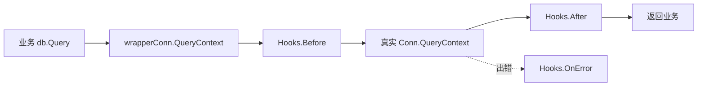

## 纲要

- `database/sql` 没有 hook，要插桩只能"装饰器模式"包一层驱动：`wrapperDriver` 包 `mysql.MySQLDriver`，`wrapperConn` 包真实连接
- 抽出一个 `Hooks` 结构，承载三个回调：`Before`（执行前）、`After`（执行后）、`OnError`（出错时），作为 Driver / Conn 的字段
- `Open` / `OpenConnector` 内部仍调用被包装驱动的对应方法，但返回的连接要再包一层成 `wrapperConn`
- 必须实现的接口：`wrapperConn` 上的 `QueryContext` / `ExecContext` / `PrepareContext`；`wrapperStmt` 上的 `StmtQueryContext` / `StmtExecContext`
- 易踩的坑：`driver.ErrSkip`——带参查询会被底层改写成 prepare + statement 两次执行，装饰器必须正确识别它
- 本篇只搭架构蓝图与类型定义，具体方法体、错误与参数处理、慢查询埋点## 为什么用装饰器而不是改驱动源码

前面已经理清：`database/sql` 只定义接口，连接对象（`driver.Conn`）才是真正执行 SQL 的地方，且第三方 `go-sql-driver/mysql` 实现了这些接口。既然标准库把"连接"抽象成了接口，我们就能用装饰器模式：写一个自己的 Driver，把第三方 Driver 包进去；再写一个自己的 Conn，把真实连接包进去。业务侧完全无感知，查询还是老样子写，但每次执行前后都会经过我们的 hooks。



## 三个回调：Hooks

装饰的意义在于"执行前后插入自定义逻辑"，所以先把要插入的逻辑抽象成三个方法，放进一个 `Hooks` 结构体。它会被 Driver 和 Conn 共同持有，执行 SQL 时就能调起来。

```go
// sqlwrapper/hooks.go —— 根据讲稿逻辑补充
package sqlwrapper

import (
	"context"
	"database/sql/driver"
)

// Hooks 定义 SQL 执行前后的三个切入点
type Hooks struct {
	// Before 在 SQL 执行前调用，可返回新的 ctx 向下传递
	Before func(ctx context.Context, query string, args []driver.NamedValue) (context.Context, error)
	// After 在 SQL 执行成功后调用
	After func(ctx context.Context, query string, args []driver.NamedValue) error
	// OnError 在 SQL 执行出错时调用
	OnError func(ctx context.Context, query string, args []driver.NamedValue, err error) error
}
```

把 `Hooks` 作为字段挂在 `wrapperDriver` 和 `wrapperConn` 上，执行时就能调到它们——这正是"包装连接类型"的目的。

## wrapperDriver：包装驱动并改写连接创建

`wrapperDriver` 内部持有两个东西：被包装的真实驱动，以及 `Hooks`。`Open` 里仍然调用真实驱动的 `Open`，但拿到连接后必须再包一层：

```go
// sqlwrapper/driver.go —— 根据讲稿逻辑补充（架构蓝图）
package sqlwrapper

import "database/sql/driver"

type wrapperDriver struct {
	driver driver.Driver
	hooks  Hooks
}

// Open 调用被包装驱动的 Open，并把返回的连接包成 wrapperConn
func (d *wrapperDriver) Open(dsn string) (driver.Conn, error) {
	conn, err := d.driver.Open(dsn)
	if err != nil {
		return nil, err
	}
	return &wrapperConn{conn: conn, hooks: d.hooks}, nil
}
```

但 `go-sql-driver/mysql` 实现的是 `driver.DriverContext`（走 `OpenConnector`），标准库会优先用 `OpenConnector` 拿 `Connector`，绕过我们的 `Open`。所以装饰器**必须也实现 `DriverContext`**，把 `Connector` 同样包一层，否则包装会失效：

```go
type wrapperConnector struct {
	connector driver.Connector
	hooks     Hooks
}

func (c *wrapperConnector) Connect(ctx context.Context) (driver.Conn, error) {
	conn, err := c.connector.Connect(ctx)
	if err != nil {
		return nil, err
	}
	return &wrapperConn{conn: conn, hooks: c.hooks}, nil
}

func (c *wrapperConnector) Driver() driver.Driver { return c.connector.Driver() }

// OpenConnector 覆盖 mysql 驱动的 OpenConnector 路径
func (d *wrapperDriver) OpenConnector(dsn string) (driver.Connector, error) {
	if dc, ok := d.driver.(driver.DriverContext); ok {
		c, err := dc.OpenConnector(dsn)
		if err != nil {
			return nil, err
		}
		return &wrapperConnector{connector: c, hooks: d.hooks}, nil
	}
	return nil, driver.ErrSkip // 未实现则退回 Open 路径
}
```

## 需要实现的接口清单

业务执行 SQL 只有三种形态：`Query`、`Exec`、`Prepare`（再由 statement 执行）。因此装饰器要补齐的接口是：

| 类型 | 必须实现的接口方法 | 作用 |
| --- | --- | --- |
| `wrapperConn` | `QueryContext` | 包装直接查询 |
| `wrapperConn` | `ExecContext` | 包装直接写入 |
| `wrapperConn` | `PrepareContext` | 包装预编译，返回 `wrapperStmt` |
| `wrapperStmt` | `StmtQueryContext` | 包装预编译后的查询 |
| `wrapperStmt` | `StmtExecContext` | 包装预编译后的写入 |

`PrepareContext` 返回的 `driver.Stmt` 也要再包成 `wrapperStmt`，因为它的 `Query` / `Exec` 才是真正发 SQL 的地方；不包装 statement，prepare 路径的 SQL 就漏掉了插桩。

## 必须识别的坑：driver.ErrSkip

标准库在执行 `Query` / `Exec` 时，如果发现 SQL 带参数，底层 `go-sql-driver/mysql` 可能返回 `driver.ErrSkip`，表示"这一步跳过，改走 prepare + statement"。也就是说带参查询会被底层拆成：先一次 `QueryContext`（返回 `ErrSkip`），再走 `PrepareContext` + `StmtQueryContext`。

这意味着我们的 `Before` 可能被调用两次，最终产生两个 Span。装饰器在实现 hooks 时**必须识别 `driver.ErrSkip` 并跳过错误判定**——这个细节、4-16 的 `OnError` 里具体处理。

## 注册自定义驱动

蓝图就绪后，使用时把 `wrapperDriver` 注册成一个新名字即可，业务侧 `sql.Open` 改用这个名字：

```go
import (
	"database/sql"
	"github.com/go-sql-driver/mysql"
)

func Register(name string, hooks Hooks) {
	sql.Register(name, &wrapperDriver{
		driver: &mysql.MySQLDriver{},
		hooks:  hooks,
	})
}
```

## 技术点总结

- `database/sql` 无 hook，装饰器模式是 MySQL 插桩的唯一正道（对比 Redis 自带 Hook）
- `wrapperDriver` + `wrapperConn` + `wrapperStmt` 三层包装，hooks 作为共享字段
- 必须实现 `DriverContext.OpenConnector`，否则 mysql 驱动的 Connector 路径会绕过包装
- 要补齐 Query/Exec/Prepare 及对应 statement 接口，prepare 路径不能漏
- `driver.ErrSkip` 是带参查询的拆分信号，hooks 必须特殊处理
