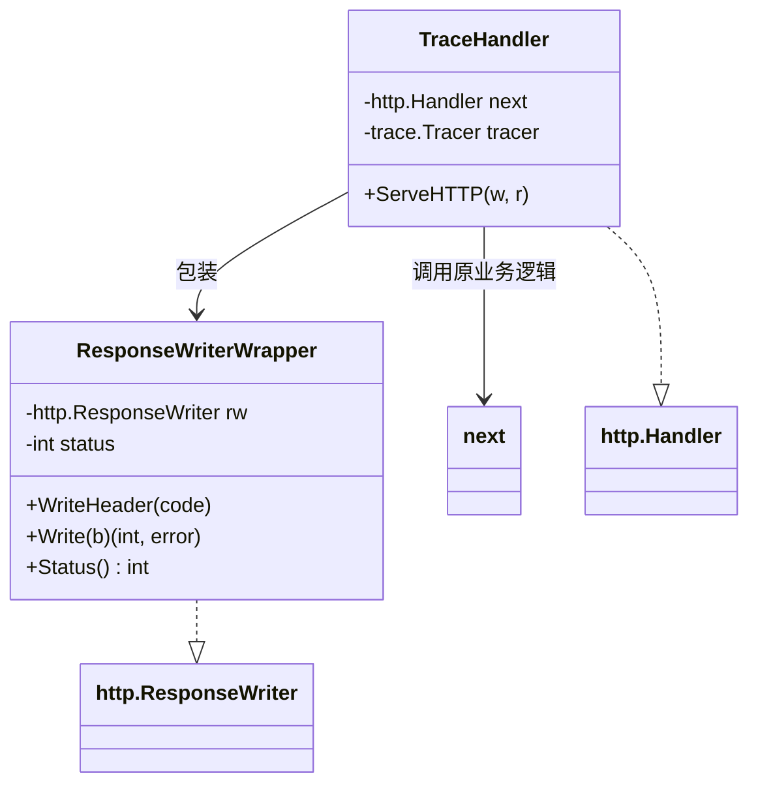
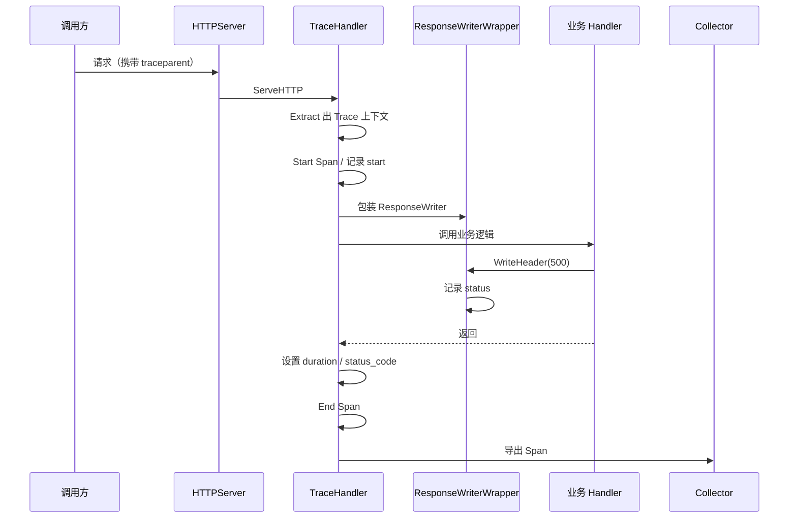

## 纲要

- 复用自研 `HTTPServer` 的 `Handle` / `HandleFunc` 入口，包一层 `TraceHandler`
- `TraceHandler` 内部结构：用户原始 Handler + Tracer + 响应包装器
- 从请求头提取 W3C `tracecontext`：前端链路与后端链路串起来的关键
- 用 `ResponseWriter` 装饰器拿到响应状态码：`WriteHeader` 才是真正的写入点
- Span 属性设计：http.status_code、http.duration
- 修改 `HTTPServer` 的注册方法，让所有路由自动获得追踪能力
- Collector 后置采样配置：数值型（耗时）与字符串型（状态码）两种策略

## 入口在哪里：包装 Handler 而不是改业务代码

在前面我们实现过自己的 HTTP 服务器，对外暴露 `Handle` 和 `HandleFunc` 两个注册方法。这意味着所有的路由注册都必须经过这两个方法——这正好是做统一观测的最佳位置。

我们声明一个 `TraceHandler`，它内部聚合两样东西：

- 业务方自己写的请求处理逻辑（`http.Handler` 类型）
- 用于创建 Span 的 `Tracer`

然后让 `TraceHandler` 自己去实现 `ServeHTTP` 方法，这样它本身就是一个合法的 `http.Handler`，可以直接塞进原本期望接收 Handler 的位置。这是经典的装饰器（ decorator ）写法：接口不变，行为增强。



## 从请求头恢复 Trace 上下文

如果我们的服务对外提供 HTTP 服务，调用方很可能是一个前端页面，或者其他已经接入 OpenTelemetry 的后端服务。它们会按照 W3C 的 `tracecontext` 规范，把 Trace 上下文放进请求头（形如 `traceparent: 00-<trace-id>-<span-id>-01`）。

如果我们在服务端不去解析它，那么这一整条链路就会在此处断成两截：前端一段 Trace ID，后端是新生成的一条 Trace ID，两者对不上，全链路追踪就无从谈起。

OpenTelemetry SDK 里承担这个职责的是**传播者（Propagator）**。我们在创建 TracerProvider 时通常会同时设置两类传播者：`TraceContext` 和 `Baggage`，其中 `TraceContext` 正是 W3C `tracecontext` 协议的实现。

SDK 中还有一个"载体（Carrier）"的概念，`propagation.HeaderCarrier` 就是把一个 Go 的 `http.Header` 包装成可以被 Propagator 读写的载体。使用方式很自然：

```go
prop := otel.GetTextMapPropagator()          // 创建 provider 时设置的传播者
carrier := propagation.HeaderCarrier(r.Header)
ctx := prop.Extract(r.Context(), carrier)    // 从请求头提取，返回携带 SpanContext 的新 ctx
```

这样一来，`ctx` 里就含有了上游的 Trace ID 与父 Span ID，用它创建的 Span 会自动挂到同一棵树下。**全链路追踪的前提只有一个：上下游使用相同的上下文封装与解析协议。** 如果前端用的是 `b3`（Zipkin 系），后端配的是 `tracecontext`，链路一样是断的。

紧接着还有一步容易被忽略：要用新的 `ctx` 覆盖掉 `request` 里原有的 `ctx`。

```go
r = r.WithContext(ctx)
```

因为后续业务 Handler 内部还会继续用 `r.Context()` 去调 Redis、调 gRPC。只有覆盖了，这些下游 Span 才会正确地挂在同一个父 Span 之下。

## 拿到响应状态码：包装 ResponseWriter

HTTP Handler 拿不到响应状态码——这是标准库 `http.ResponseWriter` 接口的限制。业务代码可以根本不调用 `WriteHeader`（此时默认为 200），也可以在任何时刻调用一次。

解决办法还是装饰器：定义一个结构体持有原始 `ResponseWriter`，并额外记录一个 `status` 字段，然后复写 `WriteHeader` 方法：

```go
func (w *ResponseWriterWrapper) WriteHeader(code int) {
    w.status = code
    w.rw.WriteHeader(code) // 别忘了继续调用原始实现
}
```

注意两个细节：

- `Write` 方法同样需要转发给原始的 `ResponseWriter`，否则业务代码写出去的响应体会丢失
- 业务如果没有显式调用 `WriteHeader`，`status` 会是零值，此时应当按 200 处理

有了状态码，我们就能回答一类非常实用的问题：**所有返回 500 的请求，它们的完整调用链是什么？** 这在排查线上偶发错误时价值极高——不需要复现，直接从已采集的链路里捞。

## Span 属性与时长的填埋

`ServeHTTP` 里需要记录三类信息：

- Span 名称：直接用请求路径，例如 `/api/v1/order/create`，在 Jaeger 里按路径聚合非常直观
- 响应状态码：`http.status_code`
- 处理耗时：`http.duration`，单位秒，用结束时间减开始时间

耗时务必要用 `defer` 写在业务 Handler 执行之后，并且放在 `span.End()` 之前，否则 Span 已经关闭再设属性是无效的。



## Collector 后置采样：数值阈值与字符串匹配

Collector 的 `tail_sampling` 处理器有两种截然不同的配置写法，取决于我们要匹配的属性是数值还是字符串。

**数值型（如耗时阈值）**：需要同时给出 `min_value` 和 `max_value`，表示落在这个闭区间内就命中策略。我们希望"只要超过阈值就采"，所以把 `max_value` 设为一个极大的值（`math.MaxInt64` 对应的数值），`min_value` 设为阈值秒数。为了本地调试方便，阈值可以先设成 1 秒，故意在 Handler 里 `time.Sleep(time.Second)` 就能触发采集。

**字符串型（如状态码）**：使用 `string_attribute` 策略，可以精确地做 "等于" / "不等于" 匹配。因为我们定义状态码属性时用的是字符串类型，所以这里可以很方便地写"状态码等于 500 就全采"。

一个务实的取舍：**用 string 还是 int 存状态码？** 在 Collector 的策略匹配里字符串更灵活（支持 `=`、`!=` 精确匹配），而且状态码本身并不需要参与任何数值运算。所以定义在 Span 属性上时，用字符串往往比整数更好用。

## API 速览

| API | 说明 | 参数 / 返回值 |
| --- | --- | --- |
| `http.Handler` | 需要实现 `ServeHTTP(ResponseWriter,*Request)` | 所有路由处理器的统一抽象 |
| `propagation.HeaderCarrier(http.Header)` | 把 HTTP Header 包装为传播者可读写载体 | 实现 `Get/Set/Keys` |
| `otel.GetTextMapPropagator()` | 获取全局传播者 | 返回 `propagation.TextMapPropagator` |
| `prop.Extract(ctx,carrier)` | 从载体中提取 SpanContext，返回新 ctx | 自动处理无效/缺失头的情况 |
| `prop.Inject(ctx,carrier)` | 把 ctx 中的 SpanContext 写入载体 | 客户端侧使用 |
| `request.WithContext(ctx)` | 生成替换了 ctx 的请求副本 | 必须写回 `r = r.WithContext(ctx)` |
| `tracer.Start(ctx,name,opts...)` | 创建子 Span | 返回 `(context.Context,trace.Span)` |
| `span.SetAttributes(kv ...attribute.KeyValue)` | 设置 Span 属性 | 支持 `String/Int/Float64/Bool` |
| `span.End()` | 结束计时 | 建议 `defer` |

> 以下代码均**根据讲稿逻辑补充**，课程源码目录未提供实现文件。

## Demo 示例

### 运行说明

```bash
go get go.opentelemetry.io/otel \
       go.opentelemetry.io/otel/sdk \
       go.opentelemetry.io/otel/exporters/otlp/otlptrace/otlptracegrpc

# 启动 Collector + Jaeger 后运行
go run .
curl http://127.0.0.1:8080/api/order/slow   # 睡眠 1 秒 -> 触发慢接口采样
curl http://127.0.0.1:8080/api/order/error  # 返回 500  -> 触发状态码采样
```

### 代码说明

**trace_handler.go** —— 响应包装器与追踪 Handler：

```go
package main

import (
	"net/http"
	"time"

	"go.opentelemetry.io/otel"
	"go.opentelemetry.io/otel/attribute"
	"go.opentelemetry.io/otel/codes"
	"go.opentelemetry.io/otel/propagation"
	"go.opentelemetry.io/otel/trace"
)

// ResponseWriterWrapper 装饰 http.ResponseWriter，用于捕获响应状态码
type ResponseWriterWrapper struct {
	rw     http.ResponseWriter
	status int
}

func NewResponseWriterWrapper(rw http.ResponseWriter) *ResponseWriterWrapper {
	return &ResponseWriterWrapper{rw: rw, status: 0}
}

// WriteHeader 复写，在调用原始实现前先记录状态码
func (w *ResponseWriterWrapper) WriteHeader(code int) {
	w.status = code
	w.rw.WriteHeader(code)
}

// Write 必须转发，否则响应体会丢失
func (w *ResponseWriterWrapper) Write(b []byte) (int, error) {
	return w.rw.Write(b)
}

// Status 返回捕获到的状态码，未显式调用 WriteHeader 时按 200 处理
func (w *ResponseWriterWrapper) Status() int {
	if w.status == 0 {
		return http.StatusOK
	}
	return w.status
}

// TraceHandler 装饰业务 Handler，完成上下文解析、Span 创建与统计
type TraceHandler struct {
	next   http.Handler
	tracer trace.Tracer
}

func NewTraceHandler(next http.Handler, tracer trace.Tracer) *TraceHandler {
	return &TraceHandler{next: next, tracer: tracer}
}

func (t *TraceHandler) ServeHTTP(rw http.ResponseWriter, r *http.Request) {
	// 从请求头恢复上游 Trace 上下文（遵循 W3C tracecontext 规范）
	ctx := otel.GetTextMapPropagator().Extract(r.Context(), propagation.HeaderCarrier(r.Header))

	// 用携带 TraceContext 的 ctx 覆盖 request 原有 ctx，保证下游 Span 能串联
	r = r.WithContext(ctx)

	// 以请求路径作为 Span 名称
	ctx, span := t.tracer.Start(ctx, r.URL.Path)
	defer span.End()

	start := time.Now()
	wrapper := NewResponseWriterWrapper(rw)
	t.next.ServeHTTP(wrapper, r)
	cost := time.Since(start)

	status := wrapper.Status()
	span.SetAttributes(
		attribute.String("http.method", r.Method),
		attribute.String("http.route", r.URL.Path),
		// 状态码用字符串类型，便于 Collector 侧做等于/不等于匹配
		attribute.String("http.status_code", http.StatusText(status)),
		attribute.Int("http.status_code_int", status),
		// 耗时以秒为单位，Collector 里的 min_value 也是秒
		attribute.Float64("http.duration", cost.Seconds()),
	)

	if status >= http.StatusInternalServerError {
		span.SetStatus(codes.Error, http.StatusText(status))
	}
}
```

**server.go** —— 让路由注册自动带上追踪：

```go
package main

import (
	"net/http"

	"go.opentelemetry.io/otel/trace"
)

type HTTPServer struct {
	mux    *http.ServeMux
	tracer trace.Tracer
}

func NewHTTPServer(tracer trace.Tracer) *HTTPServer {
	return &HTTPServer{mux: http.NewServeMux(), tracer: tracer}
}

// Handle 注册 http.Handler，统一包一层 TraceHandler
func (s *HTTPServer) Handle(pattern string, h http.Handler) {
	s.mux.Handle(pattern, NewTraceHandler(h, s.tracer))
}

// HandleFunc 注册处理函数，同样包一层 TraceHandler
func (s *HTTPServer) HandleFunc(pattern string, f http.HandlerFunc) {
	s.Handle(pattern, f)
}

func (s *HTTPServer) Run(addr string) error {
	return http.ListenAndServe(addr, s.mux)
}
```

**collector-config.yaml** —— 后置采样策略片段：

```yaml
processors:
  tail_sampling:
    decision_wait: 10s
    policies:
      # 策略一：任意 Span 出错 -> 整条 Trace 全采
      - name: error-policy
        type: status_code
        status_code:
          status_codes: [ERROR]

      # 策略二：HTTP 耗时超过阈值（秒） -> 整条 Trace 全采
      - name: slow-http-policy
        type: numeric_attribute
        numeric_attribute:
          key: http.duration
          min_value: 1
          max_value: 9223372036854775807

      # 策略三：HTTP 状态码精确匹配 500 -> 整条 Trace 全采
      - name: http-500-policy
        type: string_attribute
        string_attribute:
          key: http.status_code
          values: ["Internal Server Error"]
```

### 技术点总结

- `Handle` / `HandleFunc` 是统一入口，在此处包装饰器可以做到对业务零感知
- 传播者 + 载体是跨进程传递 Trace 上下文的标准解法，前提是与上游协议一致
- `request.WithContext` 必须写回，否则下游调用会断链
- `WriteHeader` 是捕获状态码的唯一可靠位置，`Write` 必须继续转发
- 没有显式写状态码时按 200 处理
- Collector 的数值型策略要给 `min_value` 和 `max_value`，字符串型策略更适合精确匹配状态码
