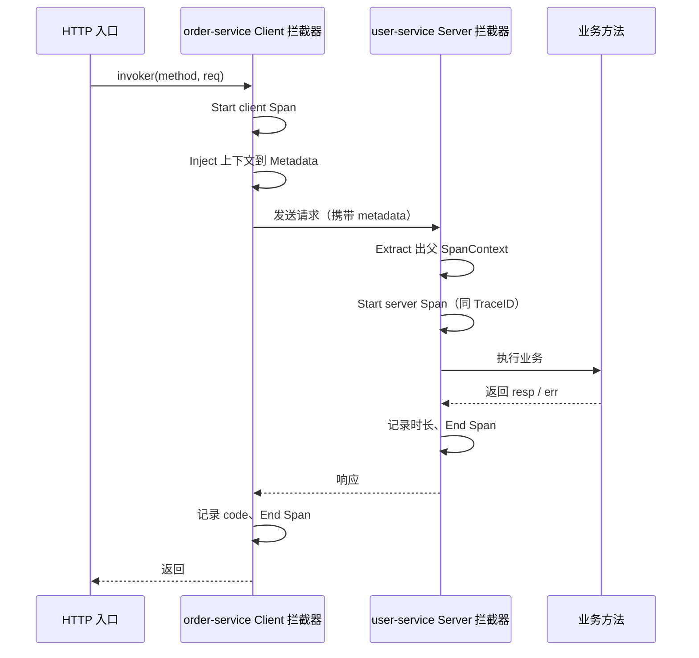

## 纲要

- gRPC 的扩展点：客户端拦截器 `UnaryClientInterceptor` 与服务端拦截器 `UnaryServerInterceptor`
- 与 HTTP 思路的相似点：在调用前后记录时长、把结果写进 Span 属性
- Metadata：gRPC 世界的 HTTP Header，Trace 上下文靠它传输
- 自定义 `TextMapCarrier`：实现三个方法，把 Trace 上下文写进 Metadata
- 不能盲目新建 Metadata：要先尝试复用业务方已经放进 ctx 的内容
- 服务端侧：从 incoming metadata 中提取上下文并创建子 Span
- 踩坑实录：ctx 没有透传导致链路断成两棵树的排查

## gRPC 的拦截器扩展点

在前面搭建 gRPC 服务时，我们预留了 `Interceptor` 参数。这个位置就是 gRPC 版的中间件：

- **客户端拦截器**：在发起远程调用的前后执行，可以统计"我调用别人"花了多久、返回什么错误码
- **服务端拦截器**：在处理入站请求的前后执行，可以统计"别人调用我"花了多久、结果如何

它的作用与 HTTP 侧的 `TraceHandler` 完全同构：在真实调用的前后各插一段自己的逻辑，把观测到的东西写进 Span 属性。之后 Collector 就可以基于这些属性决定要不要整条链路全采。



## Metadata：承载 Trace 上下文的载体

gRPC 有一个 `metadata.MD` 类型，本质上就是 `map[string][]string`，它的作用与 HTTP Header 完全对应：每次 RPC 调用都可以携带一些元数据发给对端。

于是尴尬点来了：OpenTelemetry 的传播者（Propagator）并不认识 `metadata.MD`，它只认识 `TextMapCarrier` 接口。这个接口非常小，只有三个方法：

```go
type TextMapCarrier interface {
    Get(key string) string
    Set(key string, value string)
    Keys() []string
}
```

看出来了吗？它就是一个 Map 的读写抽象。所以我们只需要写一个薄薄的适配器，实现这三个方法，内部操作 `metadata.MD`：

```go
type MetadataSupplier struct{ md *metadata.MD }

func (s *MetadataSupplier) Get(key string) string {
    if vals := s.md.Get(key); len(vals) > 0 {
        return vals[0]
    }
    return ""
}

func (s *MetadataSupplier) Set(key, value string) {
    s.md.Set(key, value)
}

func (s *MetadataSupplier) Keys() []string {
    keys := make([]string, 0, len(*s.md))
    for k := range *s.md {
        keys = append(keys, k)
    }
    return keys
}
```

有了它，`prop.Inject(ctx,&MetadataSupplier{md: &md})` 就能把当前 ctx 中的 Trace 上下文写进 Metadata。

## 一个容易忽略的坑：不要覆盖业务方的 Metadata

客户端拦截器里写 `md := metadata.New(nil)` 是最自然的写法，但它是错的。

原因：业务代码完全有可能在调用 RPC 之前，自己往 ctx 里塞了一些 Metadata（比如鉴权 token、灰度标、多租户标识）。如果我们拦截器里直接新建一个空 Metadata 再覆盖回去，这些业务元数据就被静默丢弃了，且极难排查。

正确做法是**先取、取不到再建**：

```go
md, ok := metadata.FromOutgoingContext(ctx)
if !ok {
    md = metadata.New(nil)
}
// 在已有 md 的基础上注入 Trace 上下文
prop.Inject(ctx, &MetadataSupplier{md: &md})
ctx = metadata.NewOutgoingContext(ctx, md)
```

注意注入必须在 `NewOutgoingContext` 之前完成——`NewOutgoingContext` 只是把 md 快照塞进 ctx，之后再修改 md 变量本身是不会生效的。

## 服务端：把 Trace 上下文解出来

服务端拦截器干三件事：

- 用 `metadata.FromIncomingContext(ctx)` 取出入站元数据；取不到说明上游没有传 Trace 上下文，此时新建一棵新树即可（不要让程序报错）
- 用反向操作 `prop.Extract(ctx,carrier)` 把元数据里的 Trace 上下文提取出来，得到一个新的 ctx
- 用这个新 ctx 创建 Span。这样服务端 Span 与客户端 Span 共享同一个 Trace ID，父子关系自动建立

之后就是与客户端对称的统计动作：记录请求方法、耗时，如果 `err != nil` 就用 `status.Code(err)` 取出 gRPC 状态码，设置 `error=true` 属性并 `RecordError`。

这里有一个与 HTTP 的重要区别：**gRPC 不依赖响应码策略**。因为我们已经把所有返回非 OK 的 Span 显式标记成了 `error=true`，Collector 里沿用统一的 "含 Error 全采" 策略就够了。所以配置上只需要保留耗时阈值策略。

## 踩坑实录：ctx 没有透传导致链路断成两半

第一次跑起来的时候，Jaeger 上出现了两条独立的 Trace，而不是期望的一条。

排查方向很明确：服务端没能从 ctx 中提取到上游的 SpanContext，于是自己生成了全新的 Trace ID。这类问题的根因几乎总是同一个——**业务代码里没有把上层传进来的 ctx 沿着调用链往下传**。

典型错误写法是在 Service 层里写 `context.Background()` 或者 `context.TODO()`：一旦在某处断开，之后的所有 Span 都会另起一棵树。正确做法是：HTTP Handler 里的 `r.Context()` → Service 方法参数 → gRPC client 调用参数，一路上只能有一个 ctx 来源。

修完之后重启服务，Jaeger 里就呈现出完整的一条链路：order-service 汇聚请求 → 调用 user-service → user-service 查缓存 → 再调用 sql-service（此时故意没启动 sql-service）→ client 侧报错 `Unavailable` → 整条链路标记为错误。

这正是我们做链路追踪想要的效果：**一眼看出是哪一次下游调用、以什么错误码失败了。**

## API 速览

| API | 说明 | 参数 / 返回值 |
| --- | --- | --- |
| `grpc.WithUnaryInterceptor(i UnaryClientInterceptor)` | 注册客户端一元拦截器 | DialOption |
| `UnaryClientInterceptor` 签名 | `(ctx,method,req,reply,cc,invoker,opts...) error` | `invoker` 是真正发请求的函数 |
| `grpc.UnaryInterceptor(i UnaryServerInterceptor)` | 注册服务端一元拦截器 | ServerOption |
| `UnaryServerInterceptor` 签名 | `(ctx,req,info,handler) (resp,error)` | `handler` 是真正的业务方法 |
| `metadata.FromOutgoingContext(ctx) (MD,bool)` | 取出 ctx 中待发送的元数据 | 第二返回值标识是否存在 |
| `metadata.NewOutgoingContext(ctx,md)` | 把元数据写入 ctx（快照） | 返回新 ctx |
| `metadata.FromIncomingContext(ctx) (MD,bool)` | 取出入站元数据 | 服务端使用 |
| `metadata.New(map[string]string) MD` | 构造元数据 | key 会被自动小写化 |
| `propagation.TextMapCarrier` | 传播者读写载体接口 | `Get/Set/Keys` |
| `status.Code(err) codes.Code` | 从错误中提取 gRPC 状态码 | 如 `codes.Unavailable` |

> 以下代码**根据讲稿逻辑补充**，课程源码目录未提供实现文件。

## Demo 示例

### 运行说明

```bash
go get google.golang.org/grpc \
       go.opentelemetry.io/otel \
       go.opentelemetry.io/otel/sdk \
       go.opentelemetry.io/otel/exporters/otlp/otlptrace/otlptracegrpc

# 启动 user-service，故意不启动 sql-service，用于观察 Unavailable 错误链路
# 启动 Collector + Jaeger 后：
go run ./client
```

### 代码说明

**metadata_supplier.go** —— 让传播者能够操作 gRPC Metadata：

```go
package main

import "google.golang.org/grpc/metadata"

// MetadataSupplier 适配 propagation.TextMapCarrier 与 gRPC metadata.MD
type MetadataSupplier struct {
	md *metadata.MD
}

// Get 读取 key 对应的第一个值
func (s *MetadataSupplier) Get(key string) string {
	if vals := s.md.Get(key); len(vals) > 0 {
		return vals[0]
	}
	return ""
}

// Set 写入键值对
func (s *MetadataSupplier) Set(key, value string) {
	s.md.Set(key, value)
}

// Keys 返回当前所有 key
func (s *MetadataSupplier) Keys() []string {
	keys := make([]string, 0, len(*s.md))
	for k := range *s.md {
		keys = append(keys, k)
	}
	return keys
}
```

**client_interceptor.go** —— 客户端拦截器，负责耗时统计与上下文注入：

```go
package main

import (
	"context"
	"time"

	"go.opentelemetry.io/otel"
	"go.opentelemetry.io/otel/attribute"
	"go.opentelemetry.io/otel/codes"
	"go.opentelemetry.io/otel/trace"
	"google.golang.org/grpc"
	"google.golang.org/grpc/metadata"
	"google.golang.org/grpc/status"
)

// UnaryClientTraceInterceptor 客户端一元拦截器
func UnaryClientTraceInterceptor(tracer trace.Tracer) grpc.UnaryClientInterceptor {
	return func(ctx context.Context, method string, req, reply any,
		cc *grpc.ClientConn, invoker grpc.UnaryInvoker, opts ...grpc.CallOption) error {

		ctx, span := tracer.Start(ctx, method)
		defer span.End()

		span.SetAttributes(attribute.String("rpc.system", "grpc"),
			attribute.String("rpc.method", method),
			attribute.String("span.kind", "client"))

		// 复用业务方可能已放入 ctx 的 metadata，避免覆盖
		md, ok := metadata.FromOutgoingContext(ctx)
		if !ok {
			md = metadata.New(nil)
		}
		// 注入 Trace 上下文，必须在 NewOutgoingContext 之前完成
		otel.GetTextMapPropagator().Inject(ctx, &MetadataSupplier{md: &md})
		ctx = metadata.NewOutgoingContext(ctx, md)

		start := time.Now()
		err := invoker(ctx, method, req, reply, cc, opts...)
		cost := time.Since(start)

		span.SetAttributes(attribute.Float64("rpc.duration", cost.Seconds()))

		if err != nil {
			st, _ := status.FromError(err)
			span.SetAttributes(
				attribute.Bool("error", true),
				attribute.String("rpc.grpc.status_code", st.Code().String()),
			)
			span.RecordError(err)
			span.SetStatus(codes.Error, st.Message())
		}
		return err
	}
}
```

**server_interceptor.go** —— 服务端拦截器，负责上下文提取：

```go
package main

import (
	"context"
	"time"

	"go.opentelemetry.io/otel"
	"go.opentelemetry.io/otel/attribute"
	"go.opentelemetry.io/otel/codes"
	"go.opentelemetry.io/otel/trace"
	"google.golang.org/grpc"
	"google.golang.org/grpc/metadata"
	"google.golang.org/grpc/status"
)

// UnaryServerTraceInterceptor 服务端一元拦截器
func UnaryServerTraceInterceptor(tracer trace.Tracer) grpc.UnaryServerInterceptor {
	return func(ctx context.Context, req any, info *grpc.UnaryServerInfo,
		handler grpc.UnaryHandler) (any, error) {

		md, ok := metadata.FromIncomingContext(ctx)
		if !ok {
			md = metadata.New(nil) // 上游未携带 Trace 上下文，这里新建一棵树
		} else {
			// 把 metadata 中的 Trace 上下文提取回 ctx
			ctx = otel.GetTextMapPropagator().Extract(ctx, &MetadataSupplier{md: &md})
		}

		ctx, span := tracer.Start(ctx, info.FullMethod)
		defer span.End()

		span.SetAttributes(attribute.String("rpc.system", "grpc"),
			attribute.String("rpc.method", info.FullMethod),
			attribute.String("span.kind", "server"))

		start := time.Now()
		resp, err := handler(ctx, req)
		cost := time.Since(start)

		span.SetAttributes(attribute.Float64("rpc.duration", cost.Seconds()))

		if err != nil {
			st, _ := status.FromError(err)
			span.SetAttributes(
				attribute.Bool("error", true),
				attribute.String("rpc.grpc.status_code", st.Code().String()),
			)
			span.RecordError(err)
			span.SetStatus(codes.Error, st.Message())
		}
		return resp, err
	}
}
```

**collector 策略片段** —— gRPC 只需保留耗时策略：

```yaml
processors:
  tail_sampling:
    policies:
      - name: grpc-slow
        type: numeric_attribute
        numeric_attribute:
          key: rpc.duration
          min_value: 1
          max_value: 9223372036854775807
      # error=true 的 Span 由 status_code 策略统一兜住，无需按响应码再配一条
      - name: error-policy
        type: status_code
        status_code:
          status_codes: [ERROR]
```

### 技术点总结

- 拦截器是 gRPC 的天然扩展点，客户端与服务端各配一个即可覆盖全部调用
- Metadata 是 gRPC 版的 Header，靠 `TextMapCarrier` 适配器接进传播者体系
- 必须先尝试取出已有 Metadata 再注入，否则会静默吞掉业务元数据
- `NewOutgoingContext` 是快照语义，注入动作一定要在它之前
- gRPC 错误统一用 `error=true` 标记，Collector 侧无需针对状态码再配策略
- ctx 没有沿着调用链透传，是断链问题的头号嫌疑，`context.Background()` 是禁用写法
