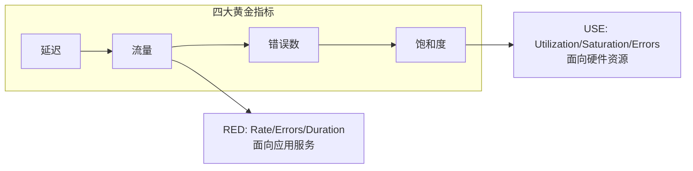

## 纲要

- 四大黄金指标（Google 提出）：延迟（Latency）、流量（Traffic）、错误数（Errors）、饱和度（Saturation）
- RED 方法：从四大黄金指标衍生，面向**外部应用服务**，三个指标——Rate / Errors / Duration
- USE 方法：面向**硬件资源**，三个指标——Utilization / Saturation / Errors
- RED 与黄金指标高度重叠但更具体；USE 与黄金指标中的「饱和度」思路一致，但视角在资源侧
- 方法论价值：面对陌生组件 / 系统时，能快速知道该建哪些指标来反映其健康状态

## 正文

### 四大黄金指标

Google 提出的「四大黄金指标」把监控数据归为四类，是衡量用户体验与应用性能的基础框架。建立一个应用服务或技术组件时，都可以从这四个维度去思考该建什么指标：

| 维度 | 含义 | 示例指标 |
| --- | --- | --- |
| 延迟（Latency） | 处理一次请求所花的时间 | HTTP 接口处理耗时 |
| 流量（Traffic） | 系统当前的负载 | QPS（外部请求）、TPS（MySQL 的 update/delete 等写操作） |
| 错误数（Errors） | 发生错误的请求数 | 非 2xx 的 HTTP 状态码数量 |
| 饱和度（Saturation） | 资源使用的饱和程度 | CPU 使用率、磁盘读写带宽占上限的比例 |

只要这四个维度中某个异常，基本都能映射到用户体验下降。例如延迟过高影响体验、错误数上涨代表系统不健康、饱和度见顶意味着存在资源瓶颈。

> 关于「流量」的语义：不同系统里流量含义不同。对通过 HTTP 提供服务的外部系统，流量通常指 QPS；对 MySQL 这类组件，写操作（update/delete/insert）计入 TPS，更能形象反映其负载。

### RED 方法（面向应用服务）

RED 方法在四大黄金指标基础上提出，更直接地给出了衡量应用服务的三个具体指标：

- **Rate**：每秒处理的请求数，即 QPS
- **Errors**：每秒失败的请求数
- **Duration**：每个请求所花费的时间（通常是分位数延迟）

可以看出 RED 和四大黄金指标高度重叠——它本就是从黄金指标衍生出来的，只是更具体化、列出了三个可直接落地的指标。对应用服务而言，把这三个指标建好就基本覆盖了核心健康度。

### USE 方法（面向硬件资源）

USE 方法监控的对象不同，它主要看**资源使用率**相关的东西，要求建立三类指标：

| 维度 | 含义 | 示例 |
| --- | --- | --- |
| Utilization（使用率） | 资源被使用的比例 | CPU 使用率、内存使用率、磁盘 IO 占比 |
| Saturation（饱和度） | 资源是否已处于饱和 | 网络带宽 / 磁盘读写字节数是否达到上限 |
| Errors（错误） | 硬件资源是否报错 | 写磁盘报错、网络接口丢包 |

USE 与黄金指标里的「饱和度」思路一致，但视角从「服务」切到了「硬件资源」：使用率高说明该资源可能存在性能瓶颈；饱和度高说明已触及上限；错误则直接反映硬件故障。

### 怎么用这套方法论

方法论最大的价值，是面对一个**陌生组件或系统**时，能快速回答「我该建哪些指标」。例如：

- 给一个应用服务建监控 → 从 RED 出发，Rate / Errors / Duration 三件套先建起来
- 给一台主机 / 一个 MySQL 实例建监控 → 从 USE 出发，看 CPU、内存、磁盘、网络的使用率、饱和度与错误

在后续改造 dogAPM 框架、真正动手建指标时，我们会不断回到这几种方法论，按它们来推导出具体要采集的指标。
