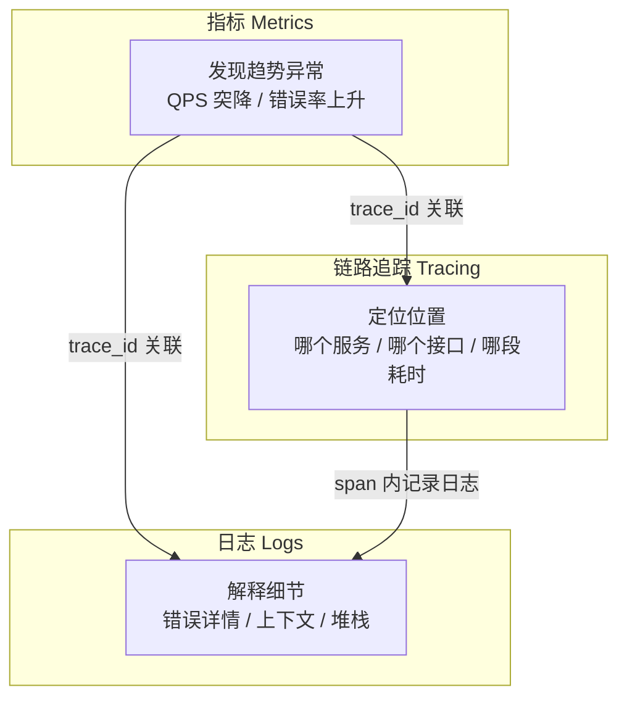

## 纲要

- 业界落地 APM 通常用三种监控手段：**指标（Metrics）、日志（Logs）、链路追踪（Tracing）**
- 指标
 - 定义：一段时间内可测量的聚合数值
 - 数据结构：指标名 + 标签键值对 + 数值 + 时间戳，天然结构化
 - 关键点：指标不仅要能**发现问题**，还要能**定位问题**
- 日志
 - 定义：特定事件的文本记录，一般设计为结构化（JSON）格式
 - 关键点：只记录错误信息不够，必须记录**上下文**，否则无法定位与修复
- 链路追踪
 - 定义：通过 traceID 把不同服务间的请求过程串联起来的端到端数据
 - 数据结构：trace → 多个 span，每个 span 含开始时间、持续时长、tag、log
 - 关键点：Go 没有自动探针，需要对代码框架做**手动埋点**的二次开发

## 指标：聚合的可测量数值集合

### 指标的数据结构

接口 QPS、接口响应时长都属于指标。以 Prometheus 中一条 goroutine 指标为例，它由四部分组成：

```text
go_goroutines{app="order-service",host="10.0.0.1",instance="10.0.0.1:8080",job="order"} 29
```

- `go_goroutines`：指标名称（metric name）
- `app`、`host`、`instance`、`job`：标签（label），等号左边是标签名，右边是标签值
- `29`：指标数值

指标在存储时还会带上创建时刻的**时间戳**。正因为有了时间戳，不同时间点的同一个指标才能被聚合成曲线或其他统计图表，最终在监控面板上展示出来——监控面板上的每一个描点，都是指标在某个时间戳下经计算得到的数值。

### 用 Go 定义一条带标签的指标

下面这段代码根据讲稿逻辑补充，演示如何在 Go 服务里定义一条带 `app` / `host` 标签的 QPS 指标：

```go
package main

import (
	"net/http"
	"os"

	"github.com/prometheus/client_golang/prometheus"
	"github.com/prometheus/client_golang/prometheus/promhttp"
)

var httpQPS = prometheus.NewCounterVec(
	prometheus.CounterOpts{
		Name: "http_requests_total",
		Help: "Total number of HTTP requests.",
	},
	// 标签维度：应用名与主机名，用于定位"谁在被谁请求"
	[]string{"app", "host", "path", "code"},
)

func init() {
	prometheus.MustRegister(httpQPS)
}

func main() {
	hostname, _ := os.Hostname()

	http.HandleFunc("/order/create", func(w http.ResponseWriter, r *http.Request) {
		// 业务逻辑执行完毕后按标签累加
		httpQPS.WithLabelValues("order-service", hostname, r.URL.Path, "200").Inc()
		w.Write([]byte("ok"))
	})

	// 暴露 /metrics 接口，供 Prometheus 拉取
	http.Handle("/metrics", promhttp.Handler())
	http.ListenAndServe(":8080", nil)
}
```

拉取 `/metrics` 时看到的样本形如：

```text
http_requests_total{app="order-service",code="200",host="macbook",path="/order/create"} 137
```

### 设计指标时的陷阱

初学者最容易犯的错误是**创建大量作用不大的指标**，覆盖面看似很广，但真正出问题时一个也用不上。

设计指标时必须同时回答两个问题：

- 这个指标异常时，能否**发现**问题？（例如错误率突然上升）
- 这个指标异常时，能否**定位**问题？（例如通过 `host` 标签直接看出是哪台机器发起的异常流量）

只有同时满足这两点，指标才算"用到恰到好处"。

## 日志：特定事件的文本记录

### 为什么要结构化

日志可以是结构化的，也可以是非结构化的，但**应当设计为结构化日志**。原因是结构化之后才能方便地做后续的过滤、分析与聚合。

典型的流程是：应用以 JSON 格式打印日志 → Logstash 做过滤与结构化解析 → 存入 Elasticsearch → 通过 Kibana 展示。

以一条订单服务的日志为例，打印出来是一行 JSON：

```json
{"level":"error","time":"2024-05-01T10:23:11+08:00","app":"order-service","trace_id":"4bf92f3577b34da6a3ce929d0e0e4736","uid":10086,"message":"create order failed: stock not enough","order_id":20240501001}
```

这么做的好处有几个：

- 可以把经常用于搜索的字段（如 `uid`、`order_id`、`trace_id`）提取成 Elasticsearch 索引的独立字段，直接按 `uid` 检索出该用户的所有操作日志
- 可以在 Kibana 上按维度建图表，例如按 `app` 维度建饼图，一眼看出哪个服务的日志量占比过高，进而去优化该服务的日志打印
- 日志里带上 `trace_id`，就能把日志和链路追踪直接关联起来

### 用 Go 打印结构化日志

下面这段代码根据讲稿逻辑补充，使用 zap 打印带上下文的 JSON 日志：

```go
package main

import (
	"errors"

	"go.uber.org/zap"
)

func main() {
	logger, _ := zap.NewProduction()
	defer logger.Sync()

	uid := 10086
	traceID := "4bf92f3577b34da6a3ce929d0e0e4736"
	err := errors.New("stock not enough")

	// 反例：只记录错误信息，缺少上下文，无法定位是哪个用户、哪条链路
	logger.Error(err.Error())

	// 正例：把 trace_id、uid、order_id 等上下文一并结构化记录
	logger.Error("create order failed",
		zap.String("app", "order-service"),
		zap.String("trace_id", traceID),
		zap.Int("uid", uid),
		zap.Int("order_id", 20240501001),
		zap.Error(err),
	)
}
```

缺少上下文是新手打日志的通病。仅仅把程序里的报错记下来，是不足以定位、解决乃至修复问题的——必须把出错时的上下文（用户、订单、链路、入参）一起记录下来。

## 链路追踪：端到端的请求串联

### 数据结构

链路追踪记录的是端到端的数据，通过一个 **traceID** 把不同服务间的请求过程串联起来，每个过程的消耗时长以及其中发生的错误都能以时间线的形式展示。在大型微服务集群里做故障定位时，这能让你一眼看出是哪个服务出了问题。

一条完整的 trace 由多个 **span** 组成，每个 span 是一次小的调用过程，其结构如下：

```json
{
  "traceID": "4bf92f3577b34da6a3ce929d0e0e4736",
  "spans": [
    {
      "spanID": "00f067aa0ba902b7",
      "operationName": "HTTP GET /order/create",
      "startTime": 1714532591000000,
      "duration": 128000,
      "tags": {"error": "true", "http.status_code": "500"},
      "logs": [
        {"timestamp": 1714532591128000, "fields": {"event": "error", "stack": "..."}}
      ]
    }
  ]
}
```

关键字段：

- `startTime` 与 `duration`：该过程的开始时间与持续时长，用来分析耗时
- `tags`：为这个过程打上的标签，是后续检索的维度（例如标记 `error=true`）
- `logs`：这个过程里记录的关键事件，可以记录当时的**错误堆栈**

除了时间线，trace 数据还能以图（服务依赖图）的形式展示，也可以直接查看 JSON 原文。

### 用 Go 创建 span 并标记错误

下面这段代码根据讲稿逻辑补充，演示用 OpenTelemetry SDK 手动埋点、打 tag、记录错误：

```go
package main

import (
	"context"
	"errors"

	"go.opentelemetry.io/otel"
	"go.opentelemetry.io/otel/attribute"
	"go.opentelemetry.io/otel/codes"
)

func createOrder(ctx context.Context, uid int) error {
	tracer := otel.Tracer("order-service")
	ctx, span := tracer.Start(ctx, "createOrder")
	defer span.End()

	span.SetAttributes(attribute.Int("uid", uid))

	if err := deductStock(ctx, uid); err != nil {
		// 标记该 span 出错：Jaeger 中可通过 error=true 检索到
		span.SetStatus(codes.Error, err.Error())
		span.RecordError(err)
		span.SetAttributes(attribute.Bool("error", true))
		return err
	}
	return nil
}

func deductStock(ctx context.Context, uid int) error {
	_, span := otel.Tracer("order-service").Start(ctx, "deductStock")
	defer span.End()
	return errors.New("stock not enough")
}
```

标记 `error=true` 之后，在 Jaeger 的查询界面就能通过 tag 过滤出所有出错的链路，直接看出整个调用链中哪些 trace 发生了错误，再点进去看具体是哪个环节、哪段堆栈出问题。

## 三种手段的分工



大部分监控教程都会提到这三个手段，但真正用好它们会碰到三个工程问题：如何创建有效的指标、如何打好日志、如何在代码框架里做链路追踪埋点。接下来的章节就以 Go 应用为例，逐一解决这三个问题。

## API 速览

| API / 类型 | 说明 |
| --- | --- |
| `prometheus.NewCounterVec(opts,[]string{"app","host"})` | 定义带标签的计数器指标，标签用于下钻定位 |
| `vec.WithLabelValues(...).Inc()` | 按标签取值并累加计数 |
| `promhttp.Handler()` | 暴露 `/metrics` HTTP 接口，供 Prometheus 拉取 |
| `zap.NewProduction()` | 创建 JSON 格式的结构化日志器 |
| `logger.Error(msg,zap.String(k,v),zap.Error(err))` | 以结构化字段记录错误与上下文 |
| `otel.Tracer(name).Start(ctx,name)` | 开启一个 span，返回新的 ctx 与 span |
| `span.SetAttributes(attribute.Bool("error",true))` | 为 span 打标签，供检索过滤 |
| `span.RecordError(err)` / `span.SetStatus(codes.Error,msg)` | 记录错误事件与状态 |

## Demo 示例

**运行说明**：以下代码将指标、结构化日志与链路追踪三板斧整合在一个可运行的 Go 程序中。

```bash
go mod init apm-demo
go get github.com/prometheus/client_golang/prometheus go.uber.org/zap go.opentelemetry.io/otel
go run main.go
curl http://127.0.0.1:8080/order/create
curl http://127.0.0.1:8080/metrics
```

**完整代码**：

```go
package main

import (
	"context"
	"errors"
	"net/http"
	"os"

	"github.com/prometheus/client_golang/prometheus"
	"github.com/prometheus/client_golang/prometheus/promhttp"
	"go.opentelemetry.io/otel"
	"go.opentelemetry.io/otel/attribute"
	"go.opentelemetry.io/otel/codes"
	"go.opentelemetry.io/otel/trace"
	"go.uber.org/zap"
)

var httpQPS = prometheus.NewCounterVec(
	prometheus.CounterOpts{Name: "http_requests_total"},
	[]string{"app", "host", "path", "code"},
)

func main() {
	logger, _ := zap.NewProduction()
	defer logger.Sync()
	prometheus.MustRegister(httpQPS)

	hostname, _ := os.Hostname()

	http.HandleFunc("/order/create", func(w http.ResponseWriter, r *http.Request) {
		// 链路追踪：从 HTTP 请求中提取上游传递的 trace 上下文
		ctx := r.Context()
		tracer := otel.Tracer("order-service")
		ctx, span := tracer.Start(ctx, "HTTP /order/create")
		defer span.End()

		code := "200"
		if err := createOrder(ctx); err != nil {
			code = "500"
			span.SetStatus(codes.Error, err.Error())
			span.SetAttributes(attribute.Bool("error", true))
			// 日志：带上 traceID，与链路追踪数据关联
			logger.Error("create order failed",
				zap.String("app", "order-service"),
				zap.String("trace_id", span.SpanContext().TraceID().String()),
				zap.Error(err),
			)
			w.WriteHeader(http.StatusInternalServerError)
		}
		// 指标：按标签累加
		httpQPS.WithLabelValues("order-service", hostname, r.URL.Path, code).Inc()
	})

	http.Handle("/metrics", promhttp.Handler())
	http.ListenAndServe(":8080", nil)
}

func createOrder(ctx context.Context) error {
	_, span := otel.Tracer("order-service").Start(ctx, "createOrder")
	defer span.End()
	return errors.New("stock not enough")
}

// 保证 trace 包被引用（真实项目由 SDK 初始化时注入全局 TracerProvider）
var _ trace.Tracer = otel.Tracer("order-service")
```

**代码说明**（根据讲稿逻辑补充）：

- `/order/create` 中同时完成三件事：创建 span（链路追踪）、按标签累加 QPS（指标）、打印带 `trace_id` 的 JSON 日志（日志）。
- 未初始化全局 `TracerProvider` 时，OpenTelemetry 默认返回 noop span，程序依然可以正常启动；接入 `otlptracegrpc` 之后 span 才会真正上报。
- `trace_id` 是三种数据建立关联的关键：指标发现问题 → 日志解释细节 → 链路追踪定位位置，三者靠 traceID 串成闭环。

**技术点总结**：

- 指标是结构化的聚合数值，标签决定了它能否定位问题
- 日志必须结构化，并且要带上上下文和 traceID
- 链路追踪以 span 为单位，tag 用于检索、log 用于记录堆栈
- Go 语言的链路追踪依赖手动埋点，这是落地成本最高的部分
