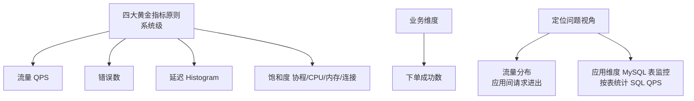

## 纲要

- 以**四大黄金指标原则**为基线确定系统级指标：流量（QPS）、错误数、延迟（Histogram）、饱和度（协程数 / CPU / 内存 / 连接数 / 磁盘带宽）
- **业务维度**指标：下单成功数，反映业务健康而非仅系统健康
- **流量分布**监控：观测应用之间的请求进出，定位被高频调用的服务、规避不合理依赖
- **应用维度 MySQL 监控**：从应用侧按表统计 SQL 的 QPS，弥补只看数据库自身难以定位业务问题的短板
- 指标是随着线上问题排查**逐步补充**出来的，不要追求一步到位

## 正文

### 从四大黄金指标原则出发

前面已经讲过建立指标的原则、Prometheus 的绘图原理与 PromQL 函数。在真正动手埋点之前，要先明确：本项目到底要给整个应用建立哪些指标？最直接的依据就是四大黄金指标原则，它从四个维度指导我们该采集什么：

| 维度 | 对应指标 | 在 Prometheus 中的形态 |
| --- | --- | --- |
| 流量 | QPS（每秒请求量） | Counter，配合 `rate` 得到速率 |
| 错误 | 每秒接口错误数 | Counter，按状态码过滤 |
| 延迟 | 接口响应时长分布 | Histogram，可算 P99 等分位数 |
| 饱和度 | 协程数、CPU、内存、连接数、磁盘带宽 | Gauge，反映资源是否触顶 |

前三者直接描述「应用对外提供服务的好坏」；饱和度关注的是应用所依赖的资源是否已经逼近上限。

### 业务维度：下单成功数

四大黄金指标原则描述的是系统层面，但如果我们想直接了解业务状态，就需要建立业务维度指标。本门课模拟的是用户下单场景，因此会建立一个「下单成功数」指标：把一段时间内下单成功的数量作为序列打到面板上。

- 若该值长期稳定，说明业务正常；
- 若某段时间明显低迷，就要从业务或系统两个角度去排查，是否存在 Bug 或运营异常。

### 微服务依赖：流量分布监控

当前服务在微服务环境中的依赖度很高：一个服务可能调用多个内部服务，也可能被多个内部服务调用。因此有必要对「请求进来 / 出去」的流量做监控，看清当下**被请求最多的服务是谁**。

做流量分布监控的好处有两个：

1. 观测应用与应用之间的请求是否合理，避免某些接口 / 逻辑被频繁打到，给服务造成压力；
2. 它本质上是**从定位问题的角度**出发建立的指标，而不是照搬四大黄金指标原则。

### 数据库视角：应用维度的表监控

通常我们对数据库的监控只停留在数据库自身：CPU、内存、查询 QPS、事务 TPS。但从数据库视角很难定位具体业务问题——因为一个数据库往往被多个应用、多张表访问。当发现数据库 QPS 异常时，你无法判断是「哪张表 / 哪个应用」造成的。

所以需要从**应用服务角度**出发：埋点分析 SQL，解析出具体表名，建立「某应用对某张表的请求 QPS」指标，并携带应用名称维度。这样一旦数据库异常，就能快速反查到是哪个应用、哪张表在疯狂访问。

### 指标是演进出来的

值得注意的是，流量分布监控与应用维度 MySQL 监控这两个指标，并不是一开始就能规划出来的，而是在实际生产、软件发布、线上排障的过程中，为了「观测某种现象、规避某种问题」才逐步建立的。这也启发我们：建立指标不要追求一步到位，先跑通「采集 → 存储 → 查询」的主链路，再随着问题排查不断从定位根因的角度补充指标。
