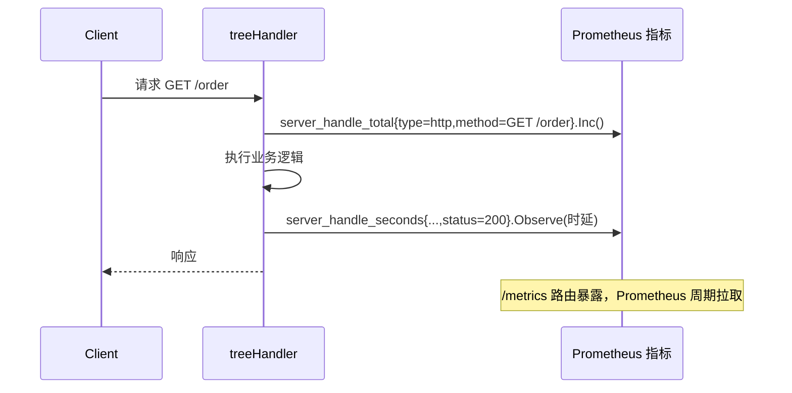

## 纲要

- Prometheus 客户端通过 **registry（注册中心）** 管理指标，只有注册过的指标才会被服务端拉取
- 用**自定义 registry** 为所有指标统一注入两个固定标签：`app`（应用名）与 `host`（主机名），便于面板聚合
- 定义两类指标：`server_handle_total`（CounterVec，记录 QPS）与 `server_handle_seconds`（HistogramVec，记录延迟与状态码）
- 通过 `/metrics` 路由暴露指标，使用官方提供的 handler 即可
- 在 HTTP 处理链（tree handler）前后埋点：处理前 `Inc()` 计数，处理后 `Observe()` 记录时长与状态码

## 正文

### 为什么需要自定义 registry

Prometheus 客户端自带一个 registry，所有创建的指标都必须注册进去，服务端才能拉取。但我们不能直接裸用默认 registry，因为我们要为**所有指标**统一附加两个维度标签：

- `app`：应用服务名称（如 `orderservice`）
- `host`：运行主机名

这两个标签后续在 Grafana 面板里用来做聚合（例如「按应用名看总 QPS」「按主机筛选」）。

实现方式是包装 Prometheus 的 registry，重写拉取时的标签注入逻辑。讲稿里是自定义一个 `metricsRegistry` 并实现 `Gather` 方法，在导出指标时遍历每个指标、把 `app` / `host` 追加进去。下面 demo 用官方提供的 `WrapRegistererWith` 达到等价效果，保证可运行。

### 定义指标

我们需要两个指标：

1. `server_handle_total`：`CounterVec` 类型，标签为 `type`（http / grpc）、`method`（HTTP 路径或 gRPC 方法名），用于统计 QPS。
2. `server_handle_seconds`：`HistogramVec` 类型，标签为 `type`、`method`、`status`（响应码），用于统计接口响应时长分布。

```go
var (
	serverHandleTotal = prometheus.NewCounterVec(
		prometheus.CounterOpts{
			Name: "server_handle_total",
			Help: "接口请求总数",
		},
		[]string{"type", "method"},
	)
	serverHandleSeconds = prometheus.NewHistogramVec(
		prometheus.HistogramOpts{
			Name:    "server_handle_seconds",
			Help:    "接口响应延迟（秒）",
			Buckets: []float64{0.01, 0.05, 0.1, 0.5, 1, 5},
		},
		[]string{"type", "method", "status"},
	)
)
```

### 暴露 /metrics 路由

改造 HTTP 服务，在创建 server 时挂载 `/metrics` 路由。Prometheus 客户端已经提供了现成的 handler，直接挂上即可把全部已注册指标暴露出去。

### 在 tree handler 中埋点

之前已经有一个 `treeHandler`，能在方法处理前后插入业务逻辑（包在 `ServerHTTP` 外层）。只需在其中加入统计逻辑：

- 处理前：以 `type=http`、`method=GET /path` 维度对 `server_handle_total` 执行 `Inc()`，即计数 +1；
- 处理后：以 `type=http`、`method`、`status=200/500` 维度对 `server_handle_seconds` 执行 `Observe(elapsed)`，其中 elapsed 由 `end - start` 计算，单位为秒。

标签值的传入顺序必须与定义 `[]string{"type","method","status"}` 时的顺序一致。



## Demo 示例

下面给出可独立运行的程序：用 `WrapRegistererWith` 统一注入 `app` / `host` 标签，定义 CounterVec / HistogramVec，并通过 tree-handler 风格的包装函数完成 HTTP 埋点。

```go
package main

import (
	"fmt"
	"log"
	"net/http"
	"time"

	"github.com/prometheus/client_golang/prometheus"
	"github.com/prometheus/client_golang/prometheus/promhttp"
)

// 根据讲稿逻辑补充：讲稿用自定义 registry 重写 Gather 注入 app/host；
// 这里用官方 WrapRegistererWith 等价实现，保证可运行。
var (
	base = prometheus.NewRegistry()
	// reg 注册指标时自动附加 app / host 两个固定标签
	reg = prometheus.WrapRegistererWith(
		prometheus.Labels{"app": "orderservice", "host": "localhost"},
		base,
	)
	serverHandleTotal = prometheus.NewCounterVec(
		prometheus.CounterOpts{Name: "server_handle_total", Help: "接口请求总数"},
		[]string{"type", "method"},
	)
	serverHandleSeconds = prometheus.NewHistogramVec(
		prometheus.HistogramOpts{
			Name:    "server_handle_seconds",
			Help:    "接口响应延迟（秒）",
			Buckets: []float64{0.01, 0.05, 0.1, 0.5, 1, 5},
		},
		[]string{"type", "method", "status"},
	)
)

func init() {
	must := func(c prometheus.Collector) {
		if err := reg.Register(c); err != nil {
			panic(err)
		}
	}
	must(serverHandleTotal)
	must(serverHandleSeconds)
}

// instrument 模拟 treeHandler：处理前计数，处理后记录延迟与状态码
func instrument(method string, fn func() int) (int, time.Duration) {
	start := time.Now()
	code := fn()
	elapsed := time.Since(start).Seconds()
	serverHandleTotal.WithLabelValues("http", method).Inc()
	serverHandleSeconds.WithLabelValues("http", method, fmt.Sprint(code)).Observe(elapsed)
	return code, time.Duration(elapsed * float64(time.Second))
}

func orderHandler(w http.ResponseWriter, r *http.Request) {
	_, _ = instrument(r.Method+" "+r.URL.Path, func() int {
		time.Sleep(30 * time.Millisecond) // 模拟业务耗时
		fmt.Fprint(w, "ok")
		return 200
	})
}

func main() {
	http.HandleFunc("/order", orderHandler)
	// 将全部已注册指标通过 /metrics 暴露
	http.Handle("/metrics", promhttp.HandlerFor(base, promhttp.HandlerOpts{}))
	log.Println("listen :8080, 访问 /metrics 查看指标")
	log.Fatal(http.ListenAndServe(":8080", nil))
}
```

### 运行说明

```bash
go mod init http-metric-demo
go get github.com/prometheus/client_golang/prometheus
go run main.go
# 另开终端
curl -s http://localhost:8080/order >/dev/null
curl -s http://localhost:8080/metrics | grep -E 'server_handle_total|server_handle_seconds'
```

### 代码说明

- `WrapRegistererWith` 会在指标注册时把 `app` / `host` 作为常量标签注入，等价于讲稿中自定义 `Gather` 的逻辑，且更健壮
- `WithLabelValues` 的实参顺序必须与 `NewCounterVec/NewHistogramVec` 声明的 `[]string` 顺序严格对应
- 暴露路由不一定叫 `/metrics`，但本项目统一规定为 `/metrics`，Prometheus 抓取配置也要与之对应

### 技术点总结

- 自定义 registry 的核心目的：为所有指标统一附加 `app` / `host` 维度，支撑面板聚合
- `server_handle_total`（Counter）记 QPS，`server_handle_seconds`（Histogram）记延迟与状态码
- 在 HTTP 处理链前后埋点，`Inc()` + `Observe()` 即可完成统计
- 指标通过 `/metrics` 暴露后，由 Prometheus 周期拉取进入存储
