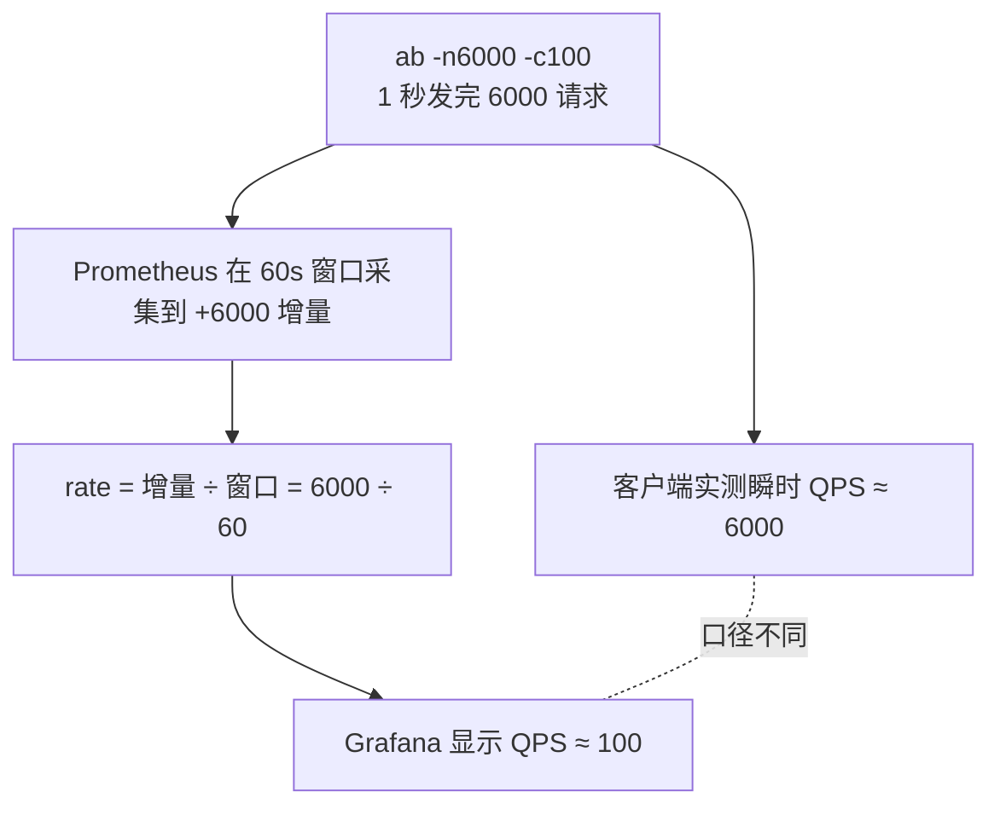

## 纲要

- 用 **Apache Bench（ab）** 压测下单接口：`ab -n 6000 -c 100` 表示共发 6000 个请求、每次 100 并发
- ab 给出的是**客户端实测瞬时 QPS**（1 秒内真正发出去的请求数）
- Grafana 面板上的 QPS 来自 `rate`：取统计窗口内首尾样本差 ÷ 窗口秒数，会把突发请求**均摊**到整个窗口
- 正因为均摊，1 秒发完的 6000 请求在 60s 窗口下只显示约 100 QPS，与 ab 的几千 QPS 看似矛盾，实则口径不同

## 正文

### 用 ab 发起压测

Apache Bench 是常用的轻量压测工具，本节只用到两个参数：

- `-n 6000`：总共发起 6000 个请求
- `-c 100`：每次并发发送 100 个请求

执行后 ab 会汇总：总耗时、每秒完成的请求数等。这里的「每秒请求数」就是**客户端视角的真实 QPS**——1 秒左右发完 6000 个请求，ab 报出的就是几千级别的数值。

### 为什么 Grafana 只显示约 100 QPS

把压测打在应用上后，观察 Grafana 的 QPS 面板，发现显示的不是几千，而是大约 **100**。原因在于 `rate` 的计算口径：

`rate` 取的是**统计窗口内第一个样本与最后一个样本的差值，再除以窗口秒数**。本项目面板的窗口是 `$__rate_interval`（约 60s）。ab 在 1 秒内把 6000 个请求全部打出去，但对 Prometheus 来说，这 6000 个增量被均摊到了 60 秒的窗口里：

```
6000 请求 ÷ 60 秒 ≈ 100 QPS
```

所以 Grafana 展示的是「把这一秒的突发请求平摊到 60 秒后的平均速率」，而 ab 展示的是「这一秒真实打出去的速率」。两者口径不同，并非数据错误。



### 想要更贴近真实的尖峰怎么办

如果想让 Grafana 更灵敏地反映瞬时尖峰，可以：

- 缩短 `rate` 窗口（但窗口过短样本不足，曲线会抖动甚至缺数据）；
- 或用 `irate`（只取窗口内最后两个样本算差值，对尖刺更敏感）。

但生产中通常维持 15s 抓取 + `$__rate_interval`，因为它反映的是「可持续的平均吞吐」而非瞬间毛刺，更适合看趋势。

## Demo 示例

下面用 Go 模拟「1 秒发完 6000 请求」后，两种口径的 QPS 差异，直观验证上面的结论。

```go
package main

import (
	"fmt"
	"time"
)

// 根据讲稿逻辑补充：演示 ab 实测瞬时 QPS 与 Prometheus rate 在 60s 窗口下的差异
func main() {
	total := 6000
	elapsed := time.Second // ab 在 1 秒内把请求全部发完

	// 客户端实测瞬时 QPS（ab 的算法）
	instantQPS := float64(total) / elapsed.Seconds()
	fmt.Printf("ab 实测瞬时 QPS ≈ %.0f\n", instantQPS)

	// Prometheus rate：把 1s 内的增量均摊到 60s 窗口
	rateWindow := 60 * time.Second
	rateQPS := float64(total) / rateWindow.Seconds()
	fmt.Printf("Grafana(rate 60s 窗口) 显示 QPS ≈ %.0f\n", rateQPS)
}
```

### 运行说明

```bash
go run main.go
# 输出：
# ab 实测瞬时 QPS ≈ 6000
# Grafana(rate 60s 窗口) 显示 QPS ≈ 100
```

### 代码说明

- `instantQPS` 代表 ab 的口径：总请求数 ÷ 实际耗时
- `rateQPS` 代表 `rate` 的口径：总增量 ÷ 统计窗口（60s），把突发均摊
- 二者比值正好是「实际耗时 ÷ 窗口」= 1/60，所以 6000 变约 100

### 技术点总结

- `ab -n <总数> -c <并发>` 用于压测，`-n` 总请求数、`-c` 并发数
- ab 报的是客户端瞬时 QPS；Grafana 的 `rate` 是窗口均摊后的平均速率
- 突发压测下二者数值差异是口径问题，不是采集错误
- 想看尖峰可用更短窗口或 `irate`，但生产更看重可持续平均吞吐
