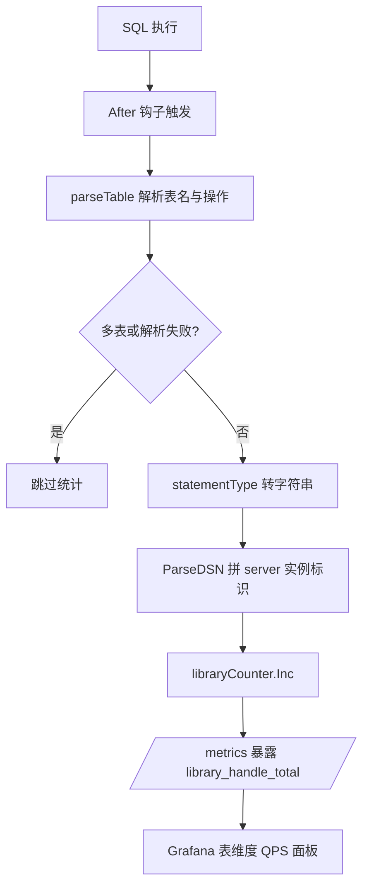

## 纲要

- SQL 解析：在前面用 `sqlparser` 解析 SQL 的基础上，封装 `parseTable` 方法，返回「表名 + 操作类型（insert/delete/update/select）+ 是否多表 + 错误」
- 多表 SQL 不统计：涉及多张表的 SQL 无法归属到单张表，`parseTable` 返回空表名与 `isMultiTable=true`，调用方直接跳过
- 新增第三方组件指标 `libraryCounter`：`CounterVec`，标签 `type`（mysql/redis）、`method`（增删查改或 get/set）、`name`（表名或 key）、`server`（唯一标识实例）
- 埋点位置选在 `After` 而非 `Before`：`gorm` 在执行带参数、需要填充的 SQL 时，`Before` 钩子可能因 `ErrSkip` 被调用两次，导致重复计数
- 操作类型归一化：钩子里拿到的 `op` 是 int 枚举，通过 `statementType` 转成 `insert`/`select` 等字符串，便于图表展示
- 实例标识：用 `mysql.ParseDSN` 从连接地址里拆出「IP + 库名」拼成 `server`，唯一标记一个数据库实例
- 框架透传：在 `wrap` 结构上新增 `collectURL` 参数，把连接地址透传到钩子里供 `server` 标签使用

## 正文

### 从 SQL 解析出表名与操作类型

前面我们用 `sqlparser` 把 SQL 成功解析出了表名，这一节要把「表维度」的指标真正建起来。先定义一个解析类型，给它加一个 `parseTable` 方法：

```go
// 根据讲稿逻辑补充：SQL 表名与操作类型解析（生产用 github.com/xwb1989/sqlparser）
type SQLParser struct{}

// parseTable 解析 SQL，返回表名、操作类型、是否多表、错误。
// 多表 SQL 无法归属到单张表，返回空表名 + isMultiTable=true。
func (p *SQLParser) parseTable(sql string) (table string, op int, isMultiTable bool, err error) {
	// 真实实现基于 sqlparser 解析 AST；此处用简化逻辑演示核心分支。
	lower := strings.ToLower(strings.TrimSpace(sql))
	switch {
	case strings.HasPrefix(lower, "insert"):
		op = opInsert
	case strings.HasPrefix(lower, "delete"):
		op = opDelete
	case strings.HasPrefix(lower, "update"):
		op = opUpdate
	case strings.HasPrefix(lower, "select"):
		op = opSelect
	default:
		return "", 0, false, errors.New("unsupported statement")
	}
	// 提取第一张表；真实实现从 AST 的 TableExprs 取，多表则 isMultiTable=true
	table = firstTableOf(lower)
	return table, op, false, nil
}
```

注意这里对多表的处理：如果解析出的表数组长度大于 1，直接返回空表名并把 `isMultiTable` 置为 `true`。上层拿到 `isMultiTable=true` 就跳过统计——这是「表维度」指标成立的前提，否则跨表 SQL 会被错误归因。

### 定义第三方组件指标 libraryCounter

之前我们给 `server`、`client` 建过指标，但那是应用自身的维度。现在针对 MySQL、Redis 这类第三方组件，单独建一个 `libraryCounter`，标签承载四个维度：

| 标签 | 含义 | 示例 |
| --- | --- | --- |
| `type` | 组件类型 | `mysql` / `redis` |
| `method` | 操作类型 | `select` / `insert` / `get` / `set` |
| `name` | 被访问的表名或 key | `order` |
| `server` | 唯一标记实例的连接信息 | `127.0.0.1:3306:apm_order` |

```go
// 根据讲稿逻辑补充：第三方组件访问计数器
var libraryCounter = prometheus.NewCounterVec(
	prometheus.CounterOpts{
		Name: "library_handle_total",
		Help: "第三方组件（MySQL/Redis）访问计数，按组件/操作/表/实例切分",
	},
	[]string{"type", "method", "name", "server"},
)
```

定义后照例注册进 metrics registry，才能被 `/metrics` 暴露。

### 在 SQL 钩子里埋点

接下来在之前写好的 SQL hook 里加一段「解析表名 → 记录访问」的逻辑。这里有两个关键点必须处理对。

**第一，操作类型要转成字符串。** 钩子里拿到的 `op` 是 int 枚举（insert/delete/update/select），直接写进 `method` 标签会在图表上显示成一串数字，不直观。用 `statementType(op)` 把它转成 `insert`、`select` 这类字符串。

**第二，埋点放在 `After` 里。** 用 `gorm` 时，如果 SQL 带着需要填充的参数，`Before` 钩子会因 `ErrSkip` 被调用两次，造成同一条 SQL 被记录两次。把计数挪到 `After`（此时 SQL 已执行成功）才能避免重复。

```go
// 根据讲稿逻辑补充：SQL 执行后的埋点逻辑（After 钩子内）
func (w *wrap) after(sql string) {
	table, op, isMultiTable, err := sqlParser.parseTable(sql)
	if err != nil || isMultiTable || table == "" {
		return // 解析失败 / 多表 / 空表名 都不统计
	}
	method := statementType(op) // int -> "insert"/"select"/...

	// 用连接地址拼出唯一实例标识：IP + 库名
	cfg, perr := mysql.ParseDSN(w.collectURL)
	if perr != nil {
		return
	}
	server := fmt.Sprintf("%s:%s:%s", cfg.Addr, cfg.DBName, cfg.DBName)

	libraryCounter.WithLabelValues("mysql", method, table, server).Inc()
}
```

`server` 的取值是重点：在 `wrap` 结构上新增 `collectURL` 字段，把 `gorm` 连接时传入的地址透传进来；再用 `mysql.ParseDSN` 拆出 `Addr` 和 `DBName` 拼成「地址 + 库名」，既能唯一标识实例，又能直接用于面板展示。

### 整体数据流



编译、重启服务、用 Postman 发几个下单请求，再去 `/metrics` 里搜 `library_handle_total`，应当能看到带 `type=mysql`、`method=select/insert`、`name=order`、`server=...` 的计数。后续就能基于这张表维度指标，分析每张表的增删查改是否合理。

## Demo 示例

下面给出一个可独立运行的完整示例，演示「定义 CounterVec → 解析表名 → 拼实例标识 → After 埋点」的全过程。

```go
package main

import (
	"errors"
	"fmt"
	"log"
	"net/http"
	"strings"

	"github.com/go-sql-driver/mysql"
	"github.com/prometheus/client_golang/prometheus"
	"github.com/prometheus/client_golang/prometheus/promhttp"
)

const (
	opInsert = iota + 1
	opDelete
	opUpdate
	opSelect
)

var libraryCounter = prometheus.NewCounterVec(
	prometheus.CounterOpts{
		Name: "library_handle_total",
		Help: "第三方组件访问计数（根据讲稿逻辑补充）",
	},
	[]string{"type", "method", "name", "server"},
)

func init() { prometheus.MustRegister(libraryCounter) }

// statementType 把 int 操作枚举转成图表友好的字符串
func statementType(op int) string {
	switch op {
	case opInsert:
		return "insert"
	case opDelete:
		return "delete"
	case opUpdate:
		return "update"
	case opSelect:
		return "select"
	default:
		return "unknown"
	}
}

func firstTableOf(sql string) string {
	// 简化演示：真实实现应基于 AST 取表名；这里仅做最小提取
	for _, kw := range []string{"from ", "update ", "into "} {
		if i := strings.Index(sql, kw); i >= 0 {
			rest := strings.Fields(sql[i+len(kw):])
			if len(rest) > 0 {
				return strings.Trim(rest[0], "`")
			}
		}
	}
	return ""
}

// after 模拟 gorm 的 After 钩子：解析 SQL 后埋点
func after(sql, collectURL string) {
	lower := strings.ToLower(strings.TrimSpace(sql))
	var op int
	switch {
	case strings.HasPrefix(lower, "insert"):
		op = opInsert
	case strings.HasPrefix(lower, "delete"):
		op = opDelete
	case strings.HasPrefix(lower, "update"):
		op = opUpdate
	case strings.HasPrefix(lower, "select"):
		op = opSelect
	default:
		return
	}
	table := firstTableOf(lower)
	if table == "" {
		return
	}
	cfg, err := mysql.ParseDSN(collectURL)
	if err != nil {
		return
	}
	server := fmt.Sprintf("%s:%s", cfg.Addr, cfg.DBName)
	libraryCounter.WithLabelValues("mysql", statementType(op), table, server).Inc()
}

func main() {
	dsn := "root:123456@tcp(127.0.0.1:3306)/apm_order"
	// 模拟 After 钩子对若干 SQL 埋点
	after("SELECT * FROM `order` WHERE id = 1", dsn)
	after("INSERT INTO `order` (uid) VALUES (1)", dsn)
	after("UPDATE `order` SET status = 2 WHERE id = 1", dsn)

	fmt.Println("已写入示例指标，访问 http://localhost:8080/metrics 查看 library_handle_total")
	log.Fatal(http.ListenAndServe(":8080", promhttp.Handler()))
}
```

### 运行说明

```bash
go mod init mysql-table-metric
go get github.com/prometheus/client_golang/prometheus
go get github.com/go-sql-driver/mysql
go run main.go
# 另开终端
curl -s http://localhost:8080/metrics | grep library_handle_total
```

### 代码说明

- `libraryCounter` 是 `CounterVec`，四条标签共同决定一条时间序列；基数 = `type × method × name × server`
- `after` 只在单表且解析成功时计数，对应讲稿「多表 SQL 不统计」的处理
- `server` 由 `mysql.ParseDSN` 拆出的 `Addr` + `DBName` 拼成，保证实例唯一可辨识
- 埋点放在 `After`，规避 `gorm` 带参 SQL 下 `Before` 被调用两次导致的重复计数

### 技术点总结

- 表维度指标要自建 `libraryCounter`，与应用自身指标分层，避免维度混杂
- 多表 SQL 无法归属单表，必须跳过，否则统计失真
- 操作类型 int 要转字符串标签，提升图表可读性
- `server` 用「IP + 库名」唯一标记实例，是后续面板下钻的基础
- 钩子埋点优先选 `After`，规避 `gorm` 参数化 SQL 的重复执行问题
