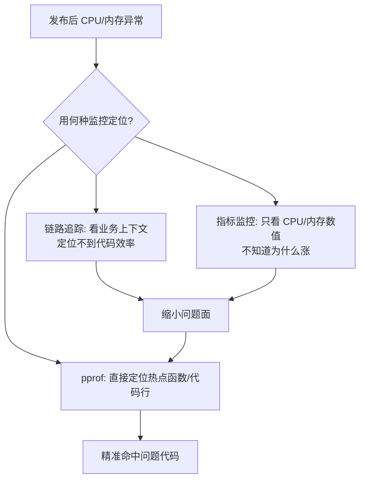

## 纲要

- 链路追踪与指标监控的盲区：二者能定位「长链路哪一环出错」「哪个业务/资源指标异常」，但都无法回答「究竟是哪一段代码吃掉了 CPU / 内存 / 阻塞时间」
- pprof 的定位：Go 标准库提供的性能剖析工具，能直接把热点定位到具体函数甚至具体代码行，弥补「代码级性能」这一监控空白
- 三类问题 pprof 能覆盖：CPU 占用高、内存分配/持有多、阻塞与加锁时间长——这些是链路追踪和指标监控无法触达的范畴
- 与既有监控的关系：不是替代，而是「缩小范围后的最后一击」。指标监控缩小问题面，pprof 精准命中问题代码
- 典型线上场景：发布后大盘 CPU/内存异常，回滚后无从下手，老手只能逐行翻业务代码；pprof 可直接指出热点函数，免于人肉排查
- 两种使用形态：HTTP 接口实时查看（`net/http/pprof`）与生成二进制 profile 文件离线分析（`go tool pprof`）

## 正文

### 链路追踪和指标监控解决不了什么

前面两章我们分别建起了链路追踪和指标监控。链路追踪擅长回答「一条很长的请求链路里，具体是哪一环出了问题、出了什么问题」，它能把异常的业务上下文提取出来复现 bug。指标监控主张分层，能帮我们快速缩小定位范围。

但这两者都有一个共同的盲区：**它们都看不到代码本身的执行效率**。

设想一个线上场景：发布前一切正常，发布后观察一段时间，发现 Prometheus/Grafana 大盘上 CPU 或内存异常升高。我们第一时间回滚，然后想定位原因。这时候：

- 看链路追踪？它反映的是业务异常，你的业务逻辑其实是对的，只是 CPU/内存比相同 QPS 下高出一截——链路追踪无能为力。
- 看指标监控？你只能看到 CPU/内存这两个值在涨，但它们**为什么涨**，其他面板都正常、没有波动，你无从得知。

经验丰富的工程师此时只能去发布涉及的功能里，一个一个翻业务代码，判断哪里有性能 bug。这种「人肉排查」既慢又不可靠。

### pprof 补上了这一环

pprof 是 Go 提供的性能剖析工具，它的独特价值在于：**直接精准定位问题代码**。

它告诉我们，在采样期间，到底是哪一段代码在 CPU 或内存的使用上占比最长，哪一段代码阻塞时间或持锁时间最长。换句话说：

- 链路追踪、指标监控 → 告诉你「什么业务、什么资源」异常
- pprof → 告诉你「哪一行代码」导致异常

这恰好是前三章监控手段覆盖不到的范畴——**代码级性能问题**。注意它和「代码 bug」不同：代码逻辑没错，只是执行效率低，导致相同请求量下 CPU/内存占用比以前高很多。这类问题，必须用 pprof 来优化。



### pprof 的两种使用方式

后续逐一展开，这里先建立整体认知。pprof 落地无非两种形态：

| 形态 | 做法 | 适用 |
| --- | --- | --- |
| HTTP 接口 | 把 `pprof` 包的方法注册到 HTTP 路径，浏览器/命令行访问实时查看 | 临时在线抓取样例 |
| 二进制文件 | 在程序里显式采样一段时间，生成 `.pprof` 文件，用 `go tool pprof` 离线分析 | 复现后精确分析 CPU/内存 |

不论哪种，最终都能分析出 CPU、内存、阻塞、加锁这几类性能数据。下面起，我们逐一用实战案例把它们的用法跑通。

### 如何为服务开启 pprof 入口

HTTP 形态最简单，只需import 匿名引入 `net/http/pprof`，再把 `http.DefaultServeMux` 挂到某个端口即可，路由路径是固定的，必须原样保留：

```go
// 根据讲稿逻辑补充：为服务开启 pprof HTTP 入口（固定路由，不可改名）
package main

import (
	"net/http"
	_ "net/http/pprof" // 匿名引入即注册 /debug/pprof/* 路由
)

func main() {
	// 生产环境建议绑定内网端口，避免对外暴露
	go func() {
		http.ListenAndServe("127.0.0.1:8080", nil)
	}()
	// ... 业务主逻辑
	select {}
}
```

开启后访问 `http://127.0.0.1:8080/debug/pprof/` 即可看到 profile 类型列表（profile 代表 CPU，heap 代表内存，block、mutex 等各对应一类）。

## 技术点总结

- 监控体系分三层递进：链路追踪定位业务环节、指标监控缩小问题面、pprof 命中问题代码
- pprof 解决的是「代码级性能」问题，不是逻辑 bug，是执行效率差
- CPU/内存异常但业务正常时，链路追踪和指标监控都指不到具体代码，必须靠 pprof
- pprof 两种形态：HTTP 实时查看、二进制文件离线分析
- 开启 HTTP 入口只需 `_ "net/http/pprof"`，路由路径固定不可改
